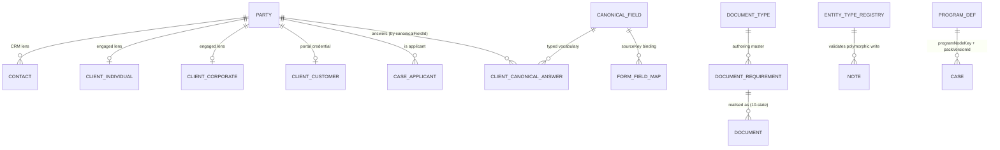
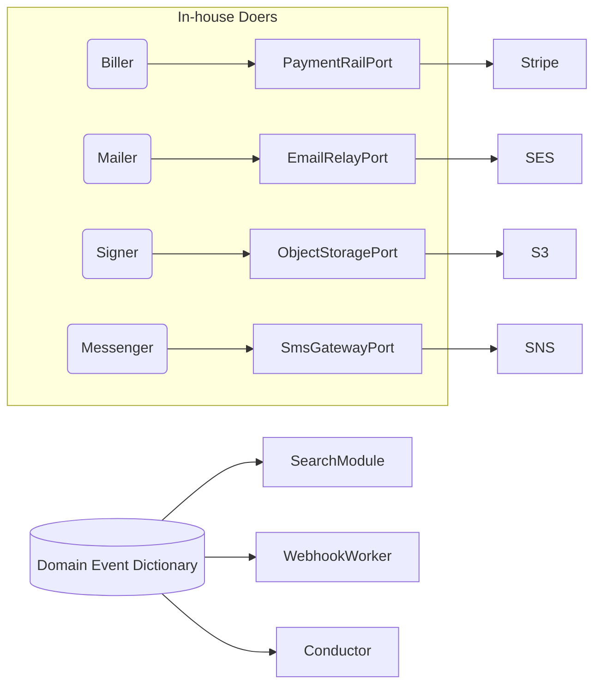

# ExpatReady — Architecture Decision Record (ADR)

> **Document version 1.0** · Last updated 2026-06-22 · All changes are logged in [CHANGELOG.md](CHANGELOG.md) (no duplicate version files).


> **Author:** Chief Architect (acting). **Date:** 2026-06-21. **Status:** decisions LOCKED; pending (a) founder business/domain/budget inputs and (b) the W1–W4 document-rewrite that folds these decisions into the FINALs.
> **Provenance:** 6 architect decision-clusters → consolidation → 3 adversarial reviews (skeptic architect + security + vendor's-eyes). The review-driven corrections below are NORMATIVE and override the consolidated decisions where they conflict.
> **How to use:** this is a DECISIONS REGISTER, not the vendor build source. Do NOT hand a vendor this ADR + today's FINALs — they conflict (FINAL bodies still leak MySQL/Mongo/clientId). The vendor gets ONE rewritten FINAL set after W1–W4. See `_GAP-ANALYSIS-vendor-scope.md` and `00-INDEX.md`.

---

## ⚑ FINAL — Corrections from adversarial review (folded by Chief Architect; NORMATIVE)

These supersede the consolidated decisions below where they differ:

1. **Postgres+RLS is NOT a new fork — it was already mandated by the RFP** (Postgres 18 + RLS forced + JSONB + ca-central-1 + field-encryption + separate auth pools). C1 is therefore **reconcile the FINAL bodies/glossaries/§11/§12 to the already-approved Postgres arch and purge the leaked MySQL/Mongo brownfield language** — NOT a migration. Greenfield, no production data ⇒ **price no migration**.

2. **firmId vs clientId is a semantic inversion, not a rename.** Today the prototype scopes tenancy on `clientId` (157 occ / 125 models; `firmId` = 0). Wave-0 deliverable: a normative **table-by-table tenancy classification** {plane: GLOBAL|TENANT|CLIENT-PII, tenant_key, owner_chain}. CI schema-lint must assert RLS FORCED **on the firm_id column specifically**; a denial test must prove it.

3. **Portal client-to-client isolation has NO DB backstop under firm_id-only RLS.** Add a **second portal RLS dimension** (a client-subject GUC from the portal token) AND **bind every presigned URL to an ownership-checked record** — never sign a caller-supplied storage key. (Fixes a LIVE prototype IDOR: presigned-read signs any key.)

4. **Auth pools must be cryptographically separated.** Three pools = **distinct signing keys per pool + mandatory `aud`-claim verification** inside each strategy + CI cross-pool 401 test. (Prototype shares one JWT_SECRET; the distinct secret is defined-but-unused.) Note: only TWO pools exist today (agent/super-admin share one, client-portal separate) — the **platform pool + audience-walling is NET-NEW**, size it.

5. **Crypto-shred erasure vs immutable audit + 7-yr retention — resolved:** hash-chain over **ciphertext/HMAC, never plaintext**; **per-firm** audit chains (not one global chain) for concurrency + per-tenant tamper-evidence; audit written **synchronously via an outbox** (atomic with the user op), the event bus only fans out notifications; **per-field retention-keyed sub-keys** so financial fields under the 7-yr floor aren't destroyed by a DSR erasure.

6. **Key hierarchy:** CMK → per-firm DEK → **per-subject key** (drop per-DOCUMENT keys — over-engineering at 25M docs). Blind-index/HMAC **only** on the few fields needing exact-match server lookup, with a **per-firm** HMAC key; **never project Restricted PII into the search index** (CI scanner asserts it).

7. **PgBouncer is the likeliest silent cross-tenant leak.** Transaction-mode pooling + `SET LOCAL` only + fail-closed `current_setting(...,true)` NULL→zero-rows check, made a **release gate** with a **connection-reuse cross-tenant test** (request as firm A then firm B on a pooled connection; B sees zero of A).

8. **Global-residency seam (do NOT hard-pin Canada-only).** Region becomes a **per-tenant dimension** + region-scoped KMS now; deploy Canada-only at launch, but adding eu-central-1 for a German firm = config, not a rewrite. (A hard ca-central-1 CI pin is a global-scale anti-pattern.)

9. **Config-as-JSONB global plane:** global rows (`firm_id IS NULL`) need an explicit **read-only permissive RLS policy + admin-only write**; tenant/override tables get `firm_id NOT NULL`. CI lint: every JSONB config table is exactly one of those two categories.

10. **@Public() routes need a positive allow-list** — each is either `@RequirePermissions` or `@Public` **with a named compensating control** (webhook signature / capability-token / rate-limit). Public-by-id reads of contracts/documents use **unguessable capability tokens**, never sequential/UUID ids in the URL. **No tokens or PII in URL query params.** (Fixes live retainer IDOR + checkout abuse.)

11. **Privilege-escalation fix is write-side too:** role-create/update **rejects any GLOBAL/system permission on a firm/portal role** (fail-closed, audited) + a one-time **remediation scan** stripping already-mis-granted rows — both CI-gated. (Live defect: name-only guard + unfiltered role write.)

12. **Commercial model split** (fixed-price + frozen scope is impossible while content volume is unknown): **fixed-price for the ENGINE/machinery**; **unit-price (per case-type / form-edition / pack) for CONTENT**. The case-type/PNP-depth list is a **hard gate** before any content wave is fix-priced.

13. **Wave A is overloaded — decompose into sub-gates:** A0 RLS substrate + Prisma scoping + CI denial suite · A1 identity (3 pools) + RBAC (hand-author the full agent/*+portal/* catalog, THEN CI-validate) · A2 CanonicalField catalogue + answer store (the biggest refactor — its own gate) · A3 KMS hierarchy. Right-size the load-test gate to **launch reality + horizontal-scaling proof**, not invented 2,000-firm absolutes.

14. **BI canonical spine status:** the canonical entities (CanonicalField, ClientCanonicalAnswer, Party, …) are **founder-brainstormed and directionally approved this session**, but are **not yet written into SA-1/AG-8**. W1 folds them in with full §7 field rigor; until then they are PROPOSED-in-docs. Reconcile each ADR call against the **current FINAL text** (some OQs are already resolved) and **supersede the gap analysis** after folding, so the vendor gets ONE coherent source (no FINALs-vs-gap-vs-ADR drift).

15. **Stack version override (2026-06-26):** the platform owner elected latest-stable majors at build time — **PostgreSQL 16 → 18** and **Prisma 6 → 7** (driver-adapter `@prisma/adapter-pg` + `prisma.config.ts`; no `datasourceUrl`). FORCED-RLS semantics re-verified on PostgreSQL 18.4 (fail-closed zero-rows; `WITH CHECK` reject; superuser-bypass confirmed ⇒ the app connects as the non-`BYPASSRLS` role). NestJS 11 / React 19 unchanged. See Doc 1 Integration Amendment A7. This supersedes the "Postgres 16"/"Prisma 6" pins below; the isolation architecture is unchanged.

---

# EXECUTIVE SUMMARY

ExpatReady is a from-scratch, global, multi-country, multi-tenant SaaS operating system for immigration firms (launch Canada), delivered by an external vendor against a frozen spec, across three consoles: Super-Admin, Agent, and Client Portal. The architecture in a nutshell: a TypeScript-end-to-end NestJS 11 modular-monolith ("modulith") backend on a SINGLE relational system of record — PostgreSQL 18 — with database-enforced Row-Level Security (ENABLED + FORCED) as the PRIMARY tenant-isolation control, backed by four defense-in-depth layers (non-BYPASSRLS app role + per-request SET LOCAL tenant GUC + mandatory tenant-scoped repository/Prisma-extension + object-level IDOR checks) and a CI cross-tenant-denial suite as the release gate. MongoDB is ELIMINATED; all config-as-data (automation, templates, questionnaire/form blobs, entitlements) moves into Postgres JSONB validated by Zod at the edge — one residency surface, one DR regime, one isolation boundary, ACID across config and data. The whole estate is pinned to AWS ca-central-1 (DR within Canada) with field-level envelope encryption for Restricted PII and PIPEDA erasure by crypto-shredding. firm_id (tenant) and client_id (end-client) are SEPARATE keys on every row; RLS scopes on firm_id only.

The headline calls: (1) PostgreSQL + FORCED RLS is the keystone — it resolves the C1 freeze-blocker (docs spec Postgres RLS 171x but prototype is MySQL), makes ~98% of the context docs buildable as written, and is cheaper-or-neutral versus a hand-audited MySQL app-isolation build because isolation becomes declarative DDL. Because this is greenfield with no production data, "re-platform" means "build natively on Postgres" at near-zero migration cost. (2) ONE canonical data spine built on the locked SA-1/AG-8 BI design: a single Party identity root with role-lenses (Contact/Client/ClientCustomer); one owned, versioned, country-neutral CanonicalField catalogue that scoring, forms, docs and SQR all bind to; one DocumentType master + 10-state lifecycle; one platform-owned EntityTypeRegistry; a resolved programNodeKey+packVersionId pair replacing four loose program FKs; and one GovFormDef form master with a thin tenant FormInstance. (3) In-house identity (NestJS+Passport, Argon2id, in-house TOTP/WebAuthn) with THREE walled auth pools (platform/firm-staff/client-portal) — the managed-IdP recommendation in arch-doc-02 is overruled per the in-house-Doer doctrine, the existing three-auth codebase, and residency control. (4) system/* canonical for GLOBAL, agent/*//portal/* for LOCAL; a scope-aware guard fixes the verified privilege-escalation defect; a complete, CI-validated permission catalog + default role matrix seeds least-privilege roles day one. (5) In-house Doers on swappable rail ports with ONE concrete v1 adapter each (Stripe, AWS SES+SMTP, S3, SNS+WhatsApp BSP, in-house IdP); a canonical domain-event dictionary; one platform-owned FxRateService; and explicit owners for the three ownerless features (universal search = new SearchModule; firm self-serve billing UI = AG-16; outbound API/webhooks = AG-16). (6) Greenfield build framing (existing codebase = design-provenance only, NDA-gated reference input); FULL de-phasing to one frozen scope with build-sequencing waves; a procurement shell folded into both FINALs; and firm-onboarding bulk import as a first-class product feature.

The one cross-cluster conflict I resolved: Clusters 1, 2 and 5 lock PostgreSQL+RLS, while Cluster-3 (C3-D4) and Cluster-6 (6.3) were drafted defensively assuming "MySQL-now, no native RLS." Because the keystone is Postgres+RLS, those two are HARMONIZED: the record-level authz layer (C3-D4) stands exactly as written but RLS is now its DB backstop (not absent), and the procurement acceptance suite (6.3) tests BOTH the RLS schema-lint (A1/A2) AND the behavioral cross-tenant-denial suite (A3) — the app-enforced scoping is defense-in-depth on top of RLS, never instead of it. The result is one mutually-consistent, vendor-quotable, globally-scalable design.


# DECISION TABLE


### [C1-1] Data Platform & Isolation
- **Decision:** Build on PostgreSQL 18 as the single relational system of record; tenant isolation BY CONSTRUCTION via Row-Level Security ENABLED+FORCED on every tenant table, wrapped in 4 defense-in-depth layers (non-BYPASSRLS app role, per-request SET LOCAL tenant GUC, mandatory tenant-scoped repository, object-level IDOR checks). firm_id and client_id are separate keys; RLS scopes on firm_id.
- **Why:** Highest-leverage call: makes the context docs buildable as written, ends the Postgres-RLS-vs-MySQL contradiction (C1), and the database guarantees isolation even when a developer ships a raw query. Greenfield = near-zero migration cost; starting correct beats re-platforming later.
- **Implication:** Vendor builds natively on Postgres (RDS/Aurora, ca-central-1), MUST NOT lift the prototype MySQL schema. ~3-4 week foundational sprint (RLS migration generator + Prisma extension + CI denial suite) precedes all module work. Cost neutral-to-cheaper vs robust MySQL app-isolation.

### [C1-2] Datastore
- **Decision:** ELIMINATE MongoDB. All config-as-data (automation, templates, questionnaire/form blobs, entitlements, custom fields) moves to Postgres JSONB validated by Zod at the edge; config inherits the SAME RLS, residency, DR, and encryption as case data. GIN indexes for searched JSONB.
- **Why:** A second store holding tenant config with no RLS is an un-isolated PII-adjacent surface (cross-cutting gap). Postgres JSONB gives document-store flexibility inside one ACID/residency/backup boundary; the BI spine's decomposition of Mongo Form blobs IS this collapse.
- **Implication:** Net cost REDUCTION (removes a whole datastore's ops/residency/DR line items). Adds Zod-schema authoring + GIN-index design per config domain. No Mongo driver, one migration system.

### [C1-3] Residency & PII
- **Decision:** Pin the entire estate (DB, replicas, S3, Redis, search, backups/PITR, PII logs) to AWS ca-central-1 with DR within Canada; CI region-allowlist; per-rail sub-processor residency matrix; field-level envelope encryption for Restricted PII; PIPEDA erasure via crypto-shredding + deletion orchestrator + certificate.
- **Why:** Hard PIPEDA/RCIC residency requirement and the product's core selling point. Mongo elimination leaves ONE residency surface to pin. Crypto-shredding makes erasure work against immutable backups while preserving audit-chain integrity.
- **Implication:** In-region managed services priced normally; field-level encryption + per-subject key management + erasure orchestrator are real line items. Founder must confirm the exact Restricted-PII field list and whether any enterprise tenant demands DB-per-tenant day one.

### [C2-D1] Data Model — Identity
- **Decision:** ONE Party spine (PERSON|ORGANISATION, firmId-scoped, mergedIntoPartyId tombstone). Contact = CRM lens, ClientIndividual/ClientCorporate = engaged-client lens, ClientCustomer/ClientCorporateCustomer = portal-login credential only — all keyed on partyId. CaseApplicant.personId→partyId; Prospect.convertedClientCustomerId→convertedPartyId.
- **Why:** The CRM, corporate-sponsor, separate-portal-auth, and per-applicant models all collided only because each named its own root (C5(1)). One Party root with role-lenses fixes the convertedClientCustomerId self-contradiction and enables cross-case data sharing (the moat).
- **Implication:** Build Party + PartyProfile + PartyRelationship (CLIENT-PII, firmId+RLS). Refactor AG-2/AG-7/AG-15. Founder must scope the regulator/representative-type cardinality (RCIC vs lawyers/paralegals vs Quebec MIFI).

### [C2-D2] Data Model — Catalogue
- **Decision:** Promote the canonical-field vocabulary to a first-class OWNED, versioned, country-NEUTRAL GLOBAL entity CanonicalField (stable canonicalFieldKey). SA-1 rules, AG-8 ProfileBinding, AG-3 scoring, AG-7 form maps, AG-9 doc-conditions ALL bind to it. Per-client answers live in the locked append-only ClientCanonicalAnswer/AnswerSubject/ClientFactRecord store keyed by canonicalFieldId.
- **Why:** The catalogue is 'load-bearing' and 'the moat' yet owned by no entity (C5(2)). One versioned vocabulary gives point-in-time reproducibility, capture-once/ask-only-whats-left, and referential integrity (EC-8 drift validation).
- **Implication:** THE biggest refactor in the cluster — replaces the untyped Mongo by-label store. Build CanonicalField + catalogue versioning + EnumSet + the locked answer store. Sequence first; rules/forms/docs all depend on it.

### [C2-D3] Data Model — Documents
- **Decision:** ONE DocumentType master (GLOBAL, pack-driven) + the locked DocumentRequirement authoring unit (two axes standardness/primacy + two attach-modes + alternativeGroupId + conditionRule→CanonicalField + expiryRelevant). ONE 10-state lifecycle (AG-9's). AG-7's competing 7-state CaseDocument enum is DROPPED; checklist becomes a derived view over AG-9 Documents.
- **Why:** Three incompatible shapes with two status enums (C5(3)) guarantee a build-time collision. AG-9 already declares status the single contract; making it canonical honours ownership boundaries and the founder's primary/non-primary/answer-conditional/expiry model.
- **Implication:** Build DocumentType + DocumentRequirement (GLOBAL); AG-9 Document + 10-state lifecycle (CLIENT-PII). AG-7 has zero independent document-status code. Wire expiry→Minder.

### [C2-D4] Data Model — Registry
- **Decision:** ONE platform-core EntityTypeRegistry (owned by cross-cutting/platform, not a domain) as the single enumerated, validated source of attachable entity types. Every polymorphic write validates (entityType,entityId) against it AND asserts firmId match. ContactProfile is RETIRED as a stored entity — it becomes a derived projection over the answer store.
- **Why:** 03 §1.3 mandates the registry but no module owns it; each invents a subset (C5(4)). One registry makes 'add a new entity = one registry row, zero migrations' true (MX2) and removes the last competing single-source-of-facts claim.
- **Implication:** Build EntityTypeRegistry + registration API + polymorphic-write validation guard reused by Notes/Tasks/Reminders/Documents/Comms/Audit/Notification. Replace ContactProfile reads with a CanonicalAnswerProjection service.

### [C2-D5] Data Model — Program Path
- **Decision:** Collapse the four scalar FKs (pathwayId/programId/categoryId/subCategoryId) on Prospect/Case/templates into a resolved pair: programNodeKey (deepest selected node in SA-1's versioned ProgramDef hierarchy) + packVersionId + denormalised countryCode. Breadcrumb is RESOLVED, not stored; the pair is immutable per record for point-in-time correctness.
- **Why:** Four loose FKs can't reference SA-1's single versioned nodeKey, can be internally inconsistent, and break on rename (C5(5)). nodeKey+packVersionId gives provenance, country-pack alignment, and one value the catalogue/rules/checklists/forms all key on.
- **Implication:** Schema migration on the busiest tenant tables; sequence after C2-D2. Add a breadcrumb-resolver service. Renaming a program label never breaks an existing case.

### [C2-D6] Data Model — Forms
- **Decision:** SA-1's GovFormDef→FormEdition→FormFieldMap is the ONE GLOBAL form master. AG-7's FormVersion/FormFieldMapping are DROPPED; only a thin tenant FormInstance remains (per-case generation state, points at formEditionId). Binding contract: FormFieldMap.entries[].canonicalFieldKey == CanonicalField.canonicalFieldKey; formFieldId == a field in FormEdition.parsedFieldInventory.
- **Why:** Two form-master shapes with implicit binding (C5(6)) would let AG-7 and SA-1 disagree on field maps and break re-renderability. One master + thin instance makes the Filler a pure, auditable function of (answers × field map × edition).
- **Implication:** Drop AG-7 form-version/field-map tables; build the data-driven Filler reading from the answer store. Founder supplies the IMM form content (C3) and the accepted-PDF-format decision (AcroForm/XFA/flattened).

### [C3-D1] Identity & Auth
- **Decision:** ONE in-house identity (NestJS+Passport, Argon2id, in-house TOTP/WebAuthn+recovery codes, 15-min access JWT + rotating refresh cookie, token-BOUND sessions). THREE physically-separate auth contexts (platform/firm-staff/client-portal), each with own login endpoint, audience claim, and session store. A token for one context is structurally invalid for another. The arch-doc-02 managed-IdP (Cognito/Auth0) recommendation is OVERRULED; inbound SSO is a future additive adapter.
- **Why:** The in-house-Doer doctrine, the existing three-auth codebase, and residency/PIPEDA control all point to in-house; a managed IdP re-platforms working code and adds a sub-processor on the most sensitive surface. Three audiences make persona privilege-confusion impossible.
- **Implication:** Build three login endpoints/strategies + one shared AuthCore + three session tables + per-pool MFA. Founder confirms per-persona MFA defaults, SSO timing, SMS appetite (commercial knobs only).

### [C3-D2] RBAC — Namespace
- **Decision:** system/* is canonical GLOBAL; agent/* + portal/* are canonical LOCAL; global/* is PURGED. Exactly two scopes. The guard MUST be scope-aware (route plane must equal held-permission scope; mismatch = 403 SCOPE_VIOLATION + audit). Service-layer validates scope-match on role writes. feature.* is a separate hard-gate namespace; country is a soft filter.
- **Why:** The prefix contradiction is self-acknowledged; a seed/guard cannot carry two prefixes for one scope. SA-6-12 verifies a LIVE escalation (createClientRole + name-only guard let a firm admin grant itself system/*). Fixing at write AND read is defense-in-depth.
- **Implication:** Mechanical global/*→system/* sweep; scope-aware RolesGuard; service-layer scope validation; one-time remediation scan stripping GLOBAL perms off firm roles; CI lint requiring @RequirePermissions on every state-changing route.

### [C3-D3] RBAC — Catalog
- **Decision:** Deliver ONE code-seeded catalog across system/*+agent/*+portal/* + an explicit DEFAULT MATRIX (6 platform sub-roles, 6 firm templates, 3 portal roles). Completeness is MECHANICALLY DERIVED + CI-VALIDATED from each module's section-10 (every @RequirePermissions exists in catalog; every key wired to >=1 route). view.own/view.all qualifier where ownership matters. All firm/portal templates are LOCAL-only; the seeder LOCAL-filters.
- **Why:** SA-6 enumerates ~11 system/* keys, ZERO agent/portal — the RBAC seed and the portal authz plane are unbuildable without the full catalog + matrix. CI-derived (not hand-curated) stays correct as 28 modules evolve.
- **Implication:** One idempotent seed migration (catalog + RoleTemplate/RoleTemplatePermission/PlanRoleTemplateSet). Founder confirms the least-privilege boundaries of the 6 firm templates (operating-model choice).

### [C3-D4] Record-level Authz
- **Decision:** Record-level authorization is a MANDATORY, server-enforced, fail-closed data-access layer: request-scoped PrincipalContext is the ONLY scope source (never caller-supplied id); a tenant/record-scoped repository is the only sanctioned DB path; object-level ownership checks layer on permissions; the portal rule = a client touches only rows whose ownership chain resolves to their own clientCustomerId (+ firm PortalVisibilityConfig allow-list). Drill-through/reports re-apply the check. This layer + Postgres RLS (C1-1) are defense-in-depth; CI cross-tenant/cross-record denial suite is a release gate.
- **Why:** SA-6 OQ-6 punts record-level scope to a nonexistent portal data-layer; the portal is the top PII-leak surface. HARMONIZED with C1-1: app-enforced scoping is now the fast/observable layer ON TOP OF RLS, not a replacement for it.
- **Implication:** Build PrincipalContext (AsyncLocalStorage), Prisma scoping extension, object-level helpers (assertSameFirm/assertOwnedByCaller/assertPortalOwnershipChain), audited impersonation path. Pre-go-live horizontal-access pentest must fail 100%. On critical path — gates the portal.

### [C4-D1] Integration — Rails
- **Decision:** In-house Doers on swappable rail PORTS (PaymentRailPort/EmailRelayPort/ObjectStoragePort/SmsGatewayPort/IdentityProviderPort), with ONE concrete v1 adapter each: Stripe (Payment Intents+Connect for client→firm; Billing for firm→platform), AWS SES + SMTP fallback, AWS S3 (SSE-KMS, presigned), AWS SNS + WhatsApp BSP. SA-8 IntegrationRailConfig is the runtime selector. No Doer imports a vendor SDK directly.
- **Why:** Docs hard-name vendors 245x while the doctrine is swappable rails — a vendor would quote a locked build. One-adapter-per-rail-behind-a-port is quotable AND preserves the per-country residency swap path the global mandate needs.
- **Implication:** Build one production adapter per rail + ports + SA-8 config/secret/health plane. ~5-10% over a naive direct-SDK build. CI fake-adapter substitution tests. PCI stays SAQ-A. Founder confirms vendor selection + Stripe Connect commercial terms.

### [C4-D2] Integration — Eventing
- **Decision:** ONE canonical Domain Event Dictionary in packages/contracts/events: lowercase dot.case noun.verb-past names, a Zod payload schema per event, single emitter, declared consumers, explicit idempotency-key formula (includes external webhook event id). Notification keys use a DIFFERENT dash.case notif/ namespace. envelope.signed is canonical; esign.envelope.completed is DELETED (AG-9 listener repointed). Transport = in-process Conductor bus + Bull, at-least-once, post-commit, non-fatal.
- **Why:** Measured drift (envelope.signed 78x vs esign.envelope.completed 9x) means AG-9 listens for an event nobody emits — a silent break on the retainer→billing→onboarding spine. A code dictionary makes the SDK drift-proof by construction.
- **Implication:** Build packages/contracts/events + CI lint (reject unregistered names, namespace collisions) + a firm-scoped processed-event ledger reused by every consumer. Low net-new cost (bus+Bull+idempotency already exist).

### [C4-D3] Integration — FX
- **Decision:** ONE platform-owned FxRateService is the SOLE writer of an immutable FxRateSnapshot (unified fields: baseCurrency/quoteCurrency/rate/asOf/source/economicMoment/capturedAt). SA-4's fromCurrency/toCurrency/capturedAt are renamed. Consumers store fxSnapshotId. v1 ships a MANUAL adapter behind FxRateSourcePort; PROVIDER is a later adapter. Missing rate = exclude-with-note, never raw-sum.
- **Why:** FxRateSnapshot is 'NEW shared' in six modules with no writer and two field vocabularies — a guaranteed collision. Single-writer + immutable snapshot makes FX auditable and reproducible (regulatory-grade).
- **Implication:** Build FxRateService + FxRateSnapshot + fxSnapshotId FKs + a convert-before-sum helper. SA-4 spec edit. Founder confirms platform + per-firm reporting currency and manual-vs-provider for production.

### [C4-D4] Ownerless — Search
- **Decision:** NEW platform SearchModule (the 'Finder') owns universal cross-entity search. v1 backing = Postgres FTS (tsvector+GIN) over a denormalised SearchDocument projection maintained ASYNCHRONOUSLY from the event dictionary; OpenSearch is the documented later adapter behind a SearchIndexPort. Every result is firm-scoped + permission-filtered + record-level-ownership-filtered. Portal gets NO universal search.
- **Why:** Universal search has 0 hits across modules and is the most likely cross-firm PII leak surface. A dedicated owner + event-fed projection keeps it decoupled, isolation-correct, and demonstrates the event dictionary's payoff. (Updated from MySQL FULLTEXT to Postgres FTS per C1-1.)
- **Implication:** Build SearchModule (projection table, event consumers, SearchIndexPort + Postgres-FTS adapter, permission+tenant post-filter, cursor API) + reindex job. Small surface; events already exist.

### [C4-D5] Ownerless — SaaS Billing UI
- **Decision:** Assign firm self-service SaaS-billing UI to AG-16 as a new §Plan & Billing section (upgraded from read-only): view plan/usage/invoices, start/change subscription via Stripe Checkout, update card via Customer Portal/SetupIntent (card never touches ER), 402-recovery screen, plan upgrade/downgrade/cancel. SA-4 owns ALL server-side lifecycle/webhooks/dunning/MRR; AG-16 holds NO billing logic — it calls SA-4. New agent/firm:billing-manage permission.
- **Why:** SA-4 defers the firm-facing UI to 'the Agent plane' with no AG owner; AG-16 is the firm's settings home. Strict UI-presentation / SA-4-logic split keeps money single-sourced and the two Stripe rails (system vs per-firm Connect) separate.
- **Implication:** Build AG-16 billing screens calling SA-4 endpoints; SA-4 exposes create-checkout/create-portal-session/request-plan-change/cancel. Moderate UI cost, little new backend.

### [C4-D6] Ownerless — API + IdP
- **Decision:** (A) Outbound public read API + signed/retried/dead-lettered webhooks owned by AG-16 §Developer/API (firm-scoped keys, scoped permissions, rate-limited, OpenAPI; publishable events == the C4-D2 dictionary; AG-2 inbound keys reframed as one facet). (B) IdP = one in-house OIDC-style identity behind IdentityProviderPort with three walled pools — consistent with C3-D1; managed IdP demoted to a later enterprise-SSO adapter.
- **Why:** Outbound API/webhooks has only inbound write-only keys today; firms need read API + outbound webhooks (the dictionary makes the catalogue free). AG-16 owns the whole firm↔external boundary. IdP contradiction resolved decisively toward in-house (matches C3-D1).
- **Implication:** Build AG-16 §Developer (public read endpoints, ApiKey + WebhookSubscription, delivery worker) + the in-house IdP behind a port. Founder confirms whether enterprise SSO is v1 vs fast-follow.

### [NFR5-04] NFR — DR
- **Decision:** RPO ≤ 15 min (continuous WAL/PITR), RTO ≤ 4 h for region failure; daily full + continuous incremental backups, all in Canadian regions, encrypted; S3 versioned + cross-AZ + Glacier lifecycle; Redis is recoverable cache only; quarterly restore drill is a contractual deliverable. ONE DR regime covers all durable data (Mongo eliminated).
- **Why:** Right balance for a regulated B2B SaaS where a payment must atomically activate a case; strict enough to defend, loose enough to avoid synchronous-multi-region cost. Mongo elimination is what makes 'one DR regime' true.
- **Implication:** Configure RDS/Aurora PITR + S3 versioning/lifecycle + DB primary+standby across >=2 AZs; quarterly drill with recorded evidence.

### [NFR5-05] Security — KMS
- **Decision:** TLS 1.2+ everywhere; AES-256 at rest via KMS (ca-central-1). Key hierarchy: platform CMK wraps a per-firm DEK wraps a per-subject/per-document key. PIPEDA erasure = destroy the per-subject key + SA-11 disposal orchestrator (recovery window → hold/floor check → crypto-erase + verified hard-delete → DATA_DISPOSED chained audit).
- **Why:** Per-firm DEKs give blast-radius containment; per-subject sub-keys make erasure cheap and provable against immutable backups (destroy one key, not scrub scattered rows). This is the keystone that makes founder-confirmed crypto-shred erasure buildable.
- **Implication:** Build envelope encryption (CMK→firm DEK→subject key) before any Restricted field is stored (retrofitting per-subject keys later is expensive). KMS via task IAM roles, rotation, audited.

### [NFR5-06] Security — Field Encryption
- **Decision:** Restricted PII (passport/travel-doc, SIN+foreign equivalents, gov-ID numbers, financial-account/bank, biometric refs, licence/designated-person creds) gets application-layer envelope encryption + mask-by-default + reveal-permission + PII_REVEAL audit on every reveal. No card data stored (tokenized). No Restricted PII in logs/traces/non-prod. Exact field list = a founder/privacy domain confirmation; mechanism is fixed.
- **Why:** Field-level encryption is expensive in key-mgmt/query complexity, so scope it tightly. Mask-by-default + audited reveal is PIPEDA accountability made concrete. Tokenizing payments keeps PCI scope minimal.
- **Implication:** Tag every field with a classification; Restricted fields use the encrypt codec + blind-index/HMAC for exact-match lookup. CI scanner asserts no Restricted field in logs. Founder confirms the exact field set.

### [NFR5-08] Security — Audit
- **Decision:** ONE platform-wide append-only audit spine; immutability at the DB GRANT (INSERT-only role); hash-chained entries (SHA-256 of prevHash‖entry, monotonic sequenceNo); periodic WORM anchor (S3 Object Lock) of the chain head; continuous chain-verify alarm; failed audit write retries+alarms, never rolls back the user op. Retention floors enforced in code (financial >=7yr, breach >=2yr, other >=2yr; effective = max of applicable per-country minimums).
- **Why:** Append-only-by-convention is undetectably tamperable. Grant-level INSERT-only + hash-chain + WORM anchor is the auditor-recognizable, evidence-grade pattern. Floors-in-code make 'kept the legally required time' structurally true.
- **Implication:** Dedicated INSERT-only audit role; Audit Emitter (enrich+chain+sequence); WORM anchor job; chain-verify alarm; durable retry. Founder/counsel set the numeric floors + whether RFC-3161 timestamping is required.

### [NFR5-09] Compliance — PIPEDA/Law-25
- **Decision:** SA-11 owns the governance plane: consent register (+ Law-25 per-purpose), retention/disposal (floors-in-code), legal hold (hold beats deletion/schedule), DSR register (statutory clock, hold/floor-aware, honest about deleted-vs-retained), breach register (record EVERY breach, RROSH gates notification, 72h clock UI), and ONE canonical per-individual data export (machine-readable JSON+PDF, identity-verified, masked-unless-reveal, audited as egress).
- **Why:** The per-individual export is ownerless and partial across 5 modules; Law-25 adds buildable FEATURES not just thresholds. Centralizing registers in SA-11 gives one coherent, testable compliance surface; 'hold beats deletion' encodes legally-correct precedence.
- **Implication:** Build SA-11 ConsentRecord/RetentionPolicy/LegalHold/DsrRequest/BreachRecord + the export job (both call the crypto-shred orchestrator). Portal surfaces privacy notice/consent/DSR. Founder/counsel set RROSH thresholds + breach-clock interpretation.

### [NFR5-11] NFR — Accessibility
- **Decision:** WCAG 2.2 AA for ALL THREE consoles (portal at the same bar). Owned as a per-surface testable gate: axe in CI per component + at least one manual screen-reader/keyboard audit before go-live + a VPAT artifact. Generated documents (retainers/IMM/invoices) are tagged/accessible PDFs.
- **Why:** A regulated B2B product cannot ship an inaccessible portal — the portal is the highest-exposure consumer surface. 2.2 is the current W3C recommendation and satisfies 2.1 too.
- **Implication:** Use Radix/shadcn primitives; axe in CI; book a manual AT audit; deliver a VPAT; tagged-PDF pipeline. The Client Portal console spec carries its own WCAG 2.2 AA acceptance criteria.

### [NFR5-12] NFR — i18n
- **Decision:** Full EN + Canadian French across UI, system emails/notifications, validation, and PDF output (retainers, IMM forms, invoices). System strings ship fully EN+FR at launch (in scope); firm-authored content is stored bilingually with side-by-side authoring + coverage indicators but the firm owns its translation (out of platform scope). UTC storage, America/Toronto default render, CAD formatting.
- **Why:** French is a launch legal requirement (Quebec Charter/Law-25 make a French agreement mandatory). The system-vs-firm-content split draws the scope line cleanly so the vendor delivers platform strings bilingually without owning each firm's words.
- **Implication:** react-i18next/next-intl + ICU + CI no-hardcoded-string check + full EN+FR platform-catalogue coverage. Firm template entities store TemplateLocaleBody. Bilingual Playwright smoke tests.

### [NFR5-13] NFR — Mobile/PWA
- **Decision:** Client Portal = responsive + installable PWA (manifest, service worker for offline shell + read cache, web-push); offline is bounded to read-only (no offline write/sync). Staff Agent console = responsive desktop-first, usable on tablet (not a PWA). Super-Admin = desktop-only responsive. Latest-two browsers; budgets verified on mid-tier devices.
- **Why:** The portal is mobile-first consumer reality; an installable PWA matches the React stack without native-app cost. Bounding offline to read-only avoids an offline write-sync engine for regulated PII (highest-risk, lowest-value).
- **Implication:** Add manifest+service-worker to the portal, responsive layouts to the console down to tablet, mid-tier perf verification. No native app, no offline write queue.

### [NFR5-14] NFR — Observability
- **Decision:** Structured JSON logs (Pino) with correlationId + tenantId + PII redaction at the logger; OpenTelemetry RED/USE + per-tenant usage metrics + distributed tracing; Sentry with PII scrubbing; SLO-breach alerting that ALSO pages on audit chain-integrity break and DSR/breach clocks approaching deadline; telemetry >=90 days; synthetic checks on critical journeys; liveness/readiness health endpoints.
- **Why:** Observability must be tenant-aware yet PII-safe; OTel keeps it vendor-neutral and extraction-friendly. Wiring the audit-break and legal clocks into the SAME alerting makes compliance a live posture, not a quarterly scramble.
- **Implication:** Instrument with OTel+Pino+Sentry, configure redaction allowlists, ship logs in-region, define SLO + integrity + legal-clock alerts; synthetic checks cover revenue + case-delivery journeys.

### [NFR5-15] NFR — Performance/Scale
- **Decision:** Read p95<=300ms/p99<=800ms; write p95<=600ms/p99<=1200ms; FCP<=1.5s; LCP<=2.5s p75; INP<=200ms p75; search p95<=500ms; 5xx<0.1%. Cursor pagination (<=50), no unbounded fetches; work >5s is async via BullMQ. Scale to 2,000 firms/100k users/10k concurrent/1M records/25M docs/2,000 req/s. Stateless app + Redis sessions + independent workers + read replicas + hybrid-tenancy seam. >=99.9% uptime; graceful degradation. Load tests are a go-live gate.
- **Why:** Targets a vendor can quote and a load test can prove; making them release gates prevents the 'works in demo, melts at scale' failure. Standard horizontal-scale shape meets 3-year targets on the modulith without premature microservices.
- **Implication:** Deliver a load-test suite proving P-targets at S-scale as a go-live gate + continuous production SLO tracking. Fargate API + worker tasks + Redis + Postgres primary/standby/replicas, all ca-central-1.

### [6.1] Build Framing
- **Decision:** GREENFIELD build; the existing private codebase is DESIGN-PROVENANCE ONLY. Add a normative 'Build Framing & Design Provenance' clause to both FINALs; rewrite every brownfield phrase ('rename clientId→firm_id') to declarative target-state ('the tenant key is firm_id'); offer the codebase as an optional NDA-gated read-only reference the vendor MAY inspect but may NOT depend on. Stack recommendation (NestJS/Prisma/React/Refine) stands; the datastore is fixed by C1-1 (Postgres+RLS).
- **Why:** A vendor cannot price 'this exists, just fix X' on code they won't own or be measured against. Greenfield framing matches the RFP, the work-for-hire IP model, and the from-scratch intent; only the module bodies leaked brownfield language.
- **Implication:** Vendor quotes a full greenfield build measured solely against the FINAL spec + procurement shell — no parity obligation. Every Reference Note becomes informational.

### [6.2] Scope-Freeze
- **Decision:** DE-PHASE to ONE frozen full scope. Delete all P1/P2/P3 tags and 'Lead phase' columns; retitle Phasing tables to 'Build Sequencing — Delivery Waves (within one fixed scope)'; binary-ize every deferral with a default-IN rule (out only if on the single OUT table); commit deferred SCHEMA decisions up-front (materialized ActivityEvent, AG-6 refund/dunning entities, live SMS/WhatsApp, OAuth mailbox sync, corporate seats — all IN) so the ERD freezes too; demote 'Client A' to one end-to-end UAT acceptance scenario.
- **Why:** Phasing and full-scope-freeze are mutually exclusive; the docs assert both (C4). Default-IN + a single OUT table makes 353 scattered deferrals deterministic. A frozen scope with an un-frozen schema just relocates risk to a mid-build migration.
- **Implication:** Vendor quotes ONE fixed scope (AG-1..16 + SA-1..12 + Client Portal minus the OUT table) against a FROZEN ERD; waves stage milestones/payments but every wave is committed. Larger up-front quote; zero scope-creep ambiguity.

### [6.3] Procurement Shell
- **Decision:** Fold ONE normative 'Procurement & Engagement Shell' appendix into both FINALs and declare the FINALs (spec + appendix) the binding source, demoting the RFP to non-binding lineage. Contains: authoritative IN/OUT scope table; the bilingual end-to-end UAT + cutover acceptance gate; environments/DevOps (dev/staging/prod in ca-central-1, IaC, CI gating the isolation + a11y suites, RPO15/RTO4); RACI; milestones tied to Waves A-E; support SLAs; work-for-hire IP. The isolation acceptance gate tests BOTH RLS schema-lint (A1/A2) AND the behavioral cross-tenant-denial suite (A3) — HARMONIZED with C1-1.
- **Why:** The build source must be self-contained; the RFP is demoted to lineage yet holds all procurement terms and assumes a different stack/phasing. Folding (not citing) avoids the stack/phasing conflict. The acceptance gate converts the spec into objective pass/fail, making milestone payments and warranty enforceable.
- **Implication:** Vendor gets ONE binding document with an objective acceptance gate (bilingual UAT + RLS lint + CI denial suite + WCAG 2.2 AA + pentest + PIPEDA tooling), fixed environments/RACI/milestones/SLAs/IP. RFP becomes background.

### [6.4] Data Import
- **Decision:** Firm-onboarding BULK IMPORT is IN SCOPE as a first-class self-service product feature: a reusable import engine (column→field mapping UI + dry-run preview + async job + result report + dedup, Zod-validated, firmId-scoped, audited, agent/firm:import-gated) for Contacts/Clients, open Cases, Documents (via AG-9 incl. virus-scan), and historical financials (recorded into Biller — never duplicated). A vendor-run one-time per-firm cutover migration is OUT of base build (separate T&M, but the import feature is the supported path).
- **Why:** An immigration CRM an established firm can't load its book of business into is unsellable. Reusing AG-2's proven wizard makes it cheap; routing financials through Biller honours single-source-of-truth. Separating import (predictable tool) from cutover (unbounded per-firm data) is the correct risk allocation; corrects the RFP's blanket 'no migration'.
- **Implication:** Build ONE reusable import engine wired to four entity types; vendor not on the hook for bespoke per-firm extraction in base scope. Acceptance = per-entity dry-run/async/reconcile/reject-malformed.


# FOUNDER DECISIONS (business/domain/budget)


- **Restricted-PII field set (NFR5-06 / C1-3)**
  - Rec: Confirm the exact list classified 'Restricted' for field-level encryption. Proposed default: passport/travel-document numbers, SIN + foreign equivalents, government-ID numbers, financial-account/bank details, biometric references, and licence/designated-person credential fields.
  - Why founder: A privacy/compliance commitment that sizes key-management cost and affects what firms collect — must be confirmed with regulatory counsel, not invented by the architect. The encryption mechanism is fixed regardless of the final list.

- **Case types & PNP depth that ship (6.2a / C3)**
  - Rec: Mark each case type and PNP stream FULL (versioned rules+scoring+checklist+lifecycle+form-set) or INFORMATIONAL. Architectural default if deferred: FULL for the EE economic spine the engine proves (FSW/CEC/FST + category draws) + Study Permit + the founder-named PNP set; SHAPE-only (in-scope machinery) for all others.
  - Why founder: Go-to-market and regulated-immigration-content scope the founder owns as final domain authority; the authoritative content (the Canada Country-Pack seed) is the founder's own C3 deliverable and is the dominant variable-cost line for the vendor quote. The machinery is fixed as fully in-scope.

- **Retention floors + audit evidentiary bar (NFR5-08 / NFR5-09)**
  - Rec: Confirm the numeric retention floors (financial 7yr proposed, case-file floor per CICC, breach ≥2yr), the RROSH threshold criteria, the 72h breach-clock interpretation, and whether RFC-3161 timestamping is required beyond WORM anchoring.
  - Why founder: Legal/regulatory determinations for privacy counsel + Immigration-SME. The system makes them configurable-with-an-enforced-floor; counsel sets the values.

- **Regulator / representative model (C2-D1)**
  - Rec: Decide which representative types and licensing bodies ship per country: RCIC-only vs +law societies (lawyers/paralegals) +Quebec MIFI/CAQ/CSQ, and whether Use-of-Representative / paid-vs-unpaid-rep distinctions are day-one. Architect builds the Party relationship slots regardless.
  - Why founder: A business/domain scoping call (which professional markets the product serves) only the founder can make; one-regulator-one-regex-per-country is too coarse for a product sold to both consultant and law firms.

- **Budget / timeline tolerance + contract shape (6.2b)**
  - Rec: Accept ONE frozen full scope + frozen ERD priced as fixed-price-per-delivery-wave (Waves A–E) with per-wave acceptance gates and milestone payments. Confirm willingness to fund the Postgres re-platform substrate, the Client Portal build, and field-level encryption; accept that the first sellable journey lands at end of Wave B/C, not at a truncated MVP.
  - Why founder: Budget magnitude, runway, time-to-first-revenue, and risk appetite (fixed-price premium vs capped-T&M) are treasury/business decisions only the founder can make.

- **Rail vendor selection + Stripe Connect terms (C4-D1)**
  - Rec: Confirm the v1 vendor per rail (Stripe/SES/S3/SNS+WhatsApp BSP are the engineering defaults) and the Stripe Connect onboarding model (Standard/Express/Custom) + whether the platform takes an application fee on client→firm payments.
  - Why founder: Commercial/procurement choices with cost, residency, and business-model implications; the architecture (port-behind-Doer, one adapter per rail) is decided and engineering defaults stand if no objection.

- **FX & MFA/SSO commercial knobs (C4-D3 / C3-D1)**
  - Rec: Confirm platform + per-firm default reporting currency (CAD assumed) and manual-vs-paid-FX-provider for production; confirm per-persona MFA defaults (platform=mandatory locked; recommend firm=required-for-admins, portal=optional) and whether enterprise inbound SSO is v1 vs fast-follow; confirm SMS-OTP fallback appetite.
  - Why founder: Currency defaults, MFA friction-vs-security posture, SSO deal-size timing, and SMS appetite are commercial/policy tolerances; all technical architecture is decided.

- **Enterprise physical DB separation (C1-3)**
  - Rec: Confirm whether any target/enterprise firm contractually requires physical database-per-tenant from day one, which would put that tenant on the hybrid dedicated-DB tier in initial scope.
  - Why founder: A sales/contract reality; the pooled+RLS default holds regardless, and the tenant resolver already abstracts placement so this is a deployment decision, not a re-architecture.


# EXECUTION PLAN


- **W1 — Fold the ADR + freeze the spine** — Make the FINALs internally consistent and buildable: land this consolidated ADR, the data-spine decisions, and full de-phasing into the documents.
  - Deliverables: (1) Insert the 'Build Framing & Design Provenance' clause (6.1) into both FINAL front-matters; rewrite every brownfield phrase to declarative target-state. (2) Propagate the Postgres+RLS keystone (C1-1/NFR5-01) across both bodies/glossaries; reconcile every per-module §0/§11 'firm_id (RLS-enforced)' with its §12; eliminate Mongo (C1-2) doc-wide. (3) Fold the canonical spine (C2-D1..D6) into SA-1/AG-2/AG-7/AG-8/AG-9 as target-state. (4) De-phase (6.2): delete P1/P2/P3 tags + Lead-phase columns, retitle Phasing→Build Sequencing, apply the default-IN rule + author the single OUT table, commit deferred schema decisions, demote Client A to a UAT scenario. (5) Harmonize the cross-cluster conflict: rewrite C3-D4 + 6.3 to RLS-as-backstop + dual acceptance gate.

- **W2 — Client Portal console + identity/RBAC plane** — Write the missing third console to the 13-section gold standard and complete the auth/RBAC contracts it depends on.
  - Deliverables: (1) Client Portal console spec (dashboard, document upload/re-upload, SQR/PQR wizard, invoice+pay, in-portal e-sign, secure messaging, activation/MFA/session UX, EN/FR, corporate seat view, PWA, WCAG 2.2 AA) built on the record-level authz layer (C3-D4). (2) In-house identity spec, three walled pools (C3-D1). (3) system/* canonical sweep + scope-aware guard + full permission catalog + default role matrix (C3-D2/D3), including portal/* keys the console depends on.

- **W3 — Immigration content + country-pack seed** — Supply the authoritative dataset that populates the (now-coherent) catalogue/masters so the product can be priced, built, and tested.
  - Deliverables: (1) Founder/SME: versioned Canada Country-Pack seed + CanonicalField catalogue with effective dates + verification stamp (C3 deliverable). (2) Founder: binary case-type/PNP-depth list (6.2a). (3) Real IMM form editions + parsed field inventories + field→canonicalFieldKey maps + the accepted-PDF-format decision (C2-D6). (4) Founder/counsel: retention floors, RROSH thresholds, Restricted-PII field set, regulator/rep-type model.

- **W4 — Module fill-in + cross-cutting ownership + procurement shell + assembly** — Close the remaining contract holes, assign every ownerless feature, and make the FINALs a self-contained, vendor-quotable build source.
  - Deliverables: (1) Named contract holes: WorkflowBlueprint JSON, DeficiencyLibraryItem.autoDetectRuleJson DSL, MinderWatch.cascadeSteps, NotificationPreference, dunning entities, BusinessHoursCalendar, FX writer schema (C4-D3), the domain-event dictionary (C4-D2). (2) Ownership: SearchModule (C4-D4), AG-16 §Plan&Billing (C4-D5), AG-16 §Developer/API + webhooks (C4-D6), import engine (6.4). (3) Entitlement-to-plan-tier matrix + usage caps. (4) Rails-as-ports spec (C4-D1) + SA-8 per-railType schemas. (5) Procurement & Engagement Shell appendix (6.3) with the harmonized isolation acceptance gate. (6) Mechanical sweep: terminology, Doers roster, broken cross-refs, assembly artifacts. (7) Entity-rigor + §8 acceptance-coverage pass.


# TOP RISKS

- Critical-path concentration: Wave A (Postgres+RLS substrate + Prisma scoping extension + PrincipalContext + scope-aware guard + EntityTypeRegistry + CanonicalField catalogue) gates every module; any slip here cascades to the whole build. Mitigate by treating it as a hard, separately-accepted foundational sprint with the CI cross-tenant-denial + RLS-lint suite as its exit gate before any module work starts.
- Catalogue refactor blast radius (C2-D2): replacing the untyped by-label answer store with the typed CanonicalField + append-only answer store touches scoring, SQR, forms, docs, and the entire capture-once moat. If mis-sequenced (before the catalogue) or under-tested, it silently breaks point-in-time reproducibility and form auto-fill. Mitigate by sequencing C2-D2 first and gating with the 'rule referencing a removed key fails pack validation' + 'IMM re-renders byte-identical' acceptance tests.
- Client Portal as the top PII-leak surface (C2/C3-D4): a single missed ownership-chain check or a drill-through/report escalation leaks cross-client PII. Mitigate with the fail-closed record-level layer + RLS backstop + a release-gating CI cross-record denial suite + a pre-go-live horizontal-access pentest that must fail 100%.
- Immigration content is a hard external dependency (C3): the catalogue/masters are empty shells until the founder supplies the versioned Canada pack + field maps + binary case-type list. The engine is buildable against a sample edition, but the full Canada pack cannot be priced, built, or tested without it — this can stall Wave C/E. Mitigate by isolating content as a named founder deliverable (W3) decoupled from machinery (built regardless).
- Per-subject key hierarchy must be designed before any Restricted field is stored (NFR5-05): retrofitting per-subject DEKs later is expensive and risks an erasure scheme that cannot crypto-shred against immutable backups. Mitigate by landing the CMK→firm-DEK→subject-key hierarchy + the disposal orchestrator in Wave A/B, before Restricted-PII capture.
- Field-level encryption vs search/performance (NFR5-06 + P8): encrypted Restricted fields are not directly searchable and add query/key overhead; naive design either leaks via a search index or blows latency budgets. Mitigate with blind-index/HMAC for exact-match lookup and by keeping the encrypted set tight (architect-scoped, founder-confirmed).
- PgBouncer pooling correctness: RLS via SET LOCAL requires transaction-level pooling; a misconfigured session-level pool would leak or null the tenant GUC across requests — a silent cross-tenant exposure. Mitigate with a connection-pool config check in CI and the unset-context-yields-zero-rows assertion in the denial suite.
- Full-scope-no-phasing quote magnitude + frozen-ERD commitment (6.2): a larger up-front number and longer time-to-first-revenue than a phased MVP, with the schema frozen before all unknowns are resolved. Mitigate with fixed-price-per-delivery-wave against the frozen scope (per-wave acceptance gates) and by committing the previously-deferred schema decisions up-front so mid-build migrations are not treated as change orders.
- Vendor greenfield-quality gap: an external vendor building from a frozen spec (not the proven codebase) may diverge from the validated patterns the provenance notes encode. Mitigate by offering the NDA-gated read-only reference codebase, an objective bilingual end-to-end UAT acceptance gate, and the human architect's per-wave sign-off.
- Regulator/representative model under-scoping (C2-D1): if the Party spine ships RCIC-only relationship slots but the product later sells to law firms / Quebec, the identity model needs rework. Mitigate by building generic PartyRelationship + representative slots now (architect-decided) and treating the rep-type enum + licensing-body set as a founder content decision that fills existing slots, not new schema.

---

# APPENDIX — Full ADR narrative (per-cluster)

# Architecture Decision Record — ExpatReady Global Multi-Tenant Immigration SaaS (Consolidated)

**Status:** Accepted (architect-locked). Routes a short, explicit list of business/domain/budget items to the founder; every technical matter is decided here.
**Date:** 2026-06-21
**Author:** Chief Architect (co-founder), under full technical delegation.
**Scope:** Resolves the five freeze-blockers (C1–C5) + 18 module gaps + 13 cross-cutting/vendor-readiness gaps from `_GAP-ANALYSIS-vendor-scope.md`, consolidating six decision clusters into one coherent, vendor-quotable design that holds for global multi-country scale.

---

## 0. The architecture in one paragraph

A TypeScript-end-to-end **NestJS 11 modular monolith** ("modulith") with extractable service seams, on a **single PostgreSQL 18 relational system of record** with **FORCED Row-Level Security** as the primary tenant-isolation control. **MongoDB is eliminated**; config-as-data lives in Postgres JSONB validated by Zod. The estate is pinned to **AWS ca-central-1** (DR within Canada) with field-level envelope encryption for Restricted PII and crypto-shred erasure. The domain sits on the **locked SA-1/AG-8 BI spine**: one Party identity root, one owned versioned CanonicalField catalogue, one DocumentType master + 10-state lifecycle, one EntityTypeRegistry, a resolved programNodeKey+packVersionId pair, and one GovFormDef form master. Identity is **in-house with three walled auth pools**; RBAC uses **system/agent/portal** namespaces with a **scope-aware guard**. Capabilities are **in-house Doers on swappable rail ports** fed by **one canonical domain-event dictionary**. The build is **greenfield, fully de-phased into one frozen scope**, delivered against a **procurement shell folded into both FINALs**.

---

## 1. The one cross-cluster conflict, resolved

Three clusters (1 Data Platform, 2 Data Spine, 5 NFR/Security) independently lock **PostgreSQL 18 + FORCED RLS**. Two clusters were drafted defensively assuming the prototype's "MySQL-now, no native RLS" reality:

- **Cluster 3 / C3-D4** named app-enforced record-level scoping as "the PRIMARY isolation control … since the stack is MySQL with no RLS."
- **Cluster 6 / 6.3** wrote the procurement acceptance gate "to Cluster-1's MySQL-native control … NOT Postgres RLS lint."

**Resolution (architect call):** the keystone is **PostgreSQL + RLS** (it appears as the locked decision in three clusters and is the recommendation of context docs 02 and 03). Therefore:

1. **C3-D4 stands as written** — the request-scoped `PrincipalContext`, the tenant/record-scoped repository, the object-level ownership checks, the portal ownership-chain rule — but **RLS is now its database backstop**, not absent. The app layer is the fast/observable failure; RLS is the guarantee that holds when a developer ships a raw query. This is exactly the defense-in-depth posture C3-D4 itself anticipated ("If the platform later moves to Postgres, RLS becomes the additional backstop under this same layer with no application rewrite").
2. **6.3's acceptance gate is harmonized** — the isolation release gate tests **BOTH** the RLS schema-lint (every tenant table ENABLED+FORCED; CI fails on BYPASSRLS — A1/A2) **AND** the behavioral cross-tenant-denial suite (Tenant A cannot read/write Tenant B; unset context = zero rows; WITH CHECK rejects mismatched inserts — A3). App-enforced scoping is verified as defense-in-depth on top of RLS, never instead of it.

No other cross-cluster conflict survives. Cluster-4's search owner (C4-D4) is updated from MySQL FULLTEXT to **Postgres FTS (tsvector+GIN)** behind a `SearchIndexPort`, consistent with C1-1. The "MySQL-native, not RLS" language in 6.3 is rewritten to the harmonized gate above.

---

## 2. Cluster 1 — Data Platform & Tenant Isolation (keystone; closes C1)

### Decisions
- **C1-1 PostgreSQL 18 + FORCED RLS as PRIMARY isolation**, wrapped in four defense-in-depth layers: (a) non-`BYPASSRLS` app role; (b) request-scoped middleware running `SET LOCAL app.current_firm_id` inside a transaction before any business query (fail-closed: unset GUC matches zero rows); (c) a mandatory tenant-scoped repository / Prisma `$extends` global scope — **no method accepts a caller-supplied firm_id**; (d) object-level IDOR checks. `firm_id` (tenant) and `client_id` (end-client) are **separate columns**; RLS scopes on `firm_id` only.
- **C1-2 Eliminate MongoDB.** All config-as-data → Postgres JSONB, Zod-validated at the edge, under the same RLS/residency/DR/encryption regime; GIN indexes for searched paths; one global-default ⊕ per-firm-override resolution service.
- **C1-3 ca-central-1 residency by construction** (CI region-allowlist), DR within Canada, per-rail sub-processor residency matrix, field-level envelope encryption for Restricted PII, crypto-shred erasure + orchestrator + certificate.

### Why
RLS is the only mechanism that makes "a developer literally cannot ship an unscoped cross-tenant query" true. MySQL has no native RLS, so staying on it forces the acceptance suite down to app-discipline — the weaker posture the docs reject. Greenfield = no production data, so building natively on Postgres is the cheapest moment to be correct. Eliminating Mongo collapses the residency/DR/isolation surface to one.

### Tenant-context flow

```mermaid
sequenceDiagram
    participant C as Client (UI/API)
    participant G as NestJS Guard + Middleware
    participant PC as PrincipalContext (ALS)
    participant DB as Postgres (RLS FORCED)
    C->>G: Request + bearer token (audience claim)
    G->>G: Verify token, resolve firm_id from principal (never caller-supplied)
    G->>PC: Populate PrincipalContext (firm_id, userId, view scope / portal ownership)
    G->>DB: BEGIN; SET LOCAL app.current_firm_id = firm_id
    G->>DB: business query (repository injects scope predicate)
    DB-->>G: rows WHERE firm_id = current_setting (RLS) AND repo predicate
    Note over DB: unset GUC -> 0 rows (fail-closed). WITH CHECK rejects mismatched insert.
    G-->>C: scoped result (object-level ownership re-checked in service)
```

### Acceptance criteria
- A1 schema-lint: every tenant-owned table RLS enabled AND forced (CI-blocking).
- A2 CI fails if any migration grants `BYPASSRLS` to the app role.
- A3 CI cross-tenant-denial suite (per table): A cannot read/update/delete B; unset context = zero rows; `WITH CHECK` rejects mismatched `firm_id` insert — release gate.
- A4 code-scan: no repository/service signature accepts a caller-supplied tenant id.
- A5 third-party pentest fails to leak cross-tenant data in body/error/logs, pre-go-live and annually.
- AM1 zero MongoDB connections delivered; AM2 every JSONB config column has a registered Zod schema + reject-on-invalid CI test; AM3 config under the same RLS; AM4 GIN indexes meet the P8 search target.
- RES-A1 IaC region-allowlist CI check; RES-A2 delivered sub-processor matrix; RES-A4 Restricted fields unreadable from a raw dump; RES-A5 erasure crypto-shreds the subject key + orchestrator + certificate.

### Cost / timeline / risk
- **Cost:** neutral-to-cheaper than a robust MySQL app-isolation build (declarative DDL vs hand-audited query review across 125+ models); Mongo elimination is a net **reduction**.
- **Timeline:** a **~3–4 week foundational sprint** (RLS migration generator + Prisma extension + CI denial suite) **must precede all module work** — it is the platform contract every module builds on. **On the critical path.**
- **Risk:** PgBouncer must use **transaction pooling** (SET LOCAL inside the txn, not session-level). Field-level encryption + per-subject key management add real key-lifecycle and encrypted-search complexity (mitigated by NFR5-05/06).

---

## 3. Cluster 2 — Canonical Data-Model Spine (closes C5; built on the locked BI design)

Three planes: **GLOBAL** (super-admin, no firmId, carries countryId), **TENANT** (firmId+RLS), **CLIENT-PII** (firmId+RLS). Decisions in dependency order:

- **C2-D1 ONE Party spine.** Party (PERSON|ORGANISATION) is the durable identity; Contact = CRM lens; ClientIndividual/ClientCorporate = engaged-client lens; ClientCustomer = portal-login credential only — all keyed on `partyId`. `CaseApplicant.personId→partyId`; `Prospect.convertedClientCustomerId→convertedPartyId`. Fixes the AG-2 US-7 self-contradiction.
- **C2-D2 ONE owned, versioned, country-neutral CanonicalField catalogue** (stable `canonicalFieldKey`). SA-1 rules, AG-8 ProfileBinding, AG-3 scoring, AG-7 form maps, AG-9 doc-conditions all bind to it. Per-client answers in the locked append-only `ClientCanonicalAnswer`/`AnswerSubject`/`ClientFactRecord` store keyed by `canonicalFieldId`. **The biggest refactor** — replaces the untyped Mongo by-label store.
- **C2-D3 ONE DocumentType master + DocumentRequirement** (two axes + two attach-modes + alternativeGroupId + conditionRule→CanonicalField + expiry→Minder) + ONE 10-state lifecycle; AG-7's 7-state enum dropped; checklist = derived view over AG-9 Documents.
- **C2-D4 ONE platform-core EntityTypeRegistry** validating every polymorphic write (membership + firmId match + target-exists). ContactProfile RETIRED as a store → derived projection over the answer store.
- **C2-D5 Resolved `programNodeKey` + `packVersionId` + `countryCode`** replace the four scalar program FKs everywhere; breadcrumb resolved not stored; pair immutable per record.
- **C2-D6 ONE GovFormDef→FormEdition→FormFieldMap master** + thin tenant FormInstance; binding `FormFieldMap.entries[].canonicalFieldKey == CanonicalField.canonicalFieldKey` and `formFieldId ∈ FormEdition.parsedFieldInventory`.

### Identity-and-binding map



### Acceptance (highlights)
- One human inquiring twice = ONE Party, TWO Prospects, at most ONE portal credential; cross-tenant Party fetch = 404.
- A fact captured at PQR appears unre-asked in the SQR and auto-fills the IMM form; editing a published catalogue is blocked; a rule referencing a removed key fails pack validation (EC-8).
- A PRIMARY requirement with no upload blocks readiness; an ALTERNATIVE in its group satisfies it; checklist/package/portal all read the SAME document status.
- Writing a note with an unregistered entityType is rejected at the data layer; adding a brand-new entity "Appeal" = one registry row + a module, notes/docs/tasks work immediately (MX2 proof).
- A case pinned to pack v1 keeps v1's program meaning after v2 publishes; a generated IMM form re-renders byte-identically from its stamped edition+map version.

### Cost / risk
- **C2-D2 + C2-D5 are the cost/risk hotspots** (catalogue refactor + program-FK migration on the busiest tenant tables). Sequence: **C2-D2 first**, then C2-D3/D5/D6 (which key on the same pack version), with D1 and D4 as platform prerequisites.

---

## 4. Cluster 3 — Identity, Auth & RBAC

- **C3-D1 ONE in-house identity** (Passport, Argon2id, in-house TOTP/WebAuthn + recovery codes, 15-min access JWT + rotating refresh cookie, **token-bound sessions** re-validated every request) with **three physically-separate contexts** (platform/firm-staff/client-portal), each with its own login endpoint, audience claim, and session store. A token for one context is structurally invalid for another. The arch-doc-02 managed-IdP line is **overruled**; inbound SSO is a future additive adapter behind `IdentityProviderPort`.
- **C3-D2 `system/*` canonical GLOBAL; `agent/*`+`portal/*` LOCAL; `global/*` purged.** Scope-aware guard (route plane must equal held-permission scope; mismatch = 403 `SCOPE_VIOLATION` + audit). Service-layer scope validation on role writes (fixes the verified `createClientRole` escalation at both write and read). `feature.*` separate hard-gate; country a soft filter. Guard order: auth → permission(name+scope) → tenant/record binding → feature entitlement → resource query with country filter.
- **C3-D3 ONE code-seeded permission catalog + DEFAULT MATRIX** (6 platform sub-roles, 6 firm templates, 3 portal roles), MECHANICALLY DERIVED + CI-VALIDATED from each module's section-10 (every `@RequirePermissions` exists; every key wired to ≥1 route). `view.own`/`view.all` qualifier where ownership matters. Firm/portal templates LOCAL-only; seeder LOCAL-filters.
- **C3-D4 Record-level authz as a mandatory, fail-closed data-access layer** (see §1) — now **with RLS as its DB backstop**. Portal rule: a client touches only rows whose ownership chain resolves to its own `clientCustomerId` (+ firm `PortalVisibilityConfig` allow-list, leak-by-default-off); drill-through/reports re-apply the check; impersonation is a separate step-up-gated audited path.

### Acceptance (highlights)
- A token from one context is 401 on another's endpoints; deactivate/suspend revokes ALL sessions in one transaction.
- A firm-role write with a `system/*` permission → 403 `SCOPE_VIOLATION`, zero RolePermission rows, security audit event.
- A Case Officer with `agent/case:view.own` cannot read another officer's case; a portal client requesting another client's document/case/invoice gets 404/empty (audited, never 200).
- The seeded catalog is byte-identical across dev/stage/prod; the CI referential-integrity check is green.

### Cost / risk
- Identity + the record-level substrate are **foundational and land early** (gate the portal and every tenant module). Shared-substrate-once is far cheaper than per-module retrofit but is **on the critical path** alongside C1-1.

---

## 5. Cluster 4 — Integration, Eventing & Ownerless Features

- **C4-D1 In-house Doers on swappable rail ports**, one concrete v1 adapter each: Stripe (Payment Intents+Connect for client→firm; Billing for firm→platform), AWS SES + SMTP fallback, AWS S3 (SSE-KMS, presigned, firm-prefixed keys), AWS SNS + WhatsApp BSP. SA-8 `IntegrationRailConfig` selects at runtime; no Doer imports a vendor SDK directly; CI fake-adapter substitution tests. PCI stays SAQ-A.
- **C4-D2 ONE canonical Domain Event Dictionary** in `packages/contracts/events` (dot.case names, Zod payloads, single emitter, declared consumers, idempotency-key formula incl. external webhook event id). Notification keys in a separate dash.case `notif/` namespace. `envelope.signed` canonical; `esign.envelope.completed` deleted (AG-9 repointed). Transport = in-process Conductor bus + Bull, at-least-once, post-commit, non-fatal.
- **C4-D3 ONE platform-owned FxRateService** = sole writer of an immutable `FxRateSnapshot` (unified `baseCurrency/quoteCurrency/rate/asOf/source/economicMoment/capturedAt`). SA-4's field names renamed. Consumers store `fxSnapshotId`. v1 MANUAL adapter behind `FxRateSourcePort`; missing rate = exclude-with-note.
- **C4-D4 NEW platform SearchModule** (the "Finder") — universal cross-entity search over a denormalised `SearchDocument` projection maintained asynchronously from the event dictionary; **Postgres FTS (tsvector+GIN)** v1 behind `SearchIndexPort` (OpenSearch the later adapter); firm-scoped + permission-filtered + record-level-ownership-filtered; portal gets no universal search.
- **C4-D5 Firm self-service SaaS-billing UI → AG-16** `§Plan & Billing` (Checkout, card update via Customer Portal/SetupIntent, 402-recovery, plan change/cancel). SA-4 owns ALL server-side lifecycle/webhooks/dunning/MRR; AG-16 holds NO billing logic. New `agent/firm:billing-manage`.
- **C4-D6 Outbound public read API + signed/retried/dead-lettered webhooks → AG-16** `§Developer/API` (firm-scoped keys, scoped permissions, rate-limited, OpenAPI; publishable events == the dictionary). IdP confirmed in-house (matches C3-D1).



### Acceptance (highlights)
- No Doer imports a vendor SDK; switching SES→SMTP or S3→MinIO is a config row, no deploy.
- Every published event resolves to one dictionary entry with a Zod schema (CI lint); redelivery with the same idempotency key produces no duplicate side-effect.
- Exactly one service method writes `FxRateSnapshot`; a stored `fxSnapshotId` reproduces the same converted figure forever.
- Tenant-A search never returns tenant-B rows; a user lacking an entityType permission gets zero hits of that type; search p95 ≤ 500ms.

---

## 6. Cluster 5 — NFR, Security & Compliance

(Built on C1-1/C1-2/C1-3; mechanical from there.)
- **NFR5-04 DR:** RPO ≤ 15 min, RTO ≤ 4 h; one DR regime (Mongo eliminated); quarterly restore drill contractual.
- **NFR5-05 KMS hierarchy:** platform CMK → per-firm DEK → per-subject/per-document key; erasure = key destruction + SA-11 orchestrator + `DATA_DISPOSED` chained audit. **Design the key hierarchy before storing any Restricted field.**
- **NFR5-06 Field-level encryption** for the Restricted set + mask-by-default + reveal-permission + `PII_REVEAL` audit; no card data stored; blind-index/HMAC for exact-match lookup on encrypted fields.
- **NFR5-07 Secure file handling:** AV-scan before availability, presigned-only tenant-checked URLs, MIME/size validation, firm-namespaced keys, SHA-256, CSP/Content-Disposition.
- **NFR5-08 Audit spine:** INSERT-only DB grant + hash-chain + periodic WORM anchor (S3 Object Lock) + continuous chain-verify alarm + durable retry; retention floors enforced in code (financial ≥7yr, breach ≥2yr; effective = max of applicable per-country minimums).
- **NFR5-09 PIPEDA/Law-25 hooks owned by SA-11:** consent register, retention/disposal, legal hold (hold beats deletion), DSR register (clock + hold/floor-aware + honest), breach register (record-all + RROSH-gated notification + 72h clock), ONE canonical per-individual export.
- **NFR5-11 WCAG 2.2 AA** all three consoles, per-surface CI + manual gate + VPAT; tagged PDFs.
- **NFR5-12 EN+FR** UI/system/PDF; system strings in scope; firm content bilingual structure only.
- **NFR5-13 Portal = responsive + installable PWA (read-only offline)**; staff = responsive-to-tablet; super-admin = desktop.
- **NFR5-14 OTel + Pino + Sentry** with PII redaction; SLO alerts ALSO page on audit-chain break and DSR/breach clocks.
- **NFR5-15 Performance/scale** as load-tested release gates (read p95 ≤300ms; 2,000 firms / 25M docs / 2,000 req/s; stateless app + Redis + workers + read replicas + hybrid seam; ≥99.9% uptime).

---

## 7. Cluster 6 — Build Framing & Procurement (closes C4 + vendor-readiness)

- **6.1 Greenfield build; existing codebase = design-provenance only** (optional NDA-gated read-only reference). All brownfield phrases rewritten to declarative target-state. Datastore fixed by C1-1 (Postgres+RLS), removing a major cost-variance unknown.
- **6.2 De-phase to ONE frozen full scope;** Phasing tables → "Build Sequencing — Delivery Waves." Default-IN rule + single OUT table; commit deferred SCHEMA decisions up-front (frozen ERD); "Client A" → one end-to-end UAT scenario.
- **6.2a (founder) Binary case-type/PNP-depth list** — machinery is IN for all case types (config-driven); content depth (FULL vs INFORMATIONAL) is the founder's domain call. Architectural default if deferred: FULL for the EE economic spine the engine proves + Study Permit + the founder-named PNP set; SHAPE-only (IN-scope machinery) for the rest.
- **6.2b (founder) Cost/timeline tolerance** — recommend ONE frozen scope + frozen ERD with **fixed-price-per-delivery-wave** (Waves A–E) + per-wave acceptance gate (phasing-of-payment, not scope).
- **6.3 Procurement & Engagement Shell folded into both FINALs** (binding source; RFP demoted). The isolation acceptance gate is **harmonized** to test BOTH RLS schema-lint (A1/A2) AND the behavioral cross-tenant-denial suite (A3). IaC, dev/staging/prod in ca-central-1, CI gating the isolation + a11y suites, RACI, milestones per Waves A–E, support SLAs, work-for-hire IP.
- **6.4 Firm-onboarding bulk import IN SCOPE** as a reusable engine (map → dry-run → async → result → dedup, Zod-validated, firmId-scoped, audited) for Contacts/Clients, Cases, Documents (via AG-9), financials (recorded into Biller). Vendor-run one-time cutover = OUT (T&M), import feature is the supported path.

### Build-sequencing waves (sequencing, NOT scope-phasing)

| Wave | Goal |
|---|---|
| A | Foundation: Postgres+RLS substrate, identity/3 pools, RBAC catalog+guard, EntityTypeRegistry, country-pack runtime, CanonicalField catalogue |
| B | Revenue spine: CRM/Party, eligibility/scoring, booking, retainer/e-sign, billing/payments (client + SaaS) |
| C | Case delivery: SQR/PQR, documents + 10-state lifecycle, IMM forms/Filler, workflow/tracking |
| D | Cross-cutting Doers/automation/Conductor, communications, search, reporting, Client Portal console, import engine, outbound API/webhooks |
| E | Hardening: a11y audit, pen-test, load test, PIPEDA/Law-25 tooling, observability, UAT (bilingual Client A scenario) |

---

## 8. Honest cost / timeline / risk summary

- **Most expensive items:** C2-D2 catalogue refactor + C2-D5 program-FK migration (busiest tables); the C1-1 RLS substrate + C3-D4 record-level layer (foundational, critical path); NFR5-05/06 per-subject key hierarchy + field-level encryption; the full-scope-no-phasing quote magnitude (6.2b).
- **Net reductions:** Mongo elimination (a whole datastore's ops/residency/DR/security line items); declarative RLS vs hand-audited MySQL query review; the import engine generalized from AG-2's proven wizard.
- **Critical path:** Wave A (RLS substrate + identity + RBAC + registry + catalogue) must land before any module; the Client Portal (Wave D) depends on portal/* permissions, the Party spine, and the record-level layer.
- **Top technical risks** are enumerated in `topRisks`.

---

## 9. What is explicitly DEFERRED (architect-decided, not founder)
- OpenSearch (the `SearchIndexPort` later adapter; Postgres FTS meets P8 at launch scale).
- A second payment processor / email relay (clean later adapters behind the same ports).
- A managed-IdP enterprise-SSO adapter (behind `IdentityProviderPort`; v1 is in-house).
- Offline write/sync in the portal PWA (read-only offline only).
- Database-per-tenant as default (reserved as the hybrid enterprise opt-in tier; the resolver already abstracts placement).
- Vendor-run bespoke per-firm cutover migration (T&M, not base scope; the import feature is the supported path).