# ExpatReady — Doc 1: Platform Foundation & Cross-Cutting Architecture

> **Document version 1.3** · Last updated 2026-06-26 · All changes are logged in [CHANGELOG.md](CHANGELOG.md) (no duplicate version files).


> **Vendor deliverable #1.** First document handed to the vendor; the foundational sprint (Wave 0/A) is built directly from it. **Content-free** (platform machinery only — no immigration domain content), written greenfield/target-state.
>
> **Status:** FINAL. FINAL (2026-06-22). Binding source once approved. Traces to `_ARCHITECTURE-DECISION-RECORD.md` (locked ADR + NORMATIVE FINAL corrections). Doc map: `00-INDEX.md`.
>
> **How to use:** the vendor builds the platform substrate from this against a *sample* content set; real immigration content (the Canada Country Pack) arrives later as a separate founder deliverable and populates the content-neutral engine in §5. Founder-facing items are tagged **[FOUNDER-CONFIRM]** and gathered in §9; almost none block the foundation start.

## Document summary

ExpatReady is a from-scratch, global, multi-tenant SaaS operating system for immigration firms (launch Canada), built by an external vendor across three consoles (Super-Admin, Agent, Client Portal). This document fixes the platform foundation: a TypeScript-end-to-end **NestJS 11 modular-monolith** on a single **PostgreSQL 18** system of record; tenant isolation **by construction** via **forced Row-Level Security** + four defense-in-depth layers + a portal second RLS dimension for client-to-client isolation; three cryptographically-walled identity pools; a two-scope RBAC model with fail-closed record-level authorization; one **content-neutral canonical data spine** (the engine behind capture-once / cross-case reuse / auto-filled forms); a canonical domain-event bus with in-house "Doers" on swappable rail ports; envelope-encrypted PII with independently-destroyable crypto-shred sub-keys and a per-firm tamper-evident audit chain; concrete non-functional targets; and the procurement/engagement shell (greenfield framing, decomposed Wave-A sub-gates A0–A3, commercial model, foundation acceptance gate).

## Detailed scope index

1. Platform Architecture, Stack & Build Framing
2. Multi-Tenancy & Isolation (Keystone)
3. Identity & Authentication
4. Authorization, RBAC & Record-Level Authz
5. Canonical Data-Model Spine (Content-Neutral Machinery)
6. Eventing, Integration & Rails
7. Data Security, Privacy & Audit
8. Non-Functional Requirements & Cross-Cutting Platform Services
9. Procurement & Engagement Shell + Foundation Acceptance Gate + Open Items

## Glossary (foundation terms)

- **firm_id** — the tenant key (an immigration firm); RLS scopes on `firm_id`. **client_id** — an end-client *person* (a Party FK), never the tenant. **clientCustomerId** — the portal-subject FK on the ClientCustomer (portal-login) lens; the value the portal session GUC `app.current_client_subject` carries. *(snake_case = DB columns; camelCase only in TS/Prisma examples.)*
- **GUC** — a Postgres session/transaction setting (`SET LOCAL`), e.g. `app.current_firm_id`, `app.current_client_subject`; the RLS policies read these.
- **modulith** — modular monolith: one deployable, strongly-bounded internal modules.
- **Doer** — an in-house capability (Signer/Mailer/Scheduler/Biller/Minder/Filler/Qualifier/Messenger/Finder…) on a swappable **rail port/adapter** (Stripe/SES/S3/SNS…), never a third-party product dependency. Only infrastructure-backed Doers have rail ports.
- **rail port / adapter** — the interface (port) a Doer calls + the one concrete v1 implementation (adapter) behind it, so a vendor is swappable.
- **Conductor** — the workflow/automation engine + domain-event bus.
- **PrincipalContext** — the request-scoped (AsyncLocalStorage) identity/tenant context; the ONLY source of scope for queries; never caller-supplied.
- **EntityTypeRegistry** — the platform-owned enumerated registry of attachable entity types; every polymorphic `(entity_type, entity_id)` write validates against it.
- **CanonicalField** — a stable, versioned, country-neutral fact key; the single vocabulary scoring, forms, documents and the questionnaire bind to.
- **transactional outbox** — audit/event rows written in the SAME transaction as the business mutation, then relayed; gives exactly-once, gap-free audit.
- **capability token** — an unguessable, scoped, expiring token used to authorize public-by-link access (never a sequential/UUID resource id in the URL).
- **Restricted PII** — the highest-sensitivity field class (passport/SIN/gov-id/financial/biometric/credential) under field-level envelope encryption + mask-by-default + audited reveal. [FOUNDER-CONFIRM] exact list (§7).
- **system/\*** — GLOBAL (platform) permissions. **agent/\*** + **portal/\*** — LOCAL (firm / client) permissions.
- **[FOUNDER-CONFIRM]** — a business/domain/budget item routed to the founder; mechanism is fixed, value pending.

---

# 1. Platform Architecture, Stack & Build Framing

> **Purpose.** This section fixes the load-bearing platform decisions every later section and every vendor estimate depends on: the modular-monolith ("modulith") shape and its module-boundary rules; the monorepo topology the CI gates operate on; the locked technology stack and the reasons it is locked; PostgreSQL 18 as the single system of record with config-as-data in JSONB and no second operational datastore; Redis/BullMQ for async; S3 for objects; the AWS `ca-central-1` deployment topology carrying a per-tenant **region seam** for future countries; and the **greenfield build-framing & design-provenance** clause that tells the vendor exactly what they are quoting against. It closes with an environment/topology acceptance checklist. The platform's keystone tenant-isolation machinery (RLS, the tenant GUC, defense-in-depth layers, the portal second RLS dimension, PgBouncer, and the cross-tenant denial suite) is specified normatively in §2 (Multi-Tenancy & Isolation); this section summarizes only what is needed to frame the stack and topology and points at §2 for the binding detail.

---

## 1.1 Architectural style — the modulith

ExpatReady is a **single deployable backend application** built as a **NestJS 11 modular monolith** ("modulith"): one codebase, one process family, internally partitioned into strongly-bounded domain modules, each owning its own data, services, and API surface, communicating only through declared internal interfaces and an in-process domain-event bus. The modulith is the deliberate, locked architectural style — not microservices, not an unstructured monolith.

This choice is right for the product at this stage for four concrete reasons:

1. **Strong consistency where the domain demands it.** The revenue spine (retainer → payment → case activation) and the delivery spine (questionnaire → document → form generation) are transactional and tightly coupled. Keeping them in one process means a single ACID transaction, not a distributed saga with compensating actions and eventual-consistency defects.
2. **Cheapest possible extensibility.** The "attach Notes / Tasks / Documents / Reminders / Communications / Audit to any record" requirement is served trivially by shared in-process modules keyed on a polymorphic `(entity_type, entity_id)` subject. Across a service boundary the same requirement becomes a fan-out of synchronous calls or a distributed-event mess.
3. **Tenant isolation is provable in one process.** One connection policy, one place to set the tenant context, one schema-lint to assert RLS — far easier to guarantee than N services each re-implementing the tenant guard correctly.
4. **A real scale path exists without premature distribution.** Modules talk via interfaces and events, never by reaching into each other's tables, so any high-load module (form generation, OCR, search projection, inbound-mail sync) can later be lifted into its own worker or service as a deployment change, not a rewrite. Heavy and asynchronous work already runs in **separate worker processes off the same codebase** from day one (§1.4), so the first "service extraction" is free.

**Module-boundary principles (normative).** The modulith stays a modulith only if its boundaries are enforced mechanically, not by convention:

- **Each module owns its tables.** A module reads and writes its own entities; it does not query another module's tables directly. Cross-domain reads happen through the owning module's service interface, and cross-domain reactions happen through the domain-event dictionary.
- **Import-boundary linting is a CI gate.** A lint rule (project tags / import-restriction config) fails the build when a module imports another module's internals rather than its public interface. The monolith must not silently degrade into a ball of mud. This lint operates on the monorepo layout fixed in §1.5.
- **The cross-cutting core is content-neutral.** Notes, Tasks, Documents, Reminders, Communications, Notifications, and Audit attach to **any** registered entity type through one polymorphic association. Adding a brand-new domain entity makes it attachable by registering one row in the platform **EntityTypeRegistry** — zero migrations to the cross-cutting tables. This is the platform's core extensibility property and a measured acceptance criterion (§1.10).
- **One module, one bounded context.** A NestJS module maps to exactly one bounded context. The module map at launch is: Platform/Tenancy/Entitlements · Identity & Auth · CRM/Pipeline · Eligibility/Scoring · Scheduling · Agreements & E-Sign · Billing/Payments · Case Delivery (Questionnaire · Documents · Forms · Workflow) · Automation (Conductors + Doers) · Communications · Search ("the Finder") · Reporting · plus the entity-agnostic cross-cutting core. Each module carries its own §0/§10/§12 contract in its dedicated console section; this Doc 1 governs only the cross-cutting platform machinery beneath them.

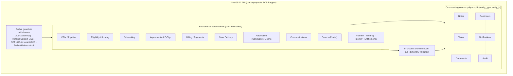

---

## 1.2 The fixed technology stack (and why it is fixed)

The stack below is **locked**. The vendor quotes and builds against it; it is not an open recommendation. Each row states the reason it is the right choice so the vendor understands the constraint rather than reverse-engineering it.

| Concern | Locked choice | Why this, not the alternative |
|---|---|---|
| **Language** | TypeScript (strict) on Node.js LTS, end-to-end | One language across API, workers, and UI → shared **Zod** schemas and shared types via a `packages/contracts` workspace, one hiring profile, no validation drift. `any` is banned; untyped values use `unknown` + narrowing or generics. |
| **Backend framework** | **NestJS 11** | Its module/DI system *is* the bounded-context model. Guards, interceptors, and pipes give one central place to enforce auth, the tenant context, Zod validation, and audit globally. |
| **ORM** | **Prisma 7** | Type-safe queries and first-class migrations. Critically, Prisma is **not** the isolation boundary — a global tenant scope (`$extends`) is defense-in-depth on top of database RLS (§2), so swapping the ORM never weakens isolation. |
| **API style** | REST/JSON, resource-oriented, documented via **OpenAPI 3.1**; a small number of composite/BFF endpoints for dashboard screens | Cacheable, language-agnostic, trivially versioned, and the right fit for a CRUD-heavy domain. The OpenAPI spec generates a typed client SDK so server and frontend cannot drift. GraphQL/tRPC are deferred, additive options, not the contract of record. |
| **Input validation** | **Zod** schemas shared from `packages/contracts`, applied via a Nest validation pipe | Single source of truth: the same schema validates the client form, the API request, the JSONB config payload, and infers the TypeScript type. Manual `if/else` validation chains are banned. |
| **Async / queues** | **Redis + BullMQ**, run in separate worker processes | Email send, inbound-mail sync, form/PDF generation, OCR, virus-scan, automation/Doer execution, reminders, reports, search-index projection, exports — all async. Any request expecting to exceed 5 s is queued (NFR P7). |
| **Object storage** | **Amazon S3** (`ca-central-1`), SSE-KMS, private buckets, firm-prefixed keys, presigned access only | One document store; the Documents module is entity-agnostic so any record can own files. Presigned URLs are **always bound to an ownership-checked record** — never to a caller-supplied storage key (§1.4). |
| **Frontend** | **React 19 + Vite + Refine + shadcn/ui (Radix) + Tailwind**, TanStack Query, React Hook Form + Zod, react-i18next/next-intl (EN + Canadian French) | Largest talent pool for the vendor; Refine accelerates the long tail of resource-CRUD screens on the same React/TanStack/shadcn base; Radix primitives carry the WCAG 2.2 AA obligation; Zod schemas are shared with the backend so the same validation runs both sides. |
| **Identity** | **In-house** (NestJS + Passport, Argon2id, in-house TOTP/WebAuthn + recovery codes), three cryptographically-walled auth pools | Locked by the in-house-Doer doctrine and residency control; a managed IdP is demoted to a future enterprise-SSO adapter behind `IdentityProviderPort`. Detailed in Doc 1 §3 (identity & authentication) and §4 (RBAC & authorization). |
| **Hosting** | **AWS** — launch region `ca-central-1`, behind a **per-tenant region seam** (§1.7) | Full managed estate in-country (RDS/Aurora, ElastiCache, S3, SES, SNS, KMS, ECS Fargate) satisfies Canadian residency; the region seam keeps future countries config, not rewrite. |

> **[FOUNDER-CONFIRM]** Exact Node.js LTS major and the NestJS minor pin are an engineering default the vendor proposes at kickoff; no business decision is gated on it. Non-blocking.

**What is explicitly *not* in the stack, and why it is excluded by design:**

- **No second operational datastore.** MongoDB and any other NoSQL operational store are out. The flexibility teams reach to a document store for is delivered by PostgreSQL **JSONB** (§1.3) *inside* one ACID/residency/DR/isolation boundary. A second store holding tenant config with no RLS would be an un-isolated, PII-adjacent surface, a second residency surface, a second backup regime, and a break in cross-store transactions — a poor trade rejected on principle.
- **No third-party product tools.** Every *product* capability is an in-house **Doer** on a swappable rail port (Signer, Mailer, Scheduler, Messenger, Biller, …). The only retained third parties are **infrastructure rails** that physically cannot be built in-house — a payment processor, an email-delivery relay + SMS/WhatsApp gateway, and cloud/object storage — each behind a port with one concrete v1 adapter (detailed in Doc 1's integration section). No Doer imports a vendor SDK directly.

---

## 1.3 PostgreSQL 18 as the single system of record

**PostgreSQL 18 is the one relational system of record for the entire platform.** All durable data — relational core *and* config-as-data — lives in one Postgres estate under one isolation boundary, one residency surface, one DR regime, and one encryption regime. This is the keystone decision; everything else composes on top of it.

**Tenant isolation by construction (summary; binding detail in §2).** The tenant key is **`firm_id`**. Every tenant-owned table carries a non-nullable `firm_id` column with Row-Level Security **ENABLED and FORCED** (so even the table owner is subject to it). A policy restricts every `SELECT/INSERT/UPDATE/DELETE` to rows where `firm_id` equals the current request's tenant, sourced from a session GUC `app.current_firm_id`. RLS is the **primary** isolation control, wrapped in four defense-in-depth layers — the non-`BYPASSRLS` application role, the per-request tenant GUC set via `SET LOCAL`, the mandatory tenant-scoped data-access layer, and object-level IDOR checks. The full specification of these layers, the fail-closed behaviour, the tenancy classification manifest, PgBouncer correctness, and the cross-tenant denial suite is normative in §2; the points below are the data-platform facts the stack and topology decisions in this section rest on.

**Fail-closed by construction.** If `app.current_firm_id` is unset, RLS matches **zero** rows — `current_setting('app.current_firm_id', true)` returns NULL and `NULL = uuid` is never true. A missing tenant context returns nothing, never everything. (See §2 for the binding rule and its acceptance gate.)

**`firm_id` and `client_id` are separate keys.** `firm_id` is the **tenant** (the firm). `client_id` (a Party FK) is the **end-client person** within a firm. RLS scopes on `firm_id` only. The end-client identity is a distinct column on the rows that have one; it is never conflated with the tenant key.

**The portal's second RLS dimension (summary; binding detail in §2.5).** `firm_id`-only RLS gives no database backstop for **client-to-client** isolation inside one firm — and the Client Portal is the highest PII-exposure surface. Therefore portal-scoped (CLIENT-PII) tables carry a **second RLS dimension**: a client-subject GUC, `app.current_client_subject`, set from the portal token. The portal session GUC carries the caller's `clientCustomerId`; CLIENT-PII rows carry `client_id` = the Party FK; the portal RLS policy resolves Party→ClientCustomer (for a row carrying `client_id` directly) or via the `owner_chain_to` path (child rows) / PartyRelationship (the corporate-seat case), so a portal caller sees only rows whose ownership chain resolves to their own subject, on top of the `firm_id` policy. The portal policy carries **both** a `USING` and a matching `WITH CHECK` clause so a portal caller cannot write or re-attribute a row to a sibling client at the database. This pairs with the rule in §1.2 that **every presigned URL is bound to an ownership-checked record**, closing the cross-client IDOR vector at the database, the service, and the storage edge together. The exact GUC literal, the policy SQL (with `WITH CHECK`), the corporate-seat ownership chain, and the cross-client read/write denial tests are normative in §2.5/§2.8.

**Config-as-data in JSONB.** The variable parts of the domain — questionnaire/form definitions, automation/Conductor definitions, template bodies, plan entitlements, per-entity custom fields — are stored as **config-as-data in validated JSONB columns**, not hardcoded and not in a second store. Stable, queried, relational data stays in proper typed columns; variable/config data is JSONB, validated by **Zod at the edge** (reject-on-invalid) and indexed with **GIN** where searched. This makes the data-spine a content-neutral engine: new record types and new attachable behaviours need no migration, and the engine is later populated from a Country Pack rather than from code.

**Two — and only two — JSONB config-table categories (CI-linted).** Every config-as-data table is exactly one of:

- **GLOBAL plane** — platform-owned rows with `firm_id IS NULL`, governed by an explicit **read-only permissive RLS policy** (cross-firm read allowed) plus **admin-only write** through the elevated role. These are the global defaults (the content-neutral engine populated by a Country Pack).
- **TENANT plane** — firm-owned rows with `firm_id NOT NULL` under the standard FORCED RLS policy. These carry per-firm overrides and firm-authored config.

The effective value a firm sees is computed as **override ⊕ global-default** (field-by-field; unspecified fields fall through to global) by **one** centralized resolution service, so override semantics are identical everywhere. CI lint asserts every JSONB config table is exactly one of the two categories and that GLOBAL rows are not writable by the app role. (The GLOBAL/TENANT plane policies are specified normatively in §2.6.)

```mermaid
sequenceDiagram
  participant C as Caller (UI / API)
  participant G as Guard + Middleware
  participant PC as PrincipalContext (ALS)
  participant DB as PostgreSQL 18 (RLS FORCED)
  C->>G: Request + bearer token (audience claim)
  G->>G: Verify token; resolve firm_id from principal (never from input)
  G->>PC: Populate firm_id, userId, view scope / portal subject
  G->>DB: BEGIN; SET LOCAL app.current_firm_id = firm_id [+ app.current_client_subject]
  G->>DB: business query (repo injects scope; no caller firm_id)
  DB-->>G: rows WHERE firm_id = current_setting (RLS) [AND portal subject]
  Note over DB: unset GUC -> 0 rows. WITH CHECK rejects mismatched insert.
  G-->>C: scoped result (object-level ownership re-checked in service)
```

---

## 1.4 Redis / BullMQ for async, and S3 for objects

**Redis** is the shared state and queue backbone: BullMQ job queues, session/refresh state, rate-limit counters, and hot reference-data cache. The application tier is **stateless** so it scales horizontally; nothing tenant-significant lives in process memory, and **cache keys are tenant-namespaced** so there is no cross-tenant cache bleed. Redis is treated as a **recoverable cache only** — it is never the system of record, so its loss degrades performance, not durability.

**BullMQ workers run as separate task definitions off the same codebase.** Every unit of work that can exceed ~5 s synchronously, or that is inherently asynchronous, runs in a worker: outbound email send and inbound-mailbox sync, form/PDF generation, OCR, document virus-scan, automation/Doer execution, reminder firing, report and export generation, and the asynchronous maintenance of the Search projection from the domain-event dictionary. Workers scale independently of the web tier (NFR S10). This separation is what makes a later "service extraction" a deployment change rather than a rewrite.

**S3** stores every durable object: uploads, generated PDFs/forms, e-sign artifacts, and export bundles. Buckets are private with **SSE-KMS**; object keys are **firm-prefixed**; access is via **short-lived presigned URLs only**, and — restating the §1.3 rule because it is load-bearing — every presigned URL is issued only after an ownership check against a stored record, **never** signed against a caller-supplied key. Each object stores a SHA-256 content hash for integrity, and the WORM audit anchor (Doc 1 §7 audit section) uses **S3 Object Lock**. Secure upload validation (declared + sniffed content-type allow-list, per-type size cap, AV-scan before availability) and secure serving headers (`Content-Disposition: attachment`, `X-Content-Type-Options: nosniff`, restrictive CSP) are specified normatively in §7; the buckets and key scheme here are the substrate those controls operate on.

---

## 1.5 Monorepo topology

The platform is delivered as **one monorepo**. This is a normative decision the CI gates depend on, not an option:

- **Workspace tooling.** The monorepo uses **pnpm workspaces** for dependency management and **Turborepo** for the task graph (build, lint, typecheck, test, with remote caching). The whole stack — backend, frontend, and workers — lives in this one repository so contracts and types are shared at compile time and cannot drift.
- **Layout (fixed).** The repo is organized as `apps/api` (the NestJS API), `apps/web` (the React 19 + Refine frontend), `apps/worker` (the BullMQ workers, sharing the API codebase), and `packages/contracts` (the shared Zod schemas and generated types **that the rest of the stack consumes**), with `packages/contracts/events` holding the canonical Domain Event Dictionary.
- **CI gates operate on this layout.** The import-boundary lint (§1.1) and the event-name lint (Doc 1 §6) are configured against this exact `apps/*` + `packages/contracts` topology; they are release-blocking, so the layout is part of the contract, not an implementation detail the vendor may vary silently.

---

## 1.6 Deployment topology — `ca-central-1` at launch

The launch estate is pinned to **AWS `ca-central-1` (Montréal)** for Canadian data residency: all compute, databases, object storage, queues, secrets, logs, backups, and PITR stay in-region, and any DR replication stays within Canadian regions.

| Layer | Topology |
|---|---|
| **Edge** | CloudFront CDN + AWS WAF in front of an Application Load Balancer; TLS termination at the edge; static SPA/portal assets served from CloudFront. |
| **Compute** | **ECS Fargate** with separate task definitions for the **API** and **worker** pools. ≥ 2 API tasks across ≥ 2 Availability Zones behind the ALB; workers scale on queue depth independently of the web tier. |
| **Database** | **RDS / Aurora PostgreSQL 18**: a **primary plus a synchronous standby across ≥ 2 AZs** for failover, plus **read replicas** for reporting and read-heavy paths so heavy queries are routed off the primary. Replicas run the **identical FORCED RLS policies and the same non-`BYPASSRLS` application role**, and the per-transaction tenant GUC (`SET LOCAL app.current_firm_id`, plus the portal subject where applicable) is set on the replica connection too, so a read-replica query is isolated exactly as a primary query is; the replica path is exercised by the cross-tenant denial suite (§2). Connection pooling via **PgBouncer in transaction mode** (§2). PITR (continuous WAL) enabled. |
| **Cache / queues** | **ElastiCache (Redis)**, in-region, for cache, BullMQ, and rate-limits. |
| **Objects** | **S3** (SSE-KMS, versioned, cross-AZ, Glacier lifecycle for cold artifacts, Object Lock for the audit WORM anchor). |
| **Keys & secrets** | **KMS** (region-scoped) for the envelope-encryption hierarchy (CMK → per-firm DEK → independently-destroyable wrapped per-retention-class sub-keys, specified in §7) and at-rest keys; **Secrets Manager** for DB creds, rail keys, signing keys (per-pool distinct keys), with rotation. No secrets in source, images, or env files; tasks read secrets at runtime via IAM role. |
| **Network** | DB and Redis in private subnets with no public access; services in private subnets behind the ALB; least-privilege IAM role per task; locked-down security groups. |
| **Environments** | **dev → staging → prod**, isolated AWS accounts (or strictly separated VPCs); production data is **never** copied to lower environments (synthetic/seed data only). |
| **IaC & CI/CD** | Entire estate as code (Terraform or AWS CDK in TypeScript); GitHub Actions builds, lints, typechecks, tests, runs DB migrations, pushes images to ECR, and deploys to Fargate. CI gates the RLS schema-lint, the cross-tenant-denial suite, the connection-reuse test, the no-hardcoded-string check, and axe a11y checks. |
| **DR targets** | **RPO ≤ 15 min** (continuous WAL/PITR), **RTO ≤ 4 h** for region failure; daily full + continuous incremental backups, encrypted, in Canadian regions; quarterly restore drill is a contractual deliverable. One DR regime covers all durable data because there is no second datastore. |

> **Realtime push is not foundation scope.** Long-lived push (WebSocket/SSE) for live UI updates is deferred to a later wave; it is not provisioned in the launch topology, the scaling rules, or the IaC/AC checklist, and its transport, auth/audience binding, and per-connection tenant + portal-subject isolation will be specified when that wave is scoped. Until then, the frontend uses ordinary request/response and polling where freshness is needed.

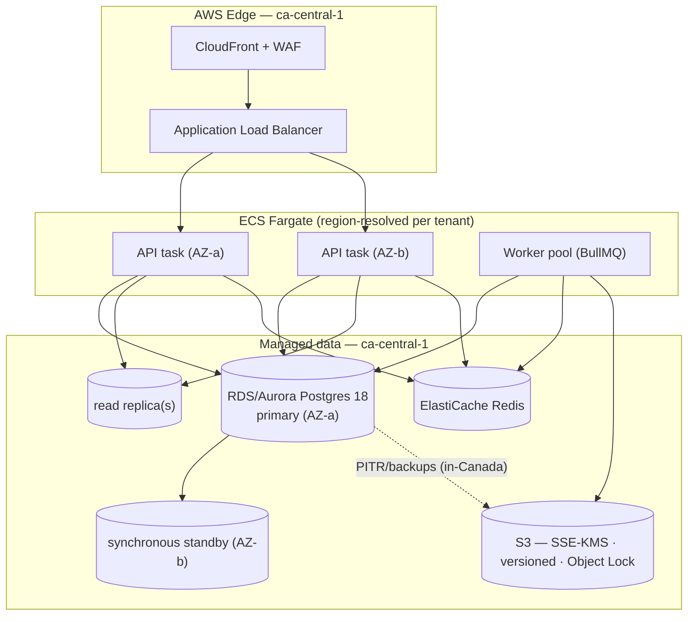

---

## 1.7 The per-tenant region seam (do not hard-pin globally)

ExpatReady launches Canada-only, but is a **global multi-country platform**. Hard-coding `ca-central-1` everywhere would be a global-scale anti-pattern: onboarding a future German or other-country firm would become a re-architecture instead of a configuration change. The target therefore carries a **per-tenant region seam**:

- **Region is a per-tenant dimension.** A firm's data-residency region is an attribute resolved at request time (alongside `firm_id`), and the tenant resolver abstracts *which* region/connection/placement serves a tenant. The same application code runs whether a tenant lives in the launch region, a future region, or (the reserved enterprise opt-in) a dedicated database.
- **KMS is region-scoped now.** The envelope-encryption hierarchy is keyed per region from day one, so a tenant in a new region uses keys in that region's KMS — no plaintext crosses a border.
- **Launch deploys one region; adding a region is config.** At launch every tenant resolves to `ca-central-1` and an IaC region-allowlist CI check enforces in-Canada placement. Adding `eu-central-1` (or any future region) for a non-Canada firm is an allowlist + deployment change governed by that region's residency rules — **not** a code rewrite. The CI check guards *the configured allowlist*, not a hardcoded single region.

> **[FOUNDER-CONFIRM]** Which non-Canada region(s), if any, are in the initial commercial roadmap, and whether any enterprise tenant contractually requires a dedicated database from day one. Both are deployment/placement decisions the seam already abstracts; neither changes the architecture. Non-blocking for Wave 0/A.

---

## 1.8 Greenfield build-framing & design-provenance

This is a **greenfield build**. The vendor builds the platform from scratch against this specification and is **measured solely against this specification**.

- **Target-state language only.** Every requirement in this document set states the target as a present-tense fact (for example, "the tenant key is `firm_id`"; "config-as-data lives in PostgreSQL JSONB"). There is no migration, refactor, rename, or parity obligation against any prior system, because there is no production data and no system being modified.
- **The existing private codebase is design-provenance only.** An existing ExpatReady prototype exists. It is offered to the vendor strictly as an **optional, NDA-gated, read-only reference** the vendor *may* inspect to understand validated UX patterns and domain shapes. The vendor **may not depend on it**, is **not** building on top of it, and **is not measured against it**. No parity with the prototype is owed or implied. Any reference note pointing at prototype behaviour is informational, never normative.
- **The stack is fixed; the datastore is fixed.** Per §1.2–§1.3, the platform is NestJS 11 + Prisma 7 on PostgreSQL 18 with FORCED RLS and config-as-data in JSONB, Redis/BullMQ, S3, and the React 19 + Vite + Refine + shadcn frontend, hosted on AWS with the region seam. The vendor quotes a full greenfield build against this fixed stack — there is no datastore or stack-selection latitude that would introduce cost variance.
- **Content vs machinery.** This document specifies platform **machinery** only. The data-spine is described as a **content-neutral engine**: a generic, typed catalogue and answer store, a generic document/requirement engine, a generic form engine, and generic scoring/workflow runtimes. **No immigration domain content** (programs, scoring grids, checklists, case types, form sets) appears here; that content is supplied later as a versioned Country Pack that populates the engine. The engine is built and priced regardless of content; content is a separate, unit-priced line.

---

## 1.9 Document precedence

Within the binding specification set, precedence is explicit so the vendor never has to reconcile a conflict by guesswork:

1. **This document set (the FINAL specification + its procurement appendix) is the single binding source** the vendor quotes, builds, and is accepted against. Any prior RFP is demoted to non-binding lineage and background.
2. **Where this Doc 1 (Platform Foundation & Cross-Cutting Architecture) speaks to a cross-cutting platform matter** — tenancy, isolation, the data platform, identity/RBAC primitives, eventing, encryption, audit, residency, the region seam, deployment topology, and build framing — **it is binding and overrides** any narrower or differently-worded statement in a later module/console section. Module sections govern their own domain behaviour and contracts; they inherit the platform machinery defined here and must not redefine it.
3. **The prototype codebase carries no precedence at all.** It is reference input only (§1.8) and never overrides a written requirement.

---

## 1.10 Acceptance criteria — environment & topology checklist

These are concrete, testable gates for the Wave 0/A foundational sprint. Each is pass/fail and CI- or evidence-verifiable. (The keystone tenant-isolation acceptance criteria — RLS schema-lint, the cross-tenant denial suite, the PgBouncer connection-reuse test, the portal second-dimension read/write denial, and the JSONB plane-classification lint — are owned by §2 and are not duplicated here; this checklist covers architecture/boundary, datastore-singularity, objects, topology/residency, DR, and build-framing gates that are this section's own.)

**Architecture & boundaries**
- **AC-1.1** A single deployable NestJS 11 API plus separate worker task definition(s) deploy from one codebase; no business logic lives in routes/controllers (HTTP-only controllers, logic in services) — verified by review and the module-boundary lint.
- **AC-1.2** The import-boundary lint fails the build when a module imports another module's internals instead of its public interface; the lint is configured against the `apps/*` + `packages/contracts` monorepo layout (§1.5).
- **AC-1.3** Registering one new entity type in the EntityTypeRegistry makes Notes, Tasks, Documents, Reminders, Communications, and Audit work on it with **zero** migrations to the cross-cutting tables (the MX2 "add a new entity" proof).
- **AC-1.4** The monorepo is delivered as one pnpm-workspaces + Turborepo repository with `apps/api`, `apps/web`, `apps/worker`, and `packages/contracts` (incl. `packages/contracts/events`); the import-boundary and event-name lints run green against this layout.

**Datastore singularity**
- **AC-1.5** Zero MongoDB (or any second operational datastore) connections are delivered; all config-as-data resides in PostgreSQL.

**Objects & presigned access**
- **AC-1.6** Every presigned URL is issued only after an ownership check against a stored record; signing a caller-supplied storage key is impossible by construction (no endpoint accepts a raw key to sign). Object keys are firm-prefixed; buckets are private with SSE-KMS. (Upload-validation and serving-header gates are specified and tested in §7.)

**Topology & residency**
- **AC-1.7** IaC provisions, in `ca-central-1`: ALB + WAF + CloudFront; ECS Fargate API (≥ 2 tasks across ≥ 2 AZs) and worker task definitions; RDS/Aurora Postgres 18 primary + synchronous standby (≥ 2 AZs) + read replica(s) running the identical FORCED RLS policies and the non-`BYPASSRLS` app role; ElastiCache Redis; S3 (SSE-KMS, versioned, Object Lock); KMS; Secrets Manager. (No realtime-gateway task is provisioned at the foundation; realtime push is a later wave.)
- **AC-1.8** An IaC **region-allowlist** CI check fails any resource provisioned outside the configured allowlist (launch allowlist = Canadian regions); the check reads an allowlist, not a hardcoded single region.
- **AC-1.9** The **region seam** is exercised: a tenant's serving region is resolved per request via the tenant resolver, and KMS keys are region-scoped — demonstrated by a test that resolves a tenant to its region and uses that region's key path (a second allowlisted region may be staged to prove no code change is needed).
- **AC-1.10** dev/staging/prod are isolated AWS accounts or VPCs; a check confirms no production data path into lower environments.

**DR & availability**
- **AC-1.11** PITR is enabled and a quarterly restore drill is documented with recorded evidence; backups are encrypted and in-Canada; **RPO ≤ 15 min / RTO ≤ 4 h** are demonstrated in the drill.
- **AC-1.12** Liveness + readiness endpoints exist; an unhealthy task is automatically replaced; the system survives loss of one AZ (DB fails over to standby; API/workers reschedule) without data loss.

**Build framing**
- **AC-1.13** No deliverable depends on the prototype codebase; the acceptance gate evaluates the build solely against this specification.

---

## 1.12 The Capability Registry — one capability = one module = one toggle

> **Purpose.** This section fixes the unifying spine that makes ExpatReady a composable capability **platform** rather than a monolithic CRM. It encodes the founder-directed principle **ONE CAPABILITY = ONE MODULE = ONE TOGGLE**: every functional capability — each in-house Doer and each major independent sub-function — is (a) built in-house (rails-as-ports only for infrastructure, per §1.2 / §6.3), (b) its own bounded module with a declared public interface and the domain events it emits/consumes (links declared in data, never hardcoded), and (c) an **independently toggleable** capability. A firm's subscription is a **composed subset** of capabilities; the platform can ship, dark-launch, or kill any single capability without a code change, and adding a new Doer is *registering a capability* (one data row + its module), not a re-architecture. The Capability Registry does **not** replace the entitlement (SA-3), feature-flag (SA-12), or permission (SA-6) machinery — those are the **layers**; the Registry is the single spine **over** them that binds them into one resolved verdict and one runtime gate. This section is platform machinery only: it carries no immigration content; *which* capabilities a Country Pack or plan turns on is data.

### 1.12.1 Why a registry, and why it is the spine (not a fourth gate)

Without a registry, "is this capability live for this caller?" is answered in three different places that drift: an entitlement check in Billing, a feature flag in an env file, and a permission decorator on a controller. A capability could be entitled but flag-killed, or flag-on but un-entitled, with no single record reconciling them — exactly the kind of silent inconsistency the modulith's boundary discipline (§1.1) exists to prevent. The Registry is the one place that **names every capability once** and **declares how the existing three gates compose** for it. It introduces **no new authorization mechanism** — it references SA-3 entitlements, SA-12 platform flags, and the §4.1 guard chain. It is a binding layer, in the same sense that the Domain Event Dictionary (§6.1) is the binding layer over the event bus: a single source of truth that the gate, the nav, and every Doer read from, so the three machineries cannot disagree.

This is the composability property stated as an acceptance-bearing contract: a capability is a **first-class, registered, dependency-aware, three-layer-toggled unit**, and the platform's surfaces (nav, API routing, Doer execution) all resolve through it.

### 1.12.2 The Capability entity (GLOBAL, platform-owned)

The capability catalogue is a **GLOBAL-plane** entity (`firm_id IS NULL`, read-only permissive RLS + admin-only write — the §1.3 / §2.6 GLOBAL config category), owned by the Platform/Tenancy/Entitlements bounded context (§1.1). It is config-as-data in validated JSONB-plus-typed-columns, Zod-validated at the edge. It is **content-neutral**: it names capabilities and their wiring, never immigration content. One row per capability:

| Field | Meaning |
|---|---|
| `capabilityKey` | The stable, immutable slug — the capability's canonical name (e.g. `signer`, `scheduler`, `qualifier`, `filler`, `messenger.sms`, `automation.conductor`). Dot-segmented for sub-functions of a Doer. Immutable once shipped; a renamed meaning is a **new key**, never a re-pointed one (mirrors the §6.1.2 naming law). |
| `owningModule` | Exactly one §1.1 module-map id (`automation`, `billing`, `case-delivery`, `communications`, `search`, …). A capability is owned by exactly one bounded context — no shared ownership. |
| `kind` | One of `DOER` (an in-house Doer: Signer, Mailer, Scheduler, Biller, Minder, Filler, Qualifier, Messenger, Reporter, Finder, Drafter, Reviewer, Binder, Tasker), `SUBFUNCTION` (a major independent sub-function within a module, e.g. `messenger.sms` vs `messenger.whatsapp`), or `SURFACE` (a console-visible feature area / nav resource the capability backs). |
| `publicInterface` | A reference (token/string) to the capability's declared public interface — the Nest provider/port the rest of the modulith calls, never an internal. The Registry asserts the interface is exported from the `owningModule`'s public surface (the §1.1 import-boundary contract). |
| `emits[]` | The domain-event names this capability raises — **must** be a subset of the §6.1 Domain Event Dictionary entries whose `emitter == owningModule`. Declared in data; no hardcoded inter-module link. |
| `consumes[]` | The domain-event names this capability reacts to — **must** be dictionary entries that list `owningModule` in their `consumers`. The Registry and the dictionary are reconciled by CI (§1.12.6). |
| `dependsOn[]` | Other `capabilityKey`s this capability requires to function — the **dependency graph** for safe toggling (§1.12.4). A capability lists only its *direct* dependencies; transitive closure is computed. |
| `defaultState` | The factory default, which is **OFF** unless explicitly entitled-and-enabled. Capabilities are dark by default; a new capability ships invisible and inert until each layer is turned on. |
| `tierHint` | A non-binding hint of the plan tier(s) a capability typically belongs to (e.g. `core`, `growth`, `enterprise`). The **binding** entitlement is SA-3's plan→entitlement mapping; this is authoring guidance for plan composition, never the runtime check. |

A capability row is wiring, not behaviour: the *behaviour* lives in the `owningModule`; the row declares the capability's name, its public seam, its event links, its dependencies, and how it toggles. Registering a row plus building (or already having) its module is the **whole** cost of adding a capability — there are zero changes to the gate, the nav, or any other module (§1.12.5).

### 1.12.3 The three independent toggle layers and their resolution order

A capability is **live** for a request only when **all three** layers are ON. Each layer is owned by a different surface and answers a different question; they are evaluated in order, fail-closed, and AND-combined:

1. **PLAN ENTITLEMENT (SA-3)** — *Is the capability in the firm's subscription?* The firm's plan (and any add-ons) maps to an entitlement set; the capability is entitled or not. Owned by the platform billing/entitlements plane (SA-3); the firm cannot grant itself an un-entitled capability. This is the existing `feature.*` hard-gate referenced in the §4.1 guard chain, now resolved **through** the capability spine rather than ad hoc per controller.
2. **FIRM SWITCH** — *Within its entitlement, has the firm turned it on?* A firm self-service toggle (a TENANT-plane row, `firm_id NOT NULL`, standard FORCED RLS) owned by the **Agent console settings** surface, letting a firm enable/disable a capability it is entitled to (e.g. a firm that has SMS but chooses to run email-only). Default follows `defaultState`. The firm can only ever switch within the envelope SA-3 entitled — turning on an un-entitled capability is impossible at this layer.
3. **PLATFORM FLAG (SA-12)** — *Has the platform allowed it on, here, now?* The SA-12 feature-flag plane provides **dark-launch / staged rollout / kill-switch** control independent of commerce: the platform can hold a newly-built capability dark while entitled firms exist, roll it out to a cohort, or **kill** a misbehaving capability instantly across all firms regardless of entitlement or firm switch. This layer is operated by platform staff, not the firm.

The resolved verdict is:

```
effectiveState(capability, firm) =
      entitled(SA-3, firm, capabilityKey)
  AND firmEnabled(firmSwitch, firm, capabilityKey)
  AND platformOn(SA-12, capabilityKey, firm-or-cohort)
  AND allDependenciesEffectiveOn(dependsOn, firm)        // §1.12.4
```

**Fail-closed is absolute.** If **any** layer is OFF — or **unresolved** (an entitlement that cannot be read, a flag service timeout, a missing capability row, an unparseable firm switch) — the capability resolves **OFF**. There is no "default open" path: an error in any layer denies the capability, never grants it. This mirrors the §2.2 RLS fail-closed rule (an unset context yields zero rows, never all rows) and the §6.1.4 rail-event rule (an unresolvable external id is rejected, never silently defaulted).

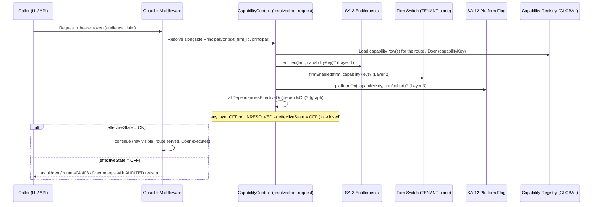

### 1.12.4 Dependency safety — the capability graph

Capabilities depend on one another (the `automation.conductor` needs the event bus a Doer emits to; `filler` needs `qualifier`'s answers; `messenger.sms` is independent of `messenger.whatsapp`). The Registry treats `dependsOn[]` as a directed graph and enforces three rules:

- **No ON over an OFF dependency.** A capability **cannot** have `effectiveState = ON` if any capability in its `dependsOn[]` closure is OFF for that firm. The dependency check is part of the resolution above: a satisfied entitlement/switch/flag is still resolved OFF if a prerequisite is OFF. This prevents the half-wired state where a capability is "on" but the thing it calls is dark.
- **Cascade on toggle-off, surfaced not silent.** Toggling off a depended-on capability (a firm switch flip or a platform kill) **surfaces its dependents** rather than silently breaking them: the firm-switch UI and the platform-flag UI compute and display the dependent set before confirming, and on commit the dependents resolve OFF by the rule above (their own switch state is preserved, so re-enabling the dependency restores them). The cascade is a *resolution* effect, not a destructive write — no dependent's stored switch is mutated by a dependency going dark.
- **Acyclic at seed.** The Registry **validates the dependency graph is acyclic** at seed/migration time; a cycle fails the seed (and CI) and the application refuses to boot. This makes transitive-closure resolution terminating and the "what does turning this off break?" question answerable deterministically.

### 1.12.5 Runtime enforcement — the single gate (nav, API, Doer)

There is **one** enforcement point, resolved once per request as a **`CapabilityContext`** populated alongside the `PrincipalContext` (§4 / the §1.1 global middleware). An OFF capability is uniformly **invisible, inert, and non-executing** across all three surfaces — there is no surface where an OFF capability partially leaks:

- **Nav / menu visibility.** A capability of `kind = SURFACE` (or a Doer that backs a nav resource) is shown only when its `effectiveState = ON`. An OFF capability contributes **no** nav item — the firm sees a UI composed of exactly its live capability subset, with no dead links. (This is the composition the firm experiences: the product *is* its on-capabilities.)
- **API route availability.** Every route is tagged with the `capabilityKey` it serves. The gate runs **after** authentication and the §4.1 permission/scope checks and **before** the service: an OFF capability's routes are **inert** — returning `404` where existence itself is gated (a dark-launched or un-entitled surface must not be discoverable) or `403 CAPABILITY_OFF` where the capability is known-but-disabled — never `200`. The choice (404 vs 403) is declared per capability; both are audited.
- **Doer execution.** The Conductor and every Doer check `CapabilityContext` before acting: an OFF capability's Doer **no-ops with an audited reason** (e.g. `CAPABILITY_OFF:messenger.sms`) rather than throwing or partially completing. A workflow step that fires a dark capability records a skipped-with-reason outcome on the audit spine (§7.5), so an operator can see *why* an automation did nothing. Event consumption is included: a consumer wired to a §6.1 event short-circuits when its capability is OFF, so a dark capability neither reacts nor emits.

Because all three surfaces read the **same** `CapabilityContext`, a capability cannot be visible-but-forbidden, callable-but-dark, or executing-while-killed. One resolution, three consistent surfaces.

### 1.12.6 Extensibility — adding a Doer is registering a capability

The composability payoff is concrete: a **new Doer or sub-function ships by registering a Capability row and building its module** — with **zero** changes to the gate, the nav renderer, or any other module. The new capability is OFF by `defaultState`, dark-launchable via SA-12, entitled when a plan includes it (SA-3), and switched on by the firm when ready — all without redeploying the gate. This is the same extensibility shape as the EntityTypeRegistry's "add a new entity = one row, zero migrations to the cross-cutting tables" (§1.1 / AC-1.3) and the Domain Event Dictionary's "add a consumer = one line" (§6.1.3), applied to product capabilities.

CI binds the Registry to the rest of the spine so it cannot drift:

- Every `capabilityKey` an API route or Doer references resolves to exactly one registered Registry row (the application refuses to boot otherwise) — the capability-name analogue of the §6.4 event-name lint.
- Every name in a capability's `emits[]` / `consumes[]` is a §6.1 dictionary entry consistent with `owningModule` (emit ⇒ that module is the dictionary `emitter`; consume ⇒ that module is in the dictionary `consumers`).
- The dependency graph is acyclic and every `dependsOn[]` target exists.
- `owningModule` is a valid §1.1 module-map id, and `publicInterface` is exported from that module's public surface (no internal is referenced).

### 1.12.7 Acceptance criteria — Capability Registry

These are pass/fail, CI- or test-verifiable, and release-gating for the foundation.

- **AC-1.12.1 (three-layer AND, fail-closed).** A capability resolves `effectiveState = ON` **only** when entitled (SA-3) AND firm-enabled (firm switch) AND platform-on (SA-12); flipping **any** single layer OFF — or making any layer unresolvable (forced error/timeout) — resolves the capability OFF within one request, and the surfaces (nav/route/Doer) all reflect OFF. Verified by a matrix test over the eight layer combinations plus the unresolved case.
- **AC-1.12.2 (dependency cannot be violated).** A capability whose `dependsOn[]` includes an OFF capability **cannot** be ON, even with all three of its own layers ON; toggling a depended-on capability OFF surfaces (and resolves OFF) its dependents without mutating their stored switch state, and re-enabling the dependency restores them. Verified by a graph test.
- **AC-1.12.3 (kill-switch is deploy-free and immediate).** Setting the SA-12 platform flag for a capability to killed makes that capability **inert within one request** — nav item gone, route returns 404/403 CAPABILITY_OFF, Doer no-ops with an audited reason — **with no code change and no deploy**, across all firms regardless of entitlement or firm switch.
- **AC-1.12.4 (composability — add a capability with zero gate/nav/module edits).** Registering one new Capability row plus its `owningModule` makes the capability dark-launchable, entitle-able, firm-switchable, nav-renderable, and gate-enforced with **zero** changes to the enforcement gate, the nav renderer, or any other module — the MX "add a capability = one row + a module" proof, the capability analogue of AC-1.3.
- **AC-1.12.5 (single gate, three consistent surfaces).** For any OFF capability, the nav exposes no item, every route tagged with its `capabilityKey` returns 404/403 (never 200), and its Doer/consumer no-ops with an audited reason — all driven by one `CapabilityContext` resolved per request alongside `PrincipalContext`; no surface leaks an OFF capability.
- **AC-1.12.6 (registry integrity at boot).** The dependency graph is acyclic, every referenced `capabilityKey` is registered, every `emits[]`/`consumes[]` reconciles with the §6.1 dictionary and `owningModule`, and `defaultState` is OFF unless explicitly seeded otherwise; any violation fails CI and the application refuses to boot.

---

# 2. Multi-Tenancy & Isolation (Keystone)

**Purpose.** This section defines the single most load-bearing decision in the platform: how one shared PostgreSQL 18 store serves many immigration firms such that *no firm can ever observe, infer, or mutate another firm's data — and no client of a firm can ever observe another client's data — even when application code is wrong.* Isolation is delivered **by construction** at the database layer (PostgreSQL Row-Level Security, ENABLED **and** FORCED) and wrapped in four independent defense-in-depth layers above it. Every other module in this document inherits this contract; nothing builds until it is proven by the CI denial suite. This is the keystone: if it is correct, the platform is sellable to a regulated B2B market; if it is wrong, a single missed `WHERE` clause is a breach.

## 2.1 The two tenant axes: `firm_id` and `client_id`

The platform has **two distinct isolation axes**, and conflating them is the most common multi-tenant design error. They are separate columns with separate meanings and separate controls.

- **`firm_id` — the tenant key.** A `firm_id` identifies a paying tenant (an immigration firm). It is the boundary RLS enforces. Every tenant-owned row carries a non-nullable `firm_id`. The set of rows a firm-staff request may touch is exactly `{ rows WHERE firm_id = <caller's firm> }`. There is no application path, export, report, search, or error message through which one firm reaches another's rows.

- **`client_id` (Party) — the end-client person.** A `client_id` identifies an end-client *person* (the immigrant applicant or corporate sponsor served by the firm). It is **not** a tenant key. Many `client_id`s live inside one `firm_id`. RLS does **not** scope on `client_id` for staff requests — a firm's staff legitimately see all of that firm's clients. `client_id` becomes an *isolation* axis only on the **Client Portal** surface (§2.5), where one logged-in client must not see a sibling client of the same firm.

These are orthogonal. `firm_id` answers "which tenant owns this row?"; `client_id` answers "which end-client person is this row about?". The platform models the end-client person as a durable **Party** identity (the single identity root used across the firm's CRM, engaged-client, and portal-credential lenses); `client_id` in this section is the foreign key to that Party. RLS scopes on `firm_id`; the portal adds a second policy dimension on the portal subject (§2.5).

> **[FOUNDER-CONFIRM]** Whether any enterprise tenant contractually requires a *physical* database-per-tenant from day one. The pooled-plus-RLS default holds regardless; a dedicated-DB tenant is a placement decision the tenant resolver already abstracts (§2.9), not a re-architecture. Non-blocking.

## 2.2 Primary control: PostgreSQL Row-Level Security, ENABLED + FORCED

The PRIMARY isolation control is PostgreSQL RLS. The intent is absolute: **a developer literally cannot author or ship a query that crosses a tenant boundary**, because the database refuses the rows before they leave the engine — regardless of whether the application remembered to filter.

Every **TENANT** and **CLIENT-PII** table (the two non-global planes, §2.3) is created with RLS both `ENABLE`d and `FORCE`d. `FORCE` matters: without it the table owner is exempt, which would silently re-open the boundary for any connection that happens to own the table. The canonical policy scopes on the tenant GUC and applies to all four verbs via `USING` (read/update/delete visibility) and `WITH CHECK` (insert/update integrity):

```sql
ALTER TABLE <tenant_table> ENABLE ROW LEVEL SECURITY;
ALTER TABLE <tenant_table> FORCE  ROW LEVEL SECURITY;

CREATE POLICY tenant_isolation ON <tenant_table>
  USING      (firm_id = current_setting('app.current_firm_id', true)::uuid)
  WITH CHECK (firm_id = current_setting('app.current_firm_id', true)::uuid);
```

Two properties of this policy are non-negotiable and tested:

1. **Fail-closed by construction.** `current_setting('app.current_firm_id', true)` returns `NULL` when the GUC is unset (the `true` second argument means "missing setting → NULL, do not raise"). `NULL = <uuid>` evaluates to `NULL` (never `true`), so a request that reaches the database **without** a tenant context set sees **zero rows** and can insert nothing. A missing tenant context returns nothing, never everything. This is the single most important safety property and is asserted directly in the denial suite (§2.8).

2. **`WITH CHECK` blocks tenant-spoofing writes.** An `INSERT` or `UPDATE` that attempts to set `firm_id` to anything other than the current GUC is rejected by the database, not merely by the app. A bug that copies a record into the wrong tenant cannot be persisted.

RLS is generated as a *deliberate, declarative DDL artifact per table*, not hand-written ad hoc. The foundational sprint (Wave A0) delivers an **RLS migration generator**: given a table's tenancy classification (§2.3), it emits the `ENABLE`/`FORCE`/`CREATE POLICY` statements so that "add a tenant table" mechanically means "add its RLS policy" — there is no path to a tenant table without a policy.

### 2.2.1 Acceptance criteria — primary control

- **AC-2.2.1 (RLS schema-lint, CI-blocking).** An automated schema lint asserts, for **every** table classified TENANT or CLIENT-PII, that RLS is both `ENABLED` and `FORCED` **and** that its isolation policy references the `firm_id` column specifically (not merely "some policy exists"). A tenant table with no policy, or a policy keyed on any column other than `firm_id`, fails the build.
- **AC-2.2.2 (fail-closed zero-rows).** With no tenant GUC set on the connection, a `SELECT` against every tenant table returns 0 rows and an `INSERT` is rejected. Verified per table.
- **AC-2.2.3 (`WITH CHECK` enforcement).** An `INSERT`/`UPDATE` setting `firm_id` to a value other than the current GUC is rejected by the database. Verified per table.

## 2.3 Mandatory deliverable: the table-by-table tenancy classification

Before any table is created, every table in the schema is assigned **exactly one** tenancy plane in a normative, version-controlled **Tenancy Classification Manifest**. This manifest is a first-class Wave A deliverable, not documentation written after the fact: the RLS generator, the schema-lint, and the Prisma scoping extension (§2.4) all read it. Each entry declares:

| Field | Meaning |
|---|---|
| `plane` | One of `GLOBAL` \| `TENANT` \| `CLIENT-PII` |
| `tenant_key` | The column RLS scopes on (`firm_id` for TENANT/CLIENT-PII; `NULL`/none for GLOBAL) |
| `owner_chain_to` | The path by which this row's tenant is provable — e.g. directly via its own `firm_id`, or for a child row, the parent FK whose `firm_id` it must match |

The three planes:

- **GLOBAL** — platform-owned, content-neutral configuration and reference data, curated by the platform operator, visible to all firms (e.g. the content-neutral catalogue/registry/master tables that a Country Pack later populates, plan definitions, system role templates). `firm_id IS NULL`. Governed by the special global-plane policy (§2.6). No firm may write these. The `permission_catalog`, `RoleTemplate`, and `PlanRoleTemplateSet` seed tables are GLOBAL-plane: they carry the GLOBAL read-only-permissive RLS policy + admin-only write (§2.6) and are written only via the elevated migration/admin role, never the application role (this is what protects §4.3's write-side scope filter, which trusts the catalog's integrity).
- **TENANT** — firm-owned operational data (the firm's own configuration, overrides, staff, roles, pipeline, cases). `firm_id NOT NULL`, RLS forced on `firm_id`.
- **CLIENT-PII** — firm-owned data *about an end-client person*, carrying both `firm_id` (tenant key) and `client_id` (the Party the data is about). `firm_id NOT NULL`, RLS forced on `firm_id`; additionally subject to the portal subject dimension (§2.5) so the portal cannot cross `client_id`. Restricted-PII fields within these tables receive field-level envelope encryption (handled in §7.1–§7.2), which is orthogonal to RLS.

The `owner_chain_to` field is what makes the polymorphic cross-cutting core (notes/tasks/reminders/documents/comms/audit/notifications attached by `(entity_type, entity_id)`) safe: every polymorphic write must prove the target row exists **and** shares the writer's `firm_id`. The classification records, per cross-cutting table, that its tenant is provable directly from its own `firm_id` column *and* must equal the target entity's `firm_id` — a constraint enforced at write time by the EntityTypeRegistry validation guard and backstopped by RLS on both the attachment row and the target row.

### 2.3.1 Acceptance criteria — classification

- **AC-2.3.1 (total coverage).** Every table in the schema appears in the manifest with exactly one `plane`. CI fails if a created table is unclassified or multiply-classified.
- **AC-2.3.2 (plane ⇒ shape).** CI asserts the shape implied by the plane: GLOBAL tables have a nullable-or-absent `firm_id` and the global-plane policy; TENANT/CLIENT-PII tables have `firm_id NOT NULL` and the `firm_id` isolation policy; CLIENT-PII tables additionally carry `client_id` and the portal subject policy.
- **AC-2.3.3 (owner-chain provable).** For every CLIENT-PII and cross-cutting table, an automated check confirms the `owner_chain_to` path resolves to a `firm_id` (no row whose tenant cannot be proven). The same `owner_chain_to` resolution is proven for the PORTAL policy path specifically (§2.5), not only the `firm_id` path — a child row's chain must resolve both to a `firm_id` and to a portal subject (ClientCustomer).

## 2.4 The four defense-in-depth layers

RLS is the *guarantee*; it is the layer that holds when everything above it is wrong. The four layers above it make failures fast, observable, and earlier — and remove the temptation to ever trust caller input. The application never relies on any single layer; RLS is always present underneath.

**Layer 1 — Non-`BYPASSRLS` application role.** The runtime connects as a database role that is subject to RLS and holds **no `BYPASSRLS` attribute and no table ownership** that would exempt it from `FORCE`. A separate, tightly held migration/admin role exists *only* for schema changes and the explicit, audited platform-global path (§2.6). The application role can never see across tenants no matter what SQL it runs. CI fails if any migration grants `BYPASSRLS` to, or transfers tenant-table ownership to, the application role.

**Layer 2 — Per-request `SET LOCAL` tenant GUC.** Every request passes through middleware that resolves the authenticated principal's `firm_id` **from the verified token's audience-walled identity, never from caller-supplied input**, opens a transaction, and runs `SET LOCAL app.current_firm_id = '<uuid>'` (and, for portal requests, the portal subject GUC, §2.5) **before any business query executes**. `SET LOCAL` scopes the GUC to the transaction, so it is automatically discarded at commit/rollback — essential for connection-pool safety (§2.7). The middleware is the only place the GUC is ever set, and it sets it from `PrincipalContext` (an `AsyncLocalStorage`-backed request-scoped context), never from a request body, query param, or header. Every request — including pure reads — runs inside this explicit transaction so the GUC is always in scope before any row is touched; the throughput cost of that per-request transaction + `SET LOCAL` round-trip is accounted for in the §2.7 connection-pool sizing and reconciled against the P1 read budget.

**Layer 3 — Mandatory tenant-scoped repository (Prisma extension).** All database access goes through a single sanctioned path: a Prisma client `$extends` global scope that injects the tenant predicate and prevents unscoped access. **No repository or service method accepts a caller-supplied `firm_id` for scoping** — the tenant always comes implicitly from `PrincipalContext`. This makes the same constraint exist in two independent layers (app filter + RLS), so the app fails early and observably, and a raw/escape-hatch query still cannot leak because RLS is underneath. A lint rule rejects raw queries that bypass the extension outside an allow-listed, reviewed set.

**Layer 4 — Object-level IDOR checks.** Even with the right tenant and the right permission, the service layer re-verifies *this specific record* is legitimately reachable by *this specific caller*: `assertSameFirm` for staff, and the portal ownership-chain check (§2.5) for clients. Drill-throughs, reports, and aggregations re-apply the check — a report is not a loophole. **No presigned storage URL or public-by-id read is ever issued for a caller-supplied key/identifier; every signed URL and every public read is bound to an ownership-checked record** (this closes the IDOR class where a handler signs whatever key it is handed). Public-by-id reads use unguessable capability tokens, never sequential or guessable identifiers, and never carry tokens or PII in URL query parameters.

The flow, end to end:

```mermaid
sequenceDiagram
    participant C as Client (Console / Portal / API)
    participant G as Guard + Tenant Middleware
    participant PC as PrincipalContext (AsyncLocalStorage)
    participant R as Tenant-scoped Repo (Prisma $extends)
    participant DB as PostgreSQL 18 (RLS FORCED)
    C->>G: Request + bearer token (with audience claim)
    G->>G: Verify token + audience; resolve firm_id (and portal subject) from principal — NEVER from caller input
    G->>PC: Populate PrincipalContext {firm_id, userId, scope, portalSubjectId?}
    G->>DB: BEGIN
    G->>DB: SET LOCAL app.current_firm_id = firm_id
    alt portal request
        G->>DB: SET LOCAL app.current_client_subject = portalSubjectId
    end
    G->>R: business call (no firm_id argument accepted)
    R->>DB: query (extension injects scope predicate)
    DB-->>R: rows WHERE firm_id = current_setting(...) [AND portal subject] — RLS
    Note over DB: unset GUC -> current_setting(...,true)=NULL -> 0 rows (fail-closed).<br/>WITH CHECK rejects mismatched firm_id insert.
    R-->>G: scoped rows
    G->>G: Layer 4 object-level check (assertSameFirm / ownership chain)
    G->>DB: COMMIT (SET LOCAL discarded)
    G-->>C: scoped result (PII masked unless reveal-permitted)
```

**Security-denial audits without a business transaction.** Some denials are rejected at the guard (e.g. a cross-pool 401, an AUTHZ_SCOPE_VIOLATION, an authentication failure) *before* any business transaction or `SET LOCAL` exists — so there is no firm-scoped transaction for the audit row to be atomic with, and the fail-closed RLS rule (§2.2) would reject an audit insert with an unset GUC. These are written via a dedicated **security-audit path** that, once the principal is resolved, sets the tenant GUC from the resolved principal before the insert; for principal-less failures (no resolvable firm) the row is written to a platform-plane audit sink. This reconciles "audit atomic with the rejected request" with AC-2.4.2 ("no business query before `SET LOCAL`"): the security-audit path is the only writer permitted to set the GUC from a just-resolved principal outside the normal business-transaction flow, and the synchronous-outbox audit rule for *business* mutations remains as specified in §7.5.

### 2.4.1 Acceptance criteria — defense-in-depth

- **AC-2.4.1 (no BYPASSRLS).** CI fails if any migration grants `BYPASSRLS` to, or vests tenant-table ownership in, the application role.
- **AC-2.4.2 (GUC set before query).** A test proves no business query executes before `SET LOCAL app.current_firm_id` is set within the same transaction.
- **AC-2.4.3 (no caller-supplied tenant id).** A code-scan asserts no repository/service signature accepts a `firm_id` argument for scoping; the tenant is always sourced from `PrincipalContext`.
- **AC-2.4.4 (no key-from-caller signing).** A code-scan plus a behavioral test assert that every presigned URL and public-by-id read is derived from an ownership-checked record, never from a caller-supplied storage key or guessable id, and that no token/PII appears in a URL query param.
- **AC-2.4.5 (security-denial audit path).** A guard-rejected request (cross-pool 401, SCOPE_VIOLATION, auth failure) writes its audit row via the dedicated security-audit path — with the GUC set from the resolved principal, or to the platform-plane sink for principal-less failures — without requiring a prior business transaction. Verified that the audit row is persisted and the denial does not depend on an unset-GUC insert.

## 2.5 The portal second RLS dimension (client-to-client isolation)

`firm_id`-only RLS protects firm-against-firm, but it does **not** protect client-against-client *within* a firm: under a firm's tenant context, all of that firm's clients' rows match the policy. On the Client Portal — the platform's highest-exposure PII surface — a logged-in client must reach only rows whose ownership chain resolves to *their own* Party (`client_id`). Relying on the application alone here is exactly the gap that produces cross-client PII leaks. Therefore the portal gets a **second RLS dimension with its own database backstop**.

**The normative portal-subject key model.** There are two related identifiers and they are NOT interchangeable, so the policy must be written against the right one:

- The portal session principal is a **ClientCustomer** lens (the credential lens, defined in §5.2). The portal session GUC, `app.current_client_subject`, carries the logged-in **`clientCustomerId`** — the credential-lens id, not a raw Party id.
- A CLIENT-PII row carries **`client_id` = the Party FK** (the end-client person the data is about). It does NOT carry `clientCustomerId`.
- The portal RLS policy therefore does not compare `client_id` to the GUC by naive equality. It **resolves the row's `client_id` (Party) to a ClientCustomer** and admits the row when that resolution equals the GUC's `clientCustomerId`. Two resolution shapes exist:
  1. **Direct row** (carries `client_id` itself): resolve `Party (client_id) → ClientCustomer` and admit when the resolved `clientCustomerId` equals the GUC.
  2. **Child row** (no direct `client_id`): resolve ownership through the row's `owner_chain_to` path (declared in the §2.3 classification manifest) up to the owning Party, then `Party → ClientCustomer`.
- **Corporate-seat case.** A corporate seat-holder is a ClientCustomer whose ownership chain resolves *through* a corporate Party via `PartyRelationship` (§5.2). For these subjects the resolution traverses `PartyRelationship` from the corporate Party to the seat-holder's ClientCustomer; the seat-holder is admitted to a row only when that relationship-mediated chain resolves to its own `clientCustomerId`.

The mechanism: the portal authentication context (a physically separate auth pool with its own audience claim, §3) yields a **portal subject identity** — the logged-in client's `clientCustomerId`. The tenant middleware sets the second GUC, `app.current_client_subject`, alongside `app.current_firm_id`, on portal requests only. Every CLIENT-PII table carries an **additional** RLS policy that, **when the portal subject GUC is set**, further restricts visibility (and writes) to rows whose ownership chain resolves to that subject. The policy carries BOTH a `USING` clause (read/update/delete visibility) and a matching `WITH CHECK` clause (so a portal client cannot INSERT/UPDATE a row attributed to a sibling client at the database):

```sql
-- Portal subject dimension: applies only when the portal subject GUC is present.
-- Staff requests (subject GUC unset) are unaffected and see all of the firm's
-- clients (subject to firm_id policy + permissions); portal requests are
-- additionally narrowed — for reads AND writes — to their own subject's
-- ownership chain (Party -> ClientCustomer, traversing PartyRelationship for
-- corporate seats; owner_chain_to for child rows).
CREATE POLICY portal_subject_isolation ON <client_pii_table>
  USING (
    current_setting('app.current_client_subject', true) IS NULL
    OR resolve_subject(client_id) = current_setting('app.current_client_subject', true)::uuid
  )
  WITH CHECK (
    current_setting('app.current_client_subject', true) IS NULL
    OR resolve_subject(client_id) = current_setting('app.current_client_subject', true)::uuid
  );
```

`resolve_subject(client_id)` is the normative Party→ClientCustomer resolution above (direct, child-via-`owner_chain_to`, or corporate-seat via `PartyRelationship`); a child row whose chain cannot resolve to the GUC's subject is denied for both read and write. The `WITH CHECK` mirror is mandatory: portal clients are write actors (they upload documents, answer SQR/PQR, pay invoices — §4 grants `portal/document:upload`, `portal/invoice:pay`), and without it a portal client X could INSERT/UPDATE a CLIENT-PII row setting its ownership to sibling client Y — the firm-level `tenant_isolation` `WITH CHECK` would pass (same firm), leaving exactly the client-to-client hole this dimension exists to close. With the mirrored `WITH CHECK`, that cross-client write is rejected at the database.

The portal layer is **leak-off by default**: a client sees a record only if the ownership chain resolves to them **and** the firm's portal-visibility configuration explicitly permits that record class to appear in the portal. The application layer (Layer 4) still enforces the ownership-chain check first and returns 404/empty (never 200, never a different client's data) — the portal RLS policy is the database backstop that holds if that check is ever missed.

Staff requests deliberately leave `app.current_client_subject` unset, so the `IS NULL` branch makes the portal policy a no-op for them (firm staff legitimately see all of the firm's clients). This is why the portal dimension is *additive* and does not break the staff console.

### 2.5.1 Acceptance criteria — portal dimension

- **AC-2.5.1 (cross-client denial — DB).** With a portal subject GUC set to client X (and the correct `firm_id`), a `SELECT` against every CLIENT-PII table returns **zero** rows owned by a sibling client Y of the same firm — proven at the database level with the application bypassed.
- **AC-2.5.2 (cross-client denial — API).** A portal token for client X requesting any identifier belonging to client Y (case, document, invoice, message) returns 404/empty for 100% of resources, audited, never 200, with no sibling-client data in body, error, or logs.
- **AC-2.5.3 (staff unaffected).** With the portal subject GUC unset, a staff request (correct `firm_id`, sufficient permission) sees all of the firm's clients — the portal policy is a verified no-op for staff.
- **AC-2.5.4 (child-row resolution).** A portal request for a child row (e.g. a document under a case) is admitted only when the row's ownership chain resolves to the caller's subject; a child whose chain resolves to a sibling client is denied at the DB.
- **AC-2.5.5 (cross-client WRITE denial — DB).** A portal subject X attempting to `INSERT`/`UPDATE` a CLIENT-PII row attributed to sibling client Y is rejected at the database by the `portal_subject_isolation` `WITH CHECK`, proven with the application bypassed. Wired into the §2.8 denial suite.
- **AC-2.5.6 (corporate-seat chain).** A corporate seat-holder ClientCustomer, whose ownership chain resolves through a corporate Party via `PartyRelationship`, is admitted to exactly the rows its relationship-mediated chain resolves to its own `clientCustomerId`, and denied (read and write) for rows resolving to any other seat or sibling — proven at the DB.
- **AC-2.5.7 (portal-policy schema-lint, CI-blocking).** A dedicated schema lint (mirroring AC-2.2.1) asserts that **every** CLIENT-PII table has the `portal_subject_isolation` policy present, resolving the row's subject from `client_id` (directly or via a verified `owner_chain_to` resolution), with BOTH a `USING` and a matching `WITH CHECK` clause. A CLIENT-PII table missing the portal policy, or carrying a `USING`-only (no `WITH CHECK`) form, fails the build.

## 2.6 The config-as-JSONB global plane

Config-as-data lives in PostgreSQL JSONB columns (Zod-validated at the edge), inside the same RLS, residency, DR, and encryption regime as relational data — there is no separate, un-isolated config store. JSONB config falls into exactly two RLS categories, and CI asserts every config table is precisely one of them:

1. **GLOBAL config (`firm_id IS NULL`).** Platform-owned content-neutral defaults and reference data (the engine the Country Pack will populate). These need an explicit **read-only permissive** policy so all firms can *read* the resolved global value, while **writes are admin-only** via the elevated path:

```sql
ALTER TABLE <global_config_table> ENABLE ROW LEVEL SECURITY;
ALTER TABLE <global_config_table> FORCE  ROW LEVEL SECURITY;

-- Any firm context may READ global rows (firm_id IS NULL).
CREATE POLICY global_read ON <global_config_table>
  FOR SELECT USING (firm_id IS NULL);

-- WRITES only via the elevated platform-admin role/path (no firm context writes globals).
-- (No INSERT/UPDATE/DELETE policy for the application role => writes denied to firms.)
```

2. **TENANT config / firm overrides (`firm_id NOT NULL`).** A firm's own configuration and its deltas over global defaults. Standard `firm_id` isolation policy (§2.2). The effective value a firm sees is computed as *override ⊕ global-default* (override wins field-by-field; unspecified fields fall through to the global), centralized in one resolution service so a global update reaches every non-overriding firm without stale clones.

The platform-global write path (publishing a global default, or a legitimate cross-tenant platform operation) runs under the separate elevated role, is gated by a distinct `system/*` (GLOBAL) permission, and is written to the immutable audit log with operator identity and justification. No firm-scoped (`agent/*` / `portal/*`, LOCAL) credential can write the global plane — enforced both at the scope-aware permission guard and, structurally, by the absence of an application-role write policy on global tables. Because the application role has no write policy on global tables, all GLOBAL-plane seed data — including the `permission_catalog`, `RoleTemplate`, and `PlanRoleTemplateSet` tables (§2.3, §4.4) — is written via the elevated migration/admin role; a seeder running as the application role would be silently denied.

**The elevated cross-tenant / impersonation path (the one sanctioned boundary crossing).** The only sanctioned way for platform staff to act *inside* a firm — and the only path for legitimate cross-tenant platform operations that touch LOCAL-plane data — is an explicit, audited impersonation flow. It does NOT run under the migration/admin role on tenant data and it is NOT a guard bypass:

- The elevated path mints a **scoped, time-boxed, step-up-gated FIRM-pool token** (`aud = er:firm`) bound to **exactly one** target `firm_id`.
- That token satisfies the normal scope-aware LOCAL guard (§4) with no exception, and the request runs under the **normal non-`BYPASSRLS` application role** with the tenant GUC `SET LOCAL` to the *target* firm — so RLS still confines it to that one firm.
- Start and end of the session emit `IMPERSONATION_START` / `IMPERSONATION_END` audit events with operator identity, target firm, and justification.
- **No platform (`aud = er:platform`) token EVER satisfies a LOCAL route** outside this audited flow; a raw platform token on a LOCAL route is rejected `403 SCOPE_VIOLATION` (§4). There is no code path that lets a platform principal read tenant data without first minting the bound firm-pool impersonation token.

### 2.6.1 Acceptance criteria — global plane

- **AC-2.6.1 (config classification).** Every JSONB config table is exactly one of {GLOBAL read-only permissive, TENANT `firm_id NOT NULL`}. CI fails on any third state.
- **AC-2.6.2 (firm cannot write global).** A firm-context request attempting to write a GLOBAL config row is denied (no application-role write policy) and the attempt is audited. The same denial holds for the `permission_catalog`/`RoleTemplate`/`PlanRoleTemplateSet` GLOBAL tables: a firm-context write is rejected and audited, and a GLOBAL-config seed attempted under the application role fails (proving the write must use the elevated migration/admin role).
- **AC-2.6.3 (global read-through).** A firm with no override reads the global default; an override changes only the specified fields, with unspecified fields resolving to the global value.
- **AC-2.6.4 (config under RLS).** No JSONB config is reachable outside the RLS/residency/encryption regime; there is no separate config datastore.
- **AC-2.6.5 (impersonation confined to one firm).** An impersonation session, established via the elevated path, is confined to exactly one target `firm_id` — it cannot read or write a third firm — runs under the non-`BYPASSRLS` app role with the tenant GUC set to the target firm, and emits `IMPERSONATION_START`/`IMPERSONATION_END` audit events. A raw `er:platform` token presented to a LOCAL route returns `403 SCOPE_VIOLATION` (no bypass).

## 2.7 Connection pooling: PgBouncer transaction mode + `SET LOCAL`

The likeliest *silent* cross-tenant leak in an RLS architecture is connection pooling done wrong: if a pooled physical connection carries a session-level GUC from a prior request, a later request on that connection inherits the wrong tenant. The platform eliminates this by construction:

- **PgBouncer runs in transaction-pooling mode.** A pooled server connection is leased to a client only for the duration of a transaction and returned at commit/rollback.
- **The tenant context is set with `SET LOCAL`, never session-level `SET`.** `SET LOCAL` is transaction-scoped: it is automatically discarded when the transaction ends, so it cannot survive the connection's return to the pool. The middleware (§2.4, Layer 2) always opens an explicit transaction and sets the GUC inside it before any query.
- **Fail-closed on reuse.** Because every policy reads `current_setting('app.current_firm_id', true)` (NULL-tolerant) and a returned connection has no lingering GUC, a connection reused without a fresh `SET LOCAL` yields **zero rows** rather than another tenant's rows. The unset-context-yields-zero-rows property (AC-2.2.2) is precisely the backstop for a pooling misconfiguration.

This pairing — transaction-mode pool + `SET LOCAL` + NULL-tolerant fail-closed policies — is a **release gate**, not a best-effort setting, and is proven by the connection-reuse GUC-bleed test (§2.8).

**Read replicas under the same regime.** Read-only transactions may be routed to a read replica (§8.1). Replicas run the **identical FORCED RLS policies** and the **same non-`BYPASSRLS` application role** as the primary, and the tenant GUC is set with `SET LOCAL` **per transaction on the replica connection** exactly as on the primary — a replica is never a relaxed-isolation path. The cross-tenant denial suite (§2.8) exercises the replica path as well as the primary. Replica lag is asynchronous and is a freshness consideration, not an isolation one: a stale replica can return *older* rows of the correct tenant, never another tenant's rows.

**Connection-pool sizing.** Because every request — reads included — wraps `SET LOCAL` + the business query in an explicit transaction, the per-request transaction overhead is a sizing input, not an afterthought: the pool tier is sized so the added `BEGIN`/`SET LOCAL`/`COMMIT` round-trips stay within the P1 read budget (p95 ≤ 300ms) under the launch-volume connection count. The sizing model (PgBouncer pool size, primary vs replica split, and the per-transaction overhead allowance) is documented as a foundation deliverable so the pooling tier can be quoted (§8.2).

### 2.7.1 Acceptance criteria — pooling

- **AC-2.7.1 (transaction mode pinned).** IaC/config assertion confirms PgBouncer is in transaction-pooling mode; CI fails on session or statement mode for the application path.
- **AC-2.7.2 (no session-level GUC).** A code-scan asserts the tenant GUC is only ever set via `SET LOCAL` inside a transaction; session-level `SET app.current_firm_id` is banned.
- **AC-2.7.3 (connection-reuse GUC-bleed test).** A behavioral test issues a request as firm A then a request as firm B that is forced onto the same pooled physical connection; firm B sees **zero** of firm A's rows, and a request with no `SET LOCAL` at all sees zero rows. Release gate.
- **AC-2.7.4 (replica isolation).** A read routed to a replica runs under the non-`BYPASSRLS` app role with a per-transaction `SET LOCAL` GUC; the cross-tenant and portal cross-client denial assertions hold on the replica path with the application bypassed. Included in the §2.8 suite.
- **AC-2.7.5 (pool-sizing documented).** A documented connection-pool sizing model (pool size, primary/replica split, per-request transaction-overhead allowance) is delivered and shown to keep the per-request transaction overhead within the P1 read budget at launch volume.

## 2.8 The cross-tenant denial suite (release gate)

Tenant isolation is verified by an automated suite that is a **hard release gate**: a failing assertion blocks deploy. It combines a *static* RLS schema-lint with a *behavioral* denial suite, and it is run in CI on every change. The two halves are complementary — the lint proves the policies are present and correctly shaped; the behavioral suite proves they actually deny.

The suite asserts, at minimum:

1. **Schema-lint (static).** Every TENANT/CLIENT-PII table has RLS `ENABLED` and `FORCED`, with an isolation policy referencing `firm_id` specifically (AC-2.2.1). Every CLIENT-PII table additionally has the `portal_subject_isolation` policy with both `USING` and `WITH CHECK` (AC-2.5.7). The application role lacks `BYPASSRLS` and owns no tenant table (AC-2.4.1). Every config table is correctly classified (AC-2.6.1).
2. **Cross-tenant denial (behavioral).** For every tenant table: firm A cannot `SELECT`/`UPDATE`/`DELETE` firm B's rows; `INSERT` with a mismatched `firm_id` is rejected by `WITH CHECK`; an unset tenant context yields zero rows (AC-2.2.2/2.2.3). Exercised on both the primary and the replica path (AC-2.7.4).
3. **Connection-reuse GUC-bleed (behavioral).** Request-as-A-then-B on a pooled connection; B sees zero of A; unset-context sees zero (AC-2.7.3).
4. **Portal cross-client denial (behavioral).** Portal subject X sees zero of sibling client Y's rows at both DB and API levels; a portal subject X cannot INSERT/UPDATE a row attributed to sibling Y (WITH CHECK, AC-2.5.5); child rows resolve through the ownership chain; the corporate-seat chain resolves correctly (AC-2.5.6); staff (subject unset) are unaffected (AC-2.5.1–2.5.7).
5. **No-leak-in-errors.** Denied cross-tenant/cross-client access returns 404/empty with no leakage of the existence, identifiers, or content of the other party in body, error, or logs.

A third-party penetration test attempting horizontal access (a firm-A token requesting firm-B identifiers, and a client-X portal token requesting client-Y identifiers) MUST fail to leak for 100% of resources, before go-live and on a recurring basis thereafter.

### 2.8.1 Acceptance criteria — denial suite

- **AC-2.8.1.** The combined schema-lint + behavioral denial suite runs in CI and **blocks release** on any failure.
- **AC-2.8.2.** The behavioral suite covers, per tenant table, the cross-tenant read/write/insert denial and unset-context-zero-rows cases, on both the primary and the replica path.
- **AC-2.8.3.** The portal cross-client denial test (DB + API), the cross-client WRITE-denial test, and the corporate-seat chain test are included and blocking.
- **AC-2.8.4.** The connection-reuse GUC-bleed test is included and blocking.
- **AC-2.8.5.** A pre-go-live horizontal-access penetration test reports zero cross-tenant and zero cross-client leakage.

## 2.9 The per-tenant region seam (global residency, deploy Canada now)

Residency is a hard requirement and a core selling point, but it must not be hard-pinned globally — a future German firm needs `eu-central-1`, and a CI rule that pins `ca-central-1` everywhere is a global-scale anti-pattern that would force a rewrite. The platform therefore treats **region as a per-tenant dimension** from day one, while deploying **Canada-only at launch**.

- **Region is tenant metadata.** Each firm carries a `region` attribute (default `ca-central-1`). The tenant resolver — the same abstraction that already decouples "which database/connection" from application code, enabling the pooled-vs-dedicated placement choice of §2.1 — resolves a firm's region and routes it to the in-region data plane (DB, replicas, S3, Redis, search, backups, KMS) for that region.
- **Region-scoped KMS now.** The key hierarchy (platform CMK → per-firm DEK → per-subject key) is provisioned **per region**: a firm's keys live in its own region's KMS. This is in place from launch even with one region live, so adding a region is provisioning + config, not a crypto re-architecture.
- **Adding a region is config, not a rewrite.** Standing up `eu-central-1` for a European firm means provisioning the in-region data plane and KMS and flipping that firm's `region` — no application change. The CI residency check asserts each tenant's data lands in *its own declared region*, not that everything lands in `ca-central-1`.

At launch, every tenant's `region` is `ca-central-1`, DR stays within Canada, and the residency posture is identical to a Canada-pinned build — but the seam is present so global expansion is a deployment decision, not a re-platform.

> **[FOUNDER-CONFIRM]** The set of regions offered at launch (default: Canada only) and whether any prospective non-Canadian firm is on the near-term roadmap (which would justify provisioning a second region's data plane sooner). The seam is built regardless; only *which* regions are *deployed* is a business call. Non-blocking.

### 2.9.1 Acceptance criteria — region seam

- **AC-2.9.1 (region is tenant metadata).** Every firm carries a `region` attribute; the tenant resolver routes data-plane access by it. No region value is hard-coded in application logic.
- **AC-2.9.2 (in-region landing).** The CI residency check asserts each tenant's durable data (DB, replicas, S3, Redis, search, backups, PII logs) and its KMS keys reside in that tenant's declared region — generalized, not pinned to a single literal region.
- **AC-2.9.3 (region-scoped KMS at launch).** The CMK→per-firm-DEK→per-subject-key hierarchy is provisioned per region from launch; a Canada-launch tenant's keys reside in the Canadian region.
- **AC-2.9.4 (add-region is config).** A documented, tested runbook demonstrates that adding a new region for a tenant requires provisioning + a `region` flip, with zero application-code change.

## 2.10 What this keystone guarantees (and where to verify it)

Stated plainly, on completion of Wave A0 the platform guarantees:

- No firm can read, infer, or mutate another firm's data through any application path, API, export, report, search, or error message — RLS denies it at the database even if every application layer above is wrong (§2.2, §2.8).
- No portal client can read or write another client of the same firm — a second RLS dimension (USING + WITH CHECK) backstops the application ownership-chain check, including the corporate-seat case (§2.5, §2.8).
- A request with no tenant context, or a connection reused without a fresh tenant context, returns zero rows — never another tenant's data; the same holds on read replicas (§2.2, §2.7).
- Config-as-data inherits the identical isolation, residency, DR, and encryption regime as relational data; there is no un-isolated config surface (§2.6).
- Cross-tenant platform operations are possible **only** via a separately-permissioned, fully-audited elevated/impersonation path bound to a single target firm, never a raw platform token on a LOCAL route (§2.6).
- Residency is correct today (Canada) and globally extensible by configuration tomorrow (§2.9).

Every one of these is converted into an objective, CI-gated, release-blocking test (§2.2–§2.9 acceptance criteria, consolidated in the §2.8 denial suite). This is the contract the rest of the document builds on: identity and authentication (Section 3) supply the *who* and the audience-walled `firm_id` that populates the GUC; authorization and RBAC (Section 4) supply the scope-aware guard that gates the elevated path; the per-firm audit chain and field encryption that protect these surfaces live in Section 7; every domain module inherits the tenant-scoped repository and the classification manifest; the Client Portal depends entirely on §2.5. Nothing ships before the §2.8 release gate is green.

---

# 3. Identity & Authentication

> **Purpose.** Define the platform's in-house identity machinery: three cryptographically-walled authentication pools (platform / firm-staff / client-portal), the session and token model that binds every request to a verified principal, the multi-factor and credential-lifecycle controls, and the seam by which enterprise inbound SSO can later be added without re-architecture. This section is content-neutral platform machinery — it issues and verifies identity; it knows nothing of immigration domain content.

ExpatReady runs its own identity provider. There is no managed-IdP dependency in the launch architecture: credential storage, password hashing, MFA enrolment, session issuance, and token verification all run inside the NestJS modulith, on PostgreSQL 18 and Redis, in the per-tenant region. This is a deliberate decision — it keeps the most sensitive surface (authentication) inside the residency boundary, removes a sub-processor from the credential path, and lets the three personas be isolated by construction rather than by configuration of an external service. Inbound enterprise SSO is the single planned exception, and it arrives later as an additive adapter behind a port (§3.8), not as a re-platform.

Throughout this section: `firm_id` is the tenant key; `client_id` / **Party** is the end-client person; `system/*` permissions are GLOBAL, `agent/*` + `portal/*` are LOCAL. Authorization (the permission catalogue, scope-aware guard, and record-level data layer) is specified in Section 4, and the database tenant-isolation backstop (forced RLS, the `firm_id` GUC, the portal second RLS dimension) is specified in Section 2 — this section establishes only **who the caller is** and **which pool they belong to**; Section 4 decides **what they may touch**, and Section 2 enforces the isolation boundary at the database. Field-level encryption of any Restricted PII referenced below is specified in Section 7 (§7.1 KMS hierarchy, §7.2 field-level envelope encryption).

---

## 3.1 Three physically-separate, walled authentication pools

The platform serves three populations that must never share an identity surface:

| Pool | Population | Console | Login endpoint | Token `aud` | Permission namespace |
|---|---|---|---|---|---|
| **platform** | ExpatReady staff / super-admin | Super-Admin | `POST /api/v1/auth/platform/login` | `er:platform` | `system/*` (GLOBAL) |
| **firm-staff** | A firm's employees (RCICs, case officers, billing, admins) | Agent console | `POST /api/v1/auth/firm/login` | `er:firm` | `agent/*` (LOCAL, scoped to `firm_id`) |
| **client-portal** | The end-client (the Party with a portal credential) | Client Portal | `POST /api/v1/auth/portal/login` | `er:portal` | `portal/*` (LOCAL, scoped to `firm_id` **and** the client subject) |

"Physically separate" is enforced at four layers, each independently sufficient to make a cross-pool token useless:

1. **Separate login endpoints.** Each pool has its own controller, its own credential-lookup path, and its own DTO. There is no shared `/login` that branches on a role flag. A credential set valid in one pool is never even looked up by another pool's endpoint.

2. **Separate credential stores.** Each pool's principals live in their own table — `platform_user`, `firm_user`, `portal_credential` — with no foreign key crossing pool boundaries. `platform_user` and `firm_user` are not the same row with a different flag; they are different entities with different lifecycle owners (ExpatReady operations vs. the firm's own admin). The `portal_credential` is a thin login artifact bound to a Party; it carries authentication state only, never domain data.

3. **Distinct signing keys per pool.** Each pool signs and verifies its JWTs with its **own** key, sourced from KMS / Secrets Manager (§3.3). The keys are never shared, never derived from one another, and never the same value with different `kid`. A token minted for `er:firm` is signed with the firm-pool key; the platform-pool verifier holds only the platform-pool key and therefore cannot even validate the signature of a firm token — it fails at the cryptographic layer before any claim is read.

4. **Mandatory verified `aud` claim.** Even with correct signature verification, every pool's JWT strategy MUST assert that the token's `aud` claim exactly equals that pool's audience constant, and reject (401) on any mismatch. The `aud` check is not advisory and not defaulted-open: a strategy with no configured audience fails closed. This is the second, independent wall — if a key were ever mis-provisioned, the audience assertion still rejects the cross-pool token.

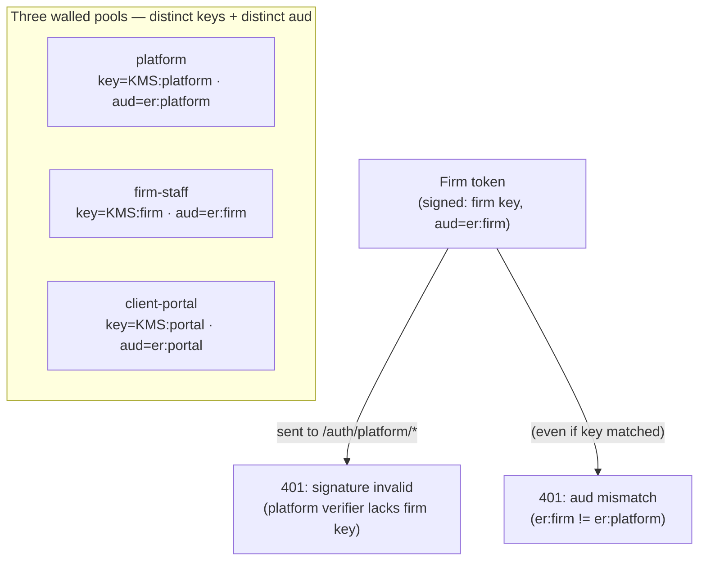

**[FOUNDER-CONFIRM]** No business decision is required to wall the pools — the separation is fixed. The only founder-facing knob related to pools is whether any enterprise firm contractually requires a fully dedicated firm-pool deployment; the default pooled-with-RLS posture (Section 1, Section 2) holds regardless, and §3.8's port abstracts placement.

### Acceptance criteria — pool separation

- **AU-A1 (cross-pool 401).** For every ordered pair of distinct pools `(X, Y)`, a token minted by pool `X` and presented to any authenticated endpoint of pool `Y` returns **401** with no resource body, no PII, and no indication of why beyond an opaque auth-failure code. This is a release-gating CI test that enumerates all six ordered pairs.
- **AU-A2 (distinct keys).** A CI assertion proves the three pools resolve three different signing-key references from KMS/Secrets Manager; the test fails if any two pools share a key reference or if any pool falls back to a shared default secret. A second assertion proves no single environment variable (e.g., a global `JWT_SECRET`) can satisfy more than one pool's verifier.
- **AU-A3 (aud verification).** Each pool's JWT strategy is configured with a non-empty `audience` constant and rejects a structurally valid, correctly-signed token whose `aud` differs. A CI test mints a token signed with pool `Y`'s key but stamped with pool `X`'s `aud` and asserts pool `Y` still rejects it (proving the `aud` wall is independent of the key wall).
- **AU-A4 (separate stores).** A schema-lint asserts no foreign key crosses between `platform_user`, `firm_user`, and `portal_credential`, and that `firm_user` and `portal_credential` carry `firm_id` (tenant-scoped, RLS-forced per Section 2) while `platform_user` does not.

---

## 3.2 AuthCore — the shared, pool-agnostic primitive layer

The three pools do not each re-implement password hashing, token signing, session writing, or MFA verification. They share **one** internal `AuthCore` library that takes a **pool descriptor** (its key reference, its `aud` constant, its session table, its credential store, its MFA policy) and provides the verbs: `hashPassword`, `verifyPassword`, `issueSession`, `rotateRefresh`, `revokeSession`, `revokeAllSessions`, `verifyTotp`, `verifyWebAuthn`, `verifyRecoveryCode`. Each pool is a thin configuration of AuthCore, not a fork of it.

This matters for correctness: the audience wall, the fail-closed default, the Argon2id parameters, and the token-binding logic are written **once** and proven once, then every pool inherits them. A new pool cannot accidentally ship a weaker hash or a missing `aud` check, because it does not author those — it declares a descriptor.

`AuthCore` performs **no authorization**. It establishes the authenticated principal (pool, subject id, `firm_id` where applicable, session id) and populates the request-scoped `PrincipalContext` (the AsyncLocalStorage carrier defined in Section 1). The scope-aware permission guard and record-level data layer (Section 4) read that context; they are never bypassed by anything in this section. The `firm_id` carried in `PrincipalContext` is what the request middleware sets as the per-transaction tenant GUC for RLS (Section 2) — `AuthCore` resolves it from the authenticated principal, never from a caller-supplied value.

### Acceptance criteria — AuthCore

- **AU-A5.** All three pools route password verification, hashing, and token issuance through the same `AuthCore` implementation; a code-scan asserts no pool contains its own bcrypt/argon/jwt call site outside AuthCore.
- **AU-A6.** `AuthCore.issueSession` populates `PrincipalContext` with `{ pool, subjectId, firm_id?, sessionId }` and never with a caller-supplied `firm_id`; the `firm_id` is resolved from the authenticated principal only.

---

## 3.3 Credentials, hashing, and signing keys

**Password hashing.** Passwords are hashed with **Argon2id**, with memory/iteration/parallelism parameters set to current OWASP guidance and held in configuration so they can be raised without a code change. Hashes are never reversible and never logged. A verify path that encounters a hash produced under older parameters transparently re-hashes on successful login (lazy upgrade), so the cost factor ratchets forward across the user base without a migration.

**Signing keys.** Each pool's JWT signing key lives in KMS / AWS Secrets Manager in the tenant's region (§ region seam, 3.8), read at runtime via the task's IAM role — never baked into an image, never in an env file, never in the repo. Keys carry a `kid` so rotation is a key-add-then-retire operation: the verifier accepts both the current and the immediately-previous key during the rotation window, and access tokens (15-minute lifetime, §3.4) naturally drain to the new key within one window. Refresh-token rotation (§3.4) re-binds long-lived sessions to the new key.

**Key hierarchy alignment.** Signing keys are pool-scoped platform secrets, distinct from the data-encryption key hierarchy (CMK → per-firm DEK → per-subject key) used for Restricted PII (§7.1/§7.2). The two never share key material. A compromise of a signing key forges tokens but cannot decrypt stored PII, and vice-versa. Credential and MFA-secret encryption for the auth stores (§3.6) uses a separate per-pool/per-firm **operational DEK**, not the per-subject field-encryption codec — see §3.6 and §7.1.

### Acceptance criteria — credentials & keys

- **AU-A7.** Stored credentials are Argon2id; a CI scan rejects any plaintext or reversibly-encrypted credential column and any non-Argon2id hash in the credential stores.
- **AU-A8.** No signing key, password hash, or recovery code appears in logs, traces, error bodies, or non-prod fixtures (asserted by the PII/secret log-redaction scanner from Section 7).
- **AU-A9.** Signing keys are retrieved at runtime from KMS/Secrets Manager via IAM role; a config-lint fails the build if a signing key is present in any committed file or container image layer.
- **AU-A10.** Key rotation is non-disruptive: a test rotates a pool's key and asserts that tokens minted under the previous `kid` remain valid until expiry within the configured rotation window, and that newly-issued tokens use the new `kid`.

---

## 3.4 Session & token model

The platform uses a **short access token + rotating refresh token + server-side session record** model, identical in shape across all three pools (each with its own session table).

**Access token.** A 15-minute JWT carried in the `Authorization: Bearer` header for API/SDK callers, or in an `HttpOnly` cookie for browser sessions (§3.5). Claims include: `sub` (pool-scoped subject id), `aud` (the pool constant — verified, §3.1), `iss`, `sid` (session id), `firm_id` (firm-staff and client-portal only), `iat`, `exp`, and a token-binding fingerprint (`tbf`). Access tokens carry **no permissions** — authorization is resolved per-request from the principal against the catalogue (Section 4), so a permission change takes effect on the next request, not at the next login.

**Refresh token.** A long-lived, single-use, **rotating** token stored only in an `HttpOnly`, `Secure`, `SameSite` cookie scoped to the pool's refresh path. Each use mints a new access token AND a new refresh token and invalidates the old refresh token (rotation). Reuse of an already-rotated refresh token is treated as theft: it revokes the entire session family and forces re-authentication. The refresh token's opaque value is stored **hashed** in the session table — a database read alone cannot replay it.

**Token-binding fingerprint (`tbf`).** The `tbf` is a server-issued, opaque, per-session value generated by `AuthCore` at session creation and bound to the refresh cookie plus a stable client hint (e.g., a hashed User-Agent / client-platform signal). It is **not** derived from the client IP address, so legitimate mobile and roaming clients are not broken (the portal MFA-friendliness goal). The session row stores the `tbf`; the access token carries the same `tbf`; on every request the two must match. A mismatch means the access token was lifted onto a different session/device pairing and is rejected (401). A change in the stable client hint that does not alter the refresh cookie does not, by itself, invalidate a session; rejection (AU-A14) is triggered specifically when the presented `tbf` does not equal the session row's stored value.

**Token-bound sessions.** Every access token references a server-side **session row** (per pool: `platform_session`, `firm_session`, `portal_session`) holding `{ session_id, subject_id, firm_id?, refresh_hash, token_binding_fingerprint, created_at, last_seen_at, idle_expires_at, absolute_expires_at, revoked_at?, device_label, ip_first_seen }`. On every authenticated request the session row is re-validated: the session must exist, not be revoked, and be within both its idle and absolute windows; the token's `tbf` must match the session's `token_binding_fingerprint`. A token whose session is revoked is dead **immediately**, not at the 15-minute expiry — this is what makes "log out everywhere," admin deactivation, and credential-change revocation instantaneous. The hot path of session validation is cached in Redis (session id → minimal validity record), with the PostgreSQL session table as the durable source of truth; a revocation writes through both. Because Redis is a recoverable cache only (Section 1) and not a source of truth, the validator fails closed to PostgreSQL: a Redis miss MUST trigger a PostgreSQL re-check, and a cache rebuild MUST NOT mark a session valid without confirmation from the durable session row — so a revocation that survives in PostgreSQL is never silently un-enforced by a Redis flush or stale restore.

**Lifetimes (defaults; configurable per pool).**

| Pool | Access TTL | Refresh / absolute session | Idle timeout |
|---|---|---|---|
| platform | 15 min | 8 h absolute | 30 min idle |
| firm-staff | 15 min | 12 h absolute | 60 min idle |
| client-portal | 15 min | 24 h absolute | 30 min idle |

**[FOUNDER-CONFIRM]** Idle/absolute timeouts above are the recommended posture (tightest for platform, most lenient absolute for portal usability); the founder may relax the firm-staff or portal windows for UX. The 15-minute access TTL and the rotating-refresh mechanism are fixed.

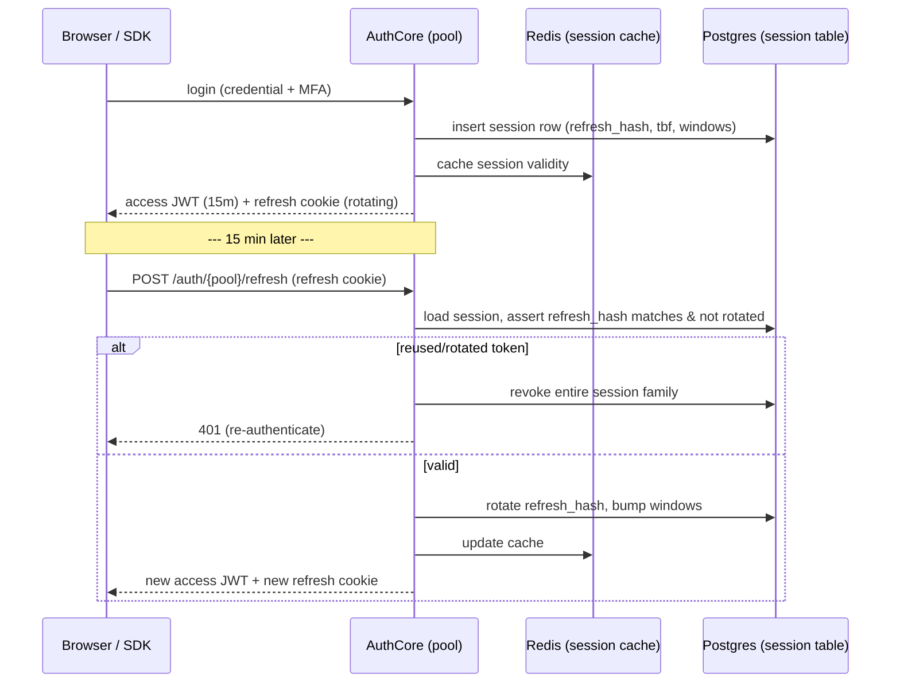

### Acceptance criteria — session & token

- **AU-A11 (instant revocation).** Revoking a session (logout, deactivation, password change) causes the next authenticated request bearing that session's still-unexpired access token to return 401, proving validation is session-bound and not expiry-bound.
- **AU-A12 (refresh rotation & theft detection).** A refresh token can be exchanged exactly once; presenting a previously-rotated refresh token revokes the whole session family and returns 401.
- **AU-A13 (revoke-all atomicity).** Deactivating or suspending a principal revokes ALL of that principal's sessions for that pool in a single transaction; no session survives.
- **AU-A14 (token binding).** An access token replayed with a `tbf` not matching its session row is rejected (401). The `tbf` is the server-issued per-session opaque value (refresh-cookie + stable-client-hint bound, not IP-bound); the test asserts that an access token presented with a `tbf` other than its session row's stored value is rejected.
- **AU-A15 (no permissions in token).** Access tokens contain no permission/role claims; a permission revocation takes effect on the next request without requiring re-login (verified by test).
- **AU-A16 (revocation survives cache loss).** After a simulated Redis flush (or restore from a stale snapshot), a previously revoked session is still rejected on the next request, proving the validator fails closed to the PostgreSQL session table and never marks a session valid on a cache miss without durable confirmation.

---

## 3.5 Token transport — header or HttpOnly cookie only, never the URL

Tokens are accepted from exactly two channels and no others:

1. The `Authorization: Bearer <jwt>` header (API and SDK clients), or
2. An `HttpOnly`, `Secure`, `SameSite=Strict` (or `Lax` only where a cross-site GET is functionally required) cookie scoped to the pool (browser sessions).

A token MUST NOT be accepted from, nor ever emitted into, a **URL query parameter, path segment, or fragment**, an `Origin`/`Referer`, or any other request component. This closes the standard leak vectors: tokens in URLs end up in server access logs, browser history, proxy logs, CDN logs, and `Referer` headers sent to third parties. The same rule applies to **all** capability-bearing values, not just JWTs — presigned document URLs and public-by-id capability tokens (Section 4 / Section 5) follow the no-token-in-query-param rule, and presigned URLs are always bound to an ownership-checked record rather than signed from a caller-supplied storage key.

Browser-cookie sessions are protected against CSRF by `SameSite` cookies plus a double-submit anti-CSRF token on state-changing requests; the cookie carries the credential, the header carries the CSRF proof, so a cross-site form post cannot both ride the cookie and forge the header.

### Acceptance criteria — transport

- **AU-A17 (no token in query).** A request presenting a valid token only as a URL query parameter is **not** authenticated (treated as anonymous); a CI test asserts the token extractor never reads query/path/fragment.
- **AU-A18 (cookie flags).** Every session/refresh cookie is set with `HttpOnly`, `Secure`, and `SameSite`; a test fails if any auth cookie is missing a flag.
- **AU-A19 (no token egress to URL).** A code-scan asserts no endpoint constructs a redirect, link, or response that embeds a JWT, refresh token, presigned URL token, or capability token in a query string.
- **AU-A20 (CSRF).** A cross-site state-changing request bearing the session cookie but lacking the anti-CSRF token is rejected.

---

## 3.6 Multi-factor authentication

MFA is first-class and **in-house** (no third-party MFA service). Three factor types are supported, with recovery codes as the break-glass path:

- **TOTP** (RFC 6238 authenticator apps) — the baseline second factor; the shared secret is generated server-side, shown once as a QR/secret during enrolment, and stored encrypted under the auth-store operational DEK (see "MFA-secret encryption" below). Verification allows a small clock-skew window.
- **WebAuthn / passkeys** (FIDO2) — phishing-resistant hardware/platform authenticators; the preferred strong factor for the platform pool and privileged firm roles. Credentials (public key, credential id, sign counter) are stored per principal; the sign-counter is checked to detect cloned authenticators.
- **Recovery codes** — a set of single-use, high-entropy codes issued at MFA enrolment, stored **hashed** (Argon2id), each consumable exactly once, with a clear "regenerate codes" path that invalidates the prior set. Used only when the primary factor is unavailable.

**MFA-secret encryption.** MFA secrets and other credential-store secrets (e.g., the TOTP shared secret) belong to `platform_user` and `firm_user`, which are staff/super-admin principals — **not** end-client Parties — and therefore have no per-subject key in the CMK → per-firm DEK → per-subject-key hierarchy. They are NOT encrypted under the per-subject field-encryption codec (§7.2), which is keyed on an end-client data subject. Instead they are encrypted under a per-pool/per-firm **operational DEK** dedicated to the auth stores: the firm-staff and portal stores use a per-firm operational DEK (wrapped under the firm DEK), and the platform pool — which has no `firm_id` and thus no firm DEK — uses a dedicated **platform operational DEK** wrapped directly under the platform CMK. This key path is defined in §7.1; this section only specifies that MFA/credential secrets use it rather than the subject-keyed codec.

**SMS/email OTP** is **fallback-only**, never a primary factor, and its availability is a per-pool policy knob (it is the weakest channel and carries a delivery-rail cost). It is off by default for the platform pool.

MFA enrolment, verification, factor-reset, and every recovery-code use are written to the immutable audit spine (Section 7). A factor reset for another user is a privileged, audited, step-up-gated operation.

**Per-persona MFA defaults (recommended posture):**

| Pool | MFA posture (recommended) |
|---|---|
| platform | **Mandatory, locked** (WebAuthn strongly preferred; TOTP acceptable). Cannot be disabled by the principal. |
| firm-staff | **Required for privileged roles** (firm owner/admin/billing); available and strongly encouraged for all staff. |
| client-portal | **Optional, encouraged** (TOTP or passkey); never blocks a client from accessing their own case. |

**[FOUNDER-CONFIRM]** The per-persona defaults above are commercial/UX knobs the founder owns (friction-vs-security): specifically (a) whether firm-staff MFA is required for ALL staff vs. privileged-only, (b) whether portal MFA is mandatory, and (c) the SMS-OTP fallback appetite. The platform-pool **mandatory-locked** posture is fixed and not a knob. The MFA mechanism (TOTP + WebAuthn + recovery codes, in-house) is fixed regardless of the policy values.

### Acceptance criteria — MFA

- **AU-A21.** A platform-pool login cannot complete without a successful second factor; the second factor cannot be disabled from the principal's own settings.
- **AU-A22.** A TOTP secret and recovery codes are revealed exactly once at enrolment; recovery codes are stored hashed and each is consumable exactly once; regenerating codes invalidates the prior set.
- **AU-A23.** A WebAuthn credential with a non-increasing sign counter is rejected as a possible clone and audited.
- **AU-A24.** SMS/email OTP cannot satisfy MFA as a primary factor; it is selectable only as a configured fallback and only where the pool policy enables it.
- **AU-A25.** Every MFA enrolment, verification failure, factor reset, and recovery-code consumption produces an audit event with actor, pool, and `firm_id` where applicable.
- **AU-A26.** Stored MFA/credential secrets are encrypted under the per-pool/per-firm operational DEK (§7.1), not the per-subject field-encryption codec; a code-scan asserts no auth-store secret is keyed on an end-client subject key, and the platform pool resolves the platform operational DEK (no `firm_id` dependency).

---

## 3.7 Account lifecycle, invites, and password policy

**Invitation (firm-staff & portal).** New principals are created by invitation, never by open self-registration into a firm or portal context. An invite issues a **single-use, time-boxed, high-entropy invite token** (default 72-hour expiry) delivered by the Mailer Doer; the token is stored hashed; redeeming it lets the invitee set their password and (per policy) enrol MFA, after which the token is consumed. An expired or already-redeemed invite token is rejected. Invite tokens follow §3.5 — they travel in the email link's path-opaque form as a capability, are never logged, and never carry PII in the URL. **[FOUNDER-CONFIRM]** the invite-token TTL (72h proposed) and whether portal activation is invite-only vs. firm-triggered self-activation.

**Password reset.** Self-service reset issues a single-use, time-boxed reset token (default 1-hour expiry), hashed at rest, delivered to the verified address; redemption requires the token and a new password meeting policy, and **revokes all existing sessions** for that principal on success. Reset requests are rate-limited and do not disclose whether an address exists (uniform response).

**Password policy.** Length-first (12-character minimum recommended), screened against a breached-password corpus, no forced periodic rotation (per current NIST guidance), no composition-rule theater. Policy values are configuration so they can be tightened per pool. **[FOUNDER-CONFIRM]** the minimum length and whether breached-password screening uses an in-region corpus vs. an external k-anonymity service (a residency/sub-processor decision).

**Deactivation & suspension.** An admin-initiated deactivation (firm admin for firm-staff; super-admin for platform; firm for its portal clients) immediately revokes all of the principal's sessions (AU-A13) and blocks new logins, while preserving the credential record for audit and possible reinstatement. Deactivation is audited with actor and justification.

**Email/identity verification.** A principal's contact address is verified before it is trusted for reset/notification delivery; an unverified address cannot receive a password-reset token.

### Acceptance criteria — lifecycle

- **AU-A27.** Invite and reset tokens are single-use, time-boxed, stored hashed, and rejected after expiry or redemption; a redeemed invite cannot be replayed.
- **AU-A28.** A successful password reset revokes all existing sessions for the principal.
- **AU-A29.** Reset and "forgot password" responses are uniform regardless of whether the address exists (no account-enumeration oracle), and are rate-limited.
- **AU-A30.** Admin deactivation immediately blocks login and revokes all sessions in one transaction, and is audited with actor + justification.
- **AU-A31.** Auth-sensitive endpoints (login, refresh, reset, invite-redeem, MFA-verify) enforce per-IP, per-account, and per-tenant throttling with progressive backoff/lockout, and a bot-mitigation challenge on repeated failure.

---

## 3.8 Region seam & the future enterprise-SSO adapter

**Region seam.** Identity is region-aware by construction. Signing keys, credential stores, and session tables are resolved per tenant's region: a firm provisioned in `ca-central-1` reads its firm-pool key and writes its sessions in-region; adding a firm in another supported region (e.g., `eu-central-1`) is configuration, not a rewrite. The estate deploys Canada-only at launch, but no identity component hard-pins `ca-central-1` in code — region is a per-tenant dimension threaded through KMS key references and datastore resolution. This is the same region seam the data platform uses (Section 1).

**IdentityProviderPort.** All inbound credential verification flows through an `IdentityProviderPort`. The launch deployment binds one concrete adapter — the **in-house IdP** described in this section — to that port. Enterprise inbound SSO (SAML / OIDC federation, so a firm's staff sign in via their corporate IdP) is a **future additive adapter** behind the same port: it satisfies a firm-staff login by federating to the firm's IdP and minting a standard firm-pool session (same `aud`, same session model, same token transport, same revocation). It does **not** dissolve the pool walls — a federated firm-staff principal is still firm-pool, still `aud=er:firm`, still bound to `firm_id`. SSO is explicitly **not** in the launch scope; the port exists so it lands later as one adapter and a per-firm config row, with zero change to the three-pool model or the session machinery. **[FOUNDER-CONFIRM]** whether enterprise inbound SSO is a fast-follow after launch or a later milestone (a deal-size/timing call; the architecture is decided either way).

### Acceptance criteria — seam & SSO

- **AU-A32.** No identity component hard-codes a region constant; a config-lint asserts signing-key and session-store resolution is parameterized by the tenant's region. Adding a second supported region requires no code change to the auth modules.
- **AU-A33.** All inbound authentication resolves through `IdentityProviderPort`; the in-house IdP is the only adapter bound at launch (a code-scan asserts no direct credential-verification path bypasses the port).
- **AU-A34.** A future SSO adapter, when bound, produces a firm-pool session indistinguishable in `aud`, transport, session-table shape, and revocability from an in-house firm-staff login (forward-compatibility contract test against a stub adapter).

---

## 3.9 Section acceptance summary (release-gating)

The following are the hard, testable gates for this section, run in CI and verified at the pre-go-live pentest:

1. **Cross-pool 401** — all six ordered pool pairs reject each other's tokens with no leakage (AU-A1).
2. **Distinct signing keys** — three pools, three keys, no shared fallback secret (AU-A2).
3. **Audience verification** — each pool rejects a correctly-signed token carrying another pool's `aud`, independently of the key wall (AU-A3).
4. **Argon2id everywhere** — no non-Argon2id or reversible credential storage (AU-A7).
5. **No token in URL** — tokens accepted only from header or HttpOnly cookie, never emitted into a URL (AU-A17, AU-A19).
6. **Instant, atomic revocation** — session-bound validation makes logout/deactivation/reset effective on the next request, all sessions in one transaction, and survives a Redis cache loss (AU-A11, AU-A13, AU-A16, AU-A28).
7. **Refresh rotation + theft detection** — single-use rotating refresh; reuse kills the session family (AU-A12).
8. **MFA in-house and policy-enforced** — TOTP + WebAuthn + single-use hashed recovery codes; platform pool mandatory-locked; MFA secrets encrypted under the operational DEK, not the subject codec (AU-A21..A26).
9. **Region seam intact** — no hard-pinned region; all auth flows through `IdentityProviderPort` (AU-A32, AU-A33).

This section delivers identity and the verified principal only. The database tenant-isolation backstop that confines that principal's reach — forced RLS, the `app.current_firm_id` GUC, the portal second RLS dimension (`app.current_client_subject`), and the cross-tenant denial suite — is specified in Section 2 (Multi-Tenancy & Isolation). Everything about what that principal is allowed to do — the `system/*` vs `agent/*`/`portal/*` scope-aware guard, the per-firm record-level data layer, and the portal client-to-client ownership rule — is specified in Section 4 (Authorization, RBAC & Record-Level Authz), which consumes the `PrincipalContext` this section populates.

---

# 4. Authorization, RBAC & Record-Level Authz

**Purpose.** This section defines the platform's authorization machinery: a two-scope permission namespace, a scope-aware guard that enforces both the *name* and the *plane* of every permission, a fail-closed write-side filter that makes privilege escalation structurally impossible, a hand-authored permission catalog with a default role matrix and CI completeness gates, a record-level authorization layer (the fast/observable layer that sits *on top of* the database RLS backstop defined in §2), and a positive `@Public()` allow-list. Authorization is the second wall after tenant isolation; it answers "may *this principal* touch *this specific record*", whereas RLS (§2.2) answers "may any query from this tenant see this row at all". The two are defense-in-depth and neither replaces the other.

This is content-neutral platform machinery. The resource names that appear in catalog examples (`agent/case:*`, `portal/document:*`) are illustrative of the *shape* of permission keys. The catalog is **seeded incrementally per wave** (§4.4): Wave-A delivers the `system/*` keys plus the foundation's own routes; the `agent/*` and `portal/*` keys are added wave-by-wave as the modules that define them ship. Each wave's catalog increment is mechanically reconciled against that wave's route decorators (§4.4), and the CI completeness check is **scoped to the modules delivered so far** — not to modules that have not yet been built.

---

## 4.1 Permission Namespace — Exactly Two Scopes

Every permission in the system belongs to **exactly one of two scopes**, and the scope is encoded in the permission's prefix. There is no third scope and no ambiguous prefix.

| Prefix | Scope | Plane it governs | Who may hold it | Example shape |
|---|---|---|---|---|
| `system/*` | **GLOBAL** | The platform-owned (global) plane: plans, entitlements, master/reference data, global templates, Country Packs, cross-tenant operations | Platform staff (Super-Admin pool) only | `system/plan:manage`, `system/firm:provision`, `system/audit:read-all` |
| `agent/*` | **LOCAL** | A single firm's tenant plane, evaluated within the caller's `firm_id` | Firm staff (firm-staff pool) | `agent/case:view.all`, `agent/invoice:write`, `agent/firm:billing-manage` |
| `portal/*` | **LOCAL** | A single end-client's slice of one firm's plane, evaluated within the caller's `firm_id` *and* their own ownership chain | Portal end-clients (client-portal pool) | `portal/document:upload`, `portal/invoice:pay`, `portal/case:view.own` |

**Canonical rules (NORMATIVE):**

- **`system/*` is the canonical GLOBAL namespace.** A `system/*` permission authorizes operations on the global plane or explicit, separately-audited cross-tenant operations. It is never evaluated within a tenant boundary.
- **`agent/*` and `portal/*` are the canonical LOCAL namespaces.** Both are always evaluated within the caller's `firm_id`. A LOCAL permission's authority stops at the tenant boundary by construction (RLS, §2.2, makes any cross-firm row invisible regardless).
- **The legacy `global/*` prefix does not exist in the target state.** There is exactly one prefix per scope. A catalog or seed that carries two prefixes for one scope is a defect the CI lint (§4.4) rejects.
- **`view.own` vs `view.all` qualifiers.** Where ownership matters within a firm (e.g., a case officer who may see only cases they own vs. a firm admin who may see all), the LOCAL permission carries an explicit qualifier suffix. `view.own` is satisfied only when the record-level layer (§4.5) resolves the record's ownership to the caller; `view.all` grants the firm-wide read. This makes intra-firm least-privilege a first-class, testable distinction, not an after-the-fact filter.
- **`feature.*` is a separate, orthogonal hard-gate namespace** (entitlement gating by subscription plan), evaluated *after* the permission check. Country is a soft filter applied at the resource-query layer, never a permission. These are out of scope for this section's two-scope rule — they are additional gates, not authorization scopes.

**The guard pipeline order (every state-changing or read route runs this chain):**

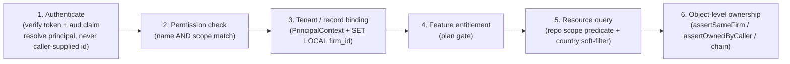

Steps 1–2 are HTTP-plane guards; step 3 establishes the request-scoped context; steps 4–6 are enforced in the service/data layer. A request that fails any step short-circuits with the appropriate status and an audit event where the failure is security-significant (steps 2, 3, 6).

**Acceptance criteria (§4.1):**
- AC-4.1.1: Every permission key in the seeded catalog starts with exactly one of `system/`, `agent/`, `portal/`; a CI lint fails the build if any key uses another prefix or if `global/` appears anywhere in catalog, seed, or `@RequirePermissions` decorators.
- AC-4.1.2: A `system/*` key and an `agent/*`/`portal/*` key for a "same-sounding" capability are distinct catalog entries; no key is reused across scopes.
- AC-4.1.3: For every capability where ownership is meaningful, the catalog contains both a `.view.own` and a `.view.all` (or documents in the catalog metadata why a qualifier is not applicable).

---

## 4.2 Scope-Aware RolesGuard (read-side enforcement)

A name-only permission check is insufficient and was the root cause of a verified privilege-escalation defect in the reference codebase (a route checked only that the principal *held a permission named X* without checking that X's *scope* matched the route's plane, allowing a firm-local principal to satisfy a route by holding a like-named global permission, and vice-versa). The target-state guard checks **both the permission name and its scope**.

**Design.** Each route declares its required permission(s) via `@RequirePermissions('agent/case:write')`. The guard:

1. Reads the route's required permission key(s) and derives the **route plane** from each key's prefix (`system/*` ⇒ GLOBAL; `agent/*` or `portal/*` ⇒ LOCAL).
2. Reads the **principal's plane** from the authenticated context: which auth pool issued the token (platform / firm-staff / client-portal), validated by the mandatory audience claim (§3 / [C3-D1]).
3. Reads the **held permissions** for the principal's roles.
4. **Requires that the route plane equals the held-permission scope AND the principal's pool plane.** A GLOBAL route requires a `system/*` permission held by a platform-pool principal. A LOCAL route requires an `agent/*` (firm-staff pool) or `portal/*` (client-portal pool) permission. The qualifier (`view.own`/`view.all`) is carried into the PrincipalContext for the record-level layer to enforce in step 6.
5. **On a scope mismatch — the held permission's scope, the principal's pool plane, and the route plane do not all agree — the guard returns `403 SCOPE_VIOLATION` and emits a security audit event** (`AUTHZ_SCOPE_VIOLATION`) capturing actor, pool, attempted route, required permission, and held permissions (keys only, never secret material). Because this failure occurs at the guard (step 2) before any business transaction or tenant `SET LOCAL` exists, the audit write does **not** ride the business mutation's outbox; it is written via the dedicated **security-audit path** described below.

A mismatch is treated as a *security event*, not a routine 403, precisely because it indicates either a misconfigured role or an active escalation attempt — both warrant a durable, alertable record.

**Security-denial audit path (NORMATIVE).** Security-denial audits — `AUTHZ_SCOPE_VIOLATION`, cross-pool `401`, and other authn/authz failures rejected *before* a firm-scoped business transaction begins — cannot ride the synchronous-outbox rule (§7.5), which presumes an open business transaction whose tenant GUC is already set. Writing such an audit on a connection with an unset tenant GUC would be rejected by the fail-closed RLS rule (§2.2, NULL context ⇒ zero rows / `WITH CHECK` fails). Therefore:

- When the failing request has a **resolved principal** (e.g. a firm-staff principal hitting a `system/*` route — the pool/`firm_id` are known from the validated token), the security-audit path opens its own short transaction, sets the tenant GUC from the **resolved principal's** `firm_id`, and writes the audit row into that firm's per-firm audit chain (§7.5). This makes the denial atomic and durable without depending on a business transaction that never began.
- When the request is **principal-less** (e.g. a malformed/unauthenticated token, a cross-pool `401` where no valid principal resolves), the audit is written to a **platform-plane security sink** (a GLOBAL-plane audit store governed by the admin-only-write policy of §2.6), since there is no firm to attribute it to.

This reconciles the §4.2/§4.6 requirement to durably record security denials with the §2.2 fail-closed RLS rule and the §7.5 outbox rule, which together would otherwise leave pre-transaction denials un-auditable.

**Fail-closed default.** A route with no `@RequirePermissions` and no `@Public()` (§4.6) is **denied** by a global guard default, not allowed. The CI lint in §4.4 makes a route-without-either-decorator a build failure, so the runtime default is a backstop, not the primary control.

**Acceptance criteria (§4.2):**
- AC-4.2.1: A firm-staff principal holding any `agent/*` permission that requests a GLOBAL (`system/*`) route receives `403 SCOPE_VIOLATION` and exactly one `AUTHZ_SCOPE_VIOLATION` audit entry (written via the security-audit path under the resolved principal's `firm_id`); no business effect occurs.
- AC-4.2.2: A platform principal holding `system/*` that requests a LOCAL (`agent/*`) route receives `403 SCOPE_VIOLATION` (a raw platform-pool token does not satisfy LOCAL routes through normal flow; cross-tenant work goes through the explicit impersonation/elevated path of §4.5, which mints a firm-pool token).
- AC-4.2.3: A portal principal that requests an `agent/*` route receives `403 SCOPE_VIOLATION`; a firm-staff principal that requests a `portal/*` route likewise.
- AC-4.2.4: A route that declares neither `@RequirePermissions` nor `@Public()` is rejected at request time and fails CI before deploy.
- AC-4.2.5: A principal-less authn failure (malformed/cross-pool token) produces exactly one audit entry in the platform-plane security sink, and no audit-insert attempt is made on a connection with an unset tenant GUC.

---

## 4.3 Write-Side Scope Filter (role-create/update fail-closed) + Remediation Scan

The read-side guard (§4.2) stops a mis-granted permission from *being used*. The write-side filter stops a mis-granted permission from *ever being written*. Defending only the read side leaves a latent escalation in the data: a single guard regression would then expose every mis-granted row. The reference codebase exhibited exactly this gap — an unfiltered role-write path let a firm admin author a firm role that included a `system/*` permission.

**Target-state rule (NORMATIVE):** the role-create and role-update service paths **reject any attempt to attach a GLOBAL (`system/*`) permission to a firm role or a portal role** (ADR FINAL #11). Firm and portal role templates and custom roles are **LOCAL-only by construction**.

**Mechanism (fail-closed, audited):**

- The role-write service computes the **scope set** of the role being written from the role's owner plane: a role owned by a `firm_id` (firm/portal role) may contain only `agent/*` and/or `portal/*` keys (and a firm role may not contain `portal/*` and vice versa — each role type has a single allowed namespace).
- Any submitted permission key outside the role's allowed namespace causes the **entire write to be rejected** (not silently dropped) with `403` and a security audit event (`AUTHZ_ROLE_WRITE_REJECTED`). Rejecting the whole write — rather than filtering the offending keys and committing the rest — avoids a partial-success that an attacker could probe.
- The validation reads the catalog (§4.4) as the source of truth for each key's scope; an unknown key is also rejected.
- The seeder that installs default firm/portal role templates applies the **same LOCAL filter** so a packaging mistake cannot seed a GLOBAL permission onto a LOCAL template.

**One-time remediation scan.** As a Wave A deliverable, a CI-gated remediation routine scans all persisted `RolePermission` rows and **reports (and, on an explicit operator-confirmed run, strips) any GLOBAL permission found on a firm or portal role**, writing a `DATA_REMEDIATION` audit entry per affected role. In the greenfield target this scan finds nothing on a clean install; it ships as a standing CI assertion (`zero GLOBAL permissions on any LOCAL role`) so the invariant is continuously proven, not assumed.

**Acceptance criteria (§4.3):**
- AC-4.3.1: A firm-admin role-write request that includes a `system/*` permission returns `403`, persists zero `RolePermission` rows for that request, and emits one `AUTHZ_ROLE_WRITE_REJECTED` audit entry.
- AC-4.3.2: A firm role-write that mixes valid `agent/*` keys with one invalid key (`system/*` or `portal/*`) is rejected in full; no partial commit.
- AC-4.3.3: The default-template seeder cannot install a GLOBAL permission on any firm/portal template; a unit test asserts every LOCAL template's permission set is a subset of the LOCAL namespaces.
- AC-4.3.4: A standing CI assertion proves no persisted LOCAL role holds any `system/*` permission; the remediation scan is idempotent and produces a per-role audit trail when it acts.

---

## 4.4 The Permission Catalog (Seeded Incrementally Per Wave) + Default Role Matrix + CI Completeness

The catalog is **hand-authored across all three namespaces** and then kept honest by mechanical, CI-derived completeness checks. "Hand-authored" means a human deliberately decides each permission's existence, scope, and `own`/`all` qualifier (a security decision that must not be auto-generated); "CI-validated" means the *wiring* between catalog and routes is proven by tooling, so the catalog stays correct as ~28 modules evolve.

**Incremental, per-wave seeding (NORMATIVE).** The catalog is **not** delivered as one complete cross-module artifact at the foundation milestone — the routes that define the bulk of the `agent/*` and `portal/*` keys ship in later waves (CRM, billing, case delivery), so a "complete catalog" gate could not be satisfied or CI-validated at Wave A. Instead:

- **Wave-A (A1) delivers the `system/*` keys plus the `agent/*`/`portal/*` keys for the foundation's own routes only** (identity, RBAC administration, tenancy/provisioning, and the foundation data-spine routes). This is the buildable, CI-validatable Wave-A scope; it reconciles with the §9.5 A1 gate, which is scoped to the foundation's delivered surface, not to the whole product's route map.
- **Each subsequent wave extends the catalog with its own module's keys** via its own idempotent seed migration, and the CI completeness check (below) runs against the **set of modules delivered so far**. A key for an undelivered module is neither required nor allowed.

**Catalog entity shape (config-as-data, GLOBAL plane).**

```
permission_catalog (
  key            text primary key,   -- e.g. 'agent/case:view.own'
  scope          enum('GLOBAL','LOCAL'),
  namespace      enum('system','agent','portal'),
  resource       text,               -- 'case', 'invoice', 'document', ...
  action         text,               -- 'view','write','delete','pay','upload', ...
  qualifier      text null,          -- 'own' | 'all' | null
  description_en text, description_fr text,
  is_active      boolean
)
```

Each wave's catalog increment is seeded by one idempotent migration so the installed set is **byte-identical across dev / staging / prod** for the modules delivered. Permissions are config-as-data (queryable, bilingual-labelled) but are GLOBAL platform truth — write-restricted to the platform plane. The `permission_catalog` table itself carries the GLOBAL read-only-permissive RLS policy + admin-only write of §2.6 (firms may read; only the elevated platform/migration role may write), so a firm-context principal cannot mutate the global catalog that §4.3's write-side filter trusts as its source of truth. The catalog seed therefore runs under the elevated migration role, never the application role.

**Default Role Matrix.** The seed also installs role *templates* (`RoleTemplate`, `RoleTemplatePermission`) and plan→template bindings (`PlanRoleTemplateSet`). The target ships approximately:

| Tier | Count | Plane | Notes |
|---|---|---|---|
| **Platform sub-roles** | ~6 | GLOBAL (`system/*` only) | e.g. Platform Owner, Platform Admin, Support (read-mostly), Billing-Ops, Content/Pack Publisher, Auditor (audit-read-all). Least-privilege segmentation of Super-Admin so no single platform role holds every `system/*` key. **[FOUNDER-CONFIRM]** the exact platform-staff operating segmentation. |
| **Firm templates** | ~6 | LOCAL (`agent/*` only) | e.g. Firm Owner, Firm Admin, Case Manager, Case Officer (`view.own`-biased), Billing/Finance, Read-only. Firms may compose additional custom roles within their tenant, always LOCAL-filtered (§4.3). **[FOUNDER-CONFIRM]** the least-privilege boundaries of the six firm templates (an operating-model choice). |
| **Portal roles** | ~3 | LOCAL (`portal/*` only) | e.g. Primary Applicant, Corporate Sponsor/Seat Admin, Dependent/Viewer. Bounded to own-ownership-chain (§4.5). |

All firm and portal templates are LOCAL-only; the seeder LOCAL-filters them (§4.3). A new firm is provisioned with these templates as its starting roles, giving least-privilege from day one rather than a single all-powerful default role. (The platform sub-roles and the firm/portal templates are seeded with the foundation; the `agent/*`/`portal/*` permission *keys* each template references are populated as their owning modules ship, so a template's referenced-but-not-yet-delivered keys are tolerated until that module's wave lands.)

**CI completeness validation (two directions, both release-gating, scoped to delivered modules):**

1. **Every `@RequirePermissions` resolves to a catalog entry.** A CI step statically extracts every permission key referenced by any route decorator across the **delivered** codebase and asserts each exists in the seeded catalog with a matching scope. A route requiring an unknown or mis-scoped key fails the build.
2. **Every catalog entry for a delivered module is wired to ≥1 route.** The same step asserts every active catalog key whose owning module is delivered is referenced by at least one route (or is explicitly marked `wired-by` a non-route consumer, e.g. a queue worker, in catalog metadata). A dangling permission — granted but never enforced — fails the build, because a permission nobody checks is a false sense of security. Keys belonging to undelivered modules are excluded from this check until their wave ships.
3. **Decorator coverage.** Every state-changing route carries `@RequirePermissions`; every route carries either `@RequirePermissions` or `@Public()` (§4.6). The completeness check is mechanically *derived* from each module's route surface rather than hand-curated, so it cannot drift as modules are added.

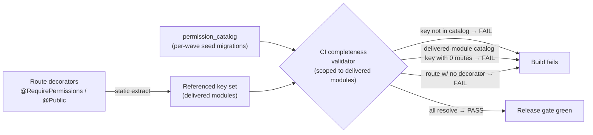

**Acceptance criteria (§4.4):**
- AC-4.4.1: Each wave's seeded catalog increment is byte-identical across dev/staging/prod (hash-compared in CI), and the Wave-A increment seeds the `system/*` keys plus the foundation's own `agent/*`/`portal/*` route keys.
- AC-4.4.2: CI fails if any `@RequirePermissions` key on a delivered route is absent from the catalog or its scope disagrees with the key's prefix.
- AC-4.4.3: CI fails if any active catalog key whose owning module is delivered is referenced by zero routes and is not metadata-marked `wired-by` a named non-route consumer; catalog keys for undelivered modules are exempt until their wave ships.
- AC-4.4.4: CI fails if any route lacks both `@RequirePermissions` and `@Public()`.
- AC-4.4.5: The default role matrix seeds ~6 platform / ~6 firm / ~3 portal roles; a test asserts each role's permission set is a subset of its allowed namespace.
- AC-4.4.6: A firm-context write to `permission_catalog` (or to `RoleTemplate`/`PlanRoleTemplateSet`) is denied by the GLOBAL read-only-permissive RLS policy (no app-role write policy, §2.6) and audited; the catalog seed succeeds only under the elevated migration role.

---

## 4.5 Record-Level Authorization (object-level, fail-closed)

Permission checks (§4.2) authorize a *capability*; record-level authorization authorizes the *specific record*. RLS (§2.2) guarantees a query cannot cross a `firm_id`; record-level authz adds the intra-firm and ownership-chain rules RLS cannot express, and produces explicit, observable denials (404/empty + audit) rather than silent empty result sets. This layer is the top defense for the Client Portal, the platform's highest PII-exposure surface, where a single missed ownership check leaks one client's data to another.

**PrincipalContext is the ONLY scope source.** A request-scoped `PrincipalContext`, propagated via `AsyncLocalStorage`, holds the authenticated `firm_id`, the principal id, the principal's pool/plane, the held permissions (with `own`/`all` qualifiers), and — for portal principals — the resolved ownership root (their own `clientCustomerId`). **No service or repository method ever accepts a caller-supplied `firm_id`, `client_id`, or ownership identifier for scoping.** Scope is read from the context, never from request input. The same `firm_id` from the context is what the middleware writes via `SET LOCAL app.current_firm_id` (§2.4), so the application layer and RLS are driven by one source and cannot disagree. For a portal principal, the middleware additionally sets `SET LOCAL app.current_client_subject` from the portal token's resolved `clientCustomerId`, which backs the second portal RLS dimension (§2.5).

**The scoped repository is the only sanctioned DB path.** Every tenant-scoped query goes through a repository / Prisma `$extends` global scope that injects the `firm_id` predicate from the PrincipalContext. There is no public repository method that takes an arbitrary tenant or owner id. Raw queries are linted out of module code; the few legitimate platform-global queries run on the explicit elevated path below.

**Object-level helper functions (used in the service layer, step 6 of the pipeline):**

- `assertSameFirm(record)` — asserts `record.firm_id === ctx.firm_id`; throws a not-found (`404`) on mismatch so existence is not leaked. (RLS, §2.2, would already have returned zero rows; this is the fast, observable, auditable failure.)
- `assertOwnedByCaller(record)` — for `view.own`/intra-firm ownership: asserts the record's owner/assignee resolves to `ctx.principalId` when the caller holds only the `.own` qualifier; a `.all` holder bypasses this assertion. Throws `404` on mismatch.
- `assertPortalOwnershipChain(record)` — for portal principals: asserts the record's ownership chain resolves to `ctx.ownershipRoot` (the caller's `clientCustomerId`), **AND** the record's type is permitted by the firm's `PortalVisibilityConfig` allow-list. Throws `404` on either failure.

**Portal rule = own-case-only + firm allow-list (NORMATIVE).** A portal client may touch **only** rows whose ownership chain resolves to their own `clientCustomerId`, **and only** the entity types the firm has explicitly enabled in `PortalVisibilityConfig`. The allow-list is **leak-by-default-off**: an entity type not on the list is invisible to the portal regardless of ownership. This pairs with the **second portal RLS dimension** mandated in §2.5 (a client-subject GUC, `app.current_client_subject`, set from the portal token), so portal isolation has a DB backstop, not only an application check — client-to-client isolation does not depend on the application layer alone.

**Portal-subject key model and ownership-chain resolution (NORMATIVE).** The portal session GUC `app.current_client_subject` carries the caller's **`clientCustomerId`**. A CLIENT-PII row carries `client_id` = the **Party FK** (not the `clientCustomerId`). The chain therefore resolves Party → ClientCustomer, in two cases:

- **Direct case** — a row carrying `client_id` directly: the portal policy/resolver maps `client_id` (the Party) to the owning `ClientCustomer` and asserts that `ClientCustomer.id` equals the GUC's `clientCustomerId`.
- **Child / corporate-seat case** — a child row reaches its owning Party via `owner_chain_to`, and a **corporate seat-holder** reaches the corporate Party through `PartyRelationship` (the seat-holder's `ClientCustomer` is related to the corporate Party that owns the row). The resolver follows that relationship and asserts the seat-holder's `clientCustomerId` is an authorized seat on the owning corporate Party.

Both the application helper (`assertPortalOwnershipChain`) and the §2.5 RLS policy resolve ownership through this same Party → ClientCustomer mapping (and the corporate-seat `PartyRelationship` traversal); a naive `client_id = subject` equality is **not** the rule and would be wrong for the corporate-seat case. The §2.5 portal policy carries **both** a `USING` clause (read denial) **and** a matching `WITH CHECK` clause (write denial), so a portal client cannot INSERT/UPDATE a CLIENT-PII row attributed to a sibling client at the database layer even with the application bypassed.

**Storage object rule (IDOR fix, ADR FINAL #3 / #10).** A presigned URL is **always bound to an ownership-checked record**. The service resolves the storage key *from* the record after `assertSameFirm`/ownership checks; it **never signs a caller-supplied storage key**. Public-by-id document/contract reads use unguessable **capability tokens** (§4.6), never the record id in the URL. This closes the reference-prototype IDOR where presigned-read signed any caller-supplied key.

**Reports and drill-through re-apply the checks.** Aggregations, exports, search results, and any drill-through link re-run the same record-level checks against the PrincipalContext on access. A report cannot become an escalation channel: rendering a row in a report does not grant access to the underlying record, and following a drill-through link re-authorizes the target record from scratch.

**Impersonation / cross-tenant access is an explicit, audited, step-up path (NORMATIVE contract).** Legitimate platform cross-tenant work (support, provisioning) does **not** run as a raw platform (`er:platform`) token against LOCAL routes — that is rejected with `403 SCOPE_VIOLATION` (§4.2, AC-4.2.2). Instead, the elevated path:

- **Mints a scoped, time-boxed, step-up-gated FIRM-pool token** (`aud = er:firm`) bound to **exactly one** target `firm_id`, gated by a distinct `system/*` permission, requiring a step-up (re-auth) and a stated justification.
- **Runs under the normal non-BYPASSRLS application role**, with the tenant GUC `SET LOCAL app.current_firm_id` set to the **target firm**. There is no BYPASSRLS / elevated DB role on this path: RLS still applies, so the session is confined to the one target firm and a query against a third firm returns zero rows exactly as for any firm-pool principal.
- **Writes an `IMPERSONATION_START` + `IMPERSONATION_END` (and `CROSS_TENANT_ACCESS`) pair to the target firm's per-firm audit chain (§7.5).**

Because the elevated path issues a real firm-pool token bound to the target firm, it satisfies the normal LOCAL scope-aware guard **with no bypass** — there is no code path by which a raw `er:platform` token satisfies a LOCAL route outside this audited flow. Normal request flow never crosses a tenant; this path is the only exception and it is always observable.

```mermaid
sequenceDiagram
  participant Req as Portal request
  participant Ctx as PrincipalContext (ALS)
  participant Repo as Scoped repository
  participant Svc as Service (object-level)
  participant DB as Postgres (RLS firm_id + client-subject GUC)
  Req->>Ctx: principalId, firm_id, ownershipRoot=clientCustomerId (from token, never request body)
  Ctx->>DB: SET LOCAL app.current_firm_id + app.current_client_subject
  Req->>Repo: getDocument(id)  %% id only, no firm_id/owner from caller
  Repo->>DB: SELECT ... (firm_id predicate injected; RLS double-checks)
  DB-->>Repo: row or zero rows
  Repo-->>Svc: row
  Svc->>Svc: assertSameFirm + assertPortalOwnershipChain (Party→ClientCustomer / seat) + PortalVisibilityConfig
  alt ownership/allow-list fails
    Svc-->>Req: 404 (no existence leak) + AUTHZ audit
  else passes
    Svc->>Svc: resolve storage key FROM record (never from caller)
    Svc-->>Req: presigned URL bound to the owned record
  end
```

**Acceptance criteria (§4.5):**
- AC-4.5.1: No repository or service signature accepts a caller-supplied `firm_id`/`client_id`/owner id for scoping (static code-scan, release-gating).
- AC-4.5.2: A case officer holding only `agent/case:view.own` cannot read another officer's case (404, audited); a holder of `agent/case:view.all` can.
- AC-4.5.3: A portal client requesting another client's document/case/invoice id receives `404`/empty, audited, never `200` — for 100% of resources (the horizontal-access pentest gate, below).
- AC-4.5.4: An entity type absent from a firm's `PortalVisibilityConfig` is invisible to that firm's portal even for an own-owned record.
- AC-4.5.5: No presigned URL is issued for a caller-supplied storage key; every presigned URL traces to an ownership-checked record.
- AC-4.5.6: A report/drill-through cannot return or link a record the caller could not fetch directly; the underlying record is re-authorized on access.
- AC-4.5.7: Cross-tenant access occurs only via the elevated path, which mints a firm-pool (`aud = er:firm`) token bound to exactly one target `firm_id`, runs under the non-BYPASSRLS app role, and produces `IMPERSONATION_START`/`IMPERSONATION_END` audit entries in the target firm's per-firm chain (§7.5). A raw platform (`er:platform`) token on a LOCAL route returns `403 SCOPE_VIOLATION`.
- AC-4.5.8: An active impersonation session is confined to exactly its one target firm; a query against a third firm during the session returns zero rows (RLS holds, no BYPASSRLS role on the path).
- AC-4.5.9: A corporate seat-holder reaches a row owned by the corporate Party only when their `clientCustomerId` is an authorized seat via `PartyRelationship`; a non-seat sibling client receives `404`. (The same chain is enforced at the DB by the §2.5 portal policy.)

---

## 4.6 `@Public()` — Positive Allow-List With Named Compensating Controls

Every route is **either** guarded by `@RequirePermissions` **or** explicitly marked `@Public()` — there is no implicit-public route. A route reaches the public state only by a deliberate decision recorded in code, and **each `@Public()` route MUST declare a named compensating control**. An unauthenticated route with no compensating control is a defect the CI gate rejects.

**The `@Public()` decorator carries its compensating control as a required argument:**

```
@Public({ control: 'webhook-signature', note: 'Stripe signed webhook' })
@Public({ control: 'capability-token', note: 'client retainer review by unguessable token' })
@Public({ control: 'rate-limit', note: 'public booking availability, per-IP throttled' })
```

| Control | Used for | What it enforces |
|---|---|---|
| **webhook-signature** | Inbound rail webhooks (payment, email/SMS delivery events) | The request body's provider signature is verified before any handler logic; an unsigned/invalid request is rejected. Idempotency key (incl. external event id) prevents replay (§6 event dictionary). |
| **capability-token** | Public-by-id reads of a specific contract/document/retainer (e.g. a client follows an emailed link to review a retainer before login) | Access is by an **unguessable, single-purpose, time-boxed capability token**, never by the record's sequential or UUID id. The token resolves server-side to exactly one ownership-checked record. **No token or PII in URL query params** — the token is carried in the path or a header per the URL-hygiene rule. |
| **rate-limit** | Genuinely public reads (e.g. a firm's public booking availability page) | Per-IP / per-route throttling and abuse monitoring; no PII returned; no record mutation. |

**Public-by-id reads use capability tokens, never sequential/UUID ids** (ADR FINAL #10). This closes two live reference-prototype defects: a retainer IDOR (a guessable id exposed a document) and checkout abuse. A capability token is opaque, scoped to one record and one action, expires, and is revocable; it carries no authority beyond the single record it was minted for.

**CI allow-list test (release-gating).** A CI step enumerates every `@Public()` route and asserts: (a) it declares one of the named controls; (b) the declared control is actually wired (e.g. a `webhook-signature` route is behind the signature-verifying middleware; a `capability-token` route resolves through the token service, not a raw id lookup; a `rate-limit` route is behind the throttler). The set of public routes is reviewed as an explicit allow-list artifact in each release — the surface of unauthenticated entry points is small, named, and intentional.

**Acceptance criteria (§4.6):**
- AC-4.6.1: Every route resolves to exactly one of `@RequirePermissions` or `@Public()`; CI fails otherwise (shared with AC-4.2.4 / AC-4.4.4).
- AC-4.6.2: Every `@Public()` route declares a named compensating control from the approved set; CI fails on a `@Public()` route with no control.
- AC-4.6.3: A `webhook-signature` route rejects an unsigned/invalid-signature request before any business effect; replay with the same idempotency key produces no duplicate effect.
- AC-4.6.4: A `capability-token` route is reachable only via a valid, unexpired, single-purpose token; the same record's raw id in the URL returns `404`. No token or PII appears in any URL query parameter (lint-checked).
- AC-4.6.5: The release artifact includes the enumerated public-route allow-list; an unreviewed addition to the public surface fails the gate.

---

## 4.7 Section-Level Acceptance (the three authorization gates)

These are the release-gating, pen-test-grade assertions that prove the whole layer, aggregating the per-subsection criteria above:

1. **Scope-violation suite.** For a representative matrix of (principal pool × held-permission scope × route plane), every mismatch returns `403 SCOPE_VIOLATION` with exactly one `AUTHZ_SCOPE_VIOLATION` audit entry and zero business effect; every match succeeds. The write-side suite proves no LOCAL role can be written with a GLOBAL permission (full-write rejection + audit) and the standing invariant `zero GLOBAL permissions on any LOCAL role` holds. The suite also proves no raw platform (`er:platform`) token satisfies a LOCAL route, and that the elevated impersonation path is confined to one target firm.
2. **Horizontal-access pentest must fail 100%.** A pre-go-live (and annual) penetration test attempting cross-tenant and cross-record access — Tenant A token requesting Tenant B identifiers; portal client A requesting portal client B's document/case/invoice; corporate-seat chain abuse; presigned-URL key tampering; report/drill-through escalation; capability-token guessing — returns `404`/empty for **100%** of resources, with no data leakage in response bodies, error messages, or logs. The record-level layer produces the observable denial; RLS (§2.2) and the second portal RLS dimension (§2.5, with both `USING` and `WITH CHECK`) are the backstop that holds even on a hypothetical raw query and blocks cross-client writes at the database.
3. **`@Public()` allow-list test.** The enumerated set of unauthenticated routes is the complete public surface; each carries a wired, named compensating control; no public-by-id read uses a sequential/UUID id; no token or PII appears in any URL query parameter. The build fails on any route that is public without a control or guarded by neither decorator.

Together with the Section 2 tenant-isolation gates (RLS schema-lint, cross-tenant denial suite §2.8, PgBouncer connection-reuse test §2.7), these three gates constitute the authorization half of the platform's isolation contract: §2 guarantees no query crosses a tenant; §4 guarantees no principal exceeds its scope and no principal touches a record it does not own. Both must be green for any Wave A exit and remain green as every subsequent module ships.

---

# 5. Canonical Data-Model Spine (Content-Neutral Machinery)

**Purpose.** This section specifies the single, founder-approved data spine that every console and Doer builds on, described as a **content-neutral engine** — the machinery to *hold, version, validate, and resolve* immigration knowledge, with **zero immigration content baked into it**. The spine has three planes (GLOBAL platform-owned, TENANT firm-owned, CLIENT-PII person-owned), one identity root, one typed field vocabulary, one append-only answer store, one document master, one form master, and one effective-dating discipline. The actual programs, point grids, checklists, and form maps are **deferred** and loaded later from a published Country Pack; the schema in this section is correct and buildable *before any country exists*.

The non-negotiable design stance: **the GLOBAL plane carries `countryId` and never carries client data; the TENANT and CLIENT-PII planes carry `firm_id` (the tenant key) and never carry country definitions.** A GLOBAL row describes *what the world's immigration systems look like*; a CLIENT-PII row describes *one person's answer*. They meet only through stable string keys (`canonicalFieldKey`, `programNodeKey`, `formFieldId`) — never through a shared mutable row. This separation is what makes the platform globally extensible and PIPEDA-defensible at the same time.

**Wave framing (read first).** The §5 spine is the Wave-A A2 deliverable, and A2's scope is the **DATA MODEL plus a thin "auto-fill a sample form" proof** — not the engines that operate it. Concretely, A2 delivers: the Party identity root (`Party`/`PartyProfile`/`PartyRelationship`); the `CanonicalField` catalogue + `EnumSet` + `FreshnessRule`; the append-only answer store (`ClientCanonicalAnswer`/`AnswerSubject`/`ClientFactRecord`/`CaseAnswerOverride`); the `EntityTypeRegistry`; and the **MASTER schemas** (`DocumentType`, `DocumentRequirement`, `LogicalSection`/`SectionQuestion`, `GovFormDef`/`FormEdition`/`FormFieldMap`, `ProgramDef`/`programNodeKey`, `ConditionFlagDefinition`). The **engines** that operate these schemas — the runtime Document lifecycle and checklist resolver, the questionnaire/SQR runtime, and the filler-at-scale — are **later waves**. Every acceptance criterion in §5.12 is tagged with its wave so the §9 Wave-A IN/OUT table and these ACs cannot disagree about foundation scope.

## 5.1 The three planes (where every spine entity lives)

| Plane | Tenant key | Country dimension | Holds PII? | RLS | Examples in this section |
|---|---|---|---|---|---|
| **GLOBAL** | none (`firm_id IS NULL`) | `countryId` on content rows | No | Read-only permissive policy; admin-only write (§2.6; ADR FINAL #9) | `CanonicalField`, `EnumSet`, `ProgramDef`, `LogicalSection`, `DocumentType`, `DocumentRequirement`, `GovFormDef`, `FormEdition`, `FormFieldMap`, `Country`, `CountryPackVersion`, `EntityTypeRegistry`, `ConditionFlagDefinition` |
| **TENANT** | `firm_id NOT NULL` | denormalised `countryCode` on case-bearing rows | No (configuration) | ENABLED + FORCED on `firm_id` (§2.2) | `FormInstance`, firm-side `DocumentRequirement` extensions, `SqrSectionSelection` overrides (firm overrides only) |
| **CLIENT-PII** | `firm_id NOT NULL` + portal-subject GUC | denormalised via the case | Yes (Restricted set field-encrypted) | ENABLED + FORCED on `firm_id` (§2.2); **second portal RLS dimension** on the client-subject GUC (§2.5; ADR FINAL #3) | `Party`, `PartyProfile`, `PartyRelationship`, `Contact`, `ClientIndividual`, `ClientCorporate`, `ClientCustomer`, `ClientCanonicalAnswer`, `AnswerSubject`, `ClientFactRecord`, `ClientFactValue`, `CaseAnswerOverride`, `CaseSqrSnapshot`, `ComboFlagValue` |

Two enforcement rules apply spine-wide. First, every polymorphic write (Notes/Tasks/Documents/Comms/Audit/Notification/Reminder attaching to any entity) is validated against the platform-owned `EntityTypeRegistry` — membership, target-exists, **and `firm_id` match** — so a cross-tenant attachment is impossible even on the global code path. Second, the GLOBAL plane is intentionally shared-read across all entitled firms (it is reference data, not tenant data): there is no per-firm pack content to leak, so cross-tenant isolation is *N/A for GLOBAL content* — but firm *overrides* of that content live in the TENANT plane and are RLS-scoped like all firm data.

## 5.2 The Party identity root and its role-lenses

There is **one** durable identity root: `Party`. Every human or organisation the platform knows about is exactly one `Party`, firm-scoped, with a `kind` of `PERSON` or `ORGANISATION`. A Party never describes *what role someone plays* — that is the job of **role-lenses** that all key on `partyId`:

- **`Contact`** — the CRM lens. A top-of-funnel lead or any relationship the firm tracks before engagement. Lightweight; carries pipeline/lifecycle state, not immigration facts.
- **`ClientIndividual`** / **`ClientCorporate`** — the engaged-client lens. Present once the firm is delivering work for that party. `ClientCorporate` (a Party of kind `ORGANISATION`) can sponsor or employ many `ClientIndividual`s via `PartyRelationship`.
- **`ClientCustomer`** — the portal-login credential lens. A Party that has been granted a Client Portal account. This is **only** an authentication binding; it is not a second identity. The `ClientCustomer` row carries the `clientCustomerId` that the portal session uses, and it is the join target of the second RLS dimension (§2.5) and the portal identity path (§3 — identity & auth). A corporate seat-holder gets a `ClientCustomer` whose ownership chain resolves through the corporate Party (see the portal-subject key model below).

**Portal-subject key model (normative).** The portal session GUC `app.current_client_subject` carries the caller's **`clientCustomerId`** (a credential-lens id), *not* a raw `partyId`. A CLIENT-PII row carries `client_id` = the **Party FK** (the data subject). The portal RLS policy therefore never does a naive `client_id = subject` equality; it resolves the subject's `clientCustomerId` to its owning `Party`, then matches:
- **(a) direct-`client_id` rows** — the row's `client_id` Party must be the Party that the caller's `clientCustomerId` belongs to;
- **(b) child rows** — the row reaches a `client_id`-bearing ancestor via its `owner_chain_to` path, and that ancestor resolves as in (a);
- **(c) the corporate-seat case** — a seat-holder's `clientCustomerId` resolves through a `PartyRelationship` edge to the corporate Party; rows owned by that corporate Party (and its seats, per the firm's `PortalVisibilityConfig`) are reachable.

The portal policy carries **both** a `USING` and a matching `WITH CHECK` clause so a portal subject cannot read *or write* a sibling client's rows at the database layer (the full policy SQL and its denial suite live in §2.5/§2.8). This collapses the historical four-root collision (CRM Contact vs engaged Client vs portal login vs per-applicant person) into one root with lenses. The downstream consequences are concrete: a case's applicant references `partyId` (not a private per-module person id), and a converted prospect references the same `convertedPartyId` it was a `Contact` for — so the self-contradiction where a "convert to client" pointed at a portal-login row simply cannot occur.

**Identity invariants (testable).** One human inquiring twice through two channels is **one `Party`, possibly two `Contact` lenses / two prospect records, and at most one `ClientCustomer` credential**. A cross-tenant `Party` fetch returns 404 (RLS + record-level). Merge is **non-destructive**: merging Party B into Party A sets `B.mergedIntoPartyId = A.id` (a tombstone) and re-points lenses/answers to A; B's row is retained for audit and never hard-deleted, so any historical reference still resolves.

`PartyProfile` holds the slow-changing descriptive attributes of a Party that are *not* themselves canonical answers (display name, locale preference, contact channels) — the few fields the UI needs without traversing the answer store. `PartyRelationship` is the generic, content-neutral edge between two Parties: `(fromPartyId, toPartyId, relationshipType, role, validFrom, validTo)`. The `relationshipType` is an open, pack-fillable vocabulary (sponsor/employer/dependent/spouse/authorised-representative are *values*, not schema). **[FOUNDER-CONFIRM]** the cardinality and required slots for the regulator/representative relationship — specifically whether a Party (case) carries exactly one authorised-representative-of-record at a time, or a history of representatives, and whether unpaid-vs-paid representative is a first-class distinction. The schema builds the generic relationship edge regardless; the founder's answer fills the enum and sets the cardinality constraint, not new tables.

## 5.3 The CanonicalField catalogue (the typed, versioned vocabulary)

`CanonicalField` is the **single owned, GLOBAL, versioned, country-neutral** vocabulary of "things the platform can know about an applicant or case." It is the load-bearing moat: eligibility rules, scoring configs, section questions, document conditions, and form field-maps **all bind to a `canonicalFieldKey`** rather than to free-text labels or private dotted paths — so the validator can prove, at pack-publish time, that every rule and every form map points at a field that actually exists.

Key fields on `CanonicalField` (content-neutral machinery; the *catalogue rows themselves* are pack content, deferred):

- `id` (UUID PK), `canonicalFieldKey` (stable, immutable string slug — the binding contract), `version`, `status` (`FINAL|PUBLISHED|SUPERSEDED|RETIRED`), `effectiveAt`, `supersededById`.
- `countryId` — **nullable**: a field can be GLOBAL-neutral (e.g. a date-of-birth concept) or country-specialised. Most fields are neutral; country-specific fields carry the `countryId`.
- `dataType` (`STRING|NUMBER|BOOLEAN|DATE|ENUM|COMPOSITE`), `enumSetId` (→ `EnumSet` when `dataType = ENUM`), `validationJson` (Zod-expressible constraints: min/max, regex, required), `unit` (nullable).
- `scope` (`CLIENT_LEVEL` | `CASE_LEVEL`) — whether the fact belongs to the person across all their cases, or is specific to one case.
- `subjectKind` (`PRINCIPAL|SPOUSE|DEPENDENT|ORGANISATION|…` — open, pack-fillable) — *who* the field is asked of within a family/corporate unit.
- `appliesToRoles` (string[] of role keys) — which applicant roles the field is relevant to.
- `mustReaffirmPerCase` (boolean) — if true, even a `CLIENT_LEVEL` fact must be re-confirmed when a new case starts (freshness for facts that drift, e.g. current address).
- `freshnessRuleJson` (nullable) — a `FreshnessRule` (max-age / re-ask cadence) that drives the Minder to prompt re-confirmation when an answer ages out.
- `isRestrictedPii` (boolean) — tags fields whose stored answers must use field-level envelope encryption + mask-by-default (the encryption *mechanism* is fixed in §7.1–§7.2; the exact set is a founder/privacy confirmation, see §7.1–§7.2).
- `retentionClass` (string, nullable) — the retention-class label (e.g. `standard`, `financial-7yr`) that selects which independently-destroyable wrapped sub-key the field-encryption codec uses for this field's answers (§7.1). A field with `isRestrictedPii = true` MUST resolve to exactly one retention class; a null defaults to `standard`.

`EnumSet` (+ `EnumSetValue`) is the GLOBAL, versioned controlled vocabulary for `ENUM` fields, so an allowed-values list (e.g. a language-test name set) is data the Country Pack publishes, not a hardcoded enum. `CanonicalField` is **append-only versioned**: editing a published field is blocked; a change creates a new version (`supersededById` chains them). A rule, section question, or form map that references a removed/renamed key fails pack validation before publish — never silently treated as null at runtime.

## 5.4 The append-only answer store (where one person's facts live)

Client answers live in an **append-only, point-in-time-reproducible** store in the CLIENT-PII plane. The core unit is `ClientCanonicalAnswer`, logically keyed by `firm_id + partyId + subjectId + canonicalFieldId`:

- `id`, `firm_id`, `partyId` (the answering Party), `subjectId` (→ `AnswerSubject` — the person the answer is *about*, which may differ from the answering Party for family/corporate units), `canonicalFieldId` (→ the exact `CanonicalField` version).
- `valueJson` (typed per the field's `dataType`; Restricted fields stored encrypted under the field's `retentionClass` wrapped sub-key per §7.1–§7.2), `status` (`FINAL | DECLARED | VERIFIED`).
- `effectiveAt`, `supersededById` (nullable) — a new answer **supersedes** the prior one rather than overwriting it; the history is the audit trail. The "current" answer is the un-superseded one with the greatest `effectiveAt ≤ now`.
- `sourceJson` (provenance: which intake surface captured it — PQR, SQR, portal, import), `verifiedBy` / `verifiedAt` (who promoted `DECLARED → VERIFIED`).

**Currency contract (normative).** Because the store is append-only, the logical key is **not** unique across all rows (many superseded rows share it). The "exactly one current answer per key" rule is enforced by a **partial UNIQUE index** on `(firm_id, partyId, subjectId, canonicalFieldId) WHERE supersededById IS NULL`. The supersede operation is performed in a single transaction: it stamps the prior current row's `supersededById` to the new row's `id` and inserts the new row with `supersededById = NULL`. Under concurrent supersede the partial-unique index guarantees only one of the two writers can leave an un-superseded row standing; the loser's transaction fails the unique constraint and retries (or re-resolves against the now-current row). This makes two simultaneous "current" rows for the same key structurally impossible. The `retentionClass` for an encrypted `valueJson` is taken from the answer's `CanonicalField.retentionClass`, so the codec deterministically picks the correct wrapped sub-key for both write and read (§7.1).

`AnswerSubject` names the entity an answer is about within a unit (principal / spouse / each dependent / the organisation), so a single case can hold answers for a whole family without flattening them. `ClientFactRecord` + `ClientFactValue` handle **repeating composites** — the cases where one canonical "field" is actually a list of structured rows (employment history, prior addresses, family members): `ClientFactRecord` is one row instance (a job, an address), `ClientFactValue` holds its per-canonical-field cells. This keeps the typed-answer discipline while supporting unbounded repeating groups.

**Capture-once is structural.** Because answers are keyed by canonical field and persist across cases (`CLIENT_LEVEL` scope), a fact captured at the lighter Pre-Qualification intake (PQR) is **not re-asked** at the fuller intake (SQR) and **auto-fills** the government form — the moat. `mustReaffirmPerCase` and `FreshnessRule` are the deliberate exceptions that force a re-confirm when a fact can drift.

**Case-time correctness.** `CaseAnswerOverride` records a case-specific divergence from a `CLIENT_LEVEL` answer (a fact true for this application but not the person's standing record) without mutating the standing answer. `CaseSqrSnapshot` captures the **resolved, point-in-time set of answers a case was advanced/assessed on** — so re-running or re-rendering reproduces exactly what the firm acted on, even after the person later updates their standing facts. The snapshot stamps the resolved `CanonicalField` versions used, closing the reproducibility loop with the pack-version stamp on the case (§5.8). The CaseSqrSnapshot/case-resolution runtime that *produces* a snapshot is a later wave; A2 ships the schema plus the "auto-fill a sample form" proof.

## 5.5 The section engine: LogicalSection, questions, conditional rules, SQR/PQR selection

The intake/questionnaire structure is **content-neutral machinery** authored on the GLOBAL plane and consumed by every firm:

- `LogicalSection` (+ `LogicalSectionVersion`) — a named, ordered grouping of questions (e.g. "identity", "language", "work history" as *labels*, not as content). Versioned and effective-dated like all GLOBAL content.
- `SectionQuestion` — one question within a section version; **binds to a `canonicalFieldKey`** (so a question is a presentation of a canonical field), with display order, help text, and a `subjectKind`. A question is never a free-floating field; it is always a canonical-field projection.
- `ConditionalRule` — a **server-evaluable** show/require/skip rule expressed as a typed predicate over canonical-field answers (`whenJson` referencing `canonicalFieldKey`s, `effect` of `SHOW|HIDE|REQUIRE|OPTIONAL`). Evaluated on the server so the portal and the staff console agree, and so a hidden field is never silently submitted.
- `SqrSectionSelection` — the **per-combination** selection of which sections/questions make up the **SQR** (full intake) for a given program-combination, and the **per-combination / question-level subset** that constitutes the **PQR** (the lighter pre-qualification subset). PQR is therefore *derived from the same section catalogue* — it is the marked subset of SQR questions, not a parallel structure. A firm may override the selection on the TENANT plane (extend, never silently remove a system-required question).

This is the schema by which "ask only what's left, for exactly this combination" works: the section engine resolves the question set for a combination, the conditional rules prune it server-side, and the answer store removes anything already known — all without a line of immigration content in the schema. The **questionnaire/SQR runtime** that performs this resolution-and-pruning at request time is a later wave; A2 ships the section/question/rule/selection **schemas**.

## 5.6 The document master (foundation) and the runtime Document lifecycle (later wave)

There is **one** document authoring master in the foundation, and **one** runtime lifecycle delivered later.

- `DocumentType` (GLOBAL, pack-driven) — the catalogue of document kinds (content deferred): `id`, `countryId` (nullable for neutral types), `documentTypeKey`, `name`, `category`, `version`/`effectiveAt`.
- `DocumentRequirement` (GLOBAL authoring unit) — *what is required, when, and how it can be satisfied*, expressed on content-neutral axes:
  - **Standardness axis:** `STANDARD | NON_STANDARD`.
  - **Primacy axis:** `PRIMARY | ALTERNATIVE`.
  - **Attach-mode:** `COMBINATION_MANDATORY` (required for a program-combination) or `ANSWER_CONDITIONAL` (required only when a `conditionRuleJson` over canonical-field answers evaluates true).
  - `alternativeGroupId` — groups mutually-substitutable requirements: satisfying any one `ALTERNATIVE` in the group satisfies the requirement.
  - `expiryRelevant` (boolean) + `expiryRuleJson` — drives the **Minder** to watch and prompt before a dated document lapses.
  - `documentTypeId`, `appliesToRoles`, `version`/`effectiveAt`.

`DocumentType` and `DocumentRequirement` are **foundation (Wave-A A2) MASTERS** — the content-neutral authoring schema ships here.

**Deferred to the Document-engine wave:** the `Document` instance entity (CLIENT-PII) — the realised, uploaded artefact — and its **10-state runtime lifecycle** (request → upload → scan → review → accept/reject → re-request, with the precise 10 named states owned by the document module's spec) are **NOT foundation scope**. The single-status-contract guarantee ("every consumer — case checklist, submission package, portal — reads the one `Document.status`, never a private copy") and the **derived checklist view** (resolving the effective `DocumentRequirement` set, evaluating `ANSWER_CONDITIONAL` rules, joining to `Document` rows by status, with PRIMARY-blocks-readiness / ALTERNATIVE-satisfies-group / expiry-watch invariants) are part of that later Document engine, **not** a foundation gate. This is stated explicitly so the foundation milestone carries no untestable Document-lifecycle acceptance criterion; the corresponding `AC-5.7` is therefore tagged as a Document-engine-wave criterion in §5.12, not an M-FND gate.

## 5.7 The form master, the thin tenant instance, and the data-driven Filler

Government forms use **one** GLOBAL master and a **thin** TENANT instance, bound by stable keys:

- `GovFormDef` (GLOBAL) — a form's durable identity (`formKey`, `displayName`, `applicablePrograms` by `programNodeKey`, `countryId`).
- `FormEdition` (GLOBAL, versioned) — one government edition: `editionDate`, `effectiveAt`, `templateMediaId` (the fillable template in S3), and `parsedFieldInventory` (the set of `formFieldId`s parsed from the template on upload — the closed set a map may reference).
- `FormFieldMap` (GLOBAL, versioned) — the structured `entries[]` of `{ canonicalFieldKey, formFieldId }`. **The binding contract is exact:** `FormFieldMap.entries[].canonicalFieldKey == CanonicalField.canonicalFieldKey` AND `formFieldId ∈ FormEdition.parsedFieldInventory`. The pack validator rejects a map that violates either.
- `FormInstance` (TENANT) — a *thin* per-case generation record: `id`, `firm_id`, `caseId`, `formEditionId`, generation state, output `mediaId`, and the stamped `formFieldMapVersion`. It holds **no field map of its own**.

The form **master schemas** (`GovFormDef`/`FormEdition`/`FormFieldMap`) and the thin `FormInstance` are **foundation (Wave-A A2)** scope, and A2's "auto-fill a sample form" proof exercises them end-to-end on sample data. The **Filler is a pure, data-driven function**: given a `FormInstance`, it resolves the case's answers (via `CaseSqrSnapshot`), loads the stamped `FormEdition` + `FormFieldMap`, and writes each `canonicalFieldKey`'s value into its `formFieldId`. Because the edition, map version, and answer snapshot are all stamped, a generated form **re-renders byte-identically forever** — the regulatory-grade reproducibility guarantee, achieved with zero per-form code. The **filler-at-scale** (production batch generation, queueing, retry, large-volume rendering) is a later wave; A2 proves the data-driven path on a sample, not the at-scale engine.

## 5.8 The program-path pair, the registry, flags, and country/pack effective-dating

**Program path is one resolved pair, not four loose FKs.** A `Prospect`/`Case` references the deepest selected node in the versioned `ProgramDef` hierarchy via `programNodeKey` plus the `packVersionId` it was created under, plus a denormalised `countryCode`. The four scalar program FKs (pathway/program/category/sub-category) are replaced by this pair: the breadcrumb is **resolved at read time, never stored**, and the pair is **immutable per record** — so renaming a program label never breaks an existing case, and a case pinned to pack v1 keeps v1's program meaning after v2 publishes.

**`EntityTypeRegistry`** (GLOBAL, platform-owned) is the single enumerated source of attachable entity types — the registry against which every polymorphic write validates its `(entityType, entityId)` target (membership, target-exists, and `firm_id` match). Adding a brand-new attachable entity is **one registry row + a module**, with Notes/Tasks/Reminders/Documents/Comms/Audit/Notification working immediately and **zero migrations** to those cross-cutting tables (the MX2 proof).

**`ConditionFlagDefinition`** (GLOBAL) + **`ComboFlagValue`** (CLIENT-PII) are the content-neutral flagging engine: a `ConditionFlagDefinition` names a derivable flag (machinery), and `ComboFlagValue` records its resolved value for a case/combination — so deficiency/eligibility flags are *data the pack defines*, not hardcoded booleans.

**Country + CountryPackVersion + per-entity effective-dating** are the spine's time axis. `Country` is the durable root (ISO `countryCode`, currency, locales, lifecycle); `CountryPackVersion` is the immutable, effective-dated bundle. Every GLOBAL content entity in §5.3–§5.7 carries its **own** `version` + `effectiveAt` and is bound into a pack version's manifest — so a single domain (a scoring table, a form edition) can ship on its date without re-cutting the whole pack, and a case/assessment stamps the exact versions it resolved. Resolution is strictly "greatest `effectiveAt ≤ referenceDate`."

## 5.9 Full Mermaid ERD

```mermaid
erDiagram
    %% ---- GLOBAL plane (countryId, no PII) ----
    COUNTRY ||--o{ COUNTRY_PACK_VERSION : "versioned bundle"
    COUNTRY_PACK_VERSION ||--o{ PROGRAM_DEF : "manifest binds"
    COUNTRY_PACK_VERSION ||--o{ CANONICAL_FIELD : "manifest binds"
    COUNTRY_PACK_VERSION ||--o{ LOGICAL_SECTION : "manifest binds"
    COUNTRY_PACK_VERSION ||--o{ DOCUMENT_REQUIREMENT : "manifest binds"
    COUNTRY_PACK_VERSION ||--o{ FORM_EDITION : "manifest binds"
    PROGRAM_DEF ||--o{ PROGRAM_DEF : "parentNodeKey (4-level)"
    CANONICAL_FIELD ||--o| ENUM_SET : "enum vocabulary"
    ENUM_SET ||--o{ ENUM_SET_VALUE : "allowed values"
    LOGICAL_SECTION ||--o{ LOGICAL_SECTION_VERSION : "versioned"
    LOGICAL_SECTION_VERSION ||--o{ SECTION_QUESTION : "contains"
    SECTION_QUESTION ||--o| CONDITIONAL_RULE : "server-evaluable"
    SECTION_QUESTION }o--|| CANONICAL_FIELD : "binds canonicalFieldKey"
    SQR_SECTION_SELECTION }o--|| LOGICAL_SECTION_VERSION : "per-combination SQR/PQR subset"
    DOCUMENT_TYPE ||--o{ DOCUMENT_REQUIREMENT : "authoring master"
    DOCUMENT_REQUIREMENT }o--o| DOCUMENT_REQUIREMENT : "alternativeGroupId"
    DOCUMENT_REQUIREMENT ||--o| CANONICAL_FIELD : "conditionRule -> key"
    GOV_FORM_DEF ||--o{ FORM_EDITION : "editions"
    FORM_EDITION ||--|| FORM_FIELD_MAP : "canonicalFieldKey==CanonicalField.key"
    FORM_FIELD_MAP }o--|| CANONICAL_FIELD : "sourceKey binding"
    CONDITION_FLAG_DEFINITION ||--o{ COMBO_FLAG_VALUE : "resolved per case"
    ENTITY_TYPE_REGISTRY ||--o{ ATTACHABLE : "validates polymorphic write + firm_id match"

    %% ---- CLIENT-PII plane (firm_id + portal-subject GUC, PII) ----
    PARTY ||--o| PARTY_PROFILE : "descriptive"
    PARTY ||--o{ PARTY_RELATIONSHIP : "edges (rep/sponsor/dependent)"
    PARTY ||--o{ CONTACT : "CRM lens"
    PARTY ||--o| CLIENT_INDIVIDUAL : "engaged lens"
    PARTY ||--o| CLIENT_CORPORATE : "engaged lens"
    PARTY ||--o| CLIENT_CUSTOMER : "portal credential"
    PARTY ||--o| PARTY : "mergedIntoPartyId tombstone"
    PARTY ||--o{ CLIENT_CANONICAL_ANSWER : "answers"
    CLIENT_CANONICAL_ANSWER }o--|| ANSWER_SUBJECT : "about (principal/spouse/dependent)"
    CLIENT_CANONICAL_ANSWER }o--|| CANONICAL_FIELD : "typed by (versioned)"
    CLIENT_CANONICAL_ANSWER ||--o| CLIENT_CANONICAL_ANSWER : "supersededById (append-only)"
    CLIENT_FACT_RECORD ||--o{ CLIENT_FACT_VALUE : "repeating composite cells"
    CLIENT_FACT_VALUE }o--|| CANONICAL_FIELD : "typed by"
    CASE ||--o{ CASE_ANSWER_OVERRIDE : "case-specific divergence"
    CASE ||--o| CASE_SQR_SNAPSHOT : "point-in-time resolved set"
    CASE }o--|| PROGRAM_DEF : "programNodeKey + packVersionId (immutable)"
    CASE ||--o{ DOCUMENT : "realised (10-state lifecycle, later wave)"
    DOCUMENT }o--|| DOCUMENT_REQUIREMENT : "satisfies (derived checklist, later wave)"
    CASE ||--o{ FORM_INSTANCE : "thin per-case generation"
    FORM_INSTANCE }o--|| FORM_EDITION : "stamped edition + map version"
    CASE ||--o{ COMBO_FLAG_VALUE : "flags"
```

> `ATTACHABLE` is the logical polymorphic target (any registered entity addressed by `(entityType, entityId)`); drawn as one node, it is physically the `EntityTypeRegistry` membership. `CASE`, `PROSPECT`, and the lens tables sit in their owning modules; they are shown here only where they bind to the spine. `DOCUMENT` and its checklist edge are drawn for completeness but are delivered by the later Document-engine wave (§5.6), not the foundation.

## 5.10 GLOBAL spine vs TENANT+CLIENT — the load-bearing separation

The single most important property to verify: **the GLOBAL spine holds no client data and carries `countryId`; the TENANT and CLIENT planes hold firm/PII data and carry `firm_id`.** The two are joined only by stable string keys resolved at read time. This is what lets a Canada-only firm and a Canada+Australia firm run the same code with no branching (they are simply entitled to different packs), and what makes a DSR erasure tractable — destroying a subject's per-retention-class wrapped sub-key crypto-shreds one person's CLIENT-PII answers in that class without touching the GLOBAL catalogue, any other Party, or that subject's retained (e.g. financial-7yr) classes (§7.1). **All immigration content is deferred:** the catalogue, sections, requirements, forms, programs, and flags ship as *empty, validated machinery* and are populated later from a published Country Pack (content is a separate founder/SME deliverable, out of scope for this engine sprint).

## 5.11 Wave-A (A2) scope reconciliation

To remove any ambiguity between this section and the §9 Wave-A IN/OUT table, the §5 spine's **A2 foundation scope** is exactly:

- **IN (Wave-A A2, data model + thin form-fill proof):** `Party`/`PartyProfile`/`PartyRelationship`; `CanonicalField` + `EnumSet`/`EnumSetValue` + `FreshnessRule`; the append-only answer store (`ClientCanonicalAnswer`/`AnswerSubject`/`ClientFactRecord`/`ClientFactValue`/`CaseAnswerOverride`/`CaseSqrSnapshot` schema); `EntityTypeRegistry`; the MASTER schemas `DocumentType`, `DocumentRequirement`, `LogicalSection`/`LogicalSectionVersion`/`SectionQuestion`/`ConditionalRule`/`SqrSectionSelection`, `GovFormDef`/`FormEdition`/`FormFieldMap` + thin `FormInstance`, `ProgramDef`/`programNodeKey`, `ConditionFlagDefinition`/`ComboFlagValue`; `Country`/`CountryPackVersion`; plus the thin "auto-fill a sample form" proof through the Filler's pure path.
- **OUT (later waves, engines that operate the schemas):** the runtime **Document lifecycle** (10 states) + the realised `Document` instance + the **derived checklist** resolver (Document-engine wave); the **questionnaire/SQR runtime** that resolves and prunes question sets at request time; the **filler-at-scale** batch engine; and the **CaseSqrSnapshot resolution runtime** beyond the sample proof.

The §9 Wave-A IN/OUT table is reconciled to this exact list, and every AC in §5.12 is wave-tagged accordingly.

## 5.12 Acceptance Criteria

- **AC-5.1 (one identity root) [Wave-A A2].** One human inquiring twice produces exactly one `Party`, at most one `ClientCustomer` credential, and any number of `Contact`/prospect lenses; a cross-tenant `Party` fetch returns 404 with no data in body, error, or logs.
- **AC-5.2 (merge tombstone) [Wave-A A2].** Merging Party B into Party A sets `B.mergedIntoPartyId = A.id`, re-points all lenses and answers to A, retains B's row, and leaves every prior reference to B resolvable.
- **AC-5.2b (corporate-seat ownership chain) [Wave-A A2].** A corporate seat-holder's `clientCustomerId` resolves through a `PartyRelationship` edge to the corporate Party; a CLIENT-PII row owned by that corporate Party (and its seats, per `PortalVisibilityConfig`) is reachable by the seat-holder's portal session, while a row owned by an unrelated Party is not — proven by resolving the chain with the application bypassed.
- **AC-5.3 (capture-once) [Wave-A A2].** A fact captured at PQR is not re-asked in the SQR for the same subject and auto-fills the bound government form field (via the thin sample-form proof); a fact tagged `mustReaffirmPerCase` IS re-asked on a new case.
- **AC-5.4 (versioned vocabulary integrity) [Wave-A A2].** Editing a `PUBLISHED` `CanonicalField` is blocked; a change creates a new version chained via `supersededById`; any rule, `SectionQuestion`, `DocumentRequirement.conditionRule`, or `FormFieldMap` entry referencing a removed/renamed `canonicalFieldKey` fails pack validation before publish (never null at runtime).
- **AC-5.5 (append-only answers) [Wave-A A2].** Updating an answer creates a new `ClientCanonicalAnswer` with a later `effectiveAt` and sets the prior row's `supersededById`; the prior value remains retrievable; the resolved current value is the un-superseded row with the greatest `effectiveAt ≤ now`.
- **AC-5.5b (exactly one current answer per key under concurrent supersede) [Wave-A A2].** The partial UNIQUE index on `(firm_id, partyId, subjectId, canonicalFieldId) WHERE supersededById IS NULL` is present; two concurrent supersede transactions for the same key cannot both leave an un-superseded row — exactly one succeeds and the other fails the unique constraint and retries; a query for the current answer always returns precisely one row.
- **AC-5.6 (point-in-time snapshot) [later wave — CaseSqrSnapshot runtime].** A `CaseSqrSnapshot` re-resolves the exact answer set and `CanonicalField` versions the case was acted on, even after the Party updates standing facts. (The snapshot SCHEMA ships in A2; the resolution runtime that produces snapshots beyond the sample proof is a later wave.)
- **AC-5.7 (single document status) [later wave — Document engine].** The case checklist, the submission package, and the portal all read the same `Document.status`; a `PRIMARY` requirement with no satisfying upload blocks readiness; any one `ALTERNATIVE` in an `alternativeGroupId` satisfies the group; an `expiryRelevant` document nearing expiry raises a Minder watch. **This is a Document-engine-wave gate, NOT a foundation (M-FND) gate** — the foundation delivers only the `DocumentType`/`DocumentRequirement` masters (§5.6), not the 10-state runtime lifecycle, realised `Document` instance, or derived checklist.
- **AC-5.8 (data-driven Filler) [Wave-A A2, thin proof].** A `FormFieldMap` whose entry references a `canonicalFieldKey` absent from the catalogue, or a `formFieldId` absent from the edition's `parsedFieldInventory`, is rejected by the validator; a generated `FormInstance` re-renders byte-identically from its stamped edition + map version + answer snapshot. (A2 proves this on a sample; the filler-at-scale engine is a later wave.)
- **AC-5.9 (program-path pair) [Wave-A A2].** A `Case` stores `programNodeKey + packVersionId + countryCode` and no scalar pathway/program/category/sub-category FKs; renaming a program label does not change any existing case's resolved meaning; a case pinned to pack v1 keeps v1's program semantics after v2 becomes effective.
- **AC-5.10 (registry-gated polymorphism) [Wave-A A2].** Writing a Note/Task/Document/Comm/Reminder/Audit with an unregistered `entityType` is rejected at the data layer; adding a new attachable entity is one `EntityTypeRegistry` row plus a module, with all cross-cutting modules working with zero migrations and zero cross-`firm_id` attachment possible.
- **AC-5.11 (plane separation) [Wave-A A2].** No GLOBAL spine row contains client PII; every GLOBAL content row carries `countryId` (nullable for neutral) and no `firm_id`; every TENANT/CLIENT row carries `firm_id NOT NULL`; a CI schema-lint asserts the classification per table (exactly one plane each).
- **AC-5.12 (content-free engine) [Wave-A A2].** The full spine migrates, the RLS denial suite passes (including the second portal RLS dimension's `USING` + `WITH CHECK` per §2.5), and the section/form/master engines resolve to empty-but-valid results **before any Country Pack is published** (the engine is buildable and testable with zero immigration content). The runtime Document lifecycle and the questionnaire/filler-at-scale engines are out of this content-free foundation gate per §5.11.

---

## 5.13 The rule machinery extension — typed predicates, scoring, eligibility, stages, reference data, regulator & i18n (SA-1 authoring spine)

**Purpose.** Doc 2's hardening review found that the SA-1 (Country-Pack) authoring console writes several pack domains — typed conditions, scoring grids, eligibility gates, lifecycle stages, reference datasets, regulator configuration, and localized labels — for which §5.3–§5.8 defined no owning entity. This subsection closes that gap **additively**: it adds the missing GLOBAL machinery so SA-1 has a typed home for every artefact it authors, with **zero immigration content baked in** (shapes only; the values are pack content, deferred). Every entity here is **GLOBAL plane** — `firm_id IS NULL`, a `countryCode` (resolved via `countryId` like all §5.3–§5.7 content), and the same `version` + `effectiveAt` (+ `supersededById` chain) versioning and pack-manifest binding as the rest of the spine (§5.8). None carries PII; none carries `firm_id`. They join the §5 publish/snapshot model exactly: a case/assessment stamps the resolved versions it acted on, resolution is strictly "greatest `effectiveAt ≤ referenceDate`," and editing a `PUBLISHED` row is blocked (a change cuts a new version). The SA-1 publish-time validator extends the §5.3/§5.7 key-resolution check across all of them.

### 5.13.1 The ONE typed Predicate / Rule contract (the reusable condition)

There is **exactly one** condition contract on the platform. §5.5's `SectionQuestion.ConditionalRule`, §5.6's `DocumentRequirement` attach condition, §5.8's `ConditionFlagDefinition`, and §5.13.3's `EligibilityRule` do **not** each invent a rule language — they all reference this single `Predicate` shape. A `Predicate` is a typed, server-evaluable JSON tree over `canonicalFieldKey` answers, scoped to a `subjectKind`, so the same evaluator runs identically on the portal, the staff console, and the batch resolver, and so the SA-1 validator can prove every referenced key exists before publish.

**The JSON shape (normative).** A `Predicate` is a discriminated union node. Leaf nodes (comparisons) reference one `canonicalFieldKey`; branch nodes (`and`/`or`/`not`) recurse. The whole tree is stored as a single `predicateJson` column; the typed shape is the source of truth (Zod-expressible):

```jsonc
// predicateJson — a discriminated-union tree (illustrative SHAPE, no immigration values)
{
  "op": "and",
  "subjectKind": "PRINCIPAL",            // who the predicate is asked of (§5.3 subjectKind vocab)
  "args": [
    { "op": "exists", "field": "<canonicalFieldKey>" },
    { "op": "gte",    "field": "<canonicalFieldKey>", "value": 0 },
    { "op": "in",     "field": "<canonicalFieldKey>", "enumSetRef": "<enumSetKey>", "value": [] },
    { "op": "not",    "arg": { "op": "eq", "field": "<canonicalFieldKey>", "value": null } }
  ]
}
```

**Allowed operators (closed set).** The evaluator and the Zod schema accept **only** these `op` values; any other token fails validation:

| Operator | Arity | Leaf / branch | Semantics |
|---|---|---|---|
| `eq` | unary leaf | leaf | resolved answer for `field` equals `value` (typed per the field's `dataType`) |
| `neq` | unary leaf | leaf | resolved answer for `field` does not equal `value` |
| `in` | unary leaf | leaf | resolved answer ∈ `value[]`; when the field is `ENUM`, `value[]` MUST be members of the field's bound `EnumSet` (referenced by `enumSetRef`) |
| `gt` / `gte` / `lt` / `lte` | unary leaf | leaf | ordered comparison; valid only when the field's `dataType ∈ {NUMBER, DATE}` |
| `exists` | unary leaf | leaf | a current (un-superseded) answer for `field` is present for the `subjectKind` |
| `and` / `or` | n-ary | branch | boolean fold over `args[]` (short-circuit) |
| `not` | unary | branch | negation of the single child `arg` |

**Key + subject + enum references (the binding contract).** Each leaf's `field` is a `canonicalFieldKey` (§5.3) — never a free-text label or dotted path. The tree's top-level `subjectKind` selects which `AnswerSubject` (§5.4) the leaf answers resolve against (principal / spouse / each dependent / organisation). An `in`/`eq`/`neq` leaf over an `ENUM` field carries `enumSetRef` (the bound `EnumSet` key, §5.3); its `value[]` members MUST resolve to `EnumSetValue` rows of that set. This means a `Predicate` binds to **three** spine vocabularies — `CanonicalField`, `subjectKind`, and `EnumSet` — and all three are version-resolvable at publish time.

**Server-evaluation semantics.** Evaluation is pure and total over the resolved answer set: the evaluator loads the case's current/snapshot answers (§5.4 currency contract / §5.8 snapshot), resolves each leaf's `field` to its current answer for the node's `subjectKind`, applies the typed comparison, and folds branches. A leaf whose answer is absent evaluates to `false` for comparison ops (it is **not** an error) and is the explicit job of `exists`; division-free, side-effect-free, deterministic. It runs server-side only (never trusted from the client) so portal and staff console agree, and a hidden/unanswered field is never silently treated as satisfied. The resolved `CanonicalField` versions used are stamped into the case snapshot for reproducibility.

**Publish-time key-resolution validation (extends §5.3/§5.7).** At SA-1 publish, the validator walks **every** `Predicate` tree referenced by any `SectionQuestion.conditionRef`, `DocumentRequirement.conditionRef`, `ConditionFlagDefinition.predicateRef`, and `EligibilityRule.predicate`, and asserts: (a) every leaf `field` resolves to a `PUBLISHED` `CanonicalField` in the pack manifest; (b) every `op` is in the closed set above; (c) every ordered op (`gt`/`gte`/`lt`/`lte`) targets a `NUMBER`/`DATE` field and every `in`/`eq` over an `ENUM` field carries a resolvable `enumSetRef` whose `value[]` are members of that set; (d) the tree's `subjectKind` is a known vocabulary value. A single dangling key anywhere fails the whole publish (never null at runtime) — the §5.3 moat, now uniform across all four consumers.

> **One contract, four consumers.** `SectionQuestion.conditionRef`, `DocumentRequirement.conditionRef`, `ConditionFlagDefinition.predicateRef` (the `ConditionFlagDefinition` of §5.8), and `EligibilityRule.predicate` ALL store a `predicateRef` (FK to a reusable `Predicate` row) **or** an inline `predicateJson` of this exact shape. There is no second rule language anywhere on the platform.

### 5.13.2 ScoringConfig + ScoringBracket (versioned points/grid machinery)

`ScoringConfig` is the GLOBAL, versioned home for any points-grid or scoring scheme (CRS-style composite scores, occupation points, language-points grids — as **shapes**, not values). It is typed config, not code: factors bind to `canonicalFieldKey` and brackets carry numeric ranges, so a new scoring scheme is authored data and the SA-1 validator can prove its structural consistency before publish.

`ScoringConfig` (GLOBAL):

- `id` (UUID PK), `scoringConfigKey` (stable slug), `countryId`, `version`, `status` (`FINAL|PUBLISHED|SUPERSEDED|RETIRED`), `effectiveAt`, `supersededById`.
- `programNodeKey` (nullable) — the `ProgramDef` node this scheme scores for (null = country-neutral scheme reused across programs).
- `aggregation` (`SUM|MAX|WEIGHTED_SUM`) — how factor scores combine into the total.
- `maxScore` (nullable) — declared ceiling for validation/clamping.

`ScoringFactor` (child of `ScoringConfig`):

- `id`, `scoringConfigId`, `factorKey` (stable slug within the config), `canonicalFieldKey` (the field whose answer drives this factor — the binding contract), `subjectKind`, `weight` (nullable; used by `WEIGHTED_SUM`), `order`.

`ScoringBracket` (child of `ScoringFactor`):

- `id`, `scoringFactorId`, `from` (numeric/date lower bound, inclusive), `to` (nullable upper bound; null = open-ended top), `fromInclusive`/`toInclusive` (booleans), `points` (numeric), `order`.

**Structural-consistency constraint (SA-1 validator enforces).** For each `ScoringFactor`, its ordered `ScoringBracket[]` MUST form a **contiguous, non-overlapping cover** of the factor's value domain: brackets sort by `from`; each bracket's `to` MUST meet the next bracket's `from` with no **gap** (an uncovered value range) and no **overlap** (a value matched by two brackets), boundary-inclusivity-aware. A factor with a gap or overlap, a bracket whose `from > to`, or a `canonicalFieldKey` that does not resolve, fails publish. This makes "every input value maps to exactly one points cell" a structural guarantee, not a runtime hope.

### 5.13.3 EligibilityRuleSet + EligibilityRule (predicate-based pass/fail gates)

`EligibilityRuleSet` groups the pass/fail gates for one `ProgramDef` node; each `EligibilityRule` is a single gate that reuses the §5.13.1 `Predicate` contract — so eligibility is authored data, evaluated server-side, and validated at publish like everything else.

`EligibilityRuleSet` (GLOBAL):

- `id` (UUID PK), `eligibilityRuleSetKey` (stable slug), `countryId`, `programNodeKey` (the `ProgramDef` node it gates), `version`, `status`, `effectiveAt`, `supersededById`.

`EligibilityRule` (child):

- `id`, `eligibilityRuleSetId`, `ruleKey` (stable slug within the set), `predicate` (a `predicateRef` FK or inline `predicateJson` per §5.13.1 — the gate condition), `subjectKind`, `order`.
- `severity` (`HARD | ADVISORY`) — a failed **HARD** gate makes the subject ineligible for the program node (blocks); a failed **ADVISORY** gate raises a non-blocking flag/note only.
- `messageKey` (nullable) — a `LocalizedLabel` key (§5.13.7) for the human explanation shown on pass/fail; never inline copy.

A rule passes when its `Predicate` evaluates `true` against the resolved answer set for its `subjectKind`. The set's outcome is: **eligible** iff no HARD rule fails; ADVISORY failures are surfaced but do not block. The exact case-level eligibility-evaluation runtime is the assessment engine's job (later wave, consistent with §5.5/§5.6 deferrals); A2 ships the **schema** and the predicate validator.

### 5.13.4 StageTemplate + StagePipeline (per-program lifecycle as data)

`StagePipeline` is the per-program lifecycle authored as data — the ordered set of stages/milestones a case moves through, each with a deadline offset — so a country/program can define its own journey without code. (This is authoring machinery only; the runtime that advances a live case through these stages is the case-delivery engine, a later wave.)

`StagePipeline` (GLOBAL):

- `id` (UUID PK), `stagePipelineKey` (stable slug), `countryId`, `programNodeKey` (the `ProgramDef` node this lifecycle applies to), `version`, `status`, `effectiveAt`, `supersededById`.

`StageTemplate` (child, ordered):

- `id`, `stagePipelineId`, `stageKey` (stable slug within the pipeline), `nameKey` (`LocalizedLabel` key, §5.13.7), `order` (the ordinal position — pipeline stages are strictly ordered), `isMilestone` (boolean).
- `deadlineOffsetDays` (nullable integer) — days from the stage's anchor (e.g. pipeline/stage start) by which the stage is due; drives the **Minder/Reminder** to watch and prompt (consistent with the §5.6 `expiryRuleJson` → Minder pattern). Null = no deadline.
- `entryConditionRef` (nullable) — an optional `Predicate` (§5.13.1) gating stage entry; subject to the same publish-time key validation.

**Ordering/consistency constraint (validator).** Within a pipeline, `order` values MUST be unique and contiguous; `stageKey` MUST be unique within the pipeline; any `entryConditionRef` predicate MUST pass §5.13.1 key resolution. A pipeline with a duplicate/non-contiguous order fails publish.

### 5.13.5 ReferenceDataset + ReferenceDatasetVersion (typed lookup tables)

`ReferenceDataset` is the GLOBAL home for the bulk lookup tables packs depend on — occupation/NOC lists, language-test → CLB conversion tables, fee schedules, proof-of-funds thresholds, wage tables (all as **datasetType** shapes; the rows are deferred content). Rows live as typed JSON validated against a **per-`datasetType` Zod schema**, and where a dataset feeds a typed answer it binds to a `canonicalFieldKey`.

`ReferenceDataset` (GLOBAL, durable identity):

- `id` (UUID PK), `referenceDatasetKey` (stable slug), `countryId`, `datasetType` (`OCCUPATION | LANGUAGE_CLB | FEE | PROOF_OF_FUNDS | WAGE | …` — open, pack-fillable; each value selects a registered row-schema), `boundCanonicalFieldKey` (nullable — the `CanonicalField` this dataset resolves against, when relevant, e.g. an occupation field), `lifecycle`.

`ReferenceDatasetVersion` (GLOBAL, versioned, the effective-dated bundle):

- `id`, `referenceDatasetId`, `version`, `status`, `effectiveAt`, `supersededById`.
- `rowsJson` (the dataset rows as a typed JSON array) + `rowSchemaKey` (which registered Zod row-schema validates `rowsJson`, keyed by the parent's `datasetType`).
- `rowCount`, `checksum` (for integrity / change detection).

**Per-`datasetType` Zod validation (validator).** Each `datasetType` has exactly one registered Zod row-schema; at publish, the validator parses `rowsJson` against the schema selected by `datasetType` (rejecting unknown columns, wrong types, missing required cells) and asserts `rowCount`/`checksum` consistency. When `boundCanonicalFieldKey` is set, it MUST resolve to a `PUBLISHED` `CanonicalField` whose `dataType`/`EnumSet` is compatible with the dataset's lookup column. A dataset whose rows fail their `datasetType` schema, or whose bound key dangles, fails publish.

### 5.13.6 RegulatorConfig (one-per-country regulator(s) + rep-slot model)

`RegulatorConfig` holds a country's licensing/regulator configuration — the body, its licence-number format, and the representative-type slots a case may carry — as data, consistent with the §5.2 `PartyRelationship` rep-slot model (the rep-of-record is a relationship edge, not a new identity table). It is GLOBAL and versioned; there may be more than one regulator per country (e.g. a federal body plus a provincial/notary body), so it is one-or-many-per-country, not strictly singleton.

`RegulatorConfig` (GLOBAL):

- `id` (UUID PK), `regulatorConfigKey` (stable slug), `countryId`, `version`, `status`, `effectiveAt`, `supersededById`.
- `regulatorNameKey` (`LocalizedLabel` key, §5.13.7), `licensingBodyKey` (stable slug for the body).
- `licenceNumberRegex` (string) + `licenceNumberExampleKey` (nullable `LocalizedLabel` key) — the licence-number format the platform validates a representative's licence against; a malformed regex fails publish.
- `repTypeSlots` (typed JSON array) — the representative-type slots this regulator recognises, each `{ repTypeKey, nameKey, isPaid (boolean), allowsMultiple (boolean) }`. These `repTypeKey`s are the **values** that fill the §5.2 `PartyRelationship.role` for an authorised-representative edge — so the regulator config drives the rep-slot vocabulary without adding any new identity/relationship table. `allowsMultiple`/cardinality here aligns with the §5.2 [FOUNDER-CONFIRM] on whether a case carries one rep-of-record or a history.

> **Consistency with §5.2.** `RegulatorConfig.repTypeSlots[].repTypeKey` is the controlled vocabulary that an authorised-representative `PartyRelationship` edge's `role` is drawn from; the paid-vs-unpaid distinction surfaced in §5.2 is carried by `isPaid` here. No new representative table is introduced — the edge stays generic (§5.2), the slot definition stays GLOBAL config.

### 5.13.7 LocalizedLabel (i18n for super-admin-authored strings)

Every human-facing string SA-1 authors (section names, stage names, rule messages, regulator names, dataset column labels) is referenced by a stable key and resolved through `LocalizedLabel`, so the same pack content renders in any locale a `Country` declares — and so the entities above carry `…Key` references, never inline copy.

`LocalizedLabel` (GLOBAL):

- `id` (UUID PK), `entityType` (which spine entity the label is for, validated against `EntityTypeRegistry`, §5.8), `entityId` (the row it labels), `field` (which attribute on that entity, e.g. `name`, `helpText`, `message`), `locale` (BCP-47 tag within the `Country`'s declared locales), `value` (the localized string), `version`, `effectiveAt`, `supersededById`.
- **Uniqueness:** a partial UNIQUE index on `(entityType, entityId, field, locale) WHERE supersededById IS NULL` — exactly one current label per (entity, field, locale), mirroring the §5.4 currency-contract pattern.

The `(entityType, entityId)` pair is registry-validated exactly like every other polymorphic reference (§5.8), so a label can attach to any spine entity with zero new wiring. Resolution at render time is "the current label for the requested locale, falling back to the `Country`'s default locale."

### 5.13.8 Mermaid ERD fragment (wiring the rule machinery to the spine)

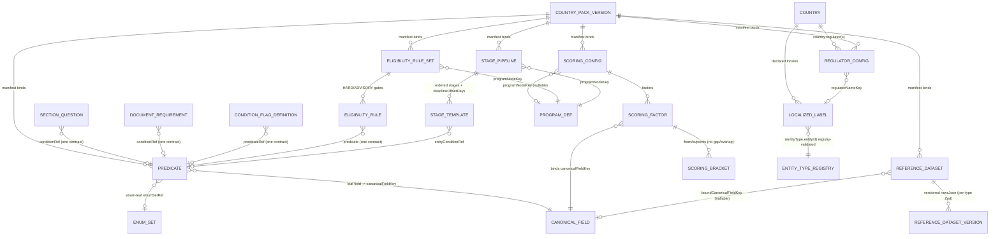

> All nodes above are GLOBAL (`firm_id IS NULL`, `countryId`-stamped, `version` + `effectiveAt` + `supersededById`), bound into a `CountryPackVersion` manifest (§5.8), and resolved/snapshotted under the same "greatest `effectiveAt ≤ referenceDate`" rule. `PREDICATE` is drawn as one node because there is exactly one condition contract (§5.13.1); the four consumer edges prove the reuse. `PROGRAM_DEF`, `CANONICAL_FIELD`, `ENUM_SET`, `ENTITY_TYPE_REGISTRY`, `COUNTRY`, and `COUNTRY_PACK_VERSION` are the §5.3–§5.8 spine entities, shown only where this extension binds to them.

### 5.13.9 Acceptance Criteria

- **AC-5.13 (one predicate contract, four consumers) [Wave-A A2].** `SectionQuestion.conditionRef`, `DocumentRequirement.conditionRef`, `ConditionFlagDefinition.predicateRef`, and `EligibilityRule.predicate` all resolve to a `Predicate` of the §5.13.1 shape; the evaluator accepts ONLY the closed operator set (`eq/neq/in/gt/gte/lt/lte/exists/and/or/not`) and an unknown `op` is rejected at validation; the same tree evaluated server-side returns the identical result on portal and staff-console code paths.
- **AC-5.13a (predicate key resolution at publish) [Wave-A A2].** An `EligibilityRule` (or any other consumer) whose `Predicate` leaf references a `canonicalFieldKey` absent from the published catalogue fails SA-1 publish validation — for all four consumers — and is never treated as null/false at runtime; an ordered op (`gt`/`gte`/`lt`/`lte`) on a non-NUMBER/non-DATE field, or an `in` over an `ENUM` field with a value outside the bound `EnumSet`, likewise fails publish.
- **AC-5.13b (scoring structural consistency) [Wave-A A2].** A `ScoringConfig` whose factor's brackets leave a **gap** or contain an **overlap** (boundary-inclusivity-aware) fails publish validation; a factor bound to a non-existent `canonicalFieldKey` fails publish; a published, gap-free factor maps every in-domain value to exactly one `points` cell.
- **AC-5.13c (stage ordering + reference-data typing) [Wave-A A2].** A `StagePipeline` with duplicate/non-contiguous `StageTemplate.order` fails publish; a `ReferenceDatasetVersion.rowsJson` that violates its `datasetType` Zod row-schema (wrong types / missing required cells / unknown columns) fails publish, and a `boundCanonicalFieldKey` that dangles fails publish.
- **AC-5.13d (global + versioned + i18n discipline) [Wave-A A2].** Every entity in §5.13 has `firm_id IS NULL`, a `countryId`/`countryCode`, and `version` + `effectiveAt`; editing a `PUBLISHED` row is blocked (a change cuts a new version chained via `supersededById`); `LocalizedLabel` enforces exactly one current label per `(entityType, entityId, field, locale)` via its partial UNIQUE index, its `(entityType, entityId)` is `EntityTypeRegistry`-validated, and `RegulatorConfig.repTypeSlots[].repTypeKey` is the vocabulary the §5.2 authorised-representative `PartyRelationship.role` draws from (no new representative/identity table introduced).

---

# 6. Eventing, Integration & Rails

> **Purpose.** This section defines the platform's nervous system and its connection to the outside world: (1) a single canonical **Domain Event Dictionary** that every module emits to and consumes from; (2) the **transport** that carries those events (an in-process Conductor bus plus BullMQ, post-commit, at-least-once, made safe by a per-firm idempotency ledger); and (3) **Rails-as-Ports** — the in-house Doers run on swappable infrastructure ports, each with exactly one concrete v1 adapter, plus one platform-owned FX rate service. The rule is uniform: *one source of truth, one writer, one contract, vendor SDKs hidden behind a port.* This is platform machinery only — it carries no immigration domain content; the events it names are generic lifecycle facts that a later Country Pack populates with meaning. (Realtime push to long-lived client connections is **not** foundation scope — it is a later wave; nothing in this section depends on it.)

---

## 6.1 The Domain Event Dictionary

Events are how bounded contexts in the modulith stay decoupled: the Biller does not call the Case Delivery module directly when a retainer is paid — it emits `payment.succeeded`, and any module that cares declares itself a consumer. For this to be reliable rather than a source of silent drift, the event vocabulary is **code, not convention**: it lives in one shared package, every name is registered, and every payload is a Zod schema.

### 6.1.1 Location and shape

The dictionary lives in the monorepo at **`packages/contracts/events`** alongside the shared Zod schemas and generated types that the rest of the stack consumes. (The repository topology — one pnpm + Turborepo monorepo with `apps/api`, `apps/web`, `apps/worker`, and `packages/contracts` / `packages/contracts/events` — is fixed normatively in §1; the import-boundary lint and the event-name lint of §6.4 operate on exactly that layout.) The dictionary is a TypeScript module that exports, for every event, a single registry entry:

```ts
// packages/contracts/events/payment.ts
export const PaymentSucceeded = defineEvent({
  name: 'payment.succeeded',                 // canonical, immutable, lowercase dot.case noun.verb-past
  version: 1,                                 // payload schema version (additive bumps only)
  railOriginated: true,                       // this fact is raised from an inbound rail webhook (see 6.1.4)
  payload: z.object({                         // ONE Zod schema, the single source of payload truth
    firmId:        z.string().uuid(),
    paymentId:     z.string().uuid(),
    invoiceId:     z.string().uuid().nullable(),
    partyId:       z.string().uuid(),         // the end-client person/org the money relates to
    amountMinor:   z.number().int(),          // integer minor units; money meaning lives in Biller
    currency:      z.string().length(3),
    fxSnapshotId:  z.string().uuid().nullable(),
    railRef:       z.string(),                // opaque adapter reference (e.g. Stripe PaymentIntent id)
    occurredAt:    z.string().datetime(),
  }),
  emitter: 'billing',                         // EXACTLY ONE module may emit this name
  consumers: ['case-delivery', 'communications', 'search', 'webhook-dispatch'],
  // rail-originated: external id is REQUIRED; a missing/unresolved externalEventId fails closed (6.1.4)
  idempotency: (p, env) => `payment.succeeded:${env.externalEventId}`,
});
```

All emitter and consumer identifiers are a strict subset of the canonical module map in §1.1 (CRM/Pipeline, Eligibility/Scoring, Scheduling, Agreements & E-Sign, Billing/Payments, Case Delivery, Automation/Conductor, Communications, Search, Reporting, Platform/Tenancy/Identity, plus the webhook-dispatch worker). No event names a module that is not in that map.

### 6.1.2 Naming law

Two namespaces, deliberately distinct so a domain fact can never be confused with a delivery instruction:

| Namespace | Form | Meaning | Example |
|---|---|---|---|
| **Domain events** | lowercase **`dot.case`**, `noun.verb-past` | A business fact that has *already happened* (immutable, past tense) | `case.created`, `document.uploaded`, `envelope.signed`, `payment.succeeded`, `party.merged` |
| **Notifications** | **`dash.case`** under a `notif/` prefix | A *message to deliver* to a human via a channel | `notif/payment-received`, `notif/document-rejected`, `notif/consult-reminder` |

The two are kept separate because they have different shapes, owners, and reliability requirements: a domain event is a single canonical record with one emitter; a notification is a fan-out instruction with channel preferences, locale, and delivery state. A notification is *triggered by* a domain event but is never the same object.

`noun.verb-past` is enforced literally: the verb segment must be a registered past-tense token (`created`, `updated`, `deleted`, `merged`, `succeeded`, `failed`, `signed`, `uploaded`, `expired`, `cancelled`, `scheduled`, …). Names are immutable once shipped — a changed meaning is a **new name**, never a re-pointed old one. (The reference prototype carried two names for one fact — `envelope.signed` vs `esign.envelope.completed` — and a consumer listened for the name nobody emitted; in the target state `envelope.signed` is the one canonical name, `esign.envelope.completed` is deleted, and there is no synonym to drift against — per ADR FINAL [C4-D2].)

### 6.1.3 Single emitter, declared consumers

Every registry entry names **exactly one `emitter`** (the bounded context that owns the fact) and an explicit **`consumers`** array. This is the contract that keeps the modulith's seams clean:

- A module may `emit('payment.succeeded', …)` **only** if it is the registered emitter; any other module attempting to emit it throws at registration time (and CI rejects it — §6.4).
- A module may subscribe to an event **only** if it is listed in that event's `consumers`. Adding a consumer is a one-line change to the dictionary entry — the explicit list is the readable, reviewable map of who depends on what, and it is exactly the surface the SearchModule's projection and AG-16's outbound webhook catalogue read from (the publishable event set == the dictionary's consumer-visible entries).

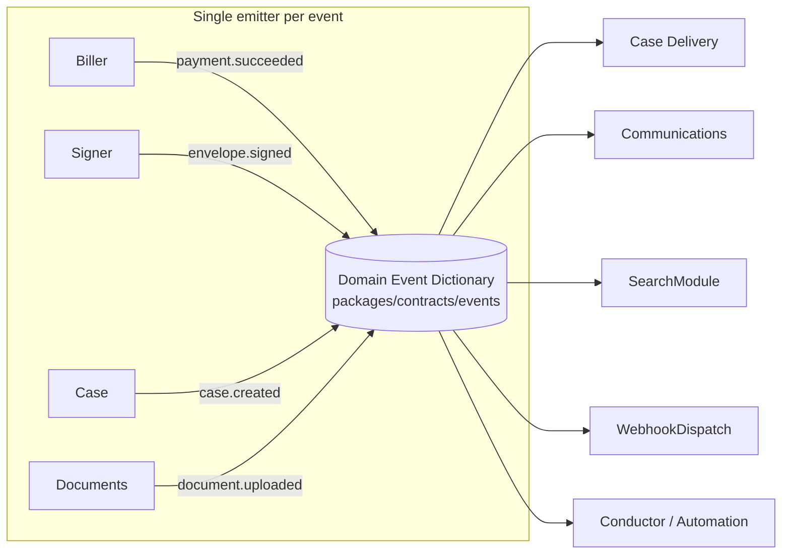

### 6.1.4 Idempotency-key formula (declared, not improvised)

Because transport is at-least-once (§6.2), every consumer must be safe to run twice. Each event declares its own **`idempotency`** function that derives a deterministic key from the payload — and, critically, **incorporates the external rail's own event id whenever the event originates from an inbound webhook**. This is the single most important correctness detail in the section (ADR FINAL [C4-D2]):

- For **internally-emitted** events, the key is derived from the durable business id that caused the event, e.g. `case.created:${caseId}`, `envelope.signed:${envelopeId}`. A nullish fallback to the business id (`env.externalEventId ?? businessId`) is permitted **only** for these internally-emitted events.
- For **rail-originated** events (a Stripe webhook, an SES bounce notification, an SMS delivery receipt), the key **must** be built from the rail's own unique event id, e.g. `payment.succeeded:${stripeEventId}`. Stripe (and every serious rail) re-delivers the *same* `event.id` on retry; keying on it is what makes "Stripe sent us this webhook three times" collapse to one effect. Keying only on the business id would wrongly dedupe two genuinely distinct charges, so the rail-originated formula **never** falls back to a business id.

To make this safe rather than merely intended, each dictionary entry declares **`railOriginated: true | false`**, and the rule is **fail-closed** for rail-originated events: if a rail-originated event reaches the edge **without a resolvable `externalEventId`** (an adapter bug, a malformed or forged webhook, a provider field change), it is **rejected — dead-lettered and alarmed — and is never enqueued and never deduped on the business id**. Silently falling back to the business id would re-introduce exactly the double-effect-or-wrong-dedupe hazard the rule exists to prevent, and on the payment spine that is a financial-correctness/replay defect. The fallback exists only on the internal lane, where there is no external id by construction.

The resolved key is what the processed-event ledger (§6.2.3) stores. No consumer is permitted to invent its own ad-hoc dedupe scheme.

### 6.1.5 Acceptance criteria — dictionary

- **EV-A1.** Every call to `emit(name, …)` resolves to exactly one registered dictionary entry; an unregistered name fails the **event-name CI lint** (§6.4) and the application refuses to boot.
- **EV-A2.** Each entry has exactly one `emitter`; a second module attempting to emit the same name fails CI and throws at registration.
- **EV-A3.** Every event payload validates against its Zod schema before publish; an invalid payload is rejected at the edge, never enqueued.
- **EV-A4.** Domain names match `^[a-z]+(\.[a-z]+){1,}$` with a past-tense terminal verb; notification names match `^notif/[a-z]+(-[a-z]+)*$`; a name in the wrong namespace fails CI.
- **EV-A5.** Every entry exposes an `idempotency` function and a `railOriginated` flag. For any **rail-originated** event, redelivering the rail's identical `event.id` yields the **same** idempotency key and therefore **zero** duplicate side-effects (proven by the redelivery test in §6.2.4); and a rail-originated event **without a resolvable `externalEventId` is rejected/dead-lettered and alarmed — never deduped on the business id**. For internally-emitted events, the business-id key is deterministic and reproducible across redeliveries.

---

## 6.2 Transport — Conductor bus + BullMQ

The dictionary defines *what* the events are; the transport defines *how* they travel and *when*. The target posture is: emit **after** the database transaction commits, deliver **at-least-once**, and lean on the per-firm idempotency ledger to make at-least-once behave like exactly-once at the effect level.

### 6.2.1 Two lanes — in-process bus and durable queue

- **In-process Conductor bus.** For consumers in the same process that need low-latency, best-effort reaction (e.g. the Conductor/automation engine evaluating whether an event triggers a workflow step), events are delivered synchronously-after-commit on an in-memory bus. This is fast and transactionally local, but **non-durable** — a crash before handling loses the in-process delivery, which is acceptable only for effects that are *also* reconstructable.
- **BullMQ (Redis) durable queue.** For fan-out that must survive a crash — most importantly **notification delivery** and **outbound webhook dispatch** — the event is enqueued to a durable BullMQ job. Workers consume it in separate worker processes (`apps/worker`, already the deployment shape per the architecture). This is the at-least-once lane with retries, backoff, and a dead-letter queue.

The two lanes are not a choice the emitter makes per call: the dictionary entry's consumer list determines routing. Consumers that need durability are wired to BullMQ; in-process-only consumers are wired to the Conductor bus. A consumer that needs both gets both deliveries (and its idempotency key protects it from double effect).

### 6.2.2 Post-commit, never inside the transaction

Events are emitted **after** the originating database transaction commits, via a transactional-outbox handoff — never inside the business transaction. The reasons are non-negotiable:

- Emitting inside the transaction would let a consumer observe a fact (and, worse, a downstream webhook fire to a firm's external system) for a write that subsequently rolls back. Post-commit guarantees a consumer never sees a phantom.
- Audit is the deliberate exception and runs the *opposite* way: the audit spine is written **synchronously via its own outbox, atomic with the user operation** (per §7.5 and ADR FINAL #5), because audit must record the *attempt and outcome* even if downstream fan-out fails. The event bus only fans out **notifications and projections** — it is **non-fatal**: a failed event publish or a failed consumer must **never** roll back or fail the user's original operation. The user's payment succeeds even if the "payment received" email is delayed.
- The audit exception also covers the case where there is **no business transaction at all** — a request rejected at the guard (a `SCOPE_VIOLATION`, a cross-pool 401, an authentication failure) still produces an audit record. Those security-denial audits are **not** written on the event bus and are **not** required to be atomic with a business transaction that never opened; they are written through the dedicated **security-audit path** specified in §4.2 / §7.5, which sets the audit transaction's tenant GUC from the resolved principal (or routes to the platform-plane audit sink for principal-less failures), consistent with the fail-closed RLS rule in §2.2. The event bus carries domain facts only.

```mermaid
sequenceDiagram
  participant Svc as Domain Service (Biller)
  participant DB as Postgres (RLS, firm-scoped txn)
  participant OB as Outbox
  participant Bus as Conductor Bus (in-proc)
  participant Q as BullMQ (Redis)
  participant W as Worker (notif / webhook)
  Svc->>DB: BEGIN; write payment; INSERT outbox(event) ; COMMIT
  Note over DB,OB: event row committed atomically with the business write
  DB-->>Svc: commit OK (user op returns SUCCESS regardless of fan-out)
  OB->>Bus: dispatch in-process consumers (best-effort, post-commit)
  OB->>Q: enqueue durable consumers (notifications, webhooks)
  Q->>W: deliver job (at-least-once)
  W->>W: check per-firm processed-event ledger by idempotency key
  alt key unseen
    W->>W: perform side-effect; record key in ledger
  else key seen
    W->>W: no-op (idempotent skip)
  end
```

### 6.2.3 The per-firm processed-event ledger

At-least-once delivery means a consumer **will** occasionally receive the same event twice (worker retry, Stripe webhook re-delivery, a BullMQ visibility blip). The platform-wide guard against double effects is a **firm-scoped processed-event ledger** reused by *every* consumer:

| Field | Notes |
|---|---|
| `firm_id` | tenant key; the ledger is under the same FORCED RLS (§2.2) as every other tenant table — a consumer can never read or write another firm's ledger row |
| `consumerKey` | which consumer processed it (one event may be processed by several consumers; each records its own row) |
| `idempotencyKey` | the value the dictionary entry's `idempotency()` function produced (§6.1.4) |
| `eventName`, `processedAt`, `outcome` | observability + retention |

A unique constraint on `(firm_id, consumerKey, idempotencyKey)` is the entire mechanism: a consumer, inside its own short transaction, attempts to insert its ledger row and perform its effect together; if the insert collides on the unique constraint, the event was already handled and the consumer no-ops. Because the ledger is **per-firm**, it inherits tenant isolation by construction and avoids a single global hot row. (A separate firm-scoped audit chain — §7.5, ADR FINAL #5 — not the event bus, provides per-tenant tamper-evidence; the ledger is for dedupe, not for the legal record.)

### 6.2.4 Acceptance criteria — transport

- **TR-A1.** No domain event is published before its originating transaction commits; an injected post-write/pre-commit rollback produces **zero** delivered events and zero enqueued jobs.
- **TR-A2.** A thrown error in any event consumer or a publish failure does **not** fail or roll back the originating user operation (non-fatal proof).
- **TR-A3.** Notification and webhook fan-out is delivered at-least-once with retry + backoff + dead-letter; a worker killed mid-job re-delivers and still produces exactly one side-effect.
- **TR-A4.** **Redelivery test:** delivering the same event (same resolved idempotency key, including an identical inbound rail `event.id`) N times produces exactly one ledger row per `(firm_id, consumerKey)` and exactly one side-effect.
- **TR-A5.** A consumer cannot read or write a ledger row for any `firm_id` other than the current request/job's firm (RLS denial test on the ledger table, per the §2.8 denial suite).

---

## 6.3 Rails-as-Ports — the Doers' swappable infrastructure

The founder doctrine is that every *product tool* is built in-house as a **Doer** (Biller, Mailer, Signer, Messenger, Scheduler, …); the only third parties retained are **infrastructure rails** — the physical pipes that move money, deliver mail, store bytes, and send SMS, which cannot be built in-house. The architectural expression of that doctrine is **Rails-as-Ports** (ADR FINAL [C4-D1]): each rail is a TypeScript port (interface) defined by the platform, and **no Doer imports a vendor SDK directly**. A Doer depends on the port; a thin adapter behind the port wraps exactly one vendor SDK; runtime selection of which adapter is live is data (§6.3.2), not code.

Only the **five infrastructure-backed Doers** below have rail ports — they are the ones that must reach an external pipe. The remaining Doers (Scheduler, Minder, Filler, Qualifier, Finder, Messenger's in-process automation) are **pure in-house Doers with no external rail and therefore no rail port**; they ship in later waves and are **not foundation scope** (the §9 Wave-A IN/OUT table correctly omits them). A vendor should not look for a `SchedulerPort` or `MinderPort` — none exists, by design.

### 6.3.1 The five ports and their one v1 adapter each

Each port ships with **exactly one concrete production adapter** for v1; the second adapter for any rail is an explicitly deferred later addition behind the same port. [FOUNDER-CONFIRM] rail vendor selection per rail and the Stripe Connect commercial terms below — the engineering defaults stand if there is no objection.

| Port | Owning Doer(s) | v1 adapter | What the port abstracts | Later adapters (deferred) |
|---|---|---|---|---|
| **PaymentRailPort** | Biller (client→firm), SA-4 platform billing (firm→platform) | **Stripe** — Payment Intents + **Connect** for routing client funds to firms; Stripe Billing for SaaS subscriptions | create/confirm intent, refund, customer + payment-method vault token, subscription lifecycle, signed webhook ingestion | a second processor |
| **EmailRelayPort** | Mailer, Messenger (email channel), system mail | **AWS SES** with **SMTP fallback** | send, DKIM/SPF/DMARC alignment, bounce/complaint webhook ingestion, suppression list | a second relay |
| **ObjectStoragePort** | Signer, Documents, all file-bearing modules | **AWS S3** — **SSE-KMS**, private buckets, firm-prefixed keys, presigned URLs | put/get, **ownership-bound presign**, versioning, content-hash, AV-scan handoff | MinIO (dev/self-host) / a second cloud |
| **SmsGatewayPort** | Messenger (SMS + WhatsApp channels) | **AWS SNS** + a **WhatsApp BSP** | send SMS/WhatsApp, delivery-receipt webhook ingestion, opt-out handling | a second gateway / direct carrier |
| **IdentityProviderPort** | AuthCore (three walled pools) | **in-house IdP** (Passport, Argon2id, in-house TOTP/WebAuthn) | issue/verify token per audience, MFA enrol/verify, session revoke | a managed enterprise-SSO adapter (inbound OIDC/SAML) |

The boundary rule is enforced structurally, not by review alone: a module-import-boundary lint forbids any `import` of a vendor SDK package (`stripe`, `@aws-sdk/*`, the BSP SDK, …) from anywhere outside the corresponding `adapters/<rail>/<vendor>` directory. The Doer layer literally cannot reach a vendor SDK.

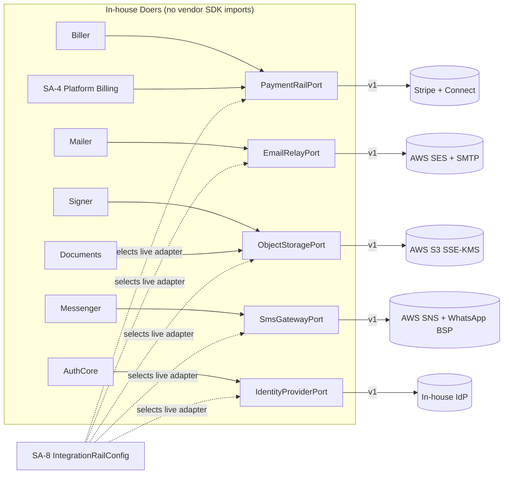

### 6.3.2 SA-8 IntegrationRailConfig — the runtime selector

Which adapter is live for each rail — and the per-environment, per-region, and where applicable per-firm secrets and endpoints it needs — is config-as-data owned by **SA-8 `IntegrationRailConfig`**, not hardcoded. A `railType` (PAYMENT | EMAIL | OBJECT_STORAGE | SMS | IDENTITY) maps to an `adapterKey` (`stripe`, `ses`, `s3`, `sns`, `in-house`) plus a JSONB config (validated by a per-railType Zod schema) and a secret reference resolved at runtime from the secrets manager. A health/heartbeat field per row lets the platform surface "the email rail is degraded" without exposing vendor internals. Switching SES→SMTP fallback, or S3→MinIO in dev, is a config row change with no deploy — that is the payoff of the port boundary, and it is exactly what the substitution test (§6.3.4) proves.

Because region is a **per-tenant dimension** (the global-residency seam), `IntegrationRailConfig` is region-aware: an adapter row carries the region it serves, and a firm provisioned in a future `eu-central-1` resolves its rails (and region-scoped KMS) from config rather than from a globally hard-pinned constant. Launch is Canada-only (`ca-central-1`), but no rail selection is hard-coded to Canada — adding a region is configuration, not a rewrite.

### 6.3.3 IDOR-safe presigning (ObjectStoragePort)

A specific, mandatory behaviour of `ObjectStoragePort`: the port **never signs a caller-supplied storage key**. Every presign call takes a *record id* (a Document/envelope/upload row), resolves the storage key from that record server-side, and asserts the record's ownership chain (firm match, and for the portal the client-subject match — §2.5) before issuing a short-lived presigned URL. This closes the class of IDOR where a caller asks the platform to sign an arbitrary key. The port signature makes the unsafe path impossible to express — there is no method that accepts a raw key. (Upload content-type/size validation and the download-side serving headers — `Content-Disposition: attachment`, `X-Content-Type-Options: nosniff`, restrictive CSP — are specified in §7's file-handling controls and apply to every object this port serves.)

### 6.3.4 Acceptance criteria — rails

- **RL-A1.** No file outside `adapters/<rail>/<vendor>` imports a vendor SDK; the import-boundary lint fails CI on violation.
- **RL-A2.** **Fake-adapter substitution test:** for each port, a fully in-memory fake adapter is substituted via `IntegrationRailConfig`, and the owning Doer's full behaviour (send, charge, store, presign, authenticate) passes against the fake with **zero** changes to Doer code — proving the Doer depends only on the port.
- **RL-A3.** Switching a rail's live `adapterKey` (e.g. `ses`→`smtp-fallback`, `s3`→`minio`) is a config-row change verified by an integration test with no code deploy.
- **RL-A4.** `ObjectStoragePort` presign rejects any request whose resolved record fails the ownership-chain check; it exposes no method that signs a caller-supplied key (IDOR denial test).
- **RL-A5.** Each rail's inbound webhook (Stripe, SES bounce/complaint, SMS receipt) is signature-verified inside its adapter and translated into a registered domain event with a correct rail-`event.id`-based idempotency key (§6.1.4); a rail-originated event whose `externalEventId` cannot be resolved is rejected/dead-lettered and alarmed (never deduped on a business id); no rail event reaches a consumer unverified. PCI scope stays **SAQ-A** (no raw card data stored; tokenized via the rail).

---

## 6.4 Event-name CI lint and the boundary gates

The dictionary and the port boundary are only safe if they are mechanically enforced. The following CI gates are release-blocking:

1. **Event-name lint.** Walks the codebase: (a) every `emit(name, …)` literal resolves to a registered dictionary entry; (b) every registered name matches the namespace regex of §6.1.5 (domain `dot.case` past-tense vs `notif/dash-case`); (c) no name has two emitters; (d) no name collides across the domain and notification namespaces; (e) every consumer subscription targets an entry that lists it; (f) every emitter/consumer identifier is a member of the §1.1 module map. A new or renamed event that skips the dictionary fails the build.
2. **Vendor-SDK import-boundary lint.** §6.3.1 — vendor SDK imports are confined to their adapter directory.
3. **FX single-writer scan.** §6.5 — exactly one service method writes `FxRateSnapshot`.

These three, together with the §6.2/§6.3 behavioural tests, are the section's contribution to the platform's release gate.

---

## 6.5 FX — one service, one immutable snapshot

Money in the platform is single-sourced in the Biller; **currency conversion** is single-sourced in **one platform-owned `FxRateService`**, the sole writer of an immutable **`FxRateSnapshot`** (ADR FINAL [C4-D3]). The reference design had an FX snapshot referenced as "new shared" by multiple modules with no owning writer and two competing field vocabularies — a guaranteed collision. The target state is a single writer and a single canonical schema so that any converted figure is auditable and reproducible forever — a regulatory-grade property for an immigration-finance product.

### 6.5.1 The snapshot (unified fields)

`FxRateSnapshot` is append-only and immutable; once written it is never updated. Canonical fields:

| Field | Meaning |
|---|---|
| `id` | snapshot id; consumers store `fxSnapshotId`, never a loose rate |
| `baseCurrency` / `quoteCurrency` | ISO-4217; replaces the prior `fromCurrency`/`toCurrency` divergence with one vocabulary |
| `rate` | the conversion rate, base→quote, fixed-precision |
| `asOf` | the economic instant the rate is valid for |
| `source` | the rate provider/source identifier (the FX adapter that produced it) |
| `economicMoment` | the business moment the rate was captured against (e.g. invoice issue vs payment) |
| `capturedAt` | when the platform recorded the snapshot |

Consumers (invoices, payments, reports, any module that must sum across currencies) **store `fxSnapshotId`** and resolve the figure through it. Re-rendering a historical invoice or report uses the *stamped* snapshot, so a converted total is byte-stable across time even after rates move.

### 6.5.2 FxRateSourcePort and the v1 manual adapter

Where the rates come from is itself a swappable port — **`FxRateSourcePort`** — consistent with the Rails-as-Ports doctrine. **v1 ships a MANUAL adapter**: an authorized platform operator publishes rates that `FxRateService` records as immutable snapshots. A live FX-provider adapter is a later addition behind the same port (deferred, not designed-out). [FOUNDER-CONFIRM] platform + per-firm default reporting currency (CAD assumed) and whether production warrants a paid FX provider versus the manual adapter.

### 6.5.3 Missing-rate policy — exclude-with-note, never raw-sum

When a multi-currency aggregate (a dashboard total, a report, a statement) needs a conversion for which **no snapshot exists**, the platform **must not** silently sum unlike currencies or fabricate a rate. The rule is **exclude-with-note**: the unconvertible amount is omitted from the converted total and the result is annotated ("X excluded: no rate for CUR→reporting at *asOf*"). A convert-before-sum helper enforces this — any code path that adds amounts in differing currencies must route through it, and it refuses a raw sum across mismatched currencies.

### 6.5.4 Acceptance criteria — FX

- **FX-A1.** **Single-writer test:** a static scan plus a runtime assertion prove that exactly one method (`FxRateService.recordSnapshot`) inserts into `FxRateSnapshot`; any other write path fails CI.
- **FX-A2.** `FxRateSnapshot` rows are immutable — an attempted update/delete by the application role is rejected (append-only).
- **FX-A3.** A consumer that stored an `fxSnapshotId` reproduces the identical converted figure after rates have since changed (point-in-time reproducibility).
- **FX-A4.** A multi-currency aggregate with a missing rate **excludes-with-note** and never raw-sums; the convert-before-sum helper throws on any mismatched-currency raw addition.
- **FX-A5.** The rate source is reached only through `FxRateSourcePort`; the v1 manual adapter is substitutable by a fake/provider adapter with no change to `FxRateService`.

---

## 6.6 Founder confirmations (non-blocking)

- **[FOUNDER-CONFIRM]** Rail vendor selection per rail — Stripe / AWS SES+SMTP / AWS S3 / AWS SNS+WhatsApp BSP / in-house IdP are the engineering defaults and stand unless objected to.
- **[FOUNDER-CONFIRM]** Stripe **Connect** onboarding model (Standard / Express / Custom) and whether the platform takes an application fee on client→firm payments.
- **[FOUNDER-CONFIRM]** Platform and per-firm **reporting currency** (CAD assumed) and manual-vs-paid FX provider for production.

These are commercial/policy choices only; the architecture (one adapter per port, one FX writer, one event dictionary) is decided and independent of the answers.

---

### 6.1.6 Domain Event Registry (complete)

> **Status of this sub-section.** This is the **single, authoritative integration-pass registry** that every per-module "Events emitted/consumed" table in Doc 3 (AG-*) and Doc 4 (CP-*) mirrors. Where a module document said a name "is registered centrally in the final pass," **this is that pass.** The registry below is the one artifact the **EV-A1 CI lint** (§6.1.5 / §6.4) walks: every `emit(name, …)` literal, every consumer subscription, and every emitter/consumer identifier is checked against exactly this table. A name, emitter, consumer, or `railOriginated` flag that disagrees with a row here fails the build. There is no second source.

#### Naming law (amends §6.1.2 — normative)

A **domain** event name MUST match:

```
^[a-z]+(\.[a-z]+){1,3}$
```

i.e. lowercase **dot.case**, **2 to 4 segments**, no underscores, no dashes (dash.case is reserved for the `notif/` notification namespace, §6.1.2). The **terminal segment** MUST be a **registered past-tense verb token**. Three-segment **noun.noun.verb** names are explicitly allowed (e.g. `document.scan.passed`, `case.stage.changed`, `portal.corporate.seat.invited`) — the verb is always the final token and the preceding tokens are nouns. Names are **immutable once shipped**: a changed meaning is a **new name**, never a re-pointed old one (ADR FINAL [C4-D2]).

**Registered verb tokens (closed set — the only legal terminal segments):**

`created` · `updated` · `deleted` · `merged` · `succeeded` · `failed` · `refunded` · `paid` · `issued` · `overdue` · `voided` · `uploaded` · `requested` · `received` · `added` · `captured` · `submitted` · `decided` · `closed` · `assigned` · `changed` · `breached` · `satisfied` · `approaching` · `signed` · `scheduled` · `cancelled` · `converted` · `activated` · `completed` · `loggedin` · `passed` · `expired` · `disposed`

A name whose terminal token is not in this set, whose segment count is outside 2–4, or which uses any character outside `[a-z.]` fails the EV-A1 lint. Adding a verb token is an amendment to *this list* plus a registry row — never an ad-hoc emit.

**Emitter/consumer identifier law (amends §6.1.1).** Every `emitter` (exactly one per name) and every entry in `consumers[]` MUST be a member of the canonical §1.1 module map, expressed as its fixed code identifier:

| §1.1 module | Identifier | | §1.1 module | Identifier |
|---|---|---|---|---|
| CRM / Pipeline | `crm` | | Case Delivery | `case-delivery` |
| Eligibility / Scoring | `eligibility` | | Automation (Conductor + Doers) | `automation` |
| Scheduling | `scheduling` | | Communications | `communications` |
| Agreements & E-Sign | `agreements` | | Search (the Finder) | `search` |
| Billing / Payments | `billing` | | Reporting | `reporting` |
| Platform / Tenancy / Identity | `platform` | | Client Portal | `portal` |
| | | | webhook-dispatch worker | `webhook-dispatch` |

`webhook-dispatch` appears as a consumer on every name AG-16 may republish to a firm's external system (the publishable set == the consumer-visible registry, §6.1.3); it never appears as an emitter. No event names a module outside this map.

#### The registry

Every row: **single emitter**, explicit **consumers[]**, **railOriginated** (drives the fail-closed idempotency rule of §6.1.4), the **idempotency-key formula** (rail-originated keys derive from the external `event.id` and never fall back to a business id), and the **payload key fields** (the full Zod schema lives in `packages/contracts/events`; key fields are listed here).

| name | emitter | consumers[] | railOriginated | idempotency-key formula | payload (key fields) |
|---|---|---|---|---|---|
| `case.created` | `case-delivery` | `automation`, `communications`, `search`, `reporting`, `webhook-dispatch` | false | `case.created:${caseId}` | `firmId`, `caseId`, `partyId`, `programNodeKey`, `packVersionId`, `sourceProspectId?`, `occurredAt` |
| `case.stage.changed` | `case-delivery` | `automation`, `eligibility`, `communications`, `search`, `reporting`, `portal`, `webhook-dispatch` | false | `case.stage.changed:${caseId}:${toStageKey}:${stageEnteredAt}` | `firmId`, `caseId`, `fromStageKey`, `toStageKey`, `bucket`, `stageEnteredAt`, `occurredAt` |
| `case.assigned` | `case-delivery` | `automation`, `communications`, `search`, `reporting`, `webhook-dispatch` | false | `case.assigned:${caseId}:${assignmentVersion}` | `firmId`, `caseId`, `leadUserId`, `teamMemberUserIds[]`, `assignmentVersion`, `occurredAt` |
| `case.submitted` | `case-delivery` | `automation`, `communications`, `search`, `reporting`, `webhook-dispatch` | false | `case.submitted:${submissionId}` | `firmId`, `caseId`, `submissionId`, `submittedByUserId`, `submissionRefs`, `occurredAt` |
| `case.decided` | `case-delivery` | `automation`, `communications`, `search`, `reporting`, `portal`, `webhook-dispatch` | false | `case.decided:${decisionId}` | `firmId`, `caseId`, `decisionId`, `outcome`, `decidedOn`, `occurredAt` |
| `case.closed` | `case-delivery` | `automation`, `communications`, `search`, `reporting`, `webhook-dispatch` | false | `case.closed:${caseId}` | `firmId`, `caseId`, `closeReason`, `clockStartEvent`, `occurredAt` |
| `sqr.submitted` | `case-delivery` | `eligibility`, `automation`, `communications`, `search`, `reporting`, `webhook-dispatch` | false | `sqr.submitted:${assignmentId}` | `firmId`, `assignmentId`, `caseId`, `subjectId`, `caseSqrSnapshotId`, `packVersionId`, `occurredAt` |
| `sqr.answer.captured` | `case-delivery` | `eligibility`, `automation`, `search` | false | `sqr.answer.captured:${assignmentId}:${canonicalFieldId}:${effectiveAt}` | `firmId`, `assignmentId`, `subjectId`, `canonicalFieldId`, `status`, `effectiveAt` |
| `document.uploaded` | `case-delivery` | `automation`, `case-delivery`, `communications`, `search`, `reporting`, `portal`, `webhook-dispatch` | false | `document.uploaded:${documentId}:${versionNo}` | `firmId`, `documentId`, `versionNo`, `entityType`, `entityId`, `documentTypeKey`, `occurredAt` |
| `document.requested` | `case-delivery` | `automation`, `communications`, `search`, `portal`, `webhook-dispatch` | false | `document.requested:${documentId}:${requestedAt}` | `firmId`, `documentId`, `entityType`, `entityId`, `documentTypeKey`, `requestedAt`, `dueDate?`, `locale` |
| `document.received` | `case-delivery` | `automation`, `case-delivery`, `communications`, `search`, `reporting`, `portal`, `webhook-dispatch` | false | `document.received:${documentId}:${versionNo}` | `firmId`, `documentId`, `versionNo`, `contentHash`, `entityType`, `entityId`, `occurredAt` |
| `document.version.added` | `case-delivery` | `automation`, `case-delivery`, `communications`, `search`, `webhook-dispatch` | false | `document.version.added:${documentId}:${versionNo}` | `firmId`, `documentId`, `versionNo`, `supersededVersionNo`, `occurredAt` |
| `document.scan.passed` | `case-delivery` | `case-delivery`, `automation`, `search`, `reporting` | false | `document.scan.passed:${documentId}:${versionNo}` | `firmId`, `documentId`, `versionNo`, `contentHash`, `scanStatus`, `occurredAt` |
| `document.scan.failed` | `case-delivery` | `case-delivery`, `automation`, `communications`, `search`, `portal`, `reporting` | false | `document.scan.failed:${documentId}:${versionNo}` | `firmId`, `documentId`, `versionNo`, `scanStatus`, `quarantineReason`, `occurredAt` |
| `document.status.changed` | `case-delivery` | `automation`, `case-delivery`, `search`, `reporting`, `portal`, `webhook-dispatch` | false | `document.status.changed:${documentId}:${toStatus}:${occurredAt}` | `firmId`, `documentId`, `fromStatus`, `toStatus`, `reason?`, `occurredAt` |
| `document.disposed` | `platform` | `case-delivery`, `reporting`, `search`, `webhook-dispatch` | false | `document.disposed:${documentId}:${disposalRecordId}` | `firmId`, `documentId`, `disposalRecordId`, `retentionClass`, `disposalCertificateRef`, `occurredAt` |
| `deadline.approaching` | `automation` | `case-delivery`, `communications`, `search`, `reporting`, `portal`, `webhook-dispatch` | false | `deadline.approaching:${minderWatchId}:${cascadeStepIndex}` | `firmId`, `minderWatchId`, `entityType`, `entityId`, `deadlineField`, `deadlineValue`, `cascadeStepIndex`, `severity`, `occurredAt` |
| `deadline.breached` | `automation` | `case-delivery`, `platform`, `communications`, `search`, `reporting`, `webhook-dispatch` | false | `deadline.breached:${minderWatchId}:${cascadeStepIndex}` | `firmId`, `minderWatchId`, `entityType`, `entityId`, `deadlineField`, `deadlineValue`, `cascadeStepIndex`, `severity`, `occurredAt` |
| `deadline.satisfied` | `automation` | `case-delivery`, `communications`, `search`, `reporting`, `webhook-dispatch` | false | `deadline.satisfied:${minderWatchId}` | `firmId`, `minderWatchId`, `entityType`, `entityId`, `satisfiedByPredicate`, `occurredAt` |
| `invoice.issued` | `billing` | `crm`, `automation`, `communications`, `search`, `reporting`, `portal`, `webhook-dispatch` | false | `invoice.issued:${invoiceId}` | `firmId`, `invoiceId`, `partyId`, `caseId?`, `number`, `amountMinor`, `currency`, `fxSnapshotId?`, `taxTotalMinor`, `occurredAt` |
| `invoice.overdue` | `billing` | `crm`, `automation`, `communications`, `reporting`, `webhook-dispatch` | false | `invoice.overdue:${invoiceId}:${dueDate}` | `firmId`, `invoiceId`, `partyId`, `dueDate`, `balanceMinor`, `currency`, `occurredAt` |
| `invoice.paid` | `billing` | `crm`, `automation`, `communications`, `search`, `reporting`, `portal`, `webhook-dispatch` | false | `invoice.paid:${invoiceId}` | `firmId`, `invoiceId`, `partyId`, `amountMinor`, `currency`, `fxSnapshotId?`, `occurredAt` |
| `invoice.voided` | `billing` | `crm`, `automation`, `search`, `reporting`, `webhook-dispatch` | false | `invoice.voided:${invoiceId}` | `firmId`, `invoiceId`, `partyId`, `voidReason`, `occurredAt` |
| `payment.succeeded` | `billing` | `case-delivery`, `crm`, `scheduling`, `automation`, `communications`, `search`, `reporting`, `portal`, `webhook-dispatch` | true | rail: `payment.succeeded:${env.externalEventId}` · offline: `payment.succeeded:${paymentId}` | `firmId`, `paymentId`, `invoiceId?`, `partyId`, `amountMinor`, `currency`, `fxSnapshotId?`, `railRef`, `occurredAt` |
| `payment.refunded` | `billing` | `crm`, `scheduling`, `automation`, `communications`, `search`, `reporting`, `portal`, `webhook-dispatch` | true | rail: `payment.refunded:${env.externalEventId}` · offline: `payment.refunded:${refundId}` | `firmId`, `refundId`, `paymentId`, `invoiceId?`, `partyId`, `amountMinor`, `currency`, `railRef`, `occurredAt` |
| `payment.failed` | `billing` | `crm`, `automation`, `communications`, `reporting`, `webhook-dispatch` | true | `payment.failed:${env.externalEventId}` | `firmId`, `paymentIntentRef`, `invoiceId?`, `partyId`, `amountMinor`, `currency`, `failureCode`, `railRef`, `occurredAt` |
| `prospect.created` | `crm` | `automation`, `communications`, `search`, `reporting`, `webhook-dispatch` | false | `prospect.created:${prospectId}` | `firmId`, `prospectId`, `partyId`, `source`, `assignedUserId?`, `occurredAt` |
| `prospect.converted` | `crm` | `case-delivery`, `eligibility`, `automation`, `communications`, `search`, `reporting`, `webhook-dispatch` | false | `prospect.converted:${prospectId}:${caseId}` | `firmId`, `prospectId`, `convertedPartyId`, `caseId`, `programNodeKey`, `packVersionId`, `occurredAt` |
| `prospect.stage.changed` | `crm` | `automation`, `communications`, `search`, `reporting`, `webhook-dispatch` | false | `prospect.stage.changed:${prospectId}:${toStageKey}:${occurredAt}` | `firmId`, `prospectId`, `fromStageKey`, `toStageKey`, `toStageKind`, `retainerStatus?`, `occurredAt` |
| `envelope.signed` | `agreements` | `crm`, `billing`, `case-delivery`, `scheduling`, `automation`, `communications`, `search`, `portal`, `reporting`, `webhook-dispatch` | true | `envelope.signed:${envelopeId}` | `firmId`, `retainerAgreementId`, `envelopeId`, `sourceEntityType`, `sourceId`, `partyId`, `executedDocKey`, `certificateKey`, `feeAmountMinor`, `feeCurrency`, `feeSchedule`, `fxSnapshotId`, `signerNames`, `portalVisible` |
| `booking.scheduled` | `scheduling` | `crm`, `communications`, `automation`, `search`, `reporting`, `webhook-dispatch` | false | `booking.scheduled:${bookingId}` | `firmId`, `bookingId`, `partyId?`, `appointmentTypeId`, `startsAt`, `endsAt`, `attendeeEmail`, `occurredAt` |
| `booking.cancelled` | `scheduling` | `crm`, `billing`, `communications`, `automation`, `search`, `reporting`, `webhook-dispatch` | false | `booking.cancelled:${bookingId}:${sequence}` | `firmId`, `bookingId`, `sequence`, `cancelledByScope`, `paidContext?`, `refundInstruction?`, `occurredAt` |
| `firm.onboarding.completed` | `platform` | `automation`, `communications`, `search`, `reporting` | false | `firm.onboarding.completed:${firmId}` | `firmId`, `completedAt`, `occurredAt` |
| `firm.profile.updated` | `platform` | `search`, `communications`, `reporting`, `webhook-dispatch` | false | `firm.profile.updated:${firmId}:${occurredAt}` | `firmId`, `changedFields[]`, `occurredAt` |
| `firm.country.activated` | `platform` | `automation`, `search`, `reporting`, `webhook-dispatch` | false | `firm.country.activated:${firmId}:${countryCode}` | `firmId`, `countryCode`, `countryPackVersionId?`, `packState`, `occurredAt` |
| `portal.client.loggedin` | `portal` | `communications`, `automation`, `search` | false | `portal.client.loggedin:${clientCustomerId}:${sessionId}` | `firmId`, `clientCustomerId`, `partyId`, `sessionId`, `loggedinAt` |
| `portal.account.activated` | `portal` | `automation`, `communications`, `search` | false | `portal.account.activated:${clientCustomerId}` | `firmId`, `clientCustomerId`, `partyId`, `activatedAt` |
| `portal.corporate.seat.invited` | `automation` | `communications`, `search`, `reporting` | false | `portal.corporate.seat.invited:${seatId}` | `firmId`, `seatId`, `corporatePartyId`, `invitedEmail`, `scope`, `occurredAt` |
| `portal.corporate.seat.activated` | `automation` | `communications`, `search`, `reporting` | false | `portal.corporate.seat.activated:${seatId}` | `firmId`, `seatId`, `corporatePartyId`, `clientCustomerId`, `activatedAt` |
| `portal.corporate.seat.removed` | `automation` | `communications`, `search`, `reporting` | false | `portal.corporate.seat.removed:${seatId}:${removedAt}` | `firmId`, `seatId`, `corporatePartyId`, `removedByUserId`, `removedAt` |

#### Notes binding on the lint and the builders

- **Verb-token reconciliation.** Three task-list verb tokens have **no distinct event** in the current module set and are therefore reserved (registered in the verb-token list, no row yet): `merged` (the `party.merged` foundation event of §5.2 reuses it; registered when the merge wave folds in), `deleted` (no domain entity emits a hard-delete fact in Wave A — soft-state uses `*.status.changed`/`*.voided`/`document.disposed`), and `expired` (document/credential expiry is signalled through the Minder's single `deadline.approaching`, never a `document.expiry.*` synonym — CP-4 §7, ADR FINAL single-emitter / no-synonym law). The tokens stay in the closed set so a future wave can add the row without re-amending §6.1.2.
- **`portal.corporate.seat.*` emitter.** These three are **AG-15-owned** (Doc 4 CP-9 §7); AG-15 is the firm-side Client-Portal-management surface, which is the firm-console face of the **Automation/Conductor** bounded context for seat-orchestration work items — hence emitter `automation` (the single legal §1.1 identifier), never `portal` (which is the client-pool CP-1 surface, sole emitter only of `portal.client.loggedin` / `portal.account.activated`). CP-9 mints no synonym; it consumes these.
- **`document.disposed` emitter.** Disposal is executed on the **SA-11 system plane** (crypto-shred + `DATA_DISPOSED` chained audit, Doc 1 §7.4/§7.6), which lives in the **Platform/Tenancy/Identity** module — hence emitter `platform`. The firm `agent/document:dispose` action records only a request; no `agent/*`/`case-delivery` path emits this fact.
- **Rail-originated rows (`railOriginated: true`).** `payment.succeeded`, `payment.refunded`, `payment.failed`, and `envelope.signed` carry rail-fact lineage. For the three `payment.*` names the key is built from the rail's `event.id` (`env.externalEventId`) and **fails closed** if unresolvable (§6.1.4); the internal/offline lane uses the business-id fallback shown. `envelope.signed` is internally emitted on `EXECUTED` keyed on `${envelopeId}`, but flagged `railOriginated: true` because its underlying signing-completion is a rail webhook fact (Doc 3 AG-2 §3 / AG-5 §3.7) — its consumers fail closed on an unresolvable external id per the Conductor semantics.
- **No portal-minted synonyms.** Document upload/version facts have the single emitter `case-delivery` (AG-9); CP-3/CP-4/CP-6/CP-9 *trigger* them via the shared runtime and consume registered names only. The portal pay-attempt and chat-message signals referenced in Doc 4 (`portal.payment.initiated`, any `message.*`) are **not** registered domain events here: the first is a UX/audit signal pending a future wave, the second does not exist (CP-7 §7) — both are deliberately omitted so the lint rejects any code that emits them as domain events.
- **`webhook-dispatch` as universal republish consumer.** Its presence on a row means AG-16's outbound-webhook catalogue may publish that fact to a firm's external system; the firm-configurable subset is data, but the *publishable universe* is exactly the rows that list `webhook-dispatch`.

---

# 7. Data Security, Privacy & Audit

**Purpose.** This section specifies the cryptographic, audit, and privacy machinery that protects every byte of tenant and end-client data on the platform. It defines the key hierarchy that encrypts Restricted PII, the tamper-evident audit spine that proves what happened, and the PIPEDA + Quebec Law-25 governance plane that makes the platform a defensible system of record for a regulated immigration firm. It is **content-free machinery**: it describes *how* sensitive data is protected, never *which* immigration data exists — the Restricted-PII field set and statutory floors are loaded later as configuration and confirmed by counsel. Three properties are non-negotiable and recur throughout: (1) crypto-shred erasure must coexist with an immutable audit chain and a 7-year financial-retention floor; (2) Restricted PII is **mask-by-default**, never leaves the platform to a rail, and never lands in a search index or a log line; (3) the audit chain is **per-firm, append-only, hash-chained over ciphertext**, written synchronously with the operation it records.

This section consumes the platform substrate from earlier sections: the tenant key `firm_id` and the FORCED-RLS isolation machinery are defined in §2 (Multi-Tenancy & Isolation); the three walled auth pools (`system/*` GLOBAL, `agent/*` + `portal/*` LOCAL) are defined in §3 (Identity & Authentication); and the `system/agent/portal` RBAC namespaces and the reveal-permission gate are defined in §4 (Authorization, RBAC & Record-Level Authz). `client_id` / **Party** is the end-client person (§5 spine), and the portal second RLS dimension keyed on the `app.current_client_subject` GUC is defined in §2.5. Every durable resource carries a per-tenant region binding (the region seam, §2). This section assumes AWS KMS in the tenant's region (ca-central-1 at launch).

---

## 7.1 KMS Key Hierarchy — CMK → per-firm DEK → per-subject key

**Purpose.** Establish a three-tier envelope-encryption hierarchy that gives blast-radius containment per firm and *cheap, provable erasure per end-client subject*, without the operational sprawl of a key-per-document scheme.

The hierarchy has exactly three tiers. There is **no per-document key** — at the platform's document-scale target this is over-engineering that multiplies KMS calls and key-lifecycle state for no additional erasure granularity (the subject key already crypto-shreds every document belonging to that subject).

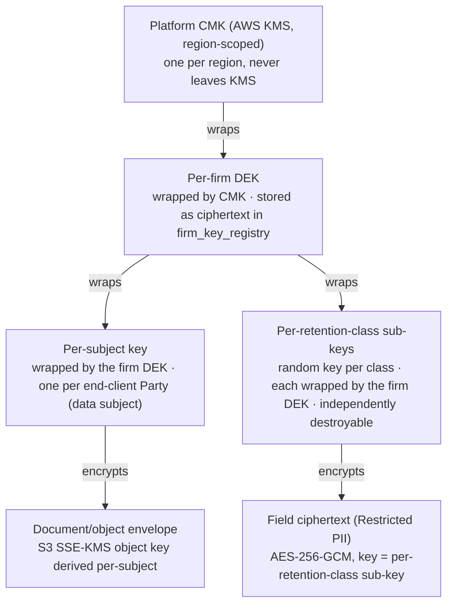

**Tier definitions.**

| Tier | Scope | Where it lives | Wrapped by | Purpose |
|---|---|---|---|---|
| **CMK** | One per AWS region | AWS KMS only (never exported); accessed via task IAM role | — (KMS root) | Wraps all firm DEKs; rotation managed by KMS; usage audited in CloudTrail |
| **Per-firm DEK** | One per `firm_id` | `firm_key_registry` row, stored only as CMK-wrapped ciphertext | CMK | Tenant blast-radius containment; a leaked DEK ciphertext is useless without the CMK |
| **Per-subject key** | One per end-client **Party** (data subject) | `subject_key_registry` row, stored only as DEK-wrapped ciphertext | per-firm DEK | The per-subject erasure root — used for object/document envelopes; destroyed when *all* of a subject's retention classes are eligible for shred |
| **Per-retention-class sub-key** | One random key per (subject, retention-class) | `subject_subkey_registry` row, stored only as DEK-wrapped ciphertext | per-firm DEK | The **selective erasure unit** — each Restricted field is encrypted under its class sub-key; destroying one class's wrapped sub-key is irreversible while other classes survive |

**Key resolution at runtime.** A field/document decrypt is a multi-unwrap chain executed inside the request transaction: resolve the firm DEK (CMK-unwrap, cached briefly in memory, never persisted plaintext) → resolve the relevant per-retention-class sub-key (DEK-unwrap) for a field, or the per-subject key (DEK-unwrap) for an object/document envelope → AES-256-GCM decrypt. Plaintext keys exist only in process memory for the duration of the operation; they are never written to disk, logs, traces, or env. KMS access is via task IAM role (no static KMS credentials), region-pinned to the subject's region binding (the region seam — adding a non-Canadian region is a config-and-key-provisioning task, not a code change).

**Independently-destroyable retention-class sub-keys (the erasure/retention reconciliation).** The per-subject key is **not** the direct encryption key for Restricted fields, and the class sub-keys are **not** deterministically derived from one subject key (a pure HKDF derivation from a single surviving secret cannot be selectively destroyed — as long as the source material survives to use one class, every other class remains re-derivable, so nothing is truly shredded). Instead, each Restricted field is encrypted under a **per-retention-class sub-key** that is a **freshly-generated random key, wrapped under the firm DEK and stored in `subject_subkey_registry`** keyed by `(firm_id, subjectPartyId, retentionClass)` (e.g., `standard`, `financial-7yr`, `legal-hold`). Because each class sub-key is an independent stored secret, a DSR erasure can **irreversibly destroy** the `standard` class's wrapped sub-key while leaving the `financial-7yr` class sub-key intact until its statutory floor expires — and destroying one class sub-key does not affect any other class. This is the mechanism that lets erasure and the 7-year financial floor coexist (see §7.4, §7.6). The cost is one extra wrapped-key row per active retention class per subject; this is deliberate — selective, provable shred is impossible with "no extra stored keys."

**Operational DEKs for credential / MFA-secret stores (no end-client subject).** Auth-store secrets — TOTP/MFA secrets and other credential material on `platform_user` and `firm_user` — are **not** end-client Party data and have **no per-subject key** in the CMK→firm-DEK→subject-key hierarchy. They are encrypted under a dedicated **operational DEK** rather than the per-subject field codec (§7.2):
- For **firm-pool** auth stores (firm staff), the operational DEK is the **per-firm DEK** (or a per-firm operational sub-key wrapped under it), keyed by `firm_id`.
- For the **platform pool** (super-admin / platform staff) there is no `firm_id` and no firm DEK, so a dedicated **platform operational DEK** (wrapped under the region CMK, stored in a platform-plane key registry) encrypts platform-pool credential secrets.

This is the key path §3.6 references for MFA/credential-secret encryption; it deliberately does **not** route through the per-subject (end-client) field-encryption codec, which would have no defined key for staff or platform principals.

**Acceptance criteria.**
- **AC-7.1.1** Exactly three key tiers exist (CMK → per-firm DEK → per-subject key, with per-retention-class sub-keys also wrapped under the firm DEK); a schema/code scan finds **no per-document key** table or per-document KMS data-key generation.
- **AC-7.1.2** Every firm DEK, every subject key, every per-retention-class sub-key, and every operational DEK is stored only as wrapped ciphertext; a database dump contains zero plaintext key material (verified by a dump scanner in CI).
- **AC-7.1.3** Destroying a subject's per-retention-class sub-key renders 100% of that subject's Restricted fields *in that class* undecryptable while leaving other classes readable; an automated test encrypts fields across two classes, destroys one class sub-key, then asserts decrypt fails (key-not-available error, not a silent empty value) for the destroyed class and still succeeds for the retained class.
- **AC-7.1.4** KMS calls are region-pinned to the subject's region binding; a CI test asserts no cross-region KMS call for a Canadian-bound subject.
- **AC-7.1.5** Plaintext keys never persist: a memory/log scan and a `grep` gate confirm no key material (CMK-unwrapped DEK, subject key, class sub-key, or operational DEK) is serialized to logs, traces, or env.
- **AC-7.1.6** Class sub-keys are independently destroyable, not derived from one surviving secret: a test proves that after a class sub-key is destroyed it cannot be re-derived from the per-subject key or the firm DEK (decrypt of that class is permanently impossible while the subject key still resolves other classes/objects).
- **AC-7.1.7** Credential/MFA secrets on `platform_user`/`firm_user` are encrypted under the operational-DEK path (per-firm DEK for firm staff; platform DEK for the platform pool), never under the per-subject field codec; a code scan confirms no auth-store secret routes through the subject-keyed codec.

---

## 7.2 Field-Level Envelope Encryption for Restricted PII

**Purpose.** Make Restricted PII unreadable from a database dump alone, masked by default in every UI/API surface, and revealable only with an explicit permission whose every use is audited.

**Mechanism (fixed).** Fields classified **Restricted** are encrypted application-side with AES-256-GCM under the subject's per-retention-class sub-key (§7.1) before they reach Postgres. The column stores a self-describing ciphertext envelope: `{ keyRef (subjectPartyId + retentionClass), iv, authTag, ciphertext, alg }`. The codec is a single, centrally-owned encryption codec applied via a typed field decorator/Prisma extension — no module hand-rolls crypto. Reads return the masked form unless the caller holds the reveal permission and explicitly requests the cleartext.

**Classification is universal and enforced.** Every column on every model carries a data-classification tag (`Public | Internal | Confidential | Restricted`). The classification is the single switch that drives the codec, the masking, the log/search exclusion, and the reveal gate. The classification also carries the field's **retention-class label** so the codec selects the correct per-retention-class sub-key (e.g., a financial-account field maps to `financial-7yr`; an ordinary Restricted identifier maps to `standard`). A CI lint asserts that every column has a classification, that every `Restricted` column routes through the encryption codec, and that every `Restricted` column declares a retention class resolvable to a sub-key.

**Mask-by-default + reveal-permission + `PII_REVEAL` audit.**
- The default projection of a Restricted field is a deterministic mask (e.g., last-4 pattern) computed from metadata, never from decrypting the value.
- Cleartext is returned only when the caller holds an explicit reveal permission (`agent/pii:reveal` for staff, `portal/pii:reveal-own` for a portal subject viewing their own data) **and** passes the record-level ownership check (firm scope + object-level +, for portal, the second portal RLS dimension keyed on `app.current_client_subject`, §2.5).
- **Every reveal emits a `PII_REVEAL` audit event** to the per-firm audit spine (§7.5): actor, persona, `firm_id`, subject Party, field, timestamp, source IP/device, justification where required. The reveal is recorded *before* the cleartext is returned (fail-closed: if the audit write fails, the reveal is denied — this is the one audit path that gates the user op, because the reveal *is* the sensitive act).

**[FOUNDER-CONFIRM] Restricted-PII field set (mechanism is fixed regardless).** The encryption/masking/reveal/audit machinery ships independent of the exact list. The proposed default classification — to be confirmed with privacy/regulatory counsel — is:

| Proposed Restricted field class | Rationale |
|---|---|
| Passport / travel-document numbers | High-value identity document |
| SIN + foreign social-insurance equivalents | Regulated national identifier |
| Government-ID numbers | Identity-theft exposure |
| Financial-account / bank details | Fraud exposure (and 7-yr retention floor) |
| Biometric references | Special-category data |
| Licence / designated-person credential fields | Professional-credential sensitivity |

Adjusting the list is a classification config change, not a build change. **No card data is ever stored** — payment instruments are tokenized at the payment rail (PCI scope stays SAQ-A); the platform stores only the rail's token.

**Acceptance criteria.**
- **AC-7.2.1** Every column has a classification tag; CI fails on any untagged column, any `Restricted` column not wired to the encryption codec, or any `Restricted` column lacking a resolvable retention-class label.
- **AC-7.2.2** A raw `SELECT` (or DB dump) of a Restricted column returns only the ciphertext envelope, never plaintext (the RES-A4 dump test).
- **AC-7.2.3** A read without reveal permission returns the mask; a read with reveal permission + ownership returns cleartext **and** writes exactly one `PII_REVEAL` audit entry.
- **AC-7.2.4** A reveal whose audit write fails returns 5xx/denied and no cleartext (audit-before-reveal is fail-closed).
- **AC-7.2.5** Changing the Restricted field list is a config/classification change with no schema migration to the encryption machinery.

---

## 7.3 Blind-Index / HMAC for Exact-Match Lookup

**Purpose.** Allow the *few* Restricted fields that must support server-side exact-match lookup (e.g., "does a Party with this passport number already exist in this firm") without exposing plaintext or leaking it into a search index.

Encrypted fields are not directly searchable. For the small, explicitly-enumerated set of Restricted fields needing exact-match equality, the platform stores a **blind index**: `HMAC-SHA-256(per-firm HMAC key, normalized(plaintext))` in a separate indexed column. Equality search compares HMACs; the plaintext and the AES ciphertext are never compared in the database.

**Constraints (normative).**
- The HMAC key is **per-firm** (derived from / wrapped under the firm DEK), so two firms holding the same passport number produce *different* blind indexes — no cross-tenant correlation, even by an operator with DB access.
- Blind indexing is **opt-in per field**, restricted to exact-match needs only. No range, prefix, or fuzzy search on Restricted fields. A CI lint asserts the blind-index set is a declared allow-list, not "every Restricted field."
- The blind index is **not** a search-index projection. It lives only as a tenant-scoped, RLS-protected column for direct equality lookup.
- **Restricted PII is NEVER projected into the universal search index** (the Finder's `SearchDocument`). The search projection is built only from non-Restricted fields; a CI scanner asserts no Restricted-classified field flows into any `SearchDocument` writer (see §7.7).

**Acceptance criteria.**
- **AC-7.3.1** The blind-index field set is a declared allow-list; CI fails if any non-allow-listed Restricted field gets a blind index.
- **AC-7.3.2** Two firms storing the identical Restricted value produce different HMACs (per-firm key proven by test).
- **AC-7.3.3** A scanner asserts zero Restricted-classified fields in any `SearchDocument` projection or search request payload.
- **AC-7.3.4** Only exact-match equality is supported on blind-indexed fields; no range/prefix query path exists.

---

## 7.4 Crypto-Shred Erasure Reconciled with Audit + Retention

**Purpose.** Make PIPEDA/Law-25 erasure *real and provable against immutable backups* while never breaking the audit chain and never destroying data still under a statutory retention floor or legal hold.

**The mechanism: destroy the key, not the rows.** Erasure of a data subject crypto-shreds by destroying the subject's per-retention-class sub-key material (§7.1). Because Restricted PII and documents are encrypted under those keys, destroying them renders the affected data permanently unreadable — *including copies frozen in immutable backups, WORM anchors, and PITR snapshots* that cannot be selectively scrubbed. A row may physically survive in a backup; its Restricted content is cryptographic noise.

**Selective, retention-aware shredding.** Erasure destroys the `standard` retention-class sub-key but **leaves the `financial-7yr` sub-key intact** until its floor expires (see §7.6 floors-in-code). Because each class sub-key is an independent, separately-wrapped, separately-destroyable stored secret (§7.1), destroying `standard` is irreversible and does not make `financial-7yr` data readable-or-unreadable. So a DSR "delete me" honestly results in: PII shredded now, financial records retained-but-noted until 7-year expiry, then auto-shredded by the disposal orchestrator. The DSR register (§7.6) records this split honestly — "deleted-vs-retained" is surfaced, never claimed-fully-deleted when a floor still applies.

**Audit chain is over ciphertext / HMAC, never plaintext.** This is the keystone that lets erasure and immutability coexist. Audit entries record *that* a Restricted value was created/revealed/changed and over *which* ciphertext/HMAC — never the plaintext value. Consequently, **after a subject's sub-keys are destroyed, every audit entry that references that subject still verifies** (its hash chain is computed over ciphertext/HMAC, which still exists), yet the plaintext is irrecoverable. The audit proves the history of an erased subject without resurrecting their PII.

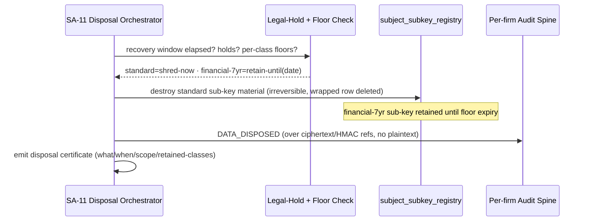

**Disposal flow (SA-11 orchestrator).** recovery window → legal-hold beats deletion → per-retention-class floor check → crypto-erase eligible class sub-keys → verified hard-delete of now-noise rows where safe → `DATA_DISPOSED` chained audit entry → disposal certificate. Legal hold (§7.6) **always beats** a deletion schedule or DSR clock.

**Acceptance criteria.**
- **AC-7.4.1 (the keystone test)** After a subject erasure, re-running continuous chain-verify over that firm's audit spine **still passes** (chain intact), AND every shredded Restricted field is unreadable (decrypt fails: class sub-key destroyed).
- **AC-7.4.2** A subject under an active legal hold cannot be erased; the orchestrator refuses and audits the refusal.
- **AC-7.4.3** A DSR erasure on a subject with financial records destroys the `standard` class sub-key immediately, retains the `financial-7yr` sub-key until floor expiry (financial fields remain decryptable until then), and the DSR register honestly reports retained-vs-deleted.
- **AC-7.4.4** No audit entry anywhere stores Restricted plaintext (the chain references ciphertext/HMAC only) — verified by a scanner over the audit payload schema.
- **AC-7.4.5** Crypto-shred is effective against immutable backups: a restored pre-erasure backup, decrypted with current keys, yields no plaintext for the erased subject's shredded classes (the destroyed class sub-key cannot be reconstructed).

---

## 7.5 The Audit Spine — One Per-Firm, Append-Only, Hash-Chained Engine

**Purpose.** Provide one auditor-recognizable, tamper-evident record of every security- and data-significant event, written synchronously with the operation it records, that proves integrity continuously and survives erasure.

**Design (normative).** The audit spine is **one append-only engine with a separate, per-firm hash chain**. Per-firm (not one global chain) gives (a) concurrency — firms append independently without serializing on one global sequence — and (b) per-tenant tamper-evidence — each firm's chain is independently verifiable and an enterprise tenant can be handed *its own* verifiable chain.

| Property | Specification |
|---|---|
| **Storage** | Append-only audit table; the application DB role holds **INSERT-only GRANT** — no UPDATE/DELETE at the grant level (immutability enforced by Postgres privileges, not convention) |
| **Chaining** | Per-firm: each entry carries `sequenceNo` (monotonic within `firm_id`) and `entryHash = SHA-256(prevHash ‖ canonical(entry))`; the first entry seeds from a per-firm genesis hash |
| **What is chained** | Ciphertext/HMAC references and non-Restricted metadata only — **never plaintext PII** (§7.4) |
| **Write path** | **Synchronous via an outbox, atomic with the user op** — the audit row is written in the *same transaction* as the business mutation; the event bus only *fans out* downstream notifications and never carries the authoritative audit write |
| **WORM anchor** | Periodic anchor of each per-firm chain head to **S3 Object Lock (WORM)** — an external, immutable witness so a full-table rewrite is still detectable |
| **Continuous verify** | A scheduled chain-verify job recomputes each per-firm chain and compares the head to the last WORM anchor; any break raises a **chain-integrity alarm** that pages on-call (wired into the same alerting as SLO + legal-clock breaches) |
| **Durability of write** | The outbox write is part of the user-op transaction, so it cannot silently drop; WORM anchoring and fan-out are retried with alarms and never roll back a committed user op |

**Why synchronous-via-outbox (not event-bus-only).** An event bus is at-least-once and post-commit; if audit rode only the bus, a dropped/delayed event would leave an unrecorded mutation — undetectable and unacceptable for an evidence-grade log. Writing the audit row transactionally with the mutation (outbox pattern) makes "every recorded mutation has an audit entry" structurally true; the bus then fans out from the committed outbox for notifications/search/webhooks.

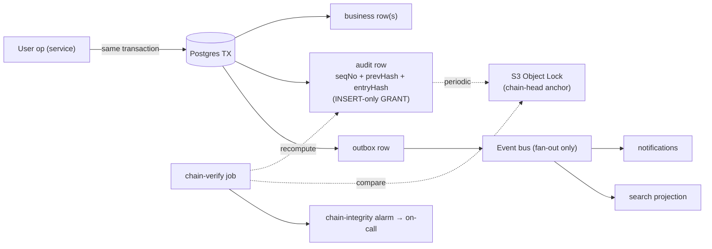

**What is audited (machinery, not content).** Authentication (success/failure/MFA), authorization denials including `SCOPE_VIOLATION`, **every `PII_REVEAL`**, create/update/delete on case/client/financial records (with before/after refs), document access/download, exports/egress, role/permission changes, consent changes, all `system/*` cross-tenant operations (including `IMPERSONATION_START`/`IMPERSONATION_END` for the elevated cross-tenant path, §4), and disposal (`DATA_DISPOSED`). Each entry: actor, persona, `firm_id`, subject Party where relevant, target `(entityType, entityId)` validated against the EntityTypeRegistry, timestamp (UTC), source IP/device, outcome.

**Security-denial audits where no business transaction exists (normative).** Some auditable events are rejected *before* any business transaction or tenant `SET LOCAL` is established — e.g., an `AUTHZ_SCOPE_VIOLATION` denied at the scope-aware guard (§4), a cross-pool 401, or an authentication failure. These cannot ride the synchronous-outbox path (there is no firm-scoped business transaction to be atomic with, and the fail-closed RLS rule of §2.2 would reject an audit INSERT with no tenant GUC set). They are written via a **dedicated security-audit write path**:
- When a principal *is* resolved (e.g., a scope violation by a known authenticated principal on the wrong plane), the security-audit path opens its own short transaction, sets the tenant GUC from the **resolved principal's `firm_id`** (or, for an impersonation/elevated path, the target firm), and appends to that firm's audit chain — so the entry is firm-scoped and chain-linked exactly like a business-transaction audit, just not atomic with a (non-existent) business mutation.
- When the failure is **principal-less** (e.g., an unauthenticated request, a malformed token, a cross-pool 401 before identity is established), there is no `firm_id` to scope to. These are written to a **platform-plane security-audit sink** (a GLOBAL-plane audit stream governed by the global-plane policy of §2.6, written under the platform/security-audit role), not to any firm chain. This avoids the contradiction of trying to write a fail-closed-RLS firm row with no resolvable tenant.

This reconciles "audit every denial" with "no business query before `SET LOCAL`" (§2.2): business-transaction audits are atomic-via-outbox; pre-transaction/principal-less denials use the dedicated security-audit path with the GUC set from the resolved principal, or the platform-plane sink when no principal exists.

**Retention floors enforced in code.** The effective retention for an audit entry is the **max of all applicable per-country minimums** for its class. Floors are code-enforced (not a settable-to-zero config): the disposal orchestrator cannot dispose an audit entry before `effectiveFloor` elapses. **[FOUNDER-CONFIRM]** numeric floors (proposed: financial-linked ≥ 7yr, breach ≥ 2yr, other ≥ 2yr) and whether **RFC-3161 trusted timestamping** is required beyond WORM anchoring — both set with counsel; the mechanism enforces whatever values are confirmed.

**Acceptance criteria.**
- **AC-7.5.1** The app DB role has INSERT-only on the audit table; a CI/migration test proves UPDATE/DELETE are rejected at the grant level.
- **AC-7.5.2** Each firm has an independent monotonic `sequenceNo` and a verifiable hash chain; a tamper test (manual row edit via an elevated role) is caught by chain-verify.
- **AC-7.5.3** The audit write is in the same transaction as the business mutation (outbox), proven by a fault-injection test: kill the process after the business write but before commit → neither the business row nor the audit row persists; the bus emits nothing.
- **AC-7.5.4** Chain heads are anchored to S3 Object Lock; a chain-verify mismatch against the last anchor raises a paging alarm.
- **AC-7.5.5** An entry cannot be disposed before its code-enforced `effectiveFloor`; an attempt is refused and audited.
- **AC-7.5.6** Audit reads are tenant-scoped (firm admins see their firm only; `system/*` full read is itself audited).
- **AC-7.5.7** A security denial rejected before any business transaction is audited: a `SCOPE_VIOLATION` with a resolved principal lands on that principal's firm chain (GUC set from the principal), and a principal-less auth failure lands in the platform-plane security-audit sink — neither attempts a fail-closed firm INSERT with no tenant GUC.

---

## 7.6 PIPEDA + Quebec Law-25 Governance Plane (SA-11)

**Purpose.** Turn privacy law into buildable, testable features: a consent register, retention/disposal with legal-hold precedence, a DSR register on a statutory clock, a breach register with the RROSH gate and 72-hour clock, and one canonical per-individual data export.

SA-11 owns all governance registers as first-class, firm-scoped, audited entities.

**Consent register.** `ConsentRecord` captures, timestamps, and versions each end-client's consent **per purpose** (Law-25 granularity), with withdrawal supported. Each record links to the privacy-notice version shown. Consent state is queryable by any processing path so a withdrawn-consent purpose can be enforced at point of use.

**Retention / disposal.** `RetentionPolicy` defines per-data-class retention; the effective floor is `max(applicable per-country minimums)` and is **code-enforced** (configurable above the floor, never below). The disposal orchestrator (§7.4) runs the recovery-window → hold → floor → crypto-erase → certificate flow.

**Legal hold beats deletion.** `LegalHold` placed on a Party/case/document **overrides every deletion schedule and DSR clock**. While a hold is active, neither scheduled disposal nor a subject erasure can destroy the held class sub-keys; the precedence is enforced in the orchestrator and the refusal is audited.

**DSR register.** `DsrRequest` tracks access/correction/erasure/portability requests on a **statutory clock** (countdown to the legal deadline, surfaced in UI and wired to the legal-clock alarm in §7.5). The register is **hold- and floor-aware and honest**: an erasure that hits a financial floor is reported as "PII deleted; financial records retained until {date}," never falsely "fully deleted." Every DSR action is audited.

**Breach register.** `BreachRecord` records **every** breach of security safeguards regardless of severity (PIPEDA mandates a ≥ 2-yr record of all breaches). A built-in **RROSH gate** (Real Risk of Significant Harm assessment) decides whether OPC + affected-individual notification is required; the notification path captures the legally required content (nature, what was affected, mitigation, contact). A **72-hour clock** ("as soon as feasible") is tracked from breach awareness, surfaced in UI, and alarmed. **[FOUNDER-CONFIRM]** the RROSH threshold criteria and the precise 72h-clock interpretation (set with counsel; the gate and clock machinery are fixed).

**One canonical per-individual data export.** A single, identity-verified export job produces a machine-readable JSON + a human-readable PDF of all of one individual's personal information across modules (the answer store, documents, comms, cases, financials-as-recorded). It is **masked-unless-reveal** (Restricted fields masked unless the requester is authorized and the reveal is audited), and the export itself is **audited as a data egress** event. This is *one* canonical export — not five partial per-module exports — so it is consistent, testable, and a single egress chokepoint.

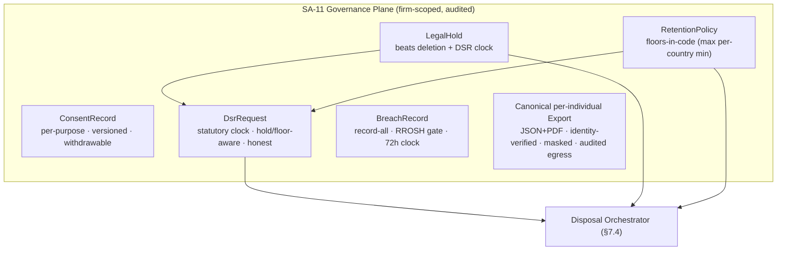

**Acceptance criteria.**
- **AC-7.6.1** Consent is recorded per purpose, versioned, and withdrawable; a withdrawn purpose blocks that processing path at point of use.
- **AC-7.6.2** A legal hold prevents both scheduled disposal and DSR erasure of the held data; the refusal is audited.
- **AC-7.6.3** A DSR erasure on a subject with a live financial floor reports retained-vs-deleted honestly and does not destroy the floored class sub-key.
- **AC-7.6.4** Every breach creates a `BreachRecord`; the RROSH gate drives the notification decision; the 72h clock counts from awareness and alarms before deadline.
- **AC-7.6.5** The per-individual export is single-source (one job), identity-verified before release, masked-unless-reveal, and emits an egress audit event.
- **AC-7.6.6** DSR/breach clocks approaching deadline page on-call via the same alerting as audit-chain integrity (§7.5).

---

## 7.7 Residency Posture, Secure File Handling, Per-Rail Sub-Processor Matrix & PII-Minimization to Rails

**Purpose.** Keep all durable PII and processing in-region, validate and safely serve every uploaded file, document exactly which sub-processor touches what, and guarantee that **no Restricted PII is ever sent to a payment, SMS, or messaging rail**.

**Residency posture with a region seam.** All durable data — relational store, replicas, object storage, cache, search index, backups/PITR, WORM anchors, PII-bearing logs — is pinned to the **tenant's region** (ca-central-1 at launch, DR within the same country). Region is a **per-tenant dimension**, not a global hard-pin: every durable resource and every KMS key carries a region binding, so onboarding a firm in another jurisdiction (e.g., eu-central-1) is region-scoped configuration plus key provisioning — not a rewrite. Read replicas live in the same region as their primary and run the **identical FORCED RLS policies under the non-BYPASSRLS app role**, with the tenant GUC set per-transaction on the replica connection (the replica isolation path is covered by the §2.8 cross-tenant denial suite). A CI region-allow-list check enforces that no resource is provisioned outside the configured allowed regions.

**Secure file handling (normative).** Every uploaded object passes a fixed validation-and-serving discipline before it is durable or reachable:
- **Upload validation before acceptance.** Each upload is validated for **both its declared content-type and its sniffed (magic-byte) content-type against a per-type allow-list**, and against a **per-type maximum size**, *before* the object is accepted into storage. A declared/sniffed mismatch, a content-type not on the allow-list (e.g., HTML/SVG/polyglot), or an over-size payload is **rejected before storage**. Accepted objects are written with **firm-namespaced keys**, an **SHA-256** content hash, and are **AV-scanned before they become available** (the AV-scan-before-availability gate; see §6.3.1/§8.9).
- **Safe serving headers.** Served objects (always via an ownership-bound presigned URL, never a caller-supplied storage key) carry `Content-Disposition: attachment`, `X-Content-Type-Options: nosniff`, and a restrictive `Content-Security-Policy`, so a stored file cannot execute in a victim's session. This closes the stored-XSS-via-uploaded-file vector against staff and portal users (the portal being the highest-PII surface).
- Documents are stored **encrypted under the subject key** (§7.1); rails never receive cleartext document bytes.

**Per-rail sub-processor residency matrix (delivered artifact).** Each Doer rail's v1 sub-processor is documented with what data category it processes, its residency, and the PII-minimization applied. This matrix is a deliverable, maintained as rails/adapters change.

| Rail (Doer) | v1 sub-processor | Data it may process | Residency posture | Restricted PII to it? |
|---|---|---|---|---|
| Payment (Biller) | Stripe | Tokenized payment instrument, amount, references | Sub-processor; card data tokenized at rail | **Never** — no card/bank cleartext leaves platform |
| Email relay (Mailer) | AWS SES (+SMTP fallback) | Email address, message body (firm-authored, non-Restricted) | In-region | **Never** in payload |
| Object storage (Signer/Files) | AWS S3 (SSE-KMS, presigned) | Encrypted documents, firm-prefixed keys | In-region | Stored encrypted; presigned URLs bound to ownership-checked records |
| SMS / messaging (Messenger) | AWS SNS + WhatsApp BSP | Phone number, message body (non-Restricted) | Sub-processor | **Never** in payload |
| Identity (in-house IdP) | None (in-house) | Credentials, MFA secrets | In-region, in-house | Encrypted at rest (operational-DEK path, §7.1); no external IdP sub-processor at v1 |

**PII-minimization to rails (normative).** Outbound rail payloads are constructed by a minimization layer that **strips Restricted PII by construction**:
- No passport/SIN/gov-ID/bank/biometric value ever appears in a Stripe, SES, SNS, or WhatsApp payload. Payments carry tokens and references; messages carry only firm-authored, non-Restricted content.
- Documents go to object storage **encrypted under the subject key**; rails never receive cleartext document bytes. A presigned URL is **always bound to an ownership-checked record** and never signs a caller-supplied storage key.
- A CI scanner inspects every rail-adapter outbound payload builder and fails if a Restricted-classified field can reach a rail payload.

**No Restricted PII in logs / search.** Two CI scanners (also referenced in §7.2/§7.3) are normative release gates: (1) **no-Restricted-in-logs** — the Pino logger redacts by classification and a scanner asserts no Restricted field is logged, traced, or sent to error tracking; (2) **no-Restricted-in-search** — a scanner asserts no Restricted-classified field flows into any `SearchDocument` projection or search request.

**Acceptance criteria.**
- **AC-7.7.1** All durable data and KMS keys carry a region binding; a CI region-allow-list check fails on any out-of-region resource.
- **AC-7.7.2** The per-rail sub-processor residency matrix is delivered and matches the wired adapters (drift-checked in CI).
- **AC-7.7.3** A rail-payload scanner proves no Restricted-classified field can reach any Stripe/SES/SNS/WhatsApp payload.
- **AC-7.7.4** Presigned URLs are bound to an ownership-checked record; a test proves a caller-supplied storage key is never signed (closes the IDOR class).
- **AC-7.7.5** The no-Restricted-in-logs and no-Restricted-in-search CI scanners are green and block release on any violation.
- **AC-7.7.6** Adding a new region is a config + key-provisioning change with no code rewrite (demonstrated by a second-region dry-run config).
- **AC-7.7.7** An upload whose sniffed content-type is not on the per-type allow-list, whose declared and sniffed types disagree, or which exceeds the per-type size cap is rejected **before** storage (no object persists).
- **AC-7.7.8** Served objects carry `Content-Disposition: attachment`, `X-Content-Type-Options: nosniff`, and a restrictive `Content-Security-Policy` (verified by test); an uploaded HTML/SVG file cannot execute when served.
- **AC-7.7.9** Read replicas enforce the identical FORCED RLS policies under the non-BYPASSRLS app role with the tenant GUC set per-transaction; the replica path is exercised by the §2.8 cross-tenant denial suite.

---

## 7.8 Summary of Founder-Confirm Items (non-blocking)

The machinery in this section is fixed; the following values are loaded as configuration and confirmed with privacy/regulatory counsel and the Immigration-SME. None blocks the foundational build.

- **[FOUNDER-CONFIRM]** Exact **Restricted-PII field set** (§7.2) — proposed default: passport/travel-doc, SIN + foreign equivalents, gov-ID numbers, financial-account/bank, biometric references, licence/designated-person credentials.
- **[FOUNDER-CONFIRM]** Numeric **retention floors** (§7.5/§7.6) — proposed: financial-linked ≥ 7yr, breach ≥ 2yr, other ≥ 2yr; effective = max of applicable per-country minimums.
- **[FOUNDER-CONFIRM]** **RROSH threshold criteria** and the **72h breach-clock interpretation** (§7.6).
- **[FOUNDER-CONFIRM]** Whether **RFC-3161 trusted timestamping** is required beyond WORM anchoring (§7.5).


---

# 8. Non-Functional Requirements & Cross-Cutting Platform Services

**Purpose.** This section fixes the quality bar the platform is built to — performance, scale, availability, disaster recovery, observability, accessibility, internationalization, and mobile posture — as concrete, testable targets a vendor can quote and a CI gate can prove, and then specifies the cross-cutting platform *services* (universal search, bulk import, outbound API + webhooks) that every console depends on but no single domain module owns. NFRs here are release gates, not aspirations: each carries acceptance criteria that pass/fail objectively. Everything is content-neutral platform machinery — the data spine is described as an engine that a Country Pack later populates.

---

## 8.1 Performance budgets

**Purpose.** Make "fast enough" a number, measured at the server boundary and in the browser, that a load test and a synthetic check can both assert.

### 8.1.1 Targets (steady-state; excludes cold starts and announced maintenance)

| ID | Surface | Target |
|---|---|---|
| P1 | Read endpoints (server processing, API boundary) | p95 ≤ 300 ms, p99 ≤ 800 ms |
| P2 | Write endpoints (server processing, API boundary) | p95 ≤ 600 ms, p99 ≤ 1200 ms |
| P3 | First Contentful Paint (median, broadband) | ≤ 1.5 s |
| P4 | Largest Contentful Paint (dashboard, case, list pages) | ≤ 2.5 s at p75 |
| P5 | Interaction to Next Paint | ≤ 200 ms at p75 |
| P6 | List/grid endpoints | cursor pagination, default ≤ 50 rows, hard max 100; no unbounded fetch |
| P7 | Long-running work (PDF/form generation, bulk export, doc scan, import) | asynchronous via BullMQ; no synchronous request > 5 s; UI shows progress (polled job handle) |
| P8 | Universal cross-entity search ("Finder") | p95 ≤ 500 ms at launch data volume |
| P9 | Server-error budget | 5xx rate < 0.1% over any rolling 24 h |

### 8.1.2 Design rules that make the budgets achievable
- **Server timing is measured at the API boundary**, recorded as an OpenTelemetry span attribute (`http.server.duration`) per route, and exported to the metrics backend so the percentiles above are continuously tracked, not just load-test snapshots.
- **Cursor pagination is the only sanctioned list contract** (`{ data, pageInfo: { nextCursor, hasNextPage } }`); offset pagination is allowed solely on bounded admin tables. No list endpoint may return an unbounded set. The repository layer rejects a `take` greater than 100.
- **Any unit of work whose realistic worst case exceeds 5 s is asynchronous** — enqueued to BullMQ, returning a `202` + job handle; the UI polls the job handle for status. PDF/form generation, bulk export, document virus-scan, and the import engine are all async by construction. (Server-pushed completion via a realtime gateway is NOT in foundation scope — see §8.2; the UI polls for completion in the foundation.)
- **The RLS tenant predicate (`firm_id = current_setting('app.current_firm_id')`) is the leading column of every tenant-table index**, so the isolation boundary never costs a sequential scan. Every JSONB column that participates in a filtered or searched query carries a GIN index sized to meet P8.
- **Read replicas absorb reporting and read-heavy aggregation**; the primary is reserved for transactional writes. The data layer routes explicitly read-only transactions to a replica connection. **Read replicas run the identical FORCED RLS policies and the same non-BYPASSRLS application role as the primary, and the per-request `SET LOCAL app.current_firm_id` tenant GUC (and, on portal-served paths, `app.current_client_subject`) is set per-transaction on the replica connection exactly as on the primary** — a read routed to a replica is therefore isolation-equivalent to a read on the primary, never a privileged bypass. The replica read path is included in the cross-tenant denial suite (§2.8). The per-request transaction wrapping (`BEGIN` → `SET LOCAL` → business query → `COMMIT`) under PgBouncer transaction-mode pooling applies to replica connections too; its overhead is included in the P1/P2 measurement and in the §8.2 connection-pool sizing.

### 8.1.3 Acceptance criteria
- **AC-P1.** A load-test run at the §8.2 launch profile reports P1, P2, P8, P9 within target; the run is a go-live gate and its report is a contractual deliverable.
- **AC-P2.** Lighthouse / Web-Vitals field measurement on dashboard, case-detail, and list pages meets P3–P5 on a mid-tier device profile (not only high-end hardware).
- **AC-P3.** A CI assertion fails any list endpoint that accepts no cursor or permits `take > 100`.
- **AC-P4.** No HTTP handler holds a request open longer than 5 s under load; a synthetic test that triggers form generation receives a `202` and a job handle, never a blocking response.
- **AC-P5.** A read served from a read replica with the tenant GUC set to Firm A returns zero rows of Firm B (the replica path is exercised by the cross-tenant denial suite — §2.8); a replica read with the GUC unset returns zero rows (fail-closed).

---

## 8.2 Scalability — right-sized to launch reality + horizontal-scaling proof

**Purpose.** Prove the architecture scales *the right way* — linearly under added workers and replicas — at a capacity honestly sized to Year-1, rather than asserting invented absolutes the launch will never exercise.

### 8.2.1 One-page capacity assumption (launch / Year-1)

The platform is sized for the *launch reality* of roughly **hundreds of firms in Year-1**, not thousands. The headline planning figure is a single, defensible baseline:

| Dimension | Year-1 planning assumption |
|---|---|
| Tenant firms (active) | low hundreds (plan capacity to ~300) |
| Active users (staff + portal clients) | ~10,000 |
| Peak concurrent sessions | ~1,000 |
| Records in the largest single tenant (parties + cases) | ~100,000 |
| Documents under management (estate-wide) | low millions |
| Sustained request throughput | ~200 req/s, with headroom to spike |

These are *planning assumptions for sizing*, not contractual scale guarantees. The contractual guarantee is the **shape** of scaling, proved by the load-test gate below — because a modulith on Fargate + Postgres + Redis can be grown by adding replicas long before any re-architecture is needed, and a fixed multi-thousand-firm absolute would be an unprovable, unquotable number at launch.

### 8.2.2 Horizontal-scaling design rules
- **S1 — Stateless application tier.** API tasks hold no per-request state in process memory; sessions and rate-limit counters live in Redis. Any API task can serve any tenant's request.
- **S2 — Independent worker pool.** BullMQ workers scale separately from the web tier; queue depth, not web traffic, drives worker replica count.
- **S3 — Read replicas for read-heavy paths.** Reporting, search reindex, and dashboard aggregation read from replicas; the primary takes writes only. Replicas run the same FORCED RLS policies, the same non-BYPASSRLS app role, and the per-transaction tenant GUC (§8.1.2), so replica routing is isolation-equivalent to the primary.
- **S4 — Hybrid-tenancy seam preserved.** The tenant resolver abstracts *placement*, so a single large tenant can later be relocated to a dedicated database without application code change. This is a seam, not a launch deliverable.
- **S5 — Region seam (see §8.7).** Region is a per-tenant dimension; launch deploys ca-central-1 only, but the scaling model does not assume a single global region.

> **Out of foundation scope — realtime push gateway.** A server-pushed realtime gateway (WebSocket/SSE) is NOT part of the foundation. The foundation UI polls job handles for long-running-work completion (P7). A realtime push capability — transport, per-pool/per-audience auth, and per-message tenant + portal-subject scoping on long-lived connections — is a later wave and is deliberately excluded from the foundation topology (§1.5), the scaling rules above, and the IaC/acceptance checklist.

### 8.2.3 The load-test gate — proves *linear scaling*, not an absolute
The release-gating load test does **not** assert "handles 2,000 firms." It asserts that **throughput scales horizontally**:

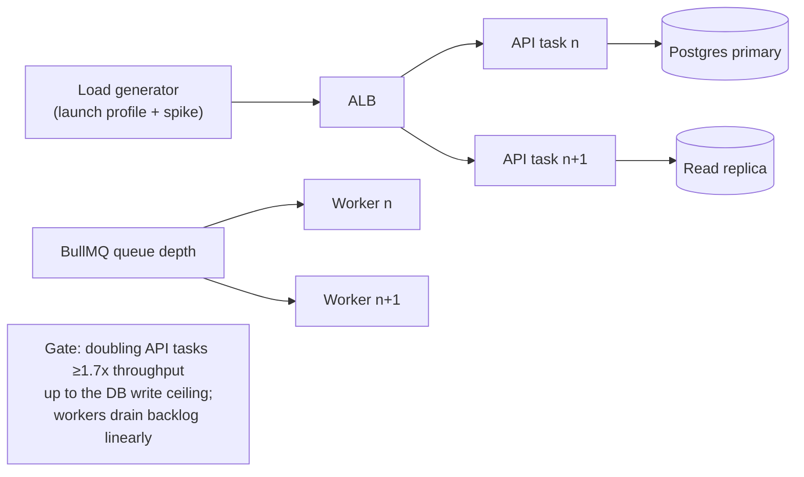

- **Scaling assertion:** doubling the number of API tasks yields **≥ 1.7× throughput** up to the database write ceiling; the DB write ceiling is *measured and documented* (not assumed), and a runbook records the replica/connection-pool changes that lift it.
- **Worker assertion:** doubling worker replicas drains a fixed backlog in **≤ 0.6×** the time.
- **Noisy-neighbour assertion:** a single tenant generating a burst (bulk import, large export) does not push another tenant's read p95 past P1; per-tenant fair-use quotas (aligned to plan entitlements) enforce this.

### 8.2.4 Acceptance criteria
- **AC-S1.** The delivered load-test suite demonstrates the linear-scaling assertion (≥ 1.7× per doubling) and reports the measured DB write ceiling; it runs against the launch capacity profile and is a go-live gate.
- **AC-S2.** A connection-pool correctness check (PgBouncer transaction-mode, `SET LOCAL` only) runs in the same gate; an unset tenant GUC yields zero rows under pooled connection reuse (this is also part of the cross-tenant denial suite — §2.8).
- **AC-S3.** A capacity-planning one-pager (the table above + the measured DB ceiling + the replica/worker scaling levers + the connection-pool tier sizing) is delivered with the load-test report.
- **AC-S4.** A noisy-neighbour scenario (one tenant running a bulk import) keeps every other tenant's read p95 within P1.

---

## 8.3 Availability & Disaster Recovery

**Purpose.** Commit to an uptime number and a recoverability number that a regulated B2B SaaS — where a payment must atomically activate a case — can defend, and prove the recovery path actually works.

### 8.3.1 Availability targets

| ID | Requirement | Target |
|---|---|---|
| AV1 | Monthly core-application uptime | ≥ 99.9% (≈ ≤ 43 min/month) |
| AV2 | Redundancy | ≥ 2 application tasks across ≥ 2 AZs; DB primary + standby across ≥ 2 AZs |
| AV3 | Graceful degradation | A non-critical subsystem (comms, reporting, search) failing SHALL NOT take down case delivery or payments |
| AV4 | Health | Liveness + readiness endpoints; unhealthy tasks auto-replaced; planned maintenance outside Canadian business hours with ≥ 72 h notice, zero-downtime deploy preferred |

### 8.3.2 Disaster Recovery targets

| ID | Requirement | Target |
|---|---|---|
| DR1 | **RPO** (max data loss) | ≤ 15 min — continuous WAL archiving / point-in-time recovery |
| DR2 | **RTO** (max time to restore service) | ≤ 4 h for a full-region failure |
| DR3 | Backups | Automated daily full + continuous incremental; PITR; encrypted at rest and in transit |
| DR4 | Residency of backups & DR | **Within Canada only** — backup and DR regions never leave Canadian residency |
| DR5 | Object storage | S3 versioning + cross-AZ redundancy within region; lifecycle to Glacier for cold tiers |
| DR6 | Restore drill | Documented restore drill at least **quarterly**, results recorded; a contractual deliverable |
| DR7 | DR runbook | Maintained, role-assigned, tested; covers region failure, data corruption, ransomware |

**One DR regime covers all durable data.** Because there is a single relational system of record (Postgres) and object storage (S3), with no second operational datastore, the entire estate is covered by one backup/PITR regime and one residency surface. Redis is recoverable cache only — never the system of record — so its loss degrades performance, not durability. Crypto-shred erasure (per the key hierarchy in §7.1) works *against* immutable backups: destroying a per-subject key (and its independently-destroyable wrapped per-retention-class sub-keys) renders that subject's ciphertext unreadable even in a PITR snapshot, so erasure and immutable backups coexist (§7.4).

### 8.3.3 Acceptance criteria
- **AC-DR1.** A quarterly restore drill restores the database to a chosen point in time with measured data loss ≤ 15 min and service-restore time ≤ 4 h; the drill report (timings, operator, outcome) is archived.
- **AC-DR2.** Killing one AZ's tasks does not interrupt the application (traffic shifts to the surviving AZ); killing the DB primary promotes the standby within RTO.
- **AC-DR3.** Disabling the search/comms subsystem leaves case delivery and payment flows fully functional (graceful-degradation test).
- **AC-DR4.** An IaC region-allowlist CI check fails if any backup, replica, or DR resource is provisioned outside an allowed Canadian region (this honours the region seam in §8.7 — the *allowed* region set is per-tenant configuration, defaulting to Canada-only at launch, not a single hard-pinned literal).

---

## 8.4 Observability

**Purpose.** Make the system tenant-aware yet PII-safe to operate, and wire compliance posture (audit-chain integrity, legal clocks) into the *same* alerting plane so compliance is a live signal, not a quarterly scramble.

### 8.4.1 The three signals
- **Structured logs (Pino, JSON).** Every log line carries a `correlationId` (propagated across API → workers → DB calls) and a `tenantId` (firm_id from request context, never caller-supplied). **PII redaction happens at the logger** via an allow-list of safe fields plus deny-patterns for Restricted classes; no Restricted PII, secret, or token ever reaches a log sink. Logs ship in-region, retained ≥ 90 days.
- **Metrics (OpenTelemetry).** RED (rate, errors, duration) per route and USE (utilization, saturation) per resource, plus per-tenant usage metrics for capacity planning and billing. Exported vendor-neutrally so the backend (CloudWatch / Managed Prometheus + Grafana) can change without re-instrumentation.
- **Distributed tracing (OpenTelemetry).** Spans flow API → worker → DB/Redis/rail-adapter; the trace carries `correlationId` and `firm_id` as span attributes so a single tenant's request can be reconstructed end-to-end. Trace exporters scrub PII at span-attribute level.
- **Error tracking (Sentry).** Frontend + backend exception aggregation with **PII scrubbing configured** (no Restricted fields, no tokens, no full request bodies); release health and source maps for triage.

### 8.4.2 Alerting — SLO breach AND compliance integrity
Alerting pages on the standard SLO breaches **and** on two compliance-specific signals that no other system would catch in time:

```mermaid
flowchart TB
  subgraph SLO[SLO-breach alerts]
    A1[latency p95/p99 breach]
    A2[5xx > error budget]
    A3[queue depth / job-failure spike]
    A4[replication lag / backup failure]
  end
  subgraph COMPLIANCE[Compliance-integrity alerts]
    C1[audit hash-chain verify FAIL<br/>per-firm chain]
    C2[DSR statutory clock approaching deadline]
    C3[breach-notification 72h clock approaching]
  end
  SLO --> PAGE[On-call page]
  COMPLIANCE --> PAGE
```

- The **audit chain-verify alarm** runs continuously over the **per-firm** hash chains (each firm has its own chain for concurrency + per-tenant tamper-evidence — see §7.5); a break pages on-call immediately, because an undetected break is an evidentiary failure.
- **Legal-clock alerts** fire as a DSR statutory clock or a breach-notification 72 h clock approaches its deadline, turning a paperwork risk into an operational alert.

### 8.4.3 Acceptance criteria
- **AC-O1.** A log-scrubbing test asserts that no Restricted-PII field, secret, or token appears in any log sink (CI scanner over a representative request set).
- **AC-O2.** A trace for a sample request shows correlated spans across API → worker → DB with `correlationId` and `firm_id` present and no PII in attributes.
- **AC-O3.** A synthetic check covers the revenue journey (login → lead → assessment → retainer → payment) and the case-delivery journey (questionnaire → document → form → workflow) end-to-end; failure pages on-call.
- **AC-O4.** Deliberately corrupting one entry in a firm's audit chain triggers the chain-verify alarm within the configured interval; the alarm identifies the firm without exposing other firms' chains.
- **AC-O5.** A DSR request whose statutory clock is set near expiry triggers the legal-clock alert.

---

## 8.5 Accessibility (WCAG 2.2 AA across all three consoles)

**Purpose.** Hold all three consoles — including the Client Portal, the highest-exposure consumer surface — to the same accessibility bar, verified by automation and by a human using assistive technology.

### 8.5.1 Requirements
- **A11Y-1.** Super-Admin, Agent/Firm, and Client Portal consoles SHALL each conform to **WCAG 2.2 Level AA**. (2.2 is the current W3C recommendation and satisfies 2.1 AA, which some procurement still cites.) The portal is held to the *same* bar, not a lower one.
- **A11Y-2.** Conformance covers keyboard operability, visible focus and logical focus order, colour contrast ≥ 4.5:1 for text, text resize to 200%, semantic structure and labels, ARIA only where native semantics fall short, and accessible error identification.
- **A11Y-3.** Built on Radix/shadcn accessible primitives so accessibility is a default of the component library, not a per-screen retrofit.
- **A11Y-4.** **Generated documents** (retainers, government-form output, invoices) are produced as **tagged, accessible PDFs** with a logical reading order and document language set.

### 8.5.2 Verification (a per-surface gate)
- **axe in CI** on every component / story (Storybook + axe), failing the build on violations.
- **At least one manual assistive-technology audit** (screen reader + keyboard-only) per console before go-live.
- **A VPAT-style conformance statement** delivered per console.

### 8.5.3 Acceptance criteria
- **AC-A11Y1.** The CI axe gate is green across all component stories; an introduced violation fails the build.
- **AC-A11Y2.** A manual keyboard-only + screen-reader pass of the portal's critical journeys (login, document upload, questionnaire, pay invoice, e-sign) records zero blocking issues.
- **AC-A11Y3.** A generated retainer PDF passes a tagged-PDF/accessibility checker (reading order + language + tags present).
- **AC-A11Y4.** A VPAT artifact is delivered for each of the three consoles.

---

## 8.6 Internationalization (EN + Canadian French)

**Purpose.** Deliver full bilingual platform strings as a launch legal requirement, while drawing a clean scope line so the vendor ships *platform* strings bilingually without owning each firm's own words.

### 8.6.1 Scope split
- **System strings — IN platform scope, fully EN + FR at launch.** All UI labels, system emails/notifications, validation messages, error messages, and **generated PDF output** (retainers, government forms, invoices) ship complete in English and Canadian French. No hardcoded user-facing string.
- **Firm-authored content — bilingual-*capable*, firm-owned.** Firm templates, firm emails, and firm-authored copy are stored with a bilingual structure (side-by-side authoring + coverage indicators), but the firm owns translating its own words; the platform does not translate firm content.

### 8.6.2 Mechanics
- **I18N-1.** Externalized message catalogues (react-i18next-style) with ICU MessageFormat for plurals/gender; lazy-loaded per route.
- **I18N-2.** Per-user and per-firm locale preference; a portal client's locale may differ from staff.
- **I18N-3.** **UTC storage, America/Toronto default render** (timezone configurable per user), **CAD currency formatting** for `en-CA` / `fr-CA`.
- **I18N-4.** Correct rendering of French diacritics across UI, search input/output, and generated documents.
- **I18N-5.** Adding a further locale is a catalogue addition, not a code change.

### 8.6.3 Acceptance criteria
- **AC-I18N1.** A CI "no hardcoded user-facing string" check fails on a literal string in a rendered component or a system email template.
- **AC-I18N2.** The platform message catalogue reports 100% EN + FR coverage at go-live; a coverage report is delivered.
- **AC-I18N3.** A bilingual Playwright smoke test runs the revenue and case-delivery journeys in both `en-CA` and `fr-CA` and passes in both.
- **AC-I18N4.** A retainer PDF and a system email render correctly in French with diacritics intact; a date renders as America/Toronto and money as CAD in both locales.
- **AC-I18N5. [FOUNDER-CONFIRM]** Whether any government-form *content* (as opposed to platform chrome) must be French is a Country-Pack content decision routed to the founder; the *machinery* (bilingual PDF pipeline) is delivered regardless.

---

## 8.7 Mobile & PWA posture + the region seam

**Purpose.** Right-size each console's device target to its real users and keep the estate global-ready without paying for it at launch.

### 8.7.1 Per-console device posture
- **Client Portal = responsive + installable PWA.** Manifest + service worker for an offline shell and a **read cache**; web-push notifications. **Offline is bounded to read-only** — there is no offline write/sync engine for regulated PII (highest-risk, lowest-value). Mobile-first, since the portal is consumer reality.
- **Agent/Firm staff console = responsive, desktop-first, usable down to tablet.** Not a PWA — staff work is dense and desktop-anchored.
- **Super-Admin console = desktop-only responsive.**
- Latest-two major versions of Chrome, Edge, Firefox, Safari; performance budgets (§8.1) verified on a mid-tier device.

### 8.7.2 The region seam (do NOT hard-pin Canada globally)
Region is modelled as a **per-tenant dimension**, with **region-scoped KMS** from day one. Launch deploys **ca-central-1 only**, and the IaC region-allowlist CI check (§8.3 AC-DR4) defaults the allowed set to Canadian regions — but the allow-list is *configuration*, not a single hard-coded `ca-central-1` literal scattered through the code. Adding, for example, `eu-central-1` for a future German firm is a configuration + region-scoped-KMS change, not a re-architecture. This avoids the global-scale anti-pattern of a hard CI pin while keeping launch firmly in-Canada.

### 8.7.3 Acceptance criteria
- **AC-M1.** The portal installs as a PWA on iOS Safari and Android Chrome; offline shell + last-read cache render with no network; an attempted offline *write* is cleanly blocked with a "you are offline" message (no silent queue).
- **AC-M2.** The staff console is fully usable on a tablet viewport; the super-admin console renders correctly at desktop widths.
- **AC-M3.** A grep/AST check finds no hard-coded region literal outside the central region-config module; region is read from per-tenant config, defaulting to Canada.

---

## 8.8 Cross-cutting platform service: Universal cross-entity search ("Finder")

**Purpose.** One firm-scoped, permission-filtered, ownership-filtered search across all entity types, owned by a dedicated module so it is decoupled, isolation-correct, and never a cross-firm PII leak surface.

**Owner:** a new platform **SearchModule** ("the Finder"). The Client Portal gets **no** universal search (its data is the single client's own; universal cross-entity search is a staff capability only).

### 8.8.1 Design
- **v1 backing = PostgreSQL full-text search** (`tsvector` + GIN) over a denormalised **SearchDocument projection**, behind a `SearchIndexPort`. **OpenSearch is the documented, costed contingency adapter** behind the same port — additive, not a rewrite — if fuzzy/faceted/large-corpus search becomes a requirement; it is explicitly deferred.
- **The projection is maintained ASYNCHRONOUSLY from the canonical domain-event dictionary** (§6). When an entity is created/updated/deleted, the corresponding domain event drives a projection upsert/delete via a search consumer. This proves the event dictionary's payoff and keeps search decoupled from write-path latency.
- **`firm_id` and the record-level ownership key are INDEX-RESIDENT** on every SearchDocument row — they are physical columns participating in the index, not a post-filter afterthought. Search queries are scoped by `firm_id` (RLS + explicit predicate) and by the caller's ownership scope (e.g., `view.own` vs `view.all`) *before* full-text matching, then permission-filtered by entity type.
- **NO Restricted PII is projected into the search index.** Passport numbers, SIN/foreign equivalents, government-ID numbers, financial-account details, biometric references, and licence/designated-person credentials never enter SearchDocument. A CI scanner asserts the projection schema contains no Restricted-classified field. Search matches on names, reference numbers, statuses, and other non-Restricted attributes only.
- **Every result is triple-filtered:** firm-scoped → permission-filtered (no entity-type permission ⇒ zero hits of that type) → record-level-ownership-filtered (a `view.own` user never sees another officer's records). Results use cursor pagination and respect P8 (p95 ≤ 500 ms).

```mermaid
flowchart LR
  ED[(Domain Event Dictionary)] --> SC[Search consumer]
  SC --> SD[(SearchDocument projection<br/>firm_id + ownerKey INDEX-RESIDENT<br/>NO Restricted PII · GIN tsvector)]
  Q[Finder query] --> SP[SearchIndexPort]
  SP --> PG[(Postgres FTS adapter v1)]
  SP -. contingency .-> OS[(OpenSearch adapter — deferred)]
  PG --> F[firm + permission + ownership filter] --> R[cursor results]
```

### 8.8.2 Acceptance criteria
- **AC-F1.** Tenant A's search never returns a Tenant B row, including via error message or count (cross-tenant denial test against the projection).
- **AC-F2.** A user lacking an entity-type permission gets zero hits of that type; a `view.own` user gets zero hits of records owned by another user.
- **AC-F3.** A CI scanner over the SearchDocument schema fails the build if any Restricted-classified field is present in the projection.
- **AC-F4.** Search p95 ≤ 500 ms at launch data volume; a reindex job rebuilds the projection from source-of-truth and is delivered.
- **AC-F5.** Swapping the Postgres FTS adapter for the OpenSearch adapter behind `SearchIndexPort` requires no caller change (port-substitution test with a fake adapter).

---

## 8.9 Cross-cutting platform service: Reusable firm-onboarding bulk IMPORT engine

**Purpose.** A first-class, self-service import feature so an established firm can load its book of business on day one — generalized once and reused across entity types.

**Owner:** a reusable **ImportEngine** wired to four entity targets: Contacts/Clients (Parties), open Cases, Documents, and historical financials.

### 8.9.1 Design
- **One reusable pipeline:** column→canonical-field **mapping UI** → **dry-run preview** (validation + dedup report, no writes) → **async job** (BullMQ, since import is always > 5 s work) → **result report** (created / updated / skipped / rejected with row-level reasons).
- **Zod-validated at the edge**, **firm_id-scoped** (the import only ever writes into the caller's tenant), **audited** (every import run is an audit event), and gated by a dedicated local permission (`agent/firm:import`).
- **Dedup** on stable natural keys per entity (e.g., email/identity for Parties) so re-running an import does not duplicate rows.
- **Documents** route through the standard document pipeline — content-type allow-list + per-type size validation and virus-scan-before-availability, firm-namespaced keys, SHA-256, and the served-object headers (`Content-Disposition: attachment` + `X-Content-Type-Options: nosniff` + restrictive CSP) all per the secure-file-handling controls in §7. The import engine does not relax any of those controls.
- **Historical financials are RECORDED INTO the single money source (Biller), never duplicated** — import writes invoice/payment records through the billing module's own API, honouring "money lives in one place."
- **Scope boundary [FOUNDER-CONFIRM not required — architect-decided]:** the import *feature* is in base scope; a vendor-run, bespoke, one-time per-firm cutover migration is **out of base scope** (separate T&M). The import feature is the supported path for firms to self-onboard their data.

### 8.9.2 Acceptance criteria
- **AC-IM1.** Per entity type: a dry-run produces a validation + dedup preview with zero writes; the async run produces a reconcile report (created/updated/skipped/rejected with reasons).
- **AC-IM2.** A malformed row is rejected with a row-level reason and does not abort the whole import; a re-run with the same source produces no duplicates (dedup proven).
- **AC-IM3.** An import attempt targeting another firm's data is impossible — the engine writes only into the caller's `firm_id` (RLS + scoped repository); a denial test confirms.
- **AC-IM4.** Financial import rows appear in Biller (the money source) and are not duplicated in any other module.
- **AC-IM5.** Every import run produces an audit entry (actor, firm, entity type, counts, outcome).
- **AC-IM6.** An imported document whose sniffed content-type is not on the allow-list or whose size exceeds the per-type cap is rejected before storage, and an imported document is served with `Content-Disposition: attachment` + `nosniff` + the restrictive CSP (§7 secure-file-handling controls applied through the import path).

---

## 8.10 Cross-cutting platform service: Outbound public read API + signed/retried webhooks

**Purpose.** Give firms a programmable boundary — a read API and outbound webhooks — so the platform integrates with a firm's own tooling without leaking the tenant boundary.

**Owner:** the firm-settings console's **§Developer/API** section. It owns the entire firm↔external outbound boundary; the publishable event catalogue is exactly the canonical domain-event dictionary (§6), so the catalogue is free — no separate event vocabulary.

### 8.10.1 Design
- **Firm-scoped API keys** with **scoped permissions** (a key carries a subset of the firm's local `agent/*` read permissions; default-deny) and per-key **rate limits**; keys are firm-isolated and revocable. **No token or PII in URL query params** — keys travel in headers.
- **Outbound read endpoints** are documented in **OpenAPI**; they are the same RLS-backed, permission-filtered reads the console uses, never a privileged bypass.
- **Webhook subscriptions** deliver dictionary events to firm-supplied HTTPS endpoints with:
  - **HMAC signature** over the payload (firm-specific signing secret) so the firm can verify authenticity,
  - **retry with backoff** and a **dead-letter** after exhaustion (delivered via a BullMQ worker),
  - an **idempotency key** per delivery (incorporating the source event id) so a firm can safely de-duplicate redeliveries. The source event id is taken from the canonical dictionary event; a rail-originated event missing a resolvable `externalEventId` fails closed upstream (rejected/dead-lettered + alarmed) and is never relayed under a business-id fallback (§6).
- **Public-by-capability reads (if any) use unguessable capability tokens**, never sequential or guessable ids in the URL, and each `@Public` route carries a named compensating control (signature / capability-token / rate-limit) on a positive allow-list.

### 8.10.2 Acceptance criteria
- **AC-API1.** An API key scoped to read-only `agent/case:view` cannot write and cannot read an entity type outside its scope (403); a key for Firm A cannot read Firm B's data (cross-tenant denial).
- **AC-API2.** A webhook delivery carries a valid HMAC signature the firm can verify; tampering invalidates it.
- **AC-API3.** A failing webhook endpoint causes retry-with-backoff, then dead-letters after the configured attempts; redelivery with the same idempotency key produces no duplicate downstream effect.
- **AC-API4.** No token or PII appears in any URL query string across the public API surface (CI/route-lint check); every `@Public` route is on the allow-list with a named compensating control.
- **AC-API5.** The OpenAPI document for the outbound read API is published per environment and the publishable-event list matches the canonical event dictionary one-to-one.

---

## 8.11 Section acceptance roll-up

A single consolidated checklist the procurement acceptance gate can run against §8:

- **Performance:** AC-P1..P5 green (load-test report + Web-Vitals + cursor/async lint + replica-path isolation).
- **Scalability:** AC-S1..S4 green (linear-scaling proof + capacity one-pager + noisy-neighbour).
- **Availability/DR:** AC-DR1..DR4 green (quarterly restore drill + AZ/primary failover + graceful degradation + region-allowlist CI).
- **Observability:** AC-O1..O5 green (log scrub + trace correlation + synthetic journeys + audit-chain alarm + legal-clock alert).
- **Accessibility:** AC-A11Y1..A11Y4 green (axe CI + manual AT audit + tagged PDF + VPAT per console).
- **i18n:** AC-I18N1..I18N4 green (no-hardcoded-string + 100% catalogue coverage + bilingual E2E + FR PDF/email).
- **Mobile/PWA + region seam:** AC-M1..M3 green (installable read-only-offline portal + tablet staff + no hard region literal).
- **Finder:** AC-F1..F5 green (cross-tenant/permission/ownership denial + no-Restricted-PII scanner + p95 + reindex + port substitution).
- **Import:** AC-IM1..IM6 green (dry-run/async/reconcile + reject-malformed + tenant-scope + Biller single-source + audit + file-handling controls).
- **Outbound API/webhooks:** AC-API1..API5 green (scoped-key denial + HMAC + retry/dead-letter/idempotency + no-PII-in-URL + OpenAPI).

Every item above is a binary pass/fail wired into CI or the go-live acceptance gate, making §8 an objective, quotable contract rather than a quality aspiration.

---

# 9. Procurement & Engagement Shell + Foundation Acceptance Gate + Open Items

> **Purpose.** This section is the binding commercial and engagement frame for the foundational sprint (Wave 0/A). It declares what governs the build, draws the authoritative line between machinery (engine) scope and content scope, decomposes Wave A into separately-accepted sub-gates with payment triggers, fixes the environments/DevOps and RACI shape, and defines the single objective Foundation Acceptance Gate that releases the foundation milestone. It closes with one consolidated list of founder-routed open items — almost none of which block the start. **The foundation can be started now.**

---

## 9.1 Binding nature of this document

The **rewritten FINAL specification set + this Platform Foundation & Cross-Cutting Architecture document (Doc 1)** are the **single binding build source**. Where any other artifact disagrees, this set governs.

- **The RFP is lineage, not contract.** The earlier RFP is demoted to non-binding background. It assumed a different datastore posture and a phased-MVP shape that this document supersedes. A bidder MUST quote against the FINALs + this Doc 1, not the RFP. No term, scope item, or assumption survives from the RFP unless it is restated here.
- **This document is self-contained for the foundation.** A vendor can read Doc 1 and the FINALs, and price and build Wave 0/A without external clarification on platform machinery. Domain content (the Country Pack) is a separate, founder-owned input that does **not** gate the foundation.
- **Conflict precedence (highest first):** (1) this Doc 1, §-by-§; (2) the FINAL console specifications (Agent / Super-Admin / Client Portal) at the module level; (3) supporting sections (architecture, data-multitenancy-NFR-security). Any residual brownfield phrasing anywhere in the corpus is **void** — see §9.2.

**[FOUNDER-CONFIRM — non-blocking]** Counter-signature of Doc 1 + FINALs as the binding source, and formal demotion of the RFP to lineage. Engineering may proceed on the foundation in parallel with signature; nothing in Wave 0/A depends on a content or commercial decision that signature would change.

---

## 9.2 Greenfield work-for-hire framing

This is a **from-scratch, greenfield build measured solely against the FINAL spec + this shell** — there is **no parity obligation** to any existing system.

- **Target-state language only.** Every requirement is stated as a target ("the tenant key is `firm_id`"; "config-as-data lives in PostgreSQL JSONB"; "there are three auth pools"). There is **no instruction to migrate, refactor, rename, drop, or sweep** anything — there is nothing in production to migrate. A vendor builds the target on PostgreSQL 18 natively and is **priced with zero migration cost**.
- **The prior codebase is design-provenance only.** An optional, **NDA-gated, read-only** reference codebase MAY be inspected to understand validated patterns. The vendor **MUST NOT depend on it, lift its schema, or be measured against it.** It is informational; the FINAL spec is the contract.
- **IP = work-for-hire.** All source, schema, migrations, IaC, CI suites, design tokens, generated SDK, contracts package, and documentation produced under the engagement are the **exclusive property of ExpatReady** on creation, assigned irrevocably, free of any vendor-retained licence-back. Third-party OSS is permitted under permissive licences (MIT/Apache-2.0/BSD/ISC) only; copyleft (GPL/AGPL) in distributed artifacts requires written pre-approval. The vendor warrants the deliverables are original or properly licensed and non-infringing.
- **Acceptance is objective, not subjective.** Each wave (and each Wave-A sub-gate) is accepted against the testable criteria in this section. "Looks done" is not a milestone; a green gate is.

**Acceptance criteria — framing**
- **FR-1.** A grep of the delivered corpus for brownfield verbs against tenancy/identity (`migrate clientId`, `rename`, `drop column firm`, etc.) returns zero in normative text.
- **FR-2.** A signed IP assignment + OSS-licence manifest (SBOM) accompanies each milestone; the SBOM contains no copyleft in distributed artifacts without recorded approval.
- **FR-3.** The reference codebase, if accessed, is read-only and access-logged; no deliverable cites it as a requirement source.

---

## 9.3 Authoritative IN / OUT scope for the FOUNDATION deliverable (Wave 0/A)

Wave A is the **platform substrate every module sits on**. It is on the critical path and is delivered/accepted **before any business-module work begins**. The scope is content-neutral machinery: the data spine is built as an engine and populated later from the Country Pack.

The **data-model spine in Wave A is exactly the entity set below**, delivered as a DATA MODEL plus a thin "auto-fill a sample form" proof; the **engines that operate the spine** (the 10-state Document instance lifecycle, the questionnaire runtime, the filler-at-scale) are deferred to later waves and are called out in the OUT column. This is the single biggest cost-variance line in the quote, so it is enumerated precisely (and reconciled to the §5 ACs, each of which is tagged with its wave):

- **Party identity root + lenses:** `Party`, `PartyProfile`, `PartyRelationship`.
- **Canonical vocabulary:** the `CanonicalField` catalogue (typed, versioned, country-neutral, stable `canonicalFieldKey`), `EnumSet`, and `FreshnessRule`.
- **Append-only answer store:** `ClientCanonicalAnswer`, `AnswerSubject`, `ClientFactRecord`, `CaseAnswerOverride`.
- **Platform registry:** `EntityTypeRegistry` + polymorphic-write validation guard.
- **MASTER schemas (schema only — empty, validated engines):** `DocumentType`, `DocumentRequirement`, `LogicalSection`/`SectionQuestion`, `GovFormDef`/`FormEdition`/`FormFieldMap`, `ProgramDef` (with `programNodeKey`), `ConditionFlagDefinition`.

The MASTERS are delivered as schema; the **instance lifecycles and runtimes that consume them are later waves** (the 10-state `Document` instance lifecycle and its checklist/readiness gate ship with the Document engine; the questionnaire runtime and the filler-at-scale ship with their respective waves).

| IN — Wave 0/A delivers | OUT — deferred to later waves (still in the one frozen scope) |
|---|---|
| PostgreSQL 18 single relational store; RLS **ENABLED + FORCED** on every tenant table; RLS migration generator; schema-lint | Any business module (CRM/Party data, eligibility/scoring, booking, retainer/e-sign, billing) → Wave B |
| Non-`BYPASSRLS` app role; separate migration/admin role; PgBouncer **transaction-mode** pooling with `SET LOCAL` + fail-closed `current_setting(...,true)` NULL→zero-rows | Case delivery (SQR/PQR, the 10-state `Document` instance lifecycle + checklist/readiness gate + AC-5.7, IMM Filler runtime, workflow) → Wave C |
| Request-scoped `PrincipalContext` (AsyncLocalStorage); mandatory tenant-scoped repository / Prisma `$extends` global scope (**no method takes a caller-supplied `firm_id`**) | Cross-cutting Doers, automation/Conductor, comms, **SearchModule**, reporting, **Client Portal console**, import engine, outbound API/webhooks → Wave D |
| CI **cross-tenant denial suite** + **connection-reuse** test (covering the read-replica path) as release gates | Hardening: pentest, load-test-at-scale, PIPEDA/Law-25 tooling, full a11y manual audit + VPAT, bilingual UAT → Wave E |
| Three **cryptographically-separated** auth pools (platform / firm-staff / client-portal): distinct signing key per pool + mandatory `aud`-claim verification per strategy; one shared AuthCore; three session stores | Concrete **content**: specific programs, scoring grids, checklists, case types, form editions — these populate the engine from the Country Pack (founder W3 deliverable), priced as content units (§9.4) |
| `system/*` RBAC keys + the foundation's own routes (the permission catalog is **seeded incrementally per wave**; A1 delivers `system/*` only) + default role matrix (6 platform sub-roles, 6 firm templates, 3 portal roles) + scope-aware guard + CI catalog-validation **scoped to delivered modules** | Production rail provider live credentials and commercial terms (Stripe Connect model, FX provider) — the **ports + one v1 adapter each** are in scope as machinery; provider selection is a commercial knob |
| The §5 data-model spine enumerated above (`Party`/`PartyProfile`/`PartyRelationship`, `CanonicalField`+`EnumSet`+`FreshnessRule`, the append-only answer store, `EntityTypeRegistry`, and the MASTER schemas) — content-neutral engine, no field content seeded | The full `agent/*` + `portal/*` permission catalog (grows per wave as those routes ship); OpenSearch, second payment/email provider, managed-IdP SSO adapter, offline-write PWA, **realtime push gateway**, DB-per-tenant default — architect-deferred (§9.10) |
| KMS hierarchy: CMK → per-firm DEK → **per-subject key**; envelope-encryption codec; mask-by-default + reveal-permission + `PII_REVEAL` audit machinery; **independently-destroyable wrapped per-retention-class sub-keys** | Vendor-run bespoke per-firm cutover migration → out of base build (separate T&M; the import engine is the supported path) |
| Platform-core `EntityTypeRegistry` + polymorphic-write validation guard; **per-firm** hash-chained audit spine (INSERT-only grant, outbox-synchronous write) | — |
| Second **portal RLS dimension** (`app.current_client_subject` GUC from the portal token, USING + WITH CHECK) + presigned-URL **ownership binding** (never sign a caller-supplied key) | — |
| **Secure file-handling machinery:** upload content-type allow-list + per-type max-size validation (declared + sniffed) before acceptance; served objects carry `Content-Disposition: attachment` + `X-Content-Type-Options: nosniff` + restrictive CSP | — |
| Region **seam**: region as a per-tenant dimension + region-scoped KMS now (deploy Canada-only at launch; adding a region is config, not a rewrite) | — |
| IaC for dev/staging/prod in ca-central-1; CI pipeline gating the isolation + a11y (axe) suites; observability skeleton (Pino + OTel + Sentry with PII redaction) | — |

**The data-spine is content-free.** `CanonicalField`, the answer store, the `DocumentType`/`DocumentRequirement` masters, the `ProgramDef` hierarchy, and `GovFormDef`/`FormEdition`/`FormFieldMap` are delivered as **empty, validated engines (schema only)**. They are exercised in Wave A against a **synthetic sample edition** to prove re-renderability and binding integrity (the thin "auto-fill a sample form" proof); the real content arrives as a priced Country Pack later, and the instance lifecycles/runtimes that consume the masters land in their later waves. No immigration domain content is in the foundation scope.

---

## 9.4 Commercial model — engine fixed-price, content unit-price

A single fixed price across the whole program is impossible while content volume is unknown, and pretending otherwise relocates risk into mid-build change orders. The model is therefore **split**:

- **ENGINE / machinery → fixed-price per delivery wave.** The substrate, the consoles' machinery, the Doers + rail ports, the cross-cutting engines, and the data-spine engines are a **frozen scope against a frozen ERD**, priced **fixed-price-per-delivery-wave (A–E)** with per-wave acceptance gates and milestone payments. Waves stage payment, not scope — every wave is committed.
- **CONTENT → unit-price.** Variable-volume immigration content is priced per unit:
  - **per case-type** (a versioned rules + scoring + checklist + lifecycle + form-set bundle),
  - **per form-edition** (a parsed field inventory + field→`canonicalFieldKey` map),
  - **per Country Pack** (the catalogue + reference datasets + effective-dating for a country/region).
  Each content unit is quoted off a **published unit rate** once the engine that consumes it is accepted.
- **Hard gate before any content wave is fix-priced.** The **case-type / PNP-depth list** (which case types and provincial streams ship FULL versus INFORMATIONAL) is a **binding founder input that must be supplied before content waves are quoted.** The architectural default if it is deferred is FULL for the economic spine the engine proves + a study-permit case type + the founder-named provincial set, and SHAPE-only (in-scope machinery, no content) for the rest. This is the dominant variable-cost line and it does **not** gate the foundation — the engine is built regardless.

**Acceptance criteria — commercial model**
- **CM-1.** The vendor submission separates a fixed-price-per-wave engine quote from a published per-unit content rate card; the two are independently auditable.
- **CM-2.** Wave A (foundation) is a single fixed-price milestone, payable on the Foundation Acceptance Gate (§9.8), and carries **no content line items**.
- **CM-3.** No content wave is converted to fixed-price until the case-type/PNP-depth list is signed.

---

## 9.5 Wave A decomposed into separately-accepted sub-gates

Wave A is overloaded; it is decomposed so each piece ships, is paid, and is regression-locked independently. **Build order is the safest dependency order** — each sub-gate is a prerequisite for the next, and all four land before any Wave-B module.

```mermaid
flowchart LR
    A0["A0 — RLS substrate<br/>+ Prisma scoping extension<br/>+ CI cross-tenant denial suite<br/>+ PgBouncer txn-pooling proof"]
    A1["A1 — 3 auth pools (key-walled, aud-verified)<br/>+ system/* catalog + role matrix (incremental)<br/>+ scope-aware guard"]
    A2["A2 — CanonicalField catalogue<br/>+ append-only answer store<br/>(the biggest refactor — its own gate)"]
    A3["A3 — KMS hierarchy<br/>(CMK → firm DEK → subject key)<br/>+ envelope encryption + reveal/audit"]
    A0 --> A1 --> A2 --> A3
    A0 -.->|EntityTypeRegistry + per-firm audit spine + portal RLS dimension land with A0/A1| A2
```

**A0 — Isolation substrate (the keystone; first).**
- Deliver: RLS migration generator; RLS ENABLED+FORCED on every tenant table; non-`BYPASSRLS` app role; `PrincipalContext` (ALS); mandatory tenant-scoped repository / Prisma `$extends`; the `EntityTypeRegistry` + polymorphic-write guard; the **per-firm** hash-chained, INSERT-only, outbox-synchronous audit spine; the **second portal RLS dimension** (the `app.current_client_subject` GUC, with both a USING and a matching WITH CHECK clause) and presigned-URL ownership binding.
- Gate (all green, release-blocking): schema-lint asserts RLS forced **on the `firm_id` column specifically**; cross-tenant denial suite (A reads/writes B = zero rows; unset GUC = zero rows; `WITH CHECK` rejects mismatched insert) — **run on the read-replica path as well as the primary**, with the tenant GUC set per-transaction on the replica connection under the same FORCED policies + non-`BYPASSRLS` app role; **connection-reuse test** (request as firm A then firm B on a pooled connection — B sees zero of A); portal-cross-client denial covering **both read and write** (client X cannot read, and cannot INSERT/UPDATE a row attributed to, client Y under the same firm), including the corporate-seat ownership chain; code-scan: no signature accepts a caller-supplied `firm_id`.

**A1 — Identity + RBAC.**
- Deliver: three login endpoints/strategies on one AuthCore with **distinct signing keys per pool** + mandatory `aud` verification + three session stores; Argon2id; 15-min access JWT + rotating refresh cookie; token-bound sessions. Hand-author the **`system/*` catalog plus the foundation's own routes** and the default role matrix; the permission catalog is **seeded incrementally per wave** (the full `agent/*` + `portal/*` catalog grows as those routes ship in later waves), and the CI completeness check is **scoped to delivered modules** (every `@RequirePermissions` on a delivered route exists in the catalog; every catalog key for a delivered module is wired to ≥1 route). Scope-aware guard (route plane must equal held-permission scope; mismatch = 403 `SCOPE_VIOLATION` + audit) + write-side rejection of any GLOBAL/`system/*` permission on a firm/portal role. The **elevated cross-tenant / impersonation path** is delivered as machinery: it mints a scoped, time-boxed, step-up-gated FIRM-pool token (`aud = er:firm`) bound to exactly ONE target `firm_id`, runs under the normal non-`BYPASSRLS` app role with the tenant GUC set to the target firm, and emits `IMPERSONATION_START`/`IMPERSONATION_END` audit; **no platform (`er:platform`) token EVER satisfies a LOCAL route outside this audited flow.**
- Gate: a token from one pool is **401** on another pool's endpoints (cross-pool CI test); a firm-role write carrying a `system/*` permission → 403 + zero `RolePermission` rows + security audit; the seeded catalog is byte-identical across dev/stage/prod; catalog referential-integrity CI green (scoped to delivered modules); an impersonation session is confined to exactly one target firm (cannot read a third firm), and a raw platform token presented to a LOCAL route returns 403.

**A2 — CanonicalField catalogue + answer store (its own gate — the biggest refactor).**
- Deliver: the typed, versioned, country-neutral `CanonicalField` catalogue (stable `canonicalFieldKey`), `EnumSet`, `FreshnessRule`, catalogue versioning with effective dates, and the locked append-only `ClientCanonicalAnswer`/`AnswerSubject`/`ClientFactRecord`/`CaseAnswerOverride` store keyed by `canonicalFieldId`, plus `Party`/`PartyProfile`/`PartyRelationship`. Currency is enforced by a **partial UNIQUE index on `(firm_id, partyId, subjectId, canonicalFieldId) WHERE supersededById IS NULL`**, with the supersede rule that a new "current" row and the `supersededById` stamp on the prior row are written in one transaction so that under concurrent supersede exactly one current row survives. Content-neutral: no field content seeded — exercised against a synthetic sample.
- Gate: a fact captured once is not re-asked downstream and auto-fills a **synthetic sample form** from its stamped catalogue version (the thin filler proof — the at-scale Filler runtime is a later wave); editing a published catalogue entry is blocked; a rule referencing a removed key fails pack validation; a record pinned to catalogue v1 keeps v1 meaning after v2 publishes (point-in-time reproducibility); **exactly one current answer per `(firm_id, partyId, subjectId, canonicalFieldId)` key under concurrent supersede.** This is the **highest-blast-radius** sub-gate and is sequenced after A0/A1 deliberately.

**A3 — KMS hierarchy + envelope encryption.**
- Deliver: CMK → per-firm DEK → **per-subject key** (no per-document key); envelope-encryption codec; **independently-destroyable wrapped per-retention-class sub-keys** (a random key per retention class, each WRAPPED under the firm DEK — not pure HKDF derivation from one subject key, which cannot selectively destroy) so financial fields under the retention floor survive a subject erasure while standard-class data is shred; mask-by-default + reveal-permission + `PII_REVEAL` audit; blind-index/HMAC with a **per-firm** HMAC key only on the few exact-match fields; a per-pool/per-firm **operational DEK for the auth/credential stores** (MFA secrets etc.; the platform pool, having no firm DEK, uses a platform DEK) rather than the per-subject field-encryption codec; CI scanner asserting no Restricted field is projected into the search index or logs.
- Gate: a Restricted field is unreadable from a raw DB dump; **destroying the standard-class wrapped sub-key irreversibly renders that subject's standard Restricted data unreadable while the retention-floored `financial-7yr` wrapped sub-key survives** and those financial fields remain readable; reveal is permission-gated and audited; no Restricted field appears in logs/traces/non-prod.

**Acceptance criteria — Wave A decomposition**
- **WA-1.** Each sub-gate (A0–A3) is a separately-accepted, separately-paid milestone with its own green gate; a failed sub-gate blocks the next.
- **WA-2.** No Wave-B module work begins until A0–A3 are all accepted and the consolidated Foundation Acceptance Gate (§9.8) is green.

---

## 9.6 Environments & DevOps

| Concern | Commitment |
|---|---|
| **Environments** | `dev → staging → prod`, isolated AWS accounts (or strictly separated VPCs) in **ca-central-1**; **prod data is never copied to lower environments** (synthetic/seed data only). |
| **Region seam** | Region is a **per-tenant dimension** with region-scoped KMS from day one; launch deploys Canada-only. CI enforces an **allow-list** of approved regions (not a hard single-region pin), so adding a region for a future foreign firm is config, not a rewrite. **[FOUNDER-CONFIRM — non-blocking]** the launch allow-list (default: ca-central-1 only). |
| **IaC** | Entire estate defined as code (Terraform or AWS CDK in TypeScript); no click-ops in staging/prod; reviewed, reproducible. |
| **CI gating** | Pipeline runs lint, typecheck, test, DB migrations, and — as **release-blocking gates** — the RLS schema-lint, the cross-tenant + connection-reuse + portal-cross-client denial suites (**including the read-replica path**), the `BYPASSRLS` check, the caller-supplied-`firm_id` code-scan, the JSONB-config Zod-schema check, the region allow-list check, and the **axe a11y** suite. A red gate blocks merge/deploy. |
| **Migrations** | Versioned, forward-only, reviewed, reversible-by-design; every schema change ships its migration; the RLS generator keeps policies in lockstep with new tenant tables. GLOBAL-plane seed data (the permission catalog, role templates) is written via the **elevated migration/admin role**, never the app role, because the GLOBAL read-only-permissive policy grants the app role no write. |
| **Secrets** | AWS Secrets Manager + KMS; per-environment isolation; no secrets in repo/images/CI logs; runtime fetch via task IAM role; rotation enabled. |
| **Backup / DR** | RDS/Aurora PITR (**RPO ≤ 15 min**), DB primary + standby across ≥ 2 AZs (**RTO ≤ 4 h**), S3 versioned + cross-AZ + Glacier lifecycle, all in Canadian regions; **quarterly restore drill is a contractual deliverable** with recorded evidence. |
| **Observability** | Structured Pino JSON logs with `correlationId` + `firm_id` + PII redaction at the logger; OpenTelemetry RED/USE + tracing; Sentry with PII scrubbing; alerting that **also** pages on audit-chain-integrity break and on DSR/breach clocks approaching deadline. The foundation delivers the skeleton; full SLO dashboards harden in Wave E. |

Realtime push (a websocket/SSE gateway) is **not foundation scope** and is deferred to a later wave; it is not provisioned in the foundation IaC or CI checklist.

---

## 9.7 RACI & milestones

**RACI (foundation engagement)**

| Activity | Vendor | Human Architect | Founder (Product Owner) | Privacy/Legal Counsel |
|---|---|---|---|---|
| Build Wave 0/A substrate (A0–A3) | **R/A** | C (per-sub-gate sign-off) | I | I |
| Architecture conformance + per-wave sign-off | C | **A** | I | — |
| Foundation Acceptance Gate verification | R | **A** | I | C |
| RBAC catalog + role matrix least-privilege boundaries | R (authors) | C | **A** (operating-model call) | — |
| Restricted-PII field list (sizes A3 key mgmt) | C | C | **A** | **R** (confirm) |
| Retention floors / audit evidentiary bar | C | C | A | **R** |
| Region launch allow-list | C | **A** | C | I |
| Commercial model + case-type/PNP-depth list | I | C | **R/A** | — |

R = Responsible, A = Accountable, C = Consulted, I = Informed.

**Milestones tied to sub-gates (payment triggers)**

| Milestone | Trigger (green gate) | Payment |
|---|---|---|
| M-A0 | A0 isolation gate green (schema-lint + cross-tenant + connection-reuse + read-replica path + portal-cross-client read+write) | Sub-gate fixed-price tranche |
| M-A1 | A1 identity/RBAC gate green (cross-pool 401 + scope-violation reject + catalog CI scoped to delivered modules + impersonation confined-to-one-firm) | Sub-gate fixed-price tranche |
| M-A2 | A2 catalogue gate green (capture-once + version-pin reproducibility + removed-key fails validation + one-current-answer-per-key) | Sub-gate fixed-price tranche |
| M-A3 | A3 crypto gate green (no-plaintext-from-dump + selective wrapped-sub-key crypto-shred + reveal-audit) | Sub-gate fixed-price tranche |
| **M-FND** | **Consolidated Foundation Acceptance Gate (§9.8) green** | **Foundation milestone release; unlocks Wave B start** |

A milestone is earned only on a green gate verified by the human architect; partial/subjective completion does not trigger payment.

---

## 9.8 The consolidated FOUNDATION ACCEPTANCE GATE

The foundation milestone (M-FND) releases **only** when **all** of the following are objectively green. These are the harmonized isolation + security + quality gates — the app-enforced scoping is verified as defense-in-depth **on top of** RLS (§2.2), never instead of it.

- **G-1 RLS schema-lint:** every tenant-owned table has RLS **ENABLED + FORCED**, asserted **on the `firm_id` column specifically**; CI fails on any `BYPASSRLS` grant to the app role. Global-plane rows (`firm_id IS NULL`) have an explicit read-only-permissive + admin-only-write policy; every JSONB config table is exactly one of {global read-only, tenant `firm_id NOT NULL`}; and **every CLIENT-PII table carries the `portal_subject_isolation` policy with BOTH a USING and a matching WITH CHECK clause** referencing `app.current_client_subject` (or a verified `owner_chain_to` / `PartyRelationship` resolution) — CI fails if a CLIENT-PII table is missing or mis-shapes it.
- **G-2 Cross-tenant denial suite (behavioral):** for every tenant table, Tenant A cannot read/update/delete Tenant B; unset GUC = zero rows; `WITH CHECK` rejects a mismatched-`firm_id` insert. The suite runs on the **read-replica path as well as the primary** (replicas run the identical FORCED policies + non-`BYPASSRLS` app role, with the tenant GUC set per-transaction on the replica connection). All green, release-blocking.
- **G-3 Connection-reuse test:** request as firm A then firm B on the same pooled (transaction-mode) connection — B sees **zero** of A's rows. Proves PgBouncer transaction pooling + `SET LOCAL` correctness (the likeliest silent leak).
- **G-4 Portal cross-client denial suite (read AND write):** under one firm, portal client X cannot read/touch client Y's documents/cases/invoices — returns 404/empty, audited, never 200; AND portal subject X attempting to INSERT/UPDATE a CLIENT-PII row attributed to sibling client Y is **rejected at the database (WITH CHECK)**, proven with the application bypassed. The **corporate-seat ownership chain** (a `ClientCustomer` resolving through the corporate `Party` via `PartyRelationship`) is exercised explicitly. Proves the second portal RLS dimension (canonical GUC `app.current_client_subject`, USING + WITH CHECK) + presigned-URL ownership binding (no caller-supplied storage key is ever signed).
- **G-5 Horizontal-access pentest fails 100%:** an independent test attempting cross-tenant and cross-client access (Tenant-A token requesting Tenant-B identifiers; client-X token requesting client-Y resources), plus an attempt to satisfy a LOCAL route with a raw platform (`er:platform`) token, achieves **zero** unauthorized data access (the platform token receives 403), with no leakage in body, error, or logs.
- **G-6 Audit chain verifies post-erasure:** the per-firm hash-chain is continuously verifiable; after a crypto-shred erasure (destruction of the standard-class wrapped sub-key), the chain still verifies (it is chained over ciphertext/HMAC, never plaintext), retention-floored financial fields remain readable under their surviving `financial-7yr` wrapped sub-key, and a `DATA_DISPOSED` entry is present.
- **G-7 Secure file-handling proof:** an upload whose sniffed content-type is not on the allow-list, or that exceeds its per-type size cap, is **rejected before storage**; served objects carry `Content-Disposition: attachment` + `X-Content-Type-Options: nosniff` + a restrictive `Content-Security-Policy` (verified by test); AV-scan-before-availability is enforced.
- **G-8 WCAG axe gate green:** the axe a11y suite passes in CI on the delivered foundation surfaces. (The manual screen-reader/keyboard audit + VPAT are a separate Wave-E obligation and are not part of M-FND.)
- **G-9 Horizontal-scaling proof:** a load test at **launch-reality volume plus headroom** demonstrates the foundation scales horizontally — doubling app instances yields ≥ 1.7× throughput up to the DB limit. (The at-target-scale load test is a separate Wave-E go-live gate and is not part of M-FND.)
- **G-10 Region allow-list + residency:** CI region allow-list check is green; no estate component is provisioned outside the approved Canadian region(s).

**The foundation is accepted when G-1 through G-10 are simultaneously green and the human architect counter-signs.**

---

## 9.9 Support, SLA, warranty

- **Warranty.** A defect-fix warranty period (recommended **90 days**) follows each accepted milestone: any deviation from the accepted gate criteria is remediated at no charge. A regression that turns a previously-green gate red is a warranty defect.
- **Severity & response SLA (during engagement + warranty).**

  | Severity | Definition | Response | Target resolution |
  |---|---|---|---|
  | **S1 Critical** | Any isolation/auth breach (cross-tenant or cross-client data exposure), audit-chain break, data loss | ≤ 1 business hour | ≤ 1 business day or active mitigation |
  | **S2 High** | A release gate red; a foundational feature unusable | ≤ 4 business hours | ≤ 3 business days |
  | **S3 Medium** | Non-blocking functional defect | ≤ 1 business day | next milestone |
  | **S4 Low** | Cosmetic / docs | ≤ 2 business days | scheduled |

- **Security defect override.** Any verified cross-tenant or cross-client leak is **S1 regardless of reproduction frequency** and re-opens the relevant gate.
- **Patch SLAs (dependency CVEs):** Critical ≤ 7 days, High ≤ 30 days, Medium ≤ 90 days; SAST + SCA + secret-scanning gate the pipeline.
- **Handover deliverables:** runbooks (incl. DR + restore drill), the extensibility "add-a-new-entity" worked example, the OpenAPI surface + generated SDK, the IaC, and the SBOM accompany the foundation milestone.

---

## 9.10 Consolidated OPEN ITEMS routed to the founder

Every `[FOUNDER-CONFIRM]` and founder-routed decision is gathered here with an explicit **blocks-foundation-start?** flag. **The clear majority are NOT blocking** — they size later waves or set commercial/policy knobs while the engineering defaults proceed.

| # | Open item | Default if deferred (architect-decided) | Blocks foundation start? |
|---|---|---|---|
| 1 | **Restricted-PII field set** (sizes A3 key management) | Proposed default: passport/travel-doc numbers, SIN + foreign equivalents, gov-ID numbers, financial-account/bank details, biometric references, licence/designated-person creds. The encryption **mechanism is fixed** regardless of the final list. | **No** — A3 builds the envelope-encryption machinery (with independently-destroyable wrapped per-retention-class sub-keys) against the default set; the final list refines tags, not architecture. (Confirm before bulk Restricted-PII capture begins in later waves.) |
| 2 | **Case-type / PNP-depth list** (FULL vs INFORMATIONAL) | FULL for the economic spine the engine proves + a study-permit case type + the founder-named provincial set; SHAPE-only (in-scope machinery) for the rest. | **No for the engine; YES for fix-pricing content waves.** The content-neutral engine is built regardless; this list is the hard gate before any content wave is converted to fixed-price (§9.4). |
| 3 | **Retention floors + audit evidentiary bar** (numeric floors, RROSH threshold, 72h-clock interpretation, RFC-3161 timestamping?) | Financial ≥ 7 yr, breach ≥ 2 yr, others ≥ 2 yr; effective floor = max of applicable per-country minimums; WORM-anchored hash-chain without RFC-3161 unless required. | **No** — floors are configurable-with-an-enforced-default; the audit machinery (per-firm hash-chain, INSERT-only grant, WORM anchor) is built now; counsel sets the values before go-live. |
| 4 | **Regulator / representative model** (which rep types + licensing bodies ship per country) | Build generic `PartyRelationship` + representative slots now; the rep-type enum + licensing-body set is content that fills existing slots, not new schema. | **No** — the Party spine machinery is content-neutral; this fills slots later. |
| 5 | **Budget / timeline tolerance + contract shape** | One frozen scope + frozen ERD, fixed-price-per-wave engine + unit-price content, per-wave acceptance gates. | **No** — the foundation is a single fixed-price milestone (M-FND); confirming overall budget shape does not change Wave-A engineering. |
| 6 | **Rail vendor selection + Stripe Connect terms** (provider per port; Connect model; platform application fee?) | Engineering defaults: Stripe / SES+SMTP / S3 / SNS+WhatsApp BSP, one v1 adapter behind each port. | **No** — Wave A delivers the **ports + one v1 adapter each** as machinery; provider/commercial terms are a runtime config knob, not foundation architecture. |
| 7 | **FX & MFA/SSO commercial knobs** (reporting currency; manual-vs-paid FX; per-persona MFA defaults; enterprise SSO v1 vs fast-follow; SMS-OTP appetite) | CAD default reporting currency; manual FX adapter v1; platform MFA mandatory-locked, firm-admins required, portal optional; in-house IdP v1, managed-IdP SSO a later adapter behind `IdentityProviderPort`. | **No** — all are policy/commercial toggles on already-decided machinery; the three-pool identity substrate is built regardless. |
| 8 | **Enterprise physical DB-per-tenant from day one?** | Pooled + RLS default; the tenant resolver already abstracts placement, so promoting one tenant to a dedicated DB is a deployment decision, not a re-architecture. | **No** — the region/placement seam is built into the foundation; a dedicated-DB tenant is a later deployment, not a foundation change. |
| 9 | **Region launch allow-list** | ca-central-1 only at launch; the seam supports adding a region as config. | **No** — the seam + CI allow-list are built now; the launch value is a config entry. |
| 10 | **Binding-source counter-signature** (Doc 1 + FINALs binding; RFP demoted) | Proceed on the foundation in parallel with signature. | **No** — nothing in Wave 0/A depends on a decision that signature would alter. |

**Bottom line: the foundation can start now.** Of the ten open items, **none blocks the start of Wave 0/A**. Items 1 and 3 must be confirmed before later waves bulk-capture Restricted PII or set go-live retention; item 2 is the hard gate before content waves are fix-priced — and even that leaves the content-neutral engine fully buildable today. Every founder-routed item either has a safe architect-decided default in place or sizes a later wave, so the human architect can authorize the vendor to begin the foundational sprint immediately and route these items in parallel.

---

**Source files (absolute paths) grounding this section:**
- `/Users/team-member/Desktop/Claude/Expat/Expatcode/docs/rebuild-scope/_ARCHITECTURE-DECISION-RECORD.md` (ADR FINAL NORMATIVE corrections #1–#14 + decision table [Cx-Dy] + founder decisions + execution plan + deferrals)
- `/Users/team-member/Desktop/Claude/Expat/Expatcode/docs/rebuild-scope/sections/02-architecture-and-tech-stack.md` (stack, environments, CI/CD, hosting)
- `/Users/team-member/Desktop/Claude/Expat/Expatcode/docs/rebuild-scope/sections/03-data-multitenancy-nfr-security.md` (isolation mechanism + acceptance criteria, NFR targets, PIPEDA, audit)

---

## Integration Amendments (v1.2–v1.3)

> **Status:** NORMATIVE additions to Doc 1 (Platform Foundation), folded by the Chief Architect. **Provenance:** Doc-3 / Doc-4 hardening surfaced fields and port methods that their consumers reference but Doc 1 did not yet define; each amendment below closes one such hole. **Discipline:** content-neutral platform machinery only (no immigration domain content), consistent with the ADR FINAL corrections (NORMATIVE) and with Doc 1's field-table + Mermaid + `(validator)` + AC conventions. Each heading names the section it amends; the amendment is **additive** — it does not alter the surrounding contract, it completes it. Acceptance IDs continue each section's existing scheme.

---

### A1. AMENDS §5.13.4 — StageTemplate gains a closed `kind` (lifecycle/bucket classifier)

Doc-4 (AG-7, case-delivery) consumes a per-stage **lifecycle classifier** to drive bucket/phase logic (which stages are "collection" vs "preparation" vs "terminal", how a board column groups, when readiness/submission gates apply) without hardcoding stage *slugs*. `StageTemplate.stageKey` is a pack-author's free slug and cannot carry that meaning portably; a closed, platform-owned enum can. This is authoring machinery: the value is **authored per-stage in SA-1**; **AG-7 consumes it** at runtime to classify a live case's position. It adds no domain content (the enum is generic lifecycle, populated with meaning by the pack).

Add to `StageTemplate` (child, ordered) — §5.13.4:

- `kind` (closed enum, **NOT NULL**) — the lifecycle/bucket classification of the stage, drawn from exactly this set:

| `kind` value | What the bucket means (content-neutral) |
|---|---|
| `PRE_WORK` | before substantive intake/work begins on the case |
| `COLLECTION` | gathering answers/documents from the client |
| `PREPARATION` | firm-side assembly/drafting toward readiness |
| `READY` | prepared and gated for submission, not yet submitted |
| `REVIEW` | internal/QA review prior to or after a milestone |
| `SUBMITTED` | the application has been lodged with the authority |
| `POST_SUBMISSION` | awaiting/handling authority activity after lodging |
| `DECISION` | an outcome has been or is being rendered |
| `TERMINAL` | the case lifecycle has ended (any final disposition) |
| `ON_HOLD` | the case is paused (hold beats normal progression) |

- The enum is **closed** (an unknown `kind` is rejected at SA-1 publish validation, identical to the §5.13.1 closed-operator-set discipline). `kind` is independent of `order`/`isMilestone`: ordering is positional, `isMilestone` marks reportable points, `kind` classifies the *phase*. Multiple stages may share a `kind` (e.g. two `PREPARATION` stages); a pipeline is **not** required to use every `kind`.

**Ordering/consistency constraint (validator) — extend the §5.13.4 publish validator.** In addition to the existing unique-contiguous-`order` / unique-`stageKey` / resolvable-`entryConditionRef` checks: every `StageTemplate.kind` MUST be a member of the closed set above (unknown ⇒ publish fails); a pipeline MUST contain **at least one** `TERMINAL` stage (a lifecycle with no defined end fails publish); and `ON_HOLD` MAY be authored but is treated by AG-7 as an orthogonal state (a case can be `ON_HOLD` while logically positioned at any non-`TERMINAL` stage) — the validator therefore does **not** require `ON_HOLD` to participate in the `order` contiguity sequence (an `ON_HOLD` stage is excluded from the contiguous-ordinal assertion).

Extend the §5.13.8 Mermaid ERD fragment's stage edge so the consumer relationship is explicit:

```mermaid
erDiagram
    STAGE_PIPELINE ||--o{ STAGE_TEMPLATE : "ordered stages + deadlineOffsetDays + kind"
    STAGE_TEMPLATE }o--o| PREDICATE : "entryConditionRef"
    STAGE_TEMPLATE ||--o{ CASE_STAGE_POSITION : "AG-7 consumes kind for bucket/lifecycle (later wave)"
```

> `CASE_STAGE_POSITION` is the AG-7 runtime that advances a live case (a later wave, per §5.13.4's "authoring machinery only" note); it is shown only to make the producer→consumer of `kind` explicit. Foundation ships the authored `kind` on `StageTemplate` + the validator; AG-7's bucket logic reads it.

**Acceptance — add to §5.13.9:**

- **AC-5.13e (stage kind is a closed, complete classifier) [Wave-A A2].** A `StageTemplate` whose `kind` is null or outside the closed set fails SA-1 publish; a `StagePipeline` with **zero** `TERMINAL` stages fails publish; an `ON_HOLD` stage does not break the `order`-contiguity validator; two stages sharing a `kind` is accepted. The persisted `kind` is the single value AG-7's bucket/lifecycle logic reads — no consumer re-derives a phase from `stageKey` string-matching.

---

### A2. AMENDS §6.3.1 — PaymentRailPort gains reconciliation + connected-account-status methods

Doc-3/Doc-4 billing-and-reconciliation flows reference two `PaymentRailPort` capabilities the §6.3.1 port summary does not yet enumerate: (1) a **reconciliation sweep** so the platform can detect terminal payment intents it may have missed (webhook gaps, replays) rather than trusting webhook delivery alone; and (2) a **firm connected-account status** read so the Biller / SA-4 / AG-16 §Plan&Billing can gate "this firm can accept client→firm funds" without importing the Stripe SDK. Both are content-neutral port methods; the v1 Stripe adapter implements both. This is additive — the existing intent/refund/vault/subscription/webhook surface from the §6.3.1 table is unchanged.

Extend the **PaymentRailPort** row of the §6.3.1 "What the port abstracts" column with these two additional methods:

| Method | Signature (port contract) | What it abstracts (vendor-neutral) |
|---|---|---|
| `listTerminalIntentsSince(cursor)` | `(cursor: ReconCursor) => Page<TerminalIntent>` | a paginated, forward-only reconciliation sweep of payment intents that reached a **terminal** state (succeeded/failed/canceled/refunded) at/after the cursor's economic instant; returns a `nextCursor` for the next page. Used by the reconciliation job to find intents whose terminal webhook was never processed and replay them through the §6.1.4 idempotency ledger (so reconciliation never double-applies). The cursor is opaque to the Doer and stable across pages (vendor-mapped inside the adapter); paging follows the §8.1 cursor-pagination rule (no unbounded fetch). |
| `getConnectedAccountStatus(firmId)` | `(firmId: FirmId) => ConnectedAccountStatus` | the current onboarding/operability state of a firm's payment-routing (Connect) account, as a closed enum: `NOT_CONNECTED \| ONBOARDING \| ACTIVE \| RESTRICTED \| SUSPENDED`. Lets Biller/SA-4/AG-16 gate client→firm collection and surface "finish onboarding" / "account restricted" states without any vendor concept leaking past the port. |

`ConnectedAccountStatus` (closed enum) — the values and their content-neutral meaning:

| Value | Meaning |
|---|---|
| `NOT_CONNECTED` | the firm has no routing account; client→firm collection is impossible |
| `ONBOARDING` | account created, onboarding incomplete; collection not yet enabled |
| `ACTIVE` | fully onboarded; client→firm collection enabled |
| `RESTRICTED` | onboarded but the rail has limited capability (e.g. payouts paused); collection MAY be degraded |
| `SUSPENDED` | the rail has disabled the account; collection blocked |

> **Reconciliation idempotency (NORMATIVE).** Every `TerminalIntent` returned by `listTerminalIntentsSince` MUST carry the same `externalEventId`/intent reference used by the §6.3.1/§6.1.4 webhook path, so a reconciled intent and its (later or earlier) webhook **collapse to one effect** through the per-firm processed-event ledger (§6.2.3). Reconciliation is a *backstop for missed webhooks*, never a parallel write path — it emits the same registered domain event with the same idempotency key. `getConnectedAccountStatus` is a **read**; it never mutates and is not a webhook source.

**Acceptance — add to §6.3.4:**

- **RL-A6 (reconciliation is idempotent + bounded).** A terminal intent surfaced by `listTerminalIntentsSince` whose webhook was already processed produces **no** duplicate side-effect (same idempotency key, ledger-deduped); a terminal intent whose webhook was *missed* is applied exactly once via the same registered domain event. The sweep is cursor-paginated (no unbounded fetch) and resumable from `nextCursor`.
- **RL-A7 (connected-account gating).** `getConnectedAccountStatus(firmId)` returns exactly one of the closed enum values; Biller/SA-4 refuse to initiate a client→firm intent when the status is not `ACTIVE`/`RESTRICTED`-with-collection-enabled, and the fake adapter (RL-A2) can drive every enum value without Doer code changes.

---

### A3. AMENDS §6.3 — ratify a distinct "own-account OAuth connector" adapter category (firm-own Calendar + Meeting/Video)

§6.3 today states that only the **five infrastructure-backed Doers** reach an external pipe, and explicitly says the Scheduler "reaches no external pipe" and "a vendor should not look for a `SchedulerPort`." Doc-4 (AG-4 booking/Scheduler, AG-16 firm settings/integrations) requires the firm to connect **its own** Google/Microsoft calendar and a meeting/video provider — which *does* cross an external boundary, but on a fundamentally different trust model from the five infra rails. This amendment ratifies that boundary as a **separate, named adapter category** rather than overloading the five infra ports, and corrects the §6.3 "no external pipe" statement.

**The distinction (NORMATIVE).** The five §6.3.1 infra rails are **platform-owned** pipes: ER holds one set of credentials, selects one live adapter per rail via SA-8 `IntegrationRailConfig`, and every firm shares that pipe under RLS. An **own-account OAuth connector** is **firm-owned**: each firm authorizes ER (OAuth) against *its own* third-party account, ER stores a per-firm refresh token (under the §7.1 operational-DEK path, never the subject key), and the connector acts *as that firm*. They are different categories because: credential ownership differs (platform vs per-firm), the failure mode differs (a firm's expired token degrades only that firm), and the consent/residency surface differs (the firm's own sub-processor, opted into by the firm).

This category sits under the **same structural boundary** as the infra rails — `adapters/<connector>/<vendor>` — so the §6.3.1 vendor-SDK import-boundary lint applies unchanged (no Doer imports a calendar/meeting SDK directly; it depends on a `CalendarConnectorPort` / `MeetingConnectorPort`). It is **listed in the §7.7 per-rail sub-processor residency matrix** like every other external sub-processor.

| Connector port | Owning Doer | Category | Credential model | What it abstracts | v1 vendors (behind the port) |
|---|---|---|---|---|---|
| `CalendarConnectorPort` | Scheduler (AG-4) | own-account OAuth connector | **per-firm** OAuth refresh token (operational-DEK at rest, §7.1) | list/create/update/delete calendar events, free/busy query, push/webhook channel for change notifications | Google Calendar, Microsoft Graph (Outlook) |
| `MeetingConnectorPort` | Scheduler (AG-4) | own-account OAuth connector | **per-firm** OAuth / per-firm API credential | create/cancel a meeting+join-link for a booking, fetch join/host URLs | a Meeting/Video provider (Google Meet / Microsoft Teams / Zoom-class) |

Extend the §7.7 sub-processor residency matrix with the connector category (each row is per-firm, opted-in):

| Rail / connector (Doer) | v1 sub-processor | Data it may process | Residency posture | Restricted PII to it? |
|---|---|---|---|---|
| Calendar connector (Scheduler) | Firm's own Google / Microsoft account | Event time, title, attendee email, free/busy | Firm-owned sub-processor (firm-authorized); residency is the firm's tenant of that provider | **Never** — no passport/SIN/gov-ID/bank/biometric in event payloads (minimization layer applies) |
| Meeting connector (Scheduler) | Firm's own meeting/video provider | Meeting metadata, join/host URLs, attendee email | Firm-owned sub-processor (firm-authorized) | **Never** in payload |

```mermaid
flowchart LR
  subgraph InfraRails["Infra rails — platform-owned (five ports, §6.3.1)"]
    PRP[PaymentRailPort]; ERP[EmailRelayPort]; OSP[ObjectStoragePort]; SGP[SmsGatewayPort]; IPP[IdentityProviderPort]
  end
  subgraph Connectors["Own-account OAuth connectors — firm-owned (this amendment)"]
    Sched[Scheduler] --> CCP[CalendarConnectorPort]
    Sched --> MCP[MeetingConnectorPort]
  end
  CCP -- per-firm OAuth --> Cal[(Firm's Google / Microsoft calendar)]
  MCP -- per-firm OAuth --> Vid[(Firm's meeting/video provider)]
  SA16[AG-16 §Integrations] -. firm connects / disconnects its own account .-> CCP & MCP
  AG4note["AG-4 Scheduler"] -. uses .-> CCP
```

**Correction to §6.3 prose (NORMATIVE).** Replace the §6.3 statement that the Scheduler "is a pure in-house Doer with no external rail and therefore no rail port … a vendor should not look for a `SchedulerPort`" with: *"The Scheduler has no platform-owned infra rail, but it DOES reach external systems through firm-owned **own-account OAuth connectors** (`CalendarConnectorPort`, `MeetingConnectorPort`) — a distinct adapter category (see Integration Amendments §A3) under the same `adapters/<connector>/<vendor>` import boundary and the §7.7 sub-processor matrix. There is still no `SchedulerPort` (the Scheduler is the Doer, not a rail); the connectors are the Scheduler's external seam."* AG-4 (Scheduler) and AG-16 (firm Integrations settings) cite this category as the home for firm-own calendar/meeting connectivity.

**Acceptance — add to §6.3.4:**

- **RL-A8 (connector category boundary + isolation).** No file outside `adapters/<connector>/<vendor>` imports a calendar/meeting vendor SDK (import-boundary lint extends to connectors); a per-firm connector token is stored under the operational-DEK path (§7.1), is firm-scoped (a firm cannot use another firm's connection), and an expired/revoked token for firm A degrades only firm A (the fake connector substitution test proves the Scheduler depends only on the port). The connector category appears in the delivered §7.7 sub-processor matrix and its outbound payloads pass the PII-minimization scanner (no Restricted PII to a calendar/meeting provider).

---

### A4. AMENDS §5.4 — generalize the case-bound snapshot to a prospect-OR-case-scoped `AnswerSnapshot`; `CaseSqrSnapshot` is its specialization

§5.4 defines `CaseSqrSnapshot` as the resolved, point-in-time set of answers a **case** was advanced/assessed on, and defers its producer runtime to a later wave. Doc-3 (AG-3, assessment/scoring) needs the **same** point-in-time reproducibility for a **prospect-stage** assessment (a CRS/eligibility run made before a case exists) — and, critically, needs the **producer** of that snapshot to be **in scope for the assessment (AG-3) wave**, otherwise AG-3's "re-run the assessment and get the byte-identical result" reproducibility guarantee is not buildable when AG-3 ships. This amendment generalizes the entity and pulls the producer into the AG-3 wave (a sequencing correction, not a new store).

Generalize §5.4 as follows (CLIENT-PII plane, append-only, immutable):

- **`AnswerSnapshot` (generalized).** An immutable capture of the **resolved, point-in-time set of answers** that a decision was made on, scoped to **either a prospect OR a case** (a polymorphic subject, exactly one set):
  - `id`, `firm_id`.
  - `subjectKind` (closed enum: `PROSPECT | CASE`) + `subjectId` — the prospect or case the snapshot was taken for. Exactly one is bound; the `(entityType, entityId)` pair is `EntityTypeRegistry`-validated (§5.8) like every polymorphic reference, with `entityType` ∈ {`PROSPECT`, `CASE`} (UPPER_SNAKE, per Amendment §A6).
  - `partyId` / `caseId` (the relevant owner FK for the subject) — for portal ownership-chain resolution (§2.5).
  - `resolvedAnswersJson` — the resolved answer set as of capture (the same shape `CaseSqrSnapshot` carried), each entry stamping the exact `CanonicalField` **version** it resolved (`canonicalFieldId`), so a removed/renamed catalogue key never silently changes a past snapshot.
  - `packVersionId` + `configVersionsJson` — the stamped **config versions** the snapshot was resolved under: the `CountryPackVersion` and the resolved `version`/`effectiveAt` of every GLOBAL machinery entity the decision consumed (ScoringConfig, EligibilityRuleSet, the relevant FormFieldMap version, etc.). This is what makes a re-run reproduce the *exact* engine behavior, not just the same answers.
  - `purpose` (e.g. `ASSESSMENT`, `SQR_ADVANCE`) + `capturedAt` + `capturedBy` — provenance; **immutable once written** (append-only, never updated — same discipline as §6.5 `FxRateSnapshot`).
- **`CaseSqrSnapshot` is now the case-bound specialization** of `AnswerSnapshot` (`subjectKind = CASE`, `purpose = SQR_ADVANCE`). The §5.4 "Case-time correctness" guarantee is unchanged; `CaseSqrSnapshot` becomes a named view/constraint over `AnswerSnapshot` rather than a parallel entity. `CaseAnswerOverride` continues to record case-specific divergences that feed into a case-scoped `AnswerSnapshot` at capture time.

**Currency/immutability contract (validator) — extend the §5.4 contract.** An `AnswerSnapshot` is **never updated after insert** (append-only; the application role's UPDATE/DELETE is rejected, identical to FX-A2). Its `subjectKind`+`subjectId` pair is registry-validated (§5.8). Re-running a decision **does not mutate** an existing snapshot — it inserts a **new** `AnswerSnapshot` (history, not overwrite), exactly as the answer store supersedes rather than overwrites. Every `canonicalFieldId` it stamps MUST resolve to the version recorded (a dangling/removed version is a data-integrity failure surfaced, never silently coerced to null).

**Scope correction (NORMATIVE).** Update the §5.4 deferral note. Previously: *"The CaseSqrSnapshot/case-resolution runtime that produces a snapshot is a later wave; A2 ships the schema."* Replace with: *"The `AnswerSnapshot` **producer** — the resolver that materializes a prospect-OR-case snapshot from the answer store, overrides, and the resolved config versions — is **IN scope for the assessment (AG-3) wave**, because AG-3's reproducibility guarantee depends on it. Wave-A A2 ships the `AnswerSnapshot` schema (generalized) + the 'auto-fill a sample form' proof; the AG-3 wave ships the producer for `subjectKind = PROSPECT` (assessment) and `subjectKind = CASE` (SQR advance) on the same code path."*

Extend the §5.9 ERD (and the §5.1 CLIENT-PII examples row, replacing `CaseSqrSnapshot` with `AnswerSnapshot`):

```mermaid
erDiagram
    ANSWER_SNAPSHOT }o--|| ENTITY_TYPE_REGISTRY : "(subjectKind,subjectId) registry-validated (PROSPECT|CASE)"
    ANSWER_SNAPSHOT ||--o{ ANSWER_SNAPSHOT_ENTRY : "stamps canonicalFieldId version + config versions"
    PARTY ||--o{ ANSWER_SNAPSHOT : "subject of a prospect/case decision"
    CANONICAL_FIELD ||--o{ ANSWER_SNAPSHOT_ENTRY : "exact resolved version"
    COUNTRY_PACK_VERSION ||--o{ ANSWER_SNAPSHOT : "stamped packVersionId + configVersionsJson"
```

> `CaseSqrSnapshot` is the `subjectKind = CASE` specialization of `ANSWER_SNAPSHOT` and is therefore not drawn as a separate node.

**Acceptance — amend §5.12 (supersedes the prior CaseSqrSnapshot-only criterion):**

- **AC-5.4a (generalized, immutable, reproducible snapshot) [schema Wave-A A2; producer AG-3 wave].** An `AnswerSnapshot` can be taken for a `PROSPECT` (no case yet) or a `CASE`; both stamp `canonicalFieldId` versions + `packVersionId` + `configVersionsJson`. A snapshot is immutable (UPDATE/DELETE by the app role rejected). Re-running an assessment inserts a *new* snapshot and never mutates the prior one; replaying a stored snapshot reproduces the identical scoring/eligibility output after the catalogue and config have since moved on (AG-3 reproducibility). `CaseSqrSnapshot` semantics (re-render a case's resolved answers) hold as the `CASE` specialization.

---

### A5. AMENDS §4.1 — the canonical permission-key grammar (regex), CI-enforced

§4.1 fixes the two scopes (`system/*` GLOBAL; `agent/*` + `portal/*` LOCAL) and shows example keys (`agent/case:view.all`, `system/audit:read-all`), but does not state the **exact lexical grammar** a key MUST satisfy. Doc-3/Doc-4 module catalogs author keys against the *examples*, which drifts (`:` vs `.` delimiters, mixed case, missing scope). This amendment pins the grammar as a single regex so the §4.2 scope-aware guard and the §4.4 CI catalog lint enforce it mechanically. Content-neutral; no new scope, no new permission.

**Canonical permission-key grammar (NORMATIVE).** Every permission key in the catalog, in every `@RequirePermissions(...)` decorator, in every role-template seed, and in every published-via-API permission name MUST match:

```
^(system|agent|portal)\/[a-z0-9-]+:[a-z0-9-]+(\.[a-z0-9-]+)?$
```

Read as three parts:

| Part | Grammar | Meaning | Examples |
|---|---|---|---|
| **scope plane** | `(system\|agent\|portal)` + `/` | exactly one of the two scopes' planes (`system` = GLOBAL; `agent`/`portal` = LOCAL). No other prefix; `global/` is rejected (§4.1, ADR FINAL [C3-D2]). | `system/`, `agent/`, `portal/` |
| **resource** | `[a-z0-9-]+` | the resource the action operates on; lower-kebab, no underscores, no uppercase | `case`, `invoice`, `firm`, `audit` |
| **action[.qualifier]** | `:[a-z0-9-]+(\.[a-z0-9-]+)?` | a colon delimits resource from action; the action is lower-kebab; an **optional** single `.qualifier` (also lower-kebab) carries ownership/scope refinements (`view.own` / `view.all`, §4.1) | `:view.all`, `:write`, `:billing-manage`, `:read-all` |

Normative consequences:

- The **colon `:` is the resource→action delimiter; the dot `.` is the action→qualifier delimiter** — they are not interchangeable. `agent/case.view` (dot for action) and `agent:case:view` (colon for scope) are both rejected.
- At most **one** qualifier segment (`action.qualifier`); a multi-dot key (`agent/case:view.own.extra`) is rejected. This keeps `view.own`/`view.all` (§4.1) the canonical two-level shape.
- The key is **fully lowercase** (kebab); any uppercase fails the lint. (This is the permission-key casing; it is independent of — and must not be confused with — the UPPER_SNAKE `entityType` casing in Amendment §A6.)
- The scope plane in the key MUST equal the scope the §4.2 guard derives for the route plane — the grammar makes the prefix authoritative, the guard makes it enforced.

**CI catalog lint (validator) — extend §4.4.** The §4.4 catalog-completeness lint additionally asserts that **every** catalog key, every `@RequirePermissions` argument, and every seeded role-template permission **matches the regex above**; a non-matching key, a `global/` prefix anywhere, a wrong delimiter, an uppercase character, or a multi-dot qualifier is a **build failure**. This is the lexical companion to the existing §4.4 "every `@RequirePermissions` exists in catalog / every key wired to ≥1 route" checks and the §4.1 prefix check.

**Acceptance — add to §4.1:**

- **AC-4.1.4 (key grammar is CI-enforced).** Every permission key across catalog, decorators, and seeds matches `^(system|agent|portal)\/[a-z0-9-]+:[a-z0-9-]+(\.[a-z0-9-]+)?$`; the CI lint fails the build on any violation (wrong scope plane, wrong delimiter, uppercase, multi-dot, or `global/`). A `:view.own`/`:view.all` qualifier is the only sanctioned use of the dot segment.

---

### A6. AMENDS §5.8 — canonical `entityType` value casing is UPPER_SNAKE; columns stay camelCase

§5.8 defines the platform-owned `EntityTypeRegistry` as the single source of attachable entity types against which every polymorphic write validates `(entityType, entityId)` — but it does not pin the **value casing** of `entityType`. Doc-3/Doc-4 modules (Notes/Tasks/Reminders/Documents/Comms/Audit/Notification, plus `LocalizedLabel` §5.13.7 and `AnswerSnapshot` §A4) author these values inconsistently (`Case` vs `case` vs `CASE`), which silently breaks the registry-membership join (a polymorphic write with the "wrong" casing is rejected as unregistered, or worse, two casings register the same logical type twice). This amendment pins one casing. Content-neutral.

**Canonical `entityType` value casing (NORMATIVE).** Every `EntityTypeRegistry` row's `entityType` **value** is **UPPER_SNAKE** — uppercase, underscore-separated, singular. The registry seed, every `@RequirePermissions`-independent polymorphic write, every `LocalizedLabel.entityType` (§5.13.7), and every `AnswerSnapshot` subject (§A4) use this casing. Canonical examples (the full set is the registry's seeded content, this is the casing pattern, not an exhaustive list):

| `entityType` value (UPPER_SNAKE) | Logical entity |
|---|---|
| `CASE` | a delivery case |
| `PROSPECT` | a top-of-funnel prospect |
| `ASSESSMENT` | an eligibility/scoring assessment |
| `TEMPLATE` | an authored template |
| `DOCUMENT` | a document instance |
| `INVOICE` | a billing invoice |
| `PARTY` | a Party identity (§5.2) |
| … | (further rows added as one registry row each — the MX2 "one row, zero migrations" rule, §5.8) |

**Column-vs-value distinction (NORMATIVE).** The **value casing is UPPER_SNAKE**; the **column names are camelCase** — every polymorphic-bearing table carries `entityType` (string, an `EntityTypeRegistry` value in UPPER_SNAKE) and `entityId` (the target row id). This separates the data contract (UPPER_SNAKE values) from the code/schema contract (camelCase columns), so the registry join is exact and the columns follow the codebase's camelCase convention. A row whose `entityType` value is not UPPER_SNAKE, or not a registered member, fails the §5.8 polymorphic-write validation (membership + target-exists + `firm_id` match).

**Registry-membership lint (validator) — extend §5.8.** The registry seed and a CI lint assert that **every** `EntityTypeRegistry.entityType` value matches `^[A-Z][A-Z0-9_]*$` (UPPER_SNAKE) and is unique under that casing (no two rows differing only by case); every polymorphic write site references `entityType`/`entityId` **columns** (camelCase) and passes only registered UPPER_SNAKE values. A non-UPPER_SNAKE registry value, a casing-duplicate, or a camelCase/PascalCase value at a write site is a build/seed failure.

**Acceptance — add to §5.8 (alongside the MX2 proof):**

- **AC-5.8a (entityType casing is canonical + enforced).** Every `EntityTypeRegistry` value is UPPER_SNAKE and unique under that casing; columns are `entityType`/`entityId` (camelCase). A polymorphic write (Note/Task/Reminder/Document/Comm/Audit/Notification, `LocalizedLabel`, `AnswerSnapshot`) using a non-UPPER_SNAKE or unregistered `entityType` value is rejected at the data layer; adding a brand-new entity is still one UPPER_SNAKE registry row + a module with zero migrations to the cross-cutting tables (MX2 holds).

### A7. STACK VERSION OVERRIDE — Prisma 6→7, PostgreSQL 16→18 (owner decision, 2026-06-26; NORMATIVE)

AMENDS §1.2 (locked stack table), §1.3, §1.6, and all inline version pins. The platform owner elected the latest-stable major of each locked dependency at build time (2026-06-25). Two pins moved off the originally-locked majors; all other inline references in this document have been retargeted to match.

- **PostgreSQL 16 → 18.** Every "PostgreSQL 16"/"Postgres 16" reference now reads 18 (RDS/Aurora target = PostgreSQL 18). The FORCED-RLS DDL, the `current_setting('app.current_firm_id', true)::uuid` policy form, fail-closed semantics, and `WITH CHECK` behaviour are unchanged and were re-verified empirically on PostgreSQL 18.4: a non-superuser/non-`BYPASSRLS` role with no GUC sees zero rows; a mismatched-`firm_id` INSERT is rejected by `WITH CHECK`; a superuser bypasses `FORCE` (hence the application MUST connect as the non-`BYPASSRLS` role — §2.4 Layer 1).
- **Prisma 6 → 7.** Prisma 7 removes the `datasourceUrl` constructor option and requires a **driver adapter**: the platform uses `@prisma/adapter-pg` (node-`pg`) with the connection configured in `prisma.config.ts` (CLI/migrations use the DIRECT Postgres connection; the runtime client uses the PgBouncer transaction-pooled connection). The Layer-3 tenant scope (`$extends` global scope, §2.4) remains valid in Prisma 7. The per-request tenant GUC (§2.4 Layer 2) is set inside an interactive transaction via the parameterized, injection-safe form `set_config('app.current_firm_id', $1, true)` (semantically equivalent to `SET LOCAL`, transaction-scoped) rather than a string-interpolated `SET LOCAL`.

No other locked dependency changed major: NestJS 11 and React 19 are unchanged (latest stable already equalled the locked major). This amendment relaxes NO acceptance criterion in §2; it only retargets version pins and records the Prisma-7/PG-18 implementation form. See `CHANGELOG.md` v1.3.
