# ExpatReady — Doc 2: Super-Admin Console

> **Document version 1.4** · Last updated 2026-07-03 · All changes are logged in [CHANGELOG.md](CHANGELOG.md) (no duplicate version files).


> **Vendor deliverable #2.** The Expat Ready team's control plane (12 modules SA-1…SA-12), built ON Doc 1 (referenced, not duplicated). **Content-neutral** — specs the BUILDERS/machinery; the Canada Country-Pack content is the founder's deferred deliverable.
>
> **Status:** FINAL. FINAL (2026-06-22). ⭐ SA-1 = the BI-spine authoring console (over Doc 1 §5, incl. the §5.13 rule/scoring/eligibility/stage/reference machinery added in this pass). [FOUNDER-CONFIRM] = business/domain items.

## Module Index
- **SA-CT** — Capability Catalog & Toggle Planes (cross-SA **spine section**, not a 13th module — read first: every SA/AG/CP module below either *declares* capabilities into this registry or *consumes* its resolved state)
- **SA-1** — Country & Immigration-Pack Management
- **SA-2** — Tenant / Firm Management
- **SA-3** — Plans & Entitlements
- **SA-4** — SaaS Billing (Firm → Platform)
- **SA-5** — Global Templates
- **SA-6** — RBAC
- **SA-7** — Platform Users
- **SA-8** — Integrations & Rails
- **SA-9** — Analytics & Observability
- **SA-10** — Support
- **SA-11** — Audit, Compliance & Data-Governance
- **SA-12** — Feature Flags & Platform Configuration

---

## Capability Catalog & Toggle Planes (cross-SA)

> **What this is.** The unifying **spine** that makes ExpatReady a *composable capability platform* rather than a monolithic CRM. It binds the **Capability Registry** (Doc 1 §1.12) to the three pieces of SA machinery that already exist — plan **entitlement** (SA-3), per-capability **permission** content (SA-6), and operational **feature flags** (SA-12). Read this section **once**, near the top of Doc 2: every SA and AG module section below either *declares* capabilities into this registry or *consumes* the resolved state, and none of them re-invents the toggle plumbing.
>
> **The principle it encodes (founder-directed):** **ONE CAPABILITY = ONE MODULE = ONE TOGGLE.** Every functional capability — each in-house **Doer** (Signer, Mailer, Scheduler, Biller, Minder, Filler, Qualifier, Messenger, Reporter, Finder, Drafter, Reviewer, Binder, Tasker, Clocker, Dialer, Recruiter — the last corporate/employer-scoped, Doc 3 AG-17) plus the Conductor, AND each major independent sub-function (e.g. multi-pipeline CRM, advanced scoring, outbound webhooks) — is (a) **built in-house** (only infrastructure rails are third-party, behind ports, per Doc 1 §6.3); (b) its **own bounded module** with a declared public interface and the domain events it emits/consumes (links **declared**, never hardcoded, per Doc 1 §6.1); and (c) an **independently toggleable capability**. A firm's subscription is therefore a **composed subset** of capabilities; the platform can ship / dark-launch / kill any single capability **without a code change**, and adding a new Doer is **registering a capability (data + module)**, not a re-architecture.

---

### CT.1 The spine vs the layers (no duplication)

The Capability Registry is **not a fourth control** sitting next to entitlement, permission and flag. It is the **single canonical identity** of a capability that those three machineries *bind to*. The relationship is fixed and non-negotiable:

| Concern | Owner (the LAYER) | Keyed by | Answers |
|---|---|---|---|
| **Capability identity** (what exists, who owns it, what it depends on) | **Capability Registry** (this spine; Doc 1 §1.12) | `capabilityKey` | "Is this a real, registered, dependency-resolved capability of the platform?" |
| **LAYER 1 — Commercial allowance** | **SA-3** `CommercialFeatureCatalog` / `PlanFeatureEntitlement` / `EntitlementsService` | `feature.*` | "Is this firm's plan *allowed* to have it?" |
| **LAYER 2 — Firm self-service switch** | **AG-16** firm-settings → capability-state API (state stored TENANT-plane) | `capabilityKey` | "Has the firm itself *turned it on*, within entitlement?" |
| **LAYER 3 — Platform operational toggle** | **SA-12** `FeatureFlag` / `FlagService` | `feature.*` / `flag.*` / `ops.*` | "Is the platform operationally *running* it right now (dark-launch / rollout / kill)?" |
| **Authorization content for the capability** | **SA-6** permission catalog (`agent/*`, `portal/*`, `system/*`) | permission keys grouped by `owningModule` | "Which staff/portal role may *exercise* it once it is on?" |

**The binding rule:** a capability's `capabilityKey` is the spine; its `entitlementFeatureKey` points at the **one** SA-3 `feature.*` key (the single registry of commercial keys, SA-3 §3.3 / SA-12 §3.0), its `permissionGroup` points at the SA-6 catalog group that authorizes it, and SA-12 flags it under the **same** `feature.*` string. SA-3, SA-6 and SA-12 keep their stores and lifecycles exactly as specified — **this section adds the spine that ties one capability's three keys together, and adds nothing they already own.** A `feature.*` key still lives once, in SA-3's `CommercialFeatureCatalog`; SA-12 still references it; SA-6 still owns its permission rows. The registry is the index over them, CI-validated for completeness.

---

### CT.2 The Capability Catalog — a seedable, versioned, GLOBAL registry

A **`Capability`** row is the platform's declaration that a functional capability exists. It is **GLOBAL-plane config-as-data** (`firm_id IS NULL`, read-only-permissive RLS, admin-only write via the elevated platform-admin path — exactly the Doc 1 §2.6 discipline SA-3/SA-6/SA-12 already use), **super-admin-side authored and owned** as a **sibling to the SA-6 permission catalog**, **versioned** (a `CapabilityRegistryVersion` snapshot per change, mirroring SA-3 `PlanVersion`), and **seeded per wave** (each module's seed migration declares its own capabilities — see CT.7).

**`Capability` key fields (GLOBAL):**

| Field | Notes |
|---|---|
| `capabilityKey` (PK) | stable, all-lowercase dotted, e.g. `cap.signer`, `cap.filler`, `cap.crm.multipipeline`. The spine identity. |
| `displayName`, `descriptionEn`, `descriptionFr` | bilingual per Doc 1 i18n. |
| `owningModule` | the ONE bounded NestJS module that owns it (Doc 1 §1.1 module map), e.g. `agreements`, `case-delivery.forms`. |
| `kind` | `DOER` \| `SUBFUNCTION` \| `CONDUCTOR` \| `INFRA` (an `INFRA`-backed Doer has a rail port per Doc 1 §6.3; a pure Doer does not). |
| `dependsOn[]` | `capabilityKey[]` — declared, never hardcoded; the dependency graph MUST be **acyclic** (CI-asserted, CT.6). |
| `emitsEvents[]`, `consumesEvents[]` | references into the Doc 1 §6.1 Domain Event Dictionary (declared, never hardcoded). |
| `entitlementFeatureKey` (nullable) | the SA-3 `feature.*` it resolves to (LAYER 1). Null ⇒ baseline capability, entitled to all paid plans. |
| `permissionGroup` (nullable) | the SA-6 catalog group authorizing it (the authorization content). |
| `defaultTier` | the seed assignment into the SA-3 feature-to-tier matrix (`baseline` \| `growth` \| `enterprise`) — **illustrative; final tier = [FOUNDER-CONFIRM]** per SA-3 §13 Q2. |
| `firmToggleable` (bool) | whether LAYER 2 (firm self-service) applies; some baseline capabilities are always-on within entitlement. |
| `defaultFirmState` | `ON` \| `OFF` — the LAYER-2 resolution default when **no** `FirmCapabilityState` row exists for a firm (this is the field CT.4 cites). **ON for baseline capabilities** — an entitled firm gets them working the moment entitlement lands, no setup step (`cap.mailer`, `cap.tasker`, `cap.biller`); **OFF for opt-in capabilities** the firm should consciously switch on (e.g. `cap.recruiter` — corporate/employer-scoped, most firms never use it). Meaningful only where `firmToggleable = true`; a non-firm-toggleable capability resolves ON-within-entitlement and this field is ignored. Changing a capability's `defaultFirmState` is a catalog change (it cuts a new `CapabilityRegistryVersion`, below) and affects **only firms with no explicit row** — an explicit firm choice is never overridden by a default change. |
| `lifecycleStage`, `status` | `EXPERIMENTAL` \| `ACTIVE` \| `DEPRECATED` \| `RETIRED` (mirrors SA-12 §6 flag lifecycle). |

**Representative seed (the 17 Doers enumerated below + Conductor + key sub-functions).** `kind`, `dependsOn`, `defaultTier`, and `entitlementFeatureKey` are illustrative of shape; tier assignment and the exact dependency edges are [FOUNDER-CONFIRM]:

| capabilityKey | owningModule | kind | dependsOn[] | entitlementFeatureKey | defaultTier |
|---|---|---|---|---|---|
| `cap.qualifier` | eligibility | DOER | cap.spine.canonicalfields, cap.spine.answerstore | feature.qualifier.advancedscoring | growth |
| `cap.scheduler` | scheduling | DOER | cap.mailer | feature.scheduler | growth |
| `cap.signer` | agreements | DOER (INFRA rail) | cap.drafter, cap.mailer | feature.esign | growth |
| `cap.biller` | billing | DOER (INFRA rail) | cap.fx | feature.billing | baseline |
| `cap.mailer` | communications | DOER (INFRA rail) | — | feature.comms.email | baseline |
| `cap.messenger` | communications | DOER (INFRA rail) | cap.mailer | feature.comms.messaging | growth |
| `cap.filler` | case-delivery.forms | DOER | cap.spine.canonicalfields, cap.spine.answerstore | feature.forms.autofill | growth |
| `cap.drafter` | agreements | DOER | cap.spine.canonicalfields | feature.docs.generate | growth |
| `cap.binder` | case-delivery.documents | DOER | cap.drafter | feature.docs.package | growth |
| `cap.reviewer` | case-delivery.documents | DOER | cap.binder | feature.docs.review | enterprise |
| `cap.minder` | automation | DOER | cap.conductor | feature.minder | growth |
| `cap.tasker` | cross-cutting.tasks | DOER | — | feature.tasks | baseline |
| `cap.clocker` | cross-cutting.time (the Doc 3 AG-13 time-tracking context; Doer name **Clocker** per FD-8) | DOER | — | feature.clocker | baseline |
| `cap.finder` | search | DOER | — | feature.search | baseline |
| `cap.reporter` | reporting | DOER | cap.fx | feature.reporting.advanced | enterprise |
| `cap.recruiter` | recruiting (module = Doc 3 AG-17; corporate/employer-scoped) | DOER | — | feature.recruiter | enterprise (defaultFirmState OFF) |
| `cap.dialer` | communications | DOER (INFRA rail — the telephony rail half, `TelephonyPort`, is a routed foundation flag, F3) | cap.messenger | feature.dialer | enterprise |
| `cap.conductor` | automation | CONDUCTOR | — | feature.automation.conductors | growth |
| `cap.crm.multipipeline` | crm | SUBFUNCTION | — | feature.crm.multipipeline | growth |
| `cap.api.webhooks` | platform.developer | SUBFUNCTION | cap.conductor | feature.api.webhooks | enterprise |
| `cap.fx` | platform.fx | INFRA | — | (baseline, no feature key) | baseline |
| `cap.spine.canonicalfields` / `cap.spine.answerstore` | platform.spine | INFRA | — | (foundation, always-on) | baseline |

The `cap.spine.*` and `cap.fx` rows are **foundation infrastructure** — registered for dependency-resolution completeness, never firm-toggleable, never entitled away. `cap.finder` registers the **Finder** (the universal-search Doer, Doc 1 §8.8) here; the *Finder* name is pending adoption in the brand-naming spec.

**Dependency edges mirror actual consumption, not folklore.** `cap.qualifier` depends on **both** spine rows because that is how AG-3 consumes the spine (Doc 3 AG-3-1: the Qualifier's inputs SHALL be the Doc 1 §5.4 canonical **answer store** via the `CanonicalAnswerProjection`, rendered over the §5.13 canonical-**field** vocabulary). Conversely, **nothing depends on `cap.qualifier` itself** — the Filler fills forms from canonical answers, not from a scoring run, so `cap.filler`'s edges are the two spine rows and no more. When declaring a `dependsOn[]` edge, the test is: *does the depending capability's runtime call the dependency's public interface or consume its events?* If not, there is no edge — over-declared edges create false `409 CAPABILITY_DEPENDENCY_UNMET` rejections at the firm switch (CT.4).

**Clocker and the Reminder fold (founder decision FD-8).** `cap.clocker` registers the **Clocker** — the time-tracking Doer of the Doc 3 AG-13 context ("Timer" rejected: it names a thing, not a doer). It declares **no `dependsOn[]` edges** — and deliberately **not** `cap.tasker`: AG-13's `TimerEntry` attaches to *any* registered entity via the Doc 1 §5.8 polymorphic key (foundation machinery, not a capability) and is deliberately separate from Tasks, so by the consumption test above there is no edge. The money flow runs the *other* way — AG-6 `TIME_BASED` billing **consumes** Saved Clocker entries (the Clocker feeds the Biller; it never calls it). And there is **no `cap.reminder` row anywhere in this catalog**: per FD-8 the reminder/nudge capability is part of **`cap.minder`** — one nudge identity — so AG-13's reminder surfaces ride the Minder capability, never a second Doer.

**`CapabilityRegistryVersion` — snapshot semantics (NORMATIVE).** CT.2's "versioned" is load-bearing; here is the contract:

- **What one version snapshots.** The **full materialized catalog** — every `Capability` row with all fields above, including the `dependsOn[]` graph, `entitlementFeatureKey`/`permissionGroup` bindings, `defaultFirmState` and lifecycle stage — serialized deterministically plus a content hash. A version is always the whole catalog at a point in time, never a delta; diffs between versions are *derived* by comparison, not stored.
- **When a version is cut.** On **every committed catalog change**: each per-wave seed-migration batch (CT.7) and each elevated platform-admin write (the Doc 1 §2.6 GLOBAL-plane path) closes by cutting **exactly one** new version — monotonic `registryVersionId`, `createdAt`, actor (or migration id), and a one-line change summary. There is **no path that mutates the catalog without cutting a version**, so the head version is always the running truth. Mechanics mirror SA-3 `PlanVersion`.
- **What it stamps.** (a) Every **resolved verdict**: the composed capability-explain payload (CT.6) carries the `registryVersionId` its dependency resolution ran against; (b) every LAYER-2 flip audit entry (CT.4 `FIRM_CAPABILITY_TOGGLED`) stamps the version in force at flip time; (c) each CT.7 CI completeness run gates against the head version and records it in the build artifact.
- **Reproducibility (why a verdict cites it).** "Why was the Signer off for firm X on date D?" is answerable exactly: the audited verdict names its `registryVersionId`; replaying resolution against that snapshot reproduces the dependency graph, bindings and defaults in force at D, independent of every later catalog change. This is the capability-plane analogue of AG-3's version-stamped assessment snapshots.
- **What it does NOT version.** Per-firm state is **not** catalog: `FirmCapabilityState` rows (CT.4), SA-3 entitlement rows, and SA-12 flag values are tenant/operational data with their own lifecycles and audit trails — a registry version snapshots the *definitions and their graph*, never any firm's switches. Reconstructing a firm's full posture at date D therefore combines the cited registry version with the layers' own audited histories (each layer already keeps one); the registry never duplicates them.
- **Retention.** Versions are **immutable and never pruned while any audit row or stamped verdict cites them**; the practical floor is the platform audit-retention horizon (Doc 1 §7.5). Storage is trivial — a catalog of tens of rows, changing per release wave, snapshotted whole is kilobytes per version.
- *Scalability/Security/Performance:* versions are written on the migration/admin path only (zero runtime write amplification); reads are by-id point lookups; write access rides the same elevated GLOBAL-plane admin path as the catalog itself (Doc 1 §2.6) — no new privilege surface, and the content hash makes tampering with a historical snapshot detectable.

---

### CT.3 LAYER 1 — Plan entitlement (SA-3): a plan is a composed subset

A plan's feature matrix (SA-3 §3.3) maps to a **set of `capabilityKeys`** via each capability's `entitlementFeatureKey`. **"Buying a plan" = entitling that capability set.** The mechanics are unchanged from SA-3:

- Each `Capability.entitlementFeatureKey` is a real `CommercialFeatureCatalog.featureKey` (the single registry of `feature.*` keys; SA-3 owns it). The registry **does not** introduce a parallel commercial catalog — it *references* SA-3's.
- A `Capability.defaultTier` seeds a `PlanFeatureEntitlement` row in the feature-to-tier matrix; absent = OFF (default-deny, SA-3 BR-2).
- Resolution stays in the **one** `EntitlementsService` (SA-3 §3.6): `hasFeature(firm_id, key)` is the LAYER-1 truth, gated by SA-4 subscription status. The capability spine never re-implements entitlement resolution.

**CI cross-check (release-gating):** every `Capability` with a non-null `entitlementFeatureKey` references an existing `CommercialFeatureCatalog` row, and every commercial `feature.*` key is reachable from exactly one capability — so a sold feature can never lack a backing capability, and a capability can never be sold under two feature keys.

---

### CT.4 LAYER 2 — Firm self-service switch (within entitlement)

Within what its plan entitles, a firm **toggles any `firmToggleable` capability on or off itself**. This surface lives in the **Agent console firm-settings (AG-16)** — the canonical firm settings store — calling a **capability-state API**; it is **never** a Super-Admin action and **never** a billing change.

- **Endpoint shape (AG-16-owned, `agent/*` LOCAL plane):** `GET /firm/capabilities` returns each entitled capability with its **effective state** and the deciding layer; `PATCH /firm/capabilities/:capabilityKey { enabled }` flips the firm's own switch. Guarded by a new `agent/firm:capability-manage` permission (SA-6 catalog) plus `@RequireEntitlement` on the capability's `entitlementFeatureKey` — **a firm cannot self-enable a capability its plan does not entitle** (the PATCH on an un-entitled key returns `403 FEATURE_NOT_ENTITLED`, the commercial/upsell path).
- **State store:** a TENANT-plane `FirmCapabilityState` row (`firm_id NOT NULL`, FORCED RLS) — `(firm_id, capabilityKey, enabled, changedBy, changedAt)`. This is the firm's *own* switch; it is **not** an SA-3 entitlement and **not** an SA-12 override (those are platform-side). Absence ⇒ the capability's `defaultFirmState` (a real CT.2 catalog field: ON for baseline, OFF for opt-in).
- **Dependency-safe (NORMATIVE):** a firm **cannot enable a capability whose `dependsOn[]` is not also effectively enabled** — enabling `cap.signer` while `cap.drafter` or `cap.mailer` is off is rejected `409 CAPABILITY_DEPENDENCY_UNMET` (the example matches the declared CT.2 graph — a dependency check only ever evaluates *declared* `dependsOn[]` edges) (with the unmet `capabilityKey`s + an enable affordance), and **disabling a capability that others depend on** warns and cascade-confirms (it disables dependents, mirroring SA-12 BR-9 "paused, not deleted" — existing data is retained read-only, never destroyed, per SA-3 BR-8).
- **Audited:** every flip writes an immutable per-firm hash-chained audit entry (`FIRM_CAPABILITY_TOGGLED`, before/after, actor, reason-optional) per Doc 1 §7.5, and is visible in the firm's own audit view.

---

### CT.5 LAYER 3 — Platform flag (SA-12): dark-launch, staged rollout, kill-switch

The **operational** plane is unchanged SA-12 machinery, now expressed **per capability**. A capability is dark-launched, ramped, or killed platform-side via its `FeatureFlag` keyed on the same `feature.*` string (or a `flag.*` / `ops.*` key for non-commercial operational toggles, SA-12 §3.0):

- **Dark-launch / staged rollout:** `RolloutConfig` (percentage + sticky bucketing, SA-12 §3.4) ships a new Doer to internal firms → 5% → 50% → all without a deploy. *This is what lets "adding a new Doer = registering a capability" go live safely.*
- **Kill-switch:** a `killSwitchEligible` capability flag is tripped at PLATFORM scope to force it OFF everywhere in seconds (SA-12 §3.4), overriding entitlement and firm switch alike — the "kill any single capability without code change" guarantee.
- **Security floor (SA-12 §3.10 / BR-14, inherited):** **no flag may disable tenant isolation (RLS), authentication, authorization, or audit.** A capability toggle gates a *product capability* only; it can never turn off a security control.

LAYER 3 stays entirely platform-side (SA-12, `system/*` permissions); the firm never operates it and never sees it as a sales issue (a flagged-off capability is `FEATURE_DISABLED` / hidden, not an upsell).

---

### CT.6 The resolution contract (mirrors Doc 1 §1.12) — fail-closed

A capability is exercisable for a request **iff all three layers say yes**, plus the standard authorization check:

```
effectiveState(capabilityKey, firm_id) =
      entitled        (LAYER 1: EntitlementsService.hasFeature(firm_id, entitlementFeatureKey))
  AND firm-enabled    (LAYER 2: FirmCapabilityState resolves enabled, dependsOn[] all effective)
  AND platform-on     (LAYER 3: FlagService.evaluate(feature.*, ctx) resolves ON)
  AND dependsOn[] every dependency is itself effectiveState == true
```

- **Fail-closed (NORMATIVE):** if any layer is indeterminate (entitlement unresolved, capability-state store unreachable, flag-store outage), the capability resolves **OFF / deny** — never on. This inherits SA-12 BR-6 ("fail to default, never to error"; security-relevant defaults OFF) and the platform-wide fail-closed posture (Doc 1 §2.2). An outage never *opens* a capability.
- **Server-authoritative & composed at the existing seam (no new guard plumbing):** enforcement uses the **already-canonical** guards — `@RequireEntitlement('feature.x')` (LAYER 1) AND `@RequireFlag('feature.x')` (LAYER 3), entitlement-first (SA-3 §3.3 / SA-12 §3.0) — plus the LAYER-2 firm-state check and the SA-6 permission check. The capability spine **adds no parallel guard**; `effectiveState` is the resolved view *over* these, exposed read-only to the frontend for UX gating (hide/disable + upgrade affordance), never trusted from the client. **Ownership one-liner: the composed capability-explain endpoint** — given `(capabilityKey, firm)`, return the per-layer verdicts plus the deciding layer — **is owned here (SA-CT)** as the read surface over `effectiveState`; AG-16's `GET /firm/capabilities` and SA-12's flag explain tool are layer-local lenses that compose it, never re-derive it.
- **The layers, the spine.** SA-3 (entitlement), SA-6 (permission/authorization content) and SA-12 (operational flag) are the **LAYERS**; the **Capability Registry is the spine** that gives them one shared identity and one resolved answer. There is **no duplication**: money/commercial packaging stays single-sourced in SA-3 (price in SA-4 `PlanPrice`), permission content single-sourced in SA-6, operational toggles single-sourced in SA-12.

**Resolved-state caching & propagation (NORMATIVE).** `effectiveState` is cheap per call but hot — nav rendering, list gating and guard composition ask it on essentially every request — so the composed verdict is cached, with the cache strictly subordinate to correctness:

- **Store & key.** Redis, keyed **`(firm_id, capabilityKey)`** → `{ effectiveState, decidingLayer, registryVersionId, resolvedAt }`, per-entry TTL **≤ 60s**. The cache holds *resolved verdicts only*; the layer stores (SA-3 entitlement, TENANT-plane `FirmCapabilityState`, SA-12 flags) remain the sole sources of truth and are never bypassed as authority.
- **Event-driven invalidation (TTL is the backstop, not the mechanism).** Eviction is triggered by the layer-change events, not left to expiry: an **entitlement change** (plan change, SA-4 subscription-status transition) evicts **all keys for that `firm_id`**; a **LAYER-2 firm-switch flip** (AG-16 `PATCH`) evicts `(firm_id, capabilityKey)` **plus every capability whose `dependsOn[]` transitively includes it** (dependents' resolutions changed too); an **SA-12 flag change — above all the kill-switch —** evicts that `capabilityKey` **across all firms** (this eviction is what makes AC-CT-1's "seconds, no deploy" true); a **catalog change** (new `CapabilityRegistryVersion`) flushes the capability plane wholesale (rare, migration-time). Invalidation events ride the Doc 1 §6.1 event dictionary — the `capability.*` event family (entitlement-changed / firm-state-flipped / flag-changed / catalog-versioned) requires registration there **(pending Doc-1 Amendment A4-2, event additions)**; a lost event is backstopped by the TTL, so the 60-second bound holds even under event loss.
- **Fail-closed at the cache too.** A cache miss recomputes from the layer stores. If recomputation cannot complete — entitlement store, capability-state store, or flag store unreachable — the resolution is **OFF / deny** (the CT.6 fail-closed rule applies *through* the cache): the cache is an accelerator, never a fallback that fails open, and an expired or evicted entry is **never** served as authoritative during an outage. Redis itself being down degrades to per-request recomputation (slower, still correct); recomputation failure degrades to deny.
- **Staleness bound: UX only, NEVER enforcement.** The ≤ 60s TTL bounds staleness for **UX gating only** — nav items, disabled buttons and upgrade affordances may lag a layer change by up to a minute (worst case: a dead menu item lingers for 60s). The reads that ride this bound are the frontend-facing lenses: AG-16's `GET /firm/capabilities` (CT.4) and the console-shell nav-gating payload serve from this cache. **Enforcement never rides this cache alone:** the server-side guard composition (above) evaluates LAYERS 1–3 through their authoritative paths (with each layer's own tighter caches per SA-3/SA-12's existing rules) on every guarded request. A stale nav entry can *show* an affordance; it can never *permit* an un-entitled, firm-disabled, or killed action — the worst UX outcome of staleness is a click that lands on the standard `FEATURE_DISABLED`/`403` deny, which the frontend already handles.
- *Scalability/Security/Performance:* resolution is O(dependency-graph depth) with per-request memoization (the graph is small and CI-asserted acyclic, CT.7); targets: cached read p95 < 5ms, uncached recompute p95 < 50ms, kill-switch propagation to enforcement < 5s. Cache entries carry no PII (keys, booleans, a version id) and are firm-scoped by key, so no cross-tenant read is expressible; the eviction fan-out for a platform-wide flag flip is a single keyspace scan by `capabilityKey` suffix (or a versioned-namespace bump), bounded and O(firms) worst case.

---

### CT.7 One-line-per-module declaration (additive, not a re-edit)

Each AG / SA / CP module **declares its capabilities into this catalog from its own per-wave seed migration** — the same incremental, hashed, CI-reconciled mechanic SA-6 uses for the permission catalog (SA-6 §3.1). Adding or evolving a capability is **one declaration row in the owning module's seed**, not an edit across SA-3 + SA-6 + SA-12 + every consumer. The owning module section states, in one line, "this module declares capability `cap.x` (kind, dependsOn, entitlementFeatureKey, permissionGroup, defaultTier)"; the spine, the matrix seed, and the flag catalog entry follow from that single declaration.

**CI completeness (release-gating, derived not hand-curated):**
1. **Every Doer / module-capability has a `Capability` row** — CI fails if a registered `owningModule` exposes a public capability (a Doer, the Conductor, or a declared major sub-function) with no catalog row, and fails if a `Capability` names an `owningModule` not in the Doc 1 §1.1 module map.
2. **The dependency graph is acyclic** — `dependsOn[]` is topologically sortable; a cycle fails the build.
3. **Cross-layer integrity** — every non-null `entitlementFeatureKey` exists in SA-3's `CommercialFeatureCatalog`; every `feature.*` flag in SA-12 maps to exactly one capability; every `permissionGroup` exists in the SA-6 catalog (scoped to delivered modules per the per-wave rule).

---

### CT.8 Acceptance criteria (GWT)

- **AC-CT-1 (compose a subset, fail-closed).** *Given* a firm entitled to `cap.signer` with `cap.signer` firm-enabled and its platform flag ON, *when* staff invoke the Signer, *then* it executes; *and given* the platform trips the `cap.signer` kill-switch, *then* the same call resolves `FEATURE_DISABLED` within seconds (cache invalidated, SA-12 §3.3) with no deploy and no data loss; *and given* the entitlement store is unreachable, *then* `effectiveState` resolves OFF (fail-closed), never ON.

- **AC-CT-2 (dependency-safe firm switch).** *Given* `cap.spine.answerstore` is not effective for a firm, *when* the firm attempts `PATCH /firm/capabilities/cap.filler { enabled: true }` in AG-16, *then* it is rejected `409 CAPABILITY_DEPENDENCY_UNMET` naming the unmet dependency, and the attempt is audited; *and when* the firm later disables a depended-upon capability, *then* dependents are cascade-confirmed and paused (not deleted), existing data retained read-only.

- **AC-CT-3 (add a Doer = register a capability, CI-gated).** *Given* a new Doer is added with a single seed declaration (`capabilityKey`, `owningModule`, `dependsOn[]`, `entitlementFeatureKey`, `permissionGroup`, `defaultTier`), *when* CI runs, *then* completeness passes only if the row exists, the graph stays acyclic, and its `entitlementFeatureKey` resolves to exactly one SA-3 `CommercialFeatureCatalog` row and its `permissionGroup` to an SA-6 catalog group — and the new capability is dark-launchable, entitle-able, and firm-toggleable with **zero** changes to SA-3 / SA-6 / SA-12 plumbing.

- **AC-CT-4 (`defaultFirmState` resolution).** *Given* a firm is newly entitled to `cap.mailer` (baseline, `defaultFirmState = ON`) and holds no `FirmCapabilityState` row, *when* `effectiveState` is resolved, *then* LAYER 2 resolves enabled with no firm action required; *and given* the same firm is entitled to `cap.recruiter` (opt-in, `defaultFirmState = OFF`) with no row, *then* it resolves disabled and AG-16 shows the enable affordance; *and given* a later catalog change flips a capability's `defaultFirmState`, *then* only firms with **no explicit row** see a change — an explicit firm choice is never overridden by a default change.

- **AC-CT-5 (registry version cut and cited).** *Given* a seed migration adds or modifies a `Capability` row, *when* it commits, *then* exactly one new `CapabilityRegistryVersion` exists (monotonic id, actor/migration id, content hash) and the head version reflects the change — there is no committed catalog state without a version; *and when* the composed capability-explain endpoint answers for any `(capabilityKey, firm)`, *then* the payload cites the `registryVersionId` it resolved against, and replaying resolution against that cited snapshot reproduces the same per-layer verdicts and dependency graph, regardless of later catalog evolution.

- **AC-CT-6 (event-driven cache invalidation, ≤60s UX bound).** *Given* `effectiveState(firm, cap.signer)` is cached in Redis, *when* the platform trips the `cap.signer` kill-switch, *then* the cached entries for `cap.signer` are evicted across all firms on the flag-change event and the next resolution returns OFF within seconds; *and given* an invalidation event is lost, *then* the ≤ 60s TTL bounds nav/UX staleness; *and at all times*, *when* staff invoke the guarded action itself, *then* the server-side guards re-evaluate LAYERS 1–3 authoritatively — a stale nav entry never permits execution.

- **AC-CT-7 (fail-closed through the cache).** *Given* a cache miss for `(firm_id, capabilityKey)` while the SA-12 flag store is unreachable, *when* `effectiveState` is resolved, *then* it resolves OFF (deny) surfaced as the standard disabled outcome — never an ON verdict from a stale, expired, or absent entry; *and given* Redis itself is down, *then* resolution degrades to per-request recomputation against the layer stores with verdicts unchanged (slower, still correct), and recomputation failure degrades to deny.

- **AC-CT-8 (dependency edges match declared consumption).** *Given* the seeded catalog, *when* `cap.qualifier` is resolved, *then* its resolution requires both `cap.spine.canonicalfields` and `cap.spine.answerstore` to be effective (matching AG-3-1's declared inputs) and requires nothing else; *and given* a capability declares a `dependsOn[]` edge to a capability whose public interface it never calls and whose events it never consumes, *then* review rejects the edge (CT.2 dependency-edge test) — over-declared edges are defects because they produce false `409 CAPABILITY_DEPENDENCY_UNMET` rejections at the firm switch.

---

# Module SA-1: Country & Immigration-Pack Management

> **Plane:** Super-Admin / GLOBAL. **Permission scope:** `system/*` only (GLOBAL — never `agent/*`/`portal/*`), per Doc 1 §4.1. **Tenant key:** none — pack content is platform-global GLOBAL-plane data carrying `countryCode`, never `firm_id` (per Doc 1 §5.1). **Builds on Doc 1:** this module is the **authoring console for the canonical data spine and the global versioned content entities defined in Doc 1 §5** — it does not re-define those entities; it specifies the UX, lifecycle, validation, and rules that *author and publish* them. **Consumed by:** every firm (read-only, entitlement-gated) and the Doers — the Qualifier (Eligibility/Scoring), the Filler (Forms), the Conductor (Automation), and the questionnaire/Document engines.

## Module Index

SA-1 is the control plane that makes ExpatReady a *global* immigration platform: the single place ExpatReady staff author *what a destination country is* and *everything the engine needs to operate it* — programs, the canonical-field vocabulary, logical sections and questions, document requirements, government forms and their field maps, scoring/eligibility/stage configuration, condition flags, reference data, the regulator, and localized labels — bundled as a **versioned, effective-dated Country Pack**. The Doc 1 §5 spine supplies the *entities* (including the global versioned entities ScoringConfig/ScoringBracket, EligibilityRuleSet/EligibilityRule, StageTemplate/StagePipeline, ReferenceDataset/ReferenceDatasetVersion, RegulatorConfig, LocalizedLabel added by the §5 amendment); SA-1 supplies the *builders, validator, and lifecycle over them*: a diff-based combination grid (Pathway→Program→Category→Sub-Category), a form/section builder composing canonical questions, a versioned canonical-field catalogue with EnumSet and FreshnessRule, a questionnaire builder where PQR is a marked per-question subset of SQR, a DocumentRequirement builder on the founder's standardness/primacy/attach-mode axes, the GovFormDef→FormEdition→FormFieldMap Filler config, a ConditionFlagDefinition authoring surface, and a draft→publish lifecycle whose stamp guarantees point-in-time reproducibility. The four machinery questions that previously blocked the pack engine are **decided** (FD-1…FD-4, 2026-07-03 founder decision batch): artifact families version **independently** and a **`PackManifest`** pins one coherent set that publishes atomically with `contentHash` + `effectiveAt` (FD-1); a per-pack **`authorityTimezone`** content attribute governs effective-date semantics over UTC-only storage (FD-2); cases **pin the then-effective manifest at case open** with an explicit audited re-pin/migrate as the only adoption path — SA-1 owns the blast-radius query + migrate-offer surface, Doc 3 AG-7 owns the runtime (FD-3); and publishing scoring/eligibility/rule artifacts requires a **mandatory second approver** (self-approval blocked server-side), with a STRICT/FAST platform toggle for reference-data families (FD-4) — see §3.10, §4.10, BR-16…20. The module is **content-neutral**: it builds the machinery that *holds* immigration knowledge; the actual values (the Canada Country Pack) are the founder's deferred deliverable, tagged **[FOUNDER-CONFIRM]**.

**Detailed scope index**
1. Purpose & Goal · 2. Users & JTBD · 3. Functional Design (the builders) · 4. Functional Requirements (SA-1-n) · 5. Business Rules · 6. States & Lifecycle · 7. Key Entities & Fields · 8. User Stories + Acceptance · 9. Edge Cases · 10. Permissions · 11. Scalability·Security·Performance · 12. Reference Note · 13. Open Questions / [FOUNDER-CONFIRM]

---

## 1. Purpose & Goal

**What it is.** SA-1 is the global authoring console where ExpatReady's own team stands up and maintains a country's **Country Pack** — the complete, versioned, effective-dated configuration the content-neutral engine in Doc 1 §5 reads at runtime. Every other console (CRM, Qualifier, SQR, Filler, Workflow, Portal) is country-neutral by construction precisely because SA-1 supplies the country-specific truth as *data*.

**The outcome it must produce.** A Content Manager can stand up a new country (clone an existing structure, fill country-specific values, validate, publish) and revise a live country the day a government changes a rule — *every entitled firm is instantly correct, with zero engineering, and every past assessment stays reproducible.* This is achievable only because (a) the spine entities are versioned + effective-dated (Doc 1 §5.8), and (b) a case/assessment stamps the exact versions it resolved (`CaseSqrSnapshot` + `packVersionId`, Doc 1 §5.4/§5.8). SA-1's job is to make authoring those versions safe, fast, and diff-reviewable.

**Why it is the centerpiece (world-class positioning).** Three properties separate this from a CMS-with-a-country-field: (1) **point-in-time reproducibility is structural** — published versions are immutable and superseded-not-overwritten, so "what were the rules the day we advised this client?" is a resolution, not code archaeology; (2) **configuration over code all the way down to the math and the field vocabulary** — eligibility, scoring grids, conditional rules, document conditions, and form maps are typed data (the global versioned entities in Doc 1 §5, bound to a single `canonicalFieldKey` vocabulary via the one typed Predicate/Rule contract in Doc 1 §5), validated at publish; (3) **authoring tooling that makes a new country safe-and-fast** — clone-a-country, diff-based authoring, a blocking pre-publish validator, and manifest import/export.

**Boundary (what SA-1 is NOT).** SA-1 *authors and publishes* packs; it does not own the spine entities' storage contracts (Doc 1 §5), does not decide *which firm gets which country* (entitlements live in SA-2/SA-3; SA-1 only honours them at the read boundary), and does not *run* the engines (Qualifier/Filler/Conductor/questionnaire/Document engines consume what SA-1 publishes). **All immigration content values are the founder's deferred Country-Pack deliverable** — SA-1 specifies the builders that hold them, never the values (BR-15).

---

## 2. Users & Jobs-to-be-Done

SA-1 is operated only by ExpatReady staff in the **platform pool** (`aud = er:platform`, Doc 1 §3.1), under platform sub-roles.

| Role | Primary job | Representative JTBD |
|---|---|---|
| **Country / Content Manager** (protagonist) | Own one or more countries' pack content end-to-end and keep it legally current. | "When IRCC revises the CRS grid effective the 1st, I edit the scoring table, schedule publish for that date, and every firm switches over automatically — no ticket." · "To add Australia, I clone Canada's *structure* and fill only AU-specific values." · "When a new IMM edition drops, I upload the fillable AcroForm PDF, remap only the moved fields, publish the edition — old cases still re-render their original edition." · "Before publish, the system must *stop me* if a form map points at a canonical key that doesn't exist or a scoring bracket has a gap." |
| **Platform Owner / Pack Publisher** (the gate) | Own platform correctness; approve and gate the high-blast-radius actions. | "I review a *diff* of exactly what changed, confirm the validation report is green, and approve — nothing reaches firms unreviewed." · "If a published pack is wrong, I roll back with a mandatory justification and see which assessments ran under the bad version." |

**Design implication.** The whole console is anchored to **one active country + one active pack version** (a persistent country/version switcher). Authoring (`system/pack:author`, broad) and shipping (`system/pack:publish` / `:rollback`, narrow), plus country activation vs the high-blast-radius `system/country:suspend`, are separated by permission so no single operator pushes live content to firms unreviewed (§10).

---

## 3. Functional Design — How It Works (the builders)

Each builder is the *authoring UX and rules* over a Doc 1 §5 entity (the canonical-data spine *and* the global versioned content entities). SA-1 never re-specs the entity; it specifies how a non-engineer composes, validates, versions, and publishes it.

### 3.0 The Country & Pack model (the spine's time axis)
A **Country** (per Doc 1 §5.8) is the durable root (ISO `countryCode`, currency, locales, lifecycle `FINAL|ACTIVE|SUSPENDED`); a **CountryPackVersion** is the immutable, effective-dated bundle that *binds a manifest of published per-domain versions* — per FD-1 that manifest is formalized as the **`PackManifest`** (§3.10): the pinned, coherent set of independently-versioned artifact versions that publishes atomically and is what AG-side case pinning references. Every GLOBAL content entity in Doc 1 §5.3–§5.8 carries its own `version`+`effectiveAt`, so a single domain can ship on its date without re-cutting the whole pack (the two-level model). Resolution is strictly "greatest `effectiveAt ≤ referenceDate`." SA-1 owns the *workspace* that makes this navigable: the **pack workspace** (a per-country, per-version cockpit with a left nav of content domains, each carrying a green/amber/red completeness+validation indicator) and the **version timeline**. SA-1 cites Doc 1 §5.8 for the `Country`/`CountryPackVersion` field contracts and does not re-define them here — see the §7 ownership note.

### 3.1 Country definition & enablement
Create a Country with the stable facts that don't version on a government schedule: `countryCode` (ISO 3166-1 alpha-2, unique, **immutable**, load-bearing — `Country.id == countryCode`, and every spine row stamps it as the one canonical join key), localized display name, flag asset, default currency (ISO 4217), default timezone (IANA — display/ops default only), the **`authorityTimezone`** (IANA — FD-2 RESOLVED: the issuing authority's clock, a **pack content attribute**, never engine config; it governs effective-date boundary evaluation and display while all storage stays UTC, §3.10/BR-17; the Canada pack declares `America/Toronto` **as content [FOUNDER-CONFIRM]**; the field addition to the Doc 1 §5.8 `Country` contract is pending Doc-1 Amendment A4-n), supported locales (BCP-47, EN base) and the subset marked **required** (publish-blocking if untranslated). The field contracts are owned by Doc 1 §5.8; SA-1 owns lifecycle behaviour. **World-class:** a country in `FINAL` is invisible to the planet (cannot be entitled, no firm-facing effect) so AU can be built for weeks in production-safe isolation; `SUSPENDED` never deletes (existing entitled firms keep read-only access to historical stamped data; no new entitlements; new case creation blocked firm-side; reversible). Activation is gated on ≥1 published+effective pack version (no country goes live with no content). Activation and suspension are **separately granted** verbs (`system/country:activate` vs `system/country:suspend`, §10) because suspending a live country is a high-blast-radius, customer-impacting action.

> **State-machine note.** `FINAL|ACTIVE|SUSPENDED` is the *Country* lifecycle, owned here. There is no `DEPRECATED` country state — `DEPRECATED` is exclusively a *Plan* state (SA-3). SA-2/SA-3 entitlement guards that gate on a non-active country reference `SUSPENDED`, the term SA-1 produces.

### 3.2 The combination grid — Pathway→Program→Category→Sub-Category (diff-based authoring)
Author the four-level program hierarchy as **`ProgramDef`** nodes (Doc 1 §5.8: one resolved `programNodeKey` + `parentNodeKey`, *not* four loose FKs). **The four levels are fixed and normative — Pathway / Program / Category / Sub-Category** (Doc 1 §5.8 owns this constraint so SA-1 and SA-5 inherit it identically; the prior name open-question is resolved to these). Each node carries localized name, description, order, `isActive`, and its own version. The world-class affordance the brief calls for is the **combination grid**: a matrix view of every leaf "combination" (the deepest selected program path) crossed against the domains that attach to it — eligibility rule set (`EligibilityRuleSet`), scoring config (`ScoringConfig`), section selection (SQR/PQR), document requirements, stage pipeline (`StagePipeline`), forms — each cell showing *authored / inherited / missing / changed-since-effective*. Each of these attached domains is a **global versioned entity defined in Doc 1 §5** (see §7), not an SA-1-private store; the grid is the authoring/diff surface over them. The Content Manager authors **by diff**: the grid surfaces exactly which combinations lack a checklist, which scoring configs moved between versions, and which combinations a clone left empty. Enable/disable never deletes (historical cases reference nodes); the breadcrumb is *resolved at read time, never stored* (Doc 1 §5.8), so renaming a label never breaks an existing case.

### 3.3 The LOGICAL SECTION library + FORM BUILDER (reusable sections composing canonical questions)
Author **`LogicalSection`/`LogicalSectionVersion`** + **`SectionQuestion`** (Doc 1 §5.5). A section is a named, ordered, *reusable* grouping (e.g. "identity", "work history" as labels, not content); a question is **always a projection of a `canonicalFieldKey`** (never a free-floating field) with display order, help text, and `subjectKind`. The **form/section builder** lets a Content Manager compose a section from the catalogue (canonical-field autocomplete so an invalid key is impossible to type), attach a **`ConditionalRule`** (effect `SHOW|HIDE|REQUIRE|OPTIONAL`) whose predicate **references the one typed Predicate/Rule contract defined in Doc 1 §5** (it does not re-describe the predicate language), and **reuse the same section across many combinations** — the section library is the DRY unit. Because conditional rules are server-evaluated against that single contract, the portal and staff console agree and a hidden field is never silently submitted.

### 3.4 The CANONICAL FIELD catalogue (versioned `canonicalFieldKey` vocabulary + EnumSet + FreshnessRule)
This is the load-bearing moat. Author **`CanonicalField`** (Doc 1 §5.3): the single owned, GLOBAL, versioned, country-neutral vocabulary that eligibility, scoring, section questions, document conditions, and form maps **all bind to**. The catalogue editor authors: stable immutable `canonicalFieldKey`; `dataType` (`STRING|NUMBER|BOOLEAN|DATE|ENUM|COMPOSITE`); `enumSetId` (→ a versioned **`EnumSet`** controlled vocabulary so allowed-value lists are pack data, not hardcoded enums); `validationJson` (Zod-expressible); `scope` (`CLIENT_LEVEL|CASE_LEVEL`); `subjectKind`/`appliesToRoles`; `mustReaffirmPerCase`; a **`FreshnessRule`** (`freshnessRuleJson` — max-age/re-ask cadence the Minder uses to prompt re-confirmation of facts that drift); `isRestrictedPii` + `retentionClass` (which independently-destroyable crypto-shred sub-key the answer codec uses, Doc 1 §7.1). **Append-only versioned:** editing a `PUBLISHED` field is blocked; a change creates a new version chained via `supersededById`. The validator proves any rule/question/requirement/form-map that references a removed/renamed key **fails before publish** — never null at runtime (Doc 1 AC-5.4).

> **Reconciling the old "ContactProfile."** The retired source notion of a stored `ContactProfile` is **not** rebuilt. Per ADR [C2-D4], ContactProfile is a **derived projection over the answer store** (`ClientCanonicalAnswer`, Doc 1 §5.4), keyed by `canonicalFieldId`. SA-1 therefore owns the *catalogue and its versioning*, not a profile entity; the CRM/Agent consoles read a `CanonicalAnswerProjection`, never a duplicated profile table.

### 3.5 The QUESTIONNAIRE builder — PQR is a SUBSET of SQR (per-combination, question-level)
Author **`SqrSectionSelection`** (Doc 1 §5.5): the per-combination selection of which sections/questions compose the **SQR** (full intake) and the **question-level marked subset** that constitutes the **PQR** (the lighter pre-qualification subset). The selection grain is **one row per `(programNodeKey, sectionVersionId, questionRef)` carrying a boolean `inPqr`** — so "PQR is a per-question marked subset of SQR" is structurally enforced, never a parallel structure. The builder presents the combination's resolved question set with a per-question "in PQR?" toggle, so adding a PQR question flips one boolean on one row, not a duplicate authoring tree. **Cross-case prefill / populate-from-PQR is owned here as config:** because answers persist across cases keyed by canonical field (capture-once, Doc 1 §5.4), SA-1 authors *which fields carry forward* via `scope = CLIENT_LEVEL` and *which must be re-asked* via `mustReaffirmPerCase`/FreshnessRule (§3.4). "Populate-from-PQR into SQR" and "prefill from a prior case" are not new mechanisms — they are the catalogue's scope/freshness config resolving against the append-only store.

### 3.6 The DOCUMENT MASTER + DocumentRequirement builder (the founder's axes)
Author **`DocumentType`** (the catalogue of kinds) and the **`DocumentRequirement`** authoring unit (Doc 1 §5.6) on the founder's content-neutral axes: **Standardness** (`STANDARD|NON_STANDARD`) × **Primacy** (`PRIMARY|ALTERNATIVE`); **attach-mode** `COMBINATION_MANDATORY` (required for the combination) or `ANSWER_CONDITIONAL` (a condition referencing the one typed Predicate/Rule contract in Doc 1 §5, over canonical answers); **`alternativeGroupId`** (satisfying any one `ALTERNATIVE` in the group satisfies it); **`expiryRelevant`** + `expiryRuleJson` (drives the **Minder** to watch and prompt before a dated document lapses). The builder authors per combination + role; a checklist preview shows PRIMARY-blocks-readiness / ALTERNATIVE-satisfies-group semantics. The **runtime `Document` instance + 10-state lifecycle + derived checklist resolver are the Document engine's later wave** (Doc 1 §5.6) — SA-1 ships only the *authoring masters*.

### 3.7 The IMMIGRATION FORM master — GovFormDef→FormEdition→FormFieldMap (the Filler config)
Author the **`GovFormDef`** (durable form identity: `formKey`, displayName, `applicablePrograms` by `programNodeKey`), each with one or more **`FormEdition`** (a government edition = a new edition: `editionDate`, `effectiveAt`, `templateMediaId` uploaded to S3, a declared **`fillMode`** — enum `ACROFORM | FLATTENED_OVERLAY | XFA_DEFERRED`, per edition because a government migrates a form's format edition-by-edition — and `parsedFieldInventory` — the closed set of `formFieldId`s: parsed from the template on upload for `ACROFORM`, derived from the authored overlay entries for `FLATTENED_OVERLAY`). Each edition carries a **`FormFieldMap`** (`entries[]` binding `canonicalFieldKey → formFieldId` for `ACROFORM`, or `canonicalFieldKey → overlayTarget` for `FLATTENED_OVERLAY`) — *this is what the Filler auto-fills from.* The mapping is editable data, exportable (XLSX/JSON) for offline editing by a forms specialist, re-importable with validation. **The binding contract is exact and validator-enforced:** every `canonicalFieldKey` must exist in the catalogue AND every `formFieldId` must resolve against the edition's inventory per its `fillMode` (Doc 1 §5.7, AC-5.8; the `fillMode`/`overlayTarget` extension to the Doc 1 §5.7 `FormFieldMap` storage contract lands foundation-side — pending Doc-1 Amendment A4-n). New edition = upload PDF + remap only what moved; the Filler generates the current edition from its `effectiveAt`, old cases re-render their stamped edition byte-identically forever.

> **Fill modes — RESOLVED (FD-5, 2026-07-03 founder decision batch; supersedes the earlier AcroForm-only pre-condition and resolves Doc 1 C2-D6).** v1 form fill supports **two declared modes**, and every `FormEdition` states its `fillMode` explicitly — no format is silently excluded:
> - **`ACROFORM`** — the upload must parse as a fillable AcroForm; `formFieldId` is the AcroForm fully-qualified field name; a parse failure or non-fillable PDF *declared as `ACROFORM`* is rejected at upload with a per-field report (it cannot become a `FormEdition`).
> - **`FLATTENED_OVERLAY`** — the practical fill-print-sign reality of the flagship pack's IRCC forms: the template is a **flattened (non-fillable) PDF**, accepted as-is, and each map entry binds a `canonicalFieldKey` to an **`overlayTarget`** — `page`, an `x/y/w/h` box in PDF points, text style, alignment, value formatting (dates, checkbox glyphs), and an overflow policy. The Filler **renders answer values onto the flattened page at those coordinates**. The render is a deterministic pure function of (template bytes, map version, answer snapshot), so byte-identical re-render (BR-4, SA-1-28) holds identically in both modes. Authoring an overlay map is specialist work per government edition, so **overlay maps are unit-priced per form edition** — a commercial quote line in the RFP (01-RFP C-1/C-2) **[FOUNDER-CONFIRM commercial line]**.
> - **`XFA_DEFERRED`** — the **named later-wave stub**: an XFA edition MAY be *registered* (`fillMode` declared, template stored as reference media only) so the pack catalogues the form and checklists can reference it, but no `FormFieldMap` is authorable against it and the Filler declines with an explicit **"manual completion — XFA runtime deferred"** surface, never a silent absence. The full XFA runtime is a separately-scoped, separately-priced later wave (Adobe's proprietary moving-target format is a disproportionate v1 bet) — it does not gate SA-1-25/26/27 acceptance.
>
> The **visual FormFieldMap overlay editor** (click-place boxes over the rendered PDF, replacing the XLSX round-trip) is **its own build item — Workstream C / Wave 3 — and is deliberately not specced here**. Until it lands, overlay maps are authored through the existing XLSX/JSON export/import path (§4.6) with externally measured coordinates, under the same all-or-nothing validation. The *specific government forms and their editions* remain the founder's content deliverable.

### 3.8 The ConditionFlagDefinition builder (config-as-data per-combination flags)
Author **`ConditionFlagDefinition`** (Doc 1 §5.8; renamed from the former `ConditionFlagDefinition` to remove the cross-module collision): a named, derivable, **content-neutral** flag (machinery), whose derivation predicate **references the one typed Predicate/Rule contract in Doc 1 §5** over `canonicalField`-derived answers. The resolved per-case/per-combination value is **`ComboFlagValue`** (CLIENT-PII, produced by the engines, not authored). This makes deficiency/eligibility/critical-deficiency flags *data the pack defines*, not hardcoded booleans — the home for the founder's "combination flags" concept. The builder reuses the same canonical-field autocomplete and the same validator (every referenced key must resolve).

> **Three "flag" concepts — disambiguation (do not conflate).** (1) **SA-1 `ConditionFlagDefinition`** = content-neutral immigration flag, `canonicalField`-derived, resolved per-case into `ComboFlagValue` (CLIENT-PII); authored here. (2) **SA-3 `CommercialFeatureCatalog`** = the commercial **entitlement** registry of `feature.*` keys (caps/features a plan grants). (3) **SA-12 `FeatureFlag`** = the **operational** on/off toggle (`flag.*` / `ops.*` for operational-only; a commercial flag references an SA-3 `featureKey`). These are distinct entities with distinct lifecycles and stores; a builder must never wire SA-1 immigration flags into the SA-12 evaluation engine or seed them into the SA-3 plan matrix.

### 3.9 Reference data, regulator & localized labels (effective-dated builders)
**Reference datasets** (occupation/NOC-TEER, language→CLB conversion, fees, proof-of-funds, wage tables, and the **recruitment position categories & advertising-rule sets** that drive the corporate-scoped **Recruiter** Doer — Doc 3 AG-17, so a country's recruitment values are pack-authored data, never code) are authored as the global versioned entity **`ReferenceDataset`/`ReferenceDatasetVersion`** (Doc 1 §5, GLOBAL, `countryCode`, `datasetType`, `version`, `effectiveAt`, `rowsJson` validated by a per-`datasetType` Zod schema), effective-dated and point-in-time-resolvable, bulk-imported via the GLOBAL-plane pack import mechanism (§3.11) with dry-run preview and async commit. A reference row binds to canonical fields by `datasetType` schema (e.g. a CLB-conversion row maps a language-test `canonicalFieldKey` to a CLB value) so the validator's conversion-coverage check (SA-1-37) has a model to validate against. The **`RegulatorConfig`** is the global versioned entity (Doc 1 §5), one-per-country (body, website, license-number regex with a live pass/fail tester, license label, holder title, compliance/disclaimer text) — versioned so the disclaimer wording at assessment time is reproducible; consumed read-only to validate/display practitioner credentials. **Localized labels** are the global versioned entity **`LocalizedLabel`** (Doc 1 §5): every author-facing string stores per-locale values (EN base), authored in a side-by-side editor with a completeness indicator; a missing *required-locale* value (e.g. French for Canada) is an **error that blocks publish**, others are warnings (Law-25/official-languages, NFR i18n). **[FOUNDER-CONFIRM]** whether the multi-rep-type model (RCIC + lawyers/paralegals + Quebec MIFI) needs more than one-regulator-per-country — the schema builds generic `PartyRelationship` representative slots (Doc 1 §5.2) regardless; the founder fills the rep-type enum and cardinality.

### 3.10 Versioning, effective-dating, the publish lifecycle, and the in-flight freeze
The publish lifecycle (FINAL→REVIEW→PUBLISHED→EFFECTIVE→SUPERSEDED→RETIRED, §6) cuts across every domain — including the global versioned entities `ScoringConfig`/`ScoringBracket`, `EligibilityRuleSet`/`EligibilityRule`, and `StageTemplate`/`StagePipeline` (Doc 1 §5). The four machinery questions that previously blocked this section are **decided** (FD-1…FD-4, 2026-07-03 founder decision batch — 07-Founder-Decisions-Log; §13 items 1/2/3/5 retained as RESOLVED for audit):

**Per-artifact versions + the PackManifest (FD-1 — RESOLVED).** The version model is two-grain by decision, not by accident. Every **artifact family** versions **independently**: form editions (`GovFormDef`/`FormEdition`/`FormFieldMap`), scoring configs (`ScoringConfig`/`ScoringBracket`), eligibility rule-sets (`EligibilityRuleSet`/`EligibilityRule`), checklists (`DocumentType`/`DocumentRequirement`), sections & questionnaires (`LogicalSection*`/`SqrSectionSelection`/`ConditionalRule`), the canonical-field catalogue (`CanonicalField`/`EnumSet`), stage pipelines (`StageTemplate`/`StagePipeline`), condition flags (`ConditionFlagDefinition`), reference datasets (`ReferenceDataset*`), `RegulatorConfig`, and localized labels. Each artifact version carries its own `version` + `effectiveAt` + lifecycle status, so IRCC revising one form edition never forces a scoring re-review (the failure mode FD-1 explicitly rejected in the monolithic option). Above them sits the **`PackManifest`**: the pinned, coherent set — **exactly one `PUBLISHED` version per pinned artifact** — that a `CountryPackVersion` carries and that **publishes atomically and effective-dates as one unit**. The manifest is the audit statement "this coherent set was in force on date X," the thing firm reads resolve, and **the thing AG-side pinning references** — a case's `packVersionId` identifies the manifest it pinned (FD-3 below; runtime Doc 3 AG-7). It carries a deterministic `contentHash` (SHA-256 over the ordered pinned artifact-version refs — tamper-evidence and cross-environment comparison) and `effectiveAt`. **Diff and where-used operate at artifact grain:** a manifest diff is the set of artifact-version deltas between two manifests (added/removed/changed pins); "where used" answers per artifact version (which manifests pin it, which cases stamped those manifests). The `PackManifest` formalizes Doc 1 §5.8's `CountryPackVersion.manifest` field as a first-class pinned-ref structure — the storage-contract wording lands foundation-side (pending Doc-1 Amendment A4-n); SA-1 owns the authoring/publish semantics either way.

**Effective-dating under the authority's clock (FD-2 — RESOLVED).** **Scheduled publish** sets a future `effectiveAt`; firms switch over automatically on the day, no deploy. The boundary instant is governed by the pack's **`authorityTimezone`** (§3.1): an author schedules "effective April 1" and the engine resolves that to the boundary instant *in the issuing authority's zone*, persists the **UTC instant** (all storage is UTC, BR-17), and evaluates all BR-3/EC-3/EC-4 boundary math against it; authoring and firm-facing surfaces display the effective moment annotated with the authority zone. There is **no engine or platform default timezone** — the clock is pack content, and a pack without one fails validation (SA-1-48).

**Reproducibility + the pin point (FD-3 — RESOLVED).** Every assessment/case stamps the resolved versions — `packVersionId` on the case (Doc 1 §5.8) and **`CaseSqrSnapshot`** capturing the resolved answer set + the exact `CanonicalField` versions (Doc 1 §5.4). **The pin point is decided: a case pins the then-effective `PackManifest` at case open**, and continues on it when a newer manifest becomes effective — the in-flight freeze (BR-5/BR-18/EC-2); adopting newer content is an **explicit, audited re-pin/migrate action**, never silent. SA-1 owns the *authoring side*: the version timeline, scheduled/rollback actions, the diff, the **"runs under this manifest" blast-radius query** (SA-1-50 — manifest grain, drilling to artifact grain), and the **migrate-offer surface** (SA-1-51): from a newly effective manifest, a publisher reviews which pinned cases run under older manifests and issues a re-pin/migrate *offer*; the re-pin itself executes as the firm's explicit audited act in the case runtime — **Doc 3 AG-7 owns that runtime** (`CaseSqrSnapshot` re-resolution, the case-side confirmation UX, and the case-side audit entry).

**The review gate (FD-4 — RESOLVED).** `REVIEW` is a real gate, not a formality, and its strength is **per artifact family**. The **gated families — scoring (`ScoringConfig`/`ScoringBracket`), eligibility (`EligibilityRuleSet`/`EligibilityRule`), and rule/condition-flag artifacts (`ConditionFlagDefinition`) — require a mandatory SECOND approver**: the submitter can never approve their own submission; the server rejects self-approval for gated families regardless of role, permission breadth, or UI state (never a frontend-only check, SA-1-53); both the submission and the approval are separately audited (actor, UTC, artifact version, decision, justification — SA-1-54). **Reference-data families** (reference datasets, localized labels, `RegulatorConfig`) honour a platform-config toggle — `packReview.referenceDataMode = STRICT|FAST`: STRICT applies the same second-approver gate; FAST permits single-principal publish (validation per SA-1-38 and audit remain mandatory); flipping the toggle is itself an audited platform-config change; the launch seed value is **[FOUNDER-CONFIRM]**. The remaining families (form editions, sections/questionnaires, document requirements, canonical fields, stage pipelines, program hierarchy) follow the same toggle; the gated-family list is platform config that may only be *extended* (a family can be promoted into the mandatory gate, never demoted out of the seed set). Manifest publish cannot bypass the gate: a `PackManifest` may pin only `PUBLISHED` artifact versions (SA-1-46), so ungated content never rides in via the manifest.

### 3.11 Authoring power-tools — clone, import/export, validate, diff
**Clone-a-country** copies *structural* content (hierarchy shape, sections, stage pipelines, checklist categories, blueprint shapes) into a new FINAL for the target country while **clearing every country-specific value** (form numbers/editions, point tables, regulator config, reference rows, license regex) — a working skeleton, never a publishable copy (BR-8/EC-7). **Manifest import/export** moves a whole pack (or snapshot) between environments as a structured JSON/XLSX manifest; it is a **DISTINCT, GLOBAL-plane mechanism gated by `system/pack:import`/`:export`** and runs through the elevated write path (§11) — it is **not** the firm-scoped `agent/firm:import` onboarding engine (Doc 1 [6.4]); it merely shares that engine's import *UX patterns* (dry-run preview, async commit, row-level report). Import is **field-validated first and all-or-nothing** (any invalid row rejects the whole import with a row-level report), runs **async** for large reference tables, and creates draft content (never auto-publishes). **The pre-publish validator** is the safety gate and is **mandatory before publish** (§4.12/BR-1). **Version diff** shows the structured delta between two versions (which brackets moved, which mappings remapped) so a reviewer approves nothing unseen.

### 3.12 How firms consume packs (the read boundary)
Firms **consume**, never author. Consumption is **entitlement-gated** (SA-2/SA-3 own the `FirmCountryEntitlement`, keyed on `countryCode` — the one canonical join key, R10; SA-1 honours it server-side at the read boundary — frontend gating is UX only), **read-only** (the pack is the global floor; firms extend on the TENANT plane, never mutate it — Doc 1 §5.1), and **point-in-time correct** (SA-1 resolves the version effective as-of the operative date). The *pinned-version-for-in-flight* resolution depends on `CaseSqrSnapshot` + `packVersionId` — the pin point is **decided (FD-3): the then-effective `PackManifest` at case open**, with an explicit audited re-pin/migrate as the only adoption path — and its runtime is the case engine's (Doc 3 AG-7); SA-1's read boundary therefore owns the **effective-as-of-date** resolution, while the pinned-in-flight resolution executes case-side per AG-7. Published content-domain versions are immutable, so the read path is cacheable by `(countryCode, domain, version)` with explicit invalidation on publish/rollback (§11).

---

## 4. Detailed Functional Requirements

### 4.1 Country & regulator
- **SA-1-1** Create a `Country` (field contract per Doc 1 §5.8): ISO alpha-2 `countryCode` (unique, immutable after create, `Country.id == countryCode`), localized name, flag asset, default currency (ISO 4217), default timezone (IANA), supported locales (BCP-47, EN base), required-locale subset, initial status `FINAL`.
- **SA-1-2** `countryCode` is the **single canonical join key** every GLOBAL spine row, firm entitlement (`FirmCountryEntitlement.countryCode`), plan entitlement (`PlanCountryEntitlement.countryCode`), and case stamp uses; un-editable once referenced (only zero-reference `FINAL` countries are deletable).
- **SA-1-3** Country lifecycle `FINAL → ACTIVE → SUSPENDED` (§6); only `ACTIVE` countries are firm-visible/entitleable. There is no `DEPRECATED` country state (that is a Plan state, SA-3).
- **SA-1-4** Activation is gated on ≥1 published+effective `CountryPackVersion`; otherwise blocked with a clear reason.
- **SA-1-5** `SUSPENDED` never deletes: entitled firms keep read-only historical access; no new entitlements; new case creation blocked firm-side; reversible.
- **SA-1-6** Each country has exactly one versioned `RegulatorConfig` (Doc 1 §5; body, URL, license regex, label, holder title, compliance notes); the regex is validated at save against author-supplied must-pass/must-fail samples.
- **SA-1-7** Every country/regulator mutation writes an immutable AuditLog entry (actor, UTC, before/after) via the platform audit spine (Doc 1 §7.5) — never a new audit mechanism.

### 4.2 Combination grid & program hierarchy
- **SA-1-8** Author the four fixed-level `ProgramDef` hierarchy — **Pathway / Program / Category / Sub-Category** (`programNodeKey` + `parentNodeKey`; the four-level constraint is owned normatively by Doc 1 §5.8); referential integrity enforced; cross-country parenting impossible (BR-6).
- **SA-1-9** Each node: localized name, description, order, `isActive`, own version; any node can be disabled (preserved), not hard-deleted while descendants/case references exist.
- **SA-1-10** The combination grid renders every leaf combination × attachable domain (eligibility rule set, scoring config, section selection, document requirements, stage pipeline, forms — each a Doc 1 §5 global versioned entity) with per-cell status `authored|inherited|missing|changed` and deep-links to the offending editor.
- **SA-1-11** The breadcrumb is resolved at read time, never stored; renaming a label never alters an existing case's resolved meaning (Doc 1 AC-5.9).

### 4.3 Canonical-field catalogue, EnumSet, FreshnessRule
- **SA-1-12** Author `CanonicalField` per Doc 1 §5.3 fields; `canonicalFieldKey` immutable; editing a `PUBLISHED` field blocked — a change is a new version chained via `supersededById`.
- **SA-1-13** Author `EnumSet`/`EnumSetValue` (versioned controlled vocabularies) for `ENUM` fields.
- **SA-1-14** Author a field's `FreshnessRule` (`freshnessRuleJson`) and `mustReaffirmPerCase`; these drive the Minder's re-confirm prompts (Doc 1 §5.3/§5.4).
- **SA-1-15** Mark `isRestrictedPii` + `retentionClass`; a Restricted field must resolve to exactly one retention class (Doc 1 §7.1).
- **SA-1-16** The catalogue browser is searchable by key/type/usage; "where used" lists every rule/question/requirement/form-map/scoring/eligibility config referencing a key.

### 4.4 Sections, questions, conditional rules, questionnaire (SQR/PQR)
- **SA-1-17** Author reusable `LogicalSection`/`LogicalSectionVersion` + `SectionQuestion`; a question binds to a `canonicalFieldKey` via autocomplete (an invalid key is unwritable).
- **SA-1-18** Author `ConditionalRule` (effect `SHOW|HIDE|REQUIRE|OPTIONAL`) whose predicate references the one typed Predicate/Rule contract in Doc 1 §5 (no re-described predicate language); validated that referenced keys resolve.
- **SA-1-19** Author `SqrSectionSelection` per combination at the grain **one row per `(programNodeKey, sectionVersionId, questionRef)` with a boolean `inPqr`**, making PQR a per-question marked subset (never a parallel tree).
- **SA-1-20** Cross-case prefill is config, not code: `scope=CLIENT_LEVEL` carries a fact forward; `mustReaffirmPerCase`/FreshnessRule forces a re-ask (Doc 1 AC-5.3).

### 4.5 Document master & requirements
- **SA-1-21** Author `DocumentType` (kind catalogue) and `DocumentRequirement` on axes Standardness × Primacy, attach-mode `COMBINATION_MANDATORY|ANSWER_CONDITIONAL`, `alternativeGroupId`, `expiryRelevant`+`expiryRuleJson`, `appliesToRoles` (Doc 1 §5.6).
- **SA-1-22** `ANSWER_CONDITIONAL` requirements carry a condition referencing the one typed Predicate/Rule contract in Doc 1 §5; the validator proves every referenced key resolves.
- **SA-1-23** A checklist preview shows PRIMARY-blocks-readiness / any-ALTERNATIVE-satisfies-group / expiry-watch semantics (the runtime resolver is the Document engine's later wave).

### 4.6 Government forms, editions, field maps (the Filler)
- **SA-1-24** Author `GovFormDef` (`formKey`, displayName, `applicablePrograms` by `programNodeKey`).
- **SA-1-25 (reworked per FD-5)** Author `FormEdition` per government edition (`editionDate`, `effectiveAt`, uploaded `templateMediaId`, declared **`fillMode` ∈ `ACROFORM | FLATTENED_OVERLAY | XFA_DEFERRED`**). An `ACROFORM` upload is parsed to `parsedFieldInventory` (`formFieldId` = AcroForm fully-qualified field name); a parse failure or non-fillable PDF declared `ACROFORM` is **rejected at upload with a per-field report**. A `FLATTENED_OVERLAY` upload accepts a flattened PDF as-is; its inventory is derived from the authored overlay entries. An `XFA_DEFERRED` upload stores the template as reference media only (§3.7).
- **SA-1-26 (reworked per FD-5)** Author `FormFieldMap` `entries[]` — `{ canonicalFieldKey → formFieldId }` for `ACROFORM`; `{ canonicalFieldKey → overlayTarget }` for `FLATTENED_OVERLAY` (`page`, `x/y/w/h` in PDF points, style, alignment, value format, overflow policy); exportable/importable (XLSX/JSON) with the same validation, all-or-nothing per edition. No map is authorable against an `XFA_DEFERRED` edition.
- **SA-1-27 (reworked per FD-5)** The validator rejects any entry whose `canonicalFieldKey` is absent from the catalogue (both modes); for `ACROFORM`, any `formFieldId` absent from `parsedFieldInventory` (Doc 1 AC-5.8), with unmapped inventory fields a warning; for `FLATTENED_OVERLAY`, any `overlayTarget` whose `page` does not exist in the template or whose box falls outside the page bounds (error), with overlapping overlay boxes a warning.
- **SA-1-28** A published edition + map is immutable; generated forms stamp the edition + map version so they re-render byte-identically.
- **SA-1-56 (FD-5)** The `FLATTENED_OVERLAY` render is a **deterministic pure function** of (template bytes, map version, answer snapshot) — no clock, locale, or environment input — so SA-1-28's byte-identical guarantee holds for both v1 fill modes; the renderer version is stamped alongside the edition + map version.
- **SA-1-57 (FD-5)** An `XFA_DEFERRED` edition is registrable and pack-listable (badge "XFA — manual completion, runtime deferred"); the Filler refuses generation against it with that explicit named-deferral surface (never a silent omission or a generic error); promoting the edition to a supported `fillMode` later is a **new edition**, not an in-place mutation (BR-2).
- **SA-1-58 (FD-5)** Each `FLATTENED_OVERLAY` edition's overlay map is a **unit-priced deliverable per form edition** — carried as a commercial quote line in 01-RFP C-1/C-2 **[FOUNDER-CONFIRM commercial line]**; the visual overlay editor is a separate build item (Workstream C / Wave 3) and is **not** part of SA-1 acceptance — the XLSX/JSON path (SA-1-26) is the v1 authoring route.

### 4.7 Flags, scoring/eligibility/stage config, reference data, labels
- **SA-1-29** Author `ConditionFlagDefinition` (derivable flag + predicate referencing the one typed Predicate/Rule contract in Doc 1 §5); resolved `ComboFlagValue` is engine-produced, not authored (Doc 1 §5.8).
- **SA-1-30** Author and validate the global versioned scoring/eligibility/stage entities (Doc 1 §5): `ScoringConfig`/`ScoringBracket`, `EligibilityRuleSet`/`EligibilityRule`, `StageTemplate`/`StagePipeline` — each versioned + effective-dated under `countryCode`, bound to `canonicalFieldKey`; SA-1 owns the authoring UX + validator over them, not a parallel store.
- **SA-1-31** Manage effective-dated `ReferenceDataset`/`ReferenceDatasetVersion` (Doc 1 §5; occupation, language→CLB, fees, proof-of-funds, wage tables) under `countryCode`, point-in-time-resolvable; bulk-import via the GLOBAL-plane pack import mechanism (§3.11).
- **SA-1-32** Author `LocalizedLabel` (Doc 1 §5) per locale in a side-by-side editor; a missing required-locale value is publish-blocking (error), others warnings.

### 4.8 Versioning, publish lifecycle, authoring tools
- **SA-1-33** Each country has a `CountryPackVersion` sequence; a new draft is created from the current and edited freely; per-domain versions carry their own `effectiveAt` and are bound into the pack manifest (Doc 1 §5.8).
- **SA-1-34** Publish runs mandatory validation (SA-1-38), is blocked on any error, and freezes the version immutably; scheduled future `effectiveAt` is allowed.
- **SA-1-35** Roll back to a prior published version with a mandatory justification note (a pointer move, never a content edit), audited.
- **SA-1-36** A "runs under this version" query reports the blast radius (which cases/assessments stamped a given version) for rollback decisions.
- **SA-1-37** Clone-a-country copies structure and clears *every* country-specific value (BR-8); clone validation asserts zero inherited statutory values.
- **SA-1-38** The pre-publish validator produces a per-check pass/warning/error report covering at minimum: all required domains present and non-empty; every eligibility/scoring/section/requirement/form-map key resolvable; `ScoringConfig`/`ScoringBracket` tables structurally consistent (no gaps/overlaps, sane caps/floors, full reference-conversion coverage); ≥1 form per active program; ≥1 `StagePipeline` per active program; non-empty checklist per active program; `RegulatorConfig` present; required-locale translations present.
- **SA-1-39** Manifest import is field-validated-first and all-or-nothing with a row-level report; large imports run async; import creates draft content, never auto-publishes; it is `system/pack:import`-gated and runs the GLOBAL-plane elevated write path (not the firm-scoped onboarding engine).
- **SA-1-40** Version diff shows the structured delta between any two pack or per-domain versions.

### 4.9 Firm read path
- **SA-1-41** Firms read only published+effective content for entitled countries; the entitlement check (resolved against `FirmCountryEntitlement.countryCode`) is server-enforced on every pack-read endpoint; all pack content is read-only to firms (BR-7).
- **SA-1-42** A firm read resolves, per domain, the version effective at the relevant date (today for live work), returning resolved version ids for provenance. The pinned-version-for-in-flight resolution is owned by the case runtime (pin at case open per FD-3 — §13 Q3 RESOLVED; Doc 3 AG-7) and is out of SA-1 scope.
- **SA-1-43** Published content-domain versions are cacheable by `(countryCode, domain, version)` with explicit invalidation on publish/rollback.

### 4.10 Pack manifest, authority timezone, pinning & the review gate (FD-1…FD-4)
- **SA-1-44 (FD-1)** Every artifact family versions independently — form editions, scoring configs, eligibility rule-sets, checklists/document requirements, sections & questionnaires, canonical fields/EnumSets, stage pipelines, condition flags, reference datasets, `RegulatorConfig`, localized labels — each artifact version carrying its own `version`, lifecycle status, and `effectiveAt`; publishing one family never forces a version bump or re-review of another.
- **SA-1-45 (FD-1)** A `PackManifest` pins **exactly one `PUBLISHED` version per pinned artifact** and publishes **atomically** (all pins land, or none — one transaction, one audit entry, one cache-invalidation event); it carries `contentHash` (deterministic SHA-256 over the ordered pinned refs) and `effectiveAt`; two manifests with equal `contentHash` are content-identical by definition (the cross-environment promotion check).
- **SA-1-46 (FD-1)** Manifest publish is blocked if any pinned ref is not `PUBLISHED`, references another `countryCode` (BR-6), or the *composed* set fails the pre-publish validator (SA-1-38) — the validator runs against the composed manifest, not only per-artifact.
- **SA-1-47 (FD-1)** Diff and where-used operate at **artifact grain**: the manifest diff renders the set of artifact-version deltas (added/removed/changed pins, each expandable into its per-artifact structured delta per SA-1-40); where-used answers, per artifact version, which manifests pin it and (via SA-1-50) which cases stamped those manifests.
- **SA-1-48 (FD-2)** Each pack declares an `authorityTimezone` (IANA) as **content**; a pack with no `authorityTimezone` fails validation — no engine or platform default exists. All persisted timestamps are **UTC**; authored effective dates resolve to the boundary instant in `authorityTimezone` and are stored as UTC instants; all EC-3/EC-4 boundary math and every display of an effective moment annotate the authority zone. The Canada pack declares `America/Toronto` **[FOUNDER-CONFIRM]**.
- **SA-1-49 (FD-2)** Changing `authorityTimezone` is a versioned pack-content change (it rides the same review/publish lifecycle) and re-derives nothing retroactively — previously published `effectiveAt` UTC instants are immutable (BR-2).
- **SA-1-50 (FD-3)** The "runs under this version" query (SA-1-36) is keyed at **manifest grain** (which cases/assessments pinned a given `PackManifest`) and drills to artifact grain (which of those cases a given artifact-version delta actually affects); it powers both rollback decisions and the migrate-offer surface.
- **SA-1-51 (FD-3)** The **migrate-offer surface**: from a newly `EFFECTIVE` manifest, a holder of `system/pack:publish` reviews the pinned-case blast radius (per firm, per program) and issues a **re-pin/migrate offer** — a notice, never a mutation of firm data; the offer is audited (actor, UTC, from-manifest, to-manifest, affected-case count). Executing a re-pin is the firm's explicit audited act in the case runtime (Doc 3 AG-7); pack-side, the offer's acceptance state is visible on the version timeline.
- **SA-1-52 (FD-4)** Publishing an artifact version in a **gated family** (scoring, eligibility, condition-flag/rule) is a two-person flow: submit (`system/pack:author`) → approve (`system/pack:approve`) → publish; the approving principal must differ from the submitting principal.
- **SA-1-53 (FD-4)** Self-approval on gated families is **rejected server-side** (403 + the attempt audited) — the check compares approving principal to submitting principal at the service layer, independent of UI state or permission breadth (holding both `:author` and `:approve` does not exempt a principal from the two-person rule on their own submission).
- **SA-1-54 (FD-4)** Both halves are audited as **separate immutable AuditLog entries** (submit: actor/UTC/artifact-version/validation-snapshot; approve: actor/UTC/decision/justification) via the platform audit spine (Doc 1 §7.5) — never a new audit mechanism.
- **SA-1-55 (FD-4)** Non-gated families honour the platform-config toggle `packReview.referenceDataMode = STRICT|FAST` (STRICT = the same two-person gate; FAST = single-principal publish with validation + audit still mandatory); the toggle lives in platform configuration, its change is itself audited, and the gated-family list may only ever be *extended* by config, never reduced below the seed set (scoring/eligibility/rule). Launch seed value **[FOUNDER-CONFIRM]**.

---

## 5. Business Rules & Logic
- **BR-1 — Publish requires clean validation.** No `CountryPackVersion` reaches `PUBLISHED` with any error-level finding; the authorising validation snapshot is stored on the version.
- **BR-2 — Published content is immutable.** Any change is a new version; there is no in-place edit of published data (the precondition for reproducibility + read caching).
- **BR-3 — Effective-date selection is deterministic.** For a domain + reference date, resolve the version with the greatest `effectiveAt ≤ referenceDate`; if none, the domain is "not yet available," never silently defaulted forward.
- **BR-4 — Assessments/cases are version-stamped.** Every assessment, score, and generated form records the exact `CanonicalField`/domain/pack versions used (`CaseSqrSnapshot` + `packVersionId`); re-running reproduces the output.
- **BR-5 — In-flight work is pinned.** A case continues on its pinned versions; a later publish never retroactively alters it; adoption is explicit and audited.
- **BR-6 — Cross-pack isolation.** No content row references a node/field/map/dataset of another `countryCode`; a clone copies values into the target country; a firm entitled to Canada can never read Australia's pack.
- **BR-7 — Pack data is read-only to firms.** Firm "additions" (extra checklist items, overridden workflows) live in the TENANT plane referencing but never mutating the system master (Doc 1 §5.1).
- **BR-8 — Clone clears country-specifics.** A clone leaking a source point value, form number, or regulator regex is a correctness bug.
- **BR-9 — `countryCode` is immutable once referenced.**
- **BR-10 — Activation needs a usable pack** (≥1 published+effective version); suspension preserves history.
- **BR-11 — Rollback is a pointer move,** never a content edit, always justification-required.
- **BR-12 — Import is atomic** (fully commit or fully reject).
- **BR-13 — Required-locale completeness** blocks publish.
- **BR-14 — One `RegulatorConfig` per country;** its license regex must pass author sample tests before save; consistent with the §5.2 `PartyRelationship` rep-slot model.
- **BR-15 — Immigration *values* are not authored by the BA/architect.** The structure (rule kinds, table shapes, axes, section/form composition) is built here; the values (programs, CRS grids, real IMM field maps, proof-of-funds) are sourced and signed off by the Immigration-SME and founder. **[FOUNDER-CONFIRM]**
- **BR-16 — The manifest publishes atomically and pins only published artifacts (FD-1).** A `PackManifest` references exactly one `PUBLISHED` version per pinned artifact; publish is all-or-nothing; `contentHash` makes two manifests comparable across environments.
- **BR-17 — UTC storage, authority-clock semantics (FD-2).** Every persisted timestamp is UTC; the pack's `authorityTimezone` (content, never engine config) governs effective-date boundary evaluation and display only — it never changes what is stored, and no engine default timezone exists.
- **BR-18 — Pin at case open; re-pin is explicit (FD-3).** A case pins the then-effective `PackManifest` at case open; no publish, rollback, or migrate offer ever changes a case's pinned manifest implicitly — only the firm's explicit audited re-pin (runtime Doc 3 AG-7) does.
- **BR-19 — Dual control on gated families (FD-4).** Scoring, eligibility, and condition-flag/rule artifact versions reach `PUBLISHED` only via a second approver distinct from the submitter, enforced server-side; no role or permission combination exempts a principal from the two-person rule on their own submission.
- **BR-20 — FAST mode is a toggle, not a hole (FD-4).** `packReview.referenceDataMode = FAST` relaxes only the second approver on non-gated families; validation (BR-1) and immutable audit remain mandatory, and the toggle change is itself audited.

---

## 6. States & Lifecycle

Three cooperating lifecycles keep "ship one scoring table without re-publishing a country" possible.

**Country:** `FINAL → ACTIVE → SUSPENDED` (activate needs a published pack, BR-10; suspend preserves history, reversible; delete only with zero references). No `DEPRECATED` country state exists.

**CountryPackVersion:**
```
FINAL ──submit──▶ REVIEW ──validate+publish──▶ PUBLISHED ──(effDate)──▶ EFFECTIVE
          │                       │                                         │
          └── return to draft ◀───┘                          supersede (newer effective)
                                                                            ▼
                                                                       SUPERSEDED ──▶ RETIRED
```
- `FINAL` freely editable, not firm-visible · `REVIEW` read-only to author; Platform Owner reviews diff + validation — **for gated artifact families (scoring/eligibility/rule, FD-4) the approver must be a second principal distinct from the submitter, enforced server-side (SA-1-52/53); non-gated families honour the STRICT/FAST platform toggle (SA-1-55)** · `PUBLISHED` validation-clean, content-frozen, may carry a future `effectiveAt` · `EFFECTIVE` the version new work resolves to · `SUPERSEDED` once-effective, retained (still the *pinned* version for cases that pinned it) · `RETIRED` no new pins, retained read-only for stamped artefacts.
- **Rollback** re-designates an earlier published version as current `EFFECTIVE` (a pointer move, BR-11).

**Content-domain version:** each domain (canonical field, scoring config, eligibility rule set, form edition, section, requirement, stage template, regulator config, reference dataset, localized-label set, condition flag) carries the same `FINAL → REVIEW → PUBLISHED → EFFECTIVE → SUPERSEDED → RETIRED` shape (REVIEW = the FD-4 dual-control gate for gated artifact families, SA-1-52; STRICT/FAST platform toggle for non-gated families, SA-1-55) with its own `effectiveAt`; the `CountryPackVersion` carries the **`PackManifest`** pinning exactly one published version of each (FD-1, §3.10; Doc 1 §5.8 — formalization pending Doc-1 Amendment A4-n). Effective-date boundaries in all three lifecycles evaluate in the pack's `authorityTimezone` over UTC storage (FD-2, BR-17).

---

## 7. Key Entities & Fields

> **Ownership note (NORMATIVE).** The entities below are **defined in Doc 1 §5** — both the canonical-data spine (§5.3–§5.8) *and* the global versioned content entities the §5 amendment adds (`ScoringConfig`/`ScoringBracket`, `EligibilityRuleSet`/`EligibilityRule`, `StageTemplate`/`StagePipeline`, `ReferenceDataset`/`ReferenceDatasetVersion`, `RegulatorConfig`, `LocalizedLabel`). SA-1 does **not** re-spec their storage contract; it specifies the authoring lifecycle/rules/validator over them. Fields are listed here only to make the authoring surface concrete (the field-of-record is Doc 1 §5/§5.8). All GLOBAL rows carry `countryCode` (nullable for neutral fields) and **never** `firm_id` (Doc 1 §5.1, AC-5.11). PKs are UUID (`Country.id == countryCode`); `createdAt/updatedAt/createdBy` assumed. The one typed Predicate/Rule contract referenced by `ConditionalRule`, `DocumentRequirement` conditions, and `ConditionFlagDefinition` is defined once in Doc 1 §5 — SA-1 references it, never re-describes it.

| Entity (Doc 1 §) | Plane | Authoring-relevant fields |
|---|---|---|
| `Country` (§5.8) | GLOBAL | `countryCode` (ISO, PK-natural, `id==countryCode`, immutable), `displayNameBase`, `flagAssetId`, `defaultCurrency`, `defaultTimezone` (display/ops), `authorityTimezone` (IANA — FD-2, pack content; addition pending Doc-1 Amendment A4-n), `supportedLocales[]`, `requiredLocales[]`, `status` (`FINAL\|ACTIVE\|SUSPENDED`) |
| `CountryPackVersion` (§5.8) | GLOBAL | `id`, `countryCode`, `semanticLabel`, `status`, `effectiveAt`, `manifest` (→ the `PackManifest` pinned-ref set, FD-1), `validationSnapshot`, `currentEffectivePointer`, `submittedBy/At`, `approvedBy/At` (FD-4 dual-control), `publishedBy/At`, `supersededById` |
| `PackManifest` (FD-1 — formalizes §5.8 `manifest`; pending Doc-1 Amendment A4-n) | GLOBAL | `id`, `countryCode`, `packVersionId` (1:1 `CountryPackVersion`, unique), `pinnedArtifactVersions[]` (`{artifactFamily, artifactId, artifactVersionId}` — exactly one `PUBLISHED` version per pinned artifact, BR-16), `contentHash` (SHA-256 over ordered pinned refs), `effectiveAt` (mirrors the pack version's); indexed `(countryCode, effectiveAt)` |
| `RegulatorConfig` (§5) | GLOBAL | `id`, `countryCode`, `version`, `effectiveAt`, `bodyName`, `websiteUrl`, `licenseRegex`, `licenseLabel`, `licenseHolderTitle`, `complianceNotes` |
| `ProgramDef` (§5.8) | GLOBAL | `programNodeKey`, `countryCode`, `version`, `level` (`PATHWAY\|PROGRAM\|CATEGORY\|SUBCATEGORY`), `parentNodeKey`, `order`, `isActive`, `effectiveAt` |
| `CanonicalField` (§5.3) | GLOBAL | `canonicalFieldKey` (immutable), `version`, `countryCode?`, `dataType`, `enumSetId?`, `validationJson`, `scope`, `subjectKind`, `appliesToRoles[]`, `mustReaffirmPerCase`, `freshnessRuleJson?`, `isRestrictedPii`, `retentionClass`, `supersededById` |
| `EnumSet`/`EnumSetValue` (§5.3) | GLOBAL | `id`, `version`, `values[]` |
| `LogicalSection`/`LogicalSectionVersion`/`SectionQuestion` (§5.5) | GLOBAL | section: `id`, `countryCode?`, `version`, `order`; question: `id`, `canonicalFieldKey`, `order`, `helpText`, `subjectKind` |
| `ConditionalRule` (§5.5) | GLOBAL | `id`, `predicateRef` (→ Doc 1 §5 typed Predicate/Rule contract), `effect` (`SHOW\|HIDE\|REQUIRE\|OPTIONAL`) |
| `SqrSectionSelection` (§5.5) | GLOBAL | grain = one row per `(programNodeKey, sectionVersionId, questionRef)`; `inPqr` (boolean, per question) |
| `DocumentType`/`DocumentRequirement` (§5.6) | GLOBAL | type: `documentTypeKey`, `category`; req: `standardness`, `primacy`, `attachMode`, `alternativeGroupId?`, `conditionRef` (→ Doc 1 §5 typed Predicate/Rule contract), `expiryRelevant`, `expiryRuleJson?`, `appliesToRoles[]`, `version`, `effectiveAt` |
| `GovFormDef`/`FormEdition`/`FormFieldMap` (§5.7) | GLOBAL | def: `formKey`, `applicablePrograms[]`; edition: `editionDate`, `effectiveAt`, `templateMediaId`, `fillMode` (enum `ACROFORM\|FLATTENED_OVERLAY\|XFA_DEFERRED`, FD-5), `parsedFieldInventory` (AcroForm fully-qualified field names, or overlay-derived per `fillMode`); map: `entries[]` `{canonicalFieldKey, formFieldId \| overlayTarget}`, `version` (pending Doc-1 Amendment A4-n for the §5.7 contract extension) |
| `ScoringConfig`/`ScoringBracket` (§5) | GLOBAL | `id`, `countryCode`, `programNodeKey`, `version`, `effectiveAt`; brackets: bound `canonicalFieldKey`, range/threshold, points, caps/floors (structural-consistency constraints validated per SA-1-38) |
| `EligibilityRuleSet`/`EligibilityRule` (§5) | GLOBAL | `id`, `countryCode`, `programNodeKey`, `version`, `effectiveAt`; rule: `predicateRef` (→ Doc 1 §5 typed Predicate/Rule contract), outcome |
| `StageTemplate`/`StagePipeline` (§5) | GLOBAL | `id`, `countryCode`, `programNodeKey`, `version`, `effectiveAt`, ordered stages |
| `ConditionFlagDefinition` (§5.8) | GLOBAL | `id`, `flagKey`, `predicateRef` (→ Doc 1 §5 typed Predicate/Rule contract), `version`; resolved `ComboFlagValue` is engine-produced CLIENT-PII (not authored) |
| `ReferenceDataset`/`ReferenceDatasetVersion` (§5) | GLOBAL | `datasetType`, `countryCode`, `version`, `effectiveAt`, `rowsJson` (per-`datasetType` Zod schema) |
| `LocalizedLabel` (§5) | GLOBAL | unique `(countryCode, domain, nodeKey, fieldName, locale)`, `value` |
| `EntityTypeRegistry` (§5.8) | GLOBAL | the registry SA-1's audit/notes attachments validate against (reuse, never re-define) |

**Stamping (consuming side).** `Case.programNodeKey + packVersionId + countryCode` and `CaseSqrSnapshot` (resolved answers + `CanonicalField` versions) live in the CLIENT-PII plane on the *consuming* artefact (Doc 1 §5.4/§5.8), not on the pack. The retired `ContactProfile` is a derived `CanonicalAnswerProjection`, not a table (ADR [C2-D4]).

---

## 8. User Stories + Acceptance (Given/When/Then)

**SA-1-US-1 (must).** *Define a new country.*
- **AC-1.1** Given a Content Manager, When I create country "AU" (AUD, Australia/Sydney, locales `[en]`), Then a `Country` is created `FINAL`, an empty pack is created, and an AuditLog entry records it.
- **AC-1.2** Given "AU" `FINAL` with no published pack, When I activate, Then it is blocked ("no published pack version") and stays `FINAL` (BR-10).
- **AC-1.3** Given "AU", When I change its code, Then it is rejected as immutable (BR-9).

**SA-1-US-2 (must).** *Publish a scoring change without a deploy.*
- **AC-2.1** Given a draft `ScoringConfig` (Doc 1 §5) with `effectiveAt` 30 days out, When an assessment runs today, Then the engine uses the currently effective `ScoringConfig` version and stamps it.
- **AC-2.2** When an assessment runs on/after `effectiveAt`, Then the new `ScoringConfig` version is used and stamped (BR-3, BR-4).
- **AC-2.3** Given an overlapping `ScoringBracket`, When I validate, Then an error appears and Publish is disabled (SA-1-38, BR-1).
- **AC-2.4** Given validation passes, When I publish, Then the version is `PUBLISHED` (immutable), the snapshot is stored, and an AuditLog publish entry is written.

**SA-1-US-3 (must).** *Author a form field map the Filler uses.*
- **AC-3.1** Given an uploaded AcroForm edition with a `parsedFieldInventory`, When I add a map entry whose `formFieldId` is not in the inventory, Then it is an error and the edition cannot publish (SA-1-27).
- **AC-3.2** Given a valid map referencing a removed `canonicalFieldKey`, When I validate, Then it is an error before publish (Doc 1 AC-5.4/AC-5.8).
- **AC-3.3** Given a published edition + map, When a case generated under it re-renders, Then it is byte-identical (BR-4).
- **AC-3.4** Given a non-fillable/flattened PDF, When I upload it as a `FormEdition` declared `fillMode = ACROFORM`, Then it is rejected at upload with a per-field report and no edition is created; When I upload the same PDF declared `fillMode = FLATTENED_OVERLAY`, Then it is accepted and its map is authored as `overlayTarget` entries (§3.7, SA-1-25/26).
- **AC-3.5** Given a `FLATTENED_OVERLAY` map entry whose `overlayTarget` references a non-existent page or a box outside the page bounds, When I validate, Then it is an error before publish (SA-1-27); Given an `XFA_DEFERRED` edition, When the Filler is invoked against it, Then generation is refused with the explicit "manual completion — XFA runtime deferred" surface (SA-1-57).

**SA-1-US-4 (should).** *Clone Canada as the AU template.*
- **AC-4.1** Given a Canada pack, When I clone into "AU", Then a `FINAL` AU pack has the hierarchy shape, sections, stage pipelines, and checklist categories copied (SA-1-37).
- **AC-4.2** Given the clone, When I inspect AU, Then every country-specific value is cleared (no IMM numbers, no CRS values, no CICC regulator, no NOC rows) (BR-8).
- **AC-4.3** Given the clone, When I query any AU row, Then its `countryCode` is "AU" and it shares no identity with a Canada row (BR-6).

**SA-1-US-5 (should).** *Roll back an emergency.*
- **AC-5.1** Given pack "CA" effective at v2, When I roll back to v1 with no justification, Then it is rejected (SA-1-35).
- **AC-5.2** Given a justification, When the rollback commits, Then the current-effective pointer moves to v1, neither version's content is mutated (BR-11), and an immutable AuditLog entry records actor/UTC/`PACK_ROLLBACK`/from-v2/to-v1/justification.
- **AC-5.3** Given the rollback, When a new assessment runs, Then it resolves v1; any assessment stamped with v2 still re-renders under v2 (BR-4/BR-5).

**SA-1-US-6 (should).** *Bilingual Canada content.*
- **AC-6.1** Given Canada marks `fr-CA` required, When I publish with a program name missing `fr-CA`, Then validation errors and publish is blocked (BR-13).
- **AC-6.2** Given an optional locale missing, When I validate, Then it is a warning and publish is permitted.

**SA-1-US-7 (must).** *Revise one form edition without touching scoring (FD-1).*
- **AC-7.1** Given manifest v7 pinning `FormEdition` e3 and `ScoringConfig` s5, When I publish `FormEdition` e4 and cut manifest v8 re-pinning only the form artifact, Then v8 pins e4+s5, the manifest diff lists exactly one artifact-version delta, and s5 required no re-review (SA-1-44/47).
- **AC-7.2** Given a pin set containing a non-`PUBLISHED` artifact version, When I publish the manifest, Then publish is rejected atomically with the offending refs listed and no pin lands (SA-1-46, BR-16).
- **AC-7.3** Given two environments holding manifests with equal `contentHash`, When compared, Then they are content-identical by definition (SA-1-45).

**SA-1-US-8 (must).** *Effective date under the authority's clock (FD-2).*
- **AC-8.1** Given the Canada pack declares `authorityTimezone = America/Toronto` **[FOUNDER-CONFIRM]**, When I schedule a manifest "effective April 1," Then it becomes effective at 00:00 April 1 America/Toronto, is stored as the corresponding UTC instant, and an assessment run 30 minutes *before* that instant (in UTC) still resolves the prior manifest (SA-1-48, BR-3/BR-17).
- **AC-8.2** Given a pack with no `authorityTimezone`, When I validate, Then it is an error and publish is blocked (SA-1-48).
- **AC-8.3** Given any pack row, When persisted, Then the stored timestamp is UTC (BR-17).

**SA-1-US-9 (must).** *Pin at case open + migrate offer (FD-3).*
- **AC-9.1** Given a case opened while manifest v7 was effective, When v8 becomes effective, Then the case still resolves v7 for every read (BR-18) and the "runs under this manifest" query lists it under v7 (SA-1-50).
- **AC-9.2** Given v8 effective, When a publisher issues a re-pin/migrate offer, Then the offer is audited and mutates no firm data; the case moves to v8 only after the firm's explicit audited re-pin in the case runtime (Doc 3 AG-7) (SA-1-51).

**SA-1-US-10 (must).** *Dual control on a scoring publish (FD-4).*
- **AC-10.1** Given I hold both `system/pack:author` and `system/pack:approve`, When I attempt to approve the `ScoringConfig` version I submitted, Then the server rejects it (403) and the attempt is audited (SA-1-53, BR-19).
- **AC-10.2** Given a different principal approves, Then submit and approve exist as two separate immutable AuditLog entries and the version may publish (SA-1-52/54).
- **AC-10.3** Given `packReview.referenceDataMode = FAST`, When I publish a `ReferenceDatasetVersion` single-handed, Then it publishes with validation + audit; When the same is attempted on an `EligibilityRuleSet`, Then the two-person gate still applies (SA-1-55, BR-20).

---

## 9. Edge Cases & Validations
- **EC-1 — Incomplete pack:** missing required domain (no form, or a program with rules but no checklist/workflow) surfaces per SA-1-38 and blocks publish on errors; the author sees exactly what is missing.
- **EC-2 — In-flight case on pack update:** continues on pinned versions (BR-5); the firm sees a non-blocking "newer content available — review to adopt"; assessments never change retroactively.
- **EC-3 — Overlapping effective dates:** the editor blocks scheduling a publish at an `effectiveAt` ≤ an existing published version's (forcing strictly later, or an explicit rollback to go backward); selection is strictly greatest `effectiveAt ≤ ref` (BR-3).
- **EC-4 — Past effective date at publish:** warns and requires confirmation (it instantly supersedes for new work); never rewrites stamped artefacts.
- **EC-5 — Retiring a pinned version:** cannot hard-delete; `RETIRED` blocks new pins, keeps pinned cases read-only; retiring the current-effective version is blocked until a newer one is effective or rollback designates another.
- **EC-6 — Suspending a country with live activity:** blocks new entitlements/cases, preserves all historical data; in-flight cases continue on pinned content (no deletion); gated behind the separately-granted `system/country:suspend` verb.
- **EC-7 — Clone leaking statutory values:** a defect (BR-8); clone validation asserts zero inherited country-specifics.
- **EC-8 — Field-key drift:** a rule/scoring/eligibility/section/requirement/form-map referencing a removed/renamed `canonicalFieldKey` is caught by validation (error) before publish (Doc 1 AC-5.4); never treated as null at runtime.
- **EC-9 — Template/inventory mismatch:** a map referencing a `formFieldId` not in the uploaded PDF's parsed inventory is an error; a new edition PDF whose inventory drops previously-mapped fields flags those mappings for re-author before publish (Doc 1 §5.7).
- **EC-10 — Entitlement revoked mid-work:** new reads of that country denied; already-created cases keep read-only access to pinned content; cross-pack isolation holds absolutely (BR-6).
- **EC-11 — Concurrent edits to one draft:** optimistic concurrency (version/etag) rejects the stale write with a conflict message.
- **EC-12 — Large import:** runs async with dry-run preview; a multi-thousand-row import never blocks a request and produces a downloadable report (BR-12).
- **EC-13 — Manifest pinning a draft:** publishing a manifest containing any non-`PUBLISHED` pinned ref rejects atomically with the offending refs listed (SA-1-46, BR-16); there is no partial pin.
- **EC-14 — DST boundary:** an `effectiveAt` authored on a daylight-saving transition day resolves via the `authorityTimezone`'s IANA zone rules to a single unambiguous UTC instant (never naive offset math); a nonexistent/ambiguous local time is surfaced to the author for confirmation before publish (SA-1-48, BR-17).
- **EC-15 — Approver departs mid-review:** a gated-family submission whose intended approver is deactivated stays in `REVIEW`; any other `system/pack:approve` holder (≠ submitter) may approve; the submission never auto-publishes (BR-19).

---

## 10. Permissions (GLOBAL `system/*`)

> **NORMATIVE — namespace correction.** The source SA-1's `global/*` keys are **replaced by `system/*`**, the canonical GLOBAL namespace (ADR [C3-D2]; Doc 1 §4.1: `global/*` is purged). All SA-1 keys are GLOBAL, held only by platform-pool principals, and are **rejected by construction on any firm/portal role** (Doc 1 §4.3 write-side scope filter). The `view.own/view.all` qualifier required by Doc 1 AC-4.1.3 is **N/A for SA-1** — these are GLOBAL platform-staff keys with no intra-firm ownership semantics. Each key listed here is a catalog increment reconciled against SA-1's delivered `@RequirePermissions` routes by the Doc 1 §4.4 CI completeness check (every key wired to ≥1 route; every route key in the catalog).

| Permission key | Description | Content Manager | Platform Owner / Pack Publisher |
|---|---|---|---|
| `system/country:list` | View countries | ✓ | ✓ |
| `system/country:create` | Create a country | — | ✓ |
| `system/country:manage` | Edit country/regulator/locales | ✓ (assigned) | ✓ |
| `system/country:activate` | Activate a country (firm-visible/entitleable) | — | ✓ |
| `system/country:suspend` | Suspend a live country (high blast radius) | — | ✓ |
| `system/pack:read` | View pack content (any status) | ✓ | ✓ |
| `system/pack:author` | Create/edit draft pack content (all builders) | ✓ (assigned) | ✓ |
| `system/pack:publish` | Publish a pack/domain version | review/approve gate | ✓ |
| `system/pack:approve` | Second-approver verb for gated artifact families (FD-4; approver ≠ submitter, server-enforced) | — | ✓ |
| `system/pack:rollback` | Roll back a published pack | — | ✓ |
| `system/pack:retire` | Retire a pack/content version | — | ✓ |
| `system/pack:clone` | Clone a country | ✓ | ✓ |
| `system/pack:import` / `:export` | Manifest import/export (GLOBAL-plane, elevated write path) | ✓ | ✓ |
| `system/catalogue:author` | Author CanonicalField/EnumSet/Section/Form/Scoring/Eligibility/Stage/Flag masters | ✓ (assigned) | ✓ |

**Role split.** The Content Manager authors and clones for assigned countries and submits for review but cannot activate/suspend/publish/rollback/retire — those high-blast-radius verbs are Platform Owner / Pack Publisher (Doc 1 §4.4 default matrix names a "Content/Pack Publisher" platform sub-role). **Activate and suspend are split** (R14 / by-blast-radius discipline, matching SA-2/SA-6/SA-12) so an operator who can stand up a draft AU country cannot also suspend live Canada. This holds "who can change immigration truth for live firms" tightly while letting authoring proceed broadly. **Dual control (FD-4):** for the gated scoring/eligibility/rule families, `system/pack:approve` must be exercised by a principal other than the submitter — enforced server-side (SA-1-53), so even a Platform Owner holding every key cannot self-approve their own gated submission. The platform-staff segmentation is **[FOUNDER-CONFIRM]** (Doc 1 §4.4).

---

## 11. Scalability · Security · Performance

**Scale shape.** Writes are low-volume and human-paced (a handful of Content Managers); **reads are high-volume and hot** (every assessment, checklist render, and form fill reads pack content). The design optimizes the read path and keeps the write path correct + auditable.

- **Pack read & caching (dominant path).** Published content-domain versions are immutable (BR-2), so each is cacheable by `(countryCode, domain, version)` with effectively infinite TTL; "effective as-of now" resolution is cached per `(countryCode, domain)` and invalidated only on publish/rollback/schedule-fire (Redis + in-process). Point-in-time resolution is an indexed `(countryCode, domain, status, effectiveAt)` lookup, O(log n), never an in-memory scan. Scheduled-publish "becomes effective" is a queue-driven cache invalidation at the instant, not a polling scan.
- **Authoring/validation/diff/import.** Run on a single pack/version; validation may be queued for very large packs; clone/import/export run async (BullMQ, Doc 1 §1.4) with progress + result report — never a blocking request. The pack/manifest/reference import is the GLOBAL-plane `system/pack:import` mechanism, distinct from the firm-scoped `agent/firm:import` onboarding engine (Doc 1 [6.4]).
- **Security — write authority.** Only platform-pool principals holding the relevant `system/*` key may write; high-blast-radius verbs (`:suspend`, `:publish`, `:rollback`, `:retire`) are Platform-Owner-gated; every write is audited immutably via the per-firm/platform audit spine (Doc 1 §7.5) — SA-1 reuses it, never a new audit path. Because the GLOBAL plane has **no application-role write policy** (Doc 1 §2.6/§4.4), all pack seed/publish writes go through the elevated migration/admin role; a misbehaving app-role write is silently denied at the DB. **Dual control (FD-4):** gated artifact families (scoring/eligibility/rule) additionally require a second approving principal distinct from the submitter, compared at the service layer (SA-1-52/53) — a compromise of a single authoring credential cannot alone alter live scoring truth; the STRICT/FAST reference-data toggle is itself an audited platform-config change (BR-20).
- **Security — firm read isolation.** Firms read only published+effective content for entitled countries; the entitlement check (resolved on `FirmCountryEntitlement.countryCode`) is server-enforced on every pack-read endpoint (frontend is UX only). Cross-pack isolation (BR-6) is absolute. **Cross-tenant isolation is N/A for pack content itself** — it is intentionally shared-read GLOBAL reference data with no per-firm pack rows to leak (Doc 1 §5.1); firm *overrides* live in the TENANT plane and are RLS-scoped like all firm data.
- **Security — statutory integrity.** Immutability of published versions + version-stamping means an auditor can be shown exactly which rules/scoring/forms produced any historical assessment — a compliance property, not just performance.
- **PII.** GLOBAL pack content carries no client PII (Doc 1 AC-5.11). Restricted-PII handling applies only to the *answers* keyed by `CanonicalField.retentionClass` in the CLIENT-PII plane (Doc 1 §7.1) — SA-1 authors the *classification tag*, the encryption mechanism is Doc 1's. The resolved `ComboFlagValue` produced from a `ConditionFlagDefinition` is per-case CLIENT-PII (not authored content) and lives outside the pack.

---

## 12. Reference Note (honest: exists / NEW / CHANGED)

> **Framing:** greenfield target-state (Doc 1 §1.8). The "exists" column reflects the reference prototype as design-provenance only — not a parity obligation.

**The core honest truth: there is no country concept in the prototype.** A schema-wide search for `country/countryCode/isoCode` returns zero matches; the prototype is implicitly single-country (Canada). The `Country`, `CountryPackVersion`, every `countryCode`, per-country entitlement, and cross-pack isolation are therefore the foundational target-state additions this module's builders sit on.

**EXISTS as Doc 1 §5 entities (defined in Doc 1 §5 — SA-1 authors them, does not re-define):** `Party`/`PartyProfile`/`PartyRelationship`, `CanonicalField`/`EnumSet`/`FreshnessRule`, the append-only answer store, `EntityTypeRegistry`, `DocumentType`/`DocumentRequirement`, `LogicalSection`/`SectionQuestion`/`ConditionalRule`/`SqrSectionSelection`, `GovFormDef`/`FormEdition`/`FormFieldMap`+`FormInstance`, `ProgramDef`/`programNodeKey`, `ConditionFlagDefinition`/`ComboFlagValue`, the global versioned entities `ScoringConfig`/`ScoringBracket`, `EligibilityRuleSet`/`EligibilityRule`, `StageTemplate`/`StagePipeline`, `ReferenceDataset`/`ReferenceDatasetVersion`, `RegulatorConfig`, `LocalizedLabel`, the one typed Predicate/Rule contract, and `Country`/`CountryPackVersion` — all delivered as **content-neutral machinery in Wave-A A2** (Doc 1 §5.11).

**NEW (SA-1's own build — the authoring console + lifecycle over the spine):**
- The pack workspace, the **combination grid** (diff-based per-cell status), the **section/form builder**, the **canonical-field catalogue editor** (EnumSet/FreshnessRule/retention tagging), the **questionnaire builder** (SQR with the question-level PQR-subset flag, grain `(programNodeKey, sectionVersionId, questionRef)`), the **DocumentRequirement builder** (the founder's axes), the **FormFieldMap editor** (canonical-key ↔ AcroForm `formFieldId` / overlay-target with per-`fillMode` inventory validation; the *visual* overlay editor itself is Workstream C / Wave 3, out of SA-1 scope), the **scoring/eligibility/stage authoring + validator surfaces** (over the Doc 1 §5 global versioned entities), the **ConditionFlagDefinition builder**, the **side-by-side translation editor**, the **version timeline**, the **diff view**, the **clone-a-country** wizard, the **manifest import/export** (atomic, async, dry-run, GLOBAL-plane), and the **pre-publish validator** (the blocking safety gate).
- The full **draft→review→publish→effective→supersede→retire** lifecycle UX + scheduled publish + audited rollback + the "runs under this manifest" blast-radius query (manifest + artifact grain, SA-1-50) + the **`PackManifest` atomic publish** with `contentHash` (FD-1), the **FD-4 dual-control approval gate** (`system/pack:approve`, STRICT/FAST toggle), **authority-timezone effective-dating** (FD-2), and the **migrate-offer surface** (FD-3).
- The **read-boundary** that honours SA-2/SA-3 entitlements server-side (on `countryCode`) + the publish-invalidated read cache.
- The `system/*` permission set (with `:activate`/`:suspend` split) + the publish/rollback/retire authority gates.

**CHANGED (reconciled to the spine):**
- The retired source notion of a stored `ContactProfile` is **not** built — it is a **derived `CanonicalAnswerProjection`** over the answer store (ADR [C2-D4]).
- The source's `global/*` permission namespace is **replaced by `system/*`** (ADR [C3-D2]).
- The source's bespoke per-domain calculators (its own `EligibilityRuleSet`/`ScoringConfig`/`GovFormDef`/`FormEdition`/etc.) become the **global versioned entities defined in Doc 1 §5**; SA-1 specifies authoring + validation over them, not parallel storage. Scoring/eligibility *math as config* is the spine's `CanonicalField`-bound, versioned data — the prototype's hardcoded TypeScript calculators are design-provenance, not the target.
- The former `ConditionFlagDefinition` is **renamed `ConditionFlagDefinition`** to disambiguate from SA-3 `CommercialFeatureCatalog` (commercial entitlement) and SA-12 `FeatureFlag` (operational).

---

## 13. Open Questions / [FOUNDER-CONFIRM]

> **Machinery vs content.** MACHINERY-blocking items change the schema/lifecycle/version engine and **must be resolved before SA-1 is priced/built**. CONTENT-deferred items are values the builders hold and are the founder/Immigration-SME deliverable per BR-15.

**MACHINERY questions — ALL RESOLVED by the 2026-07-03 founder decision batch (FD-1…FD-5; 07-Founder-Decisions-Log). Entries retained for audit:**
1. **Versioning granularity at launch** — *original question:* is the two-level per-domain model (Doc 1 §5.8) authored from day one, or does launch ship pack-level versioning first? → **RESOLVED (FD-1, 2026-07-03): per-artifact versions + the `PackManifest` from day one** — every artifact family versions independently; the manifest pins one coherent set of artifact versions, publishes atomically and effective-dates, and is what AG-side case pinning references; diff and where-used operate at artifact grain (§3.10, §4.10 SA-1-44…47, BR-16).
2. **Effective-date reference timezone** — *original question:* country `defaultTimezone`, UTC, or the firm's office timezone? → **RESOLVED (FD-2, 2026-07-03): a per-pack `authorityTimezone` content attribute (IANA)** — it governs effective-date boundary evaluation + display; storage is UTC everywhere; no engine/platform default exists; the Canada pack declares `America/Toronto` as content **[FOUNDER-CONFIRM]** (§3.1, §3.10, SA-1-48/49, BR-17).
3. **Pin point for in-flight cases** — *original question:* at creation, first assessment, or each stage entry? → **RESOLVED (FD-3, 2026-07-03): pin the then-effective `PackManifest` at case open**, with an explicit, audited re-pin/migrate action as the only adoption path; SA-1 owns the blast-radius query + migrate-offer authoring surface, the case-side runtime is Doc 3 AG-7's (§3.10, SA-1-50/51, BR-18).
4. **PDF format** — *original question:* which PDF formats does v1 form fill accept? → **RESOLVED (FD-5, 2026-07-03): v1 supports AcroForm AND flattened-overlay** — coordinate-mapped fill rendered onto flattened IRCC PDFs (the practical fill-print-sign reality); every `FormEdition` declares `fillMode = ACROFORM | FLATTENED_OVERLAY | XFA_DEFERRED`; the **XFA runtime is a named later-wave stub** (registrable edition, explicit "manual completion" surface — never silently excluded); overlay maps are **unit-priced per form edition** as an RFP C-1/C-2 quote line **[FOUNDER-CONFIRM commercial line]**; the visual overlay editor is its own build item (Workstream C / Wave 3), not specced in SA-1 (§3.7, SA-1-25…28, SA-1-56…58). Only the **specific government forms/editions** remain CONTENT-deferred. **MACHINERY: resolved.**
5. **Review/approval gate strength** — *original question:* is `system/pack:publish` a single permission or a two-person submit→approve gate? → **RESOLVED (FD-4, 2026-07-03): FINAL→REVIEW→PUBLISHED with a mandatory second approver for the scoring/eligibility/rule families** — self-approval blocked server-side, both halves audited; reference-data/non-gated families honour the audited platform toggle `packReview.referenceDataMode = STRICT|FAST`; new key `system/pack:approve` (§3.10, §4.10 SA-1-52…55, BR-19/20, §10).

**CONTENT-deferred (Immigration-SME / founder, BR-15) — values, not machinery:** the exact program taxonomy per country; eligibility rule values; scoring tables (CRS, FSW-67, CLB conversions, every PNP grid); the government form list, current editions, and field maps; document checklists, proof-of-funds, NOC/TEER and wage tables, fee schedules; `RegulatorConfig` values and disclaimer wording; the deficiency/condition-flag taxonomy. These populate the builders; SA-1 does not invent them.

**Founder product/policy (non-machinery):**
6. **Firm-override depth** — which domains may firms override in-tenant (checklists/workflows proposed; eligibility/scoring/forms proposed never)? Confirms the BR-7 boundary.
7. **Multi-rep-type / regulator model** — RCIC-only vs +law societies +Quebec MIFI, and paid/unpaid-rep distinction. The schema builds generic `PartyRelationship` rep slots (Doc 1 §5.2) regardless; the founder fills the enum + cardinality (consistent with single-`RegulatorConfig`-per-country, BR-14).
8. **Restricted-PII field set** — confirm which `CanonicalField` rows carry `isRestrictedPii`/`retentionClass` (Doc 1 §7.1); the encryption mechanism is fixed regardless.

**Naming (resolved):** "Country Pack" is the canonical term (it dominates over "Immigration Pack" per the gap analysis). The four program levels are **Pathway / Program / Category / Sub-Category** (R22, owned by Doc 1 §5.8) — no aliases published.


---

# Module SA-2: Tenant / Firm Management

> **Plane:** Super-Admin / GLOBAL — the ExpatReady team's control plane, never tenant-facing.
> **Subject:** the **Firm** = the tenant. The firm is the isolation boundary itself, identified by `firm_id` (the tenant key per Doc 1 §2.1), not a row scoped by one. SA-2 is therefore the one console that legitimately reasons *across* `firm_id` values — and exactly because of that it owns the only sanctioned cross-tenant access path: audited, step-up impersonation (per Doc 1 §4.5).
> **Sits on Doc 1.** This module consumes, never redefines, the platform foundation: PostgreSQL 16 + FORCED RLS (§2.2), the three walled auth pools and `er:platform` super-admin audience (§3.1), the `system/*` GLOBAL permission namespace and scope-aware guard (§4.1–§4.4), the elevated cross-tenant impersonation contract (§4.5), the canonical Party spine (§5.2), the per-firm hash-chained audit spine (§7.5), the SA-11 governance/export/retention plane (§7.6), the domain-event dictionary (§6.1), rails-as-ports (§6.3), KMS region-scoped key hierarchy (§7.1), the FX snapshot service (§6.5), and the per-tenant region seam (§1.7 / §2.9). Where this section says "per Doc 1 §X" it is binding by reference, not duplicated.
> **Content-neutral.** SA-2 specifies the *machinery* of tenant operations. Which destination countries exist and their legal retention minimums are Country-Pack content (SA-1, founder's deferred deliverable) — SA-2 builds the entitlement grant/revoke engine and the floor-enforcement hook, not the values. Business/domain values are marked **[FOUNDER-CONFIRM]**.

---

## Module Index

1. Purpose & Goal
2. Users & Jobs-to-be-Done
3. Functional Design — How It Works (core)
4. Detailed Functional Requirements (SA-2-n)
5. Business Rules & Logic
6. States & Lifecycle
7. Key Entities & Fields (+ ERD)
8. User Stories + Acceptance Criteria (G/W/T)
9. Edge Cases & Validations
10. Permissions (GLOBAL `system/*`)
11. Scalability · Security · Performance
12. Reference Note (exists / NEW / CHANGED)
13. Open Questions / [FOUNDER-CONFIRM]

### Visual Overview

**A. Firm (tenant) lifecycle** — every transition demands a reason and lands in the firm's per-firm audit chain (Doc 1 §7.5):

```mermaid
stateDiagram-v2
    [*] --> Provisioning : create (manual or checkout)
    Provisioning --> Trial : provisioning complete (trial plan)
    Provisioning --> Active : provisioning complete (paid)
    Trial --> Active : converts / pays
    Trial --> Suspended : trial expired, no payment
    Active --> Suspended : non-payment (SA-4 dunning) OR manual (reason)
    Suspended --> Active : reinstate (payment resolved / manual)
    Active --> Offboarding : offboard initiated (reason)
    Suspended --> Offboarding : offboard initiated (reason)
    Offboarding --> Offboarded : export delivered + retention clock started
    Offboarded --> Active : recover within retention window (Platform Owner, audited)
    Offboarded --> Deleted : retention elapsed AND no legal hold -> crypto-shred purge
    Deleted --> [*]
    note right of Suspended : staff logins rejected (402 via SA-4);\ndata retained; reachable only via audited impersonation
    note right of Deleted : crypto-shred per Doc 1 7.4; tombstone + chained audit kept
```

**B. Two provisioning doors, one creation service:**

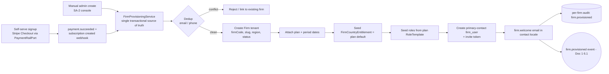

**C. Audited impersonation (the only cross-tenant door)** — realises the Doc 1 §4.5 elevated path; SA-2 owns the operator-facing wrapper, justification, scope, time-box, and the session register:

```mermaid
sequenceDiagram
    actor Op as Super-Admin operator
    participant SA as SA-2 console
    participant IS as Impersonation Service
    participant AU as Per-firm audit chain (Doc 1 7.5)
    participant FW as Firm console (scoped)
    Op->>SA: "Log in as" Firm X
    SA->>Op: Require step-up re-auth + reason + scope (+ supervisor approval for Support)
    Op->>IS: Submit reason + scope (READ_ONLY default / LIMITED_WRITE)
    IS->>IS: Check system/firm:impersonate + gates
    IS->>AU: IMPERSONATION_START {operator, firm, reason, scope, expiresAt}
    IS-->>FW: Mint firm-pool token (aud=er:firm) bound to ONE target firm_id, time-boxed
    Op->>FW: Operate under non-BYPASSRLS role; persistent "Impersonating Firm X as <op>" banner
    Note over FW: Destructive / financial / billing / bulk-export / nested-impersonation BLOCKED in every scope
    IS->>FW: Auto-expire at expiresAt (default 60 min) OR manual end
    IS->>AU: IMPERSONATION_END {endedAt, actionCount}
    FW-->>SA: Operator returned to SA console
```

---

## 1. Purpose & Goal

**What it is.** SA-2 is the control plane for the firms that *are* the business. Every paying immigration firm on ExpatReady is born, configured, entitled, monitored, supported, and (eventually) offboarded here. If SA-1 (Country Packs) is the platform's product catalogue, SA-2 is its customer ledger and operations cockpit: where a firm becomes a live tenant, where its commercial shape (plan + which destination countries it may operate + which data-residency region it lives in) is set, where its health is watched, and where the ExpatReady team safely reaches into a tenant to help — through one audited door and no other.

**The outcome it must produce.** A multi-tenant SaaS lives or dies on three operational truths, and SA-2 exists to make all three structurally true: (1) **a new firm goes from "signed up" to "logged in and working" with zero developer involvement** — provisioning is a product feature, not a runbook; (2) **a firm's blast radius is contained** — RLS (Doc 1 §2.2) guarantees one tenant never sees another's data, and the platform team's own reach into a tenant is the rarest, most-scrutinised, fully-recorded event in the product (Doc 1 §4.5), never an ambient privilege; (3) **the team sees a firm's health before the firm complains** — usage against plan limits, last activity, payment state, support history — so account management is proactive.

**World-class positioning.** Generic tenant admin is "a list of accounts with an enable/disable toggle." ExpatReady's is built for a regulated, global, multi-country SaaS: **per-country entitlement is a first-class monetisable axis** (the lever that turns "we launched Australia" into revenue and the gate that stops a Canada-only firm running an Australian assessment); **impersonation is a high-risk security event, not a convenience** (mandatory justification, explicit scope, step-up re-auth, time-box, persistent banner, destructive-action lockout, optional firm consent/notification, and an immutable per-action log the firm itself can be shown); and **lifecycle is disciplined** (suspend/offboard/delete are governed, reasoned, audited transitions with retained data, offered exports, and law-aware retention before any hard delete — portability and minimisation both designed in).

**How it ties to the platform.** SA-2 **consumes** SA-3 (plans define caps, default entitlements, trial mechanics, and the role template seeded at provisioning); it **grants** the country entitlements that SA-1 packs are scoped by; it **reads** SA-4 (SaaS billing) for subscription/payment state and is the actor that flips a firm to `SUSPENDED` when dunning fails and back on collection; it **emits and consumes** the Doc 1 §6.1 event dictionary (`firm.provisioned`, `firm.status_changed`, `firm.entitlement_granted`); and it is the **only** module that crosses into a tenant's local plane — via §3.7 impersonation, audited end-to-end against the target firm's per-firm chain.

**Global ambition.** The same module serves a Canada-only solo RCIC and a multi-country firm running Canada + Australia + UK desks **with no code change** — single-country is just `countryEntitlements = [CA]`. Region placement is a per-firm dimension (Doc 1 §1.7) resolved at provisioning; portfolio MRR rolls up in one reporting currency via FX snapshots (Doc 1 §6.5), never summed raw across a CAD firm and an AUD firm; primary-contact comms are sent in the contact's locale; lifecycle/trial/SLA clocks are timezone-aware.

---

## 2. Users & Jobs-to-be-Done

"Super-Admin" is an umbrella over distinct platform sub-roles (Doc 1 §4.4 default role matrix). SA-2 is used differently by each.

| Role | Primary job in SA-2 | Representative JTBD |
|---|---|---|
| **Tenant Account Manager** (heaviest user) | Onboard firms, keep their book of accounts healthy, run lifecycle. | "When a firm signs, provision them on the right plan + country entitlements + region and have them receive working login instructions — no developer ticket." · "Show me who is near a plan limit, who hasn't logged in for two weeks, and who has a failed payment, so I reach out before they churn." · "When a firm expands into Australia, grant that entitlement and have their staff see Australian programs immediately." |
| **Support Agent** | Resolve firm-reported issues; reproduce bugs in the firm's exact environment. | "Reproduce a firm's bug in their console — with a justified, recorded reason and supervisor approval — without ever asking for their password." · "Have the session end automatically so I never leave a door open." |
| **Billing-Ops** | Touch SA-2 at the money/lifecycle edge (owns SA-4, triggers SA-2 lifecycle). | "When dunning exhausts retries past grace, move the firm to `SUSPENDED` automatically with reason recorded." · "When payment resolves, reinstate to `ACTIVE` in one click." |
| **Platform Owner** | Own the firm portfolio and the compliance posture. | "Trust that no one reaches a tenant's data except through the audited impersonation path, and let me read every impersonation session from the last N days." · "When a firm offboards, give me certainty the export was delivered and deletion is scheduled per retention policy and legal hold." |
| **Platform Engineer** | Rare, structural interventions. | "When a self-serve provisioning half-completes, show me the partial state and let me safely re-run provisioning idempotently." |

**Design implication.** The Tenant Account Manager is the UI protagonist: directory, firm detail/account view, health dashboard, entitlement controls. Support gets the impersonation entry point (gated). Platform Owner gets the impersonation audit log and offboarding oversight. Billing-Ops drives lifecycle from the money side. Permissions (§10) cleanly separate these — `impersonate` and `offboard` are not granted to everyone with `firm:list`.

---

## 3. Functional Design — How It Works (core)

### 3.0 The Firm-as-Tenant Model

The Firm is the durable identity of an immigration practice on the platform and the tenant boundary itself (Doc 1 §2.1). It holds: legal name, operating name, country of registration, **residency region** (Doc 1 §1.7), the assigned plan, the per-country entitlement set, subscription/rail linkage, status, primary-contact pointer, account-manager pointer, and key dates. It survives even after offboarding (tombstoned, not vaporised) until the retention clock purges it (§3.9). The end-clients a firm serves are modelled as `Party` (Doc 1 §5.2) and are *not* firms; SA-2 never confuses the two.

**Plan vs Entitlement are different axes** — this distinction is the module's spine. The **plan** (SA-3) defines quantitative caps, feature flags, trial mechanics, and a *default* country set; its commercial **price/currency/interval** are owned by SA-4 `PlanPrice` (SA-3 owns only entitlement dimensions — see SA-3 §3.1). The firm's **`FirmCountryEntitlement`** rows define which destination countries *this* firm may operate — seeded from the plan default at provisioning, then independently grantable/revocable (§3.5). Two firms on the same plan can hold different countries. **Entitlement is a resource-availability filter, never a permission**: it controls which countries' programs/reference/forms appear, and never edits a user's `agent/*` role.

### 3.1 Firm Provisioning — Two Doors, One Creation Service

A firm is born two ways, both converging on **one transactional `FirmProvisioningService`** so behaviour never drifts:

1. **Self-serve (Stripe Checkout via PaymentRailPort, Doc 1 §6.3).** A prospective firm completes checkout; a `PendingFirmSignup` row holds firm + primary-contact details; the rail webhook (`@Public({ control: 'webhook-signature' })`, Doc 1 §4.6) provisions the firm on `payment.succeeded` / subscription-created. SA-4 owns the webhook ingestion and signature verification; it calls `FirmProvisioningService`.
2. **Manual admin create.** A Tenant Account Manager submits a new-firm form; the firm is provisioned synchronously.

**The single routine does, in one transaction:** dedup on firm email + phone within the platform (surfacing "link to existing firm" for the returning-firm case, not only a hard error) -> create the Firm with a generated `firmCode` and a **DNS-safe `slug`** that resolves to `slug.app.expatready.com` -> resolve and stamp the **residency region** (Doc 1 §1.7, default the launch region) -> attach the plan + compute subscription period dates -> **seed `FirmCountryEntitlement[]` from the plan default** -> seed roles from the plan's `RoleTemplate` (Doc 1 §4.4) -> create the primary-contact `firm_user` (firm pool, Doc 1 §3.1) with a single-use invite token, set `contactPersonId` -> dispatch the **`firm.welcome` lifecycle email** in the contact's locale -> emit `firm.provisioned` (Doc 1 §6.1) -> write `firm.provisioned` to the firm's per-firm audit chain (Doc 1 §7.5).

**Provisioning-seed RLS write path (NORMATIVE).** The firm-scoped LOCAL writes inside this transaction — the role-seed, the `FirmCountryEntitlement` seed, and the primary-contact `firm_user` create — are themselves tenant rows (`firm_id NOT NULL`) and so are governed by FORCED RLS (Doc 1 §2.2). They MUST be written through the Doc 1 §4.5 elevated path: the provisioning transaction runs under the **non-BYPASSRLS application role** with `SET LOCAL app.current_firm_id` = the just-created `firm_id`, **never under BYPASSRLS and never under a raw platform context** (which would hit the FORCED-RLS `WITH CHECK` fail-closed rejection and tempt a bypass — the silent cross-tenant-leak trap). This is the identical safe-write path used by §3.7 impersonation and SA-5 §3.9 clone-to-firm, and is mirrored by SA-3 §3.5 (entitlement seed) and SA-6 §3.5 (role seed). An acceptance criterion (AC, US-2) asserts the seed write is RLS-confined to the one target firm.

**Custom domain / white-label (NEW vs subdomain-only).** A firm may, post-provisioning, point a **custom CNAME** (e.g. `clients.acmeimmigration.com`) at its portal. SA-2 stores a `FirmDomain` (the requested hostname + verification token + status), instructs the firm to create the verification + CNAME records, polls for verification, and on success orchestrates ACM certificate issuance behind an `ObjectStoragePort`-adjacent **DomainRailPort** (so the DNS/cert provider is swappable). The `DomainRailPort` is a documented **sixth rail** under the Doc 1 §6.3 rails-as-ports doctrine — added to the `railType` enum (its v1 adapter being AWS ACM) and to the Doc 1 §7.7 sub-processor residency matrix alongside the other rails (it is a net-new external sub-processor surface, so it must be enumerated there, not left implicit). Until verified, the firm uses its `slug` subdomain. Domain status is a first-class lifecycle (§6).

**Idempotency.** Self-serve provisioning is idempotent on the rail subscription reference (Doc 1 §6.2.3 per-firm processed-event ledger): a redelivered webhook never double-creates a firm or re-sends onboarding. The whole routine is transactional; a mid-routine failure leaves the firm in `PROVISIONING` and is completed by an idempotent **re-run provisioning** action (Engineer), never a duplicate.

**Screens.** *New-firm modal* (legal/operating name, country of registration, region picker, primary contact incl. locale, plan picker, country-entitlement multi-select defaulting from the plan, trial-vs-active, live dedup banner). *Provisioning result* (links to the new firm detail; shows assigned subdomain + that welcome email queued). *Half-provisioned recovery* (firm in `PROVISIONING` with an idempotent re-run action). *Custom-domain panel* (add hostname -> show DNS records -> verification status -> cert status).

### 3.2 Firm Directory, Search & Filter

A paginated, sortable, cursor-based directory (Doc 1 §8.1 budgets) of every firm: operating + legal name, status badge (lifecycle-coloured), plan, country-entitlement chips, region, MRR contribution (reporting currency via FX snapshot), primary contact, **account manager**, created date, last-staff-activity, quick-actions menu (open / impersonate-if-permitted / suspend / edit).

**Rich filter bar:** status, plan, country entitlement, country of registration, **region**, **account manager (mine / unassigned / any)**, creation-date range, MRR band, payment state (active / past-due / dunning), trial-ending-soon, near-a-limit, inactive-for-N-days. Filters re-query indexed aggregates from `FirmUsageRollup` (§3.6) — never a live full-tenant scan. **Saved views** per operator ("Trials ending this week," "Past-due," "Near user limit," "My unassigned firms"). Bulk actions are deliberately limited to non-destructive ops (assign account manager, tag, export-list); there is no bulk-delete.

### 3.3 The Firm Detail / Account View

The account cockpit for one firm — three zones, every action one click and audited:
- **Left rail — identity & commercial shape.** Operating + legal name, status badge, country of registration, region, **country-entitlement chips with grant/revoke (§3.5)**, assigned plan ("change plan" -> SA-3/SA-4), subscription period + rail linkage, primary contact (click-to-email), **assigned account manager (change)**, `firmCode`, subdomain + custom-domain status, key dates (created, trial-ends, subscription-ends, offboarding/retention dates).
- **Center — health & activity.** The health/usage panel (§3.6): users / clients / cases / storage vs plan limits with utilisation bars; per-country activity; recent audit activity (the firm's per-firm chain, paginated, Doc 1 §7.5); support-ticket summary (SA-10); payment/invoice history (SA-4).
- **Right rail — lifecycle & support.** Status actions (suspend / reinstate / offboard — each a mandatory-reason modal, §3.4); **"Log in as" (impersonate, §3.7)** prominent but gated; plan change; grant/revoke country; resend welcome / re-invite; export firm data (§3.9); manage custom domain.

### 3.4 Firm Lifecycle Engine

A small, explicit transition engine governs firm status. The lifecycle (see §6): `PROVISIONING -> TRIAL -> ACTIVE -> SUSPENDED -> OFFBOARDING -> OFFBOARDED -> DELETED`, with `ACTIVE <-> SUSPENDED` reinstatement and a bounded `OFFBOARDED -> ACTIVE` recovery inside the retention window.

- **Every transition requires a mandatory reason** and writes to the firm's per-firm audit chain (Doc 1 §7.5) with operator, UTC timestamp, from-status, to-status, reason. No silent status writes.
- **Allowed-transition guards** reject illegal moves (e.g. `OFFBOARDED -> ACTIVE` only inside the retention window; reinstatement is `SUSPENDED -> ACTIVE` only) with clear human messages.
- **`SUSPENDED` semantics:** all *staff* logins are rejected ("Account suspended — contact support"; no tenant data served); firm data is retained; Super-Admin reaches it only via impersonation; entering `SUSPENDED` revokes firm-staff sessions (Doc 1 §3.4) and makes protected firm routes return HTTP 402 (SA-4 middleware). **Client-portal access during suspension is a per-firm configurable policy** so end-clients are not stranded by their firm's billing lapse. **The suspension portal-open exception changes ONLY the billing-status gate; it never relaxes isolation:** the Doc 1 §2.5 client-subject (second portal) RLS dimension and the Doc 1 §4.5 ownership-chain / `PortalVisibilityConfig` record-level checks remain fully in force, so a suspended firm's portal user still sees only their own ownership chain — opening the portal during suspension is *not* a scope bypass. The **fail-safe default is portal-CLOSED unless explicitly enabled** (so an unanswered **[FOUNDER-CONFIRM]** never ships as open-by-default).
- **Side-effects are derived from the target status** (session revocation, route-gating flag, portal toggle), idempotent, and non-fatal to the transition (a retried side-effect never blocks the committed status change).
- **Dunning drives `SUSPENDED` automatically.** When SA-4 dunning exhausts retries past grace, it calls `changeStatus(-> SUSPENDED, reason="non-payment (dunning)")`; on collection it reinstates to `ACTIVE`. Both are audited.
- **Concurrency.** Status writes use an optimistic version on the Firm row; two simultaneous operators resolve deterministically (one wins, the other gets a stale-version error), and both attempts are audited — never a torn state.

### 3.5 Per-Country Entitlements

A firm holds a set of `FirmCountryEntitlement` rows — each links the firm to one **ACTIVE** country (SA-1) and is the gate that makes that country's programs, reference data, workflows, and forms visible to firm staff. Seeded from the plan default at provisioning, then independently grantable/revocable, **effective at the next request** (no re-login, no per-user action). The link is by **`countryCode`** (ISO) — the single canonical country join key the whole spine uses (SA-1-2; Doc 1 defines `Country.id == countryCode`), so SA-2 and SA-3 entitlement rows reference the same key SA-1 stamps on every content row (no `countryId` vs `countryCode` mismatch).

- **Additive.** A firm may hold Canada *and* Australia; staff see both. The plan provides a *floor*; Super-Admin grants beyond it; changing a plan never silently strips a manually-granted country.
- **Revoke is non-destructive.** Revoking a country hides its programs from new prospect/case creation but never deletes or hides existing cases/assessments/history for that country (read-only retained). Revoke is a soft-revoke (`revokedAt` set, row kept for history).
- **Enforced server-side.** Country availability is a cached set-intersection applied on every program/reference/form/workflow lookup; frontend filtering is UX, not the control.
- **Only ACTIVE countries are entitleable** (SA-1): a country in the `SUSPENDED` state (the SA-1 Country lifecycle is `FINAL | ACTIVE | SUSPENDED` — there is no `DEPRECATED` *country* state) cannot be newly granted; already-entitled firms retain read-only historical access for a country later suspended in SA-1.

Grant -> create entitlement (`source = MANUAL | PLAN`, `grantedBy`, `grantedAt`) -> invalidate the firm's country-availability cache -> emit `firm.entitlement_granted` (Doc 1 §6.1) -> audit. Revoke -> soft-revoke -> cache invalidate -> emit `firm.entitlement_revoked` -> audit.

### 3.6 Firm Health & Usage View

A health snapshot per firm read from **`FirmUsageRollup`** (NEW — the entity the directory filters and the health panel both depend on; previously referenced but undefined): subscription status, plan, active users / active clients / active cases (by type) / **storage bytes used** — each vs the plan limit with utilisation bars; `MAX(lastLogin)` across staff; ticket summary (SA-10); payment status (SA-4); **per-country activity** (cases by country, active programs, last-assessment date per entitled country).

`FirmUsageRollup` is maintained **incrementally on BullMQ** (Doc 1 §1.4): event-driven increments on the dictionary's create/delete events plus a periodic reconciliation sweep, so the health page never sums live tenant rows. Storage-used is the summed byte size of the firm's stored objects (via the ObjectStoragePort metadata, Doc 1 §6.3), the one number a generic tool never computes. **Threshold crossings** (configurable %, e.g. >=90% of user/storage limit; trial ending in N days; no staff login for N days) raise an internal `notif/firm-threshold` notification (Doc 1 §6.1.2) to the firm's assigned account manager — outreach precedes the wall. MRR is shown in the platform reporting currency via FX snapshot (Doc 1 §6.5); a raw cross-currency sum is a blocked correctness bug.

### 3.7 Secure Audited Impersonation ("Log in as")

This is the operator-facing realisation of the Doc 1 §4.5 elevated cross-tenant contract — the **only** sanctioned cross-`firm_id` access path; all other cross-tenant access is `403 SCOPE_VIOLATION` (Doc 1 §4.2). Because the platform holds applicant PII across many firms, this is the single highest-risk capability in the product, and SA-2 owns its justification, scope, time-box, and register.

- **Entry is gated.** Requires `system/firm:impersonate`; for the **Support tier**, an additional **supervisor approval** is required before a session starts. The capability is not bundled with `firm:list`.
- **Step-up + mandatory justification + explicit scope.** The operator re-authenticates (step-up, Doc 1 §4.5), enters a reason (blank rejected), and chooses a scope: `READ_ONLY` (default) or `LIMITED_WRITE` (benign actions to reproduce a bug). **No scope grants destructive, financial, billing, bulk-export, or nested-impersonation actions** — all blocked in every scope at the firm-side guard, regardless of UI.
- **The token is a real firm-pool token, RLS-confined.** The session mints a short-lived, non-refreshable firm-pool token (`aud = er:firm`, Doc 1 §3.1) bound to **exactly one** target `firm_id`, run under the normal **non-BYPASSRLS** application role with `SET LOCAL app.current_firm_id` = the target firm. A query against any third firm returns zero rows (RLS holds, no bypass) — exactly Doc 1 AC-4.5.7/8. The actor stays the operator (audit attribution), the tenant resolves to the firm.
- **Optional firm consent / notification.** A configurable per-firm policy (`NOTIFIED | CONSENTED | EMERGENCY`) — recorded on the session. **[FOUNDER-CONFIRM]** whether Quebec (Law-25) firms must be pre-`CONSENTED` rather than merely `NOTIFIED`.
- **Persistent banner + time-box.** While impersonating, the firm console shows an unmissable "Impersonating <Firm> as <operator>" banner with "End session." Sessions auto-expire (configurable, default 60 min) or end manually, returning the operator to SA-2.
- **Everything is logged to the target firm's chain.** `IMPERSONATION_START` / `IMPERSONATION_END` plus every per-action `CROSS_TENANT_ACCESS` entry tagged `impersonatedBy` + `impersonationSessionId` land in the target firm's per-firm audit chain (Doc 1 §7.5) — so the firm can be shown, line by line, who from ExpatReady accessed their data, when, why, and what they did. SA-2's `ImpersonationSession` register is the platform-side index (operator, firm, reason, scope, consent choice, start, end, action count).

### 3.8 Primary-Contact, Account Manager, Key Dates & Lifecycle Comms

Each firm has exactly one **primary contact** (`contactPersonId`, a `firm_user`) who receives lifecycle/welcome comms, and exactly one **assigned account manager** (`accountManagerId`, a `platform_user`) responsible for its health (NEW — closes the "no account-manager assignment entity/FR" gap). **Ownership one-liner: the account-manager assignment entity is SA-2-owned** — SA-10 routing/escalation and SA-9 read-models consume it, never define their own. Super-Admin can re-point either, and resend the welcome/re-invite — all audited.

**Lifecycle email catalog (NEW — closes the "lifecycle email catalog absent" gap).** A platform-owned, bilingual (EN + FR, Doc 1 NFR i18n) set of system templates keyed by `eventKey` + locale, rendered via the EmailRelayPort (Doc 1 §6.3) and triggered by lifecycle events (Doc 1 §6.1). **Platform-template ownership: SA-5 (Global Templates) owns the authoring/versioning/publishing of these SYSTEM templates; SA-2 owns only the `eventKey` trigger wiring below and cites SA-5.**

| eventKey | Trigger | To |
|---|---|---|
| `firm.welcome` | `firm.provisioned` | primary contact |
| `firm.invite` | primary-contact (re)invite | invited user |
| `firm.trial-ending` | trial-end approaching | primary contact + account manager (internal) |
| `firm.suspended` | `firm.status_changed -> SUSPENDED` | primary contact |
| `firm.reinstated` | `firm.status_changed -> ACTIVE` (from suspended) | primary contact |
| `firm.country-granted` | `firm.entitlement_granted` (MANUAL) | primary contact |
| `firm.offboarding-started` | `firm.status_changed -> OFFBOARDING` | primary contact |
| `firm.export-ready` | export bundle delivered | primary contact (+ secure download) |
| `firm.deletion-scheduled` | `OFFBOARDED` | primary contact |

The exact body copy is owned by the tech-writer/founder (**[FOUNDER-CONFIRM]**); SA-2 owns the catalog shape, the locale resolution, and the event-to-template wiring.

### 3.9 Offboarding, Data Export & Retention-Scheduled Delete

Offboarding is a structured process, not a delete button, and it routes through the SA-11 governance plane (Doc 1 §7.6) for export, retention, hold, and crypto-shred — SA-2 never reinvents that machinery.

- **Initiate** (status -> `OFFBOARDING`, mandatory reason, audited).
- **Offer a tenant-data export** for portability. The export is an **async BullMQ job** that produces a **per-firm bundle: a machine-readable JSON manifest + the document/object set + per-entity NDJSON files**, the canonical entity set being **Parties (CRM contacts + engaged clients), Cases + applicants, Documents + binaries (via ObjectStoragePort), Invoices/payments-as-recorded (from Biller — never recomputed), Notes, Communications, and the firm's per-firm audit chain** (NEW — closes the "no export format / schema / complete-entity-list / secured-download" gap). The export is **masked-by-default**: Restricted PII is masked unless a reveal is authorized per Doc 1 §7.2 (reveal-permission-gated). An **unmasked** export (the authorized, identity-verified case) MUST, in addition to the data-egress audit event, emit the Doc 1 §7.2 reveal audit — a bulk `PII_REVEAL` entry carrying the field set + subject + actor + justification, written fail-closed before any cleartext is produced — so the single offboarding-egress chokepoint inherits the same reveal-audit guarantee as an in-app reveal. Delivery is via an **unguessable, single-purpose, time-boxed capability token** (Doc 1 §4.6), never a guessable id — **[FOUNDER-CONFIRM]** whether the bundle is exposed in the firm's own console or handed over out-of-band.
- **Configure a retention period** >= the legal minimum for the firm's jurisdiction (SA-1 / SA-11 content; the floor is code-enforced per Doc 1 §7.6, never settable below). Status -> `OFFBOARDED`; the retention clock starts; data is read-only via impersonation only.
- **Scheduled purge -> `DELETED`** when retention elapses **and no `LegalHold` is active** (legal hold beats deletion, Doc 1 §7.6): the SA-11 disposal orchestrator crypto-shreds the firm's per-subject keys (Doc 1 §7.1/§7.4) and verifies hard-delete, leaving a tombstone + a `DATA_DISPOSED` chained audit entry — never a silent vanish.

---

## 4. Detailed Functional Requirements (SA-2-n)

**Provisioning**
- **SA-2-1** — Super-Admin can create a firm tenant with: legal name, operating name, country of registration, **residency region**, primary contact (name, email, phone, locale), assigned plan, and initial per-country entitlement(s).
- **SA-2-1a** — Self-serve checkout and manual create converge on one transactional `FirmProvisioningService`; a firm born either way is structurally identical (same dedup, region stamp, role-seed, entitlement-seed, contact pointer, welcome).
- **SA-2-2** — Provisioning, in one transaction: generate `firmCode`; assign a DNS-safe `slug` resolving to a subdomain; resolve + stamp region; attach plan + period dates; seed roles from the plan `RoleTemplate`; seed country entitlements from the plan default; create the primary-contact `firm_user` (+ invite token) and set `contactPersonId`; assign an account manager; send the `firm.welcome` email in the contact's locale; emit `firm.provisioned`; write the provenance audit entry. **The firm-scoped LOCAL seed writes (role-seed, entitlement-seed, owner `firm_user`) run under the Doc 1 §4.5 elevated path** — the non-BYPASSRLS application role with `SET LOCAL app.current_firm_id` = the just-created firm — never BYPASSRLS and never a raw platform context (see §3.1; reconciled with SA-3 §3.5 and SA-6 §3.5).
- **SA-2-2a** — Self-serve provisioning is idempotent on the rail subscription reference (per-firm processed-event ledger); a redelivered webhook never double-creates or re-sends onboarding.
- **SA-2-2b** — A firm may register a **custom domain** (CNAME): SA-2 stores the requested hostname + verification token, surfaces the DNS records, polls for verification, orchestrates certificate issuance behind a swappable `DomainRailPort` (the documented sixth rail under Doc 1 §6.3, v1 adapter AWS ACM, enumerated in the Doc 1 §7.7 sub-processor matrix), and falls back to the `slug` subdomain until verified.
- **SA-2-3** — The firm directory is searchable/filterable by name, status, plan, country entitlement, country of registration, region, account manager, creation date, MRR band, payment state, trial-ending, near-limit, inactive-N-days; supports per-operator saved views; reads aggregates from `FirmUsageRollup`.

**Lifecycle**
- **SA-2-4** — Status lifecycle is `PROVISIONING -> TRIAL -> ACTIVE -> SUSPENDED -> OFFBOARDING -> OFFBOARDED -> DELETED`, with `SUSPENDED -> ACTIVE` reinstatement and bounded `OFFBOARDED -> ACTIVE` recovery.
- **SA-2-5** — Every status change requires a mandatory reason and writes a chained audit entry (operator, UTC, from, to, reason); illegal transitions are guard-rejected with a clear message; status writes are optimistic-locked.
- **SA-2-6** — `SUSPENDED` firms: staff logins rejected, sessions revoked, protected routes 402; data retained; reachable only via impersonation; client-portal access during suspension is a per-firm configurable policy that **defaults CLOSED** and, when enabled, changes ONLY the billing-status gate — the Doc 1 §2.5 client-subject RLS dimension and §4.5 ownership-chain checks remain fully in force (a suspended firm's portal user still sees only their own ownership chain).
- **SA-2-7** — Offboarding follows the structured process (export offered, retention >= legal minimum configured, scheduled disposal) culminating in `DELETED` with tombstone + audit.
- **SA-2-8** — Super-Admin can reinstate a `SUSPENDED` firm to `ACTIVE`; audited.
- **SA-2-8a** — SA-4 dunning, on grace-expiry, calls the engine to `SUSPENDED` (reason = non-payment); successful collection reinstates to `ACTIVE` — automatically and audited.

**Trial mechanics (NEW — closes "trial mechanics open")**
- **SA-2-8b** — Trial is **plan-driven**: a plan (SA-3) carries `trialDays`; provisioning under a trial plan lands the firm in `TRIAL` with `trialEndsAt = now + trialDays` and no payment required. **[FOUNDER-CONFIRM]** whether per-firm trial extension is allowed and its cap.
- **SA-2-8c** — A scheduled clock evaluates `TRIAL` firms at `trialEndsAt`: with a valid payment -> `ACTIVE`; without -> `SUSPENDED` (reason = trial expired). The `firm.trial-ending` email fires N days before (N = **[FOUNDER-CONFIRM]**).

**Per-country entitlements**
- **SA-2-9** — Each firm is entitled to >=1 country (or zero by explicit policy, §13); staff may access only entitled countries' programs/reference/workflows/forms, enforced server-side.
- **SA-2-10** — Super-Admin can grant/revoke a country entitlement at any time, effective at the next request (no re-login).
- **SA-2-11** — Entitlements are additive (Canada AND Australia -> both visible).
- **SA-2-12** — The plan provides a default floor; Super-Admin overrides per firm independently; a plan change never silently strips a manually-granted country.
- **SA-2-13** — Revoking a country hides it from new creation but never deletes/hides existing cases/history (read-only retained).
- **SA-2-13a** — Only ACTIVE countries are newly entitleable; a `SUSPENDED` country (SA-1 Country lifecycle `FINAL | ACTIVE | SUSPENDED`) cannot be granted; already-entitled firms keep read-only historical access when a country is later suspended in SA-1.

**Health & usage**
- **SA-2-14** — Per firm, a health snapshot from `FirmUsageRollup`: subscription status, plan, active users / clients / cases-by-type / storage-used — each vs plan limit; last-login; ticket summary; payment status.
- **SA-2-14a** — Storage-used is computed (summed object bytes); threshold crossings (configurable %) raise `notif/firm-threshold` to the account manager.
- **SA-2-15** — Per-country activity per firm: cases by country, active programs, last-assessment date per country.

**Impersonation**
- **SA-2-16** — Super-Admin with `system/firm:impersonate` (Support tier also requires supervisor approval) can start an impersonation session requiring step-up re-auth, a mandatory reason, an explicit scope (`READ_ONLY` default / `LIMITED_WRITE`), and a consent/notification choice; minting a firm-pool token bound to one target firm under the non-BYPASSRLS role (Doc 1 §4.5), and writing `IMPERSONATION_START` to the target firm's chain.
- **SA-2-17** — During impersonation a persistent banner shows the context; destructive / financial / billing / bulk-export / nested-impersonation actions are blocked in every scope; every action is tagged `impersonatedBy` + `sessionId`.
- **SA-2-18** — Sessions are time-limited (configurable, default 60 min), auto-expire, return the operator to SA-2, and use non-refreshable tokens.
- **SA-2-19** — The Platform Owner can view all impersonation sessions (operator, firm, reason, scope, consent, start, end, action count) for at least the last N days.

**Contact, account manager & comms**
- **SA-2-20** — Super-Admin can change a firm's primary contact (must be a `firm_user` of that firm) and its assigned account manager (a `platform_user`), and resend welcome/re-invite; all audited.
- **SA-2-20a** — A bilingual lifecycle email catalog (§3.8) is wired to lifecycle events; emails render in the recipient's locale.

**Offboarding & data governance**
- **SA-2-21** — Offboarding offers an async tenant-data export (defined entity set + JSON manifest + masked-by-default + secured capability-token download), records its delivery as an egress audit event, **and — when the export is produced unmasked — additionally emits the Doc 1 §7.2 bulk `PII_REVEAL` audit (field set + subject + actor + justification, fail-closed before cleartext)**; it schedules retention-policy disposal via SA-11; the eventual purge crypto-shreds and leaves a tombstone + audit.

---

## 5. Business Rules & Logic

- **BR-1 (Firm = tenant boundary).** Every tenant-owned row is `firm_id`-scoped and RLS-isolated (Doc 1 §2.2). No query crosses `firm_id` except the audited impersonation path (§3.7).
- **BR-2 (One provisioning service).** Manual and self-serve MUST call one routine; divergent firm-creation paths are a defect.
- **BR-3 (Provisioning idempotency).** Self-serve is keyed on the rail subscription reference; a redelivered webhook is a no-op after first success.
- **BR-4 (Dedup before create).** Deduped on email + phone within the platform; a conflict surfaces link-existing or a clear error — never a silent duplicate.
- **BR-5 (Transitions guarded + reasoned + locked).** Only allowed transitions (§6); every change carries a mandatory reason and a chained audit entry; status writes are optimistic-locked. No raw status writes.
- **BR-6 (SUSPENDED != deleted).** Suspended data is retained and reachable only by audited impersonation; staff are locked out; portal access is a configurable exception that defaults CLOSED and never relaxes the Doc 1 §2.5/§4.5 isolation layers.
- **BR-7 (Entitlement is a filter, not a permission).** Country entitlement controls which countries' resources appear; it never grants/revokes a user permission and never edits a role.
- **BR-8 (Revoke preserves history).** Revoking a country hides new creation; existing cases/data for that country remain read-only. Never cascade-delete on revoke.
- **BR-9 (Plan default is a floor).** A firm always holds at least its plan's default countries; manual grants are additive; a plan change never strips a manual grant.
- **BR-10 (Only ACTIVE countries entitleable).** `SUSPENDED`/`FINAL` countries (the SA-1 Country lifecycle is `FINAL | ACTIVE | SUSPENDED`) cannot be newly granted.
- **BR-11 (Impersonation least-privilege).** `READ_ONLY` default; no scope permits destructive/financial/billing/bulk-export/nested-impersonation; blank reason rejected; Support tier requires supervisor approval; step-up re-auth required.
- **BR-12 (Impersonation is RLS-confined + accountable).** The session is a firm-pool token bound to one firm under the non-BYPASSRLS role (Doc 1 §4.5); a third firm yields zero rows; sessions auto-expire; tokens are non-refreshable; START/END + per-action entries are immutable in the target firm's chain.
- **BR-13 (Offboarding before delete).** A firm is never hard-deleted directly; it must pass `OFFBOARDING -> OFFBOARDED -> DELETED`. Hard-delete outside this path is forbidden.
- **BR-14 (Retention >= legal minimum; hold beats deletion).** The configured retention must meet/exceed the code-enforced jurisdictional floor (Doc 1 §7.6); an active `LegalHold` overrides the disposal schedule; a tombstone + audit survive the purge.
- **BR-15 (Reporting currency for MRR).** Cross-firm MRR/ARR roll-ups convert each firm's value to the platform reporting currency via an FX snapshot (Doc 1 §6.5); raw cross-currency summing is a blocked correctness bug.
- **BR-16 (Audit everything stateful).** Provision, status change, plan change, entitlement grant/revoke, contact/account-manager change, impersonation start/end + per-action, export (incl. the §7.2 reveal audit on an unmasked export), purge — all write immutable chained audit entries attributing the operator (Doc 1 §7.5).
- **BR-17 (Region is immutable post-provisioning by default).** A firm's residency region is stamped at provisioning; relocating a firm's region is an out-of-band, governance-reviewed data-move, not a free edit — **[FOUNDER-CONFIRM]**.
- **BR-18 (Provisioning seed is RLS-confined).** The firm-scoped seed writes (roles, entitlements, owner user) run under the non-BYPASSRLS app role with `SET LOCAL app.current_firm_id` = the new firm (Doc 1 §4.5); BYPASSRLS or a raw platform context for these writes is forbidden.

---

## 6. States & Lifecycle

**Firm status state machine** (authoritative):

| From -> To | Trigger | Guard / requirement | Side-effects |
|---|---|---|---|
| `[*]` -> **PROVISIONING** | create (manual / checkout) | dedup clean | firm row, `firmCode`, slug, region |
| PROVISIONING -> **TRIAL** | provisioning complete (trial plan) | plan has `trialDays` | `trialEndsAt` set |
| PROVISIONING -> **ACTIVE** | provisioning complete (paid) | payment present | subscription dates set |
| TRIAL -> **ACTIVE** | firm pays | valid payment | period dates set |
| TRIAL -> **SUSPENDED** | trial expired, no payment | `trialEndsAt` passed | staff locked out |
| **ACTIVE -> SUSPENDED** | dunning grace-expiry OR manual | reason required | sessions revoked; 402 on protected routes; portal optional (default closed) |
| **SUSPENDED -> ACTIVE** | reinstate (payment resolved / manual) | reason required | access restored |
| ACTIVE/SUSPENDED -> **OFFBOARDING** | offboard initiated | reason required | export job triggered |
| OFFBOARDING -> **OFFBOARDED** | export delivered | retention >= floor configured | retention clock starts; read-only via impersonation |
| OFFBOARDED -> **ACTIVE** | recover in window | within retention; Platform Owner; reason | access restored; clock cleared |
| OFFBOARDED -> **DELETED** | retention elapsed | no active LegalHold; scheduled job | crypto-shred purge; tombstone + audit kept |

**Impersonation session lifecycle:** `REQUESTED -> (supervisor approval, Support tier) -> ACTIVE -> (auto-expire | manual end) -> ENDED`. An ENDED session is immutable and cannot resume (a new session is a new record).

**Entitlement lifecycle (per firm x country):** `GRANTED (source = PLAN | MANUAL) -> REVOKED (revokedAt set; row retained)`. Re-granting reactivates `GRANTED`; history is never destroyed.

**Custom-domain lifecycle:** `REQUESTED -> PENDING_VERIFICATION -> VERIFIED -> ACTIVE` (cert issued) with a `FAILED` branch (verification timeout / cert failure) returning to `REQUESTED`; removal -> `RETIRED` (firm reverts to subdomain).

---

## 7. Key Entities & Fields

> Cross-cutting `AuditLog` (per-firm chain), `Notification`, `Note`, `LegalHold`, `RetentionPolicy`, `Party`, `permission_catalog`, `RoleTemplate`, `FxRateSnapshot` are defined once platform-wide (Doc 1 §5–§7) and reused here, never redefined. All TENANT/CLIENT-PII tables carry `firm_id` and FORCED RLS (Doc 1 §2.2). GLOBAL-plane tables (firm-wide registry rows) carry the read-only-permissive/admin-write policy (Doc 1 §2.6).

**`Firm`** — GLOBAL-plane (the tenant root; not itself `firm_id`-scoped — it *is* the `firm_id`)
- `id` uuid PK · `firmCode` text unique · `slug` text unique (DNS-safe) · `legalName` text · `operatingName` text · `countryOfRegistration` text(ISO) · `residencyRegion` text (Doc 1 §1.7)
- `email` text · `phone` text · `address` jsonb · `website` text? · billing block (`billingName/Address/Phone/Email`)
- `status` enum(`PROVISIONING|TRIAL|ACTIVE|SUSPENDED|OFFBOARDING|OFFBOARDED|DELETED`)
- `planId` uuid FK -> SA-3 SubscriptionPlan · `railCustomerRef` text? · `railSubscriptionRef` text? (opaque, via PaymentRailPort)
- `subscriptionStartDate` ts? · `subscriptionEndDate` ts? · `trialEndsAt` ts? · `offboardingStartedAt` ts? · `retentionEndsAt` ts? · `deletedAt` ts?
- `contactPersonId` uuid FK -> firm_user (primary contact) · `accountManagerId` uuid FK -> platform_user
- `portalAccessDuringSuspension` boolean (policy; default FALSE = portal-CLOSED) · `impersonationConsentPolicy` enum(`NOTIFIED|CONSENTED|EMERGENCY`)
- `version` int (optimistic lock) · `createdAt`/`updatedAt`
- indexes: `@@unique([firmCode])`, `@@unique([slug])`, `@@index([status])`, `@@index([planId])`, `@@index([accountManagerId])`, `@@index([residencyRegion])`

**`FirmCountryEntitlement`** — TENANT (`firm_id`-scoped)
- **Normative shape owned by SA-3 §7** (the ONE entity definition — `countryCode` join key per SA-1-2, `source PLAN|MANUAL`, grant + revoke-preserves-history columns, `@@unique([firmId, countryCode, revokedAt])` one-live-row rule). SA-2 operates the grant/revoke write surface (§3.5) and **cites** that definition rather than re-declaring the fields.

**`FirmUsageRollup`** — TENANT (NEW; the health/directory aggregate, one row per firm, queue-maintained)
- `firmId` PK/FK · `activeUserCount` int · `activeClientCount` int · `caseCountByType` jsonb · `storageBytesUsed` bigint · `lastStaffLoginAt` ts? · `openTicketCount` int · `mrrMinor` bigint · `mrrCurrency` text(3) · `mrrFxSnapshotId` uuid? -> FxRateSnapshot (the immutable snapshot whose unified fields — `baseCurrency`/`quoteCurrency`/`asOf`/`economicMoment` — are owned by Doc 1 §6.5; consumers store only `fxSnapshotId`) · `perCountryActivity` jsonb · `computedAt` ts
- `@@index([firmId])`

**`ImpersonationSession`** — GLOBAL-plane register (the platform-side index; the authoritative trail is the target firm's audit chain, Doc 1 §7.5)
- `id` uuid PK · `operatorId` uuid FK -> platform_user · `firmId` FK -> Firm (target) · `reason` text (required) · `scope` enum(`READ_ONLY|LIMITED_WRITE`) · `consentChoice` enum(`NOTIFIED|CONSENTED|EMERGENCY`) · `approvedBy` uuid? (Support tier) · `tokenJti` text (the bound firm-pool token id) · `startedAt` ts · `expiresAt` ts · `endedAt` ts? · `endReason` enum(`AUTO_EXPIRED|MANUAL`)? · `actionCount` int
- append-only/immutable after END · `@@index([firmId])` · `@@index([operatorId])` · `@@index([startedAt])`

**`FirmDomain`** — TENANT (NEW; custom-domain / CNAME)
- `id` uuid PK · `firmId` FK · `hostname` text unique · `status` enum(`REQUESTED|PENDING_VERIFICATION|VERIFIED|ACTIVE|FAILED|RETIRED`) · `verificationToken` text · `certRef` text? (opaque ref via `DomainRailPort`) · `verifiedAt` ts? · `createdAt`
- `@@unique([hostname])` · `@@index([firmId])`

**`PendingFirmSignup`** — GLOBAL-plane (self-serve pre-provision holding row)
- `id` uuid PK · `railCheckoutRef` text unique · firm + primary-contact draft fields · `planId` · `consumedAt` ts? · `createdAt`

**`LifecycleEmailTemplate`** — GLOBAL-plane (config-as-data, Doc 1 §2.6; bilingual; **template authoring/versioning owned by SA-5, the platform-template owner — SA-2 owns the trigger wiring, §3.8**)
- `eventKey` text · `locale` text · `subject` text · `bodyMjml` text · `isActive` boolean · `@@unique([eventKey, locale])`

Lifecycle status changes are recorded **in the firm's per-firm `AuditLog` chain** (Doc 1 §7.5) — `category = firm.lifecycle`, `action`, `entityType = Firm`, before/after status, `reason` — not a separate status-change table. The audit spine already carries `impersonatedBy` / `impersonationSessionId` tagging (Doc 1 §7.5), so no bespoke impersonation-action table is needed.

### ERD

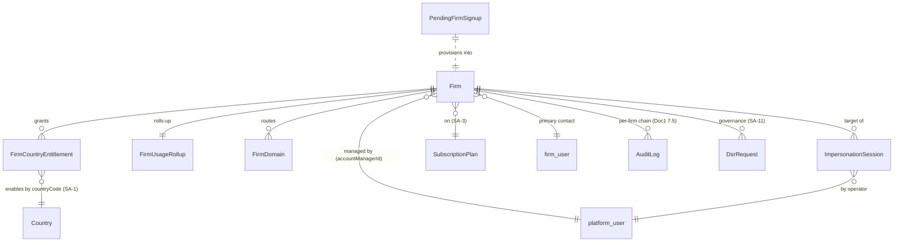

---

## 8. User Stories + Acceptance Criteria (G/W/T)

**US-1 — Provision a firm without developer involvement.**
- **Given** a Tenant Account Manager submits a new-firm form (Professional plan, Canada entitlement, launch region), **When** the firm is created, **Then** a `firmCode` and unique subdomain are generated, the region is stamped, the plan's role template is seeded, a Canada `FirmCountryEntitlement` is created, an account manager is assigned, the primary-contact `firm_user` is created with `contactPersonId` set, and the `firm.welcome` email is dispatched in the contact's locale within 60 seconds.
- **Given** the same firm email exists, **When** create is submitted, **Then** it is rejected or offers link-existing — never a silent duplicate.

**US-2 — Self-serve and manual provisioning produce identical, RLS-confined firms.**
- **Given** one firm via checkout and one via manual create on the same plan, **When** both complete, **Then** both have a subdomain, a region, a `contactPersonId`, an account manager, seeded entitlements, seeded roles, and period dates — identical shape.
- **Given** a subscription-created webhook is redelivered, **When** processed twice, **Then** the firm is created exactly once and onboarding is sent once (idempotent on the rail reference).
- **Given** the provisioning transaction seeds firm-scoped rows (roles, entitlements, owner `firm_user`), **When** the seed executes, **Then** it runs under the non-BYPASSRLS app role with `SET LOCAL app.current_firm_id` = the just-created firm and writes ONLY into that one target firm (a concurrent attempt to write any other firm's rows in the same transaction is RLS-rejected) — no BYPASSRLS, no raw platform context (Doc 1 §4.5, mirrors AC-4.5.8 / SA-5).

**US-3 — Suspend with a recorded reason; staff are locked out.**
- **Given** a firm is set to `SUSPENDED` with reason "non-payment," **When** a staff member attempts to log in, **Then** they see "Account suspended — contact support," no firm data is served, sessions are revoked, and a chained audit entry records operator/from/to/reason/UTC.
- **Given** a `SUSPENDED` firm with portal-access-during-suspension disabled (the default), **When** an end-client tries the portal, **Then** access is closed; and where it is explicitly enabled, **When** an end-client opens the portal, **Then** they still see only their own ownership chain (Doc 1 §2.5/§4.5 unchanged).
- **Given** a `SUSPENDED` firm, **When** Super-Admin reinstates to `ACTIVE`, **Then** access is restored and the reinstatement is audited.

**US-4 — Grant a country; staff see it immediately.**
- **Given** Super-Admin grants Australia to a Canada-only firm, **When** firm staff next create a case, **Then** Australian programs appear without re-login or per-user action, and the grant is audited and emits `firm.entitlement_granted`.
- **Given** Super-Admin revokes Australia, **When** staff attempt a new case, **Then** Australian programs are absent **and** existing Australian cases remain fully readable.

**US-5 — Health view flags a firm near a limit before the wall.**
- **Given** a firm has 5 staff on a `maxUsers = 5` plan, **When** I open the health view, **Then** the users bar reads 5/5 at 100% (red) with an at-limit indicator.
- **Given** stored documents exceed 90% of the storage limit, **When** the rollup refreshes, **Then** a `notif/firm-threshold` notification is raised to the account manager and the storage bar shows computed used-vs-limit %.

**US-6 — Impersonate with a justified, recorded, time-boxed, RLS-confined session.**
- **Given** a Support Agent starts impersonation with no reason, **When** they submit, **Then** it is rejected with a validation error.
- **Given** a Support Agent (with supervisor approval + step-up re-auth) starts a `READ_ONLY` session of Firm X, **When** active, **Then** a persistent "Impersonating Firm X as <agent>" banner shows, `IMPERSONATION_START` lands in Firm X's chain, and any delete / invoice / billing-change / bulk-export / nested-impersonation attempt is blocked.
- **Given** the active session, **When** the agent queries any other firm, **Then** zero rows return (RLS confined to the one target firm, no BYPASSRLS — Doc 1 AC-4.5.8).
- **Given** the session reaches 60 minutes, **When** the timer expires, **Then** it auto-ends, the operator returns to SA-2, and an `IMPERSONATION_END` records `endedAt` + `actionCount`.
- **Given** the Platform Owner queries sessions for the last N days, **When** the log loads, **Then** every session lists operator, firm, reason, scope, consent, start, end, action count.

**US-7 — Offboard with defined export + scheduled, hold-aware deletion.**
- **Given** Super-Admin initiates offboarding (reason recorded), **When** the export job completes, **Then** a JSON-manifest + NDJSON + object bundle (the defined entity set) is produced masked-by-default with Restricted PII masked, delivery is recorded as an egress audit event, downloadable via a capability token, a retention period >= the floor is set, and status becomes `OFFBOARDED`.
- **Given** the export is produced **unmasked** (authorized, identity-verified, reveal-permission granted), **When** cleartext is generated, **Then** a bulk `PII_REVEAL` audit (field set + subject + actor + justification) is written fail-closed before the cleartext, in addition to the egress event (Doc 1 §7.2).
- **Given** an `OFFBOARDED` firm's retention elapses with no active legal hold, **When** the purge job runs, **Then** per-subject keys are crypto-shredded, hard-delete is verified, status becomes `DELETED`, and a tombstone + `DATA_DISPOSED` audit survive.
- **Given** an `OFFBOARDED` firm under a `LegalHold`, **When** the purge job runs, **Then** disposal is refused and the refusal is audited.

---

## 9. Edge Cases & Validations

- **Duplicate firm on self-serve.** A checkout email matching an existing firm updates that firm's subscription rather than creating a duplicate; phone collision must not silently mangle the real phone (no synthetic suffix) — surface link-existing.
- **Half-provisioned firm.** Webhook creates the firm but user-creation fails -> firm stuck in `PROVISIONING`; the idempotent re-run completes it without duplicating firm or role.
- **Suspend mid-impersonation.** If a firm is suspended while an operator impersonates it, the session-end-vs-continue behaviour follows the suspend-during-impersonation policy (**[FOUNDER-CONFIRM]**); never leave a live session on a now-suspended firm undecided.
- **Revoke the last country.** Whether a firm may hold zero entitlements is policy (§13); revoking the last one requires explicit confirmation, never a silent "firm can do nothing."
- **Grant a SUSPENDED country.** Blocked (the SA-1 Country lifecycle is `FINAL | ACTIVE | SUSPENDED`; only ACTIVE is grantable); an already-entitled firm whose country is later suspended in SA-1 keeps read-only historical access.
- **Plan downgrade below usage.** Firm has 8 users, downgraded to `maxUsers = 5` -> existing users retained, creation gated until under limit; never a destructive auto-delete.
- **MRR across currencies.** A CAD + AUD portfolio converts via FX snapshot; a raw sum is a blocked correctness bug.
- **Impersonation token replay/refresh.** A captured token is non-refreshable and useless after `expiresAt`; nested impersonation is blocked; the token is bound to exactly one `firm_id`.
- **Offboard then recover.** Inside the retention window an `OFFBOARDED` firm is recoverable (Platform-Owner action, audited); after `DELETED` only the tombstone remains.
- **Concurrent status changes.** Two operators changing status simultaneously resolve via optimistic lock; the loser gets a stale-version error; both attempts are audited.
- **Subdomain / custom-domain collision.** Slug generation guarantees uniqueness + DNS-safe characters; a custom hostname already claimed by another firm is rejected; an unverified domain never serves traffic.
- **Region mismatch.** A firm's resolved serving region must match its stamped `residencyRegion`; a request resolving a firm to a non-allowlisted region fails closed (Doc 1 §2.9 region-allowlist).
- **Export of a large firm.** The export streams (never loads whole), runs off-peak on BullMQ, and is resumable; a partial/failed export is reported, never silently truncated.

---

## 10. Permissions (GLOBAL `system/*`)

Per Doc 1 §4.1, GLOBAL = `system/*`, held only by `platform`-pool principals (`aud = er:platform`); the scope-aware guard rejects any LOCAL-pool token on these routes with `403 SCOPE_VIOLATION` (Doc 1 §4.2). All keys are seeded in the Wave-A catalog increment (Doc 1 §4.4) and CI-validated against routes. GLOBAL `system/*` keys are qualifier-N/A per Doc 1 AC-4.1.3 (there is no intra-firm `view.own`/`view.all` ownership on the platform plane); each key below is reconciled by the Doc 1 §4.4 CI completeness check against this module's delivered `@RequirePermissions` routes. Default-deny.

| Permission | Description | Notes |
|---|---|---|
| `system/firm:list` | View firm directory + aggregates | Tenant Account Manager, Support |
| `system/firm:show` | View a firm's detail / account | includes health (no separate key) |
| `system/firm:create` | Provision a new firm | |
| `system/firm:edit` | Edit firm profile, plan, contact, account manager, domain | |
| `system/firm:suspend` | Suspend / reinstate | not bundled with `:edit` |
| `system/firm:entitle` | Grant / revoke country entitlements | not bundled with `:edit` |
| `system/firm:impersonate` | Start an impersonation session | **never** bundled with `:list`; Support tier also gated by supervisor approval |
| `system/firm:view-impersonation-log` | Read the impersonation session register | Platform Owner / Auditor |
| `system/firm:offboard` | Initiate offboarding / export / scheduled delete | Platform Owner; not bundled with `:list` |

Least-privilege segmentation across the ~6 platform sub-roles (Doc 1 §4.4): Support holds `list/show/impersonate(read-only, approval-gated)`; Tenant Account Manager holds `list/show/create/edit/suspend/entitle`; Billing-Ops holds `list/show/suspend` (drives lifecycle from SA-4); Platform Owner + Auditor hold `view-impersonation-log` and `offboard`. **[FOUNDER-CONFIRM]** the exact platform-staff segmentation.

---

## 11. Scalability · Security · Performance

**Provisioning (§3.1).** *Scalability:* one transactional service; self-serve scales with rail-webhook throughput (queue-backed, idempotent on the rail reference, Doc 1 §6.2.3). *Security:* dedup prevents duplicate-firm hijack; invite tokens are single-use + time-boxed; the manual path is `system/firm:create`-gated; the webhook is `@Public({control:'webhook-signature'})` (Doc 1 §4.6); the firm-scoped seed writes run RLS-confined via the §4.5 elevated path (non-BYPASSRLS, `SET LOCAL` to the new firm), never BYPASSRLS. *Performance:* sub-second manual create; self-serve returns immediately (async webhook); slug-uniqueness check is indexed; within the Doc 1 §8.1 write budget (p95 <= 600ms).

**Directory & detail (§3.2–3.3).** *Scalability:* cursor-paginated indexed reads + `FirmUsageRollup` aggregates — never a live full-tenant scan; scales to the Doc 1 §8.2 launch capacity. *Security:* `:list`/`:show`-gated; the directory exposes firm-level metadata + aggregates only, no tenant *content*. *Performance:* counts come from the rollup, not `COUNT(*)` over live tenant tables; billing history fetched from SA-4, failure-tolerant; read budget p95 <= 300ms (Doc 1 §8.1).

**Lifecycle (§3.4).** *Scalability:* side-effects (session revocation, route-gating, portal toggle) are idempotent, queueable, non-fatal to the transition. *Security:* guarded + reasoned + optimistic-locked; chained audit on every change (Doc 1 §7.5); `SUSPENDED` instantly revokes staff sessions and 402-gates protected routes (SA-4); the portal-during-suspension exception defaults closed and changes only the billing gate, leaving the §2.5/§4.5 isolation layers in force. *Performance:* one guarded update + async side-effects; reinstatement is one write + cache invalidation.

**Entitlements (§3.5).** *Scalability:* small per-firm set; the country check is a cached set-intersection per lookup, O(entitlements). *Security:* server-side enforcement; additive-only; ACTIVE-country-only; revoke never cascades; never edits permissions. *Performance:* grant/revoke invalidates the firm's availability cache; staff see changes next request.

**Health (§3.6).** *Scalability:* `FirmUsageRollup` maintained by event-driven increments + periodic reconciliation on BullMQ; the page never sums live tenant rows. *Security:* aggregates only, no PII leaves the tenant via the health view; `:show`-gated. *Performance:* bars read pre-aggregated values; threshold notifications fire from the rollup job, not on page load.

**Impersonation (§3.7) — highest-risk surface.** *Scalability:* sessions are short-lived and few; the register is indexed by operator/firm/date; per-action audit is the per-firm chain (Doc 1 §7.5). *Security (the crux):* permission-gated + (Support) supervisor-approved + step-up re-auth + mandatory reason; least-privilege scope with destructive/financial/billing/bulk-export/nested blocked in every scope; a real firm-pool token (`aud=er:firm`) bound to one `firm_id` under the **non-BYPASSRLS** role so RLS confines the session and a third firm yields zero rows (Doc 1 AC-4.5.7/8); persistent banner; every action tagged `impersonatedBy`/`sessionId`; immutable chained records; optional firm consent/notification — the firm can be shown exactly who accessed their data, when, why, and what they did. This is the only sanctioned cross-`firm_id` path; all other cross-tenant access is `403 SCOPE_VIOLATION`. *Performance:* token mint + session create is cheap; auto-expiry is a queue timer; the log read is indexed.

**Offboarding (§3.9).** *Scalability:* export + purge are async BullMQ jobs (never blocking); purge scheduled by retention date, run off-peak. *Security:* `:offboard`-gated; export masked-by-default (Doc 1 §7.6) with an unmasked export emitting the §7.2 bulk `PII_REVEAL` audit before cleartext, delivered via capability token (Doc 1 §4.6); purge crypto-shreds per-subject keys (Doc 1 §7.4) and leaves a tombstone + `DATA_DISPOSED` chained audit; retention >= code-enforced floor; legal hold beats deletion. *Performance:* export streams large data sets; purge is batched.

---

## 12. Reference Note (exists / NEW / CHANGED)

> Honesty doctrine per Doc 1 §1.8: this is a **greenfield build measured solely against this specification**. The prototype is design-provenance only — informational, never normative. Notes below state target-state facts and flag where the prototype shape was thinner than this target (to calibrate effort), not a migration obligation.

**Target-state foundations inherited (built by Doc 1, not re-built here):** RLS isolation (§2.2), three walled auth pools incl. the `er:platform` super-admin pool (§3.1), `system/*` namespace + scope-aware guard + permission catalog (§4.1–§4.4), the elevated impersonation/cross-tenant-write contract — firm-pool token (and the provisioning seed) bound to one firm under the non-BYPASSRLS role with `SET LOCAL` + START/END audit (§4.5), the Party spine (§5.2), the per-firm hash-chained audit spine with `impersonatedBy` tagging + `PII_REVEAL` reveal audit (§7.2/§7.5), the SA-11 governance plane: export, retention floors-in-code, legal hold, crypto-shred (§7.4/§7.6), the event dictionary (§6.1), rails-as-ports (§6.3), FX snapshot with unified `baseCurrency`/`quoteCurrency`/`asOf`/`economicMoment` fields (§6.5), the region seam (§1.7/§2.9), KMS region-scoped keys (§7.1), the sub-processor matrix (§7.7). SA-2 consumes these.

**NEW (SA-2's own deliverables):**
- `FirmCountryEntitlement` and the entire per-country entitlement axis (grant/revoke, additive, plan-default floor, ACTIVE-only, revoke-preserves-history, server-side intersection, keyed on `countryCode`).
- The full firm lifecycle engine (`PROVISIONING/TRIAL/SUSPENDED/OFFBOARDING/OFFBOARDED/DELETED` + guarded, reasoned, optimistic-locked transitions + derived side-effects + dunning hook).
- `FirmUsageRollup` (the health/directory aggregate, previously referenced but undefined) incl. computed storage-bytes-used and per-country activity.
- The SA-2 impersonation wrapper: `ImpersonationSession` register, step-up + reason + scope + consent capture, supervisor-approval gate, persistent banner, action-blocking, time-box (the underlying token/RLS/audit machinery is Doc 1 §4.5).
- Trial mechanics (plan `trialDays` -> `TRIAL` + `trialEndsAt` + evaluation clock + `firm.trial-ending` email).
- Custom-domain / CNAME (`FirmDomain` + verification + cert orchestration behind a `DomainRailPort`, the documented sixth rail under Doc 1 §6.3 / §7.7) — closes the "subdomain-only" gap against the 01 mandate.
- Account-manager assignment (`Firm.accountManagerId` + assignment FR + directory filter) — closes the "no account-manager assignment entity/FR" gap.
- The bilingual lifecycle email catalog (`LifecycleEmailTemplate` + event wiring) — closes the "lifecycle email catalog absent" gap.
- The offboarding export with a **defined format + complete entity set + masked-by-default + §7.2 reveal-audit-on-unmask + secured capability-token download** — closes the "export has no format/schema/entity-list/secured-download" gap.

**CHANGED (vs the thinner prototype shape, for effort calibration only):**
- Two provisioning doors unify into one transactional, idempotent service (the prototype had drifted manual vs self-serve paths).
- Status handling becomes a governed transition engine (the prototype wrote a status flag directly with no reason/guard/audit).
- Audit attribution gains the `impersonatedBy` / `impersonationSessionId` dimension and the per-firm hash chain (Doc 1 §7.5) so cross-tenant actions are attributable — the prototype audit was firm-scoped with no global-operator/impersonation concept.

---

## 13. Open Questions / [FOUNDER-CONFIRM]

1. **Impersonation consent policy default.** Is routine support `NOTIFIED`, `CONSENTED`, or `EMERGENCY` by default? Must Quebec (Law-25) firms be pre-`CONSENTED` rather than merely notified? (founder + legal)
2. **Ship `LIMITED_WRITE`?** `READ_ONLY` covers most support and is the safer default. Ship read-only first and add limited-write later, or both day one?
3. **Suspend-during-impersonation policy.** If a firm is suspended mid-session, does the session end immediately, or may support continue (to investigate the suspension)?
4. **Per-jurisdiction legal retention minimums.** The offboarding retention floor must be >= the jurisdiction's legal minimum, which is country-specific Country-Pack content (SA-1 / SA-11). Immigration-SME/legal must supply per-country minimums; until then retention is configurable with no safe default below an enforced floor.
5. **Zero-entitlement firms allowed?** May a firm hold zero country entitlements (and create nothing), or must it always hold >=1? Drives the "revoke last country" edge case.
6. **Trial mechanics specifics.** Confirm `trialDays` lives on the Plan (SA-3); whether per-firm trial extension is allowed and its cap; and the `firm.trial-ending` lead time (N days).
7. **MRR FX snapshot moment.** Snapshot at subscription creation, or re-snapshot at period close? Affects portfolio-MRR stability across a month (Doc 1 §6.5, `economicMoment`).
8. **Client-portal-open-during-suspension default.** Configurable per firm; the architecture default is portal-CLOSED (fail-safe) — confirm the commercial preference (protect end-clients vs hard stop). Either way the §2.5/§4.5 isolation layers remain in force.
9. **Offboarding export delivery channel.** Exposed in the (suspended) firm's own console via capability token, or handed over out-of-band by the Platform Owner?
10. **Region roadmap + dedicated-DB tier.** Which non-Canada region(s), if any, are in the initial commercial roadmap, and does any enterprise tenant contractually require a dedicated database from day one? Both are placement decisions the region seam already abstracts (Doc 1 §1.7/§2.9), non-blocking for architecture.
11. **Region immutability.** Is a firm's residency region fixed at provisioning (recommended), or is a governed region-relocation data-move in scope?
12. **Platform-staff role segmentation.** The least-privilege boundaries of the ~6 platform sub-roles touching SA-2 (who holds `impersonate` / `offboard` / `view-impersonation-log`) — an operating-model choice (Doc 1 §4.4).

---

*End of Module SA-2 — Tenant / Firm Management.*

---

# Module SA-3: Plans & Entitlements

> **Plane:** GLOBAL (Super-Admin owned). Plans, caps, the feature-to-tier matrix, and country inclusions are platform-wide configuration that firms *consume* but cannot modify. SA-3 writes to the GLOBAL spine (`firm_id IS NULL`) through the elevated platform-admin path (per Doc 1 §2.6), guarded by `system/*` (GLOBAL) permissions (per Doc 1 §4.1). It sits between **SA-1** (Country & Pack management — the entitleable countries/packs), **SA-2** (Tenant management — where a plan is assigned to a firm and firm-level overrides live), **SA-4** (SaaS Billing — the SOLE owner of price/currency/interval/rail references via `PlanPrice`; where the Biller rail executes the charge and owns subscription status), and **SA-12** (operational feature flags / staged rollout — distinct from SA-3's *commercial* entitlement; see §3.3). SA-3 is the keystone that resolves gap-analysis **OQ-2**: the ONE platform-wide feature-to-plan-tier matrix + usage-meter caps that makes `PlanFeatureEntitlement` rows seedable and gives every module one entitlement gate to consume.

---

## Module Index

1. Purpose & Goal
2. Users & Jobs-to-be-Done
3. Functional Design — How It Works
4. Detailed Functional Requirements (SA-3-n)
5. Business Rules & Logic
6. States & Lifecycle
7. Key Entities & Fields
8. User Stories + Acceptance Criteria (GWT)
9. Edge Cases & Validations
10. Permissions (GLOBAL `system/*`)
11. Scalability · Security · Performance
12. Reference Note (exists / NEW / CHANGED vs current code)
13. Open Questions / [FOUNDER-CONFIRM]

---

## 1. Purpose & Goal

SA-3 is the **commercial control plane** of ExpatReady: the single place the platform team decides *what a paying firm can do*. A plan is not a price tag — pricing itself lives in SA-4 `PlanPrice` (the sole owner of price/currency/interval/rail references) — a plan is a **bundle of capability** across four entitlement dimensions: how much a firm gets (quantitative usage caps), which features are switched on (the feature-to-tier matrix), which destination-country packs it may use (country entitlement), and which default roles its tenant is seeded with on day one.

**The business outcome it must produce.** A SaaS lives or dies on whether *the thing you sold is the thing the customer gets, and not a cent more without paying*. SA-3 makes three properties structurally true: (1) **entitlement is resolved live** — an upgrade unlocks features on the next request and a downgrade re-gates immediately, with no re-provisioning; (2) **every cap is enforced through one contract** — no metric is "stored but ignored"; (3) **entitlement is the authoritative security boundary** — server-enforced on every gated route, never a frontend convenience, and it composes with SA-4 subscription status so an unpaid firm cannot use a feature its plan grants.

**The keystone deliverable (OQ-2).** Across the product, every module builds a *gate mechanism* but the *feature-to-plan mapping + usage-meter caps* were uniformly deferred to a founder decision that did not exist as one artifact. SA-3 delivers that artifact: a single, seedable feature-to-tier matrix and a single caps grid, so a vendor can scope/price tiers, know which sub-functions are in the base build, and seed `PlanFeatureEntitlement` / `PlanQuantitativeCap` rows deterministically. The matrix *structure and machinery* are fixed in this spec; the actual tier values, prices (owned by SA-4 `PlanPrice`), and the exact feature→tier assignment are **[FOUNDER-CONFIRM]** (§13).

**Global by design.** The same model serves a solo Canada-only RCIC and a firm running Canada + Australia + UK desks with no code change — single-country/single-currency is the degenerate case. Country comes from the SA-1 Country Pack (per Doc 1 §5.8), never hardcoded; a plan's country set is data, not an assumption, and its price/currency are data in SA-4 `PlanPrice`.

---

## 2. Users & Jobs-to-be-Done

| Role | Primary job | Representative JTBD |
|---|---|---|
| **Billing-Ops** (heaviest user; a Doc 1 §4.4 platform sub-role) | Define what the platform sells; keep the Biller rail in lockstep. | "When we launch a tier, set its caps, feature set, and country inclusion in one workflow, attach its SA-4 `PlanPrice`(s), and push a matching billing-rail product/price, ready for checkout without engineering." · "Retire an old plan without disrupting firms already on it." |
| **Platform Owner** | Own the commercial model and the entitlement policy. | "When we add Australia (SA-1), add it to the Global plan's country set and have every Global-plan firm gain Australian programs at next login, no per-firm work." · "See, auditable, exactly what any plan grants." |
| **Tenant Account Manager** (consumes SA-3 via SA-2) | Assign the right plan; handle per-firm exceptions. | "Onboard a firm, pick a plan, and trust caps/features/countries/roles apply automatically." · "Grant an enterprise firm an extra country or seats as a firm-level override without forking the plan." |
| **Support** (read-only) | Explain and triage entitlement questions. | "When a firm says 'I can't access Automation,' see their resolved entitlement + usage-vs-limits at a glance to confirm it's a plan gate, not a bug." |
| **Auditor** (read-only, audit-all) | Account for entitlement change. | "Trace who changed this firm's plan, when, and why." |
| **Firm Owner** (indirect, Agent plane) | *Experience* the entitlement, never configure it. | "Upgrade and have features light up immediately." · "Near a cap, get a clear warning + upgrade path, not a silent mid-task failure." |

**Design implication.** Billing-Ops is the protagonist of the SA-3 UI (plan editor, caps grid, feature matrix, country picker, rail-sync — pricing rows are edited via the SA-4 `PlanPrice` surface and attached here). Everyone else *consumes* the resolved entitlement: Account Manager via SA-2 assignment/override, Support/Auditor via the read-only firm entitlement view, and every Agent-plane module via the `EntitlementsService`. No platform role holds every `system/*` key (least-privilege segmentation, Doc 1 §4.4).

---

## 3. Functional Design — How It Works

### 3.0 The plan → entitlement → firm model (the foundation)

A **SubscriptionPlan** is the durable definition of a commercial tier owning four entitlement dimensions — quantitative caps (3.2), feature entitlements (3.3), country inclusions (3.4), a default role-template set (3.5) — plus rail-sync (3.8) and lifecycle (3.9). **Pricing is NOT a SubscriptionPlan field:** price/currency/interval/rail references live in SA-4 `PlanPrice` (one or many rows per plan, multi-currency/interval), referenced from here; SA-3 owns entitlement dimensions only. A **Firm** (SA-2) points at exactly one plan at a time (and, via SA-4 `FirmSubscription`, at exactly one `PlanPrice`) and may carry **firm-level overrides** (extra countries, extra features, negotiated cap adjustments).

The **effective entitlement** of a firm is **resolved, not stored**: `effective = plan_defaults ∪ firm_overrides`, further gated by subscription status (SA-4). This is the job of one **`EntitlementsService`** (3.6). Resolution is the single source of truth — the runtime authority for what a firm may do — while role-seeding (3.5) is demoted to a *convenience* for the firm's initial RBAC layout. This separation is the load-bearing decision of the module: the firm's internal RBAC (which staff member may do X) and the platform entitlement (what the firm's plan unlocks) are two concerns, finally decoupled.

**Plane note (per Doc 1 §2.6).** Plans/caps/matrix/country-inclusions are GLOBAL config (`firm_id IS NULL`), readable by any firm context (read-only permissive RLS) and writable only via the elevated platform-admin path. Firm overrides and usage counters are TENANT config (`firm_id NOT NULL`) under standard `firm_id` RLS. CI asserts each table is exactly one of those two categories.

### 3.1 Plan definition — "define the tier in one workflow, ready for checkout"

A plan carries `name`, `description`, the four entitlement dimensions, a **lifecycle status** (`FINAL | ACTIVE | DEPRECATED`), and a **visibility** flag (`PUBLIC` = appears in firm self-serve signup; `INTERNAL` = Super-Admin-assignable only, for custom/enterprise deals). **Pricing is attached, not embedded:** one or more SA-4 `PlanPrice` rows (each owning `price` in smallest currency unit, `priceCurrency`, `interval`, and the rail product/price references) are linked to the plan; SA-3 references them but never stores price/currency/interval/rail refs on `SubscriptionPlan`.

**World-class behaviour.** One workflow, not three: caps, features, countries, role template, the attached SA-4 `PlanPrice`(s), and rail-sync are edited/orchestrated in one tabbed plan editor. Multi-currency pricing is an explicit `PlanPrice` row set (SA-4), never implied. `FINAL` is safe — invisible, unassignable, freely editable; only `ACTIVE` is assignable; `DEPRECATED` blocks new assignment while existing firms ride on unchanged.

**Screens.** *Plan list* (name, status badge, visibility, price+currency+interval read from the attached `PlanPrice`(s), # firms on plan, rail-linked indicator; filter by status). *Plan editor* (tabs: Overview · Caps · Features · Countries · Roles · Pricing-&-Billing-rail — the Pricing tab edits SA-4 `PlanPrice` rows and triggers rail-sync). *Create-plan* modal optionally cloned from an existing plan.

**Data flow.** Save → Zod validation (name unique among non-deprecated; entitlement dimensions valid) → persist `SubscriptionPlan` (GLOBAL, elevated path) → upsert child entitlement rows → `PLAN_CREATED`/`PLAN_EDITED` audit (actor + before/after, per Doc 1 §7.5) → attach/edit SA-4 `PlanPrice`(s) → optional rail sync (3.8). No firm is affected until assignment (SA-2) or, for edits, until affected firms' entitlement caches evict (3.6).

### 3.2 Quantitative caps + a real enforcement model

Each plan defines **quantitative caps** as `(metric, limitValue, enforcement, unit?)` rows — generalised from columns into rows so a new metered metric is configuration, not a migration. Launch metrics: `MAX_USERS`, `MAX_INDIVIDUAL_CLIENTS`, `MAX_CORPORATE_CLIENTS`, active cases by group (`*_MAX_CASES`), auto-prefill forms and retainer agreements per group, `STORAGE` (value + `MB|GB|TB`), `TASKS`, `MESSAGES`, `TIME_AND_ACTIVITY`. `limitValue = null` ⇒ **unbounded**; `limitValue = 0` ⇒ explicit hard zero (never conflated).

**The enforcement contract.** A single **`UsageCounterService`** maintains a current count per `(firm_id, metric)` — incremented on create, decremented on delete/deactivate — transactional with the mutation and reconciled by a periodic job so drift self-heals; the hot path never `COUNT(*)`s the source tables. Every metered mutation calls **`assertWithinLimit(firm_id, metric, delta)`**, backed by the firm's *resolved* limit (3.6) and the live counter. Each cap declares an **`enforcement`** mode:

- **`BLOCK`** (hard cap) — reject with `409 PLAN_LIMIT_REACHED` (machine-readable code + metric + limit + upgrade affordance). Default for seat-like metrics.
- **`GRACE`** (soft cap) — allow, flag over-limit, fire `notif/plan-limit-exceeded` to the firm owner and surface in SA-2 firm-health, with an optional `graceThresholdPct` / `graceWindowDays`. Sensible for consumption metrics (storage, messages) where a hard mid-action failure is hostile.

**Screens.** *Caps tab*: a grid of metric → limit → unit → enforcement with inline help ("null = unlimited"). *Firm usage-vs-limits* read view (3.7).

**Data flow.** Mutation → `assertWithinLimit` → resolved limit + enforcement (3.6) + live counter → BLOCK rejects (`409`) or GRACE allows + flags + notification + `LIMIT_GRACE_EXCEEDED` audit. Delete/deactivate → counter decrement.

### 3.3 The feature-to-tier matrix (OQ-2 keystone) — "turn features on/off per plan, enforced on the server"

A **`CommercialFeatureCatalog`** is the code-maintained, GLOBAL list of *gateable commercial capabilities* — each `featureKey` corresponds to a real gated code path. It is the **single registry of `feature.*` keys** for the platform. New keys require a code release; *assigning* a key to a plan is runtime config. Each plan holds a **`PlanFeatureEntitlement`** set (the catalog keys ON for the plan); a key absent from the set is **OFF** (default-deny — no deny-list, mirroring the permission model).

**Three "flag" concepts, disambiguated (read this once).** The word "flag" names three distinct entities across the platform, each with its own lifecycle and store; do not conflate or cross-wire them:

- **SA-1 `ConditionFlagDefinition`** (Doc 1 §5.8) — a content-neutral, `canonicalField`-derived **immigration** flag (deficiency/eligibility), resolved per-case into `ComboFlagValue` (CLIENT-PII). Pack content. **Never** seeded into the SA-3 plan matrix or the SA-12 rollout engine.
- **SA-3 `CommercialFeatureCatalog`** (this section) — a **commercial entitlement** `feature.*` key; the single registry of those keys; what a *plan unlocks*.
- **SA-12 `FeatureFlag`** (operational) — an **operational** on/off / staged-rollout / kill-switch toggle. An SA-12 operational flag for a *commercial capability* MUST reference an existing SA-3 `featureKey`; operational-only flags (e.g. a dark-launch of non-commercial UI) use a disjoint `flag.*` / `ops.*` key prefix.

**The matrix is the deliverable.** SA-3 owns ONE platform-wide **feature-to-tier matrix**: rows = `CommercialFeatureCatalog` keys, columns = the ACTIVE plan tiers, cells = ON/OFF (a `PlanFeatureEntitlement` row). It is authored once, seeded as data, consumed by all modules, and rendered as a read-only "plans × features" comparison for the Platform Owner. The illustrative catalog (final set + tier assignment is [FOUNDER-CONFIRM], §13 Q2; **feature-key grammar is all-lowercase dotted**, §13 Q?):

| featureKey | group | Illustrative tier band |
|---|---|---|
| `feature.crm.multipipeline` | sales | Growth+ |
| `feature.qualifier.advancedscoring` | eligibility | Growth+ |
| `feature.esign` | agreements | Growth+ |
| `feature.automation.conductors` | automation | Growth+ |
| `feature.lmia` / `feature.corporateemployer` | corporate | Enterprise |
| `feature.reporting.advanced` / `feature.forecasting` | reporting | Enterprise |
| `feature.portal.client` | portal | all paid |
| `feature.api.outbound` / `feature.api.webhooks` | developer | Enterprise |
| `feature.fx.multicurrency` | finance | Growth+ |

**Enforcement is server-authoritative (non-negotiable).** Every endpoint serving a plan-gated feature carries a **`@RequireEntitlement('feature.x')`** guard that calls `EntitlementsService.hasFeature(firm_id, key)` for the requesting firm's *current* set; OFF ⇒ `403 FEATURE_NOT_ENTITLED`, regardless of frontend state. Where a capability is ALSO under an SA-12 operational flag, the route carries both guards — **`@RequireEntitlement`** (the SA-3 commercial check) and **`@RequireFlag`** (the SA-12 operational check) — which are **AND-composed, entitlement-first** (entitlement is the inner truth, the operational flag the outer gate; see §3.3 disambiguation and SA-12 §3.0). Frontend gating (hide/disable + upgrade affordance) is a UX complement only.

**World-class behaviour.** Catalog-driven (no phantom flags); immediate effect on plan change (reads the live resolved set); graceful downgrade — a feature dropped on downgrade is hidden/disabled and its existing data is **retained but read-only** until re-upgrade, never deleted.

**Data flow.** Matrix edit → upsert `PlanFeatureEntitlement` → evict affected firms' cache → audit. Request-time → `@RequireEntitlement` (AND `@RequireFlag` where applicable) → `hasFeature` → allow / `403`.

### 3.4 Per-country entitlement on a plan — "which Country Packs a plan unlocks"

A plan carries a **`PlanCountryEntitlement`** set of zero/one/many **ACTIVE** countries (the SA-1 `Country`, per Doc 1 §5.8): zero = base plan (countries added per firm); one = single-country tier ("Canada Starter"); all-active = "Global Unlimited". The set is **additive** — a firm's effective countries = `plan_countries ∪ firm_country_grants` (SA-2 `FirmCountryEntitlement`). The join key is **`countryCode`** (ISO, the canonical FK every spine row uses; `Country.id == countryCode`, per Doc 1 §5.8) — `PlanCountryEntitlement` and SA-2 `FirmCountryEntitlement` both reference `countryCode`.

**What it gates (immigration-aware, not cosmetic).** The effective country set determines which **Country Packs** (programs, sections/questionnaire, document requirements, forms+maps, condition flags — all bound to the resolved `programNodeKey + packVersionId`, per Doc 1 §5.8) are available. In the Agent plane, program/case creation lists **only entitled countries' programs** — a **resource-availability filter, not a permission override**: a user holding `agent/case:create` simply sees no Australian programs if the firm is not entitled to Australia (no error, just filtered results). Revoking a country (SA-2) hides new selection but **retains** existing cases/history.

**SA-1 country lifecycle (`FINAL | ACTIVE | SUSPENDED`, owned by SA-1).** Only **ACTIVE** countries are selectable into a plan's set. A country later set **SUSPENDED** in SA-1 → existing entitlements remain readable (read-only historical access), but no new selection is permitted; there is no `DEPRECATED` country state (that term applies to **plans** in SA-3, never to countries).

**Data flow.** Plan-country edit → upsert `PlanCountryEntitlement` (validated against SA-1 ACTIVE countries, keyed by `countryCode`) → evict affected firms' cache → audit. Request-time → `entitledCountries(firm_id)` → the country filter across pack/program resolution.

### 3.5 Plan → default-role seeding — "seed the firm's starter roles; don't make it the authority"

Each plan designates a **default role-template set** referencing SA-6 / Doc 1 §4.4 `RoleTemplate`s, bound by **`PlanRoleTemplateSet`**. At provisioning (SA-2), the firm's LOCAL role table is seeded from this set as **editable, firm-owned copies** (LOCAL `agent/*` only, LOCAL-filtered per Doc 1 §4.3), giving least-privilege from day one (Firm Owner, Case Manager, Case Officer, Billing/Finance, Read-only, Portal roles). Authoring templates lives in SA-6; SA-3 only *references* them.

**The provisioning write path (RLS-confined, never BYPASSRLS).** The firm-provisioning seed — role-seed (from `PlanRoleTemplateSet`) + entitlement-seed + owner-user create — materializes firm-scoped LOCAL rows (`firm_id NOT NULL`) into a brand-new tenant. This is a cross-`firm_id` write, so it runs **inside the provisioning transaction with `SET LOCAL app.current_firm_id` = the just-created `firm_id`**, under the **non-BYPASSRLS app role** via the Doc 1 §4.5 elevated bound-token path (the same safe write path SA-2 §3.7 impersonation and SA-5 §3.9 clone-to-firm use) — **NEVER `BYPASSRLS` and NEVER a raw platform context with no tenant GUC** (which would hit FORCED-RLS `WITH CHECK` rejection and tempt a cross-tenant-leak shortcut). The seed write is RLS-confined to the one target firm (see AC in §8).

**The correction.** Seeding is a convenience, **not** the entitlement authority — that authority is the live `EntitlementsService` (3.6). Updating a plan's role-template set affects only *newly provisioned* firms; pushing to existing firms is an explicit, confirmed SA-6 bulk operation, never a side-effect of editing a plan. So upgrading a firm's plan changes its entitlement without touching its carefully-customised roles.

### 3.6 Live entitlement resolution — the single `EntitlementsService` (the corrective heart)

One **`EntitlementsService`** exposes one resolved view and a sharp API the whole platform uses:

- `resolve(firm_id) → EffectiveEntitlement { caps, features, countries, planStatus, subscriptionState }`
- `hasFeature(firm_id, key) → boolean`
- `entitledCountries(firm_id) → CountryCode[]`
- `assertWithinLimit(firm_id, metric, delta) → void | throws PLAN_LIMIT_REACHED`

**Resolution algorithm.** (1) Load firm → its **pinned `PlanVersion`** of the current plan (caps/features/countries/role-template refs — see the grandfathered-resolution rule below) → firm-level overrides. (2) **Merge:** `effective = plan_defaults ∪ firm_overrides` (overrides are additive grants and explicit cap adjustments; never a silent downgrade). (3) **Gate by subscription status (SA-4) — the ONE platform-wide UNPAID semantics:** `UNPAID`/`SUSPENDED`/past-grace ⇒ capability/entitlement resolution **fail-closed OFF** (protected features resolve to deny) and the API surfaces **`402 PAYMENT_REQUIRED`** on all but the billing/payment allow-list (the SA-4 lifecycle gate composes with the SA-3 feature gate; same semantics as SA-4-25 / AG-16-28). (4) **Cache** in Redis keyed by `firm_id` with a short TTL safety net + explicit event-eviction as primary freshness.

**Grandfathered resolution (NORMATIVE).** Step (1) reads the firm's **pinned `PlanVersion`, never the live plan head**: `firm → current FirmPlanHistory row → pinned PlanVersion N → N's caps/features/countries`. A firm pinned to version N resolves against N indefinitely — plan edits made after the pin are invisible to it until an **explicit, audited migration** moves its pin: a **propagate** save (SA-3-24) is a bulk migration that writes each affected firm a new `FirmPlanHistory` row pinning the new version (then evicts their caches); a per-firm "migrate to current version" action does the same for one firm. A **grandfather** save touches no pins and therefore evicts nothing. The feature-to-tier matrix seed and every `EntitlementsService` read (`resolve`/`hasFeature`/`entitledCountries`/`assertWithinLimit`) answer from the pinned version; **no code path resolves a firm against the plan's current rows directly** — otherwise grandfathering (SA-3-24) is silently defeated the moment the plan is next edited.

**Freshness contract.** Evicted by: plan assignment change (SA-2), upgrade/downgrade (SA-4), any plan-definition edit (evicts *all* firms on that plan), any firm-override change, any subscription-status transition (SA-4) — each publishes a targeted eviction (never a platform-wide flush) so the next request re-resolves from source. TTL (≤ 60s) self-heals a missed eviction. Cap checks read **live** usage counters at the mutating boundary, so a stale resolution cache can never let an over-limit slip through (the resolution may lag a feature toggle by ≤ TTL; counters are live).

**The eviction is driven by the domain-event dictionary (per Doc 1 §6.1).** Plan/override/subscription changes emit canonical `noun.verb-past` events (e.g. `plan.assigned`, `plan.edited`, `subscription.suspended`, `subscription.reactivated`) that the Entitlements consumer listens for to evict; no module invents an ad-hoc cache-bust path.

### 3.7 Usage-vs-limits visibility

The platform surfaces, per firm, each metered metric's **current usage vs effective limit** (with enforcement mode + over-limit flag), the **resolved feature set**, and **entitled countries** — all read from `EntitlementsService` + `UsageCounterService`, so the view always matches what is enforced. Colour-banded usage (green/amber/red) lets an Account Manager reach out before a firm hits a wall. Read-only here; changes happen via plan edit (SA-3) or firm override (SA-2). Powers SA-2 firm-health and the Support entitlement view.

### 3.8 Billing-rail synchronization — "the platform is the master; the rail executes the charge"

A plan's pricing — its attached SA-4 `PlanPrice` row(s) (price/currency/interval) — maps to a **billing-rail Product + Price** via the `PaymentRailPort` (per Doc 1 §6.3 — the platform→platform billing facet; the v1 adapter is the configured billing rail, no Doer imports a vendor SDK directly). **`syncPlanToRail(planId)`** is a deliberate, idempotent, observable action: it creates/updates the rail Product/Price to match the plan `name` and each attached `PlanPrice`'s `price`/`priceCurrency`/`interval`, and stores the returned references **on the `PlanPrice` row** (SA-4 owns `railProductRef`/`railPriceRef`); failures **surface** (no silent swallow) and leave the `PlanPrice` flagged "not checkout-ready." Sync is **one-directional** (platform is master; rail-side price edits are not pulled back; a reconciliation report may flag drift). A `PlanPrice` with a stored rail price reference is checkout-ready (drives SA-4 self-serve checkout via AG-16, per ADR C4-D5); one without is internal/manual-billing. Audited as `PLAN_RAIL_SYNCED`.

### 3.9 Plan lifecycle, versioning & audit

`FINAL → ACTIVE → DEPRECATED` (with audited reactivation `DEPRECATED → ACTIVE`). DEPRECATED blocks new assignment/signup but leaves existing firms unchanged. Plans are never hard-deleted (firms and history reference them).

**Versioning.** A **`PlanVersion`** snapshot is written on every entitlement-affecting change (caps/features/countries; pricing changes are versioned in SA-4 `PlanPrice`), so "what did the Growth plan grant on 2026-03-01?" is answerable, and `FirmPlanHistory` can pin the version a firm was on. **Grandfathering** is first-class: when a plan's entitlements change, the platform may choose **propagate** (all firms on the plan move to the new version — the "add Australia, everyone gets it" path) or **grandfather** (existing firms pin to their current `PlanVersion`; only new assignments get the new one). The propagate path evicts affected firms' caches and shows a **blast-radius banner** ("affects N live firms") before save; the grandfather path leaves existing firms on their pinned version. Price edits (SA-4 `PlanPrice`) never retroactively re-charge — they affect new checkouts and next-cycle proration (SA-4).

Every plan mutation writes an immutable per-firm-chained audit entry (per Doc 1 §7.5). A firm's **`FirmPlanHistory`** (plan, pinned `PlanVersion`, effective date, changed-by) is visible in the firm account (SA-2).

---

## 4. Detailed Functional Requirements (SA-3-n)

**Plan definition**
- **SA-3-1** Super-Admin can create/edit plans with name, description, status (`FINAL|ACTIVE|DEPRECATED`), the four entitlement dimensions, and visibility. Pricing (price smallest-unit + `priceCurrency`), interval (`MONTHLY|ANNUAL`), and billing-rail product/price references are owned by SA-4 `PlanPrice` rows attached to the plan — SA-3 references them and never stores them on `SubscriptionPlan`.
- **SA-3-2** A plan is `PUBLIC` (in firm self-serve signup) or `INTERNAL` (Super-Admin-assignable only).
- **SA-3-3** A plan may be created by **cloning** an existing plan (caps/features/countries/role-template copied; name cleared; attached SA-4 `PlanPrice`(s) and rail-refs NOT copied — pricing is re-attached fresh).

**Quantitative caps + enforcement**
- **SA-3-4** Each plan carries caps as `(metric, limitValue, enforcement, unit?)` rows for at least the launch metric set (3.2). `null` = unbounded; `0` = hard zero.
- **SA-3-5** Each cap declares `BLOCK` (`409 PLAN_LIMIT_REACHED`) or `GRACE` (allow + flag + notify + optional `graceThresholdPct`/`graceWindowDays`).
- **SA-3-6** Every metered mutation is guarded by one `assertWithinLimit(firm_id, metric, delta)` backed by the resolved limit + a maintained counter.
- **SA-3-7** `UsageCounterService` maintains per-`(firm_id, metric)` counts (increment/decrement at the boundary, transactional) with periodic reconciliation; the hot path never `COUNT(*)`s.

**Feature-to-tier matrix**
- **SA-3-8** A code-maintained `CommercialFeatureCatalog` lists all gateable *commercial* feature keys (the single registry of `feature.*` keys); new keys require a code release.
- **SA-3-9** Each plan carries a `PlanFeatureEntitlement` set; absent = OFF (default-deny). The full set across plans IS the platform-wide feature-to-tier matrix (OQ-2 deliverable), seedable as data.
- **SA-3-10** Feature entitlement is enforced server-side via `@RequireEntitlement` → `EntitlementsService.hasFeature`; OFF ⇒ `403 FEATURE_NOT_ENTITLED`, regardless of frontend state. Where a capability is also under an SA-12 operational flag, the route additionally carries `@RequireFlag`; the two are AND-composed, entitlement-first.
- **SA-3-11** On downgrade, features above the new plan are hidden/disabled; their existing data is **retained read-only** (never deleted) until re-upgrade.

**Per-country entitlement**
- **SA-3-12** A plan carries a `PlanCountryEntitlement` set of zero/one/many ACTIVE countries (SA-1), referenced by `countryCode`. Only ACTIVE countries are selectable; a SUSPENDED country (SA-1) cannot be newly selected but already-entitled rows keep read-only historical access.
- **SA-3-13** Country entitlement is additive: effective countries = plan countries ∪ firm `FirmCountryEntitlement` (SA-2), both keyed by `countryCode`.
- **SA-3-14** A country gate is a **resource-availability filter**, not a permission override; revoking hides new selection but retains existing data.

**Role seeding**
- **SA-3-15** A plan designates a default role-template set (SA-6 `RoleTemplate` via `PlanRoleTemplateSet`), seeded into a newly provisioned firm as editable LOCAL roles. The seed write runs inside the provisioning transaction with `SET LOCAL app.current_firm_id` = the new `firm_id` under the non-BYPASSRLS app role (Doc 1 §4.5 elevated path), never BYPASSRLS / raw platform context.
- **SA-3-16** Seeded roles are a convenience for initial firm RBAC, **not** the entitlement authority; runtime entitlement is resolved live (SA-3-17), so plan changes never require re-seeding.

**Live resolution**
- **SA-3-17** One `EntitlementsService` resolves a firm's effective entitlement (`caps ∪ features ∪ countries`, gated by subscription status) and exposes `resolve / hasFeature / entitledCountries / assertWithinLimit`.
- **SA-3-18** Resolution is live: a plan upgrade/downgrade or firm-override change takes effect on the next request (cache evicted on the change; ≤ 60s TTL safety net).
- **SA-3-19** Entitlement composes with SA-4 subscription status (a suspended firm resolves to deny on protected features even if the plan grants them).

**Usage visibility**
- **SA-3-20** For each firm, Super-Admin can view current usage vs effective limit per metric (with enforcement + over-limit flag), the resolved feature set, and entitled countries — read from the same resolution the enforcement uses.

**Rail sync**
- **SA-3-21** `syncPlanToRail(planId)` is idempotent and observable (no silent swallow); it creates/updates the rail Product+Price and stores the references on the attached SA-4 `PlanPrice` row(s).
- **SA-3-22** Rail sync is one-directional (platform master); a `PlanPrice` with a stored rail price reference is checkout-ready, one without is internal/manual-billing.

**Lifecycle, versioning & audit**
- **SA-3-23** Lifecycle is `FINAL → ACTIVE → DEPRECATED` (audited reactivation); DEPRECATED blocks new assignment/signup, leaves existing firms unchanged; plans are never hard-deleted.
- **SA-3-24** A `PlanVersion` snapshot is written on every entitlement-affecting change; an entitlement change is applied as **propagate** (all firms move + cache evict + blast-radius banner) or **grandfather** (existing firms pin to their `PlanVersion`; only new assignments get the new one).
- **SA-3-25** All plan mutations write an immutable audit entry (actor, UTC, action, before/after, per Doc 1 §7.5); a firm's `FirmPlanHistory` records plan + pinned version + effective date + changed-by.
- **SA-3-26** Editing an ACTIVE plan under propagate shows a blast-radius warning ("affects N firms") and evicts those firms' caches on save.
- **SA-3-27** `EntitlementsService` resolves a firm's caps/features/countries from the firm's **pinned `PlanVersion`** (via its current `FirmPlanHistory` row), never from the plan's live head; a firm's pin moves only via an explicit, audited migration — propagate (bulk re-pin + eviction, SA-3-24/26) or a per-firm "migrate to current version" action. A grandfather save leaves pins (and caches) untouched.

---

## 5. Business Rules & Logic

- **BR-1 (resolved, never snapshotted).** Effective entitlement is computed live from `plan ∪ firm-overrides`, gated by subscription status — never read from a role baked at provisioning.
- **BR-2 (default-deny).** A feature key absent from a plan's set is OFF; a country absent is unavailable; no deny-list (mirrors the permission model).
- **BR-3 (additive overrides only).** Firm-level grants are additive/explicit-upward; an override never silently strips a plan default. A reduction is an explicit, audited cap adjustment.
- **BR-4 (server is authority).** Feature/cap/country gates are server-enforced; frontend hiding is UX only. A bypassed frontend still hits `403`/`409`/filtered results.
- **BR-5 (block vs grace is per-metric policy).** Each cap's `enforcement` decides reject vs allow-with-flag; the mapping is [FOUNDER-CONFIRM].
- **BR-6 (`null` = unbounded; `0` = hard zero).** Never conflated; never "accidentally unlimited because no check was written."
- **BR-7 (country gate is a filter, not a permission).** Lacking a country filters that country's packs out of selection; it is not an authz error and does not override LOCAL permissions.
- **BR-8 (revoke retains history).** Revoking a country / downgrading off a feature hides new use and read-only-locks existing data; never deletes.
- **BR-9 (composes with billing).** SA-4 status can *withdraw* access the plan grants: suspended/unpaid ⇒ protected features deny, only billing routes open (`402`).
- **BR-10 (propagate blast radius is intentional + transparent).** A propagate edit changes all firms on the plan, evicts their caches, warns "affects N firms," and is audited.
- **BR-11 (deprecate, don't delete).** Plans are never hard-deleted; DEPRECATED blocks new assignment/signup, leaves existing firms unchanged.
- **BR-12 (rail is downstream).** Platform is master; rail sync is one-directional + idempotent; price edits (SA-4 `PlanPrice`) affect new checkouts + next-cycle proration, never retroactive re-charges.
- **BR-13 (counts authoritative at the boundary).** Cap checks read live counters; a stale resolution cache may lag a feature toggle by ≤ TTL but must never let an over-limit slip through.
- **BR-14 (all mutations audited).** Plan create/edit/status/version/rail-sync and firm plan changes write immutable per-firm-chained audit entries; firm changes also append `FirmPlanHistory`.
- **BR-15 (GLOBAL write only via elevated path).** Plan/catalog/matrix writes run under the elevated platform-admin role (per Doc 1 §2.6); the firm-provisioning role/entitlement/owner-user seed runs in the provisioning transaction under `SET LOCAL app.current_firm_id` on the non-BYPASSRLS app role (Doc 1 §4.5); no firm-scoped (`agent/*`/`portal/*`) credential can write the GLOBAL plan plane, and no plane is ever written under `BYPASSRLS`.
- **BR-16 (pricing lives in SA-4).** Price/currency/interval/rail references are owned solely by SA-4 `PlanPrice`; SA-3 references them and never duplicates them on `SubscriptionPlan`.
- **BR-17 (the pin is the read source).** Resolution always reads the firm's pinned `PlanVersion` (§3.6), never the plan head; only an explicit, audited migration (propagate or per-firm) moves a pin — so grandfathering can never be defeated by a later plan edit.

---

## 6. States & Lifecycle

**Plan status lifecycle:**

```mermaid
stateDiagram-v2
    [*] --> FINAL : create
    FINAL --> ACTIVE : activate (≥1 attached SA-4 PlanPrice required)
    FINAL --> [*] : discard draft
    ACTIVE --> DEPRECATED : deprecate (blocks new signups)
    DEPRECATED --> ACTIVE : reactivate (audited)
    note right of FINAL : invisible to firms; freely editable; unassignable
    note right of ACTIVE : assignable; PUBLIC -> in signup; edits propagate or grandfather (BR-10)
    note right of DEPRECATED : no new assignment/signup; existing firms unchanged (BR-11)
```

**Firm entitlement state (derived, computed each request, never persisted):** `ENTITLED` (plan ∪ overrides fully resolved), `RESTRICTED` (subscription past-due within grace; over-limit/grace flags may apply), `WITHHELD` (suspended/unpaid past grace; protected features deny, billing only). Composed from SA-4 status by `EntitlementsService.resolve`.

**Cap state per metric (derived):** `WITHIN` (current < limit), `AT` (current = limit), `OVER` (current > limit — reachable only under `GRACE`; `BLOCK` prevents the crossing). `OVER` raises a notification and shows in usage-vs-limits.

---

## 7. Key Entities & Fields

> Cross-cutting `AuditLog`, `Notification` are reused (per Doc 1 §7.5 / cross-cutting core). `Country` is SA-1's (joined by `countryCode`, per Doc 1 §5.8). `PlanPrice` is SA-4's (the sole owner of price/currency/interval/rail refs; attached to a plan, read here). `Firm` and `FirmFeatureOverride` are SA-2's (read here); **`FirmCountryEntitlement`'s normative entity shape is defined HERE (SA-3 owns the one definition; SA-2 §3.5 operates the grant/revoke surface and cites it)**. All GLOBAL tables (`SubscriptionPlan`, `PlanVersion`, caps, feature catalog/entitlements, country entitlements, `PlanRoleTemplateSet`) carry the GLOBAL read-only-permissive + admin-only-write RLS policy (Doc 1 §2.6). Tenant tables (`UsageCounter`, `FirmPlanHistory`, the SA-2 override tables) carry `firm_id NOT NULL` RLS. Types/nullability are normative for these greenfield entities.

| Entity | Plane | Key fields |
|---|---|---|
| **SubscriptionPlan** | GLOBAL | `planId uuid pk` · `name text uk(non-deprecated)` · `description text null` · `status enum(FINAL,ACTIVE,DEPRECATED)` · `visibility enum(PUBLIC,INTERNAL)` · `currentVersionId uuid fk→PlanVersion null` · `createdAt`/`updatedAt` — **pricing fields removed; price/priceCurrency/interval/railProductRef/railPriceRef are owned by SA-4 `PlanPrice` and attached to the plan there (BR-16)** |
| **PlanVersion** | GLOBAL | `versionId uuid pk` · `planId fk` · `versionNo int` · `snapshotJson jsonb` (caps+features+countries at cut) · `createdBy uuid` · `createdAt` |
| **PlanQuantitativeCap** | GLOBAL | `id uuid pk` · `planId fk` · `metric enum` · `limitValue int null` (null=unbounded) · `unit enum(MB,GB,TB) null` · `enforcement enum(BLOCK,GRACE)` · `graceThresholdPct int null` · `graceWindowDays int null` · `@@unique(planId, metric)` |
| **CommercialFeatureCatalog** | GLOBAL | `featureKey text pk` (all-lowercase dotted grammar, e.g. `feature.esign`) · `label text` · `descriptionEn/Fr text` · `group text` · `isActive bool` — the single registry of `feature.*` keys |
| **PlanFeatureEntitlement** | GLOBAL | `id uuid pk` · `planId fk` · `featureKey fk→CommercialFeatureCatalog` · `@@unique(planId, featureKey)` |
| **PlanCountryEntitlement** | GLOBAL | `id uuid pk` · `planId fk` · `countryCode char(2) fk→SA-1 Country (Country.id==countryCode)` · `@@unique(planId, countryCode)` |
| **PlanRoleTemplateSet** | GLOBAL (**SA-6-owned — normative shape in SA-6 §7**; cited here, not redefined) | `planId fk→SubscriptionPlan` · `roleTemplateId fk→SA-6 RoleTemplate` — full field set per SA-6 §7 |
| **FirmFeatureOverride** | TENANT (**ownership one-liner: SA-2 owns this entity** — its grant surface is SA-2's account view; shape shown here only for the resolution contract) | `id` · `firm_id fk` · `featureKey` · `mode = GRANT` (BR-3) · `grantedBy` · `grantedAt` · audited |
| **FirmCountryEntitlement** | TENANT (`firm_id`-scoped; **normative shape — owned here**; grant/revoke surface = SA-2 §3.5) | `id uuid pk` · `firm_id fk` · `countryCode char(2) fk→SA-1 Country (Country.id==countryCode, per SA-1-2)` · `source enum(PLAN,MANUAL)` · `grantedBy uuid` · `grantedAt ts` · `revokedAt ts null` · `revokedBy uuid null` · `@@unique(firm_id, countryCode, revokedAt)` (one live row per firm × country) |
| **FirmCapAdjustment** | TENANT (SA-2-owned, read here) | `id` · `firm_id fk` · `metric` · `adjustedLimit int null` · `reason text` · audited (the explicit, non-silent reduction/increase path) |
| **FirmPlanHistory** | TENANT | `id` · `firm_id fk` · `planId fk` · `pinnedVersionId fk→PlanVersion` · `effectiveDate` · `changedByUserId` |
| **UsageCounter** | TENANT | `firm_id` · `metric` · `currentValue int` · `updatedAt` · `@@unique(firm_id, metric)` |
| **EffectiveEntitlement** | computed, not persisted | `{ caps[], features[], countries[], planStatus, subscriptionState }` — returned by `resolve`, cached in Redis keyed by `firm_id` |

**ERD:**

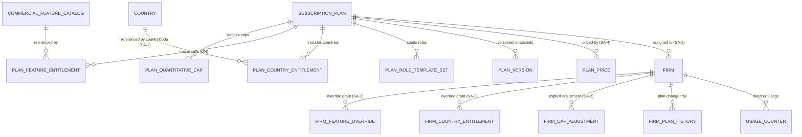

**Indexes:** `SubscriptionPlan(status)`, `SubscriptionPlan(visibility)`; `PlanQuantitativeCap(planId, metric)`; `PlanFeatureEntitlement(planId, featureKey)`; `PlanCountryEntitlement(planId, countryCode)`; `UsageCounter(firm_id, metric)`; `FirmPlanHistory(firm_id, effectiveDate)`; `PlanVersion(planId, versionNo)`.

---

## 8. User Stories + Acceptance Criteria (GWT)

**US-1 — Billing-Ops: define a sellable tier in one workflow.**
Given I create "Growth" with `MAX_USERS=5 (BLOCK)`, `MAX_INDIVIDUAL_CLIENTS=100 (GRACE)`, features `{feature.esign, feature.automation.conductors}`, country `{Canada}`, and attach an SA-4 `PlanPrice` of `priceCurrency=CAD`, When I save and click Sync-to-rail, Then the plan persists with all four entitlement dimensions, the attached `PlanPrice` persists in SA-4, a rail Product+Price are created in CAD, the references are stored on the `PlanPrice` row, and a `PLAN_CREATED`+`PLAN_RAIL_SYNCED` audit records it. And given the rail is misconfigured, When I sync, Then the failure surfaces and the `PlanPrice` is flagged not-checkout-ready (never silently swallowed).

**US-2 — Platform Owner: add a country, all firms gain it (propagate).**
Given SA-1 has an ACTIVE "Australia" and "Global" has 40 firms, When I add Australia under propagate and save, Then the editor warns "affects 40 firms," a new `PlanVersion` is cut, all 40 caches evict, and on the next request each Global-plan firm sees Australian programs — no per-firm work.

**US-3 — Firm Owner: upgrade lights up features immediately (the snapshot fix).**
Given my firm is on "Starter" (no `feature.esign`) and I upgrade to "Growth" via SA-4, When I next call the e-sign endpoint, Then it succeeds (no re-provisioning, no re-login). And When I later downgrade, Then it returns `403 FEATURE_NOT_ENTITLED`, my e-sign data is retained read-only, and the UI hides the feature with an upgrade affordance.

**US-4 — Server enforces the gate even if the frontend is bypassed.**
Given a firm without `feature.automation.conductors`, When a request hits the Automation API directly, Then the server returns `403 FEATURE_NOT_ENTITLED` (the `@RequireEntitlement` guard).

**US-5 — Hard cap (block).** Given a firm at `MAX_USERS=5 (BLOCK)` with 5 active users, When an admin creates a 6th, Then `409 PLAN_LIMIT_REACHED` (metric=MAX_USERS, limit=5) + upgrade affordance; the count is unchanged.

**US-6 — Soft cap (grace).** Given `MESSAGES=1000 (GRACE)` with 1000 sent, When the 1001st is created, Then it succeeds, the firm is flagged over-limit, `notif/plan-limit-exceeded` fires, and the overage shows in usage-vs-limits — no mid-action failure.

**US-7 — Country gate filters, never errors.** Given a user holding `agent/case:create` but the firm is not entitled to Australia, When they create a case, Then Australian programs are absent from the list (no API error) and a Canada case creates successfully.

**US-8 — Deprecate a legacy plan cleanly.** Given "Legacy Starter" has 12 firms, When I set it DEPRECATED, Then it leaves signup, cannot be assigned to new firms, the 12 existing firms continue unchanged, and the deprecation is audited.

**US-9 — Entitlement composes with suspension.** Given a fully-featured plan whose subscription is SUSPENDED (SA-4 grace expired), When the firm calls any protected feature, Then `resolve` denies and the request returns `402` (billing routes only); And when payment clears, the very next request is allowed.

**US-10 — Support explains an entitlement question at a glance.** Given a firm reports "can't access Automation," When I open the firm entitlement & usage view, Then I see Automation OFF, the plan, and usage-vs-limits — all from the same resolution the enforcement uses.

**US-11 — Auditor traces plan history.** Given a firm moved Starter → Growth → Enterprise, When I open its account, Then `FirmPlanHistory` shows each plan, pinned version, effective date, and the operator; the plan-level audit shows every edit.

**US-12 — Grandfathered firm keeps its terms.** Given "Growth" raises its price (a new SA-4 `PlanPrice`) and I choose grandfather, When the change saves, Then existing Growth firms stay pinned to their `PlanVersion` at the old `PlanPrice` and only new assignments get the new price.

**US-13 — Firm-provisioning seed is RLS-confined to the one target firm (the cross-plane-write fix).** Given Account Manager provisions a new firm on "Growth" (SA-2), When the provisioning transaction seeds the firm's roles from `PlanRoleTemplateSet`, its entitlement defaults, and the owner user, Then every seeded row carries the just-created `firm_id`, the writes execute under `SET LOCAL app.current_firm_id = <new firm_id>` on the non-BYPASSRLS app role (Doc 1 §4.5), and an attempt to seed under `BYPASSRLS` or a raw platform context (no tenant GUC) fails closed; a probe confirms no row escapes the target firm's `firm_id`.

---

## 9. Edge Cases & Validations

- **Propagate edit affecting live firms** → blast-radius warning + new `PlanVersion` + cache eviction for all affected firms + audit (BR-10).
- **Activate with no attached price** → blocked (≥ 1 SA-4 `PlanPrice` with a currency required to ACTIVATE; the price/currency validity is enforced by SA-4).
- **Deprecate a plan with firms attached** → allowed; new assignment/signup blocked; existing unchanged. Hard-delete such a plan → blocked (deprecate instead).
- **Downgrade below current usage** → e.g. 8 users, downgraded to `MAX_USERS=5`: existing users not deleted; firm over-limit (flagged); a 9th is blocked. Graceful, never destructive (BR-8).
- **Stale resolution cache vs live cap** → resolution may lag a toggle by ≤ TTL, but cap checks read live counters, so over-limit cannot slip through (BR-13).
- **Missed eviction event** → ≤ 60s TTL self-heals; counters reconciled periodically so counts cannot drift permanently.
- **Suspension on an entitled plan** → resolves to deny on protected features (`402`); clears instantly on payment (BR-9).
- **Feature key not in the catalog** → rejected at save (catalog-driven; no phantom flags). A `feature.*` key must exist in `CommercialFeatureCatalog`; an SA-12 operational flag referencing a commercial capability must point at an existing SA-3 `featureKey`.
- **Country FINAL/SUSPENDED in SA-1** → only ACTIVE countries selectable; a country later SUSPENDED in SA-1 → existing entitlements remain readable, no new selection (there is no `DEPRECATED` country state; `DEPRECATED` is a plan state only).
- **Rail sync failure** → surfaced, `PlanPrice` flagged not-checkout-ready; re-sync idempotent (no duplicate rail objects) (BR-12).
- **Price changed in the rail directly** → not pulled back; platform remains master; a reconciliation report flags drift.
- **Concurrent plan edits** → last-write-wins with full before/after audit each; entitlement re-resolves from the final persisted state.
- **Override conflicting with a plan reduction** → override is additive only (BR-3); a genuine reduction is an explicit, audited `FirmCapAdjustment`, never an "override" that silently strips a default.
- **Counter drift on a crash mid-mutation** → boundary check is transactional with the mutation; reconciliation recomputes from source.
- **Firm-context write attempt to a GLOBAL plan table** → denied by the GLOBAL read-only-permissive RLS policy (no app-role write policy) and audited (Doc 1 §2.6, BR-15).
- **Firm-provisioning seed under the wrong context** → a seed write attempted under `BYPASSRLS` or a raw platform context with no tenant GUC fails closed (FORCED-RLS `WITH CHECK`); the seed must run under `SET LOCAL app.current_firm_id = <new firm_id>` on the non-BYPASSRLS app role (BR-15).

**Validation doctrine.** All input — plan fields, caps, feature/country selections, rail-sync params — is Zod-validated at the edge (per Doc 1 §1.2), never ad-hoc `if/else`; reject early with machine-readable codes; never persist on failure.

---

## 10. Permissions (GLOBAL `system/*`)

Default-deny, additive, evaluated in the platform identity pool (`aud = er:platform`) under the scope-aware guard (Doc 1 §4.2); GLOBAL writes run via the elevated platform-admin path (Doc 1 §2.6). Privileged commercial actions are split off generic `:edit` so they are not ambiently available. (GLOBAL `system/*` keys are qualifier-N/A per Doc 1 AC-4.1.3 — no intra-firm ownership on the platform plane — and this list is reconciled by the Doc 1 §4.4 CI completeness check against this module's delivered routes.)

| Permission Key | Description |
|---|---|
| `system/plan:list` | List plans |
| `system/plan:show` | View one plan + its resolved entitlements |
| `system/plan:create` | Create a plan |
| `system/plan:edit` | Edit a plan's overview/caps (non-privileged fields) |
| `system/plan:deprecate` | Deprecate/reactivate a plan |
| `system/plan:sync-rail` | Trigger billing-rail sync (operates on the attached SA-4 `PlanPrice`(s)) |
| `system/plan:manage-features` | Edit the feature-to-tier matrix for a plan |
| `system/plan:manage-countries` | Edit a plan's country entitlements |
| `system/plan:manage-caps` | Edit caps + enforcement |
| `system/feature-catalog:manage` | Curate the `CommercialFeatureCatalog` (rare; code-release-coupled) |
| `system/firm:view-entitlement` | View a firm's resolved entitlement + usage-vs-limits (Support/Account Mgr; alongside SA-2 firm-health) |

**Two enforcement layers.** GLOBAL `system/*` guards *who may edit plans* (the Super-Admin console). The *entitlement those plans grant to firms* is enforced separately on the Agent plane by `EntitlementsService` (`@RequireEntitlement`, the country filter, `assertWithinLimit`) — a distinct concern, never conflated with `feature.*` keys (`feature.*` is the commercial hard-gate namespace, not a permission, per ADR C3-D2). Where a capability is also operationally flagged, `@RequireFlag` (SA-12) AND-composes outside `@RequireEntitlement`, entitlement-first. The default role matrix (Doc 1 §4.4) splits these `system/*` keys across platform sub-roles (Billing-Ops holds plan-management; Support holds only `:view-entitlement`/`:show`; Auditor read-only) so no single platform role holds the full set.

---

## 11. Scalability · Security · Performance

**Scalability.**
- Caps as rows, features from a catalog, countries as data → adding a metric/feature/country is configuration, not a migration. Single-currency/single-country is the degenerate case; the global posture costs nothing extra.
- `EntitlementsService` is the only chokepoint — every gate funnels through one cacheable, Redis-backed, stateless service that scales horizontally; source reads are read-replica-friendly (replicas run identical FORCED RLS, Doc 1 §2.7).
- The override layer is additive rows, so enterprise exceptions never fork the plan catalog — the catalog stays small as the customer base grows.

**Security (per Doc 1).**
- **Entitlement is the authoritative boundary** — feature/cap/country gates are server-enforced; a bypassed UI still hits `403`/`409`/filtered. Composes with SA-4 status (BR-9), closing the "paid plan but unpaid invoice" hole.
- **GLOBAL-plane writes only via the elevated path** (§2.6): no `agent/*`/`portal/*` credential can mutate plans; a firm-context write to a GLOBAL plan table is structurally denied (no app-role write policy) and audited (BR-15). The firm-provisioning role/entitlement/owner-user seed runs RLS-confined under `SET LOCAL app.current_firm_id` on the non-BYPASSRLS app role (Doc 1 §4.5), never `BYPASSRLS` — closing the cross-tenant-leak trap. The `EntitlementsService` reads firm data only via the scoped repository from `PrincipalContext` — never a caller-supplied `firm_id` (no IDOR, §4.5).
- **Tenant isolation by construction** — firm overrides/counters/history are `firm_id NOT NULL` under FORCED RLS (§2.2); a query bug cannot cross tenants.
- **All mutations audited** on the per-firm hash-chained spine (§7.5); rail credentials live in SA-8 IntegrationRailConfig (§6.3), never in plan or `PlanPrice` rows.
- **Input validation everywhere** (Zod at the edge); reject early; never persist on failure.

**Performance.**
- `resolve(firm_id)` is the hot path: O(1) Redis read (event-evicted + ≤ 60s TTL), not a multi-table join per request. Target **p95 ≤ 50ms (cache hit) / ≤ 300ms (cold resolve)**.
- Usage counters, not `COUNT(*)`: a 10k-client firm creates one more case without a full scan.
- Targeted eviction, never a platform-wide flush; cap checks stay live even when resolution is cached (BR-13). Rail sync is an explicit off-hot-path action, never blocking firm requests.

---

## 12. Reference Note (exists / NEW / CHANGED vs current code)

> Greenfield target-state; the existing prototype is **design-provenance only** (per Doc 1 §1.8). This note is informational — the vendor builds to this spec, not to parity.

- **Provenance (prototype concepts that informed this design):** a `PaymentPlan`-style model with name/price/interval/rail-price reference and a column-per-cap shape; a `PlanPermission`-style plan→permission map baked into one provisioned role at signup; plan CRUD with audit-on-create/edit; auto-create-on-the-rail-at-create wrapped in a swallowed try/catch; a single-cap (`maxUsers`) ad-hoc check at user-create. These are lineage, not a build base.
- **NEW (the substance of this module):** `EntitlementsService` (the live, single-source, cached, billing-composing authority); the `CommercialFeatureCatalog` + `PlanFeatureEntitlement` feature-to-tier matrix + `@RequireEntitlement` guard (the OQ-2 keystone), AND-composed with the SA-12 `@RequireFlag` operational gate; `PlanQuantitativeCap` rows + per-metric `BLOCK/GRACE` enforcement + `UsageCounterService` + `assertWithinLimit`; `PlanCountryEntitlement` (keyed by `countryCode`) + the country resource-availability filter; `FirmFeatureOverride`/`FirmCountryEntitlement`/`FirmCapAdjustment` additive resolution; `PlanVersion` + grandfathering; `FirmPlanHistory`; the explicit idempotent `syncPlanToRail` (operating on SA-4 `PlanPrice`(s)); plan clone; the GLOBAL-plane RLS posture; the RLS-confined firm-provisioning seed path.
- **CHANGED (deliberate target-state framing):** status is `FINAL/ACTIVE/DEPRECATED` (not binary) + `PUBLIC/INTERNAL` visibility; **pricing is removed from the plan entity and owned solely by SA-4 `PlanPrice`** (price/currency/interval/rail-refs no longer on `SubscriptionPlan`, BR-16); the billing interval enum is `MONTHLY/ANNUAL` (aligned with SA-4); caps are rows with `enforcement` (not columns); the commercial feature catalog is `CommercialFeatureCatalog` (renamed from the prototype's `FeatureFlagCatalog` to end the near-name clash with SA-12's `FeatureFlag`); plan→role-seeding is demoted from "the entitlement authority" to "the firm's initial RBAC" and runs via the RLS-confined elevated path; permission keys are `system/plan:*` with privileged actions split off `:edit`; rail sync is explicit/observable/idempotent (not implicit/silent). The tenant key is `firm_id` + FORCED RLS (Doc 1 §2); the `EntitlementsService` honours it.

---

## 13. Open Questions / [FOUNDER-CONFIRM]

1. **The feature-to-tier matrix values (OQ-2 keystone).** The *exact* launch tier set, prices (owned by SA-4 `PlanPrice`), billing currencies, and which `CommercialFeatureCatalog` key sits behind which tier. The structure/machinery/seeding are fixed here; the cell values are the dominant commercial decision. **[FOUNDER-CONFIRM]** (coordinate with the per-module entitlement OQs that this artifact resolves).
2. **Block vs grace per metric + grace thresholds/windows.** Proposed default: seats/cases = BLOCK; storage/messages/tasks = GRACE at 110% for 14 days. **[FOUNDER-CONFIRM]** (commercial-policy).
3. **Multi-currency catalog now vs CAD-only with future-proofing.** Affects how many SA-4 `PlanPrice` rows (and rail Prices per currency) are attached per plan at launch. **[FOUNDER-CONFIRM]**.
4. **Grandfathering default + grace-escalation policy.** When an entitlement changes, is propagate or grandfather the default? When a GRACE cap stays over for the full window, does it auto-convert to BLOCK, trigger a billing nudge (SA-4 dunning), or raise a Super-Admin task? **[FOUNDER-CONFIRM]**.
5. **SA-3 `feature.*` (commercial) vs SA-12 operational flags — boundary.** **RESOLVED** (was open): the operational flag (SA-12) and commercial entitlement (SA-3) are **AND-composed, entitlement-first** (commercial entitlement is the inner truth, the operational flag the outer gate), per SA-12 §3.0; the PLAN flag scope is **derived from SA-3** (no parallel plan-flag table), and the canonical guards are `@RequireEntitlement` (SA-3) + `@RequireFlag` (SA-12). The only residual item is founder ratification of this platform rule. **[FOUNDER-CONFIRM]** (ratification only).
6. **Plan-edit governance.** Does a high-blast-radius propagate edit (affects N firms over a threshold) require a second approver (Platform Owner)? **[FOUNDER-CONFIRM]** (governance).
7. **Commercial constraint between regulator credential and country entitlement.** Should a country entitlement require the firm to hold the country's regulator credential before that country can be entitled (a compliance gate layered on the commercial one)? Structure supports it; the rule is a domain/compliance decision. **[FOUNDER-CONFIRM]** (routed via Immigration-SME; founder is final authority).
8. **Feature-key grammar freeze.** The canonical `feature.*` grammar is **all-lowercase dotted** (e.g. `feature.esign`, `feature.crm.multipipeline`), applied across SA-3 / SA-6 / SA-12 (resolving the prior `feature.eSign` casing drift). **[FOUNDER-CONFIRM]** (ratification of the frozen grammar; coordinated with SA-6 §13 key-grammar freeze).

---

# Module SA-4: SaaS Billing (Firm → Platform)

> **Plane:** Super-Admin console (**GLOBAL**). **Permission scope:** `system/billing:*` (GLOBAL), Super-Admin sub-roles only — never firm staff (per Doc 1 §4, two-scope RBAC; GLOBAL = `system/*`). **Paying party:** the FIRM (the tenant) paying the platform a recurring SaaS subscription. This is the **firm→platform money rail** — explicitly distinct from the firm's clients paying the firm for immigration services (the **client→firm** rail, owned by the Agent-plane Biller). Both rails ride **one `PaymentRailPort`** with a Stripe v1 adapter per Doc 1 §6.3, but as two separate scopes, two sets of credentials, two record families. **Money is single-sourced:** SA-4 owns platform subscription money; currency conversion is single-sourced in the platform `FxRateService` (Doc 1 §6.5); SA-4 stores `fxSnapshotId` references, never its own rates. **Firm-facing self-serve UI is NOT here** — it is Agent AG-16 §Plan & Billing (ADR [C4-D5]); AG-16 holds zero billing logic and calls the SA-4 server endpoints specified in §3.13.

> **Pricing ownership (NORMATIVE).** `PlanPrice` (this module, §3.1/§7) is the **sole owner** of price, currency, interval, and rail product/price refs. SA-3's `SubscriptionPlan` owns ONLY the entitlement dimensions (caps, features, countries, roles, status, visibility) and **carries no price/currency/interval/rail-ref fields** — it references `PlanPrice`. There is exactly one money path: SA-3 = the offer's entitlements, SA-4 = the offer's price.

---

## Module Index

1. Purpose & Goal
2. Users & Jobs-to-be-Done
3. Functional Design — How It Works (core)
4. Detailed Functional Requirements (SA-4-n)
5. Business Rules & Logic
6. States & Lifecycle
7. Key Entities & Fields
8. User Stories + Acceptance Criteria
9. Edge Cases & Validations
10. Permissions (GLOBAL `system/*`)
11. Scalability · Security · Performance
12. Reference Note (exists / NEW / CHANGED — honest)
13. Open Questions / [FOUNDER-CONFIRM]

---

## 1. Purpose & Goal

**What it is.** SA-4 is how the platform gets paid. It owns the entire commercial relationship between the platform and its paying firm tenants: turning a plan (SA-3) into a buyable rail price through the `PaymentRailPort`, taking a firm through self-serve checkout, **provisioning the tenant** the instant payment clears (the seam into SA-2), mirroring the subscription lifecycle as a first-class platform entity, persisting every invoice, **chasing failed payments through a disciplined dunning workflow**, **gating access deterministically** when a firm stops paying (grace → suspend → reactivate), handling **upgrades / downgrades with proration**, trials, and cancellations, and feeding the **revenue / MRR** rollups the platform runs on (→ SA-9). The payment rail (Stripe v1 adapter) sits behind the `PaymentRailPort`; the in-house lifecycle, dunning, gating, and MRR logic on top make this a product-grade SaaS billing system rather than a bare checkout button.

**The outcome it must produce.** A SaaS business dies two ways at the billing layer — **revenue leaks** (involuntary churn from recoverable failed payments; downgrades and cancellations un-enforced; MRR a guess) and **access incidents** (a non-paying firm keeps full access forever, or a paying firm is wrongly locked out by a webhook bug). SA-4 makes *"every paying firm has exactly the access they paid for, and every recoverable payment is recovered"* structurally true, by design rather than by manual reconciliation: signed + idempotent webhook ingestion (riding the Doc 1 §6 event dictionary's rail-`event.id` idempotency formula) so platform state never drifts from the rail; a dunning workflow that recovers involuntary churn; a grace-then-suspend gate that protects revenue without punishing a firm whose card merely expired; and a live, reproducible MRR/ARR picture.

**Why it matters / world-class positioning.** A naive integration creates one subscription and forgets it. A world-class system: (a) treats the **subscription as a first-class lifecycle entity** the platform owns, not a flag on the firm row; (b) makes **webhook processing bullet-proof** — signature-verified in the adapter, dictionary-idempotent, ledgered, replayable — because money state arriving twice or out-of-order is the norm; (c) **recovers involuntary churn** with dunning (the highest-ROI billing feature — most failed payments are expired cards); (d) **gates access at the middleware layer** so SA-3 entitlements/caps are enforced, not advisory; and (e) gives the Platform Owner a **live, multi-currency-correct revenue dashboard**. The moat is operational trust: the platform sells to regulated firms who expect *their own* client billing to be flawless — the platform's own billing must be visibly flawless first.

**How it ties to the platform.** SA-3 defines the **plan** (caps, feature/country entitlements) and references the price in SA-4's `PlanPrice` → SA-4 maps the plan to a buyable rail price and runs **checkout** → on payment, SA-4 triggers **SA-2 provisioning** (firm tenant, owner principal in the firm-staff pool per Doc 1 §3, seeded roles per SA-6, entitlements per SA-3) → SA-4 mirrors the **subscription lifecycle** and, on non-payment, derives the firm status that the access gate and SA-3 enforcement consume → SA-4 feeds **SA-9** revenue rollups → every state change writes to the **per-firm audit spine** (Doc 1 §7.5). SA-4 is the money spine the rest of the Super-Admin console hangs commercial reality on.

**Global ambition.** The same module bills a Canada-only solo RCIC in CAD and a multi-country firm in CAD/AUD/GBP with **no code change**: a plan carries multiple `PlanPrice` rows (one per currency/interval), the rail charges in the firm's currency, and the MRR rollup **never sums raw across currencies** — it converts each via an `FxRateSnapshot` from the platform `FxRateService` (Doc 1 §6.5, unified fields `baseCurrency`/`quoteCurrency`/`asOf`/`economicMoment`). Region is a per-tenant dimension (ADR FINAL #8); single-currency is the degenerate case, not the only case.

---

## 2. Users & Jobs-to-be-Done

SA-4 is operated by the platform's internal team under GLOBAL sub-roles (platform identity pool, Doc 1 §3). The **firm** is a *subject* of billing — it self-serves a few actions in AG-16, which calls SA-4 — but is never a user of this Super-Admin module.

| Role | Primary job in SA-4 | Representative JTBD |
|---|---|---|
| **Billing Admin** (heaviest user) | Keep revenue flowing and recoverable; keep platform↔rail state consistent. | "When a payment fails, chase the firm automatically and give me a live dunning queue with grace remaining, sorted by MRR, so I can call high-value accounts before they churn." · "When a webhook fails processing, show me it, why, and let me re-trigger it, so state never silently drifts." · "When a firm needs a custom contract, let me attach a manual/off-rail subscription without faking a charge." |
| **Platform Owner** | Own the revenue number and set billing policy. | "Show me live MRR, ARR, new subs and churn this month, revenue by plan and by country, in one reporting currency." · "Let me set the dunning cadence and grace once and trust it's enforced." |
| **Tenant Account Manager** (owns SA-2) | Bridge billing and account health. | "When payment recovers, reactivate the firm automatically — no manual un-suspend." · "When I onboard an enterprise firm, let me assign an internal plan and a manual subscription with no checkout." |
| **Support Agent** | Triage billing complaints (read-only). | "When a firm says 'we paid but we're locked out,' let me read their subscription status, last invoice, and webhook history so I can explain or escalate." |
| **Platform Engineer / DevOps** | Own rail credentials & health (owns SA-8). | "When I rotate the rail webhook secret or keys, let it be a config change in SA-8 with no deploy, and show me delivery health." |
| **Firm Owner** *(subject, not a SA-4 user)* | Pay, update card, change plan — in AG-16. | "When my card declines, give me a clear email and a one-click way to update it before I lose access." (AG-16 UI calling SA-4 endpoints — §3.13.) |

**Design implication.** The **Billing Admin** is the protagonist of these screens (subscriptions list, dunning queue, webhook log, manual-subscription tools); the **Platform Owner** gets the revenue dashboard. Permissions (§10) cleanly separate view-only from money-affecting actions from dashboard from webhook ops from config.

---

## 2. Users & Jobs-to-be-Done

*(see §2 above — single section; numbering continues at §3)*

## 3. Functional Design — How It Works (core)

### 3.0 The two money rails — the foundation everything else sits on

**Design decision: there are two payment rails, and SA-4 owns exactly one.** Conflating them is the most expensive mistake this module can make, so it is stated first and enforced throughout.

- **Rail 1 — Firm → Platform (THIS module).** The firm pays the platform a recurring SaaS **subscription**. Scope = **GLOBAL / system** credentials on the `PaymentRailPort` (Doc 1 §6.3.2 `IntegrationRailConfig`, GLOBAL scope). Mode = `subscription`. Drives the firm's **tenant lifecycle** and **entitlements**. Money flows *to the platform*.
- **Rail 2 — Client → Firm (Agent-plane Biller, out of scope here).** The firm's immigration clients pay *the firm*. Scope = that firm's connected account on the same `PaymentRailPort`. Money flows *to the firm*. **Payment-connect lifecycle one-liner: SA-4 owns the firm's payment-connect endpoint and its connect state** (the connected-account onboard/state machine); Doc 3 AG-1 (firm onboarding) links to it, and Doc 3 AG-6 (Biller) consumes the state — neither re-implements the connect flow.

Both rails are the *same* port with one Stripe adapter (Doc 1 §6.3), but **never share** a subscription record, a status, an entitlement consequence, or a credential scope. Disambiguation is **explicit by construction**, not implicit: every inbound rail event becomes a registered domain event in the dictionary (`payment.succeeded`, `payment.failed`, `subscription.updated`, …) carrying its scope; SA-4 consumes only the **GLOBAL-scoped** subscription/invoice facts whose metadata carries SaaS context (`planId`, `pendingCheckoutId`). Rail-2 facts are consumed only by the Agent-plane Biller. The adapter verifies the rail signature and resolves `externalEventId` *before* raising the event (Doc 1 §6.1.4 / §6.3.4 RL-A5); SA-4 never touches a raw webhook body.

### 3.1 Plan → rail-price mapping & self-serve signup — "a plan in SA-3 becomes a buyable product, in any currency"

SA-3 defines a `SubscriptionPlan` (caps, feature/country entitlements, `isPublic`) and owns **only entitlement dimensions** — it carries **no** price/currency/interval/rail-ref fields and instead references SA-4's `PlanPrice` (per the pricing-ownership note above). SA-4 is where that plan becomes **buyable**: each plan carries one or more **`PlanPrice`** rows (interval = MONTHLY|ANNUAL, ISO-4217 currency, amount in minor units, `railProductRef`, `railPriceRef`). The MONTHLY|ANNUAL interval enum is the single canonical billing-interval vocabulary shared with SA-3. When a Billing Admin saves a price, SA-4 calls the **`PaymentRailPort`** to create/update the rail Product+Price and stores the returned refs on the `PlanPrice`. Sync is **one-directional** (platform is master; rail-side edits are not pulled back) and **idempotent** (re-sync updates, never duplicates, via a rail idempotency key on plan+price). A `PlanPrice` with no `railPriceRef` is **INTERNAL/manual-billing** — not self-serve-checkoutable (§3.11). Only **PUBLIC** plans (SA-3 `isPublic`) appear in self-serve; INTERNAL plans are Super-Admin-assigned only.

**Self-serve signup.** A prospective firm picks a PUBLIC plan on the marketing site; AG-16 (or the public signup flow) calls SA-4's create-checkout endpoint (§3.13), which collects firm/owner details into a **`PendingCheckout`** *before* redirecting to the rail, so the tenant is provisioned faithfully on success (§3.2).

**World-class behaviour.** Plan is master, rail is the pipe (one place defines the offer). Multi-currency from day one (`PlanPrice` per currency). Annual vs monthly is a *price*, not a plan (interval switch = an upgrade/downgrade with proration, §3.7). Sync is idempotent.

**Data flow.** SA-3 plan saved → price-sync action → `PaymentRailPort.createOrUpdatePrice` → store refs on `PlanPrice` → audit (`PLAN_PRICE_SYNCED`). Self-serve: firm picks PUBLIC plan → `PendingCheckout` → rail checkout (§3.2).

### 3.2 Checkout → tenant provisioning — "payment success builds the firm, atomically, exactly once" (ties SA-2)

Checkout runs through the `PaymentRailPort` (`mode=subscription`, the chosen `PlanPrice.railPriceRef`, metadata carrying `planId` + `pendingCheckoutId`). On success the rail raises `payment.succeeded` / `subscription.created`; SA-4 **provisions the tenant** — the seam into SA-2:

1. Resolve the `PendingCheckout`.
2. Create the **`Firm` tenant** (SA-2): legal/operating name, subdomain, primary contact, rail customer/subscription refs, current period, assigned plan.
3. Create the **`FirmSubscription`** (§3.3) in `TRIALING` or `ACTIVE` per plan trial config.
4. Seed the plan's **default roles** (SA-6) and create the **owner principal** in the **firm-staff identity pool** (Doc 1 §3) with a single-use, time-boxed set-password invite (Doc 1 §3.5 invite-token discipline) delivered by the Mailer Doer.
5. Grant the plan's **country + feature entitlements** (SA-2/SA-3); country entitlements reference the canonical **`countryCode`** (ISO) join key (`FirmCountryEntitlement.countryCode`, Doc 1 §5.8 — one country join key, `Country.id == countryCode`).
6. Delete the consumed `PendingCheckout`; emit `firm.provisioned`; write audit.

**RLS-confined seed write (NORMATIVE).** The firm-provisioning seed — role-seed (SA-6), entitlement-seed (SA-3), and owner-user create (SA-2) — writes firm-scoped LOCAL rows into the just-created tenant. This runs **inside the provisioning transaction** under the **non-BYPASSRLS application role** with `SET LOCAL app.current_firm_id` set to the just-created `firm_id` — the same elevated bound-token path Doc 1 §4.5 mandates for cross-tenant work (and SA-5 §3.9 clone-to-firm). It **NEVER** runs under BYPASSRLS or a raw platform context: FORCED-RLS still applies, so the seed write is confined to the one target firm and a stray write to any other firm is rejected fail-closed (WITH CHECK). See AC in §8 (US-1) asserting the seed write is RLS-confined to exactly the target firm.

**Exactly-once is the hard requirement.** Provisioning is keyed on the dictionary's rail-`event.id` idempotency formula (Doc 1 §6.1.4) **and** a provisioning key (`railSubscriptionRef`) recorded in the per-firm processed-event ledger (Doc 1 §6.2.3): the first successful processing builds the tenant; any redelivery is a logged no-op (no duplicate firm/owner/email). The tenant+subscription+roles+entitlements commit **transactionally**; the welcome/set-password email is a **non-fatal** queued side-effect (retried, never rolled back — Doc 1 §6.2.2). Provisioning **never fabricates** firm/owner data; missing optional fields are left blank for the firm to complete.

**Screens.** Provisioning is server-side; Super-Admin sees the *result* — a provisioning timeline on the firm record (SA-2), and provisioning failures surfaced in the webhook event log (§3.10) with the failing step.

### 3.3 Subscription lifecycle as a first-class entity — "the platform owns the subscription, not a flag on the firm"

A **`FirmSubscription`** is the unit of work — a real record, not nullable columns. It holds `firm_id`, `planId`, rail refs, **`status`** (`TRIALING | ACTIVE | PAST_DUE | UNPAID | CANCELED | SUSPENDED`), period dates, `cancelAtPeriodEnd`, `trialEndsAt?`, `canceledAt?`, a `priceId` (FK `PlanPrice`) plus the price snapshot it resolves (currency/amount/interval), `defaultPaymentMethodRefId`, and `manual` flag. The rail is the source of truth for billing *events*; SA-4 **mirrors** them via the dictionary and **adds** the platform-only **`SUSPENDED`** state the rail does not model (the access decision after grace expiry, §3.6).

**Status mapping (rail → platform):** `trialing→TRIALING` (full access) · `active→ACTIVE` (full) · `past_due→PAST_DUE` (**full access during grace**, BR-6) · `unpaid→UNPAID` (grace likely expired → `SUSPENDED`; already gated — capability/entitlement resolution fail-closed OFF, `402 PAYMENT_REQUIRED`, BR-7/SA-4-25) · `canceled→CANCELED` (access revoked at period end; data retained) · *(platform decision)*`SUSPENDED` (**402 on all but billing routes**, BR-7) · `incomplete/incomplete_expired` (no tenant provisioned).

**World-class behaviour.** The firm row is not the billing source of truth; `Firm.status` (SA-2, used by the gate) is **derived** from `FirmSubscription.status`. Super-Admin can reason about every subscription (status, MRR contribution, next renewal, card-on-file, dunning) because the data is first-class. Every transition writes a `SubscriptionEvent` and may raise a notification (Doc 1 §6.1.2 `notif/` namespace), feeding SA-9 and audit.

**Screens.** *Subscriptions list*: filter by status/plan/country/renewal window; columns = firm, plan, status badge, MRR, next renewal, card (brand+last-4), dunning. *Subscription detail*: lifecycle timeline, period dates, plan-change history, invoice history (§3.4), deep-link to the rail customer/subscription, manual actions (§3.11).

### 3.4 Recurring billing, invoices & payment-method management — "every invoice is mirrored; the card lives only at the rail"

The rail generates each period's invoice and attempts payment. SA-4 **mirrors every invoice** as a **`RailInvoice`** (from the dictionary events `invoice.created` / `payment.succeeded` / `payment.failed` / `invoice.voided`): `railInvoiceRef`, `firm_id`, amount, currency, **status** (`FINAL|OPEN|PAID|VOID|UNCOLLECTIBLE`), period, line items, hosted-invoice URL, PDF URL. Super-Admin views full invoice history and **downloads the original rail invoice PDF** (deep-link to the rail's hosted PDF — the platform does not regenerate the tax document). Persisting invoices powers MRR (§3.12) and history without N live rail calls.

**Payment-method management.** The card is managed by the firm in AG-16 via a rail customer-portal session or SetupIntent — **the card never touches the platform UI or DB** (PCI SAQ-A, Doc 1 §6.3.4 RL-A5). Only a **`PaymentMethodRef`** (brand, last-4, exp month/year, `railPaymentMethodRef`) is stored for *display* and dunning context. Super-Admin *sees* the card-on-file but **cannot enter or change card data** — it can only trigger a "send update-card link" to the firm (§3.13).

**Data flow.** `invoice.*` event → upsert `RailInvoice` → on `payment.succeeded`: subscription `ACTIVE`, clear open `DunningState` → on `payment.failed`: open/advance `DunningState` → feed SA-9. Card: `payment_method.attached` (and the adapter-raised card-update events) → upsert `PaymentMethodRef` (brand/last-4/exp only).

### 3.5 Dunning & failed-payment handling — "recover the involuntary churn the world-class way"

The **highest-ROI billing feature**: most failed payments are expired/temporarily-declined cards — recoverable with a nudge.

A `payment.failed` event opens (or advances) a **`DunningState`**: `firm_id`, `subscriptionId`, `railInvoiceRef`, `attemptCount`, `firstFailedAt`, `nextRetryAt`, `gracePeriodEndsAt`, `state` (`DUNNING|RECOVERED|EXPIRED`). The platform sets the subscription **`PAST_DUE`**, **emails the firm's primary contact within 60s** (transactional, locale-aware, via the Mailer Doer — BR-17), and lets the rail's Smart Retries re-attempt on the configurable cadence (default **3 retries / 14 days**) while sending escalating reminders. During this window the firm **retains full access** (grace, §3.6) — a firm whose card expired is chased, not punished.

**Recovery and expiry.** Any `payment.succeeded` during dunning → `DunningState = RECOVERED`, subscription → `ACTIVE`, access restored automatically (no manual un-suspend), recovery notification to Billing Admin. If retries are exhausted and grace expires unpaid, a scheduled **grace-expiry job** sets `DunningState = EXPIRED` and the subscription `SUSPENDED` (§3.6).

**World-class behaviour.** Cadence (retry count/intervals/grace) is `PlatformBillingConfig` data, set once and enforced; the dunning **email copy itself is an SA-5 SYSTEM template** (SA-5 owns platform-template authoring; SA-4 references templates by key, never hardcodes copy). A **live dunning queue** sorted by MRR lets the team personally save high-value accounts. Dunning emails are **transactional** (consent-exempt) and locale-rendered. **No double-dunning:** redelivered `payment.failed` events advance the *same* `DunningState` idempotently (dictionary idempotency key on the rail `event.id`, Doc 1 §6.1.4), never opening duplicates or re-sending the same reminder.

**Screens.** *Dunning queue* (firms in `DUNNING` with MRR, attempt count, `nextRetryAt`, **days-of-grace**, last reminder, and send-reminder / send-update-card actions). *Dunning config* (Platform Owner: retry count, intervals, grace length, email templates per locale). *Per-subscription dunning panel* (failed invoice, retry timeline, recovery/expiry state).

### 3.6 Lifecycle gating — "non-payment suspends access deterministically; payment restores it automatically"

Access is **gated on subscription status at the middleware layer** so a non-paying firm cannot use a feature the frontend forgot to hide, and SA-3 caps are enforced. The gate keys off the firm's derived status:

- **`TRIALING`/`ACTIVE`/`PAST_DUE` (in grace):** full access (PAST_DUE keeps access — BR-6).
- **`SUSPENDED`:** every protected firm-facing API route returns **HTTP 402 Payment Required**; only the **billing/payment allow-list** stays open so the owner can update the card and self-recover (AG-16 calling SA-4 §3.13). Client-portal access may optionally remain open (SA-2-configurable) so the firm's *clients* aren't punished — a **founder + compliance** policy call (OQ-6).
- **`CANCELED`:** at period end, entitlements revoked (read-only or 402 per policy); data retained for the SA-2 retention window.

**SUSPENDED portal-open exception (NORMATIVE security boundary).** The optional "keep the firm's client portal open during suspension" toggle changes **ONLY the billing-status gate** — it never relaxes isolation. Even with the portal open, the Doc 1 §2.5 client-subject (second portal RLS dimension) and the Doc 1 §4.5 ownership-chain / `PortalVisibilityConfig` checks remain **fully in force**: a suspended firm's portal user still sees only their own ownership chain, and client-to-client isolation is never loosened. The **fail-safe default is portal-CLOSED** unless the toggle is explicitly enabled (mirrored in SA-2 §3.4); an unanswered OQ-6 therefore never ships as open-by-default.

**Reactivation is automatic** on recovery (subscription → `ACTIVE`, gate lifts next request — no manual un-suspend). Super-Admin may manually **reinstate** (goodwill) via `system/billing:manage` (audited). The gate is the security boundary (server-side, layered over Doc 1's RLS + record-level authz); UI hiding is a UX complement, never the boundary. The gate reads a **cached** firm-status (Redis, keyed by `firm_id`), invalidated on every subscription event, so it adds negligible per-request latency and never serves a wrong *allow* from stale cache (suspension evicts immediately).

### 3.7 Plan upgrade / downgrade / proration — "change tiers cleanly; let the rail do the money math"

Plan changes are firm-initiated (AG-16 → SA-4 §3.13) or Super-Admin-assisted (`system/billing:manage`). The change updates the rail subscription to the new `PlanPrice.railPriceRef`; **the rail computes the proration** — the platform does **not** re-implement it. On the resulting `subscription.updated` event, SA-4 updates `FirmSubscription` and **re-applies SA-3 entitlements immediately**: an upgrade unlocks features/caps next request; a downgrade hides over-tier features and enforces lower caps but **retains existing data read-only** (BR-8, the SA-3 downgrade rule). **Upgrades default immediate** (prorated now); **downgrades default period-end** (configurable). Interval switch (monthly↔annual) is the same machinery. Proration is the rail's job; entitlement is the platform's; they reconcile idempotently on the event.

**Screens.** *Plan-change action* on subscription detail (assisted change: pick new plan/price, preview the *rail-computed* proration, confirm; result appears in invoice history). *Plan-change history* on the firm record. The firm-initiated self-serve change UI is AG-16.

### 3.8 Trials — "let firms try; convert or lapse cleanly"

A plan may configure a trial; checkout creates the subscription in **`TRIALING`** (full access). At trial end the rail attempts the first invoice: paid → `ACTIVE`; failed → `PAST_DUE` → dunning. A trial may be **card-required or cardless** (policy, OQ-2): card-required converts silently; cardless needs a card before trial-end or lapses to `SUSPENDED`. Trial is a subscription *state*, not a special case — it flows through the same lifecycle/dunning/gating machinery. The platform sends **trial-ending nudges** (transactional, locale-aware) before trial-end. Trial→active conversion is a first-class SA-9 metric.

**Screens.** Trial indicator on the subscriptions list (`TRIALING` + `trialEndsAt`); a *trials-ending-soon* view for proactive outreach; trial length on the plan (SA-3).

### 3.9 Cancellation & subscription-end — "let firms leave with their data intact and the books honest"

A firm cancels (AG-16) or Super-Admin cancels on request (`system/billing:manage`). Cancellation defaults to **`cancelAtPeriodEnd = true`** (the firm keeps the access it paid for through period end); an **immediate** cancel (with optional proration/refund) is a deliberate, audited exception requiring a reason. At period end (`subscription.deleted` / final `subscription.updated`), SA-4 sets `FirmSubscription = CANCELED`, **revokes entitlements at period end**, and hands the firm to **SA-2 offboarding/retention** (export offered, retention window, then scheduled deletion via the Doc 1 §7.6 crypto-shred disposal orchestrator). **Data is retained, not destroyed, at cancellation** (BR-8). An optional, reportable **cancellation reason** feeds churn analytics (voluntary churn). **Reactivation = a new subscription** on the retained tenant — never a resurrected terminal one.

**Offboarding export reveal-audit (cross-ref).** When SA-2 offboarding produces an **unmasked** account export, that export is masked-by-default and the unmasked path emits the Doc 1 §7.2 bulk `PII_REVEAL` audit (field set + subject + actor + justification) **in addition** to the egress event, per SA-2 §3.9 / SA-11 §3.7. SA-4 owns the cancellation trigger, not the export PII path; this note records the seam so the egress chokepoint inherits the fail-closed reveal-audit guarantee.

**Screens.** *Cancel action* (cancel-at-period-end vs immediate; immediate requires reason + refund-policy confirm; optional cancellation reason). *Canceled/churned view* (firms canceled this period with reasons → churn metric).

### 3.10 Webhook ingestion: signing, idempotency & event log — "money state arrives twice and out-of-order; handle it like it matters"

The **correctness backbone**. Rails deliver at-least-once, redeliver, and don't guarantee order. SA-4 treats ingestion as the fault-tolerant path it is, leaning on Doc 1's machinery rather than re-inventing it:

1. **Signature verification (Doc 1 §6.3, in-adapter).** The Stripe adapter verifies the rail signature against the GLOBAL webhook signing secret (**home = SA-8**: the `WebhookEndpoint` signing `SecretRef`, SA-8 §7 — SA-4 cites it and holds no secret; dual-accept rotation without deploy per SA-8 BR-4) using the raw body, resolves `externalEventId`, and **only then** raises the registered domain event. SA-4 never sees a raw body. An unverifiable payload is rejected in the adapter (Doc 1 §4.6 `webhook-signature` compensating control).
2. **Idempotency ledger.** Each event is recorded in the **per-firm processed-event ledger** (Doc 1 §6.2.3, unique on `(firm_id, consumerKey, idempotencyKey)`), the idempotency key built from the rail's own `event.id` (Doc 1 §6.1.4). SA-4 additionally keeps a thin **`RailWebhookEvent`** *operational log* (`railEventRef` unique, `type`, `receivedAt`, `processingStatus` ∈ {RECEIVED, PROCESSED, FAILED, RETRYING}, `error?`) purely for the Super-Admin webhook-log UI and re-process action — the ledger is the dedupe authority; this log is the human-visible surface.
3. **Full lifecycle coverage.** Consume `subscription.created/updated/deleted`, `payment.succeeded`, `payment.failed`, `invoice.created`, `invoice.voided`, `payment_method.attached`. Handlers are **upsert-based** so out-of-order delivery converges.
4. **Replay / re-trigger.** A FAILED operational-log entry can be re-processed by Super-Admin (or re-sent from the rail dashboard); the ledger makes replay safe.

**Fast ACK, async heavy work** (Doc 1 §6.2): the adapter ACKs quickly and offloads heavy provisioning/invoice/dunning handlers to BullMQ, so a slow tenant build never triggers a rail retry-storm.

**Screens.** *Webhook event log* (`system/billing:webhook-log`: type, received, processing status, error, **re-process** for FAILED). *Webhook health* tile (delivery success rate, last received) → SA-9/observability.

### 3.11 Manual / off-rail subscriptions — "enterprise and custom deals without faking a charge"

Enterprise/custom contracts are invoiced offline. A Billing Admin (`system/billing:manage`) **creates or adjusts a `FirmSubscription` manually**: assign an INTERNAL plan (no `railPriceRef`), set status/period/amount/currency, **without a rail charge**. Manual subscriptions flow through the **same lifecycle, gating, and MRR** machinery (a `manual` flag distinguishes them and suppresses rail-specific actions — Smart Retries, update-card link; a manual past-due is chased by the account manager). Manual money actions are **heavily audited** (actor, reason, before/after — BR-10). One lifecycle, two billing sources (the "one pipeline, many doors" pattern); a future billing source (reseller) is a thin extension.

**Screens.** *Create manual subscription* (firm + INTERNAL plan, period/amount/currency/status, mandatory reason); *adjust* (status/period/amount + reason); *reinstate* a suspended firm (goodwill + reason). All `system/billing:manage`-gated and audited.

### 3.12 Revenue / MRR feeds — "the founder always knows platform revenue health" (→ SA-9)

SA-4 is the **source of platform revenue truth**; SA-9 is the dashboard surface. From persisted `FirmSubscription` + `RailInvoice`, SA-4 computes via **DB-side aggregation / pre-computed rollups** (never in-memory per-row scans): **MRR** (normalised monthly recurring across active subs), **ARR** (MRR×12), **new/expansion/contraction/churned MRR** this period, **new subscriptions** and **churned firms**, **trial→active conversion**, **ARPU**, **revenue by plan**, **revenue by country**. Every cross-subscription money figure is in the platform **`reportingCurrency`**, each native amount converted via an **`FxRateSnapshot`** from the platform `FxRateService` (Doc 1 §6.5 unified fields `baseCurrency`/`quoteCurrency`/`asOf`/`economicMoment` — SA-4 stores `fxSnapshotId`, never writes rates). The platform **never sums raw amounts of differing currencies** (BR-11). Churn splits into **voluntary** (canceled) vs **involuntary** (failed-payment) — the most actionable SaaS split. Rollups refresh incrementally on the queue off the read replica; the dashboard reads the cache, never raw rows (the same performance doctrine as Doc 1's NFR P-targets).

**Screens.** *Platform revenue dashboard* (`system/billing:view-dashboard`, surfaced in SA-9): MRR/ARR tiles, new/expansion/contraction/churn waterfall, new-subs vs churned-firms, trial conversion, revenue-by-plan and revenue-by-country, all in `reportingCurrency` with the FX basis disclosed on hover.

### 3.13 SA-4 server endpoints called by AG-16 — "the firm-facing UI lives in AG-16; the logic lives here"

AG-16 §Plan & Billing (ADR [C4-D5]) renders the firm-facing self-serve experience and holds **zero** billing logic — it calls these SA-4 server endpoints. AG-16's caller is a **firm-staff principal** holding `agent/firm:billing-manage` (a LOCAL key, Doc 1 §4); SA-4 resolves the caller's `firm_id` from the principal (**never caller-supplied**, Doc 1 §2 / §4) and authorizes the action against the *caller's own* firm. Per ADR [C4-D5], firm-side billing is a **single** LOCAL key, `agent/firm:billing-manage`, with read folded in (no separate `:billing-view`). These endpoints are firm-scoped (not `system/*`) precisely because the firm calls them about itself; the `system/billing:*` keys guard the Super-Admin console surfaces only.

| Endpoint (intent) | Caller / authz | Effect |
|---|---|---|
| **Create checkout session** | firm-staff `agent/firm:billing-manage` (or public signup) | Build `PendingCheckout`, return a rail Checkout URL for the chosen PUBLIC `PlanPrice` (mode=subscription). No tenant created until payment (§3.2). |
| **Create customer-portal / SetupIntent session** | firm-staff `agent/firm:billing-manage` | Return a rail customer-portal URL so the firm updates its card; the card never touches the platform (§3.4). |
| **Request plan change** | firm-staff `agent/firm:billing-manage` | Call the rail to change the subscription price; proration is the rail's; reconcile on `subscription.updated` (§3.7). |
| **Cancel subscription** | firm-staff `agent/firm:billing-manage` | Set `cancelAtPeriodEnd=true` (default) on the rail; lifecycle handled on event (§3.9). |
| **Read own billing summary** | firm-staff `agent/firm:billing-manage` | Return the firm's own plan, status, current period, card-on-file (display only), and persisted invoice history (read model only — never another firm's). |

Super-Admin may trigger the **send-update-card link** to a firm via `system/billing:manage` (which invokes the same portal-session machinery). Every firm-facing action is firm-`firm_id`-scoped, RLS-backstopped (Doc 1 §2), and audited; no endpoint accepts a caller-supplied `firm_id`.

---

## 4. Detailed Functional Requirements

**Plan → rail price & signup**
- **SA-4-1.** A `SubscriptionPlan` (SA-3) SHALL carry one or more **`PlanPrice`** rows (interval MONTHLY|ANNUAL, ISO-4217 currency, amount in minor units, `railProductRef`, `railPriceRef`); a plan MAY have prices in multiple currencies. `PlanPrice` is the **sole owner** of price/currency/interval/rail-refs; SA-3 carries none of these fields and references `PlanPrice`.
- **SA-4-2.** Saving a `PlanPrice` SHALL allow a **price-sync** action via the `PaymentRailPort` that creates/updates the rail Product+Price and stores the returned refs; sync SHALL be **one-directional** (platform master) and **idempotent** (re-sync updates, never duplicates).
- **SA-4-3.** A `PlanPrice` with no `railPriceRef` SHALL be **INTERNAL/manual-billing** (not self-serve checkoutable, SA-4-32).
- **SA-4-4.** Only **PUBLIC** plans (SA-3 `isPublic`) SHALL appear in self-serve signup; INTERNAL plans SHALL be Super-Admin-assigned only.
- **SA-4-5.** Self-serve signup SHALL collect firm/owner details into a **`PendingCheckout`** before redirecting to rail checkout.

**Checkout → provisioning (ties SA-2)**
- **SA-4-6.** Checkout SHALL use the `PaymentRailPort` (mode=subscription) with the chosen `PlanPrice.railPriceRef` and metadata carrying `planId` + `pendingCheckoutId`.
- **SA-4-7.** On payment success (GLOBAL-scoped `subscription.created`/`payment.succeeded` with SaaS metadata), the platform SHALL **provision the tenant**: create the `Firm` (SA-2) with subdomain/primary-contact/rail-refs/period, create the `FirmSubscription`, seed default roles (SA-6), create the owner principal in the firm-staff pool (Doc 1 §3) with a set-password invite, and grant country + feature entitlements (SA-2/SA-3), country entitlements keyed on the canonical `countryCode`.
- **SA-4-7a.** The provisioning seed (role-seed + entitlement-seed + owner-user create) SHALL run inside the provisioning transaction under the **non-BYPASSRLS application role** with `SET LOCAL app.current_firm_id` = the just-created `firm_id` (the Doc 1 §4.5 elevated path); it SHALL NOT use BYPASSRLS or a raw platform context, and the seed write SHALL be RLS-confined to the single target firm.
- **SA-4-8.** Provisioning SHALL be **exactly-once**: keyed on the dictionary rail-`event.id` idempotency formula (Doc 1 §6.1.4) and `railSubscriptionRef` in the per-firm ledger (Doc 1 §6.2.3); a redelivered event SHALL be a logged no-op.
- **SA-4-9.** Provisioning SHALL be **transactional** for tenant+subscription+roles+entitlements; the welcome/set-password email SHALL be a **non-fatal** queued side-effect (retried, not rolled back).
- **SA-4-10.** Provisioning SHALL **not fabricate** firm/owner data; missing optional fields are left blank (no hardcoded defaults).

**Subscription lifecycle**
- **SA-4-11.** The platform SHALL model **`FirmSubscription`** as a first-class entity with `status` ∈ {TRIALING, ACTIVE, PAST_DUE, UNPAID, CANCELED, SUSPENDED}, period dates, `cancelAtPeriodEnd`, `trialEndsAt?`, `canceledAt?`, `priceId` (FK `PlanPrice`) + the resolved currency/amount/interval, `defaultPaymentMethodRefId`, `manual` flag.
- **SA-4-12.** The platform SHALL map rail statuses to `FirmSubscription.status` per §3.3, adding the platform-only **`SUSPENDED`** state.
- **SA-4-13.** `Firm.status` (SA-2, used by the access gate) SHALL be **derived** from `FirmSubscription.status`; the subscription, not the firm row, is the billing source of truth.
- **SA-4-14.** Every status change SHALL write a `SubscriptionEvent` and MAY raise a `notif/*`; the subscriptions list SHALL show status, MRR, next renewal, card-on-file, dunning.
- **SA-4-15.** Super-Admin SHALL view a subscription detail with lifecycle timeline, period dates, plan-change history, and invoice history.

**Invoices & payment method**
- **SA-4-16.** Every rail invoice SHALL be **persisted** as a `RailInvoice` (from `invoice.*` events): `railInvoiceRef`, firm, amount, currency, status ∈ {FINAL, OPEN, PAID, VOID, UNCOLLECTIBLE}, period, line items, hosted URL, PDF URL.
- **SA-4-17.** Super-Admin SHALL view full invoice history and **download the original rail invoice PDF** (deep-link; the platform does not regenerate it).
- **SA-4-18.** The platform SHALL store **only a `PaymentMethodRef`** (brand, last-4, exp, `railPaymentMethodRef`); **no raw card/PAN/CVV** SHALL ever be stored or entered (PCI SAQ-A, Doc 1 §6.3.4).
- **SA-4-19.** Super-Admin SHALL be able to trigger a **send-update-card link** to a firm but SHALL NOT enter/change card data.

**Dunning & failed payments**
- **SA-4-20.** A `payment.failed` event SHALL open/advance a **`DunningState`**, set the subscription **PAST_DUE**, and dispatch a **transactional, locale-aware** dunning email to the primary contact **within 60s**.
- **SA-4-21.** Retries SHALL follow a **configurable cadence** (default 3 retries / 14 days) via rail Smart Retries plus platform reminders; during grace the firm SHALL **retain full access** (SA-4-25).
- **SA-4-22.** On `payment.succeeded` during dunning, the platform SHALL set `DunningState = RECOVERED`, subscription → **ACTIVE**, restore access automatically, and notify Billing Admin.
- **SA-4-23.** A **grace-expiry job** SHALL, for any unpaid `DunningState` past `gracePeriodEndsAt`, set it `EXPIRED` and transition the subscription **SUSPENDED**, writing audit.
- **SA-4-24.** Super-Admin SHALL view a **dunning queue** of firms in `DUNNING` with **days-of-grace remaining**, sortable by MRR, with send-reminder / send-update-card actions; redelivered failure events SHALL advance the **same** `DunningState` idempotently.

**Lifecycle gating**
- **SA-4-25.** Access-gating middleware SHALL check the firm's derived status on **every** firm-facing request: TRIALING/ACTIVE/PAST_DUE(grace) ⇒ full; **UNPAID / SUSPENDED ⇒ capability/entitlement resolution fail-closed OFF and HTTP `402 PAYMENT_REQUIRED`** on all but the billing/payment allow-list (the one platform-wide semantics — mirrored by SA-3 §3.6 step 3 and AG-16-28); CANCELED ⇒ entitlements revoked at period end. This gate layers over Doc 1's RLS + record-level authz; it is not a replacement.
- **SA-4-25a.** The SUSPENDED client-portal-open exception SHALL change ONLY the billing-status gate; the Doc 1 §2.5 client-subject RLS dimension and §4.5 ownership-chain / `PortalVisibilityConfig` checks SHALL remain fully in force, and the default SHALL be portal-CLOSED unless explicitly enabled (SA-2 §3.4).
- **SA-4-26.** Reactivation SHALL be **automatic** on recovery; Super-Admin MAY manually **reinstate** via `system/billing:manage` (audited).
- **SA-4-27.** The gate SHALL read a **cached** firm-status (invalidated on every subscription event); UI gating is a complement, never the boundary.

**Upgrade / downgrade / proration / trials / cancellation**
- **SA-4-28.** Plan changes SHALL update the rail subscription price; **the rail SHALL compute proration** (platform SHALL NOT re-implement it); on `subscription.updated` the platform SHALL update `FirmSubscription` and **re-apply SA-3 entitlements immediately** (upgrade unlocks; downgrade hides over-tier features, enforces lower caps, **retains data read-only**).
- **SA-4-29.** Upgrades SHALL default **immediate**; downgrades SHALL default **period-end** (configurable); interval switch SHALL use the same machinery.
- **SA-4-30.** A plan MAY configure a **trial**; checkout SHALL create the subscription **TRIALING** with full access; at trial-end paid ⇒ ACTIVE, failed ⇒ PAST_DUE/dunning, cardless-unconverted ⇒ SUSPENDED; trial-ending reminders SHALL be sent.
- **SA-4-31.** Cancellation SHALL default **cancel-at-period-end**; **immediate** cancel is an audited exception (reason + refund policy); at period end the subscription SHALL be **CANCELED**, entitlements revoked, data **retained** and handed to SA-2 offboarding; an optional **cancellation reason** SHALL be reportable.

**Manual subscriptions**
- **SA-4-32.** Super-Admin (`system/billing:manage`) SHALL create/adjust a **manual** `FirmSubscription` (INTERNAL plan, no rail charge) flowing through the **same lifecycle/gating/MRR**; manual subscriptions SHALL suppress rail-specific actions and be **audited** (actor/reason/before-after).

**Webhooks: signing, idempotency, event log**
- **SA-4-33.** Inbound rail webhooks SHALL be **signature-verified inside the Stripe adapter** (Doc 1 §6.3) against the GLOBAL secret (SA-8), raising registered domain events; SA-4 SHALL NOT handle raw webhook bodies; unsigned/invalid payloads SHALL be rejected in the adapter.
- **SA-4-34.** Idempotency SHALL use the per-firm processed-event ledger keyed on the rail `event.id` (Doc 1 §6.1.4/§6.2.3); SA-4 SHALL maintain a thin **`RailWebhookEvent`** operational log for the webhook-log UI and re-process action.
- **SA-4-35.** The platform SHALL consume at minimum: `subscription.created/updated/deleted`, `payment.succeeded`, `payment.failed`, `invoice.created`, `invoice.voided`, `payment_method.attached`. Handlers SHALL be **upsert-based** so out-of-order delivery converges.
- **SA-4-36.** Super-Admin (`system/billing:webhook-log`) SHALL view the webhook log and **re-process FAILED events**; replay SHALL be safe by idempotency. Ingestion SHALL ACK fast and run heavy work async.

**Revenue / MRR (→ SA-9)**
- **SA-4-37.** The platform SHALL compute **MRR, ARR, new/expansion/contraction/churned MRR, new subscriptions, churned firms, trial→active conversion, ARPU, revenue-by-plan, revenue-by-country** via **DB-side rollups** (no in-memory scans).
- **SA-4-38.** Every cross-subscription money figure SHALL be converted to **`reportingCurrency`** via an `FxRateSnapshot` from the platform `FxRateService` (Doc 1 §6.5 unified fields `baseCurrency`/`quoteCurrency`/`asOf`/`economicMoment`; SA-4 stores `fxSnapshotId`, never writes rates); the platform SHALL **never sum raw amounts of differing currencies** (BR-11). The dashboard SHALL disclose the FX basis.

**AG-16 endpoint contract**
- **SA-4-39.** SA-4 SHALL expose firm-scoped server endpoints (§3.13) — create-checkout, create-portal/SetupIntent session, request-plan-change, cancel, read-own-billing-summary — callable by a firm-staff principal holding `agent/firm:billing-manage` (the single firm-side billing key, read folded in per ADR [C4-D5]); `firm_id` SHALL be resolved from the principal, **never caller-supplied**; AG-16 SHALL hold no billing logic.

**Audit, validation, hardening**
- **SA-4-40.** Money-affecting actions (manual create/adjust, reinstate, plan change, cancel, price sync, webhook re-process) SHALL be **audited** to the per-firm audit spine (Doc 1 §7.5) with actor, target, before/after, reason.
- **SA-4-41.** All input SHALL be validated by **Zod schema** at the edge (Doc 1 §1 `packages/contracts`); reject early; never persist on validation failure.
- **SA-4-42.** All list/log/dashboard reads SHALL be **cursor-paginated** (Doc 1 NFR P-targets) and firm/tenant-aware; no endpoint SHALL return an unbounded set.

---

## 5. Business Rules & Logic

- **BR-1 (Two rails, never crossed).** SA-4 bills firm→platform on the GLOBAL-scoped `PaymentRailPort` credentials only. Client→firm billing uses the firm's connected-account scope and is out of scope. A SaaS subscription record never mixes with a client-payment record.
- **BR-2 (Plan is master, rail is the pipe).** `SubscriptionPlan` (entitlements, SA-3) + `PlanPrice` (price, SA-4) is the offer; the rail executes the charge. Sync is one-directional; rail-side edits are not pulled back.
- **BR-3 (Provisioning is exactly-once).** One completed checkout provisions exactly one tenant. Idempotency rides the dictionary rail-`event.id` key + per-firm ledger; redelivery is a no-op.
- **BR-4 (No fabricated tenant data).** Provisioning uses only captured fields; missing values are left blank, never defaulted to a wrong value.
- **BR-5 (Subscription is the source of truth).** Billing lifecycle lives on `FirmSubscription` (six states incl. platform-only SUSPENDED); `Firm.status` is *derived* from it.
- **BR-6 (Grace ≠ lockout).** A `PAST_DUE` firm retains full access for the grace window. Suspension is the last resort, only after grace expiry.
- **BR-7 (Suspension gate).** An `UNPAID` or `SUSPENDED` firm gets **HTTP `402 PAYMENT_REQUIRED`** on all firm-facing routes except the billing/payment allow-list, and capability/entitlement resolution fails closed OFF (SA-4-25). Server-side middleware enforces it; UI hiding is not the boundary. The optional portal-open exception changes ONLY this billing gate — Doc 1 §2.5 + §4.5 isolation stays in force; default = portal-closed (SA-4-25a).
- **BR-8 (Data retained on downgrade/cancel).** Downgrade and cancellation **never destroy data**; over-cap/over-tier data is retained read-only; deletion is a separate, later, audited retention action (SA-2 / Doc 1 §7.6).
- **BR-9 (No raw card data, ever).** PAN/CVV live only at the rail; the platform stores references for display/dunning context only. Super-Admin cannot enter card data (PCI SAQ-A).
- **BR-10 (Money-actions audited).** Every manual/Super-Admin money-affecting action writes an immutable per-firm audit entry (actor, reason, before/after) per Doc 1 §7.5.
- **BR-11 (Multi-currency — never sum raw).** Each subscription/invoice carries its own currency; the platform has one `reportingCurrency`. Cross-subscription money KPIs convert via an `FxRateSnapshot` (Doc 1 §6.5, unified fields) at the economic moment; raw cross-currency sums are a correctness bug, blocked by design.
- **BR-12 (Webhook idempotency + signing).** Every webhook is signature-verified in the adapter and deduped via the per-firm ledger on the rail `event.id`; an already-processed event is a no-op. Handlers are upsert-based. Re-processing a FAILED event is safe.
- **BR-13 (Dunning idempotency).** Redelivered `payment.failed` events advance the **same** `DunningState`, never opening duplicates or re-sending the same reminder.
- **BR-14 (Automatic reactivation).** Recovery during dunning restores `ACTIVE` and lifts the gate automatically; manual reinstate remains available (audited).
- **BR-15 (Proration is the rail's; entitlement is the platform's).** The platform never re-implements proration; it consumes the rail's proration and reconciles entitlements on `subscription.updated`, idempotently.
- **BR-16 (Manual = same lifecycle).** Off-rail subscriptions share status/gating/MRR (flagged `manual`) but suppress rail-only actions; their dunning is human-driven.
- **BR-17 (Transactional dunning email).** Failed-payment / trial-ending emails are **transactional** (consent-exempt), locale-selected, never throttled by marketing-consent rules.
- **BR-18 (Firm-scoped self-serve).** SA-4's AG-16-facing endpoints resolve `firm_id` from the caller's principal and act only on the caller's own firm; never caller-supplied (Doc 1 §2/§4).
- **BR-19 (RLS-confined provisioning seed).** The firm-provisioning seed (roles/entitlements/owner-user) runs under the non-BYPASSRLS app role with `SET LOCAL app.current_firm_id` = the new firm (Doc 1 §4.5 elevated path), never BYPASSRLS; the seed write is confined to the one target firm.

---

## 6. States & Lifecycle

**FirmSubscription lifecycle** — the rail is the source of truth for billing events; the platform mirrors them and adds `SUSPENDED`. Cancellation defaults to period-end; reactivation is a new subscription, never a resurrected terminal one.

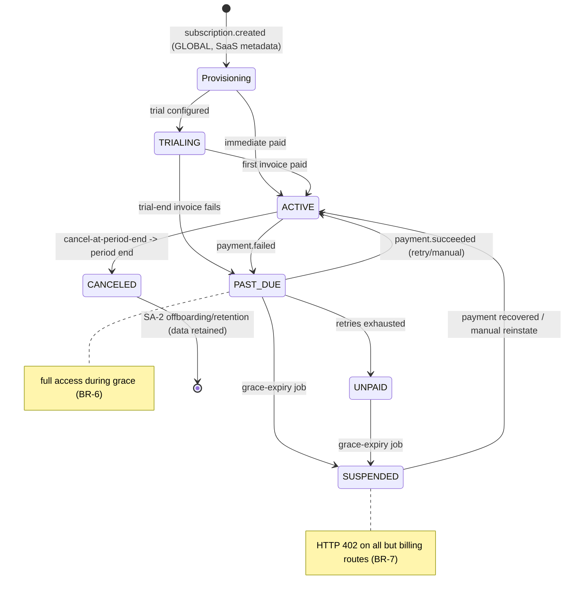

**Transitions, guards, triggers (summary).**

| From | To | Trigger / guard | Side-effect |
|---|---|---|---|
| (none) | Provisioning | `subscription.created` (GLOBAL, SaaS metadata) | provision tenant (exactly-once); emit `firm.provisioned` |
| Provisioning | TRIALING / ACTIVE | trial configured / immediate paid | `FirmSubscription` created; entitlements granted |
| TRIALING | ACTIVE | first invoice paid | gate full; SA-9 trial-conversion++ |
| TRIALING / ACTIVE | PAST_DUE | `payment.failed` | `DunningState` open; PAST_DUE; dunning email; full access kept (BR-6) |
| PAST_DUE | ACTIVE | `payment.succeeded` | `DunningState` RECOVERED; gate lifts (BR-14) |
| PAST_DUE / UNPAID | SUSPENDED | grace-expiry job (unpaid past grace) | gate ⇒ 402 (BR-7); entitlements off; audit |
| SUSPENDED | ACTIVE | recovery / manual reinstate | gate lifts; audit (if manual) |
| ACTIVE | CANCELED | cancel-at-period-end → period end | entitlements revoked; data retained; SA-2 offboarding; reason captured |
| CANCELED | (new) | re-subscribe | **new** `FirmSubscription` on same Firm (never resurrect) |
| any | any (manual) | Super-Admin `system/billing:manage` | `manual=true`; audited (BR-10/16) |

**Firm status (derived, used by gate):** Provisioning/Trial/Active → full; PastDue(grace) → full; Suspended → 402; Canceled/Offboarded → revoked (SA-2). **Payment-method display sub-state:** none → on-file (brand+last-4+exp) — reference only (BR-9).

---

## 7. Key Entities & Fields

> All tenant tables carry `firm_id` (tenant key) and are RLS ENABLED+FORCED per Doc 1 §2 (not re-spec'd here). Cross-cutting `AuditLog`/`Notification` attach via the platform `EntityTypeRegistry` polymorphic `(entityType, entityId)` (Doc 1 §5). PK = `id uuid`. Money = integer minor units + ISO-4217 currency. Persisted entities are **rail-neutral** (rails-as-ports, ADR [C4-D1]) — no entity name hard-codes a vendor; `railInvoiceRef`/`railEventRef`/`railSubscriptionRef`/`railPaymentMethodRef` are opaque adapter refs.

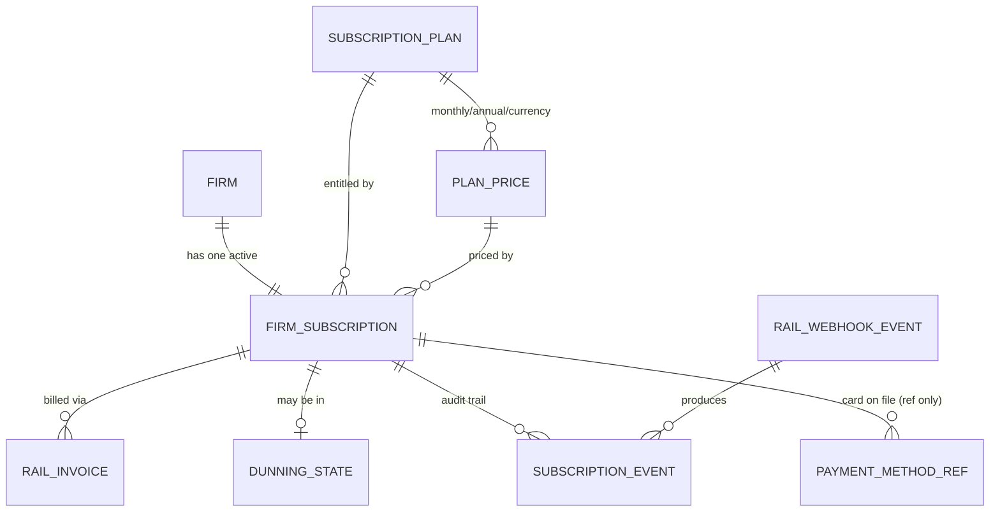

- **`FirmSubscription`** *(NEW first-class)* — `id`, `firm_id` (FK Firm, indexed), `planId` (FK SubscriptionPlan), `railSubscriptionRef?` (text, null for manual), `railCustomerRef?`, **`status`** (enum TRIALING|ACTIVE|PAST_DUE|UNPAID|CANCELED|SUSPENDED), `currentPeriodStart` (timestamptz), `currentPeriodEnd`, `cancelAtPeriodEnd` (bool), `trialEndsAt?`, `canceledAt?`, `cancellationReason?` (text), `priceId` (FK PlanPrice), `currency` (char3, resolved from PlanPrice), `amount` (int minor, resolved from PlanPrice), `interval` (enum MONTHLY|ANNUAL, resolved from PlanPrice), `defaultPaymentMethodRefId?` (FK PaymentMethodRef), `manual` (bool, default false), `createdAt`, `updatedAt`, `createdBy`. **Indexes:** `(firm_id, status)`, unique `railSubscriptionRef` (where not null).
- **`PlanPrice`** *(NEW — sole owner of price/currency/interval/rail-refs)* — `id`, `planId` (FK SubscriptionPlan, SA-3), `interval` (enum MONTHLY|ANNUAL), `currency` (char3), `amount` (int minor), `railPriceRef?`, `railProductRef?`, `active` (bool), `lastSyncedAt?`. **Unique:** `(planId, interval, currency)`. SA-3's `SubscriptionPlan` references this entity and holds no price/currency/interval/rail-ref fields of its own (single money path).
- **`RailInvoice`** *(NEW; rail-neutral, was vendor-named in the prototype)* — `id`, `firm_id` (indexed), `subscriptionId` (FK), `railInvoiceRef` (text, **unique**, opaque adapter ref), `amount` (int minor), `currency` (char3), `status` (enum FINAL|OPEN|PAID|VOID|UNCOLLECTIBLE), `periodStart`, `periodEnd`, `lineItems` (jsonb), `hostedInvoiceUrl?`, `invoicePdfUrl?`, `fxSnapshotId?` (FK FxRateSnapshot, Doc 1 §6.5 unified-field snapshot, for MRR conversion), `paidAt?`, `createdAt`. **Index:** `(firm_id, status)`.
- **`DunningState`** *(NEW)* — `id`, `firm_id` (indexed), `subscriptionId` (FK), `railInvoiceRef` (text), `attemptCount` (int), `firstFailedAt`, `lastReminderAt?`, `nextRetryAt?`, `gracePeriodEndsAt`, `state` (enum DUNNING|RECOVERED|EXPIRED), `recoveredAt?`, `createdAt`, `updatedAt`. **Indexes:** `(firm_id, state)`, `(state, gracePeriodEndsAt)` for the expiry job.
- **`RailWebhookEvent`** *(NEW — operational log; rail-neutral; dedupe authority is the Doc 1 ledger)* — `id`, `firm_id?` (nullable until resolved), `railEventRef` (text, **unique**, opaque adapter ref), `type` (text), `receivedAt`, `processingStatus` (enum RECEIVED|PROCESSED|FAILED|RETRYING), `error?` (text), `processedAt?`, `attemptCount` (int). **Index:** `(processingStatus)`.
- **`SubscriptionEvent`** *(NEW — audit trail)* — `id`, `subscriptionId` (FK), `firm_id` (indexed), `fromStatus?`, `toStatus`, `reason?`, `sourceRailEventRef?`, `actor` (text: 'system' | platformUserId), `occurredAt`.
- **`PaymentMethodRef`** *(NEW — display only)* — `id`, `firm_id`, `railPaymentMethodRef` (text, opaque adapter ref), `brand` (text), `last4` (char4), `expMonth` (int), `expYear` (int), `isDefault` (bool). **No PAN/CVV.**
- **`PendingCheckout`** *(NEW; existed as a thin prototype shape — see §12)* — `id`, `planId`, captured firm/owner details (legal/operating name, owner name/email, optional company/phone/address/billing fields), `priceId` (FK PlanPrice), `createdAt`, `expiresAt`. Consumed and deleted on provisioning.
- **`PlatformBillingConfig`** *(NEW — global plane, `firm_id IS NULL`, admin-only write per ADR FINAL #9)* — `reportingCurrency` (char3), `dunningRetryCount` (int), `dunningRetryIntervalDays` (int), `gracePeriodDays` (int), `trialDefaultDays?`, `trialCardRequired` (bool), dunning/trial email template refs (locale variants). One global row.
- **Referenced, not owned here:** `FxRateSnapshot` (platform `FxRateService`, Doc 1 §6.5 unified fields `baseCurrency`/`quoteCurrency`/`asOf`/`economicMoment`/`source`/`capturedAt` — SA-4 stores `fxSnapshotId`); `Firm` (SA-2); `SubscriptionPlan` + feature/country entitlements (SA-3, entitlement dimensions only); `FirmCountryEntitlement` (SA-2, keyed on `countryCode`); `AuditLog`/`Notification` (Doc 1 §5/§7); the per-firm processed-event ledger (Doc 1 §6.2.3).

---

## 8. User Stories + Acceptance Criteria

**US-1 — Self-serve signup provisions a tenant exactly once.**
- **Given** a firm completes rail checkout on a PUBLIC plan, **When** `subscription.created` is processed, **Then** a `Firm`, a `FirmSubscription` (ACTIVE or TRIALING), default roles, the owner principal (firm-staff pool, set-password invite), and country+feature entitlements are created within 60s and the `PendingCheckout` is deleted.
- **Given** the same event is redelivered, **When** processed again, **Then** no second firm/user/email is created — a logged no-op (idempotent on the rail `event.id` + per-firm ledger).
- **Given** the provisioning seed runs (roles/entitlements/owner-user), **When** it writes, **Then** it runs under the non-BYPASSRLS app role with `SET LOCAL app.current_firm_id` = the new firm (Doc 1 §4.5), and an attempted write scoped to any other `firm_id` is rejected fail-closed (the seed is RLS-confined to the one target firm).

**US-2 — Failed payment opens dunning without locking the firm out.**
- **Given** a `payment.failed` event, **When** processed, **Then** (1) status → PAST_DUE, (2) a `DunningState` opens, (3) a transactional dunning email is sent within 60s, (4) the webhook log shows PROCESSED, and (5) the firm **retains full access** during grace.
- **Given** the same `payment.failed` is redelivered, **When** processed, **Then** the **same** `DunningState` is advanced (no duplicate row, no duplicate email).

**US-3 — Grace expiry suspends; recovery reactivates automatically.**
- **Given** grace expires unpaid, **When** the grace-expiry job runs, **Then** status → SUSPENDED, all firm-staff API calls return **HTTP 402** (billing routes excepted), and an audit entry is written.
- **Given** a SUSPENDED firm whose retry succeeds, **When** `payment.succeeded` is processed, **Then** status → ACTIVE and the 402 gate lifts on the next request **without** any manual action.
- **Given** a SUSPENDED firm with the portal-open exception enabled, **When** a portal client requests data, **Then** the request is still bound by the Doc 1 §2.5 client-subject RLS dimension and §4.5 ownership-chain checks (the exception relaxes only the billing gate, never client-to-client isolation), and with the exception **not** enabled the portal is closed by default.

**US-4 — Idempotent invoice webhook.**
- **Given** the same `payment.succeeded` is received twice, **When** both process, **Then** the subscription/invoice is updated **exactly once** and the second is a logged "already processed" no-op.

**US-5 — Billing Admin works the dunning queue by value.**
- **Given** several firms in dunning with different MRR, **When** I open the dunning queue, **Then** I see each with attempt count, `nextRetryAt`, **days-of-grace remaining**, last reminder, sortable by MRR, with send-reminder / send-update-card actions.

**US-6 — Plan upgrade is immediate with rail proration; downgrade keeps data.**
- **Given** a firm upgrades, **When** `subscription.updated` is processed, **Then** `FirmSubscription` reflects the new plan/period/amount, upgraded entitlements apply next request, and the proration is the **rail-computed** figure (not re-implemented).
- **Given** a firm downgrades below current usage, **When** the change applies, **Then** over-tier features are hidden and lower caps enforced, but existing data is **retained read-only**.

**US-7 — Platform Owner sees correct multi-currency MRR.**
- **Given** active subscriptions in CAD, AUD, GBP and `reportingCurrency = CAD`, **When** I open the revenue dashboard, **Then** MRR/ARR and revenue-by-plan/by-country are shown in CAD, each subscription converted via its `FxRateSnapshot`, **no raw cross-currency sum**, and the FX basis disclosed.
- **Given** the dashboard renders, **When** I read it, **Then** churn is split **voluntary** (canceled) vs **involuntary** (failed-payment).

**US-8 — Cancellation is period-end and data-safe.**
- **Given** a firm cancels on day 3, **When** I view it, **Then** `cancelAtPeriodEnd = true`, the firm keeps access to period end, and at period end status → CANCELED with entitlements revoked and data **retained** (handed to SA-2).
- **Given** an immediate cancel, **When** Super-Admin performs it, **Then** a reason is mandatory and the action is audited.

**US-9 — Webhook signature + replay.**
- **Given** a webhook with invalid/missing signature, **When** it arrives, **Then** it is rejected in the adapter (no state change, no event raised).
- **Given** a FAILED webhook log entry, **When** Super-Admin re-processes it, **Then** the handler runs idempotently and the entry flips to PROCESSED with no duplicate side-effects.

**US-10 — Manual/off-rail subscription.**
- **Given** an enterprise firm on an INTERNAL plan, **When** a Billing Admin creates a **manual** subscription with status/period/amount and a reason, **Then** the firm is provisioned/entitled through the same lifecycle, it appears in MRR, rail-only actions are suppressed, and the action is audited (actor/reason/before-after).

**US-11 — No raw card data in Super-Admin.**
- **Given** a firm with a card on file, **When** a Billing Admin opens the subscription detail, **Then** they see brand + last-4 + expiry only and a "send update-card link" action — and there is **no field anywhere** to enter a card number.

**US-12 — AG-16 calls SA-4 and cannot reach another firm.**
- **Given** a firm-staff user with `agent/firm:billing-manage` opens AG-16 §Plan & Billing, **When** they start a checkout or open the card-update portal, **Then** SA-4 resolves their own `firm_id` from the principal and acts only on their firm.
- **Given** the same user attempts to read or change another firm's billing by supplying a different `firm_id`, **When** the request is processed, **Then** it is rejected (the caller-supplied id is ignored; the principal's `firm_id` is authoritative; RLS backstops — Doc 1 §2/§4).

---

## 9. Edge Cases & Validations

- **Webhook before its prerequisite** (`subscription.updated` before `created`) → upsert-based handlers converge; no blind insert; no error storm (BR-12).
- **Duplicate `subscription.created`** → exactly-once provisioning; second is a no-op (BR-3).
- **`PendingCheckout` missing on provisioning** (expired/deleted) → fall back to the rail customer email/name to build a minimal firm; flag the firm "details incomplete" for follow-up; never fabricate (BR-4).
- **Payment fails then succeeds on retry mid-grace** → `DunningState` RECOVERED, subscription ACTIVE, access never interrupted (BR-6/14).
- **Redelivered `payment.failed`** → same `DunningState` advanced; no duplicate dunning/email (BR-13).
- **Grace expires exactly as a manual payment posts** → idempotent ordering: a `payment.succeeded` recovers even if the grace-expiry job already ran; recovery from SUSPENDED → ACTIVE is allowed — payment always wins.
- **Mixed-currency MRR** → each subscription FX-converted via `FxRateSnapshot` before any sum; a missing FX pair surfaces "rate unavailable — excluded from total" (Doc 1 §6.5 exclude-with-note), never a raw sum or silent drop (BR-11).
- **Subscription amount with no currency** → rejected at Zod validation (currency required).
- **Rail price edited directly in the rail** → platform does not auto-pull; the plan stays master; a drift indicator flags the mismatch (BR-2).
- **Card declines repeatedly to grace expiry** → SUSPENDED + 402; the firm can still reach billing routes to update the card and self-recover (BR-7).
- **Firm updates card on the 402 screen (AG-16)** → SetupIntent succeeds → next retry succeeds → auto-reactivation (BR-14).
- **Manual subscription set ACTIVE without payment** → allowed (enterprise), `manual=true`, no rail retry path, fully audited (BR-10/16).
- **Cancel then re-subscribe** → re-subscribe creates a **new** `FirmSubscription` on the retained tenant; the canceled record is preserved for history/churn (never resurrected).
- **Downgrade below current usage** → over-cap data retained read-only with an upgrade affordance; never deleted (BR-8).
- **Trial ends, cardless, unconverted** → SUSPENDED (per policy); trial-ending reminders were sent first.
- **Webhook endpoint flooded / oversized / unsigned** → adapter signature check + payload-size cap + rate-limit + fast reject; nothing persisted on an unverifiable event (BR-12, Doc 1 §4.6).
- **Rail-originated event with no resolvable `externalEventId`** → rejected/dead-lettered + alarmed (Doc 1 §6.1.4 EV-A5); never deduped on a business id, never silently provisioned.
- **Slow provisioning causing rail webhook timeout** → adapter ACKs fast, provisioning runs async; the rail's retry hits the ledger as a no-op.
- **Two webhooks for the same firm processed concurrently** → row-level locking / upsert on `FirmSubscription`; status converges; no lost update.
- **Refund / chargeback** (dictionary events `payment.refunded` / `payment.disputed` — the adapter maps the rail's raw refund/dispute callbacks to these) → recorded; MRR adjusted; firm flagged for review (designed now; depth confirmed in OQ-7).
- **Reporting currency changed** → historical FX snapshots are immutable (Doc 1 §6.5 FX-A2); only go-forward conversions use the new currency; historical figures stay reproducible.

**Validation doctrine.** All input (signup, manual subscription, plan-change, config) is validated by Zod at the edge; reject early with a clear message; never persist on validation failure (Doc 1 §1; ADR — no ad-hoc if/else chains).

---

## 10. Permissions (GLOBAL `system/*`)

Default-deny; additive; GLOBAL scope (per Doc 1 §4 — `system/*` is the canonical GLOBAL namespace, resolving the prior `global/*` vs `system/*` contradiction in favour of `system/*`). Super-Admin sub-roles only; firm staff hold **no** `system/billing:*` keys.

| Permission Key | Status | Description |
|---|---|---|
| `system/billing:view` | **NEW** | View subscriptions, invoices, dunning, payment-method refs (read-only) |
| `system/billing:manage` | **NEW** | Create/adjust manual subscriptions, reinstate, assisted plan change, assisted cancel, trigger update-card link |
| `system/billing:view-dashboard` | **NEW** | View MRR/ARR/revenue/churn dashboard (→ SA-9) |
| `system/billing:webhook-log` | **NEW** | View the webhook event log and re-process FAILED events |
| `system/billing:configure` | **NEW** | Edit `PlatformBillingConfig` (dunning cadence, grace, trial defaults, reportingCurrency, email templates) — Platform Owner |
| `system/billing:price-sync` | **NEW** | Trigger plan→rail price sync (create/update Product+Price) |

> **Qualifier-N/A note (Doc 1 AC-4.1.3).** These are GLOBAL `system/*` keys on the platform plane; `view.own`/`view.all` qualifiers are **N/A** (no intra-firm ownership exists for platform staff). This key list is the module's per-wave catalog increment and is reconciled by the Doc 1 §4.4 CI completeness check against SA-4's delivered `@RequirePermissions` routes (every key wired to ≥1 route; every route key in the catalog).

**Firm-side key consumed (owned by AG-16 / SA-6 catalog, listed for completeness):** `agent/firm:billing-manage` (start/change/cancel subscription, open card-update portal, read own billing summary — §3.13; read is folded into this single key per ADR [C4-D5], so there is no separate `:billing-view`). This is a **LOCAL** key; per Doc 1 §4 the scope-aware guard rejects any LOCAL role bearing a `system/*` key, and rejects any GLOBAL role bearing a LOCAL key.

**Enforcement.** Route-level `@RequirePermissions('system/...')` + the Doc 1 §4 scope-aware guard on every **console** endpoint. The **inbound rail webhook is unauthenticated but signature-verified in the adapter** (`webhook-signature` compensating control, Doc 1 §4.6) — it carries no `system/*` key because the rail, not a Super-Admin, calls it. Money-affecting `system/billing:manage` actions are additionally audited (BR-10). View vs manage vs dashboard vs webhook-log vs configure are cleanly separated so a Support Agent stays read-only while a Billing Admin can act.

---

## 11. Scalability · Security · Performance

**Scalability.**
- **Config-driven, not code-driven:** dunning cadence, grace, trial length, and reporting currency are `PlatformBillingConfig` (global plane, Doc 1 §5/JSONB discipline); the email copy lives as SA-5 SYSTEM templates (SA-5 owns platform-template authoring) — policy and copy changes without a deploy. Per-plan dunning overrides are a thin extension on the same table.
- **Multi-currency / multi-country first-class:** `PlanPrice` per currency; native currency on every subscription/invoice; MRR rolls up via `FxRateSnapshot` — any currency without code change. Region is a per-tenant dimension (ADR FINAL #8).
- **One lifecycle, many billing sources:** rail and manual subscriptions share status/gating/MRR; a future source (reseller) is a thin adapter.
- **Stateless services + queue-backed work:** provisioning, dunning emails, MRR rollups, and webhook handlers run on BullMQ workers (Doc 1 §1); the adapter ACKs fast; rollups refresh incrementally off the read replica. Target: the Doc 1 scale envelope (2,000 firms) with subscriptions list, dunning queue, and dashboard all fast.

**Security (security-by-design, building on Doc 1).**
- **Tenant isolation by construction.** SA-4 tables carry `firm_id` and are RLS ENABLED+FORCED (Doc 1 §2); no SA-4 method takes a caller-supplied `firm_id` (mandatory tenant-scoped repository, Doc 1 §2 layer c). The CI cross-tenant-denial suite (Doc 1 §2.8) gates a one-firm-billing-data leak. The provisioning seed itself runs on the Doc 1 §4.5 elevated path (non-BYPASSRLS, `SET LOCAL` to the target firm), so even tenant creation never escapes RLS (BR-19).
- **Webhook auth = signature, in-adapter.** Verified against the GLOBAL secret (SA-8, rotatable without deploy) on the raw body, plus per-IP rate limit and payload-size cap; an unverifiable or `externalEventId`-less rail event is rejected/dead-lettered (Doc 1 §6.1.4/§6.3.4). This is the auth boundary for an internet-facing endpoint.
- **No raw card data, minimal PCI scope.** PAN/CVV stay at the rail (Checkout / customer portal / SetupIntent); the platform stores `PaymentMethodRef` only; Super-Admin cannot enter card data — PCI **SAQ-A** (BR-9).
- **Who-can-adjust-billing is tightly scoped.** Money-affecting actions require `system/billing:manage`; config requires `system/billing:configure`; everything money-adjacent is audited to the per-firm tamper-evident chain (Doc 1 §7.5) with actor/reason/before-after. View-only roles cannot act.
- **Idempotency as a security property.** The per-firm ledger (Doc 1 §6.2.3) prevents replay-driven double-provisioning / double-state-change — a malformed or replayed event cannot duplicate a tenant or wrongly flip access.
- **PII handling.** Billing PII (firm contact, billing address) is Confidential; no PII in logs/traces (Doc 1 §7); financial emails are transactional (BR-17) but still tenant-scoped and audited. SA-4 holds **no** Restricted PII (no card data), so the field-encryption codec (Doc 1 §7.2) does not apply here. The cancellation→SA-2 offboarding seam: an unmasked account export emits the Doc 1 §7.2 bulk `PII_REVEAL` audit, masked-by-default (SA-2 §3.9 / SA-11 §3.7).

**Performance (Doc 1 NFR targets).**
- **Gate reads cached status, not a live query.** The middleware reads a cached `Firm.status` (Redis, keyed by `firm_id`), invalidated on every subscription event — negligible latency, never a wrong allow from stale cache.
- **DB-side MRR aggregation.** MRR/ARR/revenue/churn read from pre-computed rollups (incremental refresh off the read replica) — not a live full-table scan.
- **Fast webhook ACK, async processing.** Verify + ledger + ACK quickly; heavy handlers on the queue (no rail retry-storm).
- **Indexed + cursor-paginated, always:** indexes per §7 (`(firm_id, status)`, unique `railSubscriptionRef`/`railInvoiceRef`/`railEventRef`, `(firm_id, state)` and `(state, gracePeriodEndsAt)` on dunning, `(processingStatus)` on the webhook log). All lists/logs/dashboards cursor-paginated (≤50) — no unbounded fetch.
- **Budgets:** webhook verify+ACK p95 ≤ 300 ms (heavy work async); console read p95 ≤ 300 ms; money-write p95 ≤ 600 ms (Doc 1 §8.1 performance budgets).

---

## 12. Reference Note — what exists today vs NEW vs CHANGED

> **Build framing (ADR [6.1]).** This is a **greenfield** target-state spec; the reference prototype is **design provenance only**, an optional NDA-gated read-only input the vendor MAY inspect but MUST NOT depend on. Notes below describe the prototype honestly so the vendor understands lineage — they impose **no** parity obligation, and no item is a migration.

**Design provenance (prototype lineage — informational).**
- The prototype had a working billing module with a single signed Stripe webhook endpoint handling `customer.subscription.created/updated/deleted` and `checkout.session.completed`, with self-serve provisioning riding on `subscription.created` (resolve a pre-checkout record → create a tenant + first owner + role-from-plan → set period/refs → send a set-password email), and a partial idempotency guard (a `findFirst` short-circuit). A `StripeService` sourced the GLOBAL Stripe credentials and offered checkout, webhook construction, product/price creation, and on-demand invoice listing. The prototype **had no** invoice-event handling, **no** first-class subscription entity (billing state was a two-value status enum + a few columns on the tenant row), **no** dunning, grace, webhook ledger, MRR dashboard, or 402 gating; `subscription.deleted` was an immediate hard end with no period-end grace, entitlement revocation, offboarding, or reason. Rail disambiguation was implicit (presence/absence of a client id on a checkout session). Persisted entities were vendor-named (e.g. a Stripe-named invoice/webhook table); the target state replaces these with **rail-neutral** names (`RailInvoice`, `RailWebhookEvent`) per the rails-as-ports doctrine.

**NEW (the target-state build).**
- **`PaymentRailPort` integration** for both rails (Doc 1 §6.3) — no module imports the Stripe SDK directly; the adapter verifies signatures and raises registered domain events.
- **`FirmSubscription`** as a first-class lifecycle entity (six states incl. platform-only SUSPENDED); `Firm.status` derived from it.
- **`PlanPrice`** (multi-currency/interval; sole owner of price/currency/interval/rail-refs) + idempotent plan→rail price sync as an explicit action.
- **Invoice persistence (`RailInvoice`)** via `invoice.*` events + PDF deep-link.
- **`PaymentMethodRef`** (display-only) + send-update-card link (no card entry in Super-Admin).
- **Dunning workflow (`DunningState`)**: failed-payment email, configurable retries/grace, recovery, grace-expiry suspension, dunning queue sorted by MRR.
- **Lifecycle-gating middleware** returning HTTP 402 for SUSPENDED (billing allow-list), cached-status read, automatic reactivation — layered over Doc 1's RLS + record-level authz; the portal-open exception relaxes only the billing gate.
- **RLS-confined provisioning seed** (roles/entitlements/owner-user) on the Doc 1 §4.5 elevated path — non-BYPASSRLS, `SET LOCAL` to the target firm.
- **Upgrade/downgrade/proration** reconciliation + trials + cancel-at-period-end lifecycle.
- **Manual/off-rail subscriptions** sharing the lifecycle (audited).
- **Webhook idempotency on the Doc 1 per-firm ledger** + `RailWebhookEvent` operational log + full event coverage + re-process; upsert-based, order-independent handlers.
- **Revenue/MRR rollups** (DB-side, multi-currency via `FxRateSnapshot` from the platform `FxRateService`, voluntary/involuntary churn split) → SA-9.
- **`PlatformBillingConfig`** + `system/billing:*` permissions + the Billing Admin console (subscriptions list, detail, dunning queue, webhook log, revenue dashboard).
- **The SA-4 ↔ AG-16 endpoint contract** (§3.13): the firm-facing UI is AG-16; the server logic is here (ADR [C4-D5]).

**CHANGED relative to the prototype (deliberate target-state, not a migration).**
- Billing state is a **first-class `FirmSubscription` (6 states)**, not a thin status enum + tenant columns; `Firm.status` derived.
- Price/currency/interval/rail-refs are owned by **`PlanPrice`** (a child of `SubscriptionPlan`), not inline columns on the plan row — one money path, multi-currency.
- Cancellation is **cancel-at-period-end** with entitlement-revocation + offboarding + reason — not an immediate hard end.
- Webhook handling is **ledger-backed and order-independent** (Doc 1 §6) — not a partial guard.
- Tenant key is **`firm_id` with RLS ENABLED+FORCED** (Doc 1 §2) — not application-discipline filtering.
- Pricing is **multi-currency `PlanPrice`**; MRR is multi-currency via FX snapshot (Doc 1 §6.5 unified fields), never raw-summed.
- Rail access is **via `PaymentRailPort`**, not a directly-imported SDK; persisted entities are **rail-neutral** (`RailInvoice`/`RailWebhookEvent`); disambiguation is explicit by event scope.

---

## 13. Open Questions / [FOUNDER-CONFIRM]

**Business/domain/commercial (founder is final authority):**
1. **[FOUNDER-CONFIRM] Dunning cadence + grace defaults.** Confirm retry count, intervals, and grace length (proposed: 3 retries / 14 days, grace = 14 days). Seeds `PlatformBillingConfig`.
2. **[FOUNDER-CONFIRM] Trial policy.** Do plans offer a trial, how long, and **card-required vs cardless**? (Drives §3.8 conversion and cardless-unconverted → SUSPENDED.)
3. **[FOUNDER-CONFIRM] `reportingCurrency` & FX source.** Platform reporting currency (CAD assumed, ADR [C4-D3]) and manual vs paid FX provider for production (the FX *mechanism* is fixed in Doc 1 §6.5; only the source/currency are commercial).
4. **[FOUNDER-CONFIRM] MRR policy specifics.** How are trials and past-due counted (e.g. trials excluded until first paid invoice; past-due counted during grace)? Needed for SA-9 number definitions.
5. **[FOUNDER-CONFIRM] Downgrade timing.** Confirm downgrade applies at period-end (default) vs immediate-with-credit.
6. **[FOUNDER-CONFIRM] Client-portal access during firm suspension.** When a firm is SUSPENDED for non-payment, do the firm's **clients** retain portal access (so they aren't punished)? A **founder + compliance** call (possible regulator/duty-of-care obligation to preserve in-flight client case access), not an engineering default. **Engineering default is fail-safe portal-CLOSED**, and any open-exception relaxes ONLY the billing gate (Doc 1 §2.5 + §4.5 isolation stays fully in force, SA-4-25a); SA-2 §3.4 carries the toggle.
7. **[FOUNDER-CONFIRM] Refund / chargeback depth for v1.** Record-only vs MRR-adjust vs firm-flag-for-review, and whether dispute (`payment.disputed`) handling is in the first delivery wave (designed in §9 regardless).
8. **[FOUNDER-CONFIRM] Stripe Connect onboarding model + application fee** (ADR [C4-D1]) — relevant only to keep Rail 2 separate; SA-4 (Rail 1) needs no Connect, but the founder's Connect terms confirm the rail boundary stays clean.

**Resolved by the ADR / Doc 1 / Doc 2 hardening (no longer open — folded here):**
- Pricing ownership → **`PlanPrice` (SA-4) is the sole owner** of price/currency/interval/rail-refs; SA-3 owns entitlement dimensions only and references `PlanPrice` (Doc 2 hardening R2).
- Billing-interval enum → **`MONTHLY|ANNUAL`** across SA-3 and SA-4 (Doc 2 hardening R3).
- Firm-side billing permission → **single `agent/firm:billing-manage`** (read folded in), no separate `:billing-view` (ADR [C4-D5]).
- Persisted entity naming → **rail-neutral** (`RailInvoice`, `RailWebhookEvent`), no vendor-named tables (ADR [C4-D1] rails-as-ports).
- Provisioning seed write path → **Doc 1 §4.5 elevated path** (non-BYPASSRLS, `SET LOCAL app.current_firm_id` = target firm), never BYPASSRLS (Doc 2 hardening R9).
- Permission prefix `system/*` vs `global/*` → **`system/*`** is canonical GLOBAL (Doc 1 §4 / ADR [C3-D2]).
- FX writer/schema/snapshot linkage → single platform `FxRateService`, immutable `FxRateSnapshot` (unified fields `baseCurrency`/`quoteCurrency`/`asOf`/`economicMoment`), SA-4 stores `fxSnapshotId` (Doc 1 §6.5 / ADR [C4-D3]).
- Firm-facing self-serve billing UI owner → **AG-16 §Plan & Billing**; SA-4 exposes the §3.13 endpoints (ADR [C4-D5]).
- Webhook idempotency mechanism → the per-firm processed-event ledger on the rail `event.id` (Doc 1 §6.2.3/§6.1.4 / ADR [C4-D2]).
- Tenant isolation mechanism → Postgres forced RLS + four defense-in-depth layers (Doc 1 §2 / ADR [C1-1]); de-phased to one frozen scope (ADR [6.2]).

> **Domain-correctness note.** SA-4 is commercial/billing machinery, not immigration domain — no Country-Pack content. The one adjacent policy question (whether suspending a firm may lawfully cut off *its clients'* in-flight case access) is OQ-6 above, routed to founder + compliance.


---

# Module SA-5: Global Templates

> **What this is.** The vendor-build specification for SA-5 **Global Templates** — the Super-Admin console's GLOBAL plane for authoring, versioning, publishing, and seeding the platform's curated catalogue of emails, documents/letters, retainers/agreements, messages, workflow blueprints, and checklists that every firm inherits and overrides. SA-5 is the **supply side** of the content layer; the firm-side adopt/override/3-way-diff/render machinery is AG-12's and is only referenced here. This console **sits on Doc 1 — Platform Foundation** and does not re-spec it. Postgres-16-single-store + FORCED RLS, the three walled auth pools, `system/*` GLOBAL permissions, the canonical data spine, the config-as-JSONB global plane, the domain-event dictionary, rails-as-ports, KMS/audit, and the NFR budgets are all inherited "per Doc 1 §X" and are normative here without restatement.

> **The boundary that defines this module (read first).** SA-5 is **global authoring + publishing + seeding + propagation-signalling**: who writes the curated, regulator-aware, bilingual SYSTEM catalogue, how it is versioned and published, and how it is propagated to firms. **AG-12 is firm consumption**: browse, adopt (clone into CLIENT scope), override deltas, re-sync via 3-way diff, render through the Doers. SA-5 owns everything on the SYSTEM side of the wire; AG-12 owns the firm CLIENT copy's lifecycle. Keep the seam clean: **SA-5 authors and publishes; AG-12 consumes and overrides.**

> **Content-neutral.** SA-5 specs the **machinery** (the catalogue model, the bilingual editor, the typed merge-field dictionary, versioning/publish, seeding, propagation). The *actual immigration content* (the Canada retainer's CICC wording, the Express-Entry document-request letter copy) is the founder's deferred Country-Pack deliverable, authored through this machinery and confirmed by the Immigration-SME and counsel. Every business/domain item is marked [FOUNDER-CONFIRM].

---

## Module Index

1. Purpose & Goal
2. Users & Jobs-to-be-Done
3. Functional Design — How It Works
4. Detailed Functional Requirements (SA-5-n)
5. Business Rules & Logic
6. States & Lifecycle
7. Key Entities & Fields (+ Mermaid ERD)
8. User Stories + Acceptance Criteria
9. Edge Cases & Validations
10. Permissions (`system/*` GLOBAL)
11. Scalability · Security · Performance
12. Reference Note (exists / NEW / CHANGED)
13. Open Questions / [FOUNDER-CONFIRM]

---

## 1. Purpose & Goal

**What it is.** SA-5 is the platform's **content backbone** — the single curated, version-controlled library of everything a firm *says* to a client or *generates* as a document, authored once by the Expat Ready team and inherited by every tenant. The Mailer sends an email template; the Drafter/Signer produces a retainer/agreement; the Biller renders an invoice; the Conductor's workflow steps fire message templates and instantiate workflow blueprints; the Case Delivery engine seeds document checklists. A firm that activates Expat Ready — or activates a new country — never faces a blank page: it receives a professionally-authored, country-correct, bilingual starter catalogue and makes it its own in AG-12.

**The business outcome it must produce.** Two outcomes, one global and one per-firm. **(1) Time-to-value at provisioning.** When SA-2 provisions a Canadian firm — or grants an existing firm an additional country entitlement — the firm must be able to send a compliant welcome email, generate a compliant retainer, and run a standard case workflow on day one, without authoring 30 templates. SA-5 makes this true via the clone-to-firm / bulk-clone seeding pipeline (§3.9). **(2) Central correctness that keeps flowing.** When a regulator changes mandated retainer wording, Expat Ready fixes it **once** in the SYSTEM catalogue; every firm that has not overridden that template benefits automatically, and firms that *have* overridden are notified and offered the change — never silently clobbered (AG-12). SA-5 makes "every firm starts compliant and stays current, without re-authoring, in the client's language" structurally true.

**Why it matters / world-class positioning.** A generic SaaS ships a flat list of email templates with `{{merge_tags}}` and no safety, inheritance, localization, or country-awareness. Expat Ready's global template system is inheritance-based, country-scoped, bilingual, typed, versioned, and compliance-native: a curated catalogue per country (entitlement-filtered so a Canada firm never sees Australia's retainer); typed, entity-bound merge fields validated at author time against the canonical spine so a broken field is caught before any firm clones it; bilingual EN/FR side-by-side with consent/disclaimer copy authored per locale (a Law-25/CASL requirement, never machine-translated); and versioning + draft→review→publish + propagation so a change to a legal document is deliberate, reviewed, reversible, auditable, and reaches firms safely. This is a **governed global content supply chain for a regulated, multi-country business** — a moat no horizontal CRM has.

**Global ambition.** The same module serves a Canada-only launch and a future N-country platform with no code change: a SYSTEM template is either **global** (`appliesToCountryId = NULL`, country-agnostic — a generic payment receipt) or **country** (`appliesToCountryId = CA`, a Canada retainer with regulator wording). Adding Australia is publishing an Australia-tagged catalogue, not a release. Locales are EN + Canadian French first-class (Doc 1 §NFR i18n) plus whatever the active Country Pack declares. Single-country single-language English is the degenerate case.

**How it ties to the rest of the platform.** SA-5 supplies; everything consumes. It binds to **SA-1** (a country template is bound to a Country Pack; a pack's required locales drive locale gating; pack reference data merges in), to **SA-2** (firm provisioning and country-entitlement grants trigger seeding §3.9; entitlement filters firm visibility), to **SA-3** (plan feature-entitlements — keys in SA-3's `CommercialFeatureCatalog`, the single registry of `feature.*` keys — may gate advanced template types; the entitlement check uses the canonical `@RequireEntitlement` guard against SA-3 and, where an operational toggle also applies, AND-composes with `@RequireFlag` against SA-12, entitlement-first per SA-12 §3.0), and to **AG-12** (firm adopt/override/re-sync/render). SA-5 owns authoring, country/locale variants, versioning, publish, seeding, and propagation; it does **not** own *sending* (the Doers via the rails-as-ports of Doc 1 §6.3), *firm overrides* (AG-12), or *the eligibility/forms reference data itself* (SA-1) — though templates may *merge* SA-1 data via the canonical-field dictionary.

---

## 2. Users & Jobs-to-be-Done

"Super-Admin" is an umbrella; SA-5 is used by a small set of privileged GLOBAL-scope sub-roles authenticated through the **platform pool** (`aud = er:platform`, Doc 1 §3.1). Firms are **not** users of this module — they are downstream consumers (AG-12). The last row marks the seam.

| Role | Primary job in SA-5 | Representative JTBD |
|---|---|---|
| **Country / Content Manager** (primary author) | Own the curated, country-correct, bilingual catalogue for assigned countries. | "When I onboard Australia, author its retainer, welcome email, and document-request letter with the right regulator wording so AU firms are compliant on day one." · "When IRCC/CICC changes mandated wording, publish a new version of the Canada retainer and have firms told to review it — without touching each tenant." · "When I author, insert merge fields from a validated dictionary and preview EN+FR with sample data so a broken variable never reaches a firm." |
| **Platform Owner** | Govern the catalogue's quality, approvals, and legal posture. | "Approve a retainer template before it can publish — a legal document is high blast-radius." · "Publish an emergency correction with an audited justification and have it propagate." · "Designate exactly one default per type/country/locale so seeding is deterministic." |
| **Tenant Account Manager** | Seed the catalogue into firms at provisioning / country activation. | "When I provision a Canadian firm, bulk-clone all Canada defaults into their tenant for a complete starter library." · "When I grant a firm the Australia entitlement, seed the Australia catalogue in one operation with a per-firm result report." |
| **Support Agent** | Read-only reference while triaging firm template issues. | "When a firm reports a broken merge field in *their* copy, view the SYSTEM source it was cloned from to see whether the bug is central or their override." (Read-only here; the fix is central by a Content Manager, or firm-side in AG-12.) |
| **Firm staff** (*not* SA-5 users — adjacent) | Adopt, override, re-sync, render. | Owned entirely in **AG-12**. Listed only to mark the seam: firms **never** author or edit SYSTEM templates; they clone into CLIENT scope and override the copy. |

**Design implication.** The authoring/governance surface (library, bilingual editor, merge-field picker, preview, version history, review/approve, publish, default designation) is built for the Content Manager and Platform Owner and is tightly permission-gated — SYSTEM template content is the highest-blast-radius content in the platform (a retainer is a legal instrument cloned by every firm). The seeding surface (clone-to-firm, bulk-clone) is built for the Tenant Account Manager and overlaps SA-2. Permissions (§10) cleanly separate author/publish, approve/rollback, and clone.

---

## 3. Functional Design — How It Works

### 3.0 The catalogue model (the foundation everything sits on)

**A SYSTEM template is a named, typed, channel-stamped, country-tagged container; its content lives in immutable versions; each version carries one body per locale; a default pointer marks the catalogue default per (type, country, locale).** This is the supply-side mirror of AG-12's consumption model.

- **SYSTEM scope only — this module never writes CLIENT.** Every template authored here is `scope = SYSTEM` with **no `firm_id`** — it is GLOBAL-plane config (`firm_id IS NULL`) and therefore obeys the **read-only permissive RLS policy + admin-only-write** rule of **Doc 1 §2.6**: any firm context may *read* a published global template, but only the elevated platform-admin path (gated by a `system/*` permission) may *write* it. CLIENT-scope firm copies are created and owned in AG-12; SA-5 only *creates the seed* (§3.9) and never edits a firm's copy.
- **Single store, JSONB-backed.** Templates persist in **PostgreSQL** (MongoDB is eliminated per Doc 1 §1.3/[C1-2]); the locale bodies, mandated-block markers, and variable-binding lists are JSONB columns validated by Zod at the edge. This resolves the source module's open "Mongo vs relational" question: it is relational + JSONB, under one RLS/residency/DR/encryption regime, and cross-plane queries (adoption count, propagation targets) are ordinary joins.
- **Global vs country, distinguished by `appliesToCountryId`.** A SYSTEM template is **global** (`NULL`) or **country** (bound to a Doc 1 §5.8 `Country` / SA-1 pack). A country template may narrow to **specific program nodes** via `appliesToProgramNodeKeys` (the resolved `programNodeKey` of Doc 1 §5.8 — never the four loose FKs). The program hierarchy is the four fixed normative levels **Pathway → Program → Category → Sub-Category** (Doc 1 §5.8), so a narrowing key is always a node within that fixed-depth tree. This is the dimension that scales the catalogue to N countries.
- **Content lives in immutable versions; the active PUBLISHED version is what firms clone/fall back to.** Editing produces a FINAL version; publish (after review) snapshots it into a PUBLISHED version and makes it the one firms clone and the one consumers fall back to. Prior published versions are retained so a document a firm signed last year re-renders with the exact version used (the same reproducibility guarantee the spine makes in Doc 1 §5.7).
- **One default per (type, country, locale).** Exactly one template per combination is the default, so seeding (§3.9) and consumer fallback are deterministic.
- **Firms see SYSTEM templates read-only, PUBLISHED-only, entitlement-filtered.** A firm browsing in AG-12 sees only `status = PUBLISHED` SYSTEM templates whose `appliesToCountryId` is among its SA-2 country entitlements (or global). FINAL/REVIEW templates are invisible to firms.

### 3.1 The global template library — browse, filter, and govern the entire catalogue in one place

The Content Manager opens **Global Templates** and sees a unified, filterable library across all assigned countries: rows showing **name, type, channel, country badge (Global / Canada / Australia…), status (Draft / Review / Published / Superseded / Archived), language coverage (EN ✓ FR ✓), active version, default badge, adoption count ("cloned by N firms"), last-modified-by/at**. The default view filters to the operator's assigned countries; a Platform Owner sees all.

**World-class behaviour.** Country-first organisation (mirrors the firm's downstream entitlement filter); filter by type, country, status, **language coverage** (find country templates missing a required French body — a Law-25 risk), default-vs-non-default, **adoption count** (find heavily-cloned templates whose change has high blast-radius), and the **review queue** (templates in REVIEW). Search over name. **Blast-radius is visible before you act** — every row shows "cloned by N firms" so an author knows editing *this* retainer affects N tenants' future generations.

**Data flow.** Library load → query SYSTEM templates filtered by assigned countries → annotate each with active-version, language-coverage, default flag, and a **cached adoption count** (a count of CLIENT clones whose `linkedToSourceId` points at this template; refreshed on clone/seed events, never counted live per load) → paginated result (cursor pagination per Doc 1 §8.1, never the whole catalogue).

### 3.2 Template types & channels — the six families, mapped onto type + channel

Every template carries a **`type`** (the merge-field-dictionary selector and governance class) and a **`channel`** (the rendering/escaping contract and the consuming Doer). The six families map as:

- **Retainer / agreement** → `type = RETAINER_AGREEMENT`, `channel = RETAINER`. Rendered by Drafter/Signer (AG-5) over `ObjectStoragePort` (Doc 1 §6.3). **Legal class — strictest governance:** mandatory review-before-publish, hard locale-coverage gate, mandated-clause protection, mandatory version history.
- **Document / letter** → `channel = DOCUMENT`/`LETTER`. A document-request letter binds to case + document-list merge fields. Rendered by Case Delivery / Documents.
- **Checklist** → `channel = CHECKLIST`; binds to a program's `DocumentRequirement` set (Doc 1 §5.6). Seeded into the case engine.
- **Invoice / billing** → `channel = INVOICE`; currency/tax/amount fields (FX via the single `FxRateService`, Doc 1 §6.5 — money meaning lives in the Biller, never duplicated here). Rendered by the Biller (AG-6).
- **Email** → `channel = EMAIL` — **subject + HTML body per locale**. Sent by the Mailer over `EmailRelayPort` (Doc 1 §6.3). The merge-field-dictionary selector remains the entity-binding `type` (PROSPECT/CLIENT/CASE…); the channel determines body shape and escaping.
- **Message / SMS** → `channel = SMS` — plain-text, length-aware, per-locale. Sent by the Messenger over `SmsGatewayPort` (Doc 1 §6.3); consent-gating is at-send in AG-2/AG-12. **Channel designed now; the live SMS rail is in scope per the de-phased mandate (ADR 6.2).**
- **Workflow blueprint** → `channel = WORKFLOW`. A pre-built automation/stage-pipeline a firm can clone. The Conductor (Automation, Doc 1 §1.1) is the engine; SA-1 owns stage templates as pack content (the `StageTemplate`/`StagePipeline` GLOBAL versioned entities defined in Doc 1 §5). SA-5 exposes a blueprint as a *clonable catalogue template* (its definition is the WorkflowBlueprint JSON contract; SA-5 does not duplicate the engine). **The honest boundary: the WorkflowBlueprint payload contract is EXTERNAL to SA-5** — it is delivered with the Automation/Conductor contracts per ADR-W4; SA-5 *references* it, never defines it **(blocked on ADR errata E1 / F5 — the channel's payload contract publishes with the Amendment batch)**. What SA-5 specs now, **channel-independently**: a WORKFLOW template gets the full container machinery — immutable versions + the FINAL→REVIEW→PUBLISHED lifecycle, `governanceClass`, country tagging + entitlement filtering, default designation, seeding, propagation, `system/template:*` permissions, audit (§3.7–§3.11) — while the version *body* is an opaque-to-SA-5 blueprint payload validated by a **channel-plugged validator** the Conductor contract registers. Locale-coverage gating (§3.5) applies to human-copy channels; a WORKFLOW version carries a locale-neutral payload whose localizable display strings are governed by the external contract. Until that validator is registered, WORKFLOW authoring/drafting works but **publish fails closed** — no unvalidated blueprint can reach a firm.

The `channel` → rail mapping is **inherited from Doc 1 §6.3** and is not re-spec'd here. This resolves AG-12 OQ-5's "TemplateType→new-channel mapping table absent": the table is `channel` → Doer/port, fixed above.

### 3.3 Authoring & the merge-field dictionary (typed, entity-bound, canonical-spine-backed)

Each **type** exposes a dictionary of merge fields; the author inserts them from a **grouped, searchable picker** (never raw `{{}}` typing). **The dictionary is backed by the canonical spine (Doc 1 §5.3):** each entry has a **`key`** (`client.firstName`, `case.programName`, `firm.designatedRepNumber`, `invoice.totalAmount`, `portal.signatureLink`), a **`label`**, a **`dataType`** (`STRING|NUMBER|BOOLEAN|DATE|ENUM|COMPOSITE`), a **`source`** binding to a real entity field (and, where applicable, to a `canonicalFieldKey` so the field resolves through the answer store), a **`category`**, an optional **`required`** flag, and — for ENUM fields — an `enumSetId` (Doc 1 §5.3's `EnumSet`).

**Country-aware dictionary.** Most fields are global; some carry `countryId` (a Canada regulator field like `firm.designatedRepNumber`, a NOC/CRS-derived field). When authoring a country template, the picker exposes global fields **plus** that country's fields; a global template sees only global fields — so an Australia template cannot reference a Canada-only field.

**World-class behaviour.**
- **Author-time validation, not runtime surprise.** On save and on publish, the system parses the body for `{{...}}` tokens and **validates every token against the type's (and country's) dictionary**. An unknown field **blocks publish** with a clear message; a known-but-unbound field is flagged. This kills the "Dear {{firstName}}" bug *before a firm ever clones it*. Because dictionary keys bind to `canonicalFieldKey`, a token referencing a retired/renamed canonical field fails validation exactly as a pack rule does (Doc 1 §5.3) — never a silent null at send.
- **Typed formatting.** Dates render in the render-time (firm/office, Doc 1 §NFR i18n America/Toronto default) timezone; numbers/currency format correctly; arrays render as lists or structured tables (the `payment_plan_table` / `payment_milestones` structured rendering preserved for retainers).
- **Entity-bound, path-aware.** Fields resolve across relations via `path` (`case.pathway`, `clientCustomer.authorizedRep`) — the author thinks in business terms, not joins.

**Data flow.** Editor requests the dictionary for the template's `type` + `appliesToCountryId` → author inserts tokens → on save/publish, token-parse + validate against the dictionary → store the version's `TemplateVariableBinding[]` → block publish on unknown/unsatisfiable-required.

### 3.4 Per-country variants (tied to the SA-1 pack)

A template's `appliesToCountryId` binds it to a Country (Doc 1 §5.8 / SA-1 pack). A firm sees a country template **only if entitled to that country** (SA-2 filter). Different **countries** = **distinct SYSTEM templates** (Canada retainer and Australia retainer are separate templates — their wording differs materially and legally); different **languages within a country** = locale bodies of the *same* template (§3.5). Optional narrowing via `appliesToProgramNodeKeys`.

**World-class behaviour.** **Clone-a-country starter** mirrors SA-1's clone-a-country: when a new country pack is seeded, SA-5 clones the source country's template *set* as the target's starter — copying structure (type, channel, merge-field usage, locale skeleton) and **clearing or flagging country-specific wording** (regulator clauses) for the target Content Manager to author and the SME to confirm. **Entitlement filtering is the firm's safety rail** — a Canada-only firm structurally cannot see, clone, or send an Australia retainer.

**Data flow.** Create/edit sets `appliesToCountryId` (+ optional program narrowing) → library and firm catalogue filter against SA-2 entitlements. Clone-country-template-set → bulk-create new SYSTEM templates for the target country, copying structure and clearing/flagging country wording → audit.

### 3.5 Bilingual / localized variants (EN/FR + pack locales)

A template **version** holds **one body per locale** (`TemplateLocaleBody`): **EN and Canadian French first-class** (Doc 1 §NFR i18n), plus Country-Pack-declared locales. The editor is **side-by-side** (EN | FR panes); each locale has its own **subject** (email), **body**, and **consent/disclaimer text** (CASL/Law-25 wording differs per language and is *not* a machine translation). Locale selection happens **downstream** at send/generate (the Doer resolves recipient → firm-default → EN — that render path is AG-2/AG-12); SA-5 owns *authoring* the locale bodies and *gating* on coverage.

**World-class behaviour.** **Consent/legal copy is per-locale and authored, never auto-translated** — a wrong machine translation of a regulator clause is a liability. A suggest-translation helper MAY exist for convenience but its output is always human-reviewed; consent/legal copy is hand-authored regardless. **Coverage is visible and gated** — publishing a country template missing a required locale is **hard-blocked for legal types** and **warned** otherwise; for Canada, **French is required** (SA-1). **Same logical template, two languages** — a Quebec client gets the French retainer, an Ontario client the English, from the same template's locale bodies, with no rep decision.

### 3.6 Injection-safe rendering & preview-with-sample-data

Rendering replaces every `{{key}}` with the typed, formatted value of the bound merge field for a specific entity. **Preview** renders against **synthetic sample data** (a seeded representative record), both EN and FR, so the Content Manager sees the actual output before submitting/publishing. Live rendering (real entity) is downstream in the Doers; SA-5 owns author-time preview and **the shared safe-render engine contract**.

**World-class behaviour — the security spine.**
- **Injection-safe by construction.** Rendering goes through a **context-aware, auto-escaping, logic-less engine**: HTML contexts HTML-escape merge **values** by default; only **server-produced, whitelisted structural variables** (the system-built `payment_plan_table`, never a human-authored field) emit raw HTML. The template language is logic-less — substitution + safe formatting/conditionals/loops over declared fields only, **no arbitrary code/expression evaluation** (no SSTI). This matters doubly at the SYSTEM layer: an unsafe SYSTEM template would be cloned into *every* firm. The identical engine is used downstream at send (the contract is shared with AG-12); SA-5 enforces it at the author/publish gate.
- **Preview is the governance net.** Side-by-side EN | FR preview with sample data and a **blank/missing-variable highlight** so unbound or empty merges are obvious before any firm clones.
- **Deterministic system variables.** `currentDate`/`currentYear` are injected by the renderer and rendered in the **render-time (firm/office) timezone**, not a raw UTC ISO string.

### 3.7 Versioning, draft → review → publish & history

A template is a stable container; content lives in **immutable versions**. Editing creates/updates a **FINAL**; the Content Manager **submits for REVIEW**; the **Platform Owner publishes** (review is mandatory for legal types). Publish snapshots the draft into a new **PUBLISHED** version (the one firms clone and consumers fall back to) and demotes the prior to **SUPERSEDED**, retained in history. **Exactly one PUBLISHED version is active per template.** **Rollback** re-publishes a prior version's content as a *new* version (clean audit trail) with a mandatory justification — mirroring the SA-1 pack emergency rollback. The `FINAL → REVIEW → PUBLISHED → SUPERSEDED/ARCHIVED` lifecycle deliberately mirrors the Country-Pack lifecycle so the two read the same.

**World-class behaviour.** Review gate for legal types (Platform-Owner approval before a legal-type template can publish); full version history + rollback (every version records `versionNumber`, author, SME-confirmer, approver, timestamp, change-note); ARCHIVED retires a template without breaking firm copies already cloned from it. **Publish guards run validation** (§3.3 merge-field, §3.5 locale coverage, §3.6 injection-safe, §3.11 SME-confirmation for mandated legal types) and **block on failure** with clear messages.

**Data flow.** Edit → upsert FINAL version. Submit → REVIEW. Publish → validate → snapshot FINAL → new PUBLISHED (active) → demote prior to SUPERSEDED → write audit (Doc 1 §7.5 per-firm-chain N/A here; this is a GLOBAL-plane audit via the platform security sink, Doc 1 §2.6/§4.2) → emit a propagation signal (§3.10). Rollback → new PUBLISHED cloning a historical version's bodies + mandatory justification → audit + propagation.

### 3.8 Default-template designation

For each **(type, country, locale)** exactly **one** SYSTEM template is the **default** — *the* Canada English welcome email, *the* Global payment receipt. The default is what bulk-clone seeding (§3.9) clones into a new firm and what a consumer falls back to when a firm has cloned nothing. Designating a new default demotes the prior (a single-default invariant per combination, enforced by a partial-unique constraint). A **defaults matrix** (type × country × locale grid) surfaces gaps before a country launch.

### 3.9 Clone-to-firm & bulk-clone seeding

The mechanism by which the global catalogue reaches tenants.

- **Clone-to-firm (single).** A Tenant Account Manager clones a SYSTEM template into a specific firm's tenant, creating a **CLIENT-scope copy** (`linkedToSourceId`, `sourceVersionId`, `status = FINAL`) via the **elevated, audited impersonation path of Doc 1 §2.6** (mint a scoped firm-pool token bound to that one `firm_id`; the write runs under the normal non-`BYPASSRLS` app role with `SET LOCAL app.current_firm_id` = the target `firm_id`, so RLS still confines it). Used in targeted onboarding.
- **Bulk-clone (set → many firms).** Bulk-clone a *set* of SYSTEM templates (e.g. all Canada-tagged defaults of channels EMAIL + RETAINER) into **all firms entitled to that country** in one operation — the day-one library. **Asynchronous on BullMQ (Doc 1 §6.2)**: chunked per firm, idempotent, resumable, with a **per-firm result report** (cloned / skipped-already-cloned / errored) — never a blocking request. Each per-firm write uses the §2.6 elevated bound-token path (`SET LOCAL app.current_firm_id` = that firm, non-`BYPASSRLS` app role).
- **Trigger points.** Seeding fires at **firm provisioning** (SA-2) and at **country-entitlement grant** (SA-2). The common path clones the **defaults** (§3.8) for the firm's entitled countries. This seed write is part of the same provisioning-side flow as the SA-2 role-seed / SA-3 entitlement-seed / SA-6 owner-user create, and like them it runs in the provisioning transaction with `SET LOCAL app.current_firm_id` = the just-created `firm_id` under the non-`BYPASSRLS` app role (the Doc 1 §4.5 elevated path), never `BYPASSRLS` and never a raw platform context — RLS-confined to the single target firm.

**World-class behaviour.** **Never clobbers a firm's edits** — seeding only *creates* copies a firm lacks; it never overwrites an existing CLIENT template (overwrite is never a seeding behaviour). **Idempotent** — re-running skips firms/templates already seeded. **Adoption guards preserved** — a source already cloned by a firm is not cloned again; an already-cloned (linked) template cannot itself be cloned. Completion raises a tenant-scoped `notif/templates-seeded` notification (Doc 1 §6.1.2 namespace) to each seeded firm's admins.

### 3.10 Global-update propagation to firms

When a Content Manager **republishes** a SYSTEM template, SA-5 **signals** every firm that has cloned it. The firm-side handling (one-click fast-forward for unmodified adoptions, 3-way diff + explicit adopt for overridden ones — both **firm-initiated**) is AG-12's; SA-5 owns the **detection and signalling**:

- **Staleness is a derived read-time fact, never a written flag.** A firm clone is *stale* precisely when `FirmTemplate.sourceVersionId ≠ SystemTemplate.activePublishedVersionId` — a comparison AG-12 evaluates at read time over the global-read RLS policy (Doc 1 §2.6). No SA-5 job writes into any tenant to record it.
- A background BullMQ pass **enumerates (read-only)** every CLIENT clone whose `linkedToSourceId` points at the republished template and whose `sourceVersionId` is now behind the new active version.
- For each affected firm it raises a tenant-scoped `notif/template-update-available` notification to that firm's template admins (the Doc 1 §6.1.2 notification mechanism — the **only** tenant-plane write a republish performs) and appends the firm to the propagation log.
- **Firms that never cloned it** fall back to the new PUBLISHED SYSTEM version automatically (no action) — central correctness reaches them for free via the global-read RLS policy (Doc 1 §2.6).

**World-class behaviour — the cardinal rule (ONE normative model).** **No silent clobber, ever — and no CLIENT template write, ever.** A platform republish NEVER touches a firm's CLIENT template row: not the content, not the status, not a metadata flag ("mark stale" is normatively this derived model — SA-5 performs **zero** tenant-plane template writes on propagation). A firm's careful retainer edit is never overwritten by a central republish; the change is *offered with a structured diff* (§3.12 — the identical delta contract AG-12 renders) and taken up **only by an explicit, firm-initiated AG-12 action**: one-click fast-forward for unmodified adoptions, 3-way diff + explicit adopt for overridden ones. A **pre-publish impact note** ("cloned by N firms — X unmodified will see a fast-forward offer, Y overridden will be offered a 3-way diff") makes the change knowing. A **propagation log** records which firms were signalled for which version. *(Security: this removes the only would-be cross-tenant template-write fan-out in the module — republish needs no elevated tenant writes at all, only sanctioned notification raises. Performance: the pass is a read-only enumeration + notification fan-out, queued, O(cloning firms), never synchronous.)*

### 3.11 Regulator/legal wording & the SME seam

SA-5 is where regulator-mandated and legally-significant wording **enters the platform** — the CICC retainer disclosure, the no-guarantee/indicative-eligibility disclaimer, jurisdiction consent text. Because every firm inherits it, **the wording is not invented by the architect or the Content Manager from memory** — it is authored from the regulator's actual requirement, **confirmed by the Immigration-SME, with the founder as final authority** and (for legal instruments) qualified counsel [FOUNDER-CONFIRM]. SA-5 owns the *mechanism* (author, version, review, publish, gate, mark mandated); it **defers the correctness of any specific clause** to the SME/founder/counsel.

**World-class behaviour.** **Mandated clauses are protected downstream** — a per-version `mandatedBlocks` marker on the locale body flags regulator-mandated regions so AG-12 protects them in firm overrides (a firm overrides brand/voice, not the mandated clause; the mandated text re-flows on re-sync). **Provenance is recorded** — a published legal-type version records who authored, who (SME) confirmed, who (Platform Owner) approved, and when. **Change is deliberate** — mandated-wording change goes through REVIEW and is propagated as an *offered* change, never a silent in-place edit.

### 3.12 Version diff — the structured delta a reviewer (and a firm) approves against

**Nothing is approved, published, or adopted unseen.** SA-5 computes a **structured delta between any two versions of a template** — the catalogue mirror of SA-1 §3.11's pack version diff ("a reviewer approves nothing unseen"). Because versions are immutable (§3.7), the diff is a **pure function of two version ids**: computed on demand, cacheable by the `(fromVersionId, toVersionId)` pair, **never stored as an entity**.

The delta is **structured, not a raw text blob** — four panes:

- **Version metadata & provenance.** `versionNumber`, `changeNote`, author / SME-confirmer / approver provenance — what changed *about* the version, not just in it.
- **Per-locale delta.** Locales **added or removed** between the versions; for each locale present in both, an inline delta of **subject** (email), **body**, and **consentText** — so a French consent-text change is exactly as visible as an English body change (a Law-25 review concern, §3.5).
- **Mandated-blocks delta.** `mandatedBlocks` regions **added / removed / edited**, flagged prominently and *first* — a mandated-clause change is the highest-blast-radius edit in the platform (BR-11) and must never hide inside a body diff.
- **Merge-field delta.** The two versions' `TemplateVariableBinding` sets compared: fields **added / removed / rebound** (source or `canonicalFieldKey` changed) / **type-changed**; a removed `required` field, or a binding now referencing a retired `canonicalFieldKey`, is flagged as a **consumer-breaking change**.

**Where it surfaces.** (1) The **review queue** — an approver opening a REVIEW version sees the diff against the active PUBLISHED version by default; for legal types the approval action is presented *on* the diff. (2) **Version history** — any two versions are diffable, including a rollback candidate vs current, so a rollback justification (§3.7) is written against a visible delta. (3) The **pre-publish impact dialog** (§3.10) — the impact note links the outgoing delta so the author sees exactly what N firms will be offered.

**One delta contract, both sides of the wire.** The diff is emitted as a **typed, machine-readable JSON payload (Zod-validated at the edge)** *and* rendered human-readable. The identical payload contract is what AG-12 renders on the firm side: in AG-12's 3-way diff (base = the firm's `sourceVersionId`, remote = the new PUBLISHED version, local = the firm's copy), the base-vs-remote leg **is** this SA-5 delta. SA-5 owns the computation contract; AG-12 owns the three-way merge UX — one engine, no drift between what the platform reviewed and what a firm is offered.

*(Scalability: computed-not-stored means no diff table growing O(versions²); immutability makes results indefinitely cacheable. Security: platform-side diff reads are gated by `system/template:read`; the firm-side rendering only ever compares versions the firm can already read — PUBLISHED SYSTEM plus its own clone. Performance: a diff touches exactly two versions' locale bodies + bindings — O(body size), within the Doc 1 §8.1 read budget, never O(catalogue).)*

---

## 4. Detailed Functional Requirements

RFC-2119 SHALL/SHOULD/MAY. Numbered `SA-5-n`.

**Catalogue model & library**
- **SA-5-1.** The system SHALL author templates in `scope = SYSTEM` on the GLOBAL plane with **no `firm_id`**, written only via the elevated platform-admin path (Doc 1 §2.6); CLIENT copies SHALL be created only by AG-12 or the seeding pipeline (§3.9), never edited here.
- **SA-5-2.** Each SYSTEM template SHALL carry `appliesToCountryId` (`NULL` = global; a Doc 1 §5.8 country = country-specific), optional `appliesToProgramNodeKeys` (each a resolved `programNodeKey` within the fixed Pathway/Program/Category/Sub-Category hierarchy, Doc 1 §5.8), a `type`, and a `channel`.
- **SA-5-3.** The library SHALL be **cursor-paginated** (Doc 1 §8.1), country-filtered to the operator's assigned countries (Platform Owner = all), searchable by name, each row showing name, type, channel, country badge, status, language coverage, active version, default badge, **cached adoption count**, last-modified-by/at.
- **SA-5-4.** Firms SHALL see SYSTEM templates **read-only, only when `status = PUBLISHED`, and only for entitled countries (or global)** — enforced by the SA-2 entitlement soft-filter plus the global-read RLS policy (Doc 1 §2.6).

**Template types & channels**
- **SA-5-5.** The system SHALL support the six families via `type` (the merge-field-dictionary selector) + `channel` (`EMAIL | SMS | DOCUMENT | LETTER | RETAINER | INVOICE | CHECKLIST | WORKFLOW`); EMAIL = subject + HTML per locale; SMS = plain-text per locale, length-aware. The `channel` → Doer/rail-port mapping is inherited from Doc 1 §6.3.
- **SA-5-6.** Legal types (RETAINER_AGREEMENT) SHALL be governed at the strictest level: mandatory REVIEW before publish, hard locale-coverage gate, mandated-clause marking, mandatory version history, SME-confirmation gate.
- **SA-5-7.** Non-legal types MAY publish directly from FINAL where governance config permits (§13 OQ); legal types SHALL pass REVIEW.

**Merge-field dictionary**
- **SA-5-8.** Each `type` SHALL expose a typed, entity-bound merge-field dictionary (`key`, `label`, `dataType`, `source`, `category`, `required?`, `enumSetId?`) whose entries bind to a `canonicalFieldKey` where the field is a spine fact (Doc 1 §5.3).
- **SA-5-9.** The dictionary SHALL be **country-aware**: global fields plus the template's country's fields; a global template SHALL see only global fields.
- **SA-5-10.** Authors SHALL insert fields via a grouped, searchable picker (not raw typing); the system SHALL record each version's used fields (`TemplateVariableBinding`).
- **SA-5-11.** On save and publish the system SHALL parse and validate every `{{token}}` against the type's (and country's) dictionary; **unknown fields SHALL block publish** with the specific field named; a token referencing a retired/renamed `canonicalFieldKey` SHALL fail validation (never silently null); unbound/unsatisfiable-required fields SHALL be flagged.
- **SA-5-12.** Fields SHALL render with type-correct formatting (dates in the render-time timezone, numbers/currency formatted, arrays as lists/tables); structured array rendering (`payment_plan_table`, `payment_milestones`) SHALL be preserved.

**Per-country & bilingual variants**
- **SA-5-13.** A country template SHALL be a distinct SYSTEM template per country; language within a country SHALL be a locale variant of the same template.
- **SA-5-14.** A version SHALL hold one body per locale (`TemplateLocaleBody`) with EN and Canadian French first-class plus SA-1-declared locales; each locale SHALL carry its own subject (email), body, consent/disclaimer text, and `mandatedBlocks` markers.
- **SA-5-15.** The editor SHALL present EN/FR side-by-side and indicate missing-locale coverage; consent/legal copy SHALL be authored per locale, never machine-translated (a suggestion helper MAY exist; output SHALL be human-reviewed).
- **SA-5-16.** Publishing missing a required locale SHALL be hard-blocked for legal types and warned otherwise; for Canada, French SHALL be required (SA-1).
- **SA-5-17.** The system SHALL support cloning a country's template set as a new country's starter (copy structure, clear/flag country wording) — the catalogue companion to SA-1 clone-a-country.

**Rendering & preview**
- **SA-5-18.** Rendering SHALL be injection-safe by construction: a context-aware, auto-escaping, logic-less engine SHALL HTML-escape all merge **values** in HTML contexts; only server-produced whitelisted structural variables MAY emit raw HTML; the engine SHALL **never** evaluate arbitrary code/expressions.
- **SA-5-19.** The system SHALL provide author-time preview with sample data rendering EN and FR side-by-side with a blank/missing-variable highlight.
- **SA-5-20.** System variables (`currentDate`, `currentYear`) SHALL render in the render-time (firm/office) timezone, not raw UTC ISO.

**Versioning & lifecycle**
- **SA-5-21.** Content SHALL live in immutable versions; editing SHALL produce/update a FINAL; firms SHALL only ever clone / fall back to the active PUBLISHED version.
- **SA-5-22.** The lifecycle SHALL be `FINAL → REVIEW → PUBLISHED → SUPERSEDED/ARCHIVED` (mirrors the SA-1 pack lifecycle); exactly one active PUBLISHED version per template.
- **SA-5-23.** Legal-type templates SHALL require Platform-Owner REVIEW approval before publish.
- **SA-5-24.** The system SHALL keep full version history (versionNumber, author, SME-confirmer, approver, timestamp, change-note) and support rollback (re-publish a prior version's content as a new version, with a mandatory justification audited).
- **SA-5-25.** Publish SHALL run guards (SA-5-11 merge-field, SA-5-16 locale coverage, SA-5-18 injection-safe, the channel-plugged body validator SA-5-42, SME-confirmation for mandated legal types) and block on failure with clear messages.

**Default designation**
- **SA-5-26.** The system SHALL maintain exactly one default SYSTEM template per (type, country, locale), enforced by a partial-unique constraint; designating a new default SHALL demote the prior; a defaults matrix SHALL surface gaps before a country launch.

**Clone-to-firm & bulk-clone seeding**
- **SA-5-27.** A Tenant Account Manager SHALL clone a SYSTEM template to a specific firm, creating a CLIENT copy (`linkedToSourceId`, `sourceVersionId`, `status = FINAL`) via the elevated bound-token path (Doc 1 §2.6) with `SET LOCAL app.current_firm_id` = the target firm under the non-`BYPASSRLS` app role.
- **SA-5-28.** A Tenant Account Manager SHALL bulk-clone a set of SYSTEM templates to all firms entitled to a country, **asynchronously on BullMQ** (Doc 1 §6.2), producing a per-firm result report (cloned / skipped-already-cloned / errored).
- **SA-5-29.** Seeding SHALL fire at firm provisioning and country-entitlement grant (SA-2), defaulting to the defaults (SA-5-26) for the firm's entitled countries; seeding SHALL be idempotent and SHALL never overwrite an existing firm CLIENT template. The provisioning-time seed write SHALL run in the provisioning transaction with `SET LOCAL app.current_firm_id` = the just-created firm_id under the non-`BYPASSRLS` app role (Doc 1 §4.5), never `BYPASSRLS` / raw platform context, RLS-confined to the one target firm (mirrors the SA-2 role-seed / SA-3 entitlement-seed / SA-6 owner-user-create path).
- **SA-5-30.** Adoption guards SHALL be preserved: a source already cloned by a firm SHALL NOT be cloned again; an already-cloned (linked) template SHALL NOT itself be cloned.

**Global-update propagation**
- **SA-5-31.** On republish, the system SHALL enumerate (read-only) all CLIENT clones behind the new version and raise a tenant-scoped `notif/template-update-available` notification to each affected firm's template admins; it SHALL **never** write into a firm's CLIENT template row — content, status, or metadata (staleness is derived, not written — SA-5-40).
- **SA-5-32.** Firms that have not cloned a template SHALL fall back to the new PUBLISHED SYSTEM version automatically (no action) via the global-read RLS policy (Doc 1 §2.6).
- **SA-5-33.** Republish SHALL surface a pre-publish impact note ("cloned by N firms; X unmodified, Y overridden") and write a propagation log.

**Cross-cutting**
- **SA-5-34.** All catalogue list/preview/diff/history reads SHALL be cursor-paginated; no endpoint SHALL return an unbounded set (Doc 1 §8.1).
- **SA-5-35.** Sensitive actions (create, edit, submit-for-review, approve, publish, rollback, archive, set-default, clone-to-firm, bulk-clone, mandated-clause change) SHALL be audited with actor, target, and before/after, through the audit spine (Doc 1 §7.5 / GLOBAL-plane security sink §2.6).
- **SA-5-36.** Notifications SHALL be raised on update-available (propagation), bulk-clone completion, and review-submitted/approved — tenant-scoped where firm-facing, never cross-firm — via the Doc 1 §6.1.2 `notif/` namespace.

**Version diff (§3.12)**
- **SA-5-37.** The system SHALL compute a structured delta between any two versions of a template — version metadata/provenance, per-locale delta (locales added/removed; per-locale subject/body/consentText inline delta), `mandatedBlocks` delta (added/removed/edited, flagged first), and merge-field delta (bindings added/removed/rebound/type-changed; a removed `required` field or a retired-`canonicalFieldKey` reference flagged as consumer-breaking) — computed on demand from the immutable versions, never stored, emitted as a typed machine-readable JSON payload (Zod-validated) and rendered human-readable.
- **SA-5-38.** The diff SHALL surface in the review queue (REVIEW vs active PUBLISHED by default; for legal types the approval action SHALL be presented on the diff — approve nothing unseen, mirroring SA-1 §3.11), in version history (any two versions, including rollback-candidate vs current), and in the pre-publish impact dialog (§3.10).
- **SA-5-39.** The diff payload contract SHALL be shared with AG-12: the base(=`sourceVersionId`)-vs-remote(=new PUBLISHED) leg of AG-12's firm-side 3-way diff SHALL be this SA-5 delta — one computation contract, no platform-vs-firm drift.

**Propagation model (normative — completes SA-5-31)**
- **SA-5-40.** Staleness SHALL be a **derived read-time fact** (`FirmTemplate.sourceVersionId ≠ SystemTemplate.activePublishedVersionId`, evaluated by AG-12 over the global-read policy, Doc 1 §2.6), never a flag written by SA-5; adoption of a republished SYSTEM version SHALL always be an explicit, firm-initiated AG-12 action (one-click fast-forward for unmodified adoptions; 3-way diff + explicit adopt for overridden ones); a platform republish SHALL trigger **no** write to any firm CLIENT template row, content or metadata — its only tenant-plane side-effect is the SA-5-31 notification raise.

**WORKFLOW channel boundary (§3.2)**
- **SA-5-41.** WORKFLOW templates SHALL receive all channel-independent machinery identically to the other channels — container + immutable versions, `FINAL → REVIEW → PUBLISHED → SUPERSEDED/ARCHIVED` lifecycle, `governanceClass`, country tagging + entitlement filtering, default designation, clone-to-firm/bulk-clone seeding, propagation signalling, `system/template:*` permissions, and audit; locale-coverage gating (SA-5-16) SHALL apply only to human-copy channels — a WORKFLOW version carries a locale-neutral payload whose localizable display strings are governed by the external contract.
- **SA-5-42.** The WorkflowBlueprint payload contract SHALL be **referenced, never defined**, by SA-5 (ADR-W4; delivered with the Automation/Conductor contracts) **(blocked on ADR errata E1 / F5 — the channel's payload contract publishes with the Amendment batch)**; each channel SHALL validate its version body via a **channel-plugged validator**, and publish SHALL **fail closed** for any channel with no registered validator — WORKFLOW authoring/drafting remains available while its publish is blocked until the contract registers.

---

## 5. Business Rules & Logic

- **BR-1 (Authoring authority).** SYSTEM templates are authored/edited only by platform-pool Super-Admin sub-roles (Content Manager creates/edits; Platform Owner approves/publishes/rolls back legal types). Firms never author or edit SYSTEM templates; a firm-authored original is **CLIENT** scope (AG-12), never SYSTEM.
- **BR-2 (Scope & tenancy).** A SYSTEM template has no `firm_id` and is GLOBAL-plane config under the read-only-permissive + admin-only-write RLS policy (Doc 1 §2.6). A CLIENT copy is `firm_id`-scoped (AG-12). Entitlement (country) and status (PUBLISHED) gate firm *visibility*, not ownership.
- **BR-3 (Country vs locale).** Different countries = different SYSTEM templates; different languages within a country = locale bodies of the same template. A firm sees a country template only if entitled.
- **BR-4 (Consumers see published-only).** Firms clone, and consumers fall back to, the active PUBLISHED version only; FINAL/REVIEW is invisible to firms and never rendered.
- **BR-5 (Default invariant).** Exactly one default per (type, country, locale), enforced by a partial-unique constraint; setting a new default demotes the prior.
- **BR-6 (Seed creates, never overwrites).** Clone/bulk-clone only create firm copies the firm lacks; overwrite is never a seeding behaviour.
- **BR-7 (No silent clobber on propagation — cardinal rule, ONE normative model).** A central republish never writes into any firm's CLIENT template row — content, status, or metadata. Staleness is **derived at read time** (`sourceVersionId ≠ activePublishedVersionId`, SA-5-40), never written; affected firms are notified (`notif/template-update-available`) and offered the change with a structured diff (§3.12); the firm adopts **explicitly** in AG-12 (one-click fast-forward if unmodified, 3-way diff + explicit adopt if overridden). Un-cloned firms fall back automatically.
- **BR-8 (Merge fields are typed and entity-bound).** A field is valid only if it exists in the type's (and country's) dictionary with a real source/`canonicalFieldKey`; an unknown token is an authoring error caught at save/publish, never shipped.
- **BR-9 (Render treats values as data).** Merge values are always untrusted — HTML-escaped in HTML contexts; only server-produced whitelisted structural variables emit raw markup; the engine never evaluates code. Enforced at the author/publish gate because an unsafe SYSTEM template poisons every firm.
- **BR-10 (Locale resolution & gate).** Authoring requires per-locale bodies; publishing without a required locale is hard-blocked for legal types, warned otherwise; Canada requires French. Downstream send resolves recipient → firm-default → EN (AG-2/AG-12).
- **BR-11 (Mandated wording → SME/founder).** Regulator/legal wording originates in the SYSTEM country template, is confirmed by the Immigration-SME with the founder as final authority (counsel for legal instruments) [FOUNDER-CONFIRM], is marked `mandatedBlocks` so AG-12 protects it, and changes only through REVIEW. SA-5 owns governance, not the legal accuracy of any clause.
- **BR-12 (Versioning is immutable + auditable).** Every published change is a new immutable version with author/SME-confirmer/approver/timestamp/change-note; rollback is itself a new version with a mandatory justification; history is never destroyed (a signed document re-renders with its signing-time version).
- **BR-13 (Blast-radius visibility).** Cached adoption count is shown before any edit/republish/archive; archiving a heavily-cloned template warns.
- **BR-14 (Channel determines rendering).** Per Doc 1 §6.3: EMAIL = subject + HTML per locale (escaped); SMS = plain-text per locale, length-aware; RETAINER/INVOICE = structured tables; escaping/formatting follow the channel.
- **BR-15 (Money is single-sourced).** Invoice/billing templates *render* amounts but never compute or store money; amounts and FX come from the Biller (AG-6) and the single `FxRateService` (Doc 1 §6.5; `FxRateSnapshot` uses the unified `baseCurrency`/`quoteCurrency`/`asOf`/`economicMoment` fields, consumers store `fxSnapshotId`). SA-5 holds no monetary logic and persists no FX snapshot.
- **BR-16 (Advanced-type entitlement gating).** Where a plan gates an advanced template type/channel (e.g. WORKFLOW blueprints, SMS), the gate is a `feature.*` key in SA-3's `CommercialFeatureCatalog` (the single registry of `feature.*` keys, all-lowercase dotted grammar) checked via the canonical `@RequireEntitlement` guard; where an operational toggle also applies, it AND-composes with SA-12's `@RequireFlag` (operational `FeatureFlag`), entitlement-first per SA-12 §3.0. SA-5 references these keys; it does not own the catalogue.

---

## 6. States & Lifecycle

Content lives in versions; the active PUBLISHED version is what firms clone and consumers fall back to. Mirrors the SA-1 Country-Pack lifecycle.

```
create / clone-country-set
  ──► [FINAL v1] ──submit──► [REVIEW v1] ──approve+publish (guards pass)──► [PUBLISHED v1]
          ▲                                                                  │  ◄── firms clone / fall back
          │ edit (new draft)                                                 │ edit
          │                                                                   ▼
      [FINAL v2] ──submit──► [REVIEW v2] ──publish──► [PUBLISHED v2]   (v1 → SUPERSEDED)
                                                          │  └─► propagation signal to firms (§3.10)
                                                          │ rollback to v1 content (justification)
                                                          ▼
                                                    [PUBLISHED v3 = v1 content]
   any PUBLISHED ──archive (adoption-checked)──► [ARCHIVED]  (retained; firm copies intact; restorable)
```

**Transitions, guards, side-effects.**

| From | To | Guard | Side-effect |
|---|---|---|---|
| (none) | FINAL | scope=SYSTEM; type + channel + country chosen | new template + v1 draft; audit |
| (source country) | FINAL (new country) | clone-country-template-set | copy structure, clear/flag country wording; audit |
| FINAL | REVIEW | author submits | enters Platform-Owner queue; `notif/template-review-requested` |
| REVIEW / FINAL | PUBLISHED | merge-field + locale-coverage + injection checks + (legal: SME-confirm + owner approve) | snapshot version; demote prior → SUPERSEDED; audit + propagation signal |
| PUBLISHED | FINAL (new) | edit | new draft; firms still clone/fall back to prior published |
| PUBLISHED | ARCHIVED | adoption-checked (warn if heavily cloned) | retire; firm copies intact; restorable; audit |
| any PUBLISHED | rollback | target version exists; **justification** | new PUBLISHED = old content; audit + propagation |
| template | set-default | one default per (type,country,locale) | demote prior default; audit |
| PUBLISHED | seeded → firm | not already cloned by firm | create CLIENT copy via §2.6 path (AG-12 owns lifecycle); audit |
| republished | propagated | clones behind new version exist | notify affected firms + propagation log; staleness derived at read time — **no CLIENT template write** (SA-5-40) |

> Non-legal types MAY publish directly from FINAL (governance config, §13 OQ-2); legal types MUST pass REVIEW (BR-11, SA-5-23).

---

## 7. Key Entities & Fields

All entities are PostgreSQL (MongoDB eliminated, Doc 1 §1.3). SYSTEM tables are GLOBAL-plane (`firm_id IS NULL`, Doc 1 §2.6); the CLIENT `FirmTemplate` is owned by AG-12 and listed for the seam. Cross-cutting attaches via the `EntityTypeRegistry` `(entityType='SystemTemplate', entityId)` pattern (Doc 1 §5.8), not redefined here.

- **`SystemTemplate`** (container, GLOBAL) — `id` (UUID PK), `templateCode` (stable slug, e.g. `TPL-…`), `scope` (`SYSTEM`, const), `type` (enum, dictionary selector), `channel` (`EMAIL | SMS | DOCUMENT | LETTER | RETAINER | INVOICE | CHECKLIST | WORKFLOW`), `name`, `appliesToCountryId` (FK → `Country`, nullable = global), `appliesToProgramNodeKeys` (string[], nullable), `activePublishedVersionId` (FK, nullable), `governanceClass` (`LEGAL | STANDARD`), `adoptionCount` (int, cached), `isArchived` (bool), `lastModifiedBy`, `createdAt`, `updatedAt`. Indexes: `(appliesToCountryId, type, channel)`, `(templateCode)` unique, `(activePublishedVersionId)`.
- **`SystemTemplateVersion`** (immutable snapshot, GLOBAL) — `id`, `systemTemplateId` (FK), `versionNumber` (int), `status` (`FINAL | REVIEW | PUBLISHED | SUPERSEDED | ARCHIVED`), `changeNote` (text, nullable), `authorUserId`, `smeConfirmedBy` (nullable), `smeConfirmedAt` (nullable), `approvedBy` (nullable), `approvedAt` (nullable), `publishedAt` (nullable), `createdAt`. Partial-unique: one `status = PUBLISHED` active version per `systemTemplateId`. Indexes: `(systemTemplateId, versionNumber)` unique, `(systemTemplateId, status)`.
- **`TemplateLocaleBody`** (bilingual content, GLOBAL) — `id`, `systemTemplateVersionId` (FK), `locale` (`en | fr | <pack-locale>`), `subject` (nullable, email), `body` (text — channel-shaped), `consentText` (nullable, per-locale legal/consent copy), `mandatedBlocks` (JSONB, regulator-mandated region markers, Zod-validated), `isComplete` (bool). Unique: `(systemTemplateVersionId, locale)`.
- **`TemplateVariableBinding`** (GLOBAL) — `id`, `systemTemplateVersionId` (FK), `variableKey`, `canonicalFieldKey` (nullable, → Doc 1 §5.3), `dataType`, `required` (bool), `boundOk` (bool, validation result). Records which dictionary fields a version uses (for validation + propagation diff). Index: `(systemTemplateVersionId)`.
- **`MergeFieldEntry`** (the dictionary, GLOBAL config-as-data) — per `type`: `key`, `label`, `description`, `dataType` (`STRING|NUMBER|BOOLEAN|DATE|ENUM|COMPOSITE`), `source` (JSONB: `model`, `field`, `path?`, `canonicalFieldKey?`), `category`, `required?`, `enumSetId?` (→ Doc 1 §5.3 `EnumSet`), `countryId?` (nullable, country-specific). Read by the picker via a `getMergeFieldsForType(type, countryId)` service.
- **`DefaultTemplatePointer`** (GLOBAL) — `id`, `type`, `appliesToCountryId` (nullable), `locale`, `systemTemplateId` (FK). Partial-unique on `(type, appliesToCountryId, locale)` enforces one default per combination; read by seeding and fallback.
- **`SeedingJob`** (GLOBAL operational) — `id`, `triggeredBy`, `trigger` (`PROVISIONING | COUNTRY_GRANT | MANUAL`), `targetCountryId?`, `targetFirmIds` (uuid[]), `templateSet` (uuid[]), `status` (`QUEUED | RUNNING | DONE | FAILED`), `resultReport` (JSONB: per-firm cloned/skipped/errored), `createdAt`, `completedAt`.
- **`PropagationLog`** (GLOBAL operational) — `id`, `systemTemplateId`, `fromVersionId`, `toVersionId`, `affectedFirmIds` (uuid[]), `unmodifiedCount`, `overriddenCount`, `createdAt`.
- **`FirmTemplate`** (CLIENT copy — **owned by AG-12**, listed for the seam) — `id`, `firm_id` (RLS-scoped), `scope` (`CLIENT`), `linkedToSourceId` (→ `SystemTemplate`), `sourceVersionId` (→ `SystemTemplateVersion`), `isModified` (bool), staleness **derived at read time** (`sourceVersionId ≠ activePublishedVersionId`, SA-5-40 — never a column SA-5 writes; any cached flag is AG-12's tenant-side concern), `status`. SA-5 *creates the seed*; AG-12 owns the lifecycle.
- **Cross-cutting (Doc 1):** `AuditLog` (GLOBAL security sink per §2.6/§7.5) on every sensitive action; `Notification` (`notif/` namespace, §6.1.2) tenant-scoped. Not redefined here.

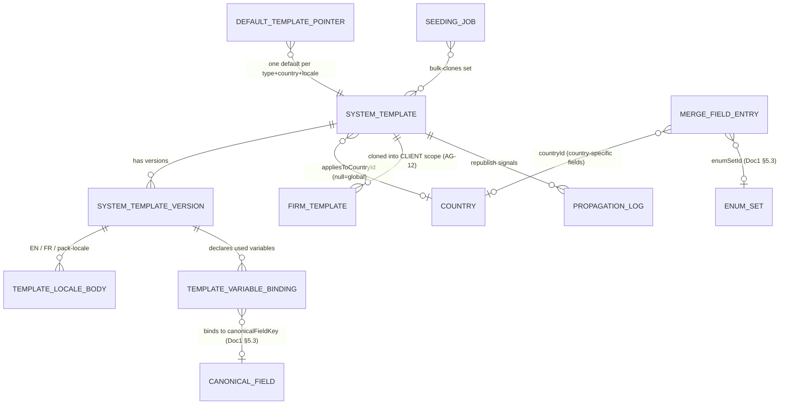

---

## 8. User Stories + Acceptance Criteria

**US-1 — Content Manager: author a bilingual country template.**
*As a Country Content Manager I want to author a Canada Express-Entry welcome email in EN and FR so firms can send compliant bilingual communications.*
- **Given** I create an EMAIL template with `appliesToCountryId = CA`, **When** I open the editor, **Then** I see EN | FR side-by-side panes, a merge-field picker showing global + Canada-tagged fields, and a per-locale subject/body/consent.
- **Given** I authored only the EN body, **When** I attempt to publish, **Then** publish is **warned** (non-legal type) that the FR body is missing, and the library shows incomplete coverage.
- **Given** both bodies are complete and valid, **When** I publish, **Then** a new PUBLISHED version is created, it becomes active, and Canada-entitled firms can now clone it.

**US-2 — Content Manager: a broken merge field is caught before any firm clones it.**
- **Given** I insert `{{client.middleName}}` (not in the dictionary), **When** I try to publish, **Then** publish is **blocked** with "Unknown merge field: client.middleName."
- **Given** a valid template, **When** I open Preview, **Then** I see EN and FR rendered with sample data and any blank/unbound field highlighted.
- **Given** a merge value of `<script>alert(1)</script>` in sample data, **When** the HTML body renders, **Then** the value is HTML-escaped (no executable script), confirming injection-safe rendering (SA-5-18).

**US-3 — Platform Owner: legal types require review before publish.**
- **Given** a Content Manager submits a RETAINER_AGREEMENT template, **When** they attempt to publish directly, **Then** publish is blocked (legal types require REVIEW) and it enters my review queue.
- **Given** I approve it, **When** I publish, **Then** the version records `approvedBy = me`, `smeConfirmedBy` is present, and it becomes the active PUBLISHED version.

**US-4 — Account Manager: bulk-clone a country library into firms.**
- **Given** Canada-tagged default templates of channels EMAIL and RETAINER, **When** I bulk-clone "all Canada defaults" to "all firms entitled to Canada," **Then** the operation runs asynchronously and, on completion, every Canada-entitled firm has a CLIENT copy of each default and a result report lists per-firm cloned/skipped/errored counts.
- **Given** one firm already had a copy of one template, **When** the bulk-clone runs, **Then** that template is **skipped** for that firm with reason "already cloned" and the batch does not fail.
- **Given** the bulk-clone is running, **When** each per-firm CLIENT write executes, **Then** it runs under the non-`BYPASSRLS` app role with `SET LOCAL app.current_firm_id` = that firm and is RLS-confined to that one firm (no cross-firm write is possible even on a code defect).

**US-5 — Content Manager: a central update reaches firms without clobbering overrides.**
- **Given** firms A (unmodified clone) and B (overridden clone) of the Canada retainer, **When** I republish, **Then** both firms' clones read as stale (derived: their `sourceVersionId` is behind the new active version, SA-5-40), both firms are notified — A is offered a one-click fast-forward, B a 3-way diff + explicit adopt, both firm-initiated in AG-12 — and **no CLIENT template row of either firm is written by SA-5** (content, status, or metadata).
- **Given** firm C never cloned the retainer, **When** the new version publishes, **Then** C automatically falls back to the new PUBLISHED SYSTEM version with no action and no signal.
- **Given** I am about to republish, **When** I open the publish dialog, **Then** I see "cloned by N firms (X unmodified, Y overridden)."

**US-6 — Content Manager: roll back an emergency mistake.**
- **Given** PUBLISHED v3 has an error and v2 was correct, **When** I roll back to v2 with a justification, **Then** a new PUBLISHED version (= v2 content) becomes active, the audit records actor/timestamp/from→to/justification, and the propagation signal fires.

**US-7 — Platform Owner: deterministic default per type/country/locale.**
- **Given** two Canada-English EMAIL templates, **When** I set one as default, **Then** the other is demoted and the defaults matrix shows exactly one Canada-EN-EMAIL default.

**US-8 — Platform Owner: approve a legal change on the structured diff.**
*As the Platform Owner I want every retainer approval presented on a structured version delta so I approve nothing unseen.*
- **Given** a RETAINER_AGREEMENT with PUBLISHED v3 and a submitted REVIEW v4, **When** I open the review, **Then** I see the structured delta v3→v4 — mandated-blocks changes flagged first, per-locale subject/body/consentText deltas (EN and FR), and the merge-field delta — and the approve action is presented on the diff (SA-5-38).
- **Given** v4 removes a merge field marked `required` and rebinds another to a different `canonicalFieldKey`, **When** the diff renders, **Then** both changes appear in the merge-field pane flagged as consumer-breaking (SA-5-37).
- **Given** the template later republishes, **When** an overridden firm opens its AG-12 3-way diff, **Then** the base-vs-remote leg it renders is byte-identical to the SA-5 delta payload (SA-5-39).

**US-9 — Content Manager: a WORKFLOW template is governed now, publishable when the contract lands.**
- **Given** I create a `channel = WORKFLOW` template for Canada, **When** I author and save drafts, **Then** the full container machinery applies — immutable versions, lifecycle, country tag, `governanceClass`, audit — identically to other channels (SA-5-41).
- **Given** the WorkflowBlueprint channel validator is not yet registered (blocked on ADR errata E1 / F5), **When** I attempt to publish, **Then** publish fails closed with a message naming the missing channel contract, and no WORKFLOW version becomes visible to any firm (SA-5-42).

---

## 9. Edge Cases & Validations

- **Unknown merge field on publish** → blocked, field named (SA-5-11). Known-but-unbound → flagged, surfaced in preview.
- **Token references a retired/renamed canonicalFieldKey** → validation fails (Doc 1 §5.3), never silent null at send.
- **Injection payload in a merge value** → HTML-escaped; never executed (SA-5-18). Only server-produced whitelisted structural variables emit raw HTML.
- **Missing required locale** → hard-block for legal types, warn otherwise; Canada French missing on a retainer → hard-block (SA-5-16).
- **Editing a published legal template** → not allowed in place; edit creates a FINAL, requires REVIEW; firms keep cloning the prior published until the new one publishes.
- **Archiving a heavily-cloned template** → adoption-checked warning; archive retires the SYSTEM template without breaking firm copies.
- **Bulk-clone where a firm already has the template** → skip-with-reason for that firm/template; batch continues; result report records it.
- **Bulk-clone to thousands of firms** → async on BullMQ with a result report; never a blocking request (Doc 1 §6.2, §8.1).
- **Republish while a firm is mid-edit on its clone** → SA-5 only signals; AG-12 reconciles via diff on the firm's terms; no write into the firm copy (BR-7).
- **Cloning a template that is itself a clone** → blocked (SA-5-30).
- **Country template referencing a Canada-only field on a non-Canada country** → dictionary is country-filtered so the field is not offered; a bad imported country tag is flagged by validation (SA-5-9/11).
- **Two templates claiming default for the same (type, country, locale)** → partial-unique constraint rejects; setting one demotes the other (SA-5-26).
- **A firm's country entitlement is revoked** → its country templates disappear from the firm's catalogue view; existing firm copies remain (SA-2); SA-5 just stops offering the source.
- **A firm's country is later SUSPENDED in SA-1** → that country's SYSTEM templates stop being offered to newly-entitled firms; already-entitled firms keep read-only historical access to existing copies; SA-5 surfaces no FINAL/SUSPENDED-country content for new clones (Country lifecycle = FINAL|ACTIVE|SUSPENDED, owned by SA-1).
- **Mandated clause edited without SME confirmation** → publish gate blocks legal types until `smeConfirmedBy` is recorded (SA-5-25, BR-11).
- **`currentDate` rendered as raw UTC ISO** → invalid; must render in render-time timezone (SA-5-20).
- **A firm-pool token attempts to write a SYSTEM template** → rejected `403 SCOPE_VIOLATION` (no application-role write policy on the global plane, Doc 1 §2.6/§4.2) and audited.
- **A seed/clone write attempted under raw platform context with no tenant GUC** → rejected by FORCED-RLS WITH CHECK (fail-closed); the only valid path is the §4.5 elevated bound-token with `SET LOCAL app.current_firm_id` = the target firm under the non-`BYPASSRLS` app role (SA-5-29).
- **Concurrent set-default on the same combination** → the partial-unique constraint serializes; the loser retries against the now-current default.
- **Diffing two versions with disjoint locale sets** → the per-locale pane reports locale added/removed rows; no false body delta is synthesized for a locale absent on one side (SA-5-37).
- **Rollback attempted without viewing the delta** → the rollback dialog embeds the candidate-vs-current diff; the mandatory justification is written against a visible delta (SA-5-38).
- **Publish attempted on a channel with no registered body validator** (e.g. WORKFLOW before the ADR-W4 contract registers) → publish fails closed naming the missing channel contract; authoring/drafting is unaffected (SA-5-42).

---

## 10. Permissions (`system/*` GLOBAL)

All SA-5 permissions are **GLOBAL scope** (`system/*`, per Doc 1 §4.1 — `global/*` does not exist in the target state) and are held only by platform-pool principals (`aud = er:platform`). Firms hold no SA-5 permission; their template permissions are LOCAL `agent/template:*` (AG-12). The scope-aware guard (Doc 1 §4.2) requires the route plane, the held-permission scope, and the principal's pool to all agree; a firm-pool token on these routes returns `403 SCOPE_VIOLATION` + audit.

| Permission Key | Description | Typical sub-role |
|---|---|---|
| `system/template:list` | View the global template library (assigned countries; Owner = all) | Content Mgr, Owner, Account Mgr, Support |
| `system/template:read` | View a SYSTEM template + versions (any status) | Content Mgr, Owner, Support |
| `system/template:create` | Create a new SYSTEM template | Content Mgr |
| `system/template:edit` | Edit / create a new FINAL version | Content Mgr |
| `system/template:submit-review` | Submit a FINAL for review | Content Mgr |
| `system/template:approve` | Approve a template in REVIEW (legal types) | Platform Owner |
| `system/template:publish` | Publish a SYSTEM template version | Content Mgr / Owner |
| `system/template:rollback` | Roll back a published template (with justification) | Platform Owner |
| `system/template:archive` | Archive a SYSTEM template | Content Mgr / Owner |
| `system/template:set-default` | Designate the default per (type, country, locale) | Platform Owner |
| `system/template:clone-to-firm` | Clone a SYSTEM template to a specific firm | Tenant Account Mgr |
| `system/template:bulk-clone` | Bulk-clone templates to multiple firms | Tenant Account Mgr |
| `system/merge-field:read` | View the merge-field dictionary | Content Mgr |

These keys are seeded into the platform permission catalogue and CI-validated against `@RequirePermissions` per Doc 1 §4.4 (every key wired to ≥1 route; every route's key in the catalogue). GLOBAL `system/*` keys are `view.own`/`view.all` qualifier-N/A per Doc 1 AC-4.1.3 (platform staff have no intra-firm ownership), and this module's listed keys form an explicit catalog increment reconciled by the Doc 1 §4.4 CI completeness check against the module's delivered routes. The audit-read lens over SA-5 actions REFERENCES the SA-11-owned audit-read catalog keys (`system/audit-log:list`, `system/audit:export`, `system/audit:verify`); SA-5 coins no audit-read key of its own. The default role matrix (which sub-role holds which keys) is the Doc 1 §4.4 GLOBAL default-matrix deliverable.

---

## 11. Scalability · Security · Performance

**Scalability.**
- The catalogue grows by **country × type × locale × version** — a bounded-but-growing set. The library is cursor-paginated and country-filtered (SA-5-3/34, Doc 1 §8.1); version history is queried per template, never globally.
- **Seeding fan-out is the scale risk.** A bulk-clone to all firms entitled to a country is O(firms × templates) writes across many tenants — run **asynchronously on BullMQ** (Doc 1 §6.2), chunked per firm, idempotent, resumable, with a result report. The **propagation pass** on republish (read-only enumeration + notify across all cloning firms — staleness is derived, no tenant template writes, SA-5-40) is the same: a queued job, not a synchronous loop.
- **Adoption count** is a cross-plane aggregate — **cached/materialized**, refreshed on clone/seed events, never counted live per library load.

**Security.**
- **Who-can-author globals is the highest-trust boundary.** Only platform-pool GLOBAL sub-roles author/publish; firm staff never can. The GLOBAL-plane admin-only-write RLS policy (Doc 1 §2.6) structurally denies a firm-context write even if a guard were misconfigured — defense-in-depth.
- **Injection-safe rendering is non-negotiable here.** A SYSTEM template is cloned into every firm; an unescaped merge value would be a stored-XSS vector replicated platform-wide. The auto-escaping, logic-less engine (SA-5-18) is the spine; it never evaluates code (no SSTI). Enforced at the author/publish gate, not just at send.
- **Firms are read-only on globals** — PUBLISHED-only, entitlement-filtered; a firm can never read a FINAL/REVIEW SYSTEM template, edit a SYSTEM template, or see a country catalogue it is not entitled to.
- **Tenant isolation on the seam.** Clone-to-firm / bulk-clone write CLIENT copies into the correct firm only, via the elevated **bound-token** impersonation path (Doc 1 §2.6/§4.5) with `SET LOCAL app.current_firm_id` = the target firm under the non-`BYPASSRLS` app role — never a `BYPASSRLS` write and never a raw platform context; RLS still confines each write to its one target firm. The same RLS-confined elevated path applies to the provisioning-time seed (SA-5-29), in lockstep with the SA-2 role-seed / SA-3 entitlement-seed / SA-6 owner-user-create. Propagation notifications are tenant-scoped, never cross-firm.
- **Mandated legal wording → SME/founder authority** (BR-11); provenance (author/SME/approver) recorded per version for the PIPEDA/audit posture (Doc 1 §7).
- **Everything sensitive is audited** (SA-5-35) through the audit spine (Doc 1 §7.5 / §2.6 GLOBAL security sink), with before/after.
- **No Restricted PII in template content.** Sample/preview data is synthetic; templates merge *references* to fields, not stored PII. If a merge field is `isRestrictedPii` (Doc 1 §5.3), its *value* is resolved and field-decrypted only at downstream live send (the Doer), never persisted into a template body.

**Performance (Doc 1 §8.1 budgets).**
- Library load reads paginated SYSTEM rows + cached adoption counts + active-version + coverage flags — no per-row cross-plane count; within the p95 ≤ 300ms read budget.
- Preview renders against a small synthetic fixture through the shared engine — fast, no DB fan-out.
- Publish guards (merge-field validation, locale coverage, injection checks) run on the single template — O(body size), not O(catalogue).
- Seeding/propagation are async/queued; firm-facing requests never block on them.

---

## 12. Reference Note (exists / NEW / CHANGED)

> **Build framing (Doc 1 §1.8).** This is a **greenfield** build measured solely against this spec; the reference prototype is design-provenance only (NDA-gated read-only), not a parity obligation. The notes below are informational — they explain why the design is shaped as it is, not a migration plan.

**Patterns the prototype validated (informational — keep the shape, build greenfield):**
- A dedicated template-scope concept (`SYSTEM | CLIENT`) and PUBLISHED-only firm visibility were proven workable — the target state keeps the SYSTEM/CLIENT split and the published-only firm filter.
- Clone & bulk-clone copy-and-link with skip-already-cloned (not failing the batch) and one-clone-per-firm guards were proven — the target state keeps this seeding backbone and extends it with `sourceVersionId` capture + multi-firm async fan-out + per-firm result report.
- A typed, entity-bound merge-field dictionary per type, with enum-option enrichment and structured array rendering (`payment_plan_table`/`payment_milestones`), was a genuine strength — the target state keeps it and binds it to the canonical-field catalogue (Doc 1 §5.3).

**NEW (build):**
- **Single-store relational + JSONB** persistence (Doc 1 §1.3 eliminates MongoDB) — locale bodies, mandated-block markers, and variable bindings are JSONB validated by Zod; cross-plane queries (adoption count, propagation) are ordinary joins. *(Resolves the prototype's Mongo-vs-relational question decisively to relational.)*
- **Country/program dimension** — `appliesToCountryId` (null=global) + `appliesToProgramNodeKeys` (the resolved `programNodeKey` within the fixed Pathway/Program/Category/Sub-Category hierarchy, Doc 1 §5.8); entitlement-filtered firm visibility.
- **Version entity** (`SystemTemplateVersion`, immutable snapshots) — replacing a single mutable body string; full history + rollback.
- **Bilingual locale bodies** (`TemplateLocaleBody`, per-locale subject/body/consent + `mandatedBlocks`).
- **Expanded lifecycle** — `REVIEW`, `SUPERSEDED`, `ARCHIVED` + the Platform-Owner review gate for legal types (mirrors the SA-1 pack lifecycle).
- **Author-time merge-field validation** — `{{token}}` parse + validate against the dictionary, blocking publish on unknown fields; canonical-key drift fails validation.
- **Injection-safe, logic-less rendering engine** — context-aware auto-escaping; `currentDate` in render-time timezone (replacing naive regex replace + unescaped `String(value)` + raw UTC ISO).
- **Default-template pointer** — one default per (type, country, locale).
- **Propagation/staleness signalling** — derive cloned-firm staleness on republish (read-time `sourceVersionId` comparison, SA-5-40) and notify (none in the prototype — a clone was a forever-divergent copy with no source-version tracking).
- **Structured version diff** — computed delta between any two versions (metadata / per-locale / mandatedBlocks / merge-fields), shared as one contract with AG-12's 3-way diff (§3.12; the prototype had no version entity, so nothing to diff).
- **`channel` dimension** — first-class EMAIL (subject+HTML) / SMS (plain-text, length-aware), mapped to the Doc 1 §6.3 rails.
- **Multi-firm async seeding + result report**, **propagation log**, **adoption-count cache**, **clone-country-template-set**.

**CHANGED (vs. the prototype's shape):**
- **GLOBAL-plane authoring is platform-pool-only.** The prototype let a firm-side ("agent") create endpoint write `scope = SYSTEM` — in the target state SYSTEM authoring is GLOBAL-only (platform pool), firm-authored originals are CLIENT scope (AG-12), and the global-plane admin-only-write RLS policy structurally prevents a firm write (Doc 1 §2.6).
- **Permissions are `system/*` (GLOBAL).** SYSTEM authoring lives under `system/template:*` with governance verbs (submit/approve/rollback/set-default/clone-to-firm/bulk-clone); `agent/template:*` is firm CLIENT work (AG-12). The `global/*` prefix does not exist (Doc 1 §4.1).
- **`linkedToSourceId` is joined by `sourceVersionId`** so propagation/diff can compare the forked version to the latest.

---

## 13. Open Questions / [FOUNDER-CONFIRM]

1. **Mandated/legal wording authority.** [FOUNDER-CONFIRM] All regulator-mandated retainer/disclosure/consent text is out of the architect's lane — confirm the named Immigration-SME sign-off and counsel review per country before a legal-type template may publish. SA-5 owns the mechanism, not the legal accuracy of any clause (BR-11). *(CONTENT-deferred.)*
2. **Governance strictness for non-legal types.** [FOUNDER-CONFIRM] Legal types hard-require REVIEW. Do non-legal types (email/checklist) also require review, or publish directly from FINAL? Proposed default: legal = mandatory review, others = direct publish (configurable). *(CONTENT-deferred; the machinery supports both.)*
3. **Workflow-blueprint catalogue contract.** The WorkflowBlueprint JSON contract (the clonable blueprint definition consumed by the Conductor) is a named cross-cutting hole in the ADR execution plan (W4); SA-5 exposes the blueprint as a clonable template but the JSON schema itself is delivered with the Automation/Conductor contracts — SA-5 references it, never defines it (SA-5-42) **(blocked on ADR errata E1 / F5 — the channel's payload contract publishes with the Amendment batch)**. *(MACHINERY-blocking for the WORKFLOW channel's **publish** only — authoring, lifecycle, governance, seeding, and propagation are channel-independent and specified (SA-5-41); the other channels are unaffected, and publish fails closed until the validator registers.)*
4. **Auto-translate helper.** [FOUNDER-CONFIRM] May the bilingual editor *suggest* a machine translation for non-legal copy (human-reviewed), or is all translation hand-authored? Consent/legal copy is hand-authored regardless (BR-11). *(CONTENT-deferred.)*
5. **Default seeding scope.** [FOUNDER-CONFIRM] At provisioning, seed only the defaults per entitled country (proposed), or the full default set across all types? And is seeding on country-entitlement grant automatic or opt-in? *(CONTENT-deferred; the seeding pipeline supports either.)*
6. **Propagation notification cadence.** [FOUNDER-CONFIRM / UX] Republishing a heavily-cloned template notifies many firms. Per-event notification, or a batched/digest "central updates available" (e.g. weekly) to avoid firm-admin alert fatigue? *(CONTENT/UX-deferred.)*
7. **Adoption-count freshness.** Real-time vs near-real-time (queue-refreshed) adoption count for the blast-radius badge — what staleness is acceptable? Proposed: queue-refreshed on clone/seed events. *(CONTENT-deferred; non-blocking.)*
8. **Entitlement gating of advanced template types.** [FOUNDER-CONFIRM] The composition machinery is **RESOLVED**: advanced channels (e.g. WORKFLOW blueprints, SMS) are gated by a `feature.*` key in SA-3's `CommercialFeatureCatalog` (all-lowercase dotted grammar) checked with `@RequireEntitlement`, AND-composed (entitlement-first) with SA-12's operational `@RequireFlag` where a toggle also applies, per SA-12 §3.0. The only open part is the **commercial mapping** — *which* tiers carry which advanced channel — resolved alongside the platform-wide entitlement-to-plan matrix (ADR W4). *(CONTENT-deferred; machinery settled.)*


---

# Module SA-6: RBAC

> **Vendor deliverable — Super-Admin Console.** This module sits directly on the platform authorization machinery specified in **Doc 1 §4 (Authorization, RBAC & Record-Level Authz)** and **Doc 1 §2 (Multi-Tenancy & Isolation)**. Doc 1 §4 fixes the *mechanism* — the two-scope namespace (`system/*` GLOBAL, `agent/*`/`portal/*` LOCAL), the scope-aware guard, the fail-closed write-side scope filter, the record-level data layer, the per-wave seed mechanic, and the CI completeness machinery. **SA-6 is the console that OWNS the content and the operation of that mechanism**: the authored permission **catalog**, the **default role matrix** (≈6 platform / 6 firm / 3 portal templates), the **role-template builder + versioning + push-to-firms**, the **plan→role-set binding** surface, the **GLOBAL platform sub-role editor**, and the **per-wave seed + CI-completeness governance** the vendor operates. Where this module names a permission key or a role boundary it is **illustrative of shape** — the per-immigration-module key lists and the least-privilege boundaries are content/operating-model items marked **[FOUNDER-CONFIRM]** (the immigration Country-Pack content is the founder's separate deliverable). Reference Doc 1, never re-spec it: "per Doc 1 §4.2", "per Doc 1 §4.3", etc.

---

## Module Index

1. Purpose & Goal
2. Users & Jobs-to-be-Done
3. Functional Design — How It Works
4. Detailed Functional Requirements (SA-6-n)
5. Business Rules & Logic
6. States & Lifecycle
7. Key Entities & Fields (+ ERD)
8. User Stories + Acceptance Criteria
9. Edge Cases & Validations
10. Permissions (GLOBAL `system/*`)
11. Scalability · Security · Performance
12. Reference Note (exists / NEW / changed)
13. Open Questions / [FOUNDER-CONFIRM]

### Visual overview — the composition chain SA-6 owns

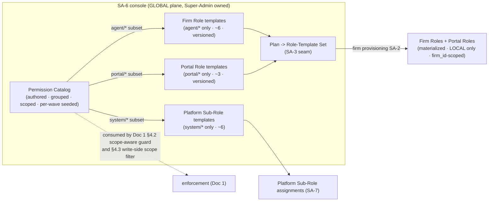

---

## 1. Purpose & Goal

**What it is.** SA-6 is the Super-Admin console that **authors and governs the platform's authorization content**. The *enforcement* lives in Doc 1 §4 (the guard, the write-side filter, the record-level layer); SA-6 is where Expat Ready staff **define what those mechanisms enforce**: the complete permission catalog (every authorizable verb-on-resource across all three planes), the named jobs a firm actually staffs (role templates), the platform's own least-privilege staff segmentation (platform sub-roles), and the per-plan default role set that gives every newly provisioned firm a working, least-privilege role set on day one.

**The business outcome it must produce.** A multi-tenant SaaS for a regulated profession lives or dies on **tenant isolation and least-privilege**. SA-6 makes three guarantees true by *construction* — the underlying mechanism is Doc 1's, but SA-6 supplies the content that makes the mechanism correct:
1. **Every plane has a complete, authoritative catalog.** Without a complete `agent/*` + `portal/*` + `system/*` catalog, the Doc 1 §4.2 guard has nothing to check against and the Client Portal authorization plane is unbuildable. SA-6 owns delivering that catalog, **seeded incrementally per wave** and **CI-validated for completeness** against the routes delivered so far (per Doc 1 §4.4).
2. **Every firm and portal user is least-privilege from birth.** New firms inherit a curated, plan-appropriate role set — never "admin everything." A Case Officer cannot issue invoices; a Portal Dependent sees only their own records. SA-6 owns the **default role matrix** that encodes this.
3. **Every authorization change is accountable.** Who authored which permission, who edited which template, who pushed a template change to live firms — all immutable and attributable in the platform audit chain (Doc 1 §7.5), because in a PIPEDA/Law-25 context an unexplained access grant is a finding.

**Why this is the keystone content module.** Doc 1 §4 fixed the *defects-by-construction* (the scope-aware guard closes the read-side privilege-escalation hole; the write-side scope filter + remediation scan close the write-side hole). **SA-6 closes the matching CRITICAL content gap**: the source prototype enumerated ~11 `system/*` keys and **zero** `agent/*`/`portal/*` keys, and named role templates without ever listing their permissions — so the RBAC seed and the portal authz plane could not be built. SA-6 delivers the complete catalog approach + the concrete default role matrix that makes Doc 1's machinery operable. **If SA-6 ships without the full catalog and matrix, Doc 1 §4's guard guards nothing.**

**Global by construction.** The same catalog serves a Canada-only solo RCIC and a multi-country firm. **Country is a soft resource filter (entitlement, SA-3), never a permission scope** (per Doc 1 §4 / SA-3). Adding Australia adds reference data and entitlements — it adds **no new permission scopes and changes neither the catalog model nor the guard.** Single-country is the degenerate case.

---

## 2. Users & Jobs-to-be-Done

| Role | Relationship to SA-6 | Jobs-to-be-done |
|---|---|---|
| **Platform Owner** (Super-Admin) | Owns the whole model; the only role that can edit platform sub-roles and push templates to live firms. | "When the team grows, define exactly what Support vs Billing-Ops can touch, so platform access is least-privilege and separated by duty." · "When I change what 'Case Officer' means for new firms, publish a new template version and *deliberately* push it to existing firms with a confirmation — never silently." · "When an auditor asks, show every permission/role/template change with who/what/when." |
| **Platform Admin / RBAC Curator** (Super-Admin) | Authors and groups catalog entries; edits firm/portal templates; cannot edit platform sub-roles. | "As each module ships its wave, register its `agent/*`/`portal/*` keys into the catalog with labels, descriptions, groups and a `view.own`/`view.all` qualifier where ownership matters, and have CI confirm completeness." |
| **Billing-Ops** (Super-Admin) | Binds, per plan, *which role-template set* seeds on provisioning (SA-3 seam). | "When I create the Growth plan, attach the right default role-template set so firms on it are provisioned with sensible, least-privilege roles automatically." |
| **Auditor** (Super-Admin) | Read-only view of catalog + role/template change history + blocked scope-violation events. | "Show me every RBAC change and every blocked escalation attempt for a date range, attributable and immutable." |
| **Firm Owner / Admin** (governed, LOCAL) | Composes/customizes their own staff roles — bounded to LOCAL by Doc 1 §4.3. | "Onboard a paralegal as a custom 'Junior Case Officer' with exactly the permissions I choose — but I can never grant platform-level power (the picker only shows LOCAL; a forged `system/*` is rejected server-side per Doc 1 §4.3)." |
| **Firm Staff & Portal Users** (governed, indirect) | Never see SA-6; they *experience* its outcome. | Staff: "I can do my job and nothing more." Portal user: "I see my own case and documents, never anyone else's (record-level layer, Doc 1 §4.5)." |

**Design implication.** SA-6's surfaces (catalog viewer, role-template builder, platform sub-role editor, plan-role-set config, RBAC change log) are built for the Platform Owner / Platform Admin first. The firm-facing role composer is specified in the Agent console (AG-16 Settings) but is **governed by Doc 1 §4.3's write-side scope filter** — SA-6 owns the catalog content it draws from. `system/super-admin-role:manage` is **Platform-Owner-only** (separation of duties).

---

## 3. Functional Design — How It Works

### 3.0 The model: catalog · template · default-set · assignment

Four nouns, one verb — deliberately small (RBAC, not ABAC sprawl). The *semantics* of scope, the guard, and tenant isolation are fixed in Doc 1 §4; SA-6 supplies the **content** of each noun:
- **Permission** — the atomic right to perform one verb on one resource, a keyed string (`agent/case:view.own`). Scope (`GLOBAL`/`LOCAL`) and namespace (`system/`, `agent/`, `portal/`) are governed by Doc 1 §4.1. SA-6 owns each entry's **label, description, group, qualifier and lifecycle**.
- **Role template** — a named, curated bundle of permissions representing a *job* (Firm Owner, Case Officer, Primary Applicant). SA-6 owns the templates and their versions.
- **Default role-template set** — the templates a given plan seeds at firm provisioning. SA-6 owns the binding surface (SA-3 consumes it).
- **Assignment** — a user holds role(s); the role's permissions are the user's permissions. Enforcement is Doc 1 §4.2; SA-6 supplies the role definitions.

> **Why RBAC + scope + soft-country-filter, not a policy engine.** ABAC over-builds and obscures the one boundary that must be unambiguous — GLOBAL vs LOCAL. RBAC + two scopes + the `view.own`/`view.all` qualifier + Doc 1's record-level row scoping covers firm isolation, least-privilege, portal self-service and multi-country, while staying auditable and fast. Richer policy is a deferred option, not a launch need.

### 3.1 The permission catalog — one exhaustive, grouped, scoped, per-wave-seeded list

**How it works.** The catalog is the complete enumeration of every authorizable action across all three planes. Each entry carries a **unique key**, **label**, **description**, **scope** (derived from namespace per Doc 1 §4.1), **group** (module/resource, for UI grouping), and an optional **qualifier** (`view.own`/`view.all` where ownership matters — Doc 1 §4.1). The catalog is **GLOBAL-plane seed data** (`firm_id IS NULL`), written only via the elevated migration/admin role under the GLOBAL read-only-permissive RLS policy (per Doc 1 §2.6 / §4.4) — a firm-context or application-role write is denied and audited.

**Incremental per-wave seeding (NORMATIVE, per Doc 1 §4.4).** The catalog is **not** delivered as one complete cross-module artifact at the foundation milestone. Wave A seeds the `system/*` keys plus the foundation's own routes; **each subsequent wave's seed migration adds that module's `agent/*`/`portal/*` keys**, and the **CI completeness check runs against the set of modules delivered so far** — a key for an undelivered module is neither required nor allowed. SA-6 owns the *operating discipline* of this: a per-wave catalog increment authored, grouped, labelled, hashed (byte-identical across dev/staging/prod), and reconciled by CI.

**World-class / security-grade behaviour.**
- **Default-deny, additive, no deny-list.** Absence = denial; "can X do Y?" is a membership check, not a policy evaluation.
- **Grouped for comprehension.** Permissions group by module/resource so a several-hundred-key catalog is navigable; an admin builds a role by toggling resource groups, not hunting flat keys.
- **Scope-filtered everywhere.** Every catalog-consuming surface is scope-filtered: platform sub-role editor sees `system/*`; firm template editor sees `agent/*`; portal template editor sees `portal/*`; the plan-default picker sees LOCAL only. **A firm-facing surface never receives a `system/*` key.**

**Key screens.** *Catalog viewer* — groupable, searchable, scope/namespace-filterable table: key, label, description, scope, group, qualifier, "used in N templates / M plans", delivered-in-wave, status (active/deprecated). Read-only inventory; new keys arrive only via a wave seed migration.

**Data flow.** Per-wave seed migration upserts catalog rows (idempotent on key) under the elevated role → CI completeness validator reconciles against delivered routes (Doc 1 §4.4) → catalog read APIs return scope-partitioned, grouped, cacheable lists → consumed by the SA-6 editors, the SA-3 plan picker, the AG-16 firm composer, and the Doc 1 §4.2 guard.

**The `portal/corporate:*` group (NORMATIVE catalog increment — corporate-seat capabilities).** One LOCAL group is authored here rather than left implicit, because Doc 4 states the corporate keys are owned/catalogued by SA-6, not by any CP module (Doc 4 CP-1 §10 / CP-9 §10): the `portal/corporate` group, the authorization content behind a corporate seat's behaviour. A seat (Doc 3 AG-15 `CorporatePortalSeat`) exercises these keys via its `seatRole` (`ORG_ADMIN | HR_COORDINATOR | VIEWER` — AG-15 §7 machinery enum, display labels firm-configurable), which selects the portal-corporate role template holding them. Same colon grammar, LOCAL scope, seeded with the corporate-portal wave and CI-reconciled like every other increment (Doc 1 §4.4):

| Key (LOCAL `portal/*`) | Grants (authorization content for Doc 4 CP-9 §10) |
|---|---|
| `portal/corporate:view` | Org dashboard, org-grain case drill-ins, org documents/status, org invoices, org thread — within the AG-15 allow-list |
| `portal/corporate:document-upload` | Upload/re-upload org-level documents (scan-gated, ownership-bound) |
| `portal/corporate:pay` | Initiate online payment on org invoices (CP-5 / `PaymentRailPort`) |
| `portal/corporate:sign` | Execute the organisation's e-signature on envelopes routed to the org seat (CP-6 / Signer) |
| `portal/corporate:seat-manage` | Invite / capability-grant / request-removal of seats under the same org (executed firm-side by AG-15) |
| `portal/corporate:message` | Read/post in the org↔firm thread (when `PortalVisibilityConfig.enableMessaging`) |

The role-to-capability matrix — which `seatRole` template holds which of the six keys — is default-role-matrix content per §3.2 **[FOUNDER-CONFIRM]**; the fixed floor is least-privilege: a new seat's template defaults to view-only (Doc 4 CP-9-12). Namespace-lock (BR-4), the Doc 1 §4.3 write-side scope filter, and the §2.5 corporate-seat ownership-chain traversal apply unchanged. *Security:* these keys are capability content only — record scope stays with the seat's `scopeJson` + the second portal RLS dimension; holding `:view` without org-chain resolution still yields 404 (Doc 1 §4.5), and a `portal/corporate:*` key can never sit on a firm or platform role. *Scalability/performance:* six rows in the standard grouped, cacheable catalog read — no new mechanism, no per-request cost beyond the existing membership check.

### 3.2 The default role matrix — the concrete deliverable that closes the gap

**How it works.** SA-6 ships an explicit **default role matrix**: a concrete, named set of templates per plane, each with its enumerated permission set drawn from its allowed namespace. The target (per Doc 1 §4.4) is approximately:

| Family | Count | Namespace | Examples (shape; least-privilege boundaries are **[FOUNDER-CONFIRM]**) |
|---|---|---|---|
| **Platform sub-roles** | ≈6 | `system/*` only (GLOBAL) | Platform Owner, Platform Admin, Support (read-mostly), Billing-Ops, Content/Pack Publisher, Auditor (audit-read-all). Least-privilege segmentation so **no single platform role holds every `system/*` key**. |
| **Firm templates** | ≈6 | `agent/*` only (LOCAL) | Firm Owner, Firm Admin, Case Manager, Case Officer (`view.own`-biased), Billing/Finance, Read-only. Firms compose additional custom roles, always LOCAL-filtered (Doc 1 §4.3). |
| **Portal templates** | ≈3 | `portal/*` only (LOCAL) | Primary Applicant, Corporate Sponsor / Seat Admin, Dependent/Viewer. Bounded to own ownership-chain (Doc 1 §4.5). The portal-corporate seat templates are selected by the AG-15 `seatRole` (Doc 3 AG-15 §7) and draw their keys from the `portal/corporate:*` group (§3.1). |

**World-class behaviour.**
- **Library-first, not blank-canvas.** A firm is provisioned with sensible, immigration-shaped roles already populated; the admin tweaks rather than building from zero.
- **Least-privilege by construction.** Case Officer omits billing and destructive verbs and is `view.own`-biased; Portal Dependent is record-level read of own records only. The defaults *are* the least-privilege policy.
- **Namespace-locked.** A firm template can hold only `agent/*`; a portal template only `portal/*`; a platform sub-role only `system/*`. The editor enforces the family's namespace; the write path re-enforces it (Doc 1 §4.3).

**Note on referenced-but-undelivered keys.** Because templates are seeded with the foundation but the `agent/*`/`portal/*` keys they reference land per wave, a template's referenced-but-not-yet-delivered keys are **tolerated** until that module's wave ships (per Doc 1 §4.4) — the CI completeness check is scoped to delivered modules.

### 3.3 Role-template builder + versioning

**How it works.** A role template is a named, curated bundle: pick family (platform sub-role / firm / portal) → name, description, locale labels (EN + FR per Doc 1 §NFR i18n) → toggle permissions grouped by module, **scope-locked to the family** → save = **new immutable version**. A live "what can this role do" plain-language summary renders from the selected permissions.

**Behaviour.**
- **Configurable without a code change (within namespace).** Add/remove permissions freely; a forced submit of an out-of-namespace key is refused (UI + server).
- **Versioned, immutable history.** Each edit creates a new version; prior versions are retained for audit and rollback-by-record.
- **Bilingual labels.** Template name/description are stored bilingually (Doc 1 §NFR i18n).

**Data flow.** Edit → new `RoleTemplate` version + `RoleTemplatePermission` rows (validated all-in-namespace) → audit entry (`ROLE_TEMPLATE_VERSIONED`, before/after permission diff). On provisioning, the active version's permission set is materialized into the firm's roles (§3.5).

### 3.4 Platform sub-role editor (separation of duties)

**How it works.** Platform sub-roles are GLOBAL templates assigned to Super-Admin (platform-pool) staff (SA-7). The editor is the same surface as §3.3 but **`system/*`-only** and **Platform-Owner-gated** (`system/super-admin-role:manage`). This is where the platform itself is kept least-privilege: a Support agent cannot grant themselves Billing-Ops power; **no single platform role holds every `system/*` key.** A Super-Admin cannot grant themselves a permission their own role lacks (no self-elevation, BR-11).

### 3.5 Plan → default-role seeding (SA-3 seam)

**How it works.** Each plan designates a **default role-template set** — which LOCAL templates seed when a firm on that plan is provisioned. At provisioning (SA-2), the platform **materializes** those templates into the firm's tenant as real, editable `firm_id`-scoped roles, copying their (active-version) permissions. The firm owner customizes within their tenant thereafter.

**Hardening — which keys (per Doc 1 §4.3).** The seeder is **LOCAL-only by construction** — it materializes only `agent/*` (firm roles) / `portal/*` (portal roles) permissions; any `system/*` permission encountered in a set is **skipped and the anomaly audited** (a second escalation path closed). The plan-default picker (SA-3 surface) is fed the LOCAL catalog only.

**Hardening — how the firm-scoped write is authorized (NORMATIVE, per Doc 1 §4.5).** At provisioning time the target firm has no live session, so the firm-provisioning seed — the role-seed (`Role` + `RolePermission`), the entitlement-seed (SA-2/SA-3 `FirmCountryEntitlement` / entitlement rows), and the owner-user create — is itself a **cross-`firm_id` write into a brand-new tenant** and must use the **same elevated write path SA-5 §3.9 (clone-to-firm) and SA-2 §3.7 (impersonation) use**. The whole provisioning transaction runs under the **non-`BYPASSRLS` application role** with the tenant GUC `SET LOCAL app.current_firm_id = <the just-created firm_id>` (the Doc 1 §4.5 elevated bound path) so FORCED RLS still confines every inserted row to the one target firm — **never `BYPASSRLS`, never a raw platform context** (which would hit a FORCED-RLS `WITH CHECK` rejection and tempt the silent cross-tenant-leak `BYPASSRLS` trap ADR FINAL #7 warns about). The LOCAL-key filter above governs *which* permissions are copied; this GUC-bound elevated path governs *how* the `firm_id`-scoped rows are written. SA-2 §3.2/SA-2-2 and SA-3 §3.5 state the same normative write path.

**Key screen.** *Plan default-role config* (Billing-Ops, SA-3 seam): attach a role-template set to a plan; preview "a firm on this plan is provisioned with these N roles and their permissions."

**Data flow.** Provision firm (SA-2) → open the provisioning transaction under the non-`BYPASSRLS` app role with `SET LOCAL app.current_firm_id = <new firm_id>` (Doc 1 §4.5) → resolve plan's `PlanRoleTemplateSet` → for each template, materialize a `Role` (`firm_id`-scoped) + `RolePermission` (LOCAL-filtered) → connect owner user → audit (`FIRM_ROLES_SEEDED`: plan, firm, templates, counts) → emit `firm.roles-seeded` (event dictionary, Doc 1 §6).

### 3.6 Role-template versioning & push-to-firms — "change the blueprint deliberately, never silently"

**How it works.** By default, editing a template affects **only newly provisioned firms** — existing firms' already-materialized roles are *their* LOCAL copies and are untouched. Super-Admin can **optionally push** an updated template to existing firms via an explicit **bulk operation with mandatory confirmation**, an impact preview ("N firms, M roles will gain/lose these permissions"), and a result report. Push is a separated, higher-blast-radius action: it requires `system/role-template:push` (distinct from `system/role-template:manage`, BR-11).

**Safety behaviour.**
- **No silent live changes.** A template edit never auto-mutates live tenants.
- **Push respects the scope rule.** A push of a LOCAL template runs the Doc 1 §4.3 write-side filter on the push path too — you cannot push a `system/*` key into firms. Each per-firm write on the push path is itself executed under the Doc 1 §4.5 elevated bound path (non-`BYPASSRLS` app role with `SET LOCAL app.current_firm_id` set to each target firm), so RLS confines every push write to its target tenant.
- **Additive merge (default).** Push adds the template's new permissions; it does **not** strip firm-added permissions and never violates a protected (`is_system_role`) invariant beyond the template's own keys. A "reset to template" (replace) mode is an Open Question (§13).
- **Bounded async job.** Push to thousands of firms runs as an idempotent, resumable BullMQ job with per-firm result reporting — never an N-firm synchronous loop.

**Key screens.** *Template version history* (diff between versions) · *push wizard* (target = new-firms-only | selected firms | all firms on plans X; impact preview; mandatory confirm; result report).

**Data flow.** Edit → new version → (optional) push → for each target firm, scope-validated additive update of materialized roles under the §4.5 elevated bound path → audit (`ROLE_TEMPLATE_PUSHED`: version, targets, per-firm result) → optional SA-9 alert.

### 3.7 CI completeness & the remediation scan as governance surfaces

**How it works.** SA-6 owns operating the two governance checks Doc 1 §4 specifies as machinery:
- **CI completeness (two directions, release-gating, scoped to delivered modules, per Doc 1 §4.4):** every `@RequirePermissions` on a delivered route exists in the catalog; every catalog key for a delivered module is wired to ≥1 route. SA-6's catalog viewer surfaces "orphan keys" (in catalog, no route) and "missing keys" (on route, not in catalog) so the curator can fix a wave increment before it gates a release.
- **Remediation scan (per Doc 1 §4.3):** a one-time, idempotent scan detects and strips any GLOBAL/`system/*` permission already attached to a firm/portal role (defense for legacy/corrupt data), producing a per-role audit trail. SA-6 surfaces its report; recommended posture is **report-first, then apply** (§13).

### 3.8 Entitlement interplay (SA-3) — permission authorizes the verb; entitlement filters the resource

Permission (SA-6) and entitlement (SA-3) are **orthogonal, AND-composed** (per Doc 1 §4 / SA-3):

| Mechanism | Question | Miss behaviour |
|---|---|---|
| **Permission (SA-6)** | May the user do the verb? | 403 default-deny (and 403 `SCOPE_VIOLATION` on scope mismatch — Doc 1 §4.2) |
| **Country entitlement (SA-3)** | On which countries' resources? | **Filter** resources out (no error — soft) |
| **Feature entitlement (SA-3, `feature.*`)** | Is the feature purchased? | **403 `FEATURE_NOT_ENTITLED`** (hard gate) |

`feature.*` is a **separate namespace** from permissions and must never be conflated. The `feature.*` keys are the commercial-entitlement registry owned by SA-3's `CommercialFeatureCatalog` (the entity formerly named `FeatureFlagCatalog`); the SA-3 entitlement check is performed by the canonical guard **`@RequireEntitlement`**. An *operational* on/off for the same capability is the distinct SA-12 `FeatureFlag` (checked by the canonical guard **`@RequireFlag`**), which references an existing SA-3 `featureKey`; operational-only toggles use a disjoint `flag.*` / `ops.* ` prefix. Where both gate a capability they are **AND-composed, entitlement-first** (the SA-3 `@RequireEntitlement` check before the SA-12 `@RequireFlag` check). Guard order (Doc 1 §4): auth → permission name+scope → tenant binding (RLS) → feature entitlement (`@RequireEntitlement`, hard) → operational flag (`@RequireFlag`, hard) → resource query with country filter (soft).

> **Three "flag" concepts, disambiguated.** (1) SA-1's immigration flag is `ConditionFlagDefinition` (content-neutral, `canonicalField`-derived deficiency/eligibility, resolved per-case into CLIENT-PII `ComboFlagValue`). (2) SA-3's commercial entitlement registry is `CommercialFeatureCatalog` (`featureKey`, `feature.*`). (3) SA-12's operational toggle is `FeatureFlag`. These are distinct entities with distinct lifecycles and stores; SA-6's RBAC permission is a *fourth*, separate concept (verb authorization) and is never conflated with any of the three.

---

## 4. Detailed Functional Requirements (SA-6-n)

**Permission Catalog**
- **SA-6-1** — The platform maintains a single, exhaustive **permission catalog** spanning `system/*` (GLOBAL) + `agent/*` + `portal/*` (LOCAL). Each entry has a unique key, label, description, scope (derived from namespace per Doc 1 §4.1), group, optional `view.own`/`view.all` qualifier, delivered-in-wave, and status.
- **SA-6-2** — The catalog is **seeded incrementally per wave** (Wave A = `system/*` + foundation routes; each later wave adds its module's keys), via idempotent seed migrations under the elevated migration/admin role; the increment is byte-identical across dev/staging/prod (CI hash-compared). *(Per Doc 1 §4.4 / §2.6.)*
- **SA-6-3** — Catalog read APIs are **scope/namespace-partitioned and groupable**: `system/*` for platform surfaces, `agent/*` for firm surfaces, `portal/*` for portal surfaces; cacheable (changes only on a wave seed/deprecation).
- **SA-6-4** — For every capability where ownership is meaningful, the catalog provides both a `view.own` and a `view.all` entry (or documents in metadata why a qualifier is not applicable). GLOBAL `system/*` keys are qualifier-N/A (no intra-firm ownership on the platform plane). *(Per Doc 1 §4.1, AC-4.1.3.)*

**Default Role Matrix & Templates**
- **SA-6-5** — SA-6 ships an explicit **default role matrix**: ≈6 platform sub-roles (`system/*`), ≈6 firm templates (`agent/*`), ≈3 portal templates (`portal/*`), each with its enumerated permission set. A CI test asserts each role's permission set is a subset of its allowed namespace. *(Per Doc 1 §4.4.)*
- **SA-6-6** — Templates are **namespace-locked to their family** (firm = `agent/*` only; portal = `portal/*` only; platform sub-role = `system/*` only); the builder refuses an out-of-namespace key in UI and the write path re-enforces it.
- **SA-6-7** — Templates are **versioned**; editing creates a new immutable version with bilingual (EN/FR) name/description. Changing a template affects only **newly provisioned** firms by default.
- **SA-6-8** — Super-Admin can **optionally push** an updated LOCAL template to existing firms via a bulk operation with **mandatory confirmation**, impact preview, scope-validated **additive** update, async/resumable execution, and a per-firm result report. Push requires `system/role-template:push` (separated from `:manage`). Each per-firm push write runs under the Doc 1 §4.5 elevated bound path (non-`BYPASSRLS` app role, tenant GUC `SET LOCAL` to the target firm).

**Plan → Default-Role Seeding**
- **SA-6-9** — Each plan designates a **default role-template set** (`PlanRoleTemplateSet`); at firm provisioning the platform **materializes** those templates into the firm's tenant as editable, `firm_id`-scoped roles, copying the active version's permissions.
- **SA-6-10** — Seeding is **LOCAL-only by construction**: any `system/*` permission found in a plan's set is skipped and the anomaly audited. *(Per Doc 1 §4.3.)*
- **SA-6-10a** — The provisioning seed (role-seed + entitlement-seed + owner-user create) executes inside the provisioning transaction under the **non-`BYPASSRLS` application role** with `SET LOCAL app.current_firm_id = <the just-created firm_id>` (the Doc 1 §4.5 elevated bound path); it **never** runs under `BYPASSRLS` and **never** under a raw platform context. The seed write is RLS-confined to the one target firm. *(Per Doc 1 §4.5; mirrors SA-2 AC-4.5.8 / SA-5 §3.9.)*

**Governance**
- **SA-6-11** — The catalog viewer surfaces the **CI completeness** state (orphan keys, missing keys) scoped to delivered modules, so a curator fixes a wave increment before it gates a release. *(Operates the Doc 1 §4.4 check.)*
- **SA-6-12** — SA-6 surfaces the **remediation-scan** report (any GLOBAL permission attached to a LOCAL role) and its idempotent strip action, with a per-role audit trail; default posture report-first-then-apply. *(Operates the Doc 1 §4.3 scan.)*

**Platform Sub-Roles, Entitlement & Audit**
- **SA-6-13** — Platform sub-roles are `system/*`-scoped GLOBAL templates, **editable by the Platform Owner only** (`system/super-admin-role:manage`); no single platform role holds every `system/*` key; no self-elevation.
- **SA-6-14** — Permission and entitlement are **orthogonal, AND-composed, entitlement-first**: permission authorizes the verb; SA-3 country entitlement filters resources (soft); SA-3 `feature.*` entitlement is a separate hard gate (`@RequireEntitlement`); an SA-12 operational `FeatureFlag` (`@RequireFlag`) is AND-composed after the entitlement. *(Per Doc 1 §4 / SA-3 / SA-12.)*
- **SA-6-15** — **Every SA-6 mutation is audited** (catalog deprecation, template create/edit/version/push, plan-role-set change, platform sub-role edit) with actor, action, target, **before/after permission diff**, UTC timestamp, and reason where required (push, platform-role edit), into the per-firm/per-platform audit chain (Doc 1 §7.5). Blocked scope violations (from Doc 1 §4.2/§4.3) appear here as first-class events.

---

## 5. Business Rules & Logic

- **BR-1 (Default-deny, additive, no deny-list).** A user can perform only what their role's permissions grant; absence = denial. *(Doc 1 §4.)*
- **BR-2 (Two scopes only).** `system/*` = GLOBAL; `agent/*` + `portal/*` = LOCAL. SA-6 authors content within these; the namespace fixes the scope. *(Doc 1 §4.1.)*
- **BR-3 (Country is a soft filter, not a scope).** No `verb@country` keys; country entitlement (SA-3) filters resources. Adding a country adds no permissions and no guard change. *(Doc 1 §4 / SA-3.)*
- **BR-4 (Namespace-lock per role family).** Firm role/template = `agent/*` only; portal role/template = `portal/*` only; platform sub-role = `system/*` only. A firm role may not hold `portal/*` and vice-versa. *(Doc 1 §4.3.)*
- **BR-5 (Catalog is GLOBAL seed data).** Catalog, templates and plan-role-set bindings are GLOBAL-plane (`firm_id IS NULL`), written only via the elevated migration/admin role; a firm/application-role write is denied and audited. *(Doc 1 §2.6 / §4.4.)*
- **BR-6 (Per-wave completeness).** The catalog grows per wave; CI completeness is scoped to delivered modules; a key for an undelivered module is neither required nor allowed. *(Doc 1 §4.4.)*
- **BR-7 (Seeder LOCAL-filter + elevated write path).** Plan→role seeding materializes only LOCAL permissions (a GLOBAL key in a plan set is skipped and logged), and the firm-scoped seed write runs under the non-`BYPASSRLS` app role with `SET LOCAL app.current_firm_id` set to the target firm (the Doc 1 §4.5 elevated bound path), never `BYPASSRLS` and never a raw platform context. *(Doc 1 §4.3 / §4.5.)*
- **BR-8 (System-role protection).** Plan-seeded `is_system_role` firm roles cannot be edited or deleted by firm users; only the firm's customizable copies are mutable.
- **BR-9 (Versioning + no silent live change).** Template edits create immutable versions and affect existing firms only via an explicit, confirmed push (§3.6).
- **BR-10 (Additive push default).** Push adds the template's keys, never strips firm-added keys, never breaches `is_system_role` invariants beyond the template's own keys. Replace mode is an OQ (§13).
- **BR-11 (Separation of duties).** Platform sub-role editing = Platform Owner only (`system/super-admin-role:manage`); template *push* (`:push`) is separated from template *edit* (`:manage`); no self-elevation (cannot grant a permission your own role lacks).
- **BR-12 (Immutable audit + before/after).** Every catalog/template/role/plan-role-set change is audited with a before/after permission diff into the Doc 1 §7.5 chain; blocked scope violations are first-class events.
- **BR-13 (Catalog keys are code-owned).** New keys arrive only via a wave seed migration (each must be wired to ≥1 route); runtime config covers grouping, labelling, qualifier, and assignment to templates/plans.
- **BR-14 (Permission vs entitlement, AND-composed, entitlement-first).** Permission authorizes the verb; SA-3 country entitlement filters resources (soft); SA-3 `feature.*` entitlement (`CommercialFeatureCatalog`, checked by `@RequireEntitlement`) is a separate hard gate; an SA-12 operational `FeatureFlag` (checked by `@RequireFlag`) is AND-composed after the entitlement; never conflated. *(Doc 1 §4 / SA-3 / SA-12.)*

---

## 6. States & Lifecycle

**A. Catalog entry:** identity is essentially immutable.
```
(wave seed: upserted under elevated role) -> ACTIVE -> [DEPRECATED: hidden from new assignment, retained for audit]
```
Never hard-deleted (existing template/role/audit references must resolve); deprecation hides it from pickers while keeping historical grants interpretable.

**B. Role template:**
```
FINAL -> (save) NEW VERSION (immutable, ACTIVE) -> [optional PUSH to existing firms] -> SUPERSEDED (by next version, retained)
```

**C. Materialized firm/portal role:**
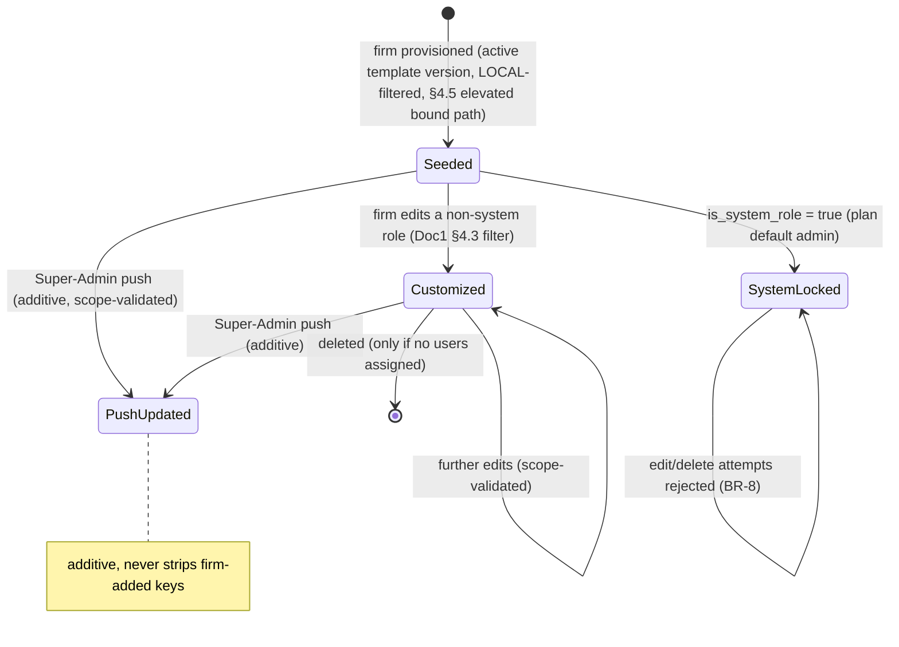

**D. A single authorization decision (per request):** stateless, evaluated by Doc 1 §4.2 — auth → permission name+scope → tenant binding (RLS) → feature entitlement → country filter → allow/deny. SA-6 supplies the catalog/role content this consumes; it does not own the per-request evaluation.

---

## 7. Key Entities & Fields

> All catalog/template/plan-binding tables are **GLOBAL-plane** (`firm_id IS NULL`, GLOBAL read-only-permissive RLS policy, admin-only write, per Doc 1 §2.6/§4.4). Materialized firm/portal roles are **LOCAL** (`firm_id NOT NULL`, FORCED RLS). The polymorphic audit attaches via Doc 1's `(entity_type, entity_id)` pattern + EntityTypeRegistry — defined once platform-wide, reused here. Entity names below are the **logical (PascalCase) entities** used across Doc 2; physical table names are their snake_case forms.

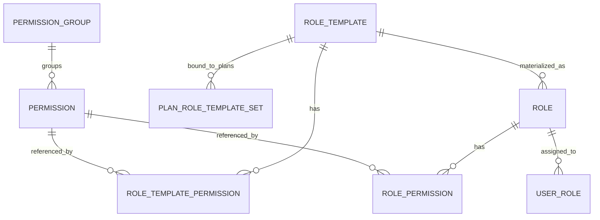

**`Permission`** *(GLOBAL)* — `permission_id` (PK, uuid), `key` (unique, e.g. `agent/case:view.own`), `label_en`, `label_fr`, `description`, `scope` (`GLOBAL|LOCAL`, derived from namespace), `namespace` (`system|agent|portal`), `permission_group_id` (FK→PermissionGroup), `qualifier` (`none|view.own|view.all`), `delivered_in_wave`, `status` (`ACTIVE|DEPRECATED`), `created_at`, `updated_at`. Indexes: `(scope)`, `(namespace)`, `(permission_group_id)`, `(status)`.

**`PermissionGroup`** *(GLOBAL)* — `permission_group_id` (PK), `name` (unique), `module`, `description`, `display_order`.

**`RoleTemplate`** *(NEW, GLOBAL)* — `role_template_id` (PK), `family` (`PLATFORM_SUBROLE|FIRM|PORTAL`), `scope` (derived), `name_en`, `name_fr`, `description`, `version` (int), `status` (`FINAL|ACTIVE|SUPERSEDED`), `supersedes_id?` (FK self), `created_by`, `created_at`. Index: `(family, status)`.

**`RoleTemplatePermission`** *(NEW, GLOBAL)* — `id` (PK), `role_template_id` (FK→RoleTemplate), `permission_id` (FK→Permission). `unique(role_template_id, permission_id)`. **Namespace-locked to the template's family (BR-4).**

**`PlanRoleTemplateSet`** *(NEW, GLOBAL — **normative definition; SA-6 owns this entity**, SA-3 §7 cites it)* — `id` (PK), `plan_id` (FK→SubscriptionPlan, SA-3), `role_template_id` (FK→RoleTemplate), `is_default_admin?` (bool). `unique(plan_id, role_template_id)`. *(SA-3 seam; the plan target is SA-3's canonical `SubscriptionPlan`, not the retired prototype `PaymentPlan`.)*

**`Role`** *(LOCAL when `firm_id` set; GLOBAL platform sub-role when `firm_id IS NULL`)* — `role_id` (PK), `firm_id?` (NULL = platform sub-role; set = firm/portal tenant role), `name`, `description?`, `role_kind` (`PLATFORM|FIRM|PORTAL`), `is_system_role?` (plan-seeded protected), `source_template_id?` (FK→RoleTemplate) + `source_template_version?` (provenance), `created_by`, `created_at`, `updated_at`. `unique(firm_id, name)`. Indexes: `(firm_id)`, `(role_kind)`.

**`RolePermission`** *(LOCAL/GLOBAL per owning role)* — `role_permission_id` (PK), `role_id` (FK→Role), `permission_id` (FK→Permission). `unique(role_id, permission_id)`. **The write path applies Doc 1 §4.3's scope filter; firm-scoped seed/push writes run under the Doc 1 §4.5 elevated bound path.**

**`UserRole`** *(assignment)* — `user_id` (FK), `role_id` (FK→Role). Single-role-per-user default (multi-role is an OQ, §13).

**Enums** — `PermissionScope {GLOBAL, LOCAL}`; `Namespace {system, agent, portal}`; `RoleTemplateFamily {PLATFORM_SUBROLE, FIRM, PORTAL}`; `RoleTemplateStatus {FINAL, ACTIVE, SUPERSEDED}`; `Qualifier {none, view.own, view.all}`.

> **Field-level note.** The scope/namespace-lock invariants (BR-4) are **service-layer business logic** validated against `Permission.scope`/`Permission.namespace` (Doc 1 §4.3), not merely DTO shape — the DTO validates shape (Zod, per project standard); the service loads the referenced permissions and asserts the invariant.

---

## 8. User Stories + Acceptance Criteria

**Story 1 — Author a wave's catalog increment (Platform Admin / RBAC Curator).**
*As a curator, when the Billing module ships, I register its `agent/*` keys so the guard can enforce them.*
- **AC1.1 — Given** the Billing wave's seed migration, **when** it runs under the elevated role, **then** its `agent/*` keys are upserted into the catalog, grouped and labelled (EN/FR), and the increment is byte-identical across dev/staging/prod (CI hash-compared).
- **AC1.2 — Given** the increment, **when** CI completeness runs scoped to delivered modules, **then** every `@RequirePermissions` on a delivered Billing route exists in the catalog and every new key is wired to ≥1 route; a missing or orphan key fails the build.
- **AC1.3 — Given** a firm-context (application-role) attempt to write the catalog, **then** it is denied by the GLOBAL read-only-permissive RLS policy (Doc 1 §2.6) and audited.

**Story 2 — Ship the default role matrix (Platform Owner).**
- **AC2.1 — Given** the foundation seed, **then** ≈6 platform sub-roles (`system/*`), ≈6 firm templates (`agent/*`), ≈3 portal templates (`portal/*`) are installed, each with its enumerated permission set.
- **AC2.2 — Given** any seeded role, **when** a test asserts its permission set, **then** every key is within the role's allowed namespace (no firm template holds `system/*` or `portal/*`).
- **AC2.3 — Given** a firm is provisioned, **then** its starting roles are the plan's template set (least-privilege day one), not a single all-powerful default; the default admin is `is_system_role` and edit-protected.

**Story 3 — Edit and push a template (Platform Owner).**
*Add `agent/esign:send` to the Case Officer template.*
- **AC3.1 — Given** the Case Officer FIRM template, **when** I add `agent/esign:send` (LOCAL) and save, **then** a new immutable version is created and the audit log records actor, before/after diff, and timestamp.
- **AC3.2 — Given** the new version, **when** a firm is provisioned on a plan using this template, **then** its seeded Case Officer role includes `agent/esign:send`; **and** existing firms' Case Officer roles are unchanged (no silent live mutation).
- **AC3.3 — Given** I attempt to add `system/plan:manage` (GLOBAL) to this FIRM template, **then** the editor refuses it (namespace-lock) and a forced submit is rejected server-side.
- **AC3.4 — Given** I push the new version, **then** I must pass a mandatory confirmation with an impact preview (N firms, M roles); the update is additive (firm-added keys not stripped; `is_system_role` invariants respected); each per-firm write runs under the Doc 1 §4.5 elevated bound path confined to that firm; every affected firm is audited; a result report is produced.
- **AC3.5 — Given** I hold `system/role-template:manage` but not `:push`, **when** I attempt a push, **then** I am denied (separation of duties, BR-11).

**Story 4 — Plan seeding is scope-safe and RLS-confined (Billing-Ops / provisioning).**
- **AC4.1 — Given** a plan whose role-template set accidentally references a GLOBAL key, **when** a firm on that plan is provisioned, **then** the GLOBAL key is skipped, the firm receives only LOCAL permissions, and the anomaly is audited (per Doc 1 §4.3).
- **AC4.2 — Given** a firm is provisioned, **when** the role-seed + entitlement-seed + owner-user create run, **then** they execute under the non-`BYPASSRLS` application role with `SET LOCAL app.current_firm_id = <the just-created firm_id>` (the Doc 1 §4.5 elevated bound path), the seed write is RLS-confined to that one target firm (a probe of a third firm returns zero rows), and no `BYPASSRLS` / raw platform context is used. *(Mirrors SA-2 AC-4.5.8 / SA-5 §3.9.)*

**Story 5 — Catalog comprehension & governance (Auditor / Curator).**
- **AC5.1 — Given** the catalog viewer filtered to `portal/*`, **then** only portal LOCAL keys appear, grouped by module; no `system/*` key is shown.
- **AC5.2 — Given** the governance view, **when** the remediation scan reports a GLOBAL key on a firm role, **then** I can apply an idempotent strip producing a per-role audit trail (report-first posture).

**Story 6 — Entitlement vs permission (governed firm staff, soft filter).**
- **AC6.1 — Given** firm staff with `agent/case:view.all` whose firm lacks Australia entitlement, **when** they list cases, **then** Australian-program resources are absent (no error); a Canada case is fully visible. *(Doc 1 §4 / SA-3 soft filter.)*
- **AC6.2 — Given** the firm lacks the `feature.esign` entitlement, **when** the e-sign endpoint is called, **then** the SA-3 entitlement guard `@RequireEntitlement` returns 403 `FEATURE_NOT_ENTITLED` (hard gate), distinct from the soft country filter; and where an SA-12 `@RequireFlag` operational flag also gates the capability it is AND-composed entitlement-first. *(Feature-key grammar is all-lowercase dotted per §13; `feature.esign` is canonical.)*

---

## 9. Edge Cases & Validations

- **Out-of-namespace key on a template/role write** → 403 `SCOPE_VIOLATION` (per Doc 1 §4.3), nothing persisted, `AUTHZ_ROLE_WRITE_REJECTED` audit; the entire request is rejected (no partial commit on a mixed-validity payload).
- **Catalog write under the application role** → denied by GLOBAL read-only-permissive RLS (Doc 1 §2.6), audited; seed succeeds only under the elevated migration role.
- **Provisioning seed attempted without a tenant GUC (raw platform context)** → the firm-scoped `Role`/`RolePermission`/owner-user inserts hit the FORCED-RLS `WITH CHECK` and are rejected fail-closed; the correct path sets `SET LOCAL app.current_firm_id = <new firm_id>` under the non-`BYPASSRLS` app role (Doc 1 §4.5). `BYPASSRLS` is never used (ADR FINAL #7).
- **Template references a not-yet-delivered key** → tolerated until that module's wave ships (CI completeness scoped to delivered modules, BR-6).
- **Orphan key (in catalog, no route) / missing key (on route, not in catalog)** → CI completeness fails the build; surfaced in the catalog viewer for the curator.
- **Editing an `is_system_role` firm role** → 403 (BR-8); only firm-customizable copies are mutable.
- **Deleting a role with users assigned** → blocked with a clear message ("reassign N users before deleting this role").
- **Empty permission set on a template/role** → allowed (no access = default-deny holds) but warned in UI as a likely mistake.
- **Duplicate permission ids in a payload** → de-duplicated; `unique(role_id/template_id, permission_id)` protects the join.
- **Deprecating a key still referenced** → never hard-delete; deprecate (hide from pickers), keep historical grants interpretable.
- **Concurrent template push + firm self-edit** → push is additive and idempotent per key; firm-added keys untouched; last-writer on a given key resolves deterministically.
- **Pre-existing/legacy GLOBAL key on a firm role** → the Doc 1 §4.2 guard denies its use on a GLOBAL route, and the SA-6 remediation scan (§3.7) strips it; escalation cannot be created *or* exercised.
- **Scope mismatch with matching name** → a held `agent/x:y` cannot satisfy a GLOBAL-plane route of the same name and vice-versa; name match alone is insufficient (Doc 1 §4.2).

---

## 10. Permissions (GLOBAL scope, `system/*`)

The permissions that govern **operating SA-6 itself** — all GLOBAL. GLOBAL `system/*` keys are qualifier-N/A (no intra-firm ownership on the platform plane, per Doc 1 §4.1 AC-4.1.3); this list is reconciled by the Doc 1 §4.4 CI completeness check against SA-6's delivered routes:

| Permission Key | Description |
|---|---|
| `system/permission:read` | View the permission catalog (any scope), grouped/searchable, with completeness state |
| `system/role-template:manage` | Create / edit / version platform / firm / portal role templates (namespace-locked) |
| `system/role-template:push` | Push an updated LOCAL template to existing firms (separated from `:manage`; high blast radius) |
| `system/super-admin-role:manage` | Manage GLOBAL platform sub-roles — **Platform Owner only** (separation of duties) |
| `system/plan-role-set:manage` | Configure which role-template set a plan seeds (SA-3 seam) |
| `system/rbac-remediation:run` | Run / review the remediation scan that strips mis-granted GLOBAL keys from LOCAL roles |

> **Audit-read of RBAC change history.** SA-6 does **not** coin its own audit-read key. The platform audit-read catalog keys are owned by SA-11: `system/audit-log:list` (view the audit chain, including RBAC change history and blocked scope-violation events), `system/audit:export`, and `system/audit:verify`. SA-6's RBAC change-log lens references those exact SA-11 keys (filtered by entity type to the RBAC entities) — there is no `system/rbac-audit:read` and no `system/audit:read-all` (those stale names are retired; the canonical names are the SA-11 keys).

> **Firm-side (LOCAL) counterparts** governed by SA-6's catalog content but defined/enforced in the Agent console (AG-16) per Doc 1 §4: `agent/role:read`, `agent/role:write` — compose **LOCAL** firm roles only; Doc 1 §4.3's write-side filter is what makes them safe. The firm-side billing key is `agent/firm:billing-manage` only (read folded in, per ADR C4-D5) — there is no separate `agent/firm:billing-view`; when SA-4's billing wave ships, that single key is seeded into the `agent/*` catalog increment and reconciled by CI completeness. **Portal templates** are not firm-composable in v1.

---

## 11. Scalability · Security · Performance

**Security (this is the authorization-content module — exhaustive by intent).**
- **The catalog + matrix are what make Doc 1 §4's enforcement real.** Doc 1 closed the read-side (scope-aware guard) and write-side (scope filter + remediation) defects by construction; SA-6 supplies the **complete catalog and least-privilege matrix** without which the guard has nothing to enforce. This is non-negotiable for SA-6 to be considered done.
- **Tenant isolation preserved and documented.** Materialized firm/portal roles are `firm_id`-scoped under FORCED RLS (Doc 1 §2); catalog/templates are GLOBAL read-only-permissive. The provisioning seed and any template push write firm-scoped rows **only** through the Doc 1 §4.5 elevated bound path (non-`BYPASSRLS` app role, tenant GUC `SET LOCAL` to the target firm), so RLS confines every write to one firm; `BYPASSRLS` is never used. A firm can never see, edit, assign, or escalate into another tenant's roles or the platform plane.
- **Least-privilege by default.** Seeded roles are minimal and job-shaped; default-deny everywhere; `view.own`-biased operational roles; no deny-list.
- **Separation of duties.** Platform sub-role edit = Platform Owner only; push separated from edit; no self-elevation (BR-11); no single platform role holds every `system/*` key.
- **Full auditability (PIPEDA/Law-25).** Every catalog/template/role/plan-role-set change is immutably audited with before/after diffs into the per-firm/per-platform chain (Doc 1 §7.5); blocked scope violations are first-class events that can alert (SA-9). An attempted GLOBAL grant by a tenant is a signal, not noise. The RBAC change-log lens reads via the SA-11 `system/audit-log:list` key.
- **Never leak the GLOBAL catalog to tenants.** Firm-facing surfaces receive `agent/*` only; blocked-attempt messages are generic.

**Scalability.**
- **The model scales to many tenants and a large catalog.** Membership checks are O(role's permission count), independent of tenant count; the catalog (hundreds of keys, not millions) is small and cacheable.
- **Template push is a bounded async job.** Push to thousands of firms runs as an idempotent, resumable BullMQ job (Doc 1 §1.4) with per-firm result reporting and a per-firm §4.5 elevated bound transaction — never a synchronous N-firm loop.
- **Country growth costs nothing here.** Country is a soft entitlement filter (BR-3) — adding a country adds entitlements + reference data, **no new permissions, no scope changes, no guard changes**. The RBAC model is invariant under geographic expansion.

**Performance.**
- **Authorization is hot-path.** The Doc 1 §4.2 guard resolves role→permissions-with-scope on every protected request; SA-6's catalog/role content is served so the guard can cache the (role → permissions-with-scope) set (short-TTL or invalidate-on-role-change keyed on role `updated_at`) — the common case is an in-memory membership+scope check, not a DB round-trip. *(The cache is Doc 1 §4 machinery; SA-6 ensures content is shaped for it.)*
- **Catalog reads are cached** (change only on a wave seed / deprecation); scope-partitioned, grouped lists served from cache; meets NFR read p95 ≤ 300 ms (Doc 1 §8).
- **Indexes support the access pattern:** `RolePermission(role_id, permission_id)`, `Permission(scope|namespace|status)`, `Role(firm_id|role_kind)`, and the NEW template tables on `(role_template_id)` and `(family, status)`.

---

## 12. Reference Note (honest: exists / NEW / changed)

**EXISTS (design-provenance only — greenfield build, per Doc 1 §1 build framing).** The reference prototype proved the *shape*: a `Permission` model (unique key, label, description, `scope`, group), `PermissionGroup`, `RolePermission`, `PlanPermission`, `Role` (tenant-scoped, `roleType {SYSTEM,CLIENT}`, `isSystemRole`), scope-partitioned catalog reads, tenant-scoped firm-role CRUD with `isSystemRole` protection, and plan→role seeding from a plan's permission set. This module **adopts those proven shapes as target-state** — it does not migrate them.

**NEW (build):**
- The **complete permission catalog content** across `system/*` + `agent/*` + `portal/*` (the prototype had ~11 `system/*` and zero `agent/*`/`portal/*` — the CRITICAL gap this module closes), authored and **seeded incrementally per wave** with CI completeness (per Doc 1 §4.4).
- The **explicit default role matrix** (≈6 platform / 6 firm / 3 portal templates, each with enumerated permissions) — the prototype named templates without listing permissions.
- `RoleTemplate` + `RoleTemplatePermission` as first-class, **versioned**, **namespace-locked** entities (templates were implicit before).
- `PlanRoleTemplateSet` formalizing plan→template-set, FK→SA-3's canonical `SubscriptionPlan` (generalized beyond a single admin role).
- Template **versioning + push-to-existing-firms** (async, additive, scope-validated, audited, each per-firm write on the §4.5 elevated bound path) and the **plan-role-set config** surface.
- The **catalog viewer / template builder / platform sub-role editor / push wizard / governance (CI-completeness + remediation) surfaces**.
- Bilingual (EN/FR) template labels; before/after audit diffs.

**CHANGED vs prototype shape:**
- Tenant key is `firm_id`, scope is **two namespaces** (`system` GLOBAL; `agent`+`portal` LOCAL) — `global/*` and `client/*` prototype prefixes do not exist in target-state.
- The `view.own`/`view.all` qualifier is first-class.
- Enforcement (scope-aware guard, write-side scope filter, remediation scan, record-level layer) is **owned by Doc 1 §4** — SA-6 references it and supplies the content/operation, not the mechanism.

---

## 13. Open Questions / [FOUNDER-CONFIRM]

1. **[FOUNDER-CONFIRM] Platform-staff operating segmentation** — the exact ≈6 platform sub-roles and which `system/*` keys each holds (least-privilege segmentation of Super-Admin). *(Operating-model choice; mechanism fixed.)*
2. **[FOUNDER-CONFIRM] Firm template least-privilege boundaries** — the precise permission set of the ≈6 firm templates (e.g. exactly what Case Officer vs Case Manager may do, `view.own` vs `view.all` lines). *(Operating-model choice; per Doc 1 §4.4.)*
3. **[FOUNDER-CONFIRM] Portal role boundaries** — the ≈3 portal templates and the corporate-sponsor / seat-admin scope (cross-applicant visibility within a corporate engagement). Depends on the canonical Party/seat model.
4. **Multi-role per user?** Default is single-role (`UserRole`, one row). Do firms expect "Case Officer + Accounts" unions? Recommend single-role at launch; flag if needed. *(Founder.)*
5. **Per-user country restriction vs firm-wide entitlement.** Country entitlement is firm-level (BR-3). Limit a *specific* staff member to a subset of the firm's entitled countries? If yes, an assignment-level qualifier, not a new scope. Recommend defer. *(Founder.)*
6. **Template push merge policy.** Default = **additive** (BR-10). Also offer a "reset to template" (replace) mode with stronger warnings? *(Founder.)*
7. **Remediation-scan execution.** Run the GLOBAL-key strip automatically on deploy, or **report-first then apply** (recommended)? *(Architect.)*
8. **[RESOLVED] `feature.*` separation and AND-composition.** Feature-entitlement keys are owned by SA-3's `CommercialFeatureCatalog` and are a *separate namespace* from `system/*`/`agent/*`/`portal/*` permissions — never conflated. The SA-3 commercial entitlement (`@RequireEntitlement`, hard 403 `FEATURE_NOT_ENTITLED`) and the SA-12 operational flag (`@RequireFlag`) are **AND-composed, entitlement-first**, with the plan-flag scope derived from SA-3 (per SA-12 §3.0). An SA-12 `FeatureFlag` for a commercial capability MUST reference an existing SA-3 `featureKey`; operational-only flags use a disjoint `flag.*` / `ops.*` prefix. Founder need only ratify. *(Architect — resolved.)*
9. **[RESOLVED] Catalog-key & feature-key naming grammar.** Permission keys use the `namespace/resource:verb[.qualifier]` grammar (e.g. `agent/case:view.own`). Feature keys use the **all-lowercase dotted** grammar (e.g. `feature.esign`) — this is canonical; mixed-casing forms such as `feature.eSign` are non-conformant and are normalized to all-lowercase dotted. Both grammars are frozen before the per-wave catalog grows large. *(Architect — resolved.)*

---

# Module SA-7: Platform Users

> **Plane:** Super-Admin console (GLOBAL). **Identity context:** the internal Expat Ready team — the **platform** authentication pool of Doc 1 §3.1 (`aud = er:platform`), with **no `firm_id`/`client_id`**. **Permission scope:** `system/*` only. **Posture:** the most privileged surface in the product — by sub-role, a platform user can publish content every firm relies on, configure billing, and reach into any tenant via the audited impersonation path of Doc 1 §4.5. SA-7 makes that structurally accountable. **This document SITS ON Doc 1** (identity machinery, session/token model, MFA, lifecycle invariants, audit spine) — it references that machinery and adds only the *platform-team administration surface* on top. It does not re-spec authentication, RLS, or the audit engine.

---

## Module Index

1. Purpose & Goal
2. Users & Jobs-to-be-Done
3. Functional Design — How It Works
4. Detailed Functional Requirements (SA-7-n)
5. Business Rules & Logic
6. States & Lifecycle
7. Key Entities & Fields (+ ERD)
8. User Stories + Acceptance Criteria
9. Edge Cases & Validations
10. Permissions (GLOBAL `system/*`)
11. Scalability · Security · Performance
12. Reference Note (exists / NEW / changed)
13. Open Questions / [FOUNDER-CONFIRM]

---

## 1. Purpose & Goal

SA-7 is the **administration home for the Expat Ready platform team** — the Platform Owner, Platform Admins, the Country/Content Publishers who author country packs (SA-1), the Tenant Account Managers who onboard and support firms (SA-2), the Billing-Ops operators (SA-3/SA-4), the Support (read-mostly) agents (SA-10), and the Auditor role (SA-11). It is where these accounts are **invited, scoped to a least-privilege sub-role, session-managed, audited, deactivated, and offboarded.** It governs the *operators* of every other Super-Admin module; it is *not* where firms (SA-2) or their clients (Client Portal) are managed — those are entirely separate populations on the firm-staff and client-portal pools (Doc 1 §3.1).

**The business outcome.** A platform account is not a one-tenant risk: by sub-role it can reach *every* tenant's client PII through the audited impersonation path (Doc 1 §4.5), so a single careless or compromised account is a platform-wide, PIPEDA-reportable exposure. SA-7 exists to make that hard *by construction*: every platform account is on the mandatory-locked-MFA platform pool (Doc 1 §3.6); none holds more privilege than its job needs (least-privilege via the SA-6 sub-roles); every privileged action — and especially every cross-tenant entry — is attributable to a named human in the immutable per-firm audit chain (Doc 1 §7.5); a departing or compromised account is killed instantly (all sessions revoked atomically per Doc 1 AU-A13); and the team is a separate identity pool that can never be reached through a tenant login (Doc 1 §3.1 walls). The outcome is *accountable, least-privilege, MFA-protected platform administration* — the control that makes a multi-tenant immigration SaaS safe to operate and survives a security review.

**World-class positioning.** Most early SaaS treats "admin users" as a flag on the user table, ships them without MFA, and gives them more reach than they need. For a regulated, PII-heavy immigration platform that is a latent catastrophe. A firm's security due-diligence asks three questions: *who at Expat Ready can see my clients' data? how do you stop those accounts being taken over? can you prove who did what?* SA-7 answers all three with "yes, by design," reusing the foundation rather than reinventing it: the dedicated platform pool, mandatory-locked MFA, least-privilege `system/*` sub-roles, token-bound short sessions, and a per-operator audit lens that foregrounds cross-tenant and impersonation activity.

**How it ties to the platform.** SA-7 **consumes** the SA-6 super-admin sub-role templates (Doc 1 §4.4 "~6 platform sub-roles"), **governs** the operators of SA-1/2/3/4/5/8/10/11/12, and is the **subject** of SA-11 — every platform action is an audit event in the per-firm append-only chain (Doc 1 §7.5), and the impersonation events emitted by the §4.5 elevated path are SA-7's most scrutinised records. SA-7 authors *no* immigration content; it administers the people who do.

**Global ambition.** The team is distributed. SA-7 treats **timezone** as first-class on every account so "last active 2 hours ago" and audit timestamps render correctly for a London Publisher and a Toronto Account Manager alike (UTC storage, viewer-timezone render per Doc 1 §8.6), and the Country/Content Publisher sub-role is **country-scopable** so a France Publisher cannot publish the Canada pack (the `feature.*`/country soft-filter pattern, Doc 1 §4.1). Single-region is the degenerate case.

---

## 2. Users & Jobs-to-be-Done

"Super Admin" is an umbrella; SA-7 is used very differently by the Platform Owner/Admin who *administer* it versus everyone who is *administered by* it and uses only its self-service surface.

| Sub-role (SA-6 template) | Primary job in SA-7 | Representative JTBD |
|---|---|---|
| **Platform Owner** (administrator of SA-7) | Own the team's access and security posture. | "When I hire a Content Publisher for Australia, invite them with exactly the AU-pack permissions and nothing else." · "When someone leaves, deactivate in one click and have every session die immediately." · "When a review asks 'who can see tenant data and is everyone on MFA,' answer at a glance." · "When I suspect compromise, suspend, kill all sessions, and force fresh MFA before they return." |
| **Platform Admin** | Day-to-day team administration under the Owner. | "Resend an invite, revoke a stale session, view an operator's activity — without being able to demote the Owner or change my own role." |
| **Tenant Account Manager** | Onboard/support firms; occasionally impersonate. | "When I impersonate a firm to reproduce a bug, my real identity is stamped on every action (Doc 1 §4.5)." · "Make MFA quick — a passkey tap, not friction." (Administered by SA-7; works in SA-2/SA-10.) |
| **Country/Content Publisher** | Build and publish country packs. | "Assigned only Canada, I should not even *see* the Australia pack controls." · "My publish is attributed to me forever — firms' assessments depend on it." (Works in SA-1/SA-5.) |
| **Billing-Ops** | Run SaaS billing. | "Access billing and nothing else — I should not publish content or read a firm's client files." (Works in SA-3/SA-4.) |
| **Support (read-mostly)** | Triage firm tickets. | "When I impersonate to reproduce, the system requires step-up and logs it, so my access is bounded." (Works in SA-10.) |
| **Auditor** | Read-all for review. | "Read audit and config across the platform; change nothing." (Works in SA-11.) |
| **Every platform user** (self-service) | Keep their own account secure. | "Enroll a passkey, see my sessions, sign out a lost device, rotate MFA — without a ticket." |

**Design implication — two surfaces.** (1) The **administration console** (Owner/Admin): directory, invite, sub-role assignment, session/MFA oversight, deactivation/offboarding, per-user audit lens (the bulk of this spec). (2) The **self-service surface** (every operator): own MFA, own sessions, password (Doc 1 §3.7), profile. The spine rule: **no platform user administers another unless they hold `system/platform-user:manage`, and no user self-elevates** (BR-5). The exact platform-staff segmentation is **[FOUNDER-CONFIRM]** per Doc 1 §4.4.

---

## 3. Functional Design — How It Works

SA-7 is a *thin administration layer over Doc 1's identity foundation*. Each sub-function below states what SA-7 adds and where the heavy lifting already lives in Doc 1, so the vendor builds the team-admin UX/workflow without re-implementing auth.

### 3.1 The platform identity context (foundation, referenced not re-spec'd)
Platform users are the **platform pool** of Doc 1 §3.1: their own login endpoint (`POST /api/v1/auth/platform/login`), their own signing key, `aud = er:platform`, their own `platform_user` and `platform_session` tables, and **no `firm_id`** (Doc 1 AU-A4). `actorType = super_admin` on every audit event is structural from the pool, not inferred from a nullable column (Doc 1 §7.5). SA-7 does **not** define this — it administers the records the foundation establishes. The platform pool's MFA is **mandatory and locked** (Doc 1 §3.6 table); idle/absolute timeouts are the platform defaults (15-min access / 30-min idle / 8-h absolute, Doc 1 §3.4).

### 3.2 Invite & onboarding — the only door in
**How it works.** A platform account exists *only* by invitation from a holder of `system/platform-user:invite` — no self-signup. The Owner/Admin enters: name, work email, the **one sub-role** (SA-6 template), **timezone**, and — for Country/Content Publisher — the **country scope**. On save: a `platform_user` is created in `INVITED`; Doc 1 §3.7's invite machinery mints the single-use, time-boxed, hashed invite token (default 72h per Doc 1; SA-7 may pin tighter — **[FOUNDER-CONFIRM]**) delivered by the Mailer Doer; the set-credential link lands on the Super-Admin console and walks the invitee through password-set then **MFA enrollment as a gate** (Doc 1 §3.6); `PLATFORM_USER_INVITED` is written to audit.
**World-class behaviour.** MFA enrollment is part of onboarding, not an afterthought — the account sits in `PENDING_MFA` between password-set and factor-enrollment and can perform no privileged action there (BR-2). Sub-role and country scope are chosen at the door, so the account is never briefly over-privileged. Invites expire and are re-issuable, never reusable (Doc 1 AU-A27). Email-domain pinning is configurable.
**Screens.** Invite modal (name · work email · sub-role picker with one-line descriptions · country-scope multiselect shown only for Publisher · timezone · note). Pending-invites strip (invited-by, sub-role, expires-in, resend/revoke). The set-credential + MFA-enrollment wizard is foundation UX (Doc 1 §3.6/§3.7); SA-7 supplies the platform-console entry point.

### 3.3 Sub-role assignment & least-privilege
**How it works.** A platform user holds **exactly one** SA-6 super-admin sub-role; that template *is* their `system/*` set (default-deny, additive, no per-user patching in Phase 1 — exceptions are an Open Question). SA-7 does not define permissions — it assigns the SA-6 template and renders the resolved `system/*` set read-only on the detail. A holder of `system/platform-user:manage` changes a sub-role from the detail view (step-up-gated, audited, before/after). **Country scope** for Content Publishers is a hard server filter: a `[CA]`-scoped Publisher cannot write the AU pack (403; controls absent in UI) — the resource-availability filter of Doc 1 §4.1 applied to the team. Country scope joins on **`countryCode`** (ISO), the single canonical country key on every spine row (SA-1 `Country.id == countryCode`, Doc 1 §5.8).
**World-class behaviour.** One role, visible and provable — "who can do X" is one screen. Enforcement is server-side (the scope-aware guard, Doc 1 §4.2); UI hiding is a complement. No self-elevation, no peer-administration; the **last Platform Owner cannot be demoted** (BR-7).

### 3.4 The directory & detail view
**How it works.** The **directory** is the Owner's home: per row — name, email, **sub-role**, **MFA status** (hard flag on not-enrolled), **state**, **last login** (viewer timezone), **`lastCrossTenantActionAt`** (the most recent impersonation/cross-tenant action — the single most security-relevant column), active-session count, and country scope (Publishers). Filters on all of these. The **detail view** is the per-user command center: identity (name, email, timezone, invited-by, `deactivatedAt`), security (enrolled factors, last password change, step-up history), **sub-role + effective `system/*`** (read-only), **active sessions** (revocable), and the **per-user activity audit lens** (3.6).
**World-class behaviour.** "Is everyone on MFA?" is answered at a glance and filterable to the non-compliant set — a recurring audit question made one-click. `lastCrossTenantActionAt` surfaces who has reached into tenant data before anyone opens the audit log. Every action is one click from the detail, each correctly gated. Timezone-correct throughout (Doc 1 §8.6).

### 3.5 Session management (foundation, with the platform-admin view added)
**How it works.** Every platform login creates a token-bound `platform_session` via Doc 1 §3.4 (hashed rotating refresh, `tbf` binding, idle + absolute windows). SA-7 adds two *views* over it: the operator's own active-sessions list (self-service) and the **Owner's view of any user's sessions** on the detail. Either can revoke one session or revoke all; revoke is **immediate on the next request** (Doc 1 AU-A11), not at access-token expiry, because validation is session-bound. Suspend/deactivate (3.7) revoke all sessions **atomically** in the same transaction (Doc 1 AU-A13). SA-7 does not re-implement the session engine — it administers it for the privileged pool.
**Screens.** Active-sessions list (device · browser · location-from-IP · MFA method · last-active · "this device" badge · revoke). Revoke-all with confirm.

### 3.6 Per-user activity audit lens
**How it works.** Every platform action is an audit event in the **per-firm append-only hash-chained audit spine** (Doc 1 §7.5) stamped `actorType = super_admin`, actor id/name, action code, before/after, IP, UA, correlation id. SA-7's contribution is a **per-operator, security-focused read-only *view*** over that spine (not a second log): open a user's detail → see *their* timeline, with **impersonation sessions and cross-tenant reads foregrounded**. The view answers, per operator: *which firms did they impersonate, when, with what stated justification (Doc 1 §4.5 mandatory reason), and what did they do in-session?* Impersonation events live in the **target firm's** per-firm chain (Doc 1 AC-4.5.7); SA-7's lens is the platform-wide actor-indexed projection across those chains. The lens reads through SA-11's audit-read surface (`system/audit-log:list`); SA-7 coins no parallel audit-read key (R13).
**World-class behaviour.** Impersonation is the headline — surfaced per-operator with reason and in-session action log. Cross-tenant access is visible per person with the tenant named. Attribution is structural (`super_admin` from the pool). Auth events (logins, failed logins, lockouts, MFA failures, step-ups, Doc 1 AU-A25) appear on the timeline, so a takeover attempt is visible against the specific account. Export to CSV via the SA-11 export (`system/audit:export`, audited as egress per Doc 1 §7.6); because the audit-lens slice is operator activity metadata (not end-client Restricted PII), it carries no per-subject reveal — but where the SA-11 canonical export renders any masked field in cleartext, it emits the Doc 1 §7.2 bulk `PII_REVEAL` audit (field set + subject + actor + justification) in addition to the egress event, and is masked-by-default otherwise.

### 3.7 Deactivation, suspension & offboarding — the kill switch
**How it works.** Three motions: **Suspend** (reversible, fast) — security/leave/lost-device hold; all sessions revoked atomically; logins rejected; reinstating re-verifies identity + MFA. **Deactivate** (reversible within a retention window) — the standard "no longer on the team" motion; `state = DEACTIVATED`, `deactivatedAt` set, all sessions revoked, logins blocked, factors retained-but-inert; reactivation issues a fresh invite and **forces fresh MFA enrollment** (BR-10). **Offboard** (terminal) — after the window or confirmed HR exit, the identity is **tombstoned** (`tombstonedAt` set, credentials/factors destroyed) but the **identity row is never hard-deleted** (BR-11) because the audit chain references this actor for the retention floor (financial-linked ≥7yr, Doc 1 §7.5). All three are step-up-gated and audited; all three check the last-owner guard (BR-7) first. Deactivation reuses Doc 1 §3.7's admin-deactivation primitive (immediate revoke + block + audit, AU-A30).
**World-class behaviour.** Kill is atomic and immediate (Doc 1 AU-A13 + token-bound sessions). Never hard-delete a platform identity — a tombstone preserves attribution forever. Reactivation re-establishes trust from scratch.

### 3.8 Account self-service
Every platform user manages their **own** account via Doc 1 §3.6/§3.7 self-service: edit profile (name, timezone, avatar), manage MFA factors (add a passkey, swap authenticator, regenerate recovery codes — always keeping ≥1), change password (policy-checked, step-up), view/revoke their own sessions. They **cannot** self-edit sub-role, country scope, or state (Owner-only, BR-5). Self-service requires **no** `system/*` permission — it is an "is this my own record?" check, not a broad grant.

---

## 4. Detailed Functional Requirements (SA-7-n)

**Identity context (consumes Doc 1 §3)**
- **SA-7-1:** Platform users are the Doc 1 platform pool — own login endpoint, own signing key, `aud = er:platform`, own session/credential tables, **no `firm_id`** (Doc 1 §3.1, AU-A4). SA-7 references this; it does not re-spec it.
- **SA-7-2:** `actorType = super_admin` on every platform-user audit event is structural from the pool (Doc 1 §7.5), never inferred from a nullable column.

**Invite & onboarding**
- **SA-7-3:** Only a holder of `system/platform-user:invite` can invite a platform user; there is no self-signup or public access-request (BR-3).
- **SA-7-4:** An invite captures name, work email, **one** SA-6 sub-role, timezone, and — for Country/Content Publisher — a country scope (a list of `countryCode` values); it uses Doc 1 §3.7's single-use, time-boxed, hashed invite-token machinery.
- **SA-7-5:** Invite email-domain pinning to the company domain(s) is configurable; a pending invite is resendable (new token) or revocable; an expired invite moves the account to `EXPIRED`.

**MFA & step-up (consumes Doc 1 §3.6)**
- **SA-7-6:** MFA is mandatory-locked for the platform pool (Doc 1 §3.6) — no `ACTIVE` platform user can exist without ≥1 enrolled factor (BR-2); the account stays `PENDING_MFA` after password-set until a factor is enrolled and can perform no privileged action there.
- **SA-7-7:** **Step-up re-auth** (Doc 1 §3.6 + the §4.5 impersonation path) is required immediately before: impersonation start, sub-role change, suspend/deactivate/reactivate/offboard, force-MFA-reset, integration-credential rotation (SA-8), country-pack publish/rollback (SA-1), and billing-plan change (SA-3). Step-up grants are short-lived, single-purpose, and audited. The exact list is **[FOUNDER-CONFIRM]**.

**Sub-role & least-privilege (consumes Doc 1 §4)**
- **SA-7-8:** A platform user holds **exactly one** SA-6 sub-role; their `system/*` set is that template's, default-deny, no per-user patching in Phase 1.
- **SA-7-9:** Only `system/platform-user:manage` can assign/change a sub-role; the change is step-up-gated and audited with before/after; a user can never change their own (BR-5).
- **SA-7-10:** Country/Content Publisher sub-roles carry a **country scope** (a set of `countryCode` values) enforced **server-side** (out-of-scope pack writes → 403; controls hidden in UI), per the Doc 1 §4.1 country soft-filter + §4.2 guard.

**Directory & detail**
- **SA-7-11:** The directory lists every platform user with sub-role, **MFA status** (hard flag on not-enrolled), state, last login (viewer timezone), **`lastCrossTenantActionAt`**, active-session count, and country scope; filterable on all.
- **SA-7-12:** The detail shows identity (incl. `deactivatedAt`), security (factors, last password change, step-up history), sub-role + effective `system/*` (read-only), active sessions, and the per-user audit lens.

**Sessions (consumes Doc 1 §3.4)**
- **SA-7-13:** Sessions are token-bound and time-bounded per Doc 1 §3.4; a holder of `system/platform-user:session-manage` can view/revoke any user's sessions; an operator can view/revoke their own. Revoke is effective on the next request (Doc 1 AU-A11).

**Activity audit (consumes Doc 1 §7.5; reads via SA-11)**
- **SA-7-14:** Every platform action is written to the per-firm append-only hash-chained audit spine (Doc 1 §7.5) as `super_admin`; SA-7 provides a per-operator, read-only **view** with impersonation/cross-tenant events foregrounded, served through SA-11's `system/audit-log:list` audit-read surface (SA-7 coins no separate audit-read key).
- **SA-7-15:** Impersonation sessions (Doc 1 §4.5) are surfaced per-operator with their mandatory justification and in-session action log; cross-tenant reads show the target firm named. `lastCrossTenantActionAt` is a materialized per-actor value (11).

**Deactivation, suspension & offboarding**
- **SA-7-16:** Suspend and deactivate revoke **all** of the user's sessions in the same transaction and block future logins (Doc 1 AU-A13/AU-A30); `deactivatedAt` is set on deactivate.
- **SA-7-17:** Reactivation issues a fresh invite and **forces fresh MFA enrollment**; old factors are never silently restored (BR-10).
- **SA-7-18:** Offboarding **tombstones** the identity (`tombstonedAt`; credentials/factors destroyed; identity row retained for audit reference); a platform identity is **never hard-deleted** (BR-11).
- **SA-7-19:** Any action that would leave **zero active Platform Owners** is rejected (last-owner guard, BR-7).

**Self-service**
- **SA-7-20:** Every platform user manages their own profile, MFA factors (keeping ≥1), password, and sessions via Doc 1 §3.6/§3.7; sensitive self-changes require step-up; a user cannot self-edit sub-role, country scope, or state.

---

## 5. Business Rules & Logic

- **BR-1 (No tenant on a platform user).** A platform user has no `firm_id`/`client_id`; any platform token carrying a tenant id, or any platform record bound to a tenant, is invalid by construction (Doc 1 §3.1).
- **BR-2 (MFA mandatory-locked).** No `ACTIVE` platform user exists without ≥1 enrolled factor; no admin override waives it; no self-service path drops below one factor (Doc 1 §3.6).
- **BR-3 (Invite-only creation).** A platform account is created only by an invite holder; never via firm/portal paths or self-signup.
- **BR-4 (Single sub-role, default-deny).** Exactly one SA-6 sub-role; permissions are precisely that template's `system/*` set; anything ungranted is denied.
- **BR-5 (No self-administration of privilege).** A user can never change their own sub-role, country scope, or state.
- **BR-6 (Step-up before blast-radius actions).** Impersonation, sub-role change, state change, force-MFA-reset, credential rotation, pack publish/rollback, and plan change each require a fresh step-up grant (SA-7-7).
- **BR-7 (Never zero Platform Owners).** Any suspend/deactivate/offboard/sub-role-change that would leave zero active Platform Owners is rejected, evaluated transactionally so concurrent demotions resolve deterministically.
- **BR-8 (Sessions die with the account).** Suspend/deactivate revoke all sessions atomically; offboard destroys credentials/factors; no killed account retains a live session (Doc 1 AU-A13).
- **BR-9 (Token-bound sessions).** Access is valid only if the presented token resolves to a specific, still-valid, non-timed-out session (Doc 1 §3.4); this is foundation behaviour SA-7 relies on.
- **BR-10 (Reactivation re-establishes trust).** Reactivating a deactivated user forces a fresh invite and fresh MFA enrollment; dormant factors are never auto-trusted.
- **BR-11 (Never hard-delete a platform identity).** Offboarding tombstones; the identity row persists for the audit-retention floor so every historical action resolves to a named actor (Doc 1 §7.5).
- **BR-12 (Country scope is a hard server filter).** A Content Publisher's writes outside scope are rejected server-side regardless of UI state (Doc 1 §4.2); scope is matched on `countryCode` (R10).
- **BR-13 (Everything audited as super_admin).** Every platform action is an immutable event in the per-firm append-only chain; SA-7 never writes a mutable/deletable log (Doc 1 §7.5).
- **BR-14 (Separation from all other pools).** Platform users are distinct from firm-staff and client-portal pools — no shared identity, session, token, or login path (Doc 1 §3.1 walls, AU-A1).
- **BR-15 (Cross-tenant only via the audited path).** A platform user reaches tenant data only through the Doc 1 §4.5 elevated path (step-up + scoped firm-pool token + impersonation audit pair); a raw `er:platform` token on a LOCAL route returns `403 SCOPE_VIOLATION`.

---

## 6. States & Lifecycle

| State | Meaning | Can log in? | Can act? |
|---|---|---|---|
| **INVITED** | Created by an invite holder; invite sent; no usable credential. | No | No |
| **PENDING_MFA** | Password set; no second factor enrolled. | Only to finish MFA enrollment | No privileged action (BR-2) |
| **ACTIVE** | Credential + ≥1 MFA factor; full sub-role access. | Yes (with MFA) | Yes (sub-role-scoped) |
| **SUSPENDED** | Security/leave hold; all sessions revoked. | No | No |
| **DEACTIVATED** | Access removed; `deactivatedAt` set; reversible within window. | No | No |
| **OFFBOARDED** | Terminal; credentials/factors destroyed; identity tombstoned. | No | No |
| **EXPIRED** | Invite TTL elapsed before acceptance. | No | No (re-invite required) |

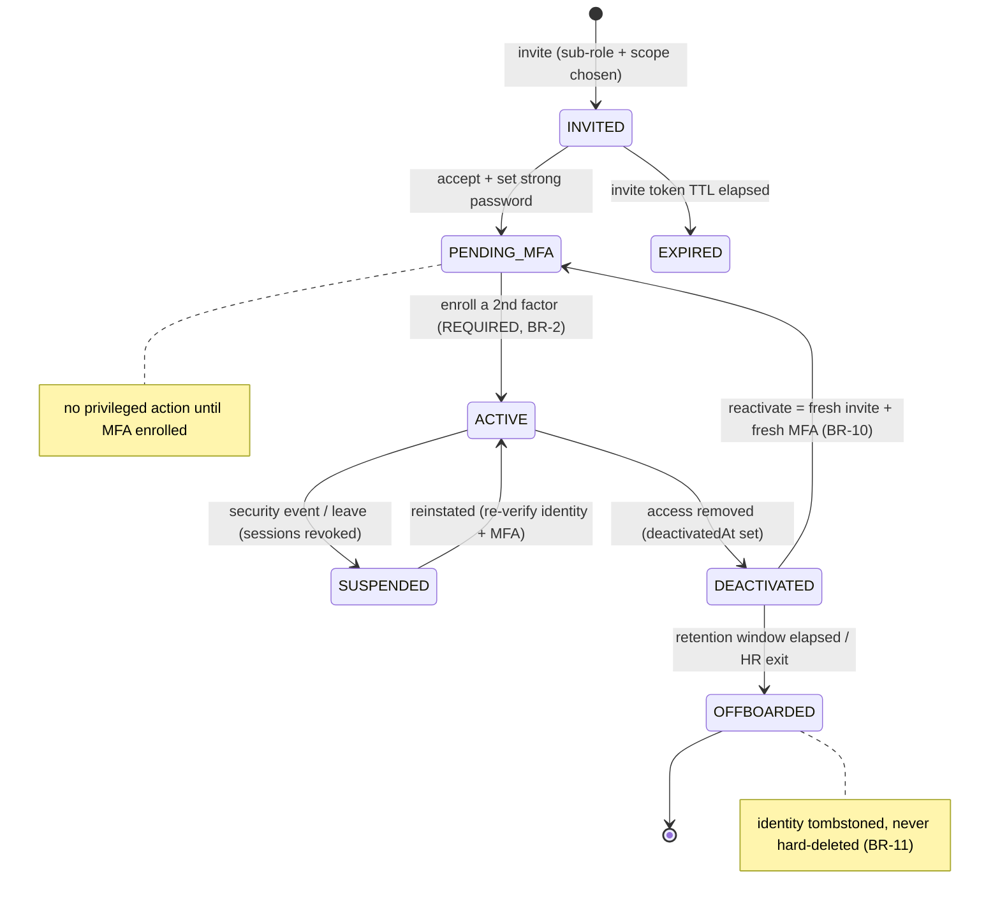

**Transitions of note.** Reactivation routes via `PENDING_MFA`, never directly to `ACTIVE` (BR-10). Terminal `OFFBOARDED` has no outgoing transition. Session validity (Doc 1 §3.4) is force-invalidated on every non-ACTIVE transition (BR-8).

---

## 7. Key Entities & Fields

> Cross-cutting `AuditLog · Notification · Reminder` attach via the platform's polymorphic pattern and are not redefined here. The activity lens (3.6) is a **query over Doc 1's audit spine** served through SA-11's audit-read surface, not a new table. `platform_user`, `platform_session`, and the MFA/credential machinery are **owned by Doc 1 §3**; SA-7 specifies only the *administration-facing* fields it adds.

- **`platform_user`** — the internal-team identity (Doc 1 platform pool; no tenant). SA-7 references the Doc 1 base and confirms these administration fields:
  - `platform_user_id` (PK, UUID), `first_name`, `last_name`, `email` (unique work email), `password_hash` (Argon2id, nullable until set), `super_admin_role_id` (FK → SA-6 `SuperAdminRole`, exactly one), `country_scope` (text[] of `countryCode` ISO values, FK semantics to SA-1 `Country.countryCode`; meaningful for Content Publisher), `state` (enum §6), `timezone` (IANA), `mfa_enrolled_at` (nullable), `last_login` (nullable), `last_password_change_at`, `invited_by_platform_user_id` (FK self), `avatar_media_id` (nullable), **`deactivated_at`** (nullable), **`last_cross_tenant_action_at`** (nullable, materialized — 11), `tombstoned_at` (nullable, set at offboard), `created_at`, `updated_at`.
  - Indexes: `email` (unique), `super_admin_role_id`, `state`, `last_login`, `last_cross_tenant_action_at`. **No `firm_id` column** (asserted by Doc 1 AU-A4 schema-lint).
- **`platform_session`** — token-bound, time-bounded session. **Owned by Doc 1 §3.4** (`session_id`, `subject_id`, `refresh_hash`, `token_binding_fingerprint`, `idle_expires_at`, `absolute_expires_at`, `revoked_at`, `device_label`, `ip_first_seen`, `last_seen_at`). SA-7 consumes the list/revoke verbs; it adds no fields.
- **MFA factors / step-up grants** — **owned by Doc 1 §3.6** (TOTP secret, WebAuthn credential incl. sign-counter, hashed recovery codes; short-lived single-purpose step-up grants; secrets encrypted under the platform operational DEK per Doc 1 §7.1, not the per-subject codec). SA-7 references them for the security panel and the step-up gates; it defines none.
- **`SuperAdminRole` / `SuperAdminRolePermission`** — **owned by SA-6** (the ~6 platform sub-role templates and their `system/*` grants, Doc 1 §4.4). SA-7 assigns and renders; never redefines.

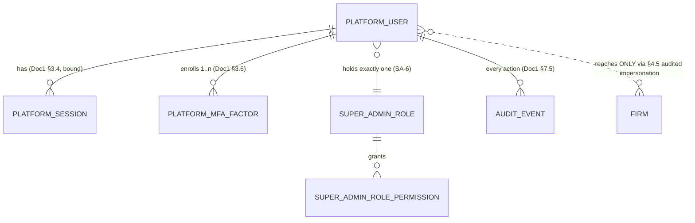

---

## 8. User Stories + Acceptance Criteria

**US-1 — Invite a least-privileged Content Publisher.** *As a Platform Owner, I want to invite an Australia Publisher with only AU-pack permissions.*
- **AC-1.1 — Given** I hold `system/platform-user:invite` and open Invite, **When** I submit name + work email + sub-role "Country/Content Publisher" + country scope `[AU]` (by `countryCode`), **Then** a `platform_user` is created `INVITED`, a single-use invite token is sent (Doc 1 §3.7), and `PLATFORM_USER_INVITED` records me, the sub-role, and the scope.
- **AC-1.2 — Given** they are `ACTIVE`, **When** they open the console, **Then** Canada pack controls are absent and any Canada-pack write returns 403, while Australia-pack writes succeed (BR-12).
- **AC-1.3 — Given** the same user, **When** they navigate to billing or attempt impersonation, **Then** those controls are absent and the corresponding `system/*` endpoints return 403 (BR-4).

**US-2 — MFA mandatory at onboarding.** *As a Platform Owner, I want a new user unusable until MFA is enrolled.*
- **AC-2.1 — Given** an invitee has set a password but enrolled no factor, **Then** state is `PENDING_MFA`, and **When** they attempt any privileged action, **Then** it is rejected and they are routed to enrollment (BR-2).
- **AC-2.2 — Given** a `PENDING_MFA` user, **When** they enroll and verify a factor, **Then** state → `ACTIVE`, recovery codes are shown once (Doc 1 AU-A22), and `PLATFORM_MFA_ENROLLED` is written.
- **AC-2.3 — When** anyone attempts to set a user `ACTIVE` without an enrolled factor, **Then** the system rejects it — no code path waives MFA (BR-2, Doc 1 AU-A21).

**US-3 — Step-up before impersonation.** *As a Tenant Account Manager, I want to re-authenticate before impersonating.*
- **AC-3.1 — Given** I am logged in with MFA but hold no fresh step-up grant, **When** I start impersonation, **Then** I am prompted for a second factor first (Doc 1 §4.5).
- **AC-3.2 — Given** I complete step-up and impersonate, **Then** the §4.5 elevated path mints a firm-pool token (`aud = er:firm`) bound to exactly one target `firm_id`, records my real `platform_user_id` + justification, writes `IMPERSONATION_START`/`IMPERSONATION_END` to the target firm's chain, and the grant expires within minutes (Doc 1 AC-4.5.7).
- **AC-3.3 — Given** an active impersonation, **When** I query a third firm, **Then** I get zero rows (RLS holds; no BYPASSRLS, Doc 1 AC-4.5.8).

**US-4 — "Is everyone on MFA?" at a glance.** *As a Platform Owner, I want the directory to show MFA status per user.*
- **AC-4.1 — When** I filter "MFA: not enrolled," **Then** I see exactly the users without an active factor (only `INVITED`/`PENDING_MFA`/`EXPIRED` given BR-2), each flagged.
- **AC-4.2 — Then** each row shows last login and `lastCrossTenantActionAt` in my (viewer's) timezone (Doc 1 §8.6).

**US-5 — Kill switch on a compromised account.** *As a Platform Owner, I want to suspend an account and sign it out everywhere.*
- **AC-5.1 — Given** an `ACTIVE` user with 3 live sessions, **When** I suspend them (step-up + reason), **Then** in one transaction state → `SUSPENDED` and all 3 sessions are revoked, and `PLATFORM_USER_SUSPENDED` is written (Doc 1 AU-A13).
- **AC-5.2 — When** any of their devices makes the next request, **Then** it receives 401 (session-bound, Doc 1 AU-A11); login is also rejected.

**US-6 — Reactivation forces fresh MFA.** *As a Platform Owner, I want a returning employee's account to require fresh MFA.*
- **AC-6.1 — Given** a `DEACTIVATED` user within the window, **When** I reactivate, **Then** a fresh invite is issued, state returns via `PENDING_MFA` (not directly `ACTIVE`), old factors are not auto-trusted, and `PLATFORM_USER_REACTIVATED` is written (BR-10).

**US-7 — Last-owner guard.** *As a Platform Owner, I must not be able to remove the only remaining owner.*
- **AC-7.1 — Given** exactly one active Platform Owner, **When** I attempt to deactivate/suspend/offboard/demote them, **Then** it is rejected ("Cannot leave the platform with zero Platform Owners") and nothing changes (BR-7).

**US-8 — Per-operator impersonation audit.** *As a Platform Owner, I want every firm a given operator impersonated, with reasons.*
- **AC-8.1 — Given** an operator who ran 2 impersonation sessions this month, **When** I open their Activity lens filtered to impersonation (served via SA-11 `system/audit-log:list`), **Then** I see both with the firm named, the justification, start/end times, and a link to the in-session action log; the slice exports to CSV via the SA-11 export (`system/audit:export`, audited as egress per Doc 1 §7.6), masked-by-default — and if the export renders any masked field in cleartext it emits the Doc 1 §7.2 bulk `PII_REVEAL` audit (field set + subject + actor + justification) in addition to the egress event (R25).

**US-9 — Identity separation.** *As a security reviewer, I need platform users walled from firm and client identities.*
- **AC-9.1 — Given** a firm-staff login and a portal login, **When** either authenticates, **Then** neither can ever receive a token with `aud = er:platform`, and a platform user has no `firm_id` on record or token (Doc 1 AU-A1/AU-A4).

---

## 9. Edge Cases & Validations

- **Lost all factors / no recovery codes.** No silent "MFA off." Recovery = a one-time recovery code (Doc 1 §3.6) or a `system/platform-user:reset-mfa`-gated, step-up'd, audited Owner reset that drops the account to `PENDING_MFA` and forces fresh enrollment; old factors are never restored.
- **Removing the last factor (self-service).** Blocked — ≥1 active factor enforced (BR-2, Doc 1 AU-A22); UI disables removal of the last factor.
- **Invite replay / expiry / revoke.** Single-use, TTL-bound, hashed (Doc 1 AU-A27); used token rejected; expired → `EXPIRED`; a pending invite is Owner-revocable.
- **Invite to a non-company email.** Rejected if domain-pinning is on; otherwise allowed but flagged. Domain-pin default is **[FOUNDER-CONFIRM]**.
- **Two Owners demote each other concurrently.** The transactional last-owner guard (BR-7) resolves deterministically — at least one Owner remains; the losing request is rejected.
- **Step-up grant reuse / expiry.** Single-purpose and short-lived; cannot be reused for a different action or after expiry — a new step-up is required.
- **Sub-role change mid-session.** Permissions are resolved per-request from the principal, not baked into the token (Doc 1 AU-A15), so the change takes effect on the next request without re-login; in-flight requests under the old role complete and are audited; sensitive actions re-check at execution.
- **Suspended/deactivated user with an unexpired access token.** Session-bound validation (BR-9) + atomic revoke (BR-8) means the next request fails — access TTL is not a window of access (Doc 1 AU-A11).
- **Country scope emptied for a Publisher.** A Publisher with empty scope can publish to no country (effectively read-only on packs) — not an error; surfaced as a warning on the detail.
- **Offboarded actor on a 5-year-old audit event.** The tombstone resolves to a name (BR-11); the event renders the historical actor correctly.
- **Acting while `PENDING_MFA`.** Every privileged endpoint checks state; `PENDING_MFA` is rejected for anything but finishing enrollment.
- **Concurrent session-revoke + refresh.** Revoke wins: a refresh against an invalidated session is rejected (Doc 1 §3.4 re-checks the session row).
- **Email coincides with a firm-user email.** Because pools are walled (Doc 1 §3.1), a platform user and a firm user may share an email string without ambiguity — the login *endpoint*/pool disambiguates. Whether to forbid cross-pool collisions is **[FOUNDER-CONFIRM]**.
- **Clock skew on TOTP.** Validation tolerates a small ± window (Doc 1 §3.6); excessive skew fails with a clear "code expired/invalid," not a silent failure.

---

## 10. Permissions (GLOBAL `system/*`)

All SA-7 permissions are **GLOBAL** (`system/*`), assignable only to super-admin sub-roles (never to firm/portal roles — enforced by the Doc 1 §4.3 write-side scope filter). They are seeded into the Doc 1 §4.4 permission catalog as part of the foundation's own `system/*` keys and CI-validated against the routes. GLOBAL `system/*` keys are `view.own`/`view.all`-qualifier N/A per Doc 1 AC-4.1.3 (no intra-firm ownership on the platform plane), and this module's key list is an explicit catalog increment reconciled by the Doc 1 §4.4 CI completeness check against SA-7's `@RequirePermissions` routes.

| Permission Key | Description | Status |
|---|---|---|
| `system/platform-user:list` | View the platform-user directory | NEW |
| `system/platform-user:show` | View a platform user's detail | NEW |
| `system/platform-user:invite` | Invite a new platform user | NEW |
| `system/platform-user:manage` | Change sub-role / country scope (administration) | NEW |
| `system/platform-user:suspend` | Suspend / reinstate a platform user | NEW |
| `system/platform-user:deactivate` | Deactivate / reactivate / offboard a platform user | NEW |
| `system/platform-user:reset-mfa` | Force an MFA reset (step-up-gated) | NEW |
| `system/platform-user:session-manage` | View/revoke another user's sessions | NEW |
| `system/audit-log:list` | Read the per-user activity lens / audit spine (the SA-7 lens reuses this SA-11 key — no separate audit-view key) | OWNED BY SA-11 (referenced) |
| `system/audit:export` | Export an audit slice (e.g. the per-operator lens CSV; audited as egress per Doc 1 §7.6) | OWNED BY SA-11 (referenced) |
| `system/audit:verify` | Verify the audit hash-chain integrity | OWNED BY SA-11 (referenced) |
| `system/super-admin-role:manage` | Manage the sub-role definitions | OWNED BY SA-6 (referenced) |

> **Audit-read keys are owned by SA-11.** SA-7's per-user activity lens and its CSV export reuse SA-11's canonical `system/audit-log:list` / `system/audit:export` / `system/audit:verify` keys (R13) — SA-7 no longer coins a separate `system/platform-user:audit-view` key, so there is exactly one catalog entry per audit-read capability and the Doc 1 §4.4 CI completeness check has a single authoritative name.

> **Self-service** (own profile/MFA/sessions/password) requires **no** `system/*` permission — it is an "is this my own record?" check on Doc 1 §3.6/§3.7, available to any authenticated platform user for their own account only.

The honest baseline (Doc 1 §4.4): the catalog seeds these `system/*` keys with the foundation; the **default platform sub-role matrix** (~6 roles) assigns them so no single role holds every key — the exact segmentation is **[FOUNDER-CONFIRM]**.

---

## 11. Scalability · Security · Performance

**Scalability.** The platform-user population is intentionally tiny (tens, not thousands) — so SA-7's concern is **not** row volume but **blast radius** and the **audit stream**. Directory, detail, and session lists are trivially paginated (cursor, Doc 1 §8.1). The one volume surface is the per-operator audit lens (3.6), which reads the per-firm append-only chains (millions of rows across firms, Doc 1 §7.5) through SA-11's `system/audit-log:list` read surface: it MUST query by `(actor_id, actor_type = super_admin)` over indexed columns with a required date-range filter and pagination — never an unbounded scan. **`last_cross_tenant_action_at` is materialized** (refreshed off `IMPERSONATION_START`/`CROSS_TENANT_ACCESS` events from the §4.5 path), so the directory never live-scans the audit chains on page load. Sub-role permission resolution is per-request from the principal and Redis-cacheable (Doc 1 §3.4).

**Security (the heart of this module).** SA-7 is the most privileged surface, so security *is* the feature, almost entirely by reusing Doc 1:
- **Mandatory-locked MFA, phishing-resistant by preference** (BR-2; Doc 1 §3.6) — passkeys preferred, TOTP floor, SMS not a primary factor; recovery via one-time codes or audited Owner reset.
- **Walled, tenant-less identity** (BR-1/BR-14; Doc 1 §3.1) — no shared login/token with firm or portal pools; `actorType = super_admin` is structural.
- **Least-privilege** (BR-4/BR-5/BR-12; Doc 1 §4) — one SA-6 sub-role, default-deny, server-side enforced, no self-elevation, country scope (by `countryCode`) as a hard server filter.
- **Step-up before blast-radius actions** (BR-6; Doc 1 §3.6/§4.5) — re-auth gates impersonation, role/state changes, MFA reset, credential rotation, pack publish/rollback, plan change.
- **Token-bound, time-bounded sessions with an atomic kill switch** (BR-8/BR-9; Doc 1 §3.4, AU-A11/AU-A13) — revoke immediate; suspend/deactivate revoke all atomically; platform-tightest timeouts.
- **Cross-tenant only via the audited §4.5 path** (BR-15) — no raw `er:platform` token satisfies a LOCAL route; every impersonation is an `IMPERSONATION_START`/`END` pair in the target firm's chain.
- **Full, immutable, foregrounded audit** (BR-13; Doc 1 §7.5) — every action `super_admin`; cross-tenant/impersonation surfaced per operator through SA-11's read surface; tombstone-don't-delete preserves attribution (BR-11). An unmasked audit export through SA-11 carries the Doc 1 §7.2 bulk `PII_REVEAL` audit in addition to the egress event (R25), masked-by-default.
- **PIPEDA / regulated posture.** Because a platform account can reach every tenant's client PII, SA-7's MFA + least-privilege + per-operator audit are the controls that bound and prove access across all firms — the answer to "who at Expat Ready can see my clients' data, and can you prove what they did?"

**Performance.** Login (Doc 1 §3.4) is O(1): one Argon2id verify + one factor verify + one session insert, rate-limited (Doc 1 AU-A31). Each authenticated request does a token-bound session lookup (indexed) + a cached sub-role permission read — both bounded, within the Doc 1 §8.1 read p95 ≤ 300 ms budget. The directory reads the materialized `last_cross_tenant_action_at`, never a live audit scan; audit-lens queries are date-range-bounded and indexed.

---

## 12. Reference Note (exists / NEW / changed — honest)

> Greenfield, target-state. The reference prototype is design-provenance only (Doc 1 §1.8); this section is honest about what the foundation already provides versus what SA-7 adds.

- **PROVIDED BY DOC 1 (build it once in the foundation, consume it here):**
  - The **platform authentication pool** — `platform_user` (no `firm_id`), dedicated `POST /api/v1/auth/platform/login`, distinct signing key, `aud = er:platform`, and the cross-pool 401 walls (Doc 1 §3.1).
  - **Mandatory-locked MFA** (TOTP + WebAuthn + hashed recovery codes; secrets under the platform operational DEK, Doc 1 §7.1) with enrollment-as-gate and **step-up** (Doc 1 §3.6).
  - **Token-bound `platform_session`** with idle + absolute timeouts and atomic revoke-all (Doc 1 §3.4).
  - **Invite / reset / deactivation** lifecycle primitives — single-use hashed tokens, password policy, immediate-revoke-on-deactivate (Doc 1 §3.7).
  - The **per-firm append-only hash-chained audit spine** with `actorType` and the audited **impersonation path** (Doc 1 §4.5, §7.5), read through SA-11's `system/audit-log:list` / `:export` / `:verify` keys.
  - The **SA-6 super-admin sub-role templates** + the scope-aware guard + permission catalog (Doc 1 §4).
- **NEW (SA-7 builds the administration surface on that foundation):**
  - The **platform-user directory + detail** (3.4) with the **MFA-status flag**, **state**, viewer-timezone timestamps, and the **`lastCrossTenantActionAt`** column (the gap-analysis-named addition).
  - The **invite/onboarding workflow UX** entry point (3.2) and the **sub-role + country-scope assignment** UI over the SA-6 templates (3.3), scoped by `countryCode`.
  - The **per-operator activity lens** (3.6) — an actor-indexed read-only view across the per-firm audit chains, foregrounding impersonation/cross-tenant events, served through SA-11's audit-read surface (no SA-7-owned audit-read key).
  - The **suspend / deactivate / reactivate / offboard** administration motions (3.7) wiring the Doc 1 deactivation primitive to the §6 platform-user lifecycle, with `deactivatedAt`, tombstone-on-offboard, and the **last-owner guard** (BR-7).
  - The **`system/platform-user:*`** permission keys (10).
  - The **owner-view session management** surface over Doc 1's session engine (3.5).
- **CHANGED (vs. the reference prototype, already mandated by Doc 1 — SA-7 simply depends on it):**
  - The prototype's single shared `User` table distinguished by `clientId IS NULL`, single bcrypt login, no MFA, and a `{ id, clientId }` JWT with no context discriminator is **replaced** by the Doc 1 three-walled-pool model (Argon2id, mandatory MFA, `aud`-walled tokens, token-bound sessions). SA-7 assumes this is in place; it does not migrate it.
  - `lastCrossTenantActionAt` and `deactivatedAt` are **net-new** materialized/lifecycle fields on `platform_user` (gap analysis, ADR FINAL #4 net-new platform pool).
  - The earlier SA-7-owned `system/platform-user:audit-view` audit-read key is **retired** in favour of SA-11's canonical `system/audit-log:list` / `:export` / `:verify` (R13) — one catalog entry per audit-read capability.

---

## 13. Open Questions / [FOUNDER-CONFIRM]

1. **Platform-staff operating segmentation.** The exact ~6 platform sub-roles and their least-privilege `system/*` boundaries (Doc 1 §4.4 names Platform Owner, Platform Admin, Support read-mostly, Billing-Ops, Content/Pack Publisher, Auditor as the proposed default). — *[FOUNDER-CONFIRM]*
2. **Step-up action list.** Confirm the exact set requiring step-up (proposed: impersonation, sub-role change, state change, force-MFA-reset, credential rotation, pack publish/rollback, plan change). — *[FOUNDER-CONFIRM] / security*
3. **Invite TTL & email-domain pinning.** Doc 1's default invite TTL is 72h; SA-7 may pin tighter for the privileged pool — confirm the value and whether invites are hard-restricted to company domain(s). — *[FOUNDER-CONFIRM]*
4. **Reactivation retention window.** How long a `DEACTIVATED` account stays reactivatable before forced re-invite, and what triggers auto-offboard. — *[FOUNDER-CONFIRM]*
5. **Per-user permission exceptions.** Phase 1 = one SA-6 sub-role, no per-user patching. Do we ever need a per-user grant/deny on top, or is "create a new sub-role" always the answer? — *[FOUNDER-CONFIRM]*
6. **Country-scope beyond Content Publisher.** Should Tenant Account Manager / Support also be country-scopable (e.g. an APAC support agent only sees APAC firms), or is country scope a Publisher-only concept at launch? (Scope joins on `countryCode` either way, per R10.) — *[FOUNDER-CONFIRM]*
7. **MFA-reset authority & dual-control.** Confirm `system/platform-user:reset-mfa` is the only path to force-reset another user's MFA, and whether a second-owner approval (dual-control) is required for it. — *[FOUNDER-CONFIRM] / security*
8. **Cross-pool email uniqueness.** Forbid a platform-user email from colliding with a firm-user/client email, or rely on per-pool disambiguation (§9 edge case)? — *Architect*
9. **Enterprise SSO for the platform team.** Doc 1 §3.8 keeps inbound SSO as a future port-bound adapter (firm-pool only). Confirm whether the *platform* team is ever SSO-federated, and if so whether MFA stays platform-enforced. — *[FOUNDER-CONFIRM]*
10. **SMS fallback appetite.** Doc 1 sets SMS off-by-default for the platform pool (SIM-swap risk). Confirm whether SMS is excluded entirely or allowed as an explicit, audited last-resort fallback. — *[FOUNDER-CONFIRM] / security*

---

*End of Module SA-7 — Platform Users. Plane: Super-Admin (GLOBAL). Identity context: the Expat Ready platform pool (Doc 1 §3.1), walled from firm-staff and client-portal. Built on Doc 1 §3 (identity/MFA/sessions/lifecycle), §4 (RBAC + the audited impersonation path §4.5), and §7.5 (the audit spine, read via SA-11's `system/audit-log:list` / `:export` / `:verify`) — referenced, not re-spec'd.*

---

# Module SA-8: Integrations & Rails

> **Plane:** Super-Admin console (**GLOBAL**). **Tenant key:** none for platform rails (`scope = GLOBAL`, `firm_id IS NULL`); per-country rows carry `countryCode`; the rare per-firm override carries `firm_id`. **Builds on Doc 1:** this module is the *runtime selector and configuration plane* for the Rails-as-Ports machinery defined in **Doc 1 §6.3**; it stores secrets via the KMS/Secrets-Manager hierarchy of **Doc 1 §7.1**; it audits through the per-firm hash-chained spine of **Doc 1 §7.5**; it emits/consumes nothing but reads the rail-originated event contract of **Doc 1 §6.1.4**. SA-8 does **not** re-specify ports, the event dictionary, or the key hierarchy — it references them.
>
> **The one framing that governs this module.** ExpatReady has **no third-party product-tool integrations** — no DocuSign, no Calendly, no QuickBooks, no Mailchimp to "connect." Those categories are in-house Doers (Doc 1 §6.3). SA-8 configures only: (a) the **infrastructure rails** behind the ports of Doc 1 §6.3.1 (object storage, email relay, payment processor, SMS/WhatsApp gateway, identity provider) plus the documented sixth domain/cert rail (§3.0); (b) **platform-level settings of the in-house Doers** that have no rail but need global policy (most importantly the Signer's per-country legal config); and (c) **optional connectors to a firm's OWN account** (its own mailbox/calendar). Anyone expecting an "integrations marketplace" is in the wrong model — this is **infrastructure configuration**, and its single hardest problem is **handling secrets safely**.

---

## Module Index

1. Purpose & Goal
2. Users & Jobs-to-be-Done
3. Functional Design — How It Works
4. Detailed Functional Requirements (SA-8-n)
5. Business Rules & Logic
6. States & Lifecycle
7. Key Entities & Fields (with ERD)
8. User Stories + Acceptance Criteria
9. Edge Cases & Validations
10. Permissions (GLOBAL `system/*`)
11. Scalability · Security · Performance
12. Reference Note (exists / NEW / CHANGED)
13. Open Questions / [FOUNDER-CONFIRM]

---

## 1. Purpose & Goal

**What it is.** SA-8 is the **infrastructure control plane** of the Super-Admin console — the single, access-controlled place where ExpatReady's platform engineers select **which adapter is live for each rail** (per Doc 1 §6.3.2), configure that adapter's non-secret settings, write its secret **into KMS-backed storage without ever reading it back**, prove it works with a live connectivity test before it goes live, and watch a health board that catches a rail going bad before a firm files a ticket. It also holds the platform-level policy of Doers that have no rail (the Signer's per-country legal config) and the optional OAuth-app credentials that let a firm connect its own mailbox/calendar.

**The business outcome it must produce.** Two non-negotiable outcomes. First, **the rails must work** — nothing becomes the live adapter without a green connectivity test, and the health board surfaces a degraded rail (a lapsed SES identity, a rotated payment-rail key, an over-quota gateway) the moment real Doer telemetry shows it failing. Second, **secrets must be handled correctly** — SA-8 holds the most dangerous data on the platform: the keys that move money, read every firm's files, and sign tokens. Per Doc 1 §7.1 the secret value lives only in AWS Secrets Manager / KMS; the database row holds a **reference plus a last-4 fingerprint and never the value**; a read returns a mask; the secret is decrypted only inside the adapter at the point of use. A leaked database dump must yield nothing usable.

**Why it matters / world-class positioning.** A generic admin panel stores an API key in a text column and shows it back to you — disqualifying for a PIPEDA-bound, multi-country immigration platform. The world-class posture here is **"secrets are write-only, residency is provable, and rails are observable."** The moat is three-fold: (a) **secret hygiene by construction** — write-only in, masked out, KMS-backed, audited rotation, so a stolen session or DB dump never yields a usable credential; (b) **provable Canadian residency** — because the heavy compliance Doers (Signer, document storage) are in-house and store artifacts in the firm's own object storage, residency is *inherent*, and SA-8 generates the per-rail residency declaration that SA-11 reports; (c) **no third-party-product attack surface** — there is no DocuSign account to phish or Calendly scope to over-grant, because those are Doers. SA-8 is small in screen count but it is where the platform earns the right to be trusted with a firm's money and a client's PII.

**How it ties to the platform.** Every infrastructure-backed Doer reaches its rail through SA-8's selection: the **Biller/SA-4 platform billing** charge via `PaymentRailPort`; the **Mailer** sends via `EmailRelayPort`; the **Signer/Documents** store via `ObjectStoragePort`; the **Messenger** sends via `SmsGatewayPort`; **AuthCore** issues tokens via `IdentityProviderPort` (all five core ports per Doc 1 §6.3.1), with the documented sixth `DomainRailPort` (§3.0) handling domain/cert provisioning. SA-8 registers the inbound webhook endpoints those rails call back into (consumed by SA-4 and Communications via the rail-originated event contract of Doc 1 §6.1.4); supplies the residency declaration to SA-11; and rolls its rail health into SA-9 system health.

---

## 2. Users & Jobs-to-be-Done

| Role | Primary job in SA-8 | Representative JTBD |
|---|---|---|
| **Platform Engineer / DevOps** (heaviest user) | Keep rails selected, healthy, and their secrets safe. | "When I onboard a region or rotate a key, I enter the new credential, test it live, and promote it — without ever seeing the old secret and without downtime." · "When a rail starts erroring, the health board flags it with the last error and a one-click ping, so I fix it before a firm notices." · "Every secret is masked to the last four — I can never read one back, even as an admin." |
| **Platform Owner** | Own the platform's compliance/risk posture; set Doer policy. | "I want proof no secret is stored in plaintext and that every rotation is in the audit log without the value." · "I configure the Signer's consent text and certificate **per country** so every in-house e-signature is legally defensible in its jurisdiction." · "I want a per-rail residency declaration (region + Canadian/Non-Canadian + safeguard) I can hand to a regulator." |
| **Billing Admin** | Own the payment rail's correctness (not its secrets day-to-day). | "When we switch the payment rail TEST→LIVE, it is an explicit, confirmed, audited step — never a silent toggle — and the webhook-signing-secret rotation is verifiable before it goes live." (Owns the commercial side in SA-4; consumes SA-8's payment rail.) |
| **Country / Content Manager** | Read-only awareness of per-country Doer settings. | "When I publish a Country Pack, I can see (read-only) that the Signer's consent text and certificate for this country are configured, so a firm there can sign compliantly." (Authors pack content in SA-1; the rail/Doer wiring is SA-8's.) |
| **Support Agent** | None directly. | Sees only rail *health* (via SA-9) when triaging "emails aren't sending"; can never view or edit a credential. |

**Design implication.** The Platform Engineer is the protagonist; the rail-config screens, the test loop, the health board, and the rotation flow are designed for them — keyboard-reachable, fast, and **safe by default** (write-only inputs, masked reads, confirm-on-danger). The Platform Owner gets the compliance surfaces; the Billing Admin gets the TEST→LIVE gate. Permissions (§10) separate "view masked" from "manage credentials" from "run a test" so a Support Agent can never reach a secret.

---

## 3. Functional Design — How It Works

### 3.0 The rail-vs-Doer model (the organizing principle)

A **rail** is a commodity pipe ExpatReady pays a vendor for (object storage, email relay, payment processor, SMS gateway, identity provider, domain/cert provisioning) — it has no product opinions, it just moves bytes/money/messages/tokens/DNS records. A **Doer** is the product ER builds (Biller, Mailer, Signer, Messenger, Scheduler, …). Per Doc 1 §6.3, only the **infrastructure-backed Doers** reach a rail through a port; SA-8 holds the **runtime selection + non-secret config + secret reference** for each of those rails, plus **Doer-platform settings** for Doers whose policy is global (Signer), plus the **optional own-account connector** app. There is deliberately **no other shape** ("connect a third-party tool"); a reviewer rejects any requirement implying one — the answer is always "build it as a Doer" (BR-1). This keeps the attack surface tiny and the residency story clean.

The rail set is the **five Doc 1 §6.3.1 ports** plus **one documented sixth rail, `DomainRailPort`** (custom-domain / TLS-certificate provisioning), folded under the same port doctrine with a single v1 adapter (**AWS ACM**). `DomainRailPort` follows every rule the other rails do — discriminated config (§3.2), write-only secrets (§3.1), test-gated activation (§3.6), residency declaration (§3.9), and it appears in the Doc 1 §7.7 per-rail sub-processor residency matrix exactly as the other adapters do (BR-16). It is the same machinery, not a new shape.

### 3.1 Secret management — write-only, KMS-backed, rotatable, never on a screen (the core)

Described first because every rail depends on it. The mechanism is **fixed by Doc 1 §7.1** (CMK → per-firm DEK → per-subject key for end-client PII; per-pool/per-firm **operational DEK** for credential/auth-store material; platform-secret path via KMS/Secrets Manager for rail credentials); SA-8 is its config surface.

1. **Write-only ingestion.** A secret input is write-only: an operator types a *new* value to set/rotate; a read returns only the masked last-4 (`****1234`) and a "set new value" affordance — the value never returns to the browser. **Blank on save = leave unchanged**, so editing the non-secret parts of a config never forces re-entering the secret.
2. **Encrypt at rest in the managed store.** The secret is written to AWS Secrets Manager; the `IntegrationRailConfig` row holds only a `SecretRef` (store handle/ARN + last-4 + status), **never the value**.
3. **Decrypt only at the point of use** inside the adapter behind the port (Doc 1 §6.3) — held in memory for the call, never logged, never serialized into a response, never written into the audit `changes` payload (redacted to `[REDACTED]`).
4. **Rotation without downtime.** Rotation **stages** the new value, runs a connectivity test, and on PASS flips the active reference; the old secret is flagged for deletion after a configurable window (default 24h, a `PlatformSetting` per SA-12) so an in-flight adapter holding the old value never fails mid-call (BR-4). The event is audited without the value (BR-3).

**World-class behaviour.** You cannot read a secret back, by design, even as Platform Owner — mask-on-read is not a UI nicety; the value is never in the response. A leaked DB dump yields nothing usable. Rotation is a first-class, staged-tested-promoted-deprecated motion, not a destructive overwrite. **Decryption failure at point of use is a hard error that flips the rail to Degraded — never a silent fall-back to using ciphertext as a credential** (BR-15).

**Screens.** Secret field (masked last-4, write-only "set new value", "blank to keep" hint); Rotation panel (stage → test → promote → old-secret countdown); Secret-hygiene assurance card on the SA-8 landing ("0 secrets in plaintext — all N rails KMS-backed").

### 3.2 Per-railType discriminated config schema (closes the gap)

The gap analysis names the central modelling defect: a single untyped `nonSecretConfigJson` blob spanning all railTypes is unbuildable. SA-8 fixes it with a **discriminated union of Zod schemas keyed on `railType`** (validated at the edge per Doc 1's config-as-JSONB rule §2.6 / §6.3.2). Each adapter declares its own schema; a config row's `nonSecretConfigJson` MUST validate against the schema for its `(railType, adapterKey)` pair, or the save is rejected before any secret is written.

| railType → port (Doc 1 §6.3.1, plus the §3.0 sixth) | adapterKey (v1) | Discriminated non-secret config fields | Secret refs (SecretRef, never inline) |
|---|---|---|---|
| **OBJECT_STORAGE** → `ObjectStoragePort` | `s3` (v1), `minio` (dev) | `bucket`, `region`, `sseKmsKeyArn`, `credentialMode` (`IAM_ROLE` \| `ACCESS_KEY`), `endpoint?`, `forcePathStyle?` | `accessKeySecretRef?` (only if `credentialMode = ACCESS_KEY`) |
| **EMAIL** → `EmailRelayPort` | `ses` (v1), `smtp` (fallback) | `provider`, `host?`, `port?`, `secure?`, `fromAddress`, `fromName`, `replyTo`, `sesVerifiedIdentity?` | `relayPasswordSecretRef?` (SMTP) / SES via IAM role |
| **PAYMENT** → `PaymentRailPort` | `stripe` (v1) | `publishableKey` (safe to show), `mode` (`TEST` \| `LIVE`), `connectModel?` `[FOUNDER-CONFIRM]` | `secretKeyRef`, `webhookSigningSecretRef` |
| **SMS** → `SmsGatewayPort` | `sns` (v1), WhatsApp BSP | `senderId`, `defaultCallingCode`, `perCountrySender[]` | `authTokenRef` |
| **IDENTITY** → `IdentityProviderPort` | `in-house` (v1) | per pool (`platform`/`firm-staff`/`client`): `poolId`, `mfaRequired` (display), `ssoApp?` | `clientSecretRef[]` (per pool), `ssoAppSecretRef?` |
| **DOMAIN** → `DomainRailPort` (§3.0) | `acm` (v1) | `domainName`, `region`, `validationMethod` (`DNS` \| `EMAIL`), `hostedZoneRef?` | `providerCredentialSecretRef?` (only if not IAM-role assumed) |

The selector itself — `railType → adapterKey` and the live row — is exactly the runtime selection of Doc 1 §6.3.2; a CI assertion (Doc 1 §6.3.4 RL-A2/RL-A3) proves swapping `adapterKey` via this config needs no deploy.

### 3.3 The rails (config behaviour)

Each rail is the same shape — select adapter, validate the discriminated config (3.2), write secrets write-only (3.1), gate activation on a connectivity test (3.6), audit (3.10). Rail-specific notes:

- **Object storage.** Target credential mode is **IAM-role assumed by the runtime** (no long-lived keys); `ACCESS_KEY` is a flagged lower-security fallback for S3-compatible/dev (MinIO, `forcePathStyle`). The test is a **put→get→delete round-trip** on a throwaway object. Region is the storage half of the residency declaration (3.9); the SSE-KMS key is declared so SA-11 can assert at-rest encryption. The adapter caches the constructed client and invalidates on config change (Doc 1 §6.3.2).
- **Email relay.** SES (IAM) or SMTP (password secret). Test = **a real test send**; for SES, verified-identity / DKIM / SPF status is surfaced (deliverability is part of "is this rail healthy"). A **firm-local relay override** (`scope = FIRM`) wins over the platform default when present (BR-10).
- **Payment.** Publishable key (safe to show), `secretKeyRef`, `webhookSigningSecretRef`, `mode TEST|LIVE`. **TEST→LIVE is an explicit, confirmed, audited gate** (BR-6). Test = a benign processor API call that **echoes the active mode** before activation. Webhook-signing-secret rotation uses a **dual-accept verify window** so no event is dropped mid-rotation (3.8 / BR-4). Payment config is platform-wide; a firm's own connected-account routing is a firm-tenant concern handled by `PaymentRailPort`, not SA-8 (BR-1, and connected-account routing is the port's job per Doc 1 §6.3.1). The payment rail is referenced through its port and `adapterKey` (`stripe`); no vendor-named entity is persisted — webhook events ingested from the payment rail land in SA-4's rail-neutral `RailWebhookEvent` / `RailInvoice` entities (Doc 1 §6.3, ADR C4-D1 rails-as-ports), keyed on the opaque `railInvoiceRef`.
- **SMS / WhatsApp gateway.** Auth token (secret), sender ID / from-number, default calling code, **per-country sender overrides**. Use is **plan-gated** by the `feature.sms` entitlement key (SA-3 `CommercialFeatureCatalog` + SA-12 `FeatureFlag`, AND-composed per SA-12 §3.0); SA-8 supplies capability, not entitlement (BR-13). Delivery-receipt webhooks feed health (3.6/3.8).
- **Identity provider.** Per Doc 1 §3.1 the v1 adapter is the **in-house IdP** with **three cryptographically-separate pools** (platform / firm-staff / client-portal), each with a **distinct signing key** (Doc 1 §3.3, AU-A2) and **mandatory audience verification**; cross-pool token acceptance is structurally impossible. SA-8 surfaces per-pool config (pool id, client-secret ref, operator SSO app) and the **MFA-required** assertion for the platform pool (Doc 1 §3.6). SA-8 does not re-implement auth — it configures the rail the IdP adapter reads.
- **Domain / cert.** `DomainRailPort` (§3.0) provisions custom domains and TLS certificates via the v1 **AWS ACM** adapter. Credential mode targets IAM-role assumption (no long-lived keys); the test is a **certificate-status / DNS-validation reachability check** before activation. Its region feeds the residency declaration (3.9) and its sub-processor row is in the Doc 1 §7.7 matrix (BR-16).

### 3.4 Signer platform settings (in-house e-sign — NOT a third-party integration)

E-signature is the in-house Signer Doer; there is **no e-sign vendor to select** (no DocuSign/OneSpan), so SA-8 configures the **Signer's per-country legal settings** that make an in-house signature defensible — **per country**, defaulting from the active Country Pack (SA-1): default legal/consent text (localized; the *content* is `[FOUNDER-CONFIRM]` / counsel), certificate-of-completion template, signature-evidence settings (IP/UA/consent-timestamp/event-log/tamper-hash toggles), and signing-link expiry default. **Residency is inherent** — signed artifacts store in the firm's own object storage (3.3), so SA-11's e-sign row reads "in-house · stored in firm storage · region = [bucket region]" with no third-party flag and **no provider-swap mechanism** (BR-8). **Settings are forward-only on new envelopes** — already-signed artifacts keep the version they were signed under (BR-14). No secret is involved (no vendor), so 3.1 does not apply — this is policy config.

### 3.5 Optional own-mailbox / own-calendar connector

The narrow, principled exception to "no third-party integrations": a firm may connect its **own** Google/Microsoft account so the in-house Scheduler reads the firm's own free/busy and the Mailer can send from the firm's own identity. SA-8 holds the **platform-level OAuth app credentials** (client id + write-only client secret + least-privilege scopes); each firm's **access/refresh tokens live in that firm's tenant** (`firm_id`-scoped) — never at the platform level. A firm-scoped OAuth refresh/access token is firm-credential material, not end-client Party PII, so it is encrypted under the **per-firm operational DEK** path of Doc 1 §7.1 (the same path used for `firm_user` credential/MFA secrets), **not** the per-subject field-encryption codec (Doc 1 §7.2); the connector and its provider are listed in the Doc 1 §7.7 sub-processor matrix (BR-16). The connector is **pure upside** — if absent/disabled, the Scheduler runs fully self-contained and the Mailer uses the relay (BR-11). Scopes are least-privilege (free/busy + event-write, or send-as) and displayed so over-grant is visible.

### 3.6 Connectivity test & Integration Health board

Two complementary mechanisms. **(1) On-demand connectivity test** per rail — storage put/get/delete; email test send; payment benign API + mode echo; gateway test SMS; IdP token-endpoint reachability; domain/cert status check. A test runs against the **staged** value during config (gating activation, BR-5) and on demand against the live config. **(2) Continuous health monitoring** — a board shows per rail: status (Active/Degraded/Disabled/Unconfigured), last successful call, last error (message + timestamp), 24h error rate, and a one-click ping. Health is fed by synthetic pings **and real Doer-call outcome telemetry** (the contract in 3.7), so the board reflects production reality, not just synthetic checks. A rising error rate or a recent hard failure flips a rail to **Degraded**, raises a `notif/` Notification to the Platform Engineer, and surfaces in SA-9; the residency line of each rail feeds SA-11.

### 3.7 The Doer → IntegrationHealthLog telemetry contract (closes the gap)

The gap analysis flags that the "Doer→IntegrationHealthLog telemetry injection contract" was undefined. SA-8 defines it as a **single platform-provided sink that every rail adapter calls on every outbound rail call**, so the contract lives at the **port boundary**, not in each Doer:

- **Where it is emitted.** Inside each adapter behind a Doc 1 §6.3 port (the only code that touches a vendor SDK), wrapping the rail call. Doers never call the sink directly — they depend only on the port, preserving the Doc 1 §6.3.4 RL-A1 boundary lint.
- **What is written.** One `IntegrationHealthLog` row: `{ railType, adapterKey, eventType: SYNTHETIC_PING | DOER_CALL, success, errorCode?, errorMessage?(no secret, no PII), latencyMs, occurredAt }`. Secrets and Restricted PII are forbidden in the payload (BR-3 / Doc 1 §7) — a scanner asserts it.
- **How it is written.** **Asynchronously, off the hot path** — the rail call's success/failure is enqueued (BullMQ, Doc 1 §6.2), never blocking the Doer's response. The board reads **pre-aggregated rollups** (last-success / last-error / 24h-rate), not live scans.
- **Degraded thresholds (closes OQ-5).** A rail flips to Degraded when **either** the rolling-window hard-failure count ≥ `degradedFailureCount` **or** the 24h error rate ≥ `degradedErrorRatePct` — both tunable `PlatformSetting`s (SA-12). Defaults `[FOUNDER-CONFIRM]`: `degradedFailureCount = 5` consecutive hard failures in 10 min; `degradedErrorRatePct = 20%` over 24h with a minimum sample of 20 calls. Recovery to Active requires a passing synthetic ping (state §6).

### 3.8 Webhook endpoint registry

Rails call back: the payment processor posts events (consumed by SA-4 via the rail-originated contract Doc 1 §6.1.4, landing in SA-4's rail-neutral `RailWebhookEvent`); the email relay posts bounce/complaint; the SMS gateway posts delivery receipts. SA-8 maintains a **registry** per rail: receiving URL, signing-secret ref (a secret, 3.1), subscribed events, last-received / last-verified, failure count. **Signature verification is mandatory** and happens inside the adapter (Doc 1 §6.3.4 RL-A5); handlers are **idempotent** keyed on the rail's own `event.id` (Doc 1 §6.1.4); signing-secret rotation uses a **dual-accept verify window** so no event is dropped (BR-4). A rail-originated webhook with **no resolvable `externalEventId` is rejected, dead-lettered, and alarmed** — never deduped on a business id (Doc 1 §6.1.4, fail-closed). Webhook failure counts feed rail health (3.6) — a payment rail whose webhooks all fail is Degraded even if outbound charges work.

### 3.9 Per-country / per-tenant override & data-residency declaration

Rails support overrides above the platform default at two levels — **per-country** (the residency driver: a country pins its storage region, relay, gateway sender, Signer settings) and **per-tenant** (a dedicated enterprise bucket/region). Resolution is **firm → country → platform default** (most specific wins, BR-9), exactly the per-tenant region seam of Doc 1 §1.7 / §6.3.2 — single-region Canada is the degenerate case, adding a region is config not code. The country dimension keys on **`countryCode`** (the one canonical country join key — Doc 1 defines `Country.id == countryCode`; SA-2 `FirmCountryEntitlement` / SA-3 `PlanCountryEntitlement` use the same key), so an SA-8 per-country override and a firm's country entitlement join on the identical FK. The set of (rail × region) choices generates a **`DataResidencyDeclaration`** read-model **from the actually-configured regions, never hand-typed** (BR-7): SA-8 supplies the per-rail configured facts `{ region, status: CANADIAN | NON_CANADIAN | CONFIRMED_WITH_SAFEGUARD, encryption }`; the **normative declaration grain is SA-11 §3.5** (per **data class × rail × region × status** — SA-8 cites it, never defines a competing grain), consumed by SA-11; Non-Canadian-without-safeguard is flagged (SA-11 renders the warning). Because the heavy Doers (Signer, storage) are in-house, most rows are inherently Canadian. Whether per-country *physical routing* is a Day-1 commitment or a roadmap item is `[FOUNDER-CONFIRM]` (§13); the override *mechanism* and the *declaration* are in scope now.

### 3.10 Configuration change safety, audit & rollback

Every SA-8 change is **versioned** and **audited** through the per-firm hash-chained spine of Doc 1 §7.5 (operator, timestamp, rail, before/after with **all secret fields redacted**, BR-3). Dangerous changes are gated: TEST→LIVE requires confirmation (BR-6); disabling a rail warns about downstream Doer impact; rotating a secret is staged-and-tested (3.1). A config can be **rolled back** to a prior version with a mandatory justification note; a rollback that depends on a since-deleted secret is **blocked** with a clear message rather than activating a broken rail (BR-12). Concurrent edits use an optimistic version check.

---

## 4. Detailed Functional Requirements

**Secret management (the core — applies to every rail)**
- **SA-8-1.** Every secret (payment secret key + webhook signing secret, S3 access-key secret, SMTP/relay password, SMS gateway auth token, IdP per-pool client secrets, domain/cert provider credential, connector OAuth client secret) SHALL be stored in AWS Secrets Manager per Doc 1 §7.1; the row SHALL hold only a `SecretRef` (handle + last-4 + status), never the value. Per-firm connector OAuth access/refresh tokens (held in the firm tenant, not here) SHALL be encrypted under the **per-firm operational DEK** path of Doc 1 §7.1 (firm-credential material), not the per-subject field codec (Doc 1 §7.2).
- **SA-8-2.** Secret inputs SHALL be **write-only**: a read returns only the masked last-4; a blank secret field on save means "leave unchanged."
- **SA-8-3.** Secrets SHALL be decrypted **only at the point of use** inside the adapter; they SHALL NOT appear in any response body, log line, or audit `changes` payload (redacted to `[REDACTED]`).
- **SA-8-4.** Secret rotation SHALL stage → test → activate-on-PASS; the previous secret SHALL be flagged for deletion after a configurable window (default 24h), not destroyed instantly.
- **SA-8-5.** A **secret-hygiene assurance** view SHALL show zero plaintext secrets and which rails are KMS-backed.

**Per-railType config + rail selection**
- **SA-8-6.** `IntegrationRailConfig.nonSecretConfigJson` SHALL validate against a **discriminated Zod schema keyed on `(railType, adapterKey)`** (§3.2); a save failing validation SHALL be rejected before any secret is written.
- **SA-8-7.** SA-8 SHALL be the **runtime adapter selector** per Doc 1 §6.3.2: a `railType → adapterKey` choice plus its config and secret refs; switching `adapterKey` SHALL be a config-row change requiring no deploy (Doc 1 §6.3.4 RL-A3).

**Object storage**
- **SA-8-8.** Storage config SHALL support `credentialMode` `IAM_ROLE` (preferred) or `ACCESS_KEY` (fallback, flagged lower-security); optional `endpoint`/`forcePathStyle` for S3-compatible/dev.
- **SA-8-9.** A storage config change SHALL run a **put/get/delete round-trip** and SHALL NOT activate on failure; on success the adapter's client cache SHALL be invalidated.

**Email relay**
- **SA-8-10.** Email config SHALL support SES (IAM) or SMTP (password secret), platform-default from/reply-to, and a **test send**; for SES, verified-identity/DKIM/SPF status SHALL be surfaced.
- **SA-8-11.** A **firm-local relay override** (`scope = FIRM`) SHALL win over the platform default when present.

**Payment**
- **SA-8-12.** Payment config SHALL hold publishable key, secret key (SecretRef), webhook signing secret (SecretRef), and `mode` (TEST/LIVE).
- **SA-8-13.** Switching to LIVE SHALL require explicit confirmation and SHALL be audited; the mode SHALL be visible at a glance.
- **SA-8-14.** A payment test SHALL call a benign processor API and echo the active mode before activation.
- **SA-8-15.** Payment config applies platform-wide; there SHALL be no per-firm payment-processor config at this level (firm connected-account routing is a firm-tenant concern handled by `PaymentRailPort`).

**SMS gateway**
- **SA-8-16.** Gateway config SHALL hold provider, auth token (SecretRef), sender ID/number, default calling code, and **per-country sender overrides**.
- **SA-8-17.** Gateway use SHALL be gated by the `feature.sms` entitlement key (SA-3 `CommercialFeatureCatalog` + SA-12 `FeatureFlag`, AND-composed); SA-8 supplies the rail only.

**Identity provider**
- **SA-8-18.** IdP config SHALL cover **three separate pools** (platform/firm-staff/client) with per-pool client secrets and a **distinct signing key reference per pool** (Doc 1 §3.3 AU-A2); cross-pool token acceptance SHALL remain structurally blocked (Doc 1 §3.1).
- **SA-8-19.** The platform pool SHALL surface **MFA-required = true** as a read-only compliance assertion (Doc 1 §3.6).

**Domain / cert rail**
- **SA-8-20a.** `DomainRailPort` (§3.0) SHALL be configured as a first-class rail with the v1 `acm` adapter: domain name, region, validation method, and a credential SecretRef only when not IAM-role assumed; activation SHALL be gated on a certificate-status / DNS-validation reachability test, and its sub-processor row SHALL appear in the Doc 1 §7.7 matrix.

**Signer platform settings**
- **SA-8-20.** SA-8 SHALL configure the Signer's **per-country** settings: consent text, certificate-of-completion template, evidence settings, signing-link expiry default.
- **SA-8-21.** There SHALL be **no third-party e-sign provider** selection; signed artifacts store in the firm's own object storage (Canadian residency inherent; no provider-swap).
- **SA-8-22.** Editing Signer settings SHALL affect **new envelopes only**; signed artifacts retain their signed-under version.

**Own-account connector**
- **SA-8-23.** SA-8 SHALL optionally configure platform OAuth app credentials (Google/Microsoft); per-firm tokens SHALL live in the firm tenant (`firm_id`-scoped), never at platform level, and SHALL be encrypted under the **per-firm operational DEK** (Doc 1 §7.1), not the per-subject field codec (Doc 1 §7.2).
- **SA-8-24.** OAuth scopes SHALL be least-privilege and displayed; if disabled, Scheduler/Mailer SHALL run fully self-contained.

**Health, telemetry & webhooks**
- **SA-8-25.** Each rail SHALL expose an on-demand connectivity test; activation of a new/edited config SHALL be gated on a passing test.
- **SA-8-26.** An **Integration Health board** SHALL show per rail: status, last success, last error, 24h error rate, and a ping action.
- **SA-8-27.** Every rail adapter SHALL write a `IntegrationHealthLog` row per call (synthetic and real) via the **async telemetry sink** of §3.7; the payload SHALL carry no secret/PII.
- **SA-8-28.** A rail SHALL flip to **Degraded** when hard-failure count ≥ `degradedFailureCount` OR 24h error rate ≥ `degradedErrorRatePct` (tunable PlatformSettings); the flip SHALL raise a Notification and surface in SA-9.
- **SA-8-29.** SA-8 SHALL maintain a webhook registry per rail (URL, signing-secret ref, subscribed events, last received/verified, failure count); inbound webhooks SHALL be signature-verified and idempotent (Doc 1 §6.1.4/§6.3.4); signing-secret rotation SHALL support a dual-accept verify window.

**Residency, override & change safety**
- **SA-8-30.** Rails SHALL support per-country (keyed on `countryCode`) and per-tenant overrides with resolution **firm → country → platform default**.
- **SA-8-31.** SA-8 SHALL generate a **`DataResidencyDeclaration`** from the actually-configured regions (per rail: region + status + encryption), consumed by SA-11.
- **SA-8-32.** Every SA-8 change SHALL be audited via Doc 1 §7.5 (operator, timestamp, rail, redacted before/after).
- **SA-8-33.** Config rows SHALL be **versioned** and **rollback**-able with a mandatory justification; a rollback relying on a deleted secret SHALL be blocked with a clear message.
- **SA-8-34.** All reads of any config containing a secret SHALL return the **masked** form (SA-8-2).

---

## 5. Business Rules & Logic

- **BR-1 (No third-party product integrations).** SA-8 configures only rails, in-house Doer settings, and optional own-account connectors. There is no "connect a third-party tool" mechanism; any requirement implying one is rejected — "build it as a Doer."
- **BR-2 (Encrypt-all, write-only).** Every secret is KMS-backed (Doc 1 §7.1) and never returned to any client; reads return masked last-4 only; there is no "view secret" for anyone, including Platform Owner.
- **BR-3 (Secrets never in logs/audit).** Logs and audit record *that* a secret changed and *by whom*, never the value; before/after snapshots redact secret fields.
- **BR-4 (Safe rotation).** Rotation stages → tests → promotes → deprecates-old-after-window; the old secret is never instantly destroyed, and webhook signing secrets dual-accept old+new during a verify window so no inbound event is dropped.
- **BR-5 (Test before live).** A new/edited config does not activate until a connectivity test passes; a red test blocks activation.
- **BR-6 (Payment LIVE gate).** Switching to LIVE requires explicit confirmation and is audited; never a silent toggle.
- **BR-7 (Residency from facts).** The residency declaration is generated from configured regions, never hand-asserted; Non-Canadian-without-safeguard is flagged (rendered by SA-11).
- **BR-8 (In-house e-sign residency).** The Signer is in-house and stores in the firm's own storage; the e-sign residency row is inherently Canadian with no vendor to swap.
- **BR-9 (Override precedence).** Resolution is firm → country → platform default (the country dimension keyed on `countryCode`); a suspended country's existing artifacts remain accessible (don't orphan).
- **BR-10 (Firm relay override).** A firm-local relay (`scope = FIRM`) overrides the platform default; absent it, the platform default is used.
- **BR-11 (Connector is optional).** The own-account connector is pure upside; absent/disabled, Scheduler/Mailer run fully self-contained.
- **BR-12 (Versioned, reversible).** Every config is versioned and rollback-able with justification; a rollback depending on a deleted secret is blocked.
- **BR-13 (Plan-gated rails).** Configuring a rail does not bypass plan entitlement — SMS still requires the `feature.sms` entitlement (SA-3 `CommercialFeatureCatalog`, AND-composed with SA-12 `FeatureFlag`); SA-8 supplies capability, not entitlement.
- **BR-14 (Signer settings forward-only).** Editing per-country Signer settings affects new envelopes only; signed artifacts keep their signed-under version.
- **BR-15 (No silent ciphertext fallback).** Decryption failure at point of use is a hard error → rail Degraded → Notification; the adapter never uses ciphertext as a credential.
- **BR-16 (All rails declared in the sub-processor matrix).** Every configured rail — the five Doc 1 §6.3.1 ports plus the sixth `DomainRailPort` and the optional own-account connector — appears in the Doc 1 §7.7 per-rail sub-processor residency matrix with its v1 sub-processor, data category, residency, and PII-minimization posture; no external rail or connector ships undeclared.

---

## 6. States & Lifecycle

**Rail configuration lifecycle.**

```
  Unconfigured ──enter creds──► Draft ──run test──► (FAIL → Draft) / (PASS → Active)
       ▲                                                              │
       │                                            ┌────edit/rotate──┤
       │                                            ▼                 ▼
   Disabled ◄──disable── Active ──begin rotation──► Rotating ──verified──► Active
                            │                                            │
                            └────health threshold──► Degraded ──ping ok──┘
```

| From | To | Guard | Side-effect |
|---|---|---|---|
| Unconfigured | Draft | — | operator enters credentials (write-only) |
| Draft | Active | **test PASS** (BR-5) | persist SecretRef + activate; audit; adapter cache invalidated |
| Draft | Draft | test FAIL | human error; not activated |
| Active | Rotating | begin rotation | new secret staged; old kept (BR-4) |
| Rotating | Active | new secret verified | old → PendingDeletion after window; audit (redacted) |
| Active | Degraded | threshold crossed (§3.7) | Notification + SA-9 surface |
| Degraded | Active | passing synthetic ping | health cleared |
| Active | Disabled | disable (downstream-impact warning) | Doer falls back / runs self-contained |
| Disabled | Draft | re-enable | re-test required before Active |
| Active | (TEST→LIVE) | **explicit confirm** (BR-6, payment) | mode change audited |
| any | (rollback) | prior version exists + secret present (BR-12) | re-point + justification audited |

**Signer settings lifecycle (per country):** `Unset → Configured(vN)`; each edit bumps the version; new envelopes read current, signed artifacts keep their version (BR-14). No secret state.
**Secret lifecycle (per credential):** `Absent → Active(ref, last-4) → Rotating(new staged) → Active(new)`, with `old → PendingDeletion(window) → Deleted`.

---

## 7. Key Entities & Fields

> GLOBAL plane (Doc 1 §2.6): platform rows have `firm_id IS NULL` under the read-only-permissive / admin-only-write RLS policy; per-country rows carry `countryCode` (the canonical country join key, `Country.id == countryCode`); per-firm override rows carry `firm_id NOT NULL`. **No entity stores a secret value** — only a `SecretRef`.

- **`IntegrationRailConfig`** — `id` (uuid PK), `railType` (enum: `OBJECT_STORAGE | EMAIL | PAYMENT | SMS | IDENTITY | DOMAIN`), `adapterKey` (text: `s3 | minio | ses | smtp | stripe | sns | in-house | acm`), `scope` (enum: `GLOBAL | COUNTRY | FIRM`), `countryCode?` (char — FK → `Country.id`), `firmId?` (uuid FK), `nonSecretConfigJson` (jsonb — validated by the §3.2 discriminated schema), `secretRefIds` (uuid[] → `SecretRef`), `status` (enum, §6), `mode?` (enum `TEST | LIVE`, payment only), `region` (text, residency), `version` (int), `previousVersionId?` (uuid self-FK), `lastTestedAt?` (timestamptz), `lastTestResult?` (jsonb), `createdBy` (uuid), `updatedAt` (timestamptz). Indexes: `(railType, adapterKey, status)`, `(scope, countryCode)`, `(firmId)`. Unique: `(railType, scope, countryCode, firmId)` for the live row.
- **`SecretRef`** (NEW — the encrypt-all spine) — `id` (uuid PK), `ownerType`/`ownerId` (polymorphic to rail/connector/webhook), `secretStoreArn` (text — Secrets Manager handle), `last4` (char(4)), `status` (enum: `ACTIVE | PENDING_DELETION | DELETED`), `rotatedAt?`, `pendingDeletionAt?`. **Never holds the value.** Index `(ownerType, ownerId, status)`.
- **`SignerCountrySetting`** (NEW) — `id` (uuid PK), `countryCode` (char — FK → `Country.id`), `consentText` (jsonb localized `[FOUNDER-CONFIRM]` content), `certificateTemplate` (jsonb/text), `evidenceSettingsJson` (jsonb toggles), `linkExpiryHours` (int), `version` (int), `updatedBy` (uuid), `updatedAt`. Unique `(countryCode, version)`. No secret.
- **`OwnAccountConnectorApp`** (NEW) — `id` (uuid PK), `provider` (enum `GOOGLE | MICROSOFT`), `oauthClientId` (text), `clientSecretRefId` (uuid → SecretRef), `scopes` (text[] least-privilege), `enabled` (bool). Per-firm access/refresh tokens live in the firm tenant (`firm_id`-scoped), encrypted under the per-firm operational DEK (Doc 1 §7.1), not here.
- **`WebhookEndpoint`** (NEW) — `id` (uuid PK), `railType` (enum), `receivingUrl` (text), `signingSecretRefId` (uuid → SecretRef), `inWindowSecretRefId?` (uuid → SecretRef, dual-accept), `subscribedEvents` (text[]), `lastReceivedAt?`, `lastVerifiedAt?`, `failureCount` (int). Index `(railType)`.
- **`IntegrationHealthLog`** (NEW — append-only) — `id` (uuid PK), `railType` (enum), `adapterKey` (text), `eventType` (enum `SYNTHETIC_PING | DOER_CALL`), `success` (bool), `errorCode?` (text), `errorMessage?` (text — no secret/PII), `latencyMs?` (int), `occurredAt` (timestamptz). Index `(railType, occurredAt)`; rows age out (retention bounded). Written async (§3.7).
- **`DataResidencyDeclaration`** (NEW — generated read-model, shared with SA-11) — per rail `{ railType, region, status: CANADIAN | NON_CANADIAN | CONFIRMED_WITH_SAFEGUARD, encryption }`. Not hand-edited.
- **Reused (not redefined):** the audit spine + decorator (Doc 1 §7.5, extended to all rails, secrets redacted); `Notification` (Doc 1 §6.1.2 `notif/` — Degraded alerts); `PlatformSetting` (SA-12 — rotation window, `degradedFailureCount`, `degradedErrorRatePct`); SA-4's rail-neutral `RailWebhookEvent` / `RailInvoice` (Doc 1 §6.3, ADR C4-D1 — the consumers of payment-rail webhooks; SA-8 only registers the endpoint).

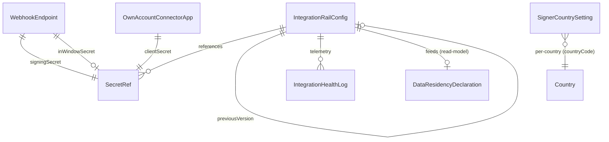

---

## 8. User Stories + Acceptance Criteria

**US-1 — A secret can never be read back.**
- **Given** the payment rail is configured, **When** I open its config, **Then** the secret key and webhook signing secret display only as `****1234` and the values are absent from the response body.
- **Given** I edit the publishable key only and leave the secret-key field blank, **When** I save, **Then** the secret key is unchanged and no secret is re-sent.

**US-2 — Rotate a key without downtime.**
- **Given** the live payment secret key, **When** I stage a new key and run the test, **Then** activation occurs only on PASS, the old key is flagged for deletion after the 24h window, and the audit records the rotation with operator + timestamp and **no value**.
- **Given** the staged key fails the test, **When** I attempt to promote it, **Then** promotion is blocked, the live key remains active, and a human error explains the failure.

**US-3 — TEST→LIVE is deliberate and audited.**
- **Given** the payment rail is in TEST, **When** I switch to LIVE, **Then** I must pass an explicit confirmation and the mode change is audited; **When** I view the rail, **Then** LIVE is visible at a glance.

**US-4 — A broken rail is caught before a firm notices.**
- **Given** the SES identity has lapsed, **When** real Doer-call telemetry records repeated send failures crossing the threshold, **Then** the email rail shows Degraded with the last error and a ping button and a Notification is raised — without any firm filing a ticket.
- **Given** I ping a healthy storage rail, **When** the put/get/delete round-trip succeeds, **Then** the rail shows Active with an updated last-success time.

**US-5 — Per-country Signer settings make signatures defensible.**
- **Given** I set Canada's consent text and certificate, **When** a firm sends a new Canadian retainer envelope, **Then** it uses the updated text/certificate, the change is audited, and **no third-party e-sign vendor is involved** (artifacts in the firm's own storage).
- **Given** a document was signed under the prior consent version, **When** I edit the consent text, **Then** the signed artifact keeps its signed-under version.

**US-6 — Residency is provable.**
- **Given** the bucket region is Canadian and the Signer is in-house, **When** I view the residency declaration, **Then** the storage and e-sign rows show Canadian with the actual region (generated, not hand-typed), and any Non-Canadian-without-safeguard rail is flagged.

**US-7 — Storage round-trip gates activation.**
- **Given** I enter a typo'd bucket, **When** I run the test, **Then** the round-trip fails, the config does not activate, and the previous working config keeps serving uploads.

**US-8 — Webhook secret rotates without dropping events.**
- **Given** an in-flight stream of payment webhooks, **When** I rotate the signing secret, **Then** during the verify window both old and new signatures are accepted, no event fails verification, and after the window the old secret is deprecated.

**US-9 — Connector is optional, Doer never breaks.**
- **Given** no firm has connected its calendar and the connector app is disabled, **When** a firm books via the Scheduler, **Then** the Scheduler works fully self-contained with no error.
- **Given** a firm has connected its mailbox, **When** its OAuth refresh token is persisted, **Then** it is stored `firm_id`-scoped and encrypted under the per-firm operational DEK (Doc 1 §7.1), never at platform level and never under the per-subject codec.

**US-10 — Swapping an adapter needs no deploy.**
- **Given** the email rail is on `ses`, **When** I switch its `adapterKey` to `smtp` via config and the test passes, **Then** sends route through SMTP with no code deploy (Doc 1 §6.3.4 RL-A3).

**US-11 — The domain/cert rail is a first-class, declared rail.**
- **Given** I configure the `DomainRailPort` with the `acm` adapter, **When** I run the cert-status test and it passes, **Then** the rail activates, its region feeds the residency declaration, and its sub-processor row appears in the Doc 1 §7.7 matrix (BR-16).

---

## 9. Edge Cases & Validations

- **Secret left blank on edit** → "leave unchanged"; only a non-blank value rotates it (SA-8-2).
- **Decrypt failure at point of use** → hard error + Degraded + Notification; never use ciphertext as a credential (BR-15).
- **Config validates but the rail later fails in production** → real Doer-call telemetry flips it to Degraded even though the synthetic test was green (§3.6/§3.7).
- **`nonSecretConfigJson` does not match the (railType, adapterKey) schema** → save rejected before any secret is written (SA-8-6).
- **TEST→LIVE confirmed by mistake** → rollback to the prior TEST version with justification; mode revert audited (BR-6/BR-12).
- **Rotation window too short / adapter still holds old secret** → the `PENDING_DELETION` secret is still resolvable until the window elapses (BR-4); window is a tunable PlatformSetting.
- **Webhook arrives signed with the old secret mid-rotation** → accepted during the verify window; after the window, rejected and counted as a failure (BR-4/SA-8-29).
- **Webhook arrives with no resolvable `externalEventId`** → rejected, dead-lettered, alarmed — never deduped on a business id (Doc 1 §6.1.4).
- **Per-country override points to a region the provider doesn't support** → validation rejects before save with a clear message.
- **Suspended country with existing artifacts** → artifacts remain accessible via the historical region; no new writes routed there (BR-9).
- **Rollback to a config whose secret was already deleted** → blocked: "this version's secret has been deleted; re-enter the credential" (BR-12).
- **S3-compatible/local-dev endpoint (MinIO)** → `forcePathStyle` honoured; the declaration marks non-AWS endpoints explicitly.
- **Two operators edit the same rail concurrently** → optimistic version check; the second save is rejected with "config changed since you loaded it."
- **Firm relay override present but invalid** → Mailer falls back to the platform default; the firm's override is flagged Degraded in the firm's own settings, not platform-wide.
- **Plan lacks the `feature.sms` entitlement but the gateway is configured** → send refused at the entitlement gate (SA-3 `CommercialFeatureCatalog` / SA-12), not at the rail (BR-13).
- **Connector OAuth refresh token persisted under the wrong key path** → a code scan asserts firm-scoped OAuth tokens route through the per-firm operational DEK (Doc 1 §7.1), never the per-subject field codec (Doc 1 §7.2) and never platform-level (SA-8-23).
- **A rail configured but missing from the Doc 1 §7.7 sub-processor matrix** → drift-check fails (Doc 1 AC-7.7.2); release blocked until the matrix row is added (BR-16).
- **Any secret appears in a log/health/audit payload** → a defect; secrets are redacted at the serialization boundary, asserted by a CI scanner (BR-3 / Doc 1 §7).

---

## 10. Permissions (GLOBAL `system/*`)

> All SA-8 permissions are **GLOBAL** (`system/*`, super-admin operators only — Doc 1 §4.1); no `agent/*` or `portal/*` (LOCAL) permission grants any SA-8 access. Reads return secrets **always masked** (SA-8-2/BR-2). GLOBAL `system/*` keys are `.view.own`/`.view.all` qualifier-N/A (no intra-firm ownership on the platform plane); each key below is reconciled by the Doc 1 §4.4 CI completeness check against this module's delivered routes.

| Permission key | Description |
|---|---|
| `system/integration:view` | View rail configuration (secrets always masked) |
| `system/integration:manage` | Create/edit rail selection, non-secret config, and credentials |
| `system/integration:test` | Run a connectivity test / ping |
| `system/integration:rotate-secret` | Stage/promote a secret rotation |
| `system/integration:mode-switch` | Switch payment TEST↔LIVE (gated, audited) |
| `system/integration:health-view` | View the Integration Health board |
| `system/integration:webhook-manage` | Manage the webhook endpoint registry |
| `system/integration:rollback` | Roll back a rail config to a prior version |
| `system/signer-settings:view` | View Signer per-country settings |
| `system/signer-settings:manage` | Edit Signer per-country consent/certificate/evidence/expiry |
| `system/connector-app:manage` | Configure the optional own-account OAuth connector app |
| `system/residency:view` | View the data-residency declaration (also surfaced in SA-11) |

**Separation of duties.** `view`/`health-view` (read, masked) are separable from `manage`/`rotate-secret`/`mode-switch` (write/dangerous) so a read-only auditor or Support Agent sees status without ever reaching a credential; `mode-switch` and `rotate-secret` may be reserved for senior operators. These keys are seeded into the catalog per Doc 1 §4.4 and CI-validated (every `@RequirePermissions` string exists in the catalog; every key wired to ≥1 route).

---

## 11. Scalability · Security · Performance

**Security (this module's whole point).**
- **Encrypt-all, KMS-backed, write-only, mask-on-read** (Doc 1 §7.1 / BR-2) is the central control: secrets in Secrets Manager, the DB holds references + last-4, no secret ever in a response/log/audit (BR-3). Firm-scoped connector OAuth tokens use the per-firm operational DEK path (Doc 1 §7.1), distinct from the per-subject PII codec (Doc 1 §7.2).
- **Least privilege everywhere:** IAM-role storage and domain/cert access is the target (no long-lived keys); OAuth connector scopes are minimal; the three IdP pools are walled with distinct signing keys (Doc 1 §3.3); SA-8 permissions separate read-masked from write-dangerous (§10).
- **Safe rotation** (BR-4): staged→tested→promoted→deprecated, with webhook dual-accept windows so security maintenance never causes an outage or a dropped financial event.
- **Tamper-evident audit** (BR-3): every change audited through the per-firm hash-chained, INSERT-only spine of Doc 1 §7.5 with secrets redacted.
- **Confirmation gates** on the two highest-blast-radius actions: payment TEST→LIVE (BR-6) and rail-disable.
- **No third-party-product attack surface** (BR-1): the only external surfaces are commodity rails (behind ports, all declared in the Doc 1 §7.7 sub-processor matrix per BR-16) and the firm's opt-in account connector.

**Scalability.**
- **Global-by-construction overrides** (§3.9): firm→country→platform resolution (the country dimension keyed on the canonical `countryCode`) and the per-tenant region seam (Doc 1 §1.7) mean a multi-country, multi-region platform needs no code change; single-region Canada is the degenerate case.
- **Stateless config reads:** adapters resolve config + secret reference and cache the constructed client (Doc 1 §6.3.2), invalidating on config change — per-call overhead is a cache hit, not a DB+KMS round-trip.
- **Bounded, async telemetry:** `IntegrationHealthLog` is written off the hot path (§3.7) and aged out; the board reads pre-aggregated rollups, not live scans.

**Performance.**
- **Secret fetch cached at point of use** with a short TTL and rotation-invalidation, so Secrets-Manager/KMS calls are amortized, not per-request.
- **Connectivity tests are on-demand or scheduled**, never inline with user traffic.
- **Config writes are rare and small** — versioned rows, no large payloads; the cost center is correctness and audit, not throughput. SA-8 reads/writes sit comfortably inside the Doc 1 §NFR latency budgets.

---

## 12. Reference Note (honest: exists / NEW / CHANGED)

> Greenfield build (Doc 1 §1.8): the reference prototype is design-provenance only and is not a parity obligation. This note is informational.

**EXISTS as design provenance (reference prototype, `src/integration` / `src/storage`):** platform rail config as four separate models with a `GLOBAL`/`LOCAL` scope — `Bucket` (S3), `SmtpSettings`, `PaymentSettings` (vendor payment), `MailRecieveSettings` (IMAP); a system controller exposing storage/SMTP/payment config with an audit decorator already applied; an SMTP connectivity test; an S3 client that reads credentials directly and caches with a clear-cache hook (S3-compatible `endpoint`/`forcePathStyle` for MinIO). **Provenance defects the target state eliminates:** the prototype stores the payment secret key and webhook secret **in plaintext** and returns them on read; S3 access/secret keys **in plaintext**; SMTP secrets encrypted but **echoed to the client on read**; a decrypt path that **silently returns ciphertext on failure**; app-key symmetric encryption rather than KMS; and vendor-named persisted entities rather than rail-neutral ones (the target uses ports + `adapterKey`, and SA-4 holds the rail-neutral `RailInvoice`/`RailWebhookEvent` consumers).

**NEW (build to target state):**
- The entire **secret-management spine** on KMS/Secrets Manager (Doc 1 §7.1): `SecretRef` (reference + last-4, no value), write-only inputs, mask-on-read, staged-tested-promoted rotation with deprecation window; firm-scoped connector OAuth tokens on the per-firm operational DEK path.
- The **per-railType discriminated config schema** (§3.2) replacing a single untyped blob (closes the gap-analysis item).
- The **Doer→IntegrationHealthLog telemetry contract** (§3.7) — async sink at the port boundary, with explicit **Degraded thresholds** (closes the gap-analysis items).
- **Connectivity test for storage and payment** (only SMTP existed in provenance); the **Integration Health board** + Degraded alerting + SA-9 surface.
- **Signer per-country platform settings** (`SignerCountrySetting`) — in-house e-sign, no third-party provider.
- **SMS/WhatsApp gateway rail**, **IdP rail** (three walled pools, distinct signing keys, MFA assertion), and the **`DomainRailPort` domain/cert rail** (v1 `acm`) as first-class SA-8 config.
- **Optional own-mailbox/calendar connector** OAuth-app config; per-firm tokens in the firm tenant under the operational DEK.
- **Webhook endpoint registry** with signature verification + dual-accept rotation, keyed to the Doc 1 §6.1.4 rail-originated contract.
- **Per-country/per-tenant overrides** (country keyed on `countryCode`) and the generated **`DataResidencyDeclaration`** (shared with SA-11).
- **Versioned config + rollback** with justification.

**CHANGED relative to provenance:** the four separate settings models fold into one **`IntegrationRailConfig` + `SecretRef`** acting as the Doc 1 §6.3.2 runtime adapter selector; the audit decorator generalises to every rail with **secret redaction**; the `GLOBAL`/`LOCAL` scope generalises to `GLOBAL | COUNTRY | FIRM`; the country dimension keys on `countryCode` (the one canonical join key); all `view`/`list` endpoints return **masked** secrets; vendor-named entities are replaced by ports + `adapterKey` plus SA-4's rail-neutral consumers.

---

## 13. Open Questions / [FOUNDER-CONFIRM]

1. **[FOUNDER-CONFIRM] Cross-region physical routing — Day-1 or roadmap?** The override *mechanism* and *declaration* (§3.9) are in scope now. Is per-country *physical* routing to dedicated regional clusters (e.g. Australia-entitled firms' data in `ap-southeast-2`) a Day-1 commitment or a later wave? *(Assumption: single-region Canada at launch with the declaration surfaced; the region seam of Doc 1 §1.7 makes adding a region config, not code.)*
2. **[FOUNDER-CONFIRM] Secret store concrete choice.** Doc 1 §7.1 names KMS/Secrets Manager; confirm AWS Secrets Manager specifically (vs KMS-encrypted columns / Vault). Affects rotation tooling and cost. *(Assumption: AWS Secrets Manager, given the AWS stack.)*
3. **[FOUNDER-CONFIRM] Storage credential mode.** Mandate IAM-role in production, or keep the access-key fallback for non-AWS/dev only? *(Assumption: IAM-role preferred; access-key allowed but flagged lower-security.)*
4. **[FOUNDER-CONFIRM / counsel] Signer legal content.** The per-country consent text and certificate template are legal artifacts (UECA/PIPEDA, Quebec Law-25 French requirement). Does ER ship a counsel-reviewed default per country, and may a firm override locally, or is it platform-fixed? SA-8 owns the *mechanism*; the *content* is the founder's deferred Country-Pack deliverable.
5. **[FOUNDER-CONFIRM] Degraded thresholds + rotation window defaults.** Confirm `degradedFailureCount`, `degradedErrorRatePct`, and the old-secret deprecation window. *(Assumptions in §3.7/§3.1: 5 hard failures in 10 min OR 20% error rate over 24h with ≥20-call minimum; 24h window — all tunable PlatformSettings.)*
6. **[FOUNDER-CONFIRM] Rail vendor selection + payment-rail connected-account terms.** Engineering defaults are the v1 adapters of Doc 1 §6.3.1 (payment / AWS SES+SMTP / S3 / SNS+WhatsApp BSP / in-house IdP) plus AWS ACM for the `DomainRailPort` sixth rail. Confirm the connected-account onboarding model (Standard/Express/Custom) and whether the platform takes an application fee on client→firm payments. *(Persisted entities remain rail-neutral per ADR C4-D1; the vendor is the adapter, not the schema.)*
7. **[FOUNDER-CONFIRM] Per-firm email relay overrides.** Keep firm-level relay overrides (BR-10) or centralise all sending on the platform relay for deliverability/compliance control? *(Assumption: keep firm override with platform fallback.)*
8. **[FOUNDER-CONFIRM] Webhook dual-accept window length.** Confirm the window during which both old and new webhook signatures are honoured (longer = safer rotation, shorter = smaller replay surface).
9. **[FOUNDER-CONFIRM] `DomainRailPort` v1 scope.** Confirm the sixth rail (custom-domain / TLS via AWS ACM) is in v1 scope as documented (§3.0, BR-16, SA-8-20a) rather than deferred. *(Assumption: in v1 as a documented rail folded under the same port doctrine + §7.7 matrix.)*

*End of module SA-8.*

---

# Module SA-9: Analytics & Observability

> **Plane:** Super-Admin console (**GLOBAL**). This is the **one and only place** cross-tenant aggregate metrics are permitted to exist — every other plane is tenant-isolated by Doc 1's FORCED RLS. **Tenant key at the source:** `firm_id` (RLS-enforced per Doc 1 §2.2). **Permission scope:** `system/*` (GLOBAL) only (Doc 1 §4.1) — never assignable to firm staff. **Money:** every figure rolls up to one platform reporting currency via the single `FxRateService` / `FxRateSnapshot` (Doc 1 §6.5; canonical fields `baseCurrency`/`quoteCurrency`/`asOf`/`economicMoment`, ADR C4-D3); mixed currencies are never raw-summed. **Observability:** system health is read from the platform's instrumentation (OpenTelemetry → CloudWatch / Managed Prometheus per Doc 1 §8.4), never hand-entered. **Builds on Doc 1, does not re-spec it.**

This module specifies the **machinery** of platform analytics and the surfacing of observability — the read-model pipeline, the metric/dashboard/alert builders, the de-identified read-models, and the **`FeatureUsageEvent` producer contract**. It does NOT author the immigration content the metrics describe (program taxonomies, CRS bands) — that is the founder's deferred Country-Pack deliverable; such items are marked **[FOUNDER-CONFIRM]**.

---

## Module Index

1. Purpose & Goal
2. Users & Jobs-to-be-Done
3. Functional Design — How It Works (core)
4. Detailed Functional Requirements (SA-9-n)
5. Business Rules & Logic
6. States & Lifecycle
7. Key Entities & Fields (+ ERD)
8. User Stories + Acceptance Criteria (G/W/T)
9. Edge Cases & Validations
10. Permissions (GLOBAL `system/*`)
11. Scalability · Security · Performance
12. Reference Note (exists / NEW / changed)
13. Open Questions / [FOUNDER-CONFIRM]

---

## 1. Purpose & Goal

**What it is.** SA-9 is the **instrument panel for the business of ExpatReady itself** — the single console where the internal team sees how the *platform* performs: how many firms pay, how fast the base grows or churns, recurring revenue (in which currencies and destination countries), which capabilities firms actually adopt, and whether the system underneath is healthy. Where every other module answers "how is this one firm doing?", SA-9 answers "how is the whole platform doing?" — aggregated, de-identified, and fast.

**Business outcome.** A SaaS company that cannot see its own MRR, churn, activation, and infrastructure health flies blind. SA-9 makes "the team always knows the true state of the business and the system" structurally true: the commercial truth (MRR/ARR/ARPU, plan mix, trial conversion, churn, revenue by country) and the operational truth (queue backlogs, error rates, latency, storage burn) are both one screen away, refreshed automatically, with **alerts that fire before a problem becomes a fire**. Secondary outcomes: product prioritisation grounded in real adoption, country-expansion decisions grounded in real demand, and capacity planning grounded in real usage curves.

**World-class positioning.** This is not a generic admin-stats page. Three things make it specific to this platform: (a) it is **cross-tenant by design but PII-safe by construction** — the only place aggregate cross-tenant numbers may exist, reached through **de-identified read-models**, never by querying into firms' confidential records; (b) it is **multi-country and multi-currency native** — every metric is segmentable by destination country, and every money figure is FX-normalised to one reporting currency via Doc 1's `FxRateSnapshot`, never naively summed across CAD/AUD/GBP; and (c) it **fuses business analytics with system observability in one console**, because for a lean team operating a regulated multi-tenant SaaS, "is revenue growing?" and "is the automation queue stuck?" are equally existential.

**How it sits on the platform.** SA-9 is a *consumer*, not a producer of business state. It feeds from **SA-4** (billing/subscriptions → MRR/ARR/churn/dunning, with price sourced from SA-4's `PlanPrice`, the sole owner of price/currency/interval/rail refs), **SA-2** (tenants/entitlements → firm counts, status mix, per-country entitlement), **SA-3** (plans → distribution, ARPU by plan, entitlement dimensions only — caps/features/countries/roles/status/visibility), **SA-10** (support → ticket volume and response/resolution times), **SA-12** (feature flags → the operational `FeatureFlag` registry for the adoption heatmap, which references SA-3's `CommercialFeatureCatalog` feature keys), and **every product module's usage signals** (CRM prospects, eligibility assessments, cases, documents, automations). System health reads from the architecture's observability layer (Doc 1 §8.4) and the BullMQ queues (Doc 1 §1.4). SA-9 owns no business process — it owns the *truthful aggregate picture* of all the others, plus the alerts and exports on top.

**Global ambition.** The same module serves a Canada-only launch and a future Canada + Australia + UK platform with no code change: single-country / single-currency is the degenerate case. Country comes from firms' entitlements; money rolls up through `FxRateSnapshot`; per-country breakouts are first-class everywhere — consistent with Doc 1's per-tenant region seam (§8.7). The canonical country join key is `countryCode` (ISO; `Country.id == countryCode`, Doc 1 §5.8), used on every spine row and on every SA-9 read-model dimension.

---

## 2. Users & Jobs-to-be-Done

"Super-Admin" is an umbrella; SA-9 is read very differently by each internal sub-role. **Every user here is an internal ExpatReady operator on the platform (Super-Admin) auth pool (Doc 1 §3.1) — no firm user or end-client ever sees this module.**

| Sub-Role | Primary job in SA-9 | Jobs-to-be-done (representative) |
|---|---|---|
| **Platform Owner / Founder** (heaviest business-view user) | Own the commercial & operational truth of the whole platform. | "Start my week with MRR, ARR, net-new vs churned firms, and plan mix on one screen — state of the business in 30 seconds." · "Decide on a second country from real demand — entitled firms, assessments run, cases opened per country — not a hunch." · "When something is off, compare this period to last and drill by plan/country without ever exposing any one firm's confidential data." |
| **Billing Admin** | Own SaaS revenue health; catch leakage. | "MRR/ARR/ARPU, revenue by plan and by country, trial-conversion and churn — in one reporting currency so mixed-currency deals don't distort the picture." · "See dunning/churn immediately so I prioritise high-value outreach." |
| **Tenant Account Manager** | Keep the tenant base healthy and growing. | "New-vs-active-vs-churned firms over a rolling 12 months, and which plans/countries drive signups, so I focus onboarding where it converts." · "Adoption signals on a non-activating cohort so I intervene before churn." |
| **Country / Content Manager** | Prioritise content effort by real impact. | "Per-country adoption — entitled firms, active cases by program, assessments run, top streams — so I invest in the highest-impact country, not the loudest one." |
| **Platform Engineer / DevOps** | Keep the system up and queues moving. | "Live queue depth, job-failure rate, API 5xx/p95 latency, storage burn — catch a stuck automation queue before firm users feel it." · "Define thresholds that page me automatically." |
| **Support Agent** | Light read of support-volume signals. | "Open-ticket count and average first-response / resolution time so I know where the queue stands." (Owns SA-10; consumes SA-9's support tiles.) |

**Design implication.** The **Platform Owner is the protagonist** of the business dashboard (default landing: MRR, growth, churn, plan/country mix); the **Platform Engineer is the protagonist** of the observability dashboard (queues, errors, latency, storage). Role-scoped dashboards (§3.6) and finely-separated `system/*` permissions (§10) cleanly wall these so a Country Manager does not see raw revenue and a Support Agent does not see infrastructure indicators — enforced server-side, not by client hiding.

---

## 3. Functional Design — How It Works (core)

#### 3.0 The read-model principle — analytics is a separate plane that never scans live tenant tables

**Design decision (the foundation everything sits on): SA-9 reads pre-computed, de-identified read-models — it never runs a cross-tenant query against live operational tables.** This makes platform analytics simultaneously fast, safe, and honest about scale:

1. **Tenant isolation holds.** Every operational table is FORCED-RLS-isolated by `firm_id` (Doc 1 §2.2). A "platform-wide" query that bypassed RLS to sum across firms is exactly the cross-tenant access PIPEDA and the platform doctrine forbid. SA-9 sidesteps it entirely: aggregation happens *outside* the tenant-scoped read path, into read-models holding **only aggregate, de-identified numbers** (counts, sums, rates) — never a firm's client names, case details, or document contents. The aggregate is GLOBAL-plane; the underlying PII never leaves the local plane.
2. **It scales to many tenants × many records.** Computing MRR or "assessments run this month" by scanning every invoice / assessment across every tenant on each dashboard load is O(all-data) and collapses as the platform grows. Read-models are computed once, asynchronously (incrementally on dictionary events + a scheduled backstop), and read in O(rows-on-screen).
3. **It is reproducible.** A revenue figure shown today must not silently change tomorrow because FX moved. Read-models are snapshotted with the `fxSnapshotId` and as-of date baked in (Doc 1 §6.5), so a past month's MRR is identical whenever viewed.

**The one sanctioned exception, and what it is NOT.** When an operator must look *inside* a specific firm (to investigate anomalous numbers), that is **not** a drill-through from a chart into the firm's PII — it is a separate, **audited impersonation** session (SA-2), with a mandatory reason, time limit, and immutable audit trail. The console may deep-link to "open impersonation for this firm" (routing through SA-2's controls), but **there is no path from a chart to a firm's confidential records that is not an explicit, audited impersonation.**

#### 3.1 Business metrics — tenants & growth

**How it works.** Tenant base is computed from SA-2 firm records and SA-4 subscription status, never by counting raw rows live. Core tiles: **total firms by status** (TRIAL / ACTIVE / SUSPENDED / OFFBOARDED — the SA-2 lifecycle); **net-new this period** (entered TRIAL or ACTIVE in the window); **churned this period** (OFFBOARDED or subscription moved to CANCELED — BR-3); **growth chart** (rolling 12-month, configurable, trend of new/active/churned).

**World-class behaviour.** Status is sourced from the system of record consistently — "active firm" = SA-2 status ACTIVE *and* a non-cancelled subscription (BR-1), so the analytics number reconciles exactly with SA-4. Growth shows monthly **cohorts** with their later survival ("of the 10 added in January, 8 are still active"), not just totals. Every growth number is segmentable by plan and by destination-country entitlement (keyed on `countryCode`).

**Key screens.** *Tenant overview* (status tiles + net-new + churned), *Growth chart* (12-month new/active/churned with plan/country filters), *Cohort view* (signup-month cohorts with retention curve).

**Data flow.** Firm-lifecycle and subscription-status domain events from SA-2 / SA-4 (canonical names from Doc 1's event dictionary §6.1) → aggregation pipeline updates the `MetricSnapshot` tenant-count cells (per status/plan/country/day) → dashboard reads snapshots; the daily reconcile heals anything a missed event left stale (BR-13).

#### 3.2 Business metrics — revenue (MRR / ARR / ARPU, multi-currency, per-country)

**How it works.** Revenue derives from SA-4's active subscriptions and recorded invoices, not re-invented. A subscription's price comes from SA-4's `PlanPrice` (the sole owner of price/currency/interval/rail refs, per ADR C4-D2/D3) — SA-9 never re-derives price from an SA-3 plan, which now carries entitlement dimensions only. **MRR** = sum of each active subscription's price normalised to a monthly amount (ANNUAL ÷ 12), each converted to the platform reporting currency via an `FxRateSnapshot`, then summed — normalisation and conversion happen *before* the sum (BR-2/4). **ARR** = MRR × 12. **ARPU** = MRR ÷ active-firm count. **Revenue collected** (paid `RailInvoice` rows in the window, FX-normalised) is a distinct tile from MRR so recurring and cash are never conflated.

**Multi-currency by construction (never sum raw — Doc 1 §6.5).** Each firm pays in its plan-price currency. SA-9 never sums mixed currencies: a platform `reportingCurrency` is configured; each monthly-normalised value is converted via an `FxRateSnapshot` whose canonical fields (`baseCurrency`/`quoteCurrency`/`asOf`/`economicMoment`, Doc 1 §6.5 / ADR C4-D3) are stamped, so a March report does not move when today's FX moves (BR-12); the original currency/amount is always available on drill-down; a **missing rate** surfaces a clear "rate unavailable — excluded from total" note (BR-5, Doc 1 §6.5.3), never a raw sum and never a silent zero. **SA-9 reads `fxSnapshotId` and resolves figures through the `FxRateService` — it is not an FX writer** (Doc 1's single-writer rule, §6.5).

**Per-country revenue (a global-platform headline).** Revenue broken out by destination-country entitlement (keyed on `countryCode`): MRR from Canada-only firms vs firms with additional countries — the ROI signal on each Country Pack. A multi-country firm is attributed once per the documented policy (BR-6) to avoid double-counting.

**World-class behaviour.** Reconciles with SA-4 (same subscription / `PlanPrice` / `RailInvoice` records). Recurring vs collected are distinct. Period-over-period MRR is decomposed into a **new / expansion / contraction / churned bridge** — the SaaS-grade MRR bridge, not a single net number.

**Key screens.** *Revenue dashboard* (MRR/ARR/ARPU tiles + MRR-bridge waterfall + revenue-collected, reporting-currency disclosure), *Revenue by plan*, *Revenue by country* (Canada-only vs multi-country split), *MRR trend* (12-month).

**Data flow.** Subscription create/upgrade/downgrade/cancel and payment-succeeded events (SA-4, dictionary names per Doc 1 §6.1) → pipeline recomputes affected MRR cells (plan/country/currency/day), applying ANNUAL→monthly normalisation and FX conversion via the stamped snapshot → `MetricSnapshot` stores both the converted reporting-currency figure and the original-currency facet + `fxSnapshotId` → dashboard reads snapshots; the bridge reads the new/expansion/contraction/churned deltas.

#### 3.3 Business metrics — plan distribution, trial conversion & churn

**How it works.** **Plan distribution** — active firms per plan and each plan's MRR contribution (SA-3 entitlement dimensions + SA-4 `PlanPrice`/subscription), so the team sees both *how many* firms are on a plan and *how much* revenue it carries. **Trial conversion** — of firms that started a TRIAL in a cohort window, the proportion that converted to a paid ACTIVE subscription before trial expiry. **Churn (monthly)** — firms lost ÷ firms at start of month (logo churn), with **revenue churn** (MRR lost) alongside (BR-3).

**World-class behaviour.** Two churn lenses (logo + revenue) plus **net revenue retention** = (expansion − contraction − churned MRR) / starting MRR — the metric that says whether the existing base grows on its own. Trial conversion is measured per cohort with the trial window respected. Plan mix is trended so a drift toward cheaper plans (a margin risk) is visible early.

**Key screens.** *Plan distribution* (firms-per-plan + MRR-per-plan), *Trial funnel* (started → converted → expired), *Churn view* (logo + revenue churn + NRR, trended).

**Data flow.** Plan/subscription events (SA-3 / SA-4) → pipeline updates plan-distribution and churn snapshots; trial conversion reads the trial-cohort buckets (started/converted/expired) maintained by the pipeline.

#### 3.4 Product-usage metrics — what firms actually do with the product, per country

**How it works.** Usage is captured two ways, both aggregated by SA-9:
- **Module-activity counters** — platform-wide and per-firm totals of the verbs that matter: assessments run, prospects/leads created, cases opened, questionnaires/SQRs sent, documents uploaded, emails/messages sent, automations triggered. Aggregated from the owning modules' usage signals into per-firm/per-country/per-day rollups.
- **Feature-adoption events (`FeatureUsageEvent`)** — a lightweight, **de-identified** event emitted when a firm/user first (and subsequently) uses a **plan-gated feature**, keyed by the **shared `feature.*` key** that is owned and registered by SA-3's `CommercialFeatureCatalog` (the single registry of `feature.*` keys, R4) and referenced by SA-12's operational `FeatureFlag`. Adoption is therefore the *commercial* feature key (SA-3 entitlement), resolved against BOTH the SA-3 `CommercialFeatureCatalog` entitlement and any SA-12 `FeatureFlag` gating that same key — never "the SA-12 catalogue" alone. This powers the adoption heatmap **without storing what the firm actually did inside the feature** (§7, the producer contract).

> **Note — three distinct "flag" concepts, disambiguated (R5).** The `feature.*` key SA-9 uses here is the **commercial entitlement** key, owned by SA-3's `CommercialFeatureCatalog` (§3.3 in SA-3). It is distinct from (a) SA-1's `ConditionFlagDefinition` — content-neutral immigration condition flags resolved per case into `ComboFlagValue` (CLIENT-PII; SA-1 §3.8); and (b) SA-12's operational `FeatureFlag` — an operational on/off keyed `flag.*` / `ops.*` for operational-only flags, which **references** an existing SA-3 `featureKey` when it gates a commercial capability (SA-12 §3.1). Entitlement and operational flag are AND-composed, entitlement-first (canonical guards `@RequireEntitlement` for the SA-3 check, `@RequireFlag` for the SA-12 check). SA-9 measures adoption of the *commercial* feature key.

**Monthly Active Users (MAU)** — distinct staff users who authenticated in the trailing 30 days, across all tenants, surfaced as a de-identified count (underlying identities never surfaced cross-tenant), with a per-firm "active users vs plan limit" drill mirroring SA-2's health view.

**Feature-adoption heatmap** — per plan-gated feature, the number of firms and users who used it in the trailing window, ranked, so the team sees underused features (build-vs-kill signal) and high-value features (the moat). Segmentable by plan (does the feature justify its tier?) and by country.

**Per-country usage (global-platform headline).** Every counter rolls up per destination country (keyed on `countryCode`): entitled firms, active cases by program type, assessments run for that country's programs, most-used streams, and an **aggregate, anonymised CRS-band distribution** (e.g. "X% of assessments fall in the 470–500 band" — never an individual's score), subject to a small-cohort suppression floor (BR-16). **The taxonomy and band cut-offs are immigration content [FOUNDER-CONFIRM]; SA-9 builds only the rollup machinery.**

**World-class behaviour.** Adoption answers the product question directly — not "how many clicks" but "how many *firms* derive value from feature F." Privacy-preserving by construction (BR-9): SA-9 stores *that* an assessment ran and *which band it fell in*, never *whose* or its inputs. Per-country and per-plan everywhere.

**Key screens.** *Usage overview* (module-activity tiles + MAU), *Feature-adoption heatmap*, *Per-country usage dashboard*, *Per-firm usage drill* (aggregate counts only, no PII).

**Data flow.** Modules emit usage signals and (for gated features) `FeatureUsageEvent` rows → pipeline builds per-firm/per-feature/per-country/per-day rollups (`FeatureUsageRollup`, usage `MetricSnapshot`s) → dashboards read rollups; MAU reads the trailing-30-day distinct-auth count from auth events; CRS-band distribution reads anonymised band buckets emitted by the eligibility module.

#### 3.5 System health & observability — is the system underneath actually healthy

**How it works.** System-health metrics are **read from the platform's observability layer (Doc 1 §8.4) — never hand-entered and never computed by scanning the app DB.** Per Doc 1 §8.4, instrumentation is OpenTelemetry → CloudWatch / Managed Prometheus + Grafana; SA-9 reads through a thin **health-query adapter** so the dashboard is decoupled from the specific backend.
- **API health** — current error rate (5xx / total, against Doc 1 P9), median + p95 latency (against Doc 1 P1/P2), throughput — from the metrics backend's RED signals.
- **Queue health** — per BullMQ queue (the real ones: email, PDF/document, automation/workflow, reminder, booking-reminder per Doc 1 §1.4) — depth (waiting + delayed), active, completed/failed in 24h, job-failure rate — read via queue job-counts and the §8.4 queue-depth signal. This catches a stuck automation before firm users feel it.
- **Uptime** — service availability from the §8.3 liveness/readiness health endpoints / uptime monitor (against AV1 ≥ 99.9%).
- **DB / cache health** — RDS connection-pool utilisation, replica lag, slow-query signal; Redis memory/eviction — read-only indicators from the metrics backend.
- **Storage health** — total platform storage across all tenants (aggregate of per-firm storage from SA-2), with a threshold-approaching alert.

> **Note (realtime push is out of foundation scope, Doc 1 §8.2).** Doc 1 explicitly excludes a server-pushed realtime gateway from the foundation; the foundation polls. SA-9 therefore does **not** depend on, or surface, "active WebSocket connections" as a launch metric — health dashboards refresh by short-cached poll, and any future realtime-connection metric is added when the realtime wave lands. This corrects the earlier draft's WS-connections tile.

**World-class behaviour.** One pane for business + ops. Decoupled from the backend (swap CloudWatch ↔ Prometheus is an adapter change). Where instrumentation is **not yet wired**, the dashboard shows an honest **"metric not yet instrumented"** state, never a fake zero (BR-11) — Doc 1 §8.4 wires OTel/Pino/Sentry, but a metric whose specific exporter is pending must say so. Thresholds become alerts (§3.8).

**Key screens.** *System-health dashboard* (API tiles: error rate / p95 / throughput; queue table with depth/active/failed/failure-rate; uptime; DB/cache indicators; storage gauge), per-metric *"not yet instrumented"* state, inline *alert-threshold* affordance.

**Data flow.** Observability layer (OTel → CloudWatch/Prometheus, Doc 1 §8.4) and BullMQ queues expose metrics → health-query adapter polls/queries them on dashboard load (short cache ≤ 30s) → dashboard renders; the alert evaluator (§3.8) also reads the adapter on a schedule. **No system-health number is written by a human; none is computed by scanning operational tables.**

#### 3.6 The dashboards (Owner vs role-scoped)

**How it works.** A small set of purpose-built, role-scoped dashboards, each a composition of widgets bound to metric definitions: **Business Overview** (Owner/Billing — MRR/ARR/ARPU, MRR bridge, plan distribution, trial conversion, churn, growth — the default landing surface); **Growth & Tenants** (Account Manager); **Per-Country** (Country/Content Manager — the country oracle, no raw revenue); **Product Adoption** (Owner/Product — heatmap, module-activity, MAU); **System Health** (Engineer — the observability pane); **Support Volume** (Support/Owner — open tickets, response/resolution times from SA-10).

**World-class behaviour.** Role determines what's visible — **enforced server-side** (BR-14): a Country Manager's token cannot fetch revenue widgets; a Support Agent cannot fetch infrastructure indicators. Composition is filtered by the operator's `system/*` permissions; frontend hiding is a UX complement, not the gate. Every widget reads the shared read-models, so the same metric shows the same value everywhere and reconciles with the owning module. A **small curated set, not a build-your-own-BI tool** (library-first); a custom-widget builder is an explicit later phase (§13).

**Data flow.** Dashboard definition (widgets + metric bindings) + operator permissions → server returns only permitted widgets → each widget reads its metric from the read-models / health adapter → filters re-query snapshots/rollups, never raw rows.

#### 3.7 Trends, comparisons & date-range analytics

Every metric supports a **custom date range** (presets: this/last month, last 90 days, this quarter/year, trailing 12 months); **period-over-period comparison** (selected window vs prior equivalent, with delta and % on each tile); and **trend series** at snapshot granularity. Comparisons are first-class — each KPI carries its prior-period delta by default. Granularity adapts to range (90 days → daily; 12 months → monthly, rolled up from the daily series). Historical numbers are stable (snapshotted with FX baked in — BR-12). Periods are evaluated in the configured reporting timezone deterministically (BR-15). **Data flow:** range + comparison selection → query the relevant snapshot series (daily grain, aggregated to chart granularity) for both windows → deltas computed from the two sets; no raw-row scans.

#### 3.8 Alerts & thresholds — the dashboard pages before it becomes a fire

**How it works.** Operators attach **alert rules** to metrics: a rule watches a metric (email-queue depth, 5xx rate, storage used, churn rate, failed-payment count) with a threshold + direction, an evaluation window, and a severity. On breach the rule fires an `AlertEvent` and **notifies** via the platform Notification module (in-app + email; a webhook/pager channel is Phase-2 — §13), and surfaces a dashboard indicator. Rules support **cool-down / de-duplication** (BR-8) and **auto-resolve** when the metric returns within threshold.

**Seeded defaults (useful day one).** Email-queue depth > 500, any queue job-failure-rate > threshold, 5xx error rate > threshold (against Doc 1 P9), storage approaching capacity, and a churn/failed-payment spike for Billing — toggleable, lightly editable.

**Relationship to Doc 1 §8.4 alerting.** Doc 1's on-call alerting plane already pages on SLO breaches and on two compliance-integrity signals (audit hash-chain break; DSR/breach legal clocks). SA-9's alert engine is the **operator-configurable business-and-ops layer** on top of that infrastructure plane — it does NOT re-implement the audit-integrity or legal-clock alarms (those are owned by Doc 1 §8.4 / SA-11). SA-9 surfaces business thresholds (churn, MRR dip, failed payments) and the operational signals already exported (queue depth, 5xx, storage) as operator-defined rules.

**World-class behaviour.** Both ops and business alerts from one engine, audience-routed. De-duplicated and self-resolving (alert hygiene, not fatigue). Every rule create/edit and each firing writes to AuditLog (the platform audit spine, Doc 1 §7.5 — not redefined here).

**Data flow.** Alert evaluator runs on a schedule (and on metric-update events for fast signals) → reads read-models / health adapter → compares against thresholds with windowing + cool-down → on breach writes `AlertEvent` + fires a `notif/*` notification (Doc 1 §6.1.2 notification namespace) + sets the dashboard indicator; on recovery, auto-resolves.

#### 3.9 Export & scheduled digests

**CSV/XLSX export** of any analytics view (tiles + underlying snapshot series) for the selected range/filters — **separately permissioned** (`system/analytics:export`) from viewing; large exports run **async** via BullMQ (Doc 1 P7: any > 5s work is async, returns a job handle, UI polls), with a downloadable result. **Scheduled digest** — an optional recurring email (e.g. a Monday platform-state summary: MRR, net-new/churned, top alerts) to Owner/Billing, generated from the same read-models (Phase-2 — §13; on-demand export is launch).

**World-class behaviour.** Exports are aggregate-only and de-identified — same boundary as the screen (BR-9); exporting cross-tenant *PII* is impossible from SA-9 because it holds none. **Because SA-9 exports carry no cleartext PII, they do NOT emit a Doc 1 §7.2 `PII_REVEAL` audit** (that fail-closed reveal-audit applies to the unmasked per-individual export in SA-11 and the offboarding export in SA-2, which *do* concentrate a subject's Restricted PII — R25). SA-9 exports are audited as **data egress** (actor, filter, row-count, timestamp) via the platform audit spine.

#### 3.10 The aggregation pipeline — how the read-models stay correct, fresh, and cheap

The single engine behind §§3.1–3.9:
- **Incremental on events (fast path).** Domain events from owning modules — subscription change (SA-4), firm-status change (SA-2), plan change (SA-3), usage signal, `FeatureUsageEvent`, ticket change (SA-10) — update the touched snapshot/rollup cell **incrementally**, so common numbers are near-real-time. Events arrive via Doc 1's transport (§6.2): post-commit, at-least-once, on the Conductor bus / BullMQ.
- **Scheduled backstop (correctness path).** A daily (configurable) job **reconciles** snapshots against the source of truth — re-deriving MRR, counts, and rollups for the period — so a missed/out-of-order event can never leave a permanently wrong number (BR-13). Dashboards show a "metrics as of <timestamp>" freshness stamp.
- **FX normalisation** at aggregation time using the stamped `FxRateSnapshot` (Doc 1 §6.5, canonical fields `baseCurrency`/`quoteCurrency`/`asOf`/`economicMoment`); the converted figure and `fxSnapshotId` are stored on the snapshot (stable forever — BR-12).
- **De-identification at write time.** Read-model rows hold only aggregate numbers + dimension keys (firm_id/plan/`countryCode`/day) — **no PII columns exist on the read-models at all**, so the safe boundary is structural, not procedural (BR-9).

**World-class behaviour.** At-least-once events + idempotent aggregation (BR-7) keyed by the dictionary's idempotency key (Doc 1 §6.1.4) so a redelivered event never double-counts; the SA-9 aggregator reuses the per-firm processed-event ledger (Doc 1 §6.2.3) rather than inventing its own dedupe. **Backfill-able** — recompute any historical window from source (e.g. after deploying a new metric). **Cheap to read, bounded to compute** — O(rows-on-screen) reads, O(changed-cells) incremental, O(period) reconcile; never O(all-data) on a user request. Read-heavy aggregation runs on read replicas (Doc 1 §8.2 S3).

---

## 4. Detailed Functional Requirements (SA-9-n)

> Build-ready; each maps to acceptance criteria (§8). Money items obey BR-2/4/5; cross-tenant items obey BR-9.

**Tenant & growth**
- **SA-9-1** — Snapshot of total firms by status (TRIAL/ACTIVE/SUSPENDED/OFFBOARDED), net-new this period, churned this period — sourced from SA-2 status + SA-4 subscription state, read from read-models (not live scans).
- **SA-9-1a** — "Active firm" and "churned firm" use the single documented definitions (BR-1, BR-3) so figures reconcile exactly with SA-2 and SA-4.
- **SA-9-2** — Firm-growth chart: rolling 12-month (configurable) trend of new/active/churned firms.
- **SA-9-2a** — Signup cohorts with retention curve; growth segmentable by plan and country (`countryCode`).

**Revenue**
- **SA-9-3** — MRR and ARR from active subscriptions, with the subscription price read from SA-4's `PlanPrice` (the sole pricing owner) and ANNUAL→monthly normalisation (BR-4), refreshed at least daily.
- **SA-9-3a** — All money figures converted to a configured platform `reportingCurrency` via `FxRateSnapshot` (resolved through `FxRateService`, Doc 1 §6.5; canonical fields `baseCurrency`/`quoteCurrency`/`asOf`/`economicMoment`, ADR C4-D3); the system never raw-sums mixed currencies (BR-2/4); original currency shown on drill-down; missing rate excluded-with-note (BR-5).
- **SA-9-3b** — ARPU (MRR ÷ active firms) and revenue-collected (paid `RailInvoice` rows, FX-normalised) are distinct tiles from MRR; MRR decomposed into a new/expansion/contraction/churned bridge.
- **SA-9-4** — Monthly churn rate (firms lost / firms at start of month); revenue churn (MRR lost) and net revenue retention shown alongside (BR-3).
- **SA-9-5** — Plan distribution: active firms per plan (SA-3 entitlement dimensions) + MRR contribution per plan (via SA-4 `PlanPrice`/subscription).
- **SA-9-5a** — Trial conversion rate per signup cohort (started → converted → expired), trial window respected.
- **SA-9-6** — Revenue by country entitlement (`countryCode`): MRR from Canada-only vs multi-country firms; per-country MRR (multi-country firm MRR attributed per BR-6, no double-count).

**Usage**
- **SA-9-7** — MAU: distinct staff users authenticated in the trailing 30 days across all tenants (de-identified count), with per-firm "active users vs plan limit" drill.
- **SA-9-8** — Feature-adoption heatmap: per plan-gated feature keyed by the shared `feature.*` key (SA-3 `CommercialFeatureCatalog`, the single `feature.*` registry; referenced by SA-12 `FeatureFlag`), firms and users who used it in the trailing window, ranked, segmentable by plan and country.
- **SA-9-9** — Module-level usage: assessments run, prospects created, cases opened, questionnaires/SQRs sent, documents uploaded, emails/messages sent, automations triggered — platform-wide totals and per-firm aggregate drill (no PII).
- **SA-9-9a** — Feature adoption tracked via de-identified `FeatureUsageEvent`s (the producer contract, SA-9-23); rollups and per-firm drills expose aggregate counts only, never the content of what was done (BR-9).

**Per-country**
- **SA-9-10** — Per-country dashboard: entitled-firm count, active cases by program type, assessments run for that country's programs, most-used streams, anonymised/aggregate CRS-band distribution (taxonomy + bands [FOUNDER-CONFIRM]; small-cohort floor BR-16).
- **SA-9-11** — Country-adoption trend: new firms entitled to each country per month.

**System health & observability**
- **SA-9-12** — API health: 5xx error rate, median + p95 latency, throughput — read from the observability layer (Doc 1 §8.4).
- **SA-9-13** — Queue health: per BullMQ queue (email, PDF/document, automation/workflow, reminder, booking-reminder) — depth, active, completed/failed in 24h, job-failure rate.
- **SA-9-14** — Storage health: total platform storage across all tenants, with a threshold-approaching alert.
- **SA-9-15** — All system-health metrics read from the observability layer (OTel → CloudWatch / Prometheus, Doc 1 §8.4) and BullMQ; none is hand-entered or computed by scanning operational tables.
- **SA-9-15a** — A metric whose specific instrumentation is not yet wired renders an honest "not yet instrumented" state, never a fake zero (BR-11).

**Support volume**
- **SA-9-16** — Open-ticket count, average first-response time, average resolution time (from SA-10), as tiles and trended.

**Dashboards, trends, alerts, export, pipeline, producer**
- **SA-9-17** — All analytics views exportable to CSV/XLSX; large exports async (Doc 1 P7); export separately permissioned (`system/analytics:export`) and audited as egress. SA-9 exports are aggregate-only and carry no cleartext PII, so they do not emit a Doc 1 §7.2 `PII_REVEAL` (R25).
- **SA-9-18** — Role-scoped dashboards (Business Overview, Growth & Tenants, Per-Country, Product Adoption, System Health, Support Volume); each composition filtered to the operator's `system/*` permissions and enforced server-side (BR-14).
- **SA-9-19** — Custom date range with presets, period-over-period comparison with delta/% on every KPI tile, trend series at adaptive granularity (daily→monthly).
- **SA-9-20** — Alert rules on metrics (threshold + direction + window + severity + audience), firing `AlertEvent` + `notif/*` notification, with cool-down/de-dup and auto-resolve; seeded defaults (queue depth, job-failure rate, 5xx rate, storage, churn/failed-payment spike). Does NOT re-implement Doc 1 §8.4 audit-integrity / legal-clock alarms.
- **SA-9-21** — Aggregation pipeline: incremental-on-event read-model updates (reusing Doc 1's processed-event ledger §6.2.3) + a daily scheduled reconcile against the source of truth; idempotent (BR-7); backfill-able; FX baked in at aggregation time; read-models hold no PII columns (BR-9).
- **SA-9-22** *(optional / Phase-2)* — Scheduled digest email (platform-state summary) to Owner/Billing from the read-models.
- **SA-9-23** *(NEW — the producer contract)* — The `FeatureUsageEvent` producer contract: a registered Doc 1 dictionary event (`feature.used`, domain namespace) with **exactly one registered emitter** per the single-emitter rule (Doc 1 §6.1.3) — SA-12 is the declared emitter, SA-9 the declared consumer — that every plan-gated capability emits with a fixed, **de-identified** payload (`firmId`, `userId` for distinct-count only, `featureKey` → the shared `feature.*` key owned by SA-3's `CommercialFeatureCatalog`, `occurredAt`) and **no payload describing what was done inside the feature**. Validated by its Zod schema at the edge (Doc 1 §6.1.1), consumed by SA-9's pipeline only.

---

## 5. Business Rules & Logic

- **BR-1 (Active-firm definition).** A firm is "active" iff SA-2 status = ACTIVE **and** it has a non-cancelled (ACTIVE/TRIALING/PAST_DUE) subscription. This single definition is used wherever active-firm counts appear, so analytics reconciles with SA-2 and SA-4.
- **BR-2 (Never sum mixed currencies).** No money aggregate is computed by summing values in different currencies. Each value is converted to the platform `reportingCurrency` via an `FxRateSnapshot` (through `FxRateService`, Doc 1 §6.5) **before** any sum/compare. Raw cross-currency sums are a correctness bug, blocked by Doc 1's convert-before-sum helper.
- **BR-3 (Churn definition, two lenses).** Churn = firms whose subscription moved to CANCELED or whose firm status moved to OFFBOARDED in the period. Logo churn counts firms; revenue churn sums their lost MRR (FX-normalised). NRR = (expansion − contraction − churned MRR) / starting MRR.
- **BR-4 (MRR normalisation).** ANNUAL subscriptions ÷ 12 to monthly-equivalent before inclusion; the billing interval enum is `MONTHLY|ANNUAL` (canonical across SA-3 + SA-4). ARR = MRR × 12 (never the reverse from an annual list summed raw).
- **BR-5 (Missing FX → exclude with disclosure).** If no `FxRateSnapshot` exists for a required pair, the affected firm's money is excluded from the converted total with a visible "rate unavailable" note (Doc 1 §6.5.3), never summed raw and never silently zeroed.
- **BR-6 (Multi-country revenue attribution).** A firm entitled to multiple countries is attributed once per the documented policy (default: counted under "multi-country" for the split, and — for per-country MRR — attributed to its primary/first entitled country, keyed on `countryCode`, unless a usage-weighted policy is chosen). The policy is explicit so MRR is never double-counted across countries. **[FOUNDER-CONFIRM]** the attribution policy.
- **BR-7 (Idempotent aggregation).** Each source event updates a read-model cell idempotently, keyed by the dictionary's idempotency key (Doc 1 §6.1.4) via the per-firm processed-event ledger (Doc 1 §6.2.3); a redelivered/out-of-order event never double-counts. The daily reconcile is the backstop.
- **BR-8 (Alert de-duplication).** A breached condition produces one OPEN `AlertEvent` per rule until it auto-resolves (within a cool-down); the same ongoing condition does not re-notify on every evaluation.
- **BR-9 (Aggregate-and-de-identified only — the cardinal safety rule).** SA-9 read-models, dashboards, and exports contain only aggregate, de-identified numbers — never any firm's client PII, case contents, or document data. No read-model table has a PII column. Inspecting a single firm's confidential data is only via audited impersonation (SA-2), never a chart drill-through.
- **BR-10 (No live cross-tenant scans).** Dashboards never run a query that bypasses RLS to read across tenants live; they read pre-computed read-models. Cross-tenant aggregation happens only in the controlled pipeline (§3.10), which writes de-identified rows. (The platform RLS that makes a raw cross-tenant query return zero rows is Doc 1 §2.2 — not re-specified here.)
- **BR-11 (Honest health states).** A health metric with no wired instrumentation shows "not yet instrumented," never a fabricated value. Health numbers are never hand-entered.
- **BR-12 (Snapshot stability).** A historical metric is immutable once snapshotted with its `fxSnapshotId`; it shows the same value whenever viewed. New metrics may be backfilled, but existing snapshots are not silently rewritten by live FX or row edits.
- **BR-13 (Reconcile beats drift).** The scheduled reconcile re-derives period metrics from the source of truth; if it disagrees with the incremental snapshot, the reconciled value wins and the discrepancy is logged.
- **BR-14 (Permission-scoped composition).** A dashboard returns only the widgets the operator's `system/*` permissions allow; revenue widgets require `system/analytics:view-revenue`, health widgets require `system/system-health:view` — enforced server-side (Doc 1 §4.2 guard), not by hiding.
- **BR-15 (Timezone for periods).** "This month," "trailing 30 days," etc. are evaluated in the platform's configured reporting timezone (Doc 1 §8.6 default America/Toronto) consistently, so period boundaries are deterministic.
- **BR-16 (Small-cohort suppression).** Any per-country / per-band aggregate cell whose underlying cohort is below a configured floor (e.g. < N assessments) is suppressed, so even aggregates cannot re-identify a tiny tenant. **[FOUNDER-CONFIRM]** the floor and the CRS-band cut-offs.
- **BR-17 (`FeatureUsageEvent` is de-identified at the source).** The producer payload carries only `firmId`, `userId` (for distinct-user counts), `featureKey` (the shared `feature.*` key owned by SA-3's `CommercialFeatureCatalog`), `occurredAt` — never a description of what was done inside the feature. A producer that adds a content payload fails the dictionary Zod schema (Doc 1 §6.1.3) at the edge.

---

## 6. States & Lifecycle

SA-9 has little mutable business state (it is a read-layer); the meaningful lifecycles are read-model freshness, the alert lifecycle, the export-job lifecycle, and the metric-definition lifecycle.

**A. Read-model / snapshot freshness.**

```mermaid
stateDiagram-v2
    [*] --> Fresh : incremental event applied
    Fresh --> Stale : TTL elapsed without event
    Stale --> Fresh : next event OR scheduled reconcile
    Fresh --> Reconciled : daily reconcile confirms
    Reconciled --> Fresh : new event applied
    note right of Stale : dashboard shows "as of <ts>" stamp; never serves a number it knows is wrong without flagging
    note right of Reconciled : reconcile is source-of-truth; corrects any incremental drift (BR-13)
```

**B. Alert lifecycle.** `OK → BREACHED (AlertEvent open + notify) → ACKNOWLEDGED (operator) → RESOLVED (metric back within threshold, auto)` — cool-down prevents re-fire while open (BR-8). A rule itself: `ACTIVE | PAUSED | DELETED`.

**C. Export / digest job.** `QUEUED → RUNNING → READY (download) | FAILED (retry/notify)` — async (Doc 1 P7), audited as egress.

**D. Metric definition.** `ACTIVE | DEPRECATED` — a metric can be retired without deleting its history (snapshots remain for past dashboards/exports). (Here `DEPRECATED` is the metric-definition lifecycle, distinct from a Country's `SUSPENDED` non-active state owned by SA-1.)

---

## 7. Key Entities & Fields

> `firm_id` is the tenant key *at the source*; SA-9's own read-models hold **no PII** (BR-9). SA-9 introduces almost no primary data — it is a read-model layer over entities other modules own (§12 maps the honest picture). Types shown; PKs are UUID per Doc 1 §1.3. The canonical country join key is `countryCode` (ISO; `Country.id == countryCode`, Doc 1 §5.8).

- **`MetricDefinition`** *(NEW — config)* — `id: uuid`, `key: text` (e.g. `mrr`, `active_firms`, `churn_rate`, `assessments_run`), `displayLabel: text`, `category: enum(BUSINESS|USAGE|HEALTH|SUPPORT)`, `unit: enum(count|currency|percent|ms)`, `dimensionsSupported: text[]` (firm/plan/countryCode/currency/day), `aggregation: enum(SUM|COUNT_DISTINCT|RATE|RATIO)`, `sourceModule: text`, `status: enum(ACTIVE|DEPRECATED)`. The catalogue of *what can be measured*. GLOBAL-plane config (Doc 1 §2.6 admin-only write).
- **`MetricSnapshot`** *(NEW — the core read-model)* — `id: uuid`, `metricKey: text` → `MetricDefinition.key`, `periodGrain: enum(DAY|MONTH)`, `periodStart: date`, `firmId: uuid?` (null = platform-wide), `planId: uuid?`, `countryCode: text?`, `currency: char(3)?` (original-currency facet), `value: numeric` (in `reportingCurrency` for money), `valueOriginalCurrency: numeric?`, `fxSnapshotId: uuid?` → Doc 1 `FxRateSnapshot` (canonical fields `baseCurrency`/`quoteCurrency`/`asOf`/`economicMoment`, ADR C4-D3), `computedAt: timestamptz`, `source: enum(INCREMENTAL|RECONCILE)`. **No PII columns** (BR-9). Index: `(metricKey, periodGrain, periodStart, firmId, planId, countryCode)`.
- **`FeatureUsageEvent`** *(NEW — the producer contract; de-identified)* — `id: uuid`, `firmId: uuid`, `userId: uuid` (distinct-user counts only; never surfaced cross-tenant), `featureKey: text` → the shared `feature.*` key owned by **SA-3's `CommercialFeatureCatalog`** (the single registry of `feature.*` keys; an SA-12 `FeatureFlag` references that same key — not "the SA-12 catalogue"), `occurredAt: timestamptz`. **No payload describing what was done** (BR-17). Emitted as the registered dictionary event `feature.used` with exactly one registered emitter (SA-12) and SA-9 as consumer (Doc 1 §6.1.3); consumed by SA-9's pipeline.
- **`FeatureUsageRollup`** *(NEW — read-model)* — `featureKey: text` (the shared `feature.*` key), `periodStart: date`, `periodGrain: enum`, `planId: uuid?`, `countryCode: text?`, `distinctFirms: int`, `distinctUsers: int`, `eventCount: bigint`. Powers the adoption heatmap.
- **`DashboardDefinition`** *(NEW — config)* — `id: uuid`, `key: text`, `name: text`, `audienceRolePermissions: text[]` (which `system/*` perms gate it), `widgets: DashboardWidget[]`.
- **`DashboardWidget`** *(NEW — config)* — `id: uuid`, `dashboardId: uuid`, `metricKey: text`, `vizType: enum(TILE|BAR|LINE|HEATMAP|TABLE|GAUGE|WATERFALL)`, `defaultDimension: text`, `requiredPermission: text`, `order: int`.
- **`AlertRule`** *(NEW)* — `id: uuid`, `metricKey: text`, `comparator: enum(GT|LT)`, `threshold: numeric`, `evaluationWindow: interval`, `severity: enum(INFO|WARN|CRITICAL)`, `audiencePermission: text` (who is notified), `cooldown: interval`, `status: enum(ACTIVE|PAUSED)`, `createdBy: uuid`.
- **`AlertEvent`** *(NEW)* — `id: uuid`, `alertRuleId: uuid`, `firedAt: timestamptz`, `value: numeric`, `status: enum(OPEN|ACKNOWLEDGED|RESOLVED)`, `acknowledgedBy: uuid?`, `resolvedAt: timestamptz?`. Each firing is audited.
- **`HealthProbe` / `HealthSample`** *(NEW — optional persistence)* — probe = a named health metric + its adapter source (CloudWatch metric name / queue name); sample = an optional time-stamped reading (persisted only if a short health history is wanted; live values come straight from the adapter). Operational numbers only — no tenant data.
- **Platform config (referenced):** `reportingCurrency` *(NEW)* **[FOUNDER-CONFIRM]** (CAD assumed, Doc 1 §6.6), reporting timezone *(NEW)* (Doc 1 §8.6 default America/Toronto), snapshot-refresh cadence, FX-capture policy (Doc 1 §6.5).
- **Cross-cutting (attached, NOT redefined here):** `Notification` (alert/digest delivery, Doc 1 §6.1.2 `notif/*`), `AuditLog` (export egress, alert-rule changes, dashboard-config changes — the platform audit spine, Doc 1 §7.5), export-job (the platform async export mechanism, Doc 1 P7).

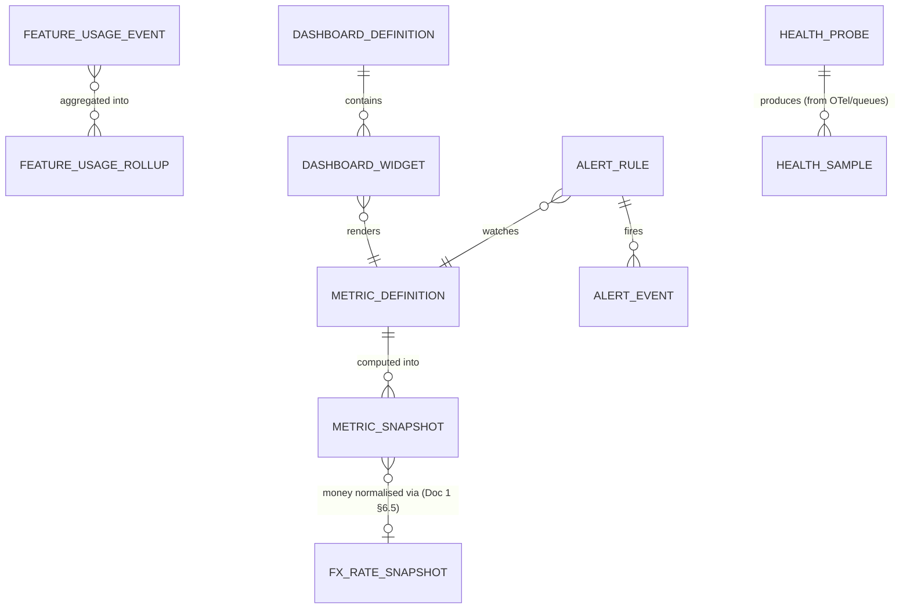

> **Consumed (read-only) from other modules — SA-9 does not own these:** `FirmSubscription` / `PlanPrice` / `RailInvoice` / dunning state (SA-4 — `PlanPrice` is the sole pricing owner; `RailInvoice`/`RailWebhookEvent` are rail-neutral per ADR C4-D1, with an opaque `railInvoiceRef`), `Firm` / `FirmCountryEntitlement` (keyed on `countryCode`) / firm-status (SA-2), `SubscriptionPlan` (SA-3 — entitlement dimensions only: caps/features/countries/roles/status/visibility), `CommercialFeatureCatalog` (SA-3 — the single registry of `feature.*` keys that the adoption heatmap is keyed by), support-ticket (SA-10), `FeatureFlag` (SA-12 — operational on/off that **references** the SA-3 `feature.*` key), each product module's usage signals, and `FxRateSnapshot` (Doc 1 §6.5, canonical fields `baseCurrency`/`quoteCurrency`/`asOf`/`economicMoment`). SA-9 reads their events/signals into read-models; it never writes them.

---

## 8. User Stories + Acceptance Criteria

**US-1 — Platform Owner: the business at a glance, reconciling and multi-currency.**
- **Given** firms on CAD, AUD, and GBP plans (some ANNUAL, some MONTHLY), **When** I open Business Overview with `reportingCurrency = CAD`, **Then** MRR is shown in CAD with each subscription's `PlanPrice` ANNUAL→monthly-normalised and FX-converted via its `FxRateSnapshot`, **no raw cross-currency sum is performed**, ARR = MRR × 12, and a pair with no FX rate is excluded with a visible "rate unavailable" note (BR-2/4/5).
- **Given** the Business Overview, **When** it loads, **Then** the active-firm count matches SA-2/SA-4 exactly (BR-1) and each KPI tile shows its delta vs the prior period.

**US-2 — Billing Admin: revenue and churn truth.**
- **Given** a firm upgraded and another churned this month, **When** I view the MRR bridge, **Then** the upgrade appears as expansion MRR, the churn as churned MRR, and NRR is computed (BR-3).
- **Given** a new firm subscribes on a Canada-only plan today, **When** I view analytics the next day, **Then** it appears in "new firms this month," MRR reflects the new subscription's `PlanPrice`, and the Canada per-country dashboard shows +1 entitled firm (keyed on `countryCode`).

**US-3 — Country Manager: prioritise by real per-country demand — without revenue or PII.**
- **Given** the Per-Country dashboard for Canada, **When** it loads, **Then** I see entitled-firm count, active cases by program type, assessments run, top streams, and an **aggregate** CRS-band distribution — and **no individual applicant's CRS score or PII is shown** (BR-9), with band cells below the cohort floor suppressed (BR-16).
- **Given** my role lacks `system/analytics:view-revenue`, **When** I open any dashboard, **Then** no revenue widget is returned by the server (BR-14), not merely hidden client-side.

**US-4 — Platform Engineer: catch a stuck queue before users feel it.**
- **Given** the email worker queue exceeds the configured depth threshold (e.g. 500), **When** I view System Health, **Then** the email-queue row shows the current depth with an alert indicator, and the seeded alert rule has fired a `notif/*` notification (SA-9-20).
- **Given** API latency instrumentation is wired and DB-replica-lag instrumentation is not, **When** I view System Health, **Then** p95 latency shows a real value and replica-lag shows "not yet instrumented," never a fake zero (BR-11).

**US-5 — Anyone: trend and compare, with stable history.**
- **Given** I select "last 90 days" with comparison on, **When** the dashboard renders, **Then** each KPI shows value, prior-90-day value, and % delta, and trend charts show daily points; switching to "trailing 12 months" rolls the same series up to monthly.
- **Given** I view March's MRR today and again next week, **When** both render, **Then** the figure is identical (snapshot stability, FX baked in — BR-12).

**US-6 — Owner: alerting that doesn't spam.**
- **Given** a queue stays above threshold for an hour across many evaluations, **When** alerts evaluate, **Then** exactly one OPEN `AlertEvent` exists (cool-down/de-dup — BR-8), and it auto-resolves when the queue drains.
- **Given** I create an alert rule on churn rate, **When** I save it, **Then** the rule and (later) each firing are written to the audit spine.

**US-7 — Export safely and accountably.**
- **Given** I hold `system/analytics:export`, **When** I export the revenue view for a date range, **Then** I get an aggregate-only file (no firm PII), large exports run async with a job handle (Doc 1 P7), and an audit entry records actor/filter/row-count/timestamp as a data-egress event (no `PII_REVEAL`, because SA-9 holds no cleartext PII — R25).
- **Given** I hold `system/analytics:view` but **not** `:export`, **When** I attempt an export, **Then** the action is rejected with an authorization error.

**US-8 — Investigate one firm correctly (no drill-through into PII).**
- **Given** a firm's numbers look anomalous on the per-firm usage drill (aggregate counts), **When** I need to see inside that firm, **Then** the only path offered is "open audited impersonation" (SA-2) — there is no inline rendering of that firm's client/case PII from the analytics screen (BR-9, §3.0).

**US-9 — Reconcile beats drift.**
- **Given** an event redelivery, **When** the SA-9 aggregator processes it, **Then** the per-firm processed-event ledger (Doc 1 §6.2.3) makes it a no-op; and **When** the daily reconcile runs, the metric is re-derived from source, the correct value wins, and any discrepancy is logged (BR-7/13).

**US-10 — Producer contract is de-identified by construction.**
- **Given** a module emits `feature.used`, **When** it includes a payload field describing what the user did inside the feature, **Then** the dictionary Zod schema rejects the event at the edge (Doc 1 §6.1.3), and no such field can ever reach a read-model (BR-17).

---

## 9. Edge Cases & Validations

- **Mixed-currency revenue** → every value FX-converted before any sum/compare; missing pair excluded-with-note, never raw-summed or zeroed (BR-2/5).
- **ANNUAL + MONTHLY + quarterly plans mixed** → all normalised to monthly before sum; ARR = MRR × 12 (BR-4).
- **Multi-country firm** → MRR attributed once per BR-6 (keyed on `countryCode`); never double-counted across per-country breakouts.
- **Firm churns and re-subscribes in the same month** → counted per the documented definitions consistently (BR-1/3); the reconcile resolves any same-cell contradiction.
- **Event redelivery / out-of-order** → idempotent aggregation via the processed-event ledger prevents double-count; the reconcile corrects residual drift (BR-7/13).
- **Stale snapshot (missed event)** → dashboard shows an "as of <timestamp>" stamp; the next reconcile heals it; a known-stale number is flagged, not presented as live.
- **Health metric not instrumented** → "not yet instrumented," never a fake zero (BR-11).
- **Observability backend unreachable** → the health widget shows "unavailable" with last-known-timestamp; business read-models (independent of the observability backend) keep rendering — graceful degradation (Doc 1 AV3).
- **Empty platform / first-run** → zero-firms/zero-revenue render as honest "no data yet," not broken charts.
- **Permission-scoped fetch** → a Country Manager's revenue-widget request returns 403 server-side (Doc 1 §4.2 SCOPE_VIOLATION audit), not a hidden-but-fetched payload (BR-14).
- **Cross-tenant PII never present** → no read-model, dashboard, or export can return a firm's client PII; the only firm-internal access is audited impersonation (BR-9, §3.0).
- **Huge export** → streamed/async, never built unbounded in memory; aggregate-only; audited as egress (Doc 1 P7).
- **Date range crossing DST / month boundaries** → periods evaluated in the configured reporting timezone deterministically (BR-15).
- **Backfill of a new metric** → recomputes history from source; existing unrelated snapshots are not rewritten (BR-12).
- **FX rate unavailable at capture** → follow the documented policy (last good snapshot / manual rate / seeded static for demo, Doc 1 §6.5.2); never block the pipeline or invent a rate.
- **Deprecated metric** → hidden from new dashboards but its historical snapshots remain readable for past views/exports.
- **Feature key under both catalogues** → adoption is keyed by the single shared `feature.*` key (owned by SA-3's `CommercialFeatureCatalog`; referenced by an SA-12 `FeatureFlag`), so the heatmap counts one feature once and never double-attributes (resolves the SA-3↔SA-12 catalog relationship for SA-9).
- **Small-cohort per-country/CRS-band cell** → suppressed below the configured floor (BR-16) so aggregates can't re-identify a tiny tenant.
- **Alert flood prevention** → cool-down + auto-resolve ensure one incident is one alert thread (BR-8).

**Validation doctrine.** All input (filters, date ranges, alert-rule thresholds, export parameters, dashboard config, currency settings, the `feature.used` payload) is validated by **schema** (Zod / class-validator), not ad-hoc `if/else`. Reject early; never compute or persist on invalid input.

---

## 10. Permissions (GLOBAL `system/*`)

> Default-deny; additive; **GLOBAL scope only** (Doc 1 §4.1) — never assignable to a firm staff role. This is the only module whose permissions grant cross-tenant aggregate visibility, and even here **no permission grants drill-through into a firm's PII** (that is audited impersonation, SA-2). The scope-aware guard (Doc 1 §4.2) enforces that only a platform-pool principal holding the `system/*` key may reach these routes. GLOBAL `system/*` keys are qualifier-N/A per Doc 1 AC-4.1.3 (no intra-firm `view.own`/`view.all` ownership on the platform plane). The audit-read of SA-9's own egress/config events is served by SA-11's catalog keys (`system/audit-log:list` / `system/audit:export` / `system/audit:verify`, R13) — SA-9 coins no audit-read key.

| Permission Key | Status | Description |
|---|---|---|
| `system/analytics:view` | **NEW** | View platform analytics dashboards (business + usage, per role-scoping) |
| `system/analytics:view-revenue` | **NEW** | View revenue metrics (MRR/ARR/ARPU/churn/revenue-by-country) — separable so non-financial roles are excluded |
| `system/analytics:view-usage` | **NEW** | View product-usage & adoption metrics |
| `system/analytics:view-country` | **NEW** | View per-country dashboards |
| `system/analytics:export` | **NEW** | Export analytics to CSV/XLSX (aggregate-only; audited as egress) |
| `system/system-health:view` | **NEW** | View system-health / observability dashboards (queues, errors, latency, storage) |
| `system/analytics:manage-alerts` | **NEW** | Create/edit/pause alert rules and thresholds |
| `system/analytics:manage-dashboards` | **NEW** | Configure dashboards/widgets and the metric catalogue (Platform Owner) |
| `system/analytics:manage-digest` | **NEW** | Configure scheduled digest recipients/cadence (Phase-2) |

**Sub-role mapping (illustrative, per §2).** Platform Owner: all. Billing Admin: `view` + `view-revenue` + `export`. Tenant Account Manager: `view` + `view-usage` + `export`. Country Manager: `view` + `view-usage` + `view-country` (**no** `view-revenue`). Platform Engineer: `system-health:view` + `manage-alerts`. Support Agent: `view` (support tiles only).

**Enforcement.** Route-level (`@RequirePermissions('system/...')` + the scope-aware guard, Doc 1 §4.2) **and** composition-level (a dashboard returns only widgets whose `requiredPermission` the operator holds — BR-14). Cross-tenant aggregates are served only from de-identified read-models; **no endpoint exposes a firm's PII** under any `system/analytics:*` key. Export and alert-management are separately permissioned from view. These keys are CI-validated complete against this section per Doc 1 §4.4 (every `@RequirePermissions` exists in the catalogue; every key wired to ≥ 1 route).

---

## 11. Scalability · Security · Performance

**Scalability.**
- **Read-model architecture, not live cross-tenant scans (the core move).** Dashboards read pre-computed `MetricSnapshot` / `FeatureUsageRollup` in O(rows-on-screen); the pipeline computes incrementally in O(changed-cells) and reconciles in O(period) — never O(all-data) on a user request (BR-10). This lets analytics scale across many tenants × the launch data volumes in Doc 1 §8.2.
- **Config-driven metrics & dashboards.** The metric catalogue, dashboard compositions, and alert rules are data, so adding a metric/widget is configuration + a pipeline producer, not a UI rewrite. New metrics are backfill-able from source.
- **Country- and currency-native.** Every snapshot carries `countryCode` and `currency` dimensions; single-country/single-currency is the degenerate case. Adding a country adds dimension values, not schema — consistent with Doc 1's per-tenant region seam (§8.7).
- **Decoupled observability.** The health-query adapter abstracts CloudWatch/Prometheus/queues (Doc 1 §8.4), so swapping/adding a backend (Grafana, a different APM) is an adapter change.
- **Queue-backed, horizontally scalable.** Aggregation, reconcile, exports, and digests run on BullMQ; workers scale independently (Doc 1 §8.2 S2); read-model reads route to replicas (Doc 1 §8.2 S3, which run identical FORCED RLS — replica reads are isolation-equivalent).

**Security (the highest-stakes module for cross-tenant safety).**
- **Aggregate-and-de-identified is structural (BR-9).** Read-model tables have **no PII columns** — a cross-tenant chart *cannot* leak a firm's client because the data simply is not in the read-model. The `FeatureUsageEvent` producer contract enforces this at the source (BR-17).
- **The only firm-internal access is audited impersonation (§3.0).** No drill-through from a chart into a firm's records; the console deep-links to SA-2's mandatory-reason, time-limited, fully-audited impersonation.
- **GLOBAL-only permissions, finely separated.** `system/*` only (Doc 1 §4.1); revenue/health/country separable; export and alert-management separately gated; composition enforced server-side via the scope-aware guard (Doc 1 §4.2), never by client hiding (BR-14).
- **No secrets in the analytics plane.** System-health indicators are read-only metrics; no integration credentials or secret values appear in any health widget (those live in the secrets manager, surfaced only as status in SA-8).
- **Audited egress and configuration.** Exports (actor/filter/row-count) — as a data-egress event, with no `PII_REVEAL` since SA-9 holds no cleartext PII (R25; contrast the unmasked per-individual exports in SA-11 / SA-2) — plus alert-rule changes and dashboard/metric-catalogue changes write to the platform audit spine (Doc 1 §7.5 — append-only, hash-chained; not redefined here). Reading those audit entries uses SA-11's audit-read keys (Doc 1 §4.4 / R13).
- **Source isolation preserved.** The pipeline aggregates *outside* the tenant-scoped read path into de-identified rows; it never weakens RLS on the operational tables (Doc 1 §2.2) to do so. Logs carry `tenantId` + `correlationId` with PII redaction at the logger (Doc 1 §8.4).

**Performance.**
- **Pre-aggregated reads.** SA-9 reads snapshots/rollups, refreshed by the pipeline — never a live cross-tenant scan.
- **Cache + freshness contract.** Business read-models served from snapshot tables (and a short Redis cache keyed by `(metricKey, grain, period, dimensions, filter-hash)`); system-health values cached briefly (≤ 30s) since they come from an external metrics backend. Dashboards carry a "metrics as of <timestamp>" stamp; a known-stale value is flagged, not presented as live (BR-12/13).
- **Incremental + scheduled reconcile.** Common numbers near-real-time via incremental updates; a daily reconcile guarantees correctness without recomputing everything on a request (BR-7/13).
- **Bounded, indexed, paginated.** Snapshot tables indexed on `(metricKey, periodGrain, periodStart, firmId, planId, countryCode)`; trend queries are range-scans over the daily series; lists use cursor pagination (Doc 1 P6); exports stream async (Doc 1 P7). No unbounded fetches.
- **FX snapshots immutable** once captured (Doc 1 §6.5) — both a correctness and a performance property (no recompute on FX movement).
- **Health reads isolated.** If the observability backend is slow/unreachable, only health widgets degrade ("unavailable / last known"); business read-models keep rendering (no shared failure mode — Doc 1 AV3).
- **Budgets:** dashboard read p95 ≤ 400 ms from read-models (within Doc 1 P1 ≤ 300 ms server processing for the snapshot query; the 400 ms allows for widget composition); health read p95 ≤ 1 s (bounded by the external metrics API, cached); exports async; pipeline incremental update bounded to changed cells.

---

## 12. Reference Note — exists / NEW / changed

> **Honest headline: there is no platform-wide / cross-tenant analytics in the target codebase, and none in the reference prototype beyond a single firm-scoped dashboard. SA-9 is almost entirely NEW.** This module is GREENFIELD on top of Doc 1's foundation; the reference prototype is design-provenance only (Doc 1 §1.8).

**Exists (as foundation SA-9 builds on, per Doc 1 — referenced, not re-spec'd).**
- The **observability layer** (OTel → CloudWatch / Managed Prometheus + Grafana, Pino structured logs with `tenantId`/`correlationId`/PII-redaction, Sentry) is delivered by Doc 1 §8.4. SA-9 **reads** it via the health-query adapter; it does not build the instrumentation.
- The **BullMQ queues** SA-9 observes (email, PDF/document, automation/workflow, reminder, booking-reminder) are foundation infrastructure (Doc 1 §1.4) — their job-counts are the real subjects of queue-health surfacing.
- The **`FxRateService` / `FxRateSnapshot`** single-writer + immutable-snapshot machinery is Doc 1 §6.5 (canonical fields `baseCurrency`/`quoteCurrency`/`asOf`/`economicMoment`, ADR C4-D3); SA-9 **consumes** `fxSnapshotId`, never writes a rate.
- The **domain event dictionary + transport + per-firm processed-event ledger** (Doc 1 §6.1–6.2) is the substrate SA-9's pipeline subscribes to and reuses for idempotent aggregation. `feature.used` is a registered dictionary event with a single emitter (SA-12) and SA-9 as consumer (Doc 1 §6.1.3).
- The **platform audit spine** (Doc 1 §7.5) and **Notification** module (Doc 1 §6.1.2 `notif/*`) are reused for export-egress audit, alert-rule-change audit, and alert/digest delivery; audit-read uses SA-11's catalog keys (R13).
- The source modules SA-9 aggregates exist in the spec: SA-2 (tenants/entitlements), SA-3 (plans — entitlement dimensions + `CommercialFeatureCatalog`), SA-4 (billing/subscriptions — `PlanPrice`/`RailInvoice`), SA-10 (support), SA-12 (feature flags). The aggregation *across* them is NEW.

**NEW (requires build) — essentially the whole module.**
- The **read-model / aggregation pipeline** (`MetricDefinition`, `MetricSnapshot`, `FeatureUsageEvent` + `FeatureUsageRollup`): incremental-on-event + daily reconcile, idempotent (reusing the Doc 1 ledger), FX-normalised, **de-identified (no PII columns)**, backfill-able.
- **The `FeatureUsageEvent` producer contract** (SA-9-23): the registered `feature.used` dictionary event each plan-gated capability emits (single emitter SA-12, consumer SA-9), de-identified by Zod schema (Doc 1 §6.1), keyed by the shared `feature.*` key owned by SA-3's `CommercialFeatureCatalog`.
- **Cross-tenant business metrics:** firm counts/status mix, growth + cohorts, **MRR/ARR/ARPU** with ANNUAL→monthly normalisation (price from SA-4 `PlanPrice`) and **multi-currency FX rollup**, MRR bridge, plan distribution, trial conversion, **logo + revenue churn + NRR**, **revenue by country** (`countryCode`).
- **Product-usage metrics:** module-activity counters aggregated platform-wide + per-firm (aggregate), **MAU**, **feature-adoption heatmap** keyed by the shared `feature.*` key (SA-3 `CommercialFeatureCatalog`), **per-country usage** (cases by program, assessments, top streams, anonymised CRS-band distribution with a small-cohort floor).
- **System health surfacing:** the **health-query adapter** over OTel→CloudWatch/Prometheus + queue job-counts, with honest "not yet instrumented" states (BR-11).
- **Role-scoped dashboards**, **date-range + period comparison + adaptive-granularity trends**, the **operator-configurable alert rules + events** layer (distinct from Doc 1 §8.4 infrastructure/compliance alarms), **CSV/XLSX export** (aggregate-only, async, audited as egress), optional **scheduled digest**.
- **`system/*` permission keys** (§10) and **`reportingCurrency` / reporting-timezone / FX-capture-policy** platform config.

**Changed (deliberate framing).**
- The earlier draft's **"active WebSocket connections" health tile is REMOVED** — a server-pushed realtime gateway is explicitly out of foundation scope (Doc 1 §8.2); SA-9 health refreshes by short-cached poll. A realtime-connection metric is added only when the realtime wave lands.
- SA-9's alert engine is **scoped to operator-configurable business/ops thresholds**; it does NOT re-implement the audit-chain-integrity and DSR/breach legal-clock alarms, which Doc 1 §8.4 / SA-11 own. (Earlier drafts implied a single alert engine; the boundary is now explicit.)
- The reference prototype's only dashboard (a single firm-scoped summary) is **not part of SA-9** and is **not refactored by it** — that is the firm/LOCAL plane (Agent console territory). SA-9 is a new GLOBAL plane; the two never share a query path.

---

## 13. Open Questions / [FOUNDER-CONFIRM]

> Structure and behaviour are defined here. The items below need a founder/business call (technical architecture is decided); domain-correctness items route to the Immigration-SME, founder is final authority.

1. **[FOUNDER-CONFIRM] Platform `reportingCurrency` & FX source.** Reporting currency (CAD assumed, Doc 1 §6.6) and what feeds `FxRateSnapshot` — Doc 1's v1 manual adapter, a paid FX provider, or a seeded static snapshot for the demo. *Recommendation: seeded static for demo; manual adapter for early production; provider deferred behind `FxRateSourcePort`.*
2. **[FOUNDER-CONFIRM] Churn & MRR definitions, locked.** Confirm churn = subscription CANCELED ∪ firm OFFBOARDED, and the MRR treatment of PAST_DUE/dunning firms (counted until canceled, with an "at-risk MRR" sub-tile — proposed). *Defaults in BR-1/3/4.*
3. **[FOUNDER-CONFIRM] Multi-country revenue attribution policy (BR-6).** Primary/first country, split evenly, or usage-weighted (all keyed on `countryCode`). *Proposed: primary-country attribution for v1; revisit when multi-country firms become common.*
4. **[FOUNDER-CONFIRM] Observability backend at launch.** Whether system health reads CloudWatch or Managed Prometheus first (Doc 1 §8.4 builds the layer either way; the adapter is identical). *Note: queue health (BullMQ job-counts) can ship before full APM exporters; API-latency/5xx depend on those exporters being wired — until then, "not yet instrumented" (BR-11).*
5. **[FOUNDER-CONFIRM] The canonical module-activity / `feature.used` event set, and that each owning module emits it.** The proposed verbs (assessments, prospects, cases, SQRs, documents, messages, automations) and the plan-gated feature list (keyed by SA-3's `CommercialFeatureCatalog` `feature.*` keys) are a cross-module contract — confirm the set so the producers exist (SA-9-23). The dictionary entry shape, single-emitter (SA-12) and consumer (SA-9) are fixed by Doc 1 §6.1.
6. **[FOUNDER-CONFIRM] CRS-band distribution granularity & anonymity floor (BR-16).** The band cut-offs and the minimum-cohort-size suppression floor are immigration content + privacy posture — routed to the Immigration-SME for band cut-offs, founder for the floor. *Recommendation: enforce a small-cohort floor; the machinery (suppression at write/read time) is delivered regardless.*
7. **[FOUNDER-CONFIRM] Alert delivery channels.** In-app + email ship via Notification (Doc 1 §6.1.2); whether a webhook/Slack/PagerDuty on-call channel is needed at launch or Phase-2. *Proposed: in-app + email at launch; pager channel Phase-2.*

**Named deferrals (explicitly Phase-2/3, not launch):**
- **Custom dashboard / widget builder** (build-your-own-BI) — Phase-3; curated role-scoped dashboards ship first (library-first).
- **Scheduled digest emails** (SA-9-22) — Phase-2; on-demand export ships first.
- **Persisted `HealthSample` history** — Phase-2 if a short health-trend is wanted; live adapter reads ship first.
- **Realtime-pushed live dashboards** — tied to Doc 1's deferred realtime-push wave (Doc 1 §8.2); launch surfaces refresh by poll.
- **Cross-region / per-residency analytics breakouts** — tied to the per-tenant region seam (Doc 1 §8.7) and the hybrid-tenancy roadmap, not launch.

> **Domain-correctness items routed to the Immigration-SME (founder is final authority):** the per-country program/stream taxonomy used in the per-country dashboard, the correct CRS-band cut-offs and anonymity floor, and which program-level activity counters are the meaningful "usage" signals. This spec defines the structure and machinery; the immigration *values* are the founder's deferred Country-Pack content.

---

# Module SA-10: Support

> **Plane:** Super-Admin / Platform (GLOBAL). The ExpatReady support team triages and answers tickets raised by *firms* across *all* tenants; the firm-side submission surface is the LOCAL counterpart, isolated by `firm_id` + RLS (per Doc 1 §2.2, §2.5). This module SITS ON the Platform Foundation (Doc 1) and references it — it does not re-spec identity, RLS, RBAC, the event bus, audit, KMS, or the cross-cutting core. It specs the support *machinery*; the immigration content a category routes to (e.g. CRS rules) is authored elsewhere ([FOUNDER-CONFIRM] Country-Pack).
>
> **What Doc 1 already gives this module (reference, do not rebuild):** three walled identity pools and the `er:platform` / `er:firm` / `er:portal` audiences (Doc 1 §3.1); two-scope RBAC + scope-aware guard (§4.1–§4.2); the audited cross-tenant **impersonation/elevated path** that SA-10 bridges to (§4.5, AC-4.5.7/8); record-level authz helpers (§4.5); the canonical **domain-event dictionary** in `packages/contracts/events` with `notif/` vs `dot.case` separation and the rail-originated idempotency law (§6.1); the per-firm hash-chained **audit spine** (§7.5); envelope-encrypted PII + crypto-shred (§7.1–§7.4); the polymorphic cross-cutting core — Notes, Tasks, Reminders, Notifications, Documents, Audit attach to any EntityTypeRegistry-registered entity with zero migrations (§1.10, §2.x); the **Finder** universal search (§8.8); and the NFR budgets (§8). **Normative constraint:** long-lived realtime push (WebSocket/SSE) is NOT foundation scope (Doc 1 §"Realtime push is not foundation scope") — SA-10 ships on request/response + polling, with a live channel as a named later-wave additive.

---

## Module Index

1. Purpose & Goal · 2. Users & JTBD · 3. Functional Design (how it works) · 4. Functional Requirements (SA-10-n) · 5. Business Rules · 6. States & Lifecycle · 7. Key Entities & Fields (ERD) · 8. User Stories + Acceptance (GWT) · 9. Edge Cases · 10. Permissions · 11. Scalability · Security · Performance · 12. Reference Note · 13. Open Questions / [FOUNDER-CONFIRM]

---

## 1. Purpose & Goal

SA-10 is the **operational bridge between ExpatReady and the firms that pay for it**: where a firm in trouble — a retainer that will not generate, a form that will not auto-fill, a locked-out RCIC, a billing query — reaches a human on the platform team, and where that team triages, answers, escalates, and (when a screenshot is not enough) steps *into* the firm's console through the **audited impersonation path of Doc 1 §4.5** to reproduce and fix the problem. It is the platform's customer-success and incident-response surface, and in a regulated multi-tenant SaaS it is also a **compliance-sensitive** one: every ticket can carry a firm's — and by extension an end-client's — personal information.

**Business outcome.** A SaaS for regulated immigration firms lives on trust; a firm that cannot get help fast churns and tells other firms. SA-10 makes **"a firm in trouble always reaches a human fast, and that human can actually fix it — safely"** structurally true: speed-to-first-response measured in the *firm's* timezone, never a dropped ticket, a real escalation path, and a controlled, fully-audited way to see exactly what the firm sees without ever touching their credentials.

**World-class positioning (not a help desk bolted on).** Generic help desk = queue + thread + status dropdown. SA-10 is **tenant-aware, compliance-native, and immigration-literate**: (a) wired to the §4.5 audited impersonation so triage is "see their exact console," not "send a screenshot"; (b) **plane-correct** — a support operator's default grant reads the ticket and its attachments only, and must cross the explicit audited boundary to see any other firm data, so "support" never silently becomes unbounded PII access; (c) **domain-routed** — an *Immigration Content* category routes to a Country/Content Manager (SA-1), not a generic agent; (d) **global and bilingual** — the firm submits and is answered in its language and SLA clocks tick in the firm's business hours. **In-house by doctrine:** there is no Zendesk/Intercom — support is a first-party module on the in-house notification/email rails (Doc 1 §6.3).

**Foundation gap this module closes:** the **`SlaPolicy` + `BusinessHoursCalendar`** entities (named but undefined across the source FRs) and the timezone-/business-hours-aware SLA clock that depends on them; routing/escalation as config; ticket lifecycle; and the ticket→impersonation bridge.

---

## 2. Users & Jobs-to-be-Done

| Role | Plane | Primary job | Representative JTBD |
|---|---|---|---|
| **Support Operator** (heaviest GLOBAL user) | GLOBAL | Answer firm tickets fast; resolve or escalate; never drop one. | "When a ticket arrives I want it in a ranked queue with the firm's plan, timezone and history, so I work the urgent, high-value ones first — in their time, not mine." · "When stuck reproducing a bug I want to step into the firm's console *from the ticket* with the justification pre-filled — within the §4.5 audited, time-boxed rules." · "When I answer the same question often I want a bilingual canned response I can insert and tweak." |
| **Support Lead / Account Manager** | GLOBAL | Keep the queue healthy; own escalations and high-value accounts. | "When a ticket breaches or is about to, I want it escalated to me before the firm complains." · "When a high-MRR firm opens a ticket I want it surfaced." · "When I review the week I want first-response/resolution times, backlog and CSAT by category and operator." |
| **Country / Content Manager** (SA-1) | GLOBAL | Field immigration-content questions routed to them. | "When a ticket is *Immigration Content* I want it routed to me — a generic operator cannot answer it, and my answer may reveal a pack bug to fix in SA-1." |
| **Platform Owner** | GLOBAL | Own support quality + the access-accountability posture. | "When I audit the quarter I want every impersonation that originated from a ticket — reason, operator, duration, actions — exportable." · "When I configure support I want categories, SLA targets per priority, business hours, routing and escalation to match how we operate." |
| **Firm staff** (Owner, RCIC, Case Officer, Intake, Accounts) | **LOCAL** | Get help fast; stay informed. | "When something breaks I want to raise a ticket from inside my console in two clicks, attach a screenshot, and get a reply in my language without leaving the product." · "When my issue is fixed I want to confirm it, reopen within a fair window, and rate the help." |

**Design implication.** The **Support Operator** is the protagonist of the GLOBAL UI (queue is the landing surface; the ticket workspace is a command center). The **firm staff member** is the protagonist of the LOCAL surface (a dead-simple "Get help" form and a clean thread, in their language, that never exposes internal notes or other firms). Permissions (Section 10) and the §4.5 record-level layer cleanly separate the two planes; an internal note must be *structurally impossible* for a firm to read.

---

## 3. Functional Design — How It Works

### 3.0 The two-plane model (the foundation everything sits on)
One `SupportTicket` row, two renderings. **LOCAL (firm console):** a firm staff member, on an `er:firm` token, sees only their firm's tickets and only firm-visible messages — internal notes, assignment internals, SLA timers and every other firm are invisible (firm isolation by RLS on `firm_id`, Doc 1 §2.2; the message-level internal-note exclusion is an additional object-level rule). **GLOBAL (Super-Admin console):** a Support Operator on an `er:platform` token holding `system/support:list` sees all tickets across all firms, plus internal notes, assignment, SLA and the impersonation bridge.

**Why the boundary is load-bearing (security + correctness):**
1. **Support's default grant is *scoped*, not *total*.** `system/support:*` lets an operator read the *ticket and its attachments* across tenants — it does **not** grant access to the firm's clients, cases, invoices or documents. To see the rest, the operator crosses the **explicit, audited impersonation boundary (Doc 1 §4.5)**, which mints a single-firm `er:firm` token. There is no code path by which a raw `er:platform` token reads tenant LOCAL data (Doc 1 AC-4.5.7).
2. **An internal note is unreadable by the firm** by construction (BR-4): the firm-side read query and the firm-side delivery both exclude `INTERNAL_NOTE`.
3. **Attachments are PII** and inherit Doc 1's storage rule — a presigned URL is always bound to an ownership-checked record, never a caller-supplied key (Doc 1 §4.5 storage rule, AC-4.5.5).

### 3.1 Ticket submission (firm-side, LOCAL) — "two clicks to a human, in my language"
A firm staff member opens a "Get help" surface and submits: **title, description, category, optional sub-category, priority, attachments**. The ticket is created `status = OPEN`, stamped with the firm's `firm_id` (from the PrincipalContext, never caller input — Doc 1 §4.5) and the submitting user.

**World-class behaviour.**
- **Speed-to-first-response is a first-class promise that starts at submission.** On create, the module emits the domain event `support.ticket_created` (Doc 1 §6.1); the Communications/Conductor consumers fan out a `notif/support-ticket-opened` to on-call operators (in-app + email) and the SLA engine stamps `firstResponseDueAt` in the firm's business hours.
- **Context-rich by construction.** The submission carries the firm's plan, country entitlements and recent ticket history into the operator's view, built from existing relations — the operator never starts blind.
- **Bilingual.** The firm's `language` (e.g. `en-CA`/`fr-CA`) is stamped on the ticket so acknowledgements, status notifications and canned responses render in the firm's language (Doc 1 §NFR i18n).
- **Auto-acknowledgement.** An immediate `SYSTEM_MESSAGE` — "we've got ticket #NNN, expected first response by <SLA, firm timezone>" — is appended in the firm's language (transactional; no marketing consent needed).
- **Attachment-safe.** Files upload via presigned URL bound to the ticket record; size/MIME validated; classified as client PII (BR-13).

**Screens.** *Get-help launcher* (persistent in the firm header/help menu) → minimal form. *My tickets* (firm side): the firm's own tickets with status + last activity → clean thread (firm-visible messages only) with reply/attach and Resolve/Reopen/Rate when applicable.

### 3.2 The support queue (triage home) — "see every firm's tickets; know what to work next"
The GLOBAL landing surface is a **cross-tenant queue**, one row per ticket: subject, firm (name + plan badge + MRR signal), category, priority, status, assignee, **age + SLA state (computed in the firm's timezone)**, last activity, unread flag. Default sort: **breaching/at-risk first, then priority, then oldest unanswered**. A board view (columns by status or assignee) complements the list.

**World-class behaviour.** Saved, shareable queues ("My open," "Unassigned," "Breaching SLA," "Immigration Content," "High-MRR"). At-a-glance SLA health (on-track / at-risk / breached) in firm time. **Performance-first** — server-side cursor pagination (≤50, Doc 1 §8 P-budgets) + cached per-bucket counts, never an unbounded scan or `COUNT(*)` per load. Bulk triage (multi-select → assign / set priority / set category / close-with-reason).

### 3.3 Triage, assignment & routing — "the right ticket reaches the right specialist, fast"
An operator (or an auto-rule) confirms/adjusts category and sub-category, sets priority, and assigns (to self or another operator). Assignment stamps `assignedTo`, bumps `lastActivityAt`, emits `support.ticket_assigned`, and audits.

**World-class behaviour.**
- **Category-driven routing (config).** A `RoutingRule` maps category → an operator pool (`SupportPool`, §3.13): *Immigration Content* → Content Manager; *Billing* → Billing Admin (SA-4); *Technical/Bug* → Platform Engineer; *Account* → Account Manager; else the general pool. Config, not code.
- **Round-robin / load-aware auto-assign (config, optional).** Within a pool, auto-assign by round-robin respecting availability so tickets do not rot.
- **Auto-triage hints.** Suggested category/priority from keywords — a hint the operator confirms, never a silent decision.
- **Priority drives the SLA target** (§3.6): setting priority selects the `SlaPolicy` row, so triage and the clock are one wire.

### 3.4 The ticket workspace (conversation + internal notes) — "one screen to understand, answer, note, and act"
The single most important GLOBAL screen — a **command center for one support conversation**, three zones:
- **Left rail — ticket & firm context.** Subject, status, priority, category, assignee, SLA state (firm-tz), timestamps, and firm facts (name, plan, country entitlements, MRR, primary contact, recent ticket history) plus the **"Open impersonation" button** (§3.8). Read-only firm facts; no client PII beyond what is on the ticket (the scoped-access principle).
- **Center — thread + composer.** A unified chronological thread of firm messages, operator replies, internal notes (visually distinct, GLOBAL-only), status updates and system events, attachments inline. The composer offers a **reply (firm-visible) vs internal note (GLOBAL-only) toggle** — the single most important control on the screen, with colour/label/confirm-on-switch — plus **insert canned response** (§3.9), attach, and quick actions.
- **Right rail — actions & knowledge.** Status & priority, assignment, **escalate** (§3.7), **link to impersonation** (§3.8), suggested **KB articles** for the category (§3.9), and the per-ticket audit summary (read from the firm's audit chain, Doc 1 §7.5).

**World-class behaviour.** Reply-vs-note is unmistakable AND safe (defence-in-depth: UI clarity + server-side exclusion). Insert canned, escalate or open impersonation in one click. Keyboard-first reply/toggle/insert/status. The thread is the audit-grade record of the support relationship.

### 3.5 Delivery & freshness (foundation-aligned) — "nothing is missed"
Per Doc 1, long-lived realtime push is not foundation scope. SA-10 baseline: **request/response + polling** for the queue and the open thread, plus the **`notif/` notification rail** (in-app inbox + email) for every meaningful event (new firm message, new operator reply, assignment, escalation, status change, SLA breach). A recipient who is not looking at the thread still gets the notification — nothing is missed regardless of who is online.
- **Internal notes never trigger a firm-facing notification** (BR-4): an `INTERNAL_NOTE` emits no `notif/` to the firm and is absent from every firm-facing read.
- **Live thread channel = named later-wave additive.** If/when Doc 1's realtime wave lands, a per-ticket live channel attaches here, with per-connection tenant + audience isolation specified at that time (a firm connection may join only its own ticket; an internal note is delivered only to the GLOBAL audience). Until then, polling + notifications meet the "fast, never-missed" bar without a foundation-scope dependency. **[FOUNDER-CONFIRM]** whether a live chat experience is required for launch or polling+notifications suffice.

### 3.6 Status lifecycle & SLA clock (timezone-aware) — "the clock is fair, and it knows whose fault the wait is"
A small explicit status machine governs the ticket (§6). An **`SlaPolicy`** (per priority) defines a **first-response target** and a **resolution target**; two clocks run — time-to-first-response (until the first `AGENT_REPLY`) and time-to-resolution (until `RESOLVED`).

**World-class behaviour (the fairness moat):**
- **Timezone- and business-hours-aware (the gap this module closes).** Clocks tick against the firm's office timezone and **`BusinessHoursCalendar`** (weekly schedule + holiday list), not the operator's wall-clock and not raw UTC. A ticket opened 23:00 Friday in Vancouver is not "breached" by Monday morning in Toronto; weekends/holidays do not consume SLA.
- **The clock pauses when the ball is in the firm's court (BR-6).** `WAITING_ON_FIRM` / `WAITING_ON_THIRD_PARTY` **pause** the resolution clock; a firm reply auto-transitions back to `IN_PROGRESS` and resumes it. The accumulated paused duration is tracked (`clockPausedTotalMs`).
- **At-risk and breach signals.** Tickets nearing a target flag `at_risk`; breaches flag `breached` and emit `support.sla_breached`, which can auto-escalate (§3.7).
- **Side-effects derived from status.** Entering `RESOLVED` sends the CSAT survey (§3.10) and starts the reopen window; a firm reply within the window reopens (BR-8); window elapse auto-`CLOSED`.

### 3.7 Escalation — "the hard ones reach a senior before the firm complains"
A ticket can be escalated **manually** (operator picks reason + target: senior / lead / on-call engineer) or **automatically** (SLA breach, an `URGENT` untouched past a threshold, or the Nth reopen). Escalation reassigns or adds a watcher, optionally bumps priority, appends a `TicketEscalationEvent` (visible history), emits `support.ticket_escalated`, and notifies the target. **Rules are config** (`EscalationRule`: trigger → action), library-first defaults lightly edited. A high-MRR firm can carry a lower auto-escalation threshold (configurable business decision).

### 3.8 The bridge to audited impersonation (Doc 1 §4.5) — "see exactly what they see — within the rules"
The workspace has an **"Open impersonation"** action. It does **not** invent an access path — it launches the **§4.5 elevated path** with the **justification pre-filled** with the ticket reference (e.g. "Reproducing reported issue — Ticket #NNN").
- **Double-gated.** The operator must hold the distinct `system/firm:impersonate` permission (Doc 1 §4.5). Holding `system/support:*` alone is **insufficient** — support and impersonation are deliberately separate grants. Without it, the click returns `403` directing the operator to request supervisor approval, and the attempt is audited.
- **All of §4.5's guarantees apply.** The path mints a scoped, **time-boxed, step-up (re-auth) gated** `er:firm` token bound to exactly one target `firm_id`, runs under the non-BYPASSRLS app role (RLS still confines it to that one firm — Doc 1 AC-4.5.8), and writes `IMPERSONATION_START` + `IMPERSONATION_END` (and `CROSS_TENANT_ACCESS`) to the **target firm's per-firm audit chain** (Doc 1 §7.5). A persistent "Impersonating <firm> as <operator>" banner is shown.
- **Two-way traceability.** The session is linked to the ticket (`impersonationSessionId`), and the audit entry records the ticket reference as the justification — an auditor can walk ticket → session → audit and back.

### 3.9 Knowledge base & canned responses (bilingual)
- **Canned responses (macros):** a library of bilingual reply snippets with merge fields (`{{firm.name}}`, `{{ticket.id}}`, `{{operator.name}}`); the locale auto-selects to the firm's language; the operator inserts and tweaks before sending.
- **Knowledge base:** bilingual, country-taggable articles — an internal subset for operators and a firm-facing subset surfaced in firm help to **deflect** tickets before they are raised. Contextual suggestions match the ticket's category/keywords (right-rail on GLOBAL; as-you-type on the firm form). "Was this helpful?" feeds SA-9.

### 3.10 Satisfaction (CSAT)
On entry to `RESOLVED`, the firm is sent a short CSAT survey (rating + optional comment) in the firm's language, inline in the thread and in the resolution email. The response stores against the ticket and rolls up to SA-9. A low score can auto-flag for a lead's review or offer a one-click reopen — turning a bad experience into a recovery. CSAT is segmentable by operator, category, country, plan.

### 3.11 Support metrics → SA-9
SA-10 produces the support KPIs SA-9 surfaces: open count, average first-response, average resolution, **SLA attainment %**, **CSAT average**, backlog/aging, reopen rate, and breakdowns by category / firm / country / operator. Metrics read **DB-side incremental rollups** refreshed on the BullMQ queue from `support.*` events — never an O(n) scan (Doc 1 §8 P7/P-budgets). Money/time figures respect the firm-timezone SLA computation; aggregates only — no raw ticket content leaves the support plane into analytics.

### 3.12 Category, SLA & business-hours configuration
A Platform Owner configures without a code change: **categories & sub-categories**, **`SlaPolicy` per priority** (first-response + resolution targets, bound to a `BusinessHoursCalendar`), **`BusinessHoursCalendar`** records (weekly schedule + holiday list per timezone/country), **`RoutingRule`** (category → pool), **`EscalationRule`** (trigger → action), **canned responses**, and **KB articles**. Config-as-data lives in Postgres JSONB validated by Zod at the edge (Doc 1 §C1-2). Library-first defaults seed sensible values. All config changes audit to the per-firm chain (here, the platform plane).

### 3.13 Pools, availability & assignment — the staffing layer (routing made real)
§3.3's "operator pool," §3.7's "add a watcher," and SA-10-2's "on-call operators" are made concrete here — this is the layer that turns routing from a label into an operating model.

- **Support pools (named operator groups).** A **`SupportPool`** is a named, config-managed group of platform operators (seeded defaults: *General*, *Billing*, *Content*, *Engineering*, *High-Touch*). `RoutingRule` targets a pool **by FK** — never bare text — and a rule may match on **category key**, **priority floor**, and the firm's **plan tier** (an SA-3 plan-key match, read-only reference), so "URGENT from an Enterprise-plan firm → High-Touch pool" is a config row, not code. High-MRR / named-account routing behaviour remains gated on OQ-10.
- **Availability & capacity.** Each operator's **effective availability** is *derived*: `OFF_SHIFT` when no `SupportShift` window covers now; `AWAY` when manually set (optional `awayUntil`, self-service); `ON_CALL` when a covering shift of kind ON_CALL exists; else `AVAILABLE`. **On-call at instant T** — the set SA-10-2's 60-second notification targets — is exactly the operators with a covering ON_CALL shift; an empty set falls back to the pool leads and surfaces a config warning (the promise never silently lapses). **Capacity** is `maxConcurrentTickets` per operator: at/over capacity an operator stops being *auto*-assignable (manual assignment stays possible, with a warning).
- **Assignment strategies (per pool).** `assignmentStrategy`: **MANUAL** (default — operators pull from the pool queue), **ROUND_ROBIN** (a persisted per-pool cursor cycles through eligible members), **LOAD_BASED** (lowest open-assigned count; tie → longest since last assignment). *Eligible* = pool member, effectively `AVAILABLE`/`ON_CALL`, under capacity. No eligible member → the ticket stays **unassigned in the pool queue** and the pool lead is notified; automation never assigns to an `AWAY`/`OFF_SHIFT` operator.
- **Sticky-on-reopen.** A reopen within the window (BR-8) returns the ticket to its **previous assignee** when still eligible — continuity beats redistribution; otherwise it falls back through the pool strategy.
- **Watchers / followers.** Any operator can watch any ticket; escalation's "add watcher" writes the same **`TicketWatcher`** record. Watchers receive every meaningful `notif/` on the ticket without becoming assignee. Watcher data is **GLOBAL-plane only** — structurally absent from every firm-facing read, the same discipline as internal notes (BR-19).
- **Escalation timers on platform hours (two clocks, two calendars).** SLA clocks tick in the *firm's* calendar (BR-6). Escalation timers (`no_response_mins` and kin) tick against the **platform support desk's own hours** — each `EscalationRule` declares a `clockBasis`: `CALENDAR_24_7` or `PLATFORM_BUSINESS_HOURS` via a designated platform-owned `BusinessHoursCalendar` row. An URGENT rule can run 24×7 while a routine nudge respects desk hours; the sweep evaluates each rule on its own basis.
- **Saved queues.** §3.2's saved/shareable queues persist as **`SavedQueue`** rows (name + Zod-validated filter JSONB), personal by default, shareable read-only to the team.

Pool/shift/strategy/calendar configuration rides `system/support:config`; setting one's own AWAY rides `system/support:manage`; all changes audit (BR-12). **Scalability/security/performance:** strategy selection is one indexed query over pool membership joined to the open-count rollup — O(pool size), never O(tickets); on-call resolution reads `(kind, active)`-indexed shifts; watcher fan-out reuses the existing `notif/` rail; staffing tables carry no client PII, so this layer adds zero PII surface.

---

## 4. Functional Requirements (SA-10-n)

**Submission & intake (LOCAL → GLOBAL)**
- **SA-10-1** Firm staff submit a ticket from their console (title, description, category, optional sub-category, priority, attachments); created `status = OPEN`, stamped `firm_id` + submitter from PrincipalContext, entering the GLOBAL queue.
- **SA-10-2** On submission the module emits `support.ticket_created`; on-call operators (the §3.13 on-call set, SA-10-27) are notified within 60s via the `notif/` rail (in-app + email) and an auto-acknowledgement with ticket number + first-response SLA (firm timezone) is appended in the firm's language.
- **SA-10-3** Attachments upload via presigned URL bound to the ticket record (Doc 1 §4.5 storage rule), with size/MIME validation; ticket and message attachments are classified and protected as client PII.

**Queue, triage & routing (GLOBAL)**
- **SA-10-4** Operators view a cross-tenant queue, filter by firm/status/category/priority/assignee/SLA-state/country/date, sort breaching/at-risk first; cursor-paginated (≤50) with cached bucket counts.
- **SA-10-5** Operators assign a ticket to self or another operator; assignment emits `support.ticket_assigned`, bumps last-activity, and audits.
- **SA-10-6** Category-driven routing maps each category to an operator pool; optional round-robin/load-aware auto-assignment within a pool respects availability. (Pools, availability, strategies: §3.13, SA-10-25..29.)
- **SA-10-7** *(optional)* Auto-triage suggests category and priority from keywords; the operator confirms — suggestions never silently set values.

**Conversation & internal notes**
- **SA-10-8** Threaded messaging with rich text, threaded replies, and attachments between operator and firm.
- **SA-10-9** *(security-critical)* A message may be an internal note (`messageType = INTERNAL_NOTE`) visible only on the GLOBAL plane; the firm-side read query, the single-ticket fetch, and every firm-facing notification **structurally exclude** internal notes. The composer offers an unmistakable reply-vs-note toggle.
- **SA-10-10** Operators insert bilingual canned responses (locale auto-selected to the firm's language) and edit before sending.

**Delivery & freshness**
- **SA-10-11** Queue and open-thread freshness via request/response + polling; every meaningful event delivers a `notif/` notification (in-app + email) so nothing is missed regardless of who is online.
- **SA-10-12** *(later-wave additive)* If the foundation realtime wave lands, a per-ticket live channel attaches with per-connection tenant + audience isolation (a firm connection joins only its own ticket; internal notes deliver to the GLOBAL audience only).

**Status, SLA & escalation (GLOBAL)**
- **SA-10-13** Operators change status and priority; resolving stamps `actualResolutionDate`; status changes emit `support.ticket_status_changed`, notify the firm, and audit.
- **SA-10-14** `SlaPolicy` per priority (first-response + resolution targets); SLA clocks compute against the firm's office timezone and `BusinessHoursCalendar`; `WAITING_ON_FIRM`/`WAITING_ON_THIRD_PARTY` pause the resolution clock.
- **SA-10-15** At-risk and breach detection surface on the queue and emit `support.sla_breached`, optionally triggering auto-escalation.
- **SA-10-16** Manual and rule-driven escalation (reason + target; reassign/watcher/priority-bump); escalation history (`TicketEscalationEvent`) is visible on the ticket.

**Impersonation bridge (GLOBAL → Doc 1 §4.5)**
- **SA-10-17** An "Open impersonation" action launches the §4.5 elevated path with the justification pre-filled with the ticket reference; the action requires `system/firm:impersonate` (holding `system/support:*` alone is insufficient).
- **SA-10-18** Without `system/firm:impersonate`, the action returns `403` directing the operator to request supervisor approval; the attempt is audited.
- **SA-10-19** The resulting impersonation session is linked to the ticket (`impersonationSessionId`, two-way traceability); the §7.5 audit entry records the ticket reference as the justification.

**Resolution, reopen & satisfaction**
- **SA-10-20** An operator marks a ticket `RESOLVED`; the firm may reopen within a configurable window (default 7 days [FOUNDER-CONFIRM]); window elapse auto-closes; an operator may force-close with a reason (`system/support:close`).
- **SA-10-21** On `RESOLVED` a CSAT survey (rating + optional comment) is sent in the firm's language; low scores can flag for lead review / offer reopen.

**Knowledge base**
- **SA-10-22** A bilingual, country-taggable knowledge base; an internal subset for operators and a firm-facing subset surfaced in firm help to deflect tickets; contextual article suggestions by category/keywords; "helpful?" feedback to SA-9.

**Metrics & configuration**
- **SA-10-23** Support metrics (open count, avg first-response, avg resolution, SLA attainment, CSAT, backlog, reopen rate, by category/firm/country/operator) computed via DB-side rollups, fed to SA-9, exportable to CSV.
- **SA-10-24** A Platform Owner configures categories/sub-categories, `SlaPolicy`, `BusinessHoursCalendar`, `RoutingRule`, `EscalationRule`, canned responses and KB articles without a code change; all config changes audit.

**Pools, availability & assignment (GLOBAL — §3.13)**
- **SA-10-25** Named `SupportPool`s with explicit membership are runtime config; `RoutingRule` targets a pool by FK and may match on category key, priority floor, and plan tier (SA-3 plan-key reference, read-only); pool and routing changes audit.
- **SA-10-26** Per-operator availability: effective state (`AVAILABLE`/`ON_CALL`/`AWAY`/`OFF_SHIFT`) derived from `SupportShift` windows plus a manual AWAY override with optional `awayUntil` (auto-clears); operators set/clear their own AWAY (`system/support:manage`); pool leads may set another operator's.
- **SA-10-27** On-call resolution: at any instant the on-call set = operators with a covering ON_CALL `SupportShift`; SA-10-2's 60s notification targets this set; an empty set falls back to pool leads and surfaces a config warning on the support-config screen — the notification is never silently dropped.
- **SA-10-28** Per-pool `assignmentStrategy` (`MANUAL`/`ROUND_ROBIN`/`LOAD_BASED`); auto-assign selects only eligible members (effectively available, under `maxConcurrentTickets`); no eligible member → the ticket remains unassigned in the pool queue and the pool lead is notified; every auto-assignment emits `support.ticket_assigned` and audits the strategy + triggering rule (provenance).
- **SA-10-29** Sticky-on-reopen: a reopen (BR-8) re-assigns to the prior assignee when still eligible, else falls back to the pool strategy.
- **SA-10-30** Watchers: operators add/remove themselves (or, with `system/support:manage`, others) as ticket watchers; the escalation add-watcher action writes the same `TicketWatcher` record; watchers receive all meaningful ticket notifications; watcher data is structurally excluded from every firm-facing read and payload (BR-19).
- **SA-10-31** Escalation timer basis: each `EscalationRule` declares `clockBasis` (`CALENDAR_24_7` or `PLATFORM_BUSINESS_HOURS` bound to a designated platform `BusinessHoursCalendar`); the escalation/breach sweep evaluates each rule against its declared basis — never against the firm's SLA calendar.
- **SA-10-32** Saved queues: operators persist named filter sets (`SavedQueue`, Zod-validated filter JSONB), personal or shared; shared queues are read-only to non-owners.

---

## 5. Business Rules & Logic

- **BR-1 (tenant stamping).** Every ticket is stamped with the submitting firm's `firm_id` and submitting user at creation (from PrincipalContext, Doc 1 §4.5); immutable thereafter.
- **BR-2 (firm isolation, LOCAL).** A firm user reads/acts on only their own firm's tickets (RLS on `firm_id`, Doc 1 §2.2) and only firm-visible messages.
- **BR-3 (scoped support access, GLOBAL).** `system/support:*` grants the ticket + its attachments across tenants — **not** the firm's other data. Other firm data requires crossing the §4.5 impersonation boundary (BR-7).
- **BR-4 (internal notes never reach the firm).** `messageType = INTERNAL_NOTE` is excluded from every firm-facing read path AND every firm-facing notification/delivery — a hard invariant defended at the query layer and (when realtime lands) the channel layer.
- **BR-5 (status machine).** Allowed transitions follow §6; a brand-new ticket cannot be `RESOLVED` without having been `IN_PROGRESS`; `CLOSED`/`CANCELLED` are terminal (no outgoing moves except via a new linked ticket — BR-8).
- **BR-6 (SLA fairness).** The resolution clock **pauses** in `WAITING_ON_FIRM`/`WAITING_ON_THIRD_PARTY`; elapsed is computed against the firm's timezone + `BusinessHoursCalendar` (weekends/holidays excluded). The firm's own delay never breaches the platform's SLA.
- **BR-7 (impersonation is double-gated and audited).** Opening impersonation from a ticket requires `system/firm:impersonate`, is step-up + time-boxed, runs under the non-BYPASSRLS role confined to one firm, and writes `IMPERSONATION_START`/`IMPERSONATION_END` to the target firm's chain with the ticket reference as justification (Doc 1 §4.5). Support permission alone never grants it.
- **BR-8 (reopen).** A firm reply on a `RESOLVED` ticket within the reopen window → `IN_PROGRESS`. After the window the ticket is `CLOSED` (terminal); a further firm request creates a **new ticket linked** to the closed one (`parentTicketId`), never resurrecting a terminal row.
- **BR-9 (first-response definition).** Time-to-first-response stops at the first `AGENT_REPLY`; an `INTERNAL_NOTE` does **not** satisfy first-response.
- **BR-10 (priority → SLA).** Priority selects the `SlaPolicy` row; changing priority recomputes targets and at-risk/breach state.
- **BR-11 (locale).** All firm-facing content (auto-ack, status notifications, canned responses, CSAT, KB) renders in the firm's `language`, falling back to the platform default only if a translation is missing.
- **BR-12 (audit everything significant).** Create, assign, status change, priority change, escalation, force-close, impersonation-link, config change → the §7.5 audit spine with actor, persona, UTC timestamp, before/after where applicable.
- **BR-13 (attachments are PII).** Ticket/message media are client PII: access only via record-bound presigned URLs (Doc 1 §4.5), retained per SA-11, surfaced in PIPEDA DSR tooling if a data-subject request touches them. When ticket content or attachments are surfaced in SA-11's single canonical per-individual export (Doc 1 §7.6), they are **masked-by-default**; an *unmasked* export of this PII emits the Doc 1 §7.2 bulk `PII_REVEAL` audit (field set + subject Party + actor + justification) in addition to the egress event — SA-10 contributes content to that one export, it does not run its own.
- **BR-14 (disposition).** The default disposition for resolved tickets is retention then archival (SA-11), not hard delete; any hard delete is a rare, restricted, audited operation.
- **BR-15 (auto-assign eligibility).** Automation never assigns a ticket to an `AWAY`/`OFF_SHIFT` operator or one at/over `maxConcurrentTickets`; a human may manually override — the override is warned in the UI and audited.
- **BR-16 (on-call never lapses).** An empty on-call set never drops the SA-10-2 notification: fallback to pool leads + a logged/surfaced config warning. Notification delivery degrades, it never disappears.
- **BR-17 (sticky-on-reopen precedence).** A reopen returns the ticket to the prior assignee if eligible (BR-15); an escalation-driven reassignment overrides stickiness.
- **BR-18 (two clocks, two calendars).** SLA clocks compute against the *firm's* timezone + calendar (BR-6); escalation timers compute against the rule's `clockBasis` (24×7 or the platform desk's `BusinessHoursCalendar`). The two are never conflated: a firm's calendar never decides when the platform escalates itself.
- **BR-19 (watchers are GLOBAL-only).** `TicketWatcher` records and watcher notifications exist only on the platform plane; every firm-facing read path and payload structurally excludes them — the same defence-in-depth discipline as BR-4.

---

## 6. States & Lifecycle

**Ticket status** (UI label "Waiting on firm" for the enum value):

| Status | Kind | Meaning | SLA clock |
|---|---|---|---|
| `OPEN` | active | Submitted, not yet picked up | First-response running |
| `IN_PROGRESS` | active | Assigned / being worked | Resolution running |
| `WAITING_ON_FIRM` | paused | Awaiting the firm's reply | **Paused** (BR-6) |
| `WAITING_ON_THIRD_PARTY` | paused | Blocked on an external dependency | **Paused** (BR-6) |
| `RESOLVED` | resolving | Operator resolved; reopen window open; CSAT sent | Resolution stopped |
| `CLOSED` | terminal | Reopen window elapsed / firm closed / force-closed | — |
| `CANCELLED` | terminal | Firm withdrew before first reply | — |

**Message types:** `CUSTOMER_MESSAGE` (firm, both planes) · `AGENT_REPLY` (operator, both; stops first-response — BR-9) · `INTERNAL_NOTE` (**GLOBAL only** — BR-4) · `SYSTEM_MESSAGE` (both; auto-ack etc.) · `STATUS_UPDATE` (both; rendered status marker).

```mermaid
stateDiagram-v2
    [*] --> OPEN : firm submits
    OPEN --> IN_PROGRESS : assigned / first reply
    OPEN --> CANCELLED : firm withdraws pre-first-reply
    IN_PROGRESS --> WAITING_ON_FIRM : needs firm info (clock pauses)
    WAITING_ON_FIRM --> IN_PROGRESS : firm replies (clock resumes)
    IN_PROGRESS --> WAITING_ON_THIRD_PARTY : external block (clock pauses)
    WAITING_ON_THIRD_PARTY --> IN_PROGRESS : unblocked
    IN_PROGRESS --> RESOLVED : operator resolves
    WAITING_ON_FIRM --> RESOLVED : operator resolves
    RESOLVED --> IN_PROGRESS : firm reopens within window
    RESOLVED --> CLOSED : reopen window elapses (auto) / firm closes
    IN_PROGRESS --> CLOSED : force-close (permissioned, reason)
    CLOSED --> [*]
    CANCELLED --> [*]
    note right of RESOLVED : CSAT survey sent on entry
    note right of CLOSED : terminal; reopen-after-window creates a NEW linked ticket (BR-8)
```

Each transition stamps `lastActivityAt`, recomputes SLA, emits a `support.*` event, and audits.

**Ticket priority** (`TicketPriority`, fixed enum — closes the previously un-enumerated gap; selects the `SlaPolicy` row, BR-10): `LOW` · `MEDIUM` · `HIGH` · `URGENT`.

**Ticket category** (`TicketCategory`) is a **config-backed key registry**, not a frozen DB enum (§3.12 — a Platform Owner adds categories without a code change), seeded with machinery defaults: `TECHNICAL_ISSUE` · `BILLING` · `ACCOUNT_ACCESS` · `CASE_RELATED` · `FEATURE_REQUEST` · `GENERAL` — plus `IMMIGRATION_CONTENT` pending OQ-1 **[FOUNDER-CONFIRM]**. Keys are support machinery, content-neutral; `RoutingRule` matches on the key.

**Operator availability** (`OperatorAvailabilityState`, derived + manual override — §3.13): `AVAILABLE` · `ON_CALL` · `AWAY` · `OFF_SHIFT`. **Assignment strategy** (`AssignmentStrategy`, per pool): `MANUAL` · `ROUND_ROBIN` · `LOAD_BASED`. **Escalation clock basis** (`EscalationClockBasis`, per rule): `CALENDAR_24_7` · `PLATFORM_BUSINESS_HOURS`.

---

## 7. Key Entities & Fields

> All tenant tables carry `firm_id` (RLS-FORCED, Doc 1 §2.2). GLOBAL config tables (`SlaPolicy`, `BusinessHoursCalendar`, `RoutingRule`, `EscalationRule`, `CannedResponse`, `KnowledgeArticle`, `SupportPool`, `SupportPoolMember`, `SupportShift`, `OperatorAvailability`, `SavedQueue`) are platform-owned (`firm_id IS NULL`, read-only permissive RLS + admin-only write — Doc 1 §C1 JSONB plane rule). `ImpersonationSession` is owned by the Doc 1 §4.5 identity/tenancy plane and only referenced here. PII via Doc 1 envelope encryption + crypto-shred (§7.1–§7.4); cross-cutting Notes/Tasks/Reminders/Notifications/Audit attach via the polymorphic core (§1.10).

**`SupportTicket`** (CLIENT-PII-adjacent; firm-scoped) — `id` uuid PK · `firm_id` uuid FK (tenant) · `title` text · `description` text · `priority` enum `TicketPriority?` · `status` enum `TicketStatus` · `category` enum/key `TicketCategory?` · `subCategory` text? · `language` text (firm locale, BCP-47) · `clientPartyId` uuid? (optional link to the end-client the ticket concerns — a Party FK, Doc 1 §5.2) · `createdBy` uuid · `assignedTo` uuid? · `slaPolicyId` uuid? FK · `firstResponseAt` timestamptz? · `firstResponseDueAt` timestamptz? · `resolutionDueAt` timestamptz? · `slaState` enum {on_track, at_risk, breached} · `clockPausedTotalMs` bigint default 0 · `actualResolutionDate` timestamptz? · `reopenCount` int default 0 · `reopenWindowEndsAt` timestamptz? · `parentTicketId` uuid? (self-FK, reopen-as-new — BR-8) · `escalationLevel` int default 0 · `escalatedAt` timestamptz? · `impersonationSessionId` uuid? (FK to §4.5 session) · `csatScore` int? · `createdAt` · `updatedAt` · `lastActivityAt`. **Indexes:** `(firm_id, status)`, `(status, priority, createdAt)` (queue sort), `(assignedTo, status)`, `(slaState, resolutionDueAt)` (breach sweep), `(category)`, `(parentTicketId)`.

**`SupportTicketMessage`** (firm-scoped) — `id` PK · `ticketId` FK · `firm_id` · `content` text · `messageType` enum `MessageType` · `sentBy` uuid · `replyToMessageId` uuid? (threaded) · `cannedResponseId` uuid? (provenance) · `seenByFirmAt` timestamptz? · `seenByOperatorAt` timestamptz? · `createdAt` · `updatedAt`. **Indexes:** `(ticketId, createdAt)`, `(messageType)`, `(sentBy)`. *(IP/userAgent captured via the audit spine, not duplicated here.)*

**Attachments** — `SupportTicketMedia` (`ticketId`, `mediaId`, unique `(ticketId, mediaId)`) and `SupportTicketMessageMedia` (`messageId`, `mediaId`, unique `(messageId, mediaId)`) — both reference the platform `Media` entity; classified PII (BR-13).

**`SlaPolicy`** (GLOBAL config) — `id` PK · `name` · `priority` enum (the row's selector) · `firstResponseTargetMins` int · `resolutionTargetMins` int · `businessHoursCalendarId` uuid FK · `atRiskThresholdPct` int (e.g. 80) · `active` bool · `createdAt`/`updatedAt`. Unique `(priority, active=true)` so exactly one active policy per priority resolves a ticket.

**`BusinessHoursCalendar`** (GLOBAL config — the named gap) — `id` PK · `name` · `timezone` text (IANA, e.g. `America/Vancouver`) · `weeklySchedule` jsonb (per-weekday open/close ranges, Zod-validated) · `holidays` jsonb (date list, optionally recurring) · `countryCode` text? · `active` bool. The SLA engine resolves a firm's calendar by firm profile timezone/country, falling back to a platform default.

**`RoutingRule`** (GLOBAL config) — `id` · `categoryKey` text (a `TicketCategory` key) · `priorityFloor` enum `TicketPriority?` · `planTierMatch` text? (SA-3 plan-key match, read-only reference; high-MRR behaviour gated on OQ-10) · `targetPoolId` uuid FK → `SupportPool` (no bare-text pools) · `active`. **Indexes:** `(categoryKey, active)`.
**`EscalationRule`** (GLOBAL config) — `id` · `trigger` enum {sla_breach, no_response_mins, reopen_count} · `triggerValue` int? · `clockBasis` enum `EscalationClockBasis` default `CALENDAR_24_7` · `platformCalendarId` uuid? FK → `BusinessHoursCalendar` (required when basis = `PLATFORM_BUSINESS_HOURS`) · `action` jsonb {reassignPoolId?, notifyRole?, addWatcherRole?, bumpPriorityTo?} · `active`.
**`SupportPool`** (GLOBAL config) — `id` PK · `key` text unique · `name` · `description` text? · `assignmentStrategy` enum `AssignmentStrategy` default `MANUAL` · `leadUserId` uuid? (platform_user — fallback notification target, BR-16) · `rrCursorMemberId` uuid? (round-robin cursor, advanced atomically) · `active` · `createdAt`/`updatedAt`.
**`SupportPoolMember`** (GLOBAL config) — `id` PK · `poolId` FK → `SupportPool` · `operatorUserId` uuid (platform_user) · `addedBy` uuid · `createdAt` · unique `(poolId, operatorUserId)`. **Index:** `(operatorUserId)`.
**`SupportShift`** (GLOBAL config) — `id` PK · `operatorUserId` uuid · `poolId` uuid? FK (optional pool scoping) · `kind` enum {SHIFT, ON_CALL} · `timezone` text (IANA) · `weeklyPattern` jsonb (per-weekday windows, Zod-validated) · `effectiveFrom` date · `effectiveTo` date? · `active`. **Indexes:** `(operatorUserId, active)`, `(kind, active)` (on-call resolution).
**`OperatorAvailability`** (GLOBAL config) — `operatorUserId` uuid PK (exactly one row per operator) · `manualState` enum {NONE, AWAY} · `awayUntil` timestamptz? (auto-clears on elapse, recomputed lazily on read) · `maxConcurrentTickets` int (platform-config default) · `updatedBy` uuid · `updatedAt`. Effective state is *derived* per §3.13 — never stored stale.
**`SavedQueue`** (GLOBAL config, per-operator) — `id` PK · `ownerUserId` uuid · `name` · `filter` jsonb (Zod-validated filter set) · `shared` bool default false (shared = read-only to non-owners) · `createdAt`/`updatedAt` · unique `(ownerUserId, name)`.
**`CannedResponse`** (GLOBAL config) — `id` · `key` · `category?` · `active`; child **`CannedResponseLocale`** (`cannedResponseId`, `locale`, `subject?`, `body` with merge fields, unique `(cannedResponseId, locale)`).
**`KnowledgeArticle`** (GLOBAL config) — `id` · `slug` · `visibility` enum {internal, firm_facing} · `countryTags` text[] · `category?` · `published` bool · `helpfulCount`/`unhelpfulCount`; child **`KnowledgeArticleLocale`** (`articleId`, `locale`, `title`, `body`, unique `(articleId, locale)`).
**`CsatResponse`** (firm-scoped) — `id` · `ticketId` FK (unique) · `firm_id` · `score` int · `comment` text? · `respondedBy` uuid · `createdAt`.
**`TicketEscalationEvent`** (firm-scoped) — `id` · `ticketId` FK · `firm_id` · `escalatedBy` uuid · `reason` text · `fromLevel`/`toLevel` int · `targetPoolId` uuid? FK → `SupportPool` / `targetUser` uuid? · `triggeredByRuleId` uuid? · `createdAt`.
**`TicketWatcher`** (firm-scoped row; **GLOBAL-visible only — BR-19**, excluded from every firm-facing read like `INTERNAL_NOTE`) — `id` PK · `ticketId` FK · `firm_id` · `watcherUserId` uuid (platform_user) · `addedBy` uuid · `source` enum {MANUAL, ESCALATION, RULE} · `createdAt` · unique `(ticketId, watcherUserId)`. **Index:** `(watcherUserId)` (my-watched-tickets view + notification fan-out).

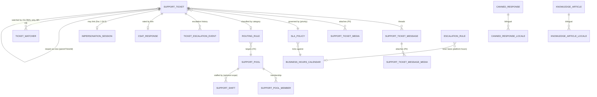

---

## 8. User Stories + Acceptance Criteria (GWT)

**US-1 — Firm submits and support is notified.**
- **Given** a firm Case Officer submits a ticket with title, description, category, priority and a screenshot, **When** it is created, **Then** it is stamped `firm_id` + submitter, `status = OPEN`, appears in the GLOBAL unassigned queue, an on-call operator is notified (in-app + email) within 60s via the `notif/` rail, and an auto-acknowledgement with the ticket number and first-response SLA (firm timezone) appears in the firm's thread in the firm's language.

**US-2 — Operator answers; internal note stays internal.**
- **Given** an operator posts an `AGENT_REPLY` and a separate `INTERNAL_NOTE`, **When** the firm opens the same ticket on LOCAL, **Then** the firm sees the reply but **not** the note (excluded from the list query, the single-ticket fetch, and any firm-facing notification), and the ticket's first-response time is stamped from the reply, **not** the note.

**US-3 — Queue ranks by urgency and SLA, in firm time.**
- **Given** ticket A (URGENT, opened 3 business-hours ago for an `America/Toronto` firm) and ticket B (LOW, opened 5 min ago), **When** the operator opens the default queue, **Then** A ranks above B with an at-risk/breach badge computed against the firm's `BusinessHoursCalendar`, and a ticket opened 23:00 in the firm timezone is **not** shown breached next morning.

**US-4 — Open impersonation from the ticket, double-gated.**
- **Given** an operator **with** `system/firm:impersonate` clicks "Open impersonation," **When** the session starts, **Then** the §4.5 path opens with justification pre-filled with the ticket reference, a persistent banner is shown, the session is step-up-gated + time-boxed and confined to the one target `firm_id` (a query against a third firm returns zero rows), and `IMPERSONATION_START`/`IMPERSONATION_END` are written to the target firm's audit chain — linked back to the ticket.
- **Given** an operator **without** `system/firm:impersonate` clicks it, **When** attempted, **Then** it returns `403` directing them to request supervisor approval, and the attempt is audited.

**US-5 — Resolve, reopen window, CSAT.**
- **Given** an operator marks a ticket `RESOLVED`, **When** the firm replies within the reopen window, **Then** it transitions to `IN_PROGRESS`; **and when** the window elapses with no reply, **Then** it auto-`CLOSED`; **and** on entering `RESOLVED` a CSAT survey was sent in the firm's language.

**US-6 — SLA pauses while waiting on the firm.**
- **Given** an `IN_PROGRESS` ticket set `WAITING_ON_FIRM`, **When** 2 business days pass before the firm replies, **Then** those 2 days are **not** counted against the resolution SLA, and on reply it returns to `IN_PROGRESS` and the clock resumes.

**US-7 — Escalation on breach.**
- **Given** an `EscalationRule` "first-response breached → notify Lead + bump priority," **When** a ticket breaches its first-response target, **Then** the Lead is notified, priority is bumped, a `TicketEscalationEvent` is recorded, and `support.sla_breached` + the escalation are audited.

**US-8 — Bilingual canned response.**
- **Given** a firm whose `language` is `fr-CA`, **When** the operator inserts a canned response with EN + FR locales, **Then** the FR version is inserted with merge fields resolved, editable before sending.

**US-9 — Routing to a content specialist.**
- **Given** a `RoutingRule` "*Immigration Content* → Content Manager pool," **When** a ticket is categorised Immigration Content, **Then** it is routed/assignable to that pool and the relevant Content Manager is notified.

**US-10 — Support metrics in SA-9.**
- **Given** resolved and open tickets with first-response/resolution timestamps, **When** the SA-9 support panel is viewed, **Then** open count, avg first-response, avg resolution, SLA attainment % and CSAT average are shown (firm-tz aware) and exportable to CSV.

**US-11 — Firm-facing KB deflection.**
- **Given** firm-facing KB articles tagged to the firm's entitled country, **When** the firm types a ticket title, **Then** matching articles are suggested in the firm's language, and "this solved it" abandons the draft and records a deflection signal for SA-9.

**US-12 — Load-based auto-assignment respects availability and capacity.**
- **Given** a Billing pool with `assignmentStrategy = LOAD_BASED`, member X (`AVAILABLE`, 2 open tickets, under capacity) and member Y (`AWAY`), **When** a BILLING ticket routes to the pool, **Then** it auto-assigns to X, emits `support.ticket_assigned`, and the audit entry records the strategy and triggering `RoutingRule`.
- **Given** every pool member is `AWAY`, `OFF_SHIFT`, or at `maxConcurrentTickets`, **When** a ticket routes, **Then** it remains unassigned in the pool queue and the pool lead is notified (BR-15/BR-16) — it is never force-assigned.

**US-13 — On-call resolution drives the 60-second promise.**
- **Given** operator Z holds an ON_CALL `SupportShift` covering 02:00, **When** a firm submits at 02:00, **Then** Z is the SA-10-2 notification target within 60s.
- **Given** no ON_CALL shift covers the instant, **When** a ticket is created, **Then** pool leads are notified instead and a config warning surfaces on the support-config screen (BR-16).

**US-14 — Sticky-on-reopen.**
- **Given** a ticket resolved by operator X, **When** the firm reopens within the window and X is eligible (available, under capacity), **Then** the ticket re-assigns to X; **and given** X is `OFF_SHIFT`, **Then** it falls back through the pool's strategy (BR-17).

**US-15 — Watcher stays informed; the firm never sees it.**
- **Given** a Support Lead added as watcher by an escalation rule, **When** any firm reply or status change lands, **Then** the Lead receives the `notif/` notification without being assignee; **and when** the firm fetches the same ticket on LOCAL, **Then** no watcher data appears in any response payload (BR-19).

**US-16 — Escalation timer ticks in platform hours, not firm hours.**
- **Given** an `EscalationRule` "no_response 240 min, `PLATFORM_BUSINESS_HOURS`" and a desk calendar of Mon–Fri, **When** a ticket sits unanswered across a weekend, **Then** the timer accrues no weekend minutes and fires only after 240 platform business-minutes; **and given** an URGENT rule with `CALENDAR_24_7`, **Then** it fires on wall-clock elapse (BR-18).

---

## 9. Edge Cases & Validations

- **Internal-note leak (critical).** The firm-side list query, single-ticket fetch AND any firm-facing notification must exclude `INTERNAL_NOTE`. Test: post an internal note while a firm session is actively viewing the ticket — the firm must receive nothing.
- **Cross-tenant REST access.** A firm requests another firm's ticket via the `agent/*` API → `404`/empty (RLS + record-level layer, Doc 1 §2.2/§4.5); regression-tested.
- **Notification on submit fires.** `support.ticket_created` reaches an on-call operator within 60s; consumer idempotent on redelivery (Doc 1 §6.1.4) — never double-notify.
- **First-response correctness.** An internal note before any reply must **not** stop the first-response clock (BR-9).
- **SLA timezone correctness.** Ticket opened 23:00 `America/Vancouver`, operator in `America/Toronto` → breach computed in Vancouver business hours. Test a `Pacific/Auckland` firm for date-line bugs.
- **SLA pause/resume accounting.** Multiple `WAITING_ON_FIRM` cycles sum paused time correctly; resolution elapsed = business-hours wall elapsed − paused.
- **Reopen window boundary.** Reply exactly at the window edge — define inclusive/exclusive and test both; after-window reply creates a **new linked** ticket (BR-8), never resurrects a terminal row.
- **Impersonation expiry mid-session.** Session auto-expires at the cap (§4.5); operator returned; ticket shows the ended linked session with its duration; `IMPERSONATION_END` present.
- **Attachment abuse.** Oversized/dangerous MIME rejected; presigned URL record-bound + time-limited; the GLOBAL path must not over-share a firm's media beyond the legitimate ticket (Doc 1 §4.5 storage rule).
- **Locale fallback.** No translation for a canned response/auto-ack → fall back to platform default, never send an empty/broken message.
- **Null priority/category.** A ticket with null priority still resolves a default `SlaPolicy` and sorts sanely (no crash).
- **Idempotent events.** `support.ticket_created` / `support.ticket_status_changed` / `support.sla_breached` consumers (notifications, escalation, metrics) are idempotent (Doc 1 §6.1.4) — never double-escalate.
- **Concurrent triage.** Two operators triage the same ticket → last-write-wins with both audited; no lost status update.
- **Missing/inactive calendar.** A firm with no resolvable `BusinessHoursCalendar` falls back to the platform default (24×7 or the configured default) and logs a config warning — the clock never crashes.
- **Round-robin under concurrency.** Two simultaneous auto-assignments in one pool must not double-select a member out of turn: the `rrCursorMemberId` advance is atomic (row-lock / UPDATE…RETURNING); each ticket gets a distinct next-eligible member.
- **Zero-eligible pool, idempotent alerting.** A pool with no eligible members accumulates unassigned tickets; the lead notification fires once per ticket (idempotent on sweep re-runs, Doc 1 §6.1.4) — no notification storm.
- **Shift boundary race.** An operator goes `OFF_SHIFT` between the eligibility check and the assignment write: the assignment stands (last-write, audited) and the operator is notified — no retroactive unassignment.
- **`awayUntil` elapse.** AWAY auto-clears at `awayUntil`; effective state is recomputed lazily on read — no scheduled job, no stale-state window.
- **Pool member removed with open tickets.** Removing a member from a pool never unassigns their open tickets; they remain assignee until re-triaged (assignment is per-ticket, membership is routing-only).

---

## 10. Permissions (Doc 1 §4.1 two-scope model)

| Permission key | Scope | Plane | Grants |
|---|---|---|---|
| `system/support:list` | GLOBAL | Super-Admin | View the cross-tenant support queue |
| `system/support:manage` | GLOBAL | Super-Admin | Reply, internal note, triage, assign, change status/priority, escalate |
| `system/support:close` | GLOBAL | Super-Admin | Force-close a ticket (reason required) |
| `system/support:config` | GLOBAL | Super-Admin | Configure categories, `SlaPolicy`, `BusinessHoursCalendar`, routing, escalation, canned responses, KB |
| `system/firm:impersonate` | GLOBAL | Super-Admin | *(Doc 1 §4.5)* Required to open impersonation from a ticket — a deliberately separate, higher grant |
| `agent/support-ticket:list` | LOCAL | Agent (firm) | View own firm's tickets |
| `agent/support-ticket:create` | LOCAL | Agent (firm) | Submit a ticket |
| `agent/support-ticket:reply` | LOCAL | Agent (firm) | Reply on / rate own firm's ticket |
| `agent/support-ticket:reopen` | LOCAL | Agent (firm) | Reopen own firm's ticket within the reopen window |

**Key ownership & catalog reconciliation.** The GLOBAL `system/support:*` and `system/firm:impersonate` keys are owned and seeded by this Super-Admin deliverable. The LOCAL `agent/support-ticket:*` keys are **firm-plane keys owned and seeded by the Agent/support console wave's catalog increment** (per Doc 1 §4.4 incremental-per-wave seeding) — SA-10 only *references* them here so the cross-plane contract is visible; they are not part of the Super-Admin catalog. The previously-bundled `agent/support-ticket:create` (which conflated create + reply + rate + reopen) is decomposed into grammar-conformant `:create` / `:reply` / `:reopen` keys to satisfy the `namespace/resource:verb[.qualifier]` grammar freeze (SA-6 OQ-9). GLOBAL `system/*` keys are **qualifier-N/A** per Doc 1 AC-4.1.3 (platform staff have no intra-firm ownership distinction), and every key in this table is reconciled against this module's `@RequirePermissions` routes by the Doc 1 §4.4 CI completeness check — the list is a catalog increment, not an illustrative table.

**Authorization invariants.** (1) `system/*` keys are for the `er:platform` pool only and are never assignable to a firm/portal role — the write-side scope filter rejects any GLOBAL permission on a LOCAL role (Doc 1 §4.3). (2) `system/support:*` **never implies** `system/firm:impersonate` (BR-7). (3) `agent/support-ticket:*` grants only within the firm's own `firm_id` (RLS, Doc 1 §2.2). (4) Internal-note read is gated to GLOBAL by message-type filtering independent of the permission keys (defence-in-depth, BR-4). (5) A raw `er:platform` token never satisfies a firm-side LOCAL route (Doc 1 AC-4.2.2) — cross-tenant work goes only through the §4.5 elevated path. (6) The §3.13 staffing layer introduces **no new permission keys**: pool/shift/strategy/calendar configuration rides `system/support:config`; watching a ticket, setting one's own AWAY, and saved queues ride `system/support:manage`; watcher data is additionally gated GLOBAL-only at the query layer (BR-19), independent of keys.

---

## 11. Scalability · Security · Performance

**Scalability.** The GLOBAL queue spans all tenants — composite indexes `(status, priority, createdAt)` and `(assignedTo, status)` + cached bucket counts keep it fast at tens of thousands of tickets; cursor pagination (≤50) with no unbounded fetch (Doc 1 §8). Metrics read DB-side incremental rollups refreshed on BullMQ from `support.*` events — never an O(n) scan. The breach sweep is a scheduled worker over `(slaState, resolutionDueAt)`, not a per-render recompute; the escalation sweep evaluates each rule on its own `clockBasis` in the same pass. Auto-assignment is O(pool size) — one indexed membership query joined to the open-count rollup, with the round-robin cursor advanced atomically (no table scans, no lock contention beyond one pool row). Watcher fan-out reuses the notification rail's existing batching. Attachments live in S3, not the DB; presigned URLs offload transfer.

**Security (the heart of this module).**
- **Plane isolation is the #1 risk.** The firm-side internal-note exclusion (every read path + notification) is the security-critical invariant (BR-4); explicit tests in §9.
- **Scoped support access vs impersonation.** Support reads the ticket only; firm data requires the §4.5 audited boundary (BR-3/BR-7) — preventing "support" from becoming unbounded PII access. Every ticket-originated impersonation is reason-bound, step-up-gated, time-boxed, confined to one firm, and immutably audited to that firm's chain (Doc 1 §4.5, §7.5).
- **Attachments are client PII.** Passports/refusal letters/CRS breakdowns can ride a ticket; access only via record-bound presigned URLs (Doc 1 §4.5), classified for SA-11 retention + PIPEDA DSR; encrypted per Doc 1 §7.1. When this ticket PII is surfaced in SA-11's single canonical per-individual export (Doc 1 §7.6), it is masked-by-default and an unmasked render emits the Doc 1 §7.2 bulk `PII_REVEAL` audit alongside the egress event (BR-13).
- **Audit completeness.** Create/assign/status/priority/escalation/force-close/impersonation-link/config-change → the §7.5 per-firm audit chain with actor, persona, UTC, before/after.
- **PII minimisation in metrics.** SA-9 rollups are aggregates; no raw ticket content crosses into analytics.

**Performance.** Workspace load = ticket + firm context + a paginated thread slice (never the whole history) + suggested KB — within Doc 1 read budgets (p95 ≤300ms). SLA computation is incremental (stored due-dates + paused accumulator), not recomputed from the full event log per render. Queue filters re-query indexed columns/cache, never raw scans.

---

## 12. Reference Note (exists / NEW / changed — honest)

This is **target-state, greenfield** language (Doc 1 §6.1 build framing); the prior private prototype is design-provenance only, not a build dependency.

- **EXISTS as a proven shape (provenance only).** The prototype demonstrated the two-plane ticket model (dual controllers, firm-side isolation), the rich `TicketStatus`/`MessageType` enums (including `INTERNAL_NOTE`), threaded messages with media, and a working per-ticket message channel — evidence the design is sound. The vendor builds it fresh on the Doc 1 foundation, not by lifting prototype code.
- **NEW (this module's build):** `SlaPolicy` + `BusinessHoursCalendar` and the timezone-/business-hours-aware SLA engine (the named foundation gap); pause-on-`WAITING_*` accounting; at-risk/breach detection + the breach sweep worker; `RoutingRule` + (optional) round-robin auto-assign; `EscalationRule` + `TicketEscalationEvent` + auto-escalate; the ticket→§4.5 impersonation bridge with double-gating, ticket-ref pre-fill, and two-way linkage; bilingual `CannedResponse` + `KnowledgeArticle` with contextual suggestions and firm-facing deflection; `CsatResponse`; the `support.*` event emissions + `notif/` fan-out (incl. the 60s-to-on-call promise + auto-ack); the SA-9 rollup feed; reopen-window auto-close + reopen-as-new-linked-ticket (`parentTicketId`); runtime-configurable categories/SLA/routing/escalation as JSONB config; **the §3.13 staffing layer** — `SupportPool`/`SupportPoolMember` (FK-targeted routing incl. plan-tier match), `SupportShift` + `OperatorAvailability` (shift/on-call/away derivation, capacity), MANUAL/ROUND_ROBIN/LOAD_BASED auto-assign with sticky-on-reopen, `TicketWatcher` (GLOBAL-only followers), `SavedQueue`, the platform-hours escalation-timer basis (`clockBasis`), and the enumerated `TicketPriority` + config-backed `TicketCategory` key registry.
- **CHANGED vs the source SA-10 draft (corrected to fold the ADR):** (a) **permission namespace** — the source used `global/support:*`; the ADR purges `global/*`, so GLOBAL keys are `system/support:*` and impersonation is `system/firm:impersonate` (Doc 1 §4.1). The firm-side `agent/support-ticket:create` was a single bundled verb; it is decomposed into `:create`/`:reply`/`:reopen` (grammar freeze, SA-6 OQ-9) and explicitly owned/seeded by the Agent/support wave, referenced here only. (b) **realtime** — the source assumed an always-on WebSocket gateway; per Doc 1, realtime push is not foundation scope, so the baseline is request/response + polling + the `notif/` rail, with a live channel as a named later-wave additive (the per-connection isolation rules are pre-stated here for that wave). (c) **tenant key** — `firm_id` is the tenant column (RLS-FORCED), not `clientId`; the end-client a ticket concerns is `clientPartyId` (a Party FK, Doc 1 §5.2). (d) **identity** — the GLOBAL plane is the `er:platform` pool (Doc 1 §3.1), genuinely walled from firm staff, not a shared user space. (e) **audit/events/storage** — wired to the Doc 1 §7.5 audit spine, §6.1 event dictionary, and §4.5 storage rule rather than module-local mechanisms; an unmasked export of ticket PII inherits the Doc 1 §7.2 `PII_REVEAL` reveal-audit guarantee via SA-11's single canonical export (BR-13).

---

## 13. Open Questions / [FOUNDER-CONFIRM]

1. **"Immigration Content" category.** Add an `IMMIGRATION_CONTENT` category value (recommended — cheap, makes routing to a Content Manager work) vs a sub-category under `CASE_RELATED`. **[FOUNDER-CONFIRM]**
2. **SLA targets & default business hours.** The first-response/resolution targets per priority and the default `BusinessHoursCalendar` (per-country? a single platform default?) are the support commitment we advertise. **[FOUNDER-CONFIRM]** — business/commercial.
3. **Reopen window default** (7 days assumed) and whether it is per-priority or global. **[FOUNDER-CONFIRM]**
4. **CSAT scale & cadence** — 1–5 vs thumbs vs CSAT/NPS, and every-resolution vs sampled (affects SA-9 metric design). **[FOUNDER-CONFIRM]**
5. **Live chat for launch?** Polling + the `notif/` rail meets "fast, never-missed" without a foundation realtime dependency; confirm whether a live chat experience is required at launch (which pulls the Doc 1 realtime wave forward) or is a fast-follow. **[FOUNDER-CONFIRM]**
6. **Inbound email → ticket reply.** Accept replies-by-email (firm emails the thread) at launch, or in-app reply only? Affects the mailer reply-to handling. **[FOUNDER-CONFIRM]**
7. **Auto-routing aggressiveness.** Suggest-only for category/priority + auto-route-by-category to a pool is the recommended launch posture; round-robin auto-assign optional. **[FOUNDER-CONFIRM]**
8. **Firm-facing KB at launch.** Internal canned responses + the impersonation bridge are the highest-impact, lowest-risk core; confirm whether the firm-facing deflecting KB is in launch scope or a fast-follow. **[FOUNDER-CONFIRM]**
9. **Bilingual coverage.** Platform system strings ship EN+FR (Doc 1 §NFR i18n); confirm the support surface (operator-authored canned responses + KB) must be authored bilingually at launch for Quebec firms (Law-25 posture). **[FOUNDER-CONFIRM]** — domain/legal.
10. **Account-manager → firm assignment.** Whether high-MRR / named-account routing draws on the firm↔account-manager assignment entity that SA-10's routing/escalation reads. Entity ownership is **decided: SA-2 owns it** (SA-2 §3.8; architect sign-off); **[FOUNDER-CONFIRM]** remains only on the high-MRR routing behaviour.

*End of Module SA-10: Support. Sits on Doc 1 (Platform Foundation). Companions: SA-2 (Tenant & Firm Management — the §4.5 impersonation machinery + account-manager assignment), SA-9 (Platform Analytics — support metrics), SA-11 (Audit & Compliance — retention, PIPEDA DSR, the single canonical per-individual export), SA-1 (Country/Content — the immigration-content routing target).*

---

# Module SA-11: Audit, Compliance & Data-Governance

> **What this document is.** The reference-depth build specification for the Super-Admin console's **governance plane** — the query, investigation, and management surface over the platform's compliance machinery. It is written to the 13-section gold standard (benchmark: AG-2). **It SITS ON Doc 1 and does not re-spec the substrate.** The per-firm hash-chained audit spine (Doc 1 §7.5), the KMS key hierarchy and field encryption (Doc 1 §7.1–7.3), the crypto-shred disposal orchestrator (Doc 1 §7.4), the governance registers' core entity contracts (Doc 1 §7.6), and the per-rail sub-processor residency matrix (Doc 1 §7.7) are all NORMATIVE in Doc 1. SA-11 is the **operator console** that *queries, investigates, configures, and proves* what those engines produce. Where this references substrate behaviour it says "per Doc 1 §X"; it does not redefine it.
>
> **Plane.** Super-Admin console, **GLOBAL**. Permission scope `system/*` only (Doc 1 §4.1) — never assignable to a firm/portal role (the write-side scope filter and remediation scan of Doc 1 §4.3 enforce this). **Content-neutral:** SA-11 specs the *builders and machinery* (the retention-floor editor, the breach workflow, the DSR clock, the residency-declaration generator). The concrete legal *values* — retention numbers, RROSH criteria, statutory deadlines, the Restricted-PII field set — are configuration set by the founder with regulatory counsel; every one is marked **[FOUNDER-CONFIRM]** and is loaded, never hard-coded.

---

## Module Index

1. Purpose & Goal
2. Users & Jobs-to-be-Done
3. Functional Design — How It Works (core)
4. Detailed Functional Requirements (SA-11-n)
5. Business Rules & Logic
6. States & Lifecycle
7. Key Entities & Fields
8. User Stories + Acceptance Criteria
9. Edge Cases & Validations
10. Permissions (GLOBAL `system/*`)
11. Scalability · Security · Performance
12. Reference Note (exists / NEW / CHANGED)
13. Open Questions / [FOUNDER-CONFIRM]

### Visual Overview — the governance plane over the Doc-1 substrate

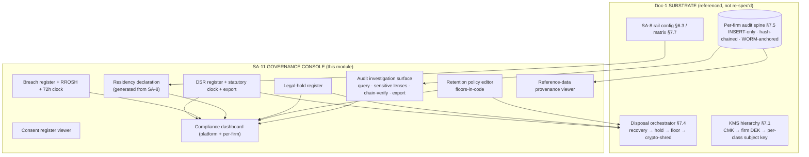

---

## 1. Purpose & Goal

**What it is.** SA-11 is the **governance and compliance control plane** of the ExpatReady platform — the single Super-Admin console where the operator team *queries the immutable audit record, configures retention and legal holds, proves where every byte of data lives, runs the PIPEDA / Law-25 obligations (breach, DSR, consent), and reads the provenance of immigration reference data*. It does not build the tamper-evidence, the encryption, or the disposal engine — those are Doc 1 substrate (§7). SA-11 is the **human-operable surface** that makes the substrate's guarantees checkable, configurable, and defensible under regulatory scrutiny.

**The business outcome it must produce.** ExpatReady serves a regulated profession handling the most sensitive personal data a person ever surrenders — passports, biometrics references, family composition, medical and criminal admissibility signals. A firm cannot adopt a SaaS that cannot prove, on demand, that (a) every access to that data is on an unalterable record, (b) the data lives where the law requires, (c) it is kept and destroyed on a lawful schedule, and (d) a breach or data-subject request is handled inside its legal clock. SA-11 makes **"we can produce and prove our compliance posture at any moment"** an operator workflow rather than a spreadsheet scramble: filter the per-firm chain, click "verify," export self-proving evidence; see one dashboard that says whether any rail left Canada, any floor is at risk, any clock is running out.

**Why it matters / world-class positioning.** A generic admin panel has a mutable "activity log" nobody trusts in a dispute. ExpatReady's record is evidence-grade *by construction* (Doc 1 §7.5: INSERT-only grant, per-firm hash chain, WORM anchor, continuous verify). SA-11's job is to turn that substrate into the three things a privacy regulator actually asks for: **a query that answers "who touched this PII, when, and why,"** **a one-click chain-verification that proves the record was not altered,** and **a register that shows every breach and every DSR against its legal deadline.** The moat is two-fold: governance is native, not bolted-on — every sensitive action across all three consoles lands on the same verifiable spine; and governance is **global-by-construction** — residency, retention floors, and the breach/DSR regulator are modelled per country plane (per Doc 1 §2.9 region seam and the SA-1 Country Pack), so adding Australia or the UK is configuration, not a re-architecture.

**How it ties to the platform.** SA-11 *consumes* the substrate (Doc 1 §7) and *governs* every other module: it surfaces every `system/*` action from SA-1…SA-12 and every audited firm/portal action; it derives the residency declaration from SA-8 rail config (Doc 1 §6.3) and the SA-1 country residency profile; it drives the disposal orchestrator (Doc 1 §7.4) via its retention and hold registers; and it reads the SA-1 reference-data change events as a navigable provenance trail. The event vocabulary it queries and emits is the canonical Domain Event Dictionary (Doc 1 §6.1).

---

## 2. Users & Jobs-to-be-Done

SA-11 is operated exclusively by ExpatReady's internal team (GLOBAL plane). Firm staff and clients *generate* audit events and *raise* DSR requests, but do not operate this console.

| Role | Primary job in SA-11 | Jobs-to-be-done (representative) |
|---|---|---|
| **Platform Owner** | Own and prove the platform's compliance posture. | "When an auditor asks for every impersonation and PII-reveal on Firm X in 90 days, I want to query, verify the chain is intact, and export — in minutes, as self-proving evidence." · "One dashboard must tell me if any rail is non-Canadian without a safeguard, any floor is at risk, any breach or DSR is past its clock." · "Even a court-ordered audit deletion must be a two-person, itself-audited path." |
| **Compliance / DPO** | Run PIPEDA / Law-25 day-to-day. | "When a firm reports a possible breach, I open a record, run the RROSH gate, and — if it crosses — produce OPC and individual notifications within the 72-hour clock." · "When a client exercises access/correction/erasure, I track each against its statutory deadline and see what's overdue." · "When counsel sets a floor, the system must never let me configure below it." |
| **Tenant Account Manager** | Account for platform access to one firm's data. | "Every impersonation I run is reason-gated and on the immutable record; I can show a firm exactly who from ExpatReady touched their tenant and why." |
| **Country / Content Manager** | Prove the provenance of reference data. | "When a firm disputes an assessment, I show who published which version of the CRS table, when, with the diff — so the calculation is reproducible." |
| **Platform Engineer / DevOps** | Operate the substrate; respond to integrity alarms. | "When chain-verify finds a break, I get an immediate page with the exact `firm_id` + `sequenceNo`." · "When a rail region changes in SA-8, the residency declaration updates and warns me if I introduced a non-Canadian dependency." |
| **Support Agent** | Light, gated use. | "When I triage via impersonation, the session is pre-justified from the SA-10 ticket and recorded, so my access is accountable without extra steps." |

**Touchpoints (not operators).** *Firm staff* generate the bulk of audit events and may, in firm settings, *view* their own DPA / retention declaration and their own per-firm access report (published from here, tenant-scoped); they never see the platform-wide log or another tenant. *Clients* generate auth/document-access events and *raise DSR requests* from the portal, which land in this register.

**Design implication.** The Platform Owner and DPO are the protagonists: the investigation surface (query + chain-verify + export), the breach workflow, the DSR register, and the residency/retention dashboards are designed for *defensibility under a deadline*. Permissions (§10) cleanly separate read-the-log from configure-policy from manage-a-breach — least privilege on the most sensitive console in the platform.

---

## 3. Functional Design — How It Works (core)

SA-11 is one module with six tightly-coupled governance surfaces, all GLOBAL-plane, all reading or driving the Doc-1 substrate. They are specified together because they are operationally inseparable: a breach investigation reads the audit spine; a DSR erasure must respect a legal hold and is itself audited; a retention disposal is driven by this console's policy yet executed by the Doc-1 orchestrator.

### 3.0 The console-over-substrate model

**Design decision (normative).** SA-11 owns *no* tamper-evidence mechanism, *no* encryption, *no* disposal execution of its own. Those are Doc 1 §7. SA-11 owns the **registers** (RetentionPolicy, LegalHold, BreachRecord, DsrRequest, ConsentRecord viewer, ResidencyDeclaration) and the **read/query/export surfaces** over the audit spine. This keeps a single source of truth: money lives in the Biller/Accounting plane, encryption lives in KMS, the audit chain lives in the spine — SA-11 *governs and surfaces*, it does not duplicate.

**Audit-read catalog ownership (normative, per Doc 1 §4.4).** SA-11 is the **single owner of the platform audit-read catalog keys** — `system/audit-log:list`, `system/audit:export`, and `system/audit:verify`. Any other module that surfaces an audit lens over the Doc 1 §7.5 spine (SA-6's RBAC-change audit lens, SA-7's platform-user audit-view) REFERENCES these exact SA-11 keys; it does not coin a parallel `system/rbac-audit:read`, `system/platform-user:audit-view`, or `system/audit:read-all`. This satisfies the Doc 1 §4.4 CI completeness rule (every `@RequirePermissions` resolves to exactly one catalog entry; no near-synonyms).

### 3.1 The audit investigation surface — "find it, prove it's intact, hand it over"

**How it works.** The investigation console queries the per-firm audit spine (Doc 1 §7.5) through a **read replica / search projection**, never the write path (Doc 1 §7.5, §8.2). Filters: **date range (required)**, actor, `actorType` (super_admin / firm_staff / client / system — the persona column on the spine), `firm_id`/tenant, action code (from the Domain Event Dictionary, Doc 1 §6.1), `(entityType, entityId)` (validated against the EntityTypeRegistry, Doc 1 §5.8), the **sensitive-event lenses** (PII-reveal / impersonation / cross-tenant), and `correlationId` to pull a whole operation across modules.

**World-class behaviour.**
- **Every export is self-proving.** Export to CSV/JSON over a range + filter set **runs chain-verify over the exported range** (per Doc 1 §7.5 continuous-verify, invoked on demand here) and attaches a "chain intact ✓ / BREAK at firm `F` seqNo `N`" report plus the relevant WORM-anchor digests. The export is itself an auditable egress event and emits `CROSS_TENANT_ACCESS` (the unscoped read spans tenants).
- **Correlation pivot.** From any entry, "show the whole operation" pulls every entry sharing `correlationId` — turning one suspicious row into the full request story.
- **Saved investigations.** "All impersonations of Firm X, last 90 days" is a first-class saved query with one-click auditor-pack export, because the real job is producing evidence under a deadline.

**Cross-plane slicing.** Because every entry carries `actorType` and `firm_id`, the platform-wide lens (GLOBAL, `system/audit-log:list`) sees all chains, while the per-firm published view shows only that firm's `firm_staff` entries plus the `super_admin` entries that touched *their* tenant — never another firm's. Same spine, correctly sliced by plane and persona.

**Key screens.** *Investigation console* (filter bar + results + chain-integrity banner), *entry detail* (payload, before/after refs over ciphertext — never plaintext, Doc 1 §7.4 — chain position, anchor reference), *export dialog* (range + filters + format + "include chain-verify report"), *saved investigations*.

### 3.2 Sensitive-event lenses — "PII reveals, impersonation, cross-tenant ops are first-class"

**How it works.** The three event classes a regulator scrutinises first are emitted by the substrate as dedicated, queryable types (Doc 1 §7.5 lists them as audited) and SA-11 gives each a one-click lens:
- **PII reveal.** Restricted fields are mask-by-default (Doc 1 §7.2); unmasking emits `PII_REVEAL` capturing field/document, subject Party, actor + persona, and reason context (Doc 1 §7.2: recorded *before* cleartext is returned, fail-closed). SA-11 surfaces "every PII reveal in this window" as a lens — including the **bulk `PII_REVEAL`** events that the canonical per-individual export emits when it is run unmasked (§3.7).
- **Impersonation.** The elevated cross-tenant path (Doc 1 §4 / SA-2) emits `IMPERSONATION_START`/`IMPERSONATION_END` (reason, firm, operator) and stamps every action in the session with the operator's identity + `actorType = super_admin` + the impersonated context. SA-11 reconstructs the session timeline; destructive/financial actions blocked during impersonation (SA-2 rule) still log the *attempt*.
- **Cross-tenant operation.** Any GLOBAL-plane read/action spanning more than one tenant — including SA-11's own unscoped audit query and export — emits `CROSS_TENANT_ACCESS` naming operator and scope (god-mode is self-logging, BR-14).

**Key screens.** Three lens chips on the investigation console; *per-firm access report* (who from ExpatReady touched this tenant, when, why — strictly tenant-scoped, export-ready).

### 3.3 Retention policy editor & disposal oversight — "keep exactly as long as the law requires"

**How it works.** SA-11 owns the `RetentionPolicy` register: a period **per data class** (immigration PII / case records, financial records, communications, audit & security logs, consent & DSR records, document files), per country. Each class has a **legal floor enforced in code** (Doc 1 §7.5/§7.6: configurable above the floor, never below); the editor and the API both reject sub-floor values with a precise message. The **effective** period is `max(applicable per-country minimums)` (Doc 1 §7.6) — the higher floor always wins.

**Disposal is executed by the Doc-1 orchestrator, overseen here.** SA-11 does not run the crypto-shred; it configures the policy and surfaces the orchestrator's lifecycle (recovery-window → legal-hold-beats-deletion → per-retention-class floor → crypto-erase the eligible class sub-key → verified hard-delete → `DATA_DISPOSED` chained event → disposal certificate — Doc 1 §7.4). The console shows: what is eligible, what is **blocked by hold**, the **pre-disposal manifest** for high-sensitivity classes, and the immutable record that *something was disposed on schedule* (the disposal audit entry survives the data — BR-8).

**Key screens.** *Retention editor* (class × country grid; floor shown and enforced; effective date; version history), *archival/disposal oversight* (eligible / held / disposed, manifest review), *DPA-retention declaration* (the firm-facing published view, fed from here, SA-11-19).

### 3.4 Legal-hold register — "freeze beats schedule beats deletion"

**How it works.** A `LegalHold` placed on a scope (firm / case / Party / document / data class / date range) for litigation, a regulatory investigation, or a CICC-equivalent complaint **overrides every deletion schedule and DSR clock** (Doc 1 §7.6). The orchestrator (Doc 1 §7.4) checks active holds **at execution time** before any archive/dispose/erase; an in-scope action is blocked and the refusal audited. A hold has reason, owner, `placedAt`, nullable `releasedAt`; placement and release are chained audit events. Precedence (BR-7) is legally correct: a preservation obligation never yields to a deletion obligation.

**Key screens.** *Legal-hold register* (active/released, scope, reason, owner), *place/release hold* (reason mandatory), *hold indicator* surfaced on any disposal/DSR it blocks (answers "why is this still here / why can't I delete this").

### 3.5 Data-residency declaration & enforcement — "prove where every byte lives; flag the moment it leaves Canada"

**How it works.** SA-11 maintains a **generated** residency declaration: per data class, the storage location of each rail (DB region, object-storage region, cache region, IdP region) and the residency status (`Canadian` / `Non-Canadian` / `Non-Canadian-with-confirmed-safeguard`). It is **derived from SA-8 rail config** (Doc 1 §6.3) and the per-rail sub-processor residency matrix (Doc 1 §7.7) — not hand-typed — so it cannot drift from reality (BR-10): change a bucket region in SA-8 and the declaration recomputes. The rail set is the rail-neutral port set of Doc 1 §6.3 (no vendor-named rail entities); the SA-8 own-account mail/calendar connector and the `DomainRailPort` (the documented sixth rail, v1 adapter AWS ACM — Doc 1 §6.3 / §7.7) appear here as additional sub-processor surfaces whenever wired.

**Enforcement & flagging.** Any class whose rail/sub-processor is **Non-Canadian without a confirmed safeguard** raises a compliance warning on the dashboard, linked to the offending SA-8 integration — surfaced before an auditor finds it. Residency is modelled **per country plane** (Doc 1 §2.9 region seam + SA-1 country residency profile): Canada launches in `ca-central-1`; physical per-country routing for other jurisdictions is region-scoped configuration + key provisioning, not a rewrite. The day-1 enforcement is *declaration + warning*; the region seam makes physical routing additive.

**Key screens.** *Residency declaration* (class × rail × region × status, generated, export-ready as the DPA sub-processor disclosure), *compliance warnings* (linked to SA-8), *sub-processor list export*, *per-country residency profile* (SA-1-linked).

### 3.6 PIPEDA / Law-25 — breach register & notification — "the 72-hour clock, run inside the tool"

**How it works.** SA-11 owns the `BreachRecord` register: it records **every** breach of security safeguards regardless of severity (PIPEDA mandates a ≥ 2-year record of all breaches — Doc 1 §7.6). A record captures discovery timestamp (the clock origin), description, affected tenant(s), affected data classes, root cause, containment, a structured **RROSH** ("real risk of significant harm") assessment, the notification decision, and links to every notification produced. A breach can be opened manually or triggered by a security/integrity alarm (a chain-break from Doc 1 §7.5, a cross-pool 401 storm).

**Notification (the 72-hour workflow).** When the RROSH gate crosses the threshold, the tool composes notification to the **OPC (or per-country regulator from the SA-1 country plane)** and affected individuals with the legally-required content (nature, what was affected, mitigation, contact). The breach screen shows **time-since-discovery against the 72-hour marker** with escalating reminders, wired to the same legal-clock alerting as the audit-chain alarm (Doc 1 §7.5/§7.6, §8 observability). Each notification is recorded (who/when/channel/recipients/content snapshot) on the breach and on the audit spine. Record-keeping is unconditional; notification is conditional on RROSH (BR-11) — so the platform neither under-reports nor over-notifies.

**[FOUNDER-CONFIRM]** the RROSH threshold criteria, the notification content template, the clock interpretation, and any Quebec **Law-25** overlay are legal determinations (set with counsel); the gate and clock machinery are fixed (Doc 1 §7.6).

**Key screens.** *Breach register* (all breaches, status, clock, affected scope), *breach detail + RROSH assessment*, *notification composer*, *breach report* (for an audit).

### 3.7 PIPEDA / Law-25 — DSR register, the canonical export & consent — "access, correction, erasure, portability, tracked against the clock"

**How it works.** SA-11 owns the `DsrRequest` register tracking requests raised by clients (portal) or by firms on a client's behalf: type (**access / correction / erasure / portability**), requester, firm, date received (clock origin), statutory deadline, status, and fulfilment actions. The register highlights anything approaching/past its deadline (the same "never miss the legal deadline" posture as the breach clock; wired to the legal-clock alarm, Doc 1 §7.6).

- **Access / portability** is served by the **ONE canonical per-individual export** (Doc 1 §7.6): a single identity-verified job producing machine-readable JSON + human-readable PDF of all of one individual's personal information across modules — masked-by-default, audited as a data egress. SA-11 *invokes and tracks* this one export; it does not author five partial per-module exports (single egress chokepoint, single source of truth). **Reveal-and-audit (normative).** The default bundle is masked. Producing an **unmasked** bundle (the authorized, identity-verified case) is the bulk equivalent of an in-app reveal and therefore inherits the full Doc 1 §7.2 reveal guarantee: it requires the reveal permission, and it records a **bulk `PII_REVEAL`** audit (the field set revealed + subject Party + actor + persona + justification) to the per-firm spine, written *before* the cleartext is assembled (fail-closed: if that reveal audit fails, no unmasked bundle is produced) — this is **in addition to** the data-egress event the release emits. An egress event alone is not a §7.2 reveal audit; both are required so the single egress chokepoint carries the same fail-closed reveal-audit guarantee as an in-app reveal (BR-16).
- **Correction** records the change and its audit trail.
- **Erasure** routes through the disposal orchestrator (Doc 1 §7.4): identity verify → **check legal holds and per-class retention floors** → crypto-shred the eligible `standard` class sub-key now, **retain the `financial-7yr` class until floor expiry** → `DATA_DISPOSED` chained. An erasure intersecting a hold or unexpired floor is marked **HELD/partial** with an honest disclosure note ("PII deleted; financial records retained until {date}") — never falsely COMPLETED (BR-12).

**Consent register (viewer).** SA-11 surfaces the `ConsentRecord` register (Doc 1 §7.6): per-purpose, versioned, withdrawable consent with timestamp, scope, locale, and capturing form/version — the evidentiary base behind every "did this person consent?" Downstream modules read **live** consent state at point of use (BR-13); SA-11 is the read/audit surface. Withdrawals are first-class and halt downstream processing.

**Key screens.** *DSR register* (type, clock, status, overdue lens), *DSR detail & fulfilment* (per-type workflow; hold/floor checks surfaced), *per-individual export* (identity-verify gate, masked-by-default, reveal-gated, audited — egress + bulk reveal), *consent record viewer* (per subject; scope, locale, version, withdrawals).

### 3.8 Reference-data provenance & compliance dashboards

**Provenance.** Every SA-1 Country Pack content change (program edits, scoring-config/scoring-bracket updates, eligibility-rule changes, form-edition uploads) is recorded with before/after on the same per-firm/global audit spine (Doc 1 §7.5). The GLOBAL versioned authoring entities behind these — `ScoringConfig`/`ScoringBracket`, `EligibilityRuleSet`/`EligibilityRule`, `StageTemplate`/`StagePipeline`, `ReferenceDataset`/`ReferenceDatasetVersion`, `RegulatorConfig`, `Country`/`CountryPackVersion`, `LocalizedLabel` — are owned and field-specified in Doc 1 §5 (and §5.8); SA-1 authors over them. SA-11 provides the navigable **per-entity change history** — "every version of the CRS scoring config, who published each, when, the diff" — the provenance trail that, combined with the `packVersionId`/`programNodeKey` stamping (Doc 1 §5.8), makes a disputed assessment reproducible. *(Disambiguation: SA-1's immigration `ConditionFlagDefinition` — content-neutral, canonicalField-derived, resolved to per-case `ComboFlagValue` (CLIENT-PII) — is distinct from SA-3's `CommercialFeatureCatalog` commercial entitlement and SA-12's operational `FeatureFlag`; SA-11 surfaces the provenance of the SA-1 content entities, not the commercial/operational flag catalogs.)*

**Dashboards.** A **platform compliance dashboard** (Platform Owner/DPO): chain-integrity status (last verified, last anchor, breaks), residency warnings, retention health (floor violations should always be zero by code; disposals overdue/blocked), open breaches with clock, DSRs by status with overdue count, impersonations/PII-reveals this period, active legal holds. A **per-firm compliance report** (account manager): who from ExpatReady accessed it, the firm's residency/retention declaration, open DSRs/breaches affecting it, consent posture — **strictly tenant-scoped, never leaks another firm.** Dashboards read pre-aggregated rollups (Doc 1 §8.2), not live scans; every panel is export-ready bundling a chain-verify report where relevant.

---

## 4. Detailed Functional Requirements (SA-11-n)

**Audit investigation & sensitive lenses (over Doc 1 §7.5)**

- **SA-11-1.** SA-11 SHALL provide an audit-investigation console that queries the per-firm audit spine (Doc 1 §7.5) via a read replica / search projection, never the write path, with filters: **date range (required)**, actor, `actorType`, `firm_id`/tenant, action code (Doc 1 §6.1 dictionary), `(entityType, entityId)`, sensitive-event lens, and `correlationId`.
- **SA-11-2.** The console SHALL display a **chain-integrity banner** (last verified, last WORM anchor, any break with `firm_id` + `sequenceNo`) sourced from the Doc 1 §7.5 continuous-verify job, and SHALL allow on-demand chain-verify over a selected range.
- **SA-11-3.** Audit export (CSV/JSON) SHALL run chain-verify over the exported range and attach a "chain intact ✓ / BREAK at firm F seqNo N" report plus relevant anchor digests; the export SHALL itself be audited as a data-egress event and SHALL emit `CROSS_TENANT_ACCESS`.
- **SA-11-4.** SA-11 SHALL provide one-click **sensitive-event lenses** — all PII reveals (`PII_REVEAL`, including bulk export reveals per SA-11-21), all impersonations (`IMPERSONATION_START`/`END` + in-session actions), all cross-tenant operations (`CROSS_TENANT_ACCESS`) — for a window.
- **SA-11-5.** SA-11 SHALL provide a **correlation pivot** ("show the whole operation" by `correlationId`) and **saved investigations** with one-click auditor-pack export.
- **SA-11-6.** Audit reads SHALL be plane-correct: the platform-wide lens (`system/audit-log:list`) spans all firms; a published per-firm view shows only that firm's `firm_staff` entries plus `super_admin` entries that touched it (BR-4, BR-14). Entry detail SHALL show before/after over ciphertext/HMAC references only, never plaintext (Doc 1 §7.4).

**Retention, disposal oversight & legal hold (drives Doc 1 §7.4/§7.6)**

- **SA-11-7.** SA-11 SHALL provide a `RetentionPolicy` editor: a period **per data class, per country**, each with a **legal floor enforced in code**; sub-floor values SHALL be rejected by both UI and API. The effective period SHALL be `max(applicable per-country minimums)`.
- **SA-11-8.** Floor defaults SHALL be **[FOUNDER-CONFIRM]** (proposed: financial-linked ≥ 7yr, breach records ≥ 2yr, other audit/security ≥ 2yr — Doc 1 §7.5/§7.6); the mechanism enforces whatever values counsel confirms.
- **SA-11-9.** SA-11 SHALL surface the Doc 1 §7.4 disposal lifecycle (eligible / blocked-by-hold / disposed), the **pre-disposal manifest** for high-sensitivity classes, and the immutable `DATA_DISPOSED` record that survives the disposed data (BR-8). SA-11 configures policy; the orchestrator executes the crypto-shred.
- **SA-11-10.** SA-11 SHALL provide a `LegalHold` register to place/release holds scoped to firm/case/Party/document/class/date-range, with mandatory reason and owner; an active hold SHALL block archival, disposal, and DSR erasure of in-scope data (enforced by the Doc 1 §7.4 orchestrator); placement/release SHALL be audited. **Precedence: hold > retention schedule > deletion** (BR-7).
- **SA-11-11.** A regulatory-ordered confirmed deletion of audit data SHALL require **two-person authorization** (one Platform Owner initiates, a distinct second confirms) with a mandatory order reference, and SHALL itself be audited (BR-9). This is the *only* path that can ever remove audit data.
- **SA-11-12.** The retention policy SHALL be **published to firms** as their DPA/retention declaration (firm settings); SA-11 supplies the data.

**Data residency (over Doc 1 §6.3/§7.7)**

- **SA-11-13.** SA-11 SHALL present a **generated** residency declaration (per data class: DB/object-storage/cache/IdP region + status `Canadian` / `Non-Canadian` / `Non-Canadian-with-safeguard`), derived from SA-8 rail config + the Doc 1 §7.7 sub-processor matrix — never hand-entered (BR-10). The declaration SHALL cover the rail-neutral port set (Doc 1 §6.3), including the own-account connector sub-processor and the `DomainRailPort` (sixth rail) where wired.
- **SA-11-14.** Any class whose rail/sub-processor is **Non-Canadian without a confirmed safeguard** SHALL raise a dashboard compliance warning linked to the offending SA-8 integration.
- **SA-11-15.** The residency declaration and the maintained sub-processor list SHALL be **exportable** for a firm's DPA.
- **SA-11-16.** Residency SHALL be modelled per country plane (Doc 1 §2.9 region seam + SA-1 residency profile); Canada launches `ca-central-1`; adding another jurisdiction's region SHALL be configuration + key provisioning, not a rewrite.

**PIPEDA / Law-25 — breach (over Doc 1 §7.6)**

- **SA-11-17.** SA-11 SHALL maintain a `BreachRecord` register recording **every** breach regardless of notification threshold (retained ≥ 2yr): discovery timestamp, description, affected tenants/classes, root cause, containment, RROSH assessment, notification decision, notification links.
- **SA-11-18.** Where the RROSH gate crosses the threshold, SA-11 SHALL support notification to the OPC (or per-country regulator from SA-1) and affected individuals with the legally-required content, recording each (who/when/channel/recipients/content snapshot) on the breach and audit spine.
- **SA-11-19.** The breach screen SHALL display **time-since-discovery against the 72-hour marker** with escalating reminders, wired to the legal-clock alarm (Doc 1 §7.6). RROSH criteria, content template, clock interpretation, and Law-25 overlay are **[FOUNDER-CONFIRM]**.

**PIPEDA / Law-25 — DSR, export & consent (over Doc 1 §7.6)**

- **SA-11-20.** SA-11 SHALL maintain a `DsrRequest` register (access/correction/erasure/portability): requester, firm, type, date received, statutory deadline, status (`PENDING`/`IN_PROGRESS`/`COMPLETED`/`OVERDUE`/`HELD`), fulfilment actions; the register SHALL highlight requests approaching/past their deadline.
- **SA-11-21.** Access/portability DSRs SHALL be served by the **one canonical per-individual export** (Doc 1 §7.6): identity-verified, JSON + PDF, **masked-by-default**, audited as egress. SA-11 invokes/tracks this single export, never partial per-module exports. An **unmasked** bundle SHALL be gated on the Doc 1 §7.2 reveal permission and SHALL emit a **bulk `PII_REVEAL`** audit (field set revealed + subject Party + actor + persona + justification) written *before* cleartext assembly (fail-closed), **in addition to** the egress event — so the export inherits the same fail-closed reveal-audit guarantee as an in-app reveal (BR-16). The default (no reveal) produces a masked bundle and emits only the egress event.
- **SA-11-22.** An **erasure** DSR SHALL route through the Doc 1 §7.4 orchestrator (hold + per-class floor check → crypto-shred eligible class sub-key, retain floored class); where law prevents full erasure it SHALL be marked **HELD/partial** with an honest disclosure note — never falsely COMPLETED (BR-12).
- **SA-11-23.** SA-11 SHALL provide a **consent-record viewer** over the Doc 1 §7.6 `ConsentRecord` register (per-purpose, versioned, locale + form-version, withdrawals); withdrawals are first-class; downstream modules read **live** consent (BR-13).

**Provenance & dashboards**

- **SA-11-24.** SA-11 SHALL provide a **per-entity reference-data change-history viewer** over the audit spine (every version of a piece of SA-1 reference data — `ScoringConfig`/`ScoringBracket`, `EligibilityRuleSet`/`EligibilityRule`, `ReferenceDatasetVersion`, `CountryPackVersion`, etc., owned in Doc 1 §5 — with publisher, UTC timestamp, action, before/after diff), reachable from the SA-1 editor and the audit console.
- **SA-11-25.** SA-11 SHALL provide a **platform compliance dashboard** (chain integrity, residency warnings, retention health, open breaches + clock, DSRs by status + overdue, impersonations/PII-reveals this period, active holds) and a **per-firm compliance report** (strictly tenant-scoped); all panels exportable, bundling a chain-verify report where relevant.

---

## 5. Business Rules & Logic

- **BR-1 (Append-only is the substrate's job).** SA-11 exposes no UPDATE/DELETE on audit entries — the immutability is the Doc 1 §7.5 INSERT-only grant; SA-11's UI offers no edit path, by design.
- **BR-2 (Chain integrity is mandatory).** A break is an incident, not a warning: SA-11 surfaces the Doc 1 §7.5 integrity alarm prominently and blocks "chain intact" claims when a break exists (the export report says BREAK honestly).
- **BR-3 (Actor type is always explicit).** Every entry has a non-null `actorType`; system actions are `system`, impersonated actions are `super_admin` with impersonated context — never inferred (Doc 1 §7.5).
- **BR-4 (Tenant is explicit; null means global).** `firm_id` is the tenant; null is a genuinely platform-wide action. `firm_id` and `client_id` are separate keys (Doc 1 §2.1).
- **BR-5 (Audit-write durability is the substrate's job).** The audit write is synchronous-via-outbox, atomic with the user op (Doc 1 §7.5); SA-11 never assumes a best-effort log.
- **BR-6 (Retention floors are uncrossable).** Any sub-floor period is rejected by UI and API; effective = `max(applicable per-country minimums)`.
- **BR-7 (Hold beats schedule beats deletion).** Legal hold > retention schedule > deletion obligation; enforced in the Doc 1 §7.4 orchestrator, surfaced here.
- **BR-8 (Disposal is recorded forever).** The `DATA_DISPOSED` audit record survives the disposed data permanently.
- **BR-9 (Two-person rule for audit deletion).** The only path that removes audit data — a confirmed regulatory order — needs two distinct Platform Owners and is itself audited.
- **BR-10 (Residency declaration is generated, never hand-typed).** Derived from SA-8 rail config + the Doc 1 §7.7 matrix; cannot drift.
- **BR-11 (Breach record-keeping is unconditional; notification is conditional).** Every breach is recorded; OPC/individual notification is gated on RROSH.
- **BR-12 (DSR erasure is honest).** A hold/floor-blocked erasure is HELD/partial with disclosure (PII deleted vs floored class retained until date) — never false success (Doc 1 §7.4).
- **BR-13 (Consent read is always live).** Downstream modules read current consent at action time, not a cached snapshot.
- **BR-14 (Cross-tenant access is self-logging).** Any GLOBAL-plane operation spanning multiple tenants logs itself — including the audit query and export that produce evidence.
- **BR-15 (Legal/retention numbers come from counsel).** Every concrete period, threshold, deadline, and residency commitment is configurable; defaults carry the floor only; values are **[FOUNDER-CONFIRM]**.
- **BR-16 (Unmasked export is a reveal, not just an egress).** Producing an unmasked canonical per-individual export is the bulk equivalent of an in-app PII reveal: it is gated on the Doc 1 §7.2 reveal permission and emits a bulk `PII_REVEAL` audit (field set + subject + actor + persona + justification) *before* cleartext assembly, fail-closed, in addition to the data-egress event. Masked-by-default; an egress event alone never substitutes for the §7.2 reveal audit.

---

## 6. States & Lifecycle

**A. Audit entry** (no lifecycle beyond birth and sealing — that is the point; the entry itself is Doc 1 §7.5):

```mermaid
stateDiagram-v2
    [*] --> Written : INSERT (per-firm chained, sequenced)
    Written --> Anchored : periodic WORM seal (head digest)
    Anchored --> Disposed : ONLY via two-person regulatory-ordered deletion (itself audited)
    Written --> Disposed : same
    note right of Written : NEVER Updated; NEVER Deleted (BR-1)
    note right of Disposed : disposal record survives (BR-8)
```

**B. Retained data record** (the lifecycle the Doc 1 §7.4 orchestrator drives; SA-11 oversees):

```mermaid
stateDiagram-v2
    [*] --> Active : created
    Active --> ColdArchived : past active window, within total retention
    ColdArchived --> SoftDeleted : full retention elapsed, no hold
    Active --> SoftDeleted : full retention elapsed, no hold
    SoftDeleted --> Disposed : recovery window elapsed → crypto-shred (DATA_DISPOSED, chained)
    Active --> Held : legal hold placed
    ColdArchived --> Held : legal hold placed
    Held --> Active : hold released (re-evaluate)
    Disposed --> [*]
    note right of Held : hold blocks archive/dispose/DSR-erase (BR-7)
```

- **C. Breach record:** `Discovered → Assessing(RROSH) → {Notifiable → Notifying → Notified | Not-notifiable} → Closed` (retained ≥ 2yr; 72h clock from Discovered).
- **D. DSR:** `Pending → InProgress → {Completed | Held/Partial | Overdue}` (statutory deadline from received; erasure checks hold + per-class floor).
- **E. Legal hold:** `Placed(active) → Released` (both audited; while Placed, freezes in-scope class sub-keys).
- **F. Residency status (per class):** `Canadian | Non-Canadian-with-safeguard | Non-Canadian(WARN)` — derived, recomputed on any SA-8 change.

---

## 7. Key Entities & Fields

> The audit spine entity (`AuditLog` with `firm_id`, `actorType`/persona, `sequenceNo`, `prevHash`, `entryHash`, `correlationId`, ciphertext-ref before/after) is **owned and specified by Doc 1 §7.5** — SA-11 reads it, does not redefine it. The governance registers below are owned by SA-11. All are firm-scoped where they reference a tenant, GLOBAL where genuinely platform-wide (`firm_id IS NULL` global-plane policy, Doc 1 §2.6); all carry standard `id` (UUID PK), `createdAt`/`updatedAt`. Restricted PII is never stored here in plaintext; references are ciphertext/HMAC (Doc 1 §7.2–7.4). Country joins use the canonical ISO `countryCode` key (Doc 1 §5.8; `Country.id == countryCode`), consistent with the rest of the spine.

```mermaid
erDiagram
    RETENTION_POLICY ||--o{ DATA_CLASS : "period per (class x country)"
    LEGAL_HOLD }o--o{ DATA_CLASS : "freezes"
    LEGAL_HOLD }o--o| FIRM : "scoped to"
    RESIDENCY_DECLARATION ||--o{ DATA_CLASS : "locates"
    RESIDENCY_DECLARATION }o--o| COUNTRY : "per country plane (SA-1)"
    BREACH_RECORD }o--o{ FIRM : "affects"
    BREACH_RECORD ||--o{ BREACH_NOTIFICATION : "produces"
    DSR_REQUEST }o--|| FIRM : "raised within"
    DSR_REQUEST ||--o{ DSR_ACTION : "fulfilled by"
    DSR_REQUEST ||--o| DATA_EXPORT_JOB : "served by (access/portability)"
```

- **RetentionPolicy** *(NEW — SA-11)* — `id`; `dataClass` (enum: immigration_pii / financial / communications / audit_security / consent_dsr / document_files); `countryCode` (ISO FK → Country, Doc 1 §5.8; nullable = platform default); `retentionPeriod` (interval); `legalFloor` (interval, code-enforced, read-only in UI); `archivalAfter` (interval, nullable); `recoveryWindow` (interval); `version` (int); `effectiveDate` (timestamptz); `updatedBy` (platform user FK). Indexes: `(dataClass, countryCode)`, `(effectiveDate)`.
- **LegalHold** *(NEW — SA-11)* — `id`; `scopeType` (enum: firm / case / party / document / dataClass / dateRange); `scopeRef` (text/UUID, polymorphic — validated against EntityTypeRegistry where applicable, Doc 1 §5.8); `dataClasses` (enum[]); `firmId` (FK, nullable for cross-firm regulatory hold); `reason` (text, required); `ownerId` (platform user FK); `placedAt`; `releasedAt` (nullable); `status` (enum: active / released). Indexes: `(status, scopeType, scopeRef)`, `(firmId)`.
- **ResidencyDeclaration** *(NEW — SA-11, generated)* — `id`; `dataClass`; `countryCode` (ISO FK → Country, Doc 1 §5.8); `rail` (enum: db / object_storage / cache / idp / connector / domain — the rail-neutral port set, Doc 1 §6.3); `region` (text); `status` (enum: canadian / non_canadian / non_canadian_with_safeguard); `safeguardRef` (text, nullable); `sourceIntegrationId` (SA-8 FK); `generatedAt`. Recomputed on SA-8 change. Index: `(dataClass, rail, status)`.
- **BreachRecord** *(NEW — SA-11)* — `id`; `discoveredAt` (clock origin); `description`; `affectedFirmIds` (UUID[]); `affectedDataClasses` (enum[]); `rootCause`; `containment`; `rroshAssessment` (JSONB — schema `[FOUNDER-CONFIRM]`/counsel; Zod-validated at edge per Doc 1); `notificationDecision` (enum: notify / no_notify / pending); `status` (enum per §6C); `closedAt` (nullable). Retained ≥ 2yr (code floor). Indexes: `(status, discoveredAt)`, GIN on `affectedFirmIds`.
- **BreachNotification** *(NEW — SA-11)* — `id`; `breachId` (FK); `target` (enum: regulator / individual); `regulatorRef` (per-country, SA-1-driven, nullable); `recipients` (jsonb / count); `channel`; `sentAt`; `sentBy` (platform user FK); `contentSnapshot` (text — the legally-required content as sent). Index: `(breachId)`.
- **DsrRequest** *(NEW — SA-11)* — `id`; `firmId` (FK, tenant); `requesterRef` (Party ref / portal subject); `type` (enum: access / correction / erasure / portability); `receivedAt`; `deadline` (computed from statutory rule, `[FOUNDER-CONFIRM]`); `status` (enum per §6D); `holdBlocked` (bool); `disclosureNote` (text — deleted-vs-retained, honest); `exportJobId` (FK, nullable). Indexes: `(firmId, status)`, `(deadline)` for the overdue lens.
- **DsrAction** *(NEW — SA-11)* — `id`; `dsrId` (FK); `actionType`; `performedBy` (platform/firm user FK); `performedAt`; `result`; `auditRef` (audit-entry id). Index: `(dsrId)`.
- **DataExportJob** *(NEW — SA-11; the single canonical per-individual export, Doc 1 §7.6)* — `id`; `subjectPartyRef`; `firmId` (FK); `requestedBy`; `identityVerifiedAt` (nullable — gate before release); `formats` (jsonb: json + pdf); `masked` (bool, default **true** — masked-by-default; an unmasked job requires the Doc 1 §7.2 reveal permission); `revealJustification` (text, nullable — required when `masked = false`); `revealAuditRef` (audit-entry id, nullable — the bulk `PII_REVEAL` written before cleartext assembly per BR-16); `status` (enum: pending / assembling / ready / released / expired); `storageRef` (ownership-bound, presigned per Doc 1 §7.7); `egressAuditRef`. Index: `(firmId, status)`.

> `ConsentRecord` is **owned by Doc 1 §7.6** (per-purpose, versioned, locale, form-version, withdrawal) — SA-11 provides the *viewer*, not the storage. **Ownership one-liner: the SA-11 ConsentRecord register is the platform's single consent source of truth** — any other console's consent lens (e.g. Doc 3 AG-2's prospect consent lens) is display-only and live-reads this register, never a second consent store. The GLOBAL versioned reference-data entities whose provenance SA-11 surfaces (`ScoringConfig`/`ScoringBracket`, `EligibilityRuleSet`/`EligibilityRule`, `StageTemplate`/`StagePipeline`, `ReferenceDataset`/`ReferenceDatasetVersion`, `RegulatorConfig`, `LocalizedLabel`, `Country`/`CountryPackVersion`) are **owned by Doc 1 §5** — SA-11 reads their change history off the spine, it does not own them. Cross-cutting `Note · Task · Reminder · Notification` attach to governance entities via the shared polymorphic pattern validated by the EntityTypeRegistry (Doc 1 §5.8), reused here — never redefined.

---

## 8. User Stories + Acceptance Criteria (GWT)

**US-1 — Audit an external compliance review.**
*As a Platform Owner, I want to query all impersonations and PII reveals on a firm in 90 days, verify the chain, and export self-proving evidence.*
- **Given** impersonation and PII-reveal events exist for Firm X in the last 90 days, **When** the owner applies the impersonation + PII-reveal lenses for that firm/range and runs export, **Then** the export contains exactly those events with full actor/persona/firm detail, includes a "chain intact ✓" report over the range (Doc 1 §7.5 verify), and the export is itself logged with a `CROSS_TENANT_ACCESS` egress event.

**US-2 — Tampering is detectable.**
*As a Platform Engineer, I want any retroactive change to an audit entry to break the chain and alarm me.*
- **Given** an audit row is altered via an elevated DB role (bypassing the app), **When** the Doc 1 §7.5 chain-verify job runs, **Then** an integrity alarm pages me naming the `firm_id` + broken `sequenceNo`, and SA-11's chain-integrity banner shows BREAK; **and** the export report over that range says "BREAK at firm F seqNo N," never "intact."

**US-3 — Retention floor cannot be violated.**
*As a Platform Owner, I want the system to reject a sub-floor retention period.*
- **Given** the financial-linked floor is 7 years, **When** I try to save 5 years for that class, **Then** UI and API reject it ("cannot be below the 7-year minimum for financial-linked records") and nothing is persisted.

**US-4 — Legal hold beats deletion.**
*As a DPO, I want an active hold to suspend any in-scope erasure.*
- **Given** an active hold scopes Firm X's case data, **When** the disposal orchestrator reaches an eligible record OR a client raises an erasure DSR intersecting it, **Then** the action is blocked (Doc 1 §7.4), the record/DSR is marked HELD with the reason, no data is destroyed; **and When** the hold is released, **Then** eligibility re-evaluates on the next pass.

**US-5 — Residency warning before the auditor.**
*As a Platform Owner, I want a non-Canadian rail flagged automatically.*
- **Given** an SA-8 integration for a data class points to a non-Canadian region without a confirmed safeguard, **When** I view the dashboard, **Then** a residency warning shows on that class linked to the SA-8 integration, and the generated declaration shows `Non-Canadian`.

**US-6 — Breach inside the 72-hour clock.**
*As a DPO, I want to record a breach, run RROSH, and notify within the clock.*
- **Given** a breach is opened with a discovery timestamp, **When** the RROSH gate crosses the threshold, **Then** the screen shows the live countdown to 72h, the composer presents the legally-required-content template targeting the OPC (Canada) and affected individuals, each sent notification is recorded on the breach and audit spine, and the record is retained ≥ 2yr.

**US-7 — Honest erasure.**
*As a DPO, I want an erasure that hits a financial floor to be partial-and-disclosed.*
- **Given** an erasure DSR covers data partly under an unexpired 7-year financial floor, **When** processed, **Then** the `standard` class sub-key is crypto-shredded (Doc 1 §7.4, `DATA_DISPOSED` chained), the `financial-7yr` class is retained until floor expiry, the DSR is HELD/partial (not COMPLETED), and the disclosure note states what was deleted and what is retained and why.

**US-8 — Reference-data provenance.**
*As a Country Content Manager, I want to see who published each CRS-config version and the diff.*
- **Given** multiple published versions of the Canada CRS scoring config exist (the GLOBAL `ScoringConfig`/`ScoringBracket` entities of Doc 1 §5), **When** I open the per-entity change history, **Then** every version lists publisher, UTC timestamp, action `pack.content.published`, and the before/after diff — read from the immutable spine.

**US-9 — Per-firm access transparency.**
*As a Tenant Account Manager, I want a tenant-scoped report of who from ExpatReady touched a firm.*
- **Given** ExpatReady staff impersonated or ran cross-tenant ops touching Firm Y, **When** I run Firm Y's per-firm report, **Then** it shows exactly those events (operator, reason, time) and **no events from any other tenant**.

**US-10 — Two-person audit deletion.**
*As a Platform Owner, I want a court-ordered audit deletion to require a second authorizer.*
- **Given** a regulatory order to delete specific audit data, **When** one Platform Owner initiates with the order reference, **Then** the deletion does not execute until a *distinct* second Platform Owner confirms, and the whole action is itself audited; **and** a single operator attempting both roles is refused.

**US-11 — Unmasked export is reveal-audited.**
*As a DPO, I want an authorized unmasked per-individual export to record a bulk PII reveal, not just an egress.*
- **Given** an access DSR whose requester is identity-verified and I hold the Doc 1 §7.2 reveal permission, **When** I produce the **unmasked** canonical export, **Then** a bulk `PII_REVEAL` audit (field set + subject Party + actor + persona + justification) is written to the per-firm spine *before* cleartext assembly, the egress event is also recorded, and the bundle appears under the PII-reveal lens; **and** if the reveal audit write fails, no unmasked bundle is produced (fail-closed, BR-16); **and** the default (no reveal) produces a masked bundle and emits only the egress event.

---

## 9. Edge Cases & Validations

- **Chain break mid-export.** If verify finds a break *within* the export range, the export still completes but the report says "BREAK at firm F seqNo N" with anchor context — honest about its own integrity.
- **Per-firm chain concurrency.** Because chains are per-firm (Doc 1 §7.5), two firms append concurrently without serializing; SA-11 verify operates per-firm chain, so a break in one firm never invalidates another's "intact" status.
- **System actor with no user.** A scheduled disposal/webhook has `actorType = system`, `userId` null **by design and valid** — SA-11 renders it as "System," never "unknown."
- **Impersonation attribution.** An in-session action shows *both* operator and impersonated context — never attributed to a firm user (which would falsely implicate the firm).
- **Retention floor conflict across countries.** A record under Canada (7y) and a hypothetical AU rule (5y) retains for the **max** (7y); the editor never lets the effective period drop to the shorter.
- **Disposal racing a new hold.** A hold placed after a record becomes eligible but before the disposal job runs still blocks it — the orchestrator checks holds at execution time (Doc 1 §7.4), surfaced here.
- **Erasure vs ongoing case.** An erasure for a client with an active case must not orphan the case; the workflow surfaces the legal-basis/hold conflict rather than cascading a destructive delete.
- **Breach with unknown scope.** If affected tenants/classes are not yet known, the record still opens (clock starts at discovery) with scope "under investigation" — record-keeping is unconditional (BR-11).
- **Residency declaration mid SA-8 change.** While a rail is being reconfigured, the declaration reflects the last-saved config and recomputes on save — it never shows a half-applied state as compliant.
- **WORM anchor unavailable.** If anchoring fails (Doc 1 §7.5), entries still INSERT and chain; the missed anchor is retried and alarmed — SA-11's banner shows "anchor stale," not "chain broken."
- **Two-person deletion with one operator.** A regulatory-ordered audit deletion by a single Platform Owner is refused pending a distinct second confirmer (BR-9).
- **Unmasked export without reveal permission.** A request for an unmasked bundle by an operator lacking the Doc 1 §7.2 reveal permission is refused; only a masked bundle is produced. A reveal-audit write failure during an authorized unmasked export aborts cleartext assembly — no partial unmasked bundle escapes (BR-16, fail-closed).
- **Consent withdrawn between capture and use.** SA-11 viewer shows the live state; a module reading consent must honour a withdrawal recorded after capture (BR-13) — the stale captured record is not authority.
- **Security-denial entries with no business transaction.** Pre-transaction/principal-less denials (Doc 1 §7.5 dedicated security-audit path / platform-plane sink) appear in SA-11 under their resolved firm chain or the platform-plane lens — SA-11 must query both sources for a complete denial picture.
- **Massive-range export.** A multi-year export streams from cold + active tiers with paginated verification, never loading the full range into memory (Doc 1 §8.1).

---

## 10. Permissions (GLOBAL `system/*`)

> All keys are GLOBAL `system/*` (Doc 1 §4.1) — never assignable to a firm/portal role; the write-side scope filter + remediation scan (Doc 1 §4.3) enforce it, and the scope-aware guard (Doc 1 §4.2) returns 403 `SCOPE_VIOLATION` (audited) on any plane mismatch. **GLOBAL `system/*` keys are qualifier-N/A per Doc 1 §4.1 AC-4.1.3** (no intra-firm `view.own`/`view.all` ownership exists on the platform plane), and SA-11's key list below is reconciled by the Doc 1 §4.4 CI completeness check against this module's delivered `@RequirePermissions` routes — it is an explicit catalog increment, not an illustrative table. Least privilege: read-the-log, configure-policy, and manage-a-breach/DSR are separate keys so a Support Agent never gets policy power and a Tenant Account Manager never gets breach power.
>
> **SA-11 owns the platform audit-read catalog keys** (`system/audit-log:list`, `system/audit:export`, `system/audit:verify`); SA-6 and SA-7 audit lenses REFERENCE these exact keys rather than coining `system/rbac-audit:read`, `system/platform-user:audit-view`, or `system/audit:read-all` (Doc 1 §4.4 single-catalog-entry rule).

| Permission Key | Plane | Description |
|---|---|---|
| `system/audit-log:list` | GLOBAL | Query/view the platform-wide audit log (cross-tenant; self-logs `CROSS_TENANT_ACCESS`). The single canonical audit-read key (referenced by SA-6/SA-7 audit lenses). |
| `system/audit:export` | GLOBAL | Export the audit log with the chain-verify report (egress event). |
| `system/audit:verify` | GLOBAL | Run on-demand chain verification. |
| `system/audit:delete-ordered` | GLOBAL | Initiate/confirm a two-person, regulatory-ordered audit deletion (Platform Owner only). |
| `system/compliance:residency-view` | GLOBAL | View the residency declaration + warnings + sub-processor list export. |
| `system/compliance:retention-config` | GLOBAL | Configure retention policies (floors code-enforced). |
| `system/compliance:legal-hold` | GLOBAL | Place/release legal holds. |
| `system/compliance:breach-manage` | GLOBAL | Manage the breach register + RROSH + notifications. |
| `system/compliance:dsr-manage` | GLOBAL | Manage the DSR register + invoke the canonical per-individual export (masked-by-default; an unmasked bundle additionally requires the Doc 1 §7.2 reveal permission and emits the bulk `PII_REVEAL` audit, BR-16). |
| `system/compliance:consent-view` | GLOBAL | View consent records. |
| `system/compliance:dashboard` | GLOBAL | View platform + per-firm compliance dashboards/reports. |

> The firm-side entity-scoped audit read is the LOCAL `agent/audit-log:list` (Doc 1 §4.4 catalog) — *referenced, not owned here*; it is tenant-scoped by RLS construction (Doc 1 §2.2) and never reaches the platform-wide log. `system/audit:delete-ordered` requires two distinct holders (BR-9). An unmasked canonical export composes `system/compliance:dsr-manage` with the Doc 1 §7.2 reveal permission (entitlement-first AND-composed pattern): the reveal gate is the §7.2 control, not a separate SA-11 key.

---

## 11. Scalability · Security · Performance

**Scalability.**
- **Reads never touch the write path.** All SA-11 investigation queries and dashboards read a read replica / search projection (Doc 1 §7.5, §8.2); the audit write path (per-firm, append-heavy) is untouched by query load.
- **Per-firm chains parallelize.** Verify, export, and per-firm reports operate on one firm's chain, so they scale horizontally with tenants and never serialize on a global sequence (Doc 1 §7.5).
- **Dashboards read pre-aggregated rollups** (chain status, warning/clock/DSR/breach counts), not live scans (Doc 1 §8.2). Exports stream from cold + active tiers with paginated verification.
- **Time-partitioned, indexed query surface.** The audit projection is queried on `(timestamp, firm_id, actorType, actionCode, entityType+entityId, correlationId)`; the overdue lenses index `DsrRequest.deadline` and `BreachRecord.discoveredAt`.

**Security.** *(This module is the security/compliance surface.)*
- **Immutability is at the grant, not the app** (Doc 1 §7.5): SA-11 offers no edit/delete UI. Even the export is read-only and self-logging.
- **Most-sensitive data, tightest access.** Entry detail shows before/after over **ciphertext/HMAC only — never plaintext** (Doc 1 §7.4); access is `system/*`-only with least-privilege split (§10); every cross-tenant read self-logs (BR-14).
- **Cross-plane isolation.** Per-firm reports are strictly tenant-filtered (RLS-backed, Doc 1 §2.2); the platform-wide lens is GLOBAL-only and emits `CROSS_TENANT_ACCESS`.
- **Erasure-safe.** SA-11's reads survive a subject's crypto-shred because the chain is over ciphertext/HMAC (Doc 1 §7.4 keystone) — the audit proves an erased subject's history without resurrecting their PII.
- **The export is the single egress chokepoint, reveal-audited.** The canonical per-individual export's release is identity-verified and **masked-by-default** (Doc 1 §7.6); an unmasked bundle is gated on the Doc 1 §7.2 reveal permission and emits the bulk `PII_REVEAL` audit (field set + subject + actor + persona + justification) *before* cleartext assembly, fail-closed — so the bulk export inherits the same reveal-audit guarantee as an in-app reveal (BR-16), not merely the egress event. The same posture applies wherever a concentration of one subject's Restricted PII is rendered to cleartext (e.g. an SA-2 offboarding export).
- **Residency as a control.** The generated declaration + non-Canadian warning is the detective control; the per-tenant region seam (Doc 1 §2.9) is the preventive path.

**Performance.**
- **No added user-action latency.** SA-11 reads compliance data; the audit write is the substrate's synchronous-via-outbox concern (Doc 1 §7.5) and is not in SA-11's path.
- **Incremental verify.** On-demand verify recomputes the selected window and compares to the last anchor (Doc 1 §7.5), not all history.
- **Streamed export.** Multi-year exports are chunked with paginated verification — never loaded into memory (Doc 1 §8.1 read budgets apply).
- **Legal-clock alerting reuses platform observability** (Doc 1 §8 / §7.6): breach 72h and DSR deadlines page on the same alerting as chain-integrity breaks, so compliance is a live posture not a quarterly scan.

---

## 12. Reference Note (exists / NEW / CHANGED — honest, greenfield framing)

> **Build framing (Doc 1 §1.8).** This is a greenfield build measured solely against the spec; the existing private codebase is design-provenance only. The substrate this console sits on is normatively specified in Doc 1 §7 and is **NEW** there; SA-11 below is the operator surface.

**Substrate SA-11 depends on (specified in Doc 1, not here):** the per-firm INSERT-only hash-chained audit spine + WORM anchor + continuous verify + the security-denial path (§7.5); the KMS hierarchy + field encryption + blind-index + the mask-by-default/reveal-permission/`PII_REVEAL`-audit gate (§7.1–7.3); the crypto-shred disposal orchestrator (§7.4); the governance-register core contracts `ConsentRecord`/`RetentionPolicy`/`LegalHold`/`DsrRequest`/`BreachRecord` + the one canonical per-individual export (§7.6); the per-rail sub-processor residency matrix + region seam (§7.7, §2.9); the GLOBAL §5 reference-data entities whose provenance is surfaced here (`ScoringConfig`/`ScoringBracket`, `EligibilityRuleSet`/`EligibilityRule`, `StageTemplate`/`StagePipeline`, `ReferenceDataset`/`ReferenceDatasetVersion`, `RegulatorConfig`, `LocalizedLabel`, `Country`/`CountryPackVersion`); the Domain Event Dictionary the action codes come from (§6.1); the EntityTypeRegistry polymorphic-write validation (§5.8); the `firm_id`/`client_id` two-axis tenancy + FORCED RLS (§2.1–2.2).

**NEW (this module builds):** the audit-investigation console (filter/lens/correlation/saved-investigation surface over the spine); the chain-integrity banner + on-demand verify + self-proving export; the retention-policy editor with code-enforced floors + the DPA published declaration; the legal-hold register; the **generated** residency declaration + non-Canadian-without-safeguard warning + sub-processor export (over SA-8); the breach register UI + RROSH workflow + 72h-clock UI + notification composer; the DSR register + statutory-clock/overdue lens + per-individual-export invocation (with masked-by-default + reveal-audited unmasked bundle) + honest erasure handling; the consent-record viewer; the per-entity reference-data provenance viewer; the platform + per-firm compliance dashboards; the eleven `system/*` permissions (§10).

**CHANGED relative to the source prototype's notion of "audit":** the prototype had a single mutable `AuditLog` (no `actorType`, no distinct `tenantId`, no hash/sequence, no DB-level write protection, no PII-reveal/impersonation/cross-tenant types, log-and-continue on failure, no governance registers). The greenfield substrate (Doc 1 §7) replaces every one of those gaps; SA-11 is the console that *surfaces and governs* the new substrate. There is no migration: greenfield (Doc 1 §1.8).

---

## 13. Open Questions / [FOUNDER-CONFIRM]

The machinery is fixed (Doc 1 §7 + this console). The following are domain/legal/business values loaded as configuration, set by the founder with regulatory counsel and the Immigration-SME; none blocks the build.

1. **[FOUNDER-CONFIRM] Retention floor values (counsel).** Concrete floors/defaults per data class: financial-linked (proposed ≥ 7yr), breach records (≥ 2yr), other audit/security (≥ 2yr), case files (per CICC), communications, documents, consent/DSR. The system enforces a floor; counsel sets the number. (Ref Doc 1 §7.5/§7.6.)
2. **[FOUNDER-CONFIRM] Breach specifics (counsel).** The RROSH threshold criteria, the legally-required notification content template, the 72h-clock interpretation ("as soon as feasible" vs hard 72h), the per-country regulator (OPC / OAIC / ICO from SA-1), and any **Quebec Law-25** overlay (PIA support, automated-decision transparency, confidentiality-by-default, per-purpose consent already modelled). (Ref Doc 1 §7.6.)
3. **[FOUNDER-CONFIRM] DSR statutory deadlines (counsel).** Response deadline per request type and jurisdiction (PIPEDA, Law-25, future GDPR-style) that drives the DSR clock/overdue lens.
4. **[FOUNDER-CONFIRM] Cross-region routing — Day-1 or roadmap?** This console enforces residency via declaration + warning at launch (Canada `ca-central-1`); physical per-country routing is the Doc 1 §2.9 region seam (config + key provisioning). Confirm whether any enterprise tenant requires a second region at launch.
5. **[FOUNDER-CONFIRM] Tamper-evidence strength.** Whether hash-chain + WORM anchor (Doc 1 §7.5) suffices or **RFC-3161 trusted timestamping** is required for the evidentiary bar a Canadian regulator/court expects.
6. **[FOUNDER-CONFIRM] PII-reveal granularity (SME).** The exact Restricted-PII field set (passport, DOB, SIN/equivalents, biometrics refs, medical/criminal admissibility, full document downloads) that is mask-by-default + reveal-logged — feeds Doc 1 §7.2, the SA-11 PII-reveal lens, and the field set captured in the bulk-export reveal audit (BR-16). Proposed default in Doc 1 §7.2.
7. **[FOUNDER-CONFIRM] Two-person audit-deletion scope.** Confirm that *no* audit deletion is ever permitted except a court/regulator-ordered one under the two-person rule (BR-9) — i.e., even an offboarded firm's audit chain is retained/anchored, not purged with its data.
8. **`rroshAssessment` JSONB internal schema.** The structured RROSH assessment shape (factors, scoring, decision rationale) is **[FOUNDER-CONFIRM]** with counsel; the field is Zod-validated at the edge (Doc 1) once the schema is set. This closes the gap-analysis item that the RROSH JSONB had no internal schema.

---

### ComplianceEvent (NEW — SA-11-owned)

> **Ownership (normative).** `ComplianceEvent` is a **GLOBAL governance record** owned solely by SA-11. It is the audit-grade record of a missed/at-risk regulated deadline (or other governance-class event), distinct from and *additional to* the immutable per-firm hash-chained `AuditLog` (Doc 1 §7.5) — it sits under the same SA-11 governance plane as `RetentionPolicy`/`LegalHold`/`BreachRecord`/`DsrRequest`, subject to the **retention floors enforced in code** (Doc 1 §7.6; governance/security-log class, never settable below floor). It carries no Restricted PII in plaintext; any subject reference is a ciphertext/HMAC ref per Doc 1 §7.2–§7.4. It is firm-scoped (`firmId NOT NULL`, FORCED RLS on the TENANT plane, Doc 1 §2.2) yet platform-governed: each firm's compliance events ride that firm's per-firm append-only chain, so a tenant can be handed *its own* verifiable governance record (Doc 1 §7.5).

**Polymorphic target (registry-validated, NOT case-specific).** The event points at *what* it concerns via the camelCase `(entityType, entityId)` polymorphic pair, validated against the platform **`EntityTypeRegistry`** (Doc 1 §5.8) on write — membership + `firmId` match + target-exists — exactly the shared cross-cutting pattern (registered values are UPPER_SNAKE, e.g. `CASE`, `DOCUMENT`, `PARTY`). It is deliberately **not** modelled with a `caseId` FK: governance events must be raisable against any registered entity (a case today, a document/Party tomorrow) without a schema change — adding a new attachable type is one registry row, not a migration.

**Fields**

- **ComplianceEvent** *(NEW — SA-11)* — `id` (UUID PK); `firmId` (FK, tenant; FORCED RLS); `entityType` (camelCase column, UPPER_SNAKE value — registry-validated, Doc 1 §5.8); `entityId` (UUID — the polymorphic target, registry-validated, NOT a case FK); `eventClass` (enum: `DEADLINE_BREACHED` / `DEADLINE_AT_RISK` / `RETENTION_DUE` / `LEGAL_HOLD_CONFLICT` / `other-per-governance` — the governance taxonomy, extensible without migration); `sourceWatchId` (uuid, nullable — the contributing breaching `MinderWatch` (AG-11) when the event originates from a deadline breach; correlation anchor shared with `Case.atRiskSourceWatchId`); `deadlineField` (text, nullable — the named deadline/milestone the breach is anchored to, e.g. a pack milestone key); `deadlineValue` (timestamptz, nullable — the breached deadline instant, UTC-stored); `raisedAt` (timestamptz — clock origin); `acknowledgedByUserId` (FK → firm/platform user, nullable — set when the governance event is acknowledged); `resolvedAt` (timestamptz, nullable — set when the underlying condition is satisfied/cleared); standard `createdAt`/`updatedAt`. **Indexes:** `(firmId, eventClass, raisedAt)` for the governance lens, `(firmId, entityType, entityId)` for the per-entity lookup AG-7/AG-11 query, `(sourceWatchId)` for breach→event correlation, `(firmId, resolvedAt)` for the open-events lens.

**Write mechanism (normative — the Minder does NOT write case/governance tables directly).** The contract closes the AG-7/AG-11 ownership gap end-to-end and is single-source-of-truth-clean:

1. The **Minder** (AG-11), on a deadline breach against a watch anchored to a registered entity, **emits `deadline.breached`** (Doc 1 §6.1; post-commit, at-least-once, idempotency-keyed per §6.1.4). It writes **no** case table and inserts **no** governance record itself.
2. The **AG-7 consumer** of `deadline.breached` sets `Case.atRisk = true` (+ `atRiskReason`/`atRiskSince`/`atRiskSourceWatchId`) — the case-side overlay only.
3. The **SA-11 consumer** of the *same* `deadline.breached` event writes the `ComplianceEvent` via SA-11's **audit-synchronous outbox** (Doc 1 §7.5 — the governance write is in the same transaction as its chained `AuditLog` entry, atomic and gap-free; the event bus only fans out, it never carries the authoritative governance write). On `deadline.satisfied`, the SA-11 consumer stamps `resolvedAt`. Consumers are idempotent via the per-firm processed-event ledger (Doc 1 §6.2.3), so a redelivered breach does not double-write.

**Acceptance criteria**

- **AC — Single owner, event-driven write.** *Given* an armed `MinderWatch` anchored to a `CASE` whose deadline breaches unmet, *When* AG-11 emits `deadline.breached`, *Then* exactly one `ComplianceEvent` (`eventClass = DEADLINE_BREACHED`, `sourceWatchId` = the breaching watch, `deadlineField`/`deadlineValue` populated, `firmId` = the case's firm) is written by the **SA-11** consumer via its audit-synchronous outbox with a paired chained `AuditLog` entry — and **neither AG-7 nor the Minder** inserts any `ComplianceEvent` row (AG-7 only sets `Case.atRisk`; the Minder writes no case/governance tables).
- **AC — Registry-validated polymorphic target.** *Given* a write of a `ComplianceEvent` whose `(entityType, entityId)` is not a registered type, or whose target's `firmId` does not match, *Then* the write is rejected at the data layer by the `EntityTypeRegistry` guard (Doc 1 §5.8) — and registering a brand-new attachable type (e.g. `APPEAL`) is one registry row, no migration to `ComplianceEvent`.
- **AC — Retention floor + idempotent resolve.** *Given* a `ComplianceEvent` under the governance/security-log retention class, *Then* it is retained for at least the code-enforced floor (Doc 1 §7.6) and cannot be hard-deleted below it; *And given* a redelivered `deadline.satisfied` for the same watch, *Then* `resolvedAt` is stamped exactly once (per-firm processed-event ledger, Doc 1 §6.2.3) — never double-resolved.

> **AG-7 / AG-11 CONSUME this SA-11 entity — they do NOT define their own.** AG-7 (§3.8 at-risk) and AG-11 (the Minder) only consume/query `ComplianceEvent`; the at-risk flag and `atRiskSourceWatchId` live on `Case` (AG-7), the watch lives on the Minder (AG-11), but the governance `ComplianceEvent` is written and owned here in SA-11.

---

# Module SA-12: Feature Flags & Platform Configuration

> **What this is.** The reference-depth, target-state specification for the Super-Admin **control plane for platform behaviour and configuration** — the governed place where the Expat Ready team turns features on/off, ships risky changes safely, configures platform-wide constants, declares maintenance, and publishes announcements, all without a deploy, all server-authoritative, all audited. **It SITS ON Doc 1 (Platform Foundation)** and references it rather than re-specifying it: Postgres 16 + FORCED RLS and the two tenant axes (Doc 1 §2.1–§2.2); the **config-as-JSONB GLOBAL plane** with admin-only write and firm read-through (Doc 1 §2.6); the three walled auth pools and the `system/*` GLOBAL permission namespace with the scope-aware guard (Doc 1 §3, §4.1–§4.2); the domain-event dictionary and naming law (Doc 1 §6.1); the per-firm append-only hash-chained audit spine written synchronously via outbox (Doc 1 §7.5); KMS/secrets posture (Doc 1 §7.1–§7.3); and the NFR budgets (Doc 1 §8). Where Doc 1 already decides a thing, this module says **"per Doc 1 §X"** and builds on it.
>
> **One-sentence framing.** An **entitlement** (SA-3) answers "is this firm commercially allowed to have this feature?"; a **flag** (SA-12) answers "is this feature operationally turned on right now, for this scope?" — a request is served only when **both** say yes, the answer is computed server-side, cached, and audited, and a tripped kill-switch can force a feature OFF everywhere in seconds without a deploy.

## Module Index
1. Purpose & Goal · 2. Users & JTBD · 3. Functional Design · 4. Functional Requirements (SA-12-n) · 5. Business Rules · 6. States & Lifecycle · 7. Key Entities & Fields · 8. User Stories + Acceptance · 9. Edge Cases · 10. Permissions · 11. Scalability·Security·Performance · 12. Reference Note · 13. Open Questions / [FOUNDER-CONFIRM]

### Visual Overview

**A. Flag precedence pyramid** — a flag resolves for one request-context by walking scopes broadest-to-narrowest; the **most-specific override wins, except a tripped kill-switch which short-circuits to OFF**:

```mermaid
flowchart TD
    REQ["evaluate(flagKey, ctx)<br/>ctx = {firmId?, clientId?, userId?, countryCode?, planId}"] --> KS{"PLATFORM kill-switch tripped?"}
    KS -->|"yes → forced OFF"| OFF["OFF · reason=KILL_SWITCH"]
    KS -->|no| AL{"in DENY list?"}
    AL -->|yes| RD["OFF · reason=DENYLIST"]
    AL -->|no| AW{"in ALLOW list?"}
    AW -->|yes| RA["ON · reason=ALLOWLIST"]
    AW -->|no| U{"USER override?"}
    U -->|yes| RU["value · reason=USER_OVERRIDE"]
    U -->|no| F{"FIRM override?"}
    F -->|yes| RF["value · reason=FIRM_OVERRIDE"]
    F -->|no| RO{"%-rollout bucket?"}
    RO -->|"hash(firmId+flagKey) in bucket"| RR["ON · reason=ROLLOUT"]
    RO -->|no| C{"COUNTRY value (∩ entitled)?"}
    C -->|yes| RC["value · reason=COUNTRY"]
    C -->|no| P{"PLAN value (derived from entitlement)?"}
    P -->|yes| RP["value · reason=PLAN"]
    P -->|no| D["catalog default · reason=DEFAULT"]
```

**B. Two-plane composition** — SA-3 (commercial) and SA-12 (operational) are **anded** at one shared guard seam; neither bypasses the other:

```mermaid
flowchart LR
    RQ["firm request → feature-gated route"] --> ENT{"@RequireEntitlement (SA-3):<br/>commercially allowed?"}
    ENT -->|no| E403["403 FEATURE_NOT_ENTITLED<br/>(commercial → upsell)"]
    ENT -->|yes| FLG{"@RequireFlag (SA-12 FlagService):<br/>operationally ON?"}
    FLG -->|no| F403["FEATURE_DISABLED / hidden<br/>(operational, not a sales issue)"]
    FLG -->|yes| OK["handler executes"]
    OK -.->|emits domain event| EV["feature.used (SA-9, per Doc 1 §6.1)"]
```

---

## 1. Purpose & Goal

**What it is.** SA-12 is the platform's single, governed control plane for **behaviour** (feature flags) and **configuration** (typed platform settings, maintenance mode, announcement banners, rate limits). It is the difference between "we must cut a release to change anything" and "an authorised operator flips a governed switch, it is effective in seconds, and there is an immutable record of who did it and why." It is small in surface area and enormous in leverage: it is consumed by every other module.

**The business outcomes it must produce.**
1. **Safe releases.** A new module (a redesigned automation engine, a second Country Pack) rolls out **gradually** — internal firms → 5% → 50% → all — and is **instantly killable** if it misbehaves, with no rollback deploy and no downtime. The blast radius of a bad change is a config flip, not an outage.
2. **Commercial flexibility without code forks.** A sales rep closes a deal needing `feature.esign` "just for this firm, as a trial" via a **firm-level override** — no custom plan, no branch, no release. The plan stays clean; the exception is data, visible and audited, distinct from the entitlement.
3. **An operable platform.** Maintenance can be declared (platform-wide or per-tenant) with a clean 503 and a human message; an announcement banner warns every firm of Saturday's window; a high-volume firm's rate limit is raised — all as governed configuration, by the people who operate the platform, with a trail.

**World-class positioning.** The bar is not "we have flags" but **flags that are correct, safe, and honest about the two planes.** The most common way teams get this wrong is conflating the commercial gate (entitlement) with the operational gate (flag), which makes dark-launch, kill, and gradual rollout impossible without touching billing. SA-12 separates them cleanly (§3.0). The second differentiator is **server-authoritative evaluation** — the value is decided in the API, never trusted from the client — the only correct posture where a flag can gate a regulated capability. The third is **safety machinery as a first-class citizen**: kill-switches, %-rollout, allow/deny lists, preview/diff, and versioned one-click revert are designed in, not improvised.

**Where it lives in the platform.** Every flag, scoped value, setting, maintenance window, banner, and rate-limit override is **GLOBAL-plane config-as-JSONB** governed by Doc 1 §2.6: rows are platform-owned, **writable only via the elevated platform-admin path** (no `agent/*`/`portal/*` LOCAL credential can write them), readable by firm contexts through the resolution service, and every mutation is gated by a `system/*` GLOBAL permission (Doc 1 §4.1) and written to the audit spine (Doc 1 §7.5). FIRM/USER override rows that *target* a tenant carry the target `firm_id`/`client_id` as a **scope reference**, not as the row's own RLS tenant key — the catalog itself is global.

**Distinct from SA-3.** SA-3 owns the **commercial entitlement** (which features a plan/firm is allowed to have, registered in the `CommercialFeatureCatalog`). SA-12 owns the **operational on/off**. They compose at a shared guard seam (§3.0, §3.3). This module never re-specifies entitlements; it consumes SA-3's `EntitlementsService` via the `@RequireEntitlement` guard and, for the PLAN scope, **derives a flag's plan-tier default from SA-3** rather than maintaining a parallel plan→feature table (see §3.0, BR-1). Resolved by [FOUNDER-CONFIRM]/cross-ref: SA-3 §13 Q5 is closed in favour of this entitlement-first, AND-composed, PLAN-derived seam (§3.0).

---

## 2. Users & Jobs-to-be-Done

SA-12 is operated by Expat Ready's own staff (Super-Admin pool, per Doc 1 §3.1); firms only **experience** its effects.

| Role (Super-Admin sub-role) | Primary job | Representative JTBD |
|---|---|---|
| **Platform Engineer / DevOps** (heaviest user) | Ship safely; keep the platform operable | "Roll the new engine to 5% and watch error rates before going wider." · "One kill-switch forces a feature OFF platform-wide, overriding every plan and firm setting, with no deploy." · "Put **one tenant** into maintenance with a bypass token for me, others unaffected." |
| **Platform Owner** | Own platform policy and the riskiest switches | "See every flag, its resolved state per scope, and who changed it last." · "A platform-wide off is a serious act — it should be audited and (optionally) require my confirmation." |
| **Tenant Account Manager** | Close deals / unblock firms without engineering | "Grant `feature.esign` to **that firm only** as a trial with a 'why' note — close the deal today, no custom plan." · "Force a feature OFF for one abusive firm, with a reason, until resolved." |
| **Country / Content Manager** | Gate country-specific behaviour | "Launch a France-specific intake module visible only to France-entitled firms (COUNTRY-scope flag) so Canada-only firms never see half-built UI." |
| **Billing Admin** | Keep the commercial/operational line clean | "A firm override that grants a paid feature for free must show as a *commercial exception* (reviewable), not silently become a permanent freebie." |
| **Firm staff / client** (subjects, not operators) | — experience only | "When maintenance is on, show a clear message and ETA." · "A not-yet-rolled-out feature is simply absent, not a 500." |

**Design implication.** The Platform Engineer is the UI protagonist (flag dashboard, rollout controls, kill-switch, maintenance) designed for fast, keyboard-reachable operation under pressure. The TAM gets the firm-override surface (a reason-required action from the firm's account view, SA-2). The Platform Owner gets the oversight/audit view and confirmation gates on the most dangerous switches. Permissions (§10) split **view ≠ toggle ≠ firm-override ≠ kill ≠ maintenance ≠ config** because these are very different blast radii.

---

## 3. Functional Design — How It Works

### 3.0 The Flag vs Entitlement Model (the foundation)
A feature is governed by two independent, **anded** gates evaluated server-side in a fixed order. **Entitlement (SA-3) = the commercial allowance** — a *no* is a commercial answer → `403 FEATURE_NOT_ENTITLED` → UX is an **upsell**. **Flag (SA-12) = the operational on/off** — a *no* is operational (dark-launch, killed, mid-rollout, country-only) → the feature is **hidden / `FEATURE_DISABLED`**, never an upsell. Composition is `AND`, **entitlement first** (cheap, commercial), then flag (operational); a feature executes only when both pass. **Neither plane bypasses the other** — a flag ON never grants an un-entitled feature; an entitlement never forces on a killed feature. This invariant is unit-tested. The two canonical guards are `@RequireEntitlement('feature.x')` (the SA-3 commercial check against the `EntitlementsService`) and `@RequireFlag('feature.x')` (the SA-12 operational check against the `FlagService`); they compose at one shared seam and are used by these exact names everywhere (no `@FeatureFlag`/`@RequireFeature` aliases). Why two planes: a plan's feature set changes for *commercial* reasons (rarely, with billing impact); a flag changes for *engineering* reasons (often, zero billing impact) — collapsing them makes dark-launch/kill/gradual-rollout impossible.

**The shared key registry (the SA-3 ↔ SA-12 catalog contract).** SA-3's **`CommercialFeatureCatalog`** (key: `featureKey`) is the **single registry of `feature.*` keys**. An SA-12 `FeatureFlag` that gates a **commercial** capability **MUST reference an existing SA-3 `featureKey`** — one string, two gates (the `feature.*` key names both the entitlement and the flag). An SA-12 flag that gates **non-commercial / operational-only** behaviour (e.g. dark-launching internal UI, an infra toggle) carries a disjoint `flag.*` or `ops.*` key prefix and has **no** SA-3 counterpart (it is never entitled, only toggled). The catalog seed validates this at creation: a `feature.*` flagKey absent from the `CommercialFeatureCatalog` is rejected; a `flag.*`/`ops.*` key must NOT appear in the `CommercialFeatureCatalog`. SA-9's adoption metrics (`feature.used`) are keyed by the same single resolved `feature.*` registry.

**Plan-derived flags (the seam to SA-3).** The PLAN scope of a flag does **not** maintain its own plan→feature mapping; it **derives** the plan-tier default from SA-3's `EntitlementsService` for the firm's plan, so "on the plan" ⇒ "operationally on by default for that plan." The genuinely operational machinery — PLATFORM kill-switch, allow/deny lists, FIRM/USER overrides, %-rollout — is first-class and independent of the plan. This keeps money/commercial packaging single-sourced in SA-3 (per the locked single-source-of-truth doctrine, with price/currency/interval owned by SA-4 `PlanPrice` and entitlement dimensions by SA-3 `SubscriptionPlan`) while SA-12 owns the operational layer above it. [FOUNDER-CONFIRM] Q1 ratifies PLAN-derivation vs a dedicated plan-flag table.

### 3.1 Flag Catalog — "you can't toggle a typo"
A seeded **`FeatureFlag` catalog** is the only place a flag key exists. Each entry is self-describing: `flagKey`, `name`, `description` (what it gates + what OFF means), `defaultState`, `allowedScopes` (the scopes it may be set at), `killSwitchEligible`, `securitySensitive`, `lifecycleStage` (§6), and `owner`. New keys arrive by migration (a flag with no consuming code is meaningless and rejected in review). **Typed and constrained:** you cannot set a value at a scope outside `allowedScopes`, nor reference a key absent from the catalog — this kills stale/typo flags. A `feature.*` flagKey must reference an existing SA-3 `featureKey` (§3.0); a `flag.*`/`ops.*` key must be commercial-catalog-absent. **Stale-flag hygiene** is designed in: a `DEPRECATED` flag or one 100% ON for a long window surfaces as a cleanup candidate. *Screens:* catalog list (key, name, resolved-platform state, lifecycle, owner, last-changed) with filters; flag detail (description, the scope-value matrix §3.2, rollout panel §3.4, kill-switch, and this flag's change history). Catalog is GLOBAL config-as-JSONB (Doc 1 §2.6); metadata edits are admin-only and audited.

> **Disambiguation — three distinct "flag" concepts, do not conflate.** (1) **SA-1 `ConditionFlagDefinition`** — a content-neutral, canonicalField-derived **immigration** flag (deficiency/eligibility) resolved per-case into a CLIENT-PII `ComboFlagValue`; distinct entity, distinct store, authored in the BI-spine console. (2) **SA-3 `CommercialFeatureCatalog`** — the **commercial entitlement** registry of `feature.*` keys (which features a plan/firm is allowed to have). (3) **SA-12 `FeatureFlag`** (this module) — the **operational** on/off toggle. The three share no storage and no lifecycle; an SA-1 immigration flag is never wired into the SA-12 evaluation engine or the SA-3 plan matrix. (Cross-referenced from SA-1 §3.8 and SA-3 §3.3.)

### 3.2 Scopes & Precedence Resolution — "narrowest wins, except the kill-switch"
A flag carries scoped values; resolution walks a **code-fixed, unit-tested** precedence (Visual A). Highest-first: **PLATFORM kill-switch (override-down) → DENY list → ALLOW list → USER → FIRM → %-ROLLOUT → COUNTRY (∩ entitlement) → PLAN (derived) → DEFAULT.** First match wins; the engine returns `{ value, reason }` where `reason` names the deciding scope (`KILL_SWITCH | DENYLIST | ALLOWLIST | USER_OVERRIDE | FIRM_OVERRIDE | ROLLOUT | COUNTRY | PLAN | DEFAULT`) so any decision is **explainable**. **Allow/deny lists** are explicit per-firm pins that ride alongside a %-rollout: a deny pins OFF (a fragile firm never gets it), an allow pins ON (internal firms always get it). They are stored as FIRM-scope override rows tagged with a `pin` marker so a single resolution path serves them and they appear in the firm's account view. **%-rollout is deterministic and sticky:** `hash(unitId + flagKey) mod 100 < percentage`, so a firm in the 5% bucket stays in it as the percentage grows (no flicker; lower-% cohorts are subsets of higher). **Country precedence sits above plan but below firm** deliberately, and a COUNTRY value only applies to a firm **entitled to that country** (resolved against SA-2 `FirmCountryEntitlement`, keyed on `countryCode` — the one canonical country join key, Country.id == countryCode). *Screens:* scope-value matrix (PLATFORM | per-PLAN | per-COUNTRY | per-FIRM | per-USER, each cell editable by an operator with the right permission); resolved-value preview ("evaluate as firm X / user Y" → value + reason).

### 3.3 The `FlagService` Evaluation Engine — "server-authoritative, cached, composes with entitlements"
One in-house **`FlagService`** is the only authority. Three entry shapes: `evaluate(flagKey, ctx)` → `{value, reason}` (the precedence walk); `bulkEvaluate(ctx)` → the resolved map of all relevant flags for a context (one cached read to hydrate a firm session, not N round-trips); and a **guard/decorator** (`@RequireFlag('feature.x')`, paired with SA-3's `@RequireEntitlement('feature.x')`) on protected endpoints — the server-side enforcement point that composes the two planes. **Server-authoritative always:** the frontend may *receive* the resolved map for UX (hide/show), but the server **re-checks every gated request**; a tampered or replayed client map grants nothing (mirrors Doc 1's frontend-gating-is-UX-only posture). **Cached with immediate invalidation:** resolution reads from **Redis** (the platform already runs Redis for BullMQ, Doc 1 §1.4), keyed by a per-firm resolved-map blob with short TTL; **any flag change publishes an invalidation** (pub/sub) so all API instances drop stale values within seconds — satisfying "no deploy" without DB hits per request. **Fail-safe (Doc 1 §8 resilience):** on cache/DB outage, evaluation returns the **catalog default** (and logs); it never throws into the request pipeline, and a security-relevant flag's safe default is OFF (deny), so an outage never *opens* a gated capability. Execution emits `feature.used` to the domain-event dictionary (Doc 1 §6.1) for SA-9 adoption metrics — `noun.verb-past`, single emitter, Zod-validated.

### 3.4 Kill-Switches & Gradual %-Rollout — "ship safely; stop instantly"
**Kill-switch (the emergency brake).** A `killSwitchEligible` flag can be tripped at PLATFORM scope to force OFF everywhere, overriding every other scope (precedence 0). One action, effective in seconds: (a) sets platform kill state; (b) invalidates cache immediately; (c) writes a **mandatory-reason** audit entry; (d) fires a `notif/` Platform-Owner notification (Doc 1 §6.1 dash.case); (e) pauses (not deletes) in-flight work the feature owns via the owning module's idempotent pause hook. Untripping is a separate, equally-audited action that restores the prior rollout state. Kill sits behind its own permission (`system/flag:kill`) and may require a Platform-Owner confirmation ([FOUNDER-CONFIRM] Q3). **Gradual %-rollout (the safe ramp).** A flag carries a `RolloutConfig` (percentage 0–100, unit firm|user). Operators ramp deliberately — internal firms → 5% → 25% → 50% → 100% — watching SA-9 metrics between steps; stickiness guarantees no flicker. A rollout can be **paused** (freeze at %) or **rolled back to 0%** instantly. Allow/deny lists (§3.2) ride alongside the percentage. *Screens:* rollout panel (percentage slider with named checkpoints, unit selector, allow/deny lists, pause/rollback, a live "affects ~N firms" estimate); a deliberately-distinct confirm-gated kill-switch with mandatory reason; an active-rollouts dashboard (every flag mid-rollout, its % and trend — the release cockpit).

### 3.5 Safe-Change Tooling — "see the blast radius before you flip; undo it after"
Every change flows through safety tooling. **Explain / preview:** before changing, evaluate the flag for a chosen firm/user/country (`{value, reason}`) and see an **affected-firms estimate** from **cached aggregates, never a live full scan** ("ON for 1,240 firms via plan; 3 firm overrides force OFF"; "+18% ≈ +220 firms"). **Diff:** flag matrices and platform settings show before/after prior to save. **Versioning & revert:** every `FlagValue` and `PlatformSetting` value is **versioned** (`version`, `setBy`, `reason`, `createdAt`); a one-click **revert** appends a new version equal to a prior one (history is never rewritten) and is itself audited — the kill-switch is the rollback of last resort. *Screens:* change drawer (current → new value, affected estimate, mandatory reason, confirm); diff view; per-flag/per-setting **version history** (each version: value, who, when, reason, revert button); explain tool.

### 3.6 Platform Configuration Registry — "global constants become governed, typed, versioned config"
A **`PlatformSetting` registry**: a typed, validated, versioned, environment-aware config-as-JSONB store (Doc 1 §2.6) for platform constants that today would live in code (request body limit, throttler ttl/limit, MIME allowlist, pagination caps, session timeouts, branding/locale fallbacks). **Typed & schema-validated:** each setting declares a `type` (INT/BOOL/STRING/ENUM/JSON/DURATION/BYTES) and a `validationSchema` (min/max/regex/allowed); validation is via the platform Zod registry (per the global standard — schema validation for all input, no manual if/else chains). **Scoped like flags:** PLATFORM default with per-plan/per-firm overrides resolved as **override ⊕ global-default** by the one resolution service (exactly Doc 1 §2.6's read-through model — a global update reaches every non-overriding firm with no stale clones). **Environment-aware:** different values per `DEV|STAGING|PROD`; the active environment selects the value. **No secrets here:** secret values stay in the KMS/Secrets path (Doc 1 §7.1–§7.3); the registry holds non-secret parameters or, at most, secret *references*. Consumers read via `PlatformSettingService.get(key, firmId?)` instead of hardcoded constants. *Screens:* settings registry grouped by category; setting detail (typed editor with inline validation, scope/override matrix, environment tabs, version history + revert).

### 3.7 Maintenance Mode — "take the platform (or one tenant) offline cleanly, keep a way in"
Two scopes. **Platform-wide:** all firm/client endpoints (except health and the Super-Admin console) return **HTTP 503** `{ "code":"MAINTENANCE_MODE", "message":"<configured>", "estimatedEnd":"<ISO|null>" }`; the Super-Admin console stays accessible so operators can lift it. **Per-tenant:** the same, scoped to one `firm_id` — that firm sees the message while every other firm is unaffected (the canonical use: a data fix for one tenant). An optional **bypass token** (hashed at rest, single-purpose, maintenance-scoped, revocable, audited on issue *and* use) lets named operators keep working to verify the fix. State is checked by a lightweight **middleware early in the request pipeline** reading the cached state — O(1), before heavy auth/handler work. *Screens:* maintenance control (scope toggle, target-firm picker, message editor with preview, estimated-end, generate/revoke bypass token, big "Maintenance is ON" status); a persistent banner in the Super-Admin console itself so operators can't forget it's on.

### 3.8 Announcement Banners — "tell every firm (or one) what's happening, on a schedule"
An **`AnnouncementBanner`**: a message in the firm console header. Scope platform|tenant; `severity` (info/warning/critical → colour); `messageByLocale` (EN + Canadian-French per Doc 1 i18n posture); optional link; `startAt`/`endAt` (auto-appear/auto-expire — zero manual takedown); `dismissible`. **Per-user dismissal** is tracked in a **`BannerDismissal`** record (`bannerId`, `userId`/`clientId`, `dismissedAt`) so a dismissed banner stays dismissed for that user without affecting others; a non-dismissible critical banner ignores dismissals. Multiple active banners resolve by severity then recency. Firm console bootstrap reads active banners for `(platform ∪ firmId)` within the time window, minus the user's dismissals, from cache. *Screens:* banner composer (scope, severity, EN/FR message, link, schedule, dismissible, live preview); active/scheduled list (showing now, queued, edit/cancel).

### 3.9 Configurable Rate Limits & Constants — "raise the ceiling for the firm that needs it, without a deploy"
Rate limiting becomes a `PlatformSetting` (§3.6): a platform default (`ttl`, `limit`) with **per-firm overrides** for high-volume customers. The throttler reads `PlatformSettingService.get('rateLimit', firmId)` (firm-override ?? platform default), keyed on `firm_id`. Other formerly-hardcoded constants (body limit, MIME allowlist, pagination caps, session timeout) move into the same registry. A legitimate high-volume firm gets its ceiling raised as **audited configuration**, not a code edit or a blanket loosening that weakens everyone. The production default is a deliberate decision ([FOUNDER-CONFIRM] Q4 — the reference prototype's `100 req/60s` and the prior summary's `200 req/15s` disagree; pick one, and confirm per-IP vs per-firm vs both).

### 3.10 Audit of Every Change
**Every** SA-12 mutation writes an immutable entry to the **per-firm append-only hash-chained audit spine (Doc 1 §7.5)** within the change's transaction (outbox): flag value set at any scope, kill-switch trip/untrip, rollout %/pause/rollback, allow/deny pin, platform-setting change, maintenance on/off, banner publish/cancel, rate-limit override, firm-override grant/revoke. Action codes (per Doc 1's machinery): `FLAG_VALUE_SET`, `FLAG_KILL_SWITCH_TRIPPED`/`UNTRIPPED`, `FLAG_ROLLOUT_CHANGED`, `FIRM_FLAG_OVERRIDE_SET`/`REMOVED`, `PLATFORM_SETTING_CHANGED`, `MAINTENANCE_ENABLED`/`DISABLED`, `BANNER_PUBLISHED`/`CANCELLED`, `BYPASS_TOKEN_ISSUED`/`USED`/`REVOKED`. Each carries actor + persona, action, target `(entityType, entityId)` validated against the EntityTypeRegistry, before/after JSONB, the **mandatory reason** for high-impact actions, IP/UA/correlation, UTC timestamp. GLOBAL-plane changes are written through the elevated/security-audit path of Doc 1 §2.6/§7.5; firm-targeting actions stamp the target `firm_id` onto that firm's chain so the firm's own audit shows the exception.

### 3.11 The Pause-Hook Contract — "paused, not deleted" as a normative interface
BR-9, SA-12-11/13, CT.4 and SA-3 BR-8 all promise pause via "the owning module's idempotent pause hook." This is that hook's contract.

**Interface & registration.** A capability module that owns deferrable work (queued jobs, queued automation runs, scheduled sends, open sessions such as an active signing session) registers a **`CapabilityPauseHook`** — `pause(scope, cause, correlationId) → PauseReceipt` / `resume(scope, correlationId) → ResumeReceipt`, both idempotent, `scope = PLATFORM | {firm_id}`. Registration rides the CT.7 one-line capability declaration as **`pauseBehavior: NONE | HOOK`** — `NONE` asserts the capability holds no in-flight work (pure request/response); `HOOK` names the implementer. A `killSwitchEligible` flag whose owning capability declares neither is **rejected at catalog seed** — you cannot promise BR-9 without an implementer.

**Who may pause.** Only the platform invokes hooks: the FlagService/entitlement composition invokes `pause` on any **effective-OFF transition** for a scope (kill-switch trip, FIRM deny-pin or override set/removal resolving OFF, CT.4 capability disable/cascade, SA-3 downgrade, SA-2 suspension / SA-4 UNPAID gate) and `resume` on the inverse. Operators never call a hook directly; the governing permission is the one on the triggering action. `cause` + `correlationId` link the audit trail from trigger to parked work.

**What "paused" means (normative, per work class).** *Queued jobs / queued automations:* parked in a PAUSED state retaining payload and order — never cancelled, dead-lettered, or deleted by the pause. *Currently-executing runs:* finish the current step to a safe checkpoint, then park; no mid-transaction abort, no new steps. *Scheduled sends:* withheld; each hook declares a `missedWindowPolicy` (`SKIP | EXECUTE_LATE`) applied at resume to sends whose window passed. *Open sessions:* frozen — the entry link renders "temporarily unavailable," never an error or a void; module-defined validity/expiry windows keep running unless the hook explicitly parks them, and the resume receipt reports anything that lapsed. *New work:* refused at the guard boundary (`FEATURE_DISABLED`) — the flag engine's job, not the hook's. *Data:* retained read-only (SA-3 BR-8). **Paused ≠ deleted, ever.**

**Resume.** Parked work re-queues in original order without duplication (idempotency keys per Doc 1 §6); frozen sessions reopen; withheld sends follow their `missedWindowPolicy`. Re-invoking `pause` on a parked scope or `resume` on a running scope is a receipt-only no-op.

**Failure semantics (fail-safe).** Hooks are invoked **asynchronously post-commit** (outbox event, Doc 1 §6.2): the flag/entitlement change never blocks on, and is never rolled back by, a hook. The deny is already effective at the guard the instant resolution flips — the hook is cleanup of in-flight work. A failed hook retries with backoff and raises an SA-9 alert; the degraded state stays safe because **every worker executing pausable work re-evaluates the flag at dequeue and self-parks** if it resolves OFF.

*Scalability/security/performance:* a PLATFORM-scope pause operates at queue level (bulk pause), never per-row iteration — receipts carry counts, not row lists; firm-scope hooks run RLS-scoped to the target firm (never BYPASSRLS); hook latency is off the operator's request path by construction (async post-commit).

---

## 4. Detailed Functional Requirements (SA-12-n)

**Catalog & metadata** — **SA-12-1:** A seeded `FeatureFlag` catalog; each flag has `flagKey` (unique), `name`, `description`, `defaultState`, `allowedScopes`, `killSwitchEligible`, `securitySensitive`, `lifecycleStage`, `owner`; new keys require a code release (a flag with no consumer is rejected in review). A `feature.*` flagKey MUST reference an existing SA-3 `CommercialFeatureCatalog.featureKey`; an operational-only flag uses a `flag.*`/`ops.*` prefix and MUST be absent from the commercial catalog (§3.0). **SA-12-2:** A value may be set only at a scope in `allowedScopes`; a disallowed scope is rejected (validation error). **SA-12-3:** The catalog is viewable (list + detail) with filters by lifecycle, owner, scope, and current resolved-platform state.

**Scopes, precedence & evaluation** — **SA-12-4:** A flag resolves per request-context via the fixed, code-defined precedence: **PLATFORM kill-switch → DENY → ALLOW → USER → FIRM → %-ROLLOUT → COUNTRY (∩ entitlement) → PLAN (derived) → DEFAULT**; precedence is not configurable; it is unit-tested. **SA-12-5:** Evaluation returns `{value, reason}` naming the deciding scope; any resolved value for any context is explainable. **SA-12-6:** Evaluation is **server-authoritative**: every gated endpoint re-checks via the `@RequireFlag` guard; a client-supplied flag state is never trusted for enforcement (the FE map is UX-only). **SA-12-7:** Flag changes are **immediately effective** with no deploy: writes publish a Redis pub/sub invalidation so all instances reflect the new value within seconds. **SA-12-8:** Evaluation is **fail-safe**: on cache/DB unavailability the engine returns the catalog `defaultState` (logged) and never throws into the request pipeline; security-relevant defaults are OFF.

**Composition with SA-3** — **SA-12-9:** A feature executes only when **entitlement (SA-3, via `@RequireEntitlement`) AND flag (SA-12, via `@RequireFlag`)** both pass, evaluated entitlement-first. Entitlement-deny → `403 FEATURE_NOT_ENTITLED` (commercial/upsell); flag-deny → `FEATURE_DISABLED`/hidden (operational). Neither plane bypasses the other (unit-tested). For a `feature.*` capability the PLAN scope **derives** its value from SA-3 (the shared `feature.*` key resolved against SA-3's `CommercialFeatureCatalog`) rather than holding a parallel plan-flag table ([FOUNDER-CONFIRM] Q1; cross-ref SA-3 §13 Q5 resolved).

**Firm-level override & lists** — **SA-12-10:** Super-Admin can set a FIRM-scope override (force ON/OFF) on any flag whose `allowedScopes` includes FIRM, with a **mandatory `reason`**; it is visible in the firm's SA-2 account view, marked as an operational/commercial *exception* (not an entitlement). **SA-12-11:** Removing a FIRM override reverts the firm to the resolved default; if a feature is thereby turned OFF, in-flight work it owns is **paused, not deleted**, and resumes if re-enabled. **SA-12-12:** Allow/deny lists are modelled as FIRM-scope override rows tagged `pin=ALLOW|DENY`; a deny resolves OFF (`reason=DENYLIST`), an allow resolves ON (`reason=ALLOWLIST`), both above the rollout in precedence.

**Kill-switch & rollout** — **SA-12-13:** A `killSwitchEligible` flag can be tripped at PLATFORM scope, forcing OFF below all scopes (precedence 0), with a **mandatory reason**; tripping invalidates cache, audits, notifies the Platform Owner, and pauses in-flight work. Untripping is a separate audited action restoring the prior rollout state. Kill requires `system/flag:kill`. **SA-12-14:** A flag may carry a `RolloutConfig` (percentage 0–100, unit firm|user); a context is included iff `hash(unitId+flagKey) mod 100 < percentage`; bucketing is **sticky**. **SA-12-15:** A rollout can be paused (freeze at %) or rolled back to 0% instantly; both audited.

**Safe-change tooling** — **SA-12-16:** Before committing a flag/setting change, an operator can preview the **resolved value + reason** for a chosen context and an **affected-firms estimate** from cached aggregates (never a live full-table scan). **SA-12-17:** Every flag value and platform setting is **versioned** with full history (`version`, `setBy`, `reason`, `createdAt`); a one-click **revert** appends a new version equal to a prior one (history never rewritten) and is itself audited.

**Platform configuration registry** — **SA-12-18:** A `PlatformSetting` registry: typed (INT/BOOL/STRING/ENUM/JSON/DURATION/BYTES), **schema-validated on write** (no manual validation chains), scoped (PLATFORM default with per-plan/per-firm overrides resolved override⊕global per Doc 1 §2.6), and **environment-aware** (DEV/STAGING/PROD). **SA-12-19:** Secret values are **not** stored in the registry; secrets remain in the KMS/Secrets path (Doc 1 §7.1–§7.3); the registry holds non-secret parameters or secret references only. **SA-12-20:** Consumers read configuration via `PlatformSettingService.get(key, firmId?)`; formerly-hardcoded constants (body limit, MIME allowlist, rate limit, pagination caps, session timeout) are configured here.

**Maintenance mode** — **SA-12-21:** Super-Admin can enable maintenance platform-wide or per-tenant (`firm_id`); in-scope firm/client endpoints return **HTTP 503** `{code:"MAINTENANCE_MODE", message, estimatedEnd}`; the Super-Admin console and health endpoint remain accessible. **SA-12-22:** An optional **bypass token** (hashed at rest, revocable, audited on issue and use) lets named operators access the platform during maintenance. **SA-12-23:** Enabling/disabling maintenance is audited and notifies the Platform Owner; the Super-Admin console shows a persistent "maintenance is ON" indicator.

**Announcement banners** — **SA-12-24:** Super-Admin can publish an `AnnouncementBanner` (scope platform|tenant, severity info/warning/critical, localized EN/FR `messageByLocale`, optional link, `startAt`/`endAt`, dismissible); banners auto-appear at `startAt` and auto-expire at `endAt`. **SA-12-25:** Per-user dismissal is tracked in `BannerDismissal`; a dismissed banner does not re-render for that user; a non-dismissible critical banner ignores dismissals.

**Rate limits & audit** — **SA-12-26:** Rate limits are a `PlatformSetting` (platform default `ttl`/`limit` + per-firm overrides); the production default is a founder decision (Q4). **SA-12-27:** Every SA-12 mutation writes an immutable audit entry to the per-firm hash-chained spine (Doc 1 §7.5) within the change's transaction (outbox), with actor, action code, entity, before/after JSONB, reason for high-impact actions, and IP/UA/correlation/timestamp.

**Security invariant** — **SA-12-28:** **No flag or setting may disable a tenant-isolation (RLS), authentication, authorization, or audit control.** Flags gate *product features* only; they can never bypass `firm_id`/`client_id` scoping, turn off auth, grant cross-tenant access, or suppress audit. `securitySensitive` keys are blocked from the catalog at creation (review + guard rail).

**Pause-hook contract (§3.11)** — **SA-12-29:** Every capability declares `pauseBehavior: NONE|HOOK` in its CT.7 registration; `HOOK` names an idempotent `CapabilityPauseHook` (`pause`/`resume`, scope `PLATFORM|firm_id`); a `killSwitchEligible` flag whose capability declares neither is rejected at catalog seed. **SA-12-30:** `pause` parks queued work retaining payload+order, checkpoints executing runs, withholds scheduled sends (per-hook `missedWindowPolicy: SKIP|EXECUTE_LATE`), and freezes open sessions ("temporarily unavailable," never void/error); nothing is deleted; data goes read-only (SA-3 BR-8); new work is refused at the guard, not by the hook. **SA-12-31:** Hooks are invoked asynchronously post-commit (outbox); the state change never blocks on a hook; failed hooks retry with backoff + SA-9 alert; workers executing pausable work re-evaluate the flag at dequeue and self-park; `resume` restores original order without duplication and both directions are receipt-only no-ops when re-invoked.

---

## 5. Business Rules & Logic
- **BR-1 (two-plane AND, plan-derived):** Feature served iff `entitlement(SA-3) ∧ flag(SA-12)`; distinct deny codes (`FEATURE_NOT_ENTITLED` vs `FEATURE_DISABLED`). For a `feature.*` capability the PLAN scope derives from SA-3's `CommercialFeatureCatalog`; SA-12 keeps no parallel plan-feature table. Canonical guards: `@RequireEntitlement` + `@RequireFlag`.
- **BR-2 (precedence is law):** PLATFORM-kill → DENY → ALLOW → USER → FIRM → ROLLOUT → COUNTRY(∩entitlement) → PLAN → DEFAULT. Code-fixed, unit-tested, never operator-configurable.
- **BR-3 (kill-switch overrides down only):** The PLATFORM kill-switch is the sole scope that overrides more-specific scopes; everything else is narrowest-wins.
- **BR-4 (server-authoritative):** The API guard is the enforcement point; the client flag map is UX-only and never trusted.
- **BR-5 (immediately effective):** A change is live within seconds via cache invalidation; no deploy is ever required.
- **BR-6 (fail to default, never to error):** On store outage, evaluation returns the catalog default and logs; security-relevant defaults are OFF so an outage never opens a gated capability.
- **BR-7 (sticky rollout):** Bucketing uses a stable hash; a firm/user never flickers in/out as the percentage changes; lower-% cohorts are subsets of higher.
- **BR-8 (reason mandatory for high-impact):** FIRM overrides, kill-switch trips, platform maintenance, and rate-limit overrides require a reason at the API layer; the change is rejected without it.
- **BR-9 (paused, not deleted):** Turning a feature OFF (override removal, kill-switch) pauses in-flight work via the owning module's idempotent hook; re-enabling resumes; no data is deleted.
- **BR-10 (override is an exception, not an entitlement):** A FIRM force-ON never alters the firm's plan/entitlement; it is a flagged, audited, reviewable operational exception with a "why."
- **BR-11 (typed, validated config):** Every platform setting has a declared type and schema validation; invalid values are rejected on write.
- **BR-12 (no secrets in config):** Secret values live in the KMS/Secrets path (Doc 1 §7); the registry holds non-secret parameters or references only.
- **BR-13 (everything versioned + revertable):** Every flag value and setting carries version history with one-click revert; history is never rewritten; the kill-switch is the rollback of last resort.
- **BR-14 (security controls are not flaggable):** No flag/setting may disable tenant isolation, auth, authz, or audit; `securitySensitive` keys are blocked from the catalog.
- **BR-15 (country scope respects entitlement):** A COUNTRY value applies only to firms entitled to that `countryCode` (SA-2 `FirmCountryEntitlement`); it never leaks a feature to non-entitled firms.
- **BR-16 (maintenance keeps a way in):** Platform maintenance never blocks the Super-Admin console or the health endpoint; a bypass token is the operator's verified path in.
- **BR-17 (auto-scheduled banners + per-user dismissal):** Banners appear/expire strictly by `startAt`/`endAt`; an expired banner never renders; a dismissed banner stays dismissed per user; non-dismissible criticals ignore dismissal.
- **BR-18 (global-plane write discipline):** Every SA-12 row is GLOBAL config-as-JSONB (Doc 1 §2.6); only the elevated platform-admin path may write it; no `agent/*`/`portal/*` LOCAL credential can.
- **BR-19 (shared key registry):** A `feature.*` flag key must exist in SA-3's `CommercialFeatureCatalog` (one string, two gates); a `flag.*`/`ops.*` key is operational-only and must be absent from the commercial catalog; the catalog seed enforces this on creation.

---

## 6. States & Lifecycle

**A. Flag lifecycle** (hygiene — born experimental, matures, retired so flag-debt stays visible):
```mermaid
stateDiagram-v2
    [*] --> EXPERIMENTAL : created in catalog (dark, default OFF)
    EXPERIMENTAL --> ACTIVE : promoted (value-managed across scopes)
    ACTIVE --> DEPRECATED : feature fully shipped / superseded
    DEPRECATED --> RETIRED : removed (cleanup; value forced to terminal default, scoped values purged, audited)
    RETIRED --> [*]
    note right of DEPRECATED : surfaces in "cleanup candidates" (e.g. 100% ON 90d)
    note right of ACTIVE : kill-switch / rollout live here
```
**B. Rollout state** (within an ACTIVE flag): `OFF(0%) → RAMPING(n%) → FULL(100%)`, with `PAUSED` (freeze at %) and `ROLLED_BACK(→0%)` reachable from any ramping state; `KILLED` (platform kill-switch) overrides all and is reversible to the prior rollout state on untrip.
**C. Maintenance state:** `NORMAL → MAINTENANCE(scope=platform|firm)` and back; bypass-token holders are in a distinct `BYPASS` sub-state for their requests.
**D. Banner state:** `SCHEDULED(now<startAt) → ACTIVE(startAt≤now<endAt) → EXPIRED(now≥endAt)`; `CANCELLED` reachable from SCHEDULED/ACTIVE; per-user `DISMISSED` is an orthogonal overlay.
**E. Platform setting:** each `(settingKey, environment, scopeKind, scopeRef)` has an immutable version chain; the active version is the latest; revert appends a new version equal to a prior one.

---

## 7. Key Entities & Fields

> All entities are **GLOBAL-plane config-as-JSONB** (Doc 1 §2.6): platform-owned, admin-only-write, firm-readable through the resolution service. `scopeRef`/`firmId`/`clientId` appear only as **targets** of a scoped value, never as the row's own RLS tenant key. `AuditLog`, `Notification`, `EntityTypeRegistry` are cross-cutting Doc 1 entities — **referenced, not redefined**. Country references use `countryCode` (ISO; Country.id == countryCode, the one canonical join key per Doc 1 §5.8 and SA-1/SA-2).

```mermaid
erDiagram
    FEATURE_FLAG ||--o{ FLAG_VALUE : "scoped values"
    FEATURE_FLAG ||--o| ROLLOUT_CONFIG : "may have"
    FEATURE_FLAG ||--o| KILL_SWITCH : "may be tripped by"
    PLATFORM_SETTING ||--o{ PLATFORM_SETTING_VALUE : "versioned, scoped, env-aware"
    ANNOUNCEMENT_BANNER ||--o{ BANNER_DISMISSAL : "per-user dismissals"
    FEATURE_FLAG ||--o{ AUDIT_LOG : "every change writes (Doc 1 §7.5)"
    PLATFORM_SETTING ||--o{ AUDIT_LOG : "every change writes (Doc 1 §7.5)"
```

- **`FeatureFlag`** — `flagKey` (PK, unique string; a `feature.*` key references an SA-3 `CommercialFeatureCatalog.featureKey`, a `flag.*`/`ops.*` key is operational-only, §3.0), `name`, `description`, `defaultState` (ON|OFF), `allowedScopes` (set of {PLATFORM,PLAN,COUNTRY,FIRM,USER}), `killSwitchEligible` (bool), `securitySensitive` (bool, default false — blocks creation per BR-14), `lifecycleStage` (EXPERIMENTAL|ACTIVE|DEPRECATED|RETIRED), `owner`, `createdAt`, `updatedAt`.
- **`FlagValue`** (one scoped value, versioned) — `id` (PK uuid), `flagKey` (FK), `scopeKind` (PLATFORM|PLAN|COUNTRY|FIRM|USER), `scopeRef` (nullable: planId|countryCode|firmId|userId), `value` (ON|OFF), `pin` (nullable: ALLOW|DENY — for list semantics on FIRM rows), `reason` (required when scopeKind∈{FIRM,USER}), `version` (int), `setBy` (operator id), `expiresAt` (nullable — supports auto-expiry of trial overrides, [FOUNDER-CONFIRM] Q5), `createdAt`. Active = highest `version` per `(flagKey, scopeKind, scopeRef)`; full prior versions retained for history/revert (BR-13).
- **`RolloutConfig`** — `id`, `flagKey` (FK, unique active), `percentage` (0–100 int), `unit` (FIRM|USER), `state` (OFF|RAMPING|FULL|PAUSED|ROLLED_BACK), `updatedBy`, `updatedAt`.
- **`KillSwitch`** — `flagKey` (FK, unique), `tripped` (bool), `reason` (required when tripped), `trippedBy`, `trippedAt`, `untrippedBy?`, `untrippedAt?`.
- **`PlatformSetting`** — `settingKey` (PK), `category`, `type` (INT|BOOL|STRING|ENUM|JSON|DURATION|BYTES), `validationSchema` (JSONB: min/max/regex/allowed), `description`, `isSecretRef` (bool), `createdAt`.
- **`PlatformSettingValue`** (versioned, scoped, env-aware) — `id`, `settingKey` (FK), `environment` (DEV|STAGING|PROD), `scopeKind` (PLATFORM|PLAN|FIRM), `scopeRef?`, `value` (typed-serialized JSONB), `version`, `setBy`, `reason?`, `createdAt`. Active = latest per `(settingKey, environment, scopeKind, scopeRef)`.
- **`MaintenanceWindow`** — `id`, `scope` (PLATFORM|FIRM), `firmId?` (when FIRM), `message`, `estimatedEnd?`, `bypassTokenHash?`, `active` (bool), `startedBy`, `startedAt`, `endedBy?`, `endedAt?`.
- **`AnnouncementBanner`** — `id`, `scope` (PLATFORM|FIRM), `firmId?`, `severity` (INFO|WARNING|CRITICAL), `messageByLocale` (JSONB {en, fr, …}), `link?`, `startAt`, `endAt`, `dismissible` (bool), `createdBy`, `createdAt`.
- **`BannerDismissal`** — `id`, `bannerId` (FK), `dismisserKind` (FIRM_USER|PORTAL_CLIENT), `dismisserId` (userId|clientId), `dismissedAt`. Unique on `(bannerId, dismisserKind, dismisserId)`. (Closes the gap-analysis "BannerDismissal entity missing" finding.)

---

## 8. User Stories + Acceptance Criteria (GWT)

**US-1 — Gradual rollout.** *As a Platform Engineer, I roll the new automation engine to 5%.*
- **AC-1a — Given** flag `feature.automation.v2` has `RolloutConfig{percentage:5,unit:FIRM}`, **When** `FlagService.evaluate` runs for 100 distinct firms, **Then** ~5 resolve ON with `reason=ROLLOUT`, the rest resolve per lower precedence, and the *same* firms stay ON when % is raised to 25 (stickiness — no firm flips OFF).
- **AC-1b — Given** a firm resolves ON via rollout, **When** a FIRM force-OFF override is set, **Then** it resolves OFF with `reason=FIRM_OVERRIDE` (firm beats rollout, BR-2).

**US-2 — Emergency kill.** *As a Platform Engineer, one switch forces a feature OFF everywhere.*
- **AC-2a — Given** `feature.esign` is ON for many firms, **When** I trip its PLATFORM kill-switch with a reason, **Then** every firm resolves OFF with `reason=KILL_SWITCH` within seconds (cache invalidated), an audit entry `FLAG_KILL_SWITCH_TRIPPED` with my id + reason exists on the affected firms' chains, the Platform Owner is notified, and in-flight e-sign work is paused (not deleted).
- **AC-2b — Given** I lack `system/flag:kill`, **When** I attempt to trip a kill-switch, **Then** the action returns `403 SCOPE_VIOLATION`/authorization error and is audited.

**US-3 — Close a deal with a firm override.** *As a TAM, I grant a paid feature to one firm as a trial.*
- **AC-3a — Given** a firm on Starter (no `feature.automation.conductors`), **When** I set a FIRM force-ON with note "paid trial — deal #123", **Then** that firm's staff can access Automation, the override shows in the firm's SA-2 account view marked as an exception with my note, and `FIRM_FLAG_OVERRIDE_SET` is audited. **When** I later remove it, **Then** access reverts to plan default (OFF) and active Conductors pause, not delete (BR-9).
- **AC-3b — Given** I attempt a FIRM override with no reason, **When** I submit, **Then** it is rejected with a validation error (BR-8).

**US-4 — Two-plane composition.** *As the platform, a feature needs both commercial allowance and operational on.*
- **AC-4a — Given** a firm is **entitled** to `feature.lmia` but the flag is killed, **When** staff hit the LMIA endpoint, **Then** the response is `FEATURE_DISABLED` (operational), not an upsell.
- **AC-4b — Given** a firm is **not entitled** to `feature.lmia` but the flag default is ON, **When** staff hit the endpoint, **Then** the response is `403 FEATURE_NOT_ENTITLED` (commercial/upsell). Neither plane bypasses the other (BR-1).

**US-5 — Per-tenant maintenance.** *As a Platform Engineer, I put one tenant into maintenance.*
- **AC-5a — Given** I enable maintenance for `firmId=X` with message + estimatedEnd, **When** a staff member of firm X makes any non-health request, **Then** they get 503 `{code:"MAINTENANCE_MODE",message,estimatedEnd}`, a staff member of firm Y is unaffected (200s), and I (with the bypass token) can still act on firm X.
- **AC-5b — Given** platform-wide maintenance is ON, **When** any firm makes a non-health request, **Then** they get 503, **but** the Super-Admin console remains accessible (BR-16).

**US-6 — Server-authoritative enforcement.** *As the platform, the client cannot grant itself a feature.*
- **AC-6a — Given** the FE resolved map is tampered to show `feature.esign=ON` for a firm whose server value is OFF, **When** the firm calls the e-sign endpoint, **Then** the server re-evaluates and returns `FEATURE_DISABLED` (client map never trusted, BR-4).

**US-7 — Configurable setting.** *As a Platform Engineer, I raise one firm's upload limit without a deploy.*
- **AC-7a — Given** `upload.maxBytes` platform default is 25 MB, **When** I set a FIRM override of 100 MB and save, **Then** it is validated as BYTES, a new version is recorded, the change is audited, and that firm's uploads up to 100 MB succeed while others remain capped at 25 MB.
- **AC-7b — Given** I set `upload.maxBytes` to "banana", **When** I save, **Then** the write is rejected by schema validation (BR-11).

**US-8 — Scheduled announcement + dismissal.** *As a Platform Owner, I want a maintenance banner that auto-expires.*
- **AC-8a — Given** I publish a platform banner with `startAt`=Fri, `endAt`=Sun, EN+FR, **When** a firm console loads Saturday, **Then** it shows in the user's locale; **when** it loads Monday, **Then** it does not render (auto-expired, BR-17).
- **AC-8b — Given** a dismissible banner is active, **When** user A dismisses it, **Then** a `BannerDismissal` is recorded and it no longer renders for A, while user B still sees it.

**US-9 — Explain & safe change.** *As a Platform Engineer, I see who's affected before I flip.*
- **AC-9a — Given** I open the change drawer, **When** I preview, **Then** I see the resolved value + reason for a chosen firm and an affected-firms estimate from cached aggregates (no live full-table scan), and save requires confirmation.
- **AC-9b — Given** I changed a flag yesterday, **When** I click "revert to previous version", **Then** the prior value is restored as a new version and the revert is audited (BR-13).

**US-10 — Security control cannot be flagged off.** *As a Platform Owner, I must not be able to disable isolation.*
- **AC-10a — Given** an attempt to create a catalog flag that would gate tenant-isolation/auth/audit (`securitySensitive`), **When** submitted, **Then** creation is blocked (BR-14); no flag exists that can disable RLS, auth, authz, or audit.

**US-11 — Shared key registry.** *As the platform, a commercial flag must trace to an entitlement key.*
- **AC-11a — Given** I create a `FeatureFlag` with `flagKey=feature.newthing` absent from SA-3's `CommercialFeatureCatalog`, **When** the catalog seed runs, **Then** creation is rejected (BR-19); **and given** I create `flag.darklaunch.uiv2` (operational-only), **Then** it is accepted and MUST NOT appear in the commercial catalog.

---

## 9. Edge Cases & Validations
- **Disallowed-scope set:** a value at a scope not in `allowedScopes` is rejected (SA-12-2).
- **Unknown flag key:** evaluating/setting a key absent from the catalog is rejected; no implicit creation.
- **Commercial key without entitlement registration:** a `feature.*` flag whose key is absent from SA-3's `CommercialFeatureCatalog` is rejected at catalog creation (BR-19); an `ops.*`/`flag.*` key found in the commercial catalog is rejected (mis-classified).
- **Cache miss / store outage:** evaluation returns the catalog default + logs (BR-6); a flood of misses uses single-flight / jittered refill so it cannot stampede the DB.
- **Same-precedence conflict:** cannot occur — uniqueness on `(flagKey, scopeKind, scopeRef)` for the active version guarantees one value per scope-target.
- **Lowering a live rollout:** raising % keeps the existing cohort (subset property); lowering % may turn a firm OFF on next eval (rare) — the change preview warns.
- **Kill-switch on a non-eligible flag:** rejected (only `killSwitchEligible` flags can be killed).
- **Trip/untrip race:** resolve deterministically (last-writer, both audited); cache reflects the final state.
- **Override removal mid-operation:** the owning module's pause/resume hook must be **idempotent** so re-enable resumes without duplicating work (BR-9).
- **Maintenance lockout:** enabling platform maintenance must **never** block the Super-Admin console or health endpoint, even if state is misconfigured (middleware unconditionally allowlists those paths, BR-16).
- **Bypass-token leakage:** hashed at rest, single-purpose, maintenance-scoped, revocable, audited on issue and use; a leaked token is killed by ending the window or revoking it.
- **Banner time-window edge:** `startAt ≥ endAt` rejected; overlapping banners resolve by severity then recency; an expired banner is never served even on a stale cache (server filters by `now`); a non-dismissible critical ignores `BannerDismissal`.
- **Setting type mismatch / out-of-range:** rejected by the setting's schema (BR-11) — percentage > 100, negative bytes, unlisted enum, malformed JSON all fail.
- **Environment confusion:** a STAGING value never resolves in PROD; reads are environment-pinned (SA-12-18).
- **Secret in registry:** attempting to store a secret value is rejected (BR-12); only Secrets-Manager references allowed.
- **Country flag without entitlement:** a COUNTRY value never turns a feature on for a firm not entitled to that `countryCode` (BR-15).
- **Security-sensitive flag attempt:** blocked at catalog creation (BR-14); no runtime path can disable isolation/auth/authz/audit.
- **Override expiry:** when `FlagValue.expiresAt` passes, the override stops applying on next eval and a scheduled sweep records its lapse ([FOUNDER-CONFIRM] Q5).
- **Stale-flag debt:** a flag 100% ON/OFF for a long window surfaces as a cleanup candidate; retiring it forces the terminal default and purges scoped values (audited).

---

## 10. Permissions (GLOBAL `system/*`)

> Per Doc 1 §4.1, the platform control-plane uses the **`system/*` GLOBAL** namespace, held only by Super-Admin pool principals and enforced by the scope-aware guard (Doc 1 §4.2). The legacy `global/*` prefix does not exist. All keys below are **NEW**, GLOBAL, and split by **blast radius** (view ≠ toggle ≠ kill ≠ maintenance) because these are very different levels of danger. These GLOBAL `system/*` keys are qualifier-N/A per Doc 1 AC-4.1.3 (platform plane, no intra-firm `view.own`/`view.all` ownership), and this list is the module's catalog increment reconciled by the Doc 1 §4.4 CI completeness check against the delivered routes.

| Permission Key | Description | Blast radius |
|---|---|---|
| `system/feature-flag:view` | View the catalog, scoped values, and resolved state | Read-only |
| `system/feature-flag:toggle` | Set/clear normal values (PLATFORM/PLAN/COUNTRY) and manage %-rollout | Medium |
| `system/feature-flag:firm-override` | Set/remove a FIRM-scope override / allow-deny pin (commercial exception) | Medium (one firm) |
| `system/flag:kill` | Trip/untrip a PLATFORM kill-switch | **High (all firms)** |
| `system/platform-config:view` | View the platform settings registry | Read-only |
| `system/platform-config:manage` | Edit platform settings (typed, validated) incl. rate limits | Medium–High |
| `system/maintenance-mode:toggle` | Enable/disable maintenance (platform or per-tenant); issue/revoke bypass tokens | **High** |
| `system/announcement:manage` | Publish/cancel announcement banners | Low–Medium |
| `system/audit-log:list` | View flag/config change history (reads from the audit spine, Doc 1 §7.5; the canonical audit-read key owned by SA-11) | Read-only |

**Audit-read keys.** SA-12's change-history lens reads the audit spine via the SA-11-owned catalog keys (`system/audit-log:list`, and where applicable `system/audit:export`, `system/audit:verify`); SA-12 does not coin its own audit-read key.

**Role mapping (§2):** Platform Engineer holds toggle/rollout, config-manage, maintenance, and kill (kill possibly behind an extra confirmation, Q3). TAM holds `firm-override` + `view`, **not** kill or maintenance. Platform Owner holds everything plus confirmation authority. Billing Admin holds `view` (to review commercial exceptions). All are `system/*` GLOBAL — never assignable to firm staff (default-deny; the write-side scope filter of Doc 1 §4.3 rejects any attempt to grant a `system/*` key to a firm/portal role).

---

## 11. Scalability · Security · Performance

**Scalability.** The catalog is tens–low-hundreds of rows; the **evaluation path** is the scale concern (it can run on every request). Design: a per-firm **resolved flag-map** cached in Redis (Doc 1 §1.4), refreshed on change via pub/sub invalidation, so steady-state evaluation is an in-memory map lookup, not a DB query; `bulkEvaluate` hydrates the whole map once per session. Affected-set estimates use **cached aggregates, never live scans** (SA-12-16). `PlatformSettingService.get` is cached identically; consumers (throttler, upload guard) never hit the DB on the hot path. Maintenance/banner checks are O(1) cached reads in early middleware.

**Security.** **SA-12-28 is the headline invariant:** no flag/setting may disable RLS, auth, authz, or audit; `securitySensitive` keys are blocked from the catalog — there is no flag that can turn off a security control. **Server-authoritative** (BR-4): the client map is UX-only; every gated request re-checks server-side via `@RequireFlag` + `@RequireEntitlement`. **Global-plane write discipline** (Doc 1 §2.6): all SA-12 rows are admin-only-write GLOBAL config; no LOCAL credential can write them, enforced both at the scope-aware guard and structurally by the absence of an application-role write policy on global tables. **Blast-radius-scoped permissions** (§10) put kill and maintenance behind their own high-privilege keys. **Reason-mandatory + immutable audit** (BR-8, SA-12-27): every high-impact change is attributable in the per-firm hash-chained spine (Doc 1 §7.5). **Overrides don't leak across tenants:** a FIRM override targets exactly one `firm_id`; a COUNTRY value only reaches firms entitled to that `countryCode` (BR-15); evaluation context is server-derived from the authenticated principal, never client-supplied. **Bypass tokens** are hashed at rest, single-purpose, maintenance-scoped, revocable, audited on issue and use — they grant *access during maintenance*, not elevated privilege. **Fail-safe, not fail-open** (BR-6): on store outage, security-relevant defaults are OFF, so an outage never opens a gated capability. **PIPEDA/Law-25:** flags/config carry no client PII; per-country flags are the mechanism by which residency-sensitive features can be gated by jurisdiction (composes with Doc 1 §7.7 residency).

**Performance** (against Doc 1 §8 budgets). **Evaluation: sub-millisecond** in steady state (cached map lookup); no gated endpoint pays a DB round-trip to check a flag. **Change propagation: seconds** via pub/sub invalidation (SA-12-7) — the "immediately effective" SLA; **kill-switch propagation is the strictest** (invalidation published synchronously with the write). **Middleware overhead bounded:** maintenance + banner checks are single cached reads before heavy auth/handler work. **No N+1 on hydration:** `bulkEvaluate` resolves the whole map in one pass over cached scope values.

---

## 12. Reference Note (exists / NEW / CHANGED — honest)

> Per Doc 1 §1.8, the reference prototype is **design-provenance only**; the vendor builds greenfield to this target-state spec. The notes below are informational.

- **NEW (the bulk of SA-12 — core new build):** the entire `FeatureFlag` catalog; `FlagValue` versioned scoped values with allow/deny pins; the PLATFORM-kill→DENY→ALLOW→USER→FIRM→ROLLOUT→COUNTRY→PLAN→DEFAULT precedence engine; the server-authoritative `FlagService` (evaluate / bulkEvaluate / `@RequireFlag` guard) with Redis cache + pub-sub invalidation + fail-safe; the composition guard seam with SA-3's `EntitlementsService` (`@RequireEntitlement`) and the PLAN-derivation read-through against the shared `feature.*` registry; kill-switches; %-rollout with sticky hashing + pause/rollback; safe-change tooling (explain / affected-set preview / diff / version / revert); the typed/validated/versioned/environment-aware `PlatformSetting` registry + `PlatformSettingService`; configuring formerly-hardcoded constants (rate limit, body size, MIME, pagination, session timeout) here; maintenance mode (platform + per-tenant) with 503 middleware + bypass token; announcement banners (scheduled, localized, auto-expiring) + `BannerDismissal`; the `securitySensitive` guard rail; the `system/*` permission set; SA-12 audit action codes.
- **EXISTS (foundation this SITS ON, per Doc 1 — not re-spec'd here):** Postgres 16 + FORCED RLS and the config-as-JSONB GLOBAL plane (§2.2, §2.6); Redis/BullMQ as the cache + pub-sub substrate (§1.4); the `system/*` namespace + scope-aware guard + write-side scope filter (§4.1–§4.3); the domain-event dictionary + naming law (§6.1); the per-firm append-only hash-chained audit spine (§7.5); KMS/Secrets posture (§7.1–§7.3); EntityTypeRegistry for `(entityType,entityId)` validation; SA-3's `CommercialFeatureCatalog` + `EntitlementsService` (the commercial plane SA-12 composes with) and the single `feature.*` key registry; SA-2 `FirmCountryEntitlement` (keyed on `countryCode`) for the COUNTRY-scope entitlement intersection; SA-11's audit-read catalog keys.
- **CHANGED (vs a naive build):** throttler and upload guards read `PlatformSettingService` instead of hardcoded constants; SA-3's entitlement check (`@RequireEntitlement`) and SA-12's flag check (`@RequireFlag`) are **composed** at one shared guard seam with two distinct deny codes; the PLAN scope **derives** from SA-3 rather than duplicating a plan-feature table (single-source-of-truth); a `feature.*` flag traces to a single SA-3 `featureKey` registry rather than an independent key space.

---

## 13. Open Questions / [FOUNDER-CONFIRM]
- **Q1 [FOUNDER-CONFIRM] — PLAN-derived vs dedicated plan-flag table.** This spec derives the PLAN scope from SA-3's entitlements (no parallel table) to keep commercial packaging single-sourced. Confirm this seam (the operational machinery — kill, override, rollout, lists — is first-class regardless). Note: the SA-3↔SA-12 boundary itself (entitlement-first, AND-composed) is **resolved** in §3.0 and cross-referenced from SA-3 §13 Q5; only the PLAN-derivation-vs-table mechanism awaits founder ratification.
- **Q2 — USER-scope flags at launch?** The USER scope (precedence: dogfooding/targeted debug) is in the engine; confirm whether it ships at launch or firm-level is the finest scope for v1. (Engine supports either; this is build scope.)
- **Q3 [FOUNDER-CONFIRM] — Two-person rule on the riskiest switches.** Should tripping a PLATFORM kill-switch and enabling **platform-wide** maintenance require a second Platform-Owner confirmation, given the blast radius — or is a single permission-holder + mandatory reason + audit sufficient? (Per-tenant maintenance and normal toggles would not need it.)
- **Q4 [FOUNDER-CONFIRM] — Production rate-limit default.** The reference prototype was `100 req/60s`; a prior summary said `200 req/15s`. Confirm the intended production default and whether it is per-IP, per-firm, or both.
- **Q5 [FOUNDER-CONFIRM] — Override auto-expiry.** Should FIRM force-ON overrides (especially "paid trials") support an auto-expiry date (`FlagValue.expiresAt`) so commercial exceptions don't silently become permanent freebies, or are they manual-revoke-only with a review surface? (Recommend auto-expiry; schema already carries the field.)
- **Q6 [FOUNDER-CONFIRM] — Kill-switch ↔ entitlement interaction.** When a kill-switch forces OFF a feature some firms *pay for*, should SA-12 *record* "paid feature killed for N firms for M hours" for SA-4 to act on (credit/SLA)? (Out of scope to *enforce* here; flag whether SA-12 should record it.)
- **Q7 — Per-environment editing in the console.** Should operators edit STAGING/DEV setting values from the PROD console (environment tabs), or is each environment's console authoritative for its own values (safer, less convenient)? (Affects SA-12-18 surface.)
- **Q8 [FOUNDER-CONFIRM] — `FEATURE_DISABLED` UX.** When a flag is OFF operationally, should firm staff see **nothing** (feature absent) or a **soft "temporarily unavailable"** state? (Likely "absent" for not-yet-rolled-out, "temporarily unavailable" for killed — a UX/founder call distinct from the entitlement upsell.)