# ExpatReady — Doc 3: Agent Console

> **Document version 1.4** · Last updated 2026-07-03 · All changes are logged in [CHANGELOG.md](CHANGELOG.md) (no duplicate version files).


> **Vendor deliverable #3.** The immigration firm's RCIC/staff application (17 modules AG-1…AG-17). Built ON Doc 1 (foundation) and CONSUMES Doc 2 (Super-Admin authors Country Packs; the Agent console operates on them). **Content-neutral** machinery. **AG-17 Recruiter** (recruitment-effort evidencing for corporate hiring, employer-scoped) is fully specified per founder decision **FD-7** (2026-07-03): a **light-evidence** tool — not an ATS — with candidates as firm-side records only (no identity plane) and a CP-9 read-only employer summary.
>
> **Status:** FINAL. FINAL (2026-06-22). ⭐ AG-8 (SQR, capture-once moat), AG-3 (Qualifier), AG-7 (Case + stages + deficiency), AG-9 (Documents + 10-state lifecycle) consume the Doc 1 §5/§5.13 spine. **Cross-document items** (central event registry, ComplianceEvent→SA-11, StageTemplate.kind, PaymentRailPort methods, FlagDefinition→ConditionFlagDefinition rename) are written to their canonical target here and reconciled across Doc 1/2 in the final integration pass. [FOUNDER-CONFIRM] = business/domain items.

## Document summary
The Agent Console is where firm staff run the full client lifecycle: lead capture & pipeline (AG-2), eligibility assessment (AG-3), booking (AG-4), retainer & e-sign (AG-5), billing (AG-6), case delivery — smart questionnaire / documents / IRCC forms / workflow (AG-7/8/9), communications (AG-10), automation (AG-11), templates (AG-12), tasks/notes/audit (AG-13), reporting (AG-14), client-portal control plane (AG-15), firm settings/integrations (AG-16), and recruitment evidence for corporate hiring (AG-17). It is content-neutral: the immigration content is authored super-admin-side (Doc 2) and consumed here.

## Module Index
- **AG-1** — Firm Setup & Onboarding
- **AG-2** — Prospect / Sales CRM
- **AG-3** — Pathway Assessment (Qualifier)
- **AG-4** — Consultation & Booking (Scheduler)
- **AG-5** — Retainer & Agreements (Signer)
- **AG-6** — Billing & Payments (Biller)
- **AG-7** — Case Management & Delivery
- **AG-8** — Smart Questionnaire (SQR)
- **AG-9** — Document Management
- **AG-10** — Communication Hub
- **AG-11** — Automation (Conductor & Doers)
- **AG-12** — Templates
- **AG-13** — Tasks / Reminders / Notes / Audit
- **AG-14** — Reporting & Analytics
- **AG-15** — Client Portal Management (firm-side)
- **AG-16** — Firm Settings & Integrations
- **AG-17** — Recruiter · Recruitment Evidence (Corporate Hiring & LMIA)

---

# Module AG-1: Firm Setup & Onboarding

## Module Index

AG-1 is the Agent console's first-run surface and ongoing admin nerve-centre: it turns a tenant that Super-Admin has already provisioned (Doc 2 SA-2 `FirmProvisioningService`) into a firm genuinely *ready to take its first client*. It owns the firm-facing edit surface over profile and branding, the LOCAL RBAC (roles + `agent/*` permissions over default-deny), staff invite/lifecycle, entitled-country activation, per-country regulated-professional credentials, the firm MFA-policy knob + admin session-control surface, the minimal payment-rail connect step, and the guided onboarding checklist that drives the firm to a `READY` state. It is *machinery*: it operates on immigration content (countries, regulators, programs) but never embeds it — content arrives as Country Packs the Super-Admin authors (Doc 2 SA-1) and AG-1 *consumes*. AG-1 = the firm's onboarding ENTRY surface; AG-16 = the canonical settings STORE for profile/branding/MFA-policy and the deep knobs (R10). Every downstream Agent module (AG-2 CRM, AG-3 eligibility, AG-5 retainers, AG-7 case delivery) and the Client Portal trust what is configured here.

**Detailed scope index**
1. Purpose & Goal · 2. Users & JTBD · 3. Functional Design (tenant model, profile/branding, subdomain routing, staff, RBAC, country activation, credentials, onboarding checklist, MFA/sessions, payment-rail connect, AG-16 pointer) · 4. Functional Requirements (AG-1-n) · 5. Business Rules · 6. States & Lifecycle · 7. Key Entities & Fields (+ Events emitted/consumed) · 8. User Stories + Acceptance · 9. Edge Cases & Validations · 10. Permissions · 11. Scalability·Security·Performance · 12. Reference Note · 13. Open Questions / [FOUNDER-CONFIRM]

> **What this is.** The Agent console's first-run surface and ongoing admin nerve-centre. It turns a tenant that Super-Admin has already provisioned (Doc 2 SA-2 `FirmProvisioningService`) into a firm genuinely *ready to take its first client*: profile and branding set, staff invited with least-privilege roles, entitled countries switched on, regulated-professional credentials on file, and the payment rail connected so money can flow. Every downstream Agent module (AG-2 CRM, AG-3 eligibility, AG-5 retainers, AG-7 case delivery) and the Client Portal trust what is configured here.
>
> **Build framing.** Greenfield, content-neutral. AG-1 is *machinery*: it operates on immigration content (countries, regulators, programs) but never embeds it — the content arrives as Country Packs the Super-Admin authors (Doc 2 SA-1) and AG-1 *consumes*. Plane: firm-staff (LOCAL), `agent/*` permissions, tenant key `firm_id` with FORCED RLS (Doc 1 §2.2). This document builds ON Doc 1 (identity, RBAC, canonical spine, KMS/audit) and CONSUMES Doc 2 (SA-2 provisioning, SA-3 entitlements). It does not re-spec foundation or super-admin machinery; it references it.

## 1. Purpose & Goal

AG-1 exists to make **time-to-first-client structurally short** and **authorization structurally trustworthy**.

A freshly-provisioned firm is an empty shell. SaaS churns hardest in the first hour — the "empty-room problem." AG-1's answer is a guided, stateful, resumable onboarding checklist that always answers "what do I do next?", sensible defaults that get a solo RCIC ready in minutes, and **hard gates only where they protect correctness or compliance** (no taking money without a payment rail; no generating a regulated document without a regulator licence on file). Everything else nudges.

The second goal is authorization. Because every other Agent module enforces `agent/*` permissions resolved per-request against the catalogue (Doc 1 §4.4), AG-1 is the single place a firm decides "who can do what" — default-deny, least-privilege, privilege-separated on sensitive powers, and impossible to lock the firm out of admin. Getting this right is what lets a regulated firm sleep at night.

**Why it is world-class, not a settings page.** AG-1 is immigration-firm-shaped. It treats the firm as a *regulated entity* (the designated person + regulator licence is a first-class, document-feeding fact resolved from `RegulatorConfig`, never a buried text field), as *multi-country* (activate Canada today, add an Australia desk tomorrow with no code change), and as *white-labelling a portal* (branding is real, applied to chrome, PDFs, emails, and the portal). The onboarding checklist is a project plan, not a tutorial overlay.

**Global by construction.** The same module serves a Canada-only solo RCIC and a Canada+Australia+UK firm. Single-country is the degenerate case of country activation; single-currency the degenerate case of `reportingCurrency`; English-only the degenerate case of `defaultLocale`. The regulator is per-country, resolved from the Country Pack's `RegulatorConfig` (Doc 1 §5.13.6), never a hardcoded "RCIC" string.

## 2. Users & Jobs-to-be-Done

| Role | Primary job | Representative JTBD |
|---|---|---|
| **Firm Owner / Principal (Firm Admin)** — heaviest user | Stand the firm up and own its compliance posture | "Tell me exactly what to do, in order, to start taking clients." · "Enter my licence + designated person once; have them on every retainer automatically." · "Invite a teammate with only the access they need." · "Switch on Australia and have it appear everywhere." |
| **Office Manager (delegated admin)** | Run delegated day-to-day config | "Invite, reassign, move between offices, deactivate leavers — without touching billing or the regulator licence." · "Clone a template into a trimmed custom role." |
| **Accounts / Billing** | Touch AG-1 only at the money edge | "Connect the payment rail and set the reporting currency so invoices and dashboards are right." (Deep billing lives in AG-6/AG-16; AG-1 owns the *connect-rail* onboarding step + the firm→platform billing UI seam to SA-4.) |
| **RCIC / Regulated Consultant** | Be the named licensed professional of record | "Register me as the designated person with my licence + signature so documents I'm responsible for generate correctly." |
| **Every other staff role** (Sales Rep, Case Officer, Paralegal, Viewer) | Be *governed by* AG-1, not configure it | "When invited, give me a clean set-password flow and immediately the right (and only the right) menus." They are subjects of the RBAC defined here; default-deny means they see nothing un-granted. |
| **Super-Admin** (platform pool — NOT an AG-1 user) | Provision the tenant + grant entitlements (Doc 2 SA-2/SA-3) | Creates the firm, assigns the plan, grants entitled countries, sets caps. AG-1 *consumes* these grants; it can never let a firm exceed them. |

**Design implication.** The Firm Admin is the protagonist; the Office Manager is a delegated admin whose powers are a strict subset (no billing, no credential edit unless granted); everyone else is a subject of the RBAC. §10 draws these lines, default-deny.

## 3. Functional Design — How It Works

### 3.0 The tenant model (the foundation everything sits on)

A **Firm** is the tenant (`firm_id`, Doc 1 §2.1). A **firm_user** belongs to exactly one Firm and holds exactly one Role (firm-staff pool, Doc 1 §3.1). A **Role** is a LOCAL bundle of `agent/*` permission keys, owned by the firm. **Entitlements** (plan caps/features + entitled countries) are granted from the platform plane and *consumed* here via the live `EntitlementsService` (Doc 2 SA-3 §3.6) — AG-1 lets the firm *activate within* its entitlements, never beyond.

This triad separates **capability** (entitlement, set by Super-Admin) from **configuration** (activation/roles, set by the firm) from **enforcement** (default-deny `agent/*` checks at every endpoint, Doc 1 §4.2). AG-1 is its single source of truth.

The firm-provisioning that creates these rows is owned by Doc 2 SA-2 `FirmProvisioningService`, which seeds roles from `PlanRoleTemplateSet` (Doc 1 §4.4), seeds `FirmCountryEntitlement[]` from the plan default, and creates the primary-contact `firm_user` with an invite token — **all through the elevated SET-LOCAL seed path** (Doc 1 §4.5 / §2.6): the provisioning transaction runs under the non-BYPASSRLS application role with `SET LOCAL app.current_firm_id = <new firm_id>`, never BYPASSRLS, never a raw platform context. AG-1 begins where provisioning ends.

### 3.1 Firm profile & branding (white-label)

**How it works.** Identity is two layers: **profile** (legal/trading name, address, phone/email, website, tax/registration ids, and the operational defaults `defaultLocale`, `defaultTimezone`, `reportingCurrency`) and **branding** (logo, favicon, primary colour, accent colour, tagline, portal subdomain, portal banner). Profile defaults seed from the firm's primary active country (activating Canada defaults timezone to a Canadian zone, currency CAD, locale en-CA/fr-CA), every default editable.

**Ownership line (AG-1 entry vs AG-16 canonical store).** AG-1 owns the *onboarding-critical minimum* of profile, branding, and MFA-policy — the writes a firm must make to reach `READY`. The **canonical settings store** for the full profile/branding/MFA-policy surface lives in **AG-16** (R10): AG-1 and AG-16 operate the same underlying `Firm`/`FirmConfig`/`FirmBranding` rows, not two competing schemas. AG-1 surfaces the must-do subset on the checklist; AG-16 exposes the exhaustive editor. There is one entity per fact, one permission set; neither module redefines the other's model.

**World-class behaviour.** Branding is real, not cosmetic: one upload flows into console chrome, generated PDFs (retainers, invoices, cover sheets), Mailer templates, and the portal, with a **live preview** of portal + sample email before save. Locale/timezone/currency are first-class (they drive AG-2 bilingual templates + timezone SLA clocks, AG-6 invoice currency, dashboard reporting currency), surfaced in onboarding not buried. Assets go through the `ObjectStoragePort` Media pipeline (Doc 1 §6.3 — presigned, type/size/dimension validated); a raw external URL is accepted only as an explicitly-validated fallback.

**Portal subdomain.** The firm picks `acme` → `acme.app.expatready.com` (the same `slug`-based resolution SA-2 §3.1 establishes at provisioning). AG-1 edits the firm-facing `slug`/subdomain; the routing infrastructure (how `acme.app.*` resolves to a `firm_id`) is foundation/SA-2 concern — see §3.1a. A **custom CNAME** is owned by SA-2 `FirmDomain` + the `DomainRailPort` (Doc 2 SA-2 §3.1); AG-1 surfaces its status and links into SA-2's domain panel, it does not re-implement DNS/cert orchestration.

**Data flow.** Profile save → Zod validate → update `Firm` + `FirmConfig` → `firm.profile.updated` emitted by the AG-16 canonical settings service (sole emitter of firm settings-change events; AG-1's onboarding edit routes through it) → audit. Branding save → `ObjectStoragePort` presigned upload → update `FirmBranding` → invalidate branding cache → audit. Subdomain change → uniqueness/reserved/format check → reserve → propagate to the tenant resolver.

### 3.1a Portal subdomain routing (gap-close: AG-1 gap "subdomain routing unspecified")

**How `acme.app.expatready.com` resolves to a tenant.** The subdomain is a *firm directory* lookup, not an authorization control. A request to `acme.app.expatready.com` is resolved at the edge/middleware by a `TenantResolver` that maps the leading host label (case-insensitively, against the unique `Firm.slug`) to a `firm_id`. The resolved `firm_id` is **advisory routing only** — it selects branding/locale for the public/portal shell and the correct login pool endpoint; it is NEVER trusted as the authenticated tenant. The authenticated `firm_id` always comes from the verified token's claim resolved by AuthCore into `PrincipalContext` (Doc 1 §3.2), and that is what drives `SET LOCAL app.current_firm_id` for RLS (Doc 1 §2.4). A mismatch (a portal user of firm B somehow on firm A's subdomain) is irrelevant to isolation because RLS scopes on the token's `firm_id`, not the hostname.

**Custom domains.** A verified `FirmDomain` (SA-2) adds an alternate host that resolves the same way. Until verification, the `slug` subdomain serves. The `TenantResolver`'s host→firm map is a small cached projection (Redis, evicted on slug/domain change), so resolution is O(1) and never a live scan.

### 3.2 Staff / user management

**How it works.** Invite a user (name + email + role + optional office(s)) → created `INVITED`, sent a single-use expiring set-password invite via the Mailer Doer (Doc 1 §3.7 invite machinery — 72h TTL default, hashed token). The user sets their own password (meeting policy) and becomes `ACTIVE`. Admins **never** see or set passwords. Edit name/role/offices; suspend/reactivate; deactivate leavers. The user list shows role, office(s), status, last login, MFA badge. Active-user count is capped by the plan seat limit, enforced server-side at invite via `EntitlementsService.assertWithinLimit(firm_id, 'active_users', +1)` (Doc 2 SA-3 §3.6).

**World-class behaviour.** Secure invite, not a shared password; pending invites listable/resendable/revocable; expired flagged with one-click re-invite. Least-privilege nudge at invite (narrowest sensible role + a plain-language capability preview before send). **Deactivate, never orphan:** deactivation revokes all the user's sessions immediately (Doc 1 §3.4 `revokeAllSessions`, atomic per AU-A13), blocks login, removes them from new-work assignment pools (AG-2 round-robin), preserves their history (notes/calls/cases stay attributed), and surfaces *what they currently own* with a reassignment prompt. Reversible; hard-delete is a separate audited retention action. Seat-cap honesty: at-cap invite shows "plan limit reached — deactivate or upgrade" with the AG-16→SA-4 upgrade affordance; deactivated users don't count.

**Data flow.** Invite → `assertWithinLimit` → create `firm_user` (`INVITED`) + AuthCore invite token (Doc 1 §3.7) → Mailer → audit. Set password → AuthCore validates token + policy → set hash, `ACTIVE`, consume token. Deactivate → status `DEACTIVATED` → `revokeAllSessions` → de-pool → surface owned work → audit.

### 3.3 Firm RBAC — roles & permissions (LOCAL)

**How it works.** Authorization is role-based, additive over default-deny: a user holds one Role; a Role grants `agent/*` keys; an action is allowed only if the role holds the matching key, enforced by the scope-aware `RolesGuard` (Doc 1 §4.2 — route plane must equal held-permission scope; a LOCAL route never accepts a `system/*` key). Firms clone a template into a custom role or build one from scratch. Grantable permissions are bounded by the plan's entitled feature/permission set (`EntitlementsService.hasFeature`), enforced both at the **write-side scope filter** (Doc 1 §4.3 — a firm role-write that requests any `system/*` or out-of-plan key is rejected fail-closed and audited) and the read-side guard.

**The six default role templates** are NOT authored in AG-1 — they are the LOCAL firm templates seeded from `PlanRoleTemplateSet` (Doc 1 §4.4: ~6 firm templates — Firm Owner, Firm Admin, Case Manager, Case Officer (`view.own`-biased), Billing/Finance, Read-only). AG-1 *consumes and lets the firm edit* these seeded copies. Mapping onto the immigration personas of §2:

| Default Role (Doc 1 §4.4 firm template) | Intent |
|---|---|
| **Firm Owner / Firm Admin** | Full firm administration (all of AG-1) + operational modules; the only roles that edit RBAC and credentials. |
| **Case Manager (Manager)** | Operational leadership: full pipeline/case visibility, dashboards/forecasting, invite/role-assign — but NOT regulator-credential edit or payment-rail connect. |
| **RCIC / Regulated Consultant** (specialisation of Case Manager/Officer) | Eligibility (Qualifier), consults, retainers, case sign-off; typically the designated person; no user/RBAC admin. |
| **Case Officer (`view.own`-biased)** | Post-conversion delivery (documents, forms, workflow), client comms; light lead read; no admin. |
| **Sales / Intake Rep** (specialisation) | Top-of-funnel: leads, calls, sequences, convert; no billing, RBAC, credentials, or case sign-off. |
| **Billing / Finance** | Money edge: invoices, payments, reporting currency, payment-rail connect; minimal client PII; no RBAC, no credentials. |
| **Read-only** | Audit/observer access; read dashboards/records, no mutations. |

**World-class behaviour.** Default-deny surfaced honestly (capability preview shows exactly which menus/actions a role unlocks). **Privilege separation:** RBAC editing, regulator-credential editing, payment-rail connect, and security (MFA) are *distinct* keys — a delegated Office Manager runs users without touching licence or money. **The admin-lockout guard:** a firm must always have ≥1 active user holding `agent/firm:manage-roles`; the system blocks the last admin from self-deactivating, self-removing the admin permission, or deleting/down-scoping the last admin role, with a clear message. **Role-in-use safety:** deleting/down-scoping a held role requires a reassignment/impact prompt ("N users hold this role"). **Entitlement-bounded grants:** the picker offers only plan-entitled keys (un-entitled shown disabled + upgrade), server-enforced — UI hiding is not security.

**Data flow.** Create/clone role → Zod validate name-unique-in-firm + every key within plan entitlement + LOCAL-only (write-side filter, Doc 1 §4.3) → create `Role` + `RolePermission` → audit. Assign → validate role belongs to firm → update `firm_user.roleId` → audit (permission change takes effect next request — tokens carry no permissions, Doc 1 §3.4 AU-A15). Edit/delete → impact + admin-lockout guard → reassign/confirm → audit.

### 3.4 Country activation

**How it works.** Super-Admin grants `FirmCountryEntitlement` rows (Doc 2 SA-2 §3.5, keyed by ISO `countryCode`). In AG-1 the firm **activates** which entitled countries it actually operates. The active-country set drives every country-aware surface: the selectable destination country in AG-2/AG-3, the program/form/document packs in AG-7/AG-8, the regulator choices in §3.5, and the portal country context. One country is the **primary** (seeds §3.1 defaults).

**World-class behaviour.** Entitled vs active cleanly separated: the firm toggles each entitled country active/inactive; it **cannot activate a country it isn't entitled to** (un-entitled shown "available on upgrade," server-rejected by `EntitlementsService.entitledCountries` intersection). Activation loads that country's published Country Pack (programs, `RegulatorConfig`, document set, locales) by resolving "greatest `effectiveAt ≤ now`" against `CountryPackVersion` (Doc 1 §5.8). Deactivation hides the country from new selection but never orphans existing leads/cases (read/edit retained; analytics still attribute it). Everything per-country is pack-driven, never hardcoded — the global-by-construction guarantee.

**Missing-published-pack handling (gap-close).** If a firm is entitled to a country that has **no published `CountryPackVersion`** yet, activation is permitted but enters a `PACK_PENDING` sub-state: the country is marked active-but-not-yet-operable, country-aware selectors show it disabled with "pack not yet available," and an onboarding hint surfaces. AG-1 never silently fails or fabricates content.

**Data flow.** Activate → validate in entitlement set → upsert `FirmCountry` (active, primary flag) → resolve + attach `countryPackVersionId` (or `PACK_PENDING`) → cache-bust country selectors → emit `firm.country.activated` → audit. Deactivate → `isActive=false` (non-destructive) → exclude from new-selection → audit.

### 3.5 Regulated-professional credentials

**How it works.** A firm operating a country must record its regulated professional(s) and designate the authorized representative / responsible person of record. AG-1 captures, **per active country**, a `RegulatorCredential`: the regulator (resolved from the Country Pack's `RegulatorConfig`, Doc 1 §5.13.6 — never typed free-form), the licence/registration number, the designated person (name, contact, `isAuthorizedRepresentative` / `isResponsiblePerson` flags), optional validity dates, an optional `heldByUserId` link to the staff RCIC/agent, and the person's signature (a Media object via `ObjectStoragePort`). This data is the **single source** stamped onto generated regulated documents (AG-5 retainers, AG-7 cover sheets/forms) for the document's country.

**One entity for the regulated professional (AG-1 owns; AG-16 references).** The regulated professional is ONE entity — `RegulatorCredential`, per-country, multi-credential, AG-1-owned as the canonical store (R10). AG-16 does NOT redefine a profile-singleton "designated person"; it REFERENCES/extends this same entity through the same permission set (`agent/firm:manage-credentials` / `agent/firm:reveal-credential`). AG-1 is the onboarding entry surface; AG-16 is the canonical settings store. There is no second schema, no second permission name for this fact.

**The rep-of-record is a relationship, not a new identity table.** Per Doc 1 §5.2 / §5.13.6, the authorized-representative-of-record is modelled as a `PartyRelationship` edge whose `role` is drawn from `RegulatorConfig.repTypeSlots[].repTypeKey` (the controlled vocabulary), with the paid/unpaid distinction carried by the slot's `isPaid`. AG-1's `RegulatorCredential` holds the firm's *licence facts* (number, validity, signature, designated person) and references that rep-slot vocabulary; it does not invent a regulator identity model. This is what lets the same machinery serve RCIC-only firms and (when the founder fills the slots) lawyers/paralegals/Quebec MIFI [FOUNDER-CONFIRM].

**World-class behaviour.** Per-country, multi-credential: a Canada+Australia firm holds a CICC/RCIC licence *and* a MARA registration, each stamped on the right country's documents. **Credential PII is Restricted** (Doc 1 §7.2): the licence number, contact, and signature are classified `Restricted`, encrypted application-side under the subject's per-retention-class sub-key, **masked by default**, revealable only with `agent/firm:reveal-credential` + ownership, with a `PII_REVEAL` audit written *before* cleartext is returned (fail-closed). Never logged. **Document-generation single source** — entered once, read by AG-5/AG-7, never re-keyed. **Validity awareness** — optional expiry dates drive a reminder via the **Minder** Doer ahead of lapse so a firm never unknowingly operates under a lapsed licence. **Format validation** — the licence number is validated against `RegulatorConfig.licenceNumberRegex` (soft warning on mismatch, never a hard block on an unusual-but-valid value).

**Data flow.** Add/edit → `agent/firm:manage-credentials` check + country active → validate (regulator from pack; licence regex; signature via `ObjectStoragePort`) → upsert `RegulatorCredential` (Restricted fields through the encryption codec, Doc 1 §7.2) → schedule expiry Reminder if dated → audit. Reveal → `agent/firm:reveal-credential` + ownership → `PII_REVEAL` audit → decrypt for display. Generation (AG-5/7) → read the active credential for the document's country → stamp.

### 3.6 Guided onboarding checklist

The anti-empty-room engine. A stateful, resumable, role-aware readiness project, not a tutorial overlay.

**How it works.** On first sign-in after provisioning the firm lands on the checklist (its home until ready). An ordered set of `OnboardingTask` rows, each mapping to a §3 sub-function, each `required` or `optional`, each tracking its own state. Default set:

| # | Task | Maps to | Required? | "Done" means |
|---|---|---|---|---|
| 1 | Set firm profile | §3.1 | Required | Name, locale, timezone, reporting currency saved |
| 2 | Activate ≥1 country | §3.4 | Required | ≥1 entitled country active + a primary chosen |
| 3 | Add regulator credentials | §3.5 | Required | Designated person + licence on file per active country |
| 4 | Invite team & set roles | §3.2/§3.3 | Optional | ≥1 user invited *or* "I work solo" |
| 5 | Connect payment rail | §3.7a / AG-6→SA-4 | Required to take money | Payment provider connected |
| 6 | Add branding | §3.1 | Optional | Logo + primary colour + portal subdomain set |

When all **required** tasks complete, `onboardingStatus` flips to `READY` and "create your first client" unlocks; optional tasks keep nudging.

**World-class behaviour.** Always answers "what's next?" (single highlighted next step + % complete + a "ready!" moment). Smart short path: activating Canada pre-fills profile defaults, prompts one credential, offers "I work solo," connects the rail — solo RCIC ready in minutes. Resumable and non-blocking: nothing else in the app is hard-blocked *except* the two compliance gates, which show a contextual actionable hint ("Add your regulator licence to generate this retainer → finish setup"), never a dead end. Stalled firms get re-engagement nudges via the Notification/Minder Doers (respecting the user's `NotificationPreference`, AG-10-owned — see §7). Credential tasks **fan out per active country** (a 2nd country creates a 2nd credential sub-task).

**Data flow.** Provisioning seeds the `OnboardingTask` set. Completing a mapped action marks the task complete and recomputes state. All required complete → `onboardingStatus = READY` → unlock → emit `firm.onboarding.completed` → Notification + audit. Stalled → scheduled re-engagement Notification (BullMQ, Doc 1 §1.4).

### 3.7 MFA & session security (consumes Doc 1 §3.6)

**How it works.** AG-1 sets the firm's security posture. MFA is in-house (TOTP baseline + WebAuthn/passkeys + hashed recovery codes — Doc 1 §3.6, the mechanism is fixed). The Firm Admin sets a firm **MFA policy** (`REQUIRED_ALL` / `REQUIRED_ADMINS` / `OPTIONAL` — the ONE MFA-policy enum, owned by AG-16 §3.6; AG-1 captures the onboarding value and cites it) stored on `FirmConfig`, enforced server-side at login by AuthCore. Sessions are tracked and revocable: each user sees their own sessions (device/IP/last-active) and can revoke any; an admin can revoke any firm user's sessions (off-board). Deactivation cascade-revokes immediately (§3.2). Step-up re-auth gates the most sensitive actions (credential edit, payment-rail change, admin-role delete) — Doc 1 §4.5 step-up.

AG-1 does **not** re-implement MFA, sessions, or invites — those are Doc 1 §3 machinery (AuthCore, `firm_session`, the invite/reset token model). AG-1 owns the firm-level *policy* knob and the admin *session-control* surface that drive them. The full MFA-policy editor's canonical store is AG-16; AG-1 surfaces the onboarding-critical knob (R10).

### 3.7a Payment-rail connect (gap-close: minimal connect screen + SA-4 seam)

**How it works.** The "take money" gate. The firm connects its client→firm payment rail so AG-6 (Biller) can invoice and collect. Connection is a **redirect-based onboarding to the `PaymentRailPort`** (Doc 1 §6.3 — no Doer imports a vendor SDK directly; the live adapter is config-as-data in SA-8 `IntegrationRailConfig`, never named in an AG-1 model/enum/permission): AG-1 presents a single "Connect payments" step that initiates a hosted onboarding session via SA-4's server endpoint over the `PaymentRailPort`, redirects the admin to the rail, and on return reads connection status via the port's `getConnectedAccountStatus(firmId)` (R15). AG-1 stores **no card or financial-account data** (PCI SAQ-A, Doc 1 §7.2) — only the rail's connected-account reference and a `paymentConnectStatus`. The connect status vocabulary mirrors the `PaymentRailPort.getConnectedAccountStatus` enum: `NOT_CONNECTED` / `ONBOARDING` / `ACTIVE` / `RESTRICTED` / `SUSPENDED` (R15). The connect lifecycle, KYC states, and webhooks are owned by AG-6/SA-4; AG-1 surfaces the minimal connect step + status and links into AG-16's full payment settings.

This closes the gap where AG-1 deferred the connect flow to "AG-6 (itself blocked)" with no minimal screen. The onboarding gate `payment_rail_connected` reads `paymentConnectStatus === ACTIVE` (the port's connected-and-operable state).

**Firm→platform billing seam.** Separately, the firm's *own* SaaS subscription self-service (view plan/usage/invoices, change plan, update card, 402 recovery) lives in **AG-16 §Plan & Billing** calling SA-4 endpoints (ADR C4-D5). AG-1 links to it; it holds no billing logic. The two payment rails (client→firm collection vs firm→platform subscription billing) stay separate, each reached only through the `PaymentRailPort` with its live adapter selected in SA-8 config.

### 3.7 Pointer to deep settings (AG-16)

AG-1 exposes the minimum to reach ready; exhaustive settings (advanced invoice-number formats, SMTP/mail-receive, full payment settings, notification templates, retention policy, custom domains, outbound API keys/webhooks) live in AG-16 via a consistent "Advanced settings →" affordance. Progressive disclosure: never overwhelming at setup, never losing the deep knobs. AG-16 is the canonical settings store; AG-1 is the onboarding entry surface that operates the same underlying rows (R10).

## 4. Detailed Functional Requirements

**Tenant & model**
- **AG-1-1.** The system SHALL treat the caller's `firm_id` (from `PrincipalContext`, Doc 1 §3.2) as the only tenant scope; no AG-1 endpoint accepts a caller-supplied `firm_id` (Doc 1 §4.5 AC-4.5.1).
- **AG-1-2.** A Firm SHALL carry `onboardingStatus` (PROVISIONED / IN_PROGRESS / READY) distinct from the SA-2-owned firm lifecycle status (PROVISIONING/TRIAL/ACTIVE/SUSPENDED/…).
- **AG-1-3.** Every AG-1 mutation SHALL be audited to the firm's per-firm hash-chained audit spine (Doc 1 §7.5) with actor, target, before/after.

**Profile, branding & subdomain routing**
- **AG-1-4.** The Firm SHALL set profile (legal/trading name, address, phone/email, website, tax/registration ids) and operational defaults `defaultLocale`, `defaultTimezone`, `reportingCurrency`.
- **AG-1-5.** Operational defaults SHALL seed from the primary active country but remain editable.
- **AG-1-6.** The Firm SHALL set branding (logo, favicon, primaryHex, accentHex, tagline, portal subdomain, portal banner) with a live portal + email preview before save.
- **AG-1-7.** The portal subdomain SHALL be validated for format, case-insensitive uniqueness, and reserved-words; assets SHALL upload via `ObjectStoragePort` (presigned, type/size/dimension validated); a raw external URL accepted only as a validated fallback (no `javascript:`/non-image targets).
- **AG-1-8.** A `TenantResolver` SHALL map a host's leading label to a `firm_id` for shell branding/locale + login-pool selection ONLY; the authenticated `firm_id` SHALL always come from the verified token, never the hostname (§3.1a).
- **AG-1-9.** Custom-domain (CNAME) management SHALL link to SA-2 `FirmDomain` / `DomainRailPort` (Doc 2 SA-2 §3.1); AG-1 SHALL NOT re-implement DNS/cert orchestration.

**Staff / users**
- **AG-1-10.** An admin SHALL invite a user (name, email, role, optional offices) → `INVITED` + a single-use expiring invite token via Mailer (Doc 1 §3.7); admins SHALL never see or set passwords.
- **AG-1-11.** Pending invites SHALL be listable, resendable, revocable; expired flagged with one-click re-invite; duplicate email rejected with a clear re-invite path (not a 500).
- **AG-1-12.** Active-user count SHALL be capped via `EntitlementsService.assertWithinLimit` (Doc 2 SA-3 §3.6); cap hit SHALL show an upgrade affordance; deactivated users SHALL NOT count.
- **AG-1-13.** Deactivating a user SHALL revoke all their sessions in one transaction (Doc 1 §3.4 AU-A13), block login, remove them from assignment pools, preserve history, and prompt reassignment of owned work; deactivation SHALL be reversible (hard-delete is a separate audited action).
- **AG-1-14.** A user SHALL hold one Role and zero-or-more Offices.

**RBAC**
- **AG-1-15.** Roles SHALL be the LOCAL firm templates seeded from `PlanRoleTemplateSet` (Doc 1 §4.4) as editable firm-owned copies; the firm SHALL clone-to-custom or build custom; role names unique within firm.
- **AG-1-16.** Authorization SHALL be default-deny via the scope-aware `RolesGuard` (Doc 1 §4.2); a LOCAL route SHALL reject a `system/*` key with `403 SCOPE_VIOLATION`.
- **AG-1-17.** Grantable permissions SHALL be bounded by plan entitlement; a role-write requesting any `system/*` or out-of-plan key SHALL be rejected fail-closed and audited by the write-side scope filter (Doc 1 §4.3).
- **AG-1-18.** `agent/firm:manage-roles`, `agent/firm:manage-credentials`, `agent/firm:reveal-credential`, `agent/firm:connect-payment`, and `agent/firm:manage-security` SHALL be distinct permissions (privilege separation).
- **AG-1-19 (admin-lockout guard).** The system SHALL guarantee ≥1 active user holds `agent/firm:manage-roles`; it SHALL block self-deactivation, self-removal of the admin permission, or deletion/down-scoping of the last admin role.
- **AG-1-20 (role-in-use safety).** Deleting/down-scoping a held role SHALL require reassignment/impact confirmation.
- **AG-1-21.** The role editor SHALL show a capability preview before save.

**Country activation**
- **AG-1-22.** The Firm SHALL activate countries only from its `FirmCountryEntitlement` set (Doc 2 SA-2 §3.5) and designate one primary; un-entitled SHALL be shown "available on upgrade" and server-rejected.
- **AG-1-23.** Activation SHALL resolve + attach the published `CountryPackVersion` (greatest `effectiveAt ≤ now`, Doc 1 §5.8); a country with no published pack SHALL enter `PACK_PENDING` (active-but-not-operable, surfaced, never silently failing).
- **AG-1-24.** Deactivation SHALL be non-destructive (hide from new selection; existing data readable/editable; analytics retained).
- **AG-1-25.** Regulator, programs, and compliance wording SHALL be pack-driven per country, never hardcoded.

**Regulator credentials**
- **AG-1-26.** The Firm SHALL record per active country a `RegulatorCredential`: regulator from `RegulatorConfig` (Doc 1 §5.13.6), licence number, designated person + flags, optional validity dates, optional `heldByUserId`, and a signature Media. This is the ONE entity for the regulated professional; AG-16 references it, never redefines it (R10).
- **AG-1-27.** Credential licence number, contact, and signature SHALL be classified `Restricted` (Doc 1 §7.2): encrypted, masked-by-default, revealable only with `agent/firm:reveal-credential` + ownership, with a `PII_REVEAL` audit written before cleartext (fail-closed); never logged.
- **AG-1-28.** The credential SHALL be the single source stamped onto AG-5/AG-7 generated documents for the document's country.
- **AG-1-29.** Optional expiry dates SHALL drive a Reminder ahead of lapse; the licence number SHALL be soft-validated against `RegulatorConfig.licenceNumberRegex` (warn, never hard-block).

**Guided onboarding**
- **AG-1-30.** Provisioning SHALL seed an ordered `OnboardingTask` set; tasks required/optional with own state; credential tasks fan out per active country.
- **AG-1-31.** The onboarding home SHALL show ordered tasks, % complete, the single highlighted next step, per-task deep-links, and "I work solo."
- **AG-1-32.** All required tasks complete → `onboardingStatus = READY` + unlock "create first client" + Notification.
- **AG-1-33.** Hard gates SHALL be correctness/compliance only: no money without `paymentConnectStatus === ACTIVE`; no regulated document without a licence on file; all else nudges with contextual actionable hints.
- **AG-1-34.** Stalled firms SHALL receive re-engagement Notifications (respecting the user's `NotificationPreference`, AG-10-owned — §7).

**MFA, sessions & payment connect**
- **AG-1-35.** The Firm Admin SHALL set `FirmConfig.mfaPolicy` (REQUIRED_ALL / REQUIRED_ADMINS / OPTIONAL — enum owned by AG-16 §3.6, cited here), enforced server-side at login by AuthCore (Doc 1 §3.6); MFA mechanism (TOTP/WebAuthn/recovery codes) is Doc 1 machinery, not re-implemented here.
- **AG-1-36.** Sessions SHALL be tracked and revocable by the user (own) and an admin (any firm user); the most sensitive actions (credential edit, payment-rail change, admin-role delete) SHALL require step-up re-auth (Doc 1 §4.5).
- **AG-1-37.** Payment-rail connect SHALL initiate hosted onboarding via SA-4's endpoint over `PaymentRailPort` (Doc 1 §6.3), read status via `getConnectedAccountStatus(firmId)` (R15), store only a connected-account reference + `paymentConnectStatus` (NOT_CONNECTED/ONBOARDING/ACTIVE/RESTRICTED/SUSPENDED), and store NO card/financial-account data.

**Cross-cutting**
- **AG-1-38.** Every input SHALL be schema-validated (Zod/class-validator), rejected early with a clear localised message, never persisted on failure.
- **AG-1-39.** Every list/read SHALL be cursor-paginated and tenant-scoped (Doc 1 §8.1); no unbounded fetch, no cross-firm data.
- **AG-1-40.** Each AG-1 area SHALL link to its AG-16 deep-settings counterpart; AG-16 is the canonical settings store, AG-1 the onboarding entry surface over the same rows (R10).

**Offices (gap-close: lifecycle for the previously orphaned entity)**
- **AG-1-41.** An admin holding `agent/firm:manage-offices` SHALL create/edit an `Office` (name, location); office names SHALL be unique within the firm; creation/edit audited.
- **AG-1-42 (reassignment guard).** Deactivating an office (`ACTIVE → INACTIVE`) SHALL first surface every reference — assigned users (`UserOffice`), office-scoped config (AG-6/AG-16 invoice numbering), and routing/assignment rules — and require confirmed reassignment or removal before the transition; deactivation SHALL be non-destructive (history and historical stamps retained; hidden from new assignment/selection), reversible, and audited. Hard-delete SHALL be a separate audited action allowed only with zero references.
- **AG-1-43.** An office SHALL be a scoping construct, never an access gate: deactivating an office SHALL NOT suspend or deactivate its users — they retain login and role; only their office membership changes per the AG-1-42 reassignment.

**Suspended firm — staff-facing behavior (aligned with SA-2 §3.4 / SA-2-6)**
- **AG-1-44.** When SA-2 moves the firm to `SUSPENDED`, the staff-facing behavior SHALL be exactly SA-2's semantics, not an AG-1 variant: all firm-staff logins rejected with "Account suspended — contact support" (no tenant data served), all firm-staff sessions revoked on entry (Doc 1 §3.4), protected firm routes returning HTTP 402 (SA-4 middleware); firm data retained untouched; client-portal access governed by the per-firm policy that **defaults CLOSED** (SA-2-6). AG-1 SHALL implement **no partial "read-mostly" staff mode** — suspension is a login-plane gate, not a permission downgrade. Reinstatement (`SUSPENDED → ACTIVE`) restores login with zero data change; both transitions are SA-2-owned and recorded on the firm's audit chain.

## 5. Business Rules & Logic

- **BR-1 (Isolation absolute).** Every AG-1 row/read is `firm_id`-scoped; cross-firm access is impossible by construction (FORCED RLS, Doc 1 §2.2). A `firm_user` belongs to exactly one firm.
- **BR-2 (Entitlement bounds activation).** A firm activates only entitled countries and grants only plan-entitled permissions (`EntitlementsService`, Doc 2 SA-3 §3.6); server-enforced, never UI-only.
- **BR-3 (Default-deny authz).** Denied unless the user's role holds the matching `agent/*` key; new roles grant nothing until permissions added.
- **BR-4 (Privilege separation).** RBAC-admin, credential management, credential reveal, payment-connect, and security are distinct keys; none implies another.
- **BR-5 (Admin-lockout guard).** A firm MUST always have ≥1 active user with `agent/firm:manage-roles`; the system blocks the action that would remove the last one.
- **BR-6 (Seat cap).** Active users ≤ plan limit via `assertWithinLimit`; deactivated don't count; whether INVITED-not-yet-active consumes a seat is [FOUNDER-CONFIRM] (§13).
- **BR-7 (Deactivate preserves).** Deactivation revokes sessions, blocks login, de-pools, preserves history, surfaces owned work for reassignment; hard-delete separate/audited.
- **BR-8 (Secure invite only).** Single-use expiring tokens (Doc 1 §3.7); admins never see/set passwords; policy enforced.
- **BR-9 (Country deactivation non-destructive).** Hides from new selection; never deletes/orphans; analytics retained.
- **BR-10 (Credential PII Restricted).** Encrypted, masked-with-audited-reveal, never logged, reveal-gated + `PII_REVEAL` audited (Doc 1 §7.2).
- **BR-11 (Regulator pack-driven).** Regulator + licence format come from `RegulatorConfig` (Doc 1 §5.13.6); the rep-of-record is a `PartyRelationship` edge (Doc 1 §5.2), not a new table; one credential per country. The regulated professional is one entity (`RegulatorCredential`, AG-1-owned); AG-16 references it (R10).
- **BR-12 (Single-source documents).** Generated regulated documents read the firm's credential for the document's country; entered once, reused.
- **BR-13 (Readiness gate).** `READY` requires all required tasks; the only hard operational gates are payment-rail-before-money (`paymentConnectStatus === ACTIVE`) and licence-before-regulated-document.
- **BR-14 (Subdomain advisory).** The `TenantResolver` host→firm mapping is routing/branding only; isolation always scopes on the token's `firm_id` (§3.1a).
- **BR-15 (MFA policy server-enforced).** A "required" policy is enforced at login by AuthCore; deactivation cascade-revokes immediately.
- **BR-16 (No money data stored).** AG-1 stores only the rail's connected-account reference + status; no card/financial-account data (PCI SAQ-A); the live processor adapter is SA-8 config, never an AG-1 model/enum value.
- **BR-17 (Audit of sensitive admin).** Role change, credential view/reveal/edit, user deactivate, country activate/deactivate, payment-connect, and MFA-policy change write immutable per-firm-chained audit (Doc 1 §7.5).

## 6. States & Lifecycle

**Firm onboarding lifecycle** (orthogonal to the SA-2-owned firm status):

```
PROVISIONED ──first admin sign-in──► IN_PROGRESS ──all REQUIRED tasks done──► READY ──► create first client (AG-2)
                                          │ (optional tasks keep nudging)
                                          └── stalled ──► re-engagement nudge
```

**firm_user lifecycle:**

```
invite ─► INVITED ──set password (valid token)──► ACTIVE ⇄ SUSPENDED
            │                                         │
       (token expires)                            deactivate
            ▼                                         ▼
       INVITE_EXPIRED ──re-invite──► INVITED      DEACTIVATED ──reactivate──► ACTIVE
       (history always preserved; hard-delete = separate audited retention action)
```

**Transitions, guards, side-effects:**

| Entity | From | To | Guard | Side-effect |
|---|---|---|---|---|
| Firm | PROVISIONED | IN_PROGRESS | first admin sign-in | seed/show checklist |
| Firm | IN_PROGRESS | READY | all required tasks complete | unlock "create first client"; emit `firm.onboarding.completed`; Notification + audit |
| firm_user | (none) | INVITED | seat cap not exceeded (`assertWithinLimit`); valid role | invite token; Mailer; audit |
| firm_user | INVITED | ACTIVE | valid token + password policy | set hash; consume token |
| firm_user | ACTIVE | DEACTIVATED | not the last admin (BR-5) | revokeAllSessions; block login; de-pool; reassign prompt; audit |
| FirmCountry | (entitled) | ACTIVE | in entitlement set (BR-2) | resolve pack (or PACK_PENDING); expose in selectors; emit `firm.country.activated`; audit |
| FirmCountry | ACTIVE | INACTIVE | — | hide from new selection; keep data (BR-9); audit |
| Role | held | deleted/down-scoped | reassignment confirmed + admin guard (BR-5) | reassign; audit |
| RegulatorCredential | (none) | on-file | `agent/firm:manage-credentials`; country active | encrypt PII; schedule expiry Reminder; audit |
| Payment connect | NOT_CONNECTED | ACTIVE | hosted onboarding succeeds (rail status via `getConnectedAccountStatus`, owned by AG-6/SA-4) | unblock money gate; audit |
| Office | (none) | ACTIVE | `agent/firm:manage-offices`; name unique in firm | available for user assignment + office-scoped config; audit |
| Office | ACTIVE | INACTIVE | all references reassigned/removed (AG-1-42) | hidden from new assignment; history retained; reversible; audit |

`OnboardingTask` sub-state: `NOT_STARTED → IN_PROGRESS → COMPLETE` (or `SKIPPED` for optional). Credential tasks fan out per active country.

**Suspended firm (status owned by SA-2 — what firm staff experience).** `SUSPENDED` is not an AG-1 state; it is the SA-2 firm lifecycle acting on this tenant. Staff-facing effect (AG-1-44, identical to SA-2 §3.4 / SA-2-6): logins rejected with a clear suspension message, existing sessions revoked on entry, protected firm routes return 402, all firm data retained; client-portal access follows the per-firm policy (default CLOSED). There is no partial staff mode — reinstatement restores login unchanged. The suspension gate is a billing/lifecycle gate only and never relaxes tenant isolation.

## 7. Key Entities & Fields

> AG-1's tenant rows live on the **TENANT** plane (`firm_id NOT NULL`, FORCED RLS, Doc 1 §2.2/§2.3). Credential PII fields are `Restricted` (Doc 1 §7.2). Cross-cutting `AuditLog`, `Notification`, `Media`, and `Session` are foundation/Doc-1 entities attached via the registry-validated polymorphic pattern (Doc 1 §5.8 `EntityTypeRegistry`) with camelCase `entityType`/`entityId` columns and UPPER_SNAKE values (e.g. `CASE`, `PROSPECT`, `DOCUMENT`) per R18 — referenced, not redefined. The per-user `NotificationPreference` entity is **AG-10-owned** (R9) — AG-1 cites it (it is NOT a Doc 1 foundation entity); the firm-policy notification ceiling is AG-16-owned and bounds it.

- **`Firm`** (tenant) — `firm_id` (UUID PK), `firmCode`, `slug` (unique, DNS-safe — the subdomain label), `legalName`, `tradingName?`, `email`, `phone`, `address`, `website?`, `taxIds` (JSONB), `firm_status` (SA-2-owned: PROVISIONING/TRIAL/ACTIVE/SUSPENDED/OFFBOARDING/…), **`onboardingStatus`** (PROVISIONED/IN_PROGRESS/READY), `regionId` (Doc 1 §1.7), `planId` (→ SA-3), `paymentConnectStatus` (NOT_CONNECTED/ONBOARDING/ACTIVE/RESTRICTED/SUSPENDED — mirrors `PaymentRailPort.getConnectedAccountStatus`, R15), `paymentRailAccountRef?` (rail-neutral connected-account token, no financial data, no vendor name — R6), `createdAt`, `updatedAt`, `version` (optimistic lock). *(Consumes SA-2 `Firm`; AG-1 owns the firm-facing edit surface + `onboardingStatus` + `paymentConnectStatus`; AG-16 is the canonical settings store over the same row.)*
- **`FirmConfig`** — `firm_id` (PK), `defaultLocale`, `defaultTimezone`, `reportingCurrency` (ISO-4217), `enabledFeatures` (JSONB, resolved via `EntitlementsService`), `autoAssignOfficer` (bool), **`mfaPolicy`** (REQUIRED_ALL/REQUIRED_ADMINS/OPTIONAL — enum owned by AG-16 §3.6), `businessHoursProfile` (JSONB — links to the canonical AG-16-owned `BusinessHoursCalendar`; AG-1 captures it at onboarding, AG-16 is the edit surface; drives AG-2 SLA). TENANT config plane (Doc 1 §2.6).
- **`FirmBranding`** — `firm_id` (PK), `logoMediaId?`, `faviconMediaId?`, `primaryHex`, `accentHex?`, `firmTagline?`, `portalSubdomain` (cites the ONE canonical `Firm.slug` above — always equal, never an independent second definition), `portalBannerMediaId?`. *Branding split:* `FirmBranding` is the **firm-identity** brand (shared AG-1/AG-16 row — AG-16 canonical store); the **portal white-label** layer is the distinct AG-15-owned `PortalBranding` entity (AG-15 §7).
- **`firm_user`** (firm-staff pool, Doc 1 §3.1) — `userId` (UUID PK), `firm_id`, `firstName`, `lastName`, `email` (unique per pool), `passwordHash?` (Argon2id, Doc 1 §3.3), `roleId` (→ Role), `userStatus` (INVITED/ACTIVE/SUSPENDED/DEACTIVATED), `lastLogin?`, `mfaEnabled` (bool), `createdAt`, `updatedAt`. Sessions live in `firm_session` (Doc 1 §3.4) — not redefined. Indexes: `(firm_id)`, `(firm_id, userStatus)`, `(firm_id, roleId)`.
- **`UserInvite`** — `id` (UUID PK), `firm_id`, `userId`, `tokenHash`, `expiresAt`, `consumedAt?`, `invitedBy`, `revokedAt?`. Single-use, expiring (uses Doc 1 §3.7 invite machinery). *(Distinct from the password-reset token path.)*
- **`Role`** (LOCAL) — `roleId` (UUID PK), `firm_id`, `roleName` (`@@unique(firm_id, roleName)`), `description?`, `isSystemRole` (protects seeded admin from removal while sole admin), `seededFromTemplateId?` (→ Doc 1 §4.4 `RoleTemplate`), `createdBy`, `createdAt`, `updatedAt`. Relations: `RolePermission[]`, `users[]`.
- **`RolePermission`** — `roleId`, `permissionKey` (→ `permission_catalog.key`, Doc 1 §4.4). Composite PK `(roleId, permissionKey)`. *(The catalog itself is GLOBAL, Doc 1 §4.4 — read-only to firms; AG-1 references keys, never writes the catalog.)*
- **`Office`** — `officeId` (UUID PK), `firm_id`, `officeName` (unique per firm), `location`, `officeStatus` (ACTIVE/INACTIVE), `deactivatedAt?`, `deactivatedByUserId?`. `UserOffice` join `(userId, officeId)`. Lifecycle per §6 / AG-1-41..43 (reassignment-guarded deactivate; non-destructive; scoping-only, never an access gate). Office-scoped config (invoice numbering) lives in AG-6/AG-16. Index `(firm_id, officeStatus)`.
- **`FirmCountry`** — `id` (UUID PK), `firm_id`, `countryCode` (ISO-3166), `isActive`, `isPrimary`, `countryPackVersionId?` (→ Doc 1 §5.8; null while PACK_PENDING), `packState` (READY/PACK_PENDING), `activatedAt`, `deactivatedAt?`. `@@unique(firm_id, countryCode)`; index `(firm_id, isActive)`. *(Bounded by SA-2 `FirmCountryEntitlement` — Doc 2 §3.5; AG-1 reads entitlement, writes activation.)*
- **`RegulatorCredential`** — `id` (UUID PK), `firm_id`, `countryCode`, `regulatorConfigKey` (→ `RegulatorConfig`, Doc 1 §5.13.6), `licenceNumber` **(Restricted, encrypted, blind-indexed for dedup per Doc 1 §7.3)**, `designatedFirstName`, `designatedLastName`, `mainPhone` (Restricted), `altPhone?`, `email`, `isAuthorizedRepresentative`, `isResponsiblePerson`, `repTypeKey?` (→ `RegulatorConfig.repTypeSlots[].repTypeKey`; the value filling the `PartyRelationship` rep-of-record edge, Doc 1 §5.2), `validFrom?`, `validUntil?`, `signatureMediaId?` (Restricted access), `heldByUserId?` (→ firm_user), `createdAt`, `updatedAt`. `@@unique(firm_id, countryCode, regulatorConfigKey)`. *(The ONE entity for the regulated professional, AG-1-owned; AG-16 references it — R10.)*
- **`OnboardingTask`** — `id` (UUID PK), `firm_id`, `key` (PROFILE/COUNTRIES/CREDENTIALS/TEAM/PAYMENT/BRANDING), `countryCode?` (per-country fan-out), `isRequired`, `state` (NOT_STARTED/IN_PROGRESS/COMPLETE/SKIPPED), `order`, `completedAt?`. Index `(firm_id, order)`.

**Consumed, not owned (referenced):** SA-2 `Firm`/`FirmCountryEntitlement`/`FirmDomain` (Doc 2); SA-3 `SubscriptionPlan`/`PlanRoleTemplateSet`/`EntitlementsService` (Doc 2); Doc 1 `permission_catalog`/`RoleTemplate` (§4.4), `Party`/`PartyRelationship`/`RegulatorConfig`/`CountryPackVersion` (§5), `firm_session`/AuthCore/invite machinery (§3), `AuditLog`/`PII_REVEAL` (§7.5/§7.2), `EntityTypeRegistry` (§5.8); AG-10 per-user `NotificationPreference` (R9 — cited by AG-1's onboarding nudges, NOT a Doc 1 foundation entity); AG-16 firm-policy notification ceiling that bounds it; `PaymentRailPort` incl. `getConnectedAccountStatus` (Doc 1 §6.3, R15).

**Events emitted/consumed (registered centrally in the final pass; canonical dot.case, R8):**

| Direction | Event | Payload (key fields) | Trigger / use |
|---|---|---|---|
| Emit (via AG-16) | `firm.profile.updated` | `firm_id`, changed-field set | Profile/branding/config save (§3.1) — sole emitter is AG-16 (settings-change events); AG-1's onboarding edit routes through the AG-16 canonical settings service |
| Emit | `firm.country.activated` | `firm_id`, `countryCode`, `countryPackVersionId?`, `packState` | Country activation (§3.4) |
| Emit | `firm.onboarding.completed` | `firm_id`, `completedAt` | All required onboarding tasks done → READY (§3.6) |
| Consume | (none required for AG-1's core) | — | AG-1 is upstream of the funnel; payment-connect status is read via the `PaymentRailPort`, not an event |

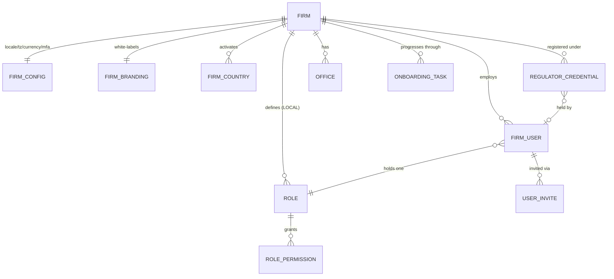

## 8. User Stories + Acceptance Criteria

**US-1 — Guided from empty to ready.** *Given* a freshly-provisioned firm, *When* the admin first signs in, *Then* the checklist shows ordered tasks, % complete, and one highlighted next step. *Given* all required tasks complete, *When* the last finishes, *Then* `onboardingStatus` flips READY, "create first client" unlocks, `firm.onboarding.completed` is emitted, and a Notification fires.

**US-2 — Activate a country, see it everywhere.** *Given* the firm is entitled to Canada + Australia but only Canada is active, *When* the admin activates Australia, *Then* Australia is selectable in AG-2/AG-3/AG-7, MARA loads from `RegulatorConfig` for credentials, and `firm.country.activated` is emitted. *Given* the firm is NOT entitled to the UK, *When* opening activation, *Then* the UK is "available on upgrade" and a forced activation request is server-rejected.

**US-3 — Record licence once, on every document.** *Given* Canada active, *When* the admin adds a `RegulatorCredential` (regulator auto-loaded, licence, designated person, signature), *Then* it saves with the licence number masked-by-default and the signature via Media. *Given* a Canadian retainer (AG-5), *When* it renders, *Then* it carries the designated person + licence + signature without re-keying. *Given* a user without `agent/firm:reveal-credential`, *When* they open it, *Then* the licence stays masked and reveal is unavailable.

**US-4 — Invite least-privilege, securely.** *Given* below seat cap, *When* the admin invites a Sales Rep (capability preview shown), *Then* the user is `INVITED` + emailed a single-use set-password link; the admin never sets the password. *Given* at cap, *When* inviting, *Then* an upgrade affordance shows and no user is created. *Given* a valid token, *When* the invitee sets a password, *Then* they become ACTIVE and see only their role's menus (default-deny elsewhere).

**US-5 — Off-board cleanly.** *Given* a Sales Rep with open leads, *When* deactivated, *Then* sessions revoke immediately, login is blocked, they leave round-robin, owned leads surface for reassignment, history stays attributed. Reactivation (seat available) restores access.

**US-6 — Never lock out admin.** *Given* the only active admin, *When* they self-deactivate or self-strip the admin permission, *Then* it is blocked with "a firm must always have at least one admin." *Given* an admin role held by the last admin, *When* deletion is attempted, *Then* it is blocked until another admin exists.

**US-7 — Entitlement-bounded custom role.** *Given* the plan excludes forecasting, *When* building a custom role, *Then* the forecasting key is disabled (upgrade) and rejected server-side if forced (Doc 1 §4.3 write-side filter). *Given* a role held by 4 users, *When* deleting, *Then* an impact prompt requires a replacement role first.

**US-8 — Brand the firm + portal.** *Given* a logo + primary colour + subdomain, *When* saving, *Then* a live preview shows the branded portal + sample email, the subdomain is uniqueness/format/reserved-validated, and branding applies to chrome/PDFs/emails. *Given* a taken subdomain, *When* entered, *Then* it is rejected as unavailable.

**US-9 — MFA enforced.** *Given* `mfaPolicy = REQUIRED_ALL`, *When* a user without MFA signs in, *Then* AuthCore walks them through TOTP enrolment before sensitive work (server-enforced, Doc 1 §3.6). *Given* a user, *When* viewing sessions, *Then* they see device/IP/last-active and can revoke any.

**US-10 — Solo short path.** *Given* a solo Canada-only RCIC, *When* they activate Canada, *Then* profile defaults pre-fill, team-invite offers "I work solo," and after one credential + payment connect the firm is READY in minutes.

**US-11 — Connect payments (gap-close).** *Given* the firm is not yet money-ready, *When* the admin clicks "Connect payments," *Then* they are redirected to the rail's hosted onboarding via SA-4 over the `PaymentRailPort`, and on return `paymentConnectStatus` reflects ACTIVE/ONBOARDING/RESTRICTED/SUSPENDED (read via `getConnectedAccountStatus`, R15); AG-1 stores only the connected-account reference, no card data, no vendor name.

**US-12 — Licence-expiry awareness (gap-close: missing story).** *Given* a credential with `validUntil` set, *When* expiry approaches, *Then* a Reminder fires to the firm admin; *When* generating a regulated document past `validUntil`, *Then* a warning surfaces rather than silently stamping a lapsed licence.

**US-13 — Multi-country credential fan-out (gap-close: missing story).** *Given* the firm activates a 2nd country, *When* it activates, *Then* a 2nd credential onboarding sub-task appears; *When* generating a document for country B, *Then* country B's credential is required (country A's does not satisfy it).

**US-14 — Concurrent role edit (gap-close: missing story).** *Given* two admins edit the same role, *When* both save, *Then* the permission set is replaced transactionally (last-write-wins) and both edits are audited; the optimistic `version` rejects a stale write with a clear retry.

**US-15 — Audit of sensitive admin.** *Given* an admin changes a role, reveals a licence, deactivates a user, activates a country, or connects the rail, *When* each completes, *Then* an immutable per-firm-chained audit entry records actor, target, before/after (Doc 1 §7.5).

## 9. Edge Cases & Validations

- **Activate un-entitled country** → server-rejected with upgrade affordance (BR-2).
- **Entitled country with no published pack** → activation allowed but `PACK_PENDING`; selectors disabled with "pack not yet available"; never silently fails (AG-1-23).
- **Last-admin lockout attempts** (self-deactivate / self-strip / delete or down-scope last admin role) → all blocked, same clear message (BR-5).
- **Seat-cap boundary** → invite at cap blocked with upgrade; reactivation past cap blocked until a seat frees; whether INVITED consumes a seat per §13.
- **Invite token misuse** → expired/consumed/since-deactivated-user tokens rejected; password below policy rejected before any state change (Doc 1 §3.7).
- **Duplicate email on invite** → rejected with a re-invite path, not a 500.
- **Subdomain collision / reserved / bad format** → rejected with the specific reason; case-insensitive uniqueness; reserved (www, admin, api, portal, app) blocked.
- **Branding asset abuse** → oversized/wrong-type/malicious uploads rejected at the `ObjectStoragePort` layer; external-URL fallback validated; nothing persisted on failure.
- **Credential PII exposure** → masked by default; reveal requires `agent/firm:reveal-credential` + ownership and writes `PII_REVEAL` before cleartext (fail-closed, Doc 1 §7.2); PII never in logs/traces/errors.
- **Licence format mismatch** → soft warning against `RegulatorConfig.licenceNumberRegex`, not a hard block (AG-1-29).
- **Licence expiry** → past `validUntil` flags the credential and warns at document generation; a Reminder fires ahead; never silently stamps a lapsed licence (US-12).
- **Role with zero permissions** → allowed (default-deny ⇒ no access) but flagged "grants no access."
- **Concurrent role edits** → transactional permission-set replacement + optimistic `version`; stale write rejected with retry (US-14).
- **Onboarding gate hit elsewhere** → taking payment before connect, or generating a regulated document before a licence, shows a contextual actionable hint back to the exact step, never a dead end (BR-13).
- **Payment connect returns RESTRICTED/ONBOARDING/SUSPENDED** (KYC incomplete) → the money gate stays closed (only `ACTIVE` opens it); AG-1 surfaces the rail status + a "finish on rail" link (lifecycle owned by AG-6/SA-4).
- **Deactivated user's owned work** → surfaced for reassignment; nothing auto-deleted; historical attribution preserved.
- **Suspended firm (SA-2 billing)** → staff logins rejected, sessions revoked, protected routes 402 per SA-2 §3.4 / SA-2-6 (AG-1-44 — no partial "read-mostly" staff mode); the suspension billing-gate never relaxes isolation.
- **Subdomain spoofing** → a user on firm A's subdomain authenticated as firm B is confined to firm B by RLS on the token's `firm_id`; the host label is advisory only (BR-14).

**Validation doctrine.** All input validated by schema (Zod/class-validator) — no ad-hoc `if/else`; reject early; never persist on failure.

## 10. Permissions (LOCAL `agent/*`)

Default-deny; additive; evaluated within the caller's `firm_id` by the scope-aware guard (Doc 1 §4.2); a LOCAL route rejects any `system/*` key with `403 SCOPE_VIOLATION`. All keys use the one canonical grammar `agent/<resource>:<action>` (colon; one resource namespace per module — R4). Every key below is hand-authored into the Doc 1 §4.4 `permission_catalog` in AG-1's wave and CI-validated (every `@RequirePermissions` resolves to a catalog entry; every catalog key wired to ≥1 route).

| Permission Key | Description |
|---|---|
| `agent/firm:view` | View firm profile/branding/config (read) |
| `agent/firm:edit` | Edit firm profile, branding, locale/timezone/currency |
| `agent/firm:manage-users` | Invite/edit/deactivate users, assign offices |
| `agent/firm:manage-roles` | Create/clone/edit/delete LOCAL roles (the RBAC-admin key the lockout guard protects) |
| `agent/firm:manage-offices` | Create/edit/deactivate offices (gap-close: missing key) |
| `agent/firm:manage-countries` | Activate/deactivate countries, set primary |
| `agent/firm:manage-credentials` | Add/edit regulator credentials (distinct from `:edit`) — the ONE credential-management key shared with AG-16 (R10) |
| `agent/firm:reveal-credential` | Reveal masked licence/PII — audited (`PII_REVEAL`, Doc 1 §7.2) |
| `agent/firm:connect-payment` | Initiate/disconnect the client→firm payment rail via the `PaymentRailPort` (SA-4 seam; no vendor named — R6) |
| `agent/firm:manage-security` | Set firm MFA policy; admin session control |
| `agent/firm:view-onboarding` | View the onboarding checklist/progress |
| `agent/firm:complete-onboarding` | Mark onboarding tasks / drive readiness |
| `agent/firm:view-audit` | View the firm's per-firm audit activity (gap-close: missing key; read of Doc 1 §7.5 chain) |

**Enforcement.** Route-level (`@RequirePermissions`) AND object-level (`assertSameFirm`, Doc 1 §4.5) on `firm_id`. **Privilege separation is mandatory:** `agent/firm:manage-roles`, `agent/firm:manage-credentials`, `agent/firm:reveal-credential`, `agent/firm:connect-payment`, and `agent/firm:manage-security` are distinct — a delegated Office Manager holds `agent/firm:manage-users` without the others. Reveal is its own key, separate from edit, and audited. Entitlement gating layers on top (`EntitlementsService`): a permission outside the plan cannot be granted, enforced by the write-side scope filter (Doc 1 §4.3). The seeded firm templates (Doc 1 §4.4) are least-privilege bundles of exactly these keys.

## 11. Scalability · Security · Performance

**Scalability.** Roles, permissions, countries, credentials, branding, onboarding tasks, and offices are *data* — a firm reshapes its setup without a deploy; new countries are activated, not implemented (pack-driven, Doc 1 §5.8). Entitlement layering (plan → entitled countries + grantable permissions, resolved live by `EntitlementsService`) lets the same code serve a free-trial solo and a multi-country enterprise. Cross-cutting attach via the registry-validated polymorphic pattern (Doc 1 §5.8, camelCase `entityType`/`entityId`, UPPER_SNAKE values — R18) — extending is config, not migration. AG-1's per-firm volumes are tiny (users/roles/countries/credentials are tens), so the scaling concern is *tenant count*, met by `firm_id` indexing + RLS. Region-aware by construction (Doc 1 §1.7) — adding `eu-central-1` for a German firm is config.

**Security (paramount — AG-1 is the *definer* of the firm boundary).** Tenant isolation is FORCED RLS on `firm_id` (Doc 1 §2.2) with the four defense-in-depth layers and the cross-tenant denial suite as the release gate — AG-1 never accepts a caller-supplied `firm_id`. RBAC is the product's authz spine: default-deny, least-privilege seeded templates, privilege-separated keys, the admin-lockout guard, entitlement-bounded grants enforced server-side, scope-aware guard + write-side filter (Doc 1 §4.2/§4.3). Credential PII is `Restricted` — field-level envelope encryption + mask-with-audited-reveal (Doc 1 §7.2), blind-index for dedup (§7.3), never logged. Secure account lifecycle is Doc 1 §3 machinery: single-use expiring invites, Argon2id, in-house MFA with a server-enforced firm policy, instant atomic session revoke on deactivate, step-up re-auth for the most sensitive actions. No money/card data stored (PCI SAQ-A); the live payment adapter is SA-8 config, never an AG-1 model/enum value (R6). The subdomain `TenantResolver` is advisory only — isolation never depends on the hostname (BR-14). All input schema-validated; all sensitive actions written to the per-firm hash-chained audit spine (Doc 1 §7.5).

**Performance.** Profile/branding/config/active-countries/role-permission-set are small per-firm rows read on nearly every request (authz + chrome + country selectors). The user's *effective permission set* is resolved per-request from the catalogue (tokens carry no permissions, Doc 1 §3.4) but the firm's active-country set, branding, and the host→firm map are cached in Redis keyed by `firm_id`, evicted on country-activation / branding-save / slug-change events (targeted eviction + short-TTL safety net). Lists are cursor-paginated (≤50, Doc 1 §8.1); no unbounded fetch. Invite emails, onboarding nudges, and licence-expiry reminders run on BullMQ (Doc 1 §1.4), off the request path. Budgets per Doc 1 §8.1: read p95 ≤ 300 ms (cached authz/branding/country reads far faster), write p95 ≤ 600 ms; uploads via presigned S3.

## 12. Reference Note (honest: exists / NEW / CHANGED)

This is a **greenfield** build measured against this spec; the existing private codebase is design-provenance only (Doc 1 §1.8). The notes below classify against the *target* architecture, not against any current code.

**Built on Doc 1 / Doc 2 foundation (consumed, NOT re-built by AG-1):** FORCED-RLS isolation on `firm_id` (Doc 1 §2.2); the three walled auth pools + AuthCore + sessions + MFA + invite/reset machinery (Doc 1 §3); the scope-aware guard, write-side scope filter, record-level authz, `permission_catalog` + `RoleTemplate` + default role matrix (Doc 1 §4); the `Party`/`PartyRelationship`/`RegulatorConfig`/`CountryPackVersion`/`EntityTypeRegistry` spine (Doc 1 §5); field-level encryption + `PII_REVEAL` + per-firm audit chain (Doc 1 §7); rails-as-ports incl. `PaymentRailPort` (with `getConnectedAccountStatus`, R15) / `ObjectStoragePort` (Doc 1 §6.3); SA-2 `FirmProvisioningService` + `FirmCountryEntitlement` + `FirmDomain`/`DomainRailPort` (Doc 2 SA-2); SA-3 `EntitlementsService` + `PlanRoleTemplateSet` + feature-to-tier matrix (Doc 2 SA-3); the AG-10 per-user `NotificationPreference` entity that AG-1's nudges respect (R9); the AG-16 canonical settings store / firm-policy notification ceiling AG-1 cross-references (R9/R10).

**NEW (AG-1 builds):** the firm-facing edit surface over `Firm`/`FirmConfig`/`FirmBranding` (as onboarding entry, sharing rows with the AG-16 canonical store); `FirmCountry` activation (+ `PACK_PENDING` handling) layered on SA-2 entitlements; per-country `RegulatorCredential` (the ONE regulated-professional entity, AG-1-owned, AG-16-referenced — R10) wired to `RegulatorConfig` + the rep-of-record `PartyRelationship` edge + AG-5/AG-7 stamping; the `OnboardingTask` engine (% complete / next-step / "I work solo" / readiness gate / stalled nudges); the firm MFA-policy knob + admin session-control surface (driving Doc 1 §3.6); the `TenantResolver` host→firm routing projection (§3.1a); the minimal payment-rail connect step over `PaymentRailPort`/SA-4 (§3.7a); the admin-lockout guard, role-in-use reassignment, capability preview, and the full privilege-separated `agent/firm:*` catalog increment (incl. the gap-close keys `agent/firm:manage-offices`, `agent/firm:view-audit`, `agent/firm:reveal-credential`); the two emitted lifecycle events `firm.country.activated` / `firm.onboarding.completed` (R8 — AG-1 is the sole emitter of firm *lifecycle* events; the settings-change event `firm.profile.updated` is emitted solely by AG-16).

**CHANGED vs the naive prototype shape (deliberate corrections):** tenant key is `firm_id` with FORCED RLS (not `clientId` app-filtering); a single global designated person becomes per-country `RegulatorCredential` — the ONE entity for the regulated professional, AG-16-referenced not re-defined (pack-driven regulator, encrypted PII, validity dates, `heldByUserId`); the designated-person permission becomes a country-aware, privilege-separated `agent/firm:manage-credentials` + a distinct `agent/firm:reveal-credential` (one permission set shared with AG-16, R10); invites use a dedicated `UserInvite` (not a repurposed forgot-password code); "Client Admin from plan" generalises to the Doc 1 §4.4 seeded firm templates; `defaultCurrency` is clarified as `reportingCurrency`; branding gains `accentHex` + live preview + Media-ref'd assets; the online-payment connect stores a rail-neutral `paymentRailAccountRef` + a port-aligned `paymentConnectStatus`, never a vendor name (R6); event names normalised to canonical dot.case (R8).

**Gap-closures folded in (from `_GAP-ANALYSIS-vendor-scope.md` AG-1 line + ADR):** portal subdomain routing (§3.1a); the minimal payment-rail connect screen + SA-4 seam (§3.7a); the `Session`/`Plan`/`PlanPermission` references resolved to Doc 1 §3.4 `firm_session` + Doc 2 SA-3 `EntitlementsService` (no AG-1 re-modeling); the missing `agent/firm:manage-offices` and `agent/firm:view-audit` keys (§10); the missing user stories — licence-expiry (US-12), multi-country credential fan-out (US-13), concurrent role-edit (US-14), payment connect (US-11); the AG-1/AG-16 ownership line (AG-1 = onboarding entry, AG-16 = canonical store; one `RegulatorCredential` entity, one permission set — R10).

## 13. Open Questions / [FOUNDER-CONFIRM]

**Proposed defaults (confirm):**
1. **Default firm role templates** — the ~6 Doc 1 §4.4 firm templates (Firm Owner, Firm Admin, Case Manager, Case Officer, Billing/Finance, Read-only). [FOUNDER-CONFIRM] the least-privilege boundaries (an operating-model choice, already flagged in Doc 1 §4.4).
2. **Required onboarding tasks for READY** — profile, ≥1 active country, regulator credentials, payment-rail connect (team-invite + branding optional). Confirm.
3. **Hard gates** — only payment-rail-before-money and licence-before-regulated-document. Confirm no other compliance hard-gate.
4. **MFA policy default** — Doc 1 §3.6 recommends firm-staff "required for privileged roles." Confirm the launch default (`REQUIRED_ADMINS` proposed).

**Genuinely open:**
5. **Seat-cap counting rule** — do INVITED-not-yet-active users consume a plan seat, or only ACTIVE? Affects invite-at-cap behaviour.
6. **Reporting currency default & FX source** — each firm's default `reportingCurrency` (primary-country default?); FX is the platform `FxRateService` (Doc 1 §6.5) with a v1 manual adapter — confirm whether a paid provider ships at launch.
7. **Payment-rail commercial model** — the v1 `PaymentRailPort` adapter (selected in SA-8 config, never named in AG-1's durable model) governs the connect flow; confirm the connected-account onboarding model (Standard/Express/Custom-equivalent) and whether the platform takes an application fee (Doc 1 §6.6 / ADR C4-D1).
8. **Custom-domain (CNAME) at launch** — SA-2 `FirmDomain`/`DomainRailPort` makes it buildable; confirm it ships at launch vs subdomain-only first.
9. **Step-up re-auth scope** — confirm the exact action set requiring step-up (credential edit, payment-rail change, admin-role delete proposed; Doc 1 §4.5 mechanism is fixed).

**Domain-correctness items routed to the Immigration-SME (founder is final authority — fill `RegulatorConfig`/`PartyRelationship` slots, no new schema):** the regulator(s) per country and correct labels (CICC vs historical RCIC/ICCRC; MARA; OISC); the precise `licenceNumberRegex` per regulator; which `repTypeSlots` (authorized-representative vs responsible-person; paid vs unpaid) are mandatory per country and whether a case carries one rep-of-record or a history (the Doc 1 §5.2 cardinality [FOUNDER-CONFIRM]); whether the regulator model must serve lawyers/paralegals (law societies) and Quebec (MIFI/CAQ/CSQ) at launch (gap-analysis "regulator model too coarse"); the per-country compliance wording AG-1 credentials feed into generated documents. AG-1 builds the generic machinery; the founder supplies the values.

---

# Module AG-2: Prospect / Sales CRM

> **Plane.** Agent/Firm console (LOCAL). **Tenant key:** `firm_id`, isolated by FORCED Row-Level Security per Doc 1 §2. **Identity:** every lead/contact is a role-lens on the one `Party` spine per Doc 1 §5.2. **Country:** pack-driven from the active CountryPackVersion the firm is entitled to (Doc 1 §5.8); never Canada-hardcoded. **Tools:** in-house Doers only (Mailer, Scheduler, Messenger, Biller, Signer, Drafter, Qualifier, Dialer) orchestrated by the Conductor, each on a swappable rail port (Doc 1 §6.3). **Authoring vs consuming:** the Super-Admin SA-1 console authors the Country Pack (programs, CanonicalField catalogue, scoring/eligibility machinery, regulator config) per Doc 2 / Doc 1 §5; **AG-2 CONSUMES it** — it operates on immigration content but contains none. **Global by construction:** multi-country, multi-currency, multi-timezone, bilingual (EN/FR…) are first-class throughout, not bolt-ons.

This module is delivered as ONE frozen scope (no phasing). Where the prior draft tagged items P1/P2/P3 or "demo," each is resolved below to a binary IN/OUT per ADR 6.2, with the single OUT list stated in §13.

## Module Index

This module specifies the firm's revenue-funnel CRM: how leads are captured from every door, deduped against the one Party spine, routed to an owner, qualified, worked through a configurable pipeline, automated with compliance-safe sequences, scored and prioritised, forecast and reported in one currency, and converted to an engaged client with zero re-keying.

1. Purpose & Goal
2. Users & Jobs-to-be-Done
3. Functional Design — How It Works (3.0 Party/Contact lens · 3.1 capture · 3.2 dedup/merge · 3.3 detail view · 3.4 Kanban & stages · 3.5 lifecycle engine · 3.6 sequences · 3.7 scoring & NBA · 3.8 work-queue · 3.9 dashboard/forecast/FX · 3.10 loss/nurture/reopen · 3.11 convert · 3.12 Dialer · 3.13 routing · 3.14 export)
4. Detailed Functional Requirements
5. Business Rules & Logic
6. States & Lifecycle
7. Key Entities & Fields (incl. Events emitted/consumed)
8. User Stories + Acceptance Criteria
9. Edge Cases & Validations
10. Permissions (LOCAL `agent/*`)
11. Scalability · Security · Performance
12. Reference Note (exists / NEW / CHANGED)
13. Open Questions / [FOUNDER-CONFIRM]

### Visual Overview

**A. Prospect lifecycle** (stage *kind* is the behavioural state; labelled stages are firm-configurable; **WON is driven by the `envelope.signed` domain event** per the canonical dictionary Doc 1 §6.1, not a manual drag):

```mermaid
stateDiagram-v2
    [*] --> New : capture
    New --> Contacted
    Contacted --> Qualified
    Qualified --> Consult
    Consult --> Proposal
    Proposal --> RetainerSent
    RetainerSent --> RetainerSigned : envelope.signed -> WON
    RetainerSigned --> Converted : convert -> ClientIndividual + Case
    Converted --> [*]
    Contacted --> Lost : loss flow (reason required)
    Qualified --> Lost
    Consult --> Lost
    Proposal --> Lost
    New --> Nurture
    Qualified --> Nurture
    Nurture --> Contacted : warm trigger (re-engage)
    Lost --> NewOpp : reopen = NEW Prospect on same Party
    Converted --> NewOpp : reopen = NEW Prospect on same Party
    note right of Converted : status = CONVERTED
    note right of Lost : status stays OPEN; stage.kind = LOST (BR-8)
    note right of NewOpp : one Party, many pursuits (Doc 1 §5.2)
```

**B. Lead capture — one pipeline, many doors** (every source converges on one normalise → resolve-Party → validate → route path):

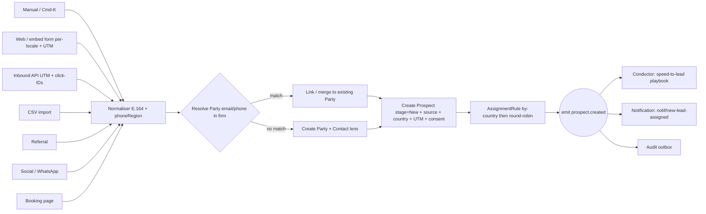

**C. Core data model** (Party root + role-lenses per Doc 1 §5.2; profile is the canonical answer store, not a private table):

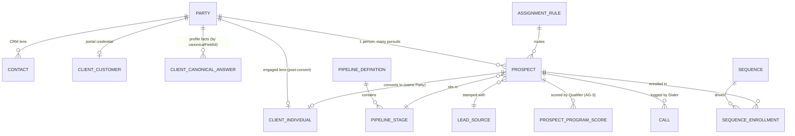

> `Note · Task · Reminder · Communication · Call · Document · AuditLog · Notification` attach to a `Contact` or `Prospect` via the polymorphic `(entityType, entityId)` pattern, validated against the platform `EntityTypeRegistry` (Doc 1 §5.8) — defined once in the foundation, reused here, never redefined. Registry column convention is camelCase `entityType`/`entityId`; registered values are UPPER_SNAKE (`PROSPECT`, `CONTACT`, …) per Doc 1 §5.8.

---

## 1. Purpose & Goal

**What it is.** AG-2 is the **top of the firm's revenue funnel** and the operational home base for everyone who turns inquiries into paying clients. Every dollar a firm earns enters the system here — as a lead — before it becomes a retained client (AG-2 → convert → ClientIndividual → Case). It is the first module a prospective firm sees in a demo and the one they live in all day.

**The business outcome it must produce.** Immigration firms do not lose revenue because they lack leads — they lose it because **leads are dropped**: an inquiry that never got a call back, a hot prospect that went cold over a weekend, a consult no-show that was never rebooked, a "thinking about it" that was never followed up. AG-2 exists to make **"no lead ever falls through the cracks"** structurally true — not by discipline but by design: speed-to-lead (where a **logged outbound call is the first-response touch**), timezone-aware going-cold detection, automated bilingual sequences, real lead routing, and a work-queue that tells each rep exactly who to call next. Secondary outcomes: faster qualification (the eligibility engine triages leads instantly and *feeds the lead score*), higher consult-to-retainer conversion (assessment → consult → proposal → e-sign → payment is one unbroken spine with no re-keying), and owner-level visibility — with **forecasting and multi-currency reporting** — into where revenue comes from and where it leaks.

**Why it matters / world-class positioning.** This is **not a me-too CRM**. A generic CRM is a list + a board + a form. ExpatReady's CRM is a **revenue engine specialised for immigration**: it captures leads from everywhere with full marketing attribution, **qualifies them with a real eligibility assessment** (no generic CRM can do this — the Qualifier evaluates the pack's `EligibilityRuleSet` and `ScoringConfig` per Doc 1 §5.13), routes them by country/program, automates follow-up so nothing is dropped, lets the team converse in one place, and converts to a retained client with the full immigration profile carried forward as canonical answers. The moat is two-fold: (a) **immigration eligibility as the qualification engine** and the lead-score input, and (b) **compliance-native, globally-aware behaviour** — every nurture and every email respects CASL/Law-25 consent *in the recipient's language*, every claim respects the regulator's no-guarantee rule, every lead is tenant-isolated by FORCED RLS (Doc 1 §2) for PIPEDA, every SLA clock is measured in the office's timezone and business hours. A generic CRM cannot sell safely to a regulated, multi-country RCIC firm; ours is built for it.

**How it ties to the revenue journey.** Lead captured → routed → qualified (Qualifier / AG-3) → consult booked (Scheduler / AG-4) → proposal & retainer sent (Drafter + Signer / AG-5) → **`envelope.signed` drives WON** → payment (Biller / AG-6) → **convert to client** → case delivery (AG-7+). AG-2 owns the first transitions and hands off cleanly. The pipeline's stages *are* this journey.

**Global ambition.** The same module serves a Canada-only solo RCIC and a multi-country firm running Canada + Australia + UK desks, **with no code change** — single-country/single-currency/single-locale is the degenerate case. Country comes from the active Country Pack; money is reported in the firm's `reportingCurrency` via immutable `FxRateSnapshot`s (Doc 1 §6.5), never summed raw across currencies; time is the firm/office timezone with business hours; copy and consent are per-locale. This posture is visible in every section below, not appended as an afterthought.

---

## 2. Users & Jobs-to-be-Done

The "Agent" persona is an umbrella; AG-2 is used differently by each sub-role. All sit in the **firm-staff identity pool** (Doc 1 §3) and hold LOCAL `agent/*` permissions (§10).

| Role | Primary job in AG-2 | Jobs-to-be-done (representative) |
|---|---|---|
| **Intake / Sales Representative** (heaviest user) | Convert inquiries into retained clients; never drop a lead. | "When a new inquiry arrives, I want it auto-assigned to me and to know within minutes, so I can call while they're hot and beat a competitor." · "When I start my day, I want a ranked list of exactly who to contact and why — in my timezone — so I'm not guessing or working stale leads." · "When I'm on a call, I want one screen with their whole story and one-click click-to-call + log-outcome, so the call itself counts as my first response and nothing slips." |
| **RCIC / Non-Owner Consultant** | Qualify the genuinely viable, run the assessment, take the consult, close. | "When a lead reaches me, I want the eligibility assessment already run so I can give credible advice in the first consult." · "When I finish a consult, I want to turn it into a proposal and retainer without retyping anything, and have the signature itself move the deal to WON." |
| **Manager** | Keep the funnel healthy and the team productive. | "When I review the week, I want conversion rate, where leads stall, which *source/campaign* actually produces clients, a weighted **forecast** against quota, and which rep needs help — filterable by country and shown in one currency." · "When a lead has sat untouched past business-hours SLA, I want it flagged before it dies." · "When I set up the team, I want new leads to route by country then round-robin, respecting who's off." |
| **Owner / Principal RCIC** | Own the revenue number and the firm's compliance posture. | "When I look at the pipeline, I want to trust every marketing dollar is attributed to a campaign and that nothing we send breaches CASL/Law-25 or promises an outcome." · "When I configure the funnel, I want stages, sources, loss reasons, routing rules, and a per-locale web form to match how *my* firm sells." |
| **Accounts / Billing** | Touch AG-2 only at the money edge. | "When a lead is ready to pay, I want the proposal/invoice to flow from the pipeline so I'm not re-creating client and fee data, in the right currency." (Owns AG-6; consumes AG-2's hand-off.) |
| **Case Officer / Paralegal** | Light read access; picks up post-conversion. | "When a lead converts, I want their full history *and immigration profile* already on the new client/case so I start work, not re-keying." |

**Design implication.** The Intake Rep is the protagonist of the UI — the default landing surface, the work-queue, the lead detail view, and the keyboard-first interactions (including click-to-call) are designed for them, in their timezone and locale. The Manager/Owner get analytics, forecasting, routing, and configuration. The RCIC gets the Qualifier and the consult→proposal→e-sign hand-off. Permissions (§10) separate these cleanly; record-level authz (Doc 1 §4.5) enforces own-vs-all server-side.

---

## 3. Functional Design — How It Works

Each sub-function is designed in depth: **how it works**, the **smart / world-class behaviour**, the **key screens & interactions** (functional, not pixel-level), and the **data flow**.

### 3.0 The Party / Contact lens (the foundation everything else sits on)

**Design decision: a Lead is an *opportunity*; the person is a *Party* with a *Contact* lens.** This is the CRM-correct model and it matters for immigration because one person can inquire more than once (a refused PR applicant returns two years later for a study permit; a client refers their spouse; one person pursues Canada *and* Australia at once). If "lead" and "person" are the same row, you either create duplicates or you destroy history.

Per Doc 1 §5.2 there is **one durable identity root, `Party`** (kind `PERSON` or `ORGANISATION`, firm-scoped). AG-2 does **not** define its own person table — it uses the foundation lenses:

- **`Party`** = the durable identity of a human (or organisation). De-duplicated on email/phone within the firm. Survives forever and accumulates *all* interactions across *all* lenses — the golden thread.
- **`Contact`** = the **CRM lens** on a Party (Doc 1 §5.2): lightweight, top-of-funnel, carries pipeline/lifecycle attributes, **not** immigration facts. A Party may have a Contact lens before it ever has an engaged-client lens.
- **`Prospect` (Lead / Opportunity)** = a *single pursuit* of converting that Party into a retained client, on a specific **destination country** and **program interest** (resolved as `programNodeKey + packVersionId`, Doc 1 §5.8), moving through a pipeline, with a deal value, an owner, and a stage. A Party may have one open Prospect (common) or several (different country pursuits — see 3.11).
- **The immigration profile is NOT a private AG-2 table.** It lives in the canonical **append-only answer store** (`ClientCanonicalAnswer` keyed by `canonicalFieldId`, Doc 1 §5.4) against the Party. A fact captured here (DOB, language scores, family unit) is the *same* fact the Qualifier scores, the SQR reads, and the IMM form auto-fills — captured once, never re-keyed (the moat). The old `ContactProfile` table is **retired** as a store (ADR C2-D4) and becomes a derived projection over the answer store; AG-2 reads/writes profile facts through the foundation's answer-store service, not a duplicate schema.
- **Reopen creates a new opportunity, never resurrects a terminal one.** A WON or LOST prospect that is reopened produces a **new Prospect on the same Party** — a fresh ACTIVE pursuit — while the terminal row stays intact for attribution and audit (BR-15). This is the model-level reason terminal stages have no outgoing moves (3.5).
- **At most one portal credential.** When a lead later becomes a portal user, that is a single `ClientCustomer` credential-lens on the same Party (Doc 1 §5.2) — never a second identity. `Prospect.convertedPartyId` points at the Party (ADR C2-D1, fixing the old `convertedClientCustomerId` self-contradiction the gap analysis flagged in C5).

**Why not collapse them?** Even in a single end-to-end demo we keep the conceptual separation but present it simply: the rep mostly sees "the lead," and the Party is the person behind it. The data model is correct from day one; the UI **hides the machinery for single-lead parties** (one open lead on one person reads as just "the lead"). The Contact↔Prospect split ships in full scope.

### 3.1 Lead Capture (multi-source, attribution-complete, per-locale) — "every inquiry lands here, instantly, deduped, attributed"

**How it works.** A lead can enter from many sources; each path normalises into the same Party-resolution + Prospect-creation, runs the same dedup check, stamps the same mandatory `source`, captures **marketing attribution** where available, routes via the **AssignmentRule** (3.13), and (for new parties) enters the pipeline at the first **ACTIVE** stage ("New").

Sources, designed:

1. **Manual create** — a fast "New lead" modal (and a ⌘K "Add lead" command). Minimal required fields (name + one contact channel + destination country + source); everything else is progressive. Inline dedup: as the rep types email/phone, the form live-checks and warns *before* save if a matching Party exists, offering "open existing / add as new lead on this person."
2. **Embeddable web form (the firm's own capture widget)** — the firm configures a form (fields, target country, consent checkboxes, thank-you behaviour) and embeds it via a script/iframe snippet. **The form is per-locale (EN/FR/…):** the firm publishes one widget per language and the **consent text renders in the visitor's language** to satisfy CASL *and* Quebec's Law 25 (which mandates French). The locale is stamped on the Party's `PartyProfile.locale` (Doc 1 §5.2) so every later message picks the right template (3.6). Submissions create a Party+Contact+Prospect with `source = WEBSITE` and full attribution. **This is a public, unauthenticated endpoint — the module's primary attack surface** — hardened per §11 and Doc 1 §4.6 (each `@Public` route on a positive allow-list with a named compensating control): per-IP and per-firm rate limits, CAPTCHA/bot mitigation, honeypot field, Zod schema validation, server-side consent capture with timestamp + locale + form-version. The form is generated from config, so adding a field is configuration, not code.
3. **Public inbound API** — a firm-scoped, write-only API key lets external lead sources POST a lead, including attribution payload. Same dedup, same hardening, same validation, same routing. Keys are revocable, scoped to `firm_id`, rate-limited, never grant read access. (Per ADR C4-D6 these inbound keys are one facet of AG-16's firm↔external boundary; AG-2 owns the lead-creation endpoint they hit.)
4. **Bulk CSV import** — column-to-field mapping UI, batch-level or per-row destination-country assignment, **dry-run preview** (create vs merge vs error counts and *why*), then an **asynchronous** import job (never a blocking request) with a result report. This reuses the **platform import engine** (ADR 6.4, the reusable map → dry-run → async → result → dedup tool) — AG-2 is one of its four wired entity types (Contacts/Clients, Cases, Documents, financials). UTM columns map through if present.
5. **Referral** — captured as a structured field (referring client/partner/sub-agent/education agent), because referral attribution is a real immigration channel. Reportable alongside paid-channel attribution.
6. **Inbound message / social / WhatsApp** (via **Messenger**) — an inbound message from an unknown number/handle spawns a lead with `source = SOCIAL`, linking the thread from the first message.
7. **Booking page (Scheduler)** — if a prospect books a consult and their email is new, a lead is auto-created with `source = BOOKING` and the appointment pre-linked. (Owned by AG-4; AG-2 receives it via `booking.scheduled`.)

**Marketing attribution (first-class).** On web form and inbound API, capture and persist on the Prospect: UTM (`utmSource`, `utmMedium`, `utmCampaign`, `utmTerm`, `utmContent`), click IDs (`clickId` accommodating `gclid`/`fbclid`/`msclkid`/`ttclid`), and page context (`landingPage`, `referrerUrl`). These flow into the source-ROI / campaign attribution dashboard (3.9) so the owner sees *which campaign and ad* produced retained, paying clients — not just "website." Attribution is stamped at creation and immutable; absence is allowed (manual/CSV leads have none) and never fabricated.

**Phone normalisation with region (`phoneRegion`).** The Normaliser converts every phone to **E.164** for dedup and dialing (3.12). Because the same digits are ambiguous across countries, capture forms send a **`phoneRegion`** (ISO-2, e.g. `CA`, `IN`, `AU`) to disambiguate. If a number **cannot be parsed**, the lead is **still created** (we never drop an inquiry on a format error) but the phone is flagged unparseable, surfaced for correction, and **excluded from phone-based dedup and click-to-call** until fixed.

**World-class behaviour.**
- **Speed-to-lead is a first-class feature — and a logged call satisfies it.** Every new lead emits `prospect.created` (Doc 1 §6.1 dictionary), which the Conductor consumes to route + assign (3.13), notify the assignee (`notif/new-lead-assigned`, in-app + email per the user's NotificationPreference — the per-user entity AG-10 owns, §7), optionally send an instant CASL-safe transactional auto-acknowledgement in the lead's locale, and create a "call within X minutes" task. **The SLA clock is satisfied by the first logged outbound touch — a logged outbound *call* (3.12) is the canonical one.** The clock is **timezone-aware**, measured against the firm/office timezone and business hours, so an 11pm-local lead isn't "breached" by morning.
- **Attribution is trustworthy and complete.** Source is mandatory; UTM/click-IDs captured automatically where present.
- **One capture pipeline, many doors.** All sources converge on one creation service with one dedup + one validation + one routing path — a new source is a thin adapter.

**Key screens & interactions.** *New lead modal* (minimal-required, progressive, live dedup banner, `phoneRegion` defaulting from firm primary country); *Web-form builder* (config screen, Owner/Manager: field list, country target, locale, consent options with localized text preview, embed-snippet output, live preview, spam-protection toggles, hidden-fields note for auto-captured UTM); *CSV import wizard* (upload → map columns incl. UTM → choose country → dry-run preview → confirm → async progress → downloadable result); *API keys screen* (create/revoke firm-scoped write-only keys with last-used and rate-limit visibility).

**Data flow.** Source adapter → Normaliser (E.164 + `phoneRegion`; locale) → **Party resolver** (match on email/phone within `firm_id`) → create `Party` + `Contact` lens (or attach to existing Party) + create `Prospect` (stage = first ACTIVE, `source` stamped, `destinationCountry` set, `programNodeKey`+`packVersionId` if known, UTM/click-IDs/landing/referrer stamped, consent flags + locale + timestamp recorded; profile facts written to the answer store) → **AssignmentRule** resolves owner (3.13) → emit `prospect.created` (post-commit, at-least-once, Doc 1 §6.2) → Conductor evaluates timezone-aware speed-to-lead playbook + Notification → synchronous audit-outbox entry (Doc 1 §7.5).

### 3.2 De-duplication & Merge — "never silently create a duplicate; never lose history on merge"

**How it works.** Dedup runs at every entry point, scoped **always within `firm_id`** (a cross-tenant match would itself be an isolation breach, BR-3). The match key is **normalised email and E.164 phone**. On a match the system does **not** silently create a duplicate and does **not** silently merge — it surfaces a choice: **Link** the new opportunity to the existing Party (the right answer when a known person starts a new pursuit), or **Merge** two Parties that are genuinely the same person captured twice.

**Merge, designed safely** — this delegates to the foundation's **non-destructive Party merge** (Doc 1 §5.2 / AC-5.2), not a bespoke AG-2 routine:
- Merge presents a **field-by-field reconciliation** (which name, which phone, which profile values survive), defaulting to the most complete/most recent, overridable per field.
- **All children re-parent, nothing is deleted:** every note, task, communication, **call**, document, assessment, appointment, and any open lead from the losing Party re-point to the survivor via the polymorphic `(entityType, entityId)` re-pointing, validated through the `EntityTypeRegistry` (Doc 1 §5.8). Canonical answers re-point to the surviving Party. The losing Party is tombstoned (`mergedIntoPartyId = survivor.id`) — never hard-deleted — for audit reversibility; every prior reference still resolves. The foundation emits `party.merged` on success.
- Merge is **permissioned** (`agent/prospect:merge`), **audited** (who merged what into what, before/after) via the synchronous audit outbox, and **idempotent-safe** (a record cannot merge into itself; concurrent merges resolve deterministically; a second merge re-points to the survivor and never double-tombstones).

**World-class behaviour.** Proactive duplicate *suggestions*: a background pass flags likely duplicates (same person, slightly different email) for a manager review queue. Conversion (3.11) also checks against existing engaged clients (`ClientIndividual`), so converting a returning client links to their existing client lens on the same Party instead of creating a second one.

**Key screens.** *Duplicate banner* on the lead (inline, dismissible-with-reason); *Merge wizard* (field reconciliation + "what will move" summary); *Potential-duplicates review* queue (Manager).

**Data flow.** Party resolver returns match candidates with a confidence signal → UI presents link/merge/new → on merge: foundation Party-merge transactionally re-parents all polymorphic children + answers to survivor, tombstones loser, emits `party.merged`, writes audit.

### 3.3 The Lead / Contact Detail View — "one screen that holds the whole story and lets you act"

The single most important screen in the module and the clearest place to be world-class. It is **not a form** — it is a **command center for one relationship**.

**Layout (functional, three zones).**
- **Left rail — Identity & immigration profile.** Name, photo/initials, contact channels (**click-to-call via Dialer (3.12)**, click-to-email via Mailer, click-to-message via Messenger), destination country (badge), program interest, source + campaign attribution (UTM/referral), owner, lead score / eligibility summary, tags, locale/language, consent state (CASL/PIPEDA/Law-25 badges — a **display-only live-read of the SA-11 `ConsentRecord` register**; AG-2 never writes or stores its own consent source of truth), and the **immigration profile** read compactly from the canonical answer store: family unit (spouse/partner + dependants — eligibility depends on it), highest education + ECA status, language test + per-skill scores, work history with occupation classification, current status, goals. **Restricted fields render masked by default** (Doc 1 §7.2); reveal requires `agent/prospect:reveal-pii` and is audited (`PII_REVEAL`). Profile fields are the single source that feeds the Qualifier and (post-conversion) the SQR and forms — entered once, reused everywhere (Doc 1 §5.4 capture-once).
- **Center — Activity timeline + composer.** A unified, reverse-chronological, typed and filterable timeline of everything: calls logged (outcome + duration + recording ref), emails sent/received (Mailer), messages (Messenger), notes, stage changes, tasks created/completed, reminders, assessments run, appointments, retainer/payment events. At the top, a **composer** to click-to-call and log the outcome, write a note, send an email/message, or take an action — without leaving the screen. The timeline is the AG-13-owned materialized `ActivityEvent` table (§7) that AG-2 reads; notes, tasks, comms, calls, reminders are the cross-cutting modules attached via `(entityType, entityId)` — AG-2 renders them, it does not re-implement them.
- **Right rail — "What to do next" + contextual Doers.** The intelligence layer (3.7): next-best-action, the active sequence step, the next scheduled touch, ageing/SLA status (timezone-aware). Below it, the **contextual Doer action bar**: Qualifier (assess), Scheduler (book consult), Dialer (call), Mailer/Messenger (reach out), Drafter + Signer (proposal/retainer), Biller (invoice) — one click each, pre-filled from this record.

**World-class behaviour.** Everything is one click and pre-filled — calling, booking, assessing, emailing, sending a retainer all launch carrying the lead's data; the rep never re-types a name, number, or fee. **Keyboard-first** (Superhuman-grade): click-to-call, log-a-call, add-note, change-stage, set-next-step reachable without the mouse. **The timeline is the audit-grade record of the relationship** — a regulated-profession requirement that also happens to be great UX.

**Data flow.** A single detail-load fetches the Party + Contact + active Prospect + a *paginated* slice of the AG-13-owned `ActivityEvent` timeline (the §7 composite cursor; never the whole history) + the latest assessment summary + the NBA. Composer actions write to the relevant cross-cutting module (incl. `Call`), which appends to the materialized `ActivityEvent` timeline (AG-13); stage changes go through the stage service (3.5). The detail view is **always live** (never served from the dashboard cache, §11).

### 3.4 The Pipeline (Kanban) Board & Configurable Stages — "see the whole funnel; move work by dragging"

**How it works.** A drag-and-drop Kanban with one column per **pipeline stage**. Cards are leads; each card shows name, destination-country badge, deal value (in its own deal currency, with the reporting-currency equivalent on hover via the stored FX snapshot), owner avatar, top eligibility signal, days-in-stage (ageing, computed in firm timezone), and a next-action indicator. Dragging a card changes the stage (3.5), writes a timeline entry, and may fire automation. A paired **list/table view** (same data, sortable/filterable columns) serves power users — the two stay in sync.

**Stages, designed.** The default pipeline mirrors the firm's revenue journey, each stage carrying a **`kind`** (`ACTIVE | WON | LOST | NURTURE`) that drives behaviour:

| Order | Stage (default label) | Kind | Meaning |
|---|---|---|---|
| 1 | New | ACTIVE | Just captured; timezone-aware speed-to-lead clock running |
| 2 | Contacted | ACTIVE | First touch made (a logged call/email) |
| 3 | Qualified (pre-assessment) | ACTIVE | Eligibility assessed; viable |
| 4 | Consult | ACTIVE | Consultation booked/held |
| 5 | Proposal | ACTIVE | Services + fee proposed |
| 6 | Retainer Sent | ACTIVE | Agreement out for e-sign |
| 7 | Retainer Signed | **WON** | Executed (driven by `envelope.signed`); convert to client |
| 8 | Lost | **LOST** | Closed-lost (reason required) |
| 9 | Nurture | **NURTURE** | Parked for long-term re-engagement |

Stages are **firm-configurable**: rename, reorder, recolour, add, remove. The **kind** is the invariant that keeps logic correct regardless of labels — WON/LOST are terminal, NURTURE is re-enterable. **Per-program lifecycle authoring lives in the pack as data** (`StagePipeline`/`StageTemplate`, Doc 1 §5.13.4) for *case* delivery; the AG-2 *sales* pipeline is the firm-owned TENANT funnel and is distinct from that case lifecycle. **Multiple named pipelines are IN scope** (the model supports them); the seed ships one default pipeline, and the architecture supports adding more without migration.

**World-class behaviour.** Stage = revenue journey, not arbitrary buckets — each forward move corresponds to a real conversion event (assessed, booked, proposed, signed) and can trigger the right automation/Doer. **Ageing & WIP signals on the board** (colour shift / "7d in Contacted," firm-timezone; optional per-stage WIP soft-limits). **Bulk actions** from multi-select (move stage, assign owner, add/remove tag, start a sequence, archive). **Saved, shareable views** (per-user and firm). **Performance-first board** (§11): columns are keyset-paginated/virtualised (default ≤ 50, "load more" per column, counts from cached aggregates), so a firm with thousands of leads still gets a fast board.

**Key screens & interactions.** *Kanban board* (drag-drop, filter bar, multi-country by default with a country filter); *List view* (sortable, inline edit); *Stage configuration* (drag to reorder, set kind/colour, delete-with-reassign — the "move N prospects before deleting a stage" guard); *Saved-views manager*; *Filter bar* (rep, source, campaign, country, program, tag, stage, date, score).

**Data flow.** Board load → stages for firm (active, ordered) + a paginated page of leads per stage (selected card fields only) + cached per-stage counts/values (FX-converted reporting-currency totals). Drag → stage-change service (guards in 3.5) → update + timeline + emit `prospect.stage.changed` (Doc 1 §6.1) → Conductor.

### 3.5 Stage Transition Rules & Lifecycle Engine — "signatures cause stages, not the other way round"

**How it works.** A small, explicit transition engine governs moves:
- **Terminal kinds (WON, LOST) have no outgoing moves.** Re-engagement is an explicit **reopen** creating a **new Prospect on the same Party** (3.0 / 3.10), not a silent backward drag.
- **WON ("Retainer Signed") is only reachable from Proposal or Retainer Sent** — you cannot mark a brand-new lead "signed." Keeps the funnel honest.
- **NURTURE is re-enterable** — a parked lead can move back into any ACTIVE stage when it warms.
- **Moving to LOST requires the loss endpoint** (a reason is mandatory) — you cannot drag a card to Lost and skip the reason.
- **Side-effects are derived from the target stage**, not hand-set: entering Retainer Sent sets retainer status = SENT; entering WON sets status = CONVERTED + retainer SIGNED, *but does not auto-create the case* — case creation stays an explicit, deliberate action (conversion is a decision, not a side-effect of a drag).

**The e-sign signature DRIVES the move to WON.** The correct flow: Retainer Sent → the client signs in the Signer → **AG-5 emits the canonical `envelope.signed` domain event** (Doc 1 §6.1; there is no separate completion event — `envelope.signed` is the single completion fact, so there is no synonym to drift against) → the Conductor consumes it → the engine transitions the prospect to **WON** and stamps retainer = SIGNED. **The signature causes the stage; the stage does not "mark" a signature.** A manual drag to WON is the *exception* (offline wet-ink retainer), is permissioned, requires an explicit "signed offline" reason, and records a signature event for audit — it never invents an executed document.

**Conductor event semantics (correctness).** `envelope.signed` is **rail-originated** in the sense that the underlying e-sign completion is a rail webhook fact; per Doc 1 §6.1.4 its idempotency key incorporates the external event id and **fails closed** if that id is unresolvable. All Conductor consumers are **idempotent** against the per-firm processed-event ledger (Doc 1 §6.2.3): a redelivered `envelope.signed` moves the prospect to WON **once**, never re-fires onboarding. Stage-change side-effects (Notifications, sequence exits, derived statuses) are likewise idempotent and **non-fatal to the move** — the stage change commits; a failed downstream automation is retried/queued, not rolled back.

**World-class behaviour.** Every transition is logged and timestamped (`stageEnteredAt`, `lastActivityAt`, stored UTC, rendered in firm timezone), feeding the timeline and time-in-stage analytics, and is an event the Conductor can hook. Guards return clear human messages ("Retainer Signed is only reachable from Proposal or Retainer Sent"), never silent failure.

**Data flow.** `changeStage(prospect, toStage)` → guard (`canTransition(fromKind, toKind, fromKey, toKey)`) → update stage + derived side-effects + stamps → emit `prospect.stage.changed` (non-fatal, idempotent consumers) → audit outbox. **Signature path:** `envelope.signed` (AG-5) → idempotency check (envelope+prospect via ledger) → `changeStage(→ WON)` → retainer = SIGNED, status = CONVERTED → `notif/retainer-signed` to owner → audit.

### 3.6 Activities, Follow-ups & Sequences — "the firm's follow-up runs itself, in the right language, within the law"

The **anti-dropped-lead engine** and the single biggest differentiator versus a passive CRM.

**Activities (the manual layer).** From the composer: **log a call** (via the Dialer, 3.12 — outcome picklist + duration + next-step note), **write a note**, **send an email** (Mailer) or **message** (Messenger), **create a task** (type, due date in firm timezone, assignee, note), **set a reminder**. Overdue tasks/reminders flag and surface in the work-queue. All land on the timeline, attributed.

**Sequences / cadences (the automated layer — via Conductor + Doers).** A **sequence** is a pre-built, multi-step cadence (e.g. Day 0 auto-ack, Day 1 call task, Day 3 email, Day 7 going-cold nudge, Day 14 move to Nurture). The firm enrolls a lead (manually or by trigger) and the **Conductor** executes the steps on schedule via the **Doers** (Mailer for email, Messenger for SMS/WhatsApp, Tasker for call tasks, Minder for nudges, Scheduler for booking links). **Both email and live SMS/WhatsApp channels are IN scope** (the OUT list no longer defers channels — ADR 6.2 commits live SMS/WhatsApp); Messenger runs on the `SmsGatewayPort` (Doc 1 §6.3) with an SNS + WhatsApp BSP v1 adapter.

**Bilingual templates (locale-selected).** Every step's message exists as a **template set keyed by locale** (EN, FR, …). When a step fires, the Doer selects the template matching the **Party's locale** (captured at the per-locale web form, 3.1), falling back to the firm default only if a translation is missing. A Quebec lead receives French; an Ontario lead English — from the same single sequence definition. Both UX and a Law-25 requirement (Doc 1 NFR i18n).

**World-class behaviour (and the compliance moat).**
- **Library-first, not blank-canvas.** AG-2 ships pre-built, immigration-validated sequences the firm toggles and lightly edits (speed-to-lead, no-show recovery, going-cold re-engagement, post-consult follow-up are seeded). The advanced/visual builder is "advanced mode," not the front door — and it too is IN scope.
- **CASL/Law-25-gated by construction — re-checked inside the async job.** Every *marketing/nurture* step checks the recipient's **express-consent** flag before sending; transactional messages (booking confirmation, retainer link) are allowed without marketing consent. For the **bulk path**, **consent is re-verified per recipient inside the async worker at send time** — not just at enrol time. Consent can change between enrol and send; the worker reads live consent for *each* recipient and **skips** any non-consented one, logging the skip. A firm literally cannot fire a marketing drip at a now-non-consented lead, even mid-batch. Unsubscribe is honoured automatically and halts the sequence.
- **Auto-exit on progress.** A sequence stops the instant the goal is met (reply, book, advance stage) — no "we already booked, why are they still chasing me." A `notif/lead-replied` fires to the owner.
- **Speed-to-lead built in, timezone-aware.** The flagship seeded sequence reaches a brand-new lead within minutes and tasks the owner to call — scheduled against business hours. A logged outbound call (3.12) satisfies and stops the speed-to-lead step.

**Key screens.** *Composer*; *Sequence library* (toggle on/off, enrolled count, edit steps, manage per-locale templates); *Per-lead "enrolled in" indicator* (which sequence, which step, next send in firm timezone); *Work-queue* (3.8).

**Data flow.** Manual activity → cross-cutting write + materialized `ActivityEvent` append (AG-13). Sequence enroll → Conductor schedules steps (BullMQ) → **each step, per recipient, re-checks live consent + exit conditions inside the worker** → Doer selects locale template → executes async → outcome appended to the `ActivityEvent` timeline → `notif/lead-replied` on reply → metrics updated.

### 3.7 Lead Scoring, Prioritisation & "What to Do Next" — "the system tells each rep who to work, and why"

**How it works.** Two complementary signals drive prioritisation; **eligibility is the primary driver of the lead score**:
1. **Immigration eligibility score (the moat, primary input).** Via the **Qualifier** (AG-3): a lead's canonical answers are scored across the destination country's programs using the pack's `ScoringConfig`/`ScoringBracket` and gated by its `EligibilityRuleSet`/`EligibilityRule` (Doc 1 §5.13.2–§5.13.3), returning eligible/borderline/ineligible with a ranked recommendation and the resolved pack versions stamped for reproducibility. A genuinely eligible lead is, by definition, a better lead — so eligibility is the first-class prioritisation input.
2. **Engagement/behaviour score (secondary).** Recency and intensity of engagement (opened, replied, **answered a call**, booked, sat untouched), source quality, deal value, ageing — used to break ties and surface decay.

**World-class behaviour.**
- **Next-Best-Action (NBA), per lead.** The right rail proposes the single most valuable next move ("Book consult — assessment shows strong score," "Send retainer — consult done, fee quoted," "Re-engage — 9 days no contact"), derived from stage + assessment + activity + sequence state.
- **The Work-Queue is the rep's home.** A ranked queue: hot-and-eligible first, going-cold next, overdue follow-ups flagged, no-shows to rebook, unassigned surfaced.
- **Going-cold detection (timezone-aware).** Leads with no activity for N **business** days (firm-configurable; **seeded default 7**) are flagged and optionally auto-enrolled in re-engagement. "No activity for N days" is computed against the firm/office timezone and business hours (the AG-16-owned BusinessHoursCalendar); weekends/holidays don't tick the cold clock. A `notif/lead-going-cold` fires to the owner on threshold cross.
- **Compliance-bounded.** Scores and recommendations never become promises — every assessment surface carries the regulator-safe disclaimer (indicative, not a guarantee) and the rules-as-of/pack-version provenance (BR-10).

**Key screens.** *Right-rail NBA*; *Work-queue / My Day (lead side)* (ranked, reason-annotated, timezone-aware); *Score & assessment summary* on card and detail.

**Data flow.** Qualifier produces program scores + provenance (stored, version-stamped) → drives the lead score, combined with engagement/ageing → NBA + queue ranking computed (cacheable) → surfaced on card, detail right-rail, work-queue; going-cold evaluation reads firm timezone/business-hours config → `notif/lead-going-cold`.

### 3.8 Tasks, Reminders & the Work-Queue

**How it works.** Tasks and reminders are the cross-cutting modules attached via `(entityType, entityId)`. A task has a type, due date (firm timezone), assignee, and note; a reminder fires at a time on a channel. The **work-queue** aggregates, per rep, everything due/overdue across all their leads, sorted by urgency and value — the operational starting point each morning.

**World-class behaviour.** Tasks can be **auto-generated by sequences and stage changes** (the rep doesn't have to remember to create the call task). Overdue items escalate (optional supervisor escalation) and raise `notif/task-due` (in-app + email per preference). Completing a task can advance a sequence. Due dates and "overdue" are evaluated in the firm timezone, so a rep in another zone isn't mis-flagged.

**Data flow.** Task/reminder write (manual or automation) → work-queue aggregation (firm + owner scoped, paginated) → completion appends to the materialized `ActivityEvent` timeline (AG-13) + may trigger Conductor; due/overdue evaluation in firm timezone → `notif/task-due`.

### 3.9 Sales Dashboard, KPIs, Forecasting & Multi-Currency — "where revenue comes from, where it leaks, and what's coming"

**How it works.** Two audiences, two views:
- **Manager/Owner dashboard:** leads by source and campaign (UTM), stage counts (funnel), leads added this period, conversion rate, average days to convert, time-in-stage (where leads stall), estimated pipeline value, attributed revenue collected, lost-by-reason, and a weighted forecast — all filterable by date range, rep, source, campaign, destination country, all in the firm's `reportingCurrency`.
- **Per-rep performance view:** a rep's leads, conversion rate, activity volume (incl. calls logged/connected), pipeline value, revenue, and forecast vs quota — for coaching and a leaderboard. Revenue is attributed from paid invoices linked to the prospect or its converted case (the attribution *rule* is correct and kept; the *computation method* is re-architected below).

**Forecasting (first-class).** Weighted pipeline = Σ (deal value × stage `winProbability`). Each stage carries a configurable win-probability; the weighted forecast sums each open deal's value times its stage probability. Each deal carries an `expectedCloseDate` (rep-set or defaulted from average time-to-convert) so the forecast buckets into a period. The dashboard shows **commit** (high-probability stages), **best-case** (all open weighted), and progress against **quota/target** (per rep and team). Leads without `expectedCloseDate` are reported separately under "unscheduled pipeline," never silently folded in.

**Multi-currency reporting (first-class; never sum mixed currencies raw).** A deal's value is stored in its **deal currency**. The firm has one **`reportingCurrency`** ([FOUNDER-CONFIRM] default CAD, per Doc 1 §6.5.2 / §6.6). **Every roll-up converts each deal into the reporting currency via an immutable `FxRateSnapshot`** captured at the economic moment — deal value at value-set/last-update, collected revenue at payment — and the consumer **stores `fxSnapshotId`** so the figure is stable and auditable (Doc 1 §6.5.1). The `FxRateService` is the **sole writer** of snapshots; AG-2 never writes one. When no snapshot exists for a pair, the **exclude-with-note** policy applies (Doc 1 §6.5.3) — the unconvertible amount is omitted and annotated, never raw-summed. Original deal currency is always shown alongside the converted figure on drill-down.

**Performance: DB-side aggregation, not in-memory.** The dashboard reads from **DB-side aggregation** — pre-computed materialized rollups (per-firm/per-rep/per-stage/per-country/per-currency daily aggregates, refreshed incrementally on the queue) plus indexed GROUP BY on the read replica. Filters re-query the aggregates/cache, never the raw rows. (The attribution rule is kept; the in-memory per-row mechanism is replaced — §12.)

**World-class behaviour.** Source/campaign ROI is the headline — which channel *and campaign* produces *retained, paying* clients, joined from UTM/click-IDs (3.1). Forecast against quota gives a forward number. Funnel analytics call out the leaky stage (time-in-stage). Every metric is country-segmentable and every money figure single-currency. Dashboards read pre-aggregated rollups, never scan the full lead table live.

**Key screens.** *Sales dashboard* (funnel + KPI tiles + forecast (commit/best-case/quota) + source/campaign-ROI + lost-reasons, with the filter bar + reporting-currency toggle); *Rep performance / leaderboard* (call activity + forecast vs quota).

**Data flow.** Incremental materialized rollups (firm-scoped, country-aware, per-currency) built off prospects + stages + linked invoices on the queue; FX snapshots applied at the defined moment and `fxSnapshotId` stored on aggregates; dashboard reads rollups/cache (read replica); forecast = Σ(value × winProbability) bucketed by `expectedCloseDate`, converted to `reportingCurrency` via the convert-before-sum helper.

### 3.10 Loss, Nurture, Recycling & Reopen — "lose with discipline; never throw away a future client"

**How it works.** Marking a lead **Lost** requires a **mandatory reason** from a firm-configurable picklist (defaults: Not eligible, Price, Went with competitor, Unresponsive, Not ready / timing, Other) plus an optional note. Loss reasons are reportable. A lost lead is **not deleted** — it is retained and **reopenable**.

**Nurture & recycling.** Many immigration "losses" are *timing* losses — "not eligible yet," "saving up," "waiting on a language retest." These belong in **Nurture**, not the bin. A nurtured lead can enrol in a **long-horizon re-engagement** (quarterly check-in, "draw cut-offs moved" update, "your score would change if…" nudge — all CASL-consented and in the lead's locale) and be **automatically recycled** to the active pipeline when a trigger fires (a new draw, a profile update, a reply). This turns historical leads into future revenue — an asset a generic CRM lets rot.

**Reopen = a NEW Prospect on the same Party.** Reopening a **WON or LOST** prospect does **not** drag the terminal row backward. It **creates a new Prospect** on the **same Party**, in an ACTIVE stage, optionally pre-filled from the closed one (same destination country, profile facts, source attribution), linked via `reopenedFromProspectId` — a genuinely new pursuit. The original terminal row is preserved untouched for attribution and audit. (A NURTURE lead, by contrast, is not terminal — it re-enters an ACTIVE stage on the **same** Prospect via the warm trigger.)

**Status/stage asymmetry (documented).** `ProspectStatus` models only `OPEN | CONVERTED`. **Lost/Nurture are represented by `pipelineStage.kind` (LOST/NURTURE), not by status** — a lost lead keeps `status = OPEN` while its stage kind is LOST. This is a deliberate, documented asymmetry with the WON path (which syncs `status = CONVERTED`). Analytics and the lifecycle read stage kind for lost/nurture; status for converted (BR-8).

**Key screens.** *Loss modal* (reason required + note); *Nurture view* (parked leads + re-engagement state); *Reopen* action ("Reopen as new opportunity"); *Lost-by-reason* analytics.

**Data flow.** Loss → loss service (validates reason, moves to LOST stage, stamps reason/note) → timeline + audit. Nurture → NURTURE stage → optional long-horizon sequence → recycle trigger moves the same prospect back to an ACTIVE stage. Reopen → create new Prospect on the Party (carry country/profile/source) → emit `prospect.created` → audit (linked to the closed row).

### 3.11 Convert Prospect → Client — "one continuous spine; zero re-keying"

**How it works.** A qualified, signed lead is **converted to an engaged client** — a `ClientIndividual` lens added to the **same Party** (Doc 1 §5.2), never a second person. Conversion:
- **Preserves the entire history** — every note, activity, communication, **call**, document, assessment, and appointment carries forward via a transactional **polymorphic re-parent** of every `(entityType=PROSPECT|CONTACT, entityId)` child to the engaged-client lens, all validated through the `EntityTypeRegistry`; the original lead is marked **Converted (not deleted)**, retaining its source/attribution.
- **Carries the destination country and the immigration profile forward** — because the profile lives in the canonical answer store keyed by Party (Doc 1 §5.4), it is **already** available to the new client lens and the SQR with no copy: capture-once is structural, not a copy step. The `programNodeKey + packVersionId` carry forward immutably (Doc 1 §5.8). This is the single-source guarantee AG-8 SQR and AG-7 forms depend on.
- **Offers create-new vs link-existing** at the *lens* level: a brand-new person gets a new `ClientIndividual` lens; a returning person who already has one links to it (no duplicate human — one Party).
- **May trigger onboarding automation** (welcome, portal invite via the `ClientCustomer` credential, document request) via the Conductor (idempotent — fires once even on event redelivery).

**Honest carry-forward (no fabrication).** Conversion carries forward **only fields actually held** as canonical answers; it **never fabricates or defaults missing values** — in particular it never hardcodes `gender = 'MALE'` (the prototype's bug, fixed). A fact absent on the lead is left blank/`unknown` on the client for the consultant to complete, never invented (BR-13).

**Multi-open-lead convert.** A Party may have a Canada opportunity *and* an Australia opportunity open at once (3.0). When the rep converts **one**:
- Only the converted opportunity becomes (or links to) an engaged-client lens — conversion is per-Prospect, not per-Party. One `ClientIndividual` lens exists for that person.
- The other open opportunity is **NOT auto-closed and NOT auto-converted.** It stays open (different country/scope) but is now on a Party that has an engaged-client lens, so a later conversion of *that* opportunity links-existing to the same lens — never creating a second human. The convert UI surfaces "this person has 1 other open opportunity (Australia) — it will remain open and stay on this client."
- This guarantees **one Party/Client per person** with **many opportunities/cases** hanging off them.

**World-class behaviour.** Conversion is the clean hand-off seam of the whole product: sales → delivery in one motion, with the rep credited (attribution), the client pre-built with full history and profile, and the case ready to start. **Case creation stays an explicit step** (not an automatic side-effect) so the consultant decides scope deliberately.

**Key screens.** *Convert modal* (create-new vs link-existing lens, explicit list of what carries forward — history, profile, country, attribution; banner for other open opportunities); *post-convert confirmation* (links to the new client/case); *converted-leads list* (attribution).

**Data flow.** Convert → resolve create/link `ClientIndividual` lens on the Party → transactional polymorphic re-parent of all children to the lens → profile facts already keyed to Party (no copy) → set `convertedPartyId`, mark prospect CONVERTED + credit sales user → link any sibling open opportunities to the same lens → emit `prospect.converted` (idempotent consumers) → onboarding playbook + audit. **No `gender` or any field fabricated.**

### 3.12 Call Logging / Dialer (in-house Doer) — "the call is the first response, and it's on the record"

**How it works.** A **`Call`** record is the unit of work, attached to the lead/contact via the polymorphic `(entityType, entityId)` pattern (registry-validated, Doc 1 §5.8). Fields: `direction` (`OUTBOUND | INBOUND`), `outcome` (firm-configurable picklist — defaults Connected, No answer, Left voicemail, Busy, Wrong number, Callback requested, Not in service), `durationSec` (0 for no-answer), `notes` (call summary / next step), `recordingRef?` (optional reference to a recording artifact in Document/S3, present only if the firm enables recording — consent-gated), plus `prospectId/contactId`, `loggedByUserId`, `startedAt` (UTC, rendered in firm timezone), `phoneNumberE164`, `phoneRegion`.

**Click-to-call.** From the composer and the left-rail phone field, one click initiates a call via the firm's telephony rail; the Dialer Doer abstracts the provider behind a port. Click-to-call uses the E.164 + `phoneRegion` normalised number (3.1); a lead whose phone is unparseable shows click-to-call disabled with a "fix number" hint. After the call, an outcome modal pre-fills duration and asks for outcome + next step, then writes the `Call` to the timeline and optionally creates the follow-up task.

**A logged outbound call IS the speed-to-lead first-response touch.** When a rep logs the first OUTBOUND `Call` on a new lead, it **stops the speed-to-lead clock** and satisfies the first-response SLA (3.1 / 3.7 / BR-12). A call outranks an email as the canonical first response for a hot lead. First-response time is measured from `prospect.created` to that first logged outbound touch, **timezone-aware** (against business hours). Logging a connected call also advances the lead to "Contacted" (derived, 3.5) and can auto-exit the speed-to-lead sequence step (3.6).

**Compliance & consent.** Call **recording** is **off by default** and, when enabled, governed by the firm's jurisdiction rules (one-/two-party consent) and a consent flag/notice — recordings are PII (Restricted under Doc 1 §7.2), access-controlled, and audited on reveal/playback. The Dialer never records without explicit configuration. Outbound calling respects do-not-call / unsubscribe state where applicable.

**World-class behaviour.** Calls are on the golden thread (with outcome + duration), feeding engagement scoring (3.7) and rep activity metrics/leaderboards (3.9). Outcome-driven next steps ("No answer" → callback task tomorrow; "Callback requested" → schedule; "Connected" → NBA proposes the next conversion step). An inbound call logged against a lead can raise a Notification; a missed/!connected pattern can escalate.

**Key screens.** *Click-to-call control* (left rail + composer); *Call-outcome modal* (outcome + duration + next step + optional recording link); *Call entries on the timeline* (typed, filterable); *Rep call-activity* on the performance view.

**Data flow.** Click-to-call → Dialer initiates (provider-abstracted) → on end, outcome modal → write `Call` (polymorphic attach) + materialized `ActivityEvent` append (AG-13) + optional follow-up task → if first OUTBOUND on a new lead: stop speed-to-lead clock, mark first-response met, derive "Contacted," auto-exit speed-to-lead step → engagement/metrics updated → audit (recording access audited separately).

### 3.13 Lead Routing & Assignment — "every new lead gets the right owner, automatically and fairly"

**Why it matters.** Speed-to-lead is meaningless if a fresh lead has no owner — an unassigned public-form lead is a dropped lead. Routing turns "a lead arrived" into "*this rep* owns it now," and it must be a real, deterministic mechanism.

**How it works.** An **`AssignmentRule`** (firm-configurable, per pipeline) defines how a new lead gets an owner. Strategies: **explicit owner** (solo firm, or a "VIP" form); **round-robin** (distribute evenly across an eligible pool, advancing a persisted pointer so it is fair over time); **by-country** (route by `destinationCountry` to the desk that owns it); **by-program** (Express Entry vs Study Permit vs LMIA); **by-source** (webinar leads → the closer who ran the webinar). Rules are **composable** and chain (by-country → then round-robin within that country's pool), which is the **seeded default**: by-country-then-round-robin.

**Round-robin pointer state.** Persisted pointer state per pool (per firm / per country pool), incremented on each assignment, so distribution is even and survives restarts/concurrency. Concurrent captures advance the pointer atomically (no two simultaneous leads grabbing the same "next" rep; no rep skipped).

**Rep eligibility / availability / out-of-office.** The eligible pool respects: **eligibility** (right permission/role/desk and capacity caps), **availability** (only active users; a deactivated rep is never assigned new leads), and **out-of-office** (a rep marked OOO with a date range is skipped for that window; their existing leads can optionally route to a backup).

**Routing of unassigned public-capture leads.** Web-form and inbound-API leads arrive owner-less; the AssignmentRule runs **at capture** so they are owned *before* the speed-to-lead playbook fires. If no eligible rep is found (everyone OOO/inactive), the lead lands in an **"Unassigned" queue** (visible to managers), raises a Notification, and a configurable fallback (e.g. assign to the manager) can apply — never silently ownerless.

**World-class behaviour.** Every auto-assignment is logged (which rule, which pointer position, why this rep) so a manager can trust the distribution. Reassignment is permissioned (`agent/prospect:assign`) and logged; bulk reassign (when a rep leaves) is supported and audited. Each new owner gets `notif/new-lead-assigned`. An assignee **must belong to the same `firm_id`** (BR-11) — routing never crosses tenants (RLS backs this).

**Key screens.** *Routing/assignment config* (choose strategy, compose by-country→round-robin, set eligible pools, fallback); *Round-robin pool editor* (members, OOO indicators); *Unassigned queue* (manager triage); *Reassign / bulk-reassign*.

**Data flow.** `prospect.created` (or at capture, pre-event) → AssignmentRule resolves strategy → for round-robin: read+advance persisted pointer atomically over the eligible/available/non-OOO pool → set `ownerUserId` (or → Unassigned queue) → `notif/new-lead-assigned` → speed-to-lead playbook → audit (rule + chosen rep).

### 3.14 Data Export & Portability (PIPEDA) — "the firm's data is theirs; a person's data is theirs"

**How it works — two export modes.**
1. **Operational export (firm data).** Export leads / a filtered list / the dashboard to CSV and XLSX. **Filtered-list export** honours the exact current filter + saved view and the visible column set ("export what I'm looking at"). **Dashboard export** outputs the aggregates/funnel/forecast/source-ROI behind the current view (XLSX, a sheet per table), in the reporting currency (original deal currency on the detail sheet). Large exports run **asynchronously** on the queue; the export is **tenant-scoped** (only this firm) and **permission-scoped** (a `view.own` rep exports only their own leads — export can never widen visibility).
2. **Per-individual data export (PIPEDA right-of-access / Law-25 portability).** For a single **Party**, produce a complete personal-data package — identity + profile (canonical answers), every opportunity, and the full polymorphic history (notes, tasks, comms, calls, document/assessment references) — human-readable (PDF/CSV bundle). This is the AG-2 surface of the **one canonical per-individual export owned by SA-11** (Doc 1 §7.6 / ADR NFR5-09): AG-2 contributes the prospect/contact slice; the canonical export, identity verification, and egress audit are SA-11's. It is a distinct, separately-permissioned, audited action and reads only that Party's data within the firm.

**World-class behaviour.** No raw-currency sums in exports — money obeys the multi-currency rule (3.9), converted via the stored FX snapshot with original currency shown. PII-safe by construction — operational exports respect field-level masking unless the user holds `reveal-pii` (and that reveal-in-export is itself audited); exports never include other tenants' data; every export is audited (actor, scope, row count, masked/unmasked, timestamp) because a bulk export is a data-egress event. Right-of-access is a one-click, audited motion. Locale-aware headers/labels.

**Key screens.** *Export button* on board/list/dashboard (format choice, "current filter" confirmation, async progress + download); *Per-individual "Export personal data" action* (permission-gated, audited, hands to SA-11's canonical export); *Export history/audit* (manager).

**Data flow.** Export request → permission + tenant + filter scope resolved (never widens visibility) → async job builds CSV/XLSX (money converted via stored FX snapshot) → downloadable artifact → audit. Per-individual: gather the Party's polymorphic data within `firm_id` → contribute to SA-11's canonical export → separately-audited delivery.

---

## 4. Detailed Functional Requirements

Numbered `AG-2-x`. All capture/config/action/export input is **Zod / class-validator schema-validated** — no ad-hoc `if/else`.

**Party / Contact / Prospect model**
- **AG-2-1.** The system SHALL represent a lead's person as a **`Party`** with a **`Contact`** CRM lens (Doc 1 §5.2) and the opportunity as a **`Prospect`** referencing the Party; a Party MAY have multiple Prospects over time (including more than one *open*).
- **AG-2-2.** Every Prospect SHALL carry a mandatory **`source`**, a **`destinationCountry`** constrained to the firm's *activated* country set, an **owner** (nullable → Unassigned), a **stage**, an optional **deal value** with a mandatory **`dealValueCurrency`** (ISO-4217) whenever a value is set, an optional **`expectedCloseDate`**, and the resolved **`programNodeKey + packVersionId + countryCode`** (Doc 1 §5.8) when a program interest is known.
- **AG-2-3.** The immigration profile (family unit, education + ECA, language test + per-skill scores, work history + occupation classification, current status, goals) SHALL be stored as **canonical answers** against the Party in the foundation answer store (Doc 1 §5.4), NOT in a private AG-2 profile table; AG-2 reads/writes via the answer-store service. **`phoneRegion`** is stored on the Party/Contact as the phone-parsing hint.

**Capture (multi-source)**
- **AG-2-4.** Staff with `agent/prospect:create` SHALL create a lead via a minimal-required modal and ⌘K command, with inline duplicate detection before save.
- **AG-2-5.** The firm SHALL configure an embeddable **web form** (fields, target country, **`locale`** for the form + confirmation copy, consent options, embed snippet) whose submissions create leads with `source = WEBSITE`; the endpoint SHALL be public on the positive allow-list with a named compensating control (Doc 1 §4.6) and hardened per AG-2-49.
- **AG-2-5a.** A firm MAY configure more than one `WebFormConfig`, each with its own `locale`; each rendered form and its auto-acknowledgement SHALL use its configured locale.
- **AG-2-6.** The firm SHALL create/revoke firm-scoped, write-only inbound API keys; an authenticated POST SHALL create a lead with `source = API`, rate-limited (AG-2-49). (One facet of AG-16's firm↔external boundary, ADR C4-D6.)
- **AG-2-7.** Staff SHALL bulk-import leads via the **platform import engine** (ADR 6.4): CSV column mapping, batch/per-row destination country, dry-run preview (create/merge/error counts with reasons), asynchronous processing, downloadable result report.
- **AG-2-8.** The system SHALL capture **referral source** as a structured, reportable field (client / partner / sub-agent / education agent).
- **AG-2-8a (attribution).** Every web-context capture path SHALL persist `utmSource`, `utmMedium`, `utmCampaign`, `utmTerm`, `utmContent`, `clickId`, `landingPage`, `referrerUrl` when supplied; reportable alongside `source`; never fabricated.
- **AG-2-9.** An inbound message from an unknown sender (Messenger) SHALL be able to create a lead with `source = SOCIAL` and link the conversation thread from the first message.
- **AG-2-10.** A booking from the public booking page (Scheduler) for a new email SHALL create a lead with `source = BOOKING` and pre-link the appointment (on `booking.scheduled`).
- **AG-2-11.** `source` SHALL be mandatory on every lead regardless of entry path.
- **AG-2-12.** Every new lead SHALL emit the canonical `prospect.created` domain event (Doc 1 §6.1) and SHALL raise a routing decision per AG-2-13a.

**Lead routing & assignment**
- **AG-2-13a.** On creation, a lead SHALL be assigned by the firm's active `AssignmentRule`: explicit owner, round-robin, by-country (then round-robin within the matched group), or by program/source; seeded default by-country-then-round-robin; no match ⇒ Unassigned queue (never silently dropped).
- **AG-2-13b.** An `AssignmentRule` SHALL define ordered match criteria (country/source/program), a strategy (round-robin / load-balanced / fixed user), and an eligible-rep set; firm-configurable; evaluated top-down (first match wins).
- **AG-2-13c.** Reassignment SHALL require `agent/prospect:assign`, validate the new owner belongs to the same `firm_id` (BR-11), be audited, and raise `notif/new-lead-assigned`.
- **AG-2-13d.** Round-robin state SHALL persist per rule (last-assigned cursor); concurrent creations SHALL not double-assign (atomic advance).

**Dedup & merge**
- **AG-2-14.** Dedup SHALL match on normalised email and E.164 phone within `firm_id` at every capture path; normalisation SHALL use `phoneRegion` then firm default; ambiguous numbers are stored raw + flagged unverified and excluded from phone dedup (email dedup still applies).
- **AG-2-15.** On match the system SHALL offer link or merge (never silently create a duplicate or silently merge).
- **AG-2-16.** Merge SHALL invoke the foundation Party-merge (Doc 1 §5.2): field-by-field reconciliation, re-parent all polymorphic children + canonical answers to the survivor, tombstone (`mergedIntoPartyId`) not hard-delete, permissioned + audited, reject self-merge, emit `party.merged`.
- **AG-2-17.** A background pass SHALL surface potential-duplicate suggestions for manager review.

**Pipeline & stages**
- **AG-2-18.** A drag-and-drop Kanban SHALL display leads in firm-configurable stages; a paired list/table SHALL stay in sync; both SHALL be paginated per column/page (AG-2-50).
- **AG-2-19.** Each card SHALL show name, destination-country badge, deal value (own currency, reporting-currency on hover), owner, top eligibility signal, days-in-stage, next-action indicator.
- **AG-2-20.** Firms SHALL rename, reorder, recolour, add, remove stages; each stage SHALL carry an immutable `kind` (ACTIVE/WON/LOST/NURTURE) and a `winProbability` (0–100) for forecasting.
- **AG-2-21.** Deleting a stage that contains leads SHALL require a reassignment target before deletion.
- **AG-2-22.** The board SHALL support bulk actions on multi-selected leads: move stage, assign owner, add/remove tag, enroll in sequence, archive.
- **AG-2-23.** The board/list SHALL be filterable by rep, source, destination country, program interest, tag, stage, date range, score, and campaign/UTM, with saved named views (per-user and firm).
- **AG-2-24.** At a multi-country firm the pipeline SHALL span all activated countries by default, with a destination-country filter.
- **AG-2-25.** The firm SHALL support multiple named pipelines; the seed ships one default pipeline; adding more SHALL require no migration.

**Stage transitions & lifecycle**
- **AG-2-26.** WON and LOST SHALL be terminal (no outgoing drag); WON SHALL be reachable only from Proposal or Retainer Sent; NURTURE SHALL be re-enterable to any ACTIVE stage.
- **AG-2-27.** Moving to a LOST stage SHALL be possible only via the loss flow (mandatory reason), not by drag.
- **AG-2-28.** Stage side-effects SHALL be derived from the target stage (Retainer Sent → retainer SENT; WON → status CONVERTED + retainer SIGNED) and SHALL NOT auto-create a case.
- **AG-2-28a (e-sign-driven WON).** When the Signer emits the canonical `envelope.signed` (Doc 1 §6.1), the system SHALL move that lead to WON automatically; manual WON remains available for offline-signed retainers from Proposal/Retainer Sent only.
- **AG-2-28b (idempotency).** Conductor consumers SHALL be idempotent against the per-firm processed-event ledger (Doc 1 §6.2.3); a redelivered `envelope.signed`/`prospect.created` SHALL NOT re-fire side-effects; for the rail-originated e-sign fact the idempotency key SHALL incorporate the external event id and fail closed if unresolvable (Doc 1 §6.1.4).
- **AG-2-29.** Every transition SHALL stamp `stageEnteredAt`/`lastActivityAt`, write a timeline entry, emit `prospect.stage.changed`, and be non-fatal to the move if a downstream automation errors.
- **AG-2-29a (Reopen).** Reopening a LOST or CONVERTED lead SHALL create a new Prospect on the same Party (stage = first ACTIVE, linked via `reopenedFromProspectId`), never resurrect the terminal record; the terminal record is retained for history/attribution.

**Activities, follow-ups, sequences**
- **AG-2-30.** Staff SHALL log a call (AG-2-37a), add a note, send email (Mailer), send message (Messenger), create a task, set a reminder from the composer; all SHALL append to the timeline, attributed.
- **AG-2-31.** The firm SHALL have a sequence library of pre-built, editable, immigration-validated cadences; staff SHALL enroll/unenroll; triggers MAY auto-enroll. An advanced/visual sequence builder SHALL be available.
- **AG-2-31a (bilingual sequences).** A step's template SHALL support a language variant chosen from the Party's locale (falling back to firm/web-form locale, then firm default). Both email and live SMS/WhatsApp channels SHALL be supported (Messenger on `SmsGatewayPort`).
- **AG-2-32.** Sequence steps SHALL execute via Conductor + Doers asynchronously, at-least-once with idempotent step execution (AG-2-28b).
- **AG-2-33.** Every marketing/nurture step SHALL verify the recipient's CASL express consent **before each send** (per-recipient, at send time, not enrollment time); transactional messages SHALL be exempt; unsubscribe SHALL stop marketing steps automatically and permanently until re-consent.
- **AG-2-34.** A sequence SHALL auto-exit when its goal is met (reply / booking / qualifying stage change).
- **AG-2-35.** A speed-to-lead sequence SHALL be seeded (instant acknowledgement + owner call-task on `prospect.created`).

**Scoring, NBA, work-queue**
- **AG-2-36.** A lead SHALL surface an eligibility score/summary from the Qualifier (AG-3) — computed against the pack's `ScoringConfig`/`EligibilityRuleSet` (Doc 1 §5.13) — version-stamped and carrying the regulator-safe disclaimer; the lead score is eligibility-driven.
- **AG-2-37.** The lead detail SHALL show a Next-Best-Action derived from stage + assessment + activity + sequence state.
- **AG-2-37a (call logging).** Staff SHALL log a call with outcome, optional duration, direction, and next-step note; logging a call SHALL count as a first-response touch for the SLA timer (BR-12) and append a typed `Call` event. Where a click-to-call provider is integrated the Dialer MAY auto-create the log on completion; absent a provider, manual.
- **AG-2-38.** Each rep SHALL have a ranked work-queue (hot/eligible, going-cold, overdue, no-shows to rebook, unassigned), reason-annotated.
- **AG-2-39.** Leads with no activity for N days (firm-configurable, timezone-aware per BR-12) SHALL be flagged going-cold and MAY auto-enroll in re-engagement; seeded default N = 7.

**Tasks & reminders**
- **AG-2-40.** Tasks/reminders SHALL attach via `(entityType, entityId)`; overdue items SHALL flag and surface in the work-queue; sequences/stage-changes MAY auto-create them.

**Dashboard, KPIs, forecasting, multi-currency**
- **AG-2-41.** A sales dashboard SHALL show leads-by-source, funnel counts, leads added, conversion rate, average days to convert, time-in-stage, pipeline value, attributed revenue collected, lost-by-reason — filterable by date range, rep, source, destination country, campaign/UTM.
- **AG-2-42.** A per-rep performance view/leaderboard SHALL show leads, conversion rate, activity volume (incl. calls logged), pipeline value, and attributed collected revenue.
- **AG-2-43.** Dashboards SHALL read pre-aggregated/cached counts from DB-side aggregation/rollup (no live full-table scans, no in-memory per-row computation — §11/§12).
- **AG-2-43a (forecasting).** The dashboard SHALL show a weighted forecast = Σ(`dealValue` × stage `winProbability`) for open leads with an `expectedCloseDate` in the window, grouped by period, segmentable by rep/country; leads without `expectedCloseDate` reported separately.
- **AG-2-43b (multi-currency).** Each deal value is stored in its own `dealValueCurrency`; the firm has one `reportingCurrency`; any cross-deal money KPI SHALL convert each amount via an immutable `FxRateSnapshot` (Doc 1 §6.5) captured at the economic moment, storing `fxSnapshotId`; the system SHALL never sum raw differing currencies (BR-16) and SHALL apply exclude-with-note on a missing rate.

**Loss, nurture, recycle, conversion**
- **AG-2-44.** Marking Lost SHALL require a reason from a firm-configurable picklist (+ optional note); a lost lead SHALL be retained and reopenable; loss reasons reportable.
- **AG-2-45.** Nurture SHALL support long-horizon re-engagement and automatic recycling back to an ACTIVE stage on a trigger.
- **AG-2-46.** Lost/Nurture SHALL be represented by `stage.kind` (not `ProspectStatus`); analytics read stage kind for lost/nurture and status for converted (BR-8).
- **AG-2-47.** Converting a lead SHALL add/link a `ClientIndividual` lens on the same Party, preserve full history (re-parent children), carry destinationCountry + canonical-answer profile forward (no re-keying), mark the lead CONVERTED (not deleted), credit the sales user, emit `prospect.converted`, and SHALL NOT auto-create a case.
- **AG-2-47a (honest carry-forward).** Conversion SHALL carry forward only fields actually held as canonical answers; it SHALL NOT fabricate or default missing values (no `gender = 'MALE'` hardcode).
- **AG-2-47b (multi-open-lead convert).** If the Party has more than one open Prospect, converting one SHALL convert/credit only that Prospect; others remain open on the now-client Party; the UI SHALL state which pursuit is converting.

**Notifications, export, security (functional)**
- **AG-2-48a.** The module SHALL raise Notifications (via the Notification module, respecting each user's `NotificationPreference` — the per-user entity AG-10 owns, §7) in the `notif/` dash-case namespace (Doc 1 §6.1.2) on: new-lead assignment, SLA breach / going-cold, sequence-needs-attention, task overdue, lead converted, lead reopened, lead replied. Tenant-scoped; never cross-firm.
- **AG-2-49.** Public web-form and inbound-API endpoints SHALL enforce per-IP/per-firm rate limits, CAPTCHA/bot mitigation, honeypot, Zod schema validation, payload-size limits, and server-side consent capture with timestamp + locale + form-version.
- **AG-2-49a (export).** Staff with `agent/prospect:export` SHALL export leads/contacts (filtered or full) to CSV/XLSX; async for large sets; tenant-scoped; PII masked unless the caller also holds `reveal-pii`; audited (actor, filter, row-count, masked/unmasked). Per-individual export hands to the SA-11 canonical export (Doc 1 §7.6).
- **AG-2-50.** Every read/list/board/dashboard/export SHALL be paginated/streamed and tenant-scoped; no endpoint SHALL return an unbounded set (board columns default ≤ 50 with keyset "load more"; cursor page ≤ 50 per Doc 1 NFR perf).
- **AG-2-51.** Sensitive actions (merge, convert, bulk, assignment, configuration change, PII reveal, export) SHALL be audited via the synchronous audit outbox (Doc 1 §7.5) with actor, target, before/after.

---

## 5. Business Rules & Logic

- **BR-1 (Source mandatory).** No lead can exist without a `source`; capture paths that don't supply one are rejected.
- **BR-2 (Country constrained).** A lead's `destinationCountry` MUST be one of the firm's activated countries; deactivated/un-entitled countries are not selectable. Existing leads on a later-deactivated country remain accessible.
- **BR-3 (Dedup scope).** Dedup matching is always within `firm_id` — never across tenants (RLS guarantees a cross-tenant Party fetch returns nothing).
- **BR-4 (Merge integrity).** Merge re-parents all children + canonical answers and tombstones the loser (`mergedIntoPartyId`); never hard-deletes, never silently merges; self-merge rejected (delegates to Doc 1 §5.2); emits `party.merged`.
- **BR-5 (Stage transition guards).** WON/LOST terminal; WON only from Proposal/Retainer Sent; NURTURE re-enterable; LOST only via loss flow. Guards return human messages.
- **BR-6 (Stage side-effects derived).** Retainer and converted statuses are derived from the target stage, not independently editable. Case creation is never an automatic side-effect.
- **BR-7 (Loss reason mandatory).** A lead cannot enter a LOST stage without a reason from the configured picklist.
- **BR-8 (Status/stage source-of-truth).** Converted ⇒ `status = CONVERTED`. Lost/Nurture ⇒ read `stage.kind`; `status` stays OPEN. Analytics and lifecycle MUST follow this split.
- **BR-9 (CASL consent — per recipient, at send time).** Marketing/nurture sends require each recipient's recorded express consent, evaluated at the moment of each send. Transactional sends don't require marketing consent. Unsubscribe halts marketing automation immediately and permanently until re-consent. In a bulk enrollment, consent is evaluated per recipient — consented sent, non-consented skipped and reported.
- **BR-10 (No-guarantee rule).** Any eligibility/score shown carries the indicative-not-guaranteed disclaimer and the rules-as-of/pack-version provenance; never rendered as a promise.
- **BR-11 (Assignment / routing).** New leads are assigned by the active `AssignmentRule`; seeded default by-country-then-round-robin; no match ⇒ Unassigned queue. Reassignment is permissioned, validates same-firm owner, logged, notifies. Round-robin cursor advances atomically.
- **BR-12 (SLA / ageing — timezone-aware).** Going-cold = no activity for N days (default 7). First-response SLA is measured from `prospect.created` to the first logged outbound touch (a logged Call counts). SLA and going-cold clocks respect the firm/office timezone and business hours (the AG-16-owned BusinessHoursCalendar); a Friday-evening lead is not breached over the weekend; DST uses the firm's zone, not a fixed offset.
- **BR-13 (Conversion carry-forward — honest).** Conversion MUST preserve history and pre-populate from `destinationCountry` + canonical answers that actually exist; it MUST NOT fabricate/default missing values (no `gender='MALE'`). The source lead is retained for attribution.
- **BR-14 (Country tagging).** Source-ROI and all dashboards are country-aware; a multi-country firm can segment every metric by destination country.
- **BR-15 (Reopen semantics).** Reopening a LOST/CONVERTED lead creates a new Prospect on the same Party; never a silent backward drag from a terminal kind. The terminal record stays for history.
- **BR-16 (Multi-currency — never sum raw).** Each deal carries its own `dealValueCurrency`; the firm has one `reportingCurrency`; money is never summed/compared across differing currencies raw. Every cross-deal money KPI converts via an `FxRateSnapshot` (Doc 1 §6.5) stored as `fxSnapshotId`; missing rate ⇒ exclude-with-note. `Currency` is reference/config, not a closed enum.
- **BR-17 (e-sign drives WON, idempotently).** `envelope.signed` (Doc 1 §6.1) is the canonical trigger into WON; redelivery MUST NOT re-fire the move or side-effects (idempotency per AG-2-28b). Manual WON remains valid for offline signatures but only from an allowed stage (BR-5).
- **BR-18 (Phone region resolution).** Phone normalisation to E.164 uses `phoneRegion` then firm default; ambiguous numbers are stored raw, flagged unverified, excluded from phone dedup (email dedup still applies).
- **BR-19 (Identity invariants).** One human inquiring twice = one Party, possibly two Contact lenses / two Prospects, at most one `ClientCustomer` credential (Doc 1 §5.2 / AC-5.1). Conversion targets the same Party (`convertedPartyId`), never a separate person.

---

## 6. States & Lifecycle

**Prospect (opportunity) lifecycle** — the *stage kind* is the behavioural state; default labelled stages map onto it. **Reopen does not reverse a terminal state — it spawns a new Prospect on the same Party.**

```
  capture
  ----->  [ACTIVE: New] -> [Contacted] -> [Qualified] -> [Consult] -> [Proposal] -> [Retainer Sent]
                 |              |             |             |            |                |
                 |              +-------------+-------------+------------+                |  envelope.signed
   (any ACTIVE) -+                       (mandatory reason)                              v  (or manual)
                 v                              v                                 [WON: Retainer Signed]
            [NURTURE] <-(warm trigger)->    [LOST]                                        | convert
                 |                              |                                          v
                 +--> (re-enter ACTIVE)         |                            ClientIndividual lens / CASE (AG-7)
                                                |
       [LOST] --reopen--> NEW Prospect (same Party)  <--reopen-- [CONVERTED]
```

**Transitions, guards, triggers.**

| From (kind) | To (kind) | Guard | Trigger / side-effect |
|---|---|---|---|
| ACTIVE | ACTIVE | Free (forward/back within active) | timeline + `prospect.stage.changed` |
| Proposal / Retainer Sent | WON | Allowed (manual, offline-signed) | status=CONVERTED, retainer=SIGNED; no auto-case |
| Proposal / Retainer Sent | WON | `envelope.signed` (Signer) | same side-effects; idempotent (BR-17/AG-2-28b) |
| other ACTIVE | WON | Blocked (must pass through Proposal/Retainer Sent) | human error message |
| any ACTIVE | LOST | Only via loss flow (reason required) | reason/note stamped; timeline; Notification; reportable |
| any ACTIVE | NURTURE | Allowed | optional long-horizon re-engagement |
| NURTURE | any ACTIVE | Allowed (re-enterable) | recycle trigger or manual |
| WON / LOST | (same record) anything | Blocked (terminal) | — |
| WON / LOST | reopen | Allowed (`lose` perm covers reopen) | creates NEW Prospect on same Party (BR-15) |
| WON | (post-convert) | convert action | ClientIndividual lens (create/link) + carry-forward + `prospect.converted` |

**Party (identity) lifecycle.** `Active` → (`Merged-into` tombstone on merge, Doc 1 §5.2; emits `party.merged`). Parties are never hard-deleted via merge; deletion is a separate, audited, retention-policy/crypto-shred action (Doc 1 §7.4).

**Retainer status (derived sub-state):** `NONE → SENT → SIGNED` (driven by stage entry / `envelope.signed`; executed-document detail lives in AG-5/Signer).

---

## 7. Key Entities & Fields

> Tenant key is `firm_id` (RLS FORCED, Doc 1 §2). Person identity is the `Party` spine (Doc 1 §5.2); profile facts are canonical answers (Doc 1 §5.4) — **not re-defined here**. AG-2 owns the opportunity + sales-funnel entities below; it consumes the foundation identity/answer/event/FX entities and the AG-13-owned `ActivityEvent` timeline and the AG-10-owned per-user `NotificationPreference`.

**Consumed from the foundation and sibling modules (cited, not redefined):**
- **`Party` / `PartyProfile` / `PartyRelationship`** (Doc 1 §5.2) — durable identity, descriptive attributes incl. `locale`, and family/rep edges. AG-2's "Contact" is the `Contact` CRM lens on a Party.
- **`ClientCanonicalAnswer` / `AnswerSubject` / `ClientFactRecord` / `CanonicalField`** (Doc 1 §5.3–§5.4) — the immigration profile store the lead detail reads/writes and conversion carries forward.
- **`ClientIndividual` / `ClientCustomer`** (Doc 1 §5.2) — the engaged-client and portal-credential lenses conversion targets.
- **`FxRateSnapshot`** (Doc 1 §6.5) — immutable, written only by `FxRateService`; AG-2 stores `fxSnapshotId` on deal/aggregate.
- **`ActivityEvent`** — the **materialized, append-only timeline table OWNED BY AG-13** (committed IN per ADR 6.2; the ERD is frozen). AG-2 CONSUMES it: every cross-cutting write (`Note`/`Task`/`Reminder`/`Communication`/`Call`/`Document`/stage-change/audit/assessment/appointment) appends one `ActivityEvent` row, and the lead detail (3.3) reads it via the composite keyset cursor `{occurredAt, sourceType, sourceId}` (tie-break by sourceType then sourceId). AG-2 does not define or own this table.
- **`NotificationPreference`** — the **per-user notification-preference entity OWNED BY AG-10** (`channelMatrixJson` per eventType, quietHours, digest; keyed `firm_id + userId`), bounded by the firm-policy ceiling AG-16 owns (R9). AG-2 CONSUMES it when raising Notifications (AG-2-48a); it is **not** a Doc 1 foundation entity and is **not** redefined here.
- **Domain events** `prospect.created`, `prospect.stage.changed`, `prospect.converted`, `party.merged`, and the inbound `envelope.signed` / `payment.succeeded` / the `booking.*` family (`booking.scheduled`/`rescheduled`/`cancelled`/`missed`/`completed` — aligned with AG-4 §7's declared consumer lists) (Doc 1 §6.1; canonical dot.case names, single past-tense terminal verb).
- **`EntityTypeRegistry`** (Doc 1 §5.8) — validates every polymorphic attach; columns are camelCase `entityType`/`entityId`; values are UPPER_SNAKE (`PROSPECT`, `CONTACT`, …).

**Owned by AG-2 (TENANT / CLIENT-PII plane, `firm_id NOT NULL`):**
- **`Contact`** (CRM lens, Doc 1 §5.2) — extends the lens with `phoneRegion` (ISO-3166 hint), consent flags (`serviceContactConsent`, `marketingConsent` + timestamps + source + locale), pipeline/lifecycle attributes. PII fields tagged Restricted use field-level encryption + mask-by-default (Doc 1 §7.2).
- **`Prospect` (Lead/Opportunity)** — `id`, `prospectCode`, `firm_id`, `partyId` → Party, `contactId` → Contact lens, `destinationCountry` (activated set), `programNodeKey?`/`packVersionId?`/`countryCode?` (resolved pair, Doc 1 §5.8), `pipelineId`, `pipelineStageId`, `stageEnteredAt`, `lastActivityAt`, `source` (`LeadSource`), `referrerName?`/`referrerType?`, attribution (`utmSource?`, `utmMedium?`, `utmCampaign?`, `utmTerm?`, `utmContent?`, `clickId?`, `landingPage?`, `referrerUrl?`), `ownerUserId?` (null → Unassigned), `creditedSalesUserId?`, `dealValue?`, `dealValueCurrency?` (ISO-4217, required when `dealValue` set), `expectedCloseDate?`, `retainerStatus` (NONE/SENT/SIGNED), `status` (OPEN/CONVERTED), `lossReasonId?`, `lossNote?`, `convertedPartyId?` (→ Party, replaces the old `convertedClientCustomerId`, ADR C2-D1), `convertedCaseId?`, `reopenedFromProspectId?`, `dealFxSnapshotId?`, `createdAt`. Indexes per §11.
- **`PipelineDefinition`** — `id`, `firm_id`, `name`, `isDefault`.
- **`PipelineStage`** — `id`, `firm_id`, `pipelineId`, `key`, `label`, `order`, `kind` (ACTIVE/WON/LOST/NURTURE), `color`, `wipLimit?`, `winProbability` (0–100), `isDefault`, `isActive`, `deletedAt?`.
- **`AssignmentRule`** — `id`, `firm_id`, `name`, `order` (first-match-wins), `criteriaJson` (country/source/program matchers, Zod-validated, Doc 1 §2.6), `strategy` (`ROUND_ROBIN | LOAD_BALANCED | FIXED_USER`), `eligibleUserIds[]`, `fixedUserId?`, `roundRobinCursor` (persisted, atomic), `isActive`.
- **`Call`** — `id`, `firm_id`, `prospectId`/`contactId` (polymorphic, registry-validated), `direction` (IN/OUT), `outcome` (configurable picklist), `durationSec?`, `notes?`, `recordingRef?` (Restricted), `phoneNumberE164`, `phoneRegion`, `loggedByUserId`, `providerCallId?`, `startedAt` (UTC). Counts as a first-response touch for SLA.
- **`LeadSource`** — reference/config (defaults MANUAL, WEBSITE, REFERRAL, PARTNER, SUB_AGENT, EDUCATION_AGENT, WEBINAR, EVENT, SOCIAL, WALK_IN, IMPORT, API, BOOKING), bilingual labels; firm-extensible.
- **`LossReason`** — `id`, `firm_id`, `label`, `order`, `isActive`, `deletedAt?`.
- **`Sequence`** — `id`, `firm_id`, `name`, `goal`, `isActive`, library-origin flag; **`SequenceStep`** — `sequenceId`, `order`, `delay`, `action` (Doer + template ref), `templateVariantsByLocale`, `consentClass` (transactional/marketing), `exitOn`.
- **`SequenceEnrollment`** — `prospectId`, `sequenceId`, `currentStep`, `status` (active/exited/completed), `nextRunAt`.
- **`SavedFilterView`** — `id`, `firm_id`, `ownerUserId?` (null = firm-shared), `name`, `filterJson`.
- **`WebFormConfig`** — `id`, `firm_id`, `name`, `destinationCountry`, `locale`, `fieldsJson` (Zod-validated config-as-JSONB, Doc 1 §2.6), `consentOptions`, `embedToken` (unguessable capability token, Doc 1 §4.6), spam-protection settings.
- **`InboundApiKey`** — `id`, `firm_id`, `keyHash`, `label`, `lastUsedAt`, `revokedAt?` (write-only).
- **`ProspectProgramScore`** (OWNED BY AG-3 — its immutable target-state form is `AssessmentProgramResult`, AG-3 §7; consumed read-only here, attached to the Prospect) — `prospectId`, `programNodeKey`, `programLabel`, `score`, `maxScore`, `passMark?`, `eligible`, `scoringConfigVersion`, `eligibilityRuleSetVersion`, `packVersionId`, disclaimer/provenance.
- **Cross-cutting (attached via `(entityType=PROSPECT|CONTACT, entityId)`, registry-validated):** `Note`, `Task`, `Reminder`, `Communication`, `Document`, `AuditLog`, `Notification` — not redefined here; attached per the polymorphic doctrine (Doc 1 §5.8). The per-user `NotificationPreference` is consumed from AG-10 (above); the unified timeline is the AG-13-owned `ActivityEvent` table (above).
- **Firm config (owned by AG-1, referenced):** `reportingCurrency`, firm/office timezone + business-hours profile (drives BR-12).

**Events emitted / consumed.** (Canonical dot.case names per Doc 1 §6.1; these get registered centrally in the final pass.)

| Direction | Event | Emitter | This module's role |
|---|---|---|---|
| Emit | `prospect.created` | AG-2 | On every new lead (any source); drives routing, speed-to-lead, notification, audit |
| Emit | `prospect.stage.changed` | AG-2 | On every pipeline stage transition (drag, derived, or event-driven); drives Conductor + cache invalidation |
| Emit | `prospect.converted` | AG-2 | On convert-to-client; drives onboarding playbook + audit (idempotent consumers) |
| Emit | `party.merged` | foundation (Doc 1 §5.2), invoked by AG-2 merge | On non-destructive Party merge; re-parents children/answers |
| Consume | `envelope.signed` | AG-5 (Signer) | Drives the move to WON + retainer=SIGNED (idempotent, fail-closed on unresolvable external id) |
| Consume | `payment.succeeded` | AG-6 (Biller) | Links collected revenue for attribution; invalidates affected dashboard cache keys |
| Consume | `booking.scheduled` | AG-4 (Scheduler) | Auto-creates a `source = BOOKING` lead for a new email and pre-links the appointment |
| Consume | `booking.rescheduled` / `booking.cancelled` / `booking.missed` / `booking.completed` | AG-4 (Scheduler) | Timeline entries; `booking.missed` triggers the no-show recovery sequence; `booking.completed` advances the stage + NBA (the same event set AG-4 §7 declares AG-2 a consumer of) |

---

## 8. User Stories + Acceptance Criteria

> Given/When/Then. These become the QA agent's test cases.

**US-1 — Intake Rep: inbound leads land automatically, deduped, routed, fast.**
- **Given** the firm's web form (targeting Canada, locale `fr-CA`) is embedded, **When** a visitor submits it, **Then** a Party + Contact lens + Prospect is created in the first ACTIVE stage with `source = WEBSITE`, `destinationCountry = Canada`, any UTM/clickId persisted, consent recorded with timestamp + locale, and the French auto-acknowledgement is sent.
- **Given** the active `AssignmentRule` is by-country-then-round-robin, **When** the lead is created, **Then** it is assigned to the next eligible Canada rep, that rep receives `notif/new-lead-assigned`, and the round-robin cursor advances atomically.
- **Given** the submission's email matches an existing Party, **When** processed, **Then** the new opportunity links to that Party (or flags merge) — exactly one Party, not a duplicate person (Doc 1 AC-5.1).

**US-2 — Intake Rep: know exactly who to work next.**
- **Given** I open my work-queue, **When** it loads, **Then** leads are ranked hot-and-eligible first, with going-cold, overdue, no-shows-to-rebook, and unassigned flagged and reason-annotated.
- **Given** a lead with a completed consult and a quoted fee, **When** I open it, **Then** the right-rail NBA is "Send retainer," and one click launches Drafter/Signer pre-filled.

**US-3 — Sales Rep: log a call that counts toward SLA.**
- **Given** a new lead created at 16:55 Friday in the firm timezone with business-hours SLA on, **When** I log an outbound call "no answer" at 09:10 Monday, **Then** the Call appears on the timeline, first-response SLA is computed over business hours only (not breached by the weekend), and the SLA timer is satisfied by this logged touch.
- **Given** a lead in New, **When** I drag it directly to Retainer Signed, **Then** the move is blocked: "Retainer Signed is only reachable from Proposal or Retainer Sent."

**US-4 — RCIC: qualify with a real assessment.**
- **Given** a lead with a completed profile, **When** I run the Qualifier, **Then** the lead shows ranked program eligibility evaluated against the pack's `EligibilityRuleSet`/`ScoringConfig`, with the indicative-not-guaranteed disclaimer and the rules-as-of/pack-version stamp, and the top signal appears on the board card.
- **Given** Super Admin later publishes a new pack version, **When** I view the earlier assessment, **Then** it still shows the version it was computed under (Doc 1 §5.8 effective-dating).

**US-5 — Manager/Owner: forecast and multi-currency dashboard.**
- **Given** open leads with deals in CAD, USD, and INR and per-stage win-probabilities, **When** I open the dashboard with `reportingCurrency = CAD`, **Then** pipeline value and the weighted forecast are shown in CAD, each deal converted via its stored `fxSnapshotId`, no raw cross-currency sum is performed, and the conversion basis is disclosed.
- **Given** a deal whose currency pair has no snapshot, **When** the total renders, **Then** it is excluded-with-note (Doc 1 §6.5.3), never raw-summed.
- **Given** some open leads have no `expectedCloseDate`, **When** the forecast renders, **Then** those leads are reported under "unscheduled pipeline," not folded in.

**US-6 — Owner: e-sign drives WON automatically.**
- **Given** a lead in Retainer Sent, **When** the Signer emits `envelope.signed`, **Then** the lead moves to WON, status=CONVERTED + retainer=SIGNED is derived, and no case is auto-created.
- **Given** the same `envelope.signed` (same external event id) is redelivered, **When** the Conductor reprocesses it, **Then** the per-firm processed-event ledger yields zero duplicate side-effects (idempotent, Doc 1 §6.2.3).

**US-7 — Convert without losing anything, re-key, or fabricating.**
- **Given** I convert a signed lead choosing "create new client," **When** conversion completes, **Then** a `ClientIndividual` lens exists on the **same Party** carrying the lead's canonical-answer profile, family unit, destinationCountry, and entire timeline; the lead is CONVERTED (not deleted); the sales user is credited; and no value is fabricated (gender left blank if unknown, never MALE).
- **Given** the Party has two open Prospects, **When** I convert one, **Then** only that pursuit converts/credits and the other remains open on the now-client Party (linking-existing to the same lens later).

**US-8 — Compliance: bulk sequence respects per-recipient consent.**
- **Given** I bulk-enroll 50 leads in a marketing sequence where 30 have express consent and 20 do not, **When** the marketing step runs, **Then** the 30 consented receive it, the 20 non-consented are skipped and reported, and a later-withdrawn consent blocks that recipient's next step (BR-9).

**US-9 — Reopen a lost lead correctly.**
- **Given** a LOST lead, **When** I reopen it, **Then** a new Prospect is created on the same Party at the first ACTIVE stage (linked via `reopenedFromProspectId`), the original LOST record is retained for attribution, and the owner is notified — no terminal record is dragged backward.

**US-10 — Export with masking and audit.**
- **Given** I hold `export` but not `reveal-pii`, **When** I export my filtered leads, **Then** I get a tenant-scoped file with Restricted PII masked, the export runs async for large sets, and an audit entry records actor/filter/row-count/masked.

**US-11 — Owner: configure the funnel.**
- **Given** I add a stage and reorder the board, **When** I save, **Then** the new stage (with its kind and winProbability) appears for all staff in order.
- **Given** I try to delete a stage holding 12 leads, **When** I confirm without a reassignment target, **Then** the delete is blocked until I choose a destination stage.

---

## 9. Edge Cases & Validations

- **Duplicate at capture from two channels simultaneously** → resolves to one Party; concurrent creates link, never two Parties (idempotency key on normalised email+firm).
- **Merge collisions** → transactional, deterministic survivor (Doc 1 §5.2); second merge no-ops / re-points to the survived Party; never double-tombstone.
- **Multi-open-lead convert** → converting one of several open Prospects converts/credits only that one; others stay open; UI states which is converting (AG-2-47b).
- **Converting a lead twice** → blocked (already CONVERTED) or routed to "open existing client lens."
- **Reopen of a terminal lead** → spawns a new Prospect on the same Party; never reverses the terminal record. Reopening twice creates two distinct new pursuits (both linked to the predecessor) — allowed and visible.
- **Mixed-currency dashboard** → each value FX-converted to reportingCurrency before any sum/compare; a missing `FxRateSnapshot` surfaces "rate unavailable — excluded from total" (exclude-with-note), never raw-sum or silent drop (BR-16 / Doc 1 §6.5.3).
- **Deal value set without currency** → rejected at schema validation.
- **Ambiguous phone region** → number that can't resolve to E.164 stored raw, flagged unverified, excluded from phone dedup; email dedup still applies (BR-18).
- **Bulk sequence with mixed consent** → per-recipient gate at send time; consented sent, non-consented skipped + reported; no all-or-nothing send (BR-9).
- **Timezone boundary on SLA** → computed in firm local calendar with business-hours accrual; a Friday-evening lead not auto-breached over the weekend (BR-12); DST uses the firm's zone.
- **Round-robin under concurrency** → atomic cursor advance prevents two simultaneous leads on the same slot; no eligible rep ⇒ Unassigned queue (BR-11).
- **e-sign event redelivery / out-of-order** → idempotent WON (BR-17); `envelope.signed` for an already-WON/converted lead is a no-op; a rail-originated event without a resolvable external id is dead-lettered + alarmed, never deduped on the business id (Doc 1 §6.1.4).
- **Country deactivated after leads exist** → existing leads remain readable/editable; new leads can't select it; dashboards still attribute historical country.
- **Loss without reason / invalid reason id**, **Drag to Lost**, **WON from a non-allowed stage** → all blocked with clear messages.
- **Sequence to invalid/bounced/unsubscribed address** → step skipped/halted; bounce logged; Notification raised; no infinite retry.
- **CSV import**: malformed rows / wrong country / dup-within-file / oversized → dry-run surfaces each per row; oversized chunked; async; partial-success report.
- **Web-form/API abuse**: flood / oversized payload / missing consent / injection → rate-limited / CAPTCHA / schema-rejected / consent-required; nothing persisted on failure.
- **Export of a huge filtered set** → streamed/async, never built unbounded in memory; masked unless `reveal-pii`; audited.
- **Reassign to a user from another firm** → rejected (same-`firm_id` only; RLS + object-level check).
- **Bulk action on a mix of terminal and active leads** → terminal skipped with per-row note; active proceed.
- **Timeline at scale** → the AG-13-owned materialized `ActivityEvent` table is read paginated by the composite cursor `{occurredAt, sourceType, sourceId}`; equal timestamps never skip/duplicate; detail load never fetches full history.
- **PII reveal** → masked by default; reveal requires `reveal-pii` and is audited (`PII_REVEAL`, Doc 1 §7.2).
- **Owner deactivated with open leads** → leads remain; reassignment flow moves them; nothing orphaned; deactivation revokes the user's sessions in one transaction (Doc 1 §3).

**Validation doctrine.** All input (every capture path, config, action, export filter) is validated by **schema** (Zod / class-validator), never ad-hoc `if/else`; config-as-JSONB columns carry a registered Zod schema (Doc 1 §2.6). Reject early with a clear, localised message; never persist on validation failure.

---

## 10. Permissions (LOCAL `agent/*`)

Default-deny; additive; always evaluated within the caller's `firm_id`; the scope-aware guard requires the route plane to equal the held-permission scope (Doc 1 §4.1–§4.2). All keys follow the one canonical grammar `agent/<resource>:<action>` (Doc 1 §4.1) and are LOCAL `agent/*` (mismatch = 403 SCOPE_VIOLATION + audit). `view.own`/`view.all` enforced server-side (the board never trusts the client to scope); object-level ownership re-checked per Doc 1 §4.5.

| Permission Key | Description |
|---|---|
| `agent/prospect:list` | List/board access (paginated) |
| `agent/prospect:show` | Open a lead detail |
| `agent/prospect:create` | Create a lead (manual/import/etc.) |
| `agent/prospect:edit` | Edit a lead and move pipeline stage |
| `agent/prospect:delete` | Delete/archive a lead |
| `agent/prospect:view.all` | View all firm leads (full board/list) |
| `agent/prospect:view.own` | Own-only view (a real key, not implied by absence) |
| `agent/prospect:merge` | Merge/link duplicate parties |
| `agent/prospect:bulk` | Bulk pipeline actions |
| `agent/prospect:convert` | Convert a lead to a client |
| `agent/prospect:lose` | Mark lost / reopen |
| `agent/prospect:assign` | Assign/reassign lead owner; manage assignment rules |
| `agent/prospect:sequence` | Enroll/unenroll leads in sequences |
| `agent/prospect:export` | Export leads/contacts (masked unless also `reveal-pii`) |
| `agent/prospect:log-call` | Log a call / use the Dialer |
| `agent/prospect:configure-pipeline` | Configure stages, sources, loss reasons, win-probabilities |
| `agent/prospect:configure-form` | Configure web forms (incl. locale) |
| `agent/prospect:configure-source` | Manage inbound API keys / lead sources |
| `agent/prospect:view-dashboard` | View sales dashboard & KPIs (incl. forecast/currency) |
| `agent/prospect:view-performance` | View per-rep performance / leaderboard |
| `agent/prospect:reveal-pii` | Reveal masked Restricted PII (audited) |

**Catalog completeness.** This list is the AG-2 contribution to the one code-seeded permission catalog (Doc 1 §4.4 / ADR C3-D3); CI mechanically derives completeness from this section (every `@RequirePermissions` here exists in the catalog; every key wired to ≥1 route) and lints every key against the canonical `agent/<resource>:<action>` grammar (one resource namespace — `prospect` — for the whole module). `convert`/`bulk`/`lose` are checked against their **own** keys, never `:edit`. Entitlement gating (plan/feature, §11) layers on top.

---

## 11. Scalability · Security · Performance

**Scalability / Expandability.**
- **Config-driven, not code-driven:** stages, loss reasons, lead sources, sequences, web-form fields, assignment rules, currencies (reference/config), and saved views are **data** (Zod-validated JSONB, Doc 1 §2.6); a firm reshapes its funnel without a deploy. New lead sources are thin adapters onto one capture pipeline.
- **Country-aware & pack-driven:** `destinationCountry` first-class; programs/eligibility from the active CountryPackVersion (Doc 1 §5.8), not Canada-hardcoded; single-country is the degenerate case.
- **Polymorphic cross-cutting:** notes/tasks/comms/docs/calls/audit/notifications attach via `(entityType, entityId)`, registry-gated (Doc 1 §5.8) — extending is one registry row, zero migrations.
- **Stateless services + queue-backed work:** capture, import, sequences, exports, aggregation scale horizontally; workers scale independently; read-replica-friendly dashboard queries. Target a large tenant at 100k → 1M records with a fast board (Doc 1 NFR perf/scale targets).

**Security (security-by-design, built on Doc 1).**
- **Tenant isolation by construction:** the tenant key is `firm_id` with PostgreSQL **RLS ENABLED + FORCED** (Doc 1 §2.2); the app role cannot bypass scoping even on a query bug; object-level IDOR checks back up RLS; no method accepts a caller-supplied `firm_id` (Doc 1 §2.4 / §4.5).
- **Permission per action:** every endpoint carries the correct `agent/*` key (§10); `view.own`/`view.all` enforced server-side; PII reveal and export separately permissioned and audited.
- **Lead PII handling:** lead/contact PII is Confidential; Restricted fields (e.g. gov-ID numbers, call recordings) use field-level envelope encryption + mask-by-default + audited reveal (Doc 1 §7.1–§7.2); no PII in logs/traces; CASL/PIPEDA/Law-25 consent captured, timestamped, honoured per recipient.
- **Public-endpoint hardening:** web-form & inbound-API enforce per-IP/per-firm rate limits, CAPTCHA/bot mitigation, honeypot, strict Zod validation, payload-size limits, write-only revocable API keys, no read access; abuse monitoring flags floods; `embedToken` is an unguessable capability token, never a sequential id; no token/PII in URL query params (Doc 1 §4.6 / §3.5).
- **Audit of sensitive actions:** merge, convert, bulk, assignment, config change, PII reveal, export write immutable, hash-chained, per-firm audit entries via the synchronous outbox (Doc 1 §7.5) — atomic with the user op, never rolled back by a failed downstream.

**Performance (highest priority).**
- **DB-side aggregation (the `salesPerformance` re-architecture).** Per-rep performance/attribution is computed via **DB-side aggregation / pre-computed rollups** (grouped queries + a periodically refreshed rollup table) off the read replica; the dashboard reads rollups, never per-row in app memory.
- **Materialized timeline (consumed, not owned).** The lead detail (3.3) reads the **AG-13-owned materialized `ActivityEvent` table** via the composite keyset cursor `{occurredAt, sourceType, sourceId}` — committed IN per ADR 6.2, so the ERD is frozen and the highest-traffic read path is a single indexed table scan, not a fan-out aggregation across source tables.
- **Cache-invalidation contract.** **Cached:** per-stage board counts/values, funnel counts, KPI tiles, source-ROI, forecast (and reportingCurrency conversions), in Redis keyed by `(firm_id, filter-hash)`. **Invalidated by:** `prospect.created`, `prospect.stage.changed`, `prospect.converted`, loss, assignment change, deal-value/currency change, and `payment.succeeded` linking revenue — targeted eviction of the affected firm's keys (not a global flush). **Staleness:** counts/dashboards may lag ≤ 60s TTL; the work-queue and lead detail are always live. FX snapshots are immutable (no invalidation needed).
- **Board pagination:** the Kanban never fetches an unbounded set — keyset-paginated/virtualised (default ≤ 50, "load more" per column, counts from cached aggregates); the timeline uses the §7 composite cursor over the AG-13 `ActivityEvent` table.
- **Indexed + paginated, always:** indexes on `(firm_id, pipelineStageId)`, `(firm_id, ownerUserId)`, `(firm_id, status)`, `(firm_id, destinationCountry)`, `(firm_id, expectedCloseDate)`, normalised email/phone (dedup), and `(entityType, entityId, occurredAt)` on cross-cutting tables. No unbounded fetches; cursor pagination ≤ 50 (Doc 1 NFR perf).
- **Async for heavy work:** bulk import, sequence sends, exports run on BullMQ (never blocking); UI shows progress (Doc 1 §6.2).
- **Conductor delivery — at-least-once + idempotent:** every consumer (WON-on-sign, speed-to-lead auto-ack, sequence steps) is idempotent against the per-firm processed-event ledger so redelivery/out-of-order never double-fires (Doc 1 §6.1.4 / §6.2.3).
- **Plan / entitlement feature-gating:** advanced sequences, multi-pipeline, inbound API keys, forecasting, multi-currency may be entitlement-tiered against the one platform feature-to-plan matrix (ADR). When a firm lacks an entitlement, the feature is hidden or shown disabled with an upgrade affordance — never a hard error mid-flow — and the server enforces the gate.
- **Budgets:** read p95 ≤ 300 ms, write p95 ≤ 600 ms (Doc 1 NFR); lists/boards/exports paginated/streamed; search indexed.

---

## 12. Reference Note — exists / NEW / CHANGED

> **Build framing.** Per ADR 6.1 this is a **greenfield** build measured solely against this spec; the prior private codebase is **design-provenance only** (an optional NDA-gated read-only reference), not a parity obligation. The notes below are informational target-state, not migration instructions.

**Design provenance (validated patterns the prototype proved, to be rebuilt natively).** A substantial prospect/pipeline foundation existed: a 9-stage Kanban with `StageKind`, a transition guard engine (terminal WON/LOST, WON-only-from-Proposal/Retainer-Sent, NURTURE re-enterable, drag-to-Lost blocked), configurable stages with delete-with-reassign, firm-configurable loss reasons, bulk actions, server-enforced own-vs-all scoping, a multi-program eligibility engine attaching program scores with a disclaimer + rules-as-of stamp, a sales-performance attribution rule, convert-to-client with create-new vs link-existing, and cross-cutting notes/tasks/reminders/comms attaching to prospects. These are the design patterns; they are **rebuilt on the target substrate**, not lifted.

**NEW (built to this spec).**
- **Party spine + Contact CRM lens** (Doc 1 §5.2) as the identity model; one person → many leads with proper dedup/merge that loses no history; conversion targets `convertedPartyId` (replacing the prototype's `convertedClientCustomerId` self-contradiction). Potential-duplicate suggestions IN scope.
- **Profile as canonical answers** (Doc 1 §5.4) — the old `ContactProfile` store is retired in favour of the append-only answer store; capture-once is structural; conversion carries forward with no copy.
- **`destinationCountry` + `programNodeKey`/`packVersionId` pair** (Doc 1 §5.8) first-class; country filter/segmentation across board/list/dashboards.
- **Multi-source capture:** hardened per-locale web form, write-only inbound API keys, CSV via the platform import engine (ADR 6.4), Messenger inbound.
- **Lead routing & assignment** (`AssignmentRule`, by-country-then-round-robin default, Unassigned queue).
- **Call logging / Dialer** (`Call`) with SLA-credit; timezone-aware SLA/going-cold (firm/office timezone + business hours via the AG-16-owned BusinessHoursCalendar).
- **Sequences/cadences** (library-first, per-recipient CASL at send time, bilingual, auto-exit) via Conductor + Doers; seeded speed-to-lead; going-cold detection; nurture recycling. **Email AND live SMS/WhatsApp channels IN scope; advanced/visual builder IN scope** (no longer deferred — ADR 6.2).
- **UTM/campaign attribution** + campaign filtering/reporting.
- **Forecasting** (`expectedCloseDate` + stage `winProbability`) and **multi-currency reporting** via the platform `FxRateService`/`FxRateSnapshot` (Doc 1 §6.5; AG-2 stores `fxSnapshotId`, never writes a snapshot; never-sum-raw; exclude-with-note).
- **Reopen = new Prospect on same Party** (`reopenedFromProspectId`); **e-sign-driven WON** via the canonical `envelope.signed` (Doc 1 §6.1) + at-least-once + idempotent ledger.
- **Next-Best-Action + ranked work-queue**; **source-ROI / funnel / leaderboard** on a DB-side-aggregated, cached backbone with the cache-invalidation contract; **saved filter views**.
- **Notification wiring** throughout (`notif/` namespace, Doc 1 §6.1.2), respecting the per-user `NotificationPreference` entity AG-10 owns (consumed, not redefined).
- **Data export/portability** (masked-unless-`reveal-pii`, async, audited; per-individual hands to the SA-11 canonical export, Doc 1 §7.6).
- **PII masking + field-level encryption** (Doc 1 §7.2), **plan/entitlement feature-gating**, **board pagination**, **multiple-pipeline support**.

**CHANGED (deliberate target-state).**
- Tenant key is **`firm_id`** with **RLS ENABLED + FORCED** (Doc 1 §2) — isolation is database-enforced, not app-discipline.
- Eligibility is **pack-driven** (versioned CountryPackVersion + `EligibilityRuleSet`/`ScoringConfig`, Doc 1 §5.13), extending the prototype's rules-as-of stamp into full effective-dating.
- The e-sign completion event is the single canonical **`envelope.signed`** — there is no separate completion event, so there is no synonym to drift against; AG-2 consumes exactly this name (AG-5 emits it).
- Conversion **carries country + canonical-answer profile forward honestly**; the prototype's `gender = 'MALE'` hardcode does not exist (BR-13).
- `salesPerformance()` is **DB-side aggregation/rollup**, not in-memory per-row.
- The unified timeline is the **AG-13-owned materialized `ActivityEvent` table** (committed IN per ADR 6.2 — the ERD is frozen), CONSUMED by AG-2 via the composite keyset cursor; AG-2 no longer aggregates the timeline at read time and no longer owns or hedges this table.
- The per-user `NotificationPreference` is the **AG-10-owned entity** (bounded by the AG-16 firm-policy ceiling), CONSUMED by AG-2 — not treated as a Doc 1 foundation entity.
- `Currency` is **reference/config**, not a closed enum; the status/stage asymmetry (BR-8) is kept and documented.
- IA: lead detail = command center with contextual Doer bar; rep home = work-queue / "My Day."

---

## 13. Open Questions / [FOUNDER-CONFIRM]

**Resolved by ADR (formerly open / phased):**
- Contact↔Lead split — **IN** (Party + Contact lens + Prospect ship in the one frozen scope).
- Multiple named pipelines — **IN** (one default seeded; architecture supports more, no migration).
- Live nurture channels — **IN** (email + live SMS/WhatsApp via Messenger; advanced/visual builder IN).
- Lead-score formula — eligibility-driven (primary) + ageing; blended engagement score IN.
- Materialized `ActivityEvent` timeline — **the materialized append-only table is committed IN, OWNED BY AG-13, CONSUMED by AG-2** behind the composite-cursor contract (ADR 6.2 freezes the ERD); no read-time-aggregation/swap-if-cost-grows hedge remains.
- Per-individual PIPEDA export — **IN**, contributed to the SA-11 canonical export (Doc 1 §7.6).

**[FOUNDER-CONFIRM] (business / domain / commercial):**
1. **`reportingCurrency` & FX source.** Each firm's default reporting currency (CAD assumed, Doc 1 §6.5.2 / §6.6) and whether production warrants a paid FX-provider adapter versus the v1 manual adapter behind `FxRateSourcePort`. Demo uses a seeded static snapshot; the architecture (single writer, immutable snapshot) is fixed regardless.
2. **Call/Dialer telephony provider** for live click-to-call auto-logged calls (behind the Dialer's port). The manual log + SLA credit ships regardless; live dialing depends on this.
3. **Entitlement tiers** — which AG-2 features sit behind which plan (advanced sequences, multi-pipeline, inbound API, forecasting, multi-currency), as one row-set in the platform feature-to-plan matrix.
4. **Business-hours-mode default** (on/off) and the default first-response SLA target in hours (drives BR-12).
5. **Default loss-reason set, lead-source set, and seeded sequence copy** — structure is fixed; the immigration *values* and bilingual (FR-CA) consent/disclaimer phrasing are the founder/Immigration-SME's Country-Pack content deliverable (the no-guarantee wording, the mandatory-for-qualification field set, and the program/score weighting are domain content, not machinery).

**OUT (the single OUT list for AG-2).** Nothing in AG-2 is deferred to a later phase: every sub-function above is in the one frozen scope. AG-2 holds **no** OUT items of its own; capabilities AG-2 *touches but does not own* (the canonical per-individual export engine, the platform import engine, the `FxRateService`, the materialized `ActivityEvent` timeline, the per-user `NotificationPreference` entity, the outbound public API/webhooks, universal search) are owned and specced elsewhere (SA-11, ADR 6.4, Doc 1 §6.5, AG-13, AG-10, AG-16, the SearchModule) and consumed here.

---

# Module AG-3: Pathway Assessment (Qualifier)

> **Plane:** Agent / Firm console (LOCAL). **Tenant key:** `firm_id` (forced RLS, per Doc 1 §2). **Permission scope:** `agent/*` only (LOCAL, per Doc 1 §4.1). **Identity pool:** firm-staff (`aud = er:firm`, Doc 1 §3.1). **What it is:** the in-house **Qualifier** — the firm-console *consumer* of the country-pack eligibility & scoring machinery the Super-Admin authors. AG-3 OWNS the assessment runtime (the engine that resolves a profile against a pack version, the immutable result snapshot, override/review, re-run, and the client-facing artifact); it OWNS no immigration content and re-defines no spine entity. It consumes Doc 1 §5.13 `ScoringConfig`/`ScoringBracket`, `EligibilityRuleSet`/`EligibilityRule` (the one typed Predicate contract), `CanonicalField` answers (Doc 1 §5.3/§5.4), the `programNodeKey + packVersionId` pair (Doc 1 §5.8), and the SA-1 pack authored per Doc 2. **Content-neutral:** this spec defines the machinery; the program set, gates, grids, cutoffs and disclaimer wording are the founder's deferred Country-Pack deliverable and are marked **[FOUNDER-CONFIRM]**.

## Module Index

AG-3 is the eligibility-and-scoring **runtime** of ExpatReady — the firm-console Qualifier that resolves an applicant's canonical answers against every program a firm is entitled to in a destination country and returns a ranked, explainable, regulator-safe answer to "do I qualify, for what, and how strong am I?". It OWNS the assessment runtime, the immutable version-stamped result snapshot, consultant override/review, explicit re-run + staleness + the async firm-wide bulk re-run, and the client-facing shareable artifact. It OWNS no immigration content and re-defines no spine entity — it CONSUMES the Doc 1 §5.13 rule/scoring/eligibility machinery, the Doc 1 §5.4 append-only canonical answer store, and the immutable `AnswerSnapshot` (its producer is IN for the AG-3 wave). The brain is data, not code, so a new program or a new country is SA-1 authoring, never an AG-3 deploy.

**Detailed scope index**
1. Purpose & Goal · 2. Users & JTBD · 3. Functional Design (inputs · engine · calculators · snapshot · explainability · re-run/staleness/bulk · disclaimer/override/review · flow-out) · 4. Detailed Functional Requirements (AG-3-n) · 5. Business Rules (BR-n) · 6. States & Lifecycle · 7. Key Entities & Fields (incl. Events emitted/consumed) · 8. User Stories + Acceptance · 9. Edge Cases & Validations · 10. Permissions · 11. Scalability · Security · Performance · 12. Reference Note · 13. Open Questions / [FOUNDER-CONFIRM]

## 1. Purpose & Goal

AG-3 is the eligibility-and-scoring **runtime** of ExpatReady: given an applicant's canonical answers, it evaluates them against every program/stream a firm is entitled to in a destination country and returns a ranked, explainable, regulator-safe answer to the only question a prospect ever asks — *"do I qualify, for what, and how strong am I?"* It is the firm's competitive moat and the substance of the first credible advice.

The business outcomes it must produce:

- **Instant & consistent.** The same answers + the same pack version yield the same result regardless of which staff member runs it — a junior intake rep triages as accurately as a senior practitioner, because the brain is data, not the operator.
- **Explainable.** Not a black-box number but a per-factor breakdown plus quantified what-if recommendations — turning an assessment into a sales and advisory instrument.
- **Reproducible & defensible.** Every assessment is an immutable snapshot stamped with the exact resolved pack/config versions and the answer snapshot it ran on, so "what did we tell this client, under which rules, on which day" is always a *resolution*, not code archaeology. This is a hard requirement of a regulated profession.
- **Safe.** Every rendering carries the regulator-safe no-guarantee disclaimer, and a practitioner override/review keeps an accountable human on top of the algorithm.

**Boundary.** AG-3 does NOT author packs (that is SA-1 / `system/*`, Doc 2), does NOT own the person or their facts (those live in the Doc 1 §5.4 answer store, read via the `CanonicalAnswerProjection`), does NOT own money/score-of-the-lead persistence (it publishes an event the CRM consumes, AG-2), and does NOT define the predicate/scoring/eligibility *schemas* (Doc 1 §5.13). It owns the **act of running them, snapshotting the result, and the safety wrapper around it.**

The Qualifier sits at the hinge of the funnel: lead captured (AG-2) → assessed here → eligibility drives the lead score / next-best-action (AG-2) → consult opens with the assessment in hand (AG-4) → proposal scoped to the recommended pathway (AG-5) → on conversion the chosen `programNodeKey + packVersionId` and the answer snapshot carry forward into the case with no re-keying (AG-7/AG-8).

## 2. Users & JTBD

| Role | Primary job | Representative JTBD |
|---|---|---|
| **Intake / Sales Rep** (heaviest trigger) | Triage instantly: is this lead worth a consult, and for what? | "One click off whatever profile I have tells me in seconds if they're hot — and *exactly which field* would unlock a firm answer, so I know what to ask on the call." |
| **RCIC / Consultant** (the accountable expert) | Give defensible advice; choose the pathway; close. | "Eligibility is computed across all programs with a per-factor breakdown before I walk into the consult." · "When the engine and my judgement disagree, I override with a documented reason." · "I quantify improvements ('do X = +N, crosses the cutoff') to make the retainer's value concrete." |
| **Manager** | Keep advice consistent and current. | "Same profile, same answer, whoever ran it." · "When a pack version publishes, show me which open leads' assessments are now stale and re-runnable — across the firm, in bulk." |
| **Owner / Principal** | Own the compliance posture. | "Every assessment reproducible to the exact rules it used and framed indicative-not-guaranteed, so we carry no regulatory risk." · "Entering Australia = switch on entitlement, not a code project." |
| **Client** (read-only, downstream) | Understand where they stand. | "A plain-language summary of what I qualify for and what would improve it — with the honest disclaimer." (Rendered in the Client Portal from the artifact AG-3 produces.) |

**Design implication.** The rep gets a one-click **Assess** that runs on a partial profile and flags gaps. The consultant gets the deep, explainable, override-capable surface. The Manager gets staleness visibility and a firm-wide bulk re-run. Permissions (§10) separate *run*, *override*, *review*, *share*, and *view-stale* into distinct keys.

## 3. Functional Design

### 3.1 Inputs — the single-source answer store (no re-keying, no data island)

**How it works.** The Qualifier's inputs are the canonical answers in the Doc 1 §5.4 append-only store, read through the `CanonicalAnswerProjection` (Doc 1 §5.4; the retired "ContactProfile" notion is a derived projection, never a stored table). It never owns or re-collects the person's data. The assessment surface renders only the `CanonicalField`s the active pack's programs actually read — *which fields matter is pack-driven*, resolved from the `Predicate` leaves and `ScoringFactor` bindings (Doc 1 §5.13), not hardcoded. A missing field is shown as a **gap** (not a zero) and is editable inline; an edit writes a new `ClientCanonicalAnswer` to the one store (supersede semantics, Doc 1 §5.4), so the consult and the eventual case inherit the same value.

**World-class behaviour.**
- **Derive, never re-ask.** Age derives from a DOB `CanonicalField`; CLB derives from raw test-score fields via the pack's `ReferenceDataset` of type `LANGUAGE_CLB` (Doc 1 §5.13.5); "with spouse" derives from marital-status + accompanying answers. The rep enters facts; the engine derives scoring inputs once per run and shares them across all programs (consistency + performance).
- **Tell me exactly what to ask.** For each program the engine cannot decide, the surface lists the specific missing `canonicalFieldKey`s (with their human labels via `LocalizedLabel`) — the precise call-script.

**Data flow.** Resolve the lead's `destinationCountry` and `programNodeKey` (or "all entitled programs") → load entitled, published pack content → read the current answer set for the relevant subjects (principal / spouse / dependents via `subjectKind`, Doc 1 §5.4) → render gaps → on **Assess**, freeze the resolved answer set as the run's input snapshot (§3.4).

### 3.2 The engine — gates and competitiveness over consumed pack config

**How it works.** AG-3 is the **eligibility-evaluation runtime** that Doc 1 §5.13.3 explicitly assigns to "the assessment engine (later wave)": Doc 1 ships the *schemas and the publish-time validator*; AG-3 ships the *runtime that resolves them per case*. For each entitled program node, the engine runs a strict two-stage evaluation:

1. **Hard gates (eligibility, binary).** Evaluate the program node's `EligibilityRuleSet` (Doc 1 §5.13.3). Each `EligibilityRule.predicate` is the one typed `Predicate` (Doc 1 §5.13.1), evaluated server-side, pure and total, over the run's resolved answers for the rule's `subjectKind`. Per Doc 1 §5.13.1 semantics an absent leaf evaluates `false` (not an error); AG-3 layers a **decidability check** on top: if a gate's deciding `canonicalFieldKey` has *no answer at all*, the engine records that gate as **undecidable** rather than failed.
   - Any gate **undecidable** → program outcome `POSSIBLY_ELIGIBLE`, annotated with the exact missing `canonicalFieldKey`(s). The engine never marks not-eligible on absent data.
   - All gates decidable and any **HARD** gate fails → `NOT_ELIGIBLE`, annotated with the failed `ruleKey` and its `messageKey` (Doc 1 §5.13.3). An **ADVISORY** gate failure (Doc 1 §5.13.3) is surfaced as a warning but does not block.
   - All HARD gates pass → stage 2.
2. **Competitiveness (score).** Compute the program's `ScoringConfig` (§3.3) and band by the program node's selection model:
   - **Fixed-pass-mark** programs: `score ≥ passMark` → `LIKELY_ELIGIBLE` with a band; `score < passMark` → `ELIGIBLE_BELOW_CUTOFF` with the **gap to pass** + the recommendations that close it.
   - **Draw-ranking** programs: no fixed pass — `LIKELY_ELIGIBLE`, **banded** against the pack's indicative cutoff signal (a `ReferenceDataset` value, Doc 1 §5.13.5), clearly labelled *indicative, not a pass mark*.

**Gates ≠ competitiveness — the distinction the engine is built around.** A gate answers "are you allowed in?" (binary); a score answers "how strong among those allowed?" (graded). A high score never overrides a failed gate; a passed gate never implies a competitive score. The engine renders them as distinct facts.

**[FOUNDER-CONFIRM] admissibility & validity as gates.** Inadmissibility/criminality (and rehabilitation/TRP outputs) and time-bound government-artifact validity windows (biometrics, IME, ECA, language, police-certificate recency) are evaluated by this same machinery — each becomes an `EligibilityRule` (HARD = blocks; ADVISORY = flag) or a `FreshnessRule` (Doc 1 §5.3) the engine surfaces — *only when the founder/SME authors those rules into the pack.* AG-3 builds the runtime that evaluates them; it invents no admissibility content. (Closes a gap-analysis finding as a content dependency, not new machinery.)

**Ranking.** `LIKELY_ELIGIBLE` (by competitiveness) → `ELIGIBLE_BELOW_CUTOFF` (smallest gap first) → `POSSIBLY_ELIGIBLE` (fewest missing inputs first) → `NOT_ELIGIBLE` (with reasons). The engine surfaces a **recommended pathway** (strongest likely-eligible) and the **near-misses worth pursuing**.

### 3.3 Score calculators — over `ScoringConfig`/`ScoringBracket`, no hardcoding

A calculator is the scoring half of a program: given the resolved answers and the program node's `ScoringConfig` (Doc 1 §5.13.2), it computes a total and emits a per-factor breakdown. Each `ScoringFactor` binds to a `canonicalFieldKey`; each `ScoringBracket` carries a numeric range → points. Because Doc 1 §5.13.2's publish-time validator guarantees each factor's brackets are a contiguous, non-overlapping cover, the runtime is a clean lookup: every input value maps to exactly one cell. AG-3 honours the pack's caps and combination/with-spouse parameters (config, not magic numbers). The CLB conversion *mechanism* is shared engine code; the conversion *tables* are the pack's `LANGUAGE_CLB` `ReferenceDataset`. A grep of the AG-3 engine finds **zero** literal point values, program names, or pass marks (BR-1).

### 3.4 The Assessment snapshot — version-stamped, immutable, reproducible

**Design decision (the spine of the module).** An `Assessment` is an immutable, version-stamped snapshot of one run. Re-running creates a **new** Assessment; it never mutates a prior one. The stamp captures full provenance: the resolved `packVersionId` and per-domain resolved versions (the `ScoringConfig`/`EligibilityRuleSet`/`ReferenceDataset`/`RegulatorConfig` versions actually used — "greatest `effectiveAt ≤ referenceDate`," Doc 1 §5.8), the exact disclaimer text + locale rendered (from the resolved `RegulatorConfig`/`LocalizedLabel`, Doc 1 §5.13.6/§5.13.7), the **input-snapshot reference**, the actor, timestamp, and `runType`.

**Reproducibility via the spine's immutable answer snapshot.** The input snapshot is not a new mechanism: it is an immutable `AnswerSnapshot` (Doc 1 §5.4) — a prospect-or-case-scoped capture of the resolved answer set + the exact `CanonicalField` versions (Doc 1 §5.4 / §5.8). `CaseSqrSnapshot` is the case-bound *specialization* of `AnswerSnapshot`; the dominant AG-3 path runs at the prospect stage, so AG-3 references the prospect-scoped `AnswerSnapshot` and stamps its id in `inputSnapshotRef`. The `AnswerSnapshot` producer (the resolution runtime that freezes a prospect-or-case answer set) is **IN scope for the AG-3 wave** — AG-3's reproducibility invariant (AG-3-13, BR-9) is a release gate, so its snapshot producer cannot be deferred. Given that snapshot + the stamped pack versions, the engine (a deterministic pure function) re-derives the identical result — the reproducibility invariant, and a test invariant. (Per the gap analysis, `inputSnapshotRef` and `AssessmentProgramResult` are already modelled — this section reuses, not re-invents, them.)

### 3.5 Explainable breakdown & quantified recommendations

Each program result carries a structured `breakdown` (factor → points, with maxima and `(capped)` annotations), rendered per-locale via `LocalizedLabel`. From the breakdown plus the pack's recommendation levers (authored as part of the pack — **[FOUNDER-CONFIRM]** lever set and Δ-models), the Qualifier computes what-if improvements: for each applicable lever it shows the estimated Δ-points and, for cutoff-bearing programs, **whether it crosses the cutoff**. A lever that would change a program's outcome (`POSSIBLY → firm`, `BELOW_CUTOFF → LIKELY`) is flagged **decisive** and floated first. Recommendations are framed as indicative levers, never promises, and inherit the disclaimer. Levers already maxed or already held are not shown.

### 3.6 Re-run, staleness & the firm-wide bulk re-run (closes the AG-3 gap finding)

**Per-lead re-run.** Re-running is always explicit, always produces a new immutable Assessment, records the *reason* (`PROFILE_CHANGED | NEWER_PACK | MANUAL | PINNED_VERSION`) and the *actor*, advances the lead's `currentAssessmentId` pointer, and retains all prior runs. A re-run can render a **delta** vs the prior run ("score X→Y; OINP gate now passes"). A consultant with the pin permission may re-run pinned to a specific (e.g. prior) pack version with a documented reason — supporting "we filed under the rules in force at submission."

**Staleness.** When a pack version newer than a lead's latest assessment becomes effective (resolved by comparing the lead's stamped `packVersionId` to the active effective version for the country — a cheap indexed comparison), the assessment is flagged `STALE` (derived, not stored). A Manager-facing firm-wide stale-assessments queue lists all affected open leads, paginated and tenant-scoped.

**Bulk re-run (NEW — explicit, the named gap closure).** When a Manager wants to re-assess many stale leads after a rules change, AG-3 provides a **bulk re-run job**: select a scope (all stale leads for a country, a saved filter, or an explicit id set), confirm, and the work runs **asynchronously on BullMQ** (Doc 1 §1.4) in the worker tier — never a blocking request, never an in-memory fan-out. The job:
- materialises a tracked `AssessmentBulkRunJob` (status, scope criteria, totals, progress counters, `requestedByUserId`, target pack version), with per-lead child outcomes (`SUCCEEDED | SKIPPED | FAILED` + reason);
- produces a **new immutable Assessment per lead** under the target version (advancing each pointer; prior runs retained) — never a silent overwrite (BR-13);
- is **idempotent** per the Doc 1 §6.2.4 processed-event ledger so a worker retry re-runs no lead twice;
- emits progress and, on completion, a result report (succeeded / skipped-no-change / failed) the Manager can review and a `notif/` notification;
- is permission-gated (`agent/assessment:run` + `agent/assessment:view-stale`) and audited as a single bulk action with per-lead detail.

A bulk re-run does NOT carry forward any prior consultant override (overrides are per-snapshot, §3.7); the report flags leads whose prior run had an override so a consultant can re-apply judgement.

### 3.7 Disclaimer, override & review — the human on top

**Disclaimer (structural).** Every rendering — screen, export, portal, case carry-forward — shows the regulator-safe no-guarantee disclaimer in the result's locale, sourced from the *stamped* `RegulatorConfig`/`LocalizedLabel` version (so a re-published disclaimer never silently changes an old assessment). It is not dismissible and not separable; there is no code path that emits a bare score. (**[FOUNDER-CONFIRM]** exact wording per locale.)

**Override (additive, audited).** A consultant with `agent/assessment:override` can override a program's outcome (e.g. mark a `LIKELY_ELIGIBLE` "not advisable in practice," or a `NOT_ELIGIBLE` "borderline — worth exploring") with a **mandatory documented reason**. The override is stored **alongside** the engine result (never replacing it), version-stamped and attributed; both the machine answer and the human judgement are preserved and visible.

**Review (quality gate).** An Assessment may be marked **reviewed/approved** (reviewer + timestamp + note). Whether review is *mandatory before client-share* is firm-configurable (**[FOUNDER-CONFIRM]** default). Override and review are audited (actor, target, before/after) via the Doc 1 §7.5 audit spine — never a new audit mechanism.

### 3.8 Flow-out & the client-facing artifact

The result is consumed across the journey: the eligibility outcome is **published as a domain event** (`assessment.computed`, §7) that the CRM consumes as the primary driver of the lead score / next-best-action (AG-2); the latest assessment opens the consult (AG-4) and scopes the proposal (AG-5); on `prospect.converted` (consumed from AG-2) the chosen `programNodeKey + packVersionId` + the answer snapshot + the assessment provenance carry forward into the case (AG-7/AG-8) with no re-keying (consistent with Doc 1 §5.8 immutability of the pair). A consultant with `agent/assessment:share` can produce a **client-facing artifact** — a plain-language, per-locale summary (post-override, post-review) with the disclaimer + provenance footer — rendered in the Client Portal or as a generated PDF (async via BullMQ; the queue-backed PDF path is already modelled — not re-flagged). The artifact is delivered as a `Document` via the Documents module (Doc 1 §5.6 / object-storage port); the share is audited as a PII/advice egress.

**Portal subject resolution.** The portal-shared artifact resolves its subject via the same `client_id` → Party → ClientCustomer chain as Doc 1 §2.5: `Assessment.client_id` is the **Party FK** of the data subject (§7). For a not-yet-converted prospect, `client_id` is null and the artifact has no portal exposure until conversion binds the Party as a `ClientCustomer`; a prospect with no portal credential simply yields no portal exposure rather than an unresolved subject.

## 4. Detailed Functional Requirements

**Inputs & engine**
- **AG-3-1.** Inputs SHALL be the Doc 1 §5.4 canonical answer store via the `CanonicalAnswerProjection`; there SHALL be no assessment-only data island; surface edits SHALL write supersede-style answers to that one store.
- **AG-3-2.** Which fields the surface renders/validates SHALL be **derived from the active pack** (the `canonicalFieldKey`s referenced by the entitled programs' `Predicate`s and `ScoringFactor`s), not hardcoded; absent fields SHALL render as gaps, not zeros.
- **AG-3-3.** The engine SHALL derive scoring inputs (age, CLB via `LANGUAGE_CLB` `ReferenceDataset`, with-spouse) once per run and share them across programs.
- **AG-3-4.** For each entitled program node, the engine SHALL evaluate the program's `EligibilityRuleSet` (Doc 1 §5.13.3) before computing its `ScoringConfig` (Doc 1 §5.13.2), keeping gates and competitiveness separate.
- **AG-3-5.** The engine SHALL contain **no hardcoded** program names, point values, pass marks, gate conditions, or disclaimer copy — all SHALL be resolved from the consumed pack (BR-1).

**Four-state outcome**
- **AG-3-6.** Each program result SHALL be exactly one of `LIKELY_ELIGIBLE | ELIGIBLE_BELOW_CUTOFF | POSSIBLY_ELIGIBLE | NOT_ELIGIBLE`.
- **AG-3-7.** A gate whose deciding `canonicalFieldKey` has no answer SHALL yield `POSSIBLY_ELIGIBLE` with the named missing input(s) — never a false `NOT_ELIGIBLE`.
- **AG-3-8.** A decidable HARD-gate failure SHALL yield `NOT_ELIGIBLE` with the failed `ruleKey` + `messageKey`; an ADVISORY failure SHALL be surfaced as a warning without blocking.
- **AG-3-9.** Fixed-pass-mark: `score ≥ passMark → LIKELY_ELIGIBLE`; `< passMark → ELIGIBLE_BELOW_CUTOFF` with gap-to-pass. Draw-ranking: `LIKELY_ELIGIBLE` banded against the indicative cutoff, labelled indicative.
- **AG-3-10.** Results SHALL be ranked and SHALL surface a recommended pathway + near-misses.

**Snapshot, provenance, reproducibility**
- **AG-3-11.** An `Assessment` SHALL be an immutable, version-stamped snapshot; re-running SHALL create a new Assessment, never mutate a prior one.
- **AG-3-12.** Each Assessment SHALL stamp the resolved `packVersionId` + per-domain resolved versions, the rendered disclaimer text + locale, the input-snapshot reference (the immutable `AnswerSnapshot`, Doc 1 §5.4/§5.8), actor, timestamp, `runType`. Provenance SHALL be persisted, not derived at read time.
- **AG-3-13.** Given the stored `AnswerSnapshot` + stamped versions, the engine SHALL re-derive the identical result (reproducibility invariant; the engine is a deterministic pure function); the `AnswerSnapshot` producer SHALL ship in the AG-3 wave (it is a release gate, not a deferred runtime).
- **AG-3-14.** Provenance + disclaimer SHALL travel with the result wherever rendered (screen, export, portal, case carry-forward).

**Explainability & recommendations**
- **AG-3-15.** Every score SHALL emit a first-class per-factor `breakdown` (factor → points, maxima, cap annotations), rendered per-locale.
- **AG-3-16.** Recommendations SHALL be computed from the breakdown + pack levers with an estimated Δ and a crosses-cutoff flag; outcome-changing levers SHALL be flagged decisive and surfaced first; recommendations SHALL inherit the disclaimer.

**Re-run, staleness, bulk**
- **AG-3-17.** Re-run SHALL be explicit, create a new Assessment, record reason + actor, advance the pointer, retain prior runs; a re-run MAY show a per-program delta.
- **AG-3-18.** A consultant with `agent/assessment:pin-version` MAY pin a re-run to a specific pack version with a documented reason.
- **AG-3-19.** An assessment SHALL be flagged `STALE` when a newer effective pack version exists; a paginated, tenant-scoped firm-wide stale-assessments view SHALL list affected open leads.
- **AG-3-20.** A **bulk re-run** SHALL run asynchronously on BullMQ over a selected scope, materialise an `AssessmentBulkRunJob` with progress + per-lead outcomes, produce one new immutable Assessment per lead (never an overwrite), be idempotent per the Doc 1 §6.2.4 ledger, emit a completion report + notification, be `agent/assessment:run` + `:view-stale` gated, and be audited as one bulk action with per-lead detail. The report SHALL flag leads whose prior run carried an override (overrides do not auto-carry).

**Disclaimer, override, review**
- **AG-3-21.** Every rendering SHALL display the stamped, per-locale disclaimer; it SHALL NOT be dismissible or separable.
- **AG-3-22.** Override SHALL require a documented reason, store alongside (not replacing) the engine result, version-stamped + attributed.
- **AG-3-23.** An Assessment MAY be marked reviewed (reviewer + timestamp + note); mandatory-review-before-share SHALL be firm-configurable.
- **AG-3-24.** Override, review, and share SHALL be audited (actor, target, before/after) via the Doc 1 §7.5 spine.

**Flow-out & client-facing**
- **AG-3-25.** The eligibility outcome SHALL be published via the `assessment.computed` domain event (§7 / Doc 1 §6) consumed by AG-2 as the primary lead-score/NBA driver.
- **AG-3-26.** On `prospect.converted` (consumed from AG-2), the chosen `programNodeKey + packVersionId` + answer snapshot + provenance SHALL carry forward into the case with no re-keying and nothing fabricated.
- **AG-3-27.** A `agent/assessment:share`-holder SHALL produce a per-locale, disclaimer- and provenance-stamped client-facing artifact (portal or async-PDF `Document`), gated by the configurable review rule; the portal-shared artifact SHALL resolve its subject via the `client_id` → Party → ClientCustomer chain (Doc 1 §2.5); the share SHALL be audited as PII/advice egress.

**Non-functional (as functional statements)**
- **AG-3-28.** Every list (history, stale view, bulk-job report) SHALL be cursor-paginated and tenant-scoped; no endpoint SHALL return an unbounded set (Doc 1 NFR P-targets).
- **AG-3-29.** Feature-gated surfaces (recommendations, multi-country, client-facing artifact, bulk re-run) SHALL enforce the `feature.*` entitlement gate server-side (Doc 1 §4), not UI-hiding alone.

## 5. Business Rules

- **BR-1 (No hardcoding).** All programs, gates, grids, caps, pass marks, cutoff signals, levers, and disclaimer copy come from the consumed pack version; a literal immigration value in AG-3 engine code is a defect.
- **BR-2 (Entitled, published, effective only).** A real assessment uses the firm-entitled, published, *effective-as-of-now* pack version for the lead's `destinationCountry` (Doc 1 §5.8 resolution; SA-2/SA-3 entitlement, Doc 2). A draft version is never used.
- **BR-3 (Pack immutability honoured).** A published version is immutable; assessments reference the version that produced them and never silently follow a later one.
- **BR-4 (Single-source inputs).** The Qualifier reads/writes the one canonical answer store; no divergence between what was assessed and what will be filed.
- **BR-5 (Four-state outcome).** Boolean-only eligibility is insufficient; every result is one of the four states.
- **BR-6 (Gates ≠ competitiveness).** A score never overrides a failed HARD gate; a passed gate never implies a competitive score.
- **BR-7 (Missing ≠ not-eligible).** Absent gate inputs yield `POSSIBLY_ELIGIBLE` with named fields; the engine never marks `NOT_ELIGIBLE` on absent data.
- **BR-8 (Reason mandatory on negatives).** Every `NOT_ELIGIBLE` names the failed rule; every `ELIGIBLE_BELOW_CUTOFF` names the gap; every `POSSIBLY_ELIGIBLE` names the missing input(s).
- **BR-9 (Determinism/reproducibility).** Identical resolved inputs + identical stamped versions always produce identical results; the `AnswerSnapshot` re-derives the result exactly.
- **BR-10 (Immutable snapshots).** An Assessment is append-only; re-run creates a new one; provenance is persisted on the snapshot.
- **BR-11 (No-guarantee, always).** No result renders anywhere without the stamped per-locale disclaimer; the product never presents eligibility as a promise.
- **BR-12 (Human override is additive).** An override is stored alongside, never instead of, the engine result, with a mandatory reason + version-stamp + attribution.
- **BR-13 (Re-run/bulk explicit & logged).** Re-assessing (single or bulk) is explicit, attributed, reason-bearing, additive; never a silent overwrite.
- **BR-14 (Carry-forward honesty).** On conversion only fields that exist carry forward; nothing is fabricated or defaulted.
- **BR-15 (Tenant & client isolation).** Every assessment, projection read, and bulk job is `firm_id`-scoped (forced RLS, Doc 1 §2); `Assessment.client_id` is the Party FK of the data subject (nullable pre-conversion); packs are GLOBAL read-only reference, never another firm's data; a client-facing artifact obeys the portal second RLS dimension and resolves its subject via the `client_id` → Party → ClientCustomer chain (Doc 1 §2.5).
- **BR-16 (Review gate, configurable).** A client-facing artifact may require review before share (default **[FOUNDER-CONFIRM]**); an unreviewed auto-assessment is not silently published as advice.
- **BR-17 (Locale correctness).** Disclaimer, factor labels, and the client artifact render in the correct locale from pack `LocalizedLabel` (Doc 1 §5.13.7); a missing required locale is handled per the publish gate, never a bare result.
- **BR-18 (Conformance is the pack's gate, not AG-3's).** Pack correctness (contiguous brackets, key resolution, conformance fixtures) is enforced at SA-1 publish (Doc 2 / Doc 1 §5.13); AG-3 trusts a published version and never re-validates content at runtime.

## 6. States & Lifecycle

An Assessment is an immutable snapshot; the *lead* points at a current one and keeps the history.

```
   Assess (manual, auto, or bulk)
   ─────►  [COMPUTED]  ──override──►  [COMPUTED + OVERRIDDEN]
                │                            │
                │ review                     │ review
                ▼                            ▼
           [REVIEWED] ──── share ────► client-facing artifact (portal / PDF)
                │
                │  newer effective pack version
                ▼
            [STALE] ──explicit re-run / bulk──► NEW [COMPUTED] (history retained;
                                                  pointer advances; prior kept forever)
```

| State | Meaning | Entered by | Notes |
|---|---|---|---|
| `COMPUTED` | Engine result produced, version-stamped | Assess / re-run / bulk | Immutable default |
| `OVERRIDDEN` (flag) | A consultant override on ≥1 program | Override (reason required) | Additive |
| `REVIEWED` (flag) | A consultant signed off | Review | Quality gate (BR-16) |
| `STALE` (derived) | A newer effective pack version exists | Pack publish+effective | Drives re-run + stale view |
| `SHARED` (event) | Rendered to client | Share | Audited PII/advice egress |
| `SUPERSEDED` (derived) | A newer Assessment exists for the lead | A re-run created a newer snapshot | Retained for history; never deleted |

Per-program outcome (`LIKELY_ELIGIBLE | ELIGIBLE_BELOW_CUTOFF | POSSIBLY_ELIGIBLE | NOT_ELIGIBLE`) is fixed at compute and immutable; an override is a separate attributed annotation, not a mutation. There is no "delete assessment" in the normal flow — a retention-policy purge is a separate audited admin action (SA-11). The `AssessmentBulkRunJob` has its own lifecycle: `QUEUED → RUNNING → COMPLETED | COMPLETED_WITH_ERRORS | FAILED` with monotonic progress.

A pre-conversion assessment runs on a prospect: `prospectId` is set and `client_id` (the Party FK) is null until conversion binds the data subject's Party (§7). The `AnswerSnapshot` it stamps is prospect-scoped; the `CaseSqrSnapshot` case-specialization applies only once a case exists.

## 7. Key Entities & Fields

> AG-3 OWNS the assessment-result entities; it CONSUMES the spine. Spine entities are cited, not redefined (Doc 1 §5).

**Owned by AG-3 (CLIENT-PII plane; `firm_id` + RLS):**
- **`Assessment`** — `id`, `firm_id`, `client_id?` (the **Party FK** of the data subject per Doc 1 §2.1/§5.2 — **nullable**: a pre-conversion prospect has `prospectId` set and `client_id` null; on conversion the bound Party fills it; it is NEVER a `ClientCustomer`/`ClientIndividual` id), `prospectId`, `destinationCountry` (`countryCode`), `programScope` (`ALL_ENTITLED | SINGLE_NODE`), `packVersionId` (→ resolved `CountryPackVersion`, Doc 1 §5.8), `resolvedDomainVersions` (Json: the exact `ScoringConfig`/`EligibilityRuleSet`/`ReferenceDataset`/`RegulatorConfig`/`LocalizedLabel` versions used), `disclaimerText`, `disclaimerLocale`, `inputSnapshotRef` (→ the immutable `AnswerSnapshot` — prospect-or-case scoped — that froze the resolved answer set, Doc 1 §5.4/§5.8), `runType` (`AUTO | MANUAL | RERUN | BULK`), `rerunReason?`, `pinnedVersion?`, `reviewedByUserId?`, `reviewedAt?`, `reviewNote?`, `createdByUserId`, `createdAt`. The lead carries `currentAssessmentId`.
- **`AssessmentProgramResult`** (immutable; already modelled per gap analysis — reused) — `id`, `assessmentId`, `programNodeKey`, `outcome` (the 4-state enum), `score`, `maxScore`, `passMark?`, `selectionModel` (`FIXED_PASS_MARK | DRAW_RANKING`), `competitivenessBand?`, `gapToPass?`, `failedRuleKeys` (Json[]), `advisoryFlags` (Json[]), `missingInputs` (Json[] of `canonicalFieldKey`), `breakdown` (Json), `recommendations` (Json[]: lever, deltaPoints, crossesCutoff, decisive).
- **`AssessmentOverride`** — `id`, `assessmentId`, `programNodeKey`, `fromOutcome`, `consultantNote`, `reason` (required), `overriddenByUserId`, `createdAt`.
- **`AssessmentBulkRunJob`** (NEW) — `id`, `firm_id`, `countryCode`, `targetPackVersionId`, `scopeCriteria` (Json), `status`, `totalCount`, `succeededCount`, `skippedCount`, `failedCount`, `requestedByUserId`, `startedAt`, `completedAt`. Child **`BulkRunLeadOutcome`** — `id`, `bulkRunJobId`, `prospectId`, `result` (`SUCCEEDED | SKIPPED | FAILED`), `newAssessmentId?`, `hadPriorOverride` (bool), `failureReason?`.

**Consumed (not redefined):** `ClientCanonicalAnswer`/`AnswerSubject`/`AnswerSnapshot` (Doc 1 §5.4; `CaseSqrSnapshot` is the case-bound specialization of `AnswerSnapshot`, used only once a case exists); `CanonicalField`/`EnumSet` (§5.3); `Predicate`, `ScoringConfig`/`ScoringFactor`/`ScoringBracket`, `EligibilityRuleSet`/`EligibilityRule`, `ReferenceDataset`, `RegulatorConfig`, `LocalizedLabel` (§5.13); `ProgramDef`/`programNodeKey` + `CountryPackVersion` (§5.8); `FirmCountryEntitlement` (SA-2/SA-3). Cross-cutting `Note`/`Task`/`Reminder`/`AuditLog`/`Notification`/`Document` attach via `(entityType = ASSESSMENT, entityId)` — columns camelCase, value `ASSESSMENT` (UPPER_SNAKE per Doc 1 §5.8) — through the `EntityTypeRegistry` (Doc 1 §5).

**Events emitted / consumed (§7 normative — mirrored in the Doc 1 §6.1 registry in the final pass):**

| Direction | Event | Emitter | Consumers | Payload (key fields) | Idempotency key |
|---|---|---|---|---|---|
| EMITS | `assessment.computed` | AG-3 | AG-2 (lead-score / NBA), AG-13 (`ActivityEvent` materialization), AG-4 (consult prep) | `assessmentId`, `firm_id`, `prospectId`, `client_id?`, `destinationCountry`, `recommendedProgramNodeKey?`, `packVersionId`, `runType` | `assessmentId` |
| CONSUMES | `prospect.converted` | AG-2 | AG-3 (resolves the case carry-forward of `programNodeKey + packVersionId` + `AnswerSnapshot` + provenance) | `prospectId`, `convertedPartyId` — **no `caseId`**: conversion never auto-creates a case (AG-2 BR-6 / AG-7 BR-1; Doc 1 dictionary alignment via Amendment A4) | `prospectId` |

> Event names are canonical dot.case, `noun(.noun).verb-past` (no underscores/dashes). The materialized append-only `ActivityEvent` timeline is OWNED BY AG-13 and CONSUMES `assessment.computed`; AG-3 does not aggregate the timeline at read time.

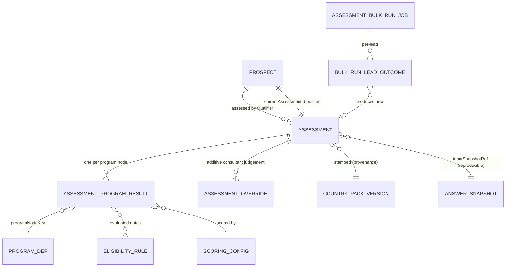

## 8. User Stories + Acceptance

**US-1 — Intake Rep: one-click triage on a partial profile.**
- **Given** a lead with no language scores, **When** I click **Assess**, **Then** an Assessment is produced (not an error) with `prospectId` set and `client_id` null (pre-conversion Party FK absent); programs needing language return `POSSIBLY_ELIGIBLE` listing the missing `canonicalFieldKey`s; programs decidable without it return a firm outcome; every result shows the stamped disclaimer + pack version; the top signal appears on the AG-2 board card via `assessment.computed`.

**US-2 — RCIC: gates vs competitiveness not conflated.**
- **Given** a very high score but a failed HARD gate (e.g. a missing in-province job offer), **When** assessed, **Then** that program is `NOT_ELIGIBLE` with the failed `ruleKey`'s message — the high score does not make them eligible.
- **Given** gates pass but score < pass mark, **When** assessed, **Then** the program is `ELIGIBLE_BELOW_CUTOFF` with the gap, not `NOT_ELIGIBLE`.

**US-3 — RCIC: decisive recommendations.**
- **Given** a profile just below a pass mark, **When** I view recommendations, **Then** levers are ranked by Δ, and the lever crossing the cutoff is flagged **decisive** and floated first; a `POSSIBLY_ELIGIBLE` program's recommendation is "provide \<named field\>."

**US-4 — Owner: reproducible to the exact rules used.**
- **Given** an assessment under pack vA, **When** SA-1 later publishes vB and I reopen the old one, **Then** it still renders under vA with vA's disclaimer, unchanged.
- **Given** the stored `AnswerSnapshot` + stamped versions, **When** the engine re-derives, **Then** it produces the identical score and outcome.

**US-5 — Manager: firm-wide bulk re-run after a rules change.**
- **Given** 40 open leads stale against a new effective pack version, **When** I select "re-run all stale for Canada" and confirm, **Then** an async `AssessmentBulkRunJob` runs in the worker tier, produces a new immutable Assessment per lead (pointers advance, priors retained), reports succeeded/skipped/failed, flags leads that had a prior override, emits a completion notification, and is audited as one bulk action — with no request timeout and no lead re-run twice on a worker retry.

**US-6 — Consultant override is first-class and audited.**
- **Given** a `LIKELY_ELIGIBLE` I judge impractical, **When** I override it with a reason, **Then** the override is stored alongside the engine result (both visible), version-stamped + attributed, and audited (actor/target/before-after); a shared artifact shows the consultant note next to the overridden program.

**US-7 — Global: switch on a country with no code change.**
- **Given** an entitled, published Australia pack, **When** a firm assesses a lead with `destinationCountry = AU`, **Then** the same engine returns ranked AU outcomes with the AU disclaimer and no AG-3 code changed; inspecting the engine finds no hardcoded program names, point values, or pass marks.

**US-8 — Client-facing artifact: honest, locale-correct, gated.**
- **Given** a reviewed assessment for a French-speaking client whose Party is bound to a `ClientCustomer`, **When** I share it, **Then** the portal shows a plain-language French summary with the French disclaimer + provenance footer, the subject resolves via the `client_id` → Party → ClientCustomer chain (Doc 1 §2.5), and the share is audited; **Given** review is required and the assessment is unreviewed, **When** I attempt to share, **Then** it is blocked until reviewed (BR-16).

**US-9 — Single-source: no re-keying into the case.**
- **Given** I edit a language score on the assessment surface, **When** I save, **Then** it supersedes the answer in the one canonical store; **Given** I convert the lead, **When** a case is later created from the converted prospect (AG-7 create-from-convert — `prospect.converted` itself carries no `caseId`), **Then** the chosen `programNodeKey + packVersionId` + `AnswerSnapshot` + provenance carry forward with nothing fabricated and `client_id` is bound to the converted Party.

## 9. Edge Cases & Validations

- **Empty/near-empty profile** → engine still runs; every program returns `POSSIBLY_ELIGIBLE` with its full missing-input list; nothing errors, nothing falsely `NOT_ELIGIBLE` (BR-7).
- **Gate input present but invalid** (out-of-range test score) → Zod-validated at the edge; if not normalisable it is treated as missing for that gate (POSSIBLY), never silently scored zero.
- **No entitled/published/effective pack for the country** → assessment blocked with a clear "no active \<country\> rules pack" message; no result fabricated from a draft or another country (BR-2).
- **Pre-conversion prospect (no Party yet)** → `Assessment.client_id` is null and `prospectId` is set; the assessment inserts normally; the client-facing artifact has no portal exposure until conversion binds the Party as a `ClientCustomer` (the subject simply does not resolve to a portal subject, never an error).
- **Pack version becomes superseded between load and persist** → the run pins to the version it loaded and stamps it (no mid-run switch); concurrency-safe.
- **Re-run yields an identical result** → still a new immutable Assessment; the delta shows "no change"; the pointer advances.
- **Draw-ranking with a missing cutoff signal** → still `LIKELY_ELIGIBLE` (gate-based); the band shows "cutoff signal unavailable" rather than inventing one.
- **Override then re-run** → the override belongs to the old snapshot; the new one starts without it; the bulk-run report flags such leads (overrides never silently carry onto new machine numbers).
- **Concurrent profile edits during assessment** → supersede semantics with the partial-unique-index currency contract (Doc 1 §5.4) give last-writer-wins with an audit trail; the `AnswerSnapshot` stamps the answer set it used, so the result is unambiguous regardless of later edits.
- **Capped factor chased by a recommendation** → a recommendation never suggests points in a factor at its cap; the breakdown marks `(capped)`.
- **Bulk job partial failure** → the job completes `COMPLETED_WITH_ERRORS` with per-lead reasons; succeeded leads keep their new assessments; a worker retry re-runs no succeeded lead (idempotency ledger, Doc 1 §6.2.4).
- **Cross-tenant / cross-client access attempt** → an assessment id from another firm, or a portal client requesting another client's artifact, returns 404/empty and is denied at the DB (forced RLS + portal second dimension resolving `client_id` → Party → ClientCustomer, Doc 1 §2.5); packs are shared read-only, never another firm's results.
- **Validation doctrine.** All requests (profile edits, run/re-run/override/review/share, bulk-run scope) are Zod-validated at the edge — no ad-hoc `if/else`. Missing *scoring* inputs are a domain outcome (POSSIBLY), not a 400; malformed *requests* are a 400. Never persist on validation failure.

## 10. Permissions (LOCAL `agent/*`)

Default-deny; additive; always within the caller's `firm_id`; route-level (`@RequirePermissions`) AND object-level ownership (Doc 1 §4). All keys follow the single canonical grammar `agent/<resource>:<action>` (colon), one resource namespace per module (`assessment`). Today's prototype reuses `agent/prospect:list`/`:edit` — these keys are NEW so run/override/review/share/bulk are separable from generic prospect editing.

| Permission Key | Status | Description |
|---|---|---|
| `agent/assessment:view` | NEW | View a lead's assessment(s), breakdown, history (read-only) |
| `agent/assessment:run` | NEW | Run / re-run the Qualifier (single); required for bulk re-run |
| `agent/assessment:override` | NEW | Override a program outcome (reason required) |
| `agent/assessment:review` | NEW | Mark an assessment reviewed/approved |
| `agent/assessment:share` | NEW | Produce/share the client-facing artifact (portal/PDF); audited |
| `agent/assessment:pin-version` | NEW | Re-run pinned to a specific pack version (with reason) |
| `agent/assessment:view-stale` | NEW | View the firm-wide stale-assessments queue; required (with `:run`) for bulk re-run |

> Pack authoring/publishing is `system/*` (SA-1, Doc 2) — out of scope here; AG-3 only consumes. The mechanical-derivation/CI-validation of this catalog against §10 is the Doc 1 §4 RBAC contract.

Privilege separation: a junior rep may `run` but not `override`/`share`. Entitlement (`feature.*`, Doc 1 §4) layers on top — server-enforced, not UI-only.

## 11. Scalability · Security · Performance

**Scalability.** The eligibility brain is consumed pack data (Doc 1 §5.13); a new program or rule change is SA-1 authoring, not an AG-3 deploy. A new destination is a new entitled pack — the AG-3 engine code is untouched (the literal expression of "global by construction"). Cross-cutting attaches to an Assessment via `(entityType, entityId)` — config, not migration.

**Security.** Assessment results are firm-private under forced RLS (`firm_id`); `Assessment.client_id` is the Party FK of the data subject (nullable pre-conversion), so the client-facing artifact obeys the portal second RLS dimension and resolves its subject through the `client_id` → Party → ClientCustomer chain (Doc 1 §2.5) and is delivered via an ownership-bound presigned URL / capability token (never a caller-supplied key, Doc 1 §1.4/§4.6). The `AnswerSnapshot` and assessment internals are Confidential; Restricted-PII answers stay field-encrypted in the answer store and are mask-by-default with audited reveal (Doc 1 §7); no PII in logs/traces. Advice egress (share/export) and override/review are audited via the §7.5 spine. Every request is Zod-validated; missing scoring inputs are a domain outcome, not a crash vector. Each endpoint carries the correct `agent/assessment:*` key; pack authoring is `system/*`-only.

**Performance.** The engine is a deterministic pure function over (resolved answers, cached pack version) — CPU-bound, no per-program DB round-trips; derived inputs computed once per run. Published pack versions are immutable and cached, keyed by `(countryCode, domain, version)` with invalidation on publish (Doc 1 §5 / SA-1). A single assessment write is one transaction (`Assessment` + `AssessmentProgramResult[]`). Indices: `(firm_id, prospectId, createdAt)` for history; `currentAssessmentId` on the lead; `(firm_id, destinationCountry, packVersionId)` for the stale view. Stale detection is an indexed comparison, never a per-row recompute. Bulk re-run is async on BullMQ in the worker tier with progress + idempotency — never a blocking request or in-memory fan-out. Budgets (Doc 1 NFR P): read p95 ≤ 300 ms; a single assessment write p95 ≤ 600 ms; lists cursor-paginated (≤ 50); work > 5 s is queued.

## 12. Reference Note (exists / NEW / changed)

> Honest, grounded in the prototype `src/prospect-evaluation/*` (`ProspectProgramScore`, `ProspectEvaluationProfile`) and the locked Doc 1/Doc 2 target state. Greenfield framing per ADR [6.1]: the prototype is design-provenance only.

**EXISTS (prototype, design-provenance):** a working 7-program Canada engine (CRS, FSW-67, OINP, AAIP, SINP, BCPNP, MPNP) with an aggregator and a shared CLB conversion + unit tests; a `CalculatorResult` shape (`score/maxScore/passMark/eligible/gateFailures/breakdown`); a `ProspectProgramScore` row upserted in place per `(prospectId, programKey)`; a `ProspectEvaluationProfile.data` JSON blob; a `RULES_AS_OF` TypeScript constant + a fixed disclaimer string; `clientId` application scoping.

**NEW (target state, this module owns):**
- The **eligibility-evaluation runtime over consumed pack config** (Doc 1 §5.13 explicitly defers this runtime to "the assessment engine — later wave"): a generic evaluator over `Predicate`/`ScoringConfig`/`EligibilityRuleSet`, **no hardcoded values**.
- The **four-state outcome + gate-vs-competitiveness separation + "possibly — missing data"** with named missing `canonicalFieldKey`s (prototype is boolean-only).
- **Immutable, version-stamped `Assessment` + `AssessmentProgramResult`** with persisted provenance + the immutable `AnswerSnapshot` input + reproducibility (prototype upserts in place with no version — re-running destroys the prior answer). *(Per gap analysis, `AssessmentProgramResult` and `inputSnapshotRef` are already modelled — reused, not re-invented; the `AnswerSnapshot` producer is IN for the AG-3 wave.)*
- **Quantified recommendations** (Δ, decisive, crosses-cutoff) — none exist today.
- **Consultant override (additive, audited) + configurable review gate** — none today.
- **Single-source intake** via the Doc 1 §5.4 answer store / `CanonicalAnswerProjection` (kills the `ProspectEvaluationProfile` JSON island).
- **Explicit re-run + staleness + firm-wide stale view + the async bulk re-run job** (`AssessmentBulkRunJob`) — *the named AG-3 gap closure*; none exist today.
- **Client-facing shareable artifact** (per-locale, disclaimer + provenance, audited; async-PDF path already modelled — not re-flagged).
- The **`agent/assessment:*` permission set** (prototype rides `agent/prospect:list`/`:edit`).

**CHANGED (target corrections):** hardcoded TypeScript brain → consumed `ScoringConfig`/`EligibilityRuleSet` (Doc 1 §5.13); `RULES_AS_OF` constant → resolved versions stamped on the snapshot; mutable `ProspectProgramScore` → immutable `AssessmentProgramResult`; `ProspectEvaluationProfile.data` island → single-source answer store + immutable `AnswerSnapshot`; `clientId` filtering → `firm_id` + forced RLS, with `Assessment.client_id` redefined as the nullable Party FK of the data subject (Doc 1 §2/§2.5/§5.2); CLB tables in TS → `LANGUAGE_CLB` `ReferenceDataset` (mechanism shared, tables are pack data); prototype "proxy" approximations (work-permit/earnings proxies) → explicit SME-authored `EligibilityRule`/`ScoringBracket` content **[FOUNDER-CONFIRM]**.

## 13. Open Questions / [FOUNDER-CONFIRM]

**Routed to founder/Immigration-SME (content, not machinery — the deferred Country-Pack deliverable):**
1. The program/stream set per country and each node's selection model (`FIXED_PASS_MARK` vs `DRAW_RANKING`).
2. The precise HARD-vs-ADVISORY gate conditions and the `canonicalFieldKey` each depends on (drives the missing-data tri-state).
3. The grid point values, maxima, caps, combination/with-spouse rules, and pass marks (authored as `ScoringConfig`/`ScoringBracket`).
4. The recommendation levers + Δ-models, and the indicative draw-cutoff signals (a `ReferenceDataset`).
5. The exact regulator-safe disclaimer wording per locale (EN / FR-CA) via `RegulatorConfig`/`LocalizedLabel`.
6. Which `CanonicalField`s are mandatory for a *useful* preliminary qualification (the minimum to avoid an all-POSSIBLY result).
7. **Admissibility & validity content** — whether inadmissibility/criminality (rehabilitation/TRP) and government-artifact validity windows are authored as HARD/ADVISORY `EligibilityRule`s + `FreshnessRule`s now (AG-3 builds the runtime regardless; this is content scope — closes the gap-analysis finding as a content dependency).

**Genuinely open (product/policy):**
8. **Firm-level pack override** — may a firm ever fork a pack value, or are packs strictly platform-owned read-only? *(Default: read-only; firm display preferences only.)*
9. **Mandatory review before client-share** — required, or per-firm configurable? *(Sets the BR-16 default.)*
10. **Auto-assess trigger** — auto-run on profile-complete (`runType=AUTO`), or explicit only? *(Affects lead-score freshness.)*
11. **Indicative cutoff source** — manually maintained pack value vs a feed of recent draws. *(A static seeded value suffices for v1.)*
12. **Entitlement tiers** — which AG-3 surfaces (recommendations, multi-country, client-facing artifact, bulk re-run) sit behind which plan, with usage caps — needed to wire the `feature.*` gates and seed `PlanFeatureEntitlement`. *(This is the platform-wide entitlement-matrix dependency flagged in the gap analysis; AG-3 builds the gate, the matrix is the consolidated founder artifact.)*

---

# Module AG-4: Consultation & Booking (Scheduler)

## Module Index

- **§1 Purpose & Goal** — the in-house consultation scheduler that turns intent into a held consult and hands a structured record to the retainer flow (AG-5).
- **§2 Users & JTBD** — public booker (first-class unauthenticated actor), Intake/Sales Rep, RCIC/Consultant, Manager, Owner, Accounts, Case Officer.
- **§3 Functional Design** — availability math, appointment types, the public page, lead hand-off, double-booking safety, video rooms, reminders/ICS, self-service, own-account calendar/video connector, paid consults, lifecycle events, consult records, assignment, analytics.
- **§4 Detailed Functional Requirements** — AG-4-1 … AG-4-52.
- **§5 Business Rules** — BR-1 … BR-21.
- **§6 States & Lifecycle** — booking, appointment-type, and consult-record state machines.
- **§7 Key Entities & Fields** — `AppointmentType`, `AvailabilityRule`, `IntakeQuestion`, `ReminderRule`, `Booking`, `BookingAnswer`, `ConsultRecord`, `RefundPolicy`, `CalendarConnection`, `MeetingAccountConnection`, `BookingPageConfig`, `OAuthState`; plus the Events emitted/consumed table.
- **§8 User Stories + Acceptance** — US-1 … US-12.
- **§9 Edge Cases & Validations** — DST, concurrency, paid-abandon, CSRF, capacity, enumeration, injection, queue-down.
- **§10 Permissions** — the `agent/booking:*` LOCAL catalog.
- **§11 Scalability · Security · Performance** — public-surface hardening, tenant isolation, PII, connector security, budgets.
- **§12 Reference Note** — exists / NEW / CHANGED vs the reference prototype.
- **§13 Open Questions / [FOUNDER-CONFIRM]** — resolved-IN scope and the routed domain-content items.

> **Plane:** Agent / Firm console (LOCAL). **Tenant key:** `firm_id`, isolated by PostgreSQL FORCED Row-Level Security per Doc 1 §2. **Identity:** firm-staff pool (`er:firm` audience) per Doc 1 §3.1; the public booking page is an unauthenticated surface guarded by the `@Public({control:'rate-limit'})` allow-list per Doc 1 §4.6. **Permissions:** `agent/*` LOCAL plane, record-level authz per Doc 1 §4.5. **Content-neutrality:** the Scheduler is pure machinery; immigration values (program names, disclaimer wording, intake questions) come from the Doc 2 SA-1 Country Pack and are marked [FOUNDER-CONFIRM]. **Doer status:** the Scheduler is a pure in-house Doer with **no infrastructure rail port** (Doc 1 §6.3 — there is no `SchedulerPort`); it collaborates with the Mailer (EmailRelayPort), Messenger (SmsGatewayPort), Biller (PaymentRailPort), and the firm's **own-account OAuth connector** — a ratified adapter category under the rails adapter boundary (Doc 1 §6.3 own-account-connector carve-out; the platform OAuth app lives in SA-8, Doc 2 §3250), not an unsanctioned local port.

## 1. Purpose & Goal

AG-4 is the firm's in-house consultation scheduler — the Doer that turns "I'd like to talk to someone" into a booked, confirmed, reminded, and ultimately *held* consultation, then hands a structured consult record to the retainer flow (AG-5). It sits at the most fragile seam of the revenue funnel: the moment a prospect commits time.

The business outcome it must make structurally true is: **a prospect can book the right consult in under a minute, will be reminded so they show, and the held consult flows straight into a retainer** — by design, not by staff discipline. It closes the three predictable revenue leaks: friction at booking (the dead "what's your availability?" email thread), no-shows (a whim booking never reminded), and dropped hand-off (the consult happens but nothing flows into a proposal).

This is not a Calendly clone bolted onto a CRM. The platform doctrine (Doc 1 §6.3) is that every product tool is an in-house Doer; the only external touch AG-4 permits is the firm connecting its **own** Google/Outlook calendar and optionally its **own** video account — never a competing scheduling product. That choice is the moat: a generic scheduler owns a calendar event but cannot own the *revenue semantics* of a regulated, multi-country immigration business — attribution-aware lead creation (a free booker becomes an AG-2 lead with `source=BOOKING`), bilingual CASL/Law-25-compliant comms, in-house paid consults through the firm's own Biller, tenant-isolated PII under FORCED RLS, and a consult record that pre-fills the retainer.

The same Scheduler serves a Canada-only solo RCIC in one timezone and a firm running Canada + Australia desks across many timezones with no code change. Single-country / single-timezone / single-locale is the degenerate case (Doc 1 §1.7 region seam; §8.6 i18n).

## 2. Users & JTBD

The Agent persona is an umbrella; AG-4 is used differently per sub-role, plus the **public booker** — an external, unauthenticated, first-class actor.

| Role | Primary job | Representative JTBD |
|---|---|---|
| **Public booker** (prospect/client, unauthenticated) | Book the right consult, fast, in my language and timezone. | "See real open times in my own timezone and book in under a minute, no account." · "Get an instant confirmation with a calendar invite and join link, in French if I'm in Quebec." · "Reschedule or cancel myself without phoning the office." |
| **Intake / Sales Rep** (heaviest staff user) | Make sure consults happen, show up, and convert. | "Auto-link a booking to its lead so the consult is part of the deal." · "On a no-show, flag the lead and start recovery automatically." · "Grab a slot *for* a hot lead in two clicks (manual booking) without sending them to the public page." |
| **RCIC / Consultant** (the host) | Protect my time; arrive prepared; turn the consult into a retainer. | "Open my day and see each consult with the eligibility assessment and intake answers already attached." · "Capture the outcome once and turn it into a proposal without retyping." · "Never have the page offer a time my personal calendar is busy." |
| **Manager** | Keep consult volume high, no-shows low. | "Show-rate, no-show rate, bookings by type/source, over/under-booked hosts — filterable by country, one currency for paid consults." · "Round-robin fairly or fill any-available, respecting who's off." |
| **Owner / Principal RCIC** | Own the booking experience and compliance posture. | "Branded, bilingual, embeddable booking page capturing exactly the intake I need; every confirmation respects consent and never promises an outcome." · "Connect my own Google calendar for two-way sync; turn it off and stay self-contained." |
| **Accounts / Billing** | Touch AG-4 only at the paid-consult money edge. | "A paid consult reconciled in the right currency through our own Biller; refunded per policy if cancelled in window." (Owns AG-6; consumes AG-4's hand-off.) |
| **Case Officer / Paralegal** | Schedule case-stage touchpoints post-conversion. | "Book a document-review call against the client and case, same reminders, so it actually happens." |

## 3. Functional Design

### 3.1 Availability & scheduling rules (timezone-aware)
**How it works.** Availability is layered and strictly *subtractive*: each layer can only remove from the bookable set. (1) Per-`AppointmentType` weekly `AvailabilityRule` windows in the **host/firm timezone** (wall-clock, never UTC). (2) Slot granularity = type duration. (3) `bufferBefore`/`bufferAfter` pad each booking. (4) `minNoticeHours` blocks too-soon slots. (5) `futureBookingDays` bounds how far ahead the page opens. (6) Per-host capacity caps `maxPerDay/Week/Month` (and group capacity per slot). (7) Existing `SCHEDULED|RESCHEDULED|PENDING_PAYMENT` bookings subtract their padded span. (8) The firm `BusinessHoursCalendar` + holiday set (per country/office) subtract closed days. (9) Optional connected-calendar external busy subtracts (§3.9).

**Timezone correctness (non-negotiable).** A slot's canonical UTC instant is derived **per calendar date** so the correct DST offset for that date applies (09:00 Toronto = 13:00Z summer / 14:00Z winter, one computation). Day-of-week is computed in the host timezone, not UTC, so a near-midnight western-zone date picks the right weekday's rules. The booker's timezone is **display-only** — it never enters slot identity. This aligns with Doc 1 I18N-3 (UTC storage, per-user render timezone).

**World-class behaviour.** The bookable set is provably a subset of declared windows; no layer can accidentally add time. Capacity caps protect the human from burnout. Business-hours/holidays come from shared firm config, not per-type editing.

**Screens.** Availability grid editor (multiple windows/day, copy-day-to-day, explicit firm-tz label); buffer/notice/window/caps fields; a **live "preview as a booker"** rendering resulting slots for a chosen date and viewer timezone.

**Data flow.** Slot request (type, date, viewer-tz) → load type + rules + caps + BusinessHoursCalendar (+ external free/busy if connected) → compute candidate slots in host-tz → derive UTC instants per-date (DST-correct) → subtract padded busy + min-notice + caps + holidays → return `{startTimeUtc, available}[]`; FE renders in booker-tz.

### 3.2 Appointment types (free / paid / follow-up)
**How it works.** An `AppointmentType` is the durable template a booking instantiates: identity (name, public `slug`, colour, active/soft-delete); a purpose `category` (`FREE_CONSULT|PAID_CONSULT|FOLLOW_UP|CASE_REVIEW|OTHER`) that drives behaviour; `durationMins`; scheduling rules (§3.1); `locationTypes[]` (`IN_PERSON|PHONE|VIDEO` + provider); price (`priceAmount`/`priceCurrency`, paid types only); hosting model (`ONE_ON_ONE|ROUND_ROBIN|GROUP|COLLECTIVE`) + host pool; intake questions and reminder rules; per-country scope (`destinationCountryId`, an activated country from Doc 2 SA-1) and per-locale public-copy variants.

**World-class behaviour.** Purpose-typed, not generic: the system knows a paid consult must clear payment before `SCHEDULED`, a free consult auto-creates a lead, a follow-up attaches to a case — no per-booking branching. Mode-aware (video→link, phone→number, in-person→address). Country/locale-scoped so a multi-country firm publishes the right consults on the right localized page. Regulator-safe copy hooks: paid/regulated types carry a `preConsultAgreementRef` the booker must accept before payment (the wording is [FOUNDER-CONFIRM] / SME-supplied content).

**Screens.** Type list (cards with booking counts, active toggle); type editor (tabs: Details · Availability · Intake · Reminders · Payment · Locale variants); embed-snippet output; duplicate-type.

**Data flow.** Create/update type → persist template + nested rules/questions/reminders + locale variants → generate unique per-firm slug → expose on the public page. A later type edit never mutates past bookings' captured terms (BR-19).

### 3.3 The public booking page (branded, per-locale, accessible)
**How it works.** A branded, public, unauthenticated surface at `/{firmSlug}/{typeSlug}`, embeddable via a script/iframe snippet. Flow: choose type → pick date & slot (computed host-tz, rendered visitor-tz with override) → answer intake (name + email always; firm-configured questions, optionally `leadFieldMap`-mapped to pre-fill the lead) → consent + locale (CASL service-vs-marketing checkboxes separately, rendered in the visitor's language; pre-consult agreement acceptance for paid/regulated types) → pay if required (§3.10) → confirm (on-screen + email with ICS).

**World-class behaviour (beats Calendly for this business).** Per-locale end-to-end (page, intake labels, consent, confirmation, ICS) satisfies CASL *and* Quebec Law 25 (Doc 1 §8.6; §7.6 governance). Timezone-honest (visitor's own tz with explicit label + override). Accessible & mobile-first to WCAG 2.2 AA (Doc 1 NFR5-11) — keyboard nav, screen-reader labels, contrast, large targets, **risk-based bot mitigation, no blocking CAPTCHA**. Branded as the firm's, not "powered by a competitor." Lead-aware (§3.4). Hardened public surface (§11).

**Screens.** Public type/landing page (firm-branded, locale switch, host name/photo); date+slot picker (visitor-tz label + override, "no times? try another week"); inline-validated intake; payment step; confirmation (add-to-calendar, reschedule/cancel links, join details). Booking-page builder for Owner/Manager (branding, public types, locale variants, embed snippet, spam-protection toggles, intake editor with field-mapping).

**Data flow.** Public GET (firmSlug → firm via **opaque-slug-only** resolver; typeSlug → type) returns the *public projection* (no internal IDs) → slot GET computes availability → booking POST validates (Zod schema + answer-ownership + slot-still-free) → creates booking (+ lead, §3.4) → triggers payment (paid) → confirmation + ICS + events.

### 3.4 Lead auto-creation & hand-off to AG-2
**How it works.** On booking (public or manual staff), the Scheduler resolves the booker against AG-2's people, all keyed on the Doc 1 §5.2 `Party` spine: **new email** → create a `Party` (kind `PERSON`) + a `Contact` lens with `source=BOOKING`, stamp locale, the type's `destinationCountryId`, name/email/phone, and captured attribution (utm/referrer); link the booking. **Existing email** → link to the existing `Party`'s open Contact/opportunity (per AG-2 reopen rules) — never a duplicate person. **Returning client** → link the booking to the existing `ClientIndividual`/`Case` (the case-attach path), so post-conversion consults land on the case, not a stray lead. Assignment runs through AG-2's `AssignmentRule`; for `ONE_ON_ONE` types the booking host is the natural owner; the Conductor's speed-to-lead playbook still runs.

**World-class behaviour.** Zero orphan calendar entries — every booking is on the lead timeline and work-queue. Attribution-complete end-to-end. Dedup-safe under concurrency: the Party resolution is keyed on `(firm_id, normalised email)` so two near-simultaneous bookings resolve to one Party.

**Data flow.** Booking create → resolve booker (dedup by normalised email within firm) → create/link Party + Contact (or Case) → link booking ↔ lead → emit `booking.scheduled` → AG-2 Conductor (assignment, speed-to-lead, timeline) → Notification to owner.

### 3.5 Slot computation & double-booking safety
**How it works.** Availability at view time is **not** a reservation; the slot is re-checked and locked at booking time. The booking transaction: (1) recomputes the requested slot; (2) takes a row-level lock (`SELECT … FOR UPDATE`) over the host's conflicting intervals, serializing concurrent attempts — the second transaction blocks then sees the conflict and is rejected with a clear "this time was just booked"; (3) resolves the host (round-robin/any-available, §3.13) inside the same logic; (4) creates the booking + answers + lead atomically.

**World-class behaviour.** Double-booking is *impossible*, not merely unlikely. The loser gets an actionable 409 with freshly recomputed slots, never a silent overwrite. `PENDING_PAYMENT` holds the slot (conflict set includes it) so it can't be double-sold; a lapsed payment frees it (§3.10).

**Data flow.** Book → recompute slot → `FOR UPDATE` lock on host conflicts (SCHEDULED/RESCHEDULED/PENDING_PAYMENT + external busy) → if clear: assign host + create booking+answers (+lead) in one transaction → else 409 with refreshed slots.

### 3.6 Video links — in-house room & the firm's-own-account connector (gap closure: room design + URL security)
**How it works.** For `VIDEO` bookings a join link is attached at confirmation via a tiered, in-house-first strategy:

1. **In-house video room (preferred default).** The Scheduler mints a stable per-booking room reachable on the firm's domain. The room URL **never embeds the booking id or any guessable identifier** — it is a `@Public({control:'capability-token'})` resource per Doc 1 §4.6: an unguessable, single-purpose, time-boxed `roomToken` resolves server-side to exactly one ownership-checked booking. The token is **separate** from the self-service token (§3.8), is admission-scoped to the meeting window (`[startTime − joinLeadMins, endTime + graceMins]`), and is **distinct per participant role** (`HOST | GUEST`) so the host's join is never the guest's. No token or PII ever appears in a URL query param (carried in path/header per Doc 1's URL-hygiene rule). The room enforces capacity (1:1 = 2 admits; GROUP = `groupCapacity`). *For v1 the room is a thin token-gated WebRTC room / redirect; full self-hosted WebRTC SFU is a roadmap item that fits behind the same `MeetingProviderPort` (§13).*
2. **Firm's OWN connected meeting account (optional).** If the firm connected its own video account (§3.9), the Scheduler creates the meeting in *that* account via the firm's credentials and stores the returned join URL. The concrete provider is the adapter selected in the own-account connector config — never a domain enum value.
3. **Manual link fallback (always available).** The host can paste a link on any booking.

There is **no third-party scheduling-tool dependency**. Disable everything external → the Scheduler is fully self-contained on the in-house room. Link lifecycle is correct: reschedule regenerates/updates the link + ICS and **rotates the `roomToken`**; cancel revokes/voids it.

**Screens.** Mode picker on the type (allowed providers); per-booking link field (host override/paste); connector status in settings (§3.9).

**Data flow.** Confirm video booking → strategy: in-house room (mint per-role capability tokens) → else connected-account create-meeting → else await manual link → store on booking → include in confirmation/ICS/reminders → on reschedule rotate token + update; on cancel void.

### 3.7 Confirmations, reminders & follow-ups (ICS, bilingual)
**How it works.** Each `AppointmentType` owns `ReminderRule`s — `triggerType` (`BOOKING_CONFIRMED@0`, `BEFORE_MEETING@24h/1h`, `AFTER_MEETING`, `CANCELLATION`), `offsetMinutes`, `channel`, and locale template variants. On booking, the Scheduler enqueues delayed BullMQ jobs per rule (Doc 1 §6.2 durable lane); on reschedule it re-enqueues; on cancel it fires the cancellation note and cancels pending jobs. Email sends route through the **Mailer** (EmailRelayPort); SMS/WhatsApp through the **Messenger** (SmsGatewayPort).

- **ICS attachment** on confirmation/reschedule: standards-compliant, with host, time, location/join link, and a **stable UID + SEQUENCE bump** so a reschedule *updates* rather than duplicates the calendar entry.
- **Bilingual, template-driven.** Each template has locale variants; the Doer selects the variant matching the **booking's locale**, falling back to the firm default only if missing (Doc 1 §8.6 bilingual platform strings).
- **Channel- & consent-aware.** Confirmations/reminders are **transactional** (allowed without marketing consent); any *marketing* follow-up respects consent at send time (Doc 1 §7.6 consent register).
- **Resilient.** Reminder scheduling is **non-fatal** (Doc 1 TR-A2): if Redis is down the booking still commits; jobs are retried with backoff and idempotent on `(bookingId, reminderRuleId, fireTime)`.

The triggering domain event raises a `notif/consult-reminder` notification routed through AG-10's per-user `NotificationPreference` (the channel matrix per eventType, quiet hours, digest — bounded by the AG-16 firm-policy ceiling); transactional confirmations/reminders are always deliverable regardless of marketing consent.

**Screens.** Reminder editor on the type (trigger/offset/channel/template, locale variants, live preview); per-booking comms log on the timeline.

**Data flow.** Confirmed → per active rule compute fire-time (skip past-due) → enqueue delayed job → at fire-time worker selects locale template, renders merge fields in booker tz/locale, sends via Mailer/Messenger, logs to timeline. Reschedule → re-enqueue + updated ICS; cancel → cancellation note + cancel pending jobs.

### 3.8 No-show / cancel / reschedule self-service
**How it works.** Every booking carries a **single-use self-service token** (unguessable, distinct from the §3.6 room token) embedded in confirmation links for account-free reschedule/cancel. **Reschedule:** enforce `rescheduleNoticeHours` + `allowReschedule`, re-check slot under the same `FOR UPDATE` lock, move to `RESCHEDULED`, **rotate the token** (old link can't replay), regenerate link + ICS, reschedule reminders, emit `booking.rescheduled`. **Cancel:** enforce `cancelNoticeHours` + `allowCancellation`, move to `CANCELLED`, fire cancellation note, void link, emit `booking.cancelled` (triggers refund logic for paid consults, §3.10). **No-show:** staff mark `NO_SHOW`, or an **auto-no-show** timer fires after a configurable grace past start; emits `booking.missed` → AG-2 recovery sequence. **Completed:** staff mark `COMPLETED`, emits `booking.completed` and opens the consult record (§3.12).

**World-class behaviour.** Account-free and friction-free *increases* compliance (bookers reschedule instead of ghosting). Notice windows and allow-flags are server-enforced; late actions blocked with a clear message and may forfeit a paid fee per policy. Replay-safe via token rotation. No-show is a managed recovery motion, not a dead end.

**Screens.** Public token-gated reschedule/cancel pages (locale-aware); staff booking detail (mark Completed/No-show, reschedule/cancel on behalf, audited override); no-show queue (surfaced in the AG-2 work-queue).

### 3.9 Optional two-way sync to the firm's OWN calendar (gap closure: own-account connector + OAuth CSRF state)
**How it works.** A host (or the firm) connects their **own** Google or Outlook calendar via OAuth. The platform-level OAuth app (client id + write-only client secret + least-privilege scopes) is owned by **SA-8** (Doc 2 §3250); each firm's access/refresh tokens live in that firm's tenant, `firm_id`-scoped, encrypted under the **per-firm operational DEK** (Doc 1 §7.1) — *not* the per-subject field codec, because a firm OAuth token is firm-credential material, not end-client Party PII (Doc 2 §3250 normative). The connector is reached only through a Doer-internal **`CalendarConnectorPort`** (and `MeetingProviderPort` for §3.6). These ports belong to the ratified **own-account OAuth connector** adapter category — a named, lint-covered adapter boundary distinct from the five infrastructure rail ports (Doc 1 §6.3 own-account-connector carve-out; SA-8 holds the connector app per Doc 2 §3250). There is deliberately no `SchedulerPort`, and this category is the narrow own-account exception, never a "connect a third-party tool" integration.

- **Free/busy (inbound):** the Scheduler reads external busy and subtracts it from availability (§3.1).
- **Event push (outbound):** create/reschedule/cancel writes/updates/deletes the mirror event on the host's external calendar.
- **Precedence:** external busy is authoritative for *blocking* (never overbook a human); the Scheduler's bookings are the source of truth for *consults* (external event is a mirror).
- **Optional & reversible:** disconnect → fully self-contained; nothing requires a connected calendar (Doc 2 BR-11).

**OAuth CSRF / token hygiene (gap closure).** The authorization request carries a cryptographically-random, single-use, time-boxed `state` parameter bound to the initiating firm-staff session (stored server-side keyed to `firm_id`+`userId`); the callback **rejects** any `state` that is missing, expired, replayed, or unbound — closing OAuth CSRF/authorization-code injection. The callback also validates the `aud`/issuer of returned tokens. Tokens are refreshed transparently, minimally scoped, and revocable; a revoked/expired connection **degrades to self-contained** with a "reconnect" prompt — never a hard booking failure. Outbound push is best-effort with retry; a failed push **never** rolls back the internal booking. Inbound free/busy is a server-to-server fetch (no inbound webhook required); if a push/notification channel is used, its payload is signature/sender-validated before any effect.

**Screens.** Calendar connections settings (connect/disconnect per host, status, last-synced, scopes); per-host "connected" badge on availability.

### 3.10 Paid consults → Biller (gap closure: refund + hold-expiry policy)
**How it works.** A `PAID_CONSULT` type carries `priceAmount`/`priceCurrency`. On booking: (1) create `PENDING_PAYMENT` (slot held, §3.5); (2) route the booker to the **Biller** (AG-6 via PaymentRailPort, the firm's own connected account routed by the port — the concrete processor lives in the connector adapter config, not in a domain model); (3) on `payment.succeeded` → `SCHEDULED`, confirmation + ICS fire, lead flow proceeds; (4) if payment not completed within `paymentHoldExpiryMins`, the hold **expires** (`EXPIRED`) and the slot frees; (5) cancellation/refund follows the firm's **`RefundPolicy`**, executed through the Biller.

**RefundPolicy (gap closure — concrete machinery, content-neutral).** A per-`AppointmentType` (or firm-default) policy as config-as-data:
- `paymentHoldExpiryMins` (default window before an unpaid hold expires) — [FOUNDER-CONFIRM] default value.
- `refundTiers[]`: an ordered list of `{ minNoticeHours, refundPercent }` (e.g. ≥48h → 100%, ≥24h → 50%, <24h → 0%); the Scheduler resolves the booking's notice-at-cancel against the tiers and instructs the Biller to refund that percent. A no-show refund percent is a separate field (`noShowRefundPercent`, default 0).
- `refundsAutomatic` (boolean): if true, an in-policy cancel triggers the refund automatically; if false, it raises a refund task for Accounts to approve.

The Scheduler **never moves money** — it computes the policy outcome and hands a refund instruction to the Biller, which is the single source of truth for money (Doc 1 §6.5 / AG-6). `booking.cancelled` carries the paid context and the resolved refund instruction.

**World-class behaviour.** In-house monetisation in the consult's currency, reconciled in the firm reporting currency via Doc 1 §6.5 FX (never raw-sum across currencies). The `PENDING_PAYMENT` hold prevents selling a slot twice during checkout; a lapse frees it cleanly. Regulated/paid types can require pre-consult agreement acceptance (timestamped) before payment.

### 3.11 Lifecycle events the module EMITS
AG-4 is an event producer to the Doc 1 §6.1 Domain Event Dictionary (`packages/contracts/events`), canonical dot.case, lowercase, `noun(.noun).verb-past` with a single terminal past-tense verb (no underscores/dashes), one emitter, declared consumers, Zod payload, post-commit at-least-once, idempotency key per Doc 1 §6.1.4. Consumers are idempotent via the per-firm processed-event ledger (Doc 1 §6.2.3). `booking.scheduled` and `booking.cancelled` are the canonical anchor names of the booking event family; the remaining `booking.*` names follow the same grammar and are registered centrally in the final dictionary pass.

| Event | Fired when | Idempotency key | Primary consumers |
|---|---|---|---|
| `booking.scheduled` | becomes `SCHEDULED` (free, or paid-then-paid) | `booking.scheduled:{bookingId}` | crm-pipeline (lead link, timeline, speed-to-lead), communications, search |
| `booking.rescheduled` | moves to `RESCHEDULED` | `booking.rescheduled:{bookingId}:{sequence}` | crm-pipeline (timeline), communications (new ICS), automation |
| `booking.cancelled` | moves to `CANCELLED` | `booking.cancelled:{bookingId}` | crm-pipeline, billing (refund if paid), communications |
| `booking.missed` | staff/auto marks `NO_SHOW` | `booking.missed:{bookingId}` | crm-pipeline (no-show recovery), communications, reporting |
| `booking.completed` | staff marks `COMPLETED` | `booking.completed:{bookingId}` | crm-pipeline (stage→Consult/Proposal, NBA), agreements-esign (consult record), billing (paid reconciled), reporting |

All are **internally-emitted** (not rail-originated), so the key derives from the durable `bookingId` (Doc 1 §6.1.4). Side-effects are **non-fatal** to the disposition (Doc 1 TR-A2): a failed downstream consumer never rolls back the booking. A duplicate `booking.completed` advances the stage once and opens one consult record (idempotent by contract).

**Events emitted / consumed.**

| Direction | Event | Counterpart module(s) | Note |
|---|---|---|---|
| Emits | `booking.scheduled` | AG-2 (lead/timeline/speed-to-lead), AG-10 (communications), AG-15 (search) | on free or paid-then-paid `SCHEDULED` |
| Emits | `booking.rescheduled` | AG-2, AG-10, automation | new ICS; key includes `sequence` |
| Emits | `booking.cancelled` | AG-2, AG-6 (refund if paid), AG-10 | carries paid context + resolved refund instruction |
| Emits | `booking.missed` | AG-2 (no-show recovery), AG-10, reporting | staff or auto-after-grace |
| Emits | `booking.completed` | AG-2 (stage→Consult/Proposal, NBA), AG-5 (consult record → Drafter), AG-6 (paid reconciled), reporting | opens one `ConsultRecord` |
| Consumes | `payment.succeeded` | AG-6 (emitter) | `PENDING_PAYMENT` → `SCHEDULED` |
| Consumes | `payment.refunded` | AG-6 (emitter) | reconcile refund outcome onto the booking/consult record |
| Consumes | `envelope.signed` | AG-5 (emitter) | the consult→retainer e-sign completion (payload field `retainerAgreementId`); drives WON back in AG-2 |

### 3.12 Consult records → consultation→retainer hand-off (AG-5)
**How it works.** On `COMPLETED`, the Scheduler opens a `ConsultRecord` attached to the booking and the lead/case: attendance (yes/no), `actualDurationMins`, notes; recommended pathway/program(s) and services (pre-filled from AG-3's assessment where present) — the structured seed for the proposal; an optional quoted fee/currency; a next step (`SEND_RETAINER|NEEDS_DOCS|NOT_PROCEEDING|OTHER`). One click — "Create proposal from consult" — launches the AG-5 **Drafter** pre-filled with the recommended services + fee; the **Signer** sends it for e-signature, and the resulting `envelope.signed` event (carrying `retainerAgreementId`) drives WON back in AG-2. Captured once, never re-keyed.

**World-class behaviour.** The host walks in with the assessment + intake attached and walks out with a record that *is* the proposal's content — closing the gap where momentum dies. Compliance-safe: any recommendation surfaces the indicative-not-guaranteed disclaimer and the pack/rules provenance from the assessment, and the record is part of the audit-grade history a regulated firm must keep. Reusable for cases: a `CASE_REVIEW` booking's consult record attaches to the case.

### 3.13 Round-robin & "any available" assignment
**How it works.** For pooled types the host is chosen at booking time inside the locked transaction: **round-robin** picks the eligible host with the fewest bookings in the window (a single `GROUP BY` count, lowest wins) with a **persisted cursor** to avoid clustering; **any-available** picks any host free for the slot. Only hosts that belong to the firm and the type's pool are considered (pool membership re-validated against `firm_id` at assignment time, defending stored-injection). A host at capacity is skipped. Concurrency-correct because assignment is inside the `FOR UPDATE` transaction (§3.5).

### 3.14 Booking analytics (show-rate, no-show, source)
**How it works.** A firm-scoped, country/currency-aware dashboard (+ tiles in AG-2): **volume** (this vs last period, upcoming 7 days, next consult); **quality** — **show-rate** = `completed / (completed + no_show)` and no-show rate, period-over-period; **revenue** — paid-consult revenue in the reporting currency (Doc 1 §6.5 FX, never raw-sum); **source & type** — bookings by type and by lead source/campaign (joined with AG-2 attribution); **per-host** utilization. The lead/consult timeline is read from AG-13's materialized append-only `ActivityEvent` table (AG-13-owned, committed-IN per ADR 6.2; AG-4 consumes it). Analytics are computed by **DB-side indexed aggregates promoted to periodic rollups + a Redis cache** keyed by `(firm_id, filter-hash)`, evicted on `booking.*` events and a short TTL; the public page and booking detail are always live, never stale.

## 4. Detailed Functional Requirements

**Availability (§3.1)**
- **AG-4-1** Per-type weekly `AvailabilityRule` windows, multiple per weekday, grid editor with copy-day, explicit firm-tz label.
- **AG-4-2** Rule times in host/firm tz; slot UTC instants derived per calendar date with correct DST offset.
- **AG-4-3** Day-of-week computed in host tz, not UTC.
- **AG-4-4** `bufferBefore`/`bufferAfter` pad each booking; padded span blocks neighbours.
- **AG-4-5** `minNoticeHours` + `futureBookingDays` bound the window.
- **AG-4-6** Per-host `maxPerDay/Week/Month` + group `groupCapacity` enforced in slot math.
- **AG-4-7** `BusinessHoursCalendar` + holidays (per country/office) subtract from availability.
- **AG-4-8** "Preview as a booker" renders resulting slots for a chosen date/timezone.

**Appointment types (§3.2)**
- **AG-4-9** CRUD types: name/slug/colour/active/soft-delete; unique slug per firm.
- **AG-4-10** Purpose `category` drives behaviour (free auto-leads; paid gates payment; follow-up/case-review attach to a case).
- **AG-4-11** `durationMins` (5–480) and `locationTypes[]` (IN_PERSON/PHONE/VIDEO + provider).
- **AG-4-12** Hosting model (ONE_ON_ONE/ROUND_ROBIN/GROUP/COLLECTIVE) + host pool.
- **AG-4-13** Per-country scope (`destinationCountryId`, activated country) + per-locale public-copy variants.
- **AG-4-14** Configurable intake questions (text/email/phone/dropdown/multiselect/longtext/number/date), required flags, options, `leadFieldMap`.
- **AG-4-15** `preConsultAgreementRef` acceptance captured with timestamp + form-version, per-country.

**Public page (§3.3)**
- **AG-4-16** Public unauthenticated branded page at `/{firmSlug}/{typeSlug}`, embeddable; `@Public({control:'rate-limit'})`.
- **AG-4-17** Tenant resolution by opaque slug only; raw tenant UUID rejected; firm-not-found and event-not-found return identical generic messages.
- **AG-4-18** Slots rendered in visitor tz (auto-detected, overridable); host-tz used for identity.
- **AG-4-19** Per-locale page, intake labels, consent text, confirmation, ICS (EN/FR…); CASL service-vs-marketing consent captured separately.
- **AG-4-20** WCAG 2.2 AA accessible; risk-based bot mitigation, no blocking CAPTCHA.
- **AG-4-21** Answer-ownership: every answer's `questionId` belongs to this type, else reject.

**Lead hand-off (§3.4)**
- **AG-4-22** New booker → `Party` + `Contact` (`source=BOOKING`, locale, country, attribution); existing → link; returning client → link to client/case.
- **AG-4-23** Party resolution race-safe on `(firm_id, normalised email)`.
- **AG-4-24** Booking-born lead routed by AG-2 `AssignmentRule`; host is natural owner for 1:1.

**Slot safety (§3.5)**
- **AG-4-25** Booking re-checks slot availability at write time.
- **AG-4-26** `SELECT … FOR UPDATE` lock serializes concurrent bookings; loser gets 409 + refreshed slots.
- **AG-4-27** Conflict set includes SCHEDULED/RESCHEDULED/PENDING_PAYMENT + external busy.

**Video links (§3.6)**
- **AG-4-28** In-house room link by default; URL is a per-role, time-boxed `@Public({control:'capability-token'})` resource, no guessable id, admission-window-scoped.
- **AG-4-29** If firm's own video account connected, create meeting there; store join URL (the concrete provider lives in the own-account connector config, not a domain enum).
- **AG-4-30** Manual link fallback on any booking; reschedule rotates room token + updates link/ICS; cancel voids it.

**Confirmations & reminders (§3.7)**
- **AG-4-31** Per-type `ReminderRule`s (trigger/offset/channel/template) with seeded defaults.
- **AG-4-32** ICS on confirmation/reschedule with stable UID + SEQUENCE bump (update, not duplicate).
- **AG-4-33** Bilingual templates: variant by booking locale, fallback to firm default.
- **AG-4-34** Delayed BullMQ jobs with retry/backoff; non-fatal if queue down; idempotent on `(bookingId, reminderRuleId, fireTime)`.
- **AG-4-35** Email via Mailer (EmailRelayPort); SMS/WhatsApp via Messenger (SmsGatewayPort); transactional sends allowed without marketing consent; channel selection honours AG-10's per-user `NotificationPreference` (bounded by the AG-16 firm ceiling).

**Self-service & disposition (§3.8)**
- **AG-4-36** Single-use self-service token enables account-free reschedule/cancel.
- **AG-4-37** Notice-window + allow-flag enforcement (staff override audited).
- **AG-4-38** Token rotates on reschedule (replay-safe).
- **AG-4-39** Staff mark Completed/No-show; auto-no-show after configurable grace.

**Calendar/video sync (§3.9)**
- **AG-4-40** Connect firm's OWN Google/Outlook via OAuth (host-scoped tokens, per-firm-DEK encrypted, SA-8 platform app; own-account OAuth connector adapter category per Doc 1 §6.3).
- **AG-4-41** OAuth `state` is random, single-use, time-boxed, session-bound; callback rejects missing/expired/replayed/unbound state (CSRF defense).
- **AG-4-42** External free/busy subtracts from availability; lifecycle pushes/updates/deletes mirror events (best-effort, retried, non-fatal).
- **AG-4-43** Disconnect → fully self-contained; revoked token degrades gracefully with reconnect prompt; any inbound push payload signature/sender-validated.

**Paid consults (§3.10)**
- **AG-4-44** Paid type → `PENDING_PAYMENT` (slot held) → Biller → `SCHEDULED` on `payment.succeeded`.
- **AG-4-45** `paymentHoldExpiryMins` lapse → `EXPIRED` + slot freed.
- **AG-4-46** `RefundPolicy` (`refundTiers[]` by notice, `noShowRefundPercent`, `refundsAutomatic`) resolved on cancel; refund instruction handed to Biller (Scheduler never moves money).

**Lifecycle events (§3.11)**
- **AG-4-47** Emit `booking.scheduled|rescheduled|cancelled|missed|completed` to the dictionary; post-commit, at-least-once, Zod payload, single emitter.
- **AG-4-48** Consumers idempotent via the per-firm processed-event ledger; side-effects non-fatal to the disposition.

**Consult records (§3.12)**
- **AG-4-49** Completed booking opens a `ConsultRecord` (attendance/notes/recommended pathway+services/fee/next-step) with `version`/`updatedAt`/`lockedAt` (gap closure).
- **AG-4-50** "Create proposal from consult" launches the AG-5 Drafter pre-filled → Signer.

**Assignment (§3.13)**
- **AG-4-51** Round-robin (lowest-count via GROUP BY, persisted cursor) / any-available; capacity- and firm-ownership-validated, inside the lock.

**Analytics (§3.14)**
- **AG-4-52** Show-rate, no-show rate, volume, upcoming, paid revenue — period-over-period, country/currency/source-segmented, DB-aggregated + rollups + cache; timeline read from AG-13's materialized `ActivityEvent`.

## 5. Business Rules

- **BR-1 (Slot identity host-tz/UTC; display booker-tz).** Canonical instant computed host-tz, stored UTC; booker tz display-only; DST applied per calendar date.
- **BR-2 (Availability is subtractive).** Bookable set = windows − buffers − notice − beyond-window − caps − existing/PENDING_PAYMENT busy − holidays − external busy. No layer adds time.
- **BR-3 (No double-booking, ever).** Commit only after a `FOR UPDATE` lock confirms no conflict (SCHEDULED/RESCHEDULED/PENDING_PAYMENT + external busy); losers get 409 + refreshed slots.
- **BR-4 (Paid consults gate confirmation).** `PAID_CONSULT` is `PENDING_PAYMENT` (slot held) until `payment.succeeded` → `SCHEDULED`; lapse → `EXPIRED` (slot freed). Free types go straight to `SCHEDULED`.
- **BR-5 (Tenant resolution by slug only).** Public page resolves firm by opaque slug; raw UUID never accepted; firm/event not-found are byte-identical generic messages (no enumeration oracle).
- **BR-6 (Answer ownership).** Every answer's `questionId` must belong to the booked type, else reject.
- **BR-7 (Booker → lead, deduped, attributed).** Every public booking creates/links a `Party`+`Contact` with `source=BOOKING`, locale, destinationCountry, attribution; dedup on `(firm_id, normalised email)`; returning client links to client/case. No orphans; no duplicate persons.
- **BR-8 (Locale drives comms).** Confirmations/reminders/ICS render in the booking's locale, falling back to firm default; transactional comms allowed regardless of marketing consent; Quebec/French bookers get French (Law 25).
- **BR-9 (ICS correctness).** Stable UID; reschedule updates (UID + SEQUENCE bump), never duplicates; cancel issues a cancellation.
- **BR-10 (Self-service policy).** Reschedule/cancel only if the type permits and within the notice window; self-service token single-use and rotates on every reschedule.
- **BR-11 (No-show recovery).** `NO_SHOW` (staff or auto-after-grace) emits `booking.missed` → AG-2 recovery; never a silent dead end.
- **BR-12 (Events at-least-once + idempotent).** `booking.*` emitted at-least-once; consumers idempotent via the per-firm ledger; failures non-fatal to the disposition.
- **BR-13 (Consult → proposal carry-forward).** A `COMPLETED` consult opens a `ConsultRecord` whose services + fee pre-fill the Drafter; captured once.
- **BR-14 (Connector is the firm's own, optional).** Any external calendar/video integration is to the firm's own account via the ratified own-account OAuth connector category, optional and reversible; disconnect leaves the Scheduler self-contained; a failed external push never rolls back the internal booking.
- **BR-15 (Capacity caps respected).** A host at a cap is not offered or assigned; group types respect per-slot capacity.
- **BR-16 (Assignment fairness & safety).** Pooled assignment picks lowest-count eligible host (persisted cursor) or any-free, firm-ownership-validated, inside the lock.
- **BR-17 (No-guarantee in consult outputs).** Any eligibility/recommendation carries the indicative-not-guaranteed disclaimer + pack/rules provenance; eligibility is never rendered as a promise.
- **BR-18 (Paid money — never raw-sum currencies).** Paid-consult revenue stored in the consult currency, converted via Doc 1 §6.5 FX before any cross-currency roll-up; a missing rate excludes-with-note.
- **BR-19 (Past edits don't mutate past bookings).** Editing a type never alters created bookings' captured terms; bookings reference type values as of instantiation.
- **BR-20 (Scheduler never moves money).** Refunds/charges are computed as policy outcomes and instructed to the Biller; the Biller is the single source of truth for money.
- **BR-21 (Room URL is capability-gated).** A video room is reachable only by an unguessable, per-role, time-boxed capability token resolving to one ownership-checked booking; a raw booking id in the URL returns 404.

## 6. States & Lifecycle

```mermaid
stateDiagram-v2
    [*] --> PendingPayment : book (paid)
    [*] --> Scheduled : book (free)
    PendingPayment --> Scheduled : payment.succeeded
    PendingPayment --> Expired : hold window lapses
    Scheduled --> Rescheduled : reschedule (notice OK, slot free)
    Rescheduled --> Rescheduled : reschedule again
    Scheduled --> Cancelled : cancel (notice OK; staff override)
    Rescheduled --> Cancelled : cancel
    Scheduled --> Completed : staff marks held
    Rescheduled --> Completed
    Scheduled --> NoShow : staff marks / auto after grace
    Rescheduled --> NoShow
    Completed --> [*]
    NoShow --> [*]
    Cancelled --> [*]
    Expired --> [*]
    note right of Completed : emits booking.completed -> ConsultRecord + AG-2/AG-5/AG-6
    note right of NoShow : emits booking.missed -> AG-2 recovery
    note right of Cancelled : refund-if-paid via Biller + booking.cancelled
```

**Transition table (guards / side-effects).**

| From | To | Guard | Side-effect |
|---|---|---|---|
| new (free) | SCHEDULED | slot free under lock | create + lead + confirmation/ICS + `booking.scheduled` |
| new (paid) | PENDING_PAYMENT | slot free under lock | hold slot → Biller checkout |
| PENDING_PAYMENT | SCHEDULED | `payment.succeeded` | confirmation/ICS + lead flow + `booking.scheduled` |
| PENDING_PAYMENT | EXPIRED | hold window lapses | free slot; optional "payment expired" note |
| SCHEDULED/RESCHEDULED | RESCHEDULED | allowReschedule + within notice + slot free | move + rotate token + new link/ICS/reminders + `booking.rescheduled` |
| SCHEDULED/RESCHEDULED | CANCELLED | allowCancellation + within notice (staff override) | cancellation note + void link + refund-if-paid + `booking.cancelled` |
| SCHEDULED/RESCHEDULED | COMPLETED | staff marks held | open ConsultRecord + `booking.completed` |
| SCHEDULED/RESCHEDULED | NO_SHOW | staff marks / auto after grace | `booking.missed` → AG-2 recovery; Notification |
| COMPLETED/CANCELLED/EXPIRED/NO_SHOW | — | **Terminal** | — |

**Appointment-type lifecycle.** `Active` → `Inactive` (unpublished) → `Soft-deleted` (hidden, history kept; slug freed). Past bookings unaffected (BR-19).
**Consult-record lifecycle.** `Open` (on completion) → `Filled` (host completes) → optionally `Converted-to-proposal` (Drafter launched); `lockedAt` freezes the record once converted (audit-grade history).

## 7. Key Entities & Fields

Names follow Doc 1 conventions (`firm_id` tenant key, FORCED RLS, polymorphic cross-cutting). Cross-cutting and identity entities are **cited, not redefined**: `Party`/`Contact`/`ClientIndividual`/`Case` (Doc 1 §5.2), the AG-3 assessment, `BusinessHoursCalendar` (referenced — one canonical firm-owned entity, owned and edited in AG-16; AG-1 links to it during onboarding), `FxRateSnapshot` (Doc 1 §6.5), AG-10's per-user `NotificationPreference` (cited — channel matrix per eventType, bounded by the AG-16 firm ceiling), AG-13's materialized `ActivityEvent` timeline (cited — committed-IN per ADR 6.2), and `Note`/`Task`/`Reminder`/`Communication`/`Document`/`AuditLog`/`Notification` attached via the `EntityTypeRegistry`-validated `(entityType, entityId)` pattern (Doc 1 §5.8; columns camelCase `entityType`/`entityId`, values UPPER_SNAKE e.g. `BOOKING`, `CASE`, `PROSPECT`).

- **`AppointmentType`** — `id` UUID PK, `firm_id` (FK, RLS), `slug` (unique per firm), `name`, `description`, `color`, `category` (enum), `durationMins` int, `timezone` (IANA, host/firm), `locationTypes` jsonb, `hostingModel` enum, `hostUserIds` uuid[], `destinationCountryId?` (→ Doc 2 Country), `localeVariants` jsonb, `bufferBefore`/`bufferAfter` int, `minNoticeHours` int, `futureBookingDays` int, `maxPerDay/Week/Month?` int, `groupCapacity?` int, `allowCancellation` bool, `cancelNoticeHours` int, `allowReschedule` bool, `rescheduleNoticeHours` int, `roundRobinMode` enum, `paymentEnabled` bool, `priceAmount?` int(minor), `priceCurrency?` char(3), `refundPolicyId?` (→ `RefundPolicy`), `preConsultAgreementRef?`, `isActive` bool, `isDeleted` bool, `deletedAt?`, `createdByUserId`, timestamps. Indexes: `(firm_id, slug)` unique, `(firm_id, isActive)`.
- **`AvailabilityRule`** — `id`, `appointmentTypeId` FK, `dayOfWeek` (0–6, host-tz), `startTime` "HH:MM", `endTime` "HH:MM". Index `(appointmentTypeId, dayOfWeek)`.
- **`IntakeQuestion`** — `id`, `appointmentTypeId` FK, `order`, `label`, `type` enum, `required` bool, `options?` jsonb, `leadFieldMap?` (canonicalFieldKey, optional), `labelVariants` jsonb (locale).
- **`ReminderRule`** — `id`, `appointmentTypeId` FK, `triggerType` enum, `offsetMinutes` int, `channel` enum (EMAIL/SMS/BOTH), `templateVariantsByLocale` jsonb, `isActive` bool.
- **`Booking`** — `id` UUID PK, `firm_id` (RLS), `appointmentTypeId` FK, `partyId?`/`contactId?` (lead), `caseId?` (case-attach), `assignedHostUserId`, `guestName`, `guestEmail` (normalised), `guestPhone?`, `startTime` timestamptz (UTC), `endTime` timestamptz, `displayTimezone` (booker), `locale`, `mode` enum, `meetingProvider?` (neutral hosting-channel enum `IN_HOUSE | OWN_ACCOUNT | MANUAL` — the concrete vendor is resolved from the own-account connector config, never persisted as a domain enum value), `meetingLink?`, `roomTokenHost?`/`roomTokenGuest?` (hashed capability tokens), `address?`, `status` enum, `selfServiceTokenHash` (single-use, rotates), `preConsultAgreementAccepted` bool + `acceptedAt?`, `consent` jsonb (service/marketing + version + ip), `attribution` jsonb (utm/referrer), `paidAmount?` int(minor), `paidCurrency?`, `paymentId?` (→ AG-6), `fxSnapshotId?` (→ Doc 1 §6.5), `holdExpiresAt?`, `sequence` int (ICS), `pendingReminderJobIds` jsonb, `cancelledAt?`, `createdAt`. Indexes: `(firm_id, assignedHostUserId, startTime)` for conflict window, `(firm_id, status, startTime)` for analytics/auto-no-show, `(firm_id, partyId)`. Restricted PII (`guestEmail`/`guestPhone`/answers) masked-by-default per Doc 1 §7.2.
- **`BookingAnswer`** — `id`, `bookingId` FK, `questionId` FK, `answer` (encrypted if the mapped field is Restricted PII).
- **`ConsultRecord`** — `id`, `firm_id` (RLS), `bookingId` FK (unique), `partyId?`/`caseId?`, `attended` bool, `actualDurationMins?`, `notes`, `recommendedProgramNodeKeys` text[], `recommendedServiceIds` uuid[], `quotedFeeAmount?` int(minor), `quotedFeeCurrency?`, `nextStep` enum, `nextStepReason?`, `proposalId?` (once Drafter launched), `retainerAgreementId?` (→ AG-5, set on `envelope.signed`), `version` int, `completedByUserId`, `createdAt`, `updatedAt`, `lockedAt?` (gap closure — frozen on conversion).
- **`RefundPolicy`** (gap closure) — `id`, `firm_id`, `name`, `paymentHoldExpiryMins` int, `refundTiers` jsonb (`{minNoticeHours, refundPercent}[]`), `noShowRefundPercent` int, `refundsAutomatic` bool, `isFirmDefault` bool.
- **`CalendarConnection`** — `id`, `firm_id`, `userId` (host), `adapterKey` (free reference to the SA-8-registered own-account calendar adapter, e.g. the Google/Outlook connector adapterKey — data, not a closed vendor enum), `accessTokenEnc`/`refreshTokenEnc` (per-firm operational DEK, Doc 1 §7.1), `scopes`, `externalCalendarId`, `syncState`, `lastSyncedAt`, `status` (ACTIVE/REVOKED/ERROR), `connectedAt`. Unique `(firm_id, userId, adapterKey)`.
- **`MeetingAccountConnection`** — `id`, `firm_id`, `adapterKey` (free reference to the SA-8-registered own-account meeting adapter — data, not a closed vendor enum), encrypted credentials (per-firm DEK), `status`.
- **`BookingPageConfig`** — `id`, `firm_id`, `firmSlug` (cites the canonical `Firm.slug`, defined once in AG-1 §7), branding jsonb (logo/colours), `publicTypeIds` uuid[], `defaultLocale`/`allowedLocales`, `embedToken`, spam-protection jsonb, `businessHoursCalendarId` (→ the AG-16-owned `BusinessHoursCalendar`).
- **`OAuthState`** (gap closure — CSRF) — `id`, `firm_id`, `userId`, `stateValueHash`, `adapterKey`, `redirectContext`, `expiresAt`, `usedAt?`. Single-use; callback rejects missing/expired/replayed/unbound.

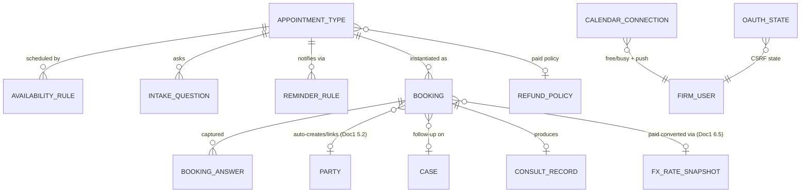

## 8. User Stories + Acceptance

**US-1 — Book a free consult in my timezone and language.** Given the page for a 30-min free consult (host tz America/Toronto), When I open it from Asia/Dubai with locale `fr`, Then slots render in Asia/Dubai time with a tz label and the page/intake/consent render in French; When I submit name+email+consent, Then I get an on-screen confirmation + a French email with an ICS carrying the correct local time and join link; And a `Party`+`Contact` is created with `source=BOOKING`, locale `fr`, destinationCountry, linked to the booking.

**US-2 — Reschedule myself, replay-safe.** Given a confirmation link and a type allowing 24h-notice reschedule, When I reschedule to a free slot 3 days out, Then status→RESCHEDULED, the old link stops working (token rotated), I get an ICS that *updates* (not duplicates) my entry, reminders re-schedule. Given the new time is <24h away, When I try, Then it is blocked with a clear message.

**US-3 — No double-booking under concurrency.** Given one free slot, When two bookers submit within milliseconds, Then exactly one booking is created and the other gets a 409 + refreshed slots — never two on the same host interval. Given a `PENDING_PAYMENT` hold, When another booker requests that slot, Then it is unavailable until payment succeeds or the hold expires.

**US-4 — Paid consult through the firm's own Biller, refunded in policy.** Given a paid CAD 150 60-min session with a RefundPolicy (≥48h→100%), When a booker confirms, Then status `PENDING_PAYMENT` (slot held) and routing to the Biller; on `payment.succeeded` → `SCHEDULED` + confirmation/ICS. Given the booker abandons checkout, When the hold window lapses, Then `EXPIRED` and the slot frees. Given a paid booking cancelled 50h before start with `refundsAutomatic=true`, Then a 100% refund instruction is handed to the Biller and `booking.cancelled` carries the paid context.

**US-5 — RCIC: arrive prepared, capture once, hand off.** Given a booked consult on a lead with an AG-3 assessment, When I open my day, Then the booking shows the eligibility summary + intake answers. When I mark COMPLETED and fill the consult record (pathway + services + fee), Then `booking.completed` fires, AG-2 advances the stage with NBA "send retainer", and "Create proposal from consult" launches the Drafter pre-filled — no re-keying; on `envelope.signed` (carrying `retainerAgreementId`) the lead moves to WON.

**US-6 — No-show recovered automatically.** Given a SCHEDULED consult whose start passes the grace period unmarked, When auto-no-show fires (or staff mark NO_SHOW), Then `booking.missed` fires, the lead is flagged in the work-queue, and AG-2's recovery sequence starts.

**US-7 — Don't double-book a human (own calendar) + CSRF-safe connect.** Given I connect my own Google calendar, When I have a personal 14:00–15:00 block, Then the page never offers 14:00–15:00; and a booked consult mirrors to my Google calendar. Given an attacker replays the OAuth callback `state`, When the callback runs, Then it is rejected. Given I disconnect, Then the Scheduler is fully self-contained with no error.

**US-8 — Show-rate & no-show analytics.** Given bookings across types this month, When I open analytics, Then I see volume vs last month, show-rate and no-show rate (period-over-period), upcoming 7 days, and paid-consult revenue in the reporting currency — segmentable by type, source, and destination country.

**US-9 — Configure a bilingual, branded, embeddable page.** Given I configure the page, When I save branding, allowed locales (EN/FR), public types, and an embed snippet, Then the page renders branded and bilingual at the firm slug and a French booker gets a fully French experience. Given I map an intake question to "country of origin", When a booker answers, Then it pre-fills that field on the auto-created lead.

**US-10 — Public surface is hardened.** Given the public endpoints, When an attacker probes with a raw tenant UUID as the firm slug, Then it is rejected with the same generic not-found as any miss. When they flood the endpoint, Then per-IP/per-firm rate limits throttle and nothing persists on failure. Given an answer whose `questionId` belongs to another type, When submitted, Then it is rejected.

**US-11 — Manual booking for a hot lead.** Given I'm on the phone with a hot lead, When I create a booking from the staff console (type, host, slot), Then it is created with the same slot-safety + reminders, linked to their lead, without sending them to the public page.

**US-12 — Video room URL is unguessable.** Given a booked video consult, When the guest opens their join link, Then a per-role, time-boxed capability token resolves to exactly their booking; And the booking's raw id in the room URL returns 404; And after the meeting window the token no longer admits.

## 9. Edge Cases & Validations

- **DST boundary slot** → UTC instants derived per calendar date in host-tz; 09:00 Toronto resolves to 13:00Z (summer)/14:00Z (winter); day-of-week host-tz so a near-midnight western date picks the right rules.
- **Booker/host different timezones** → identity host-tz/UTC, display booker-tz with label + override; ICS carries the booker's correct local time.
- **Two simultaneous bookings on the last slot** → `FOR UPDATE` serializes; one wins, the other 409 + refreshed slots (BR-3).
- **Paid booking abandoned at checkout** → `PENDING_PAYMENT` holds, then `EXPIRED` frees after `paymentHoldExpiryMins`; no ghost confirmed booking (BR-4).
- **Reschedule/cancel outside notice window** → blocked with a clear message; staff override audited.
- **Replay of an old self-service or room link** → tokens single-use/rotated; stale link 404/invalid (BR-10, BR-21).
- **Auto-no-show vs late "mark completed"** → grace timer sets NO_SHOW; if the host later marks COMPLETED, the disposition corrects (audited), recovery halts, `booking.completed` fires; idempotent consumers handle the supersession.
- **Lifecycle event redelivery / out-of-order** → consumers idempotent via the per-firm ledger; a duplicate `booking.completed` advances the stage once; an event for a terminal booking is a no-op (BR-12).
- **OAuth callback CSRF** → a missing/expired/replayed/unbound `state` is rejected (AG-4-41); a connection never completes from a forged callback.
- **Connected-calendar token expired/revoked** → availability degrades to internal-only; push skipped with a "reconnect" prompt; booking still succeeds (BR-14).
- **External push fails** → booking unaffected (internal is source of truth); push retried; surfaced as a sync warning.
- **Capacity cap reached** → host's slots disappear at cap; pooled assignment skips a capped host; group type rejects beyond per-slot capacity (BR-15).
- **Pooled type with no free/eligible host** → that slot unavailable; if none has availability, "no times — try another week".
- **Stored-injection in host pool** → host IDs validated against `firm_id` at assignment; non-owned dropped; falls back to the type creator.
- **Tenant/event enumeration via slug** → opaque slug only; raw UUID rejected; firm/event not-found byte-identical (BR-5).
- **Cross-event answer injection** → every answer's `questionId` must belong to the booked type (BR-6).
- **Public-endpoint abuse** (flood / oversized payload / missing consent / injection) → per-IP/per-firm rate limits, honeypot, Zod schema validation (whitelist + forbid-unknown), payload-size caps; nothing persists on failure.
- **Type edited / soft-deleted with future bookings** → existing bookings keep captured terms and remain manageable; slug freed (BR-19).
- **Booker email matches an existing client** → booking links to the existing client/case, not a duplicate person (BR-7).
- **Queue/Redis down at booking time** → booking commits; reminder scheduling best-effort and skipped with a warning; jobs (re)enqueued when available (AG-4-34).
- **Mixed-currency paid reporting** → each amount converted via Doc 1 §6.5 FX before roll-up; a missing rate excludes-with-note, never raw-sum (BR-18).
- **In-person / phone mode** → no video link; address + map (in-person) or captured number (phone); confirmation copy adapts.
- **Bilingual fallback** → a missing locale variant falls back to the firm default, never blank (BR-8).

**Validation doctrine.** Every input — public payload, slot query, type config, self-service action, reschedule time, OAuth callback — is validated by **Zod schema** (Doc 1 edge-validation discipline), never ad-hoc if/else; IANA tz strings validated; reject early with a clear localized message; never persist on validation failure.

## 10. Permissions (LOCAL `agent/*`)

Default-deny, additive, always evaluated within the caller's `firm_id` (Doc 1 §4.1–§4.2). All keys follow the one canonical grammar `agent/<resource>:<action>` (colon delimiter, one resource namespace — `booking` — per module). Object-level `firm_id`/ownership checks back every route via `assertSameFirm`/`assertOwnedByCaller` (Doc 1 §4.5). Public endpoints carry **no** permission and are `@Public({control:'rate-limit'})` (room URLs use `@Public({control:'capability-token'})`) per Doc 1 §4.6.

| Permission Key | Description |
|---|---|
| `agent/booking:event-types-list` | List/view appointment types |
| `agent/booking:event-types-create` | Create an appointment type |
| `agent/booking:event-types-edit` | Edit an appointment type |
| `agent/booking:event-types-delete` | Delete/soft-delete a type |
| `agent/booking:configure-availability` | Edit availability/buffers/caps |
| `agent/booking:configure-reminders` | Edit reminder rules + locale templates |
| `agent/booking:bookings-list` | List/view bookings |
| `agent/booking:bookings-create` | Staff manual booking on behalf of a lead |
| `agent/booking:bookings-reschedule` | Staff reschedule/cancel on behalf (override notice — audited) |
| `agent/booking:mark-attendance` | Mark Completed / No-show |
| `agent/booking:reveal-pii` | Reveal masked booker PII (audited per Doc 1 §7.2) |
| `agent/booking:consult-write` | Create/edit a consult record |
| `agent/booking:create-proposal` | Launch the AG-5 Drafter from a consult |
| `agent/booking:page-configure` | Configure the public booking page (branding/locales/embed) |
| `agent/booking:calendar-connect` | Connect/disconnect the firm's own calendar/video account (own-account OAuth connector) |
| `agent/booking:analytics-view` | View booking analytics (show-rate/revenue) |
| `agent/booking:refund-policy-manage` | Manage RefundPolicy + payment-hold/refund tiers |

`view.own`/`view.all` qualifiers apply to `bookings-list` and `analytics-view` where a rep should see only their own consults vs the manager's all (Doc 1 §4.4). Every key is CI-validated against the Doc 1 §4.4 catalog (every `@RequirePermissions` exists; every key wired to ≥1 route). Sensitive actions (manual/override reschedule, mark-attendance, consult write, calendar connect/disconnect, PII reveal, refund) write immutable audit entries (Doc 1 §7.5).

## 11. Scalability · Security · Performance

**Scalability.** Appointment types, availability, intake, reminders, locale variants, branding, capacity, and RefundPolicy are **config-as-data** — a firm reshapes its booking offering with no deploy. Country-aware/pack-driven (types scope to activated countries; business-hours/holidays from per-country/office config); single-country is the degenerate case (Doc 1 §1.7). Cross-cutting attaches polymorphically via the registry (Doc 1 §5.8) — extending is config, not migration. Slot computation is stateless; reminders, calendar sync, and analytics rollups run on BullMQ workers (`apps/worker`) and scale horizontally; dashboard queries are read-replica-friendly and read the AG-13 materialized `ActivityEvent` timeline. Target: a busy multi-host firm with tens of thousands of bookings.

**Security (the public page is the primary attack surface).**
- **Public hardening:** opaque-slug-only tenant resolution (raw UUID rejected); identical generic not-found; per-IP **and** per-firm rate limits; honeypot; risk-based bot mitigation (no blocking CAPTCHA); strict Zod validation + payload-size limits; answer-ownership checks; nothing persisted on failure.
- **Tenant isolation:** `firm_id` under PostgreSQL FORCED RLS (Doc 1 §2.2) is the DB backstop; `assertSameFirm`/object-level checks are the fast observable layer on top (Doc 1 §4.5). Public reads are firm-scoped by the resolved slug only.
- **Booking PII:** booker name/email/phone and intake answers are Confidential/Restricted PII — field-level envelope encryption + mask-by-default + audited reveal via `booking:reveal-pii` (Doc 1 §7.2); no PII in logs (the reminder/room workers must not log full bodies); CASL/Law-25 consent captured (timestamp + locale + form-version) and honoured (Doc 1 §7.6).
- **Self-service & room tokens:** unguessable, single-use, rotated on every reschedule (self-service) / per-role + admission-window-scoped + capability-token-gated (room, Doc 1 §4.6); never expose internal IDs; no token/PII in URL query params.
- **Connector security:** OAuth `state` CSRF defense (AG-4-41); tokens encrypted under the per-firm operational DEK (Doc 1 §7.1, Doc 2 §3250); minimal scopes; revocable; revoked → self-contained; the firm's own account only via the ratified own-account OAuth connector category (no third-party scheduler); the connector + its adapter listed in the Doc 1 §7.7 sub-processor residency matrix.
- **Audit:** sensitive actions write immutable, hash-chained, per-firm audit entries (Doc 1 §7.5) with actor/target/before-after.

**Performance (Doc 1 §8.1 budgets).** Slot query reads one type + its rules + a **windowed** set of the host's bookings (tight UTC bounds) — never an unbounded scan; external free/busy fetched once per query and briefly cached. Public slot read p95 ≤ 300 ms. Booking write is a short locked transaction (recompute → `FOR UPDATE` → assign → create), p95 ≤ 600 ms even under contention. Reminders are async + idempotent (delayed BullMQ, retry/backoff). Analytics from rollups + Redis cache keyed `(firm_id, filter-hash)`, evicted on `booking.*` + short TTL, p95 ≤ 300 ms; the public page and booking detail are always live. Lists are cursor-paginated (≤50); work >5s is async (Doc 1 P7). Plan/entitlement gating (paid consults, calendar/video connectors, round-robin, bilingual templates) is server-enforced per the Doc 2 plan matrix — UI hiding is not security.

## 12. Reference Note (exists / NEW / CHANGED)

Per Doc 1 §1.8 this is a **greenfield** build measured against this spec; the reference prototype is design-provenance only (NDA-gated, non-binding). The prototype carried a genuinely strong in-house Scheduler (a `src/booking` engine: DST-safe slot math, a hardened slug-only public surface, `FOR UPDATE` double-booking safety, token self-service with rotation, paid-consult `PENDING_PAYMENT` gating, delayed-job reminders, show-rate analytics) alongside a parallel `calendar-management` path — informative only.

- **EXISTS as proven patterns (target rebuilds, not reuses):** DST-safe per-date UTC slot derivation; opaque-slug tenant resolution with identical generic not-found; `FOR UPDATE` conflict lock + atomic create; round-robin via `GROUP BY` lowest-count; answer-ownership + host-ownership validation; token self-service with rotation; `PENDING_PAYMENT` slot hold; non-fatal reminder scheduling.
- **NEW (no prototype equivalent):** `ConsultRecord` + the consult→proposal hand-off (with `version`/`updatedAt`/`lockedAt`); first-class `booking.*` dictionary events with the per-firm idempotency ledger; auto-no-show timer + AG-2 recovery trigger; ICS generation (stable UID + SEQUENCE) and real Mailer/Messenger delivery; bilingual page + comms + consent (CASL/Law 25); the firm's-own Google/Outlook connector (free/busy + push) via the ratified own-account OAuth connector category with **OAuth `state` CSRF defense** and the firm's-own video account connector; the **in-house video room with capability-token URL security**; `BusinessHoursCalendar`/holiday subtraction; "preview as a booker"; booking-page builder; manual staff booking; analytics rollups + cache + source/country/currency segmentation via Doc 1 §6.5 FX; the **`RefundPolicy`** entity + `paymentHoldExpiryMins`/refund tiers; `OAuthState`; PII masking + field encryption; the `agent/booking:*` catalog.
- **CHANGED vs prototype shapes:** tenant key is `firm_id` under FORCED RLS (not `clientId` app-filtering); identity is the Doc 1 §5.2 `Party` spine (a booker → `Party`+`Contact`, `source=BOOKING`, not a thin `channelSource:'CALENDAR'` upsert); the two parallel booking paths collapse to one Scheduler; reminders deliver via Doers with ICS + bilingual templates and route channel selection through AG-10's per-user `NotificationPreference`; paid-consult money lives in the Biller and rolls up only through Doc 1 §6.5 FX; the pre-consult agreement is the generalised, per-country `preConsultAgreementRef` (not a hardcoded CICC field); meeting-provider identity is the own-account connector `adapterKey` (config), never a vendor-named domain enum.

## 13. Open Questions / [FOUNDER-CONFIRM]

**Resolved IN scope (de-phased per ADR 6.2 default-IN).** In-house Scheduler with no third-party scheduling tool; one consolidated Scheduler; ICS + email confirmations/reminders **and** live SMS/WhatsApp via Messenger (SmsGatewayPort) — all IN; the firm's-own Google/Outlook calendar connector and own-video-account connector (ratified own-account OAuth connector category) — IN; in-house video room (token-gated v1) — IN; RefundPolicy + payment-hold expiry — IN; auto-no-show timer — IN; round-robin + any-available + GROUP capacity (seminars) — IN; bilingual page/comms — IN; lead `source=BOOKING` via AG-2 assignment — IN. (Full self-hosted WebRTC SFU remains a later wave behind the same `MeetingProviderPort` — the v1 token-gated room/redirect is the committed scope, not a deferral of the capability.)

**[FOUNDER-CONFIRM] (business/domain values — machinery is fixed):**
1. **Pre-consult agreement & disclaimer wording** — the regulator-safe text shown before a (paid) consult and whether free vs paid carry different consent/engagement requirements per country (CICC/IRCC for Canada). SME content via the Doc 2 SA-1 pack; AG-4 only stores the `preConsultAgreementRef` + acceptance.
2. **Default `paymentHoldExpiryMins`** and the default **`refundTiers[]`** (e.g. ≥48h→100%, ≥24h→50%, <24h→0%) + `noShowRefundPercent` + whether refunds are automatic. Firms can override per type; the founder sets the platform default.
3. **Auto-no-show grace period** (minutes past start) and whether `BusinessHoursCalendar` mode defaults on.
4. **First calendar/video adapters** — Google + Outlook for calendar are the engineering defaults; which video account first. The connector framework + own-account OAuth ports ship regardless; the concrete adapter is an SA-8 config selection, not a code change.
5. **`reportingCurrency` & FX source** for paid-consult roll-ups (shared with AG-2/AG-6) — CAD assumed; manual vs paid FX provider per Doc 1 §6.5.
6. **Bilingual booking copy (FR-CA)** — the exact French phrasing of the page, consent, confirmation, and ICS (SME-confirmed); and which intake questions are mandatory for a *useful* pre-consult so the host arrives prepared (Doc 2 SA-1 section catalogue / CanonicalField bindings).

> **Routed to the Immigration-SME (founder is final authority):** items 1 and 6 above are domain *content* that populates content-neutral machinery; this spec defines structure and behaviour, the immigration *values* are confirmed in the Country Pack (Doc 2 SA-1).

---

# Module AG-5: Retainer & Agreements (Signer)

## Module Index

- **§1 Purpose & Goal** — the legal gate between "verbally agreed" (AG-4) and "we may take their money and start the case" (AG-6 → case delivery); the Drafter + the Signer, fast/correct/defensible, in-house.
- **§2 Users & JTBD** — RCIC/Consultant (protagonist), Sales Rep (send + track), Manager (gate health), Owner (template config + locked clauses), Accounts (consumes), Client (public signer).
- **§3 Functional Design** — the three-entity retainer model; the Drafter (clause assembly + merge-field guard); bilingual render + proofing gate; the Signer (identity/consent/field-placement/`allowedSignatureMethods`); sequential client-sign + firm-countersign; tamper-evidence/certificate/audit; the driving `envelope.signed` event, hand-offs, storage, retention, re-issue.
- **§4 Detailed Functional Requirements** — `AG-5-1` … `AG-5-30` (RFC-2119).
- **§5 Business Rules & Logic** — `BR-1` … `BR-17`.
- **§6 States & Lifecycle** — FINAL → SENT → VIEWED → CLIENT_SIGNED → COUNTERSIGN_PENDING → EXECUTED (+ VOIDED/DECLINED/EXPIRED); recipient + AG-2-derived sub-states.
- **§7 Key Entities & Fields** — `RetainerAgreement`, `ESignEnvelope`, `ESignRecipient`, `ESignField`, `ESignAuditEvent`, `SigningCertificate`, `OfflineSignRecord`; consumed spine/SA-5 entities; the Events emitted/consumed table.
- **§8 User Stories + Acceptance Criteria** — `US-1` … `US-9`.
- **§9 Edge Cases & Validations** — token/order/consent/method/void/re-issue/expiry/storage/email edges + validation doctrine.
- **§10 Permissions** — LOCAL `agent/retainer:*` (+ `agent/pii:reveal`), distinct draft/send/countersign/void/offline keys; capability-token public signing endpoint; `feature.esign` gate.
- **§11 Scalability · Security · Performance** — config-driven, country-pack-driven, polymorphic source, async PDF pipeline; isolation/integrity/tamper-evidence/firm-owned storage; budgets.
- **§12 Reference Note** — exists / NEW / CHANGED vs prototype lineage (provenance only).
- **§13 Open Questions / [FOUNDER-CONFIRM]** — clause set, recital, mandatory merge-field list, retention horizon, countersign/method/expiry defaults, bilingual posture.

> **What this is.** The vendor-build specification for AG-5 — the firm-staff console's legal gate of the revenue spine: the **Drafter** (generate a clause-correct, merge-bound, bilingual service agreement from a consumed Country-Pack template) and the **Signer** (in-house e-sign over the platform's `ObjectStoragePort` rail — identity/consent capture, field placement, sequential client-sign + firm-countersign, tamper-evident sealing, a certificate of completion, and a legally-defensible audit trail). On execution it emits the one canonical `envelope.signed` fact that drives the deal to WON and hands the fee to the Biller. This module **builds on Doc 1 — Platform Foundation** and **consumes Doc 2 — Super-Admin**; it does not re-spec either. Postgres-16 single store + FORCED RLS on `firm_id`, the three walled auth pools, `agent/*` LOCAL permissions with record-level authz, the canonical data spine, the domain-event dictionary + idempotency ledger, rails-as-ports (`ObjectStoragePort`, `EmailRelayPort`), the KMS/field-encryption/audit machinery, and the NFR budgets are all inherited "per Doc 1 §X" and are normative here without restatement.

> **Content-neutral.** AG-5 specs the **machinery** — the agreement model, the clause-assembly + merge-bind + bilingual-render pipeline, the signing instrument, the merge-field guard, the `allowedSignatureMethods` enum, and the template-manager. The **immigration content** — the CICC-required clause set and exact wording, the e-signature legal recital (UECA / provincial e-commerce legislation + PIPEDA, and the FR-CA translation), the list of mandatory merge fields, and the CICC client-file retention period — is the founder's deferred Country-Pack deliverable, **authored in SA-5** (Doc 2 §3.11, `governanceClass = LEGAL`, `channel = RETAINER`) and confirmed by the Immigration-SME and counsel. Every such item is marked **[FOUNDER-CONFIRM]**.

---

## 1. Purpose & Goal

AG-5 is the **legal gate** between "the prospect agreed verbally in the consult" (AG-4) and "we may take their money and start the case" (AG-6 → case delivery). A regulated immigration firm cannot lawfully begin paid work without an executed written service agreement carrying the regulator's required terms; AG-5 generates that agreement, gets it client-signed and firm-countersigned, seals it tamper-evidently, files it in firm-owned storage, and signals the rest of the system that the deal is real.

**The outcome it produces.** Firms lose money and risk discipline at this gate three ways: slow manual drafting (copy-pasting last client's Word retainer, hand-editing the fee, forgetting a required clause); chasing wet-ink signatures (printing, emailing, never knowing if it was opened); and weak proof (an unsigned or un-versioned agreement undefendable to a regulator or complaint). AG-5 makes the gate **fast, correct, and defensible**: the Drafter produces a complete, clause-correct, merge-bound, bilingual agreement in seconds; the Signer collects a legally-recognized electronic signature with full identity/consent capture, sequential client-then-firm signing, SHA-256 tamper-evidence, and a certificate of completion — entirely in-house, with the executed file retained in the firm's own storage rail (per Doc 1 §6.3 `ObjectStoragePort`, never a third-party e-sign vendor's cloud).

**Why this beats a generic e-sign tool.** DocuSign et al. sign *a* PDF; they do not know what a *retainer* is, do not assemble *regulator-required* clauses, do not bind *immigration* merge fields, do not render *bilingually* for Quebec, do not drive a sales stage to WON, and ship the firm's most sensitive legal document to a third-party vendor. AG-5's moat is immigration-native + in-house: the agreement is built from a **Country-Pack clause set** (a Canada retainer carries CICC's terms; a future Australia retainer carries MARA's — no code change), bound to the **single-source** client/firm/RCIC/fee/scope already on the spine (zero re-keying), rendered in the **client's language**, and the act of signing is **wired to the revenue funnel**. Because it is in-house, the executed agreement and its audit trail never leave the firm's tenant — a decisive PIPEDA/Law-25 advantage when selling to regulated firms.

**Global ambition.** The same module serves a Canada-only solo RCIC and a multi-country firm running Canada + Australia + UK desks with **no code change**. The *structure* of a retainer (parties, scope, fees, refund, dispute, confidentiality, termination, signatures) is universal; the *required clause set, regulator citations, locale, e-signature recital, and retention horizon* come from the active Country Pack (Doc 1 §5.8, §5.13.6). Single-country/single-locale is the degenerate case.

---

## 2. Users & JTBD

| Role | Primary job at the gate | Representative jobs-to-be-done |
|---|---|---|
| **RCIC / Consultant** (the authority) | Put a correct, complete, defensible agreement in front of the client and countersign it. | "Generate the retainer from the right country template with the fee and scope I quoted already filled in." · "Warn me if a regulator-required clause is missing — never let me send a non-compliant agreement." · "When the client has signed, let me countersign in one click as the responsible consultant." |
| **Intake / Sales Rep** | Get the agreed deal across the line fast; never let a yes go cold. | "Send the retainer in minutes, in the client's language, and let me see the moment they open and sign it." · "One-click resend when they ask for it again — not a re-draft." |
| **Manager** | Keep the gate fast, compliant, visible. | "Show me retainers out / signed / stuck / expiring, time-to-sign, and any voided-with-reason, filterable by consultant and country." · "Flag a retainer that has sat unsigned past our SLA before the deal dies." |
| **Owner / Principal RCIC** | Own the firm's legal exposure at the gate. | "Set our retainer templates per country and matter; the regulator-required clauses are locked so no one can delete them; choose who may send and who may countersign." · "Retrieve the executed agreement, its version, and the full signing audit trail in seconds — from our storage." |
| **Accounts / Billing** (owns AG-6, consumes AG-5) | Start billing only when the gate is passed. | "When a retainer executes, raise the invoice automatically from the agreed fee in the right currency — never bill against an unsigned agreement." |
| **Client (signer)** (portal/public pool, not an agent) | Understand and sign easily, in my language, with confidence it is legitimate. | "Read and sign in French on my phone, understand the fees and refund terms, sign with my finger, and get my own copy — trusting this is my lawyer's secure system." |

**Design implication.** The **RCIC/Consultant is the protagonist** — the Drafter's generate/proof/clause-check screen and the one-click countersign are built for them. The **Sales Rep** gets send + track. The **Owner** gets template configuration and the locked-clause guarantee. The **Client** signs on a clean, mobile-first, bilingual, trustworthy public signing page reached via a capability token (Doc 1 §4.6), never a guessable id.

---

## 3. Functional Design

### 3.1 The retainer model — three entities, not one (how it works)

A `RetainerAgreement` is an **instance** of a SA-5 `SystemTemplate` (channel = RETAINER), signed via exactly **one** `ESignEnvelope`, attached polymorphically to its source (prospect or case) through the `EntityTypeRegistry` (Doc 1 §5.8). The split is load-bearing because a regulated firm and its regulator ask questions a "signed-PDF row" cannot answer: *Which template version was this built from? Which clauses were included, and were the required ones present? What exact fee/scope was bound? In what language did the client sign? Who countersigned, when, from what IP? Is the file tamper-evident?*

- **Consumed template (SA-5, GLOBAL):** `SystemTemplate`/`SystemTemplateVersion`/`TemplateLocaleBody` with `governanceClass = LEGAL`, `channel = RETAINER`, per-locale `body` + `consentText` + `mandatedBlocks` (the regulator-mandated clause regions). AG-5 reads the active PUBLISHED version filtered by the firm's SA-2 country entitlement (Doc 2 §3.0). The firm-side adopt/override copy is AG-12's CLIENT-scope **`Template`** (AG-12's canonical entity name); AG-5 renders from whichever resolves via AG-12's `logicalKey` contract (AG-12 §3.11, the ONE template-resolution contract — firm PUBLISHED CLIENT wins, else PUBLISHED SYSTEM; AG-5 cites it, never a parallel pointer).
- **`RetainerAgreement` (NEW, CLIENT-PII):** one agreement with one client, produced by binding a template to the live record at a moment in time — the rendered, version-stamped document, the bound merge map, the chosen clause selection, the locale, the fee + scope snapshot, the `mandatedBlockHashes` (proof the locked clauses were present unaltered), the retention horizon, and a polymorphic source pointer.
- **`ESignEnvelope` (NEW, CLIENT-PII):** the signing instrument — recipients, placed fields, signing order, `allowedSignatureMethods`, audit trail, hashes, certificate. **One agreement ↔ one active envelope.** Re-issue creates a **new** agreement version + **new** envelope; it never resurrects a terminal one.

**World-class behaviour.** Every generated agreement records its `templateVersionId`, the resolved `packVersionId` (Doc 1 §5.8), and the clause-set provenance — so an agreement signed last year still shows the exact terms it was built under (the same point-in-time discipline the spine guarantees in Doc 1 §5.7).

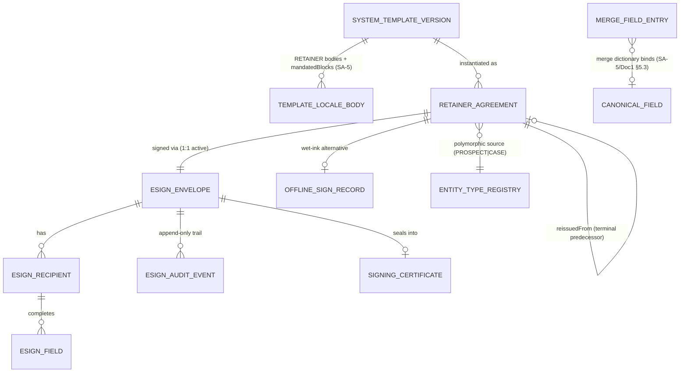

### 3.2 The Drafter — clause assembly & the merge-field guard (how it works)

When a consultant initiates a retainer (from the consult, prospect, or case — §3.7), the Drafter resolves the template by three axes: **destination country** (→ active Country Pack), the firm's **template for that country** (SA-5 default or AG-12 firm clone), and optional **matter type** (`appliesToProgramNodeKeys`, Doc 1 §5.8). It then assembles the body + the **clause set**: the Country Pack supplies the **regulator-required clauses** as the version's `mandatedBlocks` (Doc 2 §3.11) — these are **locked** (non-removable, non-reorderable); the firm template may carry **optional clauses** the consultant includes/excludes per agreement.

It then **binds merge tokens** from the live source record via the SA-5 `MergeFieldEntry` dictionary, which resolves each token through a real entity field and, where applicable, a `canonicalFieldKey` against the answer store (Doc 1 §5.3–§5.4): `{{client.fullName}}`, `{{firm.legalName}}`, `{{rcic.name}}`, `{{firm.designatedRepNumber}}`, `{{fees.total}}`, `{{fees.currency}}`, `{{fees.schedule}}`, `{{scope.summary}}`, `{{matter.programName}}`, `{{date.today}}`. The regulated-professional value (`{{firm.designatedRepNumber}}`) resolves from the AG-1-owned canonical `RegulatorCredential` (Doc 1 §5.13.6; consumed read-only here — AG-5 never re-models the credential). Bound values are **snapshotted onto the agreement** (immutable thereafter even if the source later changes), and the **merge-field guard** runs before send.

**The merge-field guard (the core machinery item).** Two guards, both fail-closed:
1. **Required-clause guard.** The set of `mandatedBlocks` present in the rendered body is re-validated against the pack's required set at generation **and** at send; an agreement missing a required clause for its country **cannot be sent** (BR-3). The hash of each mandated block is recorded as `mandatedBlockHashes` so tampering is detectable.
2. **Required-merge-field guard.** The **mandatory merge-field list** [FOUNDER-CONFIRM] is the pack/SA-5 declaration of which tokens MUST resolve non-empty for a valid retainer (e.g. designated-rep number, fee total + currency, scope). A required token that resolves blank is surfaced ("CICC number missing — complete the consultant profile") and **blocks send** with a deep link to fix the source. The system never renders a silently-empty `{{fees.total}}`. Monetary values render with their ISO-4217 currency (Doc 1 §6.5 discipline); a multi-country firm renders CAD for a Canada retainer and AUD for an Australia one.

**World-class behaviour.** Required clauses are structurally guaranteed, not hoped for — a generic tool has no concept of "required clause for this regulator." Zero re-keying: the same profile/fee/scope the firm already captured flows straight in. The exact bound merge map persists on the agreement, so "what fee did the client actually agree to?" is answerable from the record, never re-derived.

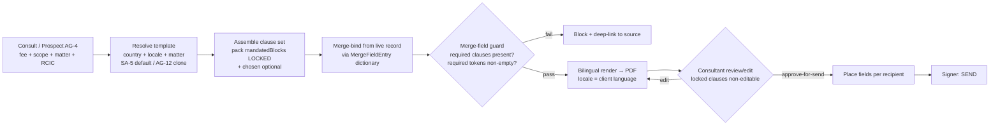

### 3.3 The Drafter — bilingual rendering & the proofing gate (how it works)

Each template version holds **one body per locale** (`TemplateLocaleBody`: EN, FR, pack locales — Doc 2 §3.5). At generation the Drafter selects the variant matching the **client's `language`** (from the contact profile, AG-2), falling back to the firm default **only with an explicit flag** so no one unknowingly sends English to a French-only client where French is legally required (Quebec Charter / Law-25). Bound merge values are language-neutral; only the legal text is localized. A template may render **dual-language** (EN+FR stacked) into one PDF where the firm wants a dual-language record. The output PDF is produced through the **shared safe-render engine contract** (Doc 2 §3.6) — logic-less, context-aware auto-escaping, no SSTI; a `<script>` in a merge value renders inert.

The rendered draft lands in **FINAL review**, where the responsible consultant reads the full PDF, edits **permitted free-text regions** (a custom scope paragraph, an optional clause's variable text) — but **cannot** delete or rewrite a locked mandated clause (the region is non-editable) — toggles optional clauses, fixes-and-re-renders, and **approves for send**. Editing re-renders and **bumps the agreement version** (prior render retained, audited); approval-for-send records `approvedBy + approvedAt` — the act by which the consultant takes professional responsibility for the content. The review PDF **is** what the client will sign (WYSIWYG, no preview surprise).

### 3.4 The Signer — identity, consent, field placement, allowedSignatureMethods (how it works)

The consultant adds **recipients** to the envelope — at minimum the **client** (signer) and the **firm countersignatory** (the responsible RCIC) — each with name, email, optional phone, and a **role** (`CLIENT | CONSULTANT | WITNESS | CORPORATE_SIGNER`). The Signer mints each recipient a single-purpose, time-boxed **capability token** (Doc 1 §4.6) carried in the signing link's path/header (never a query param, never a sequential id); opening it records a **VIEWED** audit event with IP + UA + timestamp. For a client with an activated portal account, the same ceremony is also reachable as an **authenticated portal signing surface** (Doc 4 CP-6) — same envelope, fields, consent recital, and audit trail; whether signing is offered in-portal, by capability link, or both is a portal-posture setting whose home is the `PortalAccessPolicy` (AG-15 §7).

**Consent is a hard gate.** Before any signature is accepted, the recipient affirms **electronic-signing consent** tied to a **versioned, country/locale-appropriate recital** [FOUNDER-CONFIRM] (the per-locale `consentText` authored in SA-5 §3.5) — captured with timestamp + IP + UA + `consentTextVersion`. No field value or signature image is persisted without affirmative consent (BR-8).

**`allowedSignatureMethods` (the named enum).** The envelope carries `allowedSignatureMethods: SignatureMethod[]` — a server-enforced allow-list of how a recipient may produce a signature image. The closed enum is:

| `SignatureMethod` | Meaning |
|---|---|
| `DRAWN` | Free-hand drawn signature (finger/stylus/mouse) captured as an image |
| `TYPED` | Typed full name rendered in a signature font |
| `UPLOADED_IMAGE` | An uploaded signature image (PNG/JPEG, type+size validated per Doc 1 §7.7) |

The default for a retainer is `[DRAWN, TYPED]` [FOUNDER-CONFIRM]. A signature produced by a method **not** in the envelope's list is rejected server-side (UI hiding is never the control). Stronger identity verification (KBA, gov-ID, OTP-to-phone) is a later pack/plan add behind this same enum/recipient model — IN scope as a structural slot, the *methods themselves* deferred (§13).

**Field placement.** Signing fields — `SIGNATURE | INITIALS | DATE | TEXT` — are placed on the rendered PDF, each assigned to a **specific recipient** by page + 0–100% coordinates (resolution-independent, validated to the 0–100 box per page). A firm uses a **default placement** for its standard retainer (a signature + date block on the last page per recipient, resolved to the document's real last page at send) or a **drag-and-drop editor** for bespoke agreements. At signing, required fields assigned to a recipient are enforced complete, and a required `SIGNATURE` field requires an actual signature image. A recipient can only complete **their own** fields (IDOR-safe), and each field is embedded with its **own** signer's image so the client's and firm's signatures are never confused.

### 3.5 The Signer — sequential client-sign + firm-countersign (how it works)

An envelope signs **parallel** (all at once) or **sequential** (order enforced). The retainer canonical mode is **sequential: client first, then firm countersignatory**. The Signer notifies only the **current** signer; when the client completes their fields the agreement moves to `CLIENT_SIGNED` and the countersignatory is notified and unlocked; when the firm countersigns, all parties have signed → `EXECUTED` (→ seal + certificate). Order is enforced server-side: a later signer's token is not active until the earlier signer completes; the engine advances order atomically. Parallel mode serves multi-client matters (a couple, a sponsor + applicant) where order does not matter.

**Countersignature is a real, distinct, attributable, permission-gated step** — not a checkbox. It is performed by an authorized signer holding `agent/retainer:countersign` (a separate authority from `:send` — a sales rep who can send must not be able to countersign), recorded with identity/IP/time, and is what flips the agreement to `EXECUTED`. A firm may configure **no countersignature required** per template (client-signed = executed), but sequential client→firm is the default and recommended posture because an agreement executed by the responsible consultant is stronger evidence of the engagement. **[FOUNDER-CONFIRM]** whether countersignature is restricted to the assigned RCIC on the matter or any holder of the permission (regulatory: the responsible consultant should execute).

### 3.6 The Signer — tamper-evidence, certificate & the legally-defensible audit trail (how it works)

On completion the Signer **embeds** each recipient's signature image + field values into the PDF (producing the executed document) and computes **SHA-256 of both the original and the executed PDF**, stored on the agreement. Heavy PDF work (render, embed/seal, certificate generation, email delivery) runs **async on BullMQ** (Doc 1 §6.2 — never inline in the request); the user gets immediate feedback and a progress state.

**The audit trail is the legally-defensible spine.** Every meaningful action writes to the platform's **per-firm, append-only, hash-chained audit engine** (Doc 1 §7.5) — `entryHash = SHA-256(prevHash ‖ canonical(entry))`, INSERT-only at the DB grant, written **synchronously via the outbox, atomic with the operation** (so the trail can never be silently skipped), WORM-anchored, continuously chain-verified. The chain is over **ciphertext/HMAC references, never plaintext** (Doc 1 §7.4), so the trail survives a DSR erasure and still verifies. Audited events: `CREATED, SENT, VIEWED (per recipient, IP/UA), CONSENT_GIVEN (+ consentTextVersion + affirmative-action), SIGNED (per recipient, IP/UA, method), COUNTERSIGNED, COMPLETED, DECLINED, VOIDED, EXPIRED, REMINDER_SENT, COMPLETION_NOTICE_SENT, OFFLINE_SIGN_RECORDED, EXPORTED, RETAINER_DISPOSED`. (`ESignAuditEvent` carries the e-sign-specific evidentiary detail per envelope; the platform audit spine carries the firm-wide tamper-evident chain — the two are complementary, the chain being authoritative for legal defence.)

**Certificate of Completion.** On completion the Signer assembles a one-page, self-contained PDF: the agreement title/id; **both SHA-256 hashes**; the **signer table** (name, email, role, signed-at, IP, method); the **chronological audit trail**; and the **country/locale-appropriate e-signature legal recital** [FOUNDER-CONFIRM] (pack/locale-driven — Canada: UECA / provincial e-commerce legislation + PIPEDA; eIDAS-style where a pack specifies — never a hardcoded jurisdiction). Anyone holding the executed PDF can re-hash it and compare to the certificate to prove integrity. The executed copy + certificate are **emailed to each signer** via `EmailRelayPort` (Doc 1 §6.3) and the proof-of-send is itself audited (`COMPLETION_NOTICE_SENT`) — CICC requires the client receive a copy.

### 3.7 The driving event, hand-offs, storage, retention & re-issue (how it works)

**`envelope.signed` (the one wire).** On `EXECUTED`, AG-5 emits the canonical **`envelope.signed`** domain event (Doc 1 §6.1 — this is the single e-sign completion event; there is no separate completion event and no synonym to drift against). The payload carries the complete contract a consumer needs — `firmId, retainerAgreementId, envelopeId, sourceEntityType, sourceId, partyId, executedDocKey, certificateKey, feeAmountMinor, feeCurrency, feeSchedule, fxSnapshotId, signerNames, portalVisible` — so no consumer queries back into Signer internals. AG-5 **imports no prospect/accounting code**; it emits and lets consumers react. Idempotency key = `envelope.signed:${envelopeId}` (internally-emitted; Doc 1 §6.1.4). Declared consumers:
- **CRM/Pipeline (AG-2):** drive the source prospect → **WON** + stamp `retainerStatus = SIGNED`. **The signature causes the stage; a stage never fabricates an executed agreement** (BR-2).
- **Billing (AG-6):** raise/settle the agreed invoice from the **fee snapshot** in its currency. Billing never starts against an unsigned agreement (BR-1).
- **Communications, Search, Notification:** owner notification ("retainer executed"); search projection (non-Restricted fields only, Doc 1 §7.3).
- **Portal Management (AG-15) + the Client Portal (Doc 4 CP-6):** AG-15 consumes it to surface the executed agreement portal-side (per `portalVisible`) and clear any related signing work item; the portal (Doc 4 CP-6) reflects the completed ceremony to the client.

Every consumer is **idempotent** via the per-firm processed-event ledger (Doc 1 §6.2.3) — a redelivered event moves the prospect to WON once, raises one invoice, never re-fires. Side-effects are **non-fatal**: if invoice-raise errors, the execution and filing still stand (the signature is legally complete and stored); the failed side-effect is retried/dead-lettered, never rolled back. A manual **offline (wet-ink)** path (`agent/retainer:offline-sign`) records a signature event and sets the same derived states with a mandatory reason + uploaded scan — it **never fabricates** an electronic certificate or hashes for a document the system did not seal (BR-2).

**Storage & retention.** The rendered original, executed PDF, certificate, and signature images live as objects in the **firm's own configured storage** via `ObjectStoragePort` (Doc 1 §6.3 — S3 SSE-KMS, firm-prefixed keys, AV-scanned-before-availability, encrypted under the subject key per Doc 1 §7.1); the DB stores **keys + SHA-256 + metadata only**, never bytes. Every download is an **ownership-bound presigned URL** — the port resolves the key from an ownership-checked record and **never signs a caller-supplied key** (closes the reference-prototype retainer IDOR; Doc 1 §6.3.3). Each agreement carries a **retention horizon** [FOUNDER-CONFIRM] (the CICC client-file minimum, pack-driven); deletion before the horizon is blocked; post-horizon disposal is the SA-11 audited, policy-driven action (Doc 1 §7.6).

**Re-issue.** `VOIDED | EXPIRED | DECLINED | EXECUTED` are terminal for that envelope. Correcting a sent agreement is a **re-issue** → new agreement version + new envelope (carrying forward template/clauses/merge values), linked to the terminal predecessor (BR-7). A terminal envelope is never reopened.

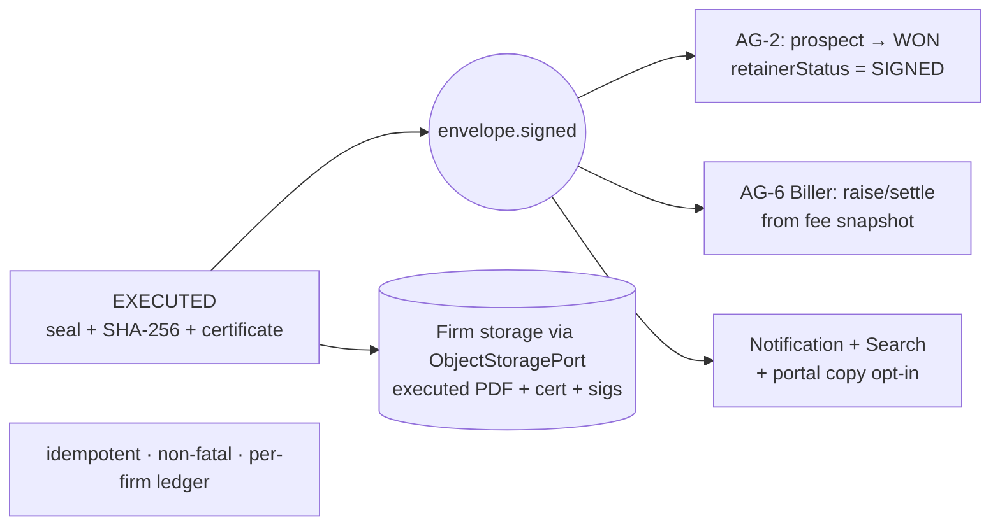

---

## 4. Detailed Functional Requirements

RFC-2119 SHALL/SHOULD/MAY. Numbered `AG-5-n`.

**The model**
- **AG-5-1.** The system SHALL model `RetainerAgreement` (a single instantiated agreement, CLIENT-PII, `firm_id`) and `ESignEnvelope` (the signing instrument) as distinct entities with **one agreement ↔ one active envelope**, and SHALL render from the consumed SA-5 `SystemTemplateVersion` (channel = RETAINER) or its AG-12 CLIENT-scope `Template` clone, resolved via the AG-12 §3.11 `logicalKey` contract — never a private template store.
- **AG-5-2.** Every `RetainerAgreement` SHALL carry a polymorphic source `(sourceEntityType ∈ {PROSPECT, CASE}, sourceId)` validated against the `EntityTypeRegistry` (Doc 1 §5.8), a `destinationCountryId`, `locale`, `templateVersionId`, resolved `packVersionId`, `clauseSelectionJson`, `mergeMapJson` (bound values), `mandatedBlockHashes`, a fee snapshot (`feeAmountMinor` + ISO-4217 `feeCurrency` + `feeSchedule` + nullable `fxSnapshotId`), a `scopeSnapshot`, and a `retainUntil` horizon.
- **AG-5-3.** Bound merge values, the chosen clause set, and the mandated-block hashes SHALL be **snapshotted at generation**; the executed agreement SHALL be immutable to later changes in the source record.

**Drafter — clauses, merge guard, bilingual, review**
- **AG-5-4.** The Drafter SHALL resolve the template by `(destinationCountryId, firm template, matter type via appliesToProgramNodeKeys)` and assemble an ordered clause set = pack `mandatedBlocks` (LOCKED) + chosen optional clauses, recording the `templateVersionId` + `packVersionId` provenance.
- **AG-5-5.** Regulator-required clauses SHALL be **locked** (non-removable, non-reorderable, non-editable) and **re-validated at generation and at send**; the firm SHALL NOT be able to unlock the pack-required set.
- **AG-5-6.** The system SHALL **refuse to send** an agreement missing any required clause for its country (the required-clause guard, BR-3), with a clear localized message.
- **AG-5-7.** The Drafter SHALL bind merge tokens from the live source record via the SA-5 `MergeFieldEntry` dictionary (resolving `canonicalFieldKey`s through the answer store, Doc 1 §5.3–§5.4) with **no re-keying**, persisting the bound map on the agreement; the regulated-professional token SHALL resolve from the AG-1-owned `RegulatorCredential` (Doc 1 §5.13.6), consumed read-only.
- **AG-5-8.** The **required-merge-field guard** SHALL block send when any token on the pack/SA-5 **mandatory merge-field list** [FOUNDER-CONFIRM] resolves empty, with a deep link to fix the source; the system SHALL never render a silently-empty mandatory value. Monetary tokens SHALL render with their ISO-4217 currency.
- **AG-5-9.** Each template version SHALL hold one body per locale; generation SHALL select the **client's-language** variant, falling back to firm default **only with an explicit flag**; a missing required-locale variant SHALL warn and (per firm policy) **block** — never a silent non-compliant language. Templates MAY render dual-language into one PDF.
- **AG-5-10.** Rendering SHALL use the **shared safe-render engine contract** (Doc 2 §3.6) — logic-less, context-aware auto-escaping, no arbitrary expression evaluation.
- **AG-5-11.** The generated draft SHALL enter a `FINAL` review state where the consultant may edit **permitted free-text regions** only (locked clauses non-editable), toggle optional clauses, fix-and-re-render, and **approve for send**; each edit SHALL bump the agreement version (prior render retained, audited); approval SHALL record `approvedBy + approvedAt`.

**Signer — recipients, consent, methods, placement, order**
- **AG-5-12.** The Signer SHALL support recipients with name, email, optional phone, and `role ∈ {CLIENT, CONSULTANT, WITNESS, CORPORATE_SIGNER}`; a retainer SHALL include at minimum the client and (per policy/default) the firm countersignatory.
- **AG-5-13.** Each recipient SHALL receive a single-purpose, time-boxed **capability token** (Doc 1 §4.6) in a private link (path/header, never a query param, never a record id); opening it SHALL record a `VIEWED` audit event with IP + UA + timestamp; the token SHALL be revoked/dead on sign or decline.
- **AG-5-14.** Before any signature is accepted, the recipient SHALL give **affirmative consent** tied to a versioned, country/locale-appropriate recital [FOUNDER-CONFIRM], captured with timestamp + IP + UA + `consentTextVersion`; absent/false consent SHALL be rejected and **no** field value or signature image persisted.
- **AG-5-15.** The envelope SHALL carry `allowedSignatureMethods: SignatureMethod[]` where `SignatureMethod ∈ {DRAWN, TYPED, UPLOADED_IMAGE}` (default `[DRAWN, TYPED]` [FOUNDER-CONFIRM]); a signature produced by a method not in the list SHALL be **rejected server-side**.
- **AG-5-16.** The Signer SHALL place `SIGNATURE | INITIALS | DATE | TEXT` fields, each assigned to a specific recipient, by page + 0–100% coordinates (validated to the box); a firm SHALL use a default placement (resolved to the real last page at send) or a drag-and-drop editor; at signing, required fields SHALL be enforced complete and a required `SIGNATURE` SHALL require an actual image; a recipient SHALL only complete **their own** fields.
- **AG-5-17.** An envelope SHALL support parallel and sequential signing; the retainer default SHALL be **sequential client → firm countersignatory**; in sequential mode the Signer SHALL notify only the current signer, advance order atomically, and prevent a later signer from signing before an earlier one.
- **AG-5-18.** **Firm countersignature** SHALL be a distinct, permission-gated (`agent/retainer:countersign`) action that, when completed (all parties signed), flips the agreement to `EXECUTED`; a firm MAY configure no-countersignature-required per template.

**Signer — seal, certificate, audit**
- **AG-5-19.** On completion the Signer SHALL embed each recipient's signature + field values (each field with its own signer's image) producing the executed PDF, and SHALL compute and store **SHA-256 of both original and executed**; PDF render/embed/certificate/email work SHALL run async on BullMQ (Doc 1 §6.2).
- **AG-5-20.** Every meaningful action SHALL write to the platform per-firm, append-only, hash-chained audit spine (Doc 1 §7.5), **synchronously via the outbox**, over ciphertext/HMAC references (never plaintext); the trail SHALL be non-bypassable.
- **AG-5-21.** On completion the Signer SHALL generate a Certificate of Completion PDF (title/id, both SHA-256 hashes, signer table incl. method, chronological audit, country/locale e-signature legal recital [FOUNDER-CONFIRM]), store it via `ObjectStoragePort`, **email it + the executed copy to each signer** via `EmailRelayPort`, and **audit the proof-of-send**.

**Lifecycle, hand-off, storage, retention**
- **AG-5-22.** A sent envelope SHALL carry an `expiresAt` (firm-default TTL, e.g. 14 days [FOUNDER-CONFIRM]); past it with no completion the envelope SHALL move to `EXPIRED`.
- **AG-5-23.** The Signer SHALL **remind** outstanding signers (SENT/VIEWED only; current signer only in sequential mode), best-effort and audited per send; reminder / stuck detection SHALL be **timezone- and business-hours-aware** (Doc 1 NFR i18n; AG-16 `BusinessHoursCalendar`).
- **AG-5-24.** **Void** SHALL require a mandatory reason, be blocked on terminal states, and be audited; **re-issue** SHALL create a new agreement version + new envelope linked to the terminal predecessor — never resurrecting a terminal envelope (BR-7).
- **AG-5-25.** On `EXECUTED` the Signer SHALL emit the canonical **`envelope.signed`** event with the full payload of §3.7 and SHALL NOT import prospect/accounting code; consumers (AG-2 WON, AG-6 Biller, Notification, Search) SHALL be **idempotent** (per-firm ledger, Doc 1 §6.2.3) and side-effects **non-fatal** to execution/filing.
- **AG-5-26.** A manual **offline-sign** path SHALL be available (permission-gated, reason-required, scan-uploaded), recording a signature event and setting the same derived states — **never fabricating** an electronic certificate/hashes.
- **AG-5-27.** The rendered original, executed PDF, certificate, and signature images SHALL be stored via `ObjectStoragePort` in the firm's own storage (tenant-keyed, encrypted under the subject key, AV-scanned); the DB SHALL store **keys + hashes + metadata only**; all access SHALL be via **ownership-bound presigned URLs** (no caller-supplied key, no cross-tenant access).
- **AG-5-28.** Each agreement SHALL carry a **retention horizon** [FOUNDER-CONFIRM] per the country regulator; deletion before it SHALL be blocked; post-horizon disposal SHALL be the SA-11 audited orchestrated action (Doc 1 §7.6); a client's executed agreement SHALL be included in the canonical SA-11 per-individual export (audited egress).

**Configuration & validation**
- **AG-5-29.** Owners SHALL adopt/override retainer templates per (country, matter) in **AG-12** (the firm-side clone of the SA-5 RETAINER template), edit optional clauses + brand/voice, and manage locale variants — **but the pack-mandated clauses re-flow protected** (Doc 2 §3.11) and are not unlockable by the firm.
- **AG-5-30.** All input (generate params, recipients, fields, placement, void/decline reasons, offline-sign, export filters) SHALL be **schema-validated** (Zod/class-validator), rejected early with clear localized messages; the public signing endpoint SHALL be `@Public({ control: 'capability-token' })` (Doc 1 §4.6) and hardened (single-use token, per-IP rate-limit, payload-size limit, PDF-only original uploads, signature-image PNG/JPEG ≤ 2 MB).

---

## 5. Business Rules & Logic

- **BR-1 (Execution is the gate).** No downstream paid work (invoice, SQR, document collection, form work) begins until the retainer is `EXECUTED` (or an audited offline-sign equivalent); the Biller acts only on `envelope.signed`.
- **BR-2 (Signature causes the stage — never the inverse).** WON + `retainerStatus = SIGNED` are derived from `envelope.signed`; a sales stage never fabricates an executed agreement. Offline-sign is permissioned + reason-required and records a signature event; it never invents a file.
- **BR-3 (Required clauses are structural).** The pack regulator-required clause set is locked and re-validated at generation and send; an agreement missing one cannot be sent; the firm cannot unlock it.
- **BR-4 (No empty mandatory merge field).** A mandatory token resolving blank blocks send; no silently-empty fee/scope/clause is ever rendered.
- **BR-5 (Snapshot immutability).** Bound values, clause set, mandated-block hashes, fee, scope, template version, and pack version are snapshotted at generation; the executed agreement is immutable to later source changes.
- **BR-6 (Locale correctness).** Generation selects the client's-language variant; fallback to firm default only with an explicit flag; a missing required-locale variant warns and (per policy) blocks — never a silent non-compliant language.
- **BR-7 (Terminal = terminal; re-issue is new).** `VOIDED/EXPIRED/DECLINED/EXECUTED` are terminal for the envelope; corrections are a new agreement version + new envelope linked to the predecessor; terminal envelopes are never reopened; voiding a terminal envelope is blocked.
- **BR-8 (Consent + identity are hard gates).** No signature or field value persists without affirmative, versioned, locale-correct consent captured with timestamp + IP + UA; tokens are single-purpose and dead on sign/decline.
- **BR-9 (Countersignature authority).** Countersignature is performed by a holder of `agent/retainer:countersign` (distinct from `:send`); only when all required parties have signed does the agreement become `EXECUTED`.
- **BR-10 (Tamper-evidence is mandatory).** Original + executed PDFs are SHA-256-hashed and the hashes printed in the certificate; integrity is independently verifiable.
- **BR-11 (Firm-owned storage; no third-party e-sign).** Executed documents, certificates, signatures, and audit live in the firm's own storage via `ObjectStoragePort`, encrypted under the subject key; no document ever transits a third-party e-sign vendor (founder constraint, non-negotiable).
- **BR-12 (Retention per regulator).** Each agreement carries a country-regulator retention horizon; deletion before it is blocked; post-horizon disposal is the SA-11 audited action; legal hold beats deletion (Doc 1 §7.6).
- **BR-13 (Idempotent, non-fatal hand-off).** `envelope.signed` is at-least-once; consumers are idempotent (per-firm ledger) and their failure is non-fatal to execution/filing (retried/dead-lettered, never rolled back).
- **BR-14 (Billing gated on execution, multi-currency-correct).** The invoice basis is the fee snapshot (amount + ISO-4217 currency + schedule + `fxSnapshotId`) on the executed agreement; no invoice against an unsigned agreement; currency is carried, never assumed (Doc 1 §6.5).
- **BR-15 (Polymorphic source via registry).** An agreement attaches to exactly one source via the `EntityTypeRegistry`; the same machinery serves all source types with zero migration to cross-cutting tables.
- **BR-16 (Tenant isolation + record-level authz).** Every read/write/download is scoped to the caller's `firm_id` (FORCED RLS) plus object-level ownership (Doc 1 §4.5); downloads are ownership-bound presigned URLs only; no IDOR.
- **BR-17 (Audit is the legal record).** Every meaningful action writes to the per-firm, append-only, hash-chained, WORM-anchored audit spine over ciphertext/HMAC; the trail survives DSR erasure and still verifies (Doc 1 §7.4–§7.5).

---

## 6. States & Lifecycle

```mermaid
stateDiagram-v2
    [*] --> FINAL : Drafter generates (template + clauses + merge + locale → PDF); guards pass
    FINAL --> FINAL : review / edit permitted regions / re-render (version bump)
    FINAL --> SENT : approve-for-send + fields placed + recipients set + required-clause re-validate
    SENT --> VIEWED : recipient opens (audited IP/UA)
    VIEWED --> CLIENT_SIGNED : consent + required client fields + signature
    SENT --> CLIENT_SIGNED : direct sign (consent gate)
    CLIENT_SIGNED --> COUNTERSIGN_PENDING : firm countersignature required (policy)
    COUNTERSIGN_PENDING --> EXECUTED : authorized signer countersigns → all parties signed
    CLIENT_SIGNED --> EXECUTED : no countersignature required (policy)
    FINAL --> VOIDED : void (reason)
    SENT --> VOIDED : void (reason)
    VIEWED --> VOIDED : void (reason)
    COUNTERSIGN_PENDING --> VOIDED : void (reason)
    SENT --> DECLINED : recipient declines (reason)
    VIEWED --> DECLINED : recipient declines (reason)
    SENT --> EXPIRED : past expiresAt
    VIEWED --> EXPIRED : past expiresAt
    COUNTERSIGN_PENDING --> EXPIRED : past expiresAt
    EXECUTED --> [*] : seal + certificate filed; emit envelope.signed
    note right of EXECUTED : envelope.signed → AG-2 WON + retainerStatus=SIGNED · AG-6 Biller · portal · case
    note right of VOIDED : re-issue = NEW agreement version + NEW envelope (predecessor untouched)
```

| From | To | Guard | Trigger / side-effect |
|---|---|---|---|
| (none) | FINAL | required clauses present + mandatory merge fields bound | Drafter renders PDF; version + provenance stamped |
| FINAL | FINAL | locked clauses uneditable | edit/re-render → version bump (audited) |
| FINAL | SENT | approved-for-send + fields placed + recipients set + required clauses re-validated | per-recipient capability tokens issued; `expiresAt` set; current signer notified; audit SENT |
| SENT/VIEWED | CLIENT_SIGNED | consent given + required client fields + signature via allowed method | embed client signature; audit SIGNED; notify countersignatory |
| CLIENT_SIGNED | COUNTERSIGN_PENDING | countersignature required (policy) | countersignatory notified/unlocked |
| COUNTERSIGN_PENDING / CLIENT_SIGNED | EXECUTED | authorized countersigner signs (or no-countersign policy) | embed + SHA-256 both PDFs + certificate; file via ObjectStoragePort; emit `envelope.signed` |
| any non-terminal | VOIDED | reason required; not terminal | audit VOIDED + reason |
| SENT/VIEWED | DECLINED | reason required | audit DECLINED; token dead |
| SENT/VIEWED/COUNTERSIGN_PENDING | EXPIRED | past `expiresAt` | audit EXPIRED |
| VOIDED/EXPIRED/DECLINED | (new) | re-issue action | NEW agreement version + NEW envelope (carry-forward), linked to predecessor |

**Recipient sub-state:** `PENDING → SENT → VIEWED → SIGNED` (or `DECLINED`); in sequential mode only the current recipient is `SENT`. **AG-2 derived sub-state:** `retainerStatus: NONE → SENT → SIGNED` (SENT on envelope send; SIGNED on `envelope.signed`).

---

## 7. Key Entities & Fields

> All AG-5-owned entities are CLIENT-PII plane: `firm_id NOT NULL`, FORCED RLS (Doc 1 §2.2). GLOBAL spine + SA-5 template entities are **consumed, not redefined** (cited by name). Cross-cutting (Note/Task/Reminder/Activity/Communication/Document/AuditLog/Notification) attaches via `EntityTypeRegistry` `(entityType, entityId)` and is not redefined here.

- **`RetainerAgreement`** (NEW) — `id` (UUID PK), `retainerCode` (stable slug), `firm_id`, `sourceEntityType` (`PROSPECT | CASE`), `sourceId`, `partyId` (→ Doc 1 §5.2 Party), `destinationCountryId`, `locale`, `templateVersionId` (→ SA-5 `SystemTemplateVersion`), `firmTemplateId?` (→ the AG-12 CLIENT-scope `Template` if rendered from a firm clone), `packVersionId` (→ Doc 1 §5.8), `clauseSelectionJson` (JSONB: optional clauses included), `mergeMapJson` (JSONB: bound values — Restricted members encrypted per Doc 1 §7.2), `mandatedBlockHashes` (JSONB: SHA-256 per locked clause), `feeAmountMinor` (int), `feeCurrency` (char(3) ISO-4217), `feeSchedule` (JSONB), `fxSnapshotId?` (→ Doc 1 §6.5), `scopeSnapshot` (text), `status` (enum, §6), `version` (int), `reissuedFromAgreementId?`, `approvedBy?`, `approvedAt?`, `renderedOriginalKey` (storage key), `retainUntil` (date), `clientPortalVisible` (bool), `envelopeId` (FK), `createdBy`, `createdAt`, `updatedAt`. Indexes: `(firm_id, status)`, `(firm_id, sourceEntityType, sourceId)`, `(firm_id, partyId)`, `(firm_id, retainUntil)`, `(retainerCode)` unique.
- **`ESignEnvelope`** (NEW) — `id`, `firm_id`, `retainerAgreementId` (FK, unique — 1:1 active), `title`, `message?`, `signingMode` (`SEQUENTIAL | PARALLEL`), `requiresCountersignature` (bool), `allowedSignatureMethods` (`SignatureMethod[]`), `status` (`FINAL|SENT|VIEWED|CLIENT_SIGNED|COUNTERSIGN_PENDING|EXECUTED|DECLINED|VOIDED|EXPIRED`), `originalDocKey`, `originalDocSha`, `signedDocKey?`, `signedDocSha?`, `certificateKey?`, `expiresAt`, `voidReason?`, `voidedAt?`, `completedAt?`, `createdBy`, `createdAt`. Index: `(firm_id, status)`, `(firm_id, expiresAt)`.
- **`ESignRecipient`** (NEW) — `id`, `firm_id`, `envelopeId` (FK), `name`, `email`, `phone?`, `role` (`CLIENT|CONSULTANT|WITNESS|CORPORATE_SIGNER`), `signingOrder` (int), `capabilityTokenRef` (→ Doc 1 §4.6 token service; single-purpose, time-boxed, dead-on-sign), `status` (`PENDING|SENT|VIEWED|SIGNED|DECLINED`), `signatureMethodUsed?` (`SignatureMethod`), `consentTextVersion?`, `consentAt?`, `signedAt?`, `lastViewedAt?`, `ipAddress?` (Confidential), `userAgent?`, `signatureImageKey?`, `declineReason?`. Index: `(firm_id, envelopeId, signingOrder)`.
- **`ESignField`** (NEW) — `id`, `firm_id`, `envelopeId`, `recipientId`, `type` (`SIGNATURE|INITIALS|DATE|TEXT`), `pageNumber`, `x/y/width/height` (0–100%), `required` (bool), `placeholder?`, `value?`, `completedAt?`. Index: `(firm_id, envelopeId)`.
- **`ESignAuditEvent`** (NEW, e-sign evidentiary detail — complements, does not replace, the per-firm hash-chain spine of Doc 1 §7.5) — `id`, `firm_id`, `envelopeId`, `recipientId?`, `eventType` (`CREATED|SENT|VIEWED|CONSENT_GIVEN|SIGNED|COUNTERSIGNED|COMPLETED|DECLINED|VOIDED|EXPIRED|REMINDER_SENT|COMPLETION_NOTICE_SENT|OFFLINE_SIGN_RECORDED`), `ipAddress?`, `userAgent?`, `metadataJson?` (e.g. `consentTextVersion`, `signatureMethodUsed`), `occurredAt`. Append-only; index `(firm_id, envelopeId, occurredAt)`.
- **`SigningCertificate`** (NEW; stored as `certificateKey` on the envelope) — content = title/id + original + executed SHA-256 + signer table (name/email/role/signed-at/IP/method) + chronological audit + pack/locale legal recital [FOUNDER-CONFIRM]; stored via `ObjectStoragePort`.
- **`OfflineSignRecord`** (NEW) — `id`, `firm_id`, `retainerAgreementId` (FK), `signedBy` (the authorizing agent user), `reason` (required), `signedAtRecorded`, `uploadedScanKey?`, `createdAt`; sets derived states without fabricating an electronic signature/certificate.
- **Consumed (not redefined):** SA-5 `SystemTemplate`/`SystemTemplateVersion`/`TemplateLocaleBody` (`governanceClass=LEGAL`, `channel=RETAINER`, `mandatedBlocks`, per-locale `consentText`) and `MergeFieldEntry` dictionary (Doc 2 §7); the AG-12 CLIENT-scope `Template` (firm clone — AG-12's canonical entity name); Doc 1 §5.2 `Party`, §5.3 `CanonicalField`, §5.8 `programNodeKey`/`packVersionId`/`EntityTypeRegistry`, §5.13.6 `RegulatorCredential` (the AG-1-owned canonical per-country regulated-professional credential — consumed read-only for the designated-rep merge token; AG-5 does not re-model it); Doc 1 §6.5 `FxRateSnapshot`; AG-16 `BusinessHoursCalendar`; SA-11 `RetentionPolicy`/`LegalHold`/`DsrRequest` (Doc 1 §7.6).
- **Country-Pack content inputs (consumed, deferred):** the regulator-required clause set + e-signature recital + retention horizon per `destinationCountryId` (pack-versioned) — [FOUNDER-CONFIRM] values, authored in SA-5, never hardcoded.

**Events emitted / consumed.** (Canonical dot.case names; the Doc 1 §6.1 registry mirrors this table. AG-5 is the sole emitter of `envelope.signed`.)

| Direction | Event | Payload (key fields) | Counterpart |
|---|---|---|---|
| **Emit** | `envelope.signed` | `firmId, retainerAgreementId, envelopeId, sourceEntityType, sourceId, partyId, executedDocKey, certificateKey, feeAmountMinor, feeCurrency, feeSchedule, fxSnapshotId, signerNames, portalVisible` | Consumed by AG-2 (prospect → WON, `retainerStatus = SIGNED`), AG-6 (raise/settle invoice from fee snapshot), AG-15 (portal surfacing of the executed agreement + signing work-item clear), the Client Portal (Doc 4 CP-6 ceremony completion), Notification (owner "retainer executed"), Search (non-Restricted projection); idempotency key `envelope.signed:${envelopeId}` |
| Consume | *(none — AG-5 emits and lets consumers react; it imports no prospect/accounting code)* | — | — |

---

## 8. User Stories + Acceptance Criteria

**US-1 — Consultant: generate a clause-complete retainer with the fee filled in.**
- **Given** Client A's consult ended with an agreed fee (CAD) and Express Entry scope, **When** I generate her retainer, **Then** the Drafter selects the Canada RETAINER template, includes all pack-mandated clauses (locked), binds her name, the designated-rep number, the fee + currency, and the scope, and stamps `templateVersionId` + `packVersionId`.
- **Given** the designated-rep number is missing from my profile, **When** I try to send, **Then** the required-merge-field guard surfaces "designated-rep number missing" and **blocks send** with a deep link (no silently-empty clause).
- **Given** a template missing the required refund clause, **When** I attempt to send, **Then** send is **refused** with "required clause missing for Canada/CICC."

**US-2 — Consultant: review and approve; cannot break compliance.**
- **Given** a generated FINAL, **When** I edit the custom scope paragraph and re-render, **Then** the agreement version bumps, the prior render is retained, and the change is audited.
- **Given** the same FINAL, **When** I try to delete the locked confidentiality clause, **Then** the editor refuses (region non-editable) and explains it is regulator-required.
- **Given** I approve for send, **Then** "approved by {me} at {time}" is recorded.

**US-3 — Client: sign in my language with consent and confidence.**
- **Given** Client A's `language = fr-CA`, **When** I open my capability-token signing link, **Then** the agreement and the consent recital render in French, a VIEWED event records my IP/UA, and I must affirmatively consent before signing.
- **Given** I have not checked the consent box, **When** I submit, **Then** signing is rejected ("electronic consent is required") and nothing is persisted; **Given** I consent and sign via an allowed method, **Then** my signature is captured and my token goes dead.
- **Given** the envelope's `allowedSignatureMethods = [DRAWN, TYPED]`, **When** I attempt to upload an image, **Then** the server rejects it (method not allowed).

**US-4 — Sequential client-then-firm countersignature.**
- **Given** a sequential retainer (client → firm), **When** the client signs, **Then** the agreement becomes CLIENT_SIGNED and only the countersignatory is notified; **When** an authorized consultant countersigns, **Then** all parties have signed and it becomes EXECUTED.
- **Given** the countersignatory lacks `agent/retainer:countersign`, **When** they attempt to countersign, **Then** the action is refused (BR-9).
- **Given** sequential mode, **When** the countersignatory tries to sign before the client, **Then** their token is not yet active and the attempt is prevented.

**US-5 — Tamper-evidence + certificate.**
- **Given** an EXECUTED retainer, **Then** original + executed are SHA-256-hashed, a Certificate of Completion is generated (both hashes + signer table + audit trail + Canadian e-signature recital), and both are stored via `ObjectStoragePort` in the firm's own storage.
- **Given** I download the executed PDF and re-hash it, **When** I compare to the certificate's recorded hash, **Then** they match; **and** client + firm each receive the executed copy + certificate by email with proof-of-send audited.

**US-6 — Execution drives WON and the invoice (the wire).**
- **Given** a retainer in COUNTERSIGN_PENDING, **When** it reaches EXECUTED, **Then** `envelope.signed` is emitted (payload carries `retainerAgreementId` + the fee snapshot), the source prospect moves to WON with `retainerStatus = SIGNED`, and the Biller raises the agreed invoice in the fee's currency — no case auto-created.
- **Given** the same `envelope.signed` is redelivered, **Then** no duplicate WON move and no duplicate invoice (idempotent per-firm ledger).
- **Given** the invoice-raise consumer errors, **Then** the executed agreement and its filing still stand; the invoice raise is retried.

**US-7 — Expiry, remind, void, re-issue.**
- **Given** a SENT retainer unsigned for 14 days, **When** `expiresAt` passes, **Then** it moves to EXPIRED and a Notification is raised; **When** I re-issue, **Then** a new agreement version + new envelope is created (carry-forward), linked to the expired predecessor — the expired one is not reopened.
- **Given** I sent the wrong fee, **When** I void with reason "fee corrected," **Then** the envelope is VOIDED (audited); **Given** an already-EXECUTED retainer, **When** I attempt to void, **Then** it is blocked.
- **Given** a Friday-16:55 send with business-hours SLA on, **When** Monday 09:00 arrives, **Then** it is not flagged "stuck" merely from the weekend (BR-17, AG-16-owned BusinessHoursCalendar).

**US-8 — Firm-owned storage + retention + portability.**
- **Given** an EXECUTED retainer, **Then** the executed PDF/certificate/signatures live in the firm's own storage (no third-party vendor), accessed only via ownership-bound presigned URLs.
- **Given** the retention horizon has not passed, **When** anyone attempts to delete the agreement, **Then** deletion is blocked; **Given** a client right-of-access request, **When** SA-11 exports their data, **Then** the executed agreement is included and the export is audited as egress.

**US-9 — Manual offline (wet-ink) retainer, honestly.**
- **Given** a client who signed on paper, **When** I record an offline signature (reason + uploaded scan, `agent/retainer:offline-sign`), **Then** the action is permission-gated, audited, sets `retainerStatus = SIGNED` and drives WON — **without** fabricating an electronic certificate or hashes.

---

## 9. Edge Cases & Validations

- **Required clause missing for the country** → generation/send blocked ("required by {regulator}"); firm cannot unlock the set (BR-3).
- **Mandatory merge field empty** → send blocked with deep link to fix source; never a silently-empty value (BR-4).
- **Missing locale variant** for a legally-required language → warn + (per policy) block; never silently send the wrong language (BR-6).
- **Source data changes after generation** → executed agreement reflects the snapshot, not the later change (BR-5); a stale draft can be re-rendered (version bump).
- **Consent not given / false** → signing rejected; no signature image or field value persisted (BR-8).
- **Signature method not in `allowedSignatureMethods`** → rejected server-side (UI hiding is not the control).
- **Forwarded/leaked signing link** → capability token is single-purpose, time-boxed, dead on sign/decline; a reused/guessed token returns 404 (Doc 1 §4.6).
- **Sequential order violation** → a later signer cannot sign before an earlier one (token not active); order advances atomically.
- **Countersigner without permission** → countersign refused (BR-9); agreement stays CLIENT_SIGNED/COUNTERSIGN_PENDING.
- **Voiding a terminal envelope** → blocked with a clear message; corrections go via re-issue (BR-7).
- **Re-issue of a terminal agreement** → new agreement version + new envelope linked to predecessor; re-issuing twice yields two distinct linked successors.
- **`envelope.signed` redelivery / out-of-order** → idempotent WON + idempotent invoice; an event for an already-WON agreement is a no-op (BR-13).
- **Downstream consumer failure** (invoice raise errors) → execution/filing stand; side-effect retried/dead-lettered, never rolled back (BR-13).
- **Field coordinates off-page / malformed** → rejected by the 0–100% box validation.
- **Signature image too large/wrong type** → rejected (PNG/JPEG ≤ 2 MB) before any write; uploaded original not a PDF → rejected (declared + sniffed content-type check, Doc 1 §7.7).
- **Expiry during signing** → if `expiresAt` passes mid-flow, no new signatures accepted; envelope moves EXPIRED; re-issue to continue.
- **Premature deletion before retention horizon** → blocked (BR-12); legal hold beats deletion; post-horizon disposal audited.
- **Cross-tenant / cross-record access attempt** → 404 with no existence leak; downloads are ownership-bound presigned only; no IDOR (BR-16, Doc 1 §4.5).
- **Decline by client** → envelope DECLINED with reason; owner notified; re-issue if appropriate.
- **Multi-party parallel sign with one decline** → envelope DECLINED (terminal); re-issue to corrected recipients.
- **SMTP/email rail unavailable** → send/remind/completion-notice are best-effort via `EmailRelayPort` (Doc 1 §6.2 non-fatal lane); the seal/execution still succeeds; the failed delivery is retried/dead-lettered and audited, never a 500 on the user op.

**Validation doctrine.** All input is validated by **schema** (Zod/class-validator), never ad-hoc if/else; reject early with a clear localized message; never persist on validation failure; never trust a caller-supplied storage key (resolve server-side from the owned record, Doc 1 §6.3.3).

---

## 10. Permissions (LOCAL `agent/*`)

Default-deny; additive; scope-aware (Doc 1 §4.1–§4.2) — every key is `agent/*` (LOCAL plane), evaluated within the caller's `firm_id` plus record-level object checks (Doc 1 §4.5). Drafting, sending, countersigning, voiding, and template-config are **distinct keys** — a sales rep who can send must not necessarily countersign (the consultant's authority) or configure templates.

| Permission key | Description |
|---|---|
| `agent/retainer:list` | List retainer agreements (cursor-paginated, tenant-scoped) |
| `agent/retainer:show` | Open a retainer detail (incl. audit, certificate) |
| `agent/retainer:draft` | Generate/edit a retainer draft (Drafter); approve-for-send |
| `agent/retainer:send` | Send for signature (Signer); remind |
| `agent/retainer:countersign` | Countersign as the firm's authorized signatory — **distinct authority** (BR-9) |
| `agent/retainer:void` | Void a non-terminal agreement (reason required); re-issue |
| `agent/retainer:offline-sign` | Record a wet-ink signature (reason + scan, audited) |
| `agent/retainer:download` | Download executed PDF / certificate (ownership-bound presigned) |
| `agent/pii:reveal` | Reveal a masked Restricted snapshot field (audited `PII_REVEAL`, Doc 1 §7.2) |

**Enforcement.** Route-level `@RequirePermissions` + object-level `firm_id`/ownership; the countersign action checks `agent/retainer:countersign` (not `:send`). Retainer template authoring is the firm-side AG-12 clone of the SA-5 RETAINER template, gated by AG-12's `agent/template:*` keys (the pack-mandated clauses remain protected — Doc 2 §3.11); AG-5 does not define a separate template-config key. The public **signing** endpoint is `@Public({ control: 'capability-token' })` (Doc 1 §4.6) — unauthenticated by nature (the client is not an agent), gated by the single-use capability token + hardening; it exposes no agent data and trusts no client-supplied tenant id. `feature.esign` entitlement (SA-3, Doc 2 §3.0) hard-gates the module: a firm without it gets `403 FEATURE_NOT_ENTITLED`, data retained read-only, UI hides with an upgrade affordance. Permission keys are catalog-seeded with this module's wave and CI-validated (Doc 1 §4.4) against the canonical grammar `agent/<resource>:<action>`.

---

## 11. Scalability · Security · Performance

**Scalability / expandability.**
- **Config-driven, not code-driven.** Templates, clauses, locale variants, optional-clause selections, default field layouts, `allowedSignatureMethods` defaults, and retention horizons are data (SA-5/AG-12 templates + Country Pack); a firm reshapes its retainers and a new country onboards **without a deploy**. The regulator-required clause set is a pack publication, not a code change.
- **Country-pack-driven & bilingual by construction.** `destinationCountryId` is first-class; required clauses, recitals, locale defaults, and retention come from the active pack (Doc 1 §5.8). Single-country/single-locale is the degenerate case.
- **Polymorphic source via the registry.** Agreements attach to prospect/case via `EntityTypeRegistry`; adding a new source type is one registry row + a module, zero migration to cross-cutting tables (Doc 1 §5.8).
- **Stateless services + queue-backed heavy work.** PDF render, embed/seal, certificate generation, and email delivery run async on BullMQ (Doc 1 §6.2) and scale horizontally; the request never blocks on PDF work. Target: a high-volume firm sending thousands of retainers/month with fast send + seal.

**Security (paramount for the legal gate; building on Doc 1).**
- **Isolation by construction.** `firm_id` FORCED RLS (Doc 1 §2.2) + record-level object checks (Doc 1 §4.5); every read/write/download is double-walled. The cross-tenant + horizontal-access denial suites (Doc 1 §2.8 / §4.7) cover this module's resources.
- **Signing integrity.** Single-purpose capability tokens (Doc 1 §4.6, dead on sign/decline); affirmative versioned consent with IP/UA/timestamp; **server-enforced `allowedSignatureMethods`**; required-field + required-signature enforcement; IDOR-safe field updates (a recipient completes only their own fields); per-field per-signer embedding (client's and firm's signatures never confused).
- **Tamper-evidence + legally-defensible trail.** SHA-256 of original + executed PDFs stored and printed in the certificate; the per-firm, append-only, hash-chained, WORM-anchored audit spine (Doc 1 §7.5) is the authoritative legal record, written synchronously via the outbox over ciphertext/HMAC (Doc 1 §7.4) — it survives a DSR erasure and still verifies.
- **Firm-owned storage; no third-party e-sign.** Executed documents, certificates, signatures live in the firm's own storage via `ObjectStoragePort` (S3 SSE-KMS, encrypted under the subject key, AV-scanned-before-availability, firm-prefixed keys); access only via ownership-bound presigned URLs that never sign a caller-supplied key (Doc 1 §6.3.3 / §7.7) — no document ever transits a third-party e-sign vendor (founder constraint).
- **PII handling.** Restricted snapshot fields (e.g. any gov-ID captured into `mergeMapJson`) are field-encrypted + mask-by-default + reveal-gated (`agent/pii:reveal`, audited `PII_REVEAL`); no Restricted PII in logs, traces, search projection, or any rail payload (Doc 1 §7.2–§7.3 / §7.7).
- **Audit of sensitive actions.** Generate, edit, send, sign, countersign, void, re-issue, offline-sign, download, export each write an immutable chained audit entry (actor, target, before/after refs).

**Performance.**
- **Async PDF pipeline.** Render/embed/seal/certificate run on workers; the user gets immediate feedback + a progress state; no `pdf-lib` work inline in the request.
- **Indexed + paginated, always.** Indexes on `(firm_id, status)`, `(firm_id, sourceEntityType, sourceId)`, `(firm_id, partyId)`, `(firm_id, expiresAt)`, and `(firm_id, envelopeId, occurredAt)` on the audit detail; cursor pagination ≤ 50; no unbounded fetch; document bytes never returned inline (always presigned).
- **Idempotent, non-fatal event delivery.** `envelope.signed` consumers are idempotent (per-firm ledger, Doc 1 §6.2.3) and non-fatal to execution/filing; redelivery/out-of-order never double-fires WON or double-bills.
- **Budgets (Doc 1 §8.1).** generate/render p95 ≤ 2 s (async beyond, with progress); send/sign action p95 ≤ 600 ms (sealing async); list/read p95 ≤ 300 ms; all lists cursor-paginated.

---

## 12. Reference Note (honest: exists / NEW / CHANGED)

> Build framing per Doc 1 §1.8 — **greenfield target-state, measured solely against this spec.** The reference prototype is design-provenance only (an optional NDA-gated read-only input), never a parity obligation; nothing below is a migration.

**Design provenance (prototype lineage — informational).** The prototype carried two parallel, unintegrated systems: (1) a security-hardened in-house e-sign engine — envelopes with sequential/parallel signing, single-use rotating tokens, placed fields with bounded 0–100% coordinates and a default retainer layout, a public signing page capturing VIEWED + IP/UA + affirmative consent + required-field/required-signature + server-side allowed methods, IDOR-safe per-recipient fields, per-field per-signer embedding, SHA-256 hashing of original + signed PDFs, a Certificate of Completion (hardcoded Canadian recital), void/remind/expiry, an append-only audit trail, completion notices with audited proof-of-send — i.e. **DocuSign-lite, feasibility proven**; (2) a thinner click-to-accept retainer flow (public-by-id page, typed-name + IP/UA capture, a Mongo `status` flip, a direct online-checkout hop into the legacy payment path). These prove the concept; they are lineage, not a build base.

**NEW in the target state.**
- The **Drafter** as a first-class generator: render from the consumed SA-5 RETAINER template + AG-12 firm clone → pack-mandated clause assembly (locked) + optional firm clauses → merge-bind via the SA-5 `MergeFieldEntry` dictionary with the **required-clause + required-merge-field guards** → bilingual/dual-language safe render → FINAL review with locked-clause integrity, version bump, and approval-for-send.
- **`RetainerAgreement`** as a first-class, versioned, provenance-stamped, snapshotted CLIENT-PII entity with a registry-validated polymorphic source and a fee/scope snapshot (+ `fxSnapshotId`).
- **First-class firm countersignature** (`COUNTERSIGN_PENDING → EXECUTED`, permission-gated) and the honest **offline-sign** record (no fabricated certificate).
- **`envelope.signed`-drives-WON + Biller** wiring as the one canonical event (Doc 1 §6.1) with idempotent, non-fatal consumers — replacing the prototype's stage-drag-driven `retainerStatus` and its direct payment-checkout coupling. AG-5 emits the fee snapshot; AG-6 owns invoicing via the `PaymentRailPort`.
- **Pack/locale-driven** legal recital, required-clause set, and retention horizon; the `allowedSignatureMethods` enum surfaced as envelope config.
- Foundation-backed isolation (FORCED RLS on `firm_id` + record-level authz), the **per-firm hash-chained audit spine** as the legal record, **field-level PII encryption + masked reveal**, the **capability-token** public signing endpoint (replacing the public-by-id IDOR), the **`ObjectStoragePort` ownership-bound presign** (replacing sign-any-key), and the **async PDF pipeline**.

**CHANGED (deliberate, vs lineage).** Retainer becomes Drafter-generated + Signer-signed (the thin click-to-accept path is retired; its IP/UA/consent capture is preserved and strengthened in the Signer). WON/`retainerStatus` becomes signature-driven. Billing decouples to AG-6 via the event. Certificate recital, clause set, locale, and retention become pack-driven. The single canonical completion event is `envelope.signed` (it is the only e-sign completion event — there is no separate or legacy completion event to wire against). Tenant key is `firm_id` with FORCED RLS. The legacy `Currency` closed enum is replaced by ISO-4217 reference/config (Doc 1 §6.5). PDF work moves to the BullMQ queue.

---

## 13. Open Questions / [FOUNDER-CONFIRM]

**Domain/legal content (routed to the Immigration-SME + counsel; founder is final authority; authored in SA-5, consumed here):**
1. **[FOUNDER-CONFIRM]** The exact **CICC-required clause set and precise wording** for a compliant service agreement (scope, fees/billing, refund, dispute resolution, confidentiality, termination — and any others, e.g. complaints process / authorized-representative disclosure) per the active pack.
2. **[FOUNDER-CONFIRM]** The **e-signature legal recital** wording per country/locale (UECA / provincial e-commerce legislation + PIPEDA for Canada; the FR-CA translation; eIDAS-style where a pack specifies).
3. **[FOUNDER-CONFIRM]** The **mandatory merge-field list** that the required-merge-field guard enforces (which tokens MUST resolve non-empty for a valid retainer).
4. **[FOUNDER-CONFIRM]** The **CICC client-file/agreement retention period** that sets `retainUntil` (the disposal floor, coordinated with the Doc 1 §7.5/§7.6 retention floors).

**Policy/posture defaults (confirm):**
5. **[FOUNDER-CONFIRM]** Firm countersignature default — proposed: sequential **client → firm countersignature**, with per-template "no countersignature required" allowed. Confirm the firm-wide default.
6. **[FOUNDER-CONFIRM]** `allowedSignatureMethods` retainer default — proposed `[DRAWN, TYPED]`; confirm whether `UPLOADED_IMAGE` is enabled by default.
7. **[FOUNDER-CONFIRM]** Who may countersign — restricted to the **assigned RCIC** on the matter, or any holder of `agent/retainer:countersign` (and whether a manager may countersign on the RCIC's behalf)?
8. **[FOUNDER-CONFIRM]** Expiry TTL + stuck-retainer SLA — proposed 14-day expiry; the business-days "stuck" threshold and whether business-hours mode (AG-16 `BusinessHoursCalendar`) is on by default.
9. **[FOUNDER-CONFIRM]** Bilingual posture — single-language-per-client (default by the client's `language`) vs dual-language (stacked EN+FR) per template; for Canada, FR is mandatory-block for fr-CA clients.

**Resolved in this spec (previously open):**
- **Storage rail** — RESOLVED to Doc 1 §6.3 `ObjectStoragePort` (S3 SSE-KMS, firm-prefixed, ownership-bound presign). The "firm-owned, not a third-party e-sign vendor" constraint holds for both the launch shared-tenant-prefixed deployment and a future per-firm BYO-bucket adapter behind the same port — the deployment shape is a config/adapter choice (`IntegrationRailConfig`, Doc 1 §6.3.2), not a re-architecture.
- **Completion event name** — RESOLVED: the one canonical name is `envelope.signed`; it is the only e-sign completion event in the target state (Doc 1 §6.1) — consumers (AG-2/AG-6/AG-9/AG-11) subscribe to exactly this name.
- **Witness / multi-party** — IN scope structurally (the `WITNESS`/`CORPORATE_SIGNER` roles + parallel mode ship); the demo exercises client + firm countersignatory.
- **Stronger identity verification (KBA, gov-ID, OTP-to-phone)** — the recipient/`allowedSignatureMethods` slot is built now; the specific verification *methods* are a later pack/plan add (Doc 1 §13 enterprise-SSO/identity adapter pattern), not a schema change.
- **Entitlement gating** — `feature.esign` (SA-3) hard-gates the module; the per-feature tier matrix (multi-template, dual-language, advanced field editor, bulk send) is the platform-wide entitlement artifact owned by SA-3 (Doc 2), consumed here.

---

# Module AG-6: Billing & Payments (Biller)

## Module Index

- **§1 Purpose & Goal** — the firm's money system of record; the in-house Biller Doer that turns a signed retainer into collected revenue.
- **§2 Users & Jobs-to-be-Done** — Accounts/Bookkeeper (protagonist), RCIC/Case Officer, Sales/Intake, Manager, Owner, Client (Portal).
- **§3 Functional Design** — the money model; invoices (lines, tax, numbering, statuses); payment plans/installments/overdue/dunning; online payments on the firm's own rail; offline/partial/receipts/refunds; multi-currency; financial reports; hand-offs.
- **§4 Detailed Functional Requirements** — AG-6-1 … AG-6-38.
- **§5 Business Rules** — BR-1 … BR-16 (immutability, numbering, tax, multi-currency, separation of duties, one source of truth for revenue).
- **§6 States & Lifecycle** — invoice/payment/refund/installment/dunning/reconciliation state machines.
- **§7 Key Entities & Fields** — Invoice, InvoiceLineItem, Payment, Refund, PaymentPlan, Installment, DunningSequence/Step/Enrollment, numbering sequences, TaxProfile, Receipt, Currency, Expense; consumed spine entities; Events emitted/consumed table.
- **§8 User Stories + Acceptance** — US-1 … US-11.
- **§9 Edge Cases & Validations** — webhook integrity, overpayment, numbering gaps, tax-after-issue, multi-currency, refund authority, dunning lifecycle.
- **§10 Permissions** — the `agent/billing:*` separation-of-duties key set.
- **§11 Scalability · Security · Performance** — config-driven billing, tenant isolation, money integrity, DB-side aggregation.
- **§12 Reference Note** — exists / NEW / CHANGED mapping vs the reference prototype.
- **§13 Open Questions / [FOUNDER-CONFIRM]** — onboarding model, reporting currency, plan default, tax values, dunning cadence, entitlements, trust posture, statutory fields.

> **Plane:** Agent / Firm console (LOCAL). **Tenant key:** `firm_id`, isolated by forced Row-Level Security per Doc 1 §2 — never application-only filtering. **Permission scope:** `agent/*` (LOCAL), record-level authz per Doc 1 §4.5. **Identity pool:** firm-staff (`aud = er:firm`) per Doc 1 §3.1; the client pays through the Client-Portal pool (`aud = er:portal`). **Builds on Doc 1:** the canonical event dictionary (§6.1, the Biller is the registered emitter of `payment.*`/`invoice.*`), the `PaymentRailPort` + online-rail adapter (§6.3), the single-writer `FxRateService`/`FxRateSnapshot` (§6.5), the processed-event ledger (§6.2.3), `@Public` `webhook-signature` control (§4.6), Restricted-PII reveal + `PII_REVEAL` audit (§7.2), and the synchronous audit outbox (§7.5). **Consumes:** Doc 2 SA-1 country packs (the `TaxProfile`/tax treatment, `RegulatorConfig` statutory fields, `LocalizedLabel` copy) and the §5.13 typed `Predicate` contract for dunning targeting. **Distinct from SA-4:** AG-6 is **client → firm** money (what an immigration client owes the firm); SA-4 is **firm → platform** SaaS subscription money. They share only the `PaymentRailPort` interface, never an entity.

## 1. Purpose & Goal

AG-6 is the firm's **money system of record** — the in-house **Biller** Doer that turns a signed retainer into collected revenue. It issues invoices, schedules installments, collects online (the firm's own processor rail) and offline (cheque/bank/cash/e-transfer) payments, records every cent against the right client as an immutable fact, and reports billed vs collected vs outstanding in the firm's reporting currency.

The business outcome AG-6 must make structurally true: **every dollar earned is invoiced, every invoice is collected or chased, and every payment is reconciled to a client** — by design, not by an accounts clerk's memory. Immigration firms lose money in three predictable places: work done but never invoiced (a milestone reached, a government fee paid on the client's behalf), invoices sent but never chased (an installment that lapsed), and payments that landed but were never tied to a client (an e-transfer nobody reconciled). AG-6 closes all three with retainer-seeded billing, installment plans with timezone-aware overdue tracking and automated dunning, a one-click pay link on the firm's connected processor account, and a fast record-offline-payment path.

**World-class positioning.** A generic invoicing tool is a PDF generator plus a pay button. The Biller is billing specialised for an immigration practice: it understands **government/disbursement fees as distinct, often non-taxable line kinds** (an IRCC fee is a pass-through, not a taxable service); it draws **milestone payments from the signed retainer** (no re-keying the fee schedule); it is **multi-currency-native** (a Canadian firm invoices an Indian applicant in CAD while a multi-country firm runs CAD + AUD + GBP side by side); and it is **compliance-native** — immutable payment facts, gap-free receipt numbering, separation of duties, signed/idempotent webhooks, and Restricted-PII handling under PIPEDA/Law-25 (Doc 1 §7.2). The same module serves a solo Canada-only RCIC and a three-currency multi-country firm with **no code change**: single-currency/single-tax is the degenerate case.

**Money-model boundary (load-bearing).** AG-6 is the **single source of client money**. AG-2 (Sales/CRM) attributes *collected* revenue from AG-6's facts; AG-14 (Reporting) rolls up firm-wide financials from the *same* facts; neither stores its own copy of money. AG-6 is a **transaction-of-record**, not a regulator-compliant trust-accounting ledger (see §5 BR-13, §13).

## 2. Users & Jobs-to-be-Done

| Role | Primary job | Representative JTBD |
|---|---|---|
| **Accounts / Bookkeeper** (protagonist) | Bill accurately, collect fully, reconcile every payment. | "When a retainer is signed, cut the deposit invoice from the fee schedule automatically." · "When a client e-transfers us, record it against their invoice in seconds with a reference and a receipt." · "When an installment lapses, chase it for me — politely, in the client's language — and stop the moment they pay." · "Give me aged receivables in our reporting currency in one click." |
| **RCIC / Case Officer** | Get the right work billed; keep the file financially clean. | "Raise a milestone draw or a government-fee disbursement from the case without leaving it." · "Show me at a glance what's invoiced, paid, and outstanding before I do more work." |
| **Sales / Intake Rep** | Hand a clean fee to billing; get credited for collected revenue. | "Let the agreed fee schedule *become* the invoice/plan in the right currency, no re-typing." · "Credit my attribution on collected, not just promised, money." (Owns AG-2; consumes AG-6.) |
| **Manager** | Keep cash flowing, receivables healthy. | "Billed vs collected vs outstanding, aged AR, collection rate — by office and rep, in one currency." · "Flag and dun an overdue invoice before it ages." |
| **Owner / Principal RCIC** | Own money integrity & compliance. | "Trust that every payment reconciles, no invoice number is reused/skipped, refunds are controlled, and tax is correct per country." · "Give an auditor an immutable record of who invoiced, took payment, and refunded — with the signed retainer behind it." |
| **Client** (the Client Portal, Doc 4 CP-5) | Understand and pay what they owe. | "See line items in my currency and pay securely online — or know exactly how to pay offline." (Pays on the firm's rail through the portal pool.) |

**Design implication.** The Accounts person owns the AG-6 surfaces (invoice list, record-payment, collections queue, aged AR). The RCIC gets bill-from-the-case + the per-client money tab. The Owner/Manager get firm-wide reports and the controls (numbering, tax, currency, who-can-invoice/refund). Permissions (§10) cleanly separate *issue an invoice* from *take a payment* from *refund*.

## 3. Functional Design

### 3.1 The money model (foundation everything sits on)

An **Invoice** is the *source of truth* for what is owed; a **Payment** is an *immutable fact* of money received; a **Refund** is a *reversing fact*, never an edit. This is accounting-correct and non-negotiable: money must be auditable and never silently mutated.

- **Invoice** — the durable statement of what a billing party owes, in **one currency** (the client's), with typed line items, a locked invoice number, a frozen tax computation, and a derived balance (`dueAmount`). Only `FINAL` is editable; once issued, corrections are cancel-and-reissue (new invoice) / refunds.
- **Payment** — an append-only fact: amount, currency, method (online rail / offline), reference (processor id or cheque/transfer ref), date, and an `fxSnapshotId` (Doc 1 §6.5) when its currency differs from the firm reporting currency. Recording a payment **recomputes** the invoice deterministically. Never edited or deleted.
- **Refund** — a reversing fact against a payment (full/partial) with its own authority, mandatory reason, and rail/offline reference; moves the invoice to `PARTIALLY_REFUNDED`/`REFUNDED` and adjusts roll-ups. Does not delete the original payment. **IN scope** (de-phased per ADR [6.2]).
- **Billing party is polymorphic** — `client | case | prospect | corporate-case | corporate-prospect`, validated against Doc 1's `EntityTypeRegistry` (§5.8) with a `firm_id` match. This lets a paid consult (prospect-level, AG-4) and a milestone draw (case-level) both be first-class.

`Note · Task · Reminder · Document · AuditLog · Notification · TimelineEvent` attach to an `INVOICE`, `PAYMENT`, or `PAYMENT_PLAN` via the platform polymorphic `(entityType, entityId)` pattern (Doc 1 §1.1, §5.8) — never redefined here.

### 3.2 Invoices — line items, taxes, numbering, statuses

**How it works.** An invoice is composed of **typed line items** (description, quantity, unit price, optional discount, tax treatment). The system computes per-line tax, subtotal, total discount, total tax, and grand total in the invoice currency. Created `FINAL` (editable), then **issued** (number assigned and locked, lines frozen, tax frozen, sent). Line **kinds** make immigration billing correct:

| Kind | Meaning | Tax default |
|---|---|---|
| `SERVICE_FEE` | The firm's professional fee | Taxable per `TaxProfile` |
| `DISBURSEMENT` | A cost passed through (courier, translation, medical) | Configurable (often taxable) |
| `GOVERNMENT_FEE` | A statutory fee paid to the authority (IRCC/embassy) | **Non-taxable pass-through** by default |
| `MILESTONE_DRAW` | A scheduled draw against the signed retainer | Per the retainer line's tax |
| `TIME_BASED` | Billable hours rolled from logged time | Taxable per `TaxProfile` |
| `DISCOUNT` | A reduction | Reduces taxable base |

**Taxes — consumed from the SA-1 country pack, never hardcoded.** Tax is resolved from a per-country/region `TaxProfile` (the firm's office region selects it; defaults seeded from the Doc 2 SA-1 pack — see §7). A `TaxProfile` is **versioned + effective-dated** (mirroring Doc 1 §5.8 / Doc 2 §3.10 publish discipline): editing a published profile is blocked; a rate change cuts a new version. **Tax is computed at issue and frozen on the issued invoice** — a later rate change never alters an issued invoice (point-in-time correctness; the issued invoice stamps the resolved `TaxProfile` version). The exact rates, names, and which kinds are taxable per jurisdiction are **[FOUNDER-CONFIRM]** pack content; AG-6 owns the engine, not the values.

**Tax rounding rule (gap-closed).** Tax is computed **per line, rounded to the currency's minor unit (banker's rounding / round-half-to-even), then summed** — never compute on the subtotal then round once (that drifts pennies against per-line receipts). Amounts are stored as **integer minor units** (cents) per the currency's `Currency.minorUnitExponent`; tax rates are stored with sufficient decimal scale to represent real rates (e.g. 13%, 9.975%). The rounding rule is identical across compute, display, and receipt so the invoice, the receipt, and the export never disagree by a cent.

**Invoice numbering — per-office, atomic, gap-free.** Numbers come from a per-office `InvoiceNumberSequence` (prefix, optional date prefix, format, reset cycle, start/current). The **number is assigned at *issue*, not at draft** (abandoned drafts never burn numbers), is **locked/immutable** thereafter, and the sequence advance is **atomic** (a `SELECT … FOR UPDATE` / single atomic increment inside the issue transaction — concurrent issues never collide or skip). A gap from a *cancelled* issued invoice is explainable (the number is retained against the cancelled record, with reason + audit) — auditors require contiguous, defensible numbering.

**Receipt numbering — its own dedicated gap-free sequence (gap-closed).** A `ReceiptNumberSequence` (per-office, structurally identical to invoice numbering) issues receipt numbers atomically *at receipt issue* (i.e. when a payment fact is written), so receipt numbering is contiguous and independent of invoice numbering. Receipts are never re-numbered; a voided/superseded receipt leaves an audited, explainable gap.

**Statuses.** `FINAL → ISSUED → (PARTIALLY_PAID) → PAID`, with `OVERDUE` (issued + past due + balance), `CANCELLED` (issued invoice nullified), `VOID` (discarded draft), and `PARTIALLY_REFUNDED`/`REFUNDED`. Status is **derived from facts** (balance + due date + payments/refunds), never hand-typed (BR-5).

**Bill straight from the work — zero re-keying.** A milestone draw is created from the retainer's signed fee schedule; a time-based invoice rolls from billable Time & Activity; a disbursement invoice from a logged `Expense`. The Accounts person assembles; they never re-type.

**Screens.** *Invoice builder* (party + currency pre-filled and locked, typed lines with live subtotal/tax/total, attach expense/time/milestone, due date, notes), *Issue & send* (assigns number, freezes, emails the pay link), *Invoice list* (per-entity + firm-wide; filter by status/currency/office/date/overdue; per-currency + reporting-currency totals), *Invoice detail* (lines, tax breakdown, payment/receipt timeline, balance), *Numbering config*, *Tax-profile config*.

### 3.3 Payment plans, installments, overdue & dunning

**Why NEW for client money.** There is no client-facing installment engine in the source (the only "payment plan" is the SaaS subscription, SA-4 — out of scope). Immigration fees are routinely paid in installments, so AG-6 ships a real client-money plan engine.

**How it works.** A `PaymentPlan` attaches to a billing party and may **seed from the signed retainer's milestone schedule** (no re-keying; an audit link proves the plan *is* the schedule the client signed). It holds ordered `Installment` rows (amount, due date, status). Two modes:

- **Draw mode** — each installment, when due, generates a milestone-draw invoice the client pays.
- **Single-invoice mode** — one invoice with a schedule of expected partials applied as installments come due.

The default mode is **[FOUNDER-CONFIRM]** (§13); both are built.

**Overdue tracking — Conductor sweep, timezone-aware.** A scheduled Conductor job sweeps installments/invoices past due with a balance and marks them `OVERDUE`, computed in the **firm/office timezone** (a payment due "today" is not flagged overdue at UTC midnight in the client's zone), emits the canonical `invoice.overdue` event, and raises a `Notification` to Accounts (and optionally the owner). An installment coming due raises an internal `Notification` via the same sweep (there is no separate registered cross-module installment event — the registered overdue/payment events carry the cross-module signal).

**Dunning — library-first, consented, bilingual (entity model gap-closed).** Dunning is a first-class, authored, **versioned** structure (closing the AG-6 gap where `DunningSequence`/`Step`/`Enrollment` were absent from §7):

- A `DunningSequence` is a pre-built, editable, per-firm template (e.g. courtesy −3 days, due-date, overdue +3, escalation +7).
- A `DunningStep` is an ordered row in a sequence (offset days relative to due date, channel, template ref, escalation flag).
- A `DunningEnrollment` is the **per-overdue-balance runtime instance**: it binds one invoice/installment to one sequence, tracks `currentStepIndex`, `nextRunAt`, and `status` (`ACTIVE | PAUSED | COMPLETED | AUTO_EXITED | HALTED`), and is the idempotency anchor so a step fires exactly once.

Steps fire through the **Conductor + Mailer** (and Messenger when SMS/WhatsApp is enabled — *all channels are IN scope per ADR [6.2]; the v1 send adapter is email via the Doc 1 §6.3 EmailRelayPort, with SMS/WhatsApp behind the SmsGatewayPort*). Reminders are **transactional** (a payment reminder is a service message — allowed without marketing consent), sent in the **client's language** (template variant by `Contact.language`, copy from Doc 2 `LocalizedLabel`), targeted by the Doc 1 §5.13 typed `Predicate` where conditional, and **auto-exit the instant the balance clears** (the recompute that zeroes `dueAmount` sets the enrollment `AUTO_EXITED` — no "you're overdue" email after payment). Accounts can also send a manual reminder.

**One queue for "who owes us."** An **overdue / collections queue** lists every overdue invoice/installment, aged, with one-click *send reminder* / *record payment*.

**Screens.** *Plan builder* (from-retainer or manual; installments; mode), *Plan detail* (per-installment status, next due, generated invoices), *Collections queue* (aged, one-click remind/record), *Dunning sequence config* (toggle/edit steps, per-locale variants).

### 3.4 Online payments — the firm's own processor rail (`PaymentRailPort`)

**Design principle (load-bearing).** Online collection rides the **firm's own connected processor account** through Doc 1's `PaymentRailPort` (the online-rail v1 adapter, §6.3) — not a platform pooled account. Funds settle to the *firm*; **the platform never custodies client money** and is not a money-services business. The Biller depends only on the port; no AG-6 code imports a vendor SDK (Doc 1 §6.3 boundary lint).

**How it works.** For an issued invoice, the Biller asks the `PaymentRailPort` to create a payment intent **on the firm's connected account**, for the **invoice's amount and currency** (never a hardcoded currency), with metadata `(firm_id, invoiceId)` and a generated idempotency key. The client pays via the **Client Portal (Doc 4 CP-5)** or a **hosted pay link** (3-D Secure / SCA handled by the rail). The rail adapter ingests the signed webhook, verifies it (Doc 1 §4.6 `webhook-signature`), and translates it into the canonical **`payment.succeeded`** domain event (Doc 1 §6.1 — the Biller is the registered emitter/consumer).

**Webhook integrity (inherited from Doc 1, applied to money).**

- **Signature verification** inside the adapter before any handler logic (Doc 1 §4.6 / §6.3 RL-A5).
- **Idempotency** keyed on the **rail event id** via the per-firm processed-event ledger (Doc 1 §6.2.3); a rail-originated event without a resolvable `externalEventId` is **rejected/dead-lettered/alarmed, never deduped on a business id** (Doc 1 §6.1.4). A redelivered webhook is a no-op — never double-credits.
- **Reconciliation, not trust-the-redirect** — the invoice is marked paid by the **webhook fact**, not the browser redirect (a tab can close; a redirect can be spoofed). The success page is cosmetic.

**Missed-webhook reconciliation poll (gap-closed — now a numbered, owned, stateful mechanism).** A scheduled Conductor reconciliation job (default cadence **every 15 minutes**, firm-scoped) calls the `PaymentRailPort.listTerminalIntentsSince(cursor)` port method to find intents that reached a terminal state but whose webhook the platform has no processed-event-ledger row for. For each, it replays the same `payment.succeeded` ingestion path (same idempotency key) so a missed/delayed webhook still settles the invoice, exactly once. Each online attempt carries a `reconciliationState` (`PENDING_WEBHOOK | RECONCILED_BY_WEBHOOK | RECONCILED_BY_POLL | FAILED`) and a `lastPolledAt`; the poll is bounded (a max-age window after which an intent is surfaced for manual review, not polled forever). The poll never creates a payment the rail does not confirm. `listTerminalIntentsSince` is a defined `PaymentRailPort` method (Doc 1 §6.3.1) — AG-6 consumes the port, not the vendor SDK.

**Connect onboarding states (gap-closed).** A firm connects its own account; the Biller reads the connect state from `PaymentRailPort.getConnectedAccountStatus(firmId)` (returning `NOT_CONNECTED | ONBOARDING | ACTIVE | RESTRICTED | SUSPENDED`, a defined port method, Doc 1 §6.3.1). The **onboarding model is [FOUNDER-CONFIRM]** (commercial, §13) but the **fallback is explicit**: when the connected account is not `ACTIVE`, the online pay affordance is disabled with a clear "connect / finish setting up your payment account" message, and **offline recording still works** (a firm is never blocked from billing).

**Screens.** *Pay-online button / hosted link* (invoice + portal), *Processor-connect status* (firm setting, AG-1-adjacent), *Payment detail* (rail reference, status, reconciliation state), *Webhook & reconciliation health* (admin: recent events, signature failures, polled-vs-webhook settlements).

### 3.5 Offline payments, partial payments, receipts, refunds

**Offline recording.** Accounts records a payment against an issued invoice: method (`BANK_TRANSFER | CHEQUE | CASH | E_TRANSFER | CARD_TERMINAL | OTHER`), amount, currency, payment date, reference (cheque number / transfer id), payer name/email, notes. The system validates against the balance, writes the **immutable Payment fact and recomputes the invoice in one atomic transaction** (the source's split write becomes one transaction), and issues a numbered receipt.

**Partial payments.** A payment less than the balance moves the invoice to `PARTIALLY_PAID`; successive partials continue until `dueAmount = 0 → PAID`. **Overpayment is rejected** (a payment may not exceed the outstanding balance, BR-7) — there is no credit instrument in v1 (credit notes are OUT, §13); over-collection is prevented at entry, never absorbed as an accidental overpay.

**Receipts.** Every payment (online or offline) issues a **numbered receipt** (PDF + portal) referencing the invoice, amount, method, and running balance, drawn from the dedicated gap-free `ReceiptNumberSequence` (§3.2).

**Refunds (IN scope).** A refund is a **reversing fact** with its **own higher authority** (`agent/billing:refund` ≠ `agent/billing:payment-record`), a **mandatory reason**, and a rail (online, via `PaymentRailPort.refund`) or offline reference. It moves the invoice to `PARTIALLY_REFUNDED`/`REFUNDED`, adjusts collected-revenue roll-ups (emitting `payment.refunded`), and is fully audited. A refund never edits the original payment. (Refund *states and authority* are de-phased to IN per ADR [6.2].)

**Screens.** *Record payment modal* (method, amount ≤ balance, currency, reference, date, payer, notes), *Payment timeline* (immutable facts), *Receipt* (generated/sent/in-portal), *Refund modal* (amount, reason, reference; higher permission), *Reconciliation view* (unmatched offline payments → invoices).

### 3.6 Multi-currency (per-invoice currency + firm reporting currency + FX snapshot)

Three distinct concepts:

1. **Invoice currency** — the currency the firm bills *that* client in. All its lines, tax, and balance are in it.
2. **Firm reporting currency** — the single currency the owner sees totals in (set once per firm, AG-1; CAD assumed, **[FOUNDER-CONFIRM]** per Doc 1 §6.5).
3. **FX rate snapshot** — captured at the **economic moment** (payment → at payment date; issued invoice for AR roll-up → at issue) and stored as `fxSnapshotId` on the payment/invoice/refund. The snapshot is written **only** by Doc 1's single-writer `FxRateService.recordSnapshot` (§6.5); AG-6 never writes `FxRateSnapshot`.

**The cardinal rule (BR-8).** The system **never sums or compares raw amounts across differing currencies**. Any roll-up converts each amount to the reporting currency via its **stored** snapshot before summing — a stable, auditable figure that does not drift when live FX moves. A **missing rate** surfaces a clear "rate unavailable — excluded from total" note (never raw-sum, never silent drop); the original currency is always disclosable on drill-down. `Currency` is **reference/config (any ISO-4217 + minor-unit exponent)**, not a closed enum.

### 3.7 Financial reports (per client + firm-wide)

- **Per-client / per-case money tab** — billed, collected, outstanding (aged), payment history (every immutable fact), linked retainer/plan; exportable as a client statement.
- **Firm-wide financials** — billed vs collected vs outstanding, aged receivables (current / 30 / 60 / 90+), collection rate, revenue by office / rep / service / country, revenue over time; filterable by date / office / rep / currency / country; in `reportingCurrency` with per-currency drill-down.

**Performance — DB-side aggregation, never in-memory.** Reports read pre-computed firm/office/currency/period rollups refreshed incrementally on BullMQ plus indexed `GROUP BY` on a read replica (Doc 1 §1.4) — never an O(n) in-memory scan (the source AG-2 `salesPerformance()` mistake must not recur). Every money KPI converts via stored snapshots (BR-8). Reports are read-only and paginated/streamed.

**Accounting export.** A tenant-scoped CSV / accounting-system-shaped export of invoices, payments, refunds for the firm's bookkeeper/trust accountant — FX-converted with the original shown, masked unless `agent/billing:reveal-financial`, streamed/async, and audited (actor, scope, row count). Native QuickBooks/Xero API sync is **OUT** (the export is the supported path) — resolved deferral.

### 3.8 Hand-offs — one continuous money seam

- **From AG-5 (retainer) — `envelope.signed`.** On the canonical `envelope.signed` event (Doc 1 §6.1; AG-5 is the registered emitter, the e-sign completion event is `envelope.signed` and there is no separate completion event), the Biller **idempotently** (keyed on the `retainerAgreementId` carried in the payload) cuts the deposit/first-milestone invoice **or** activates the seeded `PaymentPlan`, closing the "signed but never billed" gap. This is the canonical machine-driven entry into AG-6.
- **To AG-2 (revenue attribution).** On `payment.succeeded` / invoice paid, AG-2 attributes **collected** revenue to the prospect/converted case and the rep/campaign — reading AG-6's facts, never a copy.
- **To AG-14 (firm reporting).** The same immutable invoice/payment/refund facts (converted via stored snapshots) roll up firm-wide — one source of truth; AG-2, AG-6, and AG-14 can never disagree or double-count (BR-15).
- **From AG-4 (paid consults).** A paid consultation is billed as an invoice against the prospect/contact and settled via the same payment/receipt path — an early, prospect-level invoice in the same money model.

Every hand-off is an **idempotent at-least-once event** (Doc 1 §6.2), never a brittle synchronous call.

## 4. Detailed Functional Requirements

**Money model & invoices**
- **AG-6-1** Model `Invoice` (source of truth), `Payment` (immutable fact), `Refund` (reversing fact) as distinct entities; a Payment/Refund SHALL never be edited or hard-deleted.
- **AG-6-2** An invoice SHALL be raised against a polymorphic billing party (`client | case | prospect | corporate-case | corporate-prospect`), validated against Doc 1's `EntityTypeRegistry` with a `firm_id` match, carrying the party's currency, `invoiceDate`, `dueDate`, `feesMethod`, and typed line items.
- **AG-6-3** Each line item SHALL carry a `kind` (`SERVICE_FEE | DISBURSEMENT | GOVERNMENT_FEE | MILESTONE_DRAW | TIME_BASED | DISCOUNT`), description, quantity, unit price, optional discount, tax treatment; the system SHALL compute per-line tax, subtotal, total discount, total tax, grand total in the invoice currency.
- **AG-6-4** Tax SHALL be resolved from a **versioned, effective-dated `TaxProfile`** seeded from the SA-1 country pack + office region, never hardcoded; `GOVERNMENT_FEE` lines SHALL default non-taxable; tax SHALL be computed at issue and **frozen** (stamping the resolved `TaxProfile` version); a later rate change SHALL NOT alter an issued invoice.
- **AG-6-4a** Tax SHALL be computed **per line, rounded to the currency minor unit by round-half-to-even, then summed**; amounts SHALL be stored as integer minor units; the rounding rule SHALL be identical across compute, display, receipt, and export.
- **AG-6-5** Invoice numbers SHALL come from a per-office `InvoiceNumberSequence`, **assigned at issue (not draft)**, locked/immutable, advanced **atomically** (no collision, no skip); a gap from a cancelled issued invoice SHALL be explainable/audited.
- **AG-6-5a** Receipts SHALL be numbered from a **dedicated per-office `ReceiptNumberSequence`**, atomic and gap-free, independent of invoice numbering; receipts SHALL never be re-numbered.
- **AG-6-6** Only a `FINAL` invoice SHALL be editable; an issued invoice's lines, tax, currency, and number SHALL be immutable — corrections via cancel-and-reissue (new invoice) / refund.
- **AG-6-7** Invoice status SHALL be `FINAL → ISSUED → PARTIALLY_PAID → PAID`, with `OVERDUE`, `CANCELLED`, `VOID`, `PARTIALLY_REFUNDED`, `REFUNDED`; status SHALL be **derived from facts**, not hand-set (BR-5).
- **AG-6-8** The system SHALL provide `get-next-invoice-number` and `calculate-amount` preview endpoints and a draft preview before issue.

**Payment plans / installments / dunning**
- **AG-6-9** Create a `PaymentPlan` against a billing party with ordered `Installment` rows; a plan MAY be **seeded from the signed retainer's milestone schedule** and SHALL link to that retainer for audit.
- **AG-6-10** A plan SHALL operate in **draw mode** or **single-invoice mode** (default mode is [FOUNDER-CONFIRM]); both SHALL be built.
- **AG-6-11** A Conductor sweep SHALL mark installments/invoices `OVERDUE` when past due with a balance, computed in the **firm/office timezone**, emit `invoice.overdue`, and raise a `Notification`.
- **AG-6-12** Dunning SHALL be modelled as `DunningSequence` (template) + `DunningStep` (ordered, offset-keyed) + `DunningEnrollment` (per-overdue-balance runtime, with `currentStepIndex`/`nextRunAt`/`status`); steps SHALL fire via Conductor + Mailer/Messenger, be **transactional** (no marketing consent required), sent in the **client's language**, and **auto-exit the instant the balance clears**; staff SHALL also send a manual reminder. Email is the v1 send adapter; SMS/WhatsApp ride the SmsGatewayPort (IN scope).
- **AG-6-13** An **overdue / collections queue** SHALL list every overdue invoice/installment, aged, with one-click *send reminder* and *record payment*.

**Online payments (firm's own rail)**
- **AG-6-14** Online payment SHALL create a payment intent via `PaymentRailPort` **on the firm's connected account** for the invoice's amount and currency (never hardcoded), with metadata `(firm_id, invoiceId)` and an idempotency key; no AG-6 code imports a vendor SDK (Doc 1 §6.3).
- **AG-6-15** The client SHALL pay via the Client Portal (Doc 4 CP-5) or a hosted pay link, with the rail handling 3-D Secure / SCA.
- **AG-6-16** Every rail webhook SHALL be signature-verified in its adapter (Doc 1 §4.6) and processed **idempotently** via the per-firm processed-event ledger keyed on the rail event id (Doc 1 §6.2.3); a redelivered webhook SHALL be a no-op; a rail event without a resolvable `externalEventId` SHALL be rejected/dead-lettered/alarmed, never deduped on a business id.
- **AG-6-17** The invoice SHALL be marked paid by the **webhook fact, not the browser redirect**.
- **AG-6-18** A **missed-webhook reconciliation poll** (default every 15 min, firm-scoped) SHALL call `PaymentRailPort.listTerminalIntentsSince` to detect terminal-state intents with no processed-event-ledger row and replay the same ingestion path (same idempotency key) to settle exactly once; each online attempt SHALL carry `reconciliationState` + `lastPolledAt`; the poll SHALL be bounded by a max-age window after which the intent surfaces for manual review.
- **AG-6-18a** The Biller SHALL read the connected-account state via `PaymentRailPort.getConnectedAccountStatus` (`NOT_CONNECTED | ONBOARDING | ACTIVE | RESTRICTED | SUSPENDED`); when not `ACTIVE`, online pay SHALL be disabled with a clear connect affordance while **offline recording continues** to work.
- **AG-6-18b** Online refunds SHALL execute on the firm's connected account via `PaymentRailPort.refund`; the platform SHALL never custody client funds; no card data SHALL be stored (tokenized, PCI SAQ-A per Doc 1 §6.3).

**Offline, partial, receipts, refunds**
- **AG-6-19** Staff with `agent/billing:payment-record` SHALL record an offline payment (method, amount, currency, date, reference, payer, notes).
- **AG-6-20** Recording any payment SHALL **write the immutable Payment fact and recompute the invoice `paidAmount`/`dueAmount`/`status` in one atomic transaction**.
- **AG-6-21** Partial payments SHALL be supported (→ `PARTIALLY_PAID` until `dueAmount = 0 → PAID`); a payment SHALL NOT exceed the outstanding balance (BR-7).
- **AG-6-22** Every payment SHALL issue a numbered receipt (PDF + portal) referencing invoice, amount, method, running balance.
- **AG-6-23** Refunds SHALL be a reversing fact with a mandatory reason, the separate higher permission `agent/billing:refund`, a rail/offline reference, transition to `PARTIALLY_REFUNDED`/`REFUNDED`, roll-up adjustment, and full audit; a refund SHALL never edit the original payment.

**Trust-adjacent**
- **AG-6-24** The platform MAY tag a payment's `fundsNature` (retainer/trust-intended vs earned/general) and SHALL produce exportable per-client statements; it SHALL NOT present itself as a regulator-compliant trust ledger (no enforced trust/general separation, no three-way trust reconciliation) — full per-country trust accounting is OUT (§13).

**Multi-currency**
- **AG-6-25** `Currency` SHALL be reference/config (any ISO-4217 + minor-unit exponent); the firm SHALL have one `reportingCurrency` (AG-1).
- **AG-6-26** Each payment/invoice/refund crossing into a different reporting currency SHALL store `fxSnapshotId` referencing a snapshot written only by Doc 1's `FxRateService` (§6.5); snapshots are immutable.
- **AG-6-27** Any cross-currency roll-up SHALL convert each amount to `reportingCurrency` via its stored snapshot before summing; the system SHALL never raw-sum mixed currencies (BR-8); a missing rate SHALL exclude-with-note; original currency SHALL be disclosable.

**Financial reports**
- **AG-6-28** A per-client/per-case financial summary SHALL show billed / collected / outstanding (aged) + payment history + linked retainer/plan, exportable as a statement.
- **AG-6-29** A firm-wide financials view SHALL show billed vs collected vs outstanding, aged receivables (current/30/60/90+), collection rate, revenue by office/rep/service/country, revenue over time — filterable by date/office/rep/currency/country, in `reportingCurrency` with per-currency drill-down.
- **AG-6-30** All reports SHALL read DB-side aggregated/cached rollups (no in-memory per-row scans), be paginated/streamed, tenant-scoped.
- **AG-6-31** AG-6 SHALL provide a tenant-scoped accounting export (CSV / accounting-shaped) of invoices/payments/refunds, FX-converted-with-original, masked-unless-reveal, audited.

**Hand-offs & events**
- **AG-6-32** On `envelope.signed`, the Biller SHALL **idempotently** (keyed on the payload `retainerAgreementId`) cut the deposit/first-milestone invoice or activate the seeded `PaymentPlan`.
- **AG-6-33** AG-6 SHALL emit the canonical events `invoice.issued`, `invoice.overdue`, `invoice.paid`, `invoice.voided`, `payment.succeeded`, `payment.failed`, `payment.refunded` (registered in Doc 1 §6.1; the Biller is the registered emitter); consumers (AG-2, AG-7 — `invoice.overdue`/`payment.failed` drive the FINANCIAL system-deficiency recompute, AG-14, Conductor) SHALL be idempotent via the processed-event ledger. Installment-due signalling is internal (Notification via the sweep), not a separate registered cross-module event.
- **AG-6-34** A paid consult from AG-4 SHALL be billed as an invoice against the prospect/contact and settled via the same payment/receipt path.

**Cross-cutting**
- **AG-6-35** AG-6 SHALL raise `Notification`s (per the per-user `NotificationPreference` owned by AG-10, bounded by the AG-16 firm-policy ceiling) on invoice issued, payment received, invoice overdue, dunning escalation, refund processed, installment due — tenant-scoped, never cross-firm.
- **AG-6-36** Sensitive money actions (issue, void/cancel, record payment, refund, numbering/tax/currency config change, accounting export, financial-PII reveal) SHALL be audited via the synchronous outbox (Doc 1 §7.5) with actor, target, before/after.
- **AG-6-37** Every read/list/report/export SHALL be paginated/streamed and tenant-scoped (no unbounded fetch).
- **AG-6-38** All input SHALL be validated by schema (Zod / class-validator, sourced from `packages/contracts`), reject early with clear localised messages, and never persist on failure.

## 5. Business Rules

- **BR-1** Invoice is the source of truth; Payment/Refund are immutable append-only facts. Corrections are reversing facts, never edits.
- **BR-2** Only `FINAL` is editable; an issued invoice is immutable (cancel-and-reissue / refund).
- **BR-3** Invoice numbering: assigned at issue, per-office, locked, atomic advance; any gap is explainable/audited; drafts never consume numbers.
- **BR-3a** Receipt numbering is a separate dedicated atomic gap-free sequence; receipts are never re-numbered.
- **BR-4** Tax is config from a versioned/effective-dated `TaxProfile` (SA-1 pack + office region); `GOVERNMENT_FEE` defaults non-taxable; computed tax is frozen on the issued invoice; rounding is per-line round-half-to-even then summed.
- **BR-5** Status is derived from facts: `PARTIALLY_PAID` iff `0 < dueAmount < total`; `PAID` iff `dueAmount = 0`; `OVERDUE` iff issued + past due (firm tz) + `dueAmount > 0`.
- **BR-6** Two rails, one fact: online (firm's processor) and offline payments are the same immutable `Payment` fact; recompute is identical regardless of rail.
- **BR-7** No overpayment: a single payment may not exceed the outstanding balance; multiple partials allowed until zero. There is no credit instrument in v1 (credit notes are OUT, §13) — corrections use cancel-and-reissue / refund.
- **BR-8** Multi-currency — never sum raw: each invoice carries its own currency; every cross-currency roll-up converts via its stored `FxRateSnapshot`; a missing rate excludes-with-note; original currency is disclosable.
- **BR-9** Refunds are reversing facts, separately authorised (`agent/billing:refund` ≠ `agent/billing:payment-record`), with a mandatory reason; never edit/delete the original payment.
- **BR-10** Webhook integrity: signature-verified + idempotent on rail event id (Doc 1 §6.2.3); invoice marked paid by the webhook fact, not the redirect; redelivery is a no-op; an unresolvable rail event id is dead-lettered, never business-id-deduped.
- **BR-11** Separation of duties: issue / record-payment / refund / configure are distinct `agent/billing:*` keys; a single `:edit` must never grant "take money."
- **BR-12** Overdue/dunning is timezone-aware (firm/office tz), transactional (no marketing consent), client-language, and auto-exits the moment the balance clears.
- **BR-13** Platform never custodies client money; online funds settle to the firm's connected account, offline funds to the firm's bank; AG-6 is not a regulator-compliant trust ledger (Phase-1 = `fundsNature` tag + clean exportable records).
- **BR-14** Polymorphic billing party / cross-cutting attachment via `(entityType, entityId)` validated against `EntityTypeRegistry` (Doc 1 §5.8).
- **BR-15** One source of truth for revenue: AG-2 attribution, AG-6 financials, AG-14 reporting all read the same immutable facts — never disagree, never double-count.
- **BR-16** Money stored as integer minor units; tax-rate precision sufficient for real rates; FX conversion always through a stored immutable snapshot.

## 6. States & Lifecycle

```mermaid
stateDiagram-v2
    [*] --> FINAL : create (editable)
    FINAL --> ISSUED : issue (number+tax frozen, lines locked)
    FINAL --> VOID : discard (no number consumed)
    ISSUED --> PARTIALLY_PAID : payment recorded (due > 0)
    ISSUED --> PAID : payment recorded (due = 0)
    ISSUED --> OVERDUE : past due + due > 0 (firm-tz sweep)
    OVERDUE --> PARTIALLY_PAID : payment recorded (due > 0)
    OVERDUE --> PAID : payment recorded (due = 0)
    PARTIALLY_PAID --> PAID : final payment (due = 0)
    PARTIALLY_PAID --> OVERDUE : past due + due > 0
    ISSUED --> CANCELLED : cancel (no payments)
    PARTIALLY_PAID --> CANCELLED : cancel (refund paid amount first)
    PAID --> REFUNDED : full refund
    PAID --> PARTIALLY_REFUNDED : partial refund
    PARTIALLY_REFUNDED --> REFUNDED : remaining refund
    note right of FINAL : only FINAL is editable (BR-2)
    note right of ISSUED : number+tax frozen (BR-3/BR-4); lines immutable
```

**Transitions (summary).**

| From | To | Guard | Side-effect |
|---|---|---|---|
| — | FINAL | create | editable; no number |
| FINAL | ISSUED | valid lines + currency + numbering/tax config | atomic number assign + freeze lines/tax; `invoice.issued`; email + pay link |
| FINAL | VOID | no payments | discarded; `invoice.voided`; number never consumed |
| ISSUED/OVERDUE/PARTIALLY_PAID | PARTIALLY_PAID | payment recorded, `0 < due < total` | immutable Payment (+FX); recompute; receipt; `payment.succeeded` |
| ISSUED/OVERDUE/PARTIALLY_PAID | PAID | payment recorded, `due = 0` | immutable Payment (+FX); recompute; receipt; `payment.succeeded` + `invoice.paid` → AG-2/AG-14/Conductor; auto-exit dunning |
| ISSUED/PARTIALLY_PAID | OVERDUE | past due + `due > 0` (firm-tz sweep) | `invoice.overdue`; Notification; start/continue `DunningEnrollment` |
| ISSUED/PARTIALLY_PAID | CANCELLED | refund paid amount first | reason required; reverses roll-up; audited; number retained |
| PAID/PARTIALLY_REFUNDED | REFUNDED/PARTIALLY_REFUNDED | `agent/billing:refund` + reason | reversing Refund fact; `payment.refunded`; roll-up adjust; audited |
| ISSUED+ | (edit lines) | **Blocked** | "Issued invoices can't be edited — cancel and reissue, or refund" |

**Payment fact sub-state:** `PENDING → SUCCEEDED` (online, on verified webhook/reconciliation) or `RECORDED` (offline, immediately); `FAILED` (online); never edited; reversed only by a Refund fact.
**Installment:** `SCHEDULED → DUE → INVOICED (draw mode) → PAID`, or `OVERDUE` (sweep) → `PAID` on payment.
**Dunning enrollment:** `ACTIVE → (PAUSED) → COMPLETED | AUTO_EXITED | HALTED` (HALTED on hard email bounce).
**Online reconciliation:** `PENDING_WEBHOOK → RECONCILED_BY_WEBHOOK | RECONCILED_BY_POLL | FAILED`.

## 7. Key Entities & Fields

> `firm_id` tenant key with forced RLS (Doc 1 §2). Amounts are integer minor units. Cross-cutting entities (`Note`/`Task`/`Reminder`/`Document`/`AuditLog`/`Notification`/`TimelineEvent`) attach via `(entityType, entityId)` per Doc 1 §5.8 — not redefined here. Polymorphic registry columns are camelCase `entityType`/`entityId`, values UPPER_SNAKE (`INVOICE`, `PAYMENT`, `PAYMENT_PLAN`, `CASE`, `PROSPECT`, …) per Doc 1 §5.8. GLOBAL spine entities (`EntityTypeRegistry`, `Party`, `Predicate`) are cited from Doc 1 §5/§5.13, not redefined.

- **`Invoice`** — `id`, `firm_id`, billing party (`caseId? | corporateCaseId? | prospectId? | corporateProspectId?` resolving to `clientId`/`partyId`), `invoiceNumber?` (assigned at issue), `invoiceDate`, `dueDate`, `feesMethod` (`FLAT_FEES | MILESTONE_BASED | TIME_BASED | EXPENSE_BASED`), `currency` (ISO-4217 ref), `status`, `subTotal`, `discountAmount`, `taxAmount`, `totalAmount`, `paidAmount`, `dueAmount` (derived), `officeId`, `taxProfileVersionId` (frozen at issue), `fxSnapshotId?` (AR roll-up), `paymentPlanId?`, `expenseId?`, `issuedAt?`, `issuedBy?`, billed-to snapshot (`name`/`email`/`phone`), `notes?`, `createdAt`/`updatedAt`.
- **`InvoiceLineItem`** — `id`, `invoiceId`, `kind`, `itemDescription`, `itemQuantity`, `itemUnitPrice`, `discount`, `taxRate` (decimal scale), `taxComponentRef?` (→ `TaxProfile` component), `itemAmount`, `itemTaxAmount`, `itemTotalAmount`, `sourceRef?` (retainer-milestone / time-activity / expense origin).
- **`Payment`** *(unified immutable fact)* — `id`, `firm_id`, `invoiceId`, `amount`, `currency`, `method` (`ONLINE_RAIL | BANK_TRANSFER | CHEQUE | CASH | E_TRANSFER | CARD_TERMINAL | OTHER`), `status` (`PENDING | SUCCEEDED | RECORDED | FAILED`), `paymentDate`, `railEventId?` (processed-event-ledger key), `railIntentRef?`, `railChargeRef?`, `reconciliationState?`, `lastPolledAt?`, `offlineReference?`, `payerName?` (Restricted), `payerEmail?` (Confidential), `fxSnapshotId?`, `fundsNature?`, `notes?`, `recordedByUserId`, `createdAt`. **Immutable.** The online-rail value is vendor-neutral (`ONLINE_RAIL`); the concrete processor identity lives in `railIntentRef`/`railChargeRef` + adapter metadata, never in the enum (rails-as-ports, Doc 1 §6.3).
- **`Refund`** — `id`, `firm_id`, `paymentId`, `invoiceId`, `amount`, `currency`, `reason` (mandatory), `method` (online/offline), `railRefundRef?`/`offlineReference?`, `fxSnapshotId?`, `refundedByUserId`, `createdAt`. **Immutable reversing fact.**
- **`PaymentPlan`** *(client money; NOT the SaaS plan)* — `id`, `firm_id`, billing party (polymorphic), `mode` (`DRAW | SINGLE_INVOICE`), `currency`, `totalAmount`, `seededFromRetainerId?`, `status` (`ACTIVE | COMPLETED | CANCELLED`), `createdAt`.
- **`Installment`** — `id`, `planId`, `firm_id`, `order`, `amount`, `dueDate`, `status` (`SCHEDULED | DUE | INVOICED | PAID | OVERDUE`), `invoiceId?` (draw mode), `paidAt?`.
- **`DunningSequence`** *(NEW)* — `id`, `firm_id`, `name`, `isActive`, `version`, `localeVariants[]`, `createdAt`.
- **`DunningStep`** *(NEW)* — `id`, `sequenceId`, `order`, `offsetDays` (relative to due date; negative = courtesy), `channel` (`EMAIL | SMS | WHATSAPP`), `templateRef` (→ the firm-editable AG-12 `Template` by `logicalKey`, resolved per AG-12 §3.11 — dunning copy is authored/overridden in AG-12, not `LocalizedLabel`), `isEscalation`, `predicateRef?` (Doc 1 §5.13).
- **`DunningEnrollment`** *(NEW — runtime instance)* — `id`, `firm_id`, `sequenceId`, target (`invoiceId | installmentId`), `currentStepIndex`, `nextRunAt`, `status` (`ACTIVE | PAUSED | COMPLETED | AUTO_EXITED | HALTED`), `lastStepFiredAt?`, `exitReason?`, `createdAt`. Idempotency anchor for step firing.
- **`InvoiceNumberSequence`** — `id`, `firm_id`, `officeId` (unique), `prefix`, `useDatePrefix`, `resetCycle`, `format`, `startNumber`, `currentNumber`, `lastResetAt?`.
- **`ReceiptNumberSequence`** *(NEW)* — same shape as `InvoiceNumberSequence`, dedicated to receipts (gap-free, independent).
- **`TaxProfile`** *(NEW — versioned, effective-dated; consumes SA-1 pack defaults)* — `id`, `firm_id`, `officeId?`/`countryCode`/`region`, `name`, `components[]` (`{ name, rate, appliesToKinds[] }`), `version`, `effectiveAt`, `supersededById?`, `isActive`. Rates/names are [FOUNDER-CONFIRM] pack content.
- **`Receipt`** — `id`, `firm_id`, `paymentId`, `receiptNumber`, `issuedAt`, `mediaId?` (PDF).
- **`Currency`** *(reference/config)* — `code` (ISO-4217), `minorUnitExponent`, `displayName`.
- **Firm config (owned by AG-1, referenced):** `reportingCurrency`, office `timezone` (drives BR-12), per-office numbering/tax linkage, connected-account state (read via `PaymentRailPort.getConnectedAccountStatus`).
- **`Expense`** *(disbursement)* — `id`, `firm_id`, polymorphic party, `expenseType`, `expenseAmount`, `expenseDate`, `isVoided`, invoice/retainer links.
- **Consumed (read-only):** `UnifiedRetainerAgreement` (AG-5 — fee schedule that seeds the plan), `FxRateSnapshot` (Doc 1 §6.5 — write-only by `FxRateService`), `Party`/`EntityTypeRegistry`/`Predicate` (Doc 1 §5/§5.13), `NotificationPreference` (per-user, owned by AG-10, bounded by the AG-16 firm-policy ceiling).

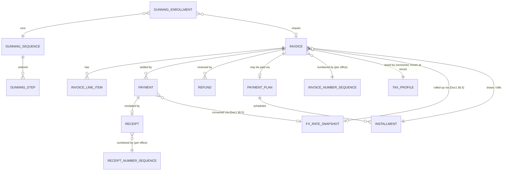

**Events emitted / consumed.** (Canonical dot.case `noun(.noun).verb-past` names; registered centrally in Doc 1 §6.1. The Biller is the registered emitter of `invoice.*`/`payment.*`.)

| Event | Direction | Trigger / Handler | Idempotency key |
|---|---|---|---|
| `invoice.issued` | Emit | Invoice issued (number + tax frozen, sent) | `invoice.issued:${invoiceId}` |
| `invoice.overdue` | Emit | Firm-tz sweep marks an issued invoice past due with a balance | `invoice.overdue:${invoiceId}:${dueDate}` |
| `invoice.paid` | Emit | Recompute zeroes `dueAmount` | `invoice.paid:${invoiceId}` |
| `invoice.voided` | Emit | Draft voided / issued invoice cancelled | `invoice.voided:${invoiceId}` |
| `payment.succeeded` | Emit | Payment fact written (online webhook/poll or offline record) | `payment.succeeded:${railEventId}` (rail) / `payment.succeeded:${paymentId}` (offline) |
| `payment.failed` | Emit | Online intent failed (rail event) | `payment.failed:${railEventId}` |
| `payment.refunded` | Emit | Refund reversing fact written | `payment.refunded:${refundId}` |
| `envelope.signed` | Consume | AG-5 emits on retainer signature → cut deposit invoice / activate plan | `envelope.signed:${retainerAgreementId}` |

## 8. User Stories + Acceptance

**US-1 — Deposit invoice auto-cut on signature.** *Given* a retainer for Client A with a CAD milestone schedule, *when* the Signer emits `envelope.signed`, *then* the Biller idempotently (payload `retainerAgreementId`) cuts the deposit invoice (or activates the seeded plan) in CAD and notifies the RCIC; *and given* the same event is redelivered, *then* **no second** deposit invoice is created.

**US-2 — Correct, taxed, government-fee-aware invoice.** *Given* a service-fee line and a government-fee line in an Ontario office, *when* I add them, *then* the service fee is taxed per the office `TaxProfile` and the government fee is **non-taxable**, with per-line round-half-to-even tax summed; *and when* I issue, *then* a number is assigned from the office sequence and lines/tax freeze (a later rate change does not alter this invoice); *and when* I try to edit an issued line, *then* it is **blocked**.

**US-3 — Offline payment, partial then full.** *Given* an issued CAD invoice of 3,000, *when* I record a 1,000 cheque with a reference, *then* an immutable Payment fact is written, the invoice is `PARTIALLY_PAID` (`due = 2,000`), a numbered receipt issues, and write+recompute happen in **one transaction**; *and when* I record the final 2,000, *then* `PAID` + `payment.succeeded` to AG-2/AG-14; *and when* I try 2,500 against a 2,000 balance, *then* **rejected** and nothing persists.

**US-4 — Pay online on the firm's own rail.** *Given* the firm's connected account is `ACTIVE`, *when* the client pays via the portal link in the invoice currency, *then* an intent is created **on the firm's account** via `PaymentRailPort`, 3-D Secure completes, and the platform never holds funds; *and when* `payment.succeeded` arrives, *then* its signature is verified, it's processed **once** (ledger key = rail event id), the Payment fact is written, the invoice recomputes to `PAID`, and a receipt issues; *and given* the same webhook redelivered, *then* **no-op**; *and given* the tab closed before redirect, *then* the invoice is **still** marked paid (webhook-driven).

**US-4a — Missed webhook reconciled by poll.** *Given* a rail intent succeeded but no webhook arrived, *when* the 15-minute reconciliation poll runs `PaymentRailPort.listTerminalIntentsSince`, *then* it detects the unsettled intent, replays the same ingestion path (same idempotency key), settles the invoice exactly once, and stamps `reconciliationState = RECONCILED_BY_POLL`; *and given* the webhook later arrives, *then* it is a no-op.

**US-5 — Overdue chased automatically, in the client's language, stops on payment.** *Given* an installment due yesterday (firm tz) with a balance, *when* the sweep runs, *then* the invoice is `OVERDUE`, Accounts is notified, and a `DunningEnrollment` starts; *and given* `language = fr-CA`, *then* the step is sent in French without marketing consent (transactional); *and when* the client pays, *then* the enrollment `AUTO_EXITED` (no late "overdue" message).

**US-6 — Multi-currency firm-wide report that never sums raw.** *Given* paid invoices in CAD, AUD, GBP and `reportingCurrency = CAD`, *when* I open firm financials, *then* collected revenue shows in CAD with **each payment converted via its stored FX snapshot**, **no raw cross-currency sum**, and per-currency breakdown + FX basis disclosable; *and given* a missing rate, *then* that amount is **excluded with a clear note**.

**US-7 — Separation of duties on refunds.** *Given* I hold `agent/billing:payment-record` but not `agent/billing:refund`, *when* I open a paid invoice, *then* I can record payments but the refund action is unavailable; *and given* I hold `agent/billing:refund`, *when* I refund part of a payment with a reason, *then* a reversing Refund fact is written (original untouched), the invoice → `PARTIALLY_REFUNDED`, roll-ups adjust, audited.

**US-8 — RCIC bills a milestone draw from the case.** *Given* a case at a milestone, *when* I raise the draw, *then* it is created against the case in the case currency, pulling the amount from the signed retainer (no re-typing), ready to issue.

**US-9 — Numbering integrity.** *Given* two invoices issued concurrently in one office, *when* both complete, *then* they get **distinct contiguous** numbers (atomic); *and given* a discarded draft, *then* **no number was consumed**.

**US-10 — Aged receivables drives collection.** *Given* outstanding invoices across buckets, *when* I open aged AR, *then* I see current/30/60/90+ in `reportingCurrency`, each bucket links to the collections queue, and one click sends a reminder or records a payment.

**US-11 — Accounting export.** *Given* `agent/billing:export`, *when* I export the period, *then* I get a tenant-scoped file, money converted (original shown), suitable for the firm's accounting/trust system, masked unless I also hold `agent/billing:reveal-financial`, streamed/async, and the export is audited (actor, scope, row count).

## 9. Edge Cases & Validations

- **Webhook redelivery/duplicate** → idempotent on rail event id + intent id; second is a no-op (BR-10).
- **Webhook out-of-order** → a `payment.succeeded` for an already-paid invoice is a no-op; a late `payment.failed` after a manual offline payment does not reverse it (facts immutable; only refunds reverse).
- **Redirect without webhook** → not marked paid on redirect; the reconciliation poll settles it (US-4a).
- **Bad/missing webhook signature** → rejected, logged, alarmed; nothing persisted (Doc 1 §4.6).
- **Rail event id unresolvable** → dead-lettered + alarmed, never business-id-deduped (Doc 1 §6.1.4).
- **Concurrent payments on one invoice** (webhook + offline at once) → recompute is transactional and serialised on the invoice; combined payments never exceed balance; the second is rejected if it would overpay (BR-7).
- **Overpayment** → rejected ("exceeds outstanding balance"); no negative `dueAmount`.
- **Editing an issued invoice** → blocked (BR-2); correction = cancel-and-reissue (new invoice) / refund.
- **Numbering collision/gap** → atomic advance prevents collisions; a cancelled issued invoice leaves an explainable audited gap, never silent reuse (BR-3).
- **Receipt numbering** → dedicated atomic gap-free sequence; a voided receipt leaves an audited gap (BR-3a).
- **Tax-rate change after issue** → does not alter issued invoices (frozen, BR-4); only future invoices use the new `TaxProfile` version.
- **Government fee accidentally taxed** → defaults non-taxable; taxing requires an explicit, audited override.
- **Mixed-currency roll-up** → each amount FX-converted before any sum; raw sum blocked (BR-8).
- **Missing FX rate** → excluded with a clear note, never raw-summed or silently dropped.
- **Currency not previously listed** → supported (reference/config); no deploy.
- **Rounding** → integer minor units; per-line round-half-to-even then summed; identical across compute/display/receipt/export (BR-16).
- **Refund exceeding the payment / without permission / without reason** → all blocked (BR-9/BR-11); never edits the original.
- **Installment due in client's far timezone** → "past due" computed in firm/office tz (BR-12).
- **Dunning after payment** → auto-exit on balance clear (BR-12).
- **Dunning to bounced/invalid email** → enrollment `HALTED`, bounce logged, Notification raised; no infinite retry.
- **Cancel an invoice with payments** → must refund the paid amount first; cancel reverses only the unpaid contribution; audited.
- **Void draft vs cancel issued** → VOID for drafts (no number consumed); CANCELLED for issued (number retained, reversal recorded).
- **Connected account not `ACTIVE`** → online pay disabled with a connect affordance; offline recording still works (firm not blocked).
- **Retainer signed but no fee schedule** → no auto-invoice; Accounts prompted to bill manually (never fabricate an amount).
- **`envelope.signed` redelivery** → idempotent activation, keyed on the payload `retainerAgreementId` (AG-6-32).
- **Cross-firm access** → an invoice/payment/refund/plan is visible/mutable only within its `firm_id` (RLS backstop, Doc 1 §2); billing party must be same-firm; no IDOR.
- **Export of a huge period** → streamed/async, never unbounded in memory; FX-converted-with-original; audited.
- **Financial-PII reveal** → payer name/bank refs masked by default; reveal requires `agent/billing:reveal-financial` (mapped onto Doc 1 §7.2 reveal machinery) and writes a `PII_REVEAL` audit.

**Validation doctrine.** All input is validated by schema (Zod/class-validator from `packages/contracts`), not ad-hoc `if/else`; reject early with a clear localised message; never persist on failure.

## 10. Permissions (LOCAL `agent/*`)

Default-deny; additive; always evaluated within the caller's `firm_id` (RLS) + record-level ownership (Doc 1 §4.5). Keys follow the one canonical grammar `agent/<resource>:<action>` (Doc 1 §4.1) — one resource namespace (`billing`) per module. The catalog is CI-validated against this section (Doc 1 §4.4). **Separation of duties is the headline** — issue / take-money / give-money-back / configure are distinct keys (BR-11).

| Permission Key | Description |
|---|---|
| `agent/billing:invoice-list` | List invoices (paginated) |
| `agent/billing:invoice-show` | Open invoice detail |
| `agent/billing:invoice-create` | Create a FINAL invoice |
| `agent/billing:invoice-edit` | Edit a FINAL invoice (FINAL only) |
| `agent/billing:invoice-issue` | Issue a draft (assign number, freeze, send) |
| `agent/billing:invoice-void` | Void a draft / cancel an issued invoice |
| `agent/billing:payment-record` | Record an offline payment / take money |
| `agent/billing:payment-online` | Initiate an online intent on the firm's rail |
| `agent/billing:refund` | Refund a payment (higher authority) |
| `agent/billing:plan-manage` | Create/manage plans + installments + dunning |
| `agent/billing:expense-list` | List disbursements/expenses |
| `agent/billing:expense-create` | Create a disbursement/expense |
| `agent/billing:expense-edit` | Edit/void an expense |
| `agent/billing:config-numbering` | Configure per-office invoice/receipt numbering |
| `agent/billing:config-tax` | Configure per-country/region tax profiles |
| `agent/billing:config-currency` | Set reporting currency / billing currency config |
| `agent/billing:report-view` | View per-client + firm-wide financial reports |
| `agent/billing:export` | Export accounting data (masked unless reveal) |
| `agent/billing:reveal-financial` | Unmask payer/bank Restricted-PII in views/exports (routes through Doc 1 §7.2 reveal + `PII_REVEAL` audit) |

> **Financial-PII reveal** reuses the platform reveal machinery (Doc 1 §7.2) — AG-6 does not invent a parallel reveal mechanism; payer name / bank references carry the Restricted/Confidential classification and route through the §7.2 codec + `PII_REVEAL` audit, gated by `agent/billing:reveal-financial`.

**Enforcement.** Route-level `@RequirePermissions` (scope-aware guard, Doc 1 §4.2) + object-level same-firm checks (Doc 1 §4.5). The online pay endpoint and the rail webhook are the only `@Public` surface, gated by the `webhook-signature` compensating control (Doc 1 §4.6). Entitlement gating (§11) layers on top.

## 11. Scalability · Security · Performance

**Scalability.**
- **Config-driven, not code-driven:** tax profiles, currencies (reference/config), numbering sequences, plan templates, dunning sequences are **data** — a firm reshapes its billing without a deploy. New payment methods are thin adapters onto the one `Payment` fact.
- **Country-aware & pack-driven:** tax from the active SA-1 country pack + office region; multi-currency first-class; single-country/single-currency is the degenerate case.
- **Stateless services + queue-backed work:** overdue sweeps, dunning sends, the reconciliation poll, report rollups, and exports run on BullMQ (Doc 1 §1.4); workers scale independently; reports run off read replicas. Target (Doc 1 §8 NFR): a large tenant at 100k–1M invoices/payments with lists/reports fast.

**Security (money is the crown jewel).**
- **Tenant isolation by construction:** `firm_id` + forced RLS (Doc 1 §2); the four defense-in-depth layers backstop a query bug; the cross-tenant denial suite gates release. No client-supplied tenant id; no cross-firm billing party.
- **Separation of duties per action** (§10, BR-11); a single `:invoice-edit` never grants "take money."
- **Money integrity:** payments/refunds are append-only immutable facts; recompute is transactional; no endpoint mutates a paid invoice's amounts; the ledger is reconstructable for audit.
- **Webhook integrity:** signature-verified + idempotent on rail event id + missed-webhook reconciliation poll (BR-10; Doc 1 §4.6/§6.2.3).
- **Platform never custodies funds** (BR-13); PCI scope stays SAQ-A (tokenized, Doc 1 §6.3); the online rail is consumed purely through `PaymentRailPort` — no vendor SDK or vendor name in any durable model/enum (rails-as-ports).
- **Financial-PII handling:** payer/bank references masked by default with audited reveal (`agent/billing:reveal-financial` → Doc 1 §7.2); no PII in logs/traces (Doc 1 §7).
- **Audit:** issue, void/cancel, record-payment, refund, numbering/tax/currency config, export, financial-PII reveal write to the **synchronous audit outbox** atomic with the op (Doc 1 §7.5), with actor/target/before-after.
- **Idempotency keys** on every money mutation (create-intent, record-payment, refund, webhook, reconciliation poll, deposit-on-sign) via the per-firm processed-event ledger.

**Performance.**
- **DB-side aggregation, not in-memory** (explicit): financial reports and AR aging read pre-computed rollups + indexed `GROUP BY` on a read replica — never an O(n) in-memory scan.
- **Cache-invalidation contract:** report tiles (billed/collected/outstanding, AR buckets, revenue-by-dimension, collection rate, and their conversions) cached in Redis keyed by `(firm_id, filter-hash)`; **invalidated by targeted eviction** on `invoice.issued`, `payment.succeeded`, `invoice.paid`, `invoice.overdue`, `invoice.voided`, `payment.refunded`, plan change (never a global flush). Staleness tolerance ≤ 60s for reports; invoice detail, payment record, and the collections queue are always live. FX snapshots are immutable (no invalidation).
- **Indexes:** `(firm_id, status)`, `(firm_id, dueDate)`, `(firm_id, officeId, invoiceNumber)`, `(invoiceId)` on payments, `(firm_id, paymentDate)`, `(planId, dueDate)`, `(firm_id, railEventId)` and `(railIntentRef)` for webhook idempotency, `(reconciliationState, lastPolledAt)` for the poll, and `(entityType, entityId)` on cross-cutting.
- **Async for heavy work:** sweeps, dunning, reconciliation poll, rollups, exports on BullMQ; webhook acks fast then processes async.
- **Plan / entitlement gating:** advanced features (online rail / Connect, multi-currency reporting, plans + dunning, accounting export) may be entitlement-tiered (SA-3 catalog); when lacking, the feature is hidden or disabled with an upgrade affordance, and the **server enforces** the gate. **[FOUNDER-CONFIRM]** the tier mapping (§13).
- **Budgets:** read p95 ≤ 300 ms, write p95 ≤ 600 ms (Doc 1 §8); reports/lists/exports paginated/streamed.

## 12. Reference Note (exists / NEW / CHANGED)

Greenfield target-state; the reference prototype is design-provenance only (Doc 1 §1.8). Honest mapping of what the source `src/accounting`/`src/payment`/`src/payment-plan` proves vs what is net-new:

**Provenance (the prototype proves the shape).** A substantial Invoice + `InvoiceItem` model with per-line discount/tax compute, `dueAmount`/`paidAmount`, a FINAL-only edit guard; `recordReceipt` (validates payable status, rejects amount > due, recomputes); per-office invoice numbering with `get-next-invoice-number` / `calculate-amount`; the polymorphic billing party (`case | corporate-case | prospect | corporate-prospect`); disbursements as `Expense`; TIME_BASED / EXPENSE_BASED invoice generation; an e-sign completion listener that consumes the retainer-completion event; raw processor primitives (`createPaymentIntent`, `constructWebhookEvent`).

**NEW (target build).**
- The online rail on the firm's **own** connected account via `PaymentRailPort` (Doc 1 §6.3): per-firm Connect, intent in the **invoice currency**, portal/hosted pay link, signed + idempotent webhooks emitting canonical `payment.succeeded`, the `getConnectedAccountStatus` connect-state read, and the **missed-webhook reconciliation poll** via `listTerminalIntentsSince`. (The prototype's `src/payment` hardcodes `currency: 'cad'`, isn't wired to invoices, and has an empty controller — effectively NEW.)
- Unified immutable `Payment` fact (the prototype has *two* models — `InvoicePayments` + a legacy `Payment` — consolidated to one) with explicit currency, vendor-neutral `method` (`ONLINE_RAIL` + offline kinds), rail refs, `fxSnapshotId`, `fundsNature`; **atomic + idempotent** record-and-recompute.
- `Refund` reversing fact (IN scope) with separate authority + reason.
- Client-money `PaymentPlan` + `Installment` (draw / single-invoice), firm-tz overdue sweep, and the `DunningSequence` / `DunningStep` / `DunningEnrollment` entities + collections queue (the source has *no* client-money plan/dunning engine; the only plan is the SaaS subscription, SA-4 — out of scope).
- Multi-currency: `Currency` → reference/config, firm `reportingCurrency`, `fxSnapshotId` references resolved through Doc 1's single-writer `FxRateService` (AG-6 never writes snapshots), conversion in every roll-up.
- `TaxProfile` (versioned, effective-dated) consuming SA-1 pack defaults, with line `kind` (incl. non-taxable government fee), tax frozen at issue, per-line round-half-to-even rounding.
- Distinct **issue step** (number assigned at issue, atomic) + issued-invoice immutability; dedicated **`ReceiptNumberSequence`** (gap-free).
- Extend the e-sign completion path to idempotently cut the deposit invoice / activate the plan on the canonical `envelope.signed` (Doc 1 §6.1; keyed on the payload `retainerAgreementId`).
- The full `agent/billing:*` permission set with separation of duties; Notification wiring; financial-PII masking + reveal via Doc 1 §7.2; entitlement gating.

**CHANGED (deliberate corrections).**
- Tenant key `clientId` → `firm_id` with forced RLS (Doc 1 §2) — the prototype's app-only `clientId` filtering is replaced, not patched.
- `Currency` enum → reference/config; add `reportingCurrency` + FX-snapshot conversion (the prototype cannot produce a correct multi-currency firm total today).
- `Payment.method` → vendor-neutral enum (`ONLINE_RAIL` replaces a vendor-named value); the concrete processor lives in the rail refs + adapter config, never the enum.
- Numbering moves from draft-create to issue (atomic, no burned numbers).
- `recordReceipt` → one atomic, idempotent transaction; two payment models → one immutable `Payment` fact.
- Status: `PENDING → ISSUED`; transitions fact-driven; automatic OVERDUE sweep; refund states added.
- Permissions: payment / refund / issue / void / config / report / export move off `invoice-edit` / `expense-edit` onto their own colon-grammar keys (the prototype rides record-receipt and status-change on `invoice:edit` — a separation-of-duties defect).
- `InvoiceItem.taxRate` (`Int` in the prototype) → sufficient decimal scale; line gains `kind`.
- Online payments: from hardcoded-`cad`, unwired raw processor primitives → Connect-per-firm, invoice-currency, signed/idempotent/reconciled behind `PaymentRailPort`.

## 13. Open Questions / [FOUNDER-CONFIRM]

**Business / domain / commercial (need a founder decision):**
1. **Connected-account onboarding model** (Standard / Express / Custom on the online rail) and whether the platform takes an application fee on client→firm payments — commercial; the architecture (rail behind `PaymentRailPort`, vendor-neutral) is decided (Doc 1 §6.3).
2. **Reporting currency & FX source** — each firm's default `reportingCurrency` (CAD assumed) and whether production warrants a paid FX-provider adapter vs the manual adapter (Doc 1 §6.5 FX-A/§13). Snapshot timing is already resolved (payment-date for payments, issue-date for AR).
3. **Payment-plan default mode** — draw vs single-invoice as the firm default (both built; affects the Client A UAT installment flow).
4. **Tax engine values [FOUNDER-CONFIRM, routed to Immigration-SME]** — which jurisdictions ship seeded (Canada GST/HST/QST by province?), and which line kinds are taxable per jurisdiction (esp. government-fee non-taxability, disbursement tax). AG-6 owns the engine; SA-1 packs hold the values.
5. **Dunning cadence + tone** — default overdue schedule (e.g. −3 / due / +3 / +7 days) and the regulator-safe, bilingual wording (copy via the content writer/SA-1 `LocalizedLabel`; cadence by founder).
6. **Entitlement tiers** — which AG-6 features sit behind which plan (online rail, multi-currency reporting, plans + dunning, export) — feeds the SA-3 catalog gating.
7. **Trust-accounting posture** — confirm AG-6 is transaction-of-record only (a `fundsNature` tag, no enforced trust ledger), and whether/how trust-intended funds must be labelled per regulator (CICC / law society) — compliance-sensitive.
8. **Statutory receipt/invoice fields per country** — the mandatory fields a compliant invoice/receipt must carry per jurisdiction (routed to SA-1 `RegulatorConfig` + Immigration-SME).

**Resolved deferrals (de-phased to IN/OUT per ADR [6.2]):**
- **IN:** refund states + authority + execution; client-money payment plans + installments; `DunningSequence`/`Step`/`Enrollment` + dunning sends (email v1, SMS/WhatsApp via SmsGatewayPort); missed-webhook reconciliation poll; multi-currency + FX conversion; `TaxProfile` versioning + tax rounding; dedicated receipt numbering; accounting CSV export.
- **OUT:** full per-country regulator-compliant **trust accounting** (a separate per-country compliance build — `fundsNature` tag + clean exportable records ship now); native QuickBooks/Xero API sync (CSV/accounting-shaped export is the supported path); live external FX-provider (manual adapter ships, Doc 1 §6.5); credit notes as a first-class document (FD-11: OUT for v1 — cancel-and-reissue / refund is the correction path; revisit with enterprise offline invoicing); advanced revenue analytics (cohorts, deferred-revenue recognition — core billed/collected/outstanding + AR aging ship now).

---

# Module AG-7: Case Management & Delivery

## Module Index

- **1. Purpose & Goal** — turn a won, paying client into a delivered government application; the readiness gate + capture-once delivery moat.
- **2. Users & JTBD** — Case Officer/Paralegal (protagonist), RCIC/Lead Consultant, Case Manager, Reviewer, Owner/Principal, Accounts (money edge only), Client (via portal).
- **3. Functional Design** — case creation & pack-driven assembly (3.1), lifecycle/stages (3.2), the Binder (3.3), the Filler (3.4), deficiency & readiness (3.5), submission & decision (3.6), team & assignment (3.7), workspace/timeline/at-risk hand-offs (3.8).
- **4. Detailed Functional Requirements** — AG-7-1 … AG-7-42.
- **5. Business Rules** — BR-1 … BR-16.
- **6. States & Lifecycle** — stage `kind` machine; Deficiency/FormInstance/Document.status/Submission/Decision/Case.atRisk states.
- **7. Key Entities & Fields** — case-runtime entities AG-7 owns + spine/cross-cutting entities it consumes; Events emitted/consumed table; ERD.
- **8. User Stories + Acceptance** — US-1 … US-8.
- **9. Edge Cases & Validations** — creation, edition retirement, gating, multi-applicant, corporate, reuse, concurrency, scan-quarantine, PII.
- **10. Permissions** — the `agent/case:*` set.
- **11. Scalability · Security · Performance** — pack-driven scale, tenant isolation, timezone-aware SLA, caching.
- **12. Reference Note** — exists / NEW / CHANGED relative to the prototype.
- **13. Open Questions / [FOUNDER-CONFIRM]** — country-content and policy deferrals.

> Agent console (LOCAL plane). Tenant key `firm_id` (forced RLS, Doc 1 §2.2). This module is the operational heart of the firm: where a retained client's application is structured, document-collected, form-filled, deficiency-checked, submitted, and tracked to a decision. It is **content-neutral machinery that operates on immigration content it does not own** — it consumes the Doc 2 SA-1 country packs (lifecycle stages, checklists, forms, scoring, eligibility, deficiency flags) and the Doc 1 §5 canonical spine, and adds zero immigration content of its own.

## 1. Purpose & Goal

AG-7 turns a won, paying client into a delivered government application. AG-2 wins revenue; AG-7 earns it. Everything between "the retainer is signed" and "the authority issues a decision" lives here: the case is scoped, its checklist and form set are assembled from the active pack, the client is chased for documents, government forms are auto-filled from the canonical answer store with zero re-keying, a continuous deficiency engine decides when the file is genuinely ready and **blocks submission of a not-ready file**, the regulated RCIC submits, and every government milestone is tracked to a decision.

The business outcome it must make structurally true: **no case is ever submitted not-ready, and no government deadline is ever missed** — not by the RCIC's memory but by design. The moat is three-fold and all pack-driven: (a) the checklist, forms, stages, scoring, eligibility, and deficiency flags are **read from the Doc 2 pack**, so the same code delivers a Canada PR file, an Australia skilled file, and a UK Skilled Worker file with no code change; (b) the **readiness gate** makes a not-ready submission impossible for a regulated firm; (c) **capture-once delivery** — the canonical answer store (Doc 1 §5.4) captured at lead/SQR stage drives the SQR, the forms, and the checklist, so the file builds itself as far as data allows.

AG-7 carries the second half of the customer journey: AG-2 (lead → assess → consult → proposal → e-sign won) → convert → **AG-7 case created** → SQR (AG-8) → Binder documents (AG-9) → Filler forms → deficiency/readiness gate → submission → milestone tracking → decision → client portal throughout.

## 2. Users & JTBD

| Role | Primary job | Representative JTBD |
|---|---|---|
| **Case Officer / Paralegal** (heaviest user) | Build the file to *ready*. | "When a case is created, give me the right checklist and forms already assembled for *this* program." · "One screen showing outstanding documents, unfilled forms, and what's blocking readiness, so I know my next action." · "When the client uploads a document, land it against the requirement so I verify, not file." · "Pre-fill the form from the profile so I review, not retype." |
| **RCIC / Lead Consultant** (regulated, accountable) | Own correctness; review and submit. | "When a file says ready, let me *trust* it — no critical deficiencies, retainer signed, fees clear — before I put my licence on a submission." · "Record the submission and start tracking every milestone so nothing lapses on my watch." |
| **Case Manager / Team Lead** | Keep delivery on track across many cases. | "Show my team's caseload by stage, who's overdue, what's unassigned, which files are at-risk — in my timezone." |
| **Reviewer (QA / senior consultant)** | Independent pre-submission gate. | "Give me the deficiency findings and a checklist so my approve/send-back is defensible and recorded." |
| **Owner / Principal RCIC** | Own delivery quality & compliance posture. | "Across every country desk, prove nothing ships not-ready, every deadline is tracked, every action is auditable." |
| **Accounts / Billing** | The money edge only. | "Unpaid fees past terms must surface as a readiness blocker." (Owns AG-6; AG-7 *consumes* fee state as a deficiency input.) |
| **Client** (via Client Portal, not the agent console) | Supply documents; see progress. | Served indirectly: AG-7 produces what the portal consumes (record-level authz per Doc 1 §4.5). |

**Design implication.** The Case Officer is the protagonist of the **Case Workspace** (single-case command center) and the SLA-ranked **My Cases** queue. The `agent/case:*` permission set (§10) cleanly separates these roles.

## 3. Functional Design

### 3.1 Case creation & structure — born from a won deal, pre-built from the pack, zero re-keying

**How it works.** A case is created in two deliberate ways, both explicit (never an automatic side-effect of conversion or payment): (1) **from convert** (primary) — a won lead becomes an engaged client (a `Party` with a `ClientIndividual`/`ClientCorporate` lens, Doc 1 §5.2); the case carries the destination country, the resolved `programNodeKey + packVersionId` (Doc 1 §5.8), and the canonical answers forward; (2) **direct create** for a walk-in or migrated file.

**Pack-driven assembly (world-class core).** On creation, the case binds the active `CountryPackVersion` and, from the resolved `programNodeKey`, the engine assembles: the **document checklist** (the derived view over `DocumentRequirement`, Doc 1 §5.6); the **government form set** (`FormInstance` rows pointing at the current `FormEdition`, Doc 1 §5.7); the **SQR section set** (`SqrSectionSelection`, Doc 1 §5.5); the **lifecycle** (the `StagePipeline`'s ordered `StageTemplate`s, Doc 1 §5.13.4); the **scoring/eligibility/deficiency config** (`ScoringConfig`/`EligibilityRuleSet`/`ConditionFlagDefinition`, Doc 1 §5.13). None of these are hardcoded; all resolve "greatest `effectiveAt <= creation date`" and the pair is stamped immutable per Doc 1 AC-5.9.

**Carry-forward — ask only what is left.** The capture-once moat (Doc 1 §5.4) is the spine made real: because answers are keyed by `canonicalFieldId` and persist at `CLIENT_LEVEL` scope, a fact captured at lead/PQR/SQR is **not re-asked** and **auto-fills** the form. Documents already collected and `Verified` (AG-9's officer-confirmed satisfies-requirement state — see §3.3) on the prospect or another case for the same `Party` are **reusable** (linked with provenance), respecting expiry — an expired police certificate is not offered. Fields tagged `mustReaffirmPerCase`/`FreshnessRule` are the deliberate re-confirm exceptions.

**Individual vs corporate — one engine, a discriminator.** A `Case.caseType` (`INDIVIDUAL | CORPORATE`) discriminates one shared engine — not two code trees. A corporate case binds a `CorporateCaseProfile` (employer identity, stored once) and contains employee `CaseApplicant`s (`role = EMPLOYEE`), each with its own Binder/Filler/deficiencies; family members of an individual case are `CaseApplicant`s within one matter (`PRINCIPAL | SPOUSE | DEPENDENT`), not sibling cases.

**Data flow.** Convert (AG-2) → resolve `Party` + carry answers → `createCase` (explicit) → bind pack version → assemble checklist + forms + SQR + lifecycle + scoring/eligibility/deficiency config (skipping carried-forward, linking reusable documents) → emit `case.created` (Doc 1 §6.1; idempotency `case.created:${caseId}`) → assignment rule sets team (§3.7) → audit.

### 3.2 Lifecycle & stages — read from the pack, not a Canada-shaped enum

**How it works.** A case moves through the ordered `StageTemplate`s of the program's `StagePipeline` (Doc 1 §5.13.4). Each `StageTemplate` carries a behavioural **`kind`** (a Doc 1 §5.13.4 field AG-7 **consumes** — `PRE_WORK | COLLECTION | PREPARATION | READY | REVIEW | SUBMITTED | POST_SUBMISSION | DECISION | TERMINAL | ON_HOLD`; see §6) so logic is correct regardless of label or country. AG-7 does not own `kind` — SA-1 authors it per stage; AG-7 reads it. Stage entry may be gated by the template's `entryConditionRef` (a §5.13.1 `Predicate`). Allowed transitions, terminal stages, and service-controlled stages are derived from the pipeline; certain transitions (`REVIEW`/`SUBMITTED`) are reachable only via the readiness/submission flow, never a free drag.

**Milestones & deadlines (Minder-driven).** A `StageTemplate` flagged `isMilestone` with a `deadlineOffsetDays` drives the **Minder** (AG-11) to watch and prompt as the deadline nears (timezone- and business-hours-aware). Real-world milestone events (AOR, biometrics, medical, ADR, PPR, COPR, PAL, or any country equivalent — all pack values) are stamped as dated `CaseMilestone` rows. The exact milestone vocabulary per country/program is pack content [FOUNDER-CONFIRM].

**Behaviour.** Each forward move corresponds to a real delivery/government event; guards return human messages ("Submitted is reachable only from Ready to Submit"), every transition stamps `stageEnteredAt` (UTC-stored, firm-timezone-rendered) and emits `case.stage.changed`. Overdue milestones surface on the case header and the manager caseload. (`stageEnteredAt` is also the anchor a Minder cascade step resolves against for a `STAGE_ENTRY`-anchored deadline, per AG-11 §3.4.)

**Data flow.** `changeStage(case, toStage)` → guard against the pipeline (`entryConditionRef` predicate + ordering + terminal/service-controlled) → update `currentStageId` + derived `bucket` + `stageEnteredAt` → emit `case.stage.changed` (idempotent consumers) → audit. Milestone stamp → write `CaseMilestone` → (if deadline-bearing) Minder arm → timeline + audit.

### 3.3 Document collection — the Binder

**How it works.** The Binder is the **derived checklist view** over the effective `DocumentRequirement` set for the case's program-combination (Doc 1 §5.6): it resolves `COMBINATION_MANDATORY` and `ANSWER_CONDITIONAL` requirements (the latter via their §5.13.1 `Predicate` over canonical answers), evaluates `alternativeGroupId` substitution, joins to realised `Document` rows by status, and applies the PRIMARY-blocks-readiness / any-ALTERNATIVE-satisfies-group / expiry-watch invariants. **AG-7 owns no document-status code** — it reads exactly AG-9's authoritative 10-state enum (`Required | Requested | Uploaded | Scanning | Received | Verified | Rejected | Waived | NotApplicable | Superseded`, the single `Document.status` lifecycle owned by the AG-9 Document engine, Doc 1 §5.6) and uses **`Verified`** (officer-confirmed) as the satisfies-requirement state; the checklist is a *view*, not a parallel store.

**Scan sub-states (Quarantine).** Quarantine / scan-pending are NOT separate `Document.status` values — they are an orthogonal `scan_status` sub-field on the version (AG-9 §6) that consumers MUST check. A document failing scan presents with `Document.status` at the pre-clean state (`Uploaded`/`Scanning`) and a non-clean `scan_status`; AG-7 renders such an item in the Binder/outstanding-list as **present-but-unusable, awaiting a clean re-upload** — it does NOT count as `Received`/`Verified`, does NOT satisfy a requirement, and does NOT silently block forever (the requirement remains visibly outstanding with the scan reason shown). The portal mirrors this rendering.

**Request-from-client loop.** A required document is requested from the client (emitting `document.requested`), who uploads via the portal; the upload is bound to the requirement (record-level authz, Doc 1 §4.5), flips `Document.status`, and enters the staff verify queue. Requests are bilingual (per the client's locale), bulk-sendable ("request all outstanding"), and chased by the Minder + the Conductor document-request playbook on `document.uploaded` / re-request events.

**Acceptable-form & reuse.** Translation/notarisation/expiry are pack values on `DocumentRequirement` (`expiryRelevant` + `expiryRuleJson`), so "we have it" means "we have it in the form this country accepts." A document `Verified` on another case for the same `Party`, still within validity, is offered for reuse (linked, not re-collected) — the case-level capture-once expression.

**Data flow.** Pack → derived checklist → request-from-client (`document.requested`) → portal upload lands against the requirement (`document.uploaded`) → staff verify/reject/waive (reason mandatory on reject/waive) → `Document.status` update (`document.status.changed`) → deficiency engine recomputes (§3.5) → Minder chases outstanding → audit on every status change.

### 3.4 Government form preparation & auto-fill — the Filler

**How it works.** Each case carries a thin `FormInstance` per required form (Doc 1 §5.7), pointing at the current `FormEdition` and stamping its `formFieldMapVersion`. The **Filler is a pure, data-driven function** (Doc 1 §5.7): given a `FormInstance`, it resolves the case's answers (via `CaseSqrSnapshot`), loads the stamped `FormEdition` + `FormFieldMap`, and writes each `entries[].canonicalFieldKey` value into its `formFieldId`. The map and inventory are validated at pack-publish time (Doc 1 AC-5.8), so the Filler holds **no field map of its own** and adds no per-form code. Because edition, map version, and answer snapshot are all stamped, a generated form **re-renders byte-identically forever** — the regulatory-grade reproducibility guarantee.

**Review / override (accountability).** Auto-fill is a draft, never an unattended submission. The consultant reviews every mapped field, can override any value (the override recorded against the `FormInstance`, never mutating the standing answer — case-time correctness via `CaseAnswerOverride`, Doc 1 §5.4), and must approve before the form is flattened/locked into a submission artefact in S3.

**Never fabricates.** The Filler pre-populates only from values that actually exist; an unmapped or empty required field is **flagged for human completion, never guessed** (the analogue of the prototype's `gender='MALE'` defaulting bug).

**Edition currency.** A `FormInstance` bound to a superseded/retired `FormEdition` is flagged "out of date"; a case cannot reach a ready state on a retired edition. Re-binding to the current edition carries mapped values forward; any value with no equivalent `formFieldId` in the new edition is surfaced for re-entry, never silently dropped.

**E-sign coupling.** Where a generated form requires a signature before `FILED`, AG-5 (the Signer) emits **`envelope.signed`** on completion (there is no separate completion event); AG-7 consumes `envelope.signed` to advance the `FormInstance` to `SIGNED` (which forms require an envelope, and whether `envelope.signed` auto-advances, is [FOUNDER-CONFIRM] — §13).

**Data flow.** Pack form set → Filler resolves snapshot answers → writes per map → render pre-filled + provenance → consultant review/override/approve → generate flattened artefact (S3) → attach to case → (if signature required) Signer envelope → consume `envelope.signed` → `FormInstance.SIGNED` → deficiency engine counts unfilled/unapproved/out-of-date forms → audit (incl. overrides).

### 3.5 Deficiency & readiness tracking — the Reviewer engine

**How it works.** The deficiency engine continuously computes, for a case, what is missing or non-compliant and an overall **readiness** state, and **gates** progress to a ready/review/submitted stage until all blocking (CRITICAL) deficiencies clear. Deficiencies are computed across: documents (outstanding/rejected/expired/missing-acceptable-form), forms (unfilled/unapproved/out-of-date-edition), SQR (not submitted/not locked), financials (retainer not signed, fees overdue past terms — read from AG-6), profile/data (required canonical fields a form/program needs), and program-specific gates.

**Two detection paths — pack-predicate and system-computed (the carve-out).** AG-7 does **not** invent a deficiency DSL. There are two structurally distinct ways a deficiency is detected, and the spec names both explicitly:

1. **Pack-predicate path (DOCUMENT / ELIGIBILITY / PROFILE).** A deficiency *rule* in these three categories is a Doc 2 SA-1 **`ConditionFlagDefinition`** (the canonical flag entity, Doc 1 §5.8) whose `predicateRef` is the **one typed §5.13.1 `Predicate` contract** over `canonicalFieldKey` answers — the same evaluator that runs section rules, document conditions, and eligibility gates. This closes the AG-7 gap that named an `autoDetectRuleJson` DSL but never defined it: the auto-detect rule *is* the §5.13.1 predicate, validated at publish time (Doc 1 AC-5.13a) so a dangling key fails publish, never nulls at runtime. The pack author marks each definition's default **severity**; the resolved per-case value is a `ComboFlagValue` (CLIENT-PII, engine-produced).
2. **System-computed path (FINANCIAL / FORM / SQR-lifecycle).** These categories are **not** canonical-field answers — fee-overdue/retainer-unsigned is AG-6 invoice state (read here), and form-unfilled/unapproved/out-of-date-edition and SQR-not-locked are `FormInstance` generation/edition state and SQR lifecycle state. A §5.13.1 `Predicate` can only reference `canonicalFieldKey` leaves, so these cannot be pack predicates. AG-7 therefore raises a fixed, closed set of **engine-computed SYSTEM deficiencies** for these categories directly (not via a pack `ConditionFlagDefinition`). This is the deliberate carve-out to the "the predicate IS the rule" claim: the pack-predicate engine covers DOCUMENT/ELIGIBILITY/PROFILE; FINANCIAL/FORM/SQR-lifecycle are AG-7 system deficiencies.

AG-7's `Deficiency` row is the **firm-actionable instance** of either a resolved flag or a system-computed finding (or an ad-hoc officer-raised finding): it adds the workflow state (assignee, resolution, waive) the pure flag value does not carry.

**Auto-raise / auto-clear.** Pack-predicate deficiencies: when the engine re-evaluates a `ConditionFlagDefinition`'s predicate against the live answer set and it resolves true, the engine **auto-raises** (or keeps open) the corresponding `Deficiency` (`autoDetected = true`); when it resolves false, it **auto-resolves**. System-computed deficiencies auto-raise/auto-clear the same way against the underlying FINANCIAL/FORM/SQR state. Officer-raised ad-hoc deficiencies are manual. Each carries severity (`CRITICAL | MAJOR | MINOR | INFO`), category (`DOCUMENT | FORM | SQR | FINANCIAL | ELIGIBILITY | PROFILE`), human label + detail, and an actionable link ("request missing document," "approve form," "send SQR link").

**The readiness gate (the moat).** A case with **any OPEN CRITICAL deficiency cannot be marked ready, cannot enter a `REVIEW`/`SUBMITTED` stage, and cannot be review-approved** (BR-3). MAJOR/MINOR/INFO warn but do not block (the block threshold is a per-pack setting, default CRITICAL). The gate composes with review: ready → submit-for-review → reviewer approves (findings + checklist in hand) → eligible to submit; reviewer rejects → back to in-process with reasons (the existing `CaseReview` round machinery, reused). A CRITICAL is unblocked only by resolve or **waive** (distinct authority + reason + audit, BR-9).

**Data flow.** Any case change (doc status, form approval, SQR lock, fee/payment, profile edit, stage) → engine re-evaluates the pack's `ConditionFlagDefinition` predicates (DOCUMENT/ELIGIBILITY/PROFILE) AND recomputes the system deficiencies (FINANCIAL/FORM/SQR) against current state → auto-raise/auto-clear `Deficiency` rows + recompute readiness (cacheable per case) → surface on case + queue → gate ready/review/submit on zero OPEN CRITICAL → review round consumes findings → audit on gate decisions and waives.

### 3.6 Submission & decision tracking — record the filing, track to a decision

**How it works.** Once ready (engine green) and reviewed (round approved), the RCIC submits and the system creates a first-class **`Submission`** record — the authoritative "this was filed" event — capturing `submittedAt`, the destination authority/channel, the submitted artefact references (flattened forms + document package), the **submission references the authority issues** (e.g. file number, unique client identifier — pack-named per country [FOUNDER-CONFIRM]), and who submitted. Submission is permissioned (`agent/case:submit`, distinct from `:edit`) and precondition-enforced (readiness-clear + review-approved + signed retainer + fees-clear per the pack), so a submission is never recorded for a not-ready file. This closes the AG-7 gap where "submitted" was only a status string and milestone date columns. **Ownership:** the assembly of the submission package itself (ordering/merging the verified documents + flattened forms into the filed artefact set) is **owned by AG-7** — AG-9 supplies the verified documents and the Filler supplies the flattened forms; AG-7 assembles and records. *(Mechanics seam: the merge/order/paginate/compress **execution** of that assembly is the **Shaper** — AG-9 §3.15, `cap.shaper` — invoked by AG-7 as an async `AssemblyJob` against the destination authority's pack assembly preset ([FOUNDER-CONFIRM] values, Doc 2 SA-1 §3.9); the filed artefact set is Shaper output — new provenance-carrying AG-9 Documents, sources untouched. AG-7 still owns composition and the `Submission` record; it grows no private PDF code.)*

**Milestone & decision tracking (pack vocabulary).** After submission the case stamps pack-defined milestones (`CaseMilestone`); each deadline-bearing one drives a Minder reminder. The final **`Decision`** record captures the outcome (`APPROVED | REFUSED | WITHDRAWN | other-per-pack`), `decisionDate`, reference, and an optional next-step suggestion; it requires `agent/case:record-decision` (distinct authority), moves the case to the corresponding terminal stage, stops SLA/reminder clocks, notifies the client via the portal, and triggers the post-decision Conductor playbook (next-steps on approval; reconsideration/appeal/re-apply guidance on refusal). This closes the AG-7 gap on Submission/Decision fields by making both explicit, separately-permissioned entities with concrete schemas (§7).

**Data flow.** Ready + reviewed → submit (precondition guard) → create `Submission` → stage → `SUBMITTED` → milestone stamps (`CaseMilestone`) → Minder on deadline milestones → decision capture → create `Decision`, stage → `DECISION`/`TERMINAL`, stop clocks → emit `case.submitted` / `case.decided` → portal notify + post-decision playbook → audit throughout.

### 3.7 Case team & assignment

**How it works.** Each case carries a `CaseTeamMember` set: **lead RCIC** (the regulated professional whose licence backs the file — the authorised-representative-of-record edge resolves through `PartyRelationship` per Doc 1 §5.2 / `RegulatorConfig.repTypeSlots` §5.13.6), **case officer** (heaviest hands-on), **reviewer** (QA), plus paralegal/watcher. Assignment is manual or **rule-based** (routes new cases by destination country/program/load to the right desk, then round-robins within the eligible/active/non-OOO pool — mirroring the CRM routing doctrine). Unassigned cases land in an Unassigned queue. Reassignment is permissioned (`agent/case:assign`), same-`firm_id`-validated, audited, and notifies the new owner.

**Data flow.** New case → assignment rule resolves desk → round-robin within eligible pool → set team → emit `case.assigned` (`notif/case-assigned` notification); if none → Unassigned queue + manager notification → audit (rule + chosen owner). Manual (re)assign → permission + same-firm check → update + `case.assigned` + notification + audit.

### 3.8 Case Workspace, timeline & hand-offs

**The Case Workspace** is the screen the officer lives in: a header (case code, applicant, program, destination-country + pack/edition badges, current stage, team, key milestone dates, readiness state, **at-risk flag**) and panels for the Binder, the Filler, the deficiency/readiness, the lifecycle/milestones, the team, and the timeline + composer. Everything is one click and pre-filled; the officer never re-keys.

**The timeline** is a unified, typed, paginated, reverse-chronological record. It is **read from the materialized append-only `ActivityEvent` table owned by AG-13** (committed IN per ADR §6.2, which freezes the ERD for the highest-traffic table) — AG-7 is a **consumer**, not the owner, and does not maintain a parallel store or aggregate at read time. The `ActivityEvent` rows for a case are those attached via `(entityType = CASE, entityId)` against the `EntityTypeRegistry` (Doc 1 §5.8) — sourced from Notes, Tasks, Reminders, Communications, Documents, Audit, Notification — plus case-native events (stage changes, milestones, deficiency raise/resolve/waive, submission, decision). AG-7 **renders and orchestrates** these; it does not re-implement them. The timeline is keyset-paginated via the composite cursor `{occurredAt, sourceType, sourceId}`; the detail load never fetches the full history.

**Hand-offs (the seams).** To the **client portal** (continuous, bilingual, two-way: requests/status/SQR/milestones out, uploads/answers back, record-level scoped). From **AG-2** (Party + answers + reusable documents). To/from **AG-6** (fee state as deficiency input + submission precondition; AG-7 never owns money). **Via the Doers**, orchestrated by the Conductor on case events (`case.created`, `case.stage.changed`, `document.uploaded`, `case.submitted`, `case.decided`).

**The Minder → Case at-risk contract (closing the AG-11 gap), event-driven.** AG-7 does **not** accept a direct cross-module table write from the Minder, and AG-7 does **not** own a `ComplianceEvent` entity. The contract is event-driven and ownership is clean:

- The **Minder** (AG-11), on a deadline breach against a watch anchored to the case, **emits `deadline.breached`** (Doc 1 §6.1; it does not write Case tables and does not insert any compliance record itself); on satisfaction it emits `deadline.satisfied`.
- **AG-7 consumes `deadline.breached`** to set the case at-risk: `Case.atRisk = true` (+ `atRiskReason`, `atRiskSince`, `atRiskSourceWatchId`). At-risk is **1:many over contributing watches** — a case may be at-risk from several breaching watches at once.
- **SA-11** (the PIPEDA/Law-25 governance plane, Doc 2) is the **sole owner** of the `ComplianceEvent` entity (polymorphic `entityType`/`entityId`; a governance record under retention floors). SA-11 writes the `ComplianceEvent` via its audit-synchronous outbox in response to the same `deadline.breached` event. AG-7 only **consumes/queries** `ComplianceEvent`; it never defines or writes it. **Acknowledge seam:** SA-11 emits/owns the `ComplianceEvent`; **AG-7 provides the firm-side acknowledge action** — an authorized case user acknowledges it from the case surface, with the acknowledgement recorded through SA-11's API (AG-7 never writes the entity directly).
- **AG-7 consumes `deadline.satisfied`** to clear at-risk, correlating by `atRiskSourceWatchId`: at-risk **clears only when ALL contributing watches are satisfied or cancelled** (a single satisfaction does not clear at-risk if other watches remain breached). Whether the final clear is automatic or requires a manual acknowledgement is policy [FOUNDER-CONFIRM].

The at-risk flag surfaces on the case header and the manager dashboard; the SA-11 `ComplianceEvent` log is the audit-grade governance record of a missed/at-risk regulated deadline, distinct from (and additional to) the immutable `AuditLog`.

## 4. Detailed Functional Requirements

**Case creation & structure**
- **AG-7-1.** `agent/case:create` SHALL create a case from a converted client or directly, selecting a destination country (constrained to the firm's entitled, `ACTIVE` country set per Doc 2 §3.12) and a `programNodeKey` from the active `CountryPackVersion` — never a hardcoded list. The pair `programNodeKey + packVersionId + countryCode` is stored immutable (Doc 1 AC-5.9).
- **AG-7-2.** Case creation SHALL NOT be an automatic side-effect of conversion or payment (BR-1); the consultant chooses scope. The case enters the **first `StageTemplate` of the pack's `StagePipeline`**.
- **AG-7-3.** A case SHALL carry a stable UUID `id` (the API/cross-reference key) and a human-readable `caseCode`.
- **AG-7-4.** The system SHALL model applicants of one matter as `CaseApplicant` rows within one case (`PRINCIPAL | SPOUSE | DEPENDENT | EMPLOYEE`), each referencing `partyId` (Doc 1 §5.2), not as sibling cases.
- **AG-7-5.** A corporate case (`caseType = CORPORATE`) SHALL bind one `CorporateCaseProfile` (employer data once) and contain employee `CaseApplicant`s sharing it, not duplicate the case module per employee (BR-13/BR-17).
- **AG-7-6.** Case creation SHALL materialise the derived document checklist, the `FormInstance` set, the SQR section set, the lifecycle, and the scoring/eligibility/deficiency config from the pack for the chosen `programNodeKey`.
- **AG-7-7.** When created from a converted prospect, the system SHALL reuse already-captured canonical answers (Doc 1 §5.4 capture-once — not re-asked, auto-filling forms) and link already-`Verified` documents for the same `Party` (de-duplicated, with provenance), per BR-6.
- **AG-7-8.** Every case and child entity SHALL be `firm_id`-scoped (forced RLS, Doc 1 §2.2) and SHALL link the `Party`/applicant, the program pair, and (optionally) the originating prospect.

**Lifecycle & stages**
- **AG-7-9.** The case SHALL move through the pack `StagePipeline`'s ordered `StageTemplate`s (Doc 1 §5.13.4), each carrying a behavioural `kind` (a Doc 1 §5.13.4 field AG-7 consumes; §6) that drives logic regardless of country-specific label.
- **AG-7-10.** Stage labels, order, deadlines, entry conditions, and `kind` SHALL be pack data (`StageTemplate.order`/`nameKey`/`deadlineOffsetDays`/`entryConditionRef`/`kind`), not code; the Canada IRCC stage set is one pack instance. AG-7 consumes `kind`; it does not add it to the GLOBAL entity.
- **AG-7-11.** A transition SHALL be guarded (pipeline ordering + any `entryConditionRef` §5.13.1 predicate), reject illegal moves with a human message, stamp `stageEnteredAt`/`previousStageId`, write a timeline entry, and emit `case.stage.changed`.
- **AG-7-12.** Stages whose `kind ∈ {READY, REVIEW, SUBMITTED}` SHALL be service-controlled — reachable only via the readiness/submission flow (AG-7-26/AG-7-31), never a free manual set.
- **AG-7-13.** Terminal stages SHALL have no outgoing transitions; reopening a terminal case SHALL be an explicit, permissioned, audited action (BR-15).
- **AG-7-14.** Each case SHALL expose a coarse `bucket` derived from the current stage's `kind` (for lists/dashboards), never set independently.

**Document collection (the Binder)**
- **AG-7-15.** The Binder SHALL present the derived checklist view over the effective `DocumentRequirement` set (Doc 1 §5.6): resolving `COMBINATION_MANDATORY`/`ANSWER_CONDITIONAL`, `alternativeGroupId`, and `expiryRelevant`; per-applicant; reading the single `Document.status` (AG-9's 10-state enum), never a private status copy, and honouring the orthogonal `scan_status` sub-field so a quarantined/scan-pending item shows present-but-unusable and never satisfies a requirement.
- **AG-7-16.** `agent/case:document-manage` SHALL add ad-hoc documents beyond pack defaults and mark a requirement not-applicable with a reason (removing it from completeness).
- **AG-7-17.** Reject SHALL require a reason and notify the responsible party; the document re-enters request state.
- **AG-7-18.** The client portal SHALL upload against requested items (record-level authz, Doc 1 §4.5); uploads enter the staff verify queue (the Binder is the single source the portal reads/writes).
- **AG-7-19.** The Binder SHALL compute checklist completeness (required-`Verified` ÷ required-total, excluding not-applicable) as a readiness signal.
- **AG-7-20.** A document `Verified` on the prospect or another case for the same `Party`, within validity, SHALL be reusable (linked, provenance shown), within `firm_id` and same-`Party` only (BR-6).

**Government form prep & auto-fill (the Filler)**
- **AG-7-21.** A case SHALL present its `FormInstance` set from the pack; each instance tracks generation state and the stamped `formEditionId` + `formFieldMapVersion` (Doc 1 §5.7).
- **AG-7-22.** The Filler SHALL auto-fill each `FormInstance` purely from the case's resolved answers via the published `FormFieldMap` (Doc 1 §5.7), pre-populating every mapped field and flagging unmapped/empty required fields for human completion.
- **AG-7-23.** The Filler SHALL allow staff to override any auto-filled value (recorded as a `CaseAnswerOverride`/form-level override, not mutating the standing answer), track auto-filled vs hand-edited, and generate the flattened output.
- **AG-7-24.** A `FormInstance` SHALL be flagged out-of-date when its `FormEdition` is superseded/retired; it SHALL NOT reach a ready state on a retired edition; re-binding carries mapped values forward and surfaces non-mapping fields for re-entry (BR-5).
- **AG-7-25.** Form readiness (required fields filled, edition current, generated, signed where required) SHALL feed the readiness signal; where a signature is required, the `FormInstance` advances to `SIGNED` on consuming AG-5's `envelope.signed`.

**Deficiency & readiness tracking**
- **AG-7-26.** Deficiency rules for the DOCUMENT/ELIGIBILITY/PROFILE categories SHALL be authored as Doc 2 SA-1 `ConditionFlagDefinition`s whose `predicateRef` is the one typed §5.13.1 `Predicate` contract over `canonicalFieldKey` answers — there is no AG-7 deficiency DSL; the predicate IS the auto-detect rule (closing the `autoDetectRuleJson` gap). The FINANCIAL/FORM/SQR-lifecycle categories, which are not canonical-field answers, SHALL be raised as AG-7 engine-computed SYSTEM deficiencies (not pack predicates) — the carve-out stated in §3.5.
- **AG-7-27.** A case SHALL hold `Deficiency` instances (auto-raised from a resolved flag, auto-raised as a system deficiency, or ad-hoc) with severity (`CRITICAL | MAJOR | MINOR | INFO`), state (`OPEN | ACKNOWLEDGED | WAIVED | RESOLVED`), category, applicant/area, assignee, and resolution note.
- **AG-7-28.** The engine SHALL auto-raise/auto-clear `Deficiency` rows as the live answer set changes a `ConditionFlagDefinition` predicate's resolution (DOCUMENT/ELIGIBILITY/PROFILE) or as the underlying FINANCIAL/FORM/SQR state changes (system deficiencies); ad-hoc deficiencies are manual.
- **AG-7-29.** A case SHALL expose a computed readiness state; **any OPEN CRITICAL deficiency SHALL block** advancing into `READY`/`REVIEW`/`SUBMITTED` and SHALL block review-approval (BR-3). MAJOR/MINOR/INFO warn (block threshold per-pack, default CRITICAL).
- **AG-7-30.** Waiving a deficiency SHALL require `agent/case:waive-deficiency` (distinct), a mandatory reason, and an audit entry; a waive records a justified exception (`WAIVED`), never a delete.
- **AG-7-31.** `agent/case:review-submit` SHALL submit a case for internal review, creating a `CaseReview` round with a checklist and notifying `agent/case:review-approve` holders; approval SHALL require all checklist items checked AND no OPEN CRITICAL.

**Submission & decision**
- **AG-7-32.** Recording a `Submission` SHALL require `agent/case:submit`, require review-approved + readiness-clear + signed retainer + fees-clear (per pack), capture the pack-named submission references, attach the submitted artefact refs, move the case to the `SUBMITTED`-kind stage, and emit `case.submitted`.
- **AG-7-33.** The case SHALL record pack-defined post-submission `CaseMilestone`s as dated events (deadline-bearing ones arm a Minder), surfaced on timeline + header; recording a milestone requires `agent/case:milestone-record`.
- **AG-7-34.** Recording a `Decision` SHALL require `agent/case:record-decision`, capture outcome + date + reference + optional next-step, move the case to the terminal stage, stop clocks, emit `case.decided`, and notify the client.
- **AG-7-35.** A terminal case SHALL support explicit close (with reason), emit `case.closed`, and SHALL stop SLA/reminder clocks (cancel pending Minders for the case).

**Team, timeline, at-risk & cross-cutting**
- **AG-7-36.** A case SHALL carry a `CaseTeamMember` set (lead RCIC / officer / reviewer / paralegal / watcher); (re)assignment requires `agent/case:assign`, same-`firm_id` validation, audit, notification, and emits `case.assigned`.
- **AG-7-37.** The system SHALL provide an officer work-queue (SLA-ranked), an unassigned queue, and a manager workload view, read from **DB-side aggregates** (not in-memory scans), with SLA computed in the firm timezone with business hours (BR-12).
- **AG-7-38.** Every case SHALL render a unified, typed, paginated timeline read from the AG-13-owned materialized `ActivityEvent` table (consumed, not owned) via `(entityType = CASE, entityId)` plus case-native events.
- **AG-7-39.** A case SHALL carry an `atRisk` flag (+ `atRiskReason`, `atRiskSince`, `atRiskSourceWatchId`) and SHALL set it by consuming the Minder's `deadline.breached` event (AG-11-19): on a `deadline.breached` against a watch anchored to the case, AG-7 sets `Case.atRisk = true` and records the contributing `atRiskSourceWatchId`. AG-7 SHALL clear at-risk by consuming `deadline.satisfied`, and only when ALL contributing watches are satisfied/cancelled. AG-7 SHALL NOT write a `ComplianceEvent` (owned by SA-11, written via its audit-synchronous outbox from the same event); AG-7 only consumes/queries it.
- **AG-7-40.** The module SHALL raise `notif/*` notifications (honouring the per-user `NotificationPreference` owned by AG-10, bounded by the AG-16 firm-policy ceiling) on assign/reassign, submitted-for-review, review approved/rejected, document rejected/uploaded, CRITICAL deficiency raised/waived, submission, milestone, decision, at-risk, and SLA breach — tenant-scoped, never cross-firm.
- **AG-7-41.** Sensitive actions (stage transition, assignment, deficiency waive, submission, decision, document accept/reject, form generation, PII reveal, export) SHALL write immutable `AuditLog` entries (Doc 1 §7.5).
- **AG-7-42.** Every list / Binder / form set / timeline / queue / export SHALL be cursor-paginated (≤50) and tenant-scoped; no endpoint returns an unbounded set.

## 5. Business Rules

- **BR-1 (Deliberate creation).** A case is never auto-created from conversion/payment; it is an explicit, permissioned act with a chosen `programNodeKey`.
- **BR-2 (Pack-defined transitions).** Legal transitions, terminal stages, and service-controlled stages derive from the pack `StagePipeline`; illegal moves are rejected with a human message.
- **BR-3 (CRITICAL gates readiness).** Any OPEN CRITICAL deficiency blocks `READY`/`REVIEW`/`SUBMITTED` and review-approval; MAJOR/MINOR/INFO warn (threshold per-pack, default CRITICAL). Only resolve or waive unblocks.
- **BR-4 (Checklist completeness).** A case cannot be submitted unless required Binder items are `Verified` and the review checklist is fully checked; not-applicable items leave the denominator.
- **BR-5 (Edition currency).** A `FormInstance` cannot reach ready on a retired `FormEdition`; re-binding carries values forward and surfaces non-mapping fields, never silently dropping them.
- **BR-6 (Capture-once / reuse).** Canonical answers and `Verified` documents for the same `Party` within the firm are reused (Doc 1 §5.4), never blindly re-requested; reuse is `firm_id`- and `Party`-bounded; expired/superseded items are not offered.
- **BR-7 (Filler never fabricates).** The Filler populates only from existing answers; unmapped/empty required fields are flagged, never guessed.
- **BR-8 (Single source / no re-keying).** The canonical answer store is the single source feeding Binder, Filler, and review; a case-level correction is a `CaseAnswerOverride`, never a mutation of the standing answer.
- **BR-9 (Separated authorities).** `agent/case:submit`, `:record-decision`, and `:waive-deficiency` are distinct keys, never folded into `:edit`; each requires its own precondition + audit.
- **BR-10 (Pack-constrained scope).** A case's destination country must be in the firm's entitled `ACTIVE` set; its `programNodeKey` must be valid for the pack. A deactivated country leaves existing cases readable/editable but unselectable for new cases.
- **BR-11 (Timezone-aware SLA).** SLA and stage deadlines evaluate in the firm/office timezone with business hours; a case is not flagged overdue merely because a weekend elapsed (Doc 1 §5.13.4 + AG-16 `BusinessHoursCalendar`).
- **BR-12 (One engine, a discriminator).** Individual and corporate cases share one set of Binder/Filler/deficiency/lifecycle services parameterised by `caseType`; employer data is stored once on `CorporateCaseProfile`, not duplicated per employee.
- **BR-13 (Reproducibility).** A generated form and a re-run assessment reproduce exactly what the firm acted on, via the stamped `FormEdition` + `formFieldMapVersion` + `CaseSqrSnapshot` and the immutable pack version (Doc 1 §5.7/§5.8).
- **BR-14 (At-risk via event).** A Minder `deadline.breached` against a watch anchored to a case causes AG-7 to set `Case.atRisk` (recording `atRiskSourceWatchId`); SA-11 (not AG-7, not the Minder directly) writes the governance `ComplianceEvent` from the same event via its audit-synchronous outbox. At-risk clears only when ALL contributing watches are satisfied/cancelled (on consuming `deadline.satisfied`); whether the final clear is automatic or manual-acknowledge is policy [FOUNDER-CONFIRM].
- **BR-15 (Reopen).** Reopening a terminal case is an explicit, permissioned, audited action recording why; whether it continues the same case or spawns a follow-on matter is pack/policy-driven (§13).
- **BR-16 (Multi-currency).** Case financials carry their own currency; cross-case roll-ups convert via an `FxRateSnapshot` (Doc 1 §6.5) and never raw-sum differing currencies; money lives in AG-6, read here.

## 6. States & Lifecycle

**Case stage `kind` (behavioural; pack labels map onto these).** The `StageTemplate.kind` vocabulary is a Doc 1 §5.13.4 field AG-7 **consumes** (SA-1 authors it per stage):

`PRE_WORK → COLLECTION → PREPARATION → READY → REVIEW → SUBMITTED → POST_SUBMISSION → DECISION → TERMINAL` (plus reversible `ON_HOLD`).

```mermaid
stateDiagram-v2
    [*] --> PRE_WORK : create (deliberate; from convert)
    PRE_WORK --> COLLECTION : Binder underway
    COLLECTION --> PREPARATION : Filler underway
    PREPARATION --> READY : engine green (no OPEN CRITICAL)
    READY --> REVIEW : submit-for-review (service-controlled)
    REVIEW --> PREPARATION : reviewer rejects (reasons)
    REVIEW --> SUBMITTED : agent/case:submit (approved + readiness-clear)
    SUBMITTED --> POST_SUBMISSION : record milestone (AOR/bio/medical/ADR/PPR...)
    POST_SUBMISSION --> DECISION : record decision
    DECISION --> TERMINAL : approved/refused/withdrawn
    TERMINAL --> [*]
    note right of READY : Reviewer GATE — blocked while any OPEN CRITICAL deficiency
    note right of SUBMITTED : preconditions — review-approved + readiness-clear + signed + fees-clear
    note right of POST_SUBMISSION : deadline milestones arm the Minder; deadline.breached sets Case.atRisk (SA-11 writes ComplianceEvent)
```

- **`Deficiency`:** `OPEN → ACKNOWLEDGED → RESOLVED`, or `OPEN → WAIVED` (auth + reason). Auto-detected ones (pack-predicate or system-computed) auto-transition `OPEN ↔ RESOLVED` as the predicate/underlying-state resolution changes.
- **`FormInstance` (generation):** `NOT_STARTED → IN_PROGRESS → READY → GENERATED → (SIGNED) → FILED`, with an orthogonal edition flag (`current | out-of-date | retired`) gating READY; `SIGNED` is reached on consuming AG-5's `envelope.signed` where a signature is required.
- **`Document.status`:** owned by the AG-9 10-state lifecycle (`Required | Requested | Uploaded | Scanning | Received | Verified | Rejected | Waived | NotApplicable | Superseded`, Doc 1 §5.6); AG-7 reads it, never sets a private copy, treats `Verified` as the satisfies-requirement state, and honours the orthogonal `scan_status` sub-field for quarantined/scan-pending items.
- **`Submission` / `Decision`:** `Submission` captured at the `SUBMITTED`-kind stage; milestones accrue through `POST_SUBMISSION`; `Decision` lands the case in a terminal stage.
- **`Case.atRisk`:** boolean overlay (orthogonal to stage), set by AG-7 on consuming `deadline.breached` (recording `atRiskSourceWatchId`), cleared only when ALL contributing watches are satisfied/cancelled (on `deadline.satisfied`) — automatic or manual-acknowledge per policy [FOUNDER-CONFIRM].

## 7. Key Entities & Fields

> Cites Doc 1 §5 spine entities (Party, CanonicalField, ClientCanonicalAnswer, CaseSqrSnapshot, DocumentType/DocumentRequirement, Document, GovFormDef/FormEdition/FormFieldMap, FormInstance, ProgramDef, StagePipeline/StageTemplate, ScoringConfig, EligibilityRuleSet, ConditionFlagDefinition, ComboFlagValue, EntityTypeRegistry) — not redefined. AG-7 owns the case-runtime entities below. All TENANT/CLIENT-PII; `firm_id NOT NULL` (forced RLS).

- **`Case`** — `id` (UUID PK), `firm_id`, `caseCode` (unique within firm), `caseType` (`INDIVIDUAL | CORPORATE`), `partyId` (→ Doc 1 §5.2), `programNodeKey` + `packVersionId` + `countryCode` (immutable pair, Doc 1 §5.8), `currentStageId` (→ pack `StageTemplate`), `bucket` (derived from stage kind), `priority`, `targetClosureDate`, `caseCurrency` (ISO 4217, reference), `atRisk` (bool, default false), `atRiskReason?`, `atRiskSince?`, `atRiskSourceWatchId?` (uuid; the contributing breaching `MinderWatch` — at-risk is 1:many over watches, so this records contributors and at-risk clears only when ALL are satisfied/cancelled), `convertedFromProspectId?`, `closedReason?`, `createdAt`/`updatedAt`. **Indexes:** `(firm_id, currentStageId)`, `(firm_id, bucket)`, `(firm_id, countryCode)`, `(firm_id, targetClosureDate)`, `(firm_id, atRisk)`.
- **`CaseApplicant`** — `id`, `firm_id`, `caseId`, `partyId` (→ Party / AnswerSubject), `role` (`PRINCIPAL | SPOUSE | DEPENDENT | EMPLOYEE`), `accompanying?` (bool), `status`. **Index:** `(firm_id, caseId)`. One matter, many applicants (replaces sibling family cases).
- **`CorporateCaseProfile`** — `id`, `firm_id`, `caseId` (1:1), employer `partyId` (kind ORGANISATION), employer-level fields stored once. Employees are `CaseApplicant`s with `role = EMPLOYEE`.
- **`FormInstance`** (thin, Doc 1 §5.7) — `id`, `firm_id`, `caseId`, `applicantId?`, `formEditionId` (→ GLOBAL `FormEdition`), `formFieldMapVersion` (stamped), `generationState` (`NOT_STARTED | IN_PROGRESS | READY | GENERATED | SIGNED | FILED`), `editionState` (`current | out-of-date | retired`), `outputMediaId?`, `signedEnvelopeId?`, `overriddenFieldKeys` (string[]). **No field map of its own.** **Index:** `(firm_id, caseId)`.
- **`Deficiency`** — `id`, `firm_id`, `caseId`, `applicantId?`, `conditionFlagDefinitionKey?` (→ Doc 1 §5.8 `ConditionFlagDefinition`; null = ad-hoc or system-computed), `comboFlagValueId?` (→ resolved CLIENT-PII flag), `source` (`PACK_PREDICATE | SYSTEM | AD_HOC` — DOCUMENT/ELIGIBILITY/PROFILE via pack predicate; FINANCIAL/FORM/SQR via system-computed; manual = ad-hoc), `category` (`DOCUMENT | FORM | SQR | FINANCIAL | ELIGIBILITY | PROFILE`), `severity` (`CRITICAL | MAJOR | MINOR | INFO`), `state` (`OPEN | ACKNOWLEDGED | WAIVED | RESOLVED`), `assignedToUserId?`, `detail`, `actionLink?`, `autoDetected` (bool), `resolutionNote?`, `waivedByUserId?`, `waiveReason?`, `createdAt`/`resolvedAt?`. **Indexes:** `(firm_id, caseId, state)`, `(firm_id, caseId, severity)`.
- **`CaseMilestone`** — `id`, `firm_id`, `caseId`, `milestoneKey` (pack-defined value: AOR/biometrics/medical/ADR/PPR/COPR/PAL or country equivalent), `occurredAt`, `dueAt?`, `reference?`, `note?`. **Index:** `(firm_id, caseId, occurredAt)`. (Replaces hardcoded Canada date columns.)
- **`Submission`** — `id`, `firm_id`, `caseId`, `submittedByUserId`, `submittedAt`, `authorityKey` (pack), `channel` (`PORTAL | E_APP | PAPER`), `submissionRefsJson` (pack-named keys, e.g. fileNumber/uci — schema per pack [FOUNDER-CONFIRM]), `artefactRefsJson` (form + document package refs), `note?`. **Index:** `(firm_id, caseId)`.
- **`Decision`** — `id`, `firm_id`, `caseId`, `recordedByUserId`, `outcome` (`APPROVED | REFUSED | WITHDRAWN | OTHER`), `decisionDate`, `reference?`, `note?`, `nextStepSuggestionKey?`. **Index:** `(firm_id, caseId)`.
- **`CaseReview`** (reused, extended) — `id`, `firm_id`, `caseId`, `reviewRound`, `status` (`PENDING_REVIEW | UNDER_REVIEW | APPROVED | REJECTED`), `checklistJson`, `submittedByUserId`, `reviewerId`, `reviewNotes?`, `rejectionReason?`. Approval guard gains the no-OPEN-CRITICAL check.
- **`CaseTeamMember`** — `id`, `firm_id`, `caseId`, `userId`, `role` (`LEAD_RCIC | OFFICER | REVIEWER | PARALEGAL | WATCHER`), `assignedAt`, `assignedByUserId`. **Index:** `(firm_id, caseId)`, `(firm_id, userId)`.
- **Cross-cutting (consumed, not redefined):** `ComplianceEvent` is **owned by SA-11** (Doc 2; polymorphic `entityType`/`entityId`, a PIPEDA/Law-25 governance record written via SA-11's audit-synchronous outbox on `deadline.breached`) — AG-7 only consumes/queries it; it does **not** own or define this entity. `ActivityEvent` (the materialized timeline table) is **owned by AG-13** — AG-7 consumes it (§3.8/§7). `Note`, `Task`, `Reminder`, `Communication`, `Document` (AG-9), `AuditLog`, `Notification` are attached/rendered via `(entityType = CASE, entityId)`, registry-validated (Doc 1 §5.8); `NotificationPreference` (per-user) is owned by AG-10, bounded by the AG-16 firm-policy ceiling — cited here, not redefined.

**Events emitted / consumed (this table is the normative source the Doc 1 §6.1 registry mirrors).** Names are canonical dot.case, lowercase, `noun(.noun).verb-past`.

| Event | Direction | Notes |
|---|---|---|
| `case.created` | emit | On explicit create; idempotency `case.created:${caseId}`. |
| `case.stage.changed` | emit | On every guarded transition. |
| `case.assigned` | emit | On (re)assignment of the case team. |
| `case.submitted` | emit | On recording a `Submission` (precondition-gated). |
| `case.decided` | emit | On recording a `Decision`. |
| `case.closed` | emit | On explicit close of a terminal case. |
| `document.requested` | emit | On request-from-client of a Binder item. |
| `document.uploaded` | consume | Portal upload landed against a requirement → verify queue + deficiency recompute. |
| `document.status.changed` | consume | AG-9 status change → deficiency recompute + Binder refresh. |
| `envelope.signed` | consume | AG-5 e-sign completion (the only completion event) → `FormInstance` → `SIGNED`. |
| `deadline.breached` | consume | AG-11 Minder → set `Case.atRisk` + record `atRiskSourceWatchId` (SA-11 writes the ComplianceEvent). |
| `deadline.satisfied` | consume | AG-11 Minder → clear at-risk only when ALL contributing watches satisfied/cancelled. |
| `invoice.overdue` / `payment.succeeded` / `payment.failed` | consume | AG-6 fee state → FINANCIAL system-deficiency recompute. |
| `prospect.converted` | consume | AG-2 convert → eligible source for create-from-convert + carry-forward. |

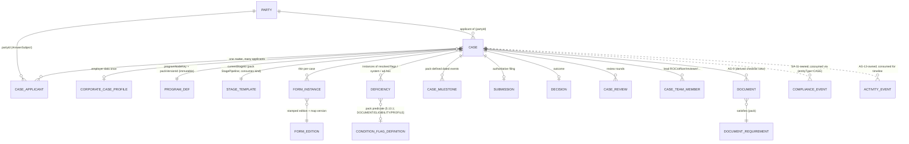

## 8. User Stories + Acceptance

**US-1 — Officer: collect documents (the Binder).** *Given* a case created from a converted prospect on a pack program, *When* I open the Binder, *Then* the checklist is the derived view over the pack `DocumentRequirement` set, documents `Verified` for the same `Party` are linked (not re-requested) with provenance, and remaining required items show outstanding. *Given* a requested item, *When* the client uploads via the portal, *Then* it enters my verify queue (and a quarantined upload shows present-but-unusable, never satisfying the requirement); *When* I reject with a reason, *Then* it re-enters request, the client is notified, and the rejection is on the timeline.

**US-2 — Officer: auto-fill a form (the Filler).** *Given* the case has resolved canonical answers and a locked SQR, *When* I open a `FormInstance`, *Then* every mapped field is auto-filled from the answers via the published `FormFieldMap`, auto-filled fields are marked, and empty required fields are flagged. *Given* I override a value, *When* I save, *Then* the override is recorded (the standing answer unchanged) and I can generate the flattened output. *Given* a required field has no source value, *Then* the Filler leaves it blank and flags it — never fabricates (BR-7).

**US-3 — Reviewer: gate on a CRITICAL deficiency.** *Given* a case with an OPEN CRITICAL deficiency auto-raised from a pack `ConditionFlagDefinition` predicate (e.g. "passport expired"), *When* I try to advance to READY/REVIEW, *Then* it is blocked with a message naming the deficiency (BR-3). *Given* I resolve it (new passport `Verified`), *When* the predicate re-evaluates false, *Then* the deficiency auto-resolves and readiness unblocks. *Given* a CRITICAL that must be accepted, *When* I waive it, *Then* it requires `agent/case:waive-deficiency` + a reason, becomes `WAIVED` (not deleted), unblocks, and is audited.

**US-4 — Officer: advance through the pack stage machine.** *Given* a case in a PREPARATION-kind stage, *When* I try to jump to a SUBMITTED-kind stage, *Then* it is blocked ("must pass through review/submit") because that kind is service-controlled (BR-2). *Given* readiness-clear + review-approved, *When* I record the submission, *Then* it requires `agent/case:submit`, creates a `Submission` with the pack-named refs, emits `case.submitted`, and the bucket derives to submitted.

**US-5 — Officer: milestones & decision.** *Given* a submitted case, *When* I record an AOR with its date, *Then* a `CaseMilestone` appears on the timeline/header and the case moves to POST_SUBMISSION. *Given* the authority decides, *When* I record `APPROVED`, *Then* it requires `agent/case:record-decision`, creates a `Decision`, emits `case.decided`, moves the case to terminal, stops clocks, and notifies the client.

**US-6 — Minder breach → at-risk.** *Given* an armed `MinderWatch` on a biometrics deadline, *When* the deadline breaches unmet, *Then* AG-11 emits `deadline.breached`; AG-7 consumes it and sets `Case.atRisk` with `atRiskReason`/`atRiskSince`/`atRiskSourceWatchId`, SA-11 writes a governance `ComplianceEvent` from the same event, the owner is escalated, and the case surfaces at-risk on the manager dashboard and case header (AG-11-19, BR-14). *Given* a second deadline is also breached, *When* the first is later satisfied (`deadline.satisfied`), *Then* at-risk does NOT clear — it clears only when both contributing watches are satisfied/cancelled.

**US-7 — Corporate matter.** *Given* a corporate case with employer data entered once, *When* I add three employees, *Then* each is a `CaseApplicant (EMPLOYEE)` with its own Binder/Filler/deficiencies, and employer data is not duplicated (BR-12).

**US-8 — Manager: workload & SLA.** *Given* the workload view, *When* it loads, *Then* it shows cases-per-officer and an unassigned queue from DB-side aggregates, and a case past `targetClosureDate` (evaluated in the firm timezone) flags amber/red — not because a weekend elapsed (BR-11).

## 9. Edge Cases & Validations

- **Missing inputs at creation** → no valid `programNodeKey` or non-entitled/non-`ACTIVE` country is rejected at Zod validation; nothing persisted.
- **Retired form edition** → instance flagged out-of-date; READY blocked; re-bind carries values forward, surfaces non-mapping fields (BR-5). A case mid-review when its form retires is flagged, not silently submitted.
- **Submit with an OPEN CRITICAL** → blocked (BR-3); only resolve or waive (auth + reason) unblocks.
- **Submit without approval / incomplete checklist** → blocked (BR-4).
- **Decision on a non-submitted case** → blocked (BR-9); requires a SUBMITTED/POST_SUBMISSION stage.
- **Stage-skip / terminal move** → blocked with a human message; terminal stages reject all moves; reopen is a separate audited action (BR-2/BR-15).
- **Multi-applicant** → Binder/Filler/deficiencies per applicant; readiness aggregates across applicants of the matter; a dependant's missing required document blocks the matter (configurable per pack [FOUNDER-CONFIRM]).
- **Corporate atomicity** → employer data shared once; whether an incomplete employee blocks only that employee or the whole matter is a pack/policy switch, not a code fork [FOUNDER-CONFIRM].
- **Auto-fill with no source value** → field blank and flagged; never fabricated (BR-7). A standing answer changing after generation flags the form stale.
- **Reused document later rejected on its source** → the link surfaces the changed `Document.status`; the case re-verifies, never trusts stale `Verified` (BR-6).
- **Quarantined / scan-pending upload** → `Document.status` stays at the pre-clean state with a non-clean `scan_status`; the Binder/outstanding-list renders it present-but-unusable, it does not count as `Received`/`Verified`, and the requirement remains visibly outstanding with the scan reason (it never silently blocks forever).
- **Concurrent stage moves / double-submit** → guarded transactionally; a redelivered `case.stage.changed`/`case.submitted` is idempotent (no duplicate submission/milestone) per Doc 1 §6.1.4.
- **Multiple breaching deadlines** → at-risk is 1:many over contributing watches; a single `deadline.satisfied` does not clear at-risk while other watches remain breached (correlate via `atRiskSourceWatchId`).
- **Predicate over a dangling field** → impossible at runtime: a `ConditionFlagDefinition` predicate referencing an unresolved `canonicalFieldKey` fails SA-1 publish (Doc 1 AC-5.13a), never nulls at runtime.
- **Country deactivated after cases exist** → existing cases remain readable/editable; new cases cannot select it (BR-10).
- **PII reveal** → passport/financial fields masked by default (Doc 1 §7.2); reveal requires `agent/case:reveal-pii` and is audited.
- **Unbounded fetch** → Binder, form set, deficiency list, timeline, queues, exports all cursor-paginated/streamed.

**Validation doctrine.** Every input (creation, stage move, document/form/deficiency action, submission/decision, export filter) is Zod/class-validator validated — no ad-hoc `if/else` chains; reject early with a clear localised message; never persist on failure.

## 10. Permissions (LOCAL `agent/case:*`)

Default-deny; additive; always evaluated within the caller's `firm_id` (Doc 1 §4). `view.own` vs `view.all` qualifiers resolved by the record-level layer (Doc 1 §4.5). One resource namespace per module (`agent/case`), one grammar (`agent/<resource>:<action>`).

| Key | Description |
|---|---|
| `agent/case:view.own` / `agent/case:view.all` | List/board + open detail (own cases vs firm-wide) |
| `agent/case:create` | Create a case (from conversion or direct) |
| `agent/case:edit` | Edit fields; legal stage moves within active kinds |
| `agent/case:assign` | Assign/reassign officer/reviewer/team |
| `agent/case:document-manage` | Add/request/verify/reject/waive Binder documents |
| `agent/case:form-prepare` | Auto-fill/override/generate `FormInstance`s (the Filler) |
| `agent/case:deficiency-manage` | Raise/assign/resolve deficiencies |
| `agent/case:waive-deficiency` | Waive a deficiency (distinct authority + reason + audit) |
| `agent/case:review-submit` | Submit a case for internal review |
| `agent/case:review-approve` | Approve/reject an internal review |
| `agent/case:submit` | Record submission to the authority (distinct; precondition-gated) |
| `agent/case:record-decision` | Record the final decision (distinct) |
| `agent/case:milestone-record` | Record post-submission milestones |
| `agent/case:reveal-pii` | Reveal masked passport/financial PII (audited) |
| `agent/case:export` | Export case data (masked unless also `:reveal-pii`) |
| `agent/case:view-dashboard` | View case dashboards/queues/workload aggregates |

**Enforcement.** Route-level (`@RequirePermissions`) AND object-level (`firm_id` ownership; assignee same-firm) per Doc 1 §4.5; `submit`/`record-decision`/`waive-deficiency` checked against their own keys, never `:edit`. The scope-aware guard (Doc 1 §4.2) rejects a `system/*` plane mismatch. These keys are added to the Doc 1 §4.4 catalog in the wave that ships AG-7 and CI-reconciled against the route decorators (all keys use the single `agent/<resource>:<action>` grammar with `case` as the only resource segment).

## 11. Scalability · Security · Performance

**Scalability.** Pack-driven, not code-driven: stages, checklists, forms, scoring, eligibility, and deficiency flags are pack data (Doc 1 §5 / §5.13) — a new country or changed checklist is a published pack, not a deploy. One engine parameterised by `caseType` serves individual + corporate (no fork). Cross-cutting via `(entityType, entityId)` against the `EntityTypeRegistry` — extending is a registry row, not a migration (Doc 1 AC-5.10). The high-traffic timeline reads the AG-13-owned materialized `ActivityEvent` table (committed-IN per ADR §6.2), so the ERD is frozen and the case detail scales without read-time fan-out. Stateless services + BullMQ workers for form generation, bulk document ops, exports, and dashboard aggregation; read-replica-friendly. Targets the §5 spine at the §8 P-scale.

**Security.** Permission per action (§10); `submit`/`record-decision`/`waive-deficiency`/`reveal-pii`/`export` separately permissioned and audited. Tenant isolation by construction — `firm_id` forced RLS (Doc 1 §2.2) under every case row + the mandatory tenant-scoped repository + object-level IDOR checks; no caller-supplied `firm_id`. Portal reads/writes against case data pass the second portal RLS dimension + ownership-chain rule (Doc 1 §2.5/§4.5). Restricted PII (passport/financial/medical refs) is field-encrypted + masked-by-default with audited reveal (Doc 1 §7.1–§7.2); no PII in logs/traces; S3 artefacts presigned bound to an ownership-checked record (Doc 1 ADR FINAL #3), never a caller-supplied key. Every sensitive action writes the per-firm hash-chained `AuditLog` (Doc 1 §7.5). Document disposal is governance-owned: a firm `agent/document:dispose` action (AG-9) records a disposal REQUEST only; the actual crypto-shred runs on the SA-11 system plane — no `agent/*` route here destroys keys directly.

**Performance.** SLA/overdue evaluated in the firm timezone with business hours (AG-16 `BusinessHoursCalendar`), not a wall-clock day-diff. Queues/workload from DB-side aggregates off the read replica, never in-memory scans. Binder/form set/timeline keyset-paginated (cursor `{occurredAt, sourceType, sourceId}` on the AG-13 `ActivityEvent` read, ≤50); artefacts stream from S3; bulk ops async with progress. Cache (Redis, keyed `(firm_id, filter-hash)`): per-bucket counts, officer-workload tiles, readiness summaries — invalidated by `case.stage.changed`, assignment/document/form status change, deficiency raise/resolve/waive, submission, decision (targeted eviction); dashboards may lag ≤60s, case detail + Binder always live. Conductor events at-least-once + idempotent consumers (Doc 1 §6.1.4) so a redelivered `case.stage.changed`/`case.submitted` never double-fires. Budgets per Doc 1 §8: read p95 ≤300ms, write p95 ≤600ms. Indexes per §7. Advanced features (Filler, deficiency library, corporate, multi-country packs) entitlement-gated server-side (Doc 2 SA-3), UI-hiding alone is not security.

## 12. Reference Note (exists / NEW / CHANGED)

> Greenfield target-state; the prototype is design-provenance only (ADR §6.1). Honest exists/NEW relative to the validated codebase.

- **Reused as design provenance (proven patterns):** the case module's review-round machinery (`CaseReview` + a default checklist incl. "No open Critical Deficiencies"); officer assignment/queue/workload primitives; the pack-config-driven materialisation that already de-dups and re-links prospect answers/documents on convert; the partial polymorphic unification (`unified-documents`/`unified-forms`); the Workflow/Conductor engine; Notification/Reminder/AuditLog/Notes/Tasks cross-cutting. These inform shape; the target builds natively on the Doc 1 spine.
- **NEW (does not exist; build):** the **deficiency engine wired to the pack `ConditionFlagDefinition` + §5.13.1 Predicate** for DOCUMENT/ELIGIBILITY/PROFILE (no `autoDetectRuleJson` DSL — the predicate IS the rule) plus the **engine-computed SYSTEM deficiencies** for FINANCIAL/FORM/SQR-lifecycle; the **readiness hard gate**; the **data-driven Filler** reading `FormFieldMap` (no AG-7 field map of its own — the prototype was upload-only); **`FormInstance` as a thin instance** over the GLOBAL `FormEdition`; explicit **`Submission`** and **`Decision`** entities; pack-defined **`CaseMilestone`**; **`CaseApplicant`** (one matter, many applicants); **`CorporateCaseProfile`** (one shared engine, not a duplicated tree); **`CaseTeamMember`** + lead-RCIC role; **`Case.atRisk`** + `atRiskSourceWatchId` set by consuming the Minder's `deadline.breached`/`deadline.satisfied` events (the SA-11-owned `ComplianceEvent` and the AG-13-owned `ActivityEvent` are consumed, not built here); timezone-aware SLA; DB-side aggregated queues; the separated submit/record-decision/waive permissions.
- **CHANGED vs prototype (target-state):** tenant key is `firm_id` with forced RLS (was `clientId` app-filtering); case stages are pack `StagePipeline` data with a consumed `StageTemplate.kind` (was hardcoded Canada/IRCC enums + a `CASE_VALID_TRANSITIONS` map); buckets derive from stage `kind` (not a parallel map); document status is the single AG-9 `Document.status` 10-state enum read via a derived checklist view, with `Verified` as the satisfies-requirement state and `scan_status` honoured for quarantine (AG-7 owns zero document-status code); the case PK is a UUID; family is applicants-within-one-matter (not sibling cases); deficiencies are governed pack flags (or system-computed) with severity gating + waive (not a hardcoded heuristic); milestones/submission/decision are explicit entities (not loose date columns); currency is reference/config; the timeline reads the AG-13 materialized `ActivityEvent` table (not a private read-time aggregation).

## 13. Open Questions / [FOUNDER-CONFIRM]

1. **Submission reference schema per country** — the pack-named keys each authority requires (file number / UCI / country equivalent) that fill `Submission.submissionRefsJson`. [FOUNDER-CONFIRM] — Immigration-SME/founder; the schema is pack content.
2. **Milestone & decision vocabulary per country/program** — the `StageTemplate`/`CaseMilestone` set (AOR/biometrics/medical/ADR/PPR/COPR/PAL or equivalents) and the decision outcomes. [FOUNDER-CONFIRM] — pack content.
3. **Reopen semantics** — does reopening a terminal case continue the same case or spawn a follow-on matter (reconsideration vs re-apply)? Affects audit lineage. [FOUNDER-CONFIRM].
4. **Corporate filing atomicity** — is a corporate matter submitted atomically (all employees ready together) or independently per employee? Affects readiness aggregation. [FOUNDER-CONFIRM].
5. **Multi-applicant readiness aggregation** — does a dependant's missing required document block the whole matter, or only that applicant? Proposed pack-configurable, default block-matter. [FOUNDER-CONFIRM].
6. **At-risk clearance policy** — once ALL contributing watches are satisfied/cancelled (per `atRiskSourceWatchId` correlation), does `Case.atRisk` auto-clear, or require manual acknowledgement of the SA-11 `ComplianceEvent`? Proposed: manual acknowledge clears. [FOUNDER-CONFIRM].
7. **E-sign coupling for forms** — which generated forms require a Signer envelope before `FILED`, and does AG-5's `envelope.signed` auto-advance the `FormInstance` to `SIGNED`? [FOUNDER-CONFIRM].
8. **Entitlement tiers** — which features (Filler, deficiency library, corporate cases, additional country packs) sit behind which plan, per the platform-wide feature-to-plan matrix (Doc 2 SA-3). [FOUNDER-CONFIRM].

> **Resolved deferrals (now IN, full scope, no phasing per ADR §6.2):** explicit `Submission`/`Decision`/`CaseMilestone` entities; `CaseApplicant` + `CorporateCaseProfile` shape; `Case.atRisk` + `atRiskSourceWatchId` (the at-risk receiver; `ComplianceEvent` is SA-11-owned and consumed); the deficiency engine on pack predicates + the system-deficiency carve-out; the data-driven Filler on the sample-proven path; the timeline reading the AG-13-owned materialized `ActivityEvent` table (committed IN per ADR §6.2 — not a deferred/read-time decision). **Domain values** (the actual stages, forms, checklists, deficiency taxonomy, milestone set, submission refs) are the founder's deferred Country-Pack deliverable — the machinery here is built so they are data, never code.

---

# Module AG-8: Smart Questionnaire (SQR)

## Module Index

- **§1 Purpose & Goal** — the firm's intake brain; capture-once canonical answer store feeding Qualifier (AG-3), Filler (AG-7), Document checklist (AG-9); reconciliation note vs the source draft.
- **§2 Users & Jobs-to-be-Done** — client/applicant filler, case officer, RCIC, intake rep, firm admin; SA-1 (content owner, referenced not owned).
- **§3 Functional Design** — three-layer runtime (selection → assignment → answers); ask-only-remaining moat; one predicate contract; assignment + capability token; the portal fill wizard; inline document requests; multi-applicant linkage; provenance/verification; submission/completeness/lock/re-open; firm-extension authoring (TENANT plane); staff-side answer entry + conflict queue.
- **§4 Detailed Functional Requirements** — AG-8-1..AG-8-40 (consumption, capture-once, conditional logic, assignment/fill, capture into the canonical store, provenance/verification, multi-applicant, lifecycle/events/security, firm-extension authoring, staff entry/conflict resolution).
- **§5 Business Rules & Logic** — BR-1..BR-18.
- **§6 States & Lifecycle** — assignment/response state machine; per-answer lifecycle (incl. `CONFLICTING` via `AnswerConflict`); transition table.
- **§7 Key Entities & Fields** — consumed Doc 1 §5 spine; AG-8-owned `SqrAssignment`, `FirmQuestionExtension`, `AnswerConflict`; events emitted/consumed table; ERD.
- **§8 User Stories + Acceptance Criteria** — US-1..US-14.
- **§9 Edge Cases & Validations** — conditional bypass, freshness, mid-flight publish, conflict, abuse, idempotency, races.
- **§10 Permissions (LOCAL `agent/*`)** — `agent/sqr:*` keys (one resource namespace, colon grammar).
- **§11 Scalability · Security · Performance** — the most sensitive client-facing surface; external-surface hardening; Restricted-PII handling.
- **§12 Reference Note (exists / NEW / CHANGED)** — design provenance + reconciliations.
- **§13 Open Questions / [FOUNDER-CONFIRM]** — filing-gate default, spouse privacy, partial submit, PQR-on-prospect scope, verification depth, freshness values.

> **Plane:** Agent / Firm console (LOCAL, `agent/*` per Doc 1 §4.1), tenant key `firm_id` (forced RLS, Doc 1 §2.2). The **client-facing fill** is an external, capability-token surface served through the Client Portal (record-level authz + portal RLS dimension, Doc 1 §2.5/§4.5). **This module is the RUNTIME ENGINE** that operates the section/question/answer/predicate machinery whose **schemas Doc 1 ships in Wave-A A2 (§5.5/§5.4/§5.13.1)**; it does not re-define those entities. **The questionnaire CONTENT** (which sections/questions per program-combination, the `inPqr` subset, the canonical-field catalogue) is **authored by the Super-Admin in SA-1 (Doc 2 §3.3–§3.5)** and consumed here read-only — AG-8 never authors immigration content.

## 1. Purpose & Goal

AG-8 is the firm's **intake brain** and the **BI moat on the agent side**: the runtime that asks an applicant only the *right remaining* questions, in the right language, and turns their typed answers into the **append-only canonical answer store** (Doc 1 §5.4) that every downstream Doer — the Qualifier (AG-3), the Filler (AG-7), the Document checklist (AG-9) — reads. It sits at the seam between sales and delivery: a lead is qualified and retained, and the SQR is how that person's full immigration story is captured **once** so the case file, the eligibility re-score, and every government form fill themselves.

**Business outcome.** Immigration firms drown in re-keying and chasing the same facts — date of birth, marital status, education, language scores, work history, family, admissibility — typed into a CRM, re-typed into intake sheets, re-typed into government PDFs (a wrong passport digit is a refusal risk). AG-8 makes **"capture once, ask only what's left, reuse everywhere, know what still needs evidence"** structurally true. Because answers are keyed by `canonicalFieldId` in a store that **persists across cases** (Doc 1 §5.4), a fact captured at the lighter Pre-Qualification (PQR) is *not re-asked* at the fuller SQR and *auto-fills* the form; a fact already on the person's record from a prior case prefills the new one — relevance- and freshness-gated.

**World-class positioning.** A generic form builder (Typeform, JotForm) produces a flat answer bag disconnected from eligibility and forms. AG-8 is immigration-native: (a) **capture-once** — every question is a presentation of a `SectionQuestion` bound to a `canonicalFieldKey` (Doc 1 §5.5), so an answer flows to scoring and forms with **zero re-keying**; (b) **populate-from-PQR at question level** — the same SQR/PQR section selection authored in SA-1 (one row per `(programNodeKey, sectionVersionId, questionRef)` with a boolean `inPqr`, Doc 2 §3.5) means PQR is a marked subset of SQR, so PQR answers ARE SQR answers — no carry-over mapping needed; (c) **ask-only-remaining** — the runtime subtracts what the answer store already knows; (d) **provenance-aware** — every answer carries `status` (`FINAL|DECLARED|VERIFIED`, Doc 1 §5.4) so the consultant always knows what still needs evidence; (e) **conditional via ONE predicate contract** (Doc 1 §5.13.1) — the spouse section appears only when the predicate over `maritalStatus` is true, evaluated server-side.

**Reconciliation note (normative).** The source module spoke of a per-firm authored `QuestionnaireDefinition`/`Question` tree, a `ProfileBinding` to a `ContactProfile` dotted path, and "AG-15" as the default-pack owner. Per the locked ADR and Docs 1-2 these are corrected: **(1)** the global default questionnaire/pack is **owned by SA-1 (Doc 2), not AG-15**; **(2)** `ContactProfile` is **retired** as a stored entity — it is a derived `CanonicalAnswerProjection` over the answer store (ADR C2-D4); **(3)** a question is a `SectionQuestion` bound to a `canonicalFieldKey`, never a free dotted path; **(4)** conditional logic is the §5.13.1 `Predicate`, not a new DSL; **(5)** a firm does not author intake from scratch — it consumes SA-1's published sections and may only **extend** on the TENANT plane (Doc 1 §5.5, Doc 2 BR-7).

## 2. Users & Jobs-to-be-Done

| Role | Primary job | Representative JTBD |
|---|---|---|
| **Client / Applicant** (external filler) | Tell the firm everything once, on my phone, in my language. | "A guided, plain-language wizard I can pause and resume, that only asks what's relevant and not already known." · "Switch to French and have everything localise." |
| **Case Officer / Paralegal** (heaviest firm user) | Get complete, accurate, verifiable intake with no chasing or re-keying. | "When the client finishes, answers are already in the profile and forms pre-fill — I start work, not data entry." · "Show me exactly which facts are still `DECLARED` (unverified) and which documents are missing." · "Send back three wrong fields without unlocking the whole thing." |
| **RCIC / Consultant** | Trust the data eligibility and filing rest on. | "Re-run the Qualifier on the *complete* profile." · "Before I file, assure me the passport number on the form is the one verified against the scan." |
| **Intake / Sales Rep** | Kick off intake at the right moment. | "When a lead retains us, assign the right questionnaire in one click and email a secure link in their locale." |
| **Manager / Owner (firm admin)** | Make intake match how *this* firm works. | "Start from the SA-1 Canada default and add a firm-specific extension question (TENANT plane); never fork the regulator-required set." |
| **Super-Admin (SA-1, referenced — not owned here)** | Author the global section/question/SQR-PQR selection per Country Pack. | Owns the content; AG-8 consumes it (Doc 2 §3.3–§3.5). |

**Design implication.** Two distinct surfaces: the **firm console** (assignment, review/verify, firm-extension authoring — dense, desktop-first) and the **client portal wizard** (calm, guided, mobile-first, WCAG 2.2 AA, per-locale, save/resume — specced as the SQR/PQR experience in the Client Portal console, consuming this engine).

## 3. Functional Design

### 3.1 The three-layer runtime model (Selection -> Assignment -> Answers)

AG-8 separates **what to ask** (the SA-1-authored selection), **who is being asked** (the assignment), and **what they said** (the canonical answers).

- **The authored selection (consumed, GLOBAL).** SA-1 publishes, per program-combination, the resolved `LogicalSection`/`SectionQuestion` set and the `SqrSectionSelection` with its `inPqr` marks (Doc 1 §5.5, Doc 2 §3.5). AG-8 reads this for the case's `programNodeKey` + `packVersionId` (Doc 1 §5.8) — never authoring it.
- **`SqrAssignment` (NEW, TENANT/CLIENT-PII).** One person being asked to fill the SQR (or PQR) for a case/contact: pins the `packVersionId` and the resolved section-selection version, the `subjectId` (→ `AnswerSubject`, Doc 1 §5.4), locale, due date, the capability token, and lifecycle flags.
- **The answers (consumed/written, CLIENT-PII).** Every saved answer is a `ClientCanonicalAnswer` (Doc 1 §5.4) keyed by `firm_id + partyId + subjectId + canonicalFieldId`, append-only, with `status`, `sourceJson` provenance, and supersede semantics. Repeating composites (jobs, addresses, family members) use `ClientFactRecord`/`ClientFactValue`. **There is no `Answer` blob and no `ContactProfile` row** — the projection that scoring/forms read is `CanonicalAnswerProjection`, a derived view over the current (un-superseded) answers.

**How it works.** The runtime resolves the question set for the combination, prunes it with the §5.13.1 predicates, **subtracts what the store already knows** (capture-once), renders the remainder, and on save writes a `ClientCanonicalAnswer` per answered `canonicalFieldId`. **Data flow:** combination -> SA-1 section-selection (read) -> predicate prune (server) -> answer-store subtract -> wizard -> save (typed validate) -> append answer -> `sqr.answer.captured` event.

### 3.2 Ask-only-remaining: populate-from-PQR + cross-case prefill (the moat)

This is the BI moat made concrete, and it is **structural, not a mapping step**.

- **Populate-from-PQR at question level.** Because PQR is the `inPqr`-marked subset of the *same* SQR questions (Doc 2 §3.5) bound to the *same* `canonicalFieldKey`s, a PQR answer is already a `ClientCanonicalAnswer`. When the full SQR is assigned, the runtime resolves the SQR question set and, for each `canonicalFieldId`, **finds an existing current answer and skips the question** — the SQR opens pre-populated, asking only the net-new fields. No carry-over copy, no second store.
- **Cross-case prefill (relevance + freshness gated).** Facts with `scope = CLIENT_LEVEL` (Doc 1 §5.3) persist across the person's cases, so a new case's SQR prefills them. Two gates prevent stale or irrelevant prefill: **relevance** — a field prefills only when the question's `appliesToRoles`/`subjectKind` matches the assignment subject; **freshness** — a field with `mustReaffirmPerCase = true` or whose `FreshnessRule` has aged the current answer out (Doc 1 §5.3) is **re-asked** (shown pre-filled but flagged "please confirm — this may have changed"), never silently trusted.
- **Display states.** Each resolved question renders as one of: *ask* (no current answer), *prefilled-confirmed* (current, fresh, relevant — read-only with edit affordance), or *prefilled-reaffirm* (current but freshness/per-case forces confirm). Confirming a prefilled-reaffirm field writes a new `ClientCanonicalAnswer` (supersede) with fresh `effectiveAt`.

**World-class behaviour.** The client never re-types a known fact; the consultant never re-keys; the system proves *why* a field was skipped or re-asked (provenance + freshness). **Data flow:** resolve SQR set -> for each `canonicalFieldId` query current answer -> classify (ask/confirm/reaffirm) via `scope` + `appliesToRoles` + `FreshnessRule` -> render only `ask` + `reaffirm`.

### 3.3 Conditional logic via the ONE predicate contract (Doc 1 §5.13.1)

Visibility and requiredness are the SA-1-authored `SectionQuestion.conditionRef` / `ConditionalRule` (`effect` of `SHOW|HIDE|REQUIRE|OPTIONAL`, Doc 1 §5.5) expressed as the **single typed `Predicate`** over `canonicalFieldKey` answers (Doc 1 §5.13.1). AG-8 ships the **server-side evaluator runtime** for this contract on the intake path.

**How it works.** The evaluator (Doc 1 §5.13.1 semantics — pure, total, closed operator set `eq/neq/in/gt/gte/lt/lte/exists` + `and/or/not`) loads the case's current answers for the predicate's `subjectKind`, resolves each leaf `field` to its current `ClientCanonicalAnswer`, and folds the tree. It runs **server-side only** so portal and console agree and a hidden field is never silently submitted. The wizard re-requests evaluation on each answer change (live UX); the server re-evaluates at every save/submit (authoritative).

**World-class behaviour.** *Program-driven branching* — whole sections switch on by `programNodeKey` because the selection is per-combination. *Hidden != deleted* — a field hidden by a predicate is not required and **excluded from the projection**; its prior answer is retained (the store is append-only) and restored if re-shown — no ghost spouse. *No dead ends* — SA-1's publish-time validator already proves the predicate graph references only published canonical keys (Doc 1 §5.13.1 (a)-(d)), so the runtime always resolves deterministically. **Data flow:** answer change -> server predicate eval over current answers -> visible/required set -> wizard re-render.

### 3.4 Assignment to a prospect / client

From a converted client/case (or a prospect, for a PQR pre-intake — §13), a firm user **assigns** the SQR (or PQR). The system resolves the combination's section-selection, pins `packVersionId`, creates the `SqrAssignment`, mints an **unguessable, expiring capability token** (Doc 1 §4.6 — never a sequential/UUID id in a URL, never a token in a query param), and via the Conductor + Mailer Doer sends a localised secure invitation.

**Pre-program (prospect-stage) PQR resolution.** A PQR may be assigned to a **pre-conversion prospect** that has no `programNodeKey + packVersionId` pair yet (that immutable pair is chosen at conversion/case-creation, Doc 1 §5.8). `SqrSectionSelection` is keyed by `programNodeKey`, so the prospect-stage PQR resolves its question set by one of two defined paths: **(a)** a **tentative `programNodeKey`** taken from AG-3's recommended pathway (when the prospect has been triaged), pinned on the `SqrAssignment` as `tentativeProgramNodeKey`; or **(b)** a **country-level, program-null default PQR selection** authored in SA-1 (a program-agnostic intake subset) when no pathway is yet recommended. Either way the answers are plain `ClientCanonicalAnswer`s keyed by `partyId + subjectId + canonicalFieldId`, so they **carry forward losslessly** once the real program pair is chosen at conversion — the question set the SQR later resolves simply finds those answers already present (§3.2). The prospect-stage assignment carries `tentativeProgramNodeKey` (nullable) distinct from the pinned program pair, which is set only at conversion.

**World-class behaviour.** *Smart defaults* — `programNodeKey` (or `tentativeProgramNodeKey`) and the contact's locale pre-fill, so assign is one click. *Re-send / extend / regenerate* — preserve the assignment and all answers; only the token/expiry change. *Multi-applicant fan-out* — a principal who has declared a family unit (subjects = spouse + each dependent in the answer store) gets **linked child assignments**, each with its own subject and token, kept consistent via §3.7.

**Data flow:** assign -> resolve selection (program pair, tentative program, or country default) + pin pack version -> create `SqrAssignment` (+ capability token + expiry) -> optional linked child assignments -> Conductor -> Mailer (locale invite) -> Notification to assigner on opened/submitted -> AuditLog.

### 3.5 The client fill wizard (portal surface)

The client opens the capability-token link (Client Portal, no separate account) into a **step-by-step wizard**: one section at a time, a progress indicator, **autosave (save/resume)** on every field, live predicate-driven show/require, inline typed validation, inline document upload (§3.6), a review screen, then submit (§3.9).

**World-class behaviour.** *Per-locale, switchable* — labels/help/validation/document names localise from SA-1's `LocalizedLabel` (Doc 1 §5.13); French is a Law-25 requirement. *Mobile-first + WCAG 2.2 AA* (Doc 1 NFR i18n + a11y; portal at the same bar). *Save/resume is real* — autosave appends `FINAL`-status answers; resume restores exact position. *Prefilled fields shown* with their source/confirm state (§3.2). *Provenance captured silently* — every save records `sourceJson` = SQR + locale + timestamp (Doc 1 §5.4).

**Data flow:** token opened -> portal record-level authz resolves token -> assignment -> `firm_id` + subject (Doc 1 §4.5) -> load pinned selection + current answers -> render -> autosave via the portal fill endpoint (server typed-validates each answer against its `CanonicalField.dataType`/`validationJson`; re-evaluates conditional requiredness) -> progress recompute -> submit -> §3.9.

### 3.6 Inline document-request items

A combination's `DocumentRequirement` set (Doc 1 §5.6, authored in SA-1) surfaces in the wizard as **document-request cards** — standalone or attached to the question they evidence (the passport-number question carries "upload your passport"). The client uploads inline via an **ownership-checked presigned URL** (Doc 1 §2.5/§4.6 — the URL is bound to an owned record, never a caller-supplied storage key, closing the prototype IDOR), creating `Document` instances on the case (the realised `Document` entity + its 10-state lifecycle are the **AG-9 Document engine**, Doc 1 §5.6 — AG-8 requests, AG-9 owns the lifecycle).

**World-class behaviour.** *Contextual* — requesting the document beside the fact it evidences sets up §3.8 verification. *Status + re-request* — AG-9's 10-state lifecycle (Required/Requested/Uploaded/Scanning/Received/Verified/Rejected/Waived/NotApplicable/Superseded, AG-9 §6) drives a "needs-redo" bounce-back with a localised reason, without reopening the whole SQR. A document undergoing scanning presents through AG-9's single `Document.status` (Uploaded/Scanning) plus the orthogonal `scan_status` sub-field; a quarantined item is rendered as "awaiting a clean re-upload" and **never counts as Received/Verified** (AG-9 §6/§3.9 — consumers, incl. this wizard and the portal outstanding-list, check `scan_status`). *Reuse, don't re-ask* — the request resolver checks the case checklist's derived view (Doc 1 §5.6) for an existing valid `Document` of that `documentTypeKey` before re-requesting.

**Data flow:** `DocumentRequirement` -> wizard card -> upload via ownership-bound presigned URL -> AG-9 `Document` created/linked (polymorphic, EntityTypeRegistry-validated, Doc 1 §5.8) -> optional `evidencesCanonicalFieldKey` link for §3.8 -> Notification.

### 3.7 Multi-applicant linkage (declare the family once, keep it consistent)

The principal declares the family unit once; this materialises `AnswerSubject` rows (principal / spouse / each dependent, Doc 1 §5.4) and `ClientFactRecord` rows for the family list, and optionally **linked child `SqrAssignment`s** for adults who fill their own data.

**World-class behaviour.** *One source for shared facts* — family size, accompanying counts, marital status, and mailing address are `CLIENT_LEVEL` answers on the principal subject, read by all linked applicants' forms and by the Qualifier; a form can never disagree with the principal's count by construction. *Consistency checks* — the runtime flags contradictions (a spouse's marital status disagreeing with the principal's; a dependent DOB making them age-ineligible) for staff review rather than projecting inconsistent data. *Privacy* — each adult's linked assignment writes answers under its own `subjectId`; the spouse's Restricted-PII fields are masked from the principal by default (firm-configurable, §13).

**Data flow:** principal family declaration -> `AnswerSubject` + `ClientFactRecord` rows -> linked child assignments -> shared `CLIENT_LEVEL` answers written once -> consistency check -> conflicts flagged -> all subjects feed the case applicant set for AG-3/AG-7.

### 3.8 Provenance & verification (DECLARED -> VERIFIED)

Every `ClientCanonicalAnswer` carries `status` `FINAL|DECLARED|VERIFIED` and `sourceJson` (Doc 1 §5.4). A consultant with `agent/sqr:verify` **promotes `DECLARED -> VERIFIED`** against a specific evidencing `Document`, stamping `verifiedBy`/`verifiedAt` and linking the evidence (audited). Fields whose `CanonicalField` flags filing-criticality (a pack-authored attribute) are tracked so the case surfaces unverified critical facts at filing.

**World-class behaviour.** *A "what still needs evidence" worklist* — the case shows a filterable list: `DECLARED`-unverified / `VERIFIED` / conflicting / missing — the consultant works it before filing. *Evidence-linked + audited* — verification records who verified which fact against which document when. *Gates, not just labels* — filing-critical unverified facts **block or warn** at the AG-7 filing step (firm-configurable strictness, default §13). *Conflict-aware (never clobber)* — a new `DECLARED` answer that differs from an existing `VERIFIED` one does **not** supersede it silently; it raises a conflict for staff (verified beats unverified by default).

**Data flow:** answer captured (`status = DECLARED`) -> verify action links `Document` + sets `VERIFIED` (audited) -> filing-readiness surfaces outstanding critical facts -> AG-7 reads verification state to gate/warn.

### 3.9 Submission, completeness, lock & targeted re-open

Pre-submit, the wizard runs a **completeness check over the live conditional graph** (Doc 1 §5.13.1 evaluation) — all visible required (incl. conditionally-required) questions answered, required `PRIMARY` documents satisfied (the derived checklist, Doc 1 §5.6). The client submits only when complete, or the firm may allow partial-with-gaps (firm-configurable, default §13). On submit the assignment **locks** read-only.

**Review, lock & targeted re-open.** The consultant reviews; to correct, they **request changes** targeting *specific* questions/sections (preferred) or grant full edit, with a localised note. A re-answer appends a new `ClientCanonicalAnswer` (the prior is retained as history); re-submit re-locks. **Submission is an event** — `sqr.submitted` -> Conductor (re-score AG-3, advance case stage, Notification), idempotent on `(assignmentId, submit)` so redelivery never double-advances. A `CaseSqrSnapshot` (the case-bound specialization of the immutable `AnswerSnapshot`, Doc 1 §5.4) is taken at submit so the case re-renders exactly what it was acted on.

**Data flow:** submit attempt -> completeness over conditional graph -> block/allow per policy -> lock + `CaseSqrSnapshot` + `sqr.submitted` -> Conductor (re-score, advance, notify) -> readiness recomputed.

### 3.10 Firm-extension authoring (TENANT plane): the firm's own questions on top of the pack

AG-8-2/BR-5 state the doctrine; this section is the authoring design. Mirroring Doc 1 §5.1 (GLOBAL content is shared-read reference data; firm overrides live on the TENANT plane), a firm **never edits, removes, or reorders** SA-1-published sections/questions — it **adds** its own questions alongside them, and those additions are ordinary firm data: `firm_id`-scoped, RLS-enforced, invisible to every other firm.

**Authoring surface.** A "Firm questions" workspace in the firm console (permission `agent/sqr:extend`, desktop-dense): list existing extensions with status/usage, create/edit in a side panel, preview in wizard context. Each extension is a **`FirmQuestionExtension`** (TENANT plane, §7) declaring: a localised label + help text (the firm's active portal locales — publish blocks until all are covered, falling back is not allowed for firm content the firm itself authors); a **typed definition reusing the §5.3 vocabulary** — `dataType`, optional `enumSetRef`, `validationJson` — no new type system; an optional show/require **`Predicate`** (the one §5.13.1 contract, over `canonicalFieldKey` answers — no second rule language); **placement** (appended after the global questions of a chosen `LogicalSection`, or into a trailing firm-owned "Additional questions from your firm" section); and **scope** (all of the firm's assignments, or limited to named `programNodeKey`s).

**Two binding kinds (per AG-8-2).** (a) **`CANONICAL`** — the question presents an existing GLOBAL `canonicalFieldKey` that SA-1's selection did not include for this combination; its answer is a normal `ClientCanonicalAnswer` and feeds AG-3/AG-7 like any other. (b) **`FIRM_LOCAL` (unbound)** — a firm-only fact (e.g. "how did you hear about us", an internal service-tier question); its answer is stored in the same append-only answer store keyed by the firm extension, is **excluded from the `CanonicalAnswerProjection`** (never feeds scoring/forms, BR-2), but **is** included in the wizard review, the `CaseSqrSnapshot`, and exports. The store's accommodation of a TENANT-plane field key alongside `canonicalFieldId` is a spine accommodation *(pending Doc-1 Amendment A4-4 / F4)*.

**Firm-side publish validation (mirrors SA-1's publish-time validator).** Publishing an extension runs the same class of checks SA-1 runs on packs: every predicate leaf resolves to a `PUBLISHED` `CanonicalField` in the pinned pack; operators respect the closed set and field types; a `CANONICAL` binding that duplicates a question already in the combination's selection is **blocked** (capture-once applies to firm questions too — the firm is told the pack already asks it); an `isRestrictedPii`-flagged extension inherits the full §7.1 encryption/masking/reveal machinery. A failed check blocks publish; nothing dangles at runtime.

**Versioning & rendering.** Extensions are versioned like pack content: publish cuts a new version; an assignment pins the extension set current at assignment time (alongside `packVersionId`), so in-flight fills are unaffected by later edits; retiring an extension affects future assignments only and never deletes captured answers. In the wizard, extension questions render **indistinguishably** from global ones (same autosave, typed validation, conditional evaluation, localisation) — the client never sees a seam.

**Scalability · Security · Performance.** Extensions are per-firm rows resolved with the pinned section tree and cached with it per `(firm_id, extensionSetVersion, locale)`; volume is small (tens per firm) and adds no unbounded work to the fill path. TENANT-plane RLS makes cross-firm leakage impossible by construction; extension authoring is audited (AG-8-28) and Restricted-PII extensions are field-encrypted. Publish-time validation is O(extensions), off the client path.

### 3.11 Staff-side answer entry & the conflict queue

Clients do not always self-serve: facts arrive by phone, in consults, from documents, or the client simply asks the firm to fill for them. AG-8 therefore gives staff a **first-class entry mode** — with attribution, not impersonation — and a **conflict queue** where divergent values are resolved deliberately.

**Staff entry mode.** A user with `agent/sqr:answer-for-client` opens the firm-side response view in entry mode: the **same engine** as the portal wizard (same section tree, predicates, typed server-side validation — one runtime, two surfaces), rendered dense/desktop. Every staff-written answer **appends** to the canonical store like any other (BR-8), with `sourceJson` provenance distinguishing **recorder from declarant**: `channel: STAFF_CONSOLE`, `enteredByUserId`, `basis` (`PHONE_CALL | EMAIL | IN_PERSON | DOCUMENT | CORRECTION`), optional note. The declarant remains the client/subject — staff transcribe, they do not become the source of the fact; the answer lands `DECLARED` (a staff member holding `agent/sqr:verify` who enters directly from an evidencing `Document` may verify in the same action, landing `VERIFIED` with the evidence link). Staff entry is a **human-principal action**; a machine/AI actor entering answers is out of scope until the platform defines non-human principals *(pending Doc-1 Amendment A4-1 / F1)*.

**Attribution the client can see.** The portal wizard shows staff-entered values as a prefill with provenance — "entered by your consultant on \<date\>" — and the client can confirm or correct them; nothing is silently ventriloquised in the client's name. Every staff write lands an audit-spine entry (actor, subject, field, before/after; Doc 1 §7.5).

**Locking interplay.** Staff entry writes to the **store**, not to the client's wizard session, so it never requires unlocking: a `SUBMITTED/LOCKED` assignment stays locked while a staff correction appends (audited) and completeness/filing-readiness recompute; the client's wizard reflects staff values on next open. Conversely, a client re-answer over a staff-entered `DECLARED` value supersedes normally (the client is the authority on self-declared facts) — but on **filing-critical** fields the divergence is flagged for awareness rather than passing silently.

**Conflict kinds.** Three situations materialise a conflict record instead of a silent supersede: **`VERIFIED_CONTRADICTION`** — a new `DECLARED` value differs from an existing `VERIFIED` one (AG-8-18: verified beats unverified, never clobbered); **`CROSS_APPLICANT`** — linked applicants contradict each other (AG-8-23); **`STAFF_CLIENT_DIVERGENCE`** — staff-entered and client-entered values diverge on a filing-critical field within the same assignment cycle. Each becomes an **`AnswerConflict`** row (AG-8-owned, §7) — the per-answer `CONFLICTING` state in §6 **is** an OPEN `AnswerConflict` over the §5.4 store; the spine's own answer-status enum addition is *(pending Doc-1 Amendment A4-4 / F4)*.

**The conflict queue (console UX).** A queue surfaced at case level (in the §3.8 needs-evidence worklist) and as a firm-level lens, filterable by kind / filing-criticality / age. Each card shows the field, subject, and the two values **side-by-side with full provenance** (status, who, when, channel, evidence link if any). Four resolution verbs (permission `agent/sqr:resolve-conflict`):
- **Keep current** — dismiss the incoming value (it remains in append-only history, marked superseded-by-resolution).
- **Accept incoming** — supersede the current value; when the current value is `VERIFIED`, this additionally requires `agent/sqr:verify` and a mandatory reason (verified data never falls to an unverified value without an explicit, evidence-aware human decision).
- **Ask the client** — trigger a targeted re-open of exactly that question (§3.9) with a localised note.
- **Verify against document** — resolve by evidence: pick the winning value, link the `Document`, land it `VERIFIED`.

Every resolution is **append-only** (no history edit), stamps `resolvedBy`/`resolvedAt`/`resolutionNote`, is audited, and emits `sqr.conflict.resolved` *(event registration pending Doc-1 Amendment A4-2 / F2)*. While a conflict is OPEN, the `CanonicalAnswerProjection` keeps serving the still-current value (the verified one for `VERIFIED_CONTRADICTION`) **flagged as conflicted**, so AG-3/AG-7 can badge it — and an OPEN conflict on a filing-critical field joins the BR-9 filing gate (block or warn per firm strictness).

**Data flow:** divergent write detected at capture -> `AnswerConflict` (OPEN, kind) + `sqr.conflict.raised` -> queue card with side-by-side provenance -> resolution verb -> append-only supersede/verify + audit + `sqr.conflict.resolved` -> projection un-flags -> filing-readiness recomputes.

**Scalability · Security · Performance.** Conflict detection runs inline at answer-capture (a single current-answer comparison on an already-indexed key — no scan); the queue is a paginated indexed read on `(firm_id, status)`. Resolution respects the same RLS/permission/audit spine as every write; Restricted-PII values in conflict cards stay masked without `agent/sqr:reveal-pii`. Conflict volume is bounded by answer-write volume; events are at-least-once with idempotent consumers keyed on `(conflictId, transition)`.

## 4. Detailed Functional Requirements

> "SHALL" = mandatory; each FR is a QA case. `firm_id` is the tenant key (Doc 1 §2). Content is SA-1-authored (Doc 2); AG-8 is the consuming runtime.

**Consumption & firm extension**
- **AG-8-1.** The system SHALL resolve, for a case's `programNodeKey` + `packVersionId`, the SA-1-published `LogicalSection`/`SectionQuestion` set and `SqrSectionSelection` (Doc 1 §5.5, Doc 2 §3.5) — read-only; AG-8 SHALL NOT author global content.
- **AG-8-2.** A firm with `agent/sqr:extend` SHALL add firm-specific questions/sections on the **TENANT plane** (extend, never remove a system-required question; Doc 1 §5.5, Doc 2 BR-7); a firm extension binds to an existing `canonicalFieldKey` or is explicitly marked unbound (won't feed downstream).
- **AG-8-3.** Resolution SHALL pin the `packVersionId`; in-flight assignments SHALL be unaffected by a later pack publish (Doc 1 §5.8, Doc 2 BR-5).

**Ask-only-remaining / capture-once**
- **AG-8-4.** On assignment the runtime SHALL **subtract** every `canonicalFieldId` for which a current (un-superseded) `ClientCanonicalAnswer` exists for the subject, presenting it prefilled-read-only, and SHALL ask only the net-new fields (capture-once, Doc 1 §5.4).
- **AG-8-5.** PQR answers (the `inPqr` subset, Doc 2 §3.5) SHALL satisfy the corresponding SQR questions with **no carry-over copy** — they are the same `ClientCanonicalAnswer`s.
- **AG-8-6.** Cross-case prefill SHALL apply only to `scope = CLIENT_LEVEL` fields relevant to the subject (`appliesToRoles`/`subjectKind`); a field with `mustReaffirmPerCase = true` or an aged-out `FreshnessRule` SHALL be re-asked (prefilled + "confirm") (Doc 1 §5.3/§5.4).
- **AG-8-6a.** A **prospect-stage PQR** (no resolved program pair) SHALL resolve its question set from either a `tentativeProgramNodeKey` (AG-3's recommended pathway, pinned on the `SqrAssignment`) or a country-level program-null default PQR selection in SA-1; its answers SHALL carry forward losslessly once the immutable `programNodeKey + packVersionId` pair is chosen at conversion (Doc 1 §5.8, Doc 2 §3.5).

**Conditional logic (one predicate contract)**
- **AG-8-7.** Show/require/skip SHALL be evaluated by the single §5.13.1 `Predicate` evaluator (closed operator set), **server-side authoritative**, with live client re-evaluation for UX; AG-8 SHALL NOT introduce a second rule language.
- **AG-8-8.** A field hidden by a predicate SHALL be not-required and **excluded from the projection**; its prior answer SHALL be retained (append-only) and restored if re-shown.

**Assignment & fill**
- **AG-8-9.** A user with `agent/sqr:assign` SHALL assign an SQR/PQR, pinning the pack version, setting subject + locale + optional due date, and minting an **unguessable, expiring capability token** (Doc 1 §4.6 — never an id-in-URL, never a token-in-query).
- **AG-8-10.** Assigning SHALL send a localised secure invitation via the Conductor/Mailer; the assigner SHALL be notified on *opened* and *submitted*, respecting the per-user `NotificationPreference` entity owned by AG-10 (bounded by the AG-16 firm-policy ceiling).
- **AG-8-11.** Re-send / extend-expiry / regenerate-token SHALL preserve the assignment and all answers; only the token/expiry change.
- **AG-8-12.** The wizard SHALL provide step navigation, progress, autosave/resume, live conditional rendering, inline typed validation, inline document upload, review, and submit; it SHALL be per-locale, language-switchable, mobile-first, WCAG 2.2 AA (Doc 1 NFR).
- **AG-8-13.** The portal fill endpoint SHALL **type-validate every answer server-side** against the field's `CanonicalField.dataType`/`validationJson`/`EnumSet` and conditional requiredness; invalid answers SHALL be rejected and **not persisted**.

**Documents**
- **AG-8-14.** A combination's `DocumentRequirement`s SHALL surface as wizard cards (standalone or question-attached); uploads SHALL use an **ownership-bound presigned URL** (Doc 1 §2.5/§4.6) creating AG-9 `Document`s (polymorphic, EntityTypeRegistry-validated).
- **AG-8-15.** The request resolver SHALL **reuse** an existing valid `Document` of the required `documentTypeKey` rather than re-requesting (derived checklist, Doc 1 §5.6).

**Capture into the canonical store**
- **AG-8-16.** Every saved answer SHALL be written as a `ClientCanonicalAnswer` (Doc 1 §5.4) keyed `firm_id + partyId + subjectId + canonicalFieldId`, append-only (supersede, never overwrite), with `sourceJson` provenance; repeating composites SHALL use `ClientFactRecord`/`ClientFactValue`.
- **AG-8-17.** AG-3 (Qualifier) and AG-7 (Filler) SHALL read the **`CanonicalAnswerProjection`** (derived view over current answers), NOT a response blob and NOT a `ContactProfile` row — a fact captured once is re-keyed nowhere (ADR C2-D4).
- **AG-8-18.** A new `DECLARED` answer differing from an existing `VERIFIED` one SHALL NOT supersede it silently; the engine SHALL raise a **conflict** for staff (verified beats unverified).

**Provenance & verification**
- **AG-8-19.** A user with `agent/sqr:verify` SHALL promote a fact `DECLARED -> VERIFIED` against a specific `Document`, stamping `verifiedBy`/`verifiedAt` + evidence link (audited).
- **AG-8-20.** Filing-critical facts that remain unverified SHALL surface in a filing-readiness view and SHALL (per firm strictness, §13) **block or warn** the AG-7 filing step.

**Multi-applicant**
- **AG-8-21.** Declaring a family unit SHALL create `AnswerSubject` + `ClientFactRecord` rows and MAY generate **linked child `SqrAssignment`s** (Doc 1 §5.4).
- **AG-8-22.** Shared `CLIENT_LEVEL` facts (family size, accompanying counts, marital status, mailing address) SHALL be captured once on the principal subject and read by linked applicants — not independently re-asked in a way that can contradict.
- **AG-8-23.** Cross-applicant contradictions SHALL be flagged for review, not projected.

**Lifecycle, events, security**
- **AG-8-24.** Completeness SHALL be computed over the **live conditional graph**; submit SHALL lock the assignment, take a `CaseSqrSnapshot`, and emit `sqr.submitted` (canonical event dictionary, Doc 1 §6.1 / ADR C4-D2), idempotent on `(assignmentId, submit)`.
- **AG-8-25.** Request-changes SHALL support **targeted** (specific questions, default) or full edit with a localised note; a re-answer appends a revision (prior retained) and re-runs conflict detection on re-submit.
- **AG-8-26.** The portal fill/upload/read endpoints SHALL enforce per-IP and per-token rate limits, payload-size caps, bot mitigation, strict server-side validation, and SHALL gate every access on a valid, **non-expired, non-locked** capability token resolving to one assignment/`firm_id`/subject (Doc 1 §2.5/§4.5/§4.6); nothing persists on validation failure.
- **AG-8-27.** Restricted-PII answers (`CanonicalField.isRestrictedPii`) SHALL be field-encrypted under the field's `retentionClass` sub-key (Doc 1 §7.1), masked by default firm-side, revealed only with `agent/sqr:reveal-pii` (audited), and SHALL never appear in logs/traces.
- **AG-8-28.** All authoring (firm-extension), assignment, verification, lock/unlock, and PII-reveal actions SHALL be audited (actor, target, before/after) via the platform audit spine (Doc 1 §7.5).

**Firm-extension authoring (TENANT plane, §3.10 — expands AG-8-2)**
- **AG-8-29.** A user with `agent/sqr:extend` SHALL author `FirmQuestionExtension` rows on the TENANT plane (`firm_id`-scoped, RLS-enforced) that ADD questions alongside SA-1-published content; the system SHALL NOT permit editing, removing, or reordering GLOBAL sections/questions (Doc 1 §5.1/§5.5, Doc 2 BR-7).
- **AG-8-30.** An extension SHALL declare a typed definition reusing the §5.3 vocabulary (`dataType`, optional `enumSetRef`, `validationJson`) and MAY carry a §5.13.1 `Predicate` over `canonicalFieldKey` answers; publish SHALL run the firm-side validator — dangling predicate keys, operator/type mismatches, missing active-locale labels, and a `CANONICAL` binding duplicating a question already in the combination's selection SHALL each block publish.
- **AG-8-31.** Extension questions SHALL render in the wizard indistinguishably from global ones (same autosave, typed server-side validation, conditional evaluation, localisation), placed after the global questions of the target section or in a trailing firm-owned section.
- **AG-8-32.** A `CANONICAL`-bound extension answer SHALL be a normal `ClientCanonicalAnswer` feeding the projection; a `FIRM_LOCAL` (unbound) answer SHALL be stored in the same append-only store keyed by the extension, EXCLUDED from the `CanonicalAnswerProjection`, and INCLUDED in the wizard review, `CaseSqrSnapshot`, and `agent/sqr:export` exports, flagged as firm-extension data *(store accommodation of the TENANT-plane key pending Doc-1 Amendment A4-4 / F4)*.
- **AG-8-33.** Extensions SHALL be versioned: an assignment pins the extension set current at assignment time; publish/retire SHALL affect future assignments only; retirement SHALL never delete captured answers.
- **AG-8-34.** An extension flagged `isRestrictedPii` SHALL inherit the full Restricted-PII machinery (field-encryption under `retentionClass` sub-key, default masking, audited `agent/sqr:reveal-pii` reveal, never logged) identically to GLOBAL fields (Doc 1 §7.1).

**Staff-side answer entry & conflict resolution (§3.11)**
- **AG-8-35.** A user with `agent/sqr:answer-for-client` SHALL enter/correct answers on the subject's behalf through the same runtime as the portal wizard (same predicates and server-side type validation); every staff write SHALL append a `ClientCanonicalAnswer` with `sourceJson` provenance carrying `channel: STAFF_CONSOLE`, `enteredByUserId`, `basis` (`PHONE_CALL | EMAIL | IN_PERSON | DOCUMENT | CORRECTION`), and optional note — recorder and declarant SHALL be distinguishable; staff entry is human-principal-only *(non-human principals pending Doc-1 Amendment A4-1 / F1)*.
- **AG-8-36.** Staff-entered values SHALL land `DECLARED` (the client remains the declarant); a staff member also holding `agent/sqr:verify` who enters directly from an evidencing `Document` MAY land the answer `VERIFIED` with the evidence link in one action; each staff write SHALL produce an audit-spine entry, and the portal SHALL show staff-entered values to the client with visible provenance for confirm/correct.
- **AG-8-37.** Staff entry SHALL write to the canonical store without unlocking the assignment: a `SUBMITTED/LOCKED` assignment stays locked while the correction appends and completeness/filing-readiness recompute; the client wizard SHALL reflect staff-entered values on next open.
- **AG-8-38.** The engine SHALL materialise an `AnswerConflict` row (one OPEN row per `(subjectId, field)` pair, deduplicated) for: `VERIFIED_CONTRADICTION` (per AG-8-18), `CROSS_APPLICANT` (per AG-8-23), and `STAFF_CLIENT_DIVERGENCE` on filing-critical fields; raising SHALL emit `sqr.conflict.raised` *(event registration pending Doc-1 Amendment A4-2 / F2)*.
- **AG-8-39.** A user with `agent/sqr:resolve-conflict` SHALL resolve from the conflict queue via exactly four verbs — keep-current, accept-incoming, ask-the-client (targeted re-open), verify-against-document; accept-incoming over a `VERIFIED` value SHALL additionally require `agent/sqr:verify` + a mandatory reason; every resolution SHALL be append-only, stamp `resolvedBy`/`resolvedAt`/`resolutionNote`, be audited, and emit `sqr.conflict.resolved` *(pending Doc-1 Amendment A4-2 / F2)*.
- **AG-8-40.** While a conflict is OPEN the `CanonicalAnswerProjection` SHALL keep serving the still-current value (verified-preferred) flagged as conflicted; an OPEN conflict on a filing-critical field SHALL join the BR-9 filing gate (block or warn per firm strictness) and surface in the §3.8 worklist.

## 5. Business Rules & Logic

- **BR-1 (Single source).** The canonical answer store (Doc 1 §5.4) is the single source; AG-3 and AG-7 read the `CanonicalAnswerProjection`, never a response blob and never `ContactProfile` (retired). A fact is captured once and re-keyed nowhere.
- **BR-2 (Bind to canonical keys).** Every question is a `SectionQuestion` bound to a `canonicalFieldKey` (or a firm extension explicitly marked unbound — won't feed downstream). No free-text binding paths.
- **BR-3 (PQR is a subset of SQR).** PQR is the `inPqr`-marked subset of SQR questions (Doc 2 §3.5); a PQR answer IS an SQR answer — no carry-over mechanism exists or is needed. A prospect-stage PQR resolves via `tentativeProgramNodeKey` or a country-level program-null default selection (§3.4), and its answers carry forward losslessly at conversion.
- **BR-4 (Capture-once, freshness-gated).** Known `CLIENT_LEVEL` facts are not re-asked; the exceptions are `mustReaffirmPerCase` and `FreshnessRule` aged-out facts, which are re-asked (Doc 1 §5.3/§5.4).
- **BR-5 (Content is SA-1's; firms extend only).** The global section/question/selection set is read-only; firm changes live on the TENANT plane and may only extend (Doc 1 §5.5, Doc 2 BR-7).
- **BR-6 (One predicate contract).** Conditional logic uses the §5.13.1 `Predicate` — server-evaluated, closed operator set, publish-time-validated by SA-1. A hidden field is not required and excluded from the projection; its answer is retained.
- **BR-7 (Server validation mandatory).** Every answer is type-validated server-side against its `CanonicalField`; invalid input is rejected, never persisted.
- **BR-8 (Append-only provenance).** Answers supersede, never overwrite; `status` (`FINAL|DECLARED|VERIFIED`) + `sourceJson` are always present; verified beats unverified — a differing declared value raises a conflict, never a silent clobber.
- **BR-9 (Filing gate).** Filing-critical unverified facts block or warn AG-7 filing (firm-configurable strictness).
- **BR-10 (Shared family facts once).** Family size, accompanying counts, marital status, mailing address are captured once on the principal subject and shared.
- **BR-11 (Version pinning + snapshot).** An assignment pins `packVersionId`; submit takes a `CaseSqrSnapshot` (the case specialization of the immutable `AnswerSnapshot`, Doc 1 §5.4) so the case re-renders/re-maps under the exact versions it acted on (Doc 1 §5.4/§5.8).
- **BR-12 (Tenant + portal isolation).** Firm-side data is RLS-scoped on `firm_id`; the portal fill endpoint resolves the capability token -> assignment -> `firm_id` + client-subject and is backstopped by the second portal RLS dimension (Doc 1 §2.5) — never cross-firm, never cross-client.
- **BR-13 (Restricted-PII handling).** Restricted fields are field-encrypted (Doc 1 §7.1), masked by default, revealed only with `reveal-pii` (audited), never logged.
- **BR-14 (No-guarantee posture).** Any eligibility hint surfaced during/after intake carries the regulator-safe indicative-not-guaranteed disclaimer (SA-1 `RegulatorConfig` text, Doc 1 §5.13) with pack-version provenance; never a promise.
- **BR-15 (Extensions extend, never fork).** Firm questions are TENANT-plane `FirmQuestionExtension` rows rendered alongside GLOBAL content; a firm can never edit, remove, or reorder SA-1-published questions, and a `CANONICAL` binding that duplicates a question already in the combination's selection is blocked — capture-once applies to firm questions too (Doc 1 §5.1, §3.10).
- **BR-16 (One store for extension answers).** Extension answers live in the same append-only answer store: `CANONICAL`-bound answers feed the projection like any other; `FIRM_LOCAL` (unbound) answers never feed AG-3/AG-7 but are always in the review, `CaseSqrSnapshot`, and exports *(store accommodation pending Doc-1 Amendment A4-4 / F4)*.
- **BR-17 (Recorder ≠ declarant).** Every staff-entered answer distinguishes who recorded it from whom it is about (`sourceJson` + audit); the client sees staff-entered values with provenance and can confirm/correct — no silent impersonation; staff entry is human-principal-only *(pending Doc-1 Amendment A4-1 / F1)*.
- **BR-18 (Conflicts resolve, never clobber).** Every conflict kind (`VERIFIED_CONTRADICTION`, `CROSS_APPLICANT`, `STAFF_CLIENT_DIVERGENCE`) materialises as an `AnswerConflict` resolved only by an explicit, audited, append-only action; a `VERIFIED` value falls only to an evidence-aware decision requiring `agent/sqr:verify` + reason; OPEN filing-critical conflicts gate filing (BR-9).

## 6. States & Lifecycle

**Assignment / response lifecycle:**

```
  ASSIGNED -> OPENED -> IN_PROGRESS --submit (complete over conditional graph)--> SUBMITTED/LOCKED
     |          |           |                                                          |
     |          |           |                                                request-changes (targeted|full)
   EXPIRED <----+-----------+ (token expiry; extend/regenerate restores, answers kept)  v
                                                                              CHANGES_REQUESTED
                                                                                        | re-answer + re-submit
                                                                                        v
                                                                              SUBMITTED/LOCKED (CaseSqrSnapshot retaken)
```

**Per-answer lifecycle** (Doc 1 §5.4): `FINAL` (autosaved, not submitted) -> `DECLARED` (submitted self-declaration) -> `VERIFIED` (consultant-verified against a Document). A differing new declared value over a verified one -> `CONFLICTING` (staff resolve). A field hidden by a predicate -> answer retained, excluded from projection. `CONFLICTING` is realised console-side as an OPEN `AnswerConflict` row over the §5.4 store (§3.11, §7) — the spine's own answer-status enum addition is *(pending Doc-1 Amendment A4-4 / F4)*; resolution transitions the conflict `OPEN -> RESOLVED_KEPT | RESOLVED_ACCEPTED | RESOLVED_CLARIFIED | RESOLVED_VERIFIED` (append-only, audited).

**Transitions / guards / triggers (summary).**

| From | To | Guard | Trigger / side-effect |
|---|---|---|---|
| ASSIGNED | OPENED | valid, non-expired, non-locked token | first open; Notification (opened) |
| OPENED/IN_PROGRESS | IN_PROGRESS | server type-validates each answer | autosave (`FINAL`); progress recompute |
| IN_PROGRESS | SUBMITTED/LOCKED | completeness over conditional graph (or partial allowed) | lock; `CaseSqrSnapshot`; `sqr.submitted`; answers -> `DECLARED`; AG-3 re-score; case advance; Notification |
| SUBMITTED/LOCKED | CHANGES_REQUESTED | `agent/sqr:request-changes` | targeted/full edit + note; client notified |
| CHANGES_REQUESTED | SUBMITTED/LOCKED | re-validate + completeness | re-lock; re-snapshot; conflict re-check |
| any | EXPIRED | token past expiry | access denied (non-leaking); extend/regenerate restores (answers kept) |

## 7. Key Entities & Fields

> AG-8 **consumes** the Doc 1 §5 spine and **adds three** entities: one runtime-orchestration (`SqrAssignment`), one TENANT-plane firm-extension (`FirmQuestionExtension`, §3.10), one conflict-resolution (`AnswerConflict`, §3.11). It does NOT redefine `CanonicalField`, `ClientCanonicalAnswer`, `AnswerSubject`, `ClientFactRecord/Value`, `LogicalSection`/`SectionQuestion`/`ConditionalRule`/`SqrSectionSelection`, `Predicate`, `DocumentRequirement`, `AnswerSnapshot`/`CaseSqrSnapshot` — those are Doc 1 §5.3/§5.4/§5.5/§5.6/§5.13.1 entities, authored in SA-1.

**Consumed (Doc 1 §5 — cited, not redefined):**
- `CanonicalField` (§5.3, GLOBAL): `canonicalFieldKey`, `dataType`, `enumSetId`, `validationJson`, `scope`, `subjectKind`, `appliesToRoles[]`, `mustReaffirmPerCase`, `freshnessRuleJson`, `isRestrictedPii`, `retentionClass`. The binding target.
- `LogicalSection`/`SectionQuestion`/`ConditionalRule`/`SqrSectionSelection` (§5.5, GLOBAL, SA-1-authored): the resolved question set + `inPqr` selection + show/require predicates.
- `Predicate` (§5.13.1, the one condition contract): `predicateJson` discriminated-union tree over `canonicalFieldKey`, `subjectKind`-scoped.
- `ClientCanonicalAnswer` (§5.4, CLIENT-PII): `firm_id`, `partyId`, `subjectId`, `canonicalFieldId`, `valueJson` (encrypted if Restricted), `status` (`FINAL|DECLARED|VERIFIED`), `effectiveAt`, `supersededById`, `sourceJson`, `verifiedBy`/`verifiedAt`. + `AnswerSubject`, `ClientFactRecord`/`ClientFactValue`, `CaseAnswerOverride`.
- `AnswerSnapshot` (§5.4, immutable, prospect-or-case scoped) and its case specialization `CaseSqrSnapshot`: the frozen answer set + resolved `CanonicalField` versions the case/prospect was acted on (the reproducibility record AG-8 produces at submit).
- `DocumentRequirement` (§5.6) / AG-9 `Document` instance (the realised artefact + 10-state lifecycle is AG-9's).
- `NotificationPreference` (the per-user channel/quiet-hours/digest entity **owned by AG-10**, bounded by the AG-16 firm-policy ceiling) — cited, not a Doc 1 foundation entity; AG-8 reads it to decide assigner-notification delivery.

**NEW (AG-8-owned, runtime orchestration):**
- **`SqrAssignment`** *(NEW, CLIENT-PII)* — `id`, `firm_id`, `caseId`/`contactId`, `subjectId` (→ `AnswerSubject`), `kind` (`SQR | PQR`), `pinnedPackVersionId`, `pinnedSectionSelectionVersion`, `pinnedFirmExtensionSetVersion?` (§3.10), `tentativeProgramNodeKey?` (prospect-stage PQR, §3.4), `parentAssignmentId?` (multi-applicant), `applicantRole`, `locale`, `capabilityTokenHash` (hashed, expiring; Doc 1 §4.6), `tokenExpiresAt`, `dueDate?`, `status` (lifecycle §6), `lockedAt?`, `editAccess` (`NONE | TARGETED | FULL`), `targetedQuestionRefs[]?`, `changeRequestNote?` (localised), `submittedAt?`, `caseSqrSnapshotId?`, `assignedBy`, timestamps. Indexes: `(firm_id, caseId)`, `(firm_id, status)`, unique `capabilityTokenHash`, `tokenExpiresAt`, `parentAssignmentId`.
- **`FirmQuestionExtension`** *(NEW, TENANT — firm configuration, no PII)* — `id`, `firm_id`, `firmFieldKey` (namespaced, e.g. `firm:<slug>`), `labelI18nJson` (+ help text, all active portal locales), `dataType` / `enumSetRef?` / `validationJson?` (reuses the §5.3 typed vocabulary — no new type system), `bindingKind` (`CANONICAL | FIRM_LOCAL`), `canonicalFieldKey?` (required iff `CANONICAL`), `conditionRef?` (→ §5.13.1 `Predicate` over `canonicalFieldKey`s), `placement` (`targetSectionRef? | FIRM_SECTION`), `displayOrder`, `appliesToProgramNodeKeys[]?` (null = all), `isRestrictedPii` (inherits §7.1 encryption/masking), `status` (`DRAFT | PUBLISHED | RETIRED`), `version`, `createdBy`, timestamps. Indexes: unique `(firm_id, firmFieldKey, version)`, `(firm_id, status)`. Never mutates GLOBAL content (Doc 1 §5.1); answers for `FIRM_LOCAL` bindings live in the same append-only answer store keyed by this extension *(store accommodation pending Doc-1 Amendment A4-4 / F4)*.
- **`AnswerConflict`** *(NEW, CLIENT-PII — the console-side realisation of the `CONFLICTING` state; spine answer-status enum addition pending Doc-1 Amendment A4-4 / F4)* — `id`, `firm_id`, `caseId?`, `subjectId` (→ `AnswerSubject`), `canonicalFieldId?` XOR `firmQuestionExtensionId?`, `kind` (`VERIFIED_CONTRADICTION | CROSS_APPLICANT | STAFF_CLIENT_DIVERGENCE`), `currentAnswerId` / `incomingAnswerId` (→ `ClientCanonicalAnswer` — values referenced, never copied; Restricted-PII stays masked in queue cards), `status` (`OPEN | RESOLVED_KEPT | RESOLVED_ACCEPTED | RESOLVED_CLARIFIED | RESOLVED_VERIFIED`), `raisedAt`, `resolvedBy?`, `resolvedAt?`, `resolutionNote?`, timestamps. Indexes: `(firm_id, status)`, `(firm_id, caseId, status)`, partial-unique one OPEN row per `(firm_id, subjectId, canonicalFieldId)` (dedup, AG-8-38).

> Cross-cutting (`Note`, `Task`, `Reminder`, `Document`, `AuditLog`, `Notification`, plus AG-10's `NotificationPreference`) attach to `SqrAssignment`/`Case`/`Contact` via the polymorphic `(entityType, entityId)` pattern — camelCase columns, UPPER_SNAKE registered values (`SQR_ASSIGNMENT`, `CASE`, `CONTACT`, `DOCUMENT`), EntityTypeRegistry-validated with `firm_id` match (Doc 1 §5.8) — defined once, never redefined here. `CanonicalAnswerProjection` (the retired `ContactProfile`'s replacement) is a derived service over current answers, not a table (ADR C2-D4).

**Events emitted / consumed (registered centrally in Doc 1 §6.1; canonical dot.case names).**

| Direction | Event | Payload (key fields) | Notes |
|---|---|---|---|
| **Emit** | `sqr.answer.captured` | `assignmentId`, `subjectId`, `canonicalFieldId`, `status`, `effectiveAt` | per answered field on save; idempotency key `(assignmentId, canonicalFieldId, effectiveAt)` |
| **Emit** | `sqr.submitted` | `assignmentId`, `caseId`, `subjectId`, `caseSqrSnapshotId`, `packVersionId` | on lock; idempotent on `(assignmentId, submit)`; drives re-score + case advance + Notification |
| **Emit** | `sqr.conflict.raised` | `conflictId`, `subjectId`, `canonicalFieldId`/`firmQuestionExtensionId`, `kind` | on `AnswerConflict` creation (§3.11); values NOT in payload (PII-minimised) — *(dictionary registration pending Doc-1 Amendment A4-2 / F2)* |
| **Emit** | `sqr.conflict.resolved` | `conflictId`, `resolution`, `resolvedBy` | on resolution verb; idempotent on `(conflictId, transition)` — *(dictionary registration pending Doc-1 Amendment A4-2 / F2)* |
| **Consume** | `prospect.converted` | `prospectId`, `convertedPartyId`, `programNodeKey`, `packVersionId` — no `caseId` (no auto-case per AG-2 BR-6 / AG-7 BR-1; Doc 1 dictionary alignment via Amendment A4) | resolves the prospect-stage PQR's `tentativeProgramNodeKey` into the immutable program pair when the case is created (AG-7 create-from-convert); answers carry forward (§3.4) |
| **Consume** | `document.uploaded` / `document.received` / `document.requested` / `document.status.changed` | AG-9 document keys + `scan_status` | refresh wizard document-cards, request-resolver reuse, and §3.8 verification eligibility (AG-9 §6) |
| **Consume** | `case.stage.changed` | `caseId`, `fromStageKey`, `toStageKey` | recompute filing-readiness surfacing of unverified critical facts when a case advances |

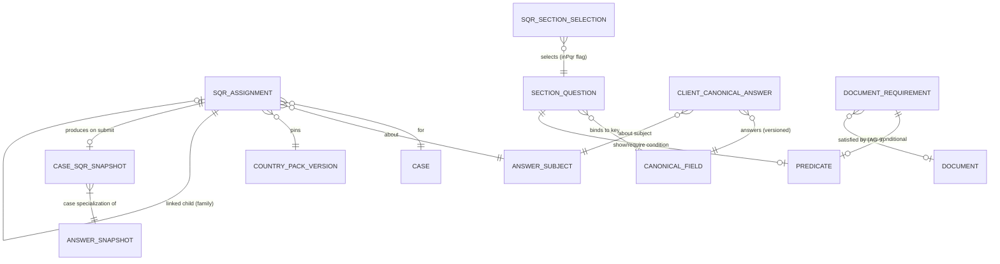

## 8. User Stories + Acceptance Criteria

**US-1 — Capture-once: PQR answers populate SQR at question level.**
- **Given** a prospect answered the PQR (the `inPqr` subset), **When** the full SQR is assigned on retainer, **Then** every PQR-answered `canonicalFieldId` opens prefilled-read-only and the SQR asks only net-new fields — with **no carry-over copy** (same `ClientCanonicalAnswer`s).

**US-2 — Cross-case prefill, freshness-gated.**
- **Given** a returning client with `CLIENT_LEVEL` facts on file, **When** a new case's SQR is assigned, **Then** fresh relevant facts prefill read-only, and **Given** a field is `mustReaffirmPerCase` or its `FreshnessRule` aged out, **Then** it is re-asked (prefilled + "confirm"), and confirming appends a new answer with fresh `effectiveAt`.

**US-3 — Conditional logic enforced server-side (one predicate contract).**
- **Given** the Spouse section's `SHOW`/`REQUIRE` predicate keys on `maritalStatus`, **When** the client picks "single," **Then** the section does not appear and its fields are neither required nor projected; **Given** the client tampers to submit a hidden `spouseName`, **When** the server processes it, **Then** the hidden field is ignored; **Given** "married" with `spouseName` omitted, **Then** submission is rejected as incomplete.

**US-4 — Single source: no re-keying into scoring or forms.**
- **Given** DOB, IELTS sub-scores, and passport number typed once, **When** the client submits, **Then** they are current `ClientCanonicalAnswer`s, AG-3 re-scores off the `CanonicalAnswerProjection`, and AG-7 auto-fills the same values — **no second data-entry step anywhere**; **Given** a firm-extension question marked unbound, **Then** it is stored but does not appear in scoring/forms.

**US-5 — Provenance & verification.**
- **Given** a `DECLARED` DOB, **When** I verify it against the passport scan, **Then** it flips to `VERIFIED`, links the document, records me + timestamp (audited), and drops off the needs-evidence worklist; **Given** a filing-critical fact still unverified under strict mode, **When** AG-7 attempts to file, **Then** filing is blocked with the fact named.

**US-6 — Verified data not silently clobbered.**
- **Given** DOB is `VERIFIED`, **When** a later re-answer declares a different DOB, **Then** the verified value is not superseded and a conflict is raised for review.

**US-7 — Multi-applicant: family declared once.**
- **Given** I declare "married, 2 dependants," **When** linked assignments generate, **Then** family size/accompanying counts are read from my declaration (not re-asked) and each subject gets member-specific questions; **Given** a dependant DOB making them age-ineligible, **Then** the contradiction is flagged, not projected.

**US-8 — Versioning + snapshot.**
- **Given** a client filling on pack v2, **When** SA-1 publishes v3 mid-flight, **Then** the client completes on v2 (assignment pinned) and submission takes a `CaseSqrSnapshot` (case specialization of `AnswerSnapshot`) stamping the v2 field versions; **Given** the response re-opened a year later, **Then** it re-renders/re-maps under its snapshot.

**US-9 — Targeted re-open.**
- **Given** a locked response with one wrong field, **When** I request changes targeting just that field with a note, **Then** the wizard highlights only that field (in the client's locale), and on re-submit it re-locks, the prior value is retained, and conflict detection re-runs.

**US-10 — Public surface leaks nothing, validates everything.**
- **Given** the portal fill endpoint, **When** an answer violates its `CanonicalField` type/validation, **Then** it is rejected and not persisted; **Given** abusive volume, **Then** per-IP/per-token rate limits engage; **Given** any firm-side view, **Then** Restricted fields are masked unless I hold `agent/sqr:reveal-pii` (reveal audited) and no PII appears in logs.

**US-11 — Submission advances the case idempotently.**
- **Given** a complete response, **When** the client submits, **Then** `sqr.submitted` fires, the case advances, the officer is notified, and answers project — all **once** even if the submit event is redelivered (idempotent on `(assignmentId, submit)`).

**US-12 — Firm extension: add a question without forking the pack.**
- **Given** I hold `agent/sqr:extend` and add a `FIRM_LOCAL` question "How did you hear about us?" placed in the trailing firm section with FR + EN labels, **When** I publish and assign a new SQR, **Then** the client sees it rendered indistinguishably from pack questions, the answer is stored append-only, appears in the review/`CaseSqrSnapshot`/export flagged firm-extension, and never feeds AG-3 scoring or AG-7 forms; **Given** I instead bind a `CANONICAL` extension to a `canonicalFieldKey` already asked by the combination's selection, **When** I publish, **Then** publish is blocked naming the duplicate (capture-once); **Given** an in-flight assignment, **When** I publish a new extension version, **Then** that fill is unaffected (pinned) and only new assignments pick it up.

**US-13 — Staff entry with attribution, not impersonation.**
- **Given** I hold `agent/sqr:answer-for-client` and the client tells me their NOC history by phone, **When** I enter it in staff entry mode, **Then** the answer validates against the same typed rules as the portal, lands `DECLARED` with `sourceJson` carrying my user id + `STAFF_CONSOLE` + `PHONE_CALL`, an audit entry is written, and the client's wizard later shows it as "entered by your consultant" for confirm/correct; **Given** the assignment is `SUBMITTED/LOCKED`, **When** I correct a typo'd passport number from the scan while holding `agent/sqr:verify`, **Then** the correction appends `VERIFIED` with the evidence link **without unlocking** and filing-readiness recomputes.

**US-14 — Conflict queue: divergent values resolved deliberately.**
- **Given** a `VERIFIED` DOB and a client re-answer declaring a different DOB, **When** capture runs, **Then** exactly one OPEN `AnswerConflict` (kind `VERIFIED_CONTRADICTION`) exists for that field, `sqr.conflict.raised` fires, and the projection keeps serving the verified DOB flagged as conflicted; **When** I open the queue, **Then** I see both values side-by-side with full provenance (who, when, channel, evidence) and Restricted values masked without `reveal-pii`; **When** I choose accept-incoming over the `VERIFIED` value, **Then** the action demands `agent/sqr:verify` + a reason before superseding (audited, append-only, `sqr.conflict.resolved`); **Given** the conflict is on a filing-critical field and still OPEN, **When** AG-7 attempts to file under strict mode, **Then** filing is blocked naming the conflicted fact.

## 9. Edge Cases & Validations

- **Conditional requiredness bypass** -> hidden field not required/not projected; tampered hidden answer ignored server-side; conditionally-required-but-missing blocks submit (BR-6).
- **Toggling a branch (married->single->married)** -> spouse answers retained (append-only), excluded while hidden, restored if re-shown — no ghost spouse, no data loss.
- **Stale prefill** -> `FreshnessRule`/`mustReaffirmPerCase` forces re-ask; never silently trusted (BR-4).
- **Prospect-stage PQR with no program pair** -> resolves via `tentativeProgramNodeKey` (AG-3 pathway) or the country-level program-null default selection; answers carry forward at conversion when the immutable program pair is set (BR-3, §3.4).
- **Pack published mid-flight** -> in-flight stays on pinned version; new version applies to new assignments only (BR-11).
- **Old response under superseded field versions** -> re-renders/re-maps via `CaseSqrSnapshot` stamped versions.
- **Mapping conflict with verified data** -> flagged `CONFLICTING`, not clobbered; verified beats unverified (BR-8).
- **Unbound firm-extension question** -> stored, flagged "won't feed downstream," excluded from scoring/forms (BR-2).
- **Question referencing a removed/renamed canonical key** -> impossible at runtime: SA-1's publish-time validator (Doc 1 §5.13.1) blocks it before publish.
- **Cross-applicant contradiction** -> flagged, not projected (BR-10).
- **Expired/locked token** -> access denied (non-leaking message); extend/regenerate restores, answers preserved (BR-12).
- **Regenerated token** -> old token dies, new reaches the same assignment + answers; no data loss.
- **Partial submit** -> only if firm-enabled; otherwise blocked with a deep-linked missing-items list over the conditional graph.
- **Locale missing a translation** -> fall back to the country's required base locale (never a blank label); SA-1 surfaces the coverage gap (Doc 1 §5.13 `LocalizedLabel`).
- **Document blurry/wrong** -> AG-9 reject-with-reason (localised); client re-uploads without unlocking the SQR.
- **Document in scan / quarantined** -> presents through AG-9's `Document.status` (Uploaded/Scanning) + the orthogonal `scan_status` sub-field; rendered "awaiting clean re-upload," never counted as Received/Verified (AG-9 §6).
- **Reuse of an existing valid document** -> resolver attaches it instead of re-requesting (derived checklist).
- **Portal endpoint abuse** (flood / oversized / injection / invalid token) -> rate-limited / size-capped / schema-rejected / token-denied; nothing persisted.
- **Submit event redelivery** -> idempotent on `(assignmentId, submit)`; case advances + projection runs once.
- **Autosave race / concurrent supersede** -> the §5.4 partial-unique index guarantees one current answer per key; the loser retries against the now-current row — never two current answers.
- **Computed/derived field** -> read-only in the wizard; recomputed server-side; never client-trusted.
- **Huge repeating group** (30 prior addresses) -> `ClientFactRecord` rows paginated/virtualised; server validates the collection; no unbounded payload.
- **Firm extension referencing a canonical key absent from the pinned pack** -> firm-side publish validator blocks it (AG-8-30) — same never-dangle guarantee as SA-1 content.
- **Extension retired mid-flight** -> in-flight assignments keep their pinned extension set; captured answers retained forever (AG-8-33).
- **Staff and client typing the same field concurrently** -> the §5.4 partial-unique current-answer index serialises the writes (loser retries against the now-current row); if the values diverge on a filing-critical field, a `STAFF_CLIENT_DIVERGENCE` conflict is raised instead of a silent last-write-wins (AG-8-38).
- **Duplicate conflict on the same field** -> impossible: partial-unique one OPEN `AnswerConflict` per `(firm_id, subjectId, field)`; a new divergence while one is OPEN updates the incoming side, never fans out rows.
- **Conflict resolution event redelivered** -> idempotent on `(conflictId, transition)`; the supersede/verify applies once.

**Validation doctrine.** Every authoring action, every client answer, every config is validated by **schema** (Zod / the `CanonicalField.validationJson` + the §5.13.1 closed predicate grammar), never ad-hoc if/else; reject early with a localised message; never persist on failure.

## 10. Permissions (LOCAL `agent/*`)

Default-deny, additive, always within the caller's `firm_id` (Doc 1 §4). One resource namespace per module (`agent/sqr`), one colon grammar `agent/<resource>:<action>` (Doc 1 §4.1). The client-facing fill is **not** an `agent/*` permission — it is authorised by the capability token (Doc 1 §4.6) and the portal record-level authz + portal RLS dimension (Doc 1 §2.5/§4.5), hardened per §11.

| Permission Key | Description |
|---|---|
| `agent/sqr:extend` | Add firm-specific questions/sections on the TENANT plane (extend only) |
| `agent/sqr:assign` | Assign SQR/PQR; mint/regenerate capability tokens |
| `agent/sqr:view` | View assignments/responses firm-side (Restricted PII masked) |
| `agent/sqr:verify` | Promote a fact `DECLARED -> VERIFIED` against a Document |
| `agent/sqr:answer-for-client` | Enter/correct answers on the subject's behalf in staff entry mode (attributed, audited; §3.11) |
| `agent/sqr:resolve-conflict` | Resolve `AnswerConflict`s from the queue (accept-incoming over `VERIFIED` additionally requires `agent/sqr:verify`) |
| `agent/sqr:request-changes` | Targeted/full re-open of a submitted response |
| `agent/sqr:reveal-pii` | Reveal masked Restricted PII (audited) |
| `agent/sqr:export` | Export responses/profile data (masked unless also `reveal-pii`) |

> All keys are scope `agent/*` (LOCAL), in the single `agent/sqr` resource namespace, CI-derived from this section into the seeded catalog (Doc 1 §4.4, ADR C3-D3). There is **no** `system/*` key here — global section/question/selection authoring is SA-1's (`system/pack:author` / `system/catalogue:author`, Doc 2 §10). Enforcement is route-level (`@RequirePermissions` + scope-aware RolesGuard, Doc 1 §4.2) AND object-level (`firm_id` + record-level authz, Doc 1 §4.5). Entitlement/plan gating layers on top (Doc 1).

## 11. Scalability · Security · Performance

**Scalability.** Config-driven and pack-driven by construction (Doc 1 §5): sections, questions, conditions, bindings, document requirements, and translations are GLOBAL data SA-1 authors — a new country or pathway is *shipping a pack*, not changing AG-8 code; single-country/single-locale is the degenerate case. Cross-cutting (notes/tasks/documents/audit/notifications) extends by EntityTypeRegistry row, zero migrations (Doc 1 §5.8). Mapping/re-score/export/reminder fan-out run on BullMQ; workers scale horizontally; the pinned-version section tree is cacheable per `(packVersionId, sectionSelectionVersion, locale)` (immutable). Read budgets per Doc 1 NFR (read p95 <= 300ms; answer-save p95 <= 400ms); repeating groups and lists cursor-paginated, no unbounded fetch.

**Security (this is the most sensitive client-facing surface).**
- **External surface, hardened.** Portal fill/upload/read endpoints are capability-token authorised: per-IP + per-token rate limits, payload caps, bot mitigation, strict server-side validation, gated on a valid non-expired non-locked token resolving to one assignment/`firm_id`/client-subject (Doc 1 §4.6).
- **Tenant + portal isolation by construction.** Firm data RLS-scoped on `firm_id` (forced, Doc 1 §2.2); the portal's second RLS dimension on the client-subject GUC backstops client-to-client isolation (Doc 1 §2.5) — a query bug cannot cross firm OR client. Presigned URLs bound to ownership-checked records (Doc 1 §2.5 — closes the prototype IDOR).
- **Restricted PII = crown jewels.** Fields tagged `isRestrictedPii` (passport/travel-doc, SIN/foreign equivalents, financials, admissibility) are field-encrypted under the field's `retentionClass` sub-key (Doc 1 §7.1), masked by default firm-side, revealed only with `agent/sqr:reveal-pii` (audited), never in logs/traces.
- **Server validates everything.** No raw-answer persistence; each answer is type-checked against its `CanonicalField` and the conditional graph.
- **Audit + consent.** Assign/verify/unlock/reveal/export write immutable hash-chained audit entries (Doc 1 §7.5); intake timestamps the client's consent and renders the SA-1 `RegulatorConfig` no-guarantee disclaimer in-locale.

**Performance.** Mapping is incremental (process changed answers) and the projection/re-score/form-fill triggers are **async** off the submit path so the wizard returns fast. `sqr.submitted`/`sqr.answer.captured` are at-least-once with idempotent consumers (keyed on assignment+event, Doc 1 ADR C4-D2) so redelivery never double-advances. Indexes per §7.

## 12. Reference Note (exists / NEW / CHANGED)

> **Build framing:** greenfield (Doc 1 §1.8); the existing private codebase is design-provenance only. The "exists today" notes below are informational, not a parity obligation.

**Design provenance (informational).** A `smart-questionnaire` prototype resolves a case by `sqrLinkCode`, serves ordered Mongo `Form` sections + ordered required documents, lets the client save/submit (sets `sqrSubmittedAt`/`sqrLocked`, advances `caseProgress`), supports inline document upload via public link-validated presigned URLs, and has lock/edit-access primitives + `familyCases`/`parentCaseId`. A thin `prospect-questionnaire` (PQR) preview is read-only. Honest gaps in the prototype: answers are an untyped Mongo blob with no canonical binding (so they feed neither the Qualifier nor forms — everything is re-keyed by hand); no conditional logic; no versioning; the config is global (no tenant key); no answer validation; no provenance/verification; client endpoints are `@Public()` with no rate-limiting/masking and PII is logged; firm endpoints are bare `JwtAuthGuard` with no `agent/sqr:*` set.

**NEW (target-state, this module's build).**
- The **SQR/PQR runtime engine** over the Doc 1 §5.5 section schemas: resolve the SA-1-published selection for a combination, prune by §5.13.1 predicates, **subtract known answers** (capture-once), render the remainder.
- **`SqrAssignment`** + capability-token assignment, prospect-stage PQR via `tentativeProgramNodeKey`/country-default, multi-applicant fan-out, targeted re-open.
- **Firm-extension authoring** (§3.10): the TENANT-plane `FirmQuestionExtension` workspace — typed definitions reusing the §5.3 vocabulary, `CANONICAL`/`FIRM_LOCAL` binding, firm-side publish validation, versioned + assignment-pinned, export-included; never mutates GLOBAL content.
- **Staff-side answer entry + conflict queue** (§3.11): attributed on-behalf entry (recorder ≠ declarant), lock-independent corrections, and the `AnswerConflict` queue with four resolution verbs — the console-side realisation of the `CONFLICTING` state *(spine enum + store accommodation pending Doc-1 Amendment A4-4 / F4; conflict events pending A4-2 / F2; non-human principals pending A4-1 / F1)*.
- **The §5.13.1 predicate evaluator** on the intake path (server-authoritative show/require), reusing the one platform contract — no new DSL.
- **Capture into `ClientCanonicalAnswer`** (append-only, typed, provenance) and the **`CanonicalAnswerProjection`** read for AG-3/AG-7; conflict detection (verified beats unverified).
- **Provenance/verification** (`DECLARED -> VERIFIED` against a Document) + filing-readiness gate.
- **Cross-case prefill** (relevance + `FreshnessRule`/`mustReaffirmPerCase` gating).
- **Bilingual wizard** (Client Portal), **public-surface hardening**, **field-level encryption + masked/audited reveal**, **`agent/sqr:*` + scope-aware RolesGuard**, **idempotent** events, **completeness over the conditional graph**, **`CaseSqrSnapshot`** at submit (case specialization of `AnswerSnapshot`), export.

**CHANGED (reconciliations from the source AG-8 draft — normative).**
- **Owner of the default questionnaire/pack:** "AG-15" -> **SA-1 (Doc 2)**. AG-8 consumes; it never authors global content.
- **`QuestionnaireDefinition`/`Question`/`ProfileBinding`/`ContactProfile`** -> the Doc 1 §5 spine: `SectionQuestion` bound to `canonicalFieldKey`; answers in `ClientCanonicalAnswer`; profile = derived `CanonicalAnswerProjection` (ContactProfile **retired**, ADR C2-D4).
- **Untyped Mongo `Form.data`/`filledData`** -> typed canonical answer store (Mongo eliminated platform-wide, ADR C1-2).
- **A per-firm authored definition** -> SA-1-authored GLOBAL content + firm **TENANT-plane extension only** (Doc 1 §5.5, Doc 2 BR-7).
- **A new conditional-rule language** -> the ONE §5.13.1 `Predicate` contract.
- **"Populate-from-PQR" as a carry-over mapping** -> structural: PQR is the `inPqr` subset of SQR (same answers, no copy).
- **Reproducibility snapshot** -> the immutable `AnswerSnapshot` (prospect-or-case scoped, Doc 1 §5.4), with `CaseSqrSnapshot` as the case specialization AG-8 produces at submit.
- **`sqrLinkCode` link** -> capability token (Doc 1 §4.6); **WCAG 2.1 -> 2.2 AA** (Doc 1 NFR).

## 13. Open Questions / [FOUNDER-CONFIRM]

**Resolved to IN (no phasing — one frozen scope):** single-source capture into the canonical store; ask-only-remaining + populate-from-PQR + cross-case prefill; the §5.13.1 predicate evaluator; bilingual EN/FR wizard; definition/pack-version pinning + `CaseSqrSnapshot` (via `AnswerSnapshot`); provenance/verification; multi-applicant linkage; targeted re-open; field-level encryption + masked/audited reveal — all IN.

**[FOUNDER-CONFIRM] (business/domain — machinery is fixed regardless):**
1. **Filing-gate strictness default.** When a must-verify-before-filing fact is unverified, does AG-7 **hard-block** or **warn** by default? (Per-firm configurable either way; pick the out-of-box default.)
2. **Spouse privacy model.** Can a principal see a linked adult spouse's Restricted-PII answers, or are they firm-only? *Proposed default: spouse Restricted fields private from the principal; firm sees all.*
3. **Partial submit default.** Block submit until complete, or allow partial-with-gaps? *Proposed default: block; firm may enable partial.*
4. **PQR-on-prospect scope.** PQR is structurally a subset of SQR (Doc 2 §3.5) so its answers already carry into the case with no re-ask; the prospect-stage question set resolves via `tentativeProgramNodeKey` (AG-3 pathway) or a country-level program-null default (§3.4 — machinery fixed). Confirm the **pre-retainer** PQR question subset per pathway (which `inPqr` flags) and whether a country-level default PQR should exist — this is SA-1 content authored by the founder/Immigration-SME.
5. **Document verification depth.** Human "I checked it" flag now; OCR/assisted typed-value-vs-scan cross-check is a **named later deferral** (out of base build). Confirm human-flag is sufficient for launch.
6. **`mustReaffirmPerCase` / `FreshnessRule` values** per field (which facts drift and how fast — e.g. current address, language-test validity) — SA-1 content (founder/Immigration-SME, Doc 1 §5.3).

> **Routed to the Immigration-SME (founder is final authority), as SA-1 content — not AG-8 machinery:** the section/question set and `inPqr` subset per combination; the correct `canonicalFieldKey` bindings for immigration facts (NOC/occupation, ECA, language-test->CLB); which fields are filing-critical; the FR-CA phrasing of consent + the no-guarantee disclaimer (`RegulatorConfig`); and the dependant-eligibility/family-unit rules the §3.7 consistency checks evaluate. AG-8 builds the structure and behaviour; the immigration *values* live in the SA-1 Country Pack.

---

# Module AG-9: Document Management

> **Plane:** Agent/Firm console (LOCAL). **Tenant key:** `firm_id` (forced RLS per Doc 1 §2.2). **What this module owns:** the realised **Document instance** and its **10-state runtime lifecycle** — the document engine that Doc 1 §5.6 and Doc 2 SA-1 §3.6 explicitly DEFERRED to this wave. **What it consumes (does not re-spec):** the `DocumentType` + `DocumentRequirement` masters authored by the Super-Admin in Doc 2 SA-1 §3.6 over the Doc 1 §5.6 axes; the `EntityTypeRegistry` (Doc 1 §1.2/§5.4); the S3 object-storage rail with SSE-KMS, firm-prefixed keys, presigned-only access (Doc 1 §1.4, §7.7); the per-subject KMS hierarchy (Doc 1 §7.1); the per-firm hash-chained audit spine (Doc 1 §7.5); the SA-11 retention/legal-hold/disposal orchestrator (Doc 1 §7.4/§7.6); the Minder, Mailer, Messenger, Signer, Filler/Drafter Doers; and the canonical event dictionary (Doc 1 §6). **Country:** the document taxonomy is pack-driven; this engine is content-neutral. The immigration *values* (which types, which require translation, retention floors) are the founder's deferred Country-Pack deliverable — marked [FOUNDER-CONFIRM].

## Module Index

- **§1 Purpose & Goal** — the firm's single secure, immigration-aware, compliance-native home for every file in a matter; the shared polymorphic Documents subsystem every module plugs into.
- **§2 Users & Jobs-to-be-Done** — Case Officer (protagonist), Intake/Sales, RCIC/Consultant, Manager, Owner, Accounts, Client (portal counterparty).
- **§3 Functional Design** — the polymorphic instance; upload; request-from-client; versioning/supersede; AV-scan + quarantine; pack-driven types/tags; secure storage & serving; preview & annotate; status + translation/notarisation flags; same-client reuse; content-hash integrity & access audit; retention & disposal (SA-11); Drafter/Signer hooks; the AG-7 checklist interface.
- **§4 Detailed Functional Requirements** — AG-9-1 … AG-9-31, each testable, tagged (consume) / (engine).
- **§5 Business Rules & Logic** — BR-1 … BR-16 (tenant isolation, polymorphic ownership, bytes-never-public, scan-gated trust, non-destructive versioning, guarded transitions, pack-driven types, server-side validation, audit-everything, reuse-as-link, content-hash, e-sign immutability, retention via SA-11, transactional request loop, checklist boundary, carry-forward).
- **§6 States & Lifecycle** — the 10-state Document instance lifecycle + the orthogonal scan sub-state (Scanning/Quarantined/SCAN_PENDING) the single-status contract requires consumers to honour.
- **§7 Key Entities & Fields** — `Document`, `DocumentVersion`, `Media`, `DocumentLink`, `DocumentAccessLog`, `DocumentAnnotation`; the events emitted/consumed table.
- **§8 User Stories + Acceptance Criteria** — US-1 … US-11.
- **§9 Edge Cases & Validations** — disallowed-type, dedup, verify-before-scan, scan-down, quarantine, cross-tenant, raw-key-sign, URL-expiry, disposal-vs-hold, carry-forward, and more.
- **§10 Permissions** — the per-action `agent/document:*` catalog (download separated from status handling; dispose = a firm-scoped REQUEST, never direct key destruction).
- **§11 Scalability · Security · Performance** — entity-agnostic reuse, pack-driven taxonomy, region-configurable storage, scan-gated trust, presigned-only I/O, indexed/paginated panels, Redis summary cache.
- **§12 Reference Note** — exists / NEW / CHANGED against the design-provenance prototype.
- **§13 Open Questions / [FOUNDER-CONFIRM]** — taxonomy, retention floors, Restricted-PII metadata set, bilingual copy, prospect-stage required set, entitlement tiers; architect sign-off items.

## 1. Purpose & Goal

**What it is.** AG-9 is the firm's single secure home for every file in an immigration matter — passports, ECAs, language results, proof-of-funds, employment letters, police certificates, medicals, and the firm's own generated agreements and submission packages. It is the **shared, polymorphic Documents subsystem** every other module plugs into: a prospect's pre-assessment files (AG-2), a client's identity documents, and a case's evidentiary record all live in one subsystem, attached by `(entityType, entityId)` and validated against the `EntityTypeRegistry` (Doc 1 §1.10 AC-1.3). AG-9 is where files are **requested, received, scanned, reviewed, versioned, reused, and ultimately retained or disposed** under the law.

**The business outcome.** Immigration cases are won or lost on documents. Firms bleed time and risk on three failures: (1) **chasing clients** over email and losing track of what is outstanding; (2) **handling a stale version** — submitting an expired passport or an old bank letter because nobody knew a newer one arrived; and (3) **security/compliance exposure** — passports and financials sitting in inboxes and shared drives with no access trail, no scan, no retention discipline. AG-9 makes "the right document, verified and current, is always one click away — and nothing sensitive is ever mishandled" structurally true: a portal request loop, a per-document state the officer trusts, automatic versioning so the current file is unambiguous, AV scanning before anything is opened (Doc 1 §7.7), ownership-bound short-lived presigned access with a read-level audit, and SA-11-driven per-country retention.

**Why it is world-class.** A generic DMS is a folder with upload/download. AG-9 is **immigration-document-aware and compliance-native**: document *types* and *requirements* come from the Country Pack (Doc 2 SA-1 §3.6), every document carries **translation and notarisation** flags because immigration regularly demands certified translations, the client-facing **request loop** is built in, files are **generated by the Drafter and signed by the Signer** in-house (no third-party rail handling the most sensitive PII a person owns), and security is the default — SSE-KMS at rest under the subject key (Doc 1 §7.1/§7.7), presigned URLs bound to an ownership-checked record (Doc 1 §4.5), AV-scan-before-availability, content-hash integrity, and a read-level access trail that can prove, for a regulated profession, exactly who opened a client's passport and when.

**How it ties to the journey.** AG-7 (Case Management) declares *what is required* — the **derived checklist view** resolves the effective `DocumentRequirement` set, evaluates `ANSWER_CONDITIONAL` rules against the answer store, and joins to AG-9 `Document` rows by status (Doc 1 §5.6). AG-9 is *where each document actually lives and moves through its states*. Pre-conversion a document attaches to the prospect; on conversion (AG-2) it re-parents/relinks to the client Party; during delivery it links onto the case, feeds **form mapping / the Filler** and the submission package, gets **e-signed** via the Signer (AG-5), and is surfaced to the client in the **portal** (Client Portal console). AG-9 owns the document object, versions, security, and lifecycle; it exposes a clean interface the checklist consumes.

**Global ambition.** The same subsystem serves a Canada-only solo RCIC and a multi-country firm: types and required-translation rules come from the active pack, names are **bilingual (EN/FR…)**, retention windows are per-country SA-11 config, and storage is region-configurable via the Doc 1 §2.9/§7.7 region seam. Single-country/single-language is the degenerate case.

## 2. Users & Jobs-to-be-Done

| Role | Primary job in AG-9 | Representative JTBD |
|---|---|---|
| **Case Officer / Paralegal** (heaviest user) | Get every required document in, verified, and current. | "Open a case and see at a glance which documents are received, verified, missing, or rejected — so I know what is blocking the file." · "When a client sends a newer passport it should supersede the old one automatically so I never submit the stale one." · "Verify a bank letter in one click, or reject with a reason that goes back to the client, without leaving the screen." |
| **Intake / Sales Rep** | Collect the few documents to qualify a lead. | "While assessing a prospect, request an ECA and IELTS and see when they arrive — without spinning up a full case." |
| **RCIC / Consultant** | Trust the evidence behind their advice and signature. | "Before submission, open any document, see it is the verified current version, and know it was scanned clean and who handled it." · "Generate and sign a retainer in-house, filed back automatically." |
| **Manager** | Keep collection moving and compliant. | "See which cases are stuck waiting on documents and which clients are unresponsive, so I can intervene." · "When an audit or complaint comes, show a complete access trail for any sensitive document." |
| **Owner / Principal RCIC** | Own the firm's data-protection posture. | "Passports and financials encrypted, access-logged, retained only as long as the law allows, disposed on schedule — by the system, not by memory." |
| **Accounts / Billing** | Touch documents at the edges. | "An invoice/receipt is filed against the client like any other document; signed agreements are available." |
| **Client** (Client Portal console — counterparty of the request loop, not an agent role) | See what is needed; upload easily; trust it is safe. | "A clear list of what is outstanding and a way to upload from my phone camera; my passport handled securely." |

**Design implication.** The **Case Officer is the protagonist**: the per-case **document panel** (status-grouped, one-click verify/reject/request, version-aware) is designed for them; the **request-from-client** loop for the officer↔client handoff; the Owner/Manager get the access audit and retention surfaces. Permissions (§10) separate "handle a document" from the sensitive powers — **download/preview, delete, waive, reveal, legal-hold, dispose** — because not every staff member should open a passport or dispose of a record.

## 3. Functional Design

### 3.1 The polymorphic document instance (the foundation)

**How it works.** A `Document` is an entity-agnostic record that points at a file and attaches to *any* owner via `(entityType, entityId)`, validated against the platform `EntityTypeRegistry` (membership + target-exists + `firm_id` match, Doc 1 §2.3/§5.4). A `Document` carries the **status**, the consumed `documentTypeId` (the pack's `DocumentType`, Doc 1 §5.6), the optional `requirementId` it satisfies (the pack's `DocumentRequirement`), translation/notarisation flags, expiry, and the owner reference; it holds no bytes. A `DocumentVersion` points at the stored object (the S3 rail, Doc 1 §1.4); a `Document` has exactly one current version and a retained read-only history. A `DocumentLink` lets the *same* document serve multiple entities of the **same client** (§3.10).

**World-class behaviour.** Adding a new owner type is one `EntityTypeRegistry` row and zero migrations (Doc 1 AC-1.3) — this is the architectural reason AG-9 is a reusable subsystem, not a feature of one module. `Note · Task · Reminder · Communication · AuditLog · Notification` attach to a `Document` the same polymorphic way (Doc 1 §1.1), so "a note on this passport" or "a reminder before it expires" needs no AG-9 schema.

**Data flow.** Every polymorphic write resolves `(entityType, entityId)` against the registry and asserts the target shares `firm_id`; RLS (Doc 1 §2.2) backstops both the attachment row and the target.

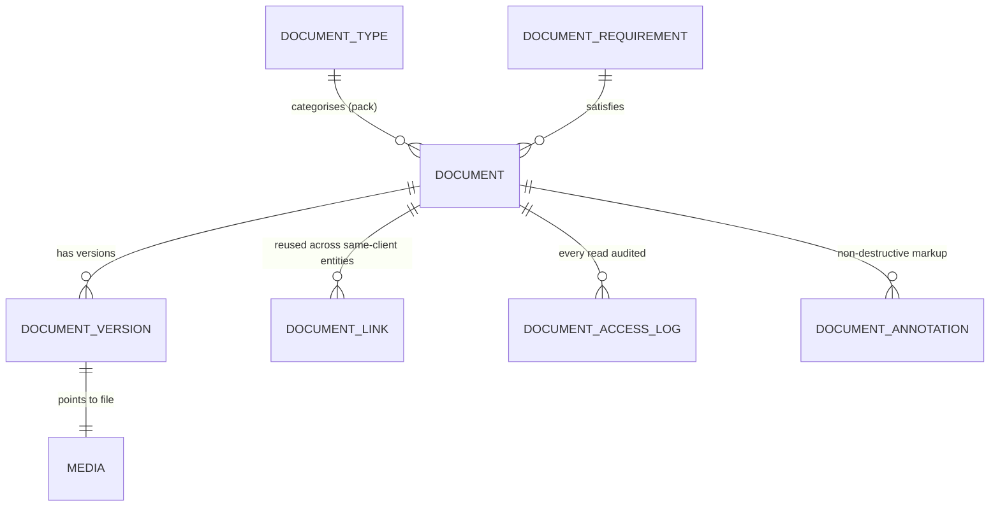

### 3.2 Upload (drag-drop, bulk, mobile) — getting a file in is effortless and instantly safe

**How it works.** Upload is **direct-to-storage** via a short-lived presigned PUT: the caller requests an upload slot, the API validates type/size and resolves the owner, issues the signed URL + firm-prefixed key, the browser/mobile uploads straight to S3, then an "attach version" call creates the `Media` + `DocumentVersion` (status `UPLOADED`) and enqueues the AV scan (Doc 1 §1.4, §7.7). The API never proxies bytes. Three entry modes: (1) **drag-drop / picker** on the panel or a specific required item; (2) **bulk upload** mapping each file to a checklist item (filename/type auto-suggest, manually confirmable) with per-file progress and scan badge; (3) **mobile camera capture** (portal + officer mobile) with multi-page assembly where configured — same signed-URL + scan path.

**World-class behaviour.** Validation happens **at slot-issue time, server-side**, on both the declared and sniffed (magic-byte) content-type against a per-type allow-list and a per-type size cap (Doc 1 §7.7, AC-7.7.7) — a caller cannot smuggle an `.exe`/HTML/SVG/polyglot into a "passport" slot, and nothing persists on rejection. For fixed-type slots the PUT content-type is **locked**. Every upload is a **version, not an overwrite** (§3.4). Nothing is `RECEIVED` until the scan returns clean (§3.5).

**Data flow.** Request slot → validate type/size + resolve `(entityType, entityId)` + `firm_id` → presigned PUT (short TTL, firm-prefixed key, content-type locked, SSE-KMS enforced) → direct upload → attach-version creates `Media` (key, size, SHA-256 hash) + `DocumentVersion` (`UPLOADED`) + enqueues AV scan → emits `document.version.added`.

### 3.3 Request-from-client (portal request list + status) — ask once, in the portal, watch them arrive

**How it works.** The officer selects required documents (from the checklist or ad-hoc) and **requests** them. Requesting sets each `Document` to **Requested** with `requestedAt` and a due date; surfaces them as a living request list in the Client Portal console; sends the client a localized notification via the **Mailer** (and, when enabled, the **Messenger**); and tracks per-item status so the officer's panel reflects Requested → Uploaded → Received/Verified/Rejected without a single email thread. The portal fetch is bound to the client subject by the portal second RLS dimension (`app.current_client_subject`, Doc 1 §2.5) — never a public-by-id read of a guessable id; any public link uses an unguessable capability token (Doc 1 §4.6).

**World-class behaviour.** The request loop is a first-class feature, not a mail-merge: the client sees a list that updates as they upload; rejecting a document (§3.9) can **auto-re-request** a clean copy with the reason in the client's locale. Requests are **transactional** messages (no marketing consent needed); any reminder cadence respects consent and quiet-hours via the Minder/Messenger. **Bulk request** the whole outstanding set in one action; per-item status still tracked individually.

**Data flow.** Officer requests N docs (→ `REQUESTED` + `requestedAt` + due) → resolve client email/locale from the owner Party → Mailer/Messenger localized send → portal exposes the `REQUESTED` set (subject-scoped per §2.5) → client uploads (§3.2) → status advances → `document.requested` and `document.received` events; the request is audited (who requested what from whom).

### 3.4 Versioning & supersede — the current correct file is never in doubt

**How it works.** Re-uploading against an existing `Document` creates a new `DocumentVersion`; the prior is **Superseded** (retained, read-only, clearly marked). The `Document` always resolves to its current version for previews, form mapping, the submission package, and the portal, with the full history one click away (uploader, date, scan result, content-hash). Verification attaches to a *version*: a new version resets the `Document` to **Received** (re-verification required) so a swapped file is never silently trusted on the prior verification.

**World-class behaviour.** Non-destructive by construction — "delete a file" never means "lose history" (hard deletion is the separate, permissioned, audited disposal action, §3.12). Because the current version is the single source downstream, the firm structurally cannot submit a superseded passport. "Verified" always means "this exact current file was checked."

**Data flow.** New upload → new `DocumentVersion` (incremented `versionNo`, `isCurrent = true`) → prior `isCurrent = false` (Superseded) → `Document.status` resets to `RECEIVED` after a clean scan → `document.version.added` + officer Notification.

### 3.5 Virus/malware scan + quarantine — nothing dangerous is ever opened or served

**How it works.** Every uploaded file is **AV-scanned asynchronously before it becomes available** (Doc 1 §7.7, on BullMQ, Doc 1 §1.4). On version attach the document presents at status **Uploaded**, then **Scanning**; the file is **not servable** while scanning (no presigned GET is issued). A clean result advances the version's `scanStatus` to clean and the `Document` to **Received** (eligible for verification, preview, form use), stamping the content hash. An **infected** result sets the version `scanStatus = infected` (the **Quarantined** scan sub-state): the version is never served, the document is flagged, the officer is notified, and (for a portal upload) the client is asked to re-upload; the `Document.status` itself returns to the pre-clean pre-existing state (Required, or the prior current version's state) so the single-status contract never reads "Received/Verified" for a quarantined item — see §6 for how consumers render this. Quarantined bytes are scheduled for disposal. A scan **error/timeout** holds the version at `scanStatus = pending` (the `SCAN_PENDING` sub-state) with a clear "scan unavailable — not yet usable" badge and retry; it never silently becomes Received.

**World-class behaviour.** **Scan-gated trust** — "Received" *means* "scanned clean," a single trustworthy contract for every consumer; a passport that has not passed scan cannot be verified or packaged. Quarantine, do not delete-and-forget (the audit/security record is kept, disposed on schedule). Async, never blocking — upload returns immediately with a scanning badge.

**Data flow.** `Uploaded` → `Scanning` → scan job → clean: Received + scan metadata + content hash + `document.scan.passed`; infected: Quarantined sub-state (`scanStatus = infected`) + no-serve flag + Notification + (portal) re-request + `document.scan.failed`; error: `scanStatus = pending` (`SCAN_PENDING`) + retry. Every scan outcome is audited (Doc 1 §7.5).

### 3.6 Categorise & tag (pack-driven types) — every document knows what it is, in the country's language of evidence

**How it works.** Each `Document` carries a `documentTypeId` drawn from the active Country Pack's `DocumentType` catalogue (Doc 2 SA-1 §3.6; entitlement-gated to the firm's activated countries) and, where it answers a checklist item, the `requirementId` of the satisfied `DocumentRequirement`. The consumed type/requirement metadata drives sensible defaults: whether **expiry** is relevant (`expiryRelevant` + `expiryRuleJson` → the Minder, Doc 1 §5.6), whether a **certified translation** or **notarisation** is typically required, the **bilingual label** (the pack's `LocalizedLabel`), and how the document maps into the Filler (AG-7 form mapping). Beyond the type, free-form **tags** allow firm-specific grouping ("spouse," "principal applicant," "round 2").

**World-class behaviour.** Pack-driven, not hardcoded — a firm that activates Australia immediately gets Australian document types with no deploy. Type → behaviour: selecting a passport type auto-prompts expiry and arms a renewal Minder horizon; a translation-required type auto-seeds the translation flag to "required." Bilingual names: a Quebec client's portal shows the French label — same `Document`, one record.

**Data flow.** Document create → `documentTypeId` validated against the active pack within entitled countries → consumed type/requirement metadata seeds expiry/translation/notarisation defaults + bilingual label → indexed for filtering and for the Filler's field mapping.

### 3.7 Secure storage & serving (signed, short-lived, tenant-prefixed, SSE) — bytes never public, never long-lived, never cross-tenant

**How it works.** File bytes live in the S3 object-storage rail (Doc 1 §1.4) under the Doc 1 §7.7 discipline. AG-9 consumes, does not re-spec, this substrate: **direct upload/download via short-lived presigned URLs only** (the API never proxies bytes); the bucket denies public reads; every presigned URL is **bound to an ownership-checked record** — the service resolves the storage key *from* the document row after `assertSameFirm`/ownership checks and **never signs a caller-supplied key** (Doc 1 §4.5, AC-7.7.4, fixing the reference-prototype IDOR). Object keys are **firm-prefixed** (`firm/{firm_id}/{entityType}/{entityId}/{uuid}`), objects are **SSE-KMS encrypted at rest under the subject key** (Doc 1 §7.1/§7.7), and served objects carry **safe serving headers**: `Content-Disposition: attachment`, `X-Content-Type-Options: nosniff`, and a restrictive CSP (Doc 1 §7.7, AC-7.7.8) so a stored file cannot execute in a victim's session.

**World-class behaviour.** Security-by-default, not opt-in — there is no path that serves a public, durable, or unscoped link. Vendor/region-agnostic: a firm needing Canada-resident or EU-resident storage is a region-seam config decision (Doc 1 §2.9/§7.7), not application code.

**Data flow.** Upload: presigned PUT (firm-prefixed key, SSE-KMS, type locked, short TTL). Download/preview: ownership check (`firm_id` + record) → access-audit write (§3.11) → presigned GET with safe serving headers → direct-from-rail fetch.

### 3.8 Preview & annotate — review without downloading; mark up without changing the file

**How it works.** A document opens in an **in-app preview** (PDF and common image types) via a short-lived ownership-bound presigned GET — the officer reviews without spilling PII to disk, and every preview is **access-audited** (§3.11). On top of the preview the officer can add **annotations** — comments pinned to the document (and, where supported, a page/region) — stored as a separate `DocumentAnnotation` layer that **never alters the original bytes**. Annotations are visible to staff and, where the firm chooses, surfaced to the client as feedback ("this scan is cut off — please re-take page 2").

**World-class behaviour.** Review-in-place: verify/reject controls live on one screen, keyboard-reachable (WCAG 2.2 AA, Doc 1 NFR). Non-destructive markup: the evidentiary original is pristine — a regulated profession needs this. Annotation → action: a "please re-take" annotation can trigger a re-request (§3.3), closing the loop. Annotations are **version-pinned** so history is preserved.

**Data flow.** Open preview → ownership check + access-audit write → presigned GET → render. Annotate → `DocumentAnnotation` write (author, timestamp, page/region, text, `visibleToClient`) → optional re-request trigger → audit.

### 3.9 Per-document status + translation/notarisation flags — one trustworthy state, and the certifications immigration demands

**How it works.** Every `Document` carries one explicit status (the 10 states, §6) that **every consumer reads — the single-status contract** (Doc 1 §5.6): the checklist, the submission package, the portal, and the dashboard all read the same `Document.status`, never a private copy. Orthogonal to status, the current version carries a `scanStatus` sub-field (scanning / clean / infected / pending) that consumers MUST also honour: a Quarantined (`infected`) or `SCAN_PENDING` (`pending`) document is **present-but-unusable** and never counts as Received/Verified for the checklist or the portal outstanding list (§6). Alongside status, two certification flags immigration regularly requires: **translation** (`not_required | required | provided`, + linked translation document + translator/agency) and **notarisation/certification** (`not_required | required | provided`, + notary/commissioner detail), plus **expiry** (`expirationDate`) driving renewal Minder watches. Type/requirement metadata seeds defaults; the officer confirms.

**World-class behaviour.** Status is the single contract — no parallel "is it done?" tracking. Reject with a **mandatory reason** that travels: surfaced to the client (in their locale) on re-request. Waive / Not-Applicable are **explicit, reasoned, audited** decisions — never an ambiguous blank. Certification-aware: the firm can see "verified but translation outstanding," a real immigration blocker a generic DMS misses.

**Data flow.** Status change → guarded transition (§6) → stamp the relevant date + reason → translation/notarisation update → timeline + audit + Notification + `document.status.changed` for the Conductor.

### 3.10 Reuse a document across cases (same client) — upload a passport once; use it on every matter

**How it works.** A client's durable documents (passport, ECA, language result) belong to the **client Party**, not a single case. AG-9 lets the officer **link an existing client document to another case** via a `DocumentLink` — the *same* `Document` (one version set, one verification state, one content-hash) appears on multiple matters without re-upload or re-scan. The link is reference, not copy: updating the passport updates it everywhere; verification once counts everywhere. Reuse is scoped strictly to the **same client within the firm** — never across clients, never across tenants (enforced by the same-client check + RLS + the portal subject dimension, Doc 1 §2.5).

**World-class behaviour.** Single source of truth per real-world document — "which case has the latest?" is a non-question. No duplicate PII, no duplicate scan — fewer copies of sensitive files. This is the mechanism behind AG-2 conversion **carry-forward**: a prospect's documents re-parent/relink to the client on conversion, then link onto the case — the golden thread of evidence unbroken.

**Data flow.** Link → same-client check → `DocumentLink (documentId, entityType=CASE, entityId)` → the document renders on that entity's panel reading the shared version/status → audit. Unlink removes the link only, never the document.

### 3.11 Content-hash integrity & access audit — prove the file is unchanged, and who opened it

**How it works.** Two guarantees on the most sensitive files a firm holds. **Content-hash integrity:** on upload a SHA-256 of the bytes is computed and stored on the `Media`/`DocumentVersion` (Doc 1 §7.7) — it detects identical re-uploads (dedup offer), provides tamper-evidence (re-hash on read confirms the object is unchanged), and anchors the version's identity. (Distinct from the storage-key uniqueness, which dedups keys, not byte content.) **Access audit:** **every read** — preview, download, presigned-URL issuance — writes a `DocumentAccessLog` (actor, document, version, action, timestamp, `firm_id`), on top of the per-firm hash-chained `AuditLog` for *mutations* (Doc 1 §7.5). For a regulated profession the firm can answer "who opened this client's passport, and when?" — a PIPEDA-grade access trail.

**World-class behaviour.** Tamper-evident: a re-hash mismatch flags silent corruption or tampering. Read-level auditing, not just write-level — *looking* at a passport is itself a privacy-relevant event. Hash-based dedup recognises identical re-uploads rather than silently versioning. No PII in any log (Doc 1 §7.7 no-Restricted-in-logs scanner): logs carry IDs + `firm_id` only, never file content, read URLs, or email.

### 3.12 Retention & disposal (per-country, PIPEDA/Law-25) — keep what the law requires, dispose on schedule

**How it works.** AG-9 does **not** own the disposal engine — it consumes the **SA-11 governance plane** (Doc 1 §7.4/§7.6): each document type/matter resolves a **retention policy** (a country-configured retention class + window) computing a **disposal-eligible date** from a clock-start event (matter-closed / last-action / received). On eligibility, the SA-11 orchestrator (recovery window → legal-hold-beats-deletion → per-retention-class floor check → crypto-shred eligible class sub-keys → verified hard-delete → `DATA_DISPOSED` chained audit → disposal certificate) acts. Because documents are encrypted **under the subject's retention-class sub-key** (Doc 1 §7.1), disposal can **crypto-shred** — destroying the key renders the bytes unreadable even in immutable backups, while a `financial-7yr`-classed artifact is retained until its floor expires. **Legal hold always beats disposal** (Doc 1 §7.6). AG-9's responsibilities: surface the **retention/disposal review queue** and the **legal-hold toggle**, set the clock-start event on lifecycle transitions, record a firm-scoped **disposal REQUEST/approval** (the `agent/document:dispose` action authorizes/queues; it never destroys keys directly — §10), and tombstone the document record (metadata + audit retained for the record-of-disposal) once the SA-11 orchestrator reports the disposal complete.

**The scope seam (normative).** `agent/document:dispose` is a LOCAL `agent/*` key; the actual crypto-shred + `DATA_DISPOSED` chained audit runs on the **SA-11 system plane** under the elevated path (Doc 1 §7.4/§7.6), never as the firm principal — a LOCAL key cannot satisfy a system-plane operation (Doc 1 §4.1/§4.2). The firm action records a firm-scoped disposal request/approval; the SA-11 orchestrator executes the subject-key destruction. No `agent/*` route destroys keys directly.

**World-class behaviour.** Per-country, config-driven (the pack/SA-11 supplies windows; a Canada and an Australia matter dispose on their own legal schedules with no code change). Disposal is a record, not an erasure of accountability — the bytes go, the *fact* of compliant disposal stays. Hold-aware by construction.

**Data flow.** Retention class (pack) + clock-start event → disposal-eligible date (indexed) → SA-11 disposal job surfaces eligible items → officer/Owner approves the firm-scoped disposal request (propose mode) or auto (per firm policy) → SA-11 crypto-shred + verified hard-delete on the system plane → AG-9 tombstones the record; legal hold flag blocks the path. **Exact per-country retention values are a domain decision** → [FOUNDER-CONFIRM] (§13).

### 3.13 Generate-from-template (Drafter) + e-sign (Signer) hooks — the firm's own documents, produced and signed in-house, filed automatically

**How it works.** **Generate via the Drafter/Filler:** the firm produces documents from templates (retainers, engagement letters, cover letters, submission forms) — the Drafter merges client/case data from the single-source answer store (Doc 1 §5.4) into a template and **files the result as a typed, named `Document` version** on the right `(entityType, entityId)`, ready to send or sign, with no re-keying. **Sign via the Signer:** a generated or uploaded document can be sent for signature; on the canonical `envelope.signed` event (Doc 1 §6 — there is no separate completion event) AG-9 files the signed PDF back as a **distinct `[Signed]` copy** (the original never mutated), marked `isESigned` with the envelope id and a reverse pointer, and notifies the officer — under a **tenant re-check** (the filed copy's `firm_id` + parent are derived only from the re-fetched source row, never loose payload). The consumer is **idempotent**: redelivery files the `[Signed]` copy exactly once (keyed by envelope). The `envelope.signed` payload carries `retainerAgreementId` (the AG-5 entity FK) which AG-9 correlates to the source document.

**World-class behaviour.** In-house, no third-party rail — no per-envelope bill, no client PII leaving to a third party, no data-residency surprise. Distinct signed copy preserves immutability (the unsigned source and executed version both exist, auditable). "Document signed" and "the matter's signed agreement exists" are the same event, sourced from the Signer, never hand-asserted.

### 3.14 The checklist interface (AG-7 owns checklists) — a clean seam

**How it works.** Document **checklists** are owned by **AG-7** as a **derived view** over the pack's `DocumentRequirement` set joined to AG-9 `Document` rows by status (Doc 1 §5.6) — not by AG-9. AG-7 owns the **document-requirement checklist** specifically; AG-12 owns checklist COPY/content templates and AG-13 `TaskTemplate` owns work-item task checklists — three distinct surfaces, no overlap. The seam: **AG-7 → AG-9 (declare)** a required document → AG-9 creates a `Document` in **Required** with the requirement's type and the case's `(entityType, entityId)`; **AG-9 → AG-7 (report status)** the per-document status so the checklist computes completeness (`required-Verified ÷ required-total`) with **PRIMARY-blocks-readiness / ALTERNATIVE-satisfies-group / expiry-watch** invariants (Doc 1 §5.6) without re-implementing document state; **AG-9 → AG-7 (provide current file)** the current verified version by reference for the Filler / submission package. AG-7 reads exactly AG-9's 10-state enum and uses **Verified** as the satisfies-requirement state. AG-9 never decides *what a pathway requires*; AG-7 never stores files or re-implements status.

**World-class behaviour.** One document state consumed everywhere — the checklist's completeness, the portal's outstanding list, and the dashboard all read AG-9's status (the single-status contract). A new pathway's checklist is pack config; it produces AG-9 Documents through the same interface — no AG-9 change.

## 4. Detailed Functional Requirements

> Each is testable. **(consume)** = built on a Doc 1/Doc 2 contract; **(engine)** = the document-engine logic this module owns.

**Upload (3.2)**
- **AG-9-1 (consume).** Files upload **direct-to-storage** via a short-lived presigned PUT (Doc 1 §1.4); the API never proxies bytes.
- **AG-9-2 (consume).** Declared **and** sniffed content-type are validated against a per-type allow-list, with a per-type size cap, **at slot-issue, before storage**; mismatch/disallowed/over-size is rejected and nothing persists (Doc 1 §7.7 AC-7.7.7).
- **AG-9-3 (engine).** **Bulk upload** maps each file to a checklist item (auto-suggested, confirmable), parallel with per-file progress + scan status; one slow/failed file never blocks the batch.
- **AG-9-4 (engine).** **Mobile camera capture** (portal + officer mobile), incl. multi-page assembly where configured, uses the same signed-URL + scan path.
- **AG-9-5 (engine).** Every upload against an existing `Document` creates a **new version** (non-destructive); never an in-place overwrite.

**Request-from-client (3.3)**
- **AG-9-6 (engine).** Selecting documents and requesting sets each to **Requested**, stamps `requestedAt` + due date, exposes them in the portal (subject-scoped, Doc 1 §2.5), and sends a **localized** request via the Mailer/Messenger. (Document-ask duality: `Document.status = Requested` is the document-side **STATUS**, owned here; the client-facing **ASK** itself is the AG-15 `ClientWorkItem` of type DOCUMENT_REQUEST.)
- **AG-9-7 (consume).** The portal fetch of the `REQUESTED` set is bound to `app.current_client_subject` (Doc 1 §2.5); any public link uses an unguessable capability token (Doc 1 §4.6) — never a guessable id, never a token in a query param (Doc 1 §3.5).
- **AG-9-8 (engine).** Requests carry a **due date**; per-item reminders (Minder) respect consent/quiet-hours.
- **AG-9-9 (engine).** **Bulk request** the whole outstanding set in one action; per-item status tracked individually; already-Received/Verified items are skipped with a note.
- **AG-9-10 (engine).** Rejecting a document can **auto-re-request** a clean copy with the reason in the client's locale.

**Versioning (3.4)**
- **AG-9-11 (engine).** A `Document` resolves to its **current version** everywhere (preview, Filler, package, portal); history retained read-only.
- **AG-9-12 (engine).** A new version **supersedes** the prior and **resets the Document to Received** (re-verification required); verification attaches to a version.

**Scan (3.5)**
- **AG-9-13 (consume).** Every upload is **AV-scanned before availability** (Doc 1 §7.7); the file is **not servable** while scanning.
- **AG-9-14 (engine).** Clean ⇒ **Received**; infected ⇒ **Quarantined** scan sub-state (`scanStatus = infected`, never served, officer notified, portal re-request, document not counted as Received/Verified); scan error ⇒ `SCAN_PENDING` (`scanStatus = pending`) + retry (never silently Received).

**Types (3.6)**
- **AG-9-15 (consume).** Each `Document` has a `documentTypeId` from the active Country Pack (Doc 2 SA-1 §3.6), validated against the firm's entitled countries.
- **AG-9-16 (engine).** Consumed type/requirement metadata seeds **expiry / translation-required / notarisation** defaults and the **bilingual label**; free-form **tags**; documents filterable by type, tag, status.

**Storage & serving (3.7)**
- **AG-9-17 (consume).** Reads are **ownership-bound** and served via short-lived presigned GET; no public bucket access; **no caller-supplied key is ever signed** (Doc 1 §4.5 AC-7.7.4).
- **AG-9-18 (consume).** Object keys are **firm-prefixed**; objects are **SSE-KMS** under the subject key; served objects carry `Content-Disposition: attachment`, `nosniff`, restrictive CSP (Doc 1 §7.7 AC-7.7.8).

**Preview & annotate (3.8)**
- **AG-9-19 (engine).** In-app **preview** (PDF/image) via ownership-bound presigned GET; **every preview is access-audited**.
- **AG-9-20 (engine).** **Annotations** are a version-pinned layer that never alters bytes; a "please re-take" annotation can trigger a re-request.

**Status & flags (3.9)**
- **AG-9-21 (engine).** A `Document` carries one status from the 10 states (§6); every consumer reads it (single-status contract) and additionally honours the version `scanStatus` sub-field for present-but-unusable items.
- **AG-9-22 (engine).** **Reject requires a reason** surfaced to the client on re-request; **Waive / Not-Applicable require a reason** and are audited.
- **AG-9-23 (engine).** **Translation** and **notarisation** flags (`not_required | required | provided`, with detail); **expiry** captured where the type needs it → Minder watch.

**Reuse (3.10)**
- **AG-9-24 (engine).** A client document can be **linked to multiple cases of the same client** via `DocumentLink` (reference, not copy); version/verification shared; **same-client, same-firm only**.

**Integrity & audit (3.11)**
- **AG-9-25 (consume).** A **SHA-256 content hash** is stored per version (dedup + tamper-evidence); re-hash mismatch flags the document.
- **AG-9-26 (engine/consume).** **Every read** writes a `DocumentAccessLog`; every mutation writes a per-firm hash-chained `AuditLog` (Doc 1 §7.5); no Restricted PII in logs (Doc 1 §7.7).

**Retention (3.12)**
- **AG-9-27 (consume).** A per-country **retention policy** (SA-11, Doc 1 §7.6) computes a disposal-eligible date from a clock-start event AG-9 sets on lifecycle transitions.
- **AG-9-28 (consume).** Disposal runs via the **SA-11 crypto-shred orchestrator** (Doc 1 §7.4) on the system plane; the firm `agent/document:dispose` action records a firm-scoped disposal REQUEST/approval and never destroys keys directly; **legal hold blocks disposal**; AG-9 tombstones the record and retains the disposal record.

**Drafter/Signer (3.13)**
- **AG-9-29 (engine).** **Generate-from-template (Drafter/Filler)** files the result as a typed, named `Document` version on the right entity, prefilled from the single-source answer store (Doc 1 §5.4).
- **AG-9-30 (consume).** **Send-for-signature (Signer)**; on `envelope.signed` (Doc 1 §6, payload carries `retainerAgreementId`) a **distinct `[Signed]` copy** is filed (original never mutated) with `isESigned`, envelope id, reverse pointer, officer Notification — under a **tenant re-check**, idempotent on redelivery.

**Checklist interface (3.14)**
- **AG-9-31 (engine).** AG-7's derived checklist declares required documents → AG-9 creates **Required** Documents; AG-9 reports per-document status (and `scanStatus`) and provides the **current verified version** to the Filler / submission package (Doc 1 §5.6); completeness reads `required-Verified ÷ required-total`.

## 5. Business Rules & Logic

- **BR-1 (Tenant isolation).** Every document, version, media, link, access-log, annotation, and presigned grant is scoped to `firm_id` with forced RLS (Doc 1 §2.2); portal access additionally bound by the client-subject dimension (Doc 1 §2.5). Reuse (BR-10) is additionally same-client.
- **BR-2 (Polymorphic ownership).** A `Document` attaches to exactly one owner `(entityType, entityId)` validated against the `EntityTypeRegistry` (membership + target-exists + `firm_id` match, Doc 1 §2.3); a new owner type is one registry row + zero migrations (Doc 1 AC-1.3). Registered `entityType` values are UPPER_SNAKE (`CASE`, `PROSPECT`, `CONTACT`, `DOCUMENT`, …) per Doc 1 §5.8.
- **BR-3 (Bytes never through the API; never public).** Upload/download use short-lived presigned URLs direct to the rail; no public bucket; every presigned URL is **bound to an ownership-checked record**, never a caller-supplied key (Doc 1 §4.5).
- **BR-4 (Scan-gated trust).** A document is **Received only after a clean AV scan** (Doc 1 §7.7). While Uploaded/Scanning or while the version `scanStatus` is `pending` (`SCAN_PENDING`) / `infected` (Quarantined) it is not servable and cannot be verified, form-mapped, or packaged. Infected ⇒ Quarantined sub-state, never served.
- **BR-5 (Non-destructive versioning).** Re-upload creates a new version; the prior is Superseded (read-only). A new version resets status to Received (re-verification). The current version is the single source downstream.
- **BR-6 (Status transitions guarded).** Only the §6 lifecycle is permitted; illegal transitions return human messages. **Reject, Waive, Not-Applicable require a reason.** Verify is allowed only from **Received** (scanned clean).
- **BR-7 (Pack-driven types in entitled countries).** A `Document`'s type/requirement MUST be valid in the active Country Pack within the firm's entitled countries (Doc 2 SA-1; entitlement honoured server-side). Type metadata seeds expiry/translation/notarisation defaults; bilingual names are first-class.
- **BR-8 (Content-type & size enforced server-side).** Declared + sniffed type against an allow-list and a per-type size cap, enforced at slot-issue (Doc 1 §7.7); fixed-type slots lock the content-type; validation is Zod/schema-based, never ad-hoc.
- **BR-9 (Audit everything sensitive).** Every **read** writes a `DocumentAccessLog`; every **mutation** (upload, version, status, reject/waive/N-A, link/unlink, annotate, generate, sign, delete/dispose-request, hold/retention change, PII reveal) writes a per-firm hash-chained `AuditLog` (Doc 1 §7.5). No file content, read URLs, email, or Restricted PII in logs (Doc 1 §7.7).
- **BR-10 (Reuse = link, same client only).** A document may be linked to multiple entities of the same client within the firm; the link shares one version/verification/hash. Never across clients or tenants. Unlink removes only the link.
- **BR-11 (Content-hash integrity).** Each version stores a SHA-256; identical re-uploads are recognised (dedup offer); a re-hash mismatch flags tamper/corruption.
- **BR-12 (E-sign immutability).** A signed document is filed as a **distinct `[Signed]` copy**; the source is never mutated. Completion is driven by `envelope.signed` (Doc 1 §6, payload `retainerAgreementId`) under a tenant re-check; the filed copy's tenant + parent derive only from the re-fetched source row; idempotent on redelivery.
- **BR-13 (Retention & disposal via SA-11).** Retention windows are per-country pack/SA-11 config; disposal is eligible only after the window, **blocked by legal hold**, and executes via the SA-11 crypto-shred orchestrator on the system plane (Doc 1 §7.4) — destroy the subject sub-key, verified hard-delete, tombstone, disposal certificate. The firm `agent/document:dispose` action only records a firm-scoped disposal request/approval; no `agent/*` route destroys keys directly. The firm retains the *fact* of compliant disposal. Exact values → [FOUNDER-CONFIRM].
- **BR-14 (Request loop is transactional).** A document request is a transactional message (no marketing consent needed); any reminder cadence respects consent and quiet-hours; requests/reminders use the client's locale.
- **BR-15 (Checklist boundary).** AG-9 does not define what is required (AG-7's derived document-requirement-checklist view over `DocumentRequirement` does) and AG-7 does not store files or re-implement status (AG-9 does). AG-12 (checklist copy/content) and AG-13 (`TaskTemplate` work-item checklists) are distinct surfaces, neither owning the document-requirement checklist.
- **BR-16 (Carry-forward).** On prospect→client conversion (AG-2) a prospect's documents re-parent/relink to the client Party; version/verification/hash and access history are preserved — the evidentiary golden thread is unbroken.

## 6. States & Lifecycle

**The 10-state document instance lifecycle** (defined here — the engine Doc 1 §5.6 deferred to this wave). Status is the behavioural state; the AV scan gates entry to *Received*; a new version resets to *Received*.

| # | State | Meaning |
|---|---|---|
| 1 | **Required** | The matter needs this document (declared by the checklist or added by the officer); not yet requested or received. |
| 2 | **Requested** | Asked from the client (portal + Mailer); awaiting upload. |
| 3 | **Uploaded** | A file is in but not yet scanned (transient → Scanning). |
| 4 | **Scanning** | AV scan in progress; not servable. |
| 5 | **Received** | Scanned clean and present; awaiting human verification. |
| 6 | **Verified** | An officer confirmed it is correct, legible, current — usable in forms and the submission package; the requirement-satisfying state the checklist reads. |
| 7 | **Rejected** | An officer rejected it (reason required) — wrong/illegible/expired; typically re-requested. |
| 8 | **Waived** | The officer waived the requirement (reason) — not needed for this matter. |
| 9 | **Not Applicable** | The requirement does not apply to this client (reason). |
| 10 | **Superseded** | Replaced by a newer version (read-only history). |

**Scan sub-state (orthogonal to the 10 statuses — consumers MUST honour it).** The current `DocumentVersion` carries `scanStatus ∈ {scanning, clean, infected, pending}`. While `scanning`, the `Document.status` presents at **Uploaded/Scanning**. On `infected` the version is **Quarantined** (never servable) and `Document.status` returns to the pre-clean prior state (Required, or the prior current version's state) — it never reads Received/Verified. On `pending` (scan error/timeout, the **SCAN_PENDING** indicator) the document shows a "scan unavailable — not yet usable" badge and is excluded from Received/Verified until a retry succeeds. The two scan sub-states are NOT document statuses; they are version-level flags the single-status contract requires every consumer (the AG-7 checklist, the portal outstanding list, the Filler, the submission package) to check so a quarantined or pending item neither counts as satisfied nor blocks the file forever silently. **The checklist/portal render a quarantined item as "received but unusable — awaiting a clean re-upload"** (not "missing," not "received") so the officer and the client both see the true state.

```mermaid
stateDiagram-v2
    [*] --> Required : checklist declares / officer adds
    Required --> Requested : request-from-client
    Requested --> Uploaded : client uploads
    Required --> Uploaded : officer uploads on client's behalf
    Uploaded --> Scanning : AV scan (async)
    Scanning --> Received : clean (content-hash stamped)
    Scanning --> Required : infected (Quarantined sub-state; re-request)
    Received --> Verified : officer verifies
    Received --> Rejected : officer rejects (reason)
    Verified --> Rejected : officer rejects (reason)
    Rejected --> Requested : re-request a clean copy
    Received --> Superseded : newer version replaces
    Verified --> Superseded : newer version replaces
    Superseded --> Received : new current version (re-verify)
    Required --> Waived : officer waives (reason)
    Required --> NotApplicable : officer marks N/A (reason)
    Verified --> [*] : usable in package; disposed via SA-11
```

**Transition guards & side-effects (summary).** Required→Requested fires the portal item + localized Mailer + `requestedAt`. file-attached→Scanning enqueues the AV scan (not servable). Scanning→Received requires a **clean scan**, stamps the content hash, notifies the officer. Received→Verified requires **must-be-Received**, stamps `verifiedAt`. *→Rejected requires a **reason**, surfaced to the client on re-request. *→Waived/Not-Applicable requires a **reason**, audited, excluded from "missing." Newer version → prior Superseded; current resets to Received. Retention-eligible **and not on hold** → SA-11 disposal (crypto-shred + tombstone, system plane). **Version sub-lifecycle:** exactly one `isCurrent` per document. **Scan sub-state:** Scanning → clean | infected (Quarantined) | pending (`SCAN_PENDING`, retry). **Hold:** none ↔ legal-hold (blocks disposal).

## 7. Key Entities & Fields

> The pack masters `DocumentType` / `DocumentRequirement` (Doc 1 §5.6) and the cross-cutting Note/Task/Reminder/Communication/AuditLog/Notification (Doc 1 §1.1) are **cited, not redefined**. The per-user `NotificationPreference` entity is **owned by AG-10** (bounded by AG-16's firm-policy ceiling) — AG-9 only emits `Notification`. New entities are the document-engine instance layer this module owns. Polymorphic columns are camelCase `entityType` / `entityId` (Doc 1 §5.8) with UPPER_SNAKE values (`CASE`, `PROSPECT`, `CONTACT`, `DOCUMENT`, …).

- **`Document`** (CLIENT-PII; carries `firm_id` + `client_id` = the Party FK of the data subject, Doc 1 §2.5/§5.2) — `id`, `firm_id`, `client_id`, `entityType`, `entityId` (validated against `EntityTypeRegistry`), `documentTypeId` → pack `DocumentType`, `requirementId?` → pack `DocumentRequirement`, `name`, `nameLocalized` (bilingual map), `status` (the 10 states), `currentVersionId?`, `translationStatus` + `translationDocumentId?` + `translatorDetail?`, `notarisationStatus` + `notaryDetail?`, `isExpiryRequired`, `expirationDate?`, `rejectionReason?`, `waiveReason?`, `naReason?`, `requestedAt?`, `requestedDueAt?`, `uploadedAt?`, `verifiedAt?`, `isESigned`, `eSignEnvelopeId?`, `legalHold` (bool), `retentionClass?`, `disposalEligibleAt?`, `disposedAt?`, `tags[]`, `createdBy`, `createdAt`, `updatedAt`.
- **`DocumentVersion`** — `id`, `firm_id`, `documentId`, `versionNo`, `mediaId` → Media, `isCurrent`, `contentHash` (SHA-256), `scanStatus` (`scanning | clean | infected | pending`), `scanResultDetail?`, `verifiedByUserId?`, `verifiedAt?`, `uploadedByUserId`, `uploadedAt`.
- **`Media`** — `id`, `firm_id`, `key` (firm-prefixed, unique), `fileName`, `fileType`, `size`, `contentHash`, `sseKmsKeyRef`, `createdAt`. Bytes behind the S3 rail (Doc 1 §1.4/§7.7); object encrypted under the subject key (Doc 1 §7.1).
- **`DocumentLink`** — `id`, `firm_id`, `documentId`, `entityType`, `entityId`, `linkedByUserId`, `linkedAt`. Same-client reuse (BR-10).
- **`DocumentAccessLog`** — `id`, `firm_id`, `documentId`, `versionId?`, `actorUserId`, `action` (`preview | download | url_issued`), `ip?`, `at`. Read-level audit (BR-9), additive to the §7.5 mutation spine.
- **`DocumentAnnotation`** — `id`, `firm_id`, `documentId`, `versionId`, `authorUserId`, `page?`, `region?`, `text`, `visibleToClient`, `createdAt`. Non-destructive markup.

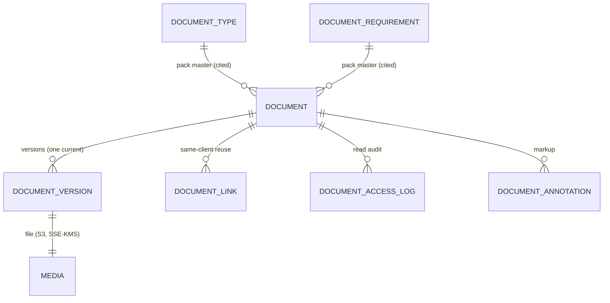

**Retention** is not an AG-9 entity — AG-9 reads the SA-11 `RetentionPolicy` / legal-hold / disposal-orchestrator contracts (Doc 1 §7.6) and stamps `retentionClass` / `legalHold` / `disposalEligibleAt` / `disposedAt` on `Document`. **`ComplianceEvent`** is likewise **not an AG-9 entity** — it is owned by SA-11 (polymorphic `entityType`/`entityId`, PIPEDA/Law-25 governance record); AG-9 neither defines nor writes it.

**Events emitted / consumed.** These names are the canonical dot.case forms (Doc 1 §6.1 registry); the central dictionary mirrors this table.

| Direction | Event | When / Meaning | Notes |
|---|---|---|---|
| Emit | `document.uploaded` | A file is attached to a `Document` (first version) | Idempotency key derived from `documentId` + `versionNo`. |
| Emit | `document.requested` | A document is requested from the client (Required→Requested) | One per requested document. |
| Emit | `document.received` | A clean scan makes a document present (Scanning→Received) | Consumed by the AG-7 checklist, portal, dashboard. |
| Emit | `document.version.added` | A new `DocumentVersion` is created (supersede) | Officer Notification; checklist re-reads current. |
| Emit | `document.scan.passed` | AV scan returns clean | Stamps content hash; version `scanStatus = clean`. |
| Emit | `document.scan.failed` | AV scan returns infected | Quarantine sub-state; officer Notification; portal re-request. |
| Emit | `document.status.changed` | Any guarded status transition | Consumed by the Conductor / timeline / AG-7 completeness. |
| Consume | `envelope.signed` | The Signer (AG-5) reports a signed envelope | Files the distinct `[Signed]` copy idempotently; payload carries `retainerAgreementId`. |
| Consume | `prospect.converted` | AG-2 converts a prospect to a client | Triggers carry-forward re-parent/relink (BR-16). |

## 8. User Stories + Acceptance Criteria

**US-1 — Officer: request and watch documents arrive.**
- **Given** a case with required documents, **When** I select three and request them, **Then** each becomes **Requested** with `requestedAt` + due date, they appear in the client's portal request list, and a request email is sent **in the client's locale**.
- **Given** the client uploads a passport in the portal, **When** the AV scan returns clean, **Then** the document shows **Received** on my panel and I get a Notification — no email exchanged.

**US-2 — Officer: upload is effortless and always a new version.**
- **Given** a document with version 1, **When** I drop a newer file, **Then** version 2 is created, version 1 is **Superseded** (read-only), and the document returns to **Received** pending re-verification.
- **Given** I drop an `.exe`/HTML onto a passport slot, **When** I upload, **Then** it is **rejected at slot-issue** on sniffed-type mismatch and nothing is stored.

**US-3 — Officer: verify or reject in one place.**
- **Given** a Received document, **When** I open the in-app preview and click Verify, **Then** it becomes **Verified**, the action is timestamped, and the preview was **access-audited**.
- **Given** a blurry bank letter, **When** I Reject with reason "page 2 illegible," **Then** the status is **Rejected**, the reason is recorded, and a **re-request** with that reason (client's locale) is sent.
- **Given** a document still **Scanning**, **When** I try to Verify, **Then** it is blocked ("a document can only be verified after a clean scan").

**US-4 — Security: nothing dangerous is ever served.**
- **Given** an infected upload, **When** the AV scan flags it, **Then** it is **Quarantined** (version `scanStatus = infected`), **no presigned download URL is ever issued**, the officer is notified, and the client is asked to re-upload; the checklist shows it as present-but-unusable, never Received/Verified.

**US-5 — Security: access is signed, short-lived, isolated, logged.**
- **Given** I open a preview, **When** the URL is issued, **Then** it is a short-lived presigned URL **bound to the owned record**, an entry is written to the access log, and the bucket grants no public access.
- **Given** a document of another firm (or a crafted request with a raw key), **When** I attempt to read it, **Then** the ownership check fails, no URL is issued, and RLS backstops at the database (no IDOR) (Doc 1 §4.5/§2.2).

**US-6 — Officer: reuse a client document across cases.**
- **Given** a client whose passport is Verified on Case A, **When** I link it to Case B, **Then** the same document (one version/verification/hash) appears on Case B with **no re-upload, no re-scan**, link recorded.
- **Given** a document from a different client, **When** I attempt to link it, **Then** it is blocked (same-client, same-firm only).

**US-7 — RCIC: generate and sign in-house, filed automatically.**
- **Given** a client and a retainer template, **When** I generate via the Drafter, **Then** a typed, named retainer is filed on the client, prefilled, no re-keying.
- **Given** I send it via the Signer and the client signs, **When** `envelope.signed` fires (payload `retainerAgreementId`), **Then** a **distinct `[Signed]` copy** is filed (original unchanged), marked `isESigned` with the envelope id, and I am notified — idempotently on redelivery.

**US-8 — Immigration: translation/notarisation tracked.**
- **Given** a foreign-language document whose pack type defaults translation-required, **When** it is created, **Then** its translation flag = **required**, and the panel shows "verified but translation outstanding" until a translation is provided/linked.

**US-9 — Compliance: retention and disposal on schedule.**
- **Given** a closed matter past its country's retention window with no legal hold, **When** the SA-11 disposal job runs, **Then** the document is eligible; **When** the firm approves the disposal request and disposal executes on the SA-11 system plane, **Then** the subject sub-key is crypto-shredded, the record is tombstoned, and a disposal certificate is written (Doc 1 §7.4) — no `agent/*` route destroyed the key directly.
- **Given** the same document under a **legal hold**, **When** disposal runs, **Then** it is skipped until the hold is released.

**US-10 — Integrity: tamper-evidence and dedup.**
- **Given** a stored object whose bytes change unexpectedly, **When** a re-hash runs, **Then** the content-hash mismatch flags the document for review.
- **Given** I upload a file identical to an existing version, **When** the hash matches, **Then** the system offers "this is the same file you already have" rather than silently versioning.

**US-11 — Checklist boundary.**
- **Given** AG-7's derived checklist declares a pathway's required documents, **When** the case is created, **Then** AG-9 creates the corresponding **Required** Documents (typed, entity-scoped), and AG-7's completeness reads AG-9's statuses (`required-Verified ÷ required-total`) — AG-9 does not decide what is required, AG-7 does not store files.

## 9. Edge Cases & Validations

- **Disallowed type / oversize** → rejected at slot-issue (declared+sniffed check), nothing persisted (AG-9-2).
- **Identical re-upload (same hash)** → dedup recognised; offer "same file" not a pointless version (BR-11).
- **Verify before scan completes / on quarantined** → blocked; verify only from Received (BR-4/BR-6).
- **Scan service down/timeout** → version `scanStatus = pending` (`SCAN_PENDING`) + retry + clear "not yet usable" badge; never auto-Received (AG-9-14).
- **Quarantined download attempt** → no presigned URL ever issued; flagged + audited (US-4).
- **Cross-tenant read / cross-tenant link / cross-client reuse** → ownership/same-client check fails; no URL, no link; RLS backstop (BR-1/BR-10).
- **Caller-supplied raw storage key to sign** → rejected by construction; only keys resolved from an owned record are signed (Doc 1 §4.5 AC-7.7.4).
- **Presigned URL expiry mid-view** → expired GET fails closed; UI re-requests a fresh short-lived URL (access re-logged) — never a long-lived link.
- **New version after verification** → status resets to Received; downstream reads the new current; the old verified version is never silently submitted (BR-5).
- **Reject/Waive/N-A without a reason** → blocked at validation (BR-6).
- **Concurrent uploads to one Document** → versioning serialised; exactly one `isCurrent` (deterministic last-writer becomes current; both retained).
- **Document on a deactivated/suspended country type** → existing documents stay readable/usable; new documents cannot select a type from a suspended country (BR-7).
- **Disposal vs legal hold race** → hold always wins; disposal skips held items (BR-13, Doc 1 §7.6).
- **Disposal of a document linked to multiple cases** → disposal acts on the document (and all links); the disposal record notes every entity served; a hold on *any* linked matter blocks it.
- **E-sign event redelivery / already-filed envelope** → idempotent; the `[Signed]` copy is filed once (keyed by envelope) under tenant re-check (BR-12).
- **Carry-forward on conversion** → prospect documents re-parent/relink to the client with version/verification/hash + access history intact (BR-16, on `prospect.converted`).
- **Annotation on a superseded version** → annotations are version-pinned; the current version shows current annotations; history preserved (3.8).
- **Bulk request including already-received items** → already-Received/Verified skipped with a per-item note (AG-9-9).
- **Bulk upload with one corrupt file** → that file reports its error; the rest proceed; partial success, never all-or-nothing (AG-9-3).
- **Storage rail unavailable** → upload/download fail closed with a clear retryable error; no half-written Document without a Media; the request never hangs proxying bytes.
- **Firm-plane disposal of a system-plane action** → `agent/document:dispose` records the firm-scoped request only; the crypto-shred runs on the SA-11 system plane (no scope-wall crossing, Doc 1 §4.1/§4.2/§7.4).
- **PII in logs** → never; logs carry IDs + `firm_id` only (Doc 1 §7.7 no-Restricted-in-logs scanner).

**Validation doctrine.** Every input (upload metadata, type, status change, reason, link target) is Zod/class-validator schema-validated, never ad-hoc if/else (Doc 1 edge discipline). Reject early with a clear localized message; never persist on validation failure.

## 10. Permissions (LOCAL `agent/*`)

Default-deny; additive; always evaluated within the caller's `firm_id` by the scope-aware RolesGuard (Doc 1 §4.2) and the record-level authz layer (Doc 1 §4.5). All keys are LOCAL (`agent/*`) and follow the canonical grammar `agent/<resource>:<action>` (one resource namespace per module — here `document`); none may be a `system/*` key on a firm role (Doc 1 §4.3 write-side filter). Every state-changing route carries `@RequirePermissions` (Doc 1 §4.4 CI completeness).

| Permission Key | Description |
|---|---|
| `agent/document:list` | List documents for an entity (the panel). |
| `agent/document:show` | Open a document's detail/metadata. |
| `agent/document:create` | Add/declare a document; upload a version. |
| `agent/document:edit` | Edit metadata, tags, expiry, flags. |
| `agent/document:request` | Request documents from the client. |
| `agent/document:change-status` | Verify / reject / move status. |
| `agent/document:download` | Preview/download file bytes (sensitive PII; access-audited). |
| `agent/document:bulk` | Bulk request / status / upload. |
| `agent/document:waive` | Waive / mark Not-Applicable (reason; audited). |
| `agent/document:link` | Link/unlink (reuse) a client document across the client's cases. |
| `agent/document:annotate` | Add annotations. |
| `agent/document:generate` | Generate-from-template (Drafter/Filler). |
| `agent/document:sign` | Send-for-signature (Signer). |
| `agent/document:view-access-log` | View a document's access/audit trail. |
| `agent/document:legal-hold` | Place/release a legal hold. |
| `agent/document:dispose` | Record a firm-scoped disposal REQUEST/approval (Owner-level); the crypto-shred is executed by the SA-11 system plane, never by this route. |
| `agent/document:reveal-pii` | Reveal masked Restricted metadata (audited PII_REVEAL, Doc 1 §7.2). |

**Enforcement.** Route-level (`@RequirePermissions`) **and** object-level (`assertSameFirm` + `(entityType, entityId)` scoping, Doc 1 §4.5), backstopped by RLS (Doc 1 §2.2). **Download/preview is separately permissioned and access-audited** — handling a document's *status* is not the same right as opening a passport. `bulk`, `waive`, `link`, `dispose`, `legal-hold`, `reveal-pii` are each checked against their own key, never a generic grant. `dispose` authorizes/queues only — the destructive crypto-shred runs on the SA-11 system plane (Doc 1 §7.4), never as the firm principal (the §3.12 scope seam). Entitlement gating (plan/feature, §11) layers on top server-side; UI hiding is never the security boundary.

## 11. Scalability · Security · Performance

**Scalability.**
- **Entity-agnostic by `(entityType, entityId)`:** documents serve prospect, client, case, and any future record with no schema change — a new owner type is one `EntityTypeRegistry` row (Doc 1 AC-1.3). This is the architectural reason AG-9 is a reusable subsystem.
- **Pack-driven taxonomy & retention:** types and retention windows come from the active Country Pack / SA-11 — a new country is config, not code; single-country is the degenerate case.
- **Region-configurable storage:** the S3 rail is region-bound per the Doc 1 §2.9/§7.7 seam — Canada-resident or EU-resident storage is config.
- **Stateless services + queue-backed heavy work:** the API never proxies bytes; **AV scans, generation, bulk operations, disposal, and re-hashing run on BullMQ** (Doc 1 §1.4) and scale independently. Target: a large tenant at 100k → 1M documents within the platform 25M-doc envelope (Doc 1 NFR S/P) with the panel and previews still fast.

**Security (paramount — passports and financials).**
- **Bytes private, short-lived, direct.** No public bucket; all access via short-lived presigned URLs issued only after an ownership check; the API never serves bytes; **no caller-supplied key is ever signed** (Doc 1 §4.5).
- **Encryption at rest (SSE-KMS) under the subject key** (Doc 1 §7.1/§7.7); credentials in Secrets Manager (Doc 1 §1.6), never the DB.
- **Tenant isolation by construction:** forced RLS on `firm_id` (Doc 1 §2.2) + the portal client-subject dimension for the request loop (Doc 1 §2.5) + object-level IDOR checks (Doc 1 §4.5). Firm-prefixed object keys mean neither a query bug nor a bucket-policy mistake can cross tenants.
- **AV-scan-before-availability + quarantine** (Doc 1 §7.7); **safe serving headers** (attachment / nosniff / CSP) defeat stored-XSS.
- **Content-hash integrity + read-level access audit** (`DocumentAccessLog`) on top of the per-firm hash-chained mutation audit (Doc 1 §7.5) — a PIPEDA-grade "who opened what."
- **Restricted PII discipline:** mask-by-default with audited reveal (`agent/document:reveal-pii` → PII_REVEAL, Doc 1 §7.2); no file content/read URLs/email in logs (Doc 1 §7.7 scanners); requests are CASL/Law-25-respecting (BR-14).
- **Crypto-shred disposal** via SA-11 on the system plane (Doc 1 §7.4): erasure destroys the subject sub-key — irrecoverable even against immutable backups — while the audit chain (over ciphertext/HMAC) still verifies. The firm `agent/document:dispose` route only authorizes/queues; it never crosses the scope wall to destroy keys.

**Performance.**
- **Direct-to-rail I/O.** Presigned PUT/GET never pass through the API — fast and stateless regardless of file size.
- **Async everything heavy** on BullMQ; the UI shows progress (scan badge, bulk progress) and never blocks.
- **Paginated, indexed panels.** Keyset pagination, never unbounded fetches (Doc 1 NFR P); indexes on `(firm_id, entityType, entityId)`, `(firm_id, status)`, `(firm_id, documentTypeId)`, `(documentId, isCurrent)`, `Media.contentHash` (dedup), `Document.disposalEligibleAt` (retention scan), `(firm_id, documentId, at)` on the access log.
- **Redis summary cache + invalidation contract.** Per-entity document-summary counts (received/verified/missing/rejected) cached in Redis keyed by `(firm_id, entityType, entityId)`; invalidated by status change, version add, request, link/unlink, disposal. Document detail, preview, and access log are always live (never stale); content hashes and disposal records are immutable.
- **Event delivery — at-least-once + idempotent** (Doc 1 §6): document events and `envelope.signed` are at-least-once; the `[Signed]`-copy filer, scan-result handler, and checklist completeness are idempotent so redelivery never double-files or double-counts (BR-12).
- **Entitlement gating** (server-enforced): in-house generation, e-sign volume, retention automation, region-specific storage may be plan-tiered; lacking an entitlement shows a disabled affordance, never a mid-flow error.
- **Budgets:** metadata/panel reads p95 ≤ 300 ms (bytes are direct-to-rail), writes p95 ≤ 600 ms (Doc 1 NFR P); all lists/version-histories paginated; scans/generation/disposal async.

## 12. Reference Note (exists / NEW / CHANGED)

> Greenfield target-state; the existing private codebase is design-provenance only (Doc 1 §1.8). This note is honest about what the prototype proves vs what is net-new for the build.

**Proven in provenance (build natively, do not lift).** A polymorphic documents subsystem already works in the prototype: a `UnifiedDocument` attaching across four owner types, create/bulk-create/update/delete, status change with date-stamping and a rejection reason, a working request-from-client loop (flip to Requested, resolve customer email, send a request mail, a portal fetch of the Requested set with media-link), a storage rail with presigned PUT/GET (300s TTL, direct-to-S3, no byte proxying) and ownership-gated reads, content-type forcing for e-sign PDFs, and a Signer completion listener that files a distinct `[Signed]` copy under a tenant re-check with a reverse pointer. These validate the *shape*; the build targets the contracts below.

**CHANGED (deliberate target-state corrections).**
- Tenant key **`clientId` (app-filtering) → `firm_id` with forced RLS** + the portal client-subject dimension (Doc 1 §2.2/§2.5).
- **Four-FK polymorphism → `(entityType, entityId)`** validated against the `EntityTypeRegistry` (Doc 1 §5.4) + `DocumentLink` for same-client reuse.
- **Single-media documents → versioned** (`DocumentVersion` + supersede; verification per version).
- **Thin status enum (`PENDING|REQUESTED|UPLOADED|APPROVED|REJECTED`) → the 10-state immigration lifecycle** (§6) + translation/notarisation flags; "APPROVED" becomes "Verified," gated by a clean scan ("Received").
- **Coarse `documents` grant → per-action `agent/document:*`** (notably a distinct download right for sensitive PII).
- **Bucket creds in DB → Secrets Manager; SSE-KMS under the subject key on every PUT** (Doc 1 §7.1/§7.7).
- **`app/`/`public/` key prefixes → firm-prefixed keys** (Doc 1 §7.7).
- **The legacy two-name e-sign completion → the single canonical `envelope.signed`** (Doc 1 §6; there is no separate completion event, and the payload key is `retainerAgreementId`).

**NEW (this module's build).**
- The **10-state runtime Document instance + lifecycle** — the engine Doc 1 §5.6 and Doc 2 SA-1 §3.6 deferred to this wave.
- **AV-scan-before-availability + quarantine** pipeline (Doc 1 §7.7) — the prototype has no scanning.
- **`DocumentVersion`** + content-hash integrity (dedup + tamper-evidence) — no version table or content hash today.
- **`DocumentAccessLog`** (read-level audit) on top of the §7.5 mutation spine — no read audit today.
- **Pack-driven type consumption** (`DocumentType`/`DocumentRequirement`, bilingual labels, type-seeded defaults) from Doc 2 SA-1.
- **Drafter generate-and-file** path (the Signer hook is proven).
- **Preview annotations** (`DocumentAnnotation`, non-destructive, version-pinned).
- **Retention & disposal via SA-11** (retention class, legal hold, crypto-shred orchestrator, disposal certificate) — no retention engine today; AG-9 consumes SA-11, does not build it, and never destroys keys from an `agent/*` route.
- **Formalised AG-7 checklist interface** (declare / report-status / provide-current-version as a derived view, Doc 1 §5.6).
- **Panel pagination + index discipline, Redis summary cache + invalidation, entitlement gating, bulk upload + mobile camera capture, bilingual request templates + per-item Minder reminders + re-request-on-reject.**

## 13. Open Questions / [FOUNDER-CONFIRM]

**Locked engineering defaults (decided; not founder calls).** The `(entityType, entityId)` + `DocumentLink` shape; `DocumentVersion` + supersede + per-version verification; scan-gated trust ("Received" requires a clean AV scan, Doc 1 §7.7); short-lived presigned URLs bound to ownership-checked records with SSE-KMS under the subject key (Doc 1 §4.5/§7.1); the 10-state lifecycle (§6). These are full scope, no phasing.

**Routed to the founder / Immigration-SME (domain/business; the machinery is fixed regardless):**
1. **Document type taxonomy per Country Pack** — which types exist, and which default to translation-required / notarisation-required (Doc 2 SA-1 §3.6 authoring; AG-9 consumes). [FOUNDER-CONFIRM]
2. **Per-country retention floors & windows + disposal mode** — the exact legal minimums and whether disposal defaults to **propose-then-approve** (safer) or **auto** (hands-off), per jurisdiction (Canada federal + provincial/RCIC body to start). Feeds the SA-11 `RetentionPolicy` (Doc 1 §7.6). [FOUNDER-CONFIRM]
3. **Restricted-PII field set on document metadata** — which document-metadata fields (e.g. passport number, SIN captured from a doc) are classified Restricted for field-level encryption + mask-by-default (Doc 1 §7.2 exact list). [FOUNDER-CONFIRM]
4. **Bilingual (FR-CA) document names + client-facing request/rejection copy** — authored as `LocalizedLabel` in the pack (Doc 2 SA-1). [FOUNDER-CONFIRM]
5. **Prospect-side required document set** — which documents are mandatory for a useful preliminary assessment. [FOUNDER-CONFIRM]
6. **Entitlement tiers** — which AG-9 features sit behind which plan (in-house generation, e-sign volume, retention automation, region-specific storage) — an SA-3 commercial decision. [FOUNDER-CONFIRM]

**Resolved deferrals (now IN or OUT — no phasing, per the de-phase decision):**
- **Live SMS/WhatsApp request reminders** — **IN** (Messenger rail, Doc 1 §6/§7.7; consent + quiet-hours respected).
- **Mobile camera capture + multi-page assembly** — **IN** (AG-9-4).
- **Re-request-on-reject + per-item Minder reminders + bilingual request templates** — **IN**.
- **OCR / auto-extraction (e.g. passport MRZ prefill)** — **OUT** of base scope (a separately-priced content/automation option); the type/flags model is OCR-ready, and OCR is a named BullMQ worker slot in Doc 1 §1.4 for the later adapter.
- **Advanced annotation (page-region drawing, redaction)** — **OUT** of base scope; comment-level + page/region-pin annotations are **IN**.
- **Automated certified-translation ordering** — **OUT**; the translation flag + linked-translation document are **IN**.
- **Per-firm customer-managed KMS keys** — **OUT** of base scope; platform per-subject SSE-KMS (Doc 1 §7.1) is **IN** and is the default.

**Needs the human architect's sign-off.** (a) That AG-9 **consumes** the SA-11 disposal orchestrator and **does not build** any independent retention engine, and that `agent/document:dispose` records a firm-scoped request only while the crypto-shred runs on the SA-11 system plane (the single-source-of-truth + scope boundary between AG-9 and SA-11). (b) That the **derived document-requirement checklist view** lives in AG-7 reading AG-9's single-status contract (`required-Verified ÷ required-total`), with AG-9 holding zero independent document-status code (the AG-7/AG-9 ownership boundary, Doc 1 §5.6). (c) The AV-scan engine selection (ClamAV sidecar vs a cloud scanning service) — a deployment/cost-latency trade-off; the scan-gated contract ships regardless.

---

# Module AG-10: Communication Hub

> **What this is.** The vendor-build specification for the firm's communication layer — the in-house **Mailer** (email) and **Messenger** (SMS / WhatsApp / in-app portal chat) Doers, the per-entity communication timeline, the consent/contactability send-gate, and the staff Notification system. It is written to the 13-section gold standard and **sits on Doc 1 — Platform Foundation**: Postgres-16 single store with FORCED Row-Level Security on `firm_id` (Doc 1 §2), the three walled auth pools (Doc 1 §3), `agent/*` LOCAL permissions + record-level authz (Doc 1 §4), the canonical data spine and `EntityTypeRegistry` (Doc 1 §5), the **domain-event dictionary + `notif/` namespace** and **rails-as-ports** (Doc 1 §6, esp. `EmailRelayPort` + `SmsGatewayPort`), KMS field-encryption + per-firm audit chain + the SA-11 governance plane incl. its `ConsentRecord` register (Doc 1 §7), and the NFR budgets (Doc 1 §8). All of that is inherited "per Doc 1 §X" and is normative here without restatement. AG-10 also **consumes** content authored upstream: message/document templates from **SA-5** Global Templates via the firm-side adopt/override machinery of **AG-12**, and author-facing localized strings from SA-1 `LocalizedLabel`. AG-10 owns *delivery, recording, the send-gate, conversations, notifications, and the per-user `NotificationPreference` entity* — not the template library, not the legal consent register, and not the firm-policy notification ceiling (AG-16).

## Module Index

AG-10 is the firm's single communication nervous system: every word that passes between the firm and a human — leads, engaged clients, family members on a file, and (internally) staff. Two in-house Doers live here — the **Mailer** (email) and the **Messenger** (SMS / WhatsApp / in-app portal chat) — plus the cross-cutting **Notifications** facility. Communication is delivered exclusively through Doc 1 §6.3 rail ports (`EmailRelayPort`, `SmsGatewayPort`), recorded as a polymorphic `Communication` per subject entity, and gated by a single consent-by-construction send-gate that reads the **SA-11 `ConsentRecord` register** live at send time (CASL / Law-25). The per-entity timeline interleaves all channels and is materialized via the AG-13-owned append-only `ActivityEvent` table (committed-IN per ADR 6.2). AG-10 owns the per-user `NotificationPreference` entity (bounded by AG-16's firm-policy ceiling) and the typed `notif/` event catalogue. It consumes templates from AG-12 (←SA-5) and consent law from SA-11 — money, content, and consent each stay single-sourced.

**Detailed scope index**
1. Purpose & Goal · 2. Users & JTBD · 3. Functional Design (Mailer · Messenger · timeline · send-gate · Notifications · deliverability analytics) · 4. Functional Requirements (AG-10-n) · 5. Business Rules · 6. States & Lifecycle · 7. Key Entities & Fields + Events emitted/consumed · 8. User Stories + Acceptance · 9. Edge Cases · 10. Permissions · 11. Scalability·Security·Performance · 12. Reference Note · 13. Open Questions / [FOUNDER-CONFIRM]

---

## 1. Purpose & Goal

**What it is.** AG-10 is the firm's single nervous system for every word that passes between the firm and a human — leads, engaged clients, family members on a file, and (internally) staff. It is not an email client bolted onto a CRM; it is the communication substrate every other module sends *through*: the CRM/Pipeline (AG-2) and the Automation/Conductor (AG-11) compose cadences, but AG-10 *delivers* them, *records* them on the file, and *proves* they were (or were not) lawful to send. Two in-house Doers live here — **Mailer** and **Messenger** — plus one cross-cutting facility, **Notifications**, that tells staff what just happened.

**The business outcome it must produce.** Regulated immigration firms get hurt three ways by sloppy correspondence: (1) the record is incomplete — an email or a WhatsApp happened off-platform and never reached the file, so a case officer cannot reconstruct what was promised (a regulated-profession failure); (2) messages slip the law — a marketing blast reaches someone who never consented, breaching CASL or Quebec Law-25, with real fines; (3) clients are scattered across channels with no single conversation. AG-10 makes "every communication is on the file, in the client's language, and provably within the law" structurally true: every send (manual or automated) is logged against the entity via the polymorphic spine, gated by consent-by-construction at send time, and rendered in the recipient's locale, while inbound from the firm's own mailbox and the portal is matched back onto the right file automatically.

**Why it matters / world-class positioning.** A generic CRM gives a "send email" button and an activity log. AG-10 is different in four ways that matter to a regulated, global firm. First, it is **consent-native, not consent-optional** — the system itself refuses to fire a marketing message at a non-consenting recipient, even mid-batch, and an unsubscribe permanently halts marketing; this is the compliance moat. Second, it is **multi-channel under one roof, in-house** — email, SMS, WhatsApp, and portal chat are first-class Doers on the firm's own rail ports (Doc 1 §6.3), with **one conversation per client** rather than four disconnected tools. Third, it is **per-entity and audit-grade** — every message is a typed event on the lead/case timeline, so the relationship is reconstructable for the regulator. Fourth, it is **delivery-only by design** — it consumes SA-5/AG-12 templates and the SA-11 consent register rather than re-implementing them, so money/content/consent each stay single-sourced.

**How it ties to the journey.** AG-10 is the connective tissue of the whole revenue-and-delivery spine: the speed-to-lead auto-acknowledgement (AG-2), the consult confirmation (AG-4), the retainer link and e-sign notifications (AG-5), the payment receipt (AG-6 → `payment.succeeded` consumer), the document request and SQR link (AG-8/AG-9), and the portal conversation through delivery — all of these *are* AG-10 sends.

**Global ambition.** The same hub serves a Canada-only solo RCIC and a multi-country firm with no code change: locale comes from the Party/Contact, send windows from the firm/office timezone + business hours, consent law from the recipient's jurisdiction (CASL today; the SA-11 register is per-purpose and jurisdiction-tagged so Law-25/GDPR slot in), and rails are configured per firm via SA-8 `IntegrationRailConfig` (Doc 1 §6.3.2). Single-locale, single-timezone, single-jurisdiction is the degenerate case.

## 2. Users & Jobs-to-be-Done

| Role | Primary job in AG-10 | Representative JTBD |
|---|---|---|
| **Intake / Sales Rep** (heavy) | Reach a lead fast, on the right channel, on the file. | "When a hot lead comes in, email or WhatsApp them in one click from their record, in their language, logged automatically." · "When they reply in my own Gmail, that reply appears on their file without me copying it." |
| **Case Officer / Paralegal** | Keep the client informed; keep the file complete. | "When I request documents, I want it on the case timeline with read/delivery status." · "When a client messages the portal, I want it in the same conversation as everything else." |
| **RCIC / Consultant** | Communicate advice that is on-record and compliant. | "Substantive advice captured verbatim with a timestamp — I must reconstruct every communication." · "An AI draft I can edit that never over-promises an outcome." |
| **Marketing / Owner** | Run outreach that is effective *and* lawful. | "A nurture campaign that only reaches consented people and stops the moment someone unsubscribes." · "One place to configure the rails and watch deliverability health." |
| **Manager** | Oversee responsiveness and deliverability. | "Response times, unread inbound, bounce/suppression rates, failed messages — by rep and channel." |
| **Any staff user** | Stay informed without a firehose. | "Tell me about replies and bounces the way I want, deep-linked to the file, never during my quiet hours." |
| **Client / Portal user** (external, gated) | Talk to the firm in one place. | "One conversation thread, in my language, with my documents — not five tools." (Portal plane; AG-10 is the firm-side counterpart, scoped by the Doc 1 §2.5 portal RLS dimension.) |

**Design implication.** The **per-entity composer** (on a lead/case) is the protagonist surface for staff. The **agent inbox** serves email-heavy reps; the **conversation view** serves messaging; **Notifications + per-user preferences** serve everyone; **rails/mailbox/consent config** serves the owner. Permissions (§10) separate these.

## 3. Functional Design — How It Works

### 3.0 Channels, rails, and the per-entity model (the foundation)

**Doers, not third-party tools.** Communication is delivered by two in-house Doers — **Mailer** (email) and **Messenger** (SMS / WhatsApp / in-app portal chat). There is no embedded third-party messaging surface. Delivery rides **rail ports** (Doc 1 §6.3): the Mailer depends on `EmailRelayPort` (v1 adapter AWS SES + SMTP fallback), the Messenger depends on `SmsGatewayPort` (v1 adapter AWS SNS + a WhatsApp BSP). A Doer never imports a vendor SDK; SA-8 `IntegrationRailConfig` selects the live adapter as data. A rail is a wire, not a product surface.

**Optional own-mailbox connect (inbound).** A firm may connect its own mailbox — Gmail/Microsoft via OAuth (Graph/Gmail API), IMAP fallback for others — so inbound replies received in the real mailbox sync into the platform and land on the right file. This is an **own-account OAuth connector** under the ratified rails adapter boundary (Doc 1 §6.3 own-account OAuth connector category): opt-in, scope-limited, token-encrypted (Doc 1 §7.1 operational-DEK path), disconnect-and-purge-able. The concrete vendor (Gmail/Microsoft) is the selected adapterKey, not a domain product surface.

**Everything is per-entity, polymorphically.** Every message — outbound or inbound, any channel — is a `Communication` row attached to a subject entity via `(entityType, entityId)`, validated against the platform `EntityTypeRegistry` with a `firm_id` match (Doc 1 §5 / [C2-D4]); `entityType`/`entityId` are camelCase columns and the registered values are UPPER_SNAKE (CASE, PROSPECT, CONTACT, …) per Doc 1 §5.8. The channel payload (`EmailMessage` / `SmsMessage` / `ChatMessage`) hangs off the `Communication`. This is the doctrine that lets the per-entity timeline (§3.5) interleave channels.

**Consent-by-construction.** No message leaves the building without passing the send-gate (§3.6), which is a service every send path calls — never a checkbox a rep is trusted to honour — and is enforced inside the async worker at send time, not only at compose.

### 3.1 Mailer — Outbound email (template-driven, tracked, locale-selected)

**How it works.** A staff member (or the Conductor) sends from an entity context. The Mailer resolves the **from-identity** (the firm's configured sending identity / connected mailbox — *not* the firm display name, fixing a known prototype bug), resolves the **template** in the recipient's locale via AG-12 (§3.9), runs the send-gate (§3.6), resolves **attachments via AG-9** (§3.8), enqueues on BullMQ, and on dispatch through `EmailRelayPort` writes a `Communication` (+ `EmailMessage`) onto the timeline with threading headers and an embedded reply-token. Delivery/open/bounce events arrive as **rail-originated** webhook facts (Doc 1 §6.1.4) translated into `DeliveryEvent` rows.

**World-class behaviour.** Compose from the record, never re-key; tracked honestly (no fabricated "opened"; open-tracking is a firm toggle for privacy/jurisdiction); locale-correct by default (a Quebec recipient gets the French variant — a Law-25 requirement); idempotent and resilient (queued, at-least-once with a dedupe key so a retried job never double-sends; failures retry then dead-letter with a Notification, never silent loss).

**Screens.** Per-entity email composer (recipient pre-filled, AG-12 template picker with locale auto-selected, AG-9 attachment picker, send/schedule); send-status chip on the timeline row; scheduled-send indicator (timezone-aware window).

**Data flow.** Composer → resolve from-identity + AG-12 template (recipient locale) → **send-gate** → resolve AG-9 attachments → enqueue → worker dispatches via `EmailRelayPort` → write `Communication`+`EmailMessage` (and append the AG-13 `ActivityEvent` timeline row) → rail bounce/open/delivery webhooks → `DeliveryEvent` → hard bounce → suppression + `notif/message-bounced`.

### 3.2 Mailer — Inbound own-mailbox sync, entity matching & the Unmatched inbox

**How it works.** When a mailbox is connected, a background sync pulls inbound mail and runs **entity matching** in priority order: (1) reply-token / `In-Reply-To` / `References` chain (strongest); (2) sender/recipient address → Contact/Party **within `firm_id`** (RLS guarantees a cross-firm match is impossible); (3) firm alias / plus-address. A confidently matched message becomes an inbound `Communication` continuing the original thread and raises `notif/message-received`. A message that cannot be matched lands in the **Unmatched inbox** — never silently dropped, never auto-attached to a guessed file — with **ranked suggestions** (closing the AG-10 gap on the ranking model: see §5 BR-7a).

**Unmatched ranking model (NEW — closes gap).** Each unmatched email is scored against candidate entities with a transparent, deterministic formula: exact address match on a Contact/Party (+0.6), same domain as a known Contact (+0.15), name token overlap in subject/body with an entity display name (+0.1), recency of any prior thread with that address (+0.1 decaying), and an open case/prospect for that domain (+0.05). Candidates with score ≥ a firm-configurable threshold (default 0.5) are shown ranked; below it, none are pre-selected. Linking records the address↔Contact mapping so the next email from that address auto-matches (a learned tier-2 rule, firm-scoped).

**Screens.** Mailbox connection (OAuth connect / IMAP form, folder selection, sync status + last-synced, disconnect/purge); Unmatched inbox (ranked suggestions, one-click link, "create lead from this" via AG-2 capture); connection health.

**Data flow.** OAuth/IMAP sync job → fetch inbound → entity matcher (reply-token → header chain → address → alias) → matched: inbound `Communication`+`EmailMessage` + `notif/message-received`; unmatched: `UnmatchedInboundEmail` (ranked) → manual link re-points + records mapping → audit.

### 3.3 The agent inbox (threads, drafts, AI assist)

**How it works.** Beyond per-entity sends, AG-10 offers an agent inbox: a folder view (inbox / sent / drafts / snoozed) of email grouped into threads, with read/unread, star, archive, snooze, labels, reply, forward, draft CRUD. Because every email is also a `Communication`, the inbox and the per-entity timeline are two views of the same data. An optional **AI-assist drafter** proposes a subject + body the rep edits, constrained to never promise an immigration outcome (ranges / "typically", never a guarantee); it degrades to a clear "not configured" message when no model key is set.

**World-class behaviour.** Thread-grouped and file-linked (a thread shows its linked entity; replying preserves the link + threading headers); keyboard-first triage; drafts auto-save; snooze returns at a chosen time in the firm timezone; AI drafts are clearly drafts the human owns before send.

**Data flow.** Reuses §3.1 send and §3.2 sync; thread grouping/folder state read off `EmailMessage`/`Communication`; AI draft calls the configured model and returns subject+body to the composer (never auto-sends).

### 3.4 Messenger — SMS / WhatsApp / in-app portal chat (one conversation per client)

**How it works.** Messenger is the in-house Doer for non-email channels: **SMS** and **WhatsApp** (via `SmsGatewayPort`) and **in-app portal chat** (firm↔client, scoped by the Doc 1 §2.5 portal RLS dimension). The unifying model is **one `Conversation` per client/entity**: SMS, WhatsApp, and chat all attach to it and to the entity timeline, so the firm sees one continuous thread. Outbound passes the send-gate (§3.6) and the **timezone-aware send window** (no 3 a.m. texts). Inbound (a WhatsApp reply, an SMS, a **STOP** keyword, a portal message) arrives via the gateway webhook or the portal, attaches to the conversation, and raises a Notification; STOP/unsubscribe flips channel contactability and halts marketing automatically.

**WhatsApp 24-hour session window (NEW — closes gap).** WhatsApp distinguishes a free-form **session message** (allowed only inside the 24-hour window opened by the user's last inbound message) from a **template message** (a BSP-pre-approved template required to *open* or re-open conversation outside the window). AG-10 models this explicitly:
- `Conversation.waSessionExpiresAt` (nullable timestamp) is **set / extended to now + 24h on every inbound WhatsApp message** (driven by the inbound webhook).
- The composer and the send-gate read it: if the channel is WhatsApp and `now < waSessionExpiresAt`, a free-form session message is permitted; otherwise **only a `templateRef` send is allowed**, and the composer disables free-form text with the reason "outside the 24-hour window — use an approved template."
- The Conductor (AG-11) inherits the same branch: a sequence step targeting WhatsApp outside the window auto-selects the step's configured approved template; if none is configured, the step is **skipped and logged** (never sent as a disallowed free-form message).
- A `templateRef` on `SmsMessage` records which approved WhatsApp template was used, for audit and BSP reconciliation.

**World-class behaviour.** One conversation, many channels; consent + quiet-hours native; template-disciplined where the channel requires it (the 24h model above); webhook-idempotent on the provider message id (Doc 1 §6.1.4 — a redelivered receipt updates state once, never duplicates a row or double-toggles contactability).

**Screens.** Conversation view (channel-tagged bubbles, AG-9 attachments, the WhatsApp-window state shown); channel picker in the composer (email/SMS/WhatsApp/chat, disabled-with-reason when consent/rail/window is missing); gateway config (owner: numbers, WhatsApp sender, quiet-hours); delivery/read receipts.

**Data flow.** Composer (channel) → **send-gate** + **send-window** + **WhatsApp-window** check → Messenger Doer → `SmsGatewayPort` (or portal for chat) → `Communication`+`SmsMessage`/`ChatMessage` on the conversation + timeline → gateway webhook → `DeliveryEvent`; inbound webhook/portal → attach + Notification + (WhatsApp) extend session window; STOP → contactability flip + marketing halt (§3.6).

### 3.5 The per-entity Communication Timeline (interleaving channels)

**How it works.** Each entity (lead/case/contact) exposes a unified, typed, filterable, reverse-chronological interleave of every channel and direction, plus delivery/open/read/bounce markers, assembled via the polymorphic `(entityType, entityId)`. Each row shows channel, direction, sender, preview, timestamp (firm timezone), delivery status, and attachments. This is the same timeline AG-2's lead detail and AG-8's case view render — AG-10 owns the communication payload; the timeline itself is the **materialized append-only `ActivityEvent` table owned by AG-13 (committed-IN per ADR 6.2)**, which AG-10 writes a row to on every send/receipt and which AG-2/AG-7/AG-8 display. There is no read-time-aggregation fallback: the ERD is frozen with `ActivityEvent` materialized.

**World-class behaviour.** Channel-agnostic truth (the whole relationship in one stream, filterable); audit-grade and reconstructable; keyset-paginated by the composite cursor `{occurredAt, channel, communicationId}` so a long relationship loads fast and equal timestamps never skip/duplicate.

**Data flow.** Entity-detail load → fetch a paginated slice of the AG-13 `ActivityEvent` rows for `(entityType, entityId)` joined to `Communication` channel payloads + delivery events (never the whole history) → render interleaved; composer actions write back via the relevant Doer and append the `ActivityEvent` row.

### 3.6 The send-gate — consent, contactability & transactional-vs-marketing (CASL / Law-25)

**How it works.** Every outbound send — manual or automated — passes one send-gate service before it can queue. The gate does three things:

1. **Classify the message (NEW — closes gap).** Every send carries an explicit `messageClass` of **`TRANSACTIONAL`** or **`MARKETING`**, set by the *origin*, not guessed: system/Doer sends (booking confirmation, retainer link, receipt, document request, password/portal access) and any **direct reply to a client's own message** are `TRANSACTIONAL`; AG-2/AG-11 nurture/newsletter/promotional steps are `MARKETING` (the Conductor step author sets `consentClass` upstream and it flows in). A rep composing from the file selects the class, defaulting to `TRANSACTIONAL` for a reply and prompting for `MARKETING` only when bulk-sending. The class is stored on the `Communication` and is the gate's primary input.
2. **Evaluate contactability per recipient at send time.** `TRANSACTIONAL` is allowed to any reachable (non-suppressed) address/number. `MARKETING` requires, for that recipient + that **channel** (email/SMS/WhatsApp) + that **purpose**, a current granting consent — read **live from the SA-11 `ConsentRecord` register** (Doc 1 §7.6, the per-purpose, versioned, withdrawable legal register; AG-10 does *not* maintain a parallel consent table). The gate never caches the consent decision.
3. **Enforce suppression.** A `firm_id`-scoped `SuppressionEntry` (hard bounce / invalid number / complaint / manual) blocks all further sends to that address/number — `TRANSACTIONAL` included — until corrected.

**Unsubscribe / STOP (NEW — closes gap).** An unsubscribe-link click, a WhatsApp/SMS **STOP** keyword, or a manual flag writes a **withdrawal into the SA-11 register** and permanently halts marketing on that channel until an explicit new consent. The withdrawal is honoured by every send path including the Conductor (which is signalled to exit marketing steps via `notif/`-triggering and the consent-state read). STOP == unsubscribe; ambiguous text surfaces for review rather than mis-halting (BR-4a).

**Provable allow (NEW — closes gap).** Every send stamps `consentBasis` on the `Communication`: either `TRANSACTIONAL` or the specific `consentRecordId` (+ purpose/jurisdiction) that authorised it. Any send can then show *why it was allowed* to an auditor or a complaint.

**Bulk fan-out.** In a sequence/bulk send, contactability is evaluated **per recipient inside the worker**: consented recipients receive the step, non-consented are **skipped and logged with a reason**, and the skip count is reported (mirrors AG-2 BR-9). No code path can send `MARKETING` without the gate.

**Screens.** Consent panel on the Contact (a *read/manage* view onto SA-11's register — per-channel/per-purpose state, source, timestamps, history); send-preflight ("marketing — N of M recipients consented"); suppression list (firm-wide, with reason); STOP/unsubscribe surfaced as a timeline event + consent change.

**Data flow.** Send request → classify (`messageClass`) → gate reads live SA-11 `ConsentRecord` + `SuppressionEntry` for recipient/channel/purpose → allow (queue, stamp `consentBasis`) or **skip + log reason** → on inbound STOP/unsubscribe/bounce: write SA-11 withdrawal / `SuppressionEntry` → Conductor exits marketing → audit.

### 3.7 Notifications (in-app + email/push, per-user preferences)

**How it works.** Notifications surface events to staff (and, where relevant, drive client-facing alerts through the Doers). AG-10 raises an in-app `Notification` always, and — per each user's `NotificationPreference` — also delivers via **email and/or push**, respecting quiet hours, for a **typed catalogue** of events (§7). Each user controls which event types reach them and on which channels; high-volume types can roll into a **digest**. The per-user `NotificationPreference` entity is **owned by AG-10**; its allowable channels are **bounded by the firm-policy notification ceiling owned by AG-16** (a user cannot opt into a channel the firm has switched off) — the two cross-reference, AG-16 sets the ceiling and AG-10 the per-user choice within it.

**Typed notification-event catalogue (NEW — closes gap).** Notification keys live in the `notif/` dash.case namespace (Doc 1 §6.1.2), distinct from domain events. Each catalogue entry declares: `key`, human label, default channels, **digest-eligible** flag, and a **deep-link payload shape** (entity type + id → the file/message it concerns). The catalogue is data (config-as-JSONB, Doc 1 §2.6), so adding an event type is a row, not a migration. The launch catalogue:

| `notif/` key | Triggered by (domain event / source) | Default channels | Digest-eligible | Deep-link target |
|---|---|---|---|---|
| `notif/message-received` | inbound matched email/SMS/WhatsApp/chat | in-app + push | no | entity timeline / conversation |
| `notif/lead-replied` | inbound matched to a lead/prospect | in-app + push | no | lead detail |
| `notif/message-bounced` | hard/soft bounce `DeliveryEvent` | in-app | yes | message detail |
| `notif/address-suppressed` | new `SuppressionEntry` | in-app | yes | suppression list |
| `notif/send-failed` | dead-lettered send | in-app + email | no | message detail |
| `notif/mention` | @mention in a Note/timeline | in-app + push | no | the note/thread |
| `notif/unmatched-inbound` | new `UnmatchedInboundEmail` | in-app | yes | Unmatched inbox |
| `notif/assignment` | `case.assigned` / lead assignment | in-app + push | no | the assigned record |
| `notif/sla-breach-risk` | SLA clock (business hours via the AG-16-owned BusinessHoursCalendar) | in-app + email | no | the at-risk record |
| `notif/task-due` | task-due (AG-11/Tasker) | in-app | yes | the task |
| `notif/envelope-signed` | `envelope.signed` (AG-5/AG-9) | in-app + email | no | the case/agreement |
| `notif/payment-received` | `payment.succeeded` (AG-6) | in-app + email | no | the invoice/case |

Domain facts arrive on the bus (Doc 1 §6.2); AG-10's Notification consumer is idempotent on the event's idempotency key (Doc 1 §6.2.3 per-firm ledger) so a redelivered `payment.succeeded` never double-notifies.

**World-class behaviour.** Per-user / per-event / per-channel preferences (no firehose); tenant- and user-scoped, never leaky (closes the prototype `global:true` read defect — every read is `firm_id` + `userId` scoped, with RLS as the DB backstop); actionable (every notification deep-links via its payload); digest-capable.

**Screens.** Notification center (bell + list, unread count, mark-read, deep-links); preference settings (the per-event-type × channel matrix + quiet hours + digest toggle, with channels disabled where the AG-16 firm ceiling forbids them); @mention affordance.

**Data flow.** Domain event / source → Notification service creates a `firm_id`+`userId`-scoped `Notification` → reads recipient `NotificationPreference` (intersected with the AG-16 firm ceiling) → fan-out to in-app (always) + email/push (if opted-in, channel-allowed, and outside quiet hours, else queued to digest) → deep-link payload; mark-read updates state.

### 3.8 Attachments (via AG-9)

Attachments are not stored by AG-10 — they reference the Document/Media system (AG-9) on `ObjectStoragePort` (Doc 1 §6.3.3). Composing with an attachment picks (or uploads to) an AG-9 media item; the `Communication` stores a reference (filename/contentType/size for display); the Doer streams from AG-9 to the rail at send. Inbound attachments (a synced email attachment, a WhatsApp media message) are **ingested into AG-9** and referenced from the inbound `Communication`. Display/download uses AG-9 **ownership-bound presigned URLs** (Doc 1 §6.3.3 / §7.7 — never a caller-supplied key); AG-9's AV-scan, size/type allow-list, retention, and permissions apply automatically. One file system; safe by inheritance; presigned, not proxied.

### 3.9 Templates & locale selection (consumed from SA-5 / AG-12)

Outbound messages are template-driven, but **AG-10 does not own a template library** — it consumes the firm's adopted templates resolved by **AG-12** (which adopts/overrides/3-way-diffs the SA-5 global catalogue) and author-facing strings from SA-1 `LocalizedLabel`. At send time AG-10 requests, from AG-12, the template resolved for the message's logical key, the message's **channel** (email vs SMS/WhatsApp have different length/format constraints), and the **recipient's locale** (from the Party/Contact, → firm default if a translation is missing), and renders it with entity variables (name, program, office, consultant, fee, dates) pulled from the record/answer store. AG-10's contract is the render+send: **never leak a raw `{{token}}`** when a variable is missing (graceful placeholder, AG-12 enforces template validity). System messages (retainer link, SQR link, portal access, password reset, document request) resolve the same way. This keeps content single-sourced in SA-5/AG-12 and delivery single-sourced here.

### 3.10 How sequences (AG-2 / AG-11) send through here

Cadence logic is owned by AG-2 (sales) and AG-11 (Conductor) — AG-10 does not own cadences. But every step that sends a message calls the Mailer or Messenger exactly as a human composer would, so the step automatically inherits the send-gate, the locale selection, the send-window, the WhatsApp-24h branch, attachment handling, timeline logging, and delivery tracking. This is "two sides, one wire": automation cannot escape the compliance/audit guarantees because there is one send path. AG-10's inbound events are the signals the Conductor consumes: a matched **reply** auto-exits the sequence on progress; an **unsubscribe/STOP** halts marketing steps; a **hard bounce** skips the step + raises `notif/message-bounced`.

### 3.11 Communication & deliverability analytics (NEW — closes the committed-but-unspecced set)

**Ownership boundary first (honest).** This module has *committed* three analytic surfaces without ever designing them (§2 JTBD, the `view-analytics` permission, the §13 scope freeze). AG-10 owns exactly one of them: **operational communication analytics** — deliverability, responsiveness, and send/notification health — because every input is an AG-10-owned row (`Communication`, `DeliveryEvent`, `SuppressionEntry`, the send DLQ). The other two are handed off, not duplicated: **outcome-mix** (approval/refusal mix over `case.decided`) is **AG-14 Reporting & Analytics'** (AG-14 already consumes `case.decided` for processing-time and outcome-mix); **sequence-performance** (per-step conversion of a cadence) is **AG-2's** (the cadence owner), computed over AG-10's delivery facts. To make both computable without parallel bookkeeping, every outbound `Communication` carries an **origin stamp** — `originType` (`MANUAL|SYSTEM|SEQUENCE|CONDUCTOR`) + `originId?` (the AG-2 sequence-step / AG-11 run id) — so AG-2/AG-14 join delivery outcomes to their own dimensions by id. AG-10 never renders their dashboards; they never re-derive delivery state. One metric, one owner.

**Metric definitions (normative; per `firm_id` × day × channel × `messageClass`, optionally × sending rep).**
- **Sent** = outbound `Communication` rows that reached `SENT`. **Skipped** = send-gate skips, counted by reason (no-consent / suppressed / window). **Failed** = dead-lettered sends.
- **Delivery rate** = `DELIVERED ÷ SENT`. **Bounce rate** = `BOUNCED ÷ SENT`, split hard vs soft from the `DeliveryEvent` payload; hard bounces also count into **suppressions added**.
- **Open rate** = unique-`OPENED` communications ÷ `DELIVERED`, computed **only where the firm's open-tracking toggle is on**; otherwise the metric is `null` / "not tracked" — never fabricated (extends AG-10-7). Same doctrine for **click rate** (`CLICKED`).
- **Reply rate** = delivered outbound whose thread/conversation received a matched inbound within the attribution window (default 7 days, firm-configurable) ÷ delivered.
- **Unsubscribe/STOP count** = SA-11 withdrawals originating from AG-10 surfaces in the period.
- **First-response time** (responsiveness) = business-hours-aware elapsed time (AG-16 `BusinessHoursCalendar`) from a matched inbound to the next outbound on the same conversation/thread — median + p90, by rep × channel — plus **unread-inbound age** (oldest unanswered inbound).
- **Health strip** = suppression-list size, send-DLQ depth, mailbox-connection sync state, rail-webhook lag.

**DB-side aggregation — no in-memory scans.** All metrics are served from **`CommDailyRollup`** (§7): one aggregate row per `(firm_id, day, channel, messageClass, repUserId?)`, maintained **incrementally on BullMQ** — each send/skip/`DeliveryEvent`/inbound-match enqueues a counter increment (idempotent on the triggering event id, so a redelivered webhook never double-counts) — plus a **nightly reconcile sweep** that re-aggregates the trailing 7 days from raw rows so late/out-of-order webhooks (BR-11) and reply attribution converge. Dashboard reads are indexed sums/`GROUP BY` over the rollups **on the read replica** (Doc 1 §1.4) — never an O(n) scan of `Communication`/`DeliveryEvent` in app memory (the same doctrine as AG-2 §3.9 and AG-14). Percentile responsiveness values are computed in the sweep and stored on the rollup (`firstResponseP50Ms`/`firstResponseP90Ms`), never at read time.

**Screens & data contracts** (permission `agent/communication:view-analytics`; entitlement-gated per §10; a rep-dimension read additionally requires the `view-all` qualifier, Doc 1 §4.1).
- **Deliverability dashboard** — filters: date range (≤ 24 months), channel, rep, `messageClass`. Contract: `GET /communication/analytics/summary` returns one typed KPI object `{sent, delivered, deliveryRate, bounces:{hard, soft, rate}, openRate|null, clickRate|null, replyRate, failed, skipped:{noConsent, suppressed, window}, suppressionsAdded, unsubscribes}`; `GET /communication/analytics/trend` returns bounded daily buckets (≤ 366 points per series). Both read the rollups off the replica behind the existing ≤ 60 s Redis KPI-tile cache (§11). **Drill-down** from any tile re-uses the existing paginated `Communication` list filtered to the tile's dimensions — no second query path, no raw message content in any analytics response.
- **Responsiveness view** — median/p90 first-response + unread-inbound age by rep × channel; the same summary/trend contracts with `metricSet=responsiveness`.
- **Health strip** — suppression count, DLQ depth, mailbox sync state: live reads of small tables, not rollups.

**Retention.** `CommDailyRollup` rows are non-PII aggregates: retained ≥ 24 months for trend, purged on firm offboarding (Doc 1 §2 tenant lifecycle). Raw `Communication`/`DeliveryEvent` retention follows the communications-retention [FOUNDER-CONFIRM] already recorded in §13; rollups survive raw-row archival, so long-range trends outlive the raw evidence window.

**Scalability · security · performance (inline).** The increment path is queue-async and never blocks a send; the reconcile sweep is the corrector for at-least-once delivery. Analytics is read-only, aggregate-only, tenant-scoped by FORCED RLS, and permission- + entitlement-gated. Budgets: summary/trend p95 ≤ 300 ms over rollups; drill-down inherits the paginated-list budgets (§11).

## 4. Detailed Functional Requirements

**Channels, rails, model**
- **AG-10-1.** Deliver via two in-house Doers — Mailer (email) and Messenger (SMS / WhatsApp / in-app portal chat); embed no third-party messaging surface.
- **AG-10-2.** Mailer SHALL depend only on `EmailRelayPort` and Messenger only on `SmsGatewayPort` (Doc 1 §6.3); the live adapter is selected by SA-8 `IntegrationRailConfig`; no Doer imports a vendor SDK.
- **AG-10-3.** Every message SHALL be a `Communication` attached via the polymorphic `(entityType, entityId)`, validated against `EntityTypeRegistry` with a `firm_id` match (Doc 1 §5); the channel payload (`EmailMessage|SmsMessage|ChatMessage`) hangs off it.
- **AG-10-4.** A firm MAY connect its own mailbox (Gmail/Microsoft OAuth; IMAP fallback) for inbound sync via the own-account OAuth connector adapter category (Doc 1 §6.3); opt-in, scope-limited, token-encrypted (Doc 1 §7.1), disconnect-and-purge-able.

**Mailer — outbound**
- **AG-10-5.** Staff with `agent/communication:send-email` SHALL compose/send from an entity context, pre-filled with recipient + entity variables, optionally template-driven (AG-10-30).
- **AG-10-6.** Outbound email SHALL be queued, dispatched at-least-once with a dedupe key (no double-send on retry); failures retry then dead-letter with `notif/send-failed`.
- **AG-10-7.** Record delivery state (`QUEUED→SENT→DELIVERED→OPENED`, `BOUNCED/FAILED`) from rail-originated webhook events (idempotent on the rail `event.id`, Doc 1 §6.1.4); open/click tracking SHALL be firm-configurable and SHALL never fabricate a status.
- **AG-10-8.** Support scheduled send within a timezone-aware window (firm/office timezone + optional quiet-hours; DST via the zone, not a fixed offset).
- **AG-10-9.** Replies/forwards SHALL preserve threading headers (`In-Reply-To`/`References`) and the parent's entity link.

**Mailer — inbound sync & matching**
- **AG-10-10.** When a mailbox is connected, a background sync SHALL ingest inbound email and match in priority: (1) reply-token / header chain, (2) address → Contact/Party within `firm_id`, (3) firm alias/plus-address.
- **AG-10-11.** A matched inbound email SHALL become an inbound `Communication` continuing the original thread and raise `notif/message-received` (`notif/lead-replied` if a lead).
- **AG-10-12.** An unmatched inbound email SHALL land in the Unmatched inbox with **deterministically ranked** suggestions (§3.2 ranking model), never auto-attached to a guessed file; linking SHALL record the address↔Contact mapping for future tier-2 matching.
- **AG-10-13.** Inbound attachments SHALL be ingested into AG-9 and referenced from the inbound `Communication` (AG-10-28).

**Agent inbox**
- **AG-10-14.** The agent inbox SHALL present thread-grouped email with folders (inbox/sent/drafts/snoozed), read/unread, star, archive, snooze, labels, reply, forward, draft CRUD; inbox and per-entity timeline are views of the same `Communication` data.
- **AG-10-15.** An AI-assist drafter MAY propose subject+body; it SHALL be a draft the human owns before send, constrained to never promise an immigration outcome, and SHALL degrade to "not configured" when no model key is set.

**Messenger**
- **AG-10-16.** Messenger SHALL support SMS, WhatsApp (via `SmsGatewayPort`), and in-app portal chat, all attaching to one `Conversation` per client/entity and to the entity timeline.
- **AG-10-17.** Outbound SMS/WhatsApp SHALL pass the send-gate (AG-10-22) and the send-window (AG-10-8).
- **AG-10-17a.** WhatsApp sends SHALL honour the **24-hour session window**: `Conversation.waSessionExpiresAt` is set/extended to now+24h on each inbound WhatsApp message; a free-form session message is permitted only while `now < waSessionExpiresAt`; outside the window only a BSP-approved `templateRef` send is allowed; the composer disables free-form text with a reason; a Conductor WhatsApp step outside the window auto-uses its configured approved template or is skipped-and-logged.
- **AG-10-18.** Inbound SMS/WhatsApp/chat (including STOP/unsubscribe keywords) SHALL attach to the conversation and raise a Notification; STOP SHALL flip channel contactability and halt marketing automatically (AG-10-24).
- **AG-10-19.** Messaging-gateway webhooks (delivered/read/failed/STOP, inbound) SHALL be idempotent on the provider message id (Doc 1 §6.1.4): a redelivered webhook updates state once and never duplicates a row or double-toggles contactability.

**Per-entity timeline**
- **AG-10-20.** Each entity SHALL expose a unified timeline interleaving all channels/directions, typed and filterable (channel/direction/date), with delivery status and attachments, rendered over the materialized AG-13-owned `ActivityEvent` table (committed-IN per ADR 6.2; no read-time aggregation).
- **AG-10-21.** The timeline SHALL be keyset-paginated by `{occurredAt, channel, communicationId}`; no read returns an unbounded set; detail load never fetches full history.

**Send-gate — consent & contactability**
- **AG-10-22.** Every outbound send SHALL pass one send-gate that reads the message's explicit `messageClass`; `TRANSACTIONAL` is allowed to any non-suppressed reachable address; `MARKETING` requires a current granting consent for that recipient+channel+purpose, read **live from the SA-11 `ConsentRecord` register** (Doc 1 §7.6), evaluated per recipient at send time.
- **AG-10-23.** Every `Communication` SHALL carry an explicit `messageClass` (`TRANSACTIONAL|MARKETING`) set by the send origin (system/Doer + direct-replies = transactional; AG-2/AG-11 nurture = marketing via the Conductor step's `consentClass`); the gate reads it as its primary input (closes the message-class gap).
- **AG-10-24.** Unsubscribe (link/STOP/manual) SHALL write a withdrawal into the SA-11 register and permanently halt marketing on that channel until explicit re-consent; honoured by every send path including the Conductor.
- **AG-10-25.** A hard bounce / invalid number SHALL add the address/number to a firm-scoped `SuppressionEntry`; suppressed addresses receive no further sends (transactional included) until corrected.
- **AG-10-26.** In a bulk/sequence send, contactability SHALL be evaluated per recipient inside the worker; non-consented are skipped-and-logged (never sent) and the skip count reported.
- **AG-10-27.** Every send SHALL stamp `consentBasis` (`TRANSACTIONAL` or the authorising `consentRecordId` + purpose/jurisdiction) so any send can show why it was allowed (closes the provable-allow gap).

**Attachments**
- **AG-10-28.** Attachments SHALL reference AG-9 media (not be stored by AG-10); inbound media SHALL be ingested into AG-9; display/download SHALL use AG-9 ownership-bound presigned URLs and inherit AG-9 scanning/limits/permissions.

**Notifications**
- **AG-10-29.** The module SHALL raise Notifications (in-app always; email/push per each user's `NotificationPreference`, respecting quiet hours and the AG-16 firm ceiling) for the **typed `notif/` catalogue** (§3.7) — each entry declaring default channels, digest-eligibility, and a deep-link payload (closes the typed-catalogue gap). Notifications SHALL be `firm_id`+recipient-`userId` scoped and never leak cross-firm/cross-user (closes the `global:true` defect).
- **AG-10-30a.** Users SHALL configure per-event-type, per-channel preferences and a quiet-hours window via `NotificationPreference`; high-volume catalogue types MAY be delivered as a digest; per-user choices SHALL be bounded by the AG-16 firm-policy notification ceiling.
- **AG-10-30b.** `NotificationPreference` SHALL be the AG-10-owned per-user entity, field-modelled (§7) with: `userId`, `firm_id`, a per-`eventType` channel matrix (`inApp/email/push` booleans), `quietHoursStart/End` + `timezone`, `digestEnabled` + `digestFrequency`; absent rows default to the catalogue defaults; the firm ceiling (AG-16) further constrains the effective channels (closes the NotificationPreference field-model + owner-split gap).

**Templates & locale**
- **AG-10-30.** Sends SHALL resolve their template from **AG-12** by logical key + channel + recipient locale (→ firm default), render entity variables, and never leak a raw token (graceful placeholder). AG-10 does not author or store templates.

**Sequences send through here**
- **AG-10-31.** Cadence steps that send (AG-2/AG-11) SHALL execute through AG-10's Doers, inheriting the send-gate, locale, send-window, WhatsApp-24h branch, attachments, timeline logging, and delivery tracking; AG-10 SHALL emit reply / unsubscribe / STOP / bounce signals back to the Conductor for auto-exit/halt.

**Security & hardening (functional)**
- **AG-10-32.** All inbound webhooks (rail delivery, gateway status, inbound message) and the mailbox OAuth callback SHALL be signature-verified inside their adapter, idempotent, rate-limited, payload-size-limited, and schema-validated (class-validator/Zod); nothing persists on a failed verification (Doc 1 §6.3.4 RL-A5).
- **AG-10-33.** Portal chat endpoints SHALL be scoped to the authenticated client and their own entity via the Doc 1 §2.5 portal RLS dimension (no IDOR).
- **AG-10-34.** Every read/list/inbox/timeline/export SHALL be paginated/streamed and tenant-scoped; no unbounded fetch.
- **AG-10-35.** Sensitive actions (mailbox connect/disconnect, rail config, consent override, suppression edit, bulk send, message/timeline export, PII reveal) SHALL be audited to the per-firm chain (Doc 1 §7.5): actor, target, before/after.

**Deliverability & communication analytics (§3.11)**
- **AG-10-36.** The module SHALL maintain `CommDailyRollup` — one aggregate row per `(firm_id, day, channel, messageClass, repUserId?)` — via incremental BullMQ counter updates (idempotent on the triggering event id) plus a nightly reconcile sweep over the trailing 7 days; all analytics reads SHALL be served from the rollups with indexed `GROUP BY` on the read replica (Doc 1 §1.4), never an in-memory scan of `Communication`/`DeliveryEvent`.
- **AG-10-37.** The deliverability dashboard (permission `agent/communication:view-analytics`) SHALL serve the §3.11 metric set through the typed summary/trend contracts (trend ≤ 366 buckets per series; range ≤ 24 months); open/click metrics SHALL return `null`/"not tracked" when the firm's tracking toggle is off — never a fabricated value; tile drill-downs SHALL re-use the existing paginated `Communication` list, and no analytics response SHALL contain raw message content.
- **AG-10-38.** Every outbound `Communication` SHALL carry `originType` (`MANUAL|SYSTEM|SEQUENCE|CONDUCTOR`) and `originId?` (the AG-2 sequence-step / AG-11 run id) so AG-2 (sequence-performance) and AG-14 (firm reporting, incl. outcome-mix) can join delivery facts to their own dimensions; AG-10 SHALL NOT render sequence-performance or outcome-mix dashboards — those live in AG-2 and AG-14 respectively.
- **AG-10-39.** `CommDailyRollup` rows (non-PII aggregates) SHALL be retained ≥ 24 months and purged on firm offboarding; raw `Communication`/`DeliveryEvent` retention follows the §13 communications-retention decision, and rollups SHALL survive raw-row archival.

## 5. Business Rules & Logic

- **BR-1 (One send path).** Every outbound message — manual or automated, any channel — goes through the same Doer + send-gate + logger. No code path sends without gating and logging.
- **BR-2 (Transactional vs marketing).** `TRANSACTIONAL` (confirmations, links, receipts, document requests, direct replies) is allowed to a reachable, non-suppressed address. `MARKETING` requires a current granting SA-11 `ConsentRecord` for that channel + purpose.
- **BR-3 (Consent at send time, per recipient).** Marketing contactability is read live at each send, per recipient; a withdrawal after enrolment blocks the next step. Bulk sends never go all-or-nothing: consented sent, non-consented skipped and reported.
- **BR-4 (Unsubscribe is permanent until re-consent).** A withdrawal halts marketing on that channel immediately and everywhere (incl. the Conductor) until explicit new consent. STOP == unsubscribe.
- **BR-4a (Ambiguous STOP).** Only canonical opt-out keywords auto-halt; ambiguous text surfaces for review rather than mis-halting a transactional thread.
- **BR-5 (Suppression on hard bounce).** A hard bounce / invalid number suppresses that address/number firm-wide; no further sends until corrected. Suppression is `firm_id`-scoped.
- **BR-6 (Per-entity always).** Every message attaches to exactly one subject entity via `(entityType, entityId)`. Unmatchable inbound goes to the Unmatched inbox — never silently dropped, never auto-attached to a guessed file.
- **BR-7 (Entity-match priority).** Inbound match order: reply-token → header chain → address→Contact → alias. Address matching is always within `firm_id`.
- **BR-7a (Unmatched ranking).** Suggestions are scored by the deterministic formula in §3.2; only candidates ≥ the firm threshold are shown ranked; below it, none pre-selected.
- **BR-8 (Locale selection).** Template variant = recipient locale → firm default (via AG-12). A missing variable degrades to a safe placeholder, never a leaked raw token.
- **BR-9 (Timezone-aware windows).** Scheduled/quiet-hours sends compute in the firm/office timezone; DST via the zone.
- **BR-9a (WhatsApp 24h window).** Free-form WhatsApp is allowed only inside the inbound-opened 24h window; outside it, only an approved `templateRef` send is allowed.
- **BR-10 (No-guarantee rule).** AI-drafted and template copy never promise an immigration outcome.
- **BR-11 (Webhook idempotency).** Delivery/status/inbound webhooks are idempotent on the provider/rail event id (Doc 1 §6.1.4); redelivery updates state once. Unverified-signature webhooks are rejected and persist nothing.
- **BR-12 (Attachments live in AG-9).** AG-10 stores references, not blobs; inbound media ingested into AG-9; file security inherited, not re-implemented.
- **BR-13 (Notification scoping).** A notification is `firm_id` + recipient `userId` scoped; delivery honours `NotificationPreference` + quiet hours + the AG-16 firm ceiling; cross-firm/cross-user leakage impossible (corrects `global:true`).
- **BR-14 (One conversation per client).** SMS, WhatsApp, and portal chat for a client attach to a single `Conversation`, so the thread is continuous across channels.
- **BR-15 (Rails are configuration).** A firm with no messaging gateway simply has SMS/WhatsApp disabled-with-a-reason in the channel picker, not a broken send; selection is SA-8 config.
- **BR-16 (Provable allow).** Every send retains `consentBasis` (transactional, or the consent-record id) for audit/complaint response.
- **BR-17 (Sequences inherit guarantees).** Steps authored in AG-2/AG-11 cannot bypass the gate/locale/window/log — they call the same Doers; AG-10 owns delivery + compliance, not the cadence.
- **BR-18 (Consent register is SA-11's; contactability/suppression is AG-10's).** AG-10 reads/writes the SA-11 `ConsentRecord` register for the legal consent fact; it owns the channel `SuppressionEntry`, the `messageClass` gate decision, and the `consentBasis` stamp. No parallel consent table.
- **BR-19 (Notification ownership split).** AG-10 owns the per-user `NotificationPreference` entity; AG-16 owns the firm-policy notification ceiling; the effective channels are the intersection (a user cannot opt into a channel the firm disabled). One per-user entity, one firm ceiling, cross-referenced — not a "Doc 1 foundation entity".
- **BR-20 (Honest metrics).** Analytics never fabricates: open/click are `null`/"not tracked" when the firm tracking toggle is off; denominators are explicit (delivery/bounce over `SENT`, open/click/reply over `DELIVERED`); reply attribution uses the firm-configurable window (default 7 days); responsiveness is business-hours-aware, never a wall-clock diff.
- **BR-21 (Analytics ownership).** AG-10 owns operational communication analytics only — pure functions of AG-10-owned rows. Outcome-mix belongs to AG-14 (over `case.decided`); sequence-performance belongs to AG-2, computed over AG-10's origin-stamped delivery facts (`originType`/`originId`). AG-10 supplies the facts; it never renders their dashboards; they never re-derive delivery state.

## 6. States & Lifecycle

**Message (`Communication`) lifecycle** — channel-agnostic, with channel-specific terminal signals:

```
  compose ─► [FINAL] ─submit/schedule─► [GATED]
                                          │  gate OK (txn always; marketing needs live consent)
                                          ▼
                                       [QUEUED] ─worker dispatch─► [SENT]
        marketing & no consent /         │                           │ rail/gateway events (idempotent)
        suppressed                       ▼                           ▼
                                     [SKIPPED]            [DELIVERED] ─► [OPENED/READ]
                                   (logged, reported)        │
                                                             ├─► [REPLIED] (inbound matched)
                              rail error (retry→dead-letter) ▼
                                          [FAILED]        [BOUNCED] ─hard─► [SUPPRESSED] (address)
```

**Inbound email lifecycle.** `Synced → Matched (→ timeline)` or `Synced → Unmatched (→ Unmatched inbox) → Linked (manual) → Matched`.

**Contactability / consent (per contact × channel × purpose).** Lives in SA-11 (`None → Express` and `Express → Withdrawn → (re-consent) → Express`; implied = a typed, time-bounded `Express` variant that expires). AG-10's `SuppressionEntry` is a separate firm-wide block keyed on address/number.

**Conversation.** `Open` (one per client/entity) → messages append across channels; never closed (a relationship is continuous) but archivable. `waSessionExpiresAt` advances on each inbound WhatsApp message.

**Mailbox connection.** `Disconnected → Connected (OAuth/IMAP, scopes) → Syncing/Healthy ↔ Error (token expiry) → Disconnected+Purged`.

| Transition | Guard | Trigger / side-effect |
|---|---|---|
| FINAL → GATED | submit/schedule | classify `messageClass` |
| GATED → QUEUED | reachable; txn, or live marketing consent | enqueue; dedupe key; stamp `consentBasis` |
| GATED → SKIPPED | marketing & no consent / suppressed | log reason; report in batch; no send |
| QUEUED → SENT | worker dispatch | `Communication` written; threading headers; AG-13 `ActivityEvent` appended |
| SENT → DELIVERED/OPENED | rail/gateway webhook (idempotent) | `DeliveryEvent`; timeline |
| SENT → BOUNCED → SUPPRESSED | hard bounce | `SuppressionEntry`; `notif/message-bounced` |
| SENT → FAILED | rail error | retry → dead-letter + `notif/send-failed` |
| DELIVERED → REPLIED | inbound matched | continue thread; `notif/lead-replied`; Conductor auto-exit |
| Express → Withdrawn | unsubscribe/STOP | SA-11 withdrawal; marketing halt everywhere; timeline event |

## 7. Key Entities & Fields

> Cross-cutting `AuditLog` (per-firm chain), `ConsentRecord` (SA-11 register), `Document/Media` (AG-9), `Party`/`Contact` (Doc 1 §5.2), `EntityTypeRegistry`, the materialized `ActivityEvent` timeline table (AG-13-owned), the AG-12 `Template` (AG-12's canonical entity name; SA-5-sourced or firm CLIENT scope), `LocalizedLabel` (SA-1), the firm-policy notification ceiling (AG-16), and the `EmailRelayPort`/`SmsGatewayPort` rail config (SA-8 `IntegrationRailConfig`) are defined elsewhere and reused, never redefined. All TENANT/CLIENT-PII tables carry `firm_id` + FORCED RLS (Doc 1 §2.2). Message bodies and mailbox tokens are field-encrypted per Doc 1 §7.1–§7.2 (`isRestrictedPii` where applicable). Polymorphic columns are camelCase `entityType`/`entityId` with UPPER_SNAKE registered values (Doc 1 §5.8). Types/keys are normative for these greenfield entities.

- **`Communication`** (the polymorphic spine) — `id uuid pk`, `firm_id`, `entityType` (validated against `EntityTypeRegistry`, UPPER_SNAKE value), `entityId`, `channel` (`EMAIL|SMS|WHATSAPP|CHAT`), `direction` (`OUTBOUND|INBOUND`), `conversationId? fk`, `messageClass` (`TRANSACTIONAL|MARKETING`), `consentBasis` (`TRANSACTIONAL` | `consentRecordId` ref + purpose/jurisdiction), `subject?`, `preview`, `occurredAt`, `status` (FINAL…SUPPRESSED, §6), `sentByUserId? fk` (null = system/inbound), `originType` (`MANUAL|SYSTEM|SEQUENCE|CONDUCTOR` — the §3.11 origin stamp), `originId?` (AG-2 sequence-step / AG-11 run id), `isRead`, `createdAt`. Indexes: `(firm_id, entityType, entityId, occurredAt)`, `(firm_id, channel, status)`, `(firm_id, conversationId, occurredAt)`, `(firm_id, originType, originId)` (AG-2/AG-14 fact joins).
- **`EmailMessage`** (email payload) — `communicationId fk`, `messageId unique`, `threadId`, `inReplyTo?`, `references?`, `replyToken?` (entity-match), `fromIdentity`, `to`, `cc?`, `bcc?`, `htmlContent?`, `textContent?` (encrypted), `emailType` (SENT/RECEIVED/FINAL), `isStarred`, `isArchived`, `snoozedUntil?`, `mailboxConnectionId? fk`. Index: `messageId` unique.
- **`SmsMessage`** (SMS/WhatsApp payload) — `communicationId fk`, `conversationId fk`, `channel` (SMS/WHATSAPP), `providerMessageId? unique` (idempotency), `fromNumber`, `toNumber`, `body` (encrypted), `templateRef?` (WhatsApp approved template), `deliveryStatus`, `errorCode?`. Index: `providerMessageId` unique.
- **`ChatMessage`** (portal-chat payload) — `communicationId fk`, `content` (encrypted), `messageType` (AGENT_REPLY/CLIENT_MESSAGE), `sentByUserId?`/`sentByClientCustomerId?`, `replyToMessageId?`, `mediaItems[]` (AG-9 refs), `createdAt`.
- **`Conversation`** (one per client/entity) — `id uuid pk`, `firm_id`, `entityType`, `entityId`, `clientCustomerId? fk`, `lastMessageAt`, `unreadCount`, `waSessionExpiresAt? timestamp` (WhatsApp 24h window), `isArchived`. Index: `(firm_id, entityType, entityId)` unique.
- **`DeliveryEvent`** (tracking) — `id uuid pk`, `communicationId fk`, `type` (SENT/DELIVERED/OPENED/READ/CLICKED/BOUNCED/FAILED/STOP), `providerEventId unique` (idempotency), `occurredAt`, `metaJson?`.
- **`SuppressionEntry`** (firm-wide block) — `id uuid pk`, `firm_id`, `channel`, `address`/`number`, `reason` (HARD_BOUNCE/INVALID/COMPLAINT/MANUAL), `createdAt`. Index: `(firm_id, channel, address)` unique.
- **`MailboxConnection`** (own-mailbox sync; own-account OAuth connector) — `id uuid pk`, `firm_id`, `adapterKey` (the SA-8-registered own-account OAuth connector adapter, e.g. the firm's Gmail/Microsoft/IMAP connector — a free reference, not a closed domain enum), `authType` (OAUTH/IMAP), `accountEmail`, `tokensEncrypted` (Doc 1 §7.1), `folders[]`, `isActive`, `lastSyncedAt`, `lastError?`.
- **`UnmatchedInboundEmail`** — `id uuid pk`, `firm_id`, `emailMessageRef`, `suggestedEntitiesJson` (ranked: `[{entityType, entityId, score}]`), `status` (PENDING/LINKED/DISMISSED), `linkedEntityType?`/`linkedEntityId?`, `resolvedByUserId?`.
- **`AddressContactMap`** (learned tier-2 matching) — `id uuid pk`, `firm_id`, `address`, `entityType`, `entityId`, `createdByUserId`, `createdAt`. Index: `(firm_id, address)`.
- **`Notification`** — `id uuid pk`, `firm_id`, `userId fk` (recipient), `eventType` (`notif/*` key), `title`, `body`, `deepLinkPayloadJson` (entityType+id), `isRead`, `digestBatchId?`, `createdAt`. Index: `(firm_id, userId, isRead, createdAt)`.
- **`NotificationPreference`** (AG-10-owned per-user entity — closes the field-model + owner-split gap) — `id uuid pk`, `firm_id`, `userId fk`, `channelMatrixJson` (per `eventType`: `{inApp, email, push}` booleans), `quietHoursStart`, `quietHoursEnd`, `timezone`, `digestEnabled`, `digestFrequency` (`OFF|HOURLY|DAILY`). Index: `(firm_id, userId)` unique. Absent → catalogue defaults; effective channels = this entity ∩ the AG-16 firm-policy ceiling.
- **`NotificationEventCatalogue`** (config-as-JSONB, Doc 1 §2.6 — firm-wide GLOBAL-plane) — `key` (`notif/*`), `label`, `defaultChannelsJson`, `digestEligible`, `deepLinkShape`. The §3.7 launch table seeds this.
- **`CommDailyRollup`** (non-PII aggregate; serves §3.11 analytics) — `id uuid pk`, `firm_id`, `day date`, `channel`, `messageClass`, `repUserId? fk`, `sentCount`, `deliveredCount`, `hardBounceCount`, `softBounceCount`, `openedUniqueCount?` / `clickedUniqueCount?` (null = tracking off, BR-20), `repliedCount`, `failedCount`, `skippedNoConsentCount`, `skippedSuppressedCount`, `skippedWindowCount`, `suppressionsAddedCount`, `unsubscribeCount`, `firstResponseP50Ms?`, `firstResponseP90Ms?` (sweep-computed), `updatedAt`. Indexes: `(firm_id, day, channel, messageClass, repUserId)` unique, `(firm_id, day)`. Maintained per AG-10-36; retained per AG-10-39.
- **Referenced, not owned:** `ConsentRecord` (SA-11), the materialized `ActivityEvent` timeline table (AG-13), the firm-policy notification ceiling (AG-16), the AG-12 `Template` + its `logicalKey` resolution contract (AG-12 §3.11 ← SA-5), `MessagingRailConfig`/`SmtpSettings` (SA-8 `IntegrationRailConfig`), firm/office timezone + business-hours/quiet-hours + default locale + tracking toggle (AG-1).

**Events emitted / consumed.** (Domain events match Doc 1 §6.1.2 `dot.case` `noun(.noun).verb-past`; notifications are `notif/` `dash.case`. These mirror the central Doc 1 §6.1 dictionary; AG-10 emits no domain event — it writes `DeliveryEvent`/`ActivityEvent` rows and raises `notif/*` — and consumes the domain facts that drive notifications and Conductor signalling.)

| Event | Direction | Canonical name | Note |
|---|---|---|---|
| Payment received | consume | `payment.succeeded` | drives `notif/payment-received` (idempotent on the event key) |
| Envelope signed | consume | `envelope.signed` | drives `notif/envelope-signed` (single canonical completion event; no separate completion event exists) |
| Case assigned | consume | `case.assigned` | drives `notif/assignment` |
| Inbound matched | internal | (raises `notif/message-received` / `notif/lead-replied`) | from own-mailbox sync / gateway / portal |
| Hard/soft bounce | internal | (writes `DeliveryEvent`, raises `notif/message-bounced`) | from rail webhook |
| Dead-lettered send | internal | (raises `notif/send-failed`) | from the worker DLQ |
| Reply / unsubscribe / STOP / bounce signal | emit (to Conductor) | (Conductor auto-exit/halt signal) | not a bus domain event — direct AG-11 signal per §3.10 |

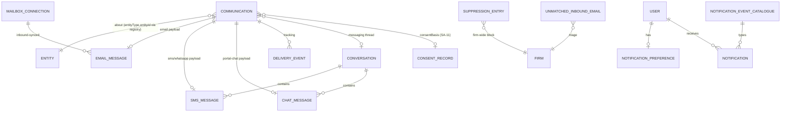

## 8. User Stories + Acceptance Criteria

**US-1 — Rep: send a templated email from the file, in the client's language, and know it landed.**
- **Given** a lead with locale `fr-CA`, **When** I send a templated email from their record, **Then** AG-12 returns the French variant, it renders with the lead's variables, a `Communication` (EMAIL, OUTBOUND, `messageClass=TRANSACTIONAL`) appears on the timeline `QUEUED→SENT`, and delivery/open update from the rail webhook.
- **Given** the rail returns a hard bounce, **When** the webhook arrives, **Then** the message shows `BOUNCED`, the address is added to `SuppressionEntry`, and I get `notif/message-bounced`.

**US-2 — Rep: a reply in my own Gmail lands on the file automatically.**
- **Given** the firm connected its Gmail and I emailed a lead, **When** the lead replies and sync runs, **Then** the reply attaches to the same thread on that lead's timeline (matched by reply-token) and raises `notif/lead-replied`.
- **Given** an inbound email matching no Contact and no reply-token, **When** it syncs, **Then** it lands in the Unmatched inbox with deterministically ranked suggestions; linking it records the address↔Contact map.

**US-3 — Case officer: one conversation across channels, with the WhatsApp window respected.**
- **Given** a client who messaged by WhatsApp and the portal, **When** I open their conversation, **Then** I see one continuous thread, channel-tagged, with AG-9 attachments.
- **Given** the client's last WhatsApp inbound was 30 hours ago, **When** I open the composer for WhatsApp, **Then** free-form text is disabled with "outside the 24-hour window — use an approved template" and only a `templateRef` send is allowed.
- **Given** I send a WhatsApp message during quiet hours, **When** I submit, **Then** it is scheduled to the next allowed window in the firm timezone.

**US-4 — Marketing: a bulk campaign cannot breach CASL.**
- **Given** a marketing email to 50 leads where 30 have a current granting SA-11 email-consent and 20 do not, **When** the send runs, **Then** the 30 are sent, the 20 are skipped-and-reported, and no message reaches a non-consented recipient.
- **Given** a recipient unsubscribes (link/STOP) after enrolment, **When** the next marketing step would fire, **Then** it is halted permanently until re-consent, the withdrawal is written to SA-11, and it shows on the timeline.

**US-5 — Compliance/Owner: prove why a message was allowed.**
- **Given** any sent message, **When** I open its detail, **Then** `consentBasis` shows `TRANSACTIONAL` or the specific `consentRecordId` with purpose/jurisdiction/timestamp.

**US-6 — Sequences send through the hub.**
- **Given** a sales sequence (AG-2) with a Day-1 email step, **When** the Conductor fires it for a Quebec lead, **Then** it sends through the Mailer in French within business hours, passes the send-gate, logs on the timeline, and a matched reply auto-exits the sequence.

**US-7 — Notifications respect my preferences and never leak.**
- **Given** my `NotificationPreference` has `notif/lead-replied` as push+in-app and `notif/message-bounced` as in-app only, **When** each event occurs, **Then** I receive them on exactly those channels (within the AG-16 firm ceiling), none during quiet hours (digested instead for digest-eligible types), each deep-linking to the file.
- **Given** a notification for a colleague's lead in another firm, **When** my list loads, **Then** I never see it (`firm_id`+`userId` scoped; RLS-backed).

**US-8 — Attachments live in the document system.**
- **Given** I attach a file to an email, **When** I send, **Then** it references an AG-9 media item, and the recipient downloads via an AG-9 ownership-bound presigned URL.
- **Given** a client sends a document by WhatsApp, **When** received, **Then** it is ingested into AG-9 and referenced from the inbound message.

**US-9 — Webhook redelivery is safe.**
- **Given** a delivery webhook, **When** the same rail `event.id` is redelivered N times, **Then** the per-firm ledger collapses it to one effect — no duplicate timeline row or `DeliveryEvent`.
- **Given** a webhook with an invalid signature, **When** it arrives, **Then** it is rejected and nothing is persisted.

**US-10 — AI draft never over-promises.**
- **Given** I ask the AI to draft a client update, **When** it returns, **Then** it is a draft I edit before send and phrases outcomes non-committally; **Given** no model key, **Then** I get a clear "not configured" message, not an error.

**US-11 — Owner: connect rails and a mailbox safely.**
- **Given** I connect the firm's Microsoft mailbox via OAuth, **When** I authorise, **Then** sync starts on chosen folders, tokens are encrypted, I can disconnect-and-purge, and the action is audited.
- **Given** no messaging gateway is configured in SA-8, **When** a rep opens the channel picker, **Then** SMS/WhatsApp are disabled-with-a-reason, not a broken send.

**US-12 — Manager: watch deliverability without scanning messages.**
- **Given** 90 days of sends across email and WhatsApp, **When** I open the deliverability dashboard with `agent/communication:view-analytics`, **Then** I see sent/delivered/bounce (hard/soft)/reply/skip KPIs and a daily trend served from `CommDailyRollup` on the read replica (never a raw-row scan), and clicking the bounce tile opens the existing paginated message list filtered to those bounces.
- **Given** the firm's open-tracking toggle is off, **When** the dashboard loads, **Then** open and click rates show "not tracked" — never a fabricated number (BR-20).
- **Given** a rail webhook is redelivered and a late bounce arrives two days after send, **When** the increments and the nightly reconcile sweep run, **Then** the affected day's rollup converges to the correct counts with no double-counting (AG-10-36).

## 9. Edge Cases & Validations

- **Marketing to a non-consented recipient** → blocked at the gate; logged; reported in batch; never sent (BR-2/BR-3).
- **Unsubscribe mid-sequence** → next step halted permanently until re-consent; Conductor exits marketing (BR-4).
- **STOP keyword in a casual message** → only canonical opt-out keywords auto-halt; ambiguous text surfaces for review (BR-4a).
- **WhatsApp send outside the 24h window with no approved template** → blocked; composer disables free-form; a Conductor step with no configured template is skipped-and-logged (BR-9a/AG-10-17a).
- **Hard bounce then re-send** → address suppressed firm-wide; further sends blocked until corrected (BR-5).
- **Inbound with no entity match** → Unmatched inbox, ranked; never auto-attached, never dropped (BR-6/BR-7a).
- **Inbound matched to a Contact in another firm** → impossible; address matching is within `firm_id` only (RLS backstop).
- **Reply from a different address than the original recipient** → reply-token/header chain still threads it; if token absent and address unknown → Unmatched.
- **Webhook redelivery / out-of-order** → idempotent on rail/provider event id; an `OPENED` after `BOUNCED` doesn't resurrect; duplicate inbound doesn't double-post (BR-11).
- **Webhook with bad/missing signature** → rejected; nothing persisted (AG-10-32).
- **Missing template translation** → AG-12 falls back to firm default locale; **missing variable** → safe placeholder, never a leaked raw `{{token}}` (BR-8).
- **Send outside business/quiet hours** → scheduled to the next allowed window in the firm timezone; DST via the zone (BR-9).
- **No messaging gateway configured** → SMS/WhatsApp disabled-with-a-reason; email + portal chat still work (BR-15).
- **Attachment too large / unsafe type** → rejected by AG-9 inheritance (size/sniffed-type allow-list, Doc 1 §7.7); send blocked with a clear message (BR-12).
- **AI draft returns over-promising text** → draft only (never auto-sent); constrained by system prompt; rep edits (BR-10).
- **Mailbox token expired** → connection shows Error; sync pauses; owner re-authorises; queued outbound (which uses the relay rail, not the mailbox) is unaffected.
- **Portal chat from a client not entitled to that entity** → rejected by the Doc 1 §2.5 portal RLS dimension (no IDOR) (AG-10-33).
- **Duplicate outbound (retried job)** → dedupe key prevents a second send; one `Communication` only (AG-10-6).
- **Timeline at scale** → keyset cursor `{occurredAt, channel, communicationId}` over the materialized AG-13 `ActivityEvent` table; equal timestamps never skip/duplicate; detail never loads full history (AG-10-21).
- **Notification firehose** → per-user/per-event/per-channel prefs + quiet hours + digest, intersected with the AG-16 firm ceiling; no cross-firm/cross-user leakage (BR-13).
- **User opts into a channel the firm disabled** → the effective channel set is the intersection; the per-user toggle is shown disabled-with-reason against the AG-16 ceiling (BR-19).
- **`messageClass` not set by origin** → reject the send at validation (a `Communication` MUST carry an explicit class; AG-10-23); never default-to-marketing or silently send.
- **Export of a long thread/timeline** → streamed/async, tenant-scoped, masked unless `reveal-pii`, audited (AG-10-34/35).

**Validation doctrine.** All input (compose, config, webhook payloads, consent changes, export filters) is validated by schema (class-validator/Zod) per Doc 1, never ad-hoc if/else. Reject early with a clear, localised message; never persist on validation failure; verify webhook signatures before any processing.

## 10. Permissions (LOCAL `agent/*`)

Default-deny; additive; always evaluated within the caller's `firm_id` by the scope-aware guard (Doc 1 §4.2) with record-level authz layered on (Doc 1 §4.5). All keys are LOCAL `agent/*` in the canonical `agent/<resource>:<action>` colon grammar (Doc 1 §4.1); consent/config/export/PII-reveal each ride their own key — never a generic "agent can use mail" grant. AG-10's resource namespaces are `agent/communication` (the hub) and `agent/notification` (per-user preference).

| Permission Key | Description |
|---|---|
| `agent/communication:view-own` / `agent/communication:view-all` | View the per-entity timeline / inbox (paginated); own-records vs firm-wide (Doc 1 §4.1 qualifier) |
| `agent/communication:send-email` | Compose/send/reply/forward email |
| `agent/communication:send-message` | Send SMS / WhatsApp / portal chat (Messenger) |
| `agent/communication:bulk-send` | Bulk/marketing send (gate-evaluated per recipient, reported) |
| `agent/communication:manage-inbox` | Star/archive/snooze/label/draft management |
| `agent/communication:resolve-unmatched` | Link/dismiss Unmatched-inbox items |
| `agent/communication:manage-consent` | Read/override consent (writes to SA-11), manage `SuppressionEntry` (audited) |
| `agent/communication:configure-rails` | Configure the firm's email/messaging rail selection (calls SA-8) |
| `agent/communication:connect-mailbox` | Connect/disconnect/purge own-mailbox sync |
| `agent/communication:export` | Export messages/timeline (masked unless also `reveal-pii`) |
| `agent/communication:reveal-pii` | Reveal masked Restricted PII in messages (audited per Doc 1 §7.2) |
| `agent/communication:view-analytics` | Response-time / deliverability / bounce dashboards |
| `agent/notification:manage-preferences` | Manage own `NotificationPreference` (within the AG-16 firm ceiling) |

**Enforcement.** Route-level (`@RequirePermissions`) and object-level (`firm_id` + entity access + portal ownership chain). Notification reads are `firm_id`+`userId` scoped server-side (closes the `global:true` defect). Portal chat endpoints scope to the authenticated client + entity (Doc 1 §2.5). Template config is **not** an AG-10 permission — it is AG-12's (`agent/template:*`); the firm-policy notification ceiling is AG-16's. `feature.*` entitlement gating (e.g. WhatsApp, own-mailbox sync, AI assist, bulk campaigns, analytics) layers on after the permission check (Doc 1 §4.1).

## 11. Scalability · Security · Performance

**Scalability.** Config-driven, not code-driven: rails (SA-8), templates (AG-12), the `notif/` catalogue, quiet-hours, and notification preferences are all data — a firm reshapes communication without a deploy. A new channel is a new Doer adapter onto the same `Communication` spine, not a new module. Polymorphic cross-cutting via the `EntityTypeRegistry` means a new entity type is config, not migration. The per-entity timeline reads the materialized AG-13 `ActivityEvent` table (committed-IN per ADR 6.2 — the ERD is frozen, no read-time-aggregation swap pending). Outbound sends, inbound sync, bulk fan-out, webhook processing, digest batching, and exports run on BullMQ in `apps/worker` (Doc 1 §6.2), scaling horizontally and independently of the API. Target: a large tenant at 100k → 1M messages with the inbox/timeline still fast.

**Security (by design).** Per-action permissions (§10) with send-channel separation, consent management, rail/mailbox config, export, and PII reveal each on their own key, default-deny. Tenant isolation is `firm_id` FORCED RLS (Doc 1 §2) — the DB guarantees a cross-firm row is invisible even on a raw query; notifications are additionally `userId`-scoped; portal chat carries the second RLS dimension (Doc 1 §2.5). External surfaces — rail webhooks, gateway webhooks, the portal chat endpoint, and the mailbox OAuth callback — are signature-verified inside their adapter, idempotent (Doc 1 §6.1.4), rate-limited, size-limited, schema-validated, and tenant-scoped; nothing persists on a failed check (the OAuth callback uses a CSRF `state` param). PII: message bodies and mailbox tokens are field-encrypted at rest (Doc 1 §7.1–§7.2), mask-by-default with audited reveal, never in logs/traces/search (Doc 1 §7.7 scanners), and **no Restricted PII is ever placed in a rail payload** (the minimization layer, Doc 1 §7.7) — messages carry firm-authored non-Restricted content only. Consent integrity is a security property: the gate is the single chokepoint, consent is read live, STOP/unsubscribe are authoritative, suppression is firm-wide, and every send retains its allow-reason. Sensitive actions are written to the per-firm hash-chained audit (Doc 1 §7.5).

**Performance.** Async everything heavy: sends, inbound sync, webhook processing, bulk campaigns, digests, exports are queued, never blocking the request; failures dead-letter with `notif/send-failed`. Webhook fast-path: verify + enqueue + return; processing idempotent on the event id. Inbox is thread-grouped with bounded pages; the timeline uses the composite keyset cursor over the materialized AG-13 `ActivityEvent` table; no endpoint returns an unbounded set. Indexes (§7): `(firm_id, entityType, entityId, occurredAt)`, `(firm_id, channel, status)`, unique `EmailMessage.messageId`, unique `providerMessageId`/`providerEventId` (idempotency), `(firm_id, conversationId, occurredAt)`. Cache contract: inbox/conversation unread counts and deliverability KPI tiles in Redis keyed `(firm_id, scope)`, invalidated by new message / read-state / delivery events, staleness ≤ 60s; the open thread/timeline and the composer are always live; **consent and suppression are always read live at send time, never cached for the gate**. Analytics (§3.11) reads only the `CommDailyRollup` aggregates with indexed `GROUP BY` on the read replica (Doc 1 §1.4) — never an in-memory scan of `Communication`/`DeliveryEvent`; the deliverability KPI tiles above are the cache face of those rollups. Conductor delivery is at-least-once + idempotent (dedupe key). Budgets (within Doc 1 §8.1): compose/read p95 ≤ 300 ms; send-enqueue p95 ≤ 200 ms (delivery is async); webhook ack p95 ≤ 150 ms; all lists/inboxes/timelines/exports paginated/streamed.

## 12. Reference Note (honest: exists / NEW / CHANGED)

> Greenfield target-state; the reference prototype is design-provenance only (Doc 1 §1.8). Grounded in a read of the prototype's `src/message`, `src/mail`, `src/communication`, `src/notification`.

**Design-provenance (a real foundation in the reference codebase).**
- `message` — an SMTP send engine: queues email on a Bull `email` queue, dispatches via nodemailer, resolves per-client SMTP settings, renders system mails (retainer/SQR/portal/password/document-request) via pug; sends carry entity context. No SMS/WhatsApp.
- `mail` — an agent email inbox: thread-grouped list/inbox/sent, get-thread/detail, send/reply/forward (template-rendered, entity-aware), read/star/archive/snooze/labels/drafts/bulk, contact suggestions, email tracking, AI draft (with a no-over-promise prompt + graceful "not configured"), and inbound sync via an IMAP-style own-mailbox pull. The `Email` model has SENT/RECEIVED/FINAL and threading.
- `communication` — an entity-scoped timeline interleaving email + in-app chat (`unifiedCommunication`), agent + customer chat, ad-hoc email, mark-read, with chat media (AG-9).
- `notification` — in-app notifications: create single/bulk, emit `notification.created`, list per user, unread count, mark-read.

**NEW (requires build).**
- **Messenger channels:** SMS + WhatsApp via `SmsGatewayPort`, **one `Conversation` per client**, the **WhatsApp 24-hour session window** (`waSessionExpiresAt` + send-branch + composer UX), quiet-hours/business-window control, STOP handling.
- **The send-gate:** the explicit `messageClass` (`TRANSACTIONAL|MARKETING`) attribute + origin-setter + the single-chokepoint gate evaluated per recipient at send time (incl. bulk fan-out), reading the **SA-11 `ConsentRecord` register** live; unsubscribe → permanent marketing halt; the `firm_id` `SuppressionEntry`; the `consentBasis` provable-allow stamp.
- **Own-mailbox OAuth connect** (Gmail/Microsoft) with IMAP fallback, **reply-token entity matching**, the **Unmatched inbox** with the deterministic ranking model, and the learned `AddressContactMap`.
- **Clean polymorphic `Communication` spine** (replacing fixed FK columns) with channel payloads (`EmailMessage`/`SmsMessage`/`ChatMessage`) and the `DeliveryEvent` tracking model, writing to the materialized AG-13 `ActivityEvent` timeline table.
- **Notifications overhaul:** `firm_id`+`userId` scoping (closes the prototype `global:true` read), the AG-10-owned **`NotificationPreference` field-model** (per-event/per-channel matrix + quiet-hours + digest, bounded by the AG-16 firm ceiling), the **typed `notif/` event catalogue** (config-as-JSONB with deep-link payloads + digest-eligibility), and email/push delivery.
- **Deliverability analytics (§3.11):** the `CommDailyRollup` incremental-aggregation pipeline + reconcile sweep, the summary/trend read contracts, the responsiveness metrics, and the `originType`/`originId` stamp for AG-2/AG-14 fact joins — nothing analytics-shaped exists in the prototype.
- **Hardened external surfaces:** signed, idempotent webhooks (rail `event.id` keyed per Doc 1 §6.1.4); tenant-scoped portal chat + OAuth callback; field-encrypted bodies/tokens; granular `agent/communication:*` permissions; pagination everywhere; entitlement gating; full audit.

**CHANGED (deliberate corrections).**
- Tenant key `clientId` → `firm_id` with FORCED RLS (Doc 1 §2); notifications scoped to firm+user.
- Entity attachment: fixed FK columns → `(entityType, entityId)` validated against `EntityTypeRegistry` (camelCase columns, UPPER_SNAKE values).
- Three siloed modules (`message`/`mail`/`communication`) unified under the Doer model (Mailer + Messenger) on rail ports, with one send path and one timeline.
- **Templates are no longer owned here** — the prototype's template/render logic is superseded by consuming **AG-12** (firm-side adopt/override of the **SA-5** global catalogue). AG-10 renders + sends only.
- **Consent is no longer a parallel AG-10 table** — the legal register lives in **SA-11** (Doc 1 §7.6); AG-10 owns only the channel `SuppressionEntry`, the `messageClass` gate decision, and the `consentBasis` stamp.
- **Notification ownership is reconciled** — AG-10 owns the per-user `NotificationPreference` entity (no longer a "Doc 1 foundation entity"); AG-16 owns the firm-policy ceiling; effective channels are the intersection.
- `sendAgentEmail` from-identity bug fixed (a configured sending identity, not the firm display name); inbound sync upgraded to OAuth + reply-token matching + Unmatched inbox.

## 13. Open Questions / [FOUNDER-CONFIRM]

**Resolved IN scope (full-scope freeze, no phasing — [C6.2]).** Live SMS + WhatsApp channels (incl. the 24h-window machinery), OAuth own-mailbox sync + the Unmatched inbox, the consent send-gate, deliverability analytics, the AG-10-owned `NotificationPreference` field-model, the typed `notif/` catalogue, and email/push notification delivery are **all IN**. The per-entity timeline reads the materialized AG-13-owned `ActivityEvent` table (committed-IN per ADR 6.2 — the ERD is frozen, not deferred) behind the keyset cursor contract; a voice/call channel is **OUT** (owned by the Dialer Doer in AG-2, not AG-10).

**Technical decisions (architect-decided, stated for the record).** Consent register = SA-11 (single source); template authoring = SA-5/AG-12 (single source); per-user notification prefs = AG-10, firm ceiling = AG-16; timeline table = AG-13's materialized `ActivityEvent` (committed-IN); rails = `EmailRelayPort`/`SmsGatewayPort` via SA-8; own-mailbox connect = the own-account OAuth connector adapter category; events = the Doc 1 §6 dictionary (`dot.case` domain, `notif/` dash.case for notifications). No founder input needed on these.

**[FOUNDER-CONFIRM] — commercial/policy knobs (non-blocking; machinery is fixed):**
1. **Messaging gateway + WhatsApp BSP sender** — which SMS/WhatsApp provider/sender the firm uses (the v1 default is AWS SNS + a WhatsApp BSP per Doc 1 §6.3.1; the model/consent/conversation/24h-window ship regardless).
2. **Email rail strategy** — per-firm own SMTP only, or also a managed/shared relay with central SPF/DKIM/DMARC and per-firm sending identities (affects bounce/suppression/tracking fidelity; AWS SES + SMTP fallback is the default).
3. **Open/click tracking default** — on or off by default per firm/jurisdiction (privacy vs insight).
4. **STOP/keyword policy** — the exact opt-out keyword set and whether ambiguous text auto-halts or surfaces for review (default: conservative auto-halt on canonical STOP words; ambiguous → review).
5. **Notification channels at launch** — in-app + email + push all on by default, or a leaner default (the `NotificationPreference` matrix is delivered regardless, bounded by the AG-16 firm ceiling).
6. **Entitlement tiers** — which channels/features sit behind which plan (WhatsApp, own-mailbox sync, AI assist, bulk campaigns, analytics) — feeds the platform-wide feature-to-plan matrix (SA-3).

**[FOUNDER-CONFIRM] — domain/legal values (routed to the Immigration-SME; founder is final authority; structure here, values there):** the exact CASL / Law-25 consent wording and the bilingual (FR-CA) phrasing of consent, unsubscribe, and disclaimer copy; which messages are correctly classed `TRANSACTIONAL` vs `MARKETING` under CASL (esp. implied-consent / existing-business-relationship windows, represented in SA-11 as time-bounded implied consent); the retention period for communications and consent evidence under PIPEDA (the SA-11 floor-in-code mechanism is fixed); and the regulator-safe no-guarantee phrasing baked into client-facing templates (authored in SA-5/AG-12) and AI drafts.

---

# Module AG-11: Automation (Conductor & Doers)

## Module Index

- **§1 Purpose & Goal** — the always-on Conductor↔Doers engine that makes "nothing important is ever forgotten" structurally true.
- **§2 Users & Jobs-to-be-Done** — invisible-to-most; authored/governed by Owner/Manager, felt by all.
- **§3 Functional Design** — Conductor↔Doers model; triggers; conditions (one Predicate); actions via Doers; **per-Doer typed config schemas (§3.3a)**; the Minder deadline cascades; recipe library + visual builder; execution semantics; simulation; lifecycle/versioning; observability; guardrails; timezone; pack/country-awareness.
- **§4 Detailed Functional Requirements** — AG-11-1 … AG-11-44.
- **§5 Business Rules & Logic** — BR-1 … BR-20.
- **§6 States & Lifecycle** — definition, run, and Minder-watch lifecycles.
- **§7 Key Entities & Fields** — `AutomationDefinition/TriggerConfig/ConditionTree/Action/Run/ActionResult`, `MinderWatch` (+ typed `cascadeSteps`), `DeadLetter`, `AutomationVersion`; consumed spine entities.
- **§8 User Stories + Acceptance Criteria** — US-1 … US-12.
- **§9 Edge Cases & Validations** — idempotency, out-of-order, deletion, satisfaction, breach, poison, consent, rate caps, loops, DST, isolation.
- **§10 Permissions** — the `agent/automation:*` catalog.
- **§11 Scalability · Security · Performance** — config-as-data, RLS, CASL/Law-25, idempotent/dead-letter spine, budgets.
- **§12 Reference Note** — exists / NEW / CHANGED provenance.
- **§13 Open Questions / [FOUNDER-CONFIRM]** — resolved items + cross-module folds + business knobs.

> **Plane:** Agent console (LOCAL, firm-staff identity pool, per Doc 1 §3.1). **Tenant key:** `firm_id` with FORCED Row-Level Security as the primary isolation control (Doc 1 §2.2); `client_id` is a separate end-client axis, never the RLS key. **Build framing:** greenfield target-state; this module is the firm-facing Automation bounded context of the modulith (Doc 1 §1.1 module map: "Automation (Conductors+Doers)"). It BUILDS ON the Doc 1 cross-cutting machinery and CONSUMES the Country Packs that the Super-Admin authors in Doc 2 / Doc 1 §5.8 + §5.13. It re-specifies none of that foundation — it references it.
>
> **The one load-bearing idea.** The **Conductor** is the firm's nervous system: it listens to the canonical domain-event dictionary (Doc 1 §6.1), evaluates typed conditions, and dispatches the in-house **Doers** to do the work. The Conductor never sends an email, writes a task, or moves a stage itself — a Doer does. One brain, many hands.

## 1. Purpose & Goal

**What it is.** AG-11 is the always-on engine that turns "when X happens, do Y" into a firm-wide, audit-grade, compliant reality across every other module. It is the single home for automation: a lead is captured, a stage changes, a document is uploaded, a government deadline approaches, a date rolls over — and the right thing happens automatically (a reminder fires, a task is created, the client is emailed in their language, a case advances, a manager is escalated).

**The business outcome it must produce.** Immigration firms do not fail for lack of process — they fail because process depends on human memory under load, and humans forget. A biometrics deadline missed by a day, a PR-card expiry nobody watched, a hot lead un-followed over a weekend — each is a malpractice exposure, a lost client, or a complaint to the regulator. AG-11 makes **"nothing important is ever forgotten"** structurally true: the firm encodes its standard of care once, and the Conductor runs it forever — idempotently (Doc 1 §6.2.3 ledger), in the client's timezone, within the law (CASL/Law-25 per Doc 1 §7.6), retried-then-dead-lettered on failure, and — through the **Minder** Doer — never missing a government deadline.

**Why it is world-class (not a generic automation tool).** Zapier/GoHighLevel are blank canvases the firm must populate and hope is compliant. ExpatReady's Conductor is **library-first and immigration-native**: it ships prebuilt, pack-validated **playbooks** the firm toggles on. The moat is threefold — (a) the **Minder**, a deadline-and-compliance watcher with escalation cascades a flat reminder cannot express, that on breach emits the canonical `deadline.breached` event so AG-7 marks the case at-risk and SA-11 records the compliance fact (§3.4); (b) **compliance-native dispatch** — every comms action is CASL/Law-25-gated at send time, per recipient, in the recipient's locale, and no automation may promise an immigration outcome; (c) **pack/country awareness** — triggers, deadline definitions, and stage lifecycles come from the active Country Pack (Doc 1 §5.13.4 `StagePipeline`, §5.6 `expiryRuleJson`), so the same engine runs a Canada biometrics cascade and (later) an Australia visa-expiry cascade with no code change.

**Content-neutrality.** This module specs the *machinery*. *Which* deadlines exist, their default lead-times, the regulator-safe wording of automated client messages, and which milestones are automation-worthy are **Country-Pack content** authored in Doc 2 and confirmed by the founder — marked [FOUNDER-CONFIRM] throughout.

## 2. Users & Jobs-to-be-Done

The Conductor is mostly **invisible** — it works *for* every role without being operated by most of them. It is authored and governed by a small set; its effects are felt by all.

| Role | Relationship | Representative JTBD |
|---|---|---|
| **Owner / Principal RCIC** (primary author/governor) | Encodes the firm's standard of care; owns compliance posture. | "Switch on proven playbooks (speed-to-lead, biometrics cascade) rather than build from scratch." · "Edit a playbook once and have every consultant follow it." · "Be certain nothing we automate breaches CASL or promises an outcome." |
| **Manager / Operations Lead** (author/tuner) | Tunes triggers, thresholds, escalations; watches automation health. | "When a deadline approaches with no action, remind the officer, then escalate to me." · "Know when an automation starts failing — don't discover it from a missed deadline." · "Simulate a new playbook against real cases before it goes live." |
| **RCIC / Case Officer / Paralegal** (beneficiary) | Receives Conductor-created tasks/reminders; trusts deadlines are watched. | "When biometrics are due in 14 days, put a task on my list automatically." · "When I complete the step, stop chasing me instantly." |
| **Intake / Sales Rep** (beneficiary) | Speed-to-lead and follow-up run for them. | "When a lead lands, a 'call now' task and an auto-acknowledgement fire without me." |
| **Client** (indirect recipient) | Receives Conductor-driven comms (in their locale, with consent). | "Timely, relevant updates — never spam, never the wrong language, never after I unsubscribed." |
| **Super-Admin** (Doc 2 plane, NOT this console) | Authors the Country-Pack deadline rules, stage pipelines, and seed recipe catalogue this module consumes. | (Cross-plane; see §12 boundary note.) |

**Design implication.** The authoring surface (recipe library, builder, simulation, run-history) targets Owner/Manager and is no-code, firm-configurable, library-first. Beneficiary roles never "use" the module — they receive its outputs in their own modules. Permissions (§10) cleanly separate *authoring/governing* from *being affected*.

## 3. Functional Design

### 3.0 The Conductor↔Doers model (the foundation)

- **The Conductor** = this module's automation engine + its handler on the Doc 1 §6.2 Conductor bus. It **listens** (consumes domain events), **evaluates** typed conditions, **sequences/schedules** actions, **retries**, and **records**. It is orchestration logic only.
- **The Doers** = the in-house executors the Conductor addresses: **Mailer**/**Messenger** (comms via `EmailRelayPort`/`SmsGatewayPort`, Doc 1 §6.3.1), **Tasker** (Tasks), **Minder** (all time-based nudges *and* the deadline watcher, §3.4 — per FD-8 there is no separate "Reminder" Doer: the nudge identity is folded into the Minder; the AG-13 `Reminder` record/machinery is unchanged), **Notification**, plus **module verbs** (`change_stage`, `assign`, `invite_portal`, `create_work_item` — each calling the owning module's guarded service, §3.3a). A Doer is a thin, testable, retryable executor with one responsibility.
- **Why the split matters.** Testability (orchestration vs execution tested independently); reuse (one Mailer serves a sequence step, a deadline reminder, a manual send); honesty about the seam (the dispatcher already exists in the reference prototype — §12). Note per Doc 1 §6.3: **the Minder is a pure in-house Doer with no rail port** — it reaches no external pipe; it acts through the Tasker/Mailer/Notification Doers and its own reminder capability (AG-13's `Reminder` records) and, on breach, emits the canonical `deadline.breached` event that Case Delivery (AG-7) and SA-11 consume.

```mermaid
flowchart TB
    CON[["CONDUCTOR (Automation engine)<br/>consumes events · decides · sequences · retries · records"]]
    CON -.dispatches.-> MLR[Mailer / Messenger]
    CON -.dispatches.-> TSK[Tasker]
    CON -.dispatches.-> MIN[Minder<br/><i>time-based nudges · watches deadlines, escalates</i>]
    CON -.dispatches.-> VRB[Module verbs<br/>change_stage · assign · notify]
    note1[The Conductor never sends/writes/moves directly.<br/>A Doer does. One brain, many hands.]
    CON --- note1
```

### 3.1 Triggers — "anything that happens can start an automation"

A trigger wakes the Conductor. Four kinds:

1. **Entity events (the workhorse).** The Conductor is a registered **consumer** of the Doc 1 §6.1 domain-event dictionary (`packages/contracts/events`). It does **not** invent its own event names: it subscribes to canonical `dot.case`, lowercase, `noun(.noun).verb-past` events (`prospect.created`, `case.stage.changed`, `case.submitted`, `case.decided`, `document.uploaded`, `payment.succeeded`, `envelope.signed`, …). A `case.stage.changed` trigger exposes the event payload's `from`/`to` to the condition builder. Adding a new triggerable event = adding/extending a dictionary entry in Doc 1 §6.1, never engine surgery here.
2. **Scheduled (time-driven).** A definition runs on a cadence (daily / every-N-days / weekly / monthly / yearly / custom cron) and scans matching entities, enqueuing one run per match. Scans are **keyset-paginated** (cursor ≤ 50, Doc 1 §8.1) with an **atomic claim** so concurrent workers never double-run a schedule, and are **timezone-aware** (§3.11).
3. **Date-field anchored (the deadline primitive).** A definition anchored to a date field + relative offset ("14 days before `<deadline canonicalField>`", "on `<expiry>`"). This is the canonical source for `deadline.approaching` and the foundation of the Minder. Anchors come from pack content: `StageTemplate.deadlineOffsetDays` (Doc 1 §5.13.4) and `DocumentRequirement.expiryRuleJson` (Doc 1 §5.6) both already declare "drives the Minder."
4. **Manual / on-demand.** A user (or another module's button) explicitly runs a definition against a chosen entity — for testing, one-offs, or "do this playbook now." Permissioned (`agent/automation:run`) and audited.

**World-class behaviour.** Pack-aware pickers: which fields/milestones/deadlines exist comes from the firm's activated Country Packs (Doc 1 §5.8 effective-dating), so the trigger picker is country-correct, never a hardcoded Canada list. Compound entity context: when a trigger fires, the Conductor loads the entity with rich includes so conditions and templates read related data (the prospect's contact, the case's pathway) without N+1 fetches.

**Data flow.** Producer module emits a canonical event post-commit (Doc 1 §6.2.2) → bus/BullMQ delivers to the Conductor consumer → the Conductor finds **ENABLED** definitions matching `(eventName)` within `firm_id` → enqueues one **run** per definition. Scheduled/date-anchored: cron tick (in firm zone) → atomic claim → keyset scan → one run per match.

### 3.2 Conditions — "act only when the rule is truly met"

Between trigger and action sits a **condition gate**. AG-11 does **not** define a private rule language: it reuses the **one platform `Predicate` contract** (Doc 1 §5.13.1) — a typed, server-evaluable, discriminated-union JSON tree over `canonicalFieldKey` answers, scoped to a `subjectKind`, with the closed operator set `eq/neq/in/gt/gte/lt/lte/exists/and/or/not`. The same evaluator that runs on the portal and staff console runs here, so a condition is consistent everywhere and is publish-validatable.

For entity-shaped fields that are not canonical answers (e.g. `case.stage`, `prospect.ownerId`, an event payload's `from`/`to`), the condition references the typed entity/event field path; the operator set and AND/OR nesting are identical. Cross-entity references (the case's related contact) resolve through the loaded entity graph (§3.1).

**World-class behaviour.** Conditions over the whole graph (profile · destination country · stage · pathway · owner · related records). Country/stage/profile-aware by construction. **Human-readable preview:** the builder renders the tree as a plain-English sentence ("Run when destination = Canada AND biometricsStatus is not COMPLETED AND biometricsDueDate is within 14 days") so an Owner verifies intent, not JSON. **Evaluate-against-a-real-entity:** pick a record, see matched/not-matched with a per-leaf log.

**Data flow.** On a run, the Predicate evaluator loads the entity's current/snapshot answers (Doc 1 §5.4 currency contract), resolves each leaf to its `subjectKind` answer, folds branches. Not matched → run recorded **SKIPPED** with the per-condition log. Matched → proceed to actions.

### 3.3 Actions via Doers — "the Conductor dispatches; the Doers do"

A matched definition runs an **ordered** action list; each action names a **Doer** and carries typed config validated by Zod at the edge (Doc 1 §1.2; no manual if/else chains):

| Doer action | Does | Rail/owner |
|---|---|---|
| `send_mail` | Render template + send email | Mailer → `EmailRelayPort` (Doc 1 §6.3.1) |
| `send_message` | Render template + send SMS/WhatsApp | Messenger → `SmsGatewayPort` (channel IN scope; see §13) |
| `send_notification` | Raise an in-app notification | Notification (cross-cutting) |
| `create_reminder` | Schedule a time-based nudge | Minder → `Reminder` record (AG-13 cross-cutting) |
| `create_task` | Create/assign a task | Tasker → Task (cross-cutting) |
| `change_stage` | Advance a prospect/case to a target stage | calls the owning module's **guarded** stage service (AG-2/AG-7) |
| `assign` | Set/route the owner (round-robin or fixed) | owning module; validates same-`firm_id` |
| `invite_portal` | Invite/activate the client's portal access | calls AG-15's **guarded** invite service (AG-15-1: `ClientCustomer` lens + single-use capability token + branded localized activation email) |
| `create_work_item` | Create a tracked client **ask** (`ClientWorkItem`) | calls AG-15's guarded work-item service (AG-15-18); type `DOCUMENT_REQUEST` drives the AG-9 ask/status duality (AG-9-6) |
| `arm_minder` | Register a Minder watch (§3.4) | the Minder Doer |

**World-class behaviour.** **Locale-selected, variable-resolved templates:** comms actions render a template with entity variables and select the **locale variant** from the recipient's `language`, falling back to the firm default (EN+FR is a launch requirement, Doc 1 §8.6) — a Quebec client is emailed in French. **Explicit recipient scoping:** client-only, agent(s), or both — never an implicit broadcast. **Non-fatal isolation:** one action failing never aborts sibling actions or the triggering business transaction (Doc 1 §6.2.2 non-fatal posture). **Per-action repeat** with interval, `maxRepeatCount`, and **stop-conditions** (`RULE_NOT_MATCHED | ENTITY_DELETED | DEFINITION_DISABLED | MAX_REPEATS`) that **re-fetch the entity and re-evaluate the Predicate before each repeat** — so a chase stops the instant the condition clears. This repeat loop is the Minder's escalation backbone.

**Data flow.** Matched run → actions sorted by `order` → for each: `Conductor.dispatch(action)` → the named Doer runs (Mailer renders+sends; Tasker writes a Task; `change_stage`/`assign` call the owning module's guarded service) → per-action result recorded with `attempts` → if `repeat.enabled`, schedule next occurrence (re-fetch + re-evaluate) → run finalised with a per-action summary.

### 3.3a Per-Doer typed action config schemas (the action contract — closes the untyped-config gap)

Every `AutomationAction.config` and every `MinderWatch.cascadeSteps[].doerActions[].config` (§7) parses against the **published, versioned Zod schema for its `doer`** — one discriminated union in `packages/contracts/automation` (Doc 1 §1.2), shared by the builder UI, the recipe instantiator, and the run-time dispatcher. No Doer has a free-form config; an unknown `doer` value or a non-parsing config is a **save-time `422`**, never a runtime surprise.

**Closed enums (normative; the audit's enum gaps closed here).**

```ts
type DoerKind = 'send_mail' | 'send_message' | 'send_notification' | 'create_reminder'
  | 'create_task' | 'change_stage' | 'assign' | 'invite_portal' | 'create_work_item'
  | 'arm_minder';                                   // closed set; unknown ⇒ 422
type TriggerKind = 'ENTITY_EVENT' | 'SCHEDULED' | 'DATE_FIELD' | 'MANUAL';   // §7, restated closed
type RunStatus = 'QUEUED' | 'EVALUATING' | 'SKIPPED' | 'SUCCESS' | 'PARTIAL'
  | 'FAILED' | 'NO_OP';                             // EVALUATING added — §6 already transitions through it
type MinderWatchStatus = 'ARMED' | 'ESCALATING' | 'SATISFIED' | 'BREACHED'
  | 'CANCELLED';                                    // CANCELLED added — set by disable (BR-13) / ENTITY_DELETED;
                                                    // counts as "resolved" for AG-7 at-risk clearing (BR-7)
type RecipientScope = 'CLIENT' | 'OFFICER' | 'MANAGER' | 'OWNER' | 'CUSTOM';
const Offset = z.object({ direction: z.enum(['BEFORE','ON','AFTER']),
  amount: z.number().int().min(0), unit: z.enum(['HOURS','DAYS','WEEKS']) });
```

**The one discriminated union (Zod-style, normative field lists).**

```ts
const ActionConfig = z.discriminatedUnion('doer', [

  z.object({ doer: z.literal('send_mail'),
    templateId: z.string().uuid(),                        // AG-12 firm-resolved template, channel EMAIL; locale variant selected at send (AG-11-13)
    recipientScope: RecipientScope.default('CLIENT'),
    customRecipientUserIds: z.array(z.string().uuid()).optional(),   // required iff CUSTOM; ACTIVE firm_user, same firm_id
    attachDocumentIds: z.array(z.string().uuid()).max(5).optional(), // AG-9 documents; ownership-chain-validated
    bookingLinkAppointmentTypeId: z.string().uuid().optional() }),   // AG-4 AppointmentType → injects a booking-link variable (no-show recovery)

  z.object({ doer: z.literal('send_message'),
    channel: z.enum(['SMS','WHATSAPP']),
    templateId: z.string().uuid(),                        // AG-12, channel-matched (SMS/WA length+format constraints)
    approvedFallbackTemplateId: z.string().uuid().optional(), // WhatsApp outside-24h approved template (AG-10 §3.3); absent ⇒ step skipped-and-logged
    recipientScope: z.literal('CLIENT'),                  // automation texts clients; staff get send_notification
    bookingLinkAppointmentTypeId: z.string().uuid().optional() }),

  z.object({ doer: z.literal('send_notification'),
    notifKey: z.string(),                                 // a registered AG-10 `notif/*` catalog key — no free-text notifications
    recipientScope: z.enum(['OFFICER','MANAGER','OWNER','CUSTOM']),
    customRecipientUserIds: z.array(z.string().uuid()).optional() }),

  z.object({ doer: z.literal('create_reminder'),
    titleTemplate: z.string().max(140),                   // may carry {{entity}} variables
    remindOffset: Offset,                                 // relative to run time, or to anchorDateFieldPath when set
    anchorDateFieldPath: z.string().optional(),           // pack-resolved date field (§3.1); absent ⇒ run-time anchor
    assigneeScope: z.enum(['OFFICER','MANAGER','OWNER','CUSTOM']),
    customAssigneeUserId: z.string().uuid().optional() }),

  z.object({ doer: z.literal('create_task'),
    taskTemplateId: z.string().uuid().optional(),         // AG-13 TaskTemplate — mutually exclusive with titleTemplate (exactly one)
    titleTemplate: z.string().max(200).optional(),
    description: z.string().max(2000).optional(),
    assigneeScope: z.enum(['OFFICER','MANAGER','OWNER','ROUND_ROBIN','CUSTOM']),
    customAssigneeUserId: z.string().uuid().optional(),
    dueOffset: Offset.optional(),                         // AFTER-only relative to run time
    priority: z.enum(['LOW','NORMAL','HIGH','URGENT']).default('NORMAL') }),

  z.object({ doer: z.literal('change_stage'),
    targetStageKey: z.string(),                           // validated against the entity's pack StagePipeline (Doc 1 §5.13.4); guard rejection = SKIP-and-log
    reasonNote: z.string().max(500).optional() }),

  z.object({ doer: z.literal('assign'),
    strategy: z.enum(['FIXED','ROUND_ROBIN']),
    assigneeUserId: z.string().uuid().optional(),         // required iff FIXED; ACTIVE, same firm_id (AG-11-15)
    poolKey: z.string().optional() }),                    // required iff ROUND_ROBIN; an AG-2 round-robin pool key

  z.object({ doer: z.literal('invite_portal'),
    localeOverride: z.string().optional(),                // defaults to the client's `language` (AG-15 §3.9)
    resendIfPending: z.boolean().default(false) }),       // PENDING_ACTIVATION: false ⇒ NO_OP; true ⇒ token-rotating resend (AG-15-2)

  z.object({ doer: z.literal('create_work_item'),
    workItemType: z.enum(['DOCUMENT_REQUEST','SQR_ASSIGN','INVOICE_EXPOSE','AGREEMENT_SEND','MESSAGE_ASK']),  // the AG-15 ClientWorkItem type enum, cited not redefined
    documentRequirementKeys: z.array(z.string()).optional(), // required iff DOCUMENT_REQUEST; keys from the active pack checklist (AG-9); [FOUNDER-CONFIRM seed-recipe document set]
    sqrSelectionRef: z.string().optional(),               // required iff SQR_ASSIGN (AG-8 selection; country default when omitted per AG-8 §3.1)
    messageTemplateId: z.string().uuid().optional(),      // MESSAGE_ASK body template (AG-12)
    dueOffset: Offset.optional() }),                      // work-item due date relative to run time

  z.object({ doer: z.literal('arm_minder'),
    deadlineFieldPath: z.string(),                        // pack-resolved date field (StageTemplate.deadlineOffsetDays / DocumentRequirement.expiryRuleJson)
    satisfactionPredicateRef: z.string().uuid().optional(),  // Doc 1 §5.13.1 Predicate — or inline predicateJson of that exact shape
    satisfactionPredicateJson: PredicateSchema.optional(),
    packCascadeKey: z.string().optional(),                // a pack-shipped default cascade [FOUNDER-CONFIRM lead-times] — exactly one of packCascadeKey | cascadeSteps
    cascadeSteps: CascadeStepsSchema.optional() }),       // the §7 typed sub-schema
]);
```

Cross-field rules (`exactly one of`, `required iff`) are `.superRefine` refinements in the same contract — the builder gets them for free; the server is authoritative.

**Referential validation (beyond shape).** Shape-parsing is necessary, not sufficient. At save time every reference resolves **within the caller's `firm_id`**: `templateId` → an AG-12 firm-resolved template that exists, is ADOPTED/ACTIVE, matches the Doer's channel, and has locale variants for the firm's offered locales (or a valid fallback per AG-12); `bookingLinkAppointmentTypeId` → an active AG-4 `AppointmentType`; `taskTemplateId` → an AG-13 `TaskTemplate`; `targetStageKey` → a stage in the pack `StagePipeline` for the definition's `entityType`; `assigneeUserId`/`customRecipientUserIds` → ACTIVE same-firm users; `documentRequirementKeys` → the firm's active pack version; `notifKey` → the registered AG-10 catalog. Any failure is a `422` with per-field JSON-pointer paths ("`actions[2].config.templateId`: template not found or not adopted"); nothing is persisted. A cross-tenant reference is indistinguishable from "not found" (BR-3 — RLS makes the other tenant's row invisible; no existence oracle).

**Save-time vs enable-time vs run-time.** Shape + references validate at **save** (draft). The same deep validation **re-runs at enable and at recipe-instantiate** — a recipe referencing a template the firm never adopted enables only after a guided fix-up list is cleared. Run-time drift (a template deleted while ENABLED) is a **non-fatal action failure** on the existing retry → dead-letter path (AG-11-25/26) plus a definition-health warning — drift degrades gracefully; it is never the discovery point for a config-*shape* error.

**Recipients are scopes, never addresses (security-by-design).** No config field accepts a raw email address or phone number: recipients resolve at run time from `recipientScope`/user ids within `firm_id`. A mis-authored cross-tenant or off-file send is impossible by construction, and configs stay PII-free (Doc 1 §7.2 — configs are versioned, exported, and logged; PII must never ride in them).

**Machine-executed guarded verbs.** `change_stage`, `assign`, `invite_portal`, and `create_work_item` call the owning module's permission-guarded service; the Conductor executes them under the platform's automation principal with run/definition attribution (pending Doc-1 Amendment A4-1 for the non-human principal model — the config contract above is independent of that decision).

**Scalability · security · performance note.** The union lives in `packages/contracts` and is versioned with the definition (`AutomationVersion` snapshots include the schema version) — a new Doer is one schema variant + one executor, no engine surgery. Validation cost is O(actions) at author time only; the dispatcher reuses a parsed-config cache keyed by `(definitionId, version)`, adding zero hot-path parsing. All referential checks are single indexed, `firm_id`-scoped lookups under FORCED RLS.

### 3.4 The Minder — deadline & compliance cascades ("never miss a government deadline")

**The flagship, and the clearest place to be world-class.** A flat reminder fires once and forgets. The Minder **watches a deadline as a living thing** and runs an **escalating cascade** that intensifies as the date nears and breaches, **stops the instant the obligation is met**, and **alerts up the chain** if it is not.

**How it works.** An action `arm_minder` registers a **`MinderWatch`** on an entity's deadline (a date field, e.g. resolved from `StageTemplate.deadlineOffsetDays` or `DocumentRequirement.expiryRuleJson`), with an optional **satisfaction `Predicate`** (Doc 1 §5.13.1) and an **ordered, typed cascade** (`cascadeSteps[]` — the typed sub-schema in §7, closing the AG-11 gap). A representative pack-seeded default cascade [FOUNDER-CONFIRM lead-times]:

- **T-14:** Tasker task for the case officer + `send_notification` to them. Severity `INFO`.
- **T-7:** Reminder to the officer; CASL-gated client nudge (in locale) if a client action is required. Severity `WARN`.
- **T-2:** escalate — `send_notification` to the **Manager** (officer hasn't satisfied it). Severity `ESCALATE`.
- **T-0 / breach:** escalate to the **Owner** and **emit the canonical `deadline.breached` event** (the cross-write contract in §5 BR-7 / below) — which is what marks the Case at-risk (via AG-7) and records the compliance fact (via SA-11). Severity `BREACH`.
- **Disarm immediately** when the satisfaction Predicate is met (the repeat loop's `RULE_NOT_MATCHED` stop-condition re-evaluates before each step and halts when satisfied).

**The Minder breach cross-write contract (event-driven; cross-referenced into AG-7 and SA-11).** On breach, the Minder does **not** write Case Delivery tables directly and does **not** insert a compliance record directly (a module owns its own tables, Doc 1 §1.1). Instead it executes a single, **event-driven** contract:

1. **Emit the breach fact.** The Minder emits the canonical domain event **`deadline.breached`** (`emitter: 'automation'`, `railOriginated: false`, idempotency `deadline.breached:${minderWatchId}:${cascadeStepIndex}`, declared consumers `['case-delivery','communications','search','reporting']`). This name is the canonical AG-11-contributed deadline-lifecycle event registered in the Doc 1 §6.1 dictionary in the wave that ships the Minder (see §13 cross-module fold); AG-11 is the emitter, never the table-writer.
2. **At-risk signal (AG-7 owns the write).** **AG-7 (Case Delivery) is the consumer that owns and sets `Case.atRisk = true`** (with `atRiskReason`, `atRiskSince`, `atRiskSourceWatchId`). At-risk is **1:many over contributing watches** — a case can be at-risk from several breached Minders concurrently — so `atRisk` clears **only when ALL contributing watches are satisfied or cancelled**. **[CROSS-REF — AG-7 defines]** the AG-7 §7 `Case` entity carries `atRisk: boolean`, `atRiskReason: text`, `atRiskSince: timestamptz`, `atRiskSourceWatchId: uuid?` (the contributing-watch correlation FK), and a consumer of `deadline.breached` that sets them and clears them on `deadline.satisfied` (emitted by the Minder on late satisfaction) once no contributing watch remains. The case header and the manager caseload (AG-7 §3.2) surface `atRisk`.
3. **Compliance record (SA-11 owns the write).** The durable, audit-grade fact that a regulated deadline was breached is a **`ComplianceEvent`** — a polymorphic (`entityType`/`entityId`), PIPEDA/Law-25 governance record **owned by the SA-11 governance plane** (Doc 1 §7.6), not by AG-7 or AG-11. AG-11 does **not** define or insert this entity; SA-11 is the consumer that **writes the `ComplianceEvent` via the audit-synchronous outbox** (Doc 1 §6.2.2 audit exception, §7.5) on consuming `deadline.breached`, so a breach is recorded even if the best-effort bus fan-out is delayed. The `ComplianceEvent` field shape (owned and specified in SA-11 §7): `id`, `firm_id`, `entityType`/`entityId` (registry-validated, Doc 1 §5.8), `eventClass` (`DEADLINE_BREACHED | DEADLINE_AT_RISK | …`), `sourceWatchId`, `deadlineField`, `deadlineValue`, `severity`, `detail` (JSONB), `occurredAt`. AG-11 cites it; it does not redefine it.

**World-class behaviour.** It watches, it doesn't just remind (re-evaluate before every step). Escalation up the chain at increasing severities (officer → manager → owner). Pack-driven deadline definitions and default lead-times (Doc 1 §5.13.4) — correct per jurisdiction with no code change. At-risk surfacing (in AG-7) makes the deadline *visible*, not just an email that may be missed.

**Data flow.** `arm_minder` → create `MinderWatch {entityRef, deadlineField, deadlineValue, satisfactionPredicate, cascadeSteps[], status: ARMED}` realised on the date-planner + repeat loop → each step: re-fetch entity → re-evaluate satisfaction → if unmet, dispatch the step's Doer(s) at its severity/recipient → if met, **disarm** (status `SATISFIED`) → on breach, emit `deadline.breached` (→ AG-7 sets `Case.atRisk`; → SA-11 writes `ComplianceEvent`) + escalate Owner (status `BREACHED`) → all steps recorded in run-history. On late satisfaction emit `deadline.satisfied` (→ AG-7 clears `atRisk` once no contributing watch remains).

```mermaid
stateDiagram-v2
    [*] --> ARMED: arm_minder
    ARMED --> ESCALATING: cascade step due, unmet
    ESCALATING --> ESCALATING: next step, still unmet
    ESCALATING --> SATISFIED: satisfaction Predicate met (disarm)
    ARMED --> SATISFIED: met before first step
    ESCALATING --> BREACHED: deadline passed unmet
    ARMED --> BREACHED: armed with deadline already past
    BREACHED --> SATISFIED: late satisfaction (emit deadline.satisfied -> AG-7 clears atRisk)
    ARMED --> CANCELLED: definition disabled / entity deleted
    ESCALATING --> CANCELLED: definition disabled / entity deleted
    SATISFIED --> [*]
    CANCELLED --> [*]
    BREACHED --> [*]: case closed / definition disabled
```

### 3.5 Playbooks / Recipes Library — "switch on proven automation; don't build it"

A **Recipe** is a prebuilt, pack-validated automation template (trigger + Predicate conditions + ordered actions) authored as **config-as-data**. **The firm browses a library, previews, and enables** — which instantiates a firm-owned, editable `AutomationDefinition`. Library-first is the front door; the visual builder (§3.5b) is advanced mode.

Recipe catalogue origin: the **Super-Admin authors and ships the seed recipe catalogue** as part of the Country Pack / platform config (Doc 2). The Agent console **consumes** it. Recommended seeds [FOUNDER-CONFIRM content]: speed-to-lead (`prospect.created` → `create_task` + `send_mail`), e-sign → onboarding (`envelope.signed` → `change_stage` WON + `send_mail` welcome + `invite_portal` + `create_work_item` DOCUMENT_REQUEST — every step a §3.3a-typed verb in the closed Doer set; "portal invite" and "document request" are exactly the AG-15 invite action and the AG-15 `ClientWorkItem(DOCUMENT_REQUEST)` ask, never verbs of their own), biometrics-deadline cascade (`arm_minder`), PR-card/status-expiry watch, document-received acknowledgement (`document.uploaded` → `send_mail`), going-cold re-engagement, no-show recovery (`send_mail` with `bookingLinkAppointmentTypeId`).

**World-class behaviour.** Config-as-data (a new recipe is a seed row, not a release). **Recipe versioning & "what changed":** enabling records the library `recipeVersion`; when the platform improves a recipe, the firm is *offered* the update — never silently overwritten, because the firm may have edited it. **Entitlement-aware:** a recipe using a plan-gated capability (SMS, advanced Minder) is shown disabled with a clear reason if the firm lacks the entitlement (Doc 1 §2.6 config plane / plan tiers).

#### 3.5b Visual no-code builder
Beyond the library, an Owner/Manager authors from scratch in a visual builder: **trigger picker** (pack-filtered) → **condition builder** (Predicate tree + plain-English preview + evaluate-against-entity) → **ordered action list** (Doer config, template + locale-variant picker, repeat + stop-conditions, drag-reorder) → **simulate** (§3.7) → **enable**. Same `AutomationDefinition` shape, no recipe origin.

**Data flow.** Enable recipe → clone the recipe's config-as-data into a firm-scoped `AutomationDefinition` (status `FINAL`) → user reviews/edits → enable → joins the live event-matching set.

### 3.6 Execution Semantics — "idempotent · at-least-once · retry → dead-letter"

This is the correctness spine, and it **inherits Doc 1 §6.2 wholesale** rather than re-inventing it.

- **At-least-once + idempotent.** Transport is at-least-once (Doc 1 §6.2.1). Every run records into the **per-firm processed-event ledger** (Doc 1 §6.2.3) under the event's declared **idempotency key** (Doc 1 §6.1.4 — for rail-originated events like `payment.succeeded`/`envelope.signed` the key is built from the rail `event.id`; for internal events from the business id). A redelivered run whose `(firm_id, consumerKey='automation', idempotencyKey)` row already exists is a **NO_OP** — no duplicate email, no duplicate WON move, no duplicate task. AG-11 invents **no** ad-hoc dedupe scheme (Doc 1 §6.1.4 forbids it).
- **Retry with backoff** on transient action failure (exponential backoff), applied to first-run failures, not only repeats.
- **Dead-letter on exhaustion.** An action past its retry budget moves to a **`DeadLetter`** store with full context (definition, version, entity, action, error, attempts) and raises a Manager Notification — never silently lost, never infinitely retried. This is the BullMQ dead-letter lane of Doc 1 §6.2.1, surfaced as a firm-facing entity.
- **Non-fatal isolation.** One action's failure never rolls back siblings or the triggering business transaction (Doc 1 §6.2.2).
- **PARTIAL semantics (closing the gap).** A run is **PARTIAL** when ≥1 action succeeded and ≥1 action **dead-lettered** (exhausted retries) — distinct from FAILED (the run could not evaluate/dispatch at all) and from SUCCESS. A PARTIAL run is closed (not retried as a whole — the dead-lettered actions are retried individually from the DeadLetter UI), counts toward health degradation, and the Manager is alerted exactly once per dead-lettered action.

**Data flow.** Run enqueued (at-least-once) → ledger idempotency check (seen → NO_OP) → conditions → actions, each retry/backoff → on exhaustion write `DeadLetter` + notify manager → run finalised SUCCESS/PARTIAL/FAILED/SKIPPED/NO_OP with per-action status.

### 3.7 Dry-run / Simulation — "see what it would do before it does it"

Before enabling, the author can **simulate**: pick a real entity (or a window for scheduled/Minder), and the Conductor evaluates the trigger + Predicate and **renders the actions it would take with zero side-effects** (no send, no write, no stage change). Output is a readable plan: "Rule matched. Would send template *Welcome (FR)* to client-a@…; would create task *Verify passport* for officer Client L; would arm Minder on `biometricsDueDate` (cascade T-14/-7/-2/breach)."

**World-class behaviour.** Real data, zero side-effects (real evaluator; every Doer runs in **dry mode**). **Batch blast-radius** for scheduled/Minder: "If enabled today, would match **37** open cases and create 37 tasks" — the author sees the radius before going live (prevents accidentally emailing 500 clients). Promote-to-live in one click. Nothing persists except an optional audited simulation marker.

### 3.8 Enable/Disable, Versioning & Change Control

Lifecycle **Draft → Enabled → Disabled → Archived**. Enable/disable is instant, permissioned, audited. Disabling **stops future triggers and cancels pending repeats/Minder steps** (the AG-7 `cancelPendingForCase` pattern generalised). Editing a live definition creates an **immutable `AutomationVersion`**; in-flight runs complete on their starting version; new runs use the new version (no mid-run swaps). Disable-with-confirmation tells the author "this will cancel N pending steps." Version history shows actor, timestamp, and a diff.

### 3.9 Run-history, Observability & Audit — "prove every automation fired, when, to whom"

Every run is recorded (status, the rule/Predicate log, per-action results with timings + `attempts`, errors, repeat lineage, the resolved idempotency key). Surfaced as:

- **Per-entity automation timeline** — on a case/prospect, every automation that touched it (which reminders, which tasks, which stage moves, which Minder steps) with timestamps — the audit-grade "what did the system do for this client" record. AG-11 does not own a bespoke per-case log: this timeline is assembled from the **materialized, append-only `ActivityEvent` table owned by AG-13** (committed-IN per ADR 6.2), which AG-11 CONSUMES via the polymorphic `(entityType, entityId)` pattern (Doc 1 §5.8). AG-11's own `AutomationRun`/`AutomationActionResult` rows are the source records AG-13's projection draws automation entries from.
- **Firm-wide health** — success/partial/failed/skipped/dead-lettered counts per definition, trending, so a degrading recipe is caught early. Tiles read **cached aggregate counts** (Redis, keyed by `firm_id`, evicted on run completion), never a live full scan.
- **Searchable, keyset-paginated, retained** (§5 BR-18 retention, closing the "per policy with no value" gap). PII is redacted from persisted run logs (Doc 1 §7.2; the reference prototype persisted raw `entityData` — target redacts it).

### 3.10 Guardrails — "powerful, but it cannot run wild"

- **Loop/cycle guard.** A definition whose action re-triggers its own trigger (`case.stage.changed` → `change_stage`) is bounded by a **max chain depth** + a **per-entity-per-event de-dup** within a run-chain, broken-and-logged before infinite cascade.
- **CASL/Law-25 gating on comms** (Doc 1 §7.6). Every **marketing** comms action checks the recipient's **express consent at send time, per recipient**; **transactional** messages (deadline reminders, document acknowledgements) are exempt; unsubscribe halts marketing automation immediately. The `consentClass` (`TRANSACTIONAL | MARKETING`) is an explicit, author-set attribute on every comms action (closing the gap; carried on `AutomationAction`).
- **Rate caps.** Per-firm and per-recipient automated-comms caps (e.g. no more than N automated messages to one client per day); exceeding skips-and-logs (never silently drops).
- **No-guarantee rule.** No automated message renders an immigration outcome as a promise; eligibility/status content carries the indicative-not-guaranteed disclaimer + pack-version provenance [FOUNDER-CONFIRM wording].
- **Entitlement/permission gating.** Plan-gated capabilities are hidden/disabled absent the entitlement; authoring requires the right `agent/*` key (§10).

### 3.11 Timezone & Business-hours Awareness

Time-based behaviour respects the **firm/office IANA timezone and business hours** (Doc 1 §8.6 UTC storage, America/Toronto default render; AG-16 `BusinessHoursCalendar` per the gap analysis). A "9am daily" runs at 9am in the firm's zone (DST-correct); a Minder "T-2" is computed in the firm calendar; a client nudge can be held to business hours; a deadline on a weekend is handled per the firm calendar. Per-office zones for multi-office firms.

### 3.12 Pack/Country-aware Triggers

Available triggers, date fields, milestones, stage pipelines, and deadline definitions come from the firm's **activated Country Packs** (Doc 1 §5.8 + §5.13.4 `StagePipeline`, §5.6 `DocumentRequirement.expiryRuleJson`), not a hardcoded Canada list. The builder's pickers and the Minder seed cascades are filtered by activated countries. A deactivated country's existing automations remain readable; new ones cannot select its pack-specific triggers (Doc 1 §5.8 immutability/effective-dating).

## 4. Detailed Functional Requirements

**Conductor↔Doers**
- **AG-11-1.** The system SHALL provide one **Conductor** that orchestrates Doers and SHALL NOT itself perform a Doer's unit of work (no direct send/write/stage-change in orchestration logic).
- **AG-11-2.** The Conductor SHALL dispatch to the closed `DoerKind` set (§3.3a): `send_mail`, `send_message`, `send_notification`, `create_reminder`, `create_task`, `change_stage`, `assign`, `invite_portal`, `create_work_item`, `arm_minder`; an unregistered doer value SHALL be rejected `422` at save.
- **AG-11-3.** The Minder SHALL be a pure in-house Doer with **no rail port** (Doc 1 §6.3); it acts only through other Doers and the event-driven breach contract (AG-11-19).

**Triggers**
- **AG-11-4.** The Conductor SHALL be a registered **consumer** of the Doc 1 §6.1 domain-event dictionary and SHALL subscribe only to canonical registered event names; it SHALL NOT define its own event vocabulary.
- **AG-11-5.** The Conductor SHALL support scheduled triggers (daily/every-N/weekly/monthly/yearly/custom cron) scanning matching entities, **keyset-paginated** with an **atomic claim**, computed in the firm/office IANA timezone.
- **AG-11-6.** The Conductor SHALL support **date-field-anchored** triggers (date field + before/on/after offset) sourcing anchors from pack content (`StageTemplate.deadlineOffsetDays`, `DocumentRequirement.expiryRuleJson`).
- **AG-11-7.** The Conductor SHALL support **manual/on-demand** runs against a chosen entity, permissioned (`agent/automation:run`) and audited, idempotent against double-click.
- **AG-11-8.** The trigger/field/milestone catalog SHALL be **scoped to the firm's activated Country Packs**, never hardcoded.

**Conditions**
- **AG-11-9.** Conditions SHALL reuse the single platform `Predicate` contract (Doc 1 §5.13.1) with the closed operator set; AG-11 SHALL NOT introduce a second rule language.
- **AG-11-10.** A non-matching run SHALL be recorded **SKIPPED** with the per-leaf evaluation log.
- **AG-11-11.** The builder SHALL render a **plain-English preview** of the Predicate and SHALL allow **evaluate-against-a-real-entity**.

**Actions**
- **AG-11-12.** Each definition SHALL run an **ordered** action list; each action SHALL name a Doer and carry Zod-validated typed config.
- **AG-11-13.** Comms actions SHALL render a locale variant from the recipient's `language`, falling back to the firm default (EN/FR launch requirement).
- **AG-11-14.** Actions SHALL support **per-action repeat** (interval, `maxRepeatCount`, stop-conditions `RULE_NOT_MATCHED/ENTITY_DELETED/DEFINITION_DISABLED/MAX_REPEATS`), re-fetching the entity and re-evaluating the Predicate before each repeat.
- **AG-11-15.** `change_stage` SHALL call the owning module's guarded stage service; `assign` SHALL validate same-`firm_id`.

**The Minder**
- **AG-11-16.** `arm_minder` SHALL register a `MinderWatch` with a deadline field, optional satisfaction `Predicate`, and an ordered, **typed** `cascadeSteps[]` (§7 sub-schema).
- **AG-11-17.** The Minder SHALL **re-evaluate the live entity before every cascade step** and **disarm immediately** when the satisfaction Predicate is met.
- **AG-11-18.** The Minder SHALL **escalate up the chain** (officer → manager → owner) at increasing severities as the deadline nears and breaches.
- **AG-11-19.** On breach the Minder SHALL **emit the canonical `deadline.breached` event** (consumed by AG-7 to set `Case.atRisk` and by SA-11 to write the `ComplianceEvent` via the audit-synchronous outbox); the Minder SHALL NOT write Case Delivery tables or the `ComplianceEvent` directly. On late satisfaction it SHALL emit `deadline.satisfied` so AG-7 can clear `atRisk` (only once no contributing watch remains).
- **AG-11-20.** Minder deadline definitions and default lead-times SHALL be **pack-driven**, not hardcoded.

**Recipes / builder**
- **AG-11-21.** The console SHALL present a **library of prebuilt recipes** (Super-Admin-authored, config-as-data) to preview and **enable**, instantiating a firm-owned editable `AutomationDefinition` (status `FINAL`).
- **AG-11-22.** Authors SHALL be able to build automations **from scratch in a visual no-code builder** (trigger → conditions → ordered actions → simulate → enable).
- **AG-11-23.** Enabling a recipe SHALL record its `recipeVersion`; a later platform improvement SHALL be **offered**, never silently overwritten.

**Execution semantics**
- **AG-11-24.** Every run SHALL be **idempotent** via the Doc 1 §6.2.3 per-firm processed-event ledger under the event's declared idempotency key; a redelivered run SHALL be a **NO_OP**.
- **AG-11-25.** First-run action failures SHALL be **retried with exponential backoff**.
- **AG-11-26.** An action that exhausts its retry budget SHALL move to a **`DeadLetter`** store with full context and SHALL raise a Manager Notification.
- **AG-11-27.** A failing action SHALL be **non-fatal** to siblings and to the triggering business transaction; run status SHALL distinguish **SUCCESS / PARTIAL / FAILED / SKIPPED / NO_OP** (PARTIAL = some action(s) dead-lettered).

**Simulation**
- **AG-11-28.** Authors SHALL **simulate** against a real entity (or window) producing a readable would-do plan with **zero side-effects** and a **batch blast-radius count** for scheduled/Minder automations.

**Lifecycle**
- **AG-11-29.** Each definition SHALL have a **Draft → Enabled → Disabled → Archived** lifecycle; enable/disable SHALL be instant, permissioned, audited.
- **AG-11-30.** Disabling SHALL **cancel pending repeats/Minder steps**; editing a live definition SHALL create an **immutable version**; in-flight runs complete on their starting version.

**Observability / guardrails**
- **AG-11-31.** The console SHALL provide a **per-entity automation timeline** (assembled from AG-13's materialized `ActivityEvent` table, consumed via the polymorphic `(entityType, entityId)` pattern) and a **firm-wide health view** (counts incl. dead-lettered), both keyset-paginated and `firm_id`-scoped.
- **AG-11-32.** Run history SHALL be retained per the BR-18 floor, PII-redacted; reads SHALL never be unbounded.
- **AG-11-33.** The Conductor SHALL enforce a **loop/cycle guard** (max depth + per-entity-per-event de-dup).
- **AG-11-34.** Every comms action SHALL carry an author-set `consentClass`; **MARKETING** sends SHALL verify per-recipient express consent at send time (transactional exempt; unsubscribe halts).
- **AG-11-35.** The Conductor SHALL enforce per-firm and per-recipient automated-comms **rate caps** (skip-and-log on exceed).

**Security/isolation**
- **AG-11-36.** Trigger matching, condition evaluation, and action dispatch SHALL be strictly `firm_id`-scoped under FORCED RLS (Doc 1 §2.2); an automation SHALL never read or act on another tenant's entity, recipient, or template.
- **AG-11-37.** Authoring, enabling, simulating, manual-run, dead-letter retry, and configuration changes SHALL be **audited** (actor, target, before/after) on the per-firm audit chain (Doc 1 §7.5).

**Typed action configs (closes the untyped-config gap)**
- **AG-11-38.** Every `AutomationAction.config` and every `cascadeSteps[].doerActions[].config` SHALL parse against the published per-Doer Zod schema in the one `packages/contracts/automation` discriminated union (§3.3a); a non-parsing config or unknown `doer` SHALL be rejected **`422` at save time** with per-field JSON-pointer error paths and SHALL never be persisted — a config-shape error SHALL never surface at run time.
- **AG-11-39.** Save-time validation SHALL include **referential checks within `firm_id`**: `templateId` → AG-12 (adopted, channel-matched, locale-covered), `bookingLinkAppointmentTypeId` → AG-4, `taskTemplateId` → AG-13, `targetStageKey` → the pack `StagePipeline` for the definition's `entityType`, assignee/recipient user ids → ACTIVE same-firm users, `documentRequirementKeys` → the active pack version, `notifKey` → the registered AG-10 catalog. A cross-tenant reference SHALL behave as not-found (no existence oracle).
- **AG-11-40.** The same deep validation SHALL **re-run at enable time and at recipe-instantiate time**; an unsatisfied reference SHALL block enablement behind a guided fix-up list. Run-time drift (a referenced object deleted while ENABLED) SHALL follow the non-fatal retry → dead-letter path (AG-11-25/26) and raise a definition-health warning.
- **AG-11-41.** `invite_portal` SHALL execute by calling AG-15's guarded invite service (AG-15-1/AG-15-2 semantics): already-ACTIVE portal access ⇒ NO_OP; PENDING_ACTIVATION ⇒ NO_OP unless `resendIfPending`, which token-rotates. It SHALL NOT mint tokens or send activation email itself.
- **AG-11-42.** `create_work_item` SHALL execute by calling AG-15's guarded work-item service (AG-15-18), discriminated by `workItemType`; a DOCUMENT_REQUEST item SHALL drive the AG-9 ask/status duality (AG-9-6) — AG-11 writes neither `ClientWorkItem` nor `Document` tables directly.
- **AG-11-43.** No action config field SHALL accept a raw email address or phone number; recipients SHALL resolve at run time from `recipientScope`/user ids within `firm_id` (configs stay PII-free, Doc 1 §7.2).
- **AG-11-44.** `AutomationRun.status` SHALL include **`EVALUATING`** (the §6 condition-evaluation state) and `MinderWatch.status` SHALL include **`CANCELLED`** (set by definition-disable per BR-13 or the `ENTITY_DELETED` stop-condition; a CANCELLED watch counts as resolved for AG-7's at-risk clearing per BR-7).

## 5. Business Rules & Logic

- **BR-1 (Conductor ≠ Doer).** Orchestration never sends/writes/moves directly; invariant.
- **BR-2 (Pack/country).** Triggers/date-fields/deadline definitions MUST come from activated Country Packs; deactivated packs are not selectable; existing automations on a later-deactivated country remain readable.
- **BR-3 (Tenant isolation).** All matching, conditions, recipients, and templates are within `firm_id`; a cross-tenant match/send is an isolation breach and is blocked (RLS + object-level).
- **BR-4 (Idempotent effects).** Every run dedupes via the Doc 1 §6.2.3 ledger under the §6.1.4 idempotency key; a redelivered run is a NO_OP. No ad-hoc dedupe is permitted.
- **BR-5 (Retry then dead-letter).** Transient failures retry with backoff; on exhaustion they dead-letter with context and alert a manager — never silent, never infinite.
- **BR-6 (Non-fatal).** One action failing never aborts siblings or rolls back the triggering business transaction.
- **BR-7 (Minder cross-write).** A Minder breach SHALL emit the canonical `deadline.breached` event ONLY — it writes no Case Delivery or compliance table directly. AG-7 consumes `deadline.breached` and sets `Case.atRisk` + reason + `atRiskSince` + `atRiskSourceWatchId`; SA-11 consumes the same event and writes the `ComplianceEvent` via the audit-synchronous outbox. A Minder disarms the instant the satisfaction Predicate is met and never chases a satisfied deadline; late satisfaction emits `deadline.satisfied`, and AG-7 clears `atRisk` only when ALL contributing watches are satisfied/cancelled (at-risk is 1:many over watches).
- **BR-8 (CASL/Law-25).** MARKETING sends require each recipient's recorded express consent at send time; TRANSACTIONAL is exempt; unsubscribe halts marketing immediately and permanently until re-consent (Doc 1 §7.6).
- **BR-9 (No-guarantee).** No automated message renders an outcome as a promise; status/eligibility content carries the indicative disclaimer + pack-version provenance.
- **BR-10 (Loop guard).** A chain is bounded by max depth + per-entity-per-event de-dup; no definition infinitely re-triggers itself or a cycle of peers.
- **BR-11 (Rate caps).** Per-firm and per-recipient caps are enforced; exceeding skips-and-logs.
- **BR-12 (Timezone/business-hours).** Scheduled/Minder timing is computed in the firm/office IANA zone (DST-correct); business-hours-bounded actions defer to the next window.
- **BR-13 (Disable cancels pending).** Disabling cancels pending repeats/Minder steps and stops future triggers; in-flight runs finish on their starting version.
- **BR-14 (Versioned change).** Editing a live definition creates an immutable version; analytics/audit read the version a run executed under.
- **BR-15 (Simulation zero side-effects).** A simulated run renders intent only; nothing but an optional audited marker persists.
- **BR-16 (Author/governance separation).** Authoring/enabling/configuring is gated on dedicated `agent/*` keys; being *affected* requires no automation permission.
- **BR-17 (Manual run).** An on-demand run is permissioned, audited, and idempotent against double-click.
- **BR-18 (Run-history retention).** Run-history rows are retained a minimum of **24 months** [FOUNDER-CONFIRM final floor with counsel], aligned with the Doc 1 §7.6 "other ≥2yr" floor; `ComplianceEvent` rows obey SA-11's compliance floor (≥7yr where financial/regulatory). PII in run logs is redacted at write (Doc 1 §7.2).
- **BR-19 (PARTIAL semantics).** A run with ≥1 succeeded and ≥1 dead-lettered action is PARTIAL; dead-lettered actions are retried individually, never the whole run.
- **BR-20 (Typed or it does not save).** Every action config parses against its Doer's published Zod schema and passes `firm_id`-scoped referential validation at save, enable, and recipe-instantiate time (§3.3a, AG-11-38/39/40); an invalid config is a `422` and is never persisted — configuration errors are an authoring-time concern, never a run-time one.

## 6. States & Lifecycle

**Definition lifecycle.**
```
author / enable-recipe
   ──► [FINAL] ──enable──► [ENABLED] ──disable──► [DISABLED] ──archive──► [ARCHIVED]
                              │  ▲                    │
                  simulate    │  └──────enable────────┘
              (no state change, zero side-effects)
  edit-while-ENABLED ⇒ new immutable VERSION (in-flight runs finish on prior version)
```

**Run lifecycle.**
```
event ─► [QUEUED] ─► ledger idempotency-check ─► already-applied ─► [NO_OP]
                          │ unseen
                          ▼ conditions (Predicate)
                  matched? ─no─► [SKIPPED] (per-leaf log retained)
                      │ yes
                      ▼ actions (ordered, each retried with backoff)
        all ok ─► [SUCCESS]    some dead-lettered ─► [PARTIAL]    none dispatchable ─► [FAILED]
                                       (DeadLetter + manager alert)
```

**Minder watch lifecycle:** see §3.4 state diagram (`ARMED → ESCALATING → SATISFIED` or `→ BREACHED → SATISFIED-LATE`; `→ CANCELLED` from ARMED/ESCALATING on disable or entity deletion).

| From | To | Guard | Side-effect |
|---|---|---|---|
| FINAL | ENABLED | holds `agent/automation:enable` | joins live matching set; AuditLog |
| ENABLED | DISABLED | permissioned | cancels pending repeats/Minder steps; AuditLog |
| ENABLED | ENABLED (edit) | permissioned | new immutable version |
| QUEUED | NO_OP | ledger key seen (BR-4) | redelivery safe |
| EVALUATING | SKIPPED | Predicate not matched | per-leaf log retained |
| actions | PARTIAL/FAILED | retries exhausted (BR-5/19) | DeadLetter + manager alert |
| MinderWatch | SATISFIED | satisfaction Predicate met | disarm |
| MinderWatch | BREACHED | deadline passed unmet | emit `deadline.breached` → AG-7 sets `Case.atRisk` + SA-11 writes `ComplianceEvent` + owner escalation |
| MinderWatch | CANCELLED | definition disabled (BR-13) or entity deleted (`ENTITY_DELETED`) | pending cascade steps cancelled; counts as resolved for AG-7 at-risk clearing (BR-7) |

## 7. Key Entities & Fields

> All TENANT-plane entities carry `firm_id` + FORCED RLS (Doc 1 §2.2); none is GLOBAL. Cross-cutting `Task/Reminder/Communication/Notification/Audit` and the spine `Predicate`, `StageTemplate`, `DocumentRequirement`, `EntityTypeRegistry`, the processed-event ledger, `FxRateSnapshot` are **cited from Doc 1, never redefined**. Polymorphic columns are camelCase `entityType`/`entityId`; their VALUES are UPPER_SNAKE (`CASE`, `PROSPECT`, `ASSESSMENT`, `TEMPLATE`, `DOCUMENT`, …) per the Doc 1 §5.8 registry.

- **`AutomationDefinition`** (TENANT) — `id` UUID PK, `firm_id` UUID (RLS), `name`, `description?`, `status` (FINAL/ENABLED/DISABLED/ARCHIVED), `triggerKind` (ENTITY_EVENT/SCHEDULED/DATE_FIELD/MANUAL), `eventName?` (a registered Doc 1 §6.1 canonical name; required when triggerKind=ENTITY_EVENT), `entityType` (registry-validated), `recipeKey?`, `recipeVersion?`, `currentVersion` int, `createdBy/updatedBy`, `createdAt/updatedAt`. Indexes: `(firm_id, status, eventName)`, `(firm_id, entityType)`.
- **`AutomationTriggerConfig`** (embedded JSONB on definition, Zod-validated) — for SCHEDULED: `frequency`, `intervalValue?`, `cronExpression?`, `timezone` (IANA), `executionTime`, `startDate?`, `endDate?`. For DATE_FIELD: `dateFieldPath` (a pack-resolved canonical/entity field), `offset` (`{ direction: BEFORE|ON|AFTER, amount, unit }`), `executionTime`.
- **`AutomationConditionTree`** — a `predicateRef` (FK to a Doc 1 §5.13.1 `Predicate`) **or** inline `predicateJson` of that exact shape, plus the `subjectKind`. No second rule language.
- **`AutomationAction`** (child, ordered) — `id`, `definitionId`, `order` int, `doer` (the closed §3.3a `DoerKind`: send_mail/send_message/send_notification/create_reminder/create_task/change_stage/assign/invite_portal/create_work_item/arm_minder), `config` JSONB (MUST parse against the §3.3a discriminated union for its `doer` — save-time 422 otherwise, BR-20), `consentClass` (TRANSACTIONAL/MARKETING — author-set; required on comms doers), `repeat?` (`{ enabled, interval, maxRepeatCount, stopConditions[] }`). Index `(definitionId, order)`.
- **`MinderWatch`** (TENANT) — `id`, `firm_id` (RLS), `definitionId`, `entityType`/`entityId` (registry-validated, Doc 1 §5.8), `deadlineField`, `deadlineValue` timestamptz, `satisfactionPredicateRef?` (FK Predicate) | `satisfactionPredicateJson?`, `cascadeSteps` JSONB (typed sub-schema below), `status` (ARMED/ESCALATING/SATISFIED/BREACHED/CANCELLED — §3.3a closed enum), `currentStepIndex` int, `nextStepAt` timestamptz, `lastEvaluatedAt` timestamptz, `breachedAt?`. Index `(firm_id, status, nextStepAt)`, `(firm_id, entityType, entityId)`.

  **`MinderWatch.cascadeSteps[]` — typed sub-schema (closes the AG-11 gap):**
  ```jsonc
  {
    "stepKey": "T-14",                       // stable slug within the cascade
    "anchor": "DEADLINE",                    // DEADLINE | STAGE_ENTRY (the date the offset is relative to)
    "offset": { "amount": 14, "unit": "DAYS", "direction": "BEFORE" },  // BEFORE|ON|AFTER
    "severity": "INFO",                      // INFO | WARN | ESCALATE | BREACH
    "recipientScope": "OFFICER",             // OFFICER | MANAGER | OWNER | CLIENT | CUSTOM
    "customRecipientUserIds": [],            // when recipientScope=CUSTOM (same firm_id)
    "doerActions": [                         // ordered actions this step dispatches — each config parses against the §3.3a schema for its doer (BR-20)
      { "doer": "create_task", "config": { "titleTemplate": "Chase {{deadlineField}} for {{client.name}}", "assigneeScope": "OFFICER", "priority": "HIGH" } },
      { "doer": "send_notification", "config": { "notifKey": "notif/deadline-approaching", "recipientScope": "OFFICER" } }
    ],
    "consentClass": "TRANSACTIONAL",         // deadline reminders are transactional by default
    "businessHoursBound": true               // defer to next business window (BR-12)
  }
  ```
  A step's `anchor` resolves the date its `offset` is relative to: `DEADLINE` uses the watch's `deadlineValue`; `STAGE_ENTRY` resolves against **AG-7's `stageEnteredAt`** (the timestamp the case entered its current stage) — i.e. a `STAGE_ENTRY`-anchored step computes "T-X relative to when the stage was entered." If the consumed entity exposes no `stageEnteredAt`, the step is DEADLINE-anchored only (the validator rejects a `STAGE_ENTRY` anchor on a watch whose entity has no resolvable stage-entry timestamp). The BREACH-severity step additionally triggers the AG-11-19 breach emission (it carries no extra config — emitting `deadline.breached` is engine behaviour, not author-configured). `cascadeSteps` is Zod-validated at author/enable time: `stepKey` unique, `offset.unit ∈ {HOURS,DAYS,WEEKS}`, `severity`/`recipientScope`/`anchor` in their closed sets, every `doer.config` parses against its Doer schema.

- **`AutomationRun`** (TENANT) — `id`, `firm_id` (RLS), `definitionId`, `definitionVersion` int, `eventName?`, `entityType`/`entityId`, `idempotencyKey` (the resolved Doc 1 §6.1.4 key — the value stored in the ledger), `status` (QUEUED/EVALUATING/SKIPPED/SUCCESS/PARTIAL/FAILED/NO_OP — §3.3a closed enum; EVALUATING is the §6 condition-evaluation state), `ruleMatched` bool, `ruleLog` JSONB (PII-redacted), `executionType` (STANDARD/SCHEDULED/REPEAT/MANUAL), `repeatSeriesId?`, `repeatIndex?`, `parentRunId?`, `startedAt/finishedAt`, `durationMs`. Indexes: `(firm_id, definitionId, finishedAt)`, `(firm_id, entityType, entityId, finishedAt)` (powers AG-13's `ActivityEvent` automation-entry projection), `(firm_id, status)`.
- **`AutomationActionResult`** (child of run) — `id`, `runId`, `actionId`, `doer`, `success` bool, `attempts` int, `error?`, `resultRef?` (e.g. created Task id), `startedAt/completedAt`, `durationMs`.
- **`DeadLetter`** (TENANT) — `id`, `firm_id` (RLS), `runId`, `definitionId`, `actionId`, `entityType`/`entityId`, `error`, `attempts`, `payload` JSONB (PII-redacted), `status` (OPEN/RETRIED/DISMISSED), `createdAt`, `resolvedAt?`, `resolvedBy?`. Drives the dead-letter UI + manager alert.
- **`AutomationVersion`** (TENANT, immutable) — `id`, `firm_id`, `definitionId`, `version` int, `snapshotJson` (trigger+conditions+actions at that version), `changedBy`, `changedAt`.
- **Consumed, not owned (cited):** the **recipe catalogue** (Super-Admin-authored, Doc 2 / Doc 1 §2.6 config plane); the **processed-event ledger** (Doc 1 §6.2.3); **`Predicate`** (Doc 1 §5.13.1); **`StageTemplate.deadlineOffsetDays`**, **`DocumentRequirement.expiryRuleJson`** (Doc 1 §5.13.4/§5.6 — Minder anchors); firm/office **IANA timezone + `BusinessHoursCalendar`** (Doc 1 §8.6 / AG-16); **entitlements** + **rate caps** (config plane); the materialized **`ActivityEvent`** timeline table (owned by AG-13, committed-IN per ADR 6.2 — AG-11 consumes it); **`ComplianceEvent`** (owned by SA-11, Doc 1 §7.6 — AG-11 only emits `deadline.breached`, never writes this table); **`Case.atRisk` family** (owned by AG-7, set by AG-7's `deadline.breached` consumer and cleared by its `deadline.satisfied` consumer; includes `atRiskSourceWatchId`).

```mermaid
erDiagram
    AUTOMATION_DEFINITION ||--o| AUTOMATION_TRIGGER_CONFIG : "embeds"
    AUTOMATION_DEFINITION ||--o| AUTOMATION_CONDITION_TREE : "gated by (Predicate)"
    AUTOMATION_DEFINITION ||--o{ AUTOMATION_ACTION : "ordered"
    AUTOMATION_DEFINITION ||--o{ AUTOMATION_VERSION : "immutable history"
    AUTOMATION_DEFINITION ||--o{ AUTOMATION_RUN : "produces"
    AUTOMATION_RUN ||--o{ AUTOMATION_ACTION_RESULT : "logs (attempts)"
    AUTOMATION_RUN ||--o| DEAD_LETTER : "on exhaustion"
    AUTOMATION_ACTION }o--o| MINDER_WATCH : "arm_minder spawns"
    AUTOMATION_CONDITION_TREE }o--|| PREDICATE : "Doc1 §5.13.1 (one contract)"
    MINDER_WATCH }o--|| COMPLIANCE_EVENT : "breach emits deadline.breached; SA-11 writes (consumed, not owned)"
    AUTOMATION_RUN }o--|| PROCESSED_EVENT_LEDGER : "Doc1 §6.2.3 idempotency"
```

### 7.1 Events emitted / consumed

> Canonical dot.case names (Doc 1 §6.1). These are registered centrally in the Doc 1 §6.1 dictionary in the final integration pass; AG-11's deadline-lifecycle events are AG-11-contributed and listed here as the canonical target.

| Direction | Event | Role |
|---|---|---|
| **Emit** | `deadline.breached` | Minder breach (emitter `automation`, `railOriginated:false`, idempotency `deadline.breached:${minderWatchId}:${cascadeStepIndex}`); consumers `case-delivery` (sets `Case.atRisk`), `communications`, `search`, `reporting`, and SA-11 (writes `ComplianceEvent`). |
| **Emit** | `deadline.satisfied` | Minder late satisfaction; consumer `case-delivery` (clears `Case.atRisk` once all contributing watches resolved). |
| **Emit** | `deadline.approaching` | Date-anchored lead-time signal (the deadline primitive, §3.1). |
| **Consume** | `prospect.created`, `prospect.converted`, `prospect.stage.changed` | speed-to-lead / re-engagement triggers. |
| **Consume** | `case.created`, `case.stage.changed`, `case.submitted`, `case.decided`, `case.closed`, `case.assigned` | case-lifecycle triggers. |
| **Consume** | `sqr.submitted`, `sqr.answer.captured` | intake-completion triggers. |
| **Consume** | `document.uploaded`, `document.requested`, `document.received`, `document.version.added`, `document.scan.passed`, `document.scan.failed`, `document.status.changed` | document-lifecycle triggers (e.g. received-acknowledgement). |
| **Consume** | `envelope.signed` | e-sign → onboarding trigger (the single e-sign completion event; there is no separate completion event). |
| **Consume** | `invoice.issued`, `invoice.overdue`, `invoice.paid`, `invoice.voided`, `payment.succeeded`, `payment.refunded`, `payment.failed` | billing-driven triggers. |
| **Consume** | `booking.scheduled`, `booking.cancelled` | appointment-driven triggers (e.g. no-show recovery). |

## 8. User Stories + Acceptance Criteria

**US-1 — Owner: switch on a proven playbook.**
- Given the recipe library, When I open "Speed-to-lead," Then I see a plain-English description, the Doers it uses, and the permissions/entitlements it needs.
- Given I enable it, When `prospect.created` fires for a Canada lead, Then an auto-acknowledgement (in the lead's locale) and a "call now" Tasker task are produced once, and the run is recorded SUCCESS.

**US-2 — Manager: never miss a biometrics deadline (the Minder).**
- Given the biometrics recipe is enabled and a case has `biometricsDueDate` in 14 days with `biometricsStatus != COMPLETED`, When T-14 arrives in the firm's timezone, Then a task is created for the case officer and they are notified (severity INFO).
- Given the officer still hasn't completed it, When T-2 arrives, Then I (Manager) am escalated (ESCALATE); and at breach the Owner is escalated, `deadline.breached` is emitted so AG-7 sets `Case.atRisk` and SA-11 writes a `ComplianceEvent` (BREACH).
- Given the officer marks biometrics COMPLETED at T-5, When the next step is due, Then the Minder disarms (SATISFIED) and no further reminders fire.

**US-3 — Compliance: idempotent e-sign onboarding.**
- Given the e-sign→onboarding recipe, When `envelope.signed` fires, Then the prospect moves to WON and a welcome email + portal invite + first document request (`change_stage` → WON, `send_mail`, `invite_portal` via AG-15-1, `create_work_item` DOCUMENT_REQUEST via AG-15-18) are produced exactly once.
- Given the same `envelope.signed` is redelivered (same rail `event.id`), When the Conductor reprocesses it, Then the run is NO_OP (ledger key hit, Doc 1 §6.2.4) — no second email, no second stage move.

**US-4 — Author: simulate before going live.**
- Given a draft automation, When I simulate against a real case, Then I see matched/not-matched and the exact actions it would take — with no email sent and no task created.
- Given a scheduled automation, When I simulate, Then I see the blast-radius count ("would match 37 cases") before I enable it.

**US-5 — Manager: a broken automation surfaces, it doesn't fail silently.**
- Given an action whose template was deleted, When it fails past its retry budget, Then the run is PARTIAL, the action is dead-lettered with context, I receive a Notification, the queue is not wedged, and the client is not spammed with retries.

**US-6 — Compliance: automated marketing respects per-recipient consent.**
- Given a MARKETING automation targeting 50 clients where 30 have express consent and 20 do not, When the comms action runs, Then the 30 consented receive it, the 20 non-consented are skipped-and-logged, and a client who unsubscribed after enrolment is not sent the next step. TRANSACTIONAL deadline reminders are unaffected.

**US-7 — Timezone correctness.**
- Given a "9:00 daily" automation in a firm whose timezone is `America/Toronto`, When it runs, Then it fires at 09:00 Toronto (DST-correct), not 09:00 UTC.

**US-8 — Loop guard.**
- Given an automation on `case.stage.changed` whose action is `change_stage`, When it would re-trigger itself, Then the cycle guard breaks the chain after the bounded depth and records why — no infinite cascade.

**US-9 — Tenant isolation.**
- Given firm A's automation, When it evaluates and dispatches, Then it only ever matches firm A's entities and sends to firm A's recipients using firm A's templates; a forced cross-`firm_id` read returns zero rows (Doc 1 §2.8 denial suite).

**US-10 — Disable cancels pending work.**
- Given an enabled Minder with pending cascade steps, When I disable the automation, Then the pending steps are cancelled and no further reminders fire; in-flight runs finish on their version.

**US-11 — Audit & per-entity timeline.**
- Given a case, When I open its automation timeline, Then I see every automation that touched it (which reminders, tasks, stage moves, Minder steps) with timestamps — assembled from AG-13's materialized `ActivityEvent` table, keyset-paginated, `firm_id`-scoped, PII-redacted.

**US-12 — Author: an invalid action config cannot be saved (schema-validated configs).**
- Given a `send_mail` action whose config omits `templateId`, When I save the definition, Then the API returns **422** with the field path `actions[n].config.templateId`, nothing is persisted, and the builder highlights the field inline — the error is never deferred to run time.
- Given a `change_stage` action whose `targetStageKey` is not a stage in the pack `StagePipeline` for the definition's `entityType`, When I save, Then the save is rejected 422 with a plain-language reason ("not a stage of this pipeline").
- Given I enable a library recipe that references a template my firm has not adopted from AG-12, When I click Enable, Then enablement is blocked behind a guided fix-up list (adopt or substitute the template), and once cleared the definition enables normally (AG-11-40).
- Given a template referenced by an ENABLED definition is later deleted, When the next run dispatches that action, Then the action fails non-fatally, retries, dead-letters with context, and the definition shows a health warning — sibling actions and the triggering transaction are unaffected (AG-11-25/26/27).

## 9. Edge Cases & Validations

- **Duplicate/redelivered trigger** → ledger key makes the second run a NO_OP (BR-4).
- **Out-of-order event** (`envelope.signed` for an already-WON case) → idempotent no-op; never regresses.
- **Rail event without resolvable `externalEventId`** → rejected/dead-lettered/alarmed at the edge, never deduped on a business id (Doc 1 §6.1.4 fail-closed).
- **Entity deleted mid-cascade** → repeat/Minder step detects the missing entity and stops (`ENTITY_DELETED` stop-condition), recording the reason.
- **Satisfaction met between steps** → Minder disarms before the next step; no late reminder.
- **Deadline already past at arm time** → Minder fires the breach branch immediately (emit `deadline.breached` → AG-7 at-risk + SA-11 ComplianceEvent), not a meaningless future cascade.
- **Poison message** → retries then dead-letters + alerts; never infinite-loops or wedges the queue.
- **Marketing send to non-consented/unsubscribed** → skipped-and-logged (BR-8); transactional unaffected.
- **Rate cap exceeded** → further sends skipped-and-logged for the window (BR-11).
- **Loop/self-re-trigger** → cycle/depth guard breaks the chain and records it (BR-10).
- **DST/timezone boundary** → next-fire computed in the named IANA zone; a step near DST fires at the correct wall-clock local time.
- **Scheduled scan on a huge tenant** → keyset-paginated + atomic claim; two workers never double-run.
- **Concurrent enable/disable/edit** → atomic status update + versioning; in-flight runs finish on starting version; disable cancels pending steps deterministically.
- **Country deactivated after automations exist** → existing remain readable; new ones can't select that pack's triggers (BR-2).
- **Recipe updated upstream after the firm edited it** → the platform offers the update; firm edits never silently overwritten (AG-11-23).
- **Simulation must not leak** → every Doer runs dry; absolutely no send/write/stage-change (BR-15).
- **Manual run double-click** → idempotent (BR-17).
- **Action references a missing template/recipient/owner** → caught at save/enable by the §3.3a referential validation (422, AG-11-38/39/40); post-enable drift fails that action only at run time (non-fatal), retried, then dead-lettered.
- **Cross-tenant reference attempt** (template/recipient/entity from another firm) → rejected; RLS + object-level (BR-3).
- **AG-7 has not yet shipped the `atRisk` consumer** → `deadline.breached` is still emitted (the contract is one-directional from AG-11 — AG-11 emits, never writes the consumer's tables); AG-7's `Case.atRisk` consumer and SA-11's `ComplianceEvent` consumer are the named cross-refs the W4 fold lands (§13).

**Validation doctrine.** All input (recipe config, builder definitions, trigger/condition/action config incl. `cascadeSteps`, simulate/manual-run requests) is validated by **Zod schema** at the edge (Doc 1 §1.2), never ad-hoc if/else. Reject early with a clear localized message; never persist on validation failure.

## 10. Permissions (LOCAL `agent/*`)

Default-deny; additive; always evaluated within the caller's `firm_id` (Doc 1 §4.1 two-scope model; §4.2 scope-aware guard; §4.5 record-level authz). Keys follow the one canonical grammar `agent/<resource>:<action>` (colon) — one resource namespace (`automation`) for the whole module. Every key is registered in the Doc 1 §4.4 catalog and wired to ≥1 route (CI-validated).

| Permission Key | Description |
|---|---|
| `agent/automation:list` | List automations / run-history / health (paginated) |
| `agent/automation:show` | Open an automation / run detail |
| `agent/automation:create` | Author a new automation |
| `agent/automation:edit` | Edit an automation (creates a version) |
| `agent/automation:delete` | Archive/delete an automation |
| `agent/automation:enable` | Enable/disable an automation |
| `agent/automation:simulate` | Dry-run / simulate |
| `agent/automation:run` | Manually run an automation on an entity |
| `agent/automation:use-recipe` | Browse/enable library recipes |
| `agent/automation:manage-minder` | Arm/configure Minder deadline cascades |
| `agent/automation:view-deadletter` | View the dead-letter queue + run health |
| `agent/automation:retry-deadletter` | Retry/dismiss dead-lettered runs |
| `agent/automation:configure` | Set firm guardrails (rate caps, default consent classes, timezone/business-hours linkage) |
| `agent/automation:view-history` | View run-history / per-entity automation timeline |

**Enforcement.** Route-level `@RequirePermissions` + object-level `firm_id` ownership + RLS backstop. Authoring/governing keys are separate from being *affected* (BR-16): a case officer needs **no** automation permission to receive a Conductor-created task. Entitlement (plan/feature) gating layers on top. Sensitive actions (enable, run, simulate, retry-deadletter, configure) are audited (AG-11-37). The default-role matrix (Doc 1 §4.4): Owner = all keys; Manager = all except `delete`; Case Officer/Intake = none required (beneficiaries) [FOUNDER-CONFIRM exact least-privilege boundaries].

## 11. Scalability · Security · Performance

**Scalability / expandability.**
- **Config-as-data, not code:** every automation, recipe, condition, action is data; a firm reshapes its automation without a deploy; a new recipe is a seed row; a new triggerable event is a Doc 1 §6.1 dictionary entry, not engine surgery; a new Doer is a thin executor registered with the dispatcher.
- **Pack/country-aware:** triggers, date-fields, deadlines, stage pipelines come from the active Country Pack (Doc 1 §5.8/§5.13); single-country is the degenerate case; adding a jurisdiction ships a pack.
- **Queue-backed, horizontally scalable:** event match → BullMQ → stateless workers (`apps/worker`, Doc 1 §1.4). Scheduled scans keyset-paginated + atomic claim — scales to a large tenant (Doc 1 §8.2 launch reality + horizontal-scaling proof) without double-running.
- **Minder scales as date-anchored repeats** on the date-planner + repeat loop, not a bespoke poller per case.

**Security (security-by-design).**
- **Tenant isolation:** FORCED RLS on every AG-11 TENANT table (`AutomationDefinition/Run/ActionResult/MinderWatch/DeadLetter/Version`), the per-firm ledger, and every target entity (Doc 1 §2.2, §2.8 denial suite is the release gate). The Conductor resolves `firm_id` from the `PrincipalContext`/job context, never caller-supplied (Doc 1 §2.4); no method accepts a caller-supplied `firm_id`.
- **CASL/Law-25 + no-guarantee:** per-recipient consent at send time (BR-8); no message renders an outcome as a promise (BR-9). Templates render only the tenant's own data; **no PII in logs/traces** — run logs and dead-letter payloads are PII-redacted at write (Doc 1 §7.2; the reference prototype persisted raw `entityData` — target redacts).
- **Privileged + audited authoring:** enable/simulate/run/configure/retry-deadletter require dedicated keys and write immutable audit entries (Doc 1 §7.5 per-firm hash-chained audit). Being affected requires none.
- **Guardrails are security:** loop/cycle guard (BR-10) and rate caps (BR-11) prevent a misconfigured/abused recipe from becoming a self-DoS or a client email-bomb.
- **Cross-write integrity:** on breach AG-11 emits `deadline.breached`; SA-11's consumer writes the `ComplianceEvent` via the audit-synchronous outbox (Doc 1 §6.2.2/§7.5), so a breach is recorded atomically even if the best-effort `deadline.breached` fan-out is delayed. AG-11 itself never writes that governance table.
- **Input validation everywhere:** Zod on every input; no manual chains.

**Performance (per Doc 1 §8.1 budgets).**
- **At-least-once + idempotent + dead-letter:** the correctness/resilience spine; the ledger adds one indexed lookup per run; dead-lettering bounds retry cost; non-fatal isolation keeps one bad action from stalling a run.
- **Scheduled/Minder scans:** keyset-paginated (cursor ≤ 50), atomic claim, per-minute cron — bounded and replica-friendly; timezone-correct.
- **Run-history/health:** keyset-paginated, `firm_id`-scoped; health tiles read cached aggregate counts (Redis, keyed by `firm_id`, evicted on run completion) — never a live full scan. Targets: builder/history reads p95 ≤ 300 ms (read budget); event-to-enqueue p95 ≤ 200 ms.
- **Builder/simulation:** real evaluator but bounded (single entity, or a capped blast-radius count, not a full materialise) so authoring a risky scheduled automation can't itself be expensive.
- **Entitlement gating:** advanced capabilities (SMS Doer, advanced Minder, custom-cron, high rate caps) may be plan-tiered; the **server** enforces the gate (UI hiding is not security); a missing entitlement shows a disabled affordance, never a mid-run hard error.

## 12. Reference Note (exists / NEW / CHANGED)

> Honest provenance per Doc 1 §1.8: the reference codebase is **design-provenance only**, NDA-gated, with no parity obligation. The target is greenfield on Postgres+RLS.

**Genuinely existing capability worth preserving as a pattern (provenance):** a real automation engine — definitions, a Bull-queued executor, a strong nested rule evaluator with date operators, a Doer **dispatcher** (the Conductor→Doer seam already), per-action repeat with stop-conditions and re-evaluate-before-repeat, atomic-claim scheduled scans, keyset entity batching, a generic trigger util, and a separate but engine-driven Reminder module. The doctrine "extend the one engine, do not build a parallel reminder stack" is grounded in this.

**NEW (build):**
- The Minder Doer (`MinderWatch` + typed `cascadeSteps` + escalation + the **event-driven `deadline.breached`/`deadline.satisfied` cross-write contract** consumed by AG-7 `Case.atRisk` and SA-11 `ComplianceEvent`).
- Idempotency on the Doc 1 §6.2.3 ledger (the reference engine had **no** idempotency — redelivery could double-fire); first-run retry-with-backoff + the `DeadLetter` store + manager alert; the loop/cycle guard; rate caps; the CASL/Law-25 per-recipient consent gate with author-set `consentClass`.
- Recipe library (Super-Admin-authored, consumed here) + visual no-code builder + plain-English Predicate preview + evaluate-against-entity.
- Zero-side-effect simulation with blast-radius; first-class manual on-demand run.
- Definition lifecycle + immutable `AutomationVersion`; timezone/business-hours-correct scheduling/Minder timing (the reference scheduler was server-local).
- New Doer verbs `change_stage`, `assign`, `arm_minder`, `invite_portal` (→ AG-15's guarded invite service), `create_work_item` (→ AG-15 `ClientWorkItem`, incl. DOCUMENT_REQUEST); `send_message` (SMS/WhatsApp — IN scope on `SmsGatewayPort`, per Doc 1 §6.3.1 and ADR de-phasing; see §13); locale-variant comms; the §3.3a per-Doer typed config contract (the reference engine's action configs were untyped JSON).
- Full `agent/automation:*` catalog; run-history UI + per-entity timeline (over AG-13's `ActivityEvent`) + health/dead-letter dashboards (cached, paginated, PII-redacted); PARTIAL run status.

**CHANGED (target-state vs the provenance):**
- Tenant key is **`firm_id`** under FORCED RLS (the reference scoped `clientId` app-filtered, no RLS).
- Definitions and runs are **Postgres rows** (config-as-JSONB where variable), under one residency/DR/encryption regime — **MongoDB is eliminated** (Doc 1 §1.3 / ADR C1-2), resolving the source module's open "Mongo vs SQL" question in favour of SQL.
- The Conductor consumes the **canonical Doc 1 §6.1 dictionary** (one event vocabulary, single emitter, declared consumers), not module-action enums; `case.stage.changed` is a first-class canonical event.
- The bounded context is named **Automation (Conductors+Doers)** per the Doc 1 §1.1 module map.

## 13. Open Questions / [FOUNDER-CONFIRM]

**Resolved here (previously open in the source module / gap analysis):**
- **Definition storage** → **Postgres** (Doc 1 §1.3; Mongo eliminated). Closed.
- **`send_message` (SMS/WhatsApp)** → **IN scope** on `SmsGatewayPort` (Doc 1 §6.3.1; ADR §6.2 de-phasing makes live SMS/WhatsApp IN). Closed (the founder still confirms BSP vendor + SMS appetite as a commercial knob, below).
- **External message broker** → **not used**; transport is the Doc 1 §6.2 in-process Conductor bus + BullMQ, behind the registered event envelope. Closed.
- **Run-history retention** → **24-month floor** (BR-18), aligned with Doc 1 §7.6 "other ≥2yr"; `ComplianceEvent` follows SA-11's floor. (Final numeric floor is a counsel item below.)
- **`MinderWatch.cascadeSteps` typed sub-schema** → defined (§7), incl. `STAGE_ENTRY` anchor resolution against AG-7 `stageEnteredAt`. Closed.
- **Per-Doer action config schemas** → defined as the one `packages/contracts/automation` discriminated union (§3.3a), with `firm_id`-scoped referential validation and save/enable/instantiate-time 422 semantics (AG-11-38…43, BR-20). The flagship recipes' "portal invite" / "document request" steps are re-pointed to real verbs: `invite_portal` (AG-15-1) and `create_work_item` DOCUMENT_REQUEST (AG-15-18) — no phantom verbs remain. `RunStatus` gains `EVALUATING`; `MinderWatchStatus` gains `CANCELLED` (AG-11-44). Closed. *(Actor attribution for machine-executed guarded verbs follows the platform principal model — pending Doc-1 Amendment A4-1; the config contract is independent of that decision.)*
- **Minder breach contract** → defined as a single **event-driven** emission of `deadline.breached`/`deadline.satisfied` (§3.4/BR-7). AG-11 emits only; **AG-7 owns and writes `Case.atRisk`** (incl. `atRiskSourceWatchId`, 1:many clearing); **SA-11 owns and writes the `ComplianceEvent`** via the audit-synchronous outbox. Closed on the AG-11 side; the consumers are the two named cross-references the W4 fold lands (below).

**Cross-module dependencies to land (architect, W4 fold):**
1. **AG-7 defines** `Case.atRisk`/`atRiskReason`/`atRiskSince`/`atRiskSourceWatchId` and a consumer of `deadline.breached`/`deadline.satisfied` that sets/clears them, clearing only when ALL contributing watches are satisfied/cancelled (at-risk is 1:many over watches) (§3.4).
2. **`deadline.breached`, `deadline.satisfied`, and `deadline.approaching`** are registered in the Doc 1 §6.1 dictionary with `emitter: 'automation'`, `railOriginated: false`, and the consumer arrays in §7.1.
3. **`ComplianceEvent` owner** = **SA-11** (Doc 1 §7.6) for retention-floor + audit-chain compliance, with the polymorphic `entityType/entityId` shape; AG-11 is the producer of `deadline.breached` only. SA-11 §7 carries the entity spec; AG-7 §7 cites (not defines) it. [FOUNDER-CONFIRM owner placement.]

**[FOUNDER-CONFIRM] (business/domain/commercial — not architect decisions):**
- **Minder cascade defaults** — the T-minus lead-times and officer→manager→owner escalation per statutory deadline (biometrics, medicals, PR-card, status-maintenance, ITA→AOR, PGWP, …): which deadlines exist, their lead-times, and the regulator-safe no-guarantee wording. Owned by the Country-Pack (Doc 2) and the Immigration-SME; founder is final authority.
- **Seed recipe catalogue content** — which playbooks ship in the Canada pack and their exact copy (EN + FR-CA).
- **Rate caps** — default per-recipient/day and per-firm/hour automated-comms caps.
- **Entitlement tiers** — which capabilities are plan-gated (SMS Doer, advanced Minder cascades, custom-cron, high rate caps, recipe-authoring vs recipe-enable-only). Feeds the platform-wide feature-to-plan matrix (gap analysis cross-cutting item).
- **Retention floors** — final run-history and `ComplianceEvent` floors with privacy counsel.
- **Business-hours mode default** (on/off) and the firm/office timezone source of truth (firm-level vs per-office).
- **Idempotency-key retention window** for the processed-event ledger (e.g. 30/90 days) — though the formula itself is fixed by Doc 1 §6.1.4.
- **SMS/WhatsApp BSP vendor** + SMS appetite (commercial; engineering default is AWS SNS + a WhatsApp BSP behind `SmsGatewayPort`).

---

# Module AG-12: Templates

## Module Index

> **Scope at a glance.** The firm-level template console — the single place a firm shapes everything it *says* to a client or *generates* as a document. AG-12 owns firm-side authoring, scoping, versioning, bilingual bodies, override resolution, and rendering-safety; it CONSUMES the SA-5 global catalogue (Doc 2) and is CONSUMED by the Doers (Mailer, Messenger, Drafter/Signer, Biller, Filler) and the Conductor.
>
> - **§1 Purpose & Goal** — what AG-12 is, the business outcome (consistent/correct/on-brand/in-language/lawful communications), world-class positioning (inheritance-based, bilingual, typed, versioned, injection-safe, compliance-native), product ties, global ambition.
> - **§2 Users & JTBD** — Owner/Principal (author/governor), Manager, RCIC, Rep/Accounts (implicit consumers); the author-vs-consume split.
> - **§3 Functional Design** — scope model (§3.1) · library browse/adopt (§3.2) · clone-from-global + override (§3.3) · re-sync & 3-way diff (§3.4) · typed merge fields (§3.5) · injection-safe render & preview (§3.6) · bilingual authoring (§3.7) · versioning/draft-publish (§3.8) · usage references (§3.9) · types/channels map (§3.10) · clause blocks for legal/document channels (§3.10a) · `logicalKey` resolution (§3.11).
> - **§4 Functional Requirements** — AG-12-1..42.
> - **§5 Business Rules** — BR-1..14 (scope authority, override precedence, no-silent-clobber, published-only render, publish guards, typed variables, render-treats-values-as-data, locale resolution, mandated clauses, usage gating, immutable versioning, tenant isolation, channel-determines-rendering).
> - **§6 States & Lifecycle** — template-version lifecycle + adoption/inheritance lifecycle + transition table.
> - **§7 Key Entities & Fields** — `Template`, `TemplateVersion`, `TemplateLocaleBody`, `TemplateClauseBlock`, `TemplateVariableBinding`, `VariableDefinition`, `TemplateUsageRef`, `TemplateType` config; cross-cutting attachment; Events emitted/consumed table; ERD.
> - **§8 User Stories + AC** — US-1..11.
> - **§9 Edge Cases & Validations** — adoption/render/locale/versioning/isolation edges + validation doctrine.
> - **§10 Permissions** — `agent/template:*` (one resource namespace, colon grammar).
> - **§11 Scalability · Security · Performance** — config-driven extensibility, injection-safe render, tenant isolation, cache contract, budgets.
> - **§12 Reference Note** — exists / NEW / CHANGED.
> - **§13 Open Questions / [FOUNDER-CONFIRM]**.

> **What this is.** The firm-level template console: the single place a firm shapes everything it *says* to a client or *generates* as a document — the email a rep sends, the agreement a client signs, the SMS nudge, the document-request letter, the case checklist. The firm does not start from a blank page: it inherits the platform's curated, country-correct **SA-5 global template catalogue** (authored on the GLOBAL plane per Doc 2 SA-5 / Doc 1 §5) and makes it its own by override. AG-12 owns *firm-side authoring, scoping, versioning, bilingual bodies, override resolution, and rendering-safety*; it does NOT own the global catalogue (Doc 2 SA-5), sending/generation (the Doers — Mailer, Messenger, Drafter/Signer, Biller, Filler), or the workflow that fires templates (the Conductor, Doc 1 §6). It is the content layer every other module renders through.
>
> **Plane:** Agent/Firm console — LOCAL (`agent/*` permissions, Doc 1 §4.1). **Tenant key:** `firm_id` (Postgres forced RLS, Doc 1 §2). **Storage:** Postgres JSONB config-as-data (Doc 1 §1.3 / §2.6 TENANT plane) — MongoDB is eliminated. **Bilingual by design:** EN/FR side-by-side authoring plus Country-Pack locales are first-class. **Content-neutral:** AG-12 specifies the machinery; the regulator-mandated wording values are the founder's deferred Country-Pack deliverable (Doc 2 SA-5), marked [FOUNDER-CONFIRM].

## 1. Purpose & Goal

**What it is.** AG-12 is the firm's single source of truth for firm-facing communication and generated-document content. It is the content layer that every Doer renders through: the **Mailer** sends an email template, the **Messenger** sends an SMS/WhatsApp template, the **Drafter/Signer** (Agreements & E-Sign) produces a retainer/agreement, the **Biller** renders an invoice/receipt, the **Filler** is form-driven (governed by SA-5 form maps, not AG-12) but case-letter content flows from here, and the **Conductor** (Doc 1 §6) references templates by `logicalKey` inside its workflow steps.

**The business outcome it must produce.** Immigration firms lose trust and time on inconsistent, error-prone, non-compliant communications: a retainer with the wrong fee table, an email reading "Dear " because a merge field broke, a French-speaking Quebec client emailed in English (a Law-25 problem), a letter that promises an outcome (a regulator problem), three reps each with their own copy of "the welcome email." AG-12 makes "every communication is consistent, correct, on-brand, in the client's language, and within the law" structurally true: one governed library; typed, entity-bound merge fields validated and previewed so a broken variable is caught before a client sees it; bilingual authoring so the right language sends automatically; and inheritance from the maintained SA-5 catalogue so the firm benefits from central updates without re-authoring.

**Why it matters / world-class positioning.** A generic CRM gives a flat list of email templates with `{{merge_tags}}` and no safety. ExpatReady's template system is **inheritance-based, bilingual, typed, versioned, injection-safe, and compliance-native**: (a) clone-from-global-with-override — the firm gets a professionally-authored, country-correct starting catalogue and overrides only its deltas while central improvements keep flowing (the **override ⊕ global-default** resolution discipline of Doc 1 §2.6); (b) typed, entity-bound merge fields declared against the canonical spine (`prospect.firstName`, `case.targetClosureDate`), validated at author time, previewed with sample data; (c) bilingual EN/FR with locale resolved at send and per-locale consent text — a Law-25/CASL requirement (Doc 1 NFR i18n); (d) versioning + draft/publish + re-sync/diff so changes are governed, reversible, auditable, and a central update is reviewed-then-merged rather than silently clobbering firm edits.

**How it ties to the rest of the product.** Templates are consumed by AG-2 (sequence emails, proposal copy), AG-4 (booking confirmations), AG-5 (the agreement itself), AG-6 (invoices/receipts), AG-7/AG-8 (document-request letters, checklists), and the cross-cutting Reminder/Notification layer. AG-12 supplies the resolved, published body+locale to those consumers; the Doers do the sending (Doc 1 §6.3).

**Global ambition.** The same module serves a Canada-only solo RCIC and a multi-country firm running Canada + Australia + UK desks with no code change. Country comes from the active Country Pack; SA-5 carries **global** templates (country-agnostic) and **country** templates (Canada retainer with regulator wording). Languages are EN/FR first-class plus whatever the active Country (Doc 1 §5.8 `supported locales`) declares. Single-country, single-language is the degenerate case.

## 2. Users & Jobs-to-be-Done

The "Agent" persona is an umbrella. Most staff *consume* templates implicitly (they send an email, generate a retainer) and never open this module; a small, tightly-gated set *author and govern* the library.

| Role | Primary job in AG-12 | Representative JTBD |
|---|---|---|
| **Owner / Principal RCIC** (primary author/governor) | Own the firm's voice, brand, and compliance posture in every communication. | "When I onboard, adopt the SA-5 catalogue and lightly brand it, so we look professional on day one without writing 30 templates." · "When the regulator's wording changes and SA-5 republishes, tell me and let me review the diff before it changes what my clients sign." · "When I edit our retainer, give me version history and rollback — a bad edit on a legal document is dangerous." |
| **Manager / Operations Lead** | Keep the library consistent, current, and correctly wired into workflows. | "When I change the document-request email, show me which workflows use it before I publish, so I don't break a sequence." · "When a rep says a merge field is blank, let me preview with sample data and see exactly which variable is unbound." |
| **RCIC / Consultant** | Trust the retainer/letter they generate is correct and current. | "When I generate a retainer, give me the published, correct version with the right fee table and the right FR/EN — not someone's half-edited draft." |
| **Intake / Sales Rep** (heaviest *implicit* consumer) | Send the right message fast, in the client's language, without thinking about templates. | "When I email a prospect, pre-select the firm's approved template merged with this person's data — I should never hand-build a message or pick a language." |
| **Accounts / Billing** | Render invoices/receipts on the firm's branded, correct template. | "Issue an invoice on our branded template with the right currency and tax fields." (Consumes; rarely authors.) |
| **Super-Admin (Content Manager)** (*adjacent, not an AG-12 user)* | Maintain the GLOBAL/country SA-5 catalogue. | Owned in **Doc 2 SA-5**. AG-12 *consumes* read-only what SA-5 publishes. Listed only to mark the seam. |

**Design implication.** The authoring/governance surface (library manager, version history, diff/re-sync, publish, bilingual editor, variable picker, preview) targets the Owner/Manager and is permission-gated tightly — template content is high-blast-radius (a retainer is a legal instrument). The consumption surface is *not in this module* — it is the "pick a template / it's already picked" affordance inside the Doers and the Conductor. Permissions (§10) cleanly separate "can render/use a template" (broad, held implicitly via the consuming module) from "can edit/publish a template" (narrow).

## 3. Functional Design

### 3.1 The scope model (foundation everything else sits on)

A template has a `scope` placing it on one of two planes; a firm's effective library is the *union* of what it can see, resolved by **override ⊕ global-default** (Doc 1 §2.6).

- **`SYSTEM` scope** = the SA-5-owned catalogue (Doc 2 SA-5), GLOBAL plane (`firm_id IS NULL`, carries `countryCode`; null `countryCode` = country-agnostic global, a set value = country-specific). A firm sees SYSTEM templates **read-only and only when PUBLISHED+effective** for an entitled country (Doc 2 SA-1-41 entitlement read-boundary). A firm cannot edit a SYSTEM template in place — it adopts (clones) it.
- **`CLIENT` scope** = the firm's own templates, `firm_id`-scoped under RLS (Doc 1 §2.6 TENANT plane). Either (a) **adoptions** — clones of a SYSTEM template the firm has taken over and may override — or (b) **firm-original** templates authored from scratch. A firm edits/versions/publishes/archives only its own CLIENT-scope templates.
- **The firm's effective library** = "the CLIENT templates I own" + "the PUBLISHED SYSTEM templates I haven't adopted (available to adopt)." A consumer resolving a `logicalKey` prefers the firm's adopted/overridden CLIENT version, else falls back to the PUBLISHED SYSTEM version. *(Firm override beats global default — the heart of the module, identical to the Doc 1 §2.6 override resolution discipline.)*

**Data flow.** Library load → RLS-scoped `firm_id` query for CLIENT templates **unioned** with PUBLISHED+effective SYSTEM templates (entitled countries) not yet adopted → annotate each with lineage/staleness/usage-count (staleness compares the adoption's `sourceVersionId` to the source's current PUBLISHED version) → cursor-paginated (Doc 1 NFR pagination).

### 3.2 The template library — browse, filter, adopt

The firm opens **Templates** and sees a unified, filterable library: each row shows **name, type, channel badge (Email/SMS/Document/Retainer/Invoice/Checklist), scope badge (Firm / Global / Country), status (Draft/Published/Archived), language coverage (EN ✓ FR ✓), version, source lineage (if adopted), staleness-vs-source, last-modified-by/at, usage count**. The default view is "My firm's templates"; a tab switches to "Available from catalogue" (PUBLISHED SYSTEM templates not yet adopted).

**World-class behaviour.** Inheritance is visible — every adoption shows "Adopted from *Canada · Standard Retainer v4* · 2 central updates available." Filter by type, channel, scope, status, **language coverage** (find templates missing a French body), **stale-vs-source**, and **unused** (no Conductor/module references — archive candidates). Free-text search over `name`. **Adopt** is one action from "Available from catalogue."

### 3.3 Clone-from-global & per-firm override (default + delta)

The module's defining capability — the Doc 1 §2.6 override ⊕ global-default model applied to template content.

- **Adopt = clone into CLIENT scope, linked to source.** Adopting a SYSTEM template creates a new CLIENT-scope template copying the source's current PUBLISHED bodies + variable bindings, with `linkedToSourceId`, `sourceVersionId`, `status = FINAL`, `isModified = false`. The firm edits this copy freely; the global original is untouched.
- **Override = the firm's delta.** The adoption stores a **full materialised body** (not a fragile patch) **plus** retained linkage (`linkedToSourceId`, `sourceVersionId`) and a computed `isModified` flag (true once the firm edits any field away from the source snapshot). The "delta" is *expressed by diff* against the source version (3.4), avoiding patch-rot when the source restructures, while still giving the firm a "what did I change vs global" view.
- **Global updates flow.** When SA-5 republishes a SYSTEM template (new version): **unmodified adoptions** (`isModified = false`) get a one-click **fast-forward** offer and may, per a firm setting, **auto-fast-forward** (lockstep with global); **overridden adoptions** (`isModified = true`) are never silently overwritten — the firm gets a re-sync banner and a 3-way diff (3.4). **Firm-original** templates (no `linkedToSourceId`) are unaffected.

**Data flow.** Adopt → create CLIENT template (copy source PUBLISHED bodies + bindings; set linkage; `status=FINAL`, `isModified=false`) → AuditLog. SA-5 source republish emits the `template.source.republished` domain event (Doc 1 §6) → staleness becomes visible **at read time** (derived: the adoption's `sourceVersionId` is now behind the source's `activePublishedVersionId`, SA-5-40 — never a flag written to the adoption row); the tenant-scoped `notif/template-update-available` Notification to template-admins is raised by SA-5's read-only propagation pass (SA-5-31), and the library surfaces the staleness badge on next load. Fast-forward → copy new source version into a new firm FINAL version, advance `sourceVersionId`, keep `isModified=false` → publish per firm choice.

### 3.4 Source re-sync & diff vs global

For an overridden adoption behind its source, **Re-sync** opens a 3-way diff per locale and per field: **Base** (the source version the firm forked from, `sourceVersionId`), **Theirs** (the firm's current body), **Incoming** (the source's new PUBLISHED version). The firm, per field/per locale block, **keeps theirs**, **takes incoming**, or **merges**; the variable set is reconciled (a new required variable introduced centrally is surfaced as "you must bind/handle this"). Accepting produces a new firm FINAL version with `sourceVersionId` advanced and `isModified` recomputed; nothing publishes until the firm explicitly publishes (3.8).

**World-class behaviour.** Diff is content-aware and bilingual — it diffs EN and FR (and pack-locale) bodies separately and flags locale drift ("central added a French clause you don't have"). It is variable-aware (a new `{{retainerAgreement.signerIpAddress}}` central added is surfaced as a binding, not just text). "What did I change vs global" is viewable any time, even when not behind.

### 3.5 Merge fields / variables (typed, entity-bound, validated)

Each template **type** exposes a catalogue of variables bound to the **canonical spine** (Doc 1 §5.3 `CanonicalField`, §5.4 answer store): each variable has a `key`, `label`, `type` (`string | number | date | boolean | array | object`), a `source` binding to a real entity field/`canonicalFieldKey`, a `category` for picker grouping, optional `required`, and, for enum-backed fields, an `options` list resolved from the bound `EnumSet` (Doc 1 §5.3). The author inserts variables from a grouped, searchable picker (never by typing raw `{{}}`); the system records which variables a version uses (`TemplateVariableBinding`).

**World-class behaviour.** **Author-time validation, not runtime surprise:** on save/publish the body is parsed for `{{...}}` tokens and every token validated against the type's catalogue — an unknown variable **blocks publish** with a clear message; a known-but-unbound variable is flagged. This kills the "Dear " class of bug before a client sees it. **Typed formatting:** dates as dates (firm timezone), numbers/currency formatted, arrays as joined lists or HTML tables (server-built structured variables like a payment-milestone table). **Entity-bound, path-aware:** variables resolve across relations via `path` so the author thinks in business terms, not joins. **Required-variable awareness:** a type's required variables must be satisfiable for the bound entity; preview (3.6) shows what a missing required value looks like.

### 3.6 Injection-safe rendering & preview-with-sample-data

Rendering replaces every `{{key}}` with the typed, formatted value of the bound variable for a specific entity instance. **Preview** renders against sample data (a seeded representative record) or a real selected entity the user has access to, showing the actual rendered output — EN and FR — before publish/send.

**Security spine.** Rendering is **injection-safe by construction**: a context-aware, **auto-escaping, logic-less** engine. HTML contexts HTML-escape all merge **values** by default; only explicitly-whitelisted **server-produced** structural variables (e.g. a system-built milestone table the firm did not author) emit raw HTML. The template language is logic-less (substitution + safe formatting/conditionals/loops over declared variables only) — **no arbitrary code/expression evaluation**, single-pass (rendered values are not re-parsed for `{{}}`), so a body can never execute and a merge value can never inject script. **Preview** is side-by-side EN | FR with sample-or-real-record toggle (real-record gated by the user's read permission on that entity, Doc 1 §4 record-level authz) and a blank/missing-variable highlight. System variables (`currentDate`, `currentYear`) are injected and rendered in the firm/office timezone (Doc 1 NFR i18n), not raw UTC.

**Data flow.** Preview → resolve variable values for the chosen entity (or sample fixture) across the spine via the bindings → render through the auto-escaping logic-less engine → return EN + FR output. Live send/generate (the Doer) uses the identical render path with the real entity and resolved locale.

### 3.7 Bilingual authoring (EN/FR side-by-side; locale resolved at send)

A template version holds **one body per locale** (`TemplateLocaleBody`): EN and FR first-class plus Country-declared locales (Doc 1 §5.8 `supported locales`). The editor is side-by-side (EN pane | FR pane); each locale carries its own subject (email), body, and **consent/disclaimer text**. At send/generate, the consuming Doer selects the body matching the recipient's locale (the Contact's captured `language`, AG-2), falling back **recipient-locale → firm-default → EN**, recording the resolved locale on the sent artifact.

**World-class behaviour.** Locale resolves automatically, not chosen by the rep — a Quebec client gets the French retainer/email; an Ontario client gets English, from the same template (Law-25 compliance, Doc 1 NFR i18n). Consent text is per-locale and authored, **never machine-translated** — regulator-mandated wording originates in the SA-5 country template (Doc 2) and is SME-confirmed; the firm overrides brand/voice, not the mandated clause — mandated clauses are **LOCKED** (AG-5 §3.2 / Doc 2 §3.11: non-removable, non-editable, re-flow protected; publish/generation hard-blocks an altered or missing block), and the diff (3.4) additionally surfaces any drift. Translation-coverage is visible and gated: publishing a legal type with a missing required locale is hard-blocked; non-legal types warn (firm-configurable).

### 3.8 Versioning, draft/publish & history

Content lives in **immutable versions**. Editing creates/updates a FINAL; **Publish** snapshots the draft into a new PUBLISHED version and makes it the one consumers render; the prior published version is retained in history. Exactly one PUBLISHED version is active per template; consumers always render the active published version, never a draft. **Rollback** re-publishes a prior version's content as a new version (clean audit trail).

**World-class behaviour.** Draft/publish separation protects live communications — in-flight sends always use the last published version. Full version history (versionNumber, author, timestamp, change-note) with compare-any-two and rollback. Status lifecycle is explicit: `FINAL → PUBLISHED → ARCHIVED` (archive retires a template without deleting its history or breaking already-generated artifacts). **Publish guards** run variable validation (3.5), locale coverage (3.7), and injection-safe checks, blocking on failure with clear messages.

### 3.9 Usage references

The system tracks **where each template is referenced**: which Conductor workflow steps fire it (by `logicalKey`), which module actions render it (Mailer sequence step, Drafter retainer generation, Biller invoice), with a usage count per template. Before a breaking action (edit-and-publish, archive, delete), the firm sees "used by N: Workflow 'Speed-to-lead' step 2, Retainer generation, Invoice issuance."

**World-class behaviour.** No blind breakage — archiving/deleting a template a live workflow depends on is blocked or hard-warned ("3 active workflows use this — reassign or disable first"), mirroring the AG-2 delete-with-reassign guard. Impact preview on publish ("affects future generations in 2 workflows"). Reverse navigation between template and consumer. `TemplateUsageRef` rows are written when a consumer binds a template (workflow step save, module config) and removed on unbind.

### 3.10 Template types, the channel dimension, and the TemplateType→channel map

A template carries a `type` (selects its variable catalogue, governance strictness, and consumer) and a `channel` (determines rendering context, body shape, and escaping). The five families map onto the type+channel system:

| Family | `type` | `channel` | Body shape | Consumer (Doer) | Governance |
|---|---|---|---|---|---|
| Retainer / agreement | `RETAINER_AGREEMENT` | `RETAINER` | structured (subject n/a; rich body + milestone tables) | Drafter/Signer (AG-5) | **Legal — strictest** (hard locale gate, mandated-clause protection, mandatory history) |
| Document / letter | `DOCUMENT_LETTER` | `DOCUMENT` / `LETTER` | rich body per locale | AG-7/AG-8 | High (no-guarantee disclaimer per [FOUNDER-CONFIRM]) |
| Checklist | `DOCUMENT_CHECKLIST` | `CHECKLIST` | list/structured per locale | AG-7/AG-8 | Standard |
| Invoice / billing | `INVOICE` / `BILLING` | `INVOICE` | structured (currency/tax tables) | Biller (AG-6) | High (money fields server-sourced) |
| Email | entity-binding type (PROSPECT/CLIENT/CASE…) | `EMAIL` | **subject + HTML body per locale** | Mailer | Standard (HTML-escaped) |
| SMS / message | entity-binding type | `SMS` / `WHATSAPP` | **plain-text per locale, length-aware** | Messenger | Consent-gated |

The **TemplateType→channel map** is config-as-data: each `type` carries a `defaultChannel` and an allowed-channel set, so the rendering/escaping rule is derived from `channel`, not branched in code. The entity-binding types remain the **variable-catalogue selector**; the channel determines body shape and escaping. Adding a channel (e.g. WhatsApp) or a type is additive — a new catalogue row + rendering rule, not a redesign. Live SMS/WhatsApp sending rides the Messenger's `SmsGatewayPort` (Doc 1 §6.3); the SMS template machinery is fully in scope (no phasing).

**Checklist boundary (who owns "checklist").** Three distinct "checklist" surfaces exist and must not collide: **AG-12 owns the checklist COPY/content template** — the rendered, bilingual *text* of a document-checklist letter/page (the `DOCUMENT_CHECKLIST` family above, content sourced from SA-5, Doc 2). **AG-13 `TaskTemplate` owns the work-item task checklist** — actionable, materialized Tasks/subtasks (content sourced super-admin-side from Doc 2 SA-1). **AG-7 owns the document-requirement checklist** — the firm-facing list of required/Verified documents, which is a *derived view* over `DocumentRequirement`, not an authored template. AG-12 authors the words; AG-13 authors the work items; AG-7 derives the requirement list. AG-12 does not claim the actionable task checklist or the document-requirement view.

### 3.10a Clause blocks — the structured body for legal/document channels (gap-close: the AG-5 clause-block model)

Whole-body channels (EMAIL/SMS/WHATSAPP) render one `TemplateLocaleBody`. The **structured legal/document channels (`RETAINER`, `DOCUMENT`, `LETTER`)** compose their body from an **ordered set of versioned clause blocks** — the firm-side representation of the SA-5 `mandatedBlocks` machinery AG-5 renders through (AG-5 §3.2 / Doc 2 §3.11). The block is the unit of governance: locking, toggling, diffing, and integrity-hashing happen per block, never against an opaque whole body.

- **Governance per block.** Each block carries a `governanceClass` (`MANDATED` — pack/regulator-required wording sourced from the SA-5 country template; `LEGAL` — firm legal text under legal-type strictness; `STANDARD` — brand/voice) and an `isLocked` flag. Per BR-10's LOCKED semantics: `governanceClass = MANDATED` ⇒ `isLocked = true`, not unsettable firm-side — the editor renders the region non-editable, blocks remove/reorder, and publish/generation hard-block a missing or altered mandated block (never flag-only). A firm MAY additionally lock its own `LEGAL` blocks.
- **Locale variants per block.** Block content is per-locale (`bodyByLocale`), covered by the version's locale gate (AG-12-25): a legal-type version cannot publish with a mandated block missing a required locale.
- **Merge-field slots.** A block declares its allowed `{{token}}` slots (`mergeFieldSlots`, validated against the type's catalogue per AG-12-16). A locked block's *wording* is immutable but its slots still bind at generation (the fee amount inside a locked fees clause) — locking protects text, not data.
- **Integrity hash.** Each locale body of a locked block carries a content SHA-256 (`contentSha256ByLocale`) — the source of AG-5's `mandatedBlockHashes` snapshot.

**How AG-5 assembles it.** At generation the Drafter resolves the template via §3.11, loads the active PUBLISHED version's blocks in `sortOrder`, includes every `MANDATED` block unconditionally (non-removable, non-reorderable), lets the consultant toggle non-locked optional blocks (→ AG-5 `clauseSelectionJson`), binds each block's slots from the bound merge map (→ `mergeMapJson`), selects each block's body by the §3.7 locale chain, and records the locked blocks' hashes as `mandatedBlockHashes` — re-validated against the pack's required set at generation **and** at send (AG-5 BR-3 / AG-5-5). Adoption (§3.3) copies blocks with `sourceClauseKey` lineage; re-sync/diff (§3.4) is clause-aware — a central mandated-wording change is surfaced per block, per locale.

*Scalability/security/performance:* blocks are rows under the immutable version — adding a clause is data, not a migration; access rides the owning template's `firm_id` RLS scope; the §11 resolved-version cache carries the assembled ordered block set with the version, so per-render cost is one cached read and hash verification is O(blocks) at generate/send only.

### 3.11 logicalKey resolution (the override-precedence join)

A consumer (Conductor step, module action) references a template by a stable, immutable **`logicalKey`** (slug, e.g. `welcome-email`, `standard-retainer`). The `logicalKey` exists on both SYSTEM and CLIENT templates: a SA-5 source defines a `logicalKey`; an adoption inherits the source's `logicalKey`; a firm-original declares its own. **Resolution for send/generate, given `(firm_id, logicalKey, recipientLocale)`:**

1. The firm's PUBLISHED CLIENT template with that `logicalKey` (the adoption/override or firm-original) — **firm override wins**; else
2. the PUBLISHED+effective SYSTEM template with that `logicalKey` for the firm's entitled country (country-specific preferred over global-agnostic) — **global default**; else
3. a hard "no template resolved" error (never a blank send).

Then the locale fallback chain (3.7) selects the body. This is exactly the Doc 1 §2.6 override ⊕ global-default resolution applied to whole-template selection, with `logicalKey` as the stable join — so a workflow step referencing `welcome-email` automatically uses the firm's version once adopted, with zero change to the workflow.

## 4. Detailed Functional Requirements

**Scope & library**
- **AG-12-1.** The system SHALL model two scopes — `SYSTEM` (SA-5-owned GLOBAL catalogue, Doc 2) and `CLIENT` (firm-owned, `firm_id`-scoped under RLS) — and distinguish SYSTEM global vs country via `countryCode` (null = global; a Country key = country-specific, Doc 1 §5.8).
- **AG-12-2.** Firms SHALL see SYSTEM templates read-only and only when PUBLISHED+effective for an entitled country (Doc 2 SA-1-41); SYSTEM FINAL/ARCHIVED templates SHALL be invisible to firms.
- **AG-12-3.** A firm's effective library SHALL be the union of (a) its CLIENT templates and (b) PUBLISHED SYSTEM templates it has not adopted; the list SHALL be cursor-paginated, `firm_id`-scoped, and searchable by name.
- **AG-12-4.** Each library row SHALL show name, type, channel, scope badge, status, language coverage, version, source lineage, staleness-vs-source, last-modified-by/at, and usage count.
- **AG-12-5.** A firm authoring an original template SHALL create it in `CLIENT` scope (never SYSTEM) with a firm-declared `logicalKey`.

**Clone / adopt / override**
- **AG-12-6.** Adopting a SYSTEM template SHALL create a CLIENT-scope copy with `linkedToSourceId`, `sourceVersionId`, `status=FINAL`, `isModified=false`, inheriting the source `logicalKey`, copying the source's current PUBLISHED bodies + bindings.
- **AG-12-7.** The system SHALL guard against duplicate adoption (a SYSTEM template already adopted by the firm SHALL NOT be adopted again) and SHALL NOT allow adopting an already-linked (adopted) template.
- **AG-12-8.** The firm SHALL override an adoption by editing it; the first edit away from the source snapshot SHALL set `isModified=true`; linkage SHALL be retained for diff/re-sync.
- **AG-12-9.** Bulk adopt SHALL be supported, skipping already-adopted sources with a per-source reason and never failing the whole batch on one skip; bulk adopt of many runs async on BullMQ (Doc 1 §1.6).
- **AG-12-10.** On SA-5 source republish (consumed via the `template.source.republished` domain event, Doc 1 §6), affected adoptions SHALL read as stale **by derivation** (`sourceVersionId ≠` the source's `activePublishedVersionId`, evaluated at read time per SA-5-40 — never a flag written to the adoption row); the library SHALL surface a staleness badge on read, and template-admins receive the tenant-scoped `notif/template-update-available` Notification raised by SA-5's read-only propagation pass (SA-5-31).
- **AG-12-11.** For an unmodified stale adoption, the system SHALL offer one-click fast-forward and SHALL support a firm setting to auto-fast-forward unmodified adoptions.
- **AG-12-12.** For a modified stale adoption, the system SHALL never silently overwrite; it SHALL provide a 3-way diff (base = forked `sourceVersionId`; theirs = firm body; incoming = new source) with per-field/per-locale keep/take/merge and variable reconciliation, producing a new firm FINAL on accept.
- **AG-12-13.** The firm SHALL view "my overrides vs source" at any time, even when not stale.

**Merge fields / variables**
- **AG-12-14.** Each template type SHALL expose a typed, entity-bound variable catalogue (`key`, `label`, `type`, `source`, `category`, `required?`, enum `options?` from the bound `EnumSet`) bound to the canonical spine (Doc 1 §5.3/§5.4).
- **AG-12-15.** Authors SHALL insert variables via a grouped, searchable picker (not raw typing); the system SHALL record each version's used variables (`TemplateVariableBinding`).
- **AG-12-16.** On save/publish, the system SHALL parse and validate every `{{token}}` against the type's catalogue; unknown variables SHALL block publish; unbound/unsatisfiable required variables SHALL be flagged.
- **AG-12-17.** Variables SHALL render with type-correct formatting (dates in firm timezone, numbers/currency formatted, arrays as lists/tables).

**Rendering & preview**
- **AG-12-18.** Rendering SHALL be injection-safe by construction: a context-aware auto-escaping, logic-less engine SHALL HTML-escape all merge values in HTML contexts; only server-produced whitelisted structural variables MAY emit raw HTML; the engine SHALL never evaluate arbitrary code/expressions; substitution SHALL be single-pass.
- **AG-12-19.** The system SHALL provide preview with sample data rendering EN and FR side-by-side, a preview-against-a-real-record option scoped to data the user may access (Doc 1 §4), and a blank/missing-variable highlight.
- **AG-12-20.** System variables (`currentDate`, `currentYear`) SHALL render in the firm/office timezone (Doc 1 NFR i18n), not raw UTC.

**Bilingual authoring**
- **AG-12-21.** A template version SHALL hold one body per locale (`TemplateLocaleBody`) with EN and FR first-class plus Country-declared locales; each locale SHALL carry its own subject (email), body, and consent/disclaimer text.
- **AG-12-22.** The editor SHALL present EN/FR side-by-side and indicate missing-locale coverage.
- **AG-12-23.** At send/generate, the consuming Doer SHALL select the body by recipient locale, fallback recipient-locale → firm-default → EN, and record the resolved locale on the artifact.
- **AG-12-24.** Consent/legal copy SHALL be authored per locale, never machine-translated; regulator-mandated wording SHALL originate from the SA-5 country template (Doc 2) and be SME-confirmed; the diff SHALL flag firm attempts to alter a mandated clause.
- **AG-12-25.** Publishing a template missing a required locale SHALL be hard-blocked for legal types (retainer/agreement) and warn for non-legal types (firm-configurable strictness).

**Versioning & lifecycle**
- **AG-12-26.** Content SHALL live in immutable versions; editing SHALL produce/update a FINAL; consumers SHALL always render the active PUBLISHED version, never a draft.
- **AG-12-27.** The status lifecycle SHALL be `FINAL → PUBLISHED → ARCHIVED`; exactly one active PUBLISHED version per template.
- **AG-12-28.** The system SHALL keep full version history (versionNumber, author, timestamp, change-note) and support rollback (re-publish a prior version as a new version).
- **AG-12-29.** Publish SHALL run guards (variable validation AG-12-16, locale coverage AG-12-25, injection-safe checks) and block on failure with clear messages.

**Usage references**
- **AG-12-30.** The system SHALL track usage references (`TemplateUsageRef`) linking a template to its consumers (Conductor steps by `logicalKey`, module actions) and expose a usage count.
- **AG-12-31.** Archive/delete of a template referenced by active consumers SHALL be blocked or hard-warned with the usage list (reassign/disable first).
- **AG-12-32.** Publishing a changed template SHALL show an impact note ("affects N workflows/modules").

**Types, channels & resolution**
- **AG-12-33.** The system SHALL support template types for the five families and a `channel` dimension; the **TemplateType→channel map** (`defaultChannel` + allowed channels per type) SHALL be config-as-data driving body shape and escaping (email = subject+HTML per locale; SMS = plain-text per locale, length-aware; retainer/invoice = structured).
- **AG-12-34.** SMS/WhatsApp message templates are fully in scope (no phasing); live sending rides the Messenger `SmsGatewayPort` (Doc 1 §6.3).
- **AG-12-35.** Consumers SHALL resolve a template by `(firm_id, logicalKey, recipientLocale)` with precedence firm-PUBLISHED-CLIENT → PUBLISHED-effective-SYSTEM (country preferred over global) → hard error (override ⊕ global-default, Doc 1 §2.6).

**Cross-cutting**
- **AG-12-36.** All template list/preview/diff/history reads SHALL be cursor-paginated and `firm_id`-scoped (RLS-enforced); no endpoint SHALL return an unbounded set.
- **AG-12-37.** Sensitive actions (adopt, edit, publish, rollback, archive, delete, re-sync/merge, fast-forward, configure) SHALL be audited (actor, target, before/after) via the per-firm audit chain (Doc 1 §7).
- **AG-12-38.** The module SHALL raise Notifications on source-republished/adoption-stale, publish of a referenced template (impact), and re-sync-needed — tenant-scoped, never cross-firm; delivery channels honour the recipient's per-user `NotificationPreference` (AG-10), itself bounded by the firm notification policy ceiling (AG-16).

**Clause blocks (structured legal/document bodies — the AG-5 model, §3.10a)**
- **AG-12-39.** Versions of `RETAINER`/`DOCUMENT`/`LETTER`-channel templates SHALL compose their body from ordered `TemplateClauseBlock` rows (§3.10a); whole-body channels (EMAIL/SMS/WHATSAPP) are unaffected.
- **AG-12-40.** Each block SHALL carry `clauseKey`, `sortOrder`, `governanceClass (MANDATED | LEGAL | STANDARD)`, `isLocked`, per-locale bodies, declared merge-field slots, and (when locked) a per-locale content SHA-256; `MANDATED` SHALL imply `isLocked = true`, not unsettable firm-side (BR-10).
- **AG-12-41.** The editor SHALL render locked blocks non-editable/non-removable/non-reorderable; publish SHALL hard-block a version whose mandated blocks are missing, altered (hash mismatch vs source), or locale-incomplete for legal types.
- **AG-12-42.** Adoption SHALL copy blocks with `sourceClauseKey` lineage; the 3-way diff (AG-12-12) SHALL be clause-aware (per-block, per-locale); AG-5 SHALL consume blocks per §3.10a (ordered assembly, unconditional MANDATED inclusion, slot binding, `mandatedBlockHashes` snapshot re-validated at generation and send).

## 5. Business Rules & Logic

- **BR-1 (Scope authority).** SYSTEM templates are owned and edited only by SA-5 (Doc 2); firms see them read-only, PUBLISHED-effective-only, entitlement-gated. Firms own/edit only CLIENT-scope templates within their `firm_id`. A firm-original is CLIENT scope, never SYSTEM.
- **BR-2 (Override precedence).** Resolving by `logicalKey`, a consumer prefers the firm's PUBLISHED CLIENT version over the PUBLISHED SYSTEM version (override ⊕ global-default, Doc 1 §2.6).
- **BR-3 (Adopt = copy + link, once).** Adoption copies the source's current PUBLISHED bodies/bindings into a CLIENT FINAL linked by `linkedToSourceId`/`sourceVersionId`, inheriting `logicalKey`. A source already adopted cannot be re-adopted; an adoption cannot itself be adopted.
- **BR-4 (No silent clobber).** A central republish never overwrites a modified adoption. Unmodified adoptions may fast-forward (one-click or auto); modified adoptions go through a 3-way diff merged on the firm's terms.
- **BR-5 (Consumers render published-only).** Sends/generations always use the active PUBLISHED version; a FINAL is never sent. Editing is non-disruptive to live communications.
- **BR-6 (Publish guards).** Publish is blocked unless all `{{tokens}}` resolve to known variables, required locales are present (hard for legal types, warn otherwise), and injection-safe checks pass — human messages, never silent failure.
- **BR-7 (Variables are typed and entity-bound).** A variable is valid only if it exists in the type's catalogue with a real `source` binding to the canonical spine; unknown tokens are an authoring error caught at save/publish, never a blank at send.
- **BR-8 (Render treats values as data).** Merge values are always untrusted data — HTML-escaped in HTML contexts; only server-produced whitelisted structural variables emit raw markup; the engine never evaluates code; single-pass substitution.
- **BR-9 (Locale resolution).** The sent/generated body is chosen recipient-locale → firm-default → EN; the resolved locale is recorded on the artifact. Quebec recipients receive French where required (Law-25).
- **BR-10 (Mandated clauses are LOCKED).** Regulator-mandated wording lives in the SA-5 country template and is SME-confirmed; a firm overrides brand/voice, not the mandated clause. Mandated clauses are **LOCKED** per the AG-5 §3.2 / Doc 2 §3.11 semantics (non-removable, non-editable regions, re-flow protected): the editor renders the region non-editable and publish/generation hard-blocks a missing or altered mandated block — never flag-only; the diff additionally surfaces any drift. Domain-correctness of any clause → Immigration-SME; founder is final authority. [FOUNDER-CONFIRM]
- **BR-11 (Usage gating).** A template with active consumers cannot be archived/deleted without reassigning/disabling those consumers; publishing a changed referenced template surfaces the impact.
- **BR-12 (Versioning is immutable + auditable).** Every published change is a new immutable version with author/timestamp/change-note; rollback is itself a new version; history is never destroyed.
- **BR-13 (Tenant isolation).** All CLIENT-template reads/writes are RLS-scoped to the caller's `firm_id` (Doc 1 §2); a firm can never read/write another firm's CLIENT templates; previewing against a real record is limited to records the caller may access (Doc 1 §4).
- **BR-14 (Channel determines rendering).** Email = subject + HTML per locale (escaped); SMS/WhatsApp = plain-text per locale, length-aware; retainer/invoice = structured (tables) — escaping/formatting follow the channel via the TemplateType→channel map.

## 6. States & Lifecycle

**Template version lifecycle** — content lives in versions; the active published version is what consumers render.

```
  create / adopt
  ─────►  [FINAL v1] ──publish (guards pass)──► [PUBLISHED v1] ◄── consumers render
              ▲                                       │
              │ edit (new draft)                      │ edit
              │                                        ▼
          [FINAL v2] ──publish──► [PUBLISHED v2]  (v1 → history, demoted)
                                       │
                                       │ rollback to v1 content
                                       ▼
                                 [PUBLISHED v3 = v1 content]
   any PUBLISHED ──archive (usage-gated)──► [ARCHIVED]  (retained; not sent; restorable)
```

**Adoption (inheritance) lifecycle** — tracks the relationship to the SA-5 source.

```
  PUBLISHED SYSTEM source (SA-5)
          │ firm adopts
          ▼
  [Adopted · isModified=false · sourceVersionId=N]
     │ edit                         │ source republished (→ N+1)
     ▼                              ▼
  [Overridden · isModified=true]   [Stale · unmodified]
     │ source republished           │ fast-forward (one-click / auto)
     ▼                              ▼
  [Stale · modified] ─re-sync 3-way diff→ [Overridden · sourceVersionId=N+1]
                                          [Adopted · isModified=false · sourceVersionId=N+1]
```

**Transitions, guards, triggers.**

| From | To | Guard | Trigger / side-effect |
|---|---|---|---|
| (none) | FINAL | scope=CLIENT for firm authors; type+logicalKey chosen | new template + v1 draft; AuditLog |
| PUBLISHED SYSTEM | FINAL (CLIENT adoption) | not already adopted; source PUBLISHED+effective; entitled country | copy bodies/bindings; set linkage; AuditLog |
| FINAL | PUBLISHED | variable validation + locale coverage + injection checks pass | snapshot version; demote prior; AuditLog + impact Notification |
| PUBLISHED | FINAL (new) | edit | new draft; live still renders prior published |
| PUBLISHED | ARCHIVED | no active consumers (usage-gated) | retire; retained; restorable; AuditLog |
| unmodified adoption | fast-forwarded | `isModified=false` & stale | copy new source version; advance `sourceVersionId` |
| modified adoption | re-synced | `isModified=true` & stale | 3-way diff → new FINAL; advance `sourceVersionId`; AuditLog |
| any | rollback | target historical version exists | new PUBLISHED version = old content; AuditLog |

## 7. Key Entities & Fields

> Storage = Postgres JSONB config-as-data on the TENANT plane (`firm_id NOT NULL`, RLS-scoped) for CLIENT templates; SYSTEM templates are GLOBAL-plane SA-5 entities (Doc 2 / Doc 1 §5, not redefined here). Cross-cutting AuditLog/Notification attach via the EntityTypeRegistry `(entityType=TEMPLATE, entityId)` polymorphic pattern (Doc 1 §5.8) — registered once, reused, never redefined. Per the canonical polymorphic convention (Doc 1 §5.8): the columns are camelCase `entityType`/`entityId`, and the registered value is UPPER_SNAKE `TEMPLATE` (matching CASE, PROSPECT, ASSESSMENT, DOCUMENT). Variable values resolve against the canonical spine (Doc 1 §5.3 `CanonicalField`, §5.4 answer store) — AG-12 binds to it, does not duplicate it.

- **`Template`** (container) — `id`, **`firmId`** (TENANT plane, RLS; SYSTEM templates are SA-5 GLOBAL rows with `firm_id IS NULL` + `countryCode`), `scope` (`SYSTEM | CLIENT`), `type`, `channel` (`EMAIL | SMS | WHATSAPP | DOCUMENT | LETTER | RETAINER | INVOICE | CHECKLIST`), `name`, **`logicalKey`** (stable slug, the override-precedence join), `countryCode?` (SYSTEM only), `linkedToSourceId?` (adoption lineage), `sourceVersionId?`, `isModified` (boolean), `activePublishedVersionId?`, `defaultLocale?`, `isArchived`, `isDeleted` (soft-delete), `lastModifiedBy`, `createdAt`/`updatedAt`.
- **`TemplateVersion`** (immutable snapshot) — `id`, `templateId`, `versionNumber`, `status` (`FINAL | PUBLISHED | ARCHIVED`), `changeNote?`, `authorUserId`, `publishedAt?`, `etag` (optimistic-concurrency token), `createdAt`.
- **`TemplateLocaleBody`** (bilingual; JSONB-shaped per channel) — `id`, `templateVersionId`, `locale` (`en | fr | <pack-locale>`), `subject?` (email), `body` (channel-shaped content), `consentText?` (per-locale legal/consent copy), `isComplete` (coverage flag).
- **`TemplateClauseBlock`** (structured channels only, §3.10a) — `id`, `templateVersionId`, `clauseKey` (stable slug, unique within the version), `sortOrder`, `governanceClass` (`MANDATED | LEGAL | STANDARD`), `isLocked` (invariant: MANDATED ⇒ true, not unsettable firm-side), `bodyByLocale` (JSONB: locale → rich body), `mergeFieldSlots` (JSONB: ordered allowed `{{tokens}}`, catalogue-validated per AG-12-16), `contentSha256ByLocale` (JSONB, locked blocks — feeds AG-5 `mandatedBlockHashes`), `sourceClauseKey?` (SA-5 lineage on adoptions). Immutable with its owning version. Index `(templateVersionId, sortOrder)`.
- **`TemplateVariableBinding`** — `id`, `templateVersionId`, `variableKey`, resolved `type`, `required`, `boundOk` (validation result). Records which catalogue variables a version uses (validation + variable-aware diff).
- **`VariableDefinition`** (the catalogue, config-as-data per type) — `key`, `label`, `description`, `type`, `source` (binding to a `canonicalFieldKey` or a relational field/`path`), `category`, `required?`, `options?` (from the bound `EnumSet`, Doc 1 §5.3). Exposed via a "variables for type" query; bound to the spine, not a private duplicate.
- **`TemplateUsageRef`** — `id`, `firmId`, `templateLogicalKey`, `consumerType` (`WORKFLOW_STEP | MODULE_ACTION`), `consumerId`, `consumerLabel`, `isActive`. Maintained by consumers on bind/unbind; powers usage count + delete/archive gating + impact preview.
- **`TemplateType` config** — reference/config mapping each `type` to its variable catalogue, `defaultChannel`, allowed channels, and governance strictness (the TemplateType→channel map).
- **Firm config (referenced, owned by AG-1/AG-16):** `defaultLocale`, enabled locales (from active Country, Doc 1 §5.8), firm/office `timezone` (drives `currentDate` rendering), `autoFastForwardUnmodifiedAdoptions`, `localeCoverageStrictnessByType`.
- **Cross-cutting (attached via `(entityType=TEMPLATE, entityId)`):** `AuditLog` (Doc 1 §7), `Notification` (Doc 1 cross-cutting; AG-12-38) — tenant-scoped, not redefined here. Notification delivery channels resolve against the recipient's per-user `NotificationPreference` (the AG-10-owned entity — `channelMatrixJson` per eventType, quietHours, digest, keyed `firm_id+userId`), bounded by the firm notification-policy ceiling (AG-16). AG-12 CITES these entities; it does not own or redefine them.

**Events emitted / consumed.** (Canonical dot.case names per Doc 1 §6.1; these are registered centrally in the event dictionary in the final integration pass. AG-12 is content infrastructure, so its event surface is narrow.)

| Direction | Event | Counterparty | Purpose |
|---|---|---|---|
| Consumes | `template.source.republished` | SA-5 (Doc 2) | A SYSTEM source republished a new PUBLISHED version → evict cached library annotations; staleness is derived at read time (`sourceVersionId ≠ activePublishedVersionId`, SA-5-40 — no adoption row is written); the admin Notification is SA-5's propagation raise (SA-5-31) (AG-12-10). |
| Consumes (implicitly, at render time) | — (synchronous resolution, no event) | Conductor / Doers | `(firm_id, logicalKey, recipientLocale)` resolution is a synchronous read of the active PUBLISHED version (§3.11); it is not event-driven. |

> AG-12 does not emit domain events of its own in v1 — publish/rollback/archive invalidate the resolved-version cache (§11) via a targeted internal eviction, and the impact/stale Notifications are raised through the cross-cutting Notification module, not as domain events other modules subscribe to. If a future need arises (e.g. a `template.published` webhook for AG-16), it would be added to the Doc 1 §6.1 dictionary with AG-12 as the single emitter.

```mermaid
erDiagram
    TEMPLATE ||--o{ TEMPLATE_VERSION : "has versions"
    TEMPLATE ||--o| TEMPLATE : "linkedToSource (adoption)"
    TEMPLATE_VERSION ||--o{ TEMPLATE_LOCALE_BODY : "EN / FR / pack-locale"
    TEMPLATE_VERSION ||--o{ TEMPLATE_CLAUSE_BLOCK : "ordered clause blocks (structured channels)"
    TEMPLATE_VERSION ||--o{ TEMPLATE_VARIABLE_BINDING : "declares used variables"
    TEMPLATE_TYPE ||--o{ TEMPLATE : "classifies + channel map"
    TEMPLATE_TYPE ||--o{ VARIABLE_DEFINITION : "exposes (spine-bound catalogue)"
    TEMPLATE ||--o{ TEMPLATE_USAGE_REF : "referenced by (logicalKey)"
    TEMPLATE_USAGE_REF }o--|| CONSUMER : "workflow step / module action"
    VARIABLE_DEFINITION }o--|| CANONICAL_FIELD : "source binding (Doc 1 §5.3)"
    TEMPLATE }o--|| ENTITY_TYPE_REGISTRY : "(entityType=TEMPLATE, entityId) registry-validated"
```

## 8. User Stories + Acceptance Criteria

**US-1 — Owner: adopt the global catalogue and brand it.**
- **Given** a PUBLISHED SYSTEM template "Canada · Standard Retainer v4" for an entitled country, **When** I click Adopt, **Then** a CLIENT-scope copy is created with `status=FINAL`, `linkedToSourceId` = that source, `sourceVersionId=4`, `isModified=false`, inherited `logicalKey=standard-retainer`, and its EN/FR bodies + bindings copied.
- **Given** I have already adopted that source, **When** I try again, **Then** it is blocked with "already adopted for your firm."
- **Given** I edit the adopted retainer's intro, **When** I save, **Then** `isModified` becomes `true` and the source linkage is retained.

**US-2 — Owner: central updates flow without clobbering my edits.**
- **Given** my unmodified adoption of the welcome email and SA-5 republishes it (v3), **When** I open Templates, **Then** I see a staleness badge and a one-click "Adopt update" that fast-forwards me to v3 (and auto-advances if auto-fast-forward is on).
- **Given** my modified adoption of the retainer and SA-5 republishes it (v5), **When** I choose Re-sync, **Then** I get a 3-way diff (base=v4, theirs=my body, incoming=v5) per locale with keep/take/merge, and accepting creates a new FINAL with `sourceVersionId=5` — my published retainer is unchanged until I publish.

**US-3 — Manager: a broken merge field is caught before it ships.**
- **Given** I insert `{{prospect.middleName}}` (not in the catalogue), **When** I try to publish, **Then** publish is blocked with "Unknown variable: prospect.middleName."
- **Given** a valid template, **When** I open Preview, **Then** EN and FR render with sample data and any blank/unbound variable is highlighted.

**US-4 — Security: rendering is injection-safe.**
- **Given** a contact whose first name is stored as `<script>alert(1)</script>`, **When** an email template renders `Dear {{prospect.firstName}}`, **Then** the output shows the literal escaped text, no script executes, and the HTML document is intact.
- **Given** the server-produced milestone-table structural variable, **When** the retainer renders, **Then** its HTML table is emitted as markup (whitelisted, server-built) while all user-data variables remain escaped.

**US-5 — Rep: the right language sends automatically.**
- **Given** a Quebec contact with `language=fr` and a bilingual email template, **When** the email is sent, **Then** the French body and French consent text are used and the resolved locale `fr` is recorded on the sent artifact.
- **Given** a contact with a locale that has no body, **When** sending, **Then** the system falls back recipient-locale → firm-default → EN and records the resolved locale.

**US-6 — Owner: legal templates are versioned and reversible.**
- **Given** I publish retainer v6 and find an error, **When** I roll back to v5, **Then** a new PUBLISHED v7 is created with v5's content, history shows the full chain, and consumers now render v7.
- **Given** I edit the retainer to a FINAL, **When** a client retainer is generated before I publish, **Then** generation uses the last PUBLISHED version, not my draft.

**US-7 — Manager: know what uses a template before changing it.**
- **Given** the document-request email is used by 2 active workflows, **When** I try to archive it, **Then** archive is blocked/hard-warned with the consumer list to reassign/disable first.
- **Given** I publish a change to a template used by 3 workflows, **When** I confirm, **Then** I see "affects 3 workflows."

**US-8 — Required-locale governance on a legal type.**
- **Given** a retainer with an EN body but no FR body, **When** I try to publish in a bilingual-market firm, **Then** publish is hard-blocked "French body required for legal templates."
- **Given** an email template missing FR, **When** I publish, **Then** I get a warning (not a block) per firm-configurable strictness.

**US-9 — Tenant isolation.**
- **Given** I am Firm A, **When** I list/open/preview templates, **Then** I only ever see Firm A's CLIENT templates plus PUBLISHED SYSTEM templates — never Firm B's CLIENT templates (RLS-enforced).
- **Given** I preview against a real record, **When** I pick the record, **Then** I can only select records my permissions allow me to see.

**US-10 — Bulk adopt is resilient.**
- **Given** I bulk-adopt 10 catalogue templates where 3 are already adopted, **When** it runs, **Then** the 7 new ones are adopted and the 3 already-adopted are skipped with a reason — the batch does not fail wholesale.

**US-11 — logicalKey override precedence.**
- **Given** a workflow step that fires `logicalKey=welcome-email`, **When** my firm has no adoption, **Then** the PUBLISHED SYSTEM welcome email resolves; **and When** I later adopt and publish my override, **Then** the same step resolves my CLIENT version with no change to the workflow.

## 9. Edge Cases & Validations

- **Adopt an already-adopted source** → blocked; bulk adopt skips per-row, never fails the batch (AG-12-9).
- **Adopt a template that is itself an adoption** → blocked ("cannot adopt a cloned template").
- **Source republished while firm has an open FINAL** → staleness computed against the firm's `sourceVersionId`; the open draft is preserved; re-sync offered, not forced.
- **Source republished twice before firm re-syncs** → diff's "incoming" is the latest PUBLISHED source; base remains the firm's forked `sourceVersionId`; intermediate versions skippable.
- **Unknown variable token** → publish blocked (AG-12-16); save warns and flags inline.
- **Known variable, no value at send** → renders a safe visible placeholder (never a silent blank, aligning with AG-10 BR-8): a silently-blank value in a client-facing or legal artifact is an undetectable correctness failure ("Dear ,"), while a visible placeholder is caught in review — the stricter placeholder-required default wins. Preview highlights it; required-variable-missing for a legal type may block generation per governance.
- **Merge value containing HTML/script** → escaped; never injected (BR-8/AG-12-18).
- **Template-injection attempt via merge value** (`{{...}}` inside a data value) → treated as literal data, never re-evaluated (single-pass substitution).
- **Missing locale at send** → fallback recipient → firm-default → EN; resolved locale recorded; if no body exists at all, send fails loudly (not a blank send).
- **Publishing with no PUBLISHED bodies** → blocked.
- **Archive/delete a referenced template** → blocked/hard-warned with the consumer list (AG-12-31); soft-delete preserves history and already-generated artifacts.
- **Rollback to an archived/old version** → fresh PUBLISHED version cloning that content; never mutates history.
- **Concurrent edits to the same draft** (two admins) → optimistic concurrency on the FINAL version (`etag`); the second save sees a conflict, not a silent overwrite.
- **Firm authoring tries to write SYSTEM scope** → rejected; firm authors write `scope=CLIENT` (AG-12-5).
- **Cross-firm read attempt** → rejected by RLS (BR-13); preview-against-real-record is permission-scoped.
- **SYSTEM template visible in FINAL to a firm** → never; firms see PUBLISHED-effective-only (AG-12-2).
- **logicalKey collision within a firm** → a firm-original may not declare a `logicalKey` already in use by another live CLIENT template in the firm (uniqueness on `(firmId, logicalKey)` among non-archived).
- **Entitlement lost for a country** → SYSTEM country templates for that country drop out of the catalogue read-boundary (Doc 2 SA-1-41); existing CLIENT adoptions remain owned by the firm.
- **Legal type missing required locale** → hard-block publish; non-legal → warn (AG-12-25).
- **Mandated clause altered by firm** → diff flags it; SME/founder authority on permissibility (BR-10).

**Validation doctrine.** All input (create/edit, adopt/bulk-adopt, publish, re-sync resolutions, preview, configure) is validated by **Zod schemas shared from `packages/contracts`** (Doc 1 §1 — the single source validating the form, the API request, and the JSONB config payload). Manual if/else validation chains are banned. Reject early with a clear, localised message; never persist on validation failure.

## 10. Permissions (LOCAL `agent/*`)

Default-deny; additive; always evaluated within the caller's `firm_id` and a strict subset of the LOCAL `agent/*` namespace (Doc 1 §4 — a firm role can never hold a `system/*` permission; the scope-aware guard and write-side filter enforce this). One resource namespace per module — every key is `agent/template:<action>` (colon grammar, Doc 1 §4 canonical permission-key grammar).

| Permission Key | Description |
|---|---|
| `agent/template:list` | List/browse the library (paginated, firm-scoped + PUBLISHED SYSTEM) |
| `agent/template:show` | Open a template / version detail |
| `agent/template:create` | Create a firm-original (CLIENT) template / draft |
| `agent/template:edit` | Edit a CLIENT template draft |
| `agent/template:delete` | Soft-delete/retire a CLIENT template |
| `agent/template:adopt` | Adopt (clone) a SYSTEM template into CLIENT scope (incl. bulk adopt) |
| `agent/template:publish` | Publish a draft / rollback a version (high blast radius — own key) |
| `agent/template:resync` | Re-sync / fast-forward an adoption vs its source; resolve diffs |
| `agent/template:archive` | Archive/restore a template (usage-gated) |
| `agent/template:preview` | Preview with sample/real data (real-record preview also gated by the entity's own read perm) |
| `agent/template:view-usage` | View usage references / impact |
| `agent/template:configure` | Firm template settings (default locale, auto-fast-forward, governance strictness) |

**Enforcement.** Route-level (`@RequirePermissions`) AND object-level (`firm_id` RLS + record-level authz, Doc 1 §4). SYSTEM templates are read-only to firms regardless of key. `publish`/`resync`/`archive` are checked against their own keys, never folded into `:edit`. Real-record preview requires both `:preview` AND the underlying entity's read permission (template preview can never be used to see data the user otherwise cannot). **Consumption ("render/use" a template in a send/generate)** is NOT an AG-12 permission — it is held implicitly via the consuming module's permission and enforced at the Doer/Conductor (e.g. `agent/communication:send`, `agent/agreement:generate`). Entitlement gating (§11) layers on top. These keys are CI-validated against Doc 1 §4.3's catalog completeness check (every `@RequirePermissions` key exists in the catalog; every key wired to ≥1 route).

## 11. Scalability · Security · Performance

**Scalability / Expandability.**
- **Config-driven (mostly):** template types map to variable catalogues; locales come from the active Country (Doc 1 §5.8); governance strictness, default locale, auto-fast-forward, and the TemplateType→channel map are firm settings/config — a firm reshapes behaviour without a deploy. The variable catalogue binds to the canonical spine (Doc 1 §5.3); adding a new bindable field is a `CanonicalField` addition (SA-1, Doc 2), not AG-12 code.
- **Inheritance scales the catalogue:** SA-5 maintains N global/country templates once; M firms inherit via adoption with no N×M authoring. New countries/locales arrive as Country-Pack + SA-5-catalogue additions, not firm-by-firm work.
- **Channel/type extensible:** adding a channel (WhatsApp) or type is additive — a new catalogue + rendering rule via the channel map, not a redesign.
- **Polymorphic cross-cutting:** audit/notification attach via `(entityType=TEMPLATE, entityId)` through the EntityTypeRegistry — registering TEMPLATE is one row, zero migrations to the cross-cutting tables (Doc 1 §5.8 MX2).

**Security (security-by-design).**
- **Injection-safe rendering is the headline.** A context-aware auto-escaping, logic-less engine: HTML-escape all merge values by default; only server-produced, whitelisted structural variables emit raw HTML; no arbitrary code/expression evaluation; single-pass substitution. Non-negotiable — templates render to client-facing legal documents and emails.
- **Tenant isolation by construction.** CLIENT templates are TENANT-plane Postgres rows under FORCED RLS on `firm_id` (Doc 1 §2) — a query bug cannot leak another firm's templates; the tenant GUC + scoped repository + object-level checks are the four defense-in-depth layers; the CI cross-tenant denial suite is the release gate (Doc 1 §2 / ADR [C1-1]).
- **Who-can-edit is tightly gated.** `publish`/`resync`/`archive` are separate keys (§10); SYSTEM templates are read-only to firms; real-record preview is double-gated; role writes cannot attach `system/*` to a firm role (Doc 1 §4.3).
- **Mandated-clause integrity.** Regulator wording originates in the SA-5 country template and is SME-confirmed; the diff flags firm attempts to alter it (BR-10) — a compliance guardrail.
- **PII in preview/render.** Preview-against-real-record is permission-scoped; rendered artifacts may contain PII and inherit the consuming module's PII handling; no Restricted PII in logs/traces (Doc 1 NFR observability + §7).
- **Audit + validation.** Sensitive actions write immutable per-firm chained audit entries (Doc 1 §7); Zod validation on every DTO/action.

**Performance.**
- **Published-version read path is hot and cached.** Consumers (Mailer/Drafter/Biller, fired by the Conductor at volume) resolve "the active PUBLISHED version for `(firm_id, logicalKey, locale)`" constantly. Cache the resolved active published version + its locale bodies + bindings in **Redis**, keyed `(firm_id, logicalKey, locale)`; invalidate on publish/rollback/archive/fast-forward/re-sync-publish of that template (targeted eviction, not global flush). Drafts and history are never served from this cache.
- **Staleness/usage are computed, not scanned live.** Staleness is a derived read-time comparison (`sourceVersionId ≠ activePublishedVersionId`, SA-5-40) over an indexed join — never a written flag or a republish-time write fan-out; the `template.source.republished` event only evicts cached library annotations. Usage refs are written on consumer bind/unbind — the library does not full-scan on every load.
- **Paginated/indexed always:** library list, version history, diff, usage are cursor-paginated; indexes on `(firmId, scope, type)`, `(linkedToSourceId)`, `(firmId, status)`, `(firmId, logicalKey)`, `(templateId, versionNumber)`; GIN on searched JSONB body paths (Doc 1 §1.3). No unbounded fetches.
- **Diff/preview are bounded work:** a 3-way diff and render operate on a single template's versions/bodies; preview resolves a bounded variable set for one entity.
- **Async where heavy:** mass fast-forward across many adoptions and bulk adopt run on BullMQ (Doc 1 §1.6); the UI shows progress.
- **Plan / entitlement gating:** advanced features (re-sync/diff, multi-locale beyond default, SMS/WhatsApp channel, auto-fast-forward) are entitlement-tiered via SA-3 plan entitlements (Doc 2); when a firm lacks an entitlement the feature is hidden or disabled with an upgrade affordance — server-enforced, not UI-only.
- **Budgets (Doc 1 NFR):** resolve-published-version p95 ≤ 50 ms (cached); library/list/preview p95 ≤ 300 ms (read targets); publish/diff p95 ≤ 600 ms (write targets); all lists cursor-paginated ≤ 50.

## 12. Reference Note (exists / NEW / CHANGED)

> Per Doc 1 [6.1] greenfield framing: there is no production data and no system being modified. The legacy `template-management` prototype is **design-provenance only** (NDA-gated read-only reference the vendor MAY inspect, MUST NOT depend on). The notes below say honestly which capabilities are concepts the prototype proved vs net-new build — informational, not a parity obligation.

**Concepts the prototype proved (design-provenance — rebuild natively on the target stack).**
- A two-scope model (`SYSTEM | CLIENT`) with firm visibility of SYSTEM templates restricted to PUBLISHED.
- A clone/adopt pipeline that copies-and-links a CLIENT copy from a SYSTEM source, with guards (an already-adopted source cannot be re-adopted; an adoption cannot itself be adopted; bulk-adopt skips rather than fails wholesale).
- A rich, typed, entity-bound variable catalogue per type (`key/label/type/source/category/required`) with enum-option enrichment and grouped-by-category presentation, plus structured array rendering (milestone tables).
- CRUD, presigned media upload (S3), audit on create/edit/clone/delete, class-validator DTOs, and name-search pagination.

**NEW (target-state machinery this spec requires).**
- **Versioning** (immutable `TemplateVersion` + history + rollback + draft-protects-live) and the **`ARCHIVED`** status.
- **Bilingual authoring** (`TemplateLocaleBody` EN/FR + pack-locales, per-locale subject/body/consent text, side-by-side editor, locale resolution at send, coverage gating).
- **Override + 3-way diff + re-sync/fast-forward** (`sourceVersionId`, `isModified`, derived read-time staleness per SA-5-40 signalled by the SA-5 `template.source.republished` event, variable-aware bilingual diff, auto-fast-forward setting) — the override ⊕ global-default resolution discipline (Doc 1 §2.6).
- **Injection-safe, logic-less, auto-escaping renderer** + preview with sample/real data (EN | FR, blank-variable highlight, permission-scoped real-record preview).
- **Author-time variable validation** (`TemplateVariableBinding`, publish-gating on unknown/unsatisfiable) bound to the canonical spine (Doc 1 §5.3).
- **Usage references** (`TemplateUsageRef`) + delete/archive gating + publish impact preview + reverse navigation.
- **Channel dimension** + **TemplateType→channel map** (config-as-data) + first-class **SMS/WhatsApp** templates (Messenger `SmsGatewayPort`, fully in scope).
- **`logicalKey` resolution** (the override-precedence join consumers ask by).
- **Full `agent/template:*` key set** (show/adopt/publish/resync/archive/preview/view-usage/configure) with adopt/publish off the broad keys.
- **Resolved-published-version Redis cache** + invalidation contract; **plan/entitlement gating** (SA-3); **Notifications** (stale/impact/re-sync), delivered per the AG-10 `NotificationPreference` (bounded by the AG-16 firm ceiling).

**CHANGED (target-state facts, stated declaratively — no migration).**
- The tenant key **is** `firm_id` with FORCED RLS (Doc 1 §2); there is no `clientId` app-filtering.
- Content **is** immutable, versioned, per-locale; not a mutable single body.
- The renderer **is** context-aware auto-escaping and logic-less.
- Adoption **is** an override/delta with re-sync/diff (linkage `linkedToSourceId` + `sourceVersionId` + `isModified`), not a forever-copy.
- A firm-original **is** `scope=CLIENT` (never SYSTEM).
- Types **are** entity-binding + a channel dimension; status set **is** `FINAL/PUBLISHED/ARCHIVED`.
- Storage **is** Postgres JSONB config-as-data (TENANT plane); there is no MongoDB.

## 13. Open Questions / [FOUNDER-CONFIRM]

**Resolved by ADR / Doc 1–2 (no longer open):**
- **Storage** — Postgres JSONB config-as-data on the TENANT plane (Doc 1 §1.3 / §2.6); MongoDB eliminated. (Was the source's #1 open question.)
- **Override storage** — full materialised body + diff-on-demand (robust to source restructuring), per Doc 1 §2.6's resolution-service model. Not a stored patch.
- **Tenant key** — `firm_id` + forced RLS (Doc 1 §2).
- **SMS/WhatsApp & multi-locale** — fully in scope, no phasing (ADR [6.2]); live SMS rides the Messenger `SmsGatewayPort`.
- **NotificationPreference ownership** — the per-user `NotificationPreference` entity is owned by AG-10 (bounded by the AG-16 firm-policy ceiling); AG-12 CITES it, does not redefine it (no longer treated as a "Doc 1 foundation entity").

**Genuinely open — architect calls inside this spec, surfaced for confirmation:**
1. **Auto-fast-forward default.** Should unmodified adoptions default to auto-fast-forward (always track global) or manual offer-only? (Spec default: manual offer-only, with the firm setting to opt into auto.)
2. **Locale-coverage strictness defaults.** Hard-block publish on missing FR for which types by default (retainer/agreement only, or all legal+consent-bearing), and is FR mandatory firm-wide or only when the firm operates in a French-required market (Quebec)? (Spec default: hard-block legal types; firm-configurable.)
3. **Entitlement tiers (SA-3).** Which AG-12 features sit behind which plan (re-sync/diff, multi-locale, SMS/WhatsApp channel, auto-fast-forward)?

**[FOUNDER-CONFIRM] — business/domain (content, not machinery; routed to Immigration-SME, founder is final authority):**
- The exact regulator-mandated wording for retainer/agreement and consent clauses (EN and FR-CA), authored in the SA-5 country template (Doc 2), not here.
- Which clauses are immutable mandated text vs firm-editable brand/voice (drives what the diff flags as a mandated-clause alteration, BR-10).
- The precise CASL/Law-25 consent phrasing per locale.
- Whether any document/letter template carries a required no-guarantee disclaimer.

> This module specifies structure, scoping, versioning, rendering-safety, bilingual machinery, override resolution, and behaviour (content-neutral). The immigration/legal *wording values* are the founder's deferred Country-Pack deliverable, authored in Doc 2 SA-5 and confirmed by the Immigration-SME.

---

# Module AG-13: Tasks / Reminders / Notes / Audit

## Module Index

- **§1 Purpose & Goal** — why a regulated firm needs a cross-cutting work-and-record subsystem (nothing forgotten, nothing lost, full story reconstructable, every action provable); world-class positioning; global-by-construction.
- **§2 Users & Jobs-to-be-Done** — every firm role plus the portal client; the contextual-panel + My Work + Audit-viewer surface model.
- **§3 Functional Design** — the polymorphic attach model (§3.0); Tasks (§3.1); Reminders (§3.2); Notes (§3.3); Activity/Timeline = the materialized `ActivityEvent` table this module owns (§3.4); Audit read surfaces over the Doc 1 §7.5 spine (§3.5); the Clocker — billable time (§3.6); the Conductor ↔ AG-13 interface (§3.7).
- **§4 Detailed Functional Requirements** — AG-13-1…61 across Tasks / Reminders / Notes / Timeline / Audit / Clocker / Cross-cutting.
- **§5 Business Rules & Logic** — BR-1…18.
- **§6 States & Lifecycle** — Task, Reminder occurrence, Note, ActivityEvent, Audit entry, TimerEntry.
- **§7 Key Entities & Fields** — owned cross-cutting tables + the Events-emitted/consumed table + consumed (cited) entities + ERD.
- **§8 User Stories + Acceptance Criteria** — US-1…13.
- **§9 Edge Cases & Validations** — attach, conversion re-point, IDOR, recurrence/DST, dedup, timeline cursor, audit immutability, PII reveal.
- **§10 Permissions (LOCAL `agent/*`)** — task / reminder / note / timeline / audit / timer keys + the one CONTROL-plane cross-tenant read.
- **§11 Scalability · Security · Performance.**
- **§12 Reference Note (exists / NEW / changed).**
- **§13 Open Questions / [FOUNDER-CONFIRM].**

> **What this is.** The Agent console's **cross-cutting work-and-record subsystem** — the connective tissue every other module composes. Tasks, Reminders, Notes, a materialized Activity timeline, the firm-facing Audit view, and the Clocker all attach to **any** host entity through one polymorphic `(entityType, entityId)` key validated against Doc 1 §5.8 `EntityTypeRegistry`. This module owns the *records, lifecycle, surfaces, and APIs*; it **consumes** Doc 1's foundation machinery (RLS isolation §2, firm-staff identity pool §3, `agent/*` LOCAL permissions §4, the per-firm hash-chained audit spine §7.5, the `PII_REVEAL` machinery §7.2, the event dictionary §6.1, KMS/encryption §7.1–§7.3), **consumes** Doc 2 super-admin-authored Country Packs (deadline semantics, task-template content) and AG-16's `BusinessHoursCalendar`, and **consumes** AG-10's per-user `NotificationPreference` entity (bounded by AG-16's firm-policy ceiling) for delivery routing. It builds the *subsystem the Doers act on*, not the Doers themselves: the AG-11 Conductor *drives* Tasker and Minder through a thin contract; AG-13 records the result. Greenfield target-state, content-neutral machinery. `[FOUNDER-CONFIRM]` marks the few business/domain values.

## 1. Purpose & Goal

Immigration firms are **deadline-and-accountability businesses**. A missed biometrics deadline, a forgotten medical-exam expiry, an unanswered client question, or an unanswerable "who changed this client's date of birth and when" in a regulator audit are not annoyances — they are liability, lost cases, and lost licences. AG-13 makes four things structurally true across the whole product:

1. **Nothing that must be done is forgotten** — every obligation is a Task with an owner and a due date, surfaced in a *My Work* queue and, where it matters, backed by a Reminder that fires before the cliff.
2. **Nothing that must be remembered is lost** — reminders are timezone-correct, recurring where needed, and live on the *entity*, so they survive staff turnover.
3. **The full story of any entity is reconstructable in seconds** — one filterable Activity timeline per entity (the "golden thread").
4. **Every consequential action is provable** — the firm reads its slice of the Doc 1 §7.5 append-only, hash-chained audit spine, including who *revealed* a client's PII.

**World-class positioning.** A generic CRM ships a notes box, a task list, and an "activity feed" that is really a CRM event log. AG-13 is built to a regulated-profession, multi-tenant, global bar: notes with a hard **internal-only vs client-visible** wall (so a candid case note never leaks to the portal), reminders that respect the office's timezone and the Country Pack's deadline semantics, a timeline that aggregates across every Doer (calls, emails, documents, payments, e-sign), and an audit surface engineered for PIPEDA/Law-25 evidentiary value. This is the difference between a tool a solo RCIC tolerates and a system of record a 50-seat firm defends in front of the regulator.

**Global by construction.** The same subsystem serves a Canada-only solo RCIC and a Canada+Australia+UK firm with no code change: due dates, "overdue," reminder fire-times, recurrence, and business-hours gating are evaluated in the firm/office timezone (DST-safe) against AG-16's `BusinessHoursCalendar`; copy is per-locale (EN/FR-CA per Doc 1 NFR i18n); deadline semantics come from the active Doc 2 Country Pack, never hardcoded. Single-country/single-timezone is the degenerate case.

## 2. Users & Jobs-to-be-Done

AG-13 is used by **every** firm role, because every role does work, remembers things, writes notes, and is audited.

| Role | Primary job | Representative JTBD |
|---|---|---|
| **Intake / Sales Rep** | Never drop a follow-up; keep the lead's story complete. | "After a call, log a note and set a 'call back Thursday 9am' reminder in two keystrokes." · "Start my day with one queue of every task due across all my leads, in my timezone." |
| **Case Officer / Paralegal** (heaviest user) | Drive a case to filing without missing a deadline; keep candid and client-safe notes apart. | "On case open, materialize a checklist of tasks anchored to the file-open date." · "Keep a refusal-risk note internal-only so it never shows in the portal." · "Snooze a biometrics reminder when the client asks for time." |
| **RCIC / Consultant** | Own advice and accountability; supervise. | "My advice is on the timeline and audit trail attributed to me (the licensed person), not a staffer." · "Reassign a junior's overdue tasks." |
| **Manager / Team Lead** | Keep the team on top of work; spot slippage. | "See overdue tasks by person and reassign in bulk." · "Have overdue work escalate to me automatically." |
| **Owner / Principal RCIC** | Own the firm's compliance posture. | "Prove who did what and when — including who viewed sensitive data — to a regulator or disputing client." · "Staff leave, their reminders survive on the records." |
| **Accounts / Billing** | Capture billable effort. | "A Timer entry on a file flows to the invoice." (Owns billing in AG-6; consumes AG-13's Clocker + audit.) |
| **Client** (portal — read-restricted) | See only what is meant for them. | "See the status notes and tasks the firm shared — and *never* their internal notes." (Enforced server-side per Doc 1 §4.5.) |
| **Super Admin** (CONTROL plane — out of LOCAL scope) | Platform forensics. | "Cross-tenant audit read via the audited elevated path (Doc 1 §4.5)." Separate `system/*` key; never a firm user. |

**Design implication.** There is **no single AG-13 screen**. The subsystem manifests as **contextual panels** on every host entity (Tasks, Notes, Activity/Timeline tabs; Reminders inline) plus two cross-entity surfaces: the **My Work** queue (all my tasks + reminders, ranked, timezone-aware) and the admin **Audit viewer** (a firm-scoped read over the Doc 1 §7.5 spine).

## 3. Functional Design

### 3.0 The polymorphic attach model (the foundation)

Every cross-cutting record — Task, Subtask, Reminder, Note, Timer entry, ActivityEvent — is attached to its host by a `(entityType, entityId)` discriminator + id, **not** a dedicated column per host type. The columns are **camelCase `entityType` / `entityId`** (the canonical convention across the polymorphic modules), and the `entityType` value is the **UPPER_SNAKE** registered token (`CASE`, `PROSPECT`, `ASSESSMENT`, `TEMPLATE`, `DOCUMENT`, …) per Doc 1 §5.8. `entityType` is validated against Doc 1 §5.8 `EntityTypeRegistry` (GLOBAL, platform-owned): the write asserts registry membership, target-exists, **and `firm_id` match**. Adding a new attachable host (Client, Document, SQR, Invoice, Corporate*) is **one registry row + a module — zero migrations** on the cross-cutting tables (the Doc 1 MX2 proof). Every cross-cutting row carries a non-nullable `firm_id` and is governed by FORCED RLS (Doc 1 §2.2), so isolation never depends on the host join.

**Why it matters end-to-end.** A Party is a Prospect, then a Client, then has a Case (Doc 1 §5.2 lens model). Carrying its notes/tasks/timeline across conversion is a single `(entityType, entityId)` re-point `updateMany` (atomic, audited) — the zero-re-keying mechanism. AG-13 is where that pattern is defined and reused.

### 3.1 Tasks (the Tasker Doer's record)

**How it works.** A Task is a unit of work attached to any entity (or standalone, attached only to the firm). Fields: title, rich description, assignee (a firm user), `dueDate` (stored UTC, intent in firm TZ), priority (`Low|Medium|High|Urgent`), status (`Open|InProgress|Completed|Cancelled`), category, ordered **Subtasks**, and an optional template origin. Create/reassign fires a `notif/task-assigned` to the assignee (in-app + email per their AG-10 `NotificationPreference`, bounded by the AG-16 firm-policy ceiling). Completing stamps `completedAt/completedBy` and emits `task.completed` (which the Conductor may consume to advance a sequence — §3.7).

**Subtasks / checklist (first-class).** A Task owns ordered Subtasks (each: done/not-done, optional assignee, optional due date, `required` flag). The parent shows derived progress (`completedSubtasks / totalSubtasks`, "3 of 7"). A parent **cannot reach `Completed` while a required subtask is open** (BR-5). This is what case officers actually need ("Documents collected: passport ✓, ECA ✓, IELTS ☐").

**Checklist boundary (no overlap).** AG-13's `TaskTemplate` owns **work-item task checklists** — actionable tasks (+subtasks) a person works through. This is distinct from AG-12 §3.10's `DOCUMENT_CHECKLIST` template family, which owns **checklist COPY/content** (rendered text seeded from SA-5), and from AG-7, which owns the **document-requirement checklist as a derived view over `DocumentRequirement`**. AG-13 does not author document-requirement content or rendered checklist copy; it materializes actionable tasks.

**Task templates (anchored, content-neutral).** A `TaskTemplate` is a reusable, ordered set of task+subtask definitions with **relative due dates anchored to an event** (`relativeDueDays` from an `anchorEvent`). Applying a template to an entity materializes real Tasks with computed due dates in firm TZ, assigns them to the entity's officer (or an explicit assignee), and is **idempotent per `(templateId, entityType, entityId)`**. Templates are firm-scoped (TENANT plane) or system-seeded; the *content* (which tasks, what timing) is Country-Pack value `[FOUNDER-CONFIRM]` authored super-admin-side (Doc 2 SA-1) and routed to the Immigration-SME. The `anchorEvent` vocabulary is a **controlled value set bound to the canonical Doc 1 §6.1 domain-event dictionary** (e.g. `case.created`, `document.requested`, `case.decided`) — closing the source-module gap where `anchorEvent` had no controlled vocabulary; an unknown anchor is rejected at template validation.

**My Work (the operational home).** A cross-entity queue of everything assigned-to-me plus everything I-assigned-to-others (for follow-up), filterable by status/priority/due-window/entity-type and sorted by urgency (overdue → due today → due this week). **"Overdue" is a derived flag computed at read time in firm TZ** against the `BusinessHoursCalendar` — never a stored state, so it is always correct.

**World-class behaviour.** Tasks are created *for* people by the Conductor (speed-to-lead, post-consult, case-stage-entry, document-overdue), not only by people — the anti-dropped-work engine. **Bulk triage** (multi-select → reassign / reprioritise / reschedule / complete / **soft-archive**); bulk delete is a soft-archive with audit, never an irreversible purge. **Overdue escalation** routes overdue/high-priority tasks to the assignee's manager via `notif/task-overdue-escalated`. Completion can drive the workflow.

**Data flow.** Create (manual / template / Conductor) → Zod-validate → `assertSameFirm` on the host via registry → write Task(+Subtasks) with `(entityType, entityId)` + `firm_id` **and the audit row in the same transaction (Doc 1 §7.5 outbox)** → post-commit emit `task.created`/`notif/task-assigned` → materialize an ActivityEvent (§3.4) → appears in My Work. Complete → stamp → `task.completed` → optional Conductor advance.

### 3.2 Reminders (the Minder Doer's record)

> Per **FD-8** (founder-confirmed 2026-07-03) the nudge Doer identity is the **Minder** — there is no separate "Reminder" Doer; `Reminder` below names the machinery record, unchanged.

**How it works.** A Reminder is a time-based nudge attached to any entity, delivered on a channel (`InApp|Email|Both`) to a recipient scope (assigned user, client, or both), at a scheduled moment, optionally recurring. Reminders are **execution records** on the BullMQ queue (Doc 1 §1.4): each pending reminder is enqueued with a delay; the worker fires it (Notification + optional email via the EmailRelayPort), marks it `Sent`, and for recurring series schedules the next occurrence.

**Two creators, one record (the Conductor boundary).** Per Doc 1 §6.2 and §3.7, the Conductor owns *when/why* (rules, date-field planners, deadline policies) and calls AG-13's **same** reminder-schedule service a human calls; AG-13 owns the record/lifecycle/queue. Both paths write identical `Reminder` rows. This adds first-class **user-created ad-hoc reminders** ("remind me about this lead Thursday 9am") on the same rails as Conductor reminders. The Conductor's deadline obligations are a separate concern: when a `MinderWatch` deadline lapses, the Minder emits `deadline.breached` (not a Reminder row); AG-7 consumes that event to set `Case.atRisk` and SA-11 writes the governance `ComplianceEvent` — AG-13 never inserts a `ComplianceEvent` or sets `Case.atRisk` directly.

**Snooze.** A fired or pending reminder can be snoozed (15m / 1h / tomorrow / custom): a new occurrence is scheduled at the new time, the current is marked `Snoozed`, the action is audited. The obligation is never silently dropped (BR-9).

**Recurrence (DST-safe).** `Once | Monthly | Yearly | RepeatAfterDays` + optional `maxRepeatCount`. Next-occurrence math is computed **in the firm/office timezone, DST- and month-end-safe** (e.g. "9am on the 1st" is 9am *local* every month; "31st monthly" clamps to month-end). This is the headline correctness fix.

**Skip-if-stale + dedup.** Before firing, the worker skips if the host is closed/inactive/archived or the originating Conductor rule no longer matches (generalised to ad-hoc reminders). Per-recipient daily delivery dedup makes delivery idempotent under queue redelivery (one recipient is never nudged twice in a day for the same reminder).

**Data flow.** Create (user or Conductor) → Zod-validate → write `Reminder` (`Pending`, `scheduledAt` in UTC computed from firm-TZ intent) with `(entityType, entityId)` + `firm_id` + audit row (same TX) → enqueue on Bull → **worker at fire time:** re-check relevance (skip if stale) + per-recipient daily dedup → deliver → mark `Sent` → if recurring, compute next occurrence in firm TZ + enqueue → ActivityEvent. Snooze → mark snoozed + schedule next. Cancel → dequeue + mark `Cancelled`.

### 3.3 Notes

**How it works.** A Note is a timestamped, authored, rich-text entry attached to any entity, optionally with attachments (S3 via the ObjectStoragePort, presigned-bound-to-record per Doc 1 §4.5). The composer supports rich text (server-sanitised HTML), `@mention` of same-firm users, pin, and the most important field in the subsystem: **`visibility` — `internal-only` (default) vs `client-visible`.**

**The internal/client wall (the compliance guardrail).** Non-negotiable for a regulated firm.
- **`internal-only` (default):** visible only to firm staff with note access on that entity. A candid risk assessment must *never* reach the portal.
- **`client-visible`:** surfaced to the client in their portal as a status note. Marking a note client-visible is a deliberate, separately-permissioned (`agent/note:reveal-client`), **audited** action with a clear composer badge ("This will be visible to the client").
- **Enforced server-side on every read path.** The portal read returns **only** `client-visible` notes for that entity, filtered at the query and backed by the **second portal RLS dimension** (Doc 1 §2.5, `app.current_client_subject`) and `assertPortalOwnershipChain` + `PortalVisibilityConfig` (Doc 1 §4.5) — never by hiding in the UI. Attachments **inherit** the note's visibility; a client-visible note cannot surface an internal-only file.

**@mention → Notification.** Typing `@` offers same-firm users; selecting one fires `notif/note-mention` (in-app + email) linking to the note in context. Mentions are tenant-scoped — a cross-tenant mention is impossible (RLS + service-layer same-firm resolution).

**Pin.** A note can be pinned to keep critical context at the top of the entity; pin state is per-note and audited.

**Security fix (greenfield correctness).** Edit/delete is **firm-scoped and author/admin-gated**: the service resolves the note via the scoped repository (PrincipalContext, never a caller-supplied id) and `assertSameFirm` before any mutation — closing the prototype's edit/delete-by-id IDOR. Every edit/delete is audited (before/after diff). Delete is a **soft-archive** (`archivedAt`); history of exposure remains in the audit trail.

**Unification.** All note surfaces (including the legacy per-case and per-corporate-case note paths the prototype carried) resolve to the **one** polymorphic notes service. There is no separate note controller per host type.

**Data flow.** Create → Zod-validate (server-sanitise HTML against XSS; resolve `@mentions` to same-firm user ids) → write Note with `(entityType, entityId)` + `firm_id` + `visibility` + author + audit row (same TX) → fire `notif/note-mention` → ActivityEvent. Edit/delete → scoped resolve → author/admin check → mutate + audit (before/after). Portal read → server-side filter to `visibility = client-visible` + ownership chain.

### 3.4 Activity / Timeline — materialized ActivityEvent (committed IN, OWNED BY AG-13)

**How it works.** The Activity Timeline is a unified, reverse-chronological, typed and filterable feed of everything that happened to an entity: notes added, tasks created/completed, reminders set/fired, calls logged, emails/messages sent/received, documents requested/uploaded/verified, stage changes, assessments run, appointments, payments/e-sign events, Timer entries, and security-relevant field changes (presented from the audit stream). It is the golden thread — the highest-value read for a case officer picking up a colleague's file or a manager reviewing what happened.

**Chosen model: a committed materialized `ActivityEvent` table (ADR 6.2), OWNED BY AG-13.** The ADR scope-freeze decision **commits the materialized append-only `ActivityEvent` table IN, up front** and freezes the ERD — there is no read-time aggregation, no "swap-if-cost-grows," and no deferral. AG-13 **owns** this table; **AG-2, AG-7, and AG-10 CONSUME it** (they do not maintain a private read-time aggregation or a parallel message-timeline). ActivityEvent is **fed post-commit from the Doc 1 §6.1 domain-event dictionary**: each registered domain event (or each cross-cutting write) projects exactly one append-only `ActivityEvent` row via a declared consumer, keyed for idempotency by the event's idempotency key (Doc 1 §6.1.4) so an at-least-once redelivery never double-writes. The timeline read is then a single covering-index scan + keyset page over one table — predictable at scale, no read-time cross-source fan-out.

**Stable cursor.** Pagination uses a composite keyset cursor `{occurredAt, sourceType, sourceId}` (tie-break by `sourceType` then `sourceId`) so equal timestamps never skip or duplicate across page edges. The first load never fetches full history (page ≤ 50, Doc 1 §8 budget).

**Config-extensible source registry.** A new Doer that emits a registered domain event with a target `(entityType, entityId)` appears on the timeline by **adding itself as a consumer of that event** in the dictionary (one line) and a per-source **presenter** (icon, verb, summary line, deep-link, per-locale label). No timeline code change; an unregistered source simply does not project (fail-safe, not fail-noisy).

**Visibility-aware.** Each ActivityEvent carries a `visibility` that the portal feed filters on: the portal timeline shows only client-visible items (client-visible notes, shared documents, appointments), the same wall as notes applied to the whole feed, backed by Doc 1 §4.5/§2.5.

**Consolidation (honest cleanup).** The target state is **one** clear model: **Timeline = "what happened" (materialized, user-facing, AG-13-owned)** · **Audit = "who did what, provably" (Doc 1 §7.5 spine)** · **Clocker = "effort/money" (distinct, §3.6)**. The prototype's dead no-op activity logger, case-only legacy activity tables, and the parallel write-path middleware do not exist in target state.

**Data flow.** Domain event committed → dictionary consumer projects one append-only ActivityEvent `(firm_id, entityType, entityId, occurredAt, sourceType, sourceId, actorUserId, summary, visibility, deepLink)`, idempotency-deduped → timeline read = keyset page over `(firm_id, entityType, entityId, occurredAt DESC)` with typed/author/date filters → presenters render per-locale.

### 3.5 Audit (the firm-facing view over the Doc 1 §7.5 spine)

**How it works (and the ownership line).** The **audit engine is foundation (Doc 1 §7.5)** — one per-firm, append-only, hash-chained spine, written **synchronously via the outbox, atomic with the user op**, INSERT-only at the DB grant, hash over **ciphertext/HMAC references and non-Restricted metadata only — never plaintext PII** (Doc 1 §7.4/§7.5), with a WORM anchor and a continuous chain-verify alarm. AG-13 **does not re-spec the engine.** AG-13 owns the **firm-facing read surfaces and the reveal action** over that spine:

- **Entity audit panel** — "history" on any record, diff-rendered (before/after), filterable by action/actor/date.
- **Firm audit viewer** — firm-wide, searchable, paginated, gated by `agent/audit-log:list`; firm-scoped by RLS (Doc 1 §2.2) so an admin sees **only their firm's** chain.
- **Integrity status** — a chain-verified badge + last-verified timestamp surfaced to the Owner (read of the §7.5 verify state).
- **PII reveal** — when a user with `agent/audit-log:reveal-pii` (mapped to the Doc 1 §7.2 reveal-permission machinery) unmasks a Restricted field, the reveal **is itself a `PII_REVEAL` audit event** written *before* the cleartext returns (fail-closed: if the audit write fails, the reveal is denied — Doc 1 §7.2). This is the regulator's "who looked at this person's data" answer.

Audit is **read-only everywhere** in the Agent console — there is intentionally no edit/delete UI; corrections are new reversing rows (Doc 1 §7.5 / BR-10). The **cross-tenant** audit read is `system/*` Super-Admin only, via the audited elevated path (Doc 1 §4.5) — never reachable by a firm user.

**Retention floor (gap closed).** Per Doc 1 §7.5/§7.6, audit retention is **code-enforced as the max of applicable per-country minimums** and is configurable above the floor, never below; the disposal orchestrator cannot dispose an entry before `effectiveFloor`; archival to cold storage preserves the chain. The numeric floors (proposed financial-linked ≥ 7yr, breach ≥ 2yr, other ≥ 2yr) and whether RFC-3161 timestamping is required are `[FOUNDER-CONFIRM]` with counsel — the mechanism enforces whatever values are set. This resolves the source-module open question (abstract `H(...)` and unvalued retention floor) to: hash-chain mechanism is fixed by Doc 1 §7.5; floor reference is Doc 1 §7.5/§7.6 with values founder-confirmed.

### 3.6 Clocker (billable time) — a distinct Doer

**How it works.** The Clocker captures billable/non-billable effort on an entity: a `TimerEntry` records date, `timeSpentMinutes`, description, an `activityTypeId`, `isBillable`, `billingRatePerHour`, and a derived `billingAmount`. It attaches via the polymorphic key with a stamped `firm_id`, and **flows to AG-6 billing** (single source of truth for money lives in Accounting; AG-13 records effort, AG-6 owns rate cards, roll-up, write-offs, invoicing). It is deliberately separate from Tasks (work to do) and from the timeline (what happened) — effort accounting is a distinct, money-bearing concern. Timer entries also project an ActivityEvent. One-click **start/stop live timer** from any entity (in addition to manual entry); edits are audited.

**The live running state (gap-close: the schema can now represent a running timer).** A started timer is a first-class persisted `TimerEntry` in `Running` status: `startedAt` set, **`endedAt NULL`**, `timeSpentMinutes NULL` (derived only at stop, never client-supplied for a live run). **Invariant: at most one Running entry per user per firm**, DB-enforced by a partial unique index — starting a second timer surfaces the running one for stop-or-discard, never two clocks silently accruing. Verbs: **stop** (sets `endedAt`, derives minutes → `Saved`, visible to AG-6), **discard** (→ `Discarded`, soft-retained for audit, never billed/invoiced), **adjust** (edit minutes/description/billable on a `Saved` entry — audited with before/after per Doc 1 §7.5, since adjusted effort is adjusted money). Because the run is a row, not client state, it survives logout/refresh/crash; the UI flags a long-running timer past a firm-configurable threshold for confirm-or-adjust. Only `Saved` entries project ActivityEvents or flow to AG-6. *(Naming note: **FD-8 (founder-confirmed 2026-07-03) names this Doer the Clocker** — "Timer" was rejected as naming a thing, not a doer; the machinery entity names `TimerEntry`/`TimerActivityType` are deliberately unchanged.)* *Capability declaration (Doc 2 SA-CT CT.7):* AG-13 declares **`cap.clocker`** (`DOER`, group `cross-cutting.time`, no `dependsOn`, `feature.clocker`, baseline) — the module-side half of the one-line-per-module contract; the SA-CT catalog row exists (Doc 2 SA-CT §CT.2).

### 3.7 The Conductor ↔ AG-13 interface (no duplication)

The clean division (Doc 1 §6.1/§6.2): **AG-13 owns the records, lifecycle, surfaces, APIs.** The **Conductor (AG-11) owns the automation** — when/why a task is created or a reminder scheduled. The interface is a thin, documented contract: the Conductor calls AG-13's task-create and reminder-schedule services (the same a human calls); AG-13 emits dictionary events (`task.completed`, `note.added`, `reminder.fired`) the Conductor subscribes to. Neither re-implements the other. "Remind 14 days before every document deadline" is a Conductor rule calling AG-13; "remind me about this lead Thursday" is a human calling the same service. One record type, two creators, zero duplication. Deadline-breach obligations are not AG-13's concern: the Minder emits `deadline.breached`, AG-7 sets `Case.atRisk`, and SA-11 records the `ComplianceEvent` — AG-13 neither writes Case Delivery tables nor the governance `ComplianceEvent`.

## 4. Detailed Functional Requirements

**Tasks — AG-13-1…**
- **AG-13-1** Create a Task on any registry-validated entity via `(entityType, entityId)`; fields title, rich description, assignee, dueDate (firm-TZ intent), priority, status, category; Zod-validated.
- **AG-13-2** Assign/reassign to a same-firm user; fire `notif/task-assigned`.
- **AG-13-3** Subtasks/checklist: ordered Subtasks (done, `required`, optional assignee/due); parent derived progress; parent cannot `Complete` with a required subtask open.
- **AG-13-4** Task templates with `anchorEvent` (bound to the §6.1 dictionary) + `relativeDueDays`; materialize Tasks(+subtasks) with firm-TZ due dates; **idempotent per `(templateId, entityType, entityId)`**.
- **AG-13-5** My Work queue (assigned-to-me + assigned-by-me); filter status/priority/due-window/entity; sort by urgency; **overdue derived at read time in firm TZ** against `BusinessHoursCalendar`.
- **AG-13-6** Bulk actions (reassign/reprioritise/reschedule/complete/**soft-archive**); every id tenant-validated; **bulk delete is soft-archive + audit**.
- **AG-13-7** Overdue escalation → `notif/task-overdue-escalated` to the assignee's manager (threshold + target = firm config).
- **AG-13-8** Complete → stamp `completedAt/By`; emit `task.completed`; reopen allowed and audited.

**Reminders — AG-13-10…**
- **AG-13-10** User-created ad-hoc reminders (date/time firm-TZ, channel, recipient scope, optional recurrence).
- **AG-13-11** Conductor-driven reminders write the same `Reminder` rows on the same queue (the §6.2 boundary).
- **AG-13-12** Recurrence (`Once|Monthly|Yearly|RepeatAfterDays` + maxRepeatCount); next occurrence computed **firm-TZ/DST/month-end-safe**.
- **AG-13-13** Snooze (15m/1h/tomorrow/custom) → schedule next, mark current `Snoozed`, audited.
- **AG-13-14** Skip-if-stale at fire time (host closed/archived / Conductor rule no longer matches).
- **AG-13-15** Per-recipient daily delivery dedup; idempotent under queue redelivery.
- **AG-13-16** Cancel/disable (dequeue + terminal), firm-scoped.

**Notes — AG-13-20…**
- **AG-13-20** Create a Note on any entity; rich text, server-sanitised HTML.
- **AG-13-21** Visibility flag `internal-only` (default) vs `client-visible`; portal reads return **only** client-visible notes (server-side + §2.5/§4.5); marking client-visible is audited and badged.
- **AG-13-22** `@mention` same-firm users → `notif/note-mention`.
- **AG-13-23** Pin/unpin; pinned surface at top; audited.
- **AG-13-24** Edit/delete is **firm-scoped + author/admin-gated** (IDOR fix); soft-archive delete; every mutation audited (before/after).
- **AG-13-25** All note surfaces resolve to the one polymorphic notes service (no per-host controller).

**Activity / Timeline — AG-13-30…**
- **AG-13-30** Unified per-entity timeline backed by a **committed materialized append-only `ActivityEvent` table** (ADR 6.2), **owned by AG-13** and consumed by AG-2/AG-7/AG-10.
- **AG-13-31** Composite keyset cursor `{occurredAt, sourceType, sourceId}`; no skip/dup on equal timestamps; never full-history fetch.
- **AG-13-32** Typed filtering (source type, author, date range) + per-locale presenters.
- **AG-13-33** Visibility-aware portal timeline (client-visible subset only).
- **AG-13-34** Config-extensible source registry: a new dictionary-event consumer + presenter adds a source with no timeline code change; idempotency-keyed projection (no double-write under at-least-once).

**Audit — AG-13-40…**
- **AG-13-40** Firm-facing audit **read** surfaces (entity panel, firm viewer, integrity status) over the Doc 1 §7.5 spine; diff-rendered, paginated, RLS firm-scoped.
- **AG-13-41** No audit edit/delete API (Doc 1 §7.5; corrections are reversing rows).
- **AG-13-42** PII-reveal action via `agent/audit-log:reveal-pii` → `PII_REVEAL` audit written before cleartext (Doc 1 §7.2 fail-closed).
- **AG-13-43** Two read planes: tenant (`agent/audit-log:list`) vs cross-tenant Super-Admin (`system/audit-log:list`, audited elevated path).
- **AG-13-44** Retention floor reference: code-enforced max-of-per-country-minimum (Doc 1 §7.5/§7.6); values `[FOUNDER-CONFIRM]`; archival preserves the chain.

**Clocker (billable time) — AG-13-50…**
- **AG-13-50** Capture effort (date, minutes, type, description, billable, rate → derived amount) on any entity; `firm_id` stamped; polymorphic key.
- **AG-13-51** One-click start/stop live timer + manual entry.
- **AG-13-52** Flow to AG-6 (roll-up/invoice live in AG-6, not here); edits audited; appears on timeline.
- **AG-13-53** Live-run shape: a started timer SHALL persist as `TimerEntry(status = Running, startedAt set, endedAt NULL, timeSpentMinutes NULL)`; minutes SHALL be server-derived at stop, never client-supplied for a live run (manual entries supply minutes directly as `Saved`).
- **AG-13-54** One-running-per-user invariant SHALL be DB-enforced (partial unique index `(firm_id, createdByUserId) WHERE status = 'Running'`); a start while one is Running SHALL return the conflicting entry for stop-or-discard, not create a second.
- **AG-13-55** Stop / discard / adjust verbs: stop → `Saved` (derives minutes); discard → `Discarded` (soft-retained, never billed, excluded from AG-6 and the timeline); adjust edits a `Saved` entry with before/after audit (Doc 1 §7.5); AG-6 SHALL consume `Saved` entries only.

**Cross-cutting — AG-13-60…**
- **AG-13-60** Conductor interface: Conductor calls AG-13 task-create/reminder-schedule; AG-13 emits `task.created`/`task.completed`/`note.added`/`reminder.fired` dictionary events; no re-implementation either side.
- **AG-13-61** Notification wiring throughout (`notif/task-assigned`, `notif/note-mention`, `notif/reminder-fired`, `notif/task-overdue-escalated`) via the `notif/` namespace (Doc 1 §6.1.2) + AG-10's per-user `NotificationPreference` (bounded by the AG-16 firm-policy ceiling).

## 5. Business Rules & Logic

- **BR-1 (Polymorphic attach).** Every cross-cutting row is keyed by `(entityType, entityId)` (camelCase columns; UPPER_SNAKE values) validated against `EntityTypeRegistry` (Doc 1 §5.8) **and** stamped with `firm_id`. Isolation never depends on the host join.
- **BR-2 (Tenant isolation — every path).** All reads/writes/edits/deletes are scoped to the caller's `firm_id` via PrincipalContext + the scoped repository (Doc 1 §4.5) with FORCED RLS as backstop. **Edit/delete by id alone is forbidden.** Cross-tenant read is `system/*` only, via the audited elevated path.
- **BR-3 (Timezone correctness).** Due dates, "overdue," reminder fire-times, recurrence math, and business-hours gating are computed in the firm/office timezone (DST/month-end-safe) against AG-16's `BusinessHoursCalendar`. "Overdue" is derived at read time, never stored.
- **BR-4 (Note visibility wall).** `internal-only` is the default. `client-visible` is a deliberate, audited, separately-permissioned, badged action. Portal/client reads return **only** client-visible items, filtered server-side and backed by §2.5/§4.5. Attachments inherit note visibility.
- **BR-5 (Task completion gating).** A Task with a required open subtask cannot reach `Completed`. Completion stamps `completedAt/By` and emits `task.completed`. Reopen is allowed and audited.
- **BR-6 (Template idempotency).** Applying a template is idempotent per `(templateId, entityType, entityId)`. Due dates = `anchorEvent date + relativeDueDays` in firm TZ; `anchorEvent` must be a registered §6.1 dictionary event.
- **BR-7 (Reminder single-record, dual-creator).** User-created and Conductor-created reminders are the same record type on the same queue (Doc 1 §6.2). Conductor owns when/why; AG-13 owns the record/lifecycle. AG-13 never writes `ComplianceEvent` or `Case.atRisk` — deadline breaches are event-driven (Minder emits `deadline.breached` → AG-7 sets at-risk → SA-11 records `ComplianceEvent`).
- **BR-8 (Reminder relevance & dedup).** Skip if the host is closed/archived or the originating rule no longer matches; never deliver the same reminder to the same recipient twice in a day.
- **BR-9 (Snooze).** Snooze creates the next occurrence and marks the current `Snoozed` (audited); the obligation is never dropped.
- **BR-10 (Audit is foundation, append-only).** The §7.5 spine is INSERT-only at the DB grant; no AG-13 audit edit/delete API; corrections are new rows. AG-13 only reads + triggers the reveal action.
- **BR-11 (Audit integrity & no-plaintext).** Hash chain is per-firm over ciphertext/HMAC + non-Restricted metadata only — never plaintext PII (Doc 1 §7.4/§7.5). Secrets are sanitised from diffs.
- **BR-12 (PII-reveal is auditable, fail-closed).** Unmasking a Restricted field requires `agent/audit-log:reveal-pii`; the `PII_REVEAL` event is written before cleartext returns; if that write fails, the reveal is denied (Doc 1 §7.2).
- **BR-13 (Retention floor).** Retention is configurable above a code-enforced per-country floor, never below; expired rows are archived (chain preserved), never silently purged (Doc 1 §7.5/§7.6).
- **BR-14 (Bulk safety).** Bulk task delete is soft-archive + audit. Bulk actions validate every id belongs to the caller's firm before acting; any cross-tenant id rejects the whole batch.
- **BR-15 (Mention scope).** `@mention` resolves only to same-firm users; cross-tenant mention is impossible.
- **BR-16 (Timeline projection idempotency).** ActivityEvent rows are projected post-commit from §6.1 dictionary events, deduped on the event idempotency key (Doc 1 §6.1.4); an at-least-once redelivery never double-writes. The timeline is append-only and AG-13-owned.
- **BR-17 (the Clocker is distinct, money lives in AG-6).** Clocker entries (`TimerEntry`) are effort records, tenant-stamped, on the timeline; billing math/roll-up/invoicing live in AG-6 (single source of truth for money).
- **BR-18 (Conductor boundary).** AG-13 never embeds workflow rule logic; the Conductor never embeds task/reminder persistence. Service-calls one way, dictionary events the other.

## 6. States & Lifecycle

**Task** — *kind* is the behavioural state; labels firm-configurable; overdue is a derived flag in firm TZ, not a state.

```
create ──► [Open] ⇄ [InProgress] ──► [Completed] ──reopen(audited)──► [Open]
             │            │
             └──cancel────┴──► [Cancelled] (reason)
```

| From | To | Guard | Side-effect |
|---|---|---|---|
| Open | InProgress | free | `task.updated`; ActivityEvent |
| InProgress | Completed | all required subtasks done (BR-5) | stamp completedAt/By; `task.completed`; may advance Conductor sequence; audit |
| Open / InProgress | Cancelled | reason required | audit; ActivityEvent |
| Completed | Open | permissioned | reopen audited; clears completion stamps |

**Reminder occurrence** — `create (user/Conductor)` → `[Pending]` → fire → `[Sent]` → (recurring?) next `[Pending]`. Branches: `cancel/disable` → `[Cancelled]`; `skip-if-stale` → `[Skipped]` (not delivered); `snooze` → next `[Pending]` (current `[Snoozed]`); delivery failure → `[Failed]` (alarmed/retried).

**Note** — `Draft (composer)` → `Saved (internal-only | client-visible)` → `Edited (audited)` → `Archived (soft, audited)`. Visibility can be changed (audited); a client-visible note made internal stops appearing in the portal going forward (history of exposure remains in the audit trail).

**ActivityEvent** — `Projected (INSERT, append-only)` → *(immutable)*. No transitions.

**Audit entry** — `Sealed (INSERT, chained)` → *(immutable)*. No transitions; corrections are new rows; chain status (`Verified` / `Integrity-flagged`) is a property of the §7.5 verify job, not a row mutation.

**TimerEntry** — `Running (startedAt set, endedAt NULL; max one per user, DB-enforced)` →stop→ `Saved (endedAt set, minutes derived)` → `Adjusted (audited before/after)` → consumed by AG-6 (`Invoiced` / `Written-off`); branch →discard→ `Discarded (soft-retained, never billed)`. Manual entries enter directly at `Saved`.

## 7. Key Entities & Fields

> Cross-cutting tables; types/keys below. Doc 1 §5 entities (`EntityTypeRegistry`, `Party`, `CanonicalField`, the audit spine, the event dictionary) are **cited, not redefined**. Polymorphic columns are camelCase `entityType`/`entityId`; registered values are UPPER_SNAKE (Doc 1 §5.8).

- **`Task`** — `id uuid PK`, `firm_id uuid NOT NULL`, **`entityType text`**, **`entityId uuid`** (polymorphic, validated against `EntityTypeRegistry`), `title text`, `description text` (rich), `assigneeUserId uuid?`, `assignedByUserId uuid`, `dueDate timestamptz?` (UTC; firm-TZ intent), `priority enum(Low|Medium|High|Urgent)`, `status enum(Open|InProgress|Completed|Cancelled)`, `category text?`, `templateId uuid?`, `sortOrder int`, `completedAt timestamptz?`, `completedByUserId uuid?`, `cancelReason text?`, `archivedAt timestamptz?`, `createdAt`, `createdBy`. Index `(firm_id, entityType, entityId, dueDate)`, `(firm_id, assigneeUserId, status, dueDate)`.
- **`Subtask`** — `id PK`, `taskId uuid → Task`, `firm_id`, `title`, `isDone bool`, `required bool`, `assigneeUserId uuid?`, `dueDate timestamptz?`, `sortOrder int`, `doneAt?`, `doneByUserId?`.
- **`TaskTemplate`** (TENANT, `firm_id NOT NULL`; system-seeded copies cloned per firm) — `id PK`, `firm_id`, `name`, `countryPackRef?`, `items jsonb` (each: `title`, `description?`, `priority`, `relativeDueDays int`, `anchorEvent text` (∈ §6.1 dictionary), `sortOrder`, `subtasks[]`); content `[FOUNDER-CONFIRM]` via Doc 2 SA-1. Unique applied-marker on `(templateId, entityType, entityId)`. **Scope:** work-item task checklists only — distinct from AG-12 checklist COPY templates and AG-7's derived document-requirement checklist.
- **`Reminder`** — `id PK`, `firm_id`, **`entityType`/`entityId`**, `title`, `channel enum(InApp|Email|Both)`, `recipientScope enum(Client|Agent|Both)`, `assignedUserIds uuid[]?`, `scheduledAt timestamptz` (UTC from firm-TZ intent), `status enum(Pending|Sent|Cancelled|Snoozed|Skipped|Failed)`, `recurrence enum(Once|Monthly|Yearly|RepeatAfterDays)`, `maxRepeatCount int?`, `seriesId uuid`, `occurrenceIndex int`, `snoozedFromId uuid?`, `createdBy` (human or Conductor), `workflowId uuid?`/`workflowActionId uuid?`, `sentAt?`, `cancelledAt?`, `failureReason?`, `isDisabled bool`. Index `(firm_id, status, scheduledAt)`, `(firm_id, entityType, entityId)`.
- **`Note`** — `id PK`, `firm_id`, **`entityType`/`entityId`**, `subject text?`, `body text` (sanitised rich HTML), **`visibility enum(internal-only|client-visible)`** (default internal-only), **`isPinned bool`**, **`mentions uuid[]`** (same-firm), `attachments jsonb?` (S3 keys, inherit visibility), `authorUserId uuid`, `createdAt`, `editedAt?`, `archivedAt?`. Index `(firm_id, entityType, entityId, createdAt)`, partial index on `isPinned`.
- **`TimerEntry`** — `id PK`, **`firm_id NOT NULL`**, **`entityType`/`entityId`**, `activityTypeId uuid`, `date`, `status enum(Running|Saved|Discarded)`, `startedAt timestamptz?` (set for live runs), `endedAt timestamptz?` (**NULL while Running** — the live-run marker), `timeSpentMinutes int?` (derived at stop for live runs; entered for manual entries; NULL while Running), `description`, `isBillable bool`, `billingRatePerHour numeric?`, `billingAmount numeric?` (derived), `createdByUserId`, `createdAt`. **Partial unique index `(firm_id, createdByUserId) WHERE status = 'Running'`** (one live timer per user, AG-13-54); index `(firm_id, entityType, entityId, date)`. **`TimerActivityType`** — `id`, `firm_id?` (null = system), `name`, `description?`.
- **`ActivityEvent`** (NEW, committed materialized append-only, **OWNED BY AG-13**) — `id PK`, `firm_id`, `entityType`, `entityId`, `occurredAt timestamptz`, `sourceType enum(note|task|reminder|call|comm|document|timer|stage|payment|esign|assessment|appointment|audit)`, `sourceId uuid`, `actorUserId uuid?`, `summary jsonb` (per-locale presenter input), `visibility enum(internal-only|client-visible)`, `deepLink text`, `eventIdempotencyKey text UNIQUE` (Doc 1 §6.1.4). **Covering index `(firm_id, entityType, entityId, occurredAt DESC, sourceType, sourceId)`** for the keyset cursor. AG-2/AG-7/AG-10 consume this table (no private read-time aggregation or parallel message-timeline).
- **Consumed (defined elsewhere — cite, do not redefine):** **`AuditLog`** spine (Doc 1 §7.5 — per-firm, append-only, hash-chained, INSERT-only grant, `PII_REVEAL` category, before/after refs, `(entityType,entityId)` validated against the registry); **`NotificationPreference`** (the per-user entity **owned by AG-10**, `channelMatrixJson` per eventType + quietHours + digest, keyed `firm_id+userId`, bounded by the AG-16 firm-policy ceiling — AG-13 cites it, does not redefine it); **`Notification` delivery** (Doc 1 §6.1.2 `notif/` namespace); **`EntityTypeRegistry`** (Doc 1 §5.8); **the domain-event dictionary** (Doc 1 §6.1, the ActivityEvent feed + Conductor contract); **`BusinessHoursCalendar`** (AG-16 — firm timezone/holiday schedule driving BR-3); **`Call`/`Communication`/`Document`** (timeline sources); **`Workflow`/`WorkflowAction`** (Conductor); **`ComplianceEvent`** (governance record **owned by SA-11**, polymorphic — AG-13 does not write it); **Country Pack** (Doc 2 — deadline semantics + template content).

**Events emitted / consumed.** (These register centrally in the Doc 1 §6.1 dictionary in the final pass; domain names are `dot.case` past-tense, notifications are `notif/dash-case` per Doc 1 §6.1.2.)

| Direction | Name | Namespace | Notes |
|---|---|---|---|
| Emits | `task.created` | domain | On Task create (manual / template / Conductor). |
| Emits | `task.updated` | domain | On status/field change short of completion. |
| Emits | `task.completed` | domain | On parent-task completion; Conductor may advance a sequence. |
| Emits | `note.added` | domain | On Note create; feeds timeline + Conductor. |
| Emits | `reminder.fired` | domain | On reminder delivery at fire time. |
| Emits | `notif/task-assigned` | notification | To the assignee on create/reassign. |
| Emits | `notif/task-overdue-escalated` | notification | To the assignee's manager on overdue/high-priority. |
| Emits | `notif/note-mention` | notification | To `@mention`-ed same-firm users. |
| Emits | `notif/reminder-fired` | notification | To the reminder recipient scope. |
| Consumes | all registered §6.1 domain events with a target `(entityType, entityId)` | domain | Each declared consumer projects one append-only `ActivityEvent` row (idempotency-keyed). Examples on the timeline: `case.created`, `case.stage.changed`, `case.submitted`, `case.decided`, `case.closed`, `case.assigned`, `sqr.submitted`, `sqr.answer.captured`, `document.uploaded`, `document.requested`, `document.received`, `document.version.added`, `document.scan.passed`, `document.scan.failed`, `document.status.changed`, `invoice.issued`, `invoice.paid`, `payment.succeeded`, `payment.refunded`, `prospect.created`, `prospect.converted`, `prospect.stage.changed`, `envelope.signed`, `booking.scheduled`, `booking.cancelled`, `deadline.approaching`, `deadline.breached`, `deadline.satisfied`. |
| Consumes (Conductor side) | `task.completed`, `note.added`, `reminder.fired` | domain | AG-11 subscribes to advance sequences. |

```mermaid
erDiagram
    ENTITY_TYPE_REGISTRY ||--o{ TASK : "validates (entityType,entityId)+firm_id"
    ENTITY_TYPE_REGISTRY ||--o{ NOTE : "validates"
    ENTITY_TYPE_REGISTRY ||--o{ REMINDER : "validates"
    ENTITY_TYPE_REGISTRY ||--o{ TIMER_ENTRY : "validates"
    ENTITY_TYPE_REGISTRY ||--o{ ACTIVITY_EVENT : "validates"
    TASK ||--o{ SUBTASK : "ordered, required-gated"
    TASK_TEMPLATE ||--o{ TASK : "materialises (idempotent per template+entity)"
    REMINDER ||--o{ REMINDER : "seriesId / snoozedFromId"
    TIMER_ACTIVITY_TYPE ||--o{ TIMER_ENTRY : "typed"
    EVENT_DICTIONARY ||--o{ ACTIVITY_EVENT : "post-commit projection (idempotency-keyed)"
    AUDIT_SPINE ||--o{ ACTIVITY_EVENT : "audit-derived source (read)"
    TASK }o--|| AUDIT_SPINE : "every mutation (Doc1 §7.5 outbox)"
    NOTE }o--|| AUDIT_SPINE : "every mutation"
    REMINDER }o--|| AUDIT_SPINE : "every mutation"
    WORKFLOW ||--o{ TASK : "Conductor drives task-create"
    WORKFLOW ||--o{ REMINDER : "Conductor drives reminder-schedule"
```

## 8. User Stories + Acceptance Criteria

**US-1 — Checklist materialises with correct due dates.** *As a case officer, I apply a template to a new case so required tasks exist with anchored deadlines.* **Given** a case opened today + the "EE post-ITA" template (anchor `case.created`), **When** applied, **Then** real Tasks(+subtasks) are created with `dueDate = today + relativeDueDays` in firm TZ, assigned to the officer, visible in My Work. **Given** already applied, **When** re-applied, **Then** blocked ("already applied to this entity") — no duplicate.

**US-2 — Parent task gates on required subtasks.** **Given** a Task with 3 required subtasks (passport/ECA/IELTS), 2 done, **When** I complete the parent, **Then** blocked until the third is done; parent shows "2 of 3." **Given** all done, **When** I complete, **Then** stamped, on timeline, and the linked Conductor sequence advances.

**US-3 — Ad-hoc reminder fires at the right local time.** **Given** a reminder for 09:00 next Monday (firm TZ America/Toronto), **When** Monday 09:00 Toronto arrives, **Then** I get an in-app + email nudge linking the lead, marked `Sent` — regardless of server wall-clock/DST. **Given** a monthly "1st at 9am," **When** a DST boundary passes, **Then** the next occurrence is still 09:00 local on the 1st.

**US-4 — Snooze a deadline reminder.** **Given** a fired "biometrics due in 14 days" reminder, **When** I snooze to "tomorrow," **Then** a new occurrence is scheduled for tomorrow (firm TZ), the current is `Snoozed`, the action is audited — nothing dropped.

**US-5 — Internal note never leaks to the client.** **Given** I add a note `internal-only`, **When** the client views their portal timeline/notes, **Then** that note is absent (server-filtered + §2.5 RLS) and any client-path fetch returns nothing. **Given** I deliberately mark a status note `client-visible` (warning badge), **When** the client opens the portal, **Then** they see exactly that note, and the visibility change is audited.

**US-6 — @mention loops in the RCIC.** **Given** I `@`-select the file's RCIC in a note, **When** I save, **Then** the RCIC gets a `notif/note-mention` linking the note; I can only mention same-firm users.

**US-7 — Reassign overdue work in bulk.** **Given** an officer with 12 overdue tasks on leave, **When** I multi-select and bulk-reassign, **Then** all 12 re-point (tenant-validated), each new assignee is notified, the action is audited, and nothing is hard-deleted.

**US-8 — Timeline reconstructs the story, paginated.** **Given** an entity with hundreds of mixed events, **When** I open its timeline, **Then** I see a typed reverse-chronological feed over the materialized `ActivityEvent` table paginated by `{occurredAt, sourceType, sourceId}`; two equal-timestamp events never skip/duplicate across pages; the first load is not a full-history fetch. **Given** I filter "documents only," **Then** only document-source events show.

**US-9 — Audit is provably unaltered.** **Given** any attempt to UPDATE/DELETE an audit row, **When** executed, **Then** denied at the DB grant (Doc 1 §7.5) — corrections are new rows. **Given** the chain-verify job runs, **When** a row's hash chain is broken, **Then** it is flagged to the Owner with the affected row.

**US-10 — Revealing PII is itself logged.** **Given** I hold `agent/audit-log:reveal-pii`, **When** I unmask a client's Restricted field, **Then** a `PII_REVEAL` audit event records who/which field/which entity/when **before** the cleartext returns; without the permission the field stays masked and no reveal is possible.

**US-11 — Admin vs Super-Admin read planes.** **Given** I am a firm admin with `agent/audit-log:list`, **When** I open the audit viewer, **Then** I see only my firm's chain. **Given** I am a Super-Admin with `system/audit-log:list`, **When** I open the platform viewer, **Then** I see cross-tenant via the audited elevated path — and no firm user can reach it.

**US-12 — Clocker flows to the invoice.** **Given** I log a billable Clocker entry (90 min @ rate) on a case, **When** saved, **Then** `billingAmount` is derived, the entry is `firm_id`-stamped, on the case timeline, and available to AG-6; edits are audited.

**US-13 — Conductor drives, AG-13 records.** **Given** a Conductor rule "create a call task on every new lead," **When** a lead is created, **Then** the Conductor calls AG-13's task-create producing a normal Task; **When** I complete it, **Then** AG-13 emits `task.completed` and the sequence advances — neither side re-implements the other.

## 9. Edge Cases & Validations

- **Attach to a non-existent / cross-tenant host** → rejected; `(entityType, entityId)` must resolve in the registry within the caller's `firm_id`.
- **Host converted/re-parented** (prospect → client) → rows re-point via a single `(entityType, entityId)` `updateMany`, all-or-nothing, audited; nothing orphaned.
- **Edit/delete a note/task by id from another firm** → denied (scoped resolve + `assertSameFirm`); the explicit IDOR fix.
- **Complete a parent with an open required subtask** → blocked with a clear message; optional subtasks do not block.
- **Apply a template twice** → blocked (idempotent). **Template referencing an unregistered `anchorEvent`** → rejected at validation.
- **Reminder set for a past time** → rejected, or fired immediately per `[FOUNDER-CONFIRM]` policy (never silent loss); **reminder on a closed/archived host** → skip-if-stale at fire time, marked `Skipped`.
- **Recurrence across DST / month-end** ("31st monthly" in a 30-day month) → resolved in firm TZ (clamp to month-end), no drift, no double-fire.
- **Queue redelivery / duplicate fire** → per-recipient daily dedup; idempotent.
- **Snooze an already-Sent vs Pending reminder** → both supported; always schedules a fresh occurrence.
- **@mention a deactivated or cross-tenant user** → cross-tenant impossible; a deactivated user is not offered and not notified.
- **Client-visible note with internal-only attachment** → attachments inherit note visibility; a client-visible note cannot surface an internal file.
- **Rich-text note with malicious HTML/script** → server-side sanitisation strips scripts/handlers; nothing executable is stored or rendered.
- **Bulk action over mixed own-firm + other-firm ids** → entire batch rejected; bulk delete is soft-archive.
- **Timeline equal-timestamp boundary** → composite cursor tie-breaks by `sourceType` then `sourceId`; no skip/dup. **At scale** → always cursor-paginated.
- **A new Doer adds a source** → appears via a dictionary consumer + presenter, zero timeline code change; an unregistered source simply does not project.
- **Duplicate ActivityEvent projection** under at-least-once → `eventIdempotencyKey` unique constraint collapses to one row.
- **Quarantined / scan-pending host document on the timeline/portal** → a document whose `scan_status` is quarantine/scan-pending (Document.status still at `Uploaded`/`Scanning`, per AG-9 §6) projects an ActivityEvent but renders as "awaiting clean re-upload"; it is never presented as `Received`/`Verified`, and a quarantined item is never surfaced as a client-visible file.
- **Attempt to mutate/delete an audit row, or set retention below the floor** → denied (BR-10/BR-13).
- **PII reveal without permission, or with the reveal-audit write failing** → field stays masked; reveal denied (fail-closed, Doc 1 §7.2).

**Validation doctrine.** Every create/edit, template apply, reminder schedule, bulk action, and audit-read filter is validated by **schema (Zod/class-validator)**, never ad-hoc `if/else`. Reject early with a clear, localised message; never persist on validation failure.

## 10. Permissions (LOCAL `agent/*`)

Default-deny; additive; always evaluated within the caller's `firm_id` via the scope-aware guard + record-level authz (Doc 1 §4.2/§4.5). Every key follows the one canonical grammar `agent/<resource>:<action>` (colon), is `agent/*` LOCAL plane, and the firm-staff identity pool is `aud = er:firm` (Doc 1 §3.1). A `view.own` vs `view.all` qualifier applies where ownership matters (Doc 1 §4.4).

| Permission Key | Description |
|---|---|
| `agent/task:list` / `:create` / `:edit` / `:delete` | Per-entity task list/create/edit/delete (`:delete` = soft-archive) |
| `agent/task-all:list` (`view.own` / `view.all`) | Cross-entity My Work; `.own` sees own-assigned, `.all` sees firm-wide |
| `agent/task:assign` | Assign/reassign to another user |
| `agent/task:bulk` | Bulk actions (reassign/reschedule/soft-archive) |
| `agent/task:template` | Define/apply task templates |
| `agent/reminder:list` / `:create` / `:delete` | List / create ad-hoc / cancel reminders |
| `agent/reminder:snooze` | Snooze a reminder |
| `agent/note:list` / `:create` / `:edit` / `:delete` | Note CRUD (edit/delete firm-scoped + author/admin) |
| `agent/note:reveal-client` | Mark a note `client-visible` (separate from creating an internal note) |
| `agent/timeline:list` | Read an entity's unified activity timeline |
| `agent/audit-log:list` | Read firm-scoped audit (RLS firm-bound) |
| `agent/audit-log:reveal-pii` | Reveal masked Restricted PII (each reveal `PII_REVEAL`-audited, fail-closed) |
| `agent/time-and-activity:*` / `agent/time-and-activity-type:*` | Timer entries + activity types |
| `system/audit-log:list` | **CONTROL plane** — Super-Admin cross-tenant audit read via the audited elevated path (never a firm user) |

**Enforcement.** Route-level `@RequirePermissions` (CI-validated against the Doc 1 §4.4 catalog) **and** object-level (`firm_id` ownership + `view.own`/`.all`). `client-visible` marking, PII reveal, and bulk delete check their **own** keys, never piggy-back on `:edit`/`:delete`. The cross-tenant read is the only `firm_id`-bypass path and runs through the §4.5 audited impersonation contract.

## 11. Scalability · Security · Performance

**Scalability.** The polymorphic, registry-validated attach makes new attachable hosts and new timeline sources **configuration, not migrations** — one pattern scales to Client/Document/SQR/Invoice/Corporate* with zero cross-cutting schema change (Doc 1 MX2). Reminders are BullMQ-backed; workers scale horizontally independent of the API. The timeline is a single materialized append-only table (ADR 6.2) owned here — read cost is a covering-index scan, not a write-amplifying read-time fan-out across N source tables; the table partitions by `firm_id`/time at large scale. Audit hot-table archival (Doc 1 §7.5) keeps it bounded. Country/timezone/locale-awareness is end-to-end (Country Pack deadline semantics, office-TZ fire-times, per-locale copy).

**Security (security-by-design).** Tenant isolation is FORCED RLS on `firm_id` (Doc 1 §2.2) over PrincipalContext + scoped repository (§4.5) — every cross-cutting row stamped with `firm_id`; no method accepts a caller-supplied tenant/owner id; the note edit/delete IDOR is closed by scoped resolve. The **note visibility wall** is server-enforced on every read path, backed by the second portal RLS dimension `app.current_client_subject` (§2.5) and `assertPortalOwnershipChain` + `PortalVisibilityConfig` (§4.5); attachments inherit visibility and presigned URLs bind to ownership-checked records (§4.5 — never sign a caller-supplied key). **Audit** is the highest-bar function: append-only at the DB grant, per-firm hash-chained over ciphertext/HMAC (never plaintext PII), synchronous-via-outbox, WORM-anchored, continuously verified (Doc 1 §7.5); `PII_REVEAL` is logged fail-closed before cleartext returns (§7.2). Restricted PII is mask-by-default + reveal-permissioned + never in logs/diffs; rich-text is server-sanitised against XSS; `@mentions` resolve to same-firm ids only. All input is schema-validated.

**Performance.** Covering index `(firm_id, entityType, entityId, occurredAt DESC, sourceType, sourceId)` on `ActivityEvent` and `(firm_id, entityType, entityId, dueDate)` on Task make "this entity's tasks/timeline, newest first" a single covering scan. **No unbounded fetches** — My Work, entity panels, and the timeline are cursor-paginated (page ≤ 50). Reminder scheduling/firing/recurrence/snooze run on the queue, never in the request; fire-time relevance/dedup are cheap indexed lookups. Template materialization is a single transaction (all tasks+subtasks or none). The audit write rides the user-op transaction (outbox) and integrity verification runs async/scheduled — never on the write path. Budgets (Doc 1 §8): read p95 ≤ 300ms, write p95 ≤ 600ms; all lists/feeds paginated.

## 12. Reference Note (exists / NEW / changed)

> Per Doc 1 §1.8: greenfield target-state. The reference prototype is design-provenance only; the notes below are informational honesty about what target-state machinery is foundation-provided vs newly specified here.

**Foundation-provided (built by Doc 1, consumed here, NOT re-spec'd):**
- The **audit spine** — per-firm append-only hash-chained engine, INSERT-only grant, synchronous-outbox, WORM anchor, chain-verify, `PII_REVEAL` category, before/after refs, retention floors-in-code (Doc 1 §7.5/§7.6). AG-13 adds only the firm-facing **read views** + the reveal **action**.
- **`EntityTypeRegistry`** (§5.8) — the single source the polymorphic attach validates against (camelCase columns, UPPER_SNAKE values).
- The **domain-event dictionary** (§6.1) — the ActivityEvent feed + the Conductor contract + the `notif/` namespace.
- **RLS isolation** (§2), **PrincipalContext + record-level authz** (§4.5), **three walled pools** (§3), **`agent/*` catalog + scope-aware guard** (§4), **KMS/field encryption + reveal machinery** (§7.1–§7.3), **NFR budgets** (§8).
- **`BusinessHoursCalendar`** (AG-16) — the timezone/holiday schedule that drives BR-3.

**Consumed from other Agent / Super-Admin modules (cite, not foundation):**
- **`NotificationPreference`** — the per-user delivery-preference entity **owned by AG-10** (channel matrix per eventType, quiet hours, digest), bounded by AG-16's firm-policy ceiling. AG-13 routes its `notif/*` deliveries through it; it is not a Doc 1 foundation entity.
- **`ComplianceEvent`** — the polymorphic governance record **owned by SA-11**, written by SA-11's consumer of `deadline.breached`. AG-13 does not write it.

**NEW (this module specifies and the vendor builds):**
- The polymorphic `(entityType, entityId)` cross-cutting tables (`Task`, `Subtask`, `Reminder`, `Note`, `TimerEntry`) with `firm_id` on every row.
- First-class **Subtasks/checklist** (parent progress, required-gating) + **task templates with subtasks** anchored to dictionary events; `task:assign/bulk(soft-archive)/template`; overdue escalation.
- **User-created ad-hoc reminders + snooze**; firm-TZ/DST-safe recurrence and fire-times; `reminder:create`/`:snooze`.
- **Notes: rich text + @mention + pin + the internal/client visibility wall**; firm-scoped edit/delete; `note:reveal-client`.
- The **committed materialized `ActivityEvent` table** (ADR 6.2), **owned here**, fed by dictionary-event projection (idempotency-keyed), composite-cursor read, typed filters, per-locale presenters, visibility-aware portal feed; `timeline:list`. AG-2/AG-7/AG-10 consume it.
- The firm-facing **audit read surfaces** + the `agent/audit-log:reveal-pii` action over the §7.5 spine.
- **Clocker (time tracking):** `firm_id` column, live start/stop, polymorphic key; AG-6 consumes it.
- The formalised **Conductor ↔ AG-13 contract** (service-calls in, dictionary events out) and the full `notif/*` wiring.

**CHANGED vs the prototype's design-provenance (target-state, no migration verbs):** the tenant key is `firm_id` with FORCED RLS (not `clientId` app-filtering); cross-cutting scoping is one polymorphic key (not four FK columns); reminder recurrence is firm-TZ/DST-safe (not server-clock); bulk task delete is soft-archive + audit (not hard delete); audit is DB-enforced append-only + tamper-evident (not convention); notes carry visibility/mentions/pin/rich-text and firm-scoped edit/delete (not plain, un-scoped); activity is one materialized timeline owned here (not a dead no-op logger + a case-only legacy logger).

## 13. Open Questions / [FOUNDER-CONFIRM]

**Locked by the ADR (no longer open):**
- Cross-cutting model = polymorphic `(entityType, entityId)` (camelCase columns, UPPER_SNAKE values) + `firm_id` on every row, validated against `EntityTypeRegistry` (Doc 1 §5.8). LOCKED.
- Activity = **committed materialized `ActivityEvent` table owned by AG-13** fed by the §6.1 dictionary (ADR 6.2 commits this schema IN — the source-module "defer materialization" is resolved to IN; AG-2/AG-7/AG-10 consume it, no read-time aggregation). LOCKED.
- Audit engine = the Doc 1 §7.5 spine (per-firm chain, synchronous-outbox, hash over ciphertext/HMAC, WORM anchor). AG-13 is the firm-facing read + reveal only. LOCKED.
- Notes default `internal-only`; client-visible is the deliberate, audited, separately-permissioned exception. LOCKED.
- Reminders = one record type, two creators (human + Conductor) on one queue; deadline-breach is event-driven (Minder emits `deadline.breached` → AG-7 / SA-11), AG-13 never writes `ComplianceEvent`/`Case.atRisk`. LOCKED.

**[FOUNDER-CONFIRM] (business/domain/budget, routed to founder + counsel + Immigration-SME):**
1. **Audit retention floor values** — proposed financial-linked ≥ 7yr, breach ≥ 2yr, other ≥ 2yr (max-of-per-country-minimum, code-enforced per Doc 1 §7.5/§7.6); and whether RFC-3161 timestamping is required beyond WORM anchoring. Set with counsel; mechanism is fixed.
2. **PII-reveal granularity** — is `agent/audit-log:reveal-pii` a single firm-wide gate or per-field-class (reveal contact vs reveal identity-document numbers)? Affects audit reveal-event granularity; the §7.2 mechanism supports either.
3. **Overdue-escalation policy default** — escalation target (direct manager vs a named role) and threshold (overdue by N business hours against `BusinessHoursCalendar`). Needs a firm-config default.
4. **Past-time reminder policy** — reject vs fire-immediately for a reminder scheduled in the past (no silent loss either way).
5. **Country-Pack content (Immigration-SME; founder is final authority)** — the seeded task-template content per country pack (which tasks, what `anchorEvent`, what `relativeDueDays` for biometrics/medical/PR-card/document deadlines); the deadline semantics a reminder anchors to (what a date legally *means* and how far ahead to nudge); which notes/timeline items are appropriate to expose as client-visible by convention; and the bilingual (FR-CA) phrasing of task/reminder/note system copy. This module defines the structure and behaviour; the immigration *values* are confirmed in the Doc 2 SA-1 Country Pack.

> **Resolved deferrals (now IN, per ADR scope-freeze 6.2):** materialized `ActivityEvent` (IN, this module's §3.4, owned here); live start/stop Clocker timer (IN, AG-13-51); email + in-app reminder channels (IN). Live SMS/WhatsApp reminder channels ride the Messenger rail as a named additive once that adapter ships (the channel enum is forward-compatible; not foundation scope per Doc 1's no-realtime-push constraint).

---

# Module AG-14: Reporting & Analytics

## Module Index

- **§1 Purpose & Goal** — the firm's single trustworthy lens on its own business (revenue + delivery + cash + people + compliance), tenant-isolated, one reporting currency, drill-through to source.
- **§2 Users & Jobs-to-be-Done** — Owner/Manager (rich cross-domain) vs Rep/Officer/Accounts/Compliance (scoped views); the viewer's record-level permission scopes the same dashboard.
- **§3 Functional Design** — the read/aggregate split (§3.0); sales (§3.1), delivery (§3.2), financial (§3.3), productivity (§3.4), compliance (§3.5) analytics; role-based dashboards (§3.6) + the custom dashboard builder (§3.6.1); filters/saved views (§3.7); drill-through (§3.8); scheduled reports (§3.9); export (§3.10); the aggregation engine/rollups/FX (§3.11).
- **§4 Detailed Functional Requirements** — AG-14-1 … AG-14-39.
- **§5 Business Rules & Logic** — BR-1 … BR-15 (tenant isolation, viewer scoping, read/write split, never-sum-raw FX, country scoping, timezone buckets, attribution, drill-through honesty, audited egress, scheduled-report scope, staleness, no-fabrication, source fidelity, builder-on-rails, share-layout-never-data).
- **§6 States & Lifecycle** — rollup aggregate, `ReportSchedule`, `ExportJob`, custom `Dashboard`.
- **§7 Key Entities & Fields** — owned (`MetricDefinition`, `Dashboard`, `DashboardWidget`, `RollupAggregate`, `SavedFilterView`, `ReportSchedule`, `ExportJob`) + referenced spine/operational/cross-cutting entities + Events emitted/consumed table + ERD.
- **§8 User Stories + Acceptance Criteria** — US-1 … US-12.
- **§9 Edge Cases & Validations** — cross-tenant, scope-widen, mixed-currency, DST, stale-vs-live, dropped events, empty metric, huge export, revoked-owner schedule, drill escalation, suspended country, FX revision, shared-dashboard, concurrent rollup.
- **§10 Permissions** — `agent/report:*` (colon grammar) with own/all scope qualifiers.
- **§11 Scalability · Security · Performance** — config-driven, read/write separation, FORCED RLS, PII masking, cache-invalidation contract, budgets.
- **§12 Reference Note** — exists / NEW / CHANGED.
- **§13 Open Questions / [FOUNDER-CONFIRM]** — defaults, FX source, entitlement tiers, schedule scope, export retention; OUT: cross-firm benchmarking.

> **Plane:** Agent / Firm console (LOCAL). **Tenant key:** `firm_id`, isolated by Postgres FORCED Row-Level Security per Doc 1 §2.2. **A report NEVER crosses a tenant.** **Permission namespace:** `agent/*` (LOCAL), record-level authz per Doc 1 §4.5. **Identity pool:** firm-staff pool per Doc 1 §3.1. **Builds on Doc 1:** money normalisation consumes the single `FxRateService`/`FxRateSnapshot` of Doc 1 §6.5 (consumers store `fxSnapshotId`); rollups react to the Doc 1 §6.1 Domain Event Dictionary; reads honour the §2 isolation substrate and §4.5 record-level layer; sensitive actions write the Doc 1 §7.5 per-firm audit spine; PII follows Doc 1 §7.2 mask-by-default. **Consumes Doc 2 / SA-1 packs:** program hierarchy, stage pipelines, scoring/eligibility, regulator and localized labels are read as published GLOBAL content (Doc 1 §5.8, §5.13; Doc 2 SA-1 §3.12 read boundary) — the Reporter segments and labels by them, never authors them.

This module specifies the firm's **read-and-aggregate analytics layer** — content-neutral machinery that turns the operational exhaust of every other Agent module into decisions. It designs *how* numbers are computed, isolated, currency-normalised, scoped to the viewer, scheduled, exported, and drilled — not *which* immigration metrics carry which regulatory meaning (those values flow from the Country Pack and the founder, marked [FOUNDER-CONFIRM]).

---

## 1. Purpose & Goal

**What it is.** AG-14 is the firm's single, trustworthy lens on its own business: the one surface an owner, manager, or staff member uses to answer "how are we actually doing?" across the sales funnel, case delivery, money, workload, and compliance. Every other module *produces* data; the Reporter *makes sense of it*, turning leads (AG-2), invoices (AG-6), cases (AG-7/8), tasks/calls/time (AG-13), and deadlines/audit (AG-13) into a revenue + delivery + cash + people + compliance picture that is always current, always tenant-isolated, always in one reporting currency, and always drill-throughable down to the underlying record.

**The outcome it must produce.** Immigration firms fly blind in characteristic ways: which marketing channel produced *paying* clients (not just leads); *where* cases stall before a client complains; the firm's true AR/overdue position; whether workload is evenly distributed; whether a regulatory deadline is at risk *before* it is missed. AG-14 makes "the firm runs on numbers, not vibes" structurally true.

**Why it is world-class (vs a bolt-on BI tool).** The moat is three-fold: (a) **domain-native metrics** — conversion, deficiency rate, stage-duration, deadline-adherence are immigration concepts shipped pre-wired, not a blank CSV canvas; (b) **compliance-and-tenant-native** — every read is `firm_id`-scoped under RLS (Doc 1 §2.2), respects the record-level layer (Doc 1 §4.5) so a viewer's dashboard shows only what they may see, masks PII in exports (Doc 1 §7.2), and audits every egress (Doc 1 §7.5); (c) **global-by-construction** — multi-country segmentation and multi-currency roll-ups via FX snapshots (Doc 1 §6.5) are designed in, so a Canada+Australia+UK firm is served correctly without code change.

**Global ambition.** The same module serves a solo Canada-only RCIC (single country, single currency — the degenerate case) and a multi-country firm with several desks, with no code change. Country comes from the firm's activated country set (Doc 1 §5.8); money reports in the firm's `reportingCurrency` via FX snapshots, never summed raw; time buckets honour the firm timezone; labels render per-locale (Doc 1 §5.13.7, NFR i18n).

---

## 2. Users & Jobs-to-be-Done

The "Agent" persona is an umbrella; AG-14 is consumed very differently per sub-role, and the **viewer's record-level permission changes what the same dashboard shows** (a rep sees their slice; an owner sees the firm).

| Role | Primary job | Representative JTBD |
|---|---|---|
| **Owner / Principal RCIC** (headline) | Own the whole number. | "Show me revenue, pipeline, AR/overdue, case load and compliance risk in one currency, segmentable by country, so I run the firm in five minutes." · "Which source/campaign produced *paying* clients?" · "When a number looks wrong, let me click straight to the records." |
| **Manager / Team Lead** | Keep funnel and delivery floor healthy. | "Conversion by rep, where cases stall, deficiency/SLA breaches, who is over/under-loaded — so I can coach and rebalance." · "Email me a Monday report automatically." |
| **Intake / Sales Rep** | See only their own performance. | "My conversion, my pipeline value and forecast vs quota, my call volume — only my data." |
| **Case Officer / RCIC (delivery)** | See only their own caseload and risk. | "My active cases, which are near/past SLA, stage durations, upcoming deadlines." |
| **Accounts / Billing** | Own the cash picture. | "AR aging, overdue by client, revenue by service/program/country, collected-vs-billed — in one currency with the original on drill-down." |
| **Compliance Officer / Principal** | Prove the firm is in control. | "Deadline-adherence, audit-event volume, SLA-breach trends — exportable and audited." |

**Design implication.** Owner/Manager are the protagonists of the rich cross-domain dashboards and the schedule/export surfaces. Rep/Officer get a **scoped "my performance / my caseload" view** — the *same* dashboard rendered through their record-level permission (`view.own`), never a separate leaky build. The **viewer's permission is part of the server query**, not a UI filter.

---

## 3. Functional Design — How It Works

### 3.0 The Reporting Architecture — the read/write split

The single most important architectural choice: **the Reporter is a read-and-aggregate layer, strictly separated from the operational write path.**

- **Source of truth stays in the operational modules.** Leads in AG-2, invoices in AG-6, cases in AG-7/8, tasks/calls/time and audit/deadlines in AG-13. The Reporter never duplicates these as a second write-path and never writes back to them.
- **Aggregates are the read surface.** Between the operational tables and every dashboard sits a layer of **materialized rollups and counters** — firm-scoped, time-bucketed, FX-normalised — maintained **incrementally** off the Doc 1 §6.1 domain events (on BullMQ per Doc 1 §6.2) and **reconciled nightly** against source so a dropped event self-heals within a day. Dashboards, scheduled reports and exports read **these aggregates** off the read replica through a Redis cache, never the raw tables on the hot path.
- **Metric definitions are data, not code.** A `MetricDefinition` declares *what* a metric is (source rollup, aggregation, money/FX treatment, drill-through target). Dashboards bind widgets to metric definitions. Adding a metric or tile is configuration, not a hand-written controller query.
- **The viewer's permission is part of the query.** Every aggregate read is scoped by `firm_id` (RLS, Doc 1 §2.2) **and** by the caller's record-level scope (Doc 1 §4.5) — a `view.own` rep's number is computed over their records; a `view.all` owner's over the firm. Cache keys include the permission scope (§11) so a rep is never served a firm-wide number from a shared cache entry.

```mermaid
flowchart LR
    subgraph SRC["Operational modules (source of truth)"]
      P[Pipeline AG-2]
      C[Case AG-7/8]
      F[Invoices AG-6]
      T[Tasks/Calls/Time AG-13]
      A[Audit/Deadlines AG-13]
    end
    SRC -->|domain events Doc1 6.1| Q[BullMQ rollup workers]
    Q --> AGG[(Materialized rollups + counters<br/>firm_id-scoped · FX-normalised)]
    SRC -. nightly reconcile .-> AGG
    FX[(FxRateSnapshot Doc1 6.5)] --> AGG
    AGG --> RPT[Reporter query service<br/>read replica + Redis cache]
    RPT --> DB[Role-based dashboards]
    RPT --> SR[Scheduled reports → Mailer]
    RPT --> EX[Export CSV/XLSX · masked · audited]
    DB -->|drill-through always live| SRC
```

### 3.1 Sales / Pipeline Analytics — "where revenue comes from, where it leaks, what's coming"

**How it works.** From the AG-2 pipeline rollups: **funnel & conversion** (stage counts, stage-to-stage conversion, lead→retained conversion, average days-to-convert, time-in-stage bottleneck); **source/campaign ROI** (leads, retained clients, and **collected revenue attributed by `source` and UTM campaign** — the headline immigration metric: which channel produced *paying* clients, not vanity inquiries); **rep performance** (leads, conversion, pipeline value, attributed collected revenue, calls logged/connected) as a leaderboard; **forecast** = Σ(`dealValue` × stage `winProbability`) bucketed by `expectedCloseDate`, as commit/best-case vs **quota**, in the reporting currency.

**World-class behaviour.** ROI to *retained, paying* clients (joined UTM→conversion→paid invoice) beats vanity lead counts; funnel bottleneck callouts turn a chart into an action; forecast-vs-quota gives a forward number; every metric is country-segmentable and FX-normalised to one currency.

**Key screens.** Sales dashboard (funnel + KPI tiles + forecast + source/campaign ROI + lost-by-reason, with the filter bar and reporting-currency disclosure); rep leaderboard (incl. call activity + forecast vs quota); all drill-through (§3.8).

**Data flow.** AG-2 events (`prospect.created`, `prospect.stage.changed`, `prospect.converted`, and `payment.succeeded` linked to a prospect/case) → pipeline rollups (per firm/rep/stage/country/currency, FX-normalised) → Reporter reads rollups + cache → dashboard. Forecast computed over the rollup, converted to `reportingCurrency`.

### 3.2 Case / Delivery Analytics — "see where cases stall before a client tells you"

**How it works.** From AG-7/8 case rollups: **case load** (open/active by status, stage, service/program, country, assigned officer; new-vs-closed; backlog trend); **stage durations** (avg/median per delivery stage, slowest flagged) — the delivery stages are the per-program `StagePipeline` published in the Country Pack (Doc 1 §5.13.4; the Reporter reads them, does not define them); **on-time %** (cases/milestones completed within their `deadlineOffsetDays`/SLA target, plus the breach list); **deficiency / SLA** (count, rate, time-to-cure, breaches by stage/officer); **processing times** (end-to-end opened→submitted→decision, and per-segment, with cohort comparison).

**World-class behaviour.** Stall detection (stage-duration outliers + breach lists are actionable, drill to the case), deficiency analytics close the loop with AG-8 (recurring deficiency types surface *process* problems), officer- and country-segmentable side-by-side.

**Key screens.** Delivery dashboard (case-load tiles + stage-duration chart + on-time % + deficiency/SLA + processing-time cohort); My caseload (officer-scoped via `view.own`); all drill-through to the case.

**Data flow.** AG-7/8 case events (`case.created`, `case.stage.changed`, deficiency raised/cured, `case.submitted`, `case.closed`) → case-delivery rollups (per firm/officer/stage/service/country) → Reporter reads → dashboard; durations computed from the stage-entry timestamps the case carries (UTC stored, bucketed in firm timezone, BR-6).

### 3.3 Financial Analytics (multi-currency) — "the cash picture, in one currency, drillable to the invoice"

**How it works.** From AG-6 invoice/payment rollups: **revenue** (billed vs collected by period, by service/program/country, trended); **AR / overdue** (aging buckets current / 1–30 / 31–60 / 61–90 / 90+, overdue total, overdue-by-client worklist); **mix** (revenue and AR by service line, program, destination country). **Multi-currency:** every money figure is converted to the firm's `reportingCurrency` via the stamped `fxSnapshotId` (Doc 1 §6.5) captured at the economic moment (billed→`economicMoment` invoice; collected→`economicMoment` payment), with original currency shown on drill-down; the system **never sums raw amounts of differing currencies** (BR-4) — every cross-currency total routes through the Doc 1 §6.5 convert-before-sum helper.

**World-class behaviour.** One reporting currency with honest provenance — a Canada+Australia firm sees total AR in CAD with each invoice's original AUD on drill-through and the conversion basis disclosed; reports stay byte-stable because snapshots are immutable (Doc 1 FX-A3). AR aging is a collections worklist, not just a chart. Revenue by program/country answers "which desk actually makes money" — an immigration cut a generic P&L cannot.

**Key screens.** Financial dashboard (revenue billed/collected + AR aging + overdue-by-client + revenue-by-service/program/country, reporting-currency disclosure); drill-through to invoices in AG-6.

**Data flow.** AG-6 events (`invoice.issued`, `payment.succeeded`, `invoice.voided`, `invoice.paid`, `invoice.overdue`, `payment.refunded`, `payment.failed`) → financial rollups (per firm/service/program/country/currency) → **FX-normalise each amount via the stamped snapshot** → Reporter reads → dashboard; aging computed from `dueDate` vs report as-of date in firm timezone.

### 3.4 Productivity Analytics — "who is over- or under-loaded, and is work getting done"

**How it works.** From AG-13 (tasks, calls, time) + assignment counts: **workload per rep/officer** (open leads/cases/tasks assigned); **tasks** (created vs completed, overdue count, on-time %); **calls/outreach** (logged/connected per rep, feeding the leaderboard); **time** (logged per person/case/activity, billable vs non-billable, where tracked). Over/under-load flags against a configurable target.

**World-class behaviour.** A *rebalancing signal, not surveillance* — the headline is load distribution (who can take more, who is drowning). Task on-time % and call volume contextualise the conversion numbers in §3.1 (effort vs outcome).

**Key screens.** Productivity dashboard (workload-by-person table + task throughput + call activity + time, with over/under-load flags); drill-through to a person's queue.

**Data flow.** AG-13 task/call/time events + assignment counts → productivity rollups (per firm/user) → Reporter reads → dashboard; overdue/on-time evaluated in firm timezone.

### 3.5 Compliance & Audit-Adherence Analytics — "prove the firm is in control"

**How it works.** From AG-13 (deadlines/reminders + the per-firm audit spine, Doc 1 §7.5): **deadline adherence** (share of deadlines met on time, the upcoming-deadline horizon, the missed/at-risk list); **SLA adherence** (first-response and stage SLA breach rates, trended); **audit-event volume** (activity volume by type/actor as a control-health signal — *analytics over* the audit log, never a forensic substitute for it, which stays in Doc 1 §7.5).

**World-class behaviour.** Forward-looking, not post-mortem — the upcoming/at-risk horizon lets a regulated firm act *before* a breach. Adherence reports are exportable (audited) to demonstrate posture to a regulator or in a CICC quality review. Compliance data, being most sensitive, is `firm_id`-scoped under RLS and respects record-level permission like every other surface.

**Key screens.** Compliance dashboard (deadline-adherence % + upcoming/at-risk list + SLA-breach trend + audit-event volume); drill-through to the case/record.

**Data flow.** AG-13 deadline events (`deadline.approaching`, `deadline.breached`, `deadline.satisfied`) + the audit outbox fan-out → compliance rollups (per firm/type) → Reporter reads → dashboard; "on-time" computed against the deadline date in firm timezone. The at-risk picture the Reporter renders mirrors AG-7's `Case.atRisk` state, which AG-7 sets from its `deadline.breached` consumer (Doc 1 §6.1) — the Reporter reads it, never sets it.

### 3.6 Dashboards (role-based) — "the same truth, scoped to who is looking"

**How it works.** A **dashboard** is a saved layout of widgets; each widget binds a `MetricDefinition`, a visual (tile/funnel/line/bar/table/aging), and a filter scope. The firm ships **seeded, role-targeted default dashboards** — Owner (cross-domain), Manager (funnel + delivery + team), Rep (my sales), Officer (my caseload), Accounts (financial), Compliance (adherence) — and the **viewer's record-level permission scopes the data automatically**: a `view.all` user sees firm-wide; a `view.own` user sees the *identical* dashboard computed over only their own records. Money renders in the firm `reportingCurrency` with the conversion disclosed; time buckets honour the firm timezone; labels render in the viewer's locale.

**World-class behaviour.** Zero-setup opinionated defaults (useful on day one, not a blank canvas); role-right by construction (a rep cannot accidentally see firm revenue because the *server* scopes); cross-domain Owner view (revenue + delivery + cash + compliance, one screen, one currency); cached and fast (§11).

**Data flow.** Dashboard load → resolve viewer scope (PrincipalContext, Doc 1 §4.5) + `firm_id` → for each widget, read its metric's rollup (cache keyed by `firm_id` + permission-scope + filter-hash) → render; drill-through carries the widget filter into the operational module.

### 3.6.1 Custom Dashboard Builder — "build your own view, on rails"

**How it works.** Beyond the seeded role defaults, a user assembles a **custom dashboard** from a governed **widget catalog**: **metric tile** (one KPI, optional vs-previous-period comparison), **trend** (line/bar of one metric over time at a contract-permitted grain), **table** (one metric segmented by one or two contract dimensions), and **funnel** (an ordered stage metric) — the catalog maps 1:1 onto the existing `DashboardWidget.visual` set, so a custom widget is the same render primitive as a seeded one. Every widget **binds to a registered `MetricDefinition` through its metric contract** — the metric's typed, published declaration of what it can legally do: its dimensions (e.g. country, rep, program, source, stage — each with a type and a value source), its allowed filters, its permitted time grains, its money/FX treatment, and its drill target. The builder offers **only** what the bound contract declares; there is **no raw-SQL surface, no ad-hoc expression, no free-form field picker** — a custom dashboard is a *composition of governed metrics*, never a query tool (an ad-hoc pivot builder is an explicitly separate, deferred growth path — §13). Widgets sit on a **responsive 12-column grid** (drag/resize; positions persisted in `Dashboard.layoutJson`, Zod-validated; capped widgets per dashboard). A dashboard is saved **per-user** (private; DRAFT → PUBLISHED) or **published firm-shared** by a holder of `agent/report:configure`. Sharing shares the *layout*, never the data: each viewer renders every widget through their own record-level scope (BR-2), and a widget in a domain the viewer may not see (`view-financial` / `view-compliance`) renders a locked placeholder — never data.

**World-class behaviour.** Freedom without foot-guns: because every custom widget resolves through the same `MetricDefinition` → rollup → cache path as the seeded dashboards (§3.11), a custom dashboard is exactly as fast, as tenant-isolated, and as FX-correct as a shipped one — a firm structurally *cannot* build itself a slow, leaky, or wrong dashboard. Full parity: a custom dashboard is a first-class target for the filter bar (§3.7), drill-through (§3.8), scheduling (§3.9), and export (§3.10). Entitlement-aware: the builder itself — and individually designated advanced widgets — can sit behind a plan tier, hidden-or-disabled in UI and **enforced server-side** (§11).

**Key screens.** Builder canvas (widget palette + grid + per-widget configuration: metric picker listing only metrics the viewer's permissions/entitlements allow, then dimension/filter/grain pickers constrained to that metric's contract); dashboard manager (my dashboards / firm-shared, set-as-my-default, duplicate-from-seeded as the fast path); locked-widget placeholder and entitlement upgrade affordance.

**Data flow.** Add widget → pick metric (catalog is permission- and entitlement-filtered) → builder loads the metric contract → configure within it → save `Dashboard` + `DashboardWidget` rows (shared Zod schema; out-of-contract configuration rejected server-side, not merely hidden) → render via the standard §3.6 path (viewer scope + `firm_id` + filter-hash cache key). Publish-shared → visible firm-wide as a layout; each open renders per-viewer. All builder mutations audited (Doc 1 §7.5).

*Scalability/security/performance:* the builder adds **zero** new query machinery — it is configuration over the §3.11 engine, so scale, RLS isolation, FX discipline, and the p95 budgets are inherited rather than re-proven; the metric contract is the schema boundary that keeps a million-row tenant safe from its own creativity.

### 3.7 Filters, Segmentation & Saved Views — "slice it the way the firm thinks"

**How it works.** A shared **filter bar** spans every dashboard: date range (presets this-week/month/quarter/custom, all in firm timezone), destination country, rep/officer/team, service/program (resolved against the SA-1 program hierarchy, Doc 1 §5.8), source/campaign, status/stage, and reporting-currency disclosure. Filters re-query aggregates/cache, never raw rows. A user can **save a named view** (filter + dashboard + segmentation); a manager can publish a **firm-shared** view (`agent/report:configure`).

**World-class behaviour.** Country-first for global firms (a single-country firm simply never uses it); saved views power scheduling (a saved view *is* the unit a scheduled report delivers, §3.9); filters are scope-safe — a filter can only ever *narrow* within the viewer's permitted scope, never widen a `view.own` user to firm-wide.

**Data flow.** Filter change → filter-hash → cache lookup keyed by `(firm_id, permission-scope, metric, filter-hash)` → miss falls to read-replica aggregate query → render; save view → persist `SavedFilterView` (firm-scoped).

### 3.8 Drill-Through to Records — "a number is never a dead-end"

**How it works.** Every tile, funnel segment, chart point, and table row is **clickable to the underlying records**: a funnel stage → that filtered list of leads in AG-2; an AR-aging bucket → those overdue invoices in AG-6; a stage-duration outlier → those cases in AG-7; an at-risk deadline → that deadline's record in AG-13 (and its case in AG-7). The drill carries the **exact filter + segment** behind the number.

**World-class behaviour.** Reconciliation guarantee — the drilled list count equals the reported number within the cache staleness window (§11, BR-11), so the firm trusts the dashboard. Permission-honest — the drill lands in the operational module which **re-applies its own record-level permission** (Doc 1 §4.5); no privilege escalation through a chart. Round-trip — number → record → action (call, chase, fix) in two clicks.

**Data flow.** Click → resolve metric's `drillTarget` + widget filter → navigate to the operational list with that filter → **target module re-enforces permission + `firm_id` (RLS)** → list renders (reconciles to the metric, served live from source not the stale aggregate).

### 3.9 Scheduled Reports (email via Mailer) — "the report comes to you"

**How it works.** A user configures a `ReportSchedule`: pick a dashboard or saved view, a cadence (daily/weekly/monthly, day/time in **firm timezone**), recipients (self / named users / a role), a format (in-email summary + attached PDF/XLSX), and a locale. The Scheduler (cron) enqueues the run on BullMQ; a worker renders the report **as the schedule's owner** (so it carries the owner's permission scope), FX-normalises money to the reporting currency, and Mailer (EmailRelayPort, Doc 1 §6.3) delivers it.

**World-class behaviour.** Rendered with the **owner's scope, re-checked at each run** (a later-revoked permission stops including that data) — preventing a low-privilege recipient from receiving high-privilege data (BR-10). Timezone- and locale-correct ("every Monday 8am" = the firm's Monday 8am; email and attachment in the configured locale). Async and resilient — runs on the queue; a failed render/send retries and raises a Notification, never silently lost; **idempotent per (schedule, run-date)** via the Doc 1 §6.2.3 processed-event ledger so a redelivery never double-sends. Audited egress — every send writes to the Doc 1 §7.5 audit spine.

**Key screens.** Schedule manager (create/edit/pause, recipients, cadence, format, locale, next-run shown in firm timezone); schedule history (last runs + status).

**Data flow.** Scheduler cron → enqueue run → worker renders dashboard/view **as schedule owner** (permission re-checked, FX-normalised, locale-applied) → PDF/XLSX built async → Mailer sends → audit entry (actor=owner, recipients, scope) → Notification on failure.

### 3.10 Export (CSV/XLSX, permissioned, masked) — "get the numbers out, safely"

**How it works.** Any dashboard, widget, or drilled list exports to CSV and XLSX: **what you see is what you export** (exact current filter, segmentation, reporting currency; a dashboard export = a sheet per table/widget); **permission-scoped** (a `view.own` user exports only their own slice; export can never widen); **PII-masked by default** — Restricted PII follows Doc 1 §7.2 mask-by-default and is unmasked only if the caller holds `agent/report:reveal-pii` (an unmasked export is *separately* audited as a `PII_REVEAL`-class egress); **money obeys BR-4** (FX-normalised, original on a detail sheet, never a mixed-currency raw total); **async for large sets** (BullMQ artifact, never an unbounded in-memory build).

**World-class behaviour.** Audited data-egress — every export writes an audit entry (actor, scope, filter, row count, masked/unmasked, timestamp) to the Doc 1 §7.5 spine, because a bulk export is a PII-egress event a regulated firm must account for. Locale-aware headers. No silent truncation — too-large exports stream/chunk.

**Key screens.** Export control on every dashboard/widget/list (format CSV/XLSX, "current filter" confirmation, mask/reveal indicator, async progress + download); export history (audit, manager).

**Data flow.** Export request → resolve permission + `firm_id` + filter scope (never widens) → async job builds CSV/XLSX (PII masked unless `reveal-pii`; money FX-normalised) → artifact to S3 (ObjectStoragePort, IDOR-safe presign per Doc 1 §6.3.3 — never sign a caller-supplied key) → audit entry.

### 3.11 The Aggregation Engine, Rollups & FX — "fast and correct at a million rows"

**How it works (the performance heart).** **Materialized rollups + counters** — for each analytics domain the engine maintains firm-scoped, time-bucketed aggregate tables (per `firm_id` × day × dimension) plus fast counters for headline tiles, **maintained incrementally** off the Doc 1 §6.1 events on BullMQ and **reconciled nightly** against source so a missed event self-corrects within a day. **Read off aggregates + cache + replica** — dashboards/exports/schedules read the rollups off the read replica, fronted by a Redis cache keyed by `(firm_id, permission-scope, metric, filter-hash)`; the hot read path never scans raw operational tables and never aggregates per-row in app memory. **FX snapshots** — money rollups store amounts already converted to `reportingCurrency` using the stamped `fxSnapshotId` (Doc 1 §6.5); snapshots are immutable, so historical reports stay stable; a missing rate **excludes-with-note** (Doc 1 §6.5.3), never a raw sum nor a silent drop. **Cache-invalidation contract** — domain events evict the affected firm's rollup-cache keys (targeted, not global flush); a short TTL (≤ 60s) is a safety net; FX snapshots need no invalidation (immutable). Dashboards may lag real-time by the TTL; **drill-through lists are always live** (BR-11).

**World-class behaviour.** Scales to a 100k → 1M-record tenant with sub-second dashboards (reads hit aggregates, not raw tables); correct money by construction (no report can emit a mixed-currency raw sum); self-healing (nightly reconcile means a dropped event degrades a number for hours, not forever).

**Key screens.** None user-facing — this is the engine; its health (rollup freshness, reconciliation status) surfaces to platform observability (Doc 1 §8 / SA-9).

---

## 4. Detailed Functional Requirements

**Architecture & engine**
- **AG-14-1.** The Reporter SHALL read from operational-module aggregates and SHALL NOT write to operational tables; reporting is a strict read/aggregate layer.
- **AG-14-2.** The system SHALL maintain firm-scoped, time-bucketed materialized rollups + counters per analytics domain (sales, delivery, financial, productivity, compliance), updated incrementally off the Doc 1 §6.1 domain events on BullMQ and reconciled against source on a nightly job.
- **AG-14-3.** Every dashboard/report/export read SHALL be served from rollups/cache off the read replica and SHALL NOT perform a full-table scan of, or per-row in-memory aggregation over, raw operational tables.
- **AG-14-4.** Metrics SHALL be declared as `MetricDefinition` data (source rollup, aggregation, money/FX treatment, drill target); adding a metric/dashboard tile SHALL be configuration, not bespoke controller code.

**Sales / pipeline**
- **AG-14-5.** The Reporter SHALL provide funnel (stage counts), stage-to-stage and overall conversion rate, average days-to-convert, and time-in-stage (bottleneck).
- **AG-14-6.** The Reporter SHALL provide source/campaign ROI — leads, retained clients, and collected revenue attributed by `source` and UTM campaign — keeping the prospect/case→paid-invoice attribution rule (BR-7).
- **AG-14-7.** The Reporter SHALL provide per-rep performance (leads, conversion, pipeline value, attributed collected revenue, calls logged/connected) and a leaderboard.
- **AG-14-8.** The Reporter SHALL provide a weighted forecast = Σ(`dealValue` × stage `winProbability`) bucketed by `expectedCloseDate`, as commit/best-case vs quota, in the reporting currency; leads without `expectedCloseDate` SHALL be reported separately ("unscheduled"), never folded in.

**Case / delivery**
- **AG-14-9.** The Reporter SHALL provide case load by status/stage/service/program/country/officer, and new-vs-closed trend.
- **AG-14-10.** The Reporter SHALL provide stage durations (avg/median per delivery stage, computed against the SA-1 `StagePipeline`) with the slowest stage flagged.
- **AG-14-11.** The Reporter SHALL provide on-time % (cases/milestones within SLA / `deadlineOffsetDays`) and the breach list.
- **AG-14-12.** The Reporter SHALL provide deficiency (count, rate, time-to-cure) and SLA-breach metrics by stage/officer, and processing-time (end-to-end and per-segment) with cohort comparison.

**Financial**
- **AG-14-13.** The Reporter SHALL provide revenue billed vs collected by period and by service/program/country, trended.
- **AG-14-14.** The Reporter SHALL provide AR aging (current/1–30/31–60/61–90/90+), overdue total, and overdue-by-client.
- **AG-14-15.** All financial figures SHALL be FX-normalised to the firm `reportingCurrency` via the stamped `fxSnapshotId` (Doc 1 §6.5) captured at the economic moment, with original currency shown on drill-down; the system SHALL never sum raw amounts across differing currencies (BR-4) and SHALL present amounts in major units with explicit currency (never raw minor-unit integers).

**Productivity**
- **AG-14-16.** The Reporter SHALL provide workload per rep/officer (open leads/cases/tasks), task throughput (created/completed/overdue/on-time %), call volume, and time logged (where tracked), with over/under-load flags against a configurable target.

**Compliance**
- **AG-14-17.** The Reporter SHALL provide deadline-adherence %, the upcoming/at-risk deadline horizon and list, SLA-breach trends, and audit-event volume — `firm_id`-scoped, drill-through to the case/record. At-risk status SHALL be read from AG-7's `Case.atRisk` (the case-delivery owner of that state), never re-derived in the Reporter.

**Dashboards, filters, drill-through**
- **AG-14-18.** The system SHALL ship seeded role-default dashboards (Owner, Manager, Rep, Officer, Accounts, Compliance) as widget layouts bound to metric definitions.
- **AG-14-19.** Each dashboard SHALL be scoped by the viewer's record-level permission server-side (`view.own` → own records only; `view.all` → firm) per Doc 1 §4.5, rendering the same widgets at a different scope; the client SHALL NOT be trusted to scope.
- **AG-14-20.** A shared filter bar SHALL re-query aggregates/cache (never raw rows) and SHALL only ever narrow within the viewer's permitted scope (never widen).
- **AG-14-21.** Users SHALL save named views (filter + dashboard + segmentation); managers MAY publish firm-shared views (`agent/report:configure`).
- **AG-14-22.** Every metric/segment/row SHALL be drill-through to the underlying operational list/detail, carrying the exact filter; the target module SHALL re-enforce its own permission + `firm_id` (no escalation via drill); the drilled list SHALL reconcile to the metric within the cache staleness window.

**Scheduled reports**
- **AG-14-23.** Users SHALL configure `ReportSchedule` (dashboard/view; cadence daily/weekly/monthly at a day/time in firm timezone; recipients self/users/role; format in-email + PDF/XLSX; locale).
- **AG-14-24.** A scheduled report SHALL be rendered with the schedule owner's permission scope (re-checked at each run; a revoked permission stops including that data), FX-normalised, delivered via Mailer, audited (actor=owner, recipients, scope), and idempotent per (schedule, run-date) via the Doc 1 §6.2.3 ledger; failures retry and raise a Notification.

**Export**
- **AG-14-25.** Any dashboard/widget/list SHALL export to CSV and XLSX, honouring the exact current filter/segmentation/reporting currency (a dashboard export = a sheet per table).
- **AG-14-26.** Export SHALL be permission-scoped (never widens), PII-masked unless the caller holds `agent/report:reveal-pii` (unmasked export separately audited), money FX-normalised (never mixed-currency raw total), async for large sets, and audited (actor, scope, filter, row count, masked flag).

**Multi-currency / FX (cross-cutting)**
- **AG-14-27.** The firm SHALL have one `reportingCurrency`; money rollups SHALL store amounts already converted to it via the stamped immutable `fxSnapshotId` (Doc 1 §6.5); a missing rate SHALL exclude-with-note (Doc 1 §6.5.3), never a raw sum or silent drop. The conversion basis SHALL be disclosable on hover/detail.

**Cross-cutting discipline**
- **AG-14-28.** Every read/list/dashboard/export SHALL be paginated/streamed (cursor, ≤ page limit per Doc 1 §8) and `firm_id`-scoped under RLS; no endpoint SHALL return an unbounded set.
- **AG-14-29.** Sensitive actions (export, PII-reveal-in-export, scheduled-report send, schedule create/edit, shared-view publish) SHALL be audited to the Doc 1 §7.5 per-firm spine (actor, target, scope, before/after where applicable).
- **AG-14-30.** All input (filters, schedule config, export params, view definitions) SHALL be validated by a shared Zod schema (Doc 1 contracts), rejecting early with a localised message; the system SHALL never persist/act on a validation failure.

**Custom dashboard builder (§3.6.1)**
- **AG-14-31.** The system SHALL provide a custom dashboard builder whose widget catalog is: metric tile, trend (line/bar), table, and funnel (mapping onto the `DashboardWidget.visual` set). Every widget SHALL bind to a registered `MetricDefinition` by `metricKey`; widgets SHALL NOT accept raw SQL, ad-hoc expressions, computed fields, or any unregistered data source.
- **AG-14-32.** Every `MetricDefinition` SHALL publish a **metric contract** — typed dimensions (key, type, value source), allowed filters, permitted time grains, money/FX treatment, and drill target — and the builder SHALL offer only contract-declared dimensions/filters/grains for the bound metric. A widget configuration outside the bound contract (unknown dimension, disallowed filter, unsupported grain) SHALL be rejected **server-side** by the shared Zod schema (AG-14-30); the UI constraint is convenience, never the gate.
- **AG-14-33.** Custom widgets SHALL be laid out on a persisted responsive grid (positions/sizes in `Dashboard.layoutJson`, Zod-validated) with a per-dashboard widget cap (default 20, platform config) so no dashboard can fan out into an unbounded number of aggregate reads.
- **AG-14-34.** Dashboards SHALL be savable **per-user** (private) and publishable **firm-shared** by a holder of `agent/report:configure`; publishing SHALL share layout only — each viewer's widgets are computed within that viewer's own record-level scope (BR-2), and a widget in a domain the viewer may not view (`view-financial`/`view-compliance`) SHALL render a locked placeholder, never data (BR-15).
- **AG-14-35.** Custom-dashboard reads SHALL be served through the identical rollup/cache/read-replica path as seeded dashboards (AG-14-3), with the same cache-key discipline (`firm_id`, permission-scope, filter-hash) and the same p95 ≤ 300 ms budget (§11); the builder SHALL NOT introduce any alternate query path, and every metric it can bind is tenant-scoped by construction (BR-1).
- **AG-14-36.** The builder — and individually designated advanced widgets (which widgets count as "advanced" is resolved in the platform-wide plan-tier matrix, §13 [FOUNDER-CONFIRM]) — SHALL be entitlement-gated: a non-entitled firm sees the feature hidden or disabled with an upgrade affordance, and the **server enforces** the gate regardless of UI state.
- **AG-14-37.** A custom dashboard SHALL be a first-class target for the shared filter bar (AG-14-20), drill-through (AG-14-22), `ReportSchedule` (AG-14-23/24), and export (AG-14-25/26), with no behavioural difference from seeded dashboards.
- **AG-14-38.** A custom dashboard SHALL carry the lifecycle DRAFT → PUBLISHED → ARCHIVED (§6); archiving or deleting a dashboard referenced by an ACTIVE `ReportSchedule` SHALL be blocked until the schedule is paused or re-pointed; a widget whose bound metric is later removed/disabled SHALL render "unavailable" (BR-12), never a stale or fabricated number.
- **AG-14-39.** Builder mutations (create, edit, publish/share, archive) SHALL be audited to the Doc 1 §7.5 per-firm spine (actor, dashboard, before/after layout summary), consistent with AG-14-29; creating/editing **metric definitions** remains a `agent/report:configure` action, and firm-authored definitions SHALL be validated against the same contract schema as platform-seeded ones.

---

## 5. Business Rules & Logic

- **BR-1 (Tenant isolation absolute — reports never cross tenants).** Every aggregate, dashboard, schedule, and export is scoped to the caller's `firm_id` and enforced by Postgres FORCED RLS (Doc 1 §2.2); a cross-tenant figure is a correctness *and* security defect, blocked by design. Cache keys include `firm_id`.
- **BR-2 (Viewer permission scopes the data, server-side).** The same dashboard renders firm-wide for `view.all` and own-only for `view.own`; scope is computed from PrincipalContext (Doc 1 §4.5), never a client flag. A filter narrows within that scope but never widens it.
- **BR-3 (Read/write separation).** The Reporter reads aggregates and never writes operational data; numbers come from rollups (incrementally maintained + nightly-reconciled), never from per-row in-memory aggregation on the request.
- **BR-4 (Multi-currency — never sum raw).** Each amount carries its own currency; the firm has one `reportingCurrency`. Any money KPI summing/comparing across deals/invoices SHALL convert each amount via the stamped `fxSnapshotId` through the Doc 1 §6.5 convert-before-sum helper; raw cross-currency sums are forbidden. A missing rate excludes-with-note. Snapshots are immutable so historical reports are stable. `Currency` is reference/config, not a closed enum.
- **BR-5 (Country scoping).** Multi-country firms see all activated countries (Doc 1 §5.8) by default with a country filter; single-country is the degenerate case. History on a later-suspended country remains reportable (don't orphan history; consistent with SA-1 `SUSPENDED` semantics, Doc 2).
- **BR-6 (Timezone-correct buckets).** Date ranges, "this month," aging as-of, on-time/SLA, and overdue are computed in the firm/office timezone (IANA, DST-aware via the zone, not a fixed offset).
- **BR-7 (Attribution rule).** Collected-revenue attribution to a rep/source = paid invoices linked to the prospect **or its converted case**; the mechanism is DB-side rollups but the rule is unchanged.
- **BR-8 (Drill-through is permission-honest).** A drill link lands in the operational module which re-applies its record-level permission + `firm_id` (Doc 1 §4.5); a user can never reach via a chart a record they couldn't open directly.
- **BR-9 (Export = audited egress).** Every export and every PII-reveal-in-export writes an immutable audit entry (Doc 1 §7.5); export is permission-scoped (never widens) and PII-masked unless `reveal-pii`; money obeys BR-4.
- **BR-10 (Scheduled report scope = owner's, re-checked).** A scheduled report carries the schedule owner's permission scope, re-evaluated at each run, so a low-privilege recipient never receives high-privilege data.
- **BR-11 (Staleness contract).** Dashboard/aggregate figures may lag real-time by ≤ the cache TTL (≤ 60s) or until the invalidating event lands; drill-through lists are always live. Reconciliation (drilled count = reported number) holds within this window.
- **BR-12 (No fabricated numbers).** A metric with no underlying data renders an explicit empty/zero state with context ("no leads in range"), never a guessed value; a metric whose source is unavailable shows "unavailable," not 0.
- **BR-13 (Source-of-truth fidelity).** The Reporter mirrors the operational modules' own truth (e.g. AG-2's status/stage semantics; AG-7's `Case.atRisk` and stage-entry timestamps; the SA-1 published stage pipeline and program hierarchy); it does not re-derive business state differently from the source or the pack.
- **BR-14 (Builder on rails — governed composition, never a query tool).** A custom widget binds only a registered `MetricDefinition` and may use only the dimensions/filters/grains its metric contract declares — enforced server-side, not by UI. There is no raw-SQL or ad-hoc query surface anywhere in the builder. Every custom read follows the same rollup/cache/RLS path, FX rules (BR-4), and budgets as seeded dashboards: a capability the contract doesn't declare does not exist.
- **BR-15 (Sharing shares layout, never data).** A firm-shared dashboard is a shared *arrangement*; every viewer's widgets compute within that viewer's own record-level scope (BR-2) and domain gates (`view-financial`/`view-compliance` render as locked placeholders when absent). Sharing can never widen a viewer's scope, and a shared dashboard's cache entries remain per-viewer-scope (BR-1/BR-2).

---

## 6. States & Lifecycle

The Reporter is mostly read; four artifacts have meaningful states.

**Rollup aggregate state.**
```
  STALE --event/worker--> FRESH --(>TTL or new event)--> STALE --nightly reconcile--> RECONCILED(FRESH)
```
A rollup is FRESH after its worker applies an event; STALE after TTL or a new event; the nightly job moves any drifted rollup to RECONCILED. Reads tolerate STALE within the TTL (BR-11); drill-through bypasses rollups (always live).

**ReportSchedule lifecycle.**
```
  FINAL --activate--> ACTIVE --run(success)--> ACTIVE(lastRun=ok)
                        |  +--run(fail)--> ACTIVE(lastRun=failed -> retry + Notification)
                        +--pause--> PAUSED --resume--> ACTIVE
                        +--delete--> ARCHIVED
```
Each run is idempotent per (schedule, run-date); a paused schedule does not run; an archived schedule is retained for audit.

**ExportJob lifecycle.**
```
  QUEUED --worker--> RUNNING --> COMPLETED(artifact + audit)
                                +--> FAILED(reason + Notification)
```
A completed artifact has a retention TTL (§13 OQ); the audit entry is permanent.

**Custom `Dashboard` lifecycle (builder, §3.6.1).**
```
  DRAFT --publish--> PUBLISHED(private) --share (report:configure)--> PUBLISHED(firm-shared)
            |                                   |
            +--archive--> ARCHIVED <--archive---+   (blocked while an ACTIVE ReportSchedule references it)
```
Platform-seeded role defaults are born PUBLISHED(firm-shared) and are not archivable by a firm — the fast path is duplicate-into-DRAFT and edit. An ARCHIVED dashboard is retained (audit, restore), hidden from pickers, and rejected as a new schedule/export target.

---

## 7. Key Entities & Fields

> The Reporter **owns** the entities below and **references** (read-only) the operational and GLOBAL spine entities. Types/keys given; foundation entities are cited, not redefined. All owned tables carry `firm_id NOT NULL` and the FORCED-RLS policy of Doc 1 §2.2 (TENANT plane per Doc 1 §5.1); JSONB config columns follow the §2.6 tenant-table classification (Zod-validated at the edge).

- **`MetricDefinition`** *(NEW)* — `id` UUID PK; `firm_id` UUID nullable (null = platform-seeded default, firm-overridable); `key` text (e.g. `sales.conversion_rate`); `labelKey` (→ LocalizedLabel, Doc 1 §5.13.7); `domain` enum(SALES|DELIVERY|FINANCIAL|PRODUCTIVITY|COMPLIANCE); `sourceRollup` text; `aggregation` enum(SUM|COUNT|AVG|MEDIAN|RATIO); `moneyTreatment` enum(NONE|FX_TO_REPORTING); `drillTargetJson` (module + filter template); `format` enum(NUMBER|PERCENT|MONEY|DURATION); **metric contract (the builder's binding surface, §3.6.1/AG-14-32):** `dimensionsJson` (typed dimension descriptors — key, type, value source, e.g. country → activated-country set, program → SA-1 hierarchy), `allowedFiltersJson`, `grainsJson` (permitted time grains DAY|WEEK|MONTH|QUARTER), `entitlementKey` nullable (advanced-widget plan gating, AG-14-36). All contract JSONB is Zod-validated per Doc 1 §2.6; the contract is data the server enforces, not documentation. Unique `(firm_id, key)`; index `(firm_id, domain)`.
- **`Dashboard`** *(NEW)* — `id`; `firm_id`; `name`; `roleTarget` enum(OWNER|MANAGER|REP|OFFICER|ACCOUNTS|COMPLIANCE) nullable; `isDefault` bool; `isSeeded` bool (platform default — not archivable by the firm, §6); `status` enum(DRAFT|PUBLISHED|ARCHIVED) (custom-builder lifecycle, AG-14-38); `layoutJson` (grid positions/sizes, Zod-validated, widget cap AG-14-33); `ownerUserId` nullable (null = firm-shared); `locale` nullable. Index `(firm_id, status, ownerUserId)`.
- **`DashboardWidget`** *(NEW)* — `id`; `dashboardId` FK; `metricKey` → MetricDefinition; `visual` enum(TILE|FUNNEL|LINE|BAR|TABLE|AGING); `position` int; `filterScopeJson` nullable; `segmentBy` text nullable (country/rep/program/source).
- **`RollupAggregate`** *(NEW — the read surface)* — `id`; `firm_id`; `domain`; `dimensionsJson` (e.g. `{day, stage, country, currency, ownerUserId}`); `measuresJson` (counts/sums **already FX-normalised to reportingCurrency**); `bucketDate` date; `freshAt`; `reconciledAt`; `sourceEventCursor` (last applied event id, for idempotency). Index `(firm_id, domain, bucketDate)` + dimension keys.
- **`SavedFilterView`** *(NEW; mirrors the AG-2 saved-view pattern)* — `id`; `firm_id`; `ownerUserId` nullable (null = firm-shared); `name`; `dashboardId` nullable; `filterJson`; `segmentJson`.
- **`ReportSchedule`** *(NEW)* — `id`; `firm_id`; `ownerUserId` (scope source, BR-10); `dashboardId`/`savedViewId` nullable; `cadence` enum(DAILY|WEEKLY|MONTHLY); `runAtLocal` (time-of-day in firm timezone + day-of-week/month); `recipientsJson` (self/users/role); `format` enum(PDF|XLSX|IN_EMAIL); `locale`; `status` enum(FINAL|ACTIVE|PAUSED|ARCHIVED); `lastRunAt`; `lastRunStatus`.
- **`ExportJob`** *(NEW)* — `id`; `firm_id`; `requestedByUserId`; `target` (dashboard/widget/list); `filterJson`; `format` enum(CSV|XLSX); `masked` bool (false only if requester holds `agent/report:reveal-pii`); `reportingCurrency`; `status` enum(QUEUED|RUNNING|COMPLETED|FAILED); `artifactRef` nullable (S3, IDOR-safe presign Doc 1 §6.3.3); `rowCount` nullable; `createdAt`. An audit row is written on every export (Doc 1 §7.5, BR-9).
- **Firm config (referenced; owned by AG-1):** `reportingCurrency`, firm/office timezone + business-hours profile (drives BR-6), activated country set (drives BR-5).
- **Foundation references (read-only, NOT redefined):** `FxRateSnapshot` + `fxSnapshotId` (Doc 1 §6.5); the per-firm audit spine (Doc 1 §7.5); the Domain Event Dictionary (Doc 1 §6.1); GLOBAL spine content the Reporter segments/labels by — `ProgramDef`/`programNodeKey`, `StagePipeline`/`StageTemplate` (Doc 1 §5.13.4), `RegulatorConfig` (§5.13.6), `LocalizedLabel` (§5.13.7), per Doc 2 SA-1 read boundary.
- **Operational references (source of truth, NOT redefined):** Prospect/PipelineStage (AG-2), Case/case stages + `Case.atRisk` + deficiencies + SLA (AG-7/8), Invoice/Payment (AG-6), Task/Call/TimeEntry (AG-13), Deadline/Reminder (AG-13).
- **Cross-cutting:** AuditLog (export/schedule/reveal — Doc 1 §7.5). Notification (schedule/export failure — Doc 1 §6.1 `notif/*`); the per-user `NotificationPreference` entity is **owned by AG-10** (channel matrix per eventType, quiet hours, digest; key `(firm_id, userId)`), bounded by the AG-16 firm-policy ceiling — the Reporter cites AG-10's entity, it does not define a preference entity. Cross-cutting attachments use the registry-validated `(entityType, entityId)` polymorphic pattern (Doc 1 §5.8; columns camelCase, values UPPER_SNAKE), never redefined.

**Events emitted / consumed.** (Registered centrally in the Doc 1 §6.1 dictionary in the final pass; the Reporter is a read/aggregate layer — it emits **no** operational domain events.)

| Direction | Event | Source emitter | Reporter use |
|---|---|---|---|
| Consume | `prospect.created` | AG-2 | sales funnel / lead counts rollup |
| Consume | `prospect.stage.changed` | AG-2 | funnel stage counts, time-in-stage, conversion |
| Consume | `prospect.converted` | AG-2 | lead→retained conversion; attribution chain |
| Consume | `case.created` | AG-7 | case-load / new-vs-closed rollup |
| Consume | `case.stage.changed` | AG-7 | stage durations, on-time %, backlog |
| Consume | `case.assigned` | AG-7 | per-officer workload / case-load |
| Consume | `case.submitted` | AG-7 | processing-time (opened→submitted) cohort |
| Consume | `case.decided` | AG-7 | processing-time (→decision); outcome mix |
| Consume | `case.closed` | AG-7 | new-vs-closed trend; backlog |
| Consume | `invoice.issued` | AG-6 | revenue billed; AR aging base |
| Consume | `invoice.overdue` | AG-6 | overdue total / overdue-by-client worklist |
| Consume | `invoice.paid` | AG-6 | revenue collected; collected-vs-billed |
| Consume | `invoice.voided` | AG-6 | revenue/AR correction |
| Consume | `payment.succeeded` | AG-6 | collected revenue; source/campaign ROI attribution (BR-7) |
| Consume | `payment.refunded` | AG-6 | net-collected correction |
| Consume | `payment.failed` | AG-6 | (no revenue impact; surfaces in cash-health context) |
| Consume | `deadline.approaching` | AG-13 (Minder) | upcoming-deadline horizon |
| Consume | `deadline.breached` | AG-13 (Minder) | missed/at-risk list; SLA-breach trend (Case.atRisk read from AG-7) |
| Consume | `deadline.satisfied` | AG-13 (Minder) | deadline-adherence % |

> The Reporter additionally consumes AG-13 task/call/time and assignment signals and the audit-outbox fan-out for productivity and audit-event-volume rollups; those map to AG-13 dictionary entries registered in the final pass. Duplicate/replayed events are idempotent on the rollup via `RollupAggregate.sourceEventCursor` and the Doc 1 §6.2.3 processed-event ledger.

```mermaid
erDiagram
    DASHBOARD ||--o{ DASHBOARD_WIDGET : "lays out"
    DASHBOARD_WIDGET }o--|| METRIC_DEFINITION : "renders"
    METRIC_DEFINITION ||--o{ ROLLUP_AGGREGATE : "computed from"
    ROLLUP_AGGREGATE }o--|| FX_RATE_SNAPSHOT : "money normalised by (fxSnapshotId)"
    SAVED_FILTER_VIEW ||--o{ DASHBOARD_WIDGET : "scopes"
    REPORT_SCHEDULE }o--|| DASHBOARD : "delivers"
    REPORT_SCHEDULE }o--|| SAVED_FILTER_VIEW : "with filter"
    EXPORT_JOB }o--|| DASHBOARD : "renders"
    EXPORT_JOB ||--|| AUDIT_LOG : "writes (egress)"
    DASHBOARD }o--|| FIRM : "scoped to (firm_id, RLS)"
```

---

## 8. User Stories + Acceptance Criteria

**US-1 — Owner: one cross-domain dashboard in one currency.**
- **Given** the firm has CAD and AUD invoices and `reportingCurrency = CAD`, **When** I open the Owner dashboard, **Then** every money tile is shown in CAD (each amount FX-normalised via its stamped `fxSnapshotId`), no raw cross-currency sum is performed, and the conversion basis is disclosed on hover.
- **Given** I change the country filter to "Australia," **When** the dashboard refreshes, **Then** all tiles re-scope to Australia from cached aggregates (no raw-table scan) and figures reconcile to a drill-through.

**US-2 — Rep: my dashboard shows only my data.**
- **Given** I hold `agent/report:view.own` (not `view.all`), **When** I open the sales dashboard, **Then** every metric is computed server-side over my leads only, and no firm-wide figure is reachable (the cache key is permission-scoped).
- **Given** I apply a date filter, **When** it re-queries, **Then** the filter narrows within my own scope and cannot widen me to firm-wide.

**US-3 — Manager: find where cases stall.**
- **Given** the delivery dashboard, **When** it loads, **Then** I see stage durations (against the SA-1 StagePipeline) with the slowest flagged, on-time %, and the SLA-breach list — each drill-through to the affected cases.
- **Given** I click a stage-duration outlier, **When** the drill opens, **Then** I land on the AG-7 case list filtered to exactly those cases, the count reconciles to the metric, and the list re-applies its own permission (I cannot see a case I couldn't open directly).

**US-4 — Accounts: AR aging that drives collections.**
- **Given** open invoices in CAD and AUD, **When** I open the financial dashboard with `reportingCurrency = CAD`, **Then** AR aging buckets and overdue-by-client are shown in CAD with each invoice's original currency on drill-down, aging computed against `dueDate` in firm timezone.
- **Given** an invoice's currency has no `FxRateSnapshot`, **When** the total renders, **Then** that amount is excluded-with-note (Doc 1 §6.5.3), never summed raw and never silently dropped.

**US-5 — Compliance: prove deadline adherence.**
- **Given** the compliance dashboard, **When** it loads, **Then** I see deadline-adherence %, the upcoming/at-risk list, and SLA-breach trend, all `firm_id`-scoped, drill-through to the case.
- **Given** I export the adherence report, **When** it completes, **Then** an audit entry (Doc 1 §7.5) records actor/scope/row-count and the export is tenant-scoped.

**US-6 — Scheduled report arrives with the right scope.**
- **Given** I create a `ReportSchedule` (weekly, Monday 08:00 firm-timezone, recipients = me + a rep, PDF, locale fr-CA), **When** Monday 08:00 firm-time arrives, **Then** the report renders with my (owner) permission scope, money in the reporting currency, in French, and Mailer delivers it; the send is audited.
- **Given** my `view.all` permission is revoked before the next run, **When** the schedule runs, **Then** it re-checks permission and no longer includes firm-wide data, and a redelivered run does not double-send (idempotent per run-date via the Doc 1 §6.2.3 ledger).

**US-7 — Export is masked unless I may reveal PII.**
- **Given** I hold `agent/report:export` but not `reveal-pii`, **When** I export a leads-based widget, **Then** I receive a tenant-scoped file with Restricted PII masked (Doc 1 §7.2), the job runs async for a large set, money is FX-normalised (no mixed-currency raw total), and an audit entry records actor/filter/row-count/masked=true.
- **Given** I also hold `reveal-pii`, **When** I export unmasked, **Then** the unmasked export is separately audited (masked=false) as a PII-reveal egress.

**US-8 — The dashboard never scans raw tables (performance).**
- **Given** a tenant with ~1M leads/invoices, **When** I open any dashboard, **Then** it is served from rollups/cache off the read replica (p95 ≤ 300 ms, Doc 1 §8), and no full-table scan or per-row in-memory aggregation runs on the request.

**US-9 — A number is never a dead-end.**
- **Given** any metric tile/funnel segment/table row, **When** I click it, **Then** I drill to the underlying operational list carrying the exact filter, and the list count reconciles to the number I clicked (within the staleness window).

**US-10 — Source/campaign ROI to paying clients.**
- **Given** leads captured with UTM campaigns that converted and paid, **When** I open source/campaign ROI, **Then** each channel/campaign shows leads, retained clients, and collected revenue (attributed via prospect/case→paid-invoice, BR-7), in the reporting currency.

**US-11 — Manager: build a custom dashboard on rails.**
- **Given** I hold `agent/report:build` and the firm's plan includes the builder, **When** I add a trend widget and bind the collected-revenue metric, **Then** the builder offers only that metric's contract dimensions/filters/grains, the saved widget renders from cached rollups within the standard p95 budget, and the create is audited.
- **Given** I hand-craft an API request with a dimension the metric's contract does not declare (or an unregistered `metricKey`), **When** I save, **Then** the server rejects it with a localised validation error and nothing persists (AG-14-32); no raw-query or ad-hoc-source option exists anywhere in the builder.

**US-12 — Shared dashboard never widens scope.**
- **Given** a manager publishes a firm-shared custom dashboard containing a financial widget, **When** a rep holding `view.own` but not `view-financial` opens it, **Then** the non-financial widgets compute server-side over the rep's own records only, the financial widget renders a locked placeholder (no data, no cached firm-wide figure), and the rep's cache entries are keyed to the rep's scope (BR-15).
- **Given** an ACTIVE weekly `ReportSchedule` delivers that dashboard, **When** its owner tries to archive it, **Then** the archive is blocked until the schedule is paused or re-pointed (AG-14-38).

---

## 9. Edge Cases & Validations

- **Cross-tenant attempt** → any read/export/schedule scoped by `firm_id` under FORCED RLS (Doc 1 §2.2); a forged firm id or cache-key collision can never surface another firm's number (BR-1). Cache keys include `firm_id` + permission-scope. A pooled-connection reuse test (Doc 1 §2.7) proves firm B sees zero of firm A.
- **`view.own` user requesting a firm-wide figure** → server computes over own records regardless of any client flag; a filter cannot widen scope (BR-2).
- **Mixed-currency total** → each amount FX-normalised before any sum via the convert-before-sum helper; a missing snapshot excludes-with-note (Doc 1 §6.5.3) (BR-4).
- **Money stored in minor units** → the Reporter presents major units with explicit currency; it never emits raw integer minor units.
- **Timezone / DST boundary** → "this month," aging as-of, on-time, overdue computed in the firm IANA zone (DST-aware); a report run at a DST transition uses the zone, not a fixed offset (BR-6).
- **Stale aggregate vs live drill** → dashboard may lag ≤ TTL; the drilled list is live; reconciliation holds within the window (BR-11). A user drilling immediately after a change sees the live record even if the tile hasn't re-aggregated.
- **Dropped/duplicated domain event** → incremental rollup may drift; nightly reconciliation corrects it; duplicate events are idempotent on the rollup (keyed by source event id via the Doc 1 §6.2.3 ledger / `sourceEventCursor`).
- **Empty / no-data metric** → explicit zero/empty state with context; a metric whose source is unavailable shows "unavailable," not 0 (BR-12).
- **Huge export** → streamed/async, never built unbounded in memory; masked unless `reveal-pii`; audited; no silent truncation (chunked).
- **Scheduled report to a now-revoked-permission owner** → re-checked at run; data degrades to the owner's current scope; never leaks; Mailer failure retries + Notification; idempotent per run-date.
- **Drill-through to a record the viewer can't open** → blocked by the target module's own permission re-check (Doc 1 §4.5); no escalation via chart (BR-8).
- **Country suspended after data exists** → historical figures remain reportable/attributable; the country drops from the new-data selector but not from history (BR-5).
- **FX rate revised after a report ran** → historical reports stay stable (snapshots immutable, Doc 1 FX-A3); only new economic events use the new snapshot.
- **Two users sharing a dashboard with different permissions** → each gets their own permission-scoped render and cache key; one's cache never serves the other.
- **Concurrent rollup update under load** → atomic increment / event-id-idempotent upsert; no lost or double-counted updates.
- **Custom widget bound to a later-removed/disabled metric** → the widget renders "unavailable" (BR-12), never a stale or fabricated number; save-time validation rejects new bindings to unknown/disabled `metricKey`s (AG-14-38).
- **Out-of-contract widget configuration via crafted API call** → rejected server-side by the shared Zod schema against the metric contract (AG-14-32); the builder UI's pickers are convenience, not the gate.
- **Non-entitled firm calling builder endpoints directly** → server rejects on the entitlement gate regardless of UI state (AG-14-36); no partial persistence.

**Validation doctrine.** All input (filters, schedule config, export params, view/metric definitions) is validated by a shared Zod schema (Doc 1 contracts), not ad-hoc if/else; reject early with a localised message; never persist/act on a validation failure.

---

## 10. Permissions (LOCAL `agent/*`)

Default-deny; additive; always evaluated within the caller's `firm_id`. Keys follow the one canonical grammar `agent/<resource>:<action>` (one resource namespace per module — here `report`; the `own`/`all` scope qualifier per Doc 1 §4.1). These keys are seeded into the Doc 1 §4.4 permission catalog in the Reporting module's delivery wave; CI completeness asserts each is wired to ≥1 route and each route's key exists in the catalog.

| Permission Key | Description |
|---|---|
| `agent/report:view` | View dashboards/analytics (own-scope baseline) |
| `agent/report:view.own` | See only the viewer's own records' metrics (explicit own-only scope) |
| `agent/report:view.all` | See firm-wide metrics across all reps/officers |
| `agent/report:view-financial` | View financial analytics (revenue/AR) — separable from operational dashboards |
| `agent/report:view-compliance` | View compliance/adherence analytics |
| `agent/report:export` | Export dashboards/widgets/lists (masked unless also `reveal-pii`) |
| `agent/report:reveal-pii` | Include unmasked Restricted PII in an export (separately audited; aligns with Doc 1 §7.2 reveal gate) |
| `agent/report:schedule` | Create/edit/pause scheduled reports |
| `agent/report:build` | Create/edit/archive **own** custom dashboards in the builder (§3.6.1); binds registered metrics only |
| `agent/report:configure` | Configure dashboards/widgets/metric definitions; publish firm-shared views **and firm-shared custom dashboards** |

**Enforcement.** Route-level (`@RequirePermissions`, scope-aware guard Doc 1 §4.2) **and** object-level (`firm_id` + RLS + record-level layer Doc 1 §4.5). **`view.own` vs `view.all` is enforced server-side and is part of both the aggregate query and the cache key** — the dashboard never trusts the client to scope, and a `view.own` cache entry can never be served to a `view.all` request or another user. `export`/`reveal-pii`/`schedule`/`build`/`configure` are checked against their own keys (`build` covers a user's own custom dashboards; firm-shared publishing always requires `configure`). Financial and compliance views are separately gateable (an Accounts user may hold financial but not the sales dashboard). Plan/entitlement gating (§11) layers on top, server-enforced.

---

## 11. Scalability · Security · Performance

**Scalability / Expandability.**
- **Config-driven, not code-driven:** metrics, dashboards, widgets, saved views, schedules, and currencies (reference/config) are data — a firm reshapes its reporting without a deploy; a new metric is a `MetricDefinition`, not a controller query.
- **Country-aware & pack-driven:** every domain rollup carries a country dimension; single-country is the degenerate case; multi-country firms segment by the activated country set (Doc 1 §5.8).
- **Read/write separation scales independently:** rollup workers (write side) scale on BullMQ; dashboard reads scale on the read replica + Redis cache; the two never contend.
- **Aggregate model extends, not migrates:** a new analytics domain is a new `RollupAggregate` domain + event subscription (declared as a consumer in the Doc 1 §6.1 dictionary), not a read-path rework.
- **Target: a 100k → 1M-record tenant** with sub-second dashboards (reads never touch raw tables).

**Security (security-by-design).**
- **Tenant isolation — reports NEVER cross tenants (BR-1).** Every aggregate/dashboard/schedule/export is `firm_id`-scoped under Postgres FORCED RLS (Doc 1 §2.2) with the four defense-in-depth layers (non-BYPASSRLS role, `SET LOCAL` GUC, tenant-scoped repository, object-level checks); cache keys include `firm_id`.
- **Record-level permission is part of the query (BR-2, BR-8).** `view.own`/`view.all` scoping is server-side via PrincipalContext (Doc 1 §4.5) and in the cache key; drill-through re-enforces the target module's own permission — no record reachable via a chart that the viewer couldn't open directly.
- **PII in exports.** Restricted PII is masked by default (Doc 1 §7.2); unmasking requires `reveal-pii` and is separately audited as a `PII_REVEAL`-class egress; exports never include another tenant's data; every export is an audited egress event (actor, scope, filter, row count, masked flag) to the Doc 1 §7.5 spine. No PII in logs/traces (Doc 1 §8 observability redaction).
- **Scheduled-report leakage prevented (BR-10).** A schedule renders with the owner's scope, re-checked each run; every send audited; artifacts presigned IDOR-safe (Doc 1 §6.3.3, never sign a caller-supplied key).
- **Input validation everywhere:** shared Zod schemas on every filter/schedule/export/definition.
- **Audit of sensitive actions:** export, PII-reveal-in-export, schedule create/edit, shared-view publish (BR-9 / AG-14-29).

**Performance (this module's whole point).**
- **DB-side aggregation / pre-computed rollups** off the read replica; the Reporter reads rollups, never per-row in app memory.
- **Materialized rollups + counters:** firm-scoped, time-bucketed, FX-normalised, maintained incrementally off the Doc 1 §6.1 events on BullMQ, reconciled nightly; headline tiles read fast counters.
- **Cache-invalidation contract.** Cached: rollup reads, dashboard tiles, funnel/aging/forecast (and FX conversions), in Redis keyed by `(firm_id, permission-scope, metric, filter-hash)`. Invalidated by `prospect.*`, `case.*`, `invoice.*`, `payment.*`, AG-13 task/time and AG-11 Minder `deadline.*` events (targeted per-firm eviction, not global flush). Staleness: dashboards may lag ≤ 60s TTL; drill-through lists always live; FX snapshots immutable (no invalidation) (BR-11).
- **Indexed + paginated, always:** index `(firm_id, domain, bucketDate)` + rollup dimension keys; cursor pagination (≤ page limit, Doc 1 §8); no unbounded fetches.
- **Async for heavy work:** exports and scheduled-report renders run on BullMQ (Doc 1 §6.2); UI shows progress; large exports stream/chunk.
- **Plan / entitlement feature-gating.** Advanced analytics (forecasting, multi-currency reporting, scheduled reports, custom dashboards) MAY be entitlement-tiered (the platform-wide matrix is a founder deliverable, §13); when a firm lacks an entitlement the feature is hidden or shown disabled with an upgrade affordance, and the **server enforces** the gate (UI hiding alone is not security).
- **Budgets:** dashboard read p95 ≤ 300 ms / p99 ≤ 800 ms (from cache/rollup, Doc 1 §8); export/schedule async; no synchronous full-table scans.

---

## 12. Reference Note — exists / NEW / CHANGED (honest)

> Greenfield build (Doc 1 §1.8). The reference prototype is design-provenance only; this note states what the target state is, not a migration.

**Design provenance (reference prototype, NOT depended upon).** The prototype exposed reporting through two endpoints with borrowed keys — a firm-summary endpoint (single firm-wide scalar: active cases, cases-closed-this-month, cases-by-status, active prospects, pipeline value, won-this-month, conversion rate, revenue-collected-this-month, retainers-signed, tasks-overdue, upcoming-deadlines) and a sales-performance endpoint riding on the prospect-list key (per-rep leads/converted/conversion/pipeline-value + attributed collected revenue). The firm-summary pushed arithmetic to the DB (a sound pattern); the sales-performance computed O(all-rows) in-memory aggregation (scale-debt). Tenant scoping was application-level `clientId` filtering with no RLS; money was single-currency in minor units with no FX. **The attribution rule (paid invoices linked to the prospect or its converted case) is the only thing carried forward as a design idea (BR-7); everything else is specified target-state below.**

**NEW (the whole module is built greenfield to this spec).**
- The read/aggregate architecture (§3.0/§3.11): materialized rollups + counters maintained incrementally off the Doc 1 §6.1 events + nightly reconciliation; `MetricDefinition`-as-data; Reporter reads aggregates, never raw tables on the hot path.
- Sales/pipeline analytics: funnel + stage-to-stage conversion + time-in-stage bottleneck, source/campaign ROI to paying clients, rep leaderboard, weighted forecast vs quota.
- Case/delivery analytics: case load, stage durations (against SA-1 `StagePipeline`), on-time %, deficiency/SLA, processing-time cohorts.
- Financial analytics: revenue billed/collected by service/program/country, AR aging + overdue-by-client, multi-currency roll-ups via `fxSnapshotId` to `reportingCurrency` (Doc 1 §6.5), never sum raw.
- Productivity analytics; compliance analytics; role-based seeded dashboards with server-side record-level scoping; filters/segmentation + saved views; drill-through (reconciling, permission-honest); scheduled reports via Scheduler + Mailer; export (CSV/XLSX) — permission-scoped, PII-masked, FX-normalised, async, audited.
- Custom dashboard builder (§3.6.1): governed widget catalog (tile/trend/table/funnel) bound to metric contracts, persisted grid layout, per-user + firm-shared dashboards with layout-only sharing, entitlement gating, full filter/drill/schedule/export parity — nothing builder-shaped existed in the prototype.
- The `agent/report:*` permission namespace; `firm_id` + FORCED RLS isolation; plan/entitlement feature-gating; PII masking in exports.

**CHANGED vs the prototype's posture (deliberate target-state corrections).**
- Tenant key is `firm_id` with FORCED RLS for all reporting reads (the prototype used `clientId` app-filtering with no RLS).
- Per-rep performance is DB-side rollups/aggregation (the attribution *rule* is kept; the in-memory *mechanism* is not).
- The firm-summary folds into the rollup/cache + dashboard model, gaining multi-currency, record-level scoping, and widgets.
- Reporting endpoints sit on the dedicated `agent/report:*` keys (not borrowed `dashboard`/`prospect` keys).
- `Currency` is reference/config; money is presented in major units with FX normalisation via the single `FxRateService`/`FxRateSnapshot` (Doc 1 §6.5).

---

## 13. Open Questions / [FOUNDER-CONFIRM]

**Locked / proposed defaults (confirm):**
1. **Seeded role dashboards.** Ship six seeded defaults (Owner / Manager / Rep / Officer / Accounts / Compliance); the custom-dashboard builder is IN scope (no phasing per ADR 6.2; specified §3.6.1 / AG-14-31…39) but the seeded defaults are the front door. *Proposed locked.*
2. **Own-vs-all scoping model.** `view.own` sees only own records' metrics; `view.all` sees firm-wide — server-enforced, in the cache key (Doc 1 §4.5). *Proposed locked.*
3. **Cache staleness tolerance.** Dashboards may lag ≤ 60s; drill-through always live. *Proposed locked; confirm the 60s TTL.*

**[FOUNDER-CONFIRM] (business/domain/commercial):**
4. **`reportingCurrency` & FX source.** Each firm's default reporting currency (CAD assumed) and whether production uses the manual FX adapter or a paid provider behind `FxRateSourcePort` — shared with Doc 1 §6.5/§6.6 and AG-2/AG-6. The mechanism is fixed regardless.
5. **Entitlement tiers.** Which analytics sit behind which plan (forecasting, multi-currency reporting, scheduled reports, the custom dashboard builder, and which builder widgets count as "advanced" per AG-14-36) — to be resolved in the platform-wide feature-to-plan-tier matrix (ADR/W4); the Reporter enforces whatever it states.
6. **Scheduled-report delivery scope.** Confirm a schedule renders with the **owner's** scope (BR-10), and whether a **role-recipient** is permitted at all (vs named users only) given the leakage surface.
7. **Export retention.** How long generated export artifacts are retained before purge (a PII-egress retention decision; the artifact TTL is config, the audit entry is permanent per Doc 1 §7.5).

**Domain-correctness items routed to the Immigration-SME (founder is final authority):** the exact SLA / on-time definitions per case stage and per program; which deadlines count toward "adherence" and their regulatory basis; the canonical deficiency taxonomy for deficiency analytics; the correct processing-time milestones (opened → submitted → decision) per program; and the bilingual (FR-CA) phrasing of report labels and disclaimers. These are *values* loaded as Country-Pack content (Doc 2 SA-1) and `LocalizedLabel`s (Doc 1 §5.13.7); this module defines the structure and behaviour that consumes them, never the values.

**Explicitly OUT (single OUT table, per ADR 6.2):**
- **Cross-firm benchmarking** (a firm vs anonymised peers) — out of the LOCAL plane; a tenant-crossing comparison would violate BR-1 and is never a firm-scoped report. Any such capability would be a separate, privacy-reviewed platform (super-admin) feature, not AG-14.

---

# Module AG-15: Client Portal Management (firm-side)

## Module Index

AG-15 is the **firm-side control plane** for the immigrant-client portal: the screens and rules by which firm staff grant/govern portal access, configure what each client sees and does, white-label the portal, monitor engagement, and orchestrate the work the firm asks of the client. It is **not** the client-facing portal application — that is **Doc 4 (Client Portal Console)**; AG-15 references it, never re-specs it. The two planes share one data spine (the same `Case`, `Document`, `ClientCanonicalAnswer`, `Invoice`, e-sign envelope) but never share an identity, a session, a permission model, or a screen. **Plane:** Agent / firm-staff (LOCAL). **Permissions:** `agent/portal:*` (LOCAL), scope-aware guard per Doc 1 §4.1–4.2. **Tenant key:** `firm_id` (RLS ENABLED+FORCED per Doc 1 §2.2); the portal's client-to-client isolation rides the second RLS dimension `app.current_client_subject` per Doc 1 §2.5 and the record-level authz contract per Doc 1 §4.5. **Identity:** the client is a separate, cryptographically-walled auth pool (`ClientCustomer` credential lens on the `Party` spine) per Doc 1 §3 / §5.2. **Consumes:** the Doc 2 SA-1 Country Packs (stages, sections, document master, forms), SA-3 entitlements, SA-6 `portal/*` templates, the AG-10 `NotificationPreference` per-user entity, and the AG-13-owned materialized `ActivityEvent` stream for firm-side timelines. **Content-neutral:** AG-15 specs the machinery; the immigration values (client-friendly stage labels, default request checklists, bilingual copy) are founder/SME Country-Pack content, marked **[FOUNDER-CONFIRM]**.

**Detailed scope index**
1. Purpose & Goal · 2. Users & JTBD · 3. Functional Design (boundary, invite/access lifecycle, corporate access, visibility, work orchestration, white-label, engagement/nudges, secure messaging, per-locale, access audit) · 4. Functional Requirements (AG-15-n) · 5. Business Rules · 6. States & Lifecycle · 7. Key Entities & Fields (+ Events emitted/consumed) · 8. User Stories + Acceptance · 9. Edge Cases · 10. Permissions · 11. Scalability·Security·Performance · 12. Reference Note · 13. Open Questions / [FOUNDER-CONFIRM]

---

> **Vendor deliverable — Agent Console.** This module is the **firm-side control plane** for the immigrant-client portal: the screens and rules by which firm staff grant/govern portal access, configure what each client sees and does, white-label the portal, monitor engagement, and orchestrate the work the firm asks of the client. It is **not** the client-facing portal application — that is **Doc 4 (Client Portal Console)**; AG-15 references it, never re-specs it. **Plane:** Agent / firm-staff (LOCAL). **Permissions:** `agent/portal:*` (LOCAL), scope-aware guard per Doc 1 §4.1–4.2. **Tenant key:** `firm_id` (RLS ENABLED+FORCED per Doc 1 §2.2); the portal's client-to-client isolation rides the second RLS dimension `app.current_client_subject` per Doc 1 §2.5 and the record-level authz contract per Doc 1 §4.5. **Identity:** the client is a separate, cryptographically-walled auth pool (`ClientCustomer` credential lens on the `Party` spine) per Doc 1 §3 / §5.2. **Consumes:** the Doc 2 SA-1 Country Packs (stages, sections, document master, forms), SA-3 entitlements, SA-6 `portal/*` templates. **Content-neutral:** AG-15 specs the machinery; the immigration values (client-friendly stage labels, default request checklists, bilingual copy) are founder/SME Country-Pack content, marked **[FOUNDER-CONFIRM]**.

## 1. Purpose & Goal

**What it is.** AG-15 is the firm's cockpit for the client experience. Firm staff use it to (a) **grant, resend, suspend, restore, and revoke** a client's portal access and govern sessions; (b) **configure, per case, exactly what the client sees and does** (which stages, documents, questionnaire, invoices, agreements, messaging) via the `PortalVisibilityConfig` allow-list that Doc 1 §4.5 binds the record-level authz layer to; (c) **white-label** the portal so it carries the firm's brand, not "ExpatReady"; (d) **monitor each client's engagement** and **nudge** the stalled ones; and (e) **converse securely** with the client through the Communications module.

**The scope boundary (read first — it shapes the document).** The clean test: *a logged-in firm employee does it → AG-15; the logged-in immigrant client does it → Doc 4.* Inviting is AG-15; setting a password from the invite is Doc 4. Configuring which documents to request is AG-15; uploading the document is Doc 4. Watching the upload land and reviewing it is AG-15. The two planes share one data spine (the same `Case`, `Document`, `ClientCanonicalAnswer`, `Invoice`, e-sign envelope) but never share an identity, a session, a permission model, or a screen. §3.0 makes this precise; §12 is honest that the *client-facing* identity/auth half exists in the reference prototype while the *firm-side control plane* this module specifies is almost entirely NEW.

**The business outcome.** Immigration files stall on the client's side at least as often as the firm's: documents not uploaded, the questionnaire half-finished, an invoice unpaid, a retainer unsigned, an invite never opened. AG-15 exists to make **"the client is never the silent bottleneck"** structurally true — every ask the firm makes is a tracked work item with a watchable status; every period of client silence is visible and nudgeable; and the firm controls, per client and per case, exactly what is exposed.

**Why it matters / world-class positioning.** A generic client portal is a login plus a file drop. ExpatReady's is a **firm-governed, white-labelled, isolation-native client cockpit**: internal case notes and staff workflow are never exposed; the client sees a clean checklist in their own language; the firm intervenes before a deadline dies; and every byte respects that the client is a separate identity who may touch **only their own case(s)** — enforced server-side by the record-level layer (Doc 1 §4.5) with the portal RLS dimension as the database backstop (Doc 1 §2.5), not by the client UI hiding a link.

**Global ambition.** The same module serves a Canada-only solo RCIC and a multi-country firm. The portal is white-labelled per firm (optionally per office/brand); the **client chooses their own locale** (EN/FR/…) independent of staff UI language (Doc 1 NFR i18n); money the client pays is in the case/invoice currency (Billing/AG-6); stall timers compute in the firm/office timezone with business-hours awareness. Single-country/single-locale/single-brand is the degenerate case — no code change.

## 2. Users & Jobs-to-be-Done

The "Agent" persona is an umbrella; AG-15 is the firm-staff side. The immigrant client is a *different* persona served by Doc 4 — listed last only to mark the boundary.

| Role | Primary job in AG-15 | Representative JTBD |
|---|---|---|
| **Case Officer / Paralegal** (heaviest user) | Get the client doing their part, on time, without chasing by email. | "Request a document checklist the client sees in their portal, and watch each one arrive." · "See a client who hasn't logged in for two weeks and nudge them in one click, in their language." · "Know the moment a client uploads, and review it without leaving my case." |
| **RCIC / Consultant** | Control what the client sees; keep advice and internal work private. | "Choose which stages and statuses the client sees, with a reassuring client-friendly label, while internal workflow/notes stay hidden." · "Send the SQR / a retainer to e-sign and have it come back complete — no re-keying." |
| **Intake / Onboarding** | Get the client in, fast and on brand. | "Invite a newly-retained client in one click; they get a branded email in their language with a secure activation link." · "Resend when the link expires — no record recreation." |
| **Manager / Owner** | Brand, govern, and see portal health across the book. | "White-label the portal so clients never see ExpatReady." · "See firm-wide who's engaged and who's stalled, to spot files at risk." · "Set policy: invite TTL, client-MFA, offered locales, default visibility." |
| **Accounts / Billing** | Surface what's payable; watch it get paid. | "Expose an issued invoice in the client's portal to pay and watch paid/unpaid without phoning." (Billing/AG-6 owns the money; AG-15 governs *exposure* and watches *status*.) |
| **Corporate Account Manager** | Run an employer client with many applicants. | "Give the employer a portal scoped to the company's roster of cases, with firm-controlled seats (an HR coordinator) each with a firm-set visibility scope." |
| *(separate persona)* **Immigrant Client / Applicant** | Do their part; see progress. *(Served by Doc 4, NOT AG-15.)* | "A clear checklist in my language; upload from my phone; pay; sign; see my case moving." *(Drives Doc 4; here only to make the boundary explicit.)* |

**Design implication.** The Case Officer is the protagonist: the per-case **Client Portal panel** (access state + visibility config + work-item tracker + engagement strip + message thread) is their home. The Owner/Manager get the white-label config and the firm-wide engagement dashboard. The client never sees an AG-15 screen — they see Doc 4, skinned by the branding configured here.

## 3. Functional Design — How It Works

Each sub-function is designed for *how it works*, the *world-class behaviour* that beats a bolt-on portal, the *key screens & interactions*, and the *data flow*.

```mermaid
flowchart LR
    subgraph FIRM["AG-15 - Firm console (LOCAL - agent/portal:* - firm-staff token)"]
        I[Invite / govern access]
        V[Configure visibility]
        W[Request work]
        B[White-label branding]
        M[Monitor engagement / nudge]
        C[Message the client]
    end
    subgraph CLIENT["Doc 4 - Client Portal app (separate persona, client pool)"]
        P[Client signs in to OWN portal]
        U[Uploads requested docs]
        Q[Fills SQR/PQR]
        PAY[Pays invoices / e-signs]
        REPLY[Reads/replies to messages]
    end
    I -->|grants access + invite| P
    V -->|determines what renders| P
    W -->|creates the to-do list| U
    W --> Q
    W --> PAY
    B -->|skins| P
    P -.activity events.-> M
    U -.upload event.-> M
    Q -.submit event.-> M
    C <-->|secure thread AG-10| REPLY
```

### 3.0 The boundary — firm control plane vs the Doc 4 client app

The single most important architectural fact: the client is a first-class but **separate** persona on a cryptographically-walled auth pool, and AG-15 is only the firm's side.

- **Two identity pools, never mixed (Doc 1 §3).** Firm staff authenticate against the firm-staff pool (`aud = er:firm`) and carry `agent/*` permissions within a `firm_id`. Clients authenticate against the **client-portal pool** (`aud = er:portal`) on a distinct signing key, carrying a session whose subject is their `ClientCustomer` credential-lens id. A firm token can never satisfy a `portal/*` route and a portal token can never satisfy an `agent/*` route — proven by the CI cross-pool 401 test (Doc 1 §3.1).
- **Two permission models.** AG-15 endpoints (invite, configure, monitor, message-as-firm) are firm endpoints guarded by `agent/portal:*` (§10). The Doc 4 client endpoints are guarded by `portal/*` keys (authored in SA-6) plus the record-level ownership-chain check + the second portal RLS dimension (Doc 1 §2.5, §4.5). These two doctrines must never be conflated.
- **Two surfaces, one data spine.** Both planes read/write the same `Case`, `Document`, `ClientCanonicalAnswer`, `Invoice`, and e-sign envelope (Doc 1 §5) — through different doors with different authorization. AG-15 decides *what is exposed and requested*; Doc 4 *renders and fulfils* it. Internal-only data (staff workflow, internal notes, case strategy, other clients) is never in the client's door at all.
- **The line (the test).** Inviting = AG-15. Setting a password from the invite = Doc 4 (CP-1). Configuring which docs to request = AG-15. Uploading = Doc 4 (CP-4). Watching the upload land + reviewing = AG-15. Messaging *as the firm* = AG-15; reading/replying *as the client* = Doc 4 (CP-7).

### 3.1 Invite & access lifecycle (individual) — "grant access in one click; govern it for life"

**How it works.** Once a `Party` is engaged (a `ClientIndividual` lens exists, AG-7), a firm user with `agent/portal:invite` triggers an invitation from the client's record or the case's Client-Portal panel. Inviting creates/activates the `ClientCustomer` credential lens, sets `portalStatus = PENDING_ACTIVATION`, generates a single-use, short-TTL activation **capability token** (Doc 1 §4.6 — carried in the path/header, never a URL query param, never the raw id), and sends a branded activation email in the client's locale via the EmailRelayPort Doer. The client follows the link in Doc 4 (CP-1) and sets a password, flipping them to `ACTIVE`. The firm can later **resend** (new token, old invalidated), **suspend** (reversible pause, reason captured), **restore**, **revoke** (kill all sessions; login blocked; record retained), **re-invite** a revoked/expired client (fresh token, fresh consent), and **force-logout** or revoke an individual session.

**World-class behaviour.**
- **One-click, branded, localized invite** — never a generic "ExpatReady has invited you."
- **Self-healing access** — expired link resends in one click; locked-out client gets force-logout + resend. The firm is never stuck.
- **Suspend ≠ delete** — suspension pauses login without destroying data (PIPEDA: revoke removes *access*, not *data*; deletion is a separate, audited SA-11 retention action — Doc 1 §7.6).
- **Access is always visible** — the panel shows the current `portalStatus`, last-seen, active sessions, and the invite-history timeline.

**Key screens.** *Client-Portal panel* (status chip; Invite / Resend / Suspend / Restore / Revoke / Force-logout actions; last-seen; per-session list with device/IP/last-used, individually revocable; invite-history timeline). *Invite confirmation* (preview the branded, localized email before send). *Suspend/Revoke modal* (reason required).

**Data flow.** Firm action → `agent/portal:invite|manage` check → set `portalStatus` + capability token/TTL (invite) **or** flip sessions `isValid = false` (revoke/force-logout) **or** set suspend flag + reason (suspend) → EmailRelayPort sends branded localized email → per-firm audit chain entry (Doc 1 §7.5: actor, target, action, reason). The client's activation/login path is Doc 4, which on success writes `lastPortalLogin`, creates a portal session, and emits `portal.account.activated` (frozen in the Doc 1 §6.1 dictionary; see §7 Events table) → AG-15 raises `notif/client-activated` to the assigned case officer.

### 3.2 Corporate access — org-scoped, multi-applicant seats — "one employer, many applicants, one governed roster"

**How it works.** A corporate client is a `Party` of kind `ORGANISATION` with a `ClientCorporate` lens (Doc 1 §5.2); its primary contact and any additional named contacts (an HR coordinator) get **`ClientCustomer` credential lenses** related to the corporate Party via `PartyRelationship`. Corporate access is **org-scoped**: a seat-holder authenticates and sees the **company's roster** of in-scope applicant cases. The firm sets which applicant cases are in scope and grants/suspends/revokes each **seat**, each with a firm-set visibility scope (`CorporatePortalSeat`). Revoking the company cascades to all seats. The ownership-chain resolution for these subjects traverses the corporate `PartyRelationship` edge exactly as Doc 1 §2.5/§4.5 specify — a non-seat sibling gets 404 at both the app layer and the DB.

**World-class behaviour.** Roster, not a single case (the employer sees their whole program; the firm controls scope). Firm-governed seats (an HR seat sees roster status but not an applicant's sensitive personal documents — scope is firm-set, not client-set). Same lifecycle, org semantics (invite/resend/suspend/revoke apply at company and per-seat level).

**Key screens.** *Corporate Client-Portal panel* (company status; roster of in-scope applicant cases with add/remove; seat list with per-seat invite/suspend/revoke; per-seat visibility scope). *Seat invite* (same branded/localized flow as 3.1).

**Data flow.** Firm sets corporate scope + seats → seat invite reuses the 3.1 lifecycle against the `CorporatePortalSeat` / `ClientCustomer` → Doc 4 renders only in-scope cases for the authenticated seat (record-level scoping by the seat's relationship-mediated ownership chain) → audit on every scope/seat change.

### 3.3 Visibility configuration — "the firm decides exactly what the client sees; internal work stays internal"

**How it works.** Per case (with a firm default the Owner sets in AG-1 / `PortalAccessPolicy`), AG-15 owns the `PortalVisibilityConfig` allow-list that controls what Doc 4 may render and — critically — what the record-level authz layer (Doc 1 §4.5) admits:
- **Case progress** — which SA-1 stages/milestones and which status are client-visible, and *how* they are labelled for the client (a client-friendly label distinct from the internal stage name). Show "In review with IRCC" while the internal workflow stays hidden.
- **Documents** — which document *requests* appear (3.4); whether firm-produced documents (e.g. the submitted package) are visible or only the client's own uploads.
- **Questionnaire (SQR/PQR)** — whether the case's SQR/PQR (Doc 1 §5.5) is exposed for the client to complete (3.4).
- **Invoices & agreements** — whether invoices are shown to pay and agreements shown to e-sign (3.4).
- **Messaging** — whether the secure thread is enabled for this client/case (3.7).

**World-class behaviour.** Allow-list, not leak-by-default — `PortalVisibilityConfig` is leak-off by default (Doc 1 §2.5/§4.5: an entity type absent from the config is invisible to the portal even for an own-owned record). Client-friendly relabelling — internal stage "PR-portal upload" presents to the client as "Submitting your application" **[FOUNDER-CONFIRM]** the exact labels. Per-case override of a firm default within policy.

**Key screens.** *Visibility config panel* (per case + firm default in AG-1): toggles for progress/documents/SQR/invoices/agreements/messaging; the stage→client-label map; a **live "what the client sees" preview** rendering the Doc 4 view from the saved config.

**Data flow.** Firm edits `PortalVisibilityConfig` (case-scoped, TENANT plane) → persisted → it becomes the *contract* both the Doc 4 renderer **and** the record-level authz `assertPortalOwnershipChain` allow-list read (Doc 1 §4.5: AC-4.5.4) → audit on change. Enforcement is **server-side both ways**: Doc 4 endpoints return only what the config + ownership-chain permit; visibility is never just the client UI hiding a section.

### 3.4 Client work orchestration — documents · SQR · payments · e-sign — "every ask becomes a tracked to-do the firm can watch"

**How it works.** The operational core. The firm doesn't just *expose* things — it **asks the client to do** specific things, and each ask is a `ClientWorkItem` with a type, target, due date, and tracked status. (Document-ask duality: the AG-15 `ClientWorkItem` is the **ASK** — the firm's tracked request to the client; AG-9's `Document.status = Requested` is the document's **STATUS** — two records, one wire, flipped by the same AG-9 events.)
- **Document request** — the firm requests named documents resolved from the Country-Pack document master + the case checklist (Doc 1 §5.6 `DocumentType` / `DocumentRequirement`; AG-9). Each surfaces in Doc 4 (CP-4 document upload) as a to-do; the work-item status walks `REQUESTED → UPLOADED → UNDER_REVIEW → ACCEPTED | REJECTED (reason → re-request)`. Accepting a work item means the firm officer confirms the upload; that confirmation drives the **document's** lifecycle to `Document.status = Verified` (the requirement-satisfying state in AG-9's 10-state enum — AG-15 reads AG-9's single status contract, never a private copy). A `REJECTED` work item does not advance the document past `Rejected`.
- **Questionnaire (SQR/PQR)** — the firm assigns the case's questionnaire; the client fills/submits (which locks it); status `ASSIGNED → IN_PROGRESS → SUBMITTED`.
- **Invoice to pay** — an issued invoice (Billing/AG-6) is exposed; status `ISSUED → VIEWED → PAID` (payment rails are AG-6; exposure + status-watch is the AG-15 part).
- **Agreement to e-sign** — a retainer/agreement envelope (AG-5/Signer) is exposed; status `SENT → VIEWED → SIGNED` (the signature fact comes from `envelope.signed`; AG-15 surfaces and watches it).
- **Message ask** — a question to the client (3.7) expecting a reply.

**World-class behaviour.** The "client checklist" is a status board the firm steers — one panel shows every outstanding ask, its status, and its age. Library-first requests draw from the document master/checklist — not free-typing each item. **Two-sides-one-wire:** completing the client side flips the firm-side status automatically and fires the matching notification — no manual reconciliation. Re-request with reason: a rejected document re-opens as a fresh to-do with the firm's reason ("photo blurry — please re-scan") in the client's language; the prior upload is retained/versioned. **Quarantined uploads:** when AG-9's scan pipeline flags an upload (the orthogonal `scan_status` sub-field — `Document.status` stays at `Uploaded`/`Scanning`, never advancing to `Received`/`Verified`), AG-15 does NOT count the work item as fulfilled: the to-do presents to the client as "awaiting a clean re-upload" in their locale, the firm-side work item stays at `UPLOADED`/`UNDER_REVIEW` (never auto-`ACCEPTED`), and the outstanding-list flags it rather than blocking silently (R20 / AG-9 §6 scan sub-state).

**Key screens.** *Client work tracker* (per case): the `ClientWorkItem` list with type/status/due/age; `Request documents` (pick from master/checklist), `Assign SQR`, `Expose invoice`, `Send for e-sign`; per-item actions (review upload → accept / reject-with-reason, remind, withdraw).

**Data flow.** Firm creates a `ClientWorkItem` (`agent/portal:request-work`) → it surfaces in Doc 4 (subject to 3.3 visibility + ownership chain) → the client fulfils via the Doc 4 endpoint (upload CP-4 / SQR submit CP-3 / pay CP-5 / sign CP-6) → the completion **domain event** (`document.uploaded`, `sqr.submitted`, `payment.succeeded`, `envelope.signed` — Doc 1 §6.1) is consumed *idempotently* (Doc 1 §6.2.3 processed-event ledger) to flip the work-item status **once** and raise the matching `notif/*` to the case officer → audit. File bytes go through ownership-bound presigned S3 (Doc 1 §4.5 / §6.3.3: the key is resolved *from* the owned record, never signed from a caller-supplied key); AG-15 stores the *request/status*, never the bytes.

### 3.5 White-label / branding — "the portal is the firm's, not ours"

**How it works.** The portal Doc 4 renders is white-labelled per firm (config owned by AG-1, surfaced/edited here for the portal context): firm logo, brand accent colour, display name, support contact, the email sender name/address + reply-to, and — on a plan that supports it — a **custom domain/sub-domain** for the portal and portal email links. Branding applies to the Doc 4 UI, the activation/invite emails, the nudges, and the notification emails, in the client's locale.

**World-class behaviour.** Clients never see "ExpatReady." Brand follows the client everywhere (not just the UI — every email/nudge/notification carries the firm's brand and sender). Safe by construction — custom-domain/sender setup includes the right verification (domain/sender verification for deliverability), designed as config with validation, **entitlement-gated** via SA-3 (Doc 1 §4 + SA-3 `@RequireEntitlement`).

**Key screens.** *Portal branding panel* (in AG-1, linked from AG-15): logo upload, accent picker, display name, support contact, email sender/reply-to, custom-domain field (+ verification status), and a **live portal/email preview** in a chosen locale.

**Data flow.** Owner edits `PortalBranding` (firm-scoped, owned by AG-15 — the portal white-label layer, distinct from the AG-16 firm-identity `FirmBranding`) → validated (asset constraints, domain/sender verification) → Doc 4 and all portal-context emails read it at render/send time → audit on change (no `firm.profile.updated` emission — that event has ONE emitter, AG-16, and covers firm-identity settings only). Custom domain is plan-gated; the server enforces the gate (UI hiding alone is never the control).

### 3.6 Engagement monitoring & nudges — "see who's moving, rescue who's stalled"

**How it works.** AG-15 surfaces, per client and firm-wide, the engagement signal: invited-but-never-activated, last-seen (`lastPortalLogin`), active sessions, outstanding work items and their age, and a derived **stall flag** ("no login for N days" / "document requested M days ago, not uploaded" — N firm-configurable, computed in the firm/office timezone with business-hours awareness). A `PortalActivityEvent` stream records client touches the firm cares about (logged in, viewed a case/document, started/submitted the SQR, uploaded) so the firm sees not just "active" but *what and when*. The firm-side case/case-officer timeline that interleaves these with non-portal facts reads the AG-13-owned materialized `ActivityEvent` table (consumed, not re-aggregated here — ADR 6.2 freezes that ERD). Stalls can be nudged in one click (branded, localized, via EmailRelayPort/SmsGatewayPort) or auto-nudged by a Conductor (Automation/AG-11) playbook; nudges **auto-exit** when the client acts.

**World-class behaviour.** The anti-stall instrument — the firm-wide view ranks clients by risk (invited-not-activated, long-silent, oldest-pending-work-first), the client-side analogue of the sales going-cold queue. Nudge in one click, in their language, on brand — templated, localized, logged, and auto-exited. Timezone- and business-hours-aware staleness (a quiet weekend doesn't false-flag). Consent-aware — nudges about the client's own active retained file are transactional service messages, but the system still honours hard opt-outs and channel preferences and never sends marketing-class content under the transactional banner (Doc 1 §7.6 / the AG-10-owned per-user `NotificationPreference` entity, bounded by the AG-16 firm-policy ceiling).

**Key screens.** *Firm-wide engagement dashboard* (clients ranked by stall risk; filters: status, days-since-login, pending-work, case officer, office), *per-client engagement strip* (last-seen, activity timeline, pending items, `Nudge`), *nudge composer/preview* (localized, branded).

**Data flow.** Client touches (login/view/upload/submit) emit `PortalActivityEvent` → engagement aggregates (DB-side, firm-scoped, timezone-aware) feed the dashboard and strip → stall evaluation (firm-configured threshold, business-hours-aware) raises `notif/client-stalled` to the case officer and may trigger a Conductor nudge playbook → a manual nudge writes an AG-10 Communication + audit and auto-exits on the client's next qualifying event.

### 3.7 Secure messaging firm ↔ client (governed here, owned by AG-10) — "one private thread per relationship, on the record"

**How it works.** AG-15 surfaces a secure message thread between firm staff and the client, scoped to the client/case, rendered inside the white-labelled, localized Doc 4 for the client and inside the case for the firm. Messaging is owned by Communications (AG-10); AG-15 governs *whether it's enabled* (3.3), *who on the firm may send*, and *surfaces the thread* — it does not re-implement messaging. Firm-side sends are attributed to the staff member; the client sees the firm's brand, not the individual's personal contact details unless the firm chooses to expose them.

**World-class behaviour.** Private, scoped, auditable (a client sees only their own thread; staff see it in case context; every client communication is reconstructable — a regulated-profession requirement). Attachments flow as work, not chaos (a message can carry or request a document, tying into the work-item tracker rather than becoming an untracked email attachment). Localized + branded.

**Key screens.** *Message thread* (in the case Client-Portal panel for the firm; in Doc 4 for the client), *enable/disable messaging* (3.3), composer with optional document attach/request.

**Data flow.** Enable flag (3.3) gates the thread → firm send (`agent/portal:message`) → AG-10 Communication record scoped to (case/client) → surfaced in both planes → `notif/*` to the other side → audit. AG-10 owns the store and delivery; AG-15 owns governance + surfacing.

### 3.8 Per-locale client experience — "the client picks their language; everything follows"

**How it works.** The client's preferred locale is captured at invite (defaulting from the contact's `language` carried from AG-2 / `PartyProfile.locale`, Doc 1 §5.2); the client can change it in Doc 4. Every client-facing string, the activation/invite email, every nudge, every notification, and the document-request labels render in the **client's** locale — independent of staff UI language (Doc 1 NFR i18n). The firm offers a configured set of locales (`PortalAccessPolicy`); the client picks among them. A missing translation falls back to the firm's default locale, never a broken/empty string.

**World-class behaviour.** Client language ≠ firm language (a Montreal client reads French while staff work in English, from one configuration). Compliance dimension — for Quebec, French-language client communication is a Law-25/Charter expectation (Doc 1 NFR i18n), so per-locale rendering is structural. Consistent everywhere — locale follows the client across UI, emails, nudges, and notifications.

**Key screens.** *Locale picker at invite* (firm sets initial; client overrides in Doc 4), *offered-locales set in `PortalAccessPolicy`* (AG-1). Previews (3.3/3.5/3.6) render in a chosen locale.

**Data flow.** Locale stored on the `ClientCustomer` / `PartyProfile` → every Doer (Email/SMS) and Doc 4 select the matching template/strings → fallback to firm default on a missing translation → no PII in template-selection logs (Doc 1 §7.7).

### 3.9 Access audit & security monitoring — "every client touch on the record; isolation provable"

**How it works.** Because the client is an external identity touching real case data, AG-15 makes the firm able to **see and prove** what happened: an access/audit view of client portal events (login success/failure, activation, document view/upload, SQR submit, payment, message) and of firm access-management actions (invite/resend/suspend/restore/revoke/force-logout, visibility/scope/seat/branding/policy changes). The firm can see a client's active sessions (device/IP/last-used) and revoke any individually. Suspicious patterns (repeated failed logins, geo-anomaly) raise a notification.

**World-class behaviour.** Provable isolation — the per-firm hash-chained audit (Doc 1 §7.5) makes it demonstrable that a client accessed *only* their own records, a PIPEDA/regulator-grade property. Session control — per-session visibility and revoke lets the firm cut off a compromised device without locking the client out everywhere. Anomaly nudges — failed-login bursts or geo-anomalies flag for the firm.

**Key screens.** *Client access log* (filterable timeline), *active sessions* (revocable per session), *security alerts strip*.

**Data flow.** Client auth/portal events + firm access-management actions → per-firm audit chain (Doc 1 §7.5) + `PortalActivityEvent` → access-log view (firm-scoped, keyset-paginated) → anomaly evaluation → `notif/*`.

## 4. Detailed Functional Requirements

> Grouped by sub-function. Status tags: *exists* (reference prototype, design-provenance only — Doc 1 §1.8), *NEW* (build), *CHANGED* (deliberate target-state).

**Invite & access lifecycle (3.1)**
- **AG-15-1** *(NEW)* A firm user with `agent/portal:invite` invites a client → creates/activates the `ClientCustomer` lens, sets `portalStatus = PENDING_ACTIVATION`, issues a single-use short-TTL activation capability token (Doc 1 §4.6), sends a branded localized activation email via EmailRelayPort.
- **AG-15-2** *(NEW)* Resend invite — invalidate the prior token, issue a fresh one, re-send; no record recreation.
- **AG-15-3** *(Doc 4 CP-1)* Client activates by setting a password → `portalStatus = ACTIVE`, activation recorded. *(Doc 4 CP-1; listed for the seam.)*
- **AG-15-4** *(NEW)* Suspend access — reversible pause (reason required); login blocked; data retained.
- **AG-15-5** *(NEW)* Restore a suspended client → `ACTIVE`.
- **AG-15-6** *(NEW)* Revoke access — set all sessions `isValid = false`, block login; **record retained** (no data deletion).
- **AG-15-7** *(NEW)* Force-logout-all / revoke an individual session (firm-initiated).
- **AG-15-8** *(NEW)* Re-invite a revoked/expired client (fresh token; re-prompt any required consent).
- **AG-15-9** *(NEW)* Show access state — `portalStatus`, `lastPortalLogin`, active sessions, invite history.

**Corporate access (3.2)**
- **AG-15-10** *(exists, identity / CHANGED to Party lens)* Corporate identity is a `ClientCorporate` lens on a Party of kind ORGANISATION (Doc 1 §5.2); firm-side management of it is NEW.
- **AG-15-11** *(NEW)* Corporate scope — the firm sets which applicant cases are in the company's roster.
- **AG-15-12** *(NEW)* Corporate seats — grant/suspend/revoke additional named contacts as `CorporatePortalSeat`, each with a firm-set visibility scope.
- **AG-15-43** *(NEW)* Every corporate seat carries a `seatRole` (`ORG_ADMIN | HR_COORDINATOR | VIEWER` — machinery values; display labels firm-configurable) selecting the SA-6-cataloged portal-corporate role template that grants the seat's `portal/corporate:*` keys (catalog group: Doc 2 SA-6 §3.1; consumed by Doc 4 CP-9 §10). `seatRole` is the capability facet and `scopeJson` the record-scope facet — neither widens the other; a new seat defaults to least-privilege `VIEWER`, and every `seatRole` change is firm-side, audited on the per-firm chain (Doc 1 §7.5), and takes effect on the seat's next request (permissions are resolved per request, not baked into the token).
- **AG-15-13** *(NEW)* Revoking the company cascades to all its seats.

**Visibility configuration (3.3)**
- **AG-15-14** *(NEW)* Per-case `PortalVisibilityConfig` (with an AG-1 firm default): toggles for progress / documents / SQR / invoices / agreements / messaging.
- **AG-15-15** *(NEW)* Internal stage → client-friendly label mapping; only mapped/allowed stages are exposed.
- **AG-15-16** *(NEW)* "What the client sees" live preview.
- **AG-15-17** *(NEW, enforcement)* Doc 4 endpoints return only what the config + ownership chain permit — server-enforced via Doc 1 §4.5 `assertPortalOwnershipChain` + the §2.5 portal RLS dimension, never UI-hidden.

**Client work orchestration (3.4)**
- **AG-15-18** *(NEW)* Create a `ClientWorkItem` of type DOCUMENT_REQUEST / SQR_ASSIGN / INVOICE_EXPOSE / AGREEMENT_SEND / MESSAGE_ASK, with target, due date, status.
- **AG-15-19** *(NEW)* Document request from the Country-Pack document master / case checklist (Doc 1 §5.6; AG-9); work-item status REQUESTED → UPLOADED → UNDER_REVIEW → ACCEPTED | REJECTED. Accepting drives the linked `Document.status` to AG-9's requirement-satisfying state `Verified` (AG-15 reads AG-9's single 10-state contract; it never writes a private document status).
- **AG-15-20** *(Doc 4 CP-4)* Client uploads standard/custom documents via ownership-bound presigned S3 + media linking. *(Doc 4 CP-4; firm-side request + status orchestration is NEW.)*
- **AG-15-21** *(NEW)* Review an uploaded document → accept (→ `Document.status = Verified`), or reject-with-reason (re-opens a fresh to-do in the client's language; prior upload retained/versioned; `Document.status = Rejected`).
- **AG-15-22** *(Doc 4 CP-3)* Client fills/submits/locks the case SQR/PQR via the portal questionnaire (CP-3). *(Doc 4 CP-3; firm-side assign + track is NEW.)*
- **AG-15-23** *(NEW)* Expose invoice to pay (Billing/AG-6) + watch ISSUED → VIEWED → PAID.
- **AG-15-24** *(NEW)* Send agreement for e-sign (AG-5/Signer) + watch SENT → VIEWED → SIGNED.
- **AG-15-25** *(NEW)* Completion of any client side flips the firm-side work-item status automatically (idempotent event consumption, Doc 1 §6.2.3) + fires the matching `notif/*` (two-sides-one-wire); the consumed events are exactly `document.uploaded`, `sqr.submitted`, `payment.succeeded`, `envelope.signed`.
- **AG-15-26** *(NEW)* A quarantined upload (AG-9 `scan_status` sub-state; `Document.status` not yet `Received`/`Verified`) never auto-completes its work item; it surfaces as "awaiting a clean re-upload" in the client's locale and is flagged in the outstanding-list.

**White-label (3.5)** — owned by AG-1, surfaced here
- **AG-15-27** *(NEW)* Portal branding — logo, colours, display name, support contact, email sender/reply-to.
- **AG-15-28** *(NEW, entitlement-gated)* Custom domain/sub-domain for portal + portal email links, with verification.
- **AG-15-29** *(NEW)* Branding applies to portal UI, invite/activation emails, nudges, and notifications, in the client's locale, with live preview.

**Engagement monitoring & nudges (3.6)**
- **AG-15-30** *(NEW)* `PortalActivityEvent` stream (login / view / upload / SQR-progress / submit) per client.
- **AG-15-31** *(NEW)* Per-client engagement strip — last-seen, activity timeline, pending items + age.
- **AG-15-32** *(NEW)* Firm-wide engagement dashboard ranking clients by stall risk; filterable; timezone- & business-hours-aware staleness.
- **AG-15-33** *(NEW)* One-click nudge (branded, localized) + optional Conductor auto-nudge playbooks; auto-exit on client action; consent/opt-out honoured.
- **AG-15-34** *(NEW)* `notif/client-stalled` to the case officer on threshold crossing.

**Secure messaging (3.7)** — owned by AG-10, governed here
- **AG-15-35** *(NEW, governance)* Enable/disable the client/case message thread (via 3.3); choose who on the firm may send.
- **AG-15-36** *(NEW, surfacing)* Surface the AG-10 thread in the case (firm) and Doc 4 CP-7 (client); attachments tie to work items (3.4).

**Per-locale (3.8)**
- **AG-15-37** *(NEW)* Capture client preferred locale at invite (default from AG-2 `language` / `PartyProfile.locale`); client can change in Doc 4 (CP-8 preferences).
- **AG-15-38** *(NEW)* All client-facing strings/emails/nudges/notifications render in the client's locale; fallback to firm default on missing translation.

**Access audit & security (3.9)**
- **AG-15-39** *(CHANGED)* Audit extends from client-auth events (exists) to portal data events (view/upload/submit/pay/sign) and firm access-management actions, on the per-firm hash-chained audit spine (Doc 1 §7.5).
- **AG-15-40** *(NEW)* Firm-visible client access log + active-session list (revocable per session).
- **AG-15-41** *(NEW)* Anomaly detection (failed-login burst / geo-anomaly) → `notif/*`.

**Access policy & defaults (AG-1)**
- **AG-15-42** *(NEW)* Firm portal policy — invite-link TTL, client-MFA required (yes/no), offered locales, default visibility config, stall threshold, business-hours mode — set in AG-1, consumed here.

## 5. Business Rules & Logic

- **BR-1 (Separate identity — never mixed).** Firm staff and clients are distinct, cryptographically-walled pools (Doc 1 §3). A portal token can never reach an `agent/*` endpoint; a firm token can never act as a client. Client endpoints authorize via `portal/*` + ownership chain + the §2.5 RLS dimension; firm endpoints via `agent/portal:*` + `firm_id` (Doc 1 §4).
- **BR-2 (Record-level isolation — the cardinal rule).** A client may read/write **only** rows whose ownership chain resolves to their own `clientCustomerId` (and, for corporate, only in-scope cases for that seat). Scope is derived from the authenticated identity in `PrincipalContext`, **never a caller-supplied id** (Doc 1 §4.5). Cross-client access returns 404/empty, audited, never 200 — enforced server-side with the DB backstop (Doc 1 §2.5), never by the client UI hiding a link.
- **BR-3 (Firm-governed visibility — allow-list, leak-off by default).** A client sees only what the case's `PortalVisibilityConfig` explicitly enables; an entity type absent from the config is invisible even for an own-owned record (Doc 1 §4.5 AC-4.5.4). Internal notes, staff workflow, case strategy, and other clients are never exposed.
- **BR-4 (Invite-token integrity).** Activation/reset tokens are single-use, short-TTL, **capability tokens** (Doc 1 §4.6) — unguessable, never the record id, never in a URL query param; a resend invalidates the prior token; expired/used tokens are rejected with a "request a new link" path.
- **BR-5 (Access lifecycle).** `portalStatus` governs login: only `ACTIVE` may authenticate. `PENDING_ACTIVATION`, `SUSPENDED`, `REVOKED` cannot log in. Revoke invalidates all sessions immediately.
- **BR-6 (Retain, don't destroy).** Suspend and revoke remove *access*, not *data*; the record, documents, and history are retained for PIPEDA/audit. Deletion is a separate, explicitly-permissioned, audited SA-11 retention action (Doc 1 §7.6) — never a side-effect of revoke.
- **BR-7 (Work-item completion is client-driven).** A work item's completion (`UPLOADED`/`SUBMITTED`/`PAID`/`SIGNED`) is set by the client's fulfilling action via the Doc 4 endpoint and the resulting domain event, not hand-toggled by the firm; firm actions are review verbs (accept/reject/remind/withdraw). Two-sides-one-wire.
- **BR-8 (Document re-request).** Rejecting an uploaded document requires a reason and re-opens a fresh client to-do (in the client's locale); the prior upload is retained/versioned, not destroyed (Doc 1 §5.6 lifecycle). The document's status moves to AG-9's `Rejected`; firm acceptance instead moves it to `Verified` — AG-15 reads the single AG-9 status contract and never invents a parallel one.
- **BR-9 (White-label everywhere).** Every client-facing surface — portal UI, invite/activation email, nudges, notifications — renders the firm's brand and the **client's** locale; no surface leaks "ExpatReady" to a client. Custom domain/email-sender requires verification and a plan entitlement.
- **BR-10 (Client locale independence).** The client's locale is independent of staff UI language; missing translations fall back to the firm default, never empty/broken. French availability for Quebec is a compliance expectation (Doc 1 NFR i18n); exact wording is **[FOUNDER-CONFIRM]** / SME.
- **BR-11 (Nudge consent & class).** Nudges about the client's own active retained file are transactional service messages; the system honours hard opt-outs and channel preferences (the AG-10-owned per-user `NotificationPreference` entity, bounded by the AG-16 firm-policy ceiling) and never sends marketing-class content under the transactional banner. Nudges auto-exit when the client performs the awaited action.
- **BR-12 (Timezone-aware staleness).** "No login for N days" / "pending N days" computes in the firm/office timezone with business-hours awareness, so weekends/holidays don't false-flag.
- **BR-13 (Corporate scope is firm-set).** Which applicant cases an employer (and each seat) sees is set by the firm, not the client; revoking the company cascades to all seats; seat ownership chains resolve via `PartyRelationship` (Doc 1 §2.5/§5.2).
- **BR-14 (Messaging governance).** The client/case thread exists only if enabled in `PortalVisibilityConfig`; AG-10 owns the store/delivery; AG-15 owns enablement + surfacing; a client sees only their own thread.
- **BR-15 (Audit of access).** Every firm access-management action and every client portal data event writes an immutable per-firm hash-chained audit entry (Doc 1 §7.5: actor, target, action, reason where applicable).
- **BR-16 (No PII leakage in ops).** No client PII in logs/traces/template-selection logs (Doc 1 §7.7); presigned URLs are short-lived and ownership-bound (Doc 1 §6.3.3); staff personal contact details are not exposed to the client unless the firm opts in.
- **BR-17 (Plan/entitlement gating).** Custom domain, advanced branding, additional corporate seats, and auto-nudge playbooks are entitlement-tiered (SA-3); the server enforces the gate; a lacking entitlement shows disabled-with-upgrade, never a hard mid-flow error.
- **BR-18 (Quarantined upload is never a satisfied requirement).** An upload whose AG-9 `scan_status` sub-field is not clean keeps `Document.status` at `Uploaded`/`Scanning` (never `Received`/`Verified`); AG-15 never auto-completes the work item, presents it as "awaiting a clean re-upload" in the client's locale, and flags it in the outstanding-list rather than blocking silently (AG-9 §6 scan sub-state).

## 6. States & Lifecycle

**Portal access (per client credential lens)** — `portalStatus` is the source of truth for login.

```mermaid
stateDiagram-v2
    [*] --> NoAccess : client engaged (AG-7), no portal yet
    NoAccess --> Invited : invite (capability token, short-TTL)
    Invited --> Active : client sets password (Doc 4)
    Invited --> Expired : token TTL elapsed
    Expired --> Invited : resend
    Active --> Suspended : suspend (reason)
    Suspended --> Active : restore
    Active --> Revoked : revoke (kill sessions; record retained)
    Suspended --> Revoked : revoke
    Revoked --> Invited : re-invite (fresh token, fresh consent)
```

**Transitions, guards, side-effects (summary).**

| From | To | Guard / trigger | Side-effect |
|---|---|---|---|
| No access | Invited | `agent/portal:invite` | capability token + branded localized email; `portalStatus = PENDING_ACTIVATION`; audit |
| Invited | Active | client sets password (Doc 4) | `portalStatus = ACTIVE`; portal-activation event (§7); `notif/client-activated` to officer |
| Invited | Expired | token TTL elapsed | login blocked; "request new link" |
| Expired / Revoked | Invited | `agent/portal:manage` (resend / re-invite) | fresh token; prior invalidated |
| Active | Suspended | `agent/portal:manage` (reason) | login blocked; sessions optionally killed; data retained; audit |
| Suspended | Active | `agent/portal:manage` | login restored |
| Active / Suspended | Revoked | `agent/portal:manage` | all sessions `isValid = false`; login blocked; record retained; audit |
| (any) | force-logout | `agent/portal:manage` | sessions invalidated; client must re-auth |

**`ClientWorkItem` lifecycle.** `REQUESTED/ASSIGNED/SENT/ISSUED → (VIEWED) → UPLOADED/SUBMITTED/PAID/SIGNED → [UNDER_REVIEW] → ACCEPTED | REJECTED→re-request`. Completion is client-driven (BR-7); accept/reject is firm-driven (BR-8). For DOCUMENT_REQUEST items, `ACCEPTED` corresponds to `Document.status = Verified` and `REJECTED` to `Document.status = Rejected` in AG-9's 10-state enum; a quarantined upload (AG-9 `scan_status` sub-state) stalls at `UPLOADED`/`UNDER_REVIEW` and never auto-advances (BR-18).

**Corporate identity lifecycle.** Same access lifecycle at the company level; each `CorporatePortalSeat` follows 3.1 independently; revoking the company cascades to seats (BR-13).

## 7. Key Entities & Fields

> Tenant key `firm_id` (RLS, Doc 1 §2.2); CLIENT-PII rows additionally carry `client_id` = the Party FK and ride the §2.5 portal dimension. Cross-cutting attaches via the validated polymorphic registry — columns `entityType`/`entityId` (camelCase), values UPPER_SNAKE (`CASE`, `PROSPECT`, `DOCUMENT`, …) per Doc 1 §5.8 / EntityTypeRegistry. Citing Doc 1 §5 entities — not redefining them.

```mermaid
erDiagram
    PARTY ||--o| CLIENT_CUSTOMER : "portal credential lens"
    PARTY ||--o| CLIENT_INDIVIDUAL : "engaged-client lens"
    PARTY ||--o| CLIENT_CORPORATE : "org lens"
    PARTY ||--o{ PARTY_RELATIONSHIP : "corporate seat / sponsor edges"
    CLIENT_CORPORATE ||--o{ CORPORATE_PORTAL_SEAT : "firm-governed seats"
    CLIENT_CUSTOMER ||--o{ PORTAL_SESSION : has
    CLIENT_CUSTOMER ||--o{ PORTAL_ACTIVITY_EVENT : emits
    CASE ||--|| PORTAL_VISIBILITY_CONFIG : "what shows"
    CASE ||--o{ CLIENT_WORK_ITEM : "doc/SQR/pay/sign asks"
    FIRM ||--|| PORTAL_BRANDING : "white-label (AG-1)"
    FIRM ||--|| PORTAL_ACCESS_POLICY : "defaults (AG-1)"
```

- **`Party` / `ClientIndividual` / `ClientCorporate` / `ClientCustomer`** *(Doc 1 §5.2 — referenced, not redefined)*. AG-15 adds to the **`ClientCustomer`** credential lens: `portalStatus` (`PENDING_ACTIVATION | ACTIVE | SUSPENDED | REVOKED`), `lastPortalLogin?`, activation/reset capability-token refs + expiry, `preferredLocale?`, `suspendedReason?`/`suspendedAt?`/`suspendedBy?`, `mfaEnabled?` (policy-driven). Locale preference may also live on `PartyProfile.locale`.
- **`CorporatePortalSeat`** *(NEW — CLIENT-PII, `firm_id` + RLS)* — `id`, `firm_id`, `clientCustomerId` (→ the seat-holder credential), `corporatePartyId` (→ the corporate Party), `contactName`, `contactEmail`, `portalStatus` (own lifecycle), `seatRole` (`ORG_ADMIN | HR_COORDINATOR | VIEWER` — machinery enum, display labels firm-configurable; the **capability facet**: selects the SA-6-cataloged portal-corporate role template whose `portal/corporate:*` keys the seat exercises — Doc 2 SA-6 §3.1, consumed by Doc 4 CP-9 §10), `scopeJson` (which applicant cases / what this seat may see — the **record-scope facet**), token refs, `createdAt`. Indexed `(firm_id, corporatePartyId)`. Ownership chain resolves via `PartyRelationship` (Doc 1 §2.5).
- **`PortalSession`** *(exists as the client session store; CHANGED to portal pool semantics)* — `id`, `clientCustomerId`, `aud = er:portal`, `refreshTokenHash`, `ipAddress`, `userAgent`, `isValid`, `createdAt`, `lastUsedAt?`. Firm can list + revoke per session.
- **`PortalVisibilityConfig`** *(NEW — TENANT, `firm_id` + RLS)* — `id`, `firm_id`, `caseId` (+ a firm-default row), `showProgress`, `stageLabelMapJson` (internal→client label allow-list), `showDocuments`, `showFirmProducedDocs`, `showSqr`, `showInvoices`, `showAgreements`, `enableMessaging`, `updatedBy`, `updatedAt`. **This is the allow-list the record-level authz layer reads (Doc 1 §4.5).**
- **`ClientWorkItem`** *(NEW — CLIENT-PII, `firm_id` + RLS)* — `id`, `firm_id`, `client_id` (Party FK), `caseId`, `seatId?`, `type` (`DOCUMENT_REQUEST | SQR_ASSIGN | INVOICE_EXPOSE | AGREEMENT_SEND | MESSAGE_ASK`), `targetRef` (documentRequirementId / sqrSelectionId / invoiceId / envelopeId), `status` (per §6), `dueAt?`, `rejectReason?`, `requestedBy`, `completedAt?`, `createdAt`. Notes/reminders/tasks attach polymorphically via `(entityType, entityId)`. Indexed `(firm_id, caseId, status)`.
- **`PortalActivityEvent`** *(NEW — CLIENT-PII, `firm_id` + RLS)* — `id`, `firm_id`, `client_id` (Party FK), `clientCustomerId`, `seatId?`, `caseId?`, `eventType` (`LOGIN | VIEW_CASE | VIEW_DOCUMENT | SQR_PROGRESS | SQR_SUBMIT | UPLOAD | PAYMENT | MESSAGE`), `metaJson?`, `occurredAt`. Indexed `(firm_id, clientCustomerId, occurredAt)`. Feeds engagement (3.6) + access log (3.9). *(Materialized append-only stream, committed IN per ADR 6.2 — the ERD is frozen, not deferred. This is the portal-specific touch stream; the firm-side cross-domain timeline reads the AG-13-owned `ActivityEvent` table.)*
- **`PortalBranding`** *(NEW — OWNED BY AG-15; TENANT)* — `firm_id` (+ optional `officeId`/brand scope), `logoMediaId`, `accentColor`, `displayName`, `supportContact`, `emailSenderName`, `emailReplyTo`, `customDomain?`, `domainVerifiedAt?`, `updatedBy/At`. Custom domain plan-gated (SA-3). *Branding split:* `PortalBranding` is the **portal white-label** layer (client-facing shell + portal-context emails), distinct from the **firm-identity** `FirmBranding` entity (AG-1/AG-16) — two entities, two purposes.
- **`PortalAccessPolicy`** *(NEW — owned by AG-1, referenced here; TENANT)* — `firm_id`, `inviteTokenTtl`, `clientMfaRequired`, `offeredLocales[]`, `defaultVisibilityConfigJson`, `stallThresholdDays`, `businessHoursMode`.
- **Cross-cutting (attached via the validated `(entityType, entityId)` registry, Doc 1 §5):** `Note`, `Task`, `Reminder`, `Communication` (AG-10 — the client thread + nudges), `Document` (AG-9 — the bytes + the single 10-state `Document.status`; AG-15 stores the request/status, never the bytes), per-firm audit chain (Doc 1 §7.5), `Notification` + the AG-10-owned per-user `NotificationPreference` (bounded by the AG-16 firm-policy ceiling). Not redefined here.
- **Consumed (read-only):** `Case` + stage/status (AG-7/workflow), the AG-13-owned materialized `ActivityEvent` (firm-side timeline), `Invoice` (Billing/AG-6), e-sign envelope + `envelope.signed` (AG-5/Signer), SQR/PQR selection + answers (Doc 1 §5.4–5.5; AG-8), `DocumentType`/`DocumentRequirement`/checklist + the single `Document.status` 10-state enum incl. `Verified` (Doc 1 §5.6; AG-9), firm `language`/`timezone`/`reportingCurrency`/branding (AG-1).

**Events emitted / consumed.**

| Event | Direction | Emitter / Consumer role | Notes |
|---|---|---|---|
| `document.uploaded` | consumed | emitted by AG-9 | flips a DOCUMENT_REQUEST work item to `UPLOADED` once (idempotent, Doc 1 §6.2.3); a quarantined upload (AG-9 `scan_status`) does not auto-complete (BR-18) |
| `sqr.submitted` | consumed | emitted by AG-8 | flips an SQR_ASSIGN work item to `SUBMITTED`; raises `notif/*` to officer |
| `payment.succeeded` | consumed | emitted by Billing/AG-6 | flips an INVOICE_EXPOSE work item to `PAID`; nudge auto-exit |
| `envelope.signed` | consumed | emitted by AG-5/Signer | flips an AGREEMENT_SEND work item to `SIGNED`; the only e-sign completion event (no separate completion event exists) |
| `case.stage.changed` | consumed | emitted by AG-7 | refreshes client-visible progress/labels per `PortalVisibilityConfig` |

> The portal-activation fact (client sets password in Doc 4 CP-1 → `portalStatus = ACTIVE`) is surfaced to AG-15 as the trigger for `notif/client-activated`; its canonical registered name is **`portal.account.activated`**, frozen in the Doc 1 §6.1 dictionary — there is no pending "final pass" registration. `PortalActivityEvent` is an internal materialized stream, not a registered domain event.

## 8. User Stories + Acceptance Criteria

**US-1 — Case Officer: invite a client, branded and localized.**
- **Given** an engaged client with `portalStatus = No access` and `preferredLocale = fr-CA`, **When** I click `Invite`, **Then** `portalStatus` becomes `PENDING_ACTIVATION`, a single-use short-TTL capability token is issued (not in a URL query param), a French firm-branded activation email is sent (no "ExpatReady"), and the action is audited.
- **Given** the link has expired, **When** I click `Resend`, **Then** the prior token is invalidated, a fresh token is issued and re-sent, no record recreated.

**US-2 — Case Officer: request documents and watch them arrive.**
- **Given** a case, **When** I request three documents from the case checklist, **Then** three `ClientWorkItem`s (`REQUESTED`) appear and surface in Doc 4 as to-dos in the client's locale.
- **Given** a requested document, **When** the client uploads it, **Then** the `document.uploaded` event flips the work item to `UPLOADED` exactly once (idempotent), I get `notif/document-uploaded`, and I can accept (work item `ACCEPTED`, `Document.status = Verified`) or reject-with-reason (a fresh to-do re-opens with my reason in the client's language, `Document.status = Rejected`; the prior upload is retained).
- **Given** the client's upload is flagged by the scan pipeline, **When** AG-9's `scan_status` is not clean, **Then** the work item does not auto-complete, `Document.status` stays at `Uploaded`/`Scanning`, and the to-do shows "awaiting a clean re-upload" in the client's locale.

**US-3 — RCIC: control exactly what the client sees.**
- **Given** a case with internal stage "PR-portal upload", **When** I map it to "Submitting your application" and enable progress but disable internal notes, **Then** Doc 4 shows "Submitting your application" and never the internal stage name, staff workflow, or internal notes — verified by the live preview AND by the server returning only allowed fields (Doc 1 §4.5 AC-4.5.4).

**US-4 — Owner: white-label the portal.**
- **Given** I set logo, accent, display name, and email sender, **When** a client opens the portal or receives any portal email/nudge, **Then** every surface shows my brand and sender (no "ExpatReady"), in the client's locale.
- **Given** I am not on a plan with custom domains, **When** I open branding, **Then** the custom-domain field is disabled with an upgrade affordance (not a hard error), and the server rejects any attempt to set it.

**US-5 — Manager: rescue stalled clients.**
- **Given** clients across the firm, **When** I open the engagement dashboard, **Then** clients are ranked by stall risk (invited-not-activated / no-login-N-days / oldest-pending-work), staleness computed in the firm timezone with business hours so a weekend doesn't false-flag, **and** one click sends a branded localized nudge that auto-exits if the client then acts.
- **Given** a client invited 4 days ago who never activated and a 3-day threshold, **When** the auto-nudge playbook runs, **Then** a reminder is sent once, logged, and the officer gets `notif/client-stalled`.

**US-6 — Corporate: org-scoped roster with seats.**
- **Given** an employer client with 12 applicant cases, **When** I place 10 in scope and grant an HR-coordinator seat scoped to roster-status-only, **Then** the primary contact sees the 10 in-scope cases, the HR seat sees roster status but not an applicant's sensitive personal documents, and revoking the company revokes both seats. A non-seat sibling requesting an in-scope case id gets 404 (Doc 1 §4.5 AC-4.5.9).

**US-7 — Security: record-level isolation enforced server-side.**
- **Given** Client A is authenticated, **When** A requests Client B's case/document/invoice by guessing an id, **Then** the server returns 404/empty for 100% of resources, nothing of B's is returned in body/error/logs, and the attempt is audited — isolation holds at the application layer AND at the DB (Doc 1 §2.5 AC-2.5.2). A's attempt to INSERT/UPDATE a row attributed to B is rejected at the DB by the portal `WITH CHECK` (Doc 1 §2.5 AC-2.5.5).

**US-8 — Access governance: suspend/revoke retains data.**
- **Given** an `ACTIVE` client, **When** I suspend with a reason, **Then** login is blocked, the reason is audited, no data is deleted; **When** I restore, **Then** login works again.
- **Given** I revoke a client, **When** revoke completes, **Then** all sessions are invalidated, login is blocked, the record is retained, and re-invite issues a fresh token.

**US-9 — Two-sides-one-wire on payment/e-sign.**
- **Given** an exposed invoice and an agreement sent for e-sign, **When** the client pays (`payment.succeeded`) and signs (`envelope.signed`), **Then** the matching work items flip to `PAID` and `SIGNED` exactly once and the officer is notified — no manual status toggling.

**US-10 — Per-locale client experience.**
- **Given** a client sets their locale to French in Doc 4, **When** they next receive a document-request, a nudge, and a notification, **Then** all three render in French; **and** a string lacking a French translation falls back to the firm default rather than showing empty.

**US-11 — Access audit & session control.**
- **Given** a client with three active sessions, **When** I open their access log, **Then** I see logins/uploads/submits and the three sessions (device/IP/last-used), I can revoke one individually, and a failed-login burst raises a security notification.

## 9. Edge Cases & Validations

- **Invite to a client with no email** → blocked with a clear message; prompt to add an email first.
- **Activation token expired/used** → rejected with "request a new link"; resend issues a fresh token, invalidates the old (BR-4).
- **Two firm users invite simultaneously** → idempotent; one active token wins, the other invalidated; no duplicate credential.
- **Client tries to log in while `PENDING_ACTIVATION` / `SUSPENDED` / `REVOKED`** → blocked with the correct message (not-activated / access-paused / access-removed), never a generic failure.
- **Revoke then client uses a cached token** → all sessions invalidated; the cached refresh fails (`isValid = false`); access denied.
- **Cross-client id guessing (IDOR)** → 404 by ownership chain derived from the authenticated identity; audited; DB backstop holds (BR-2; Doc 1 §2.5/§4.5). Never trust a client-supplied id.
- **Presigned URL key tampering** → impossible: the key is resolved from the ownership-checked record, never signed from a caller-supplied key (Doc 1 §4.5 AC-4.5.5 / §6.3.3).
- **Visibility config exposes nothing** → Doc 4 shows a clean "your firm hasn't shared anything yet" state, never an error or a leak.
- **Internal note / other client / staff workflow** → structurally never in a client-facing response (allow-list, BR-3) — verified server-side.
- **Document rejected** → reason required; fresh to-do re-opens in the client's locale; prior upload retained/versioned; `Document.status = Rejected` (BR-8).
- **Quarantined upload** → work item never auto-completes; `Document.status` stays `Uploaded`/`Scanning` with AG-9's `scan_status` sub-field flagged; the to-do reads "awaiting a clean re-upload" and the outstanding-list flags it rather than blocking silently (BR-18; AG-9 §6).
- **Oversized / wrong-type upload** → rejected at the Doc 4 presigned-upload validation; nothing persisted; clear message.
- **Nudge after the client already acted** → suppressed (auto-exit, BR-11).
- **Nudge to an opted-out channel** → channel skipped/halted; opt-out honoured; no marketing-class content under the transactional banner (BR-11).
- **Stall flag over a weekend** → not raised by the weekend alone (business-hours-aware, BR-12); DST uses the firm's zone, not a fixed offset.
- **Corporate seat sees an out-of-scope applicant** → impossible; scope is firm-set and server-enforced via `PartyRelationship` resolution (BR-13; Doc 1 §2.5 AC-2.5.6); revoking the company cascades to seats.
- **Custom domain set without verification / on a lacking plan** → rejected server-side; UI shows disabled-with-upgrade for the plan case (BR-9/BR-17).
- **Missing translation** → fall back to firm default; never empty/broken (BR-10).
- **Client record deletion requested** → not a revoke side-effect; only via the separate, permissioned, audited SA-11 retention action (BR-6; Doc 1 §7.6).
- **Concurrent firm edits to one case's visibility config** → last-write-wins with an audit trail; the live preview reflects the saved state.
- **Engagement dashboard at scale** → keyset-paginated, firm-scoped, served from DB-side aggregates/cache (never a full per-client scan in app memory).
- **Messaging disabled but a client has an old thread** → thread hidden per the current config; history retained for audit, not destroyed.
- **Firm staff personal contact details** → not exposed to the client unless the firm opts in (BR-16).

**Validation doctrine.** All input (invite, suspend/revoke, visibility config, work-item creation, branding, policy, nudge composition) is validated by **schema** (Zod/class-validator at the edge), never ad-hoc if/else chains. Reject early with a clear, localized message; never persist on failure.

## 10. Permissions (LOCAL `agent/*`)

Default-deny; additive; always evaluated within the caller's `firm_id` by the scope-aware guard (Doc 1 §4.2). These `agent/portal:*` keys follow the one canonical grammar `agent/<resource>:<action>` (Doc 1 §4.1), are authored into the SA-6 catalog (the firm-template family), and are CI-validated for completeness per Doc 1 §4.4.

| Permission Key | Description |
|---|---|
| `agent/portal:list` | View clients' portal status / engagement list |
| `agent/portal:show` | Open a client's portal panel (access, activity, work items) |
| `agent/portal:invite` | Invite / resend a portal invitation |
| `agent/portal:manage` | Suspend / restore / revoke / force-logout / revoke a session |
| `agent/portal:configure-visibility` | Edit per-case visibility config + stage labels |
| `agent/portal:request-work` | Create document requests / assign SQR / expose invoice / send e-sign |
| `agent/portal:review-upload` | Review client uploads (accept → `Document.status = Verified` / reject-with-reason) |
| `agent/portal:message` | Send messages to the client (governs the AG-10 thread) |
| `agent/portal:nudge` | Send / configure stall nudges |
| `agent/portal:view-engagement` | Firm-wide engagement dashboard |
| `agent/portal:configure-branding` | Edit white-label branding (shared with AG-1) |
| `agent/portal:configure-corporate` | Manage corporate scope + seats |
| `agent/portal:view-access-log` | View client access/audit log + active sessions |
| `agent/portal:configure-policy` | Set firm portal policy (TTL, MFA, locales, defaults) — shared with AG-1 |

**Enforcement.** Route-level `@RequirePermissions('agent/portal:...')` + object-level `firm_id` ownership of the client/case (Doc 1 §4.5). The **client** plane is governed not by these keys but by `portal/*` (SA-6) + the ownership chain + the §2.5 portal RLS dimension (BR-1/BR-2). Entitlement gating (SA-3) layers on top (custom domain, extra seats, auto-nudge). Least-privilege boundaries of the firm templates that hold these keys are **[FOUNDER-CONFIRM]** (SA-6 default role matrix).

## 11. Scalability · Security · Performance

**Scalability.**
- **Config-driven, not code-driven:** visibility configs, stage-label maps, work-item types, branding, policy, and offered locales are data; a firm reshapes the client experience without a deploy.
- **Country- & locale-aware:** the client picks their locale; branding/policy are per-firm (optionally per-office/brand); single-locale/single-brand is the degenerate case.
- **Polymorphic cross-cutting** via the validated `(entityType, entityId)` registry (Doc 1 §5) — extending is configuration, not migration.
- **Separate, independently-scalable client plane:** the portal auth pool, sessions, and Doc 4 endpoints scale independently of the firm console; nudges/playbooks are BullMQ-backed and scale horizontally (Doc 1 §1.4). Target per Doc 1 NFR scale: thousands of active clients per firm with a fast engagement dashboard.

**Security (paramount for this module).**
- **Two cryptographically-walled pools** (Doc 1 §3): distinct signing keys + mandatory `aud` verification; CI cross-pool 401 test.
- **Record-level isolation is the cardinal control (BR-2; Doc 1 §4.5):** scope from `PrincipalContext`, never a caller-supplied id; 404/empty on cross-client access; the **second portal RLS dimension** (`app.current_client_subject`, `USING` + `WITH CHECK`, Doc 1 §2.5) is the database backstop for both reads and writes. The horizontal-access pentest must fail 100% (Doc 1 §4.7 gate 2).
- **Firm-governed allow-list visibility (BR-3):** internal data is structurally absent from the client door; the server returns only config-permitted fields (Doc 1 §4.5 AC-4.5.4).
- **Restricted PII** is field-level envelope-encrypted + mask-by-default + audited reveal (Doc 1 §7.1–7.2); presigned URLs are short-lived and ownership-bound (Doc 1 §6.3.3); no PII in logs/traces/template-selection logs (Doc 1 §7.7).
- **Auth hardening:** Argon2id hashes, single-use short-TTL capability tokens, optional client MFA (policy-driven, Doc 1 §3.6), failed-login throttling, geo/burst anomaly detection, per-session revoke. Public invite/activation/reset routes carry a named compensating control (capability-token / rate-limit) per Doc 1 §4.6; enumeration-safe forgot-password.
- **Audit of access (BR-15):** all firm access actions + client data events write per-firm hash-chained audit entries (Doc 1 §7.5) — provable isolation for a regulator.

**Performance.**
- **Engagement dashboard via DB-side aggregation:** "who's stalled" across thousands of clients is computed with grouped/indexed queries + periodically-refreshed rollups off the read replica — never per-row in app memory.
- **Cache-invalidation contract:** *cached* (Redis, keyed `(firm_id, filter-hash)`): engagement counts/rankings, per-firm status tallies, stall lists; *invalidated by* portal activation, login, `document.uploaded`, `sqr.submitted`, `payment.succeeded`, `envelope.signed`, suspend/revoke, visibility change (targeted eviction, not global flush); *staleness:* dashboard may lag ≤ 60s; the per-client panel and access log are always live.
- **Indexed + keyset-paginated, always:** indexes on `(firm_id, portalStatus)`, `(firm_id, lastPortalLogin)`, `(firm_id, caseId, status)` on work items, `(firm_id, clientCustomerId, occurredAt)` on `PortalActivityEvent`. No unbounded fetches (Doc 1 NFR perf).
- **Async for heavy work:** nudges, auto-nudge playbooks, bulk invite run on BullMQ; UI shows progress.
- **Idempotent event consumption** (Doc 1 §6.2.3): work-item status flips and nudge auto-exit consume `document.uploaded` / `sqr.submitted` / `payment.succeeded` / `envelope.signed` through the per-firm processed-event ledger — a redelivered event flips/exits once, never double-fires.
- **Budgets:** Doc 1 NFR — read p95 ≤ 300ms, write p95 ≤ 600ms; lists/logs/dashboards paginated; nudges/playbooks async.

## 12. Reference Note (honest: exists / NEW / CHANGED)

> Greenfield build; the reference prototype is design-provenance only (Doc 1 §1.8). "Exists" below means the *shape* was validated in the prototype, not that it is reused.

**EXISTING (prototype provenance — the client-facing + identity half, not this firm-side control plane).**
- A separate client identity/auth foundation: a dedicated client auth service/controller, a client JWT, dedicated access/refresh strategies + guards (client/individual/corporate/client-type), a dedicated client session store (hashed refresh token, ip/userAgent, validity flag), password hashing, single-use short-TTL tokens, enumeration-safe forgot-password, audited client auth events.
- Two client types modelled (`ClientCustomer` individual; `ClientCorporateCustomer`), each with `portalStatus`, `lastPortalLogin`, token fields, `clientId` + `officeId`.
- A `portalStatus` field (`PENDING_ACTIVATION | ACTIVE` only) and an orphan `sendPortalInvitation` service method whose own comment says "to be called by internal staff" — but **no firm-side controller calls it**.
- Client-*facing* feature endpoints (the Doc 4 half): profile, cases, case documents, document upload via presigned S3 + media linking, invoices, retainer agreements, SQR get/save/submit-lock, dependents/employees — authorized by client guards + record scoping, `@Public()`-shaped.

**CHANGED (deliberate target-state).**
- Tenant key `clientId` → `firm_id` with **RLS ENABLED+FORCED** (Doc 1 §2.2), plus the **second portal RLS dimension** (Doc 1 §2.5) for client-to-client isolation — replacing app-discipline-only scoping with a DB backstop.
- Identity collapses onto the **Party spine + role-lenses** (Doc 1 §5.2): `ClientCustomer` is the credential lens, not a second identity; corporate seats resolve via `PartyRelationship`.
- Auth pools become **cryptographically walled** (distinct signing keys + `aud` claim, Doc 1 §3) — the prototype shared one secret.
- `portalStatus` enum extended with `SUSPENDED` / `REVOKED` + suspend-reason fields.
- `sendPortalInvitation` gains a firm-side endpoint + full lifecycle (was an orphan method).
- Activation/reset use **capability tokens** (Doc 1 §4.6), never the record id, never a URL query param.
- Client identity gains `preferredLocale`; the experience becomes white-labelled and locale-independent of staff.
- Audit extended from client-auth-only to full portal data events + firm access actions, on the per-firm hash-chained spine (Doc 1 §7.5).
- Document acceptance is wired to AG-9's single 10-state contract (`Verified` = requirement-satisfying) and the orthogonal `scan_status` sub-state — replacing any private/duplicate document-status notion.

**NEW (build).**
- The entire firm-side control plane: invite/resend/suspend/restore/revoke/force-logout/per-session-revoke; `PortalVisibilityConfig`; `ClientWorkItem` orchestration with two-sides-one-wire status flips (consuming `document.uploaded`/`sqr.submitted`/`payment.succeeded`/`envelope.signed`) + notifications and review accept/reject-with-reason; white-label branding (incl. plan-gated custom domain + verification); engagement monitoring (`PortalActivityEvent`, per-client strip, firm-wide stall dashboard) + one-click & auto nudges; secure-messaging governance/surfacing; per-client locale rendering; access audit + session-management UI; `CorporatePortalSeat` org-scoping; `PortalAccessPolicy`.
- All `agent/portal:*` permissions (the prototype had zero) — authored into the SA-6 catalog.
- DB-side engagement aggregation + the Redis cache-invalidation contract; entitlement gating (SA-3).

## 13. Open Questions / [FOUNDER-CONFIRM]

> Per ADR [6.2], all P1/P2/P3 deferrals are resolved to IN. The items below are business/domain confirmations and content, not scope toggles.

1. **Corporate seats** — IN (per ADR [6.2] corporate seats committed up-front). **[FOUNDER-CONFIRM]** only the default seat roles/scope presets (e.g. "Sponsor primary" full roster vs "HR coordinator" roster-status-only).
2. **Custom domain** — the machinery is IN (entitlement-gated). **[FOUNDER-CONFIRM]** which plan tier unlocks it (SA-3 feature-to-tier matrix) and the verification provider.
3. **Client MFA default** — the policy field is IN. **[FOUNDER-CONFIRM]** the default value per ADR founder MFA knobs (recommend portal = optional).
4. **Auto-nudge playbooks** — IN (Conductor cadences for invited-not-activated and document-pending). **[FOUNDER-CONFIRM]** the seeded cadence values and which channels.
5. **Default visibility config** — **[FOUNDER-CONFIRM]** what a fresh case exposes by default (proposed: progress + documents + SQR on; invoices/agreements/messaging per policy) — needs a founder-blessed conservative default.
6. **Stall threshold + business-hours defaults** — **[FOUNDER-CONFIRM]** "no login for N days" (propose 7) and business-hours-mode on/off.
7. **Firm-staff identity exposure** — **[FOUNDER-CONFIRM]** does the client see the case officer's name (and contact), or only the firm brand? (proposed: firm brand + first name of the assigned officer; no personal direct contact unless opted in.)
8. **Nudge channels at launch** — in-portal + email IN; **[FOUNDER-CONFIRM]** whether SMS/WhatsApp nudges are on at launch (rails are IN per ADR; this is a policy/cost knob).

> **Routed to the Immigration-SME (founder is final authority):** the exact client-friendly stage labels (reassuring without revealing internal machinery or implying an outcome), the precise bilingual (FR-CA) wording of invite/nudge/consent copy and any no-guarantee posture in client-facing progress text, and which documents a client is *typically* asked to upload per pathway (the default request checklists — Country-Pack content). AG-15 defines the structure and behaviour; the immigration *values* are confirmed there.

---

# Module AG-16: Firm Settings & Integrations

## Module Index

- **§1 Purpose & Goal** — the firm's control room: brand, money rules, rails, security floor, plan, API boundary; autonomy with safety.
- **§2 Users & Jobs-to-be-Done** — Owner/Principal, Firm Admin, Accounts, Consultant, Compliance, Developer; Super-Admin is NOT an AG-16 user.
- **§3 Functional Design** — 3.1 Profile & Branding · 3.2 Invoice/Billing Config · 3.3 Notification Preferences (firm-policy ceiling; per-user entity owned by AG-10) · 3.4 Own-Account Integrations (mail/calendar/payment rails) · 3.5 Data Export & Portability · 3.6 Firm-Level Security · 3.7 Plan, Billing & Entitlements · 3.8 Developer/API & Webhooks.
- **§4 Detailed Functional Requirements** — AG-16-1 … AG-16-32.
- **§5 Business Rules & Logic** — BR-1 … BR-14.
- **§6 States & Lifecycle** — connection, export, webhook-delivery, API-key, subscription, config-singleton lifecycles.
- **§7 Key Entities & Fields** — owned config/connection/security/API entities; consumed entitlement/billing/FX/credential/per-user-preference entities; Events emitted/consumed table.
- **§8 User Stories + Acceptance Criteria** — US-1 … US-10.
- **§9 Edge Cases & Validations** — isolation, secret write-only, fallback, self-lockout, entitlement eviction.
- **§10 Permissions (LOCAL `agent/*`)** — one colon-grammar resource namespace per surface.
- **§11 Scalability · Security · Performance**.
- **§12 Reference Note** (exists / NEW / CHANGED).
- **§13 Open Questions / [FOUNDER-CONFIRM]**.

> **Plane:** Agent/Firm console (LOCAL). **Tenant key:** `firm_id`, isolated by FORCED Row-Level Security per Doc 1 §2. **Boundary:** every setting here is firm-scoped self-service; anything platform-wide (plan catalogue, Country-Pack publishing, global shared rails, MRR/dunning) is Super-Admin and is consumed read-only or invoked through SA endpoints — never re-spec'd here. AG-16 BUILDS ON Doc 1 (RLS isolation, three walled auth pools, `agent/*` LOCAL permissions, the CMK→firm-DEK→subject-key hierarchy §7.1, Rails-as-Ports §6.3, the FxRateService §6.5, the per-firm audit spine §7.5, the event dictionary §6.1) and CONSUMES Doc 2 (the SA-3 `EntitlementsService` resolved view, the SA-4 firm-billing endpoints §3.13, the SA-1 Country Packs the firm references). AG-16 owns three cross-cutting features assigned by the ADR: the firm self-serve SaaS-billing UI (ADR C4-D5), the §Developer/API + outbound webhooks (ADR C4-D6), and own-account connector configuration on the rails (ADR C4-D1, Doc 1 §6.3).

## 1. Purpose & Goal

AG-16 is the firm's control room — the one place an immigration firm makes ExpatReady *theirs*: its legal identity and brand, the money rules its invoices obey, who is notified about what, the firm's own mail/calendar/payment rails, how its data leaves the building, its security floor, its plan and billing, and its outbound API/webhook boundary to the firm's own systems. It is used infrequently but consequentially by the Owner/Principal and Firm Admin: a wrong reporting currency mis-states every dashboard; a wrong invoice prefix produces non-compliant invoices; a leaked connector secret is a breach.

The business outcome it must produce is **self-serve onboarding without a support ticket**: a firm can brand the portal, set its locale/currency, configure invoice numbering for its accountant, connect its own mailbox so client emails come *from the firm*, pick or change its plan and update its card, expose a scoped read API to its own back-office, and trust that its data is its own and isolated. The governing property is **autonomy with safety**: the firm controls its configuration; the platform guarantees tenant isolation (Doc 1 §2 RLS), credential encryption (Doc 1 §7.1 per-firm DEK), graceful degradation (nothing breaks if the firm has not connected its own rails — the platform shared rail carries the load), and a single source of truth for money (AG-16 never holds billing logic; it calls SA-4).

World-class positioning rests on three differentiators a regulated, multi-country firm actually needs: (1) **own-account integrations, not tool integrations** — the firm connects *its own* mailbox, *its own* calendar, *its own* payment processor (each reached only through its Doc 1 §6.3 port via a registered adapter), so client communications, bookings, and payments run on the firm's brand and rails, with transparent fallback to the platform shared rail when unconnected; (2) **compliance-native governance** — audited data export (PIPEDA right-of-portability / Law-25), encrypted connector secrets, and a firm-level security floor (session, MFA-requirement, IP allowlist), the controls a firm is *asked about* in a security questionnaire; (3) **global-by-construction config** — locale defaults, reporting currency + FX basis, and bilingual notification copy, so the same module serves a Canada-only solo RCIC and a Canada+Australia firm, with single-locale/single-currency as the degenerate case. The clean firm-vs-platform boundary (ADR BR-1, Doc 1 §2/§4) is itself a security property, not merely an IA choice.

## 2. Users & Jobs-to-be-Done

All AG-16 users are **firm-staff identity-pool principals** (Doc 1 §3) holding LOCAL `agent/*` permissions (Doc 1 §4); none are platform principals.

| Role | Primary job in AG-16 | Representative JTBD |
|---|---|---|
| **Owner / Principal RCIC** (heaviest user) | Make the firm theirs; own compliance posture; own the plan. | "When I onboard, upload my logo, set my subdomain, reporting currency, locale, and connect my own mailbox — so clients see *my* brand." · "Choose my plan, update my card, and request an upgrade when we grow." · "Show an auditor that secrets are encrypted, exports are logged, and we enforce MFA." |
| **Firm Admin / Office Manager** | Day-to-day config without bothering the owner. | "Open a new office and set its own invoice numbering." · "When a rep leaves, export our data and tighten the IP allowlist." · "Issue a scoped API key so our website pulls case status." |
| **Accounts / Billing** | The money-rules edge (owns AG-6; consumes AG-16 config). | "Have the firm's tax label/rate, terms, currency, and numbering already correct so I'm not editing every invoice." |
| **RCIC / Consultant** | Light: own preferences only. | "Choose which notifications hit my inbox vs in-app, in my language — self-scoped." |
| **Compliance / Authorized Representative** | Regulator-credential record + governance. | "Keep our authorized-representative credential details and signature on record so they flow onto forms and retainers." (The credential entity is owned by AG-1 — see §3.1; AG-16 is the canonical settings store that references/edits it.) |
| **Developer / Integrator** (a firm-staff role) | The §Developer/API surface. | "Generate a read-only API key scoped to cases, subscribe a webhook endpoint to `case.stage.changed`, and verify deliveries are signed and retried." |
| **Super Admin** (NOT an AG-16 user) | Provisions plan; owns global rails, packs, dunning. | Separate plane (Doc 2). AG-16 only *reads* entitlement and *calls* SA-4. |

**Design implication.** The Owner/Admin are protagonists; the UI is a calm, sectioned settings home, not a dense daily surface, with destructive/sensitive actions (disconnect a rail, change reporting currency, change plan, weaken MFA, export data, rotate an API key) clearly gated and confirmed. The Consultant sees only "My preferences"; the Developer sees only §Developer. Permissions (§10) enforce the split.

## 3. Functional Design

### 3.1 Firm Profile & Branding — "the firm makes the product unmistakably theirs"
**How it works.** A firm-scoped singleton set of profile + branding + locale-defaults. **Profile (legal identity):** legal/trading name, registration ids, registered + office addresses, support email/phone. The **regulated professional / authorized representative** is NOT redefined here: the canonical entity is `RegulatorCredential` (per-country, multi-credential), **owned by AG-1** (Doc 3 AG-1 §3.5). AG-1 is the onboarding entry point that captures the onboarding-critical minimum; AG-16 is the **canonical settings store** that references and edits that same `RegulatorCredential` set (and the firm profile/branding/MFA-policy) over its life — one entity, one permission set (`agent/firm:manage-credentials` to edit, `agent/firm:reveal-credential` to unmask), not a competing profile-singleton "designated-person." The credential's license-number and signature fields are Restricted PII and are field-encrypted per Doc 1 §7.2 (mask-by-default, audited reveal). The credential and its e-signature are the single source consumed by retainers/invoices/forms (BR-13). **Branding (white-label):** logo, favicon, primary hex, **portal subdomain** (e.g. `client-a-immigration.expatready.app`), banner, tagline — rendered on the client portal, transactional emails, and PDF documents so the *client* experiences the firm's brand. **Locale & money defaults:** default locale (EN/FR…), default timezone + business-hours profile (the clock AG-2 SLA and AG-4 scheduling obey) — materialized as the **`BusinessHoursCalendar`**, the ONE canonical firm-owned business-hours/holiday entity: AG-16 owns it and is its edit surface; AG-1 links to it during onboarding; every consumer (AG-2/4/5/7/11/13) cites it — and the firm **reporting currency** (ISO-4217). [FOUNDER-CONFIRM] CAD default.

**World-class behaviour.** White-label is real, not cosmetic — subdomain/logo/colour propagate to every client-facing surface. Locale defaults cascade but never trap: the firm default seeds new contacts/users, but a contact's own `language` always wins for that person's comms (BR-5). Reporting currency is the spine of all money reporting (BR-7) — set once, every cross-deal roll-up converts into it via a stamped `FxRateSnapshot` from the **platform FxRateService** (Doc 1 §6.5 — AG-16 does NOT write rates; it stores `fxSnapshotId`). A live branding preview shows the portal header + sample email + sample invoice before save. A profile/branding edit emits `firm.profile.updated` (AG-16 is the sole emitter of firm settings-change events); the lifecycle events `firm.country.activated` and `firm.onboarding.completed` are emitted by AG-1 (canonical dot.case names, §7 table).

**Screens.** *Profile* (identity + regulator-credential reference + signature upload via the ObjectStoragePort presign, Doc 1 §6.3.3); *Branding* (logo/favicon/colour/subdomain/banner/tagline + live preview); *Locale & money* (locale, timezone, business hours, reporting currency).

**Data flow.** Upsert → Zod-validated (hex, subdomain uniqueness + charset, ISO-4217, IANA timezone) → persist firm-scoped singleton under RLS → per-firm hash-chained audit (Doc 1 §7.5) on reporting-currency/subdomain change → branding read by portal/email/PDF renderers; locale/currency read by every module + Doer; regulator-credential reads/writes go through the AG-1-owned `RegulatorCredential` entity.

### 3.2 Invoice / Billing Config — "invoices that satisfy the firm's accountant and its regulator"
**How it works.** Per-**office** config feeding the Biller (AG-6). **Numbering:** a format template (`prefix`, optional date prefix, `startNumber`, `currentNumber`, reset cycle NONE/MONTHLY/YEARLY, placeholders `{PREFIX}/{NUMBER}/{DATE}/{YYYY}/{MM}/{DD}`) — the Biller calls generate-then-increment so numbers are sequential, gap-aware, reset-on-cycle. One config per office (BR-3); independent sequences per office. **Tax & terms:** default tax treatment (label e.g. GST/HST/VAT [FOUNDER-CONFIRM] per jurisdiction, rate %, registration number, tax-inclusive flag), payment terms (net-N, methods surfaced from the connected payment rail), default invoice currency (defaults to reporting currency, per-office overridable for a foreign-billing office), and bilingual footer/notes. These default onto every Biller-created invoice, editable per-invoice.

**Offline-payment instructions (gap-close: Doc 4 CP-5 connect-state fallback).** Alongside tax & terms, each office's config carries the firm's **`offlinePaymentInstructions`** — localized (EN/FR, mirroring the `footerEn/Fr` convention) rich-text instructions for paying the firm *outside* the online rail: wire/EFT coordinates, Interac e-transfer address, bank-draft/cheque payee details [FOUNDER-CONFIRM which offline methods the firm template suggests — content is free-form firm text, not a platform method catalogue]. Because a multi-currency office may hold different receiving accounts per currency, an optional **per-currency override map** (ISO-4217 → localized text) refines the office default; resolution is invoice office → invoice-currency override if present → office default → firm-default locale fallback for the recipient's `language`. Consumers: AG-6 renders it on invoices/receipt surfaces where offline payment applies (AG-6 §3.5 owns recording the offline payment), and the Client Portal displays it **read-only** in the CP-5 connect-state fallback when `getConnectedAccountStatus(firmId)` is not `ACTIVE` (Doc 4 CP-5 §3.3/CP-5-6) — display only; no offline payment is ever recorded portal-side. **PII-safety + rendering security:** the content is the firm's own *receiving* coordinates — a client-facing surface — so the editor warns (and reviewers enforce) that it must never contain any client's personal data; it is stored as a sanitized rich-text subset (server-side sanitization on save AND on render: formatting only — no scripts, iframes, embeds, or external resource loads) because it is injected into the authenticated client portal; changes are audited (AG-16-32 class) since altered bank coordinates are a classic payment-diversion fraud vector — the audit trail is the detection net.

**World-class behaviour.** Numbering increment is concurrency-safe (BR-4) — atomic so two simultaneous invoices never collide. Tax is config, not code — a firm in another country sets its own label/rate without a deploy. One source, no re-keying — the Biller reads these defaults; Accounts never re-types per invoice.

**Screens.** *Invoice numbering* (per office, live "next number" preview); *Tax & terms*; *Offline payment instructions* (per office, EN/FR editor + per-currency overrides, live client-view preview).
**Data flow.** Upsert per-office config → validate (singularity per office, rate range, ISO-4217) → persist firm+office-scoped under RLS → audit → consumed by Biller at invoice creation (atomic number generation).

### 3.3 Notification Preferences — "the right person is told the right thing, in their language, on the right channel"
**How it works.** Two tiers feeding the Comms/Notification module, with a clean ownership line. **Firm policy (admin-set) — owned by AG-16:** the firm-policy **ceiling**. Per event-type (new-lead-assigned, SLA breach, task overdue, retainer signed, payment received/failed, document uploaded, case milestone…) the firm sets enabled, allowed channels (in-app/email/SMS/WhatsApp via SmsGatewayPort, Doc 1 §6.3), default audience, and quiet hours (firm timezone). **Per-user preference (self-set) — owned by AG-10:** the per-user `NotificationPreference` entity (`channelMatrixJson` per eventType, quietHours, digest, keyed `firm_id+userId`) is the AG-10-owned entity (Doc 3 AG-10 §7), NOT a Doc 1 foundation entity. AG-16 cross-references it: each user overrides own channel choices and opt-ins per event-type and picks notification language, **bounded by the AG-16 firm-policy ceiling** — a user may opt *down* but cannot enable a firm-disabled channel (BR-6, enforced server-side). AG-16 owns the ceiling; AG-10 owns the per-user entity; the two cross-reference (per-user bounded by the firm ceiling).

**World-class behaviour.** Bilingual by default (EN/FR per Doc 1 §NFR i18n) — the render picks the recipient's `language`, falling back to firm default. Firm baseline + personal override, firm as ceiling. Quiet hours + digest for non-urgent; urgent (payment-failed) bypasses; all timezone-aware. Notification keys use the canonical `notif/` dash-case namespace (Doc 1 §6.1), distinct from domain events.

**Screens.** *Firm notification matrix* (event × channel × audience grid + quiet hours; AG-16-owned); *My notification preferences* (self; channel + language per event — edits the AG-10 `NotificationPreference` entity).
**Data flow.** Admin upsert firm policy → firm-scoped persist (AG-16). User upsert own pref → AG-10 `NotificationPreference` upsert, validated against the AG-16 firm ceiling. Notification module reads both at send (AG-16 firm policy → eligible channels/audience; AG-10 per-user pref → final channel + language).

### 3.4 Own-Account Integrations — "connect the firm's OWN mailbox, calendar, and processor; if not, the platform carries it"
**This is the module's centrepiece.** A firm connects *its own accounts* — not third-party tools — across three rails, one connection lifecycle (§6), each plan-gated and each with graceful fallback to the platform shared rail. Every rail is reached only through its Doc 1 §6.3 **port** (no AG-16 code imports a vendor SDK); a firm connection is a per-firm adapter selection scoped to `FIRM`, distinct from the platform `scope: GLOBAL` shared rail. The own-account calendar and video/payment connectors sit under the ratified **"own-account OAuth connector" adapter category** (under the rails adapter boundary, Doc 1 §6.3) — they are sanctioned adapters, not unsanctioned local ports; the concrete vendor for each is stored as a registered `adapterKey` in the connector config (Doc 1 §6.3.2), never as a domain enum.

**The three own-account rails.** (1) **Own mailbox → EmailRelayPort** — own SMTP/mailbox for outbound (client emails from the firm's domain — deliverability + trust) and own IMAP for inbound fetch (replies thread into the CRM). (2) **Own calendar → own-account OAuth connector** — own calendar (the vendor is a config `adapterKey`, e.g. a Google/Microsoft adapter) so consult bookings (AG-4) write to the firm's real calendar and honour free/busy; OAuth-token-based, refresh-managed. [FOUNDER-CONFIRM] which calendar vendor adapters ship in v1. (3) **Own payment processor → PaymentRailPort** — own processor (publishable/secret/webhook keys) via the PaymentRailPort (Doc 1 §6.3.1; the concrete processor is the registered `adapterKey`, not named in any durable model) so client payments land in the firm's own account.

**The unified lifecycle.** *Default = NotConnected → platform shared rail* (a new firm works on day zero with zero setup). *Connect (plan-gated)* — admin enters credentials or runs OAuth; state → Pending. *Verify* — the system actively probes: a real test send (mail), a token exchange + probe API call (calendar), a lightweight key-validation ping (payment, via the PaymentRailPort `getConnectedAccountStatus`); success → Connected, failure → Failed with a specific human reason. *Health-monitored* — periodic + reactive checks move a working rail to Degraded (token expiring, soft errors) or Failed (revoked, hard auth error), record a `ConnectionHealthEvent`, and raise an admin Notification — never silently dead. *Graceful fallback* — while Connected, Doers use the firm rail; on hard-fail or Disconnect, mail/calendar fall back to the platform shared rail so comms/bookings never stop; **payment falls back only if the firm's plan permits, else the charge is HELD with a reconnect prompt** (the firm's revenue is never silently routed through the platform) (BR-8).

**World-class behaviour.** *Credentials are secrets, handled like secrets* — every connection secret is envelope-encrypted with the firm's DEK (Doc 1 §7.1 CMK→firm-DEK→subject-key) and **never returned to the client**; the API returns status + a masked hint (`••••@firm.com`, `••••` for processor keys) only (BR-11). Decryption happens only in-service at send/charge time; secrets never enter logs/traces (Doc 1 §7). *Verify-before-trust* — a connection reaches Connected only after a successful live probe (BR-12). *One mental model across rails.* *Plan-gated, gracefully* — an un-entitled rail is shown disabled with an upgrade affordance; the gate is server-enforced via the SA-3 `EntitlementsService.hasFeature` (Doc 2 §3.6), not UI hiding (BR-2).

**Screens.** *Integrations home* (three rail cards: status badge, masked identity, "using platform rail" when unconnected, last-checked); *Connect/Reconnect flow* per rail (creds/OAuth + Test connection + specific error); *Connection health/history*.
**Data flow.** Connect → validate + encrypt secrets (firm DEK) → store firm-scoped `FirmConnection` (Pending) with the selected `adapterKey` → verify probe → Connected|Failed → schedule health checks (BullMQ, Doc 1 §1.4). Doer send/book/charge → resolve rail: firm Connected → firm adapter (decrypt in-service); else → platform shared rail (or hold, for payment per plan) → on hard-fail flip status + `ConnectionHealthEvent` + Notification. All connect/disconnect/verify actions audited.

### 3.5 Data Export & Portability — "the firm's data is theirs; a person's data is theirs; every export is on the record"
**How it works.** Two firm-scoped, permissioned, audited modes. (1) **Firm-data export** — firm-scoped datasets (contacts/leads, clients, cases, invoices, documents-manifest) to CSV/XLSX/JSON; large exports run async on BullMQ (never a blocking request), are tenant-scoped (RLS-confined to this `firm_id`), respect **PII masking unless the caller also holds `reveal-pii`** (Doc 1 §7.2 mask-by-default + reveal), and money columns convert via stored `FxRateSnapshot` (never a raw mixed-currency sum, BR-7). (2) **Per-individual data package (PIPEDA right-of-access / Law-25)** — for one client/contact, a complete personal-data bundle in a human-readable format — a separately-audited action surfacing concentrated PII; aligns with the SA-11 canonical per-individual export machinery (Doc 1 §7.6) but invoked from the firm plane for the firm's own subjects.

**World-class behaviour.** Export is a one-click, audited motion — every export writes an egress audit entry (actor, scope, format, row count, masked/unmasked, timestamp) to the per-firm chain (Doc 1 §7.5). Exports never include another tenant's data and never widen visibility (a `view.own` rep exports only their own rows; Doc 1 §4.5 record-level authz re-applies).

**Screens.** *Export* (dataset picker, format, scope confirmation, async progress + download); *Per-individual export* (on the client/contact, gated); *Export history* (audit list).
**Data flow.** Export request → permission + tenant + scope resolved from PrincipalContext (never caller-supplied, Doc 1 §4.5) → async job builds artifact (money via stored FX snapshot; PII masked unless reveal) → downloadable artifact (ObjectStoragePort, ownership-bound presign) → audit.

### 3.6 Firm-Level Security — "the firm sets the floor its whole team stands on"
**How it works.** A firm-scoped security policy the platform enforces for that tenant: **session policy** (idle timeout, absolute lifetime, remember-me allowance) enforced at auth (Doc 1 §3.4); **MFA requirement within the firm** (`mfaPolicy`: `REQUIRED_ALL` / `REQUIRED_ADMINS` / `OPTIONAL` + allowed factors — the ONE canonical MFA-policy enum, **owned by AG-16**; AG-1 cites it; enrolment mechanics live in AuthCore, Doc 1 §3.6; AG-16 sets the firm-level *requirement*); **IP allowlist** (optional CIDR ranges, with a self-lockout guard, BR-10); **audit visibility** (read-only view of the firm's own audit chain — config changes, exports, PII reveals, connection changes). The firm MFA-policy write is owned by AG-16 (the canonical settings store; AG-1 captures only the onboarding minimum, §3.1).

**World-class behaviour.** Self-lockout protection (BR-10) — enabling an IP allowlist or stricter MFA validates the acting admin still has access before activation; the policy can never strand the firm. Policy changes are themselves audited. MFA-required is enforced server-side at auth, not merely surfaced in UI.

**Screens.** *Security policy* (session, MFA requirement + factors, IP allowlist with self-lockout guard); *Audit log viewer* (firm-scoped, read-only, filterable).
**Data flow.** Upsert policy → validate (allowlist includes current request IP or explicit override; sane ranges) → firm-scoped persist → enforced by AuthCore (session/MFA) + an IP guard at the edge → audit.

### 3.7 Plan, Billing & Entitlements — "the firm sees its plan, manages its own subscription, and gives nothing up"
**How it works (ADR C4-D5 — AG-16 owns the firm-facing UI; SA-4 owns all logic).** AG-16 holds **zero** billing logic; it renders the firm-facing self-serve experience and calls the SA-4 endpoints (Doc 2 §3.13) with the caller's `firm_id` resolved server-side from the principal (never caller-supplied). The single LOCAL key is `agent/firm:billing-manage` (read folded in). The surface: **view plan/usage** (read from the SA-3 `EntitlementsService.resolve(firm_id)` view — features, caps, usage-vs-limits with green/amber/red bands, entitled countries; Doc 2 §3.6/§3.7); **start/change subscription** via SA-4 *create-checkout-session* (rail Checkout URL; card never touches ER); **update card** via SA-4 *create-customer-portal/SetupIntent session*; **request plan change** and **cancel** (cancel-at-period-end default) via SA-4; **402-recovery screen** when the subscription is PAST_DUE/UNPAID (the SA-4 lifecycle gate composes with the SA-3 feature gate, Doc 2 §3.6 — protected features deny, only billing routes open); **read own billing summary** (plan, status, period, card-on-file display, persisted invoice history — read model only, never another firm's).

**World-class behaviour.** Gating is honest and graceful everywhere it touches AG-16 — an un-entitled feature is shown disabled with an upgrade affordance, server-enforced (BR-2). Usage meters read the same `UsageCounterService` the Super-Admin plane uses (Doc 2 §3.7) — one source, no drift. The firm cannot self-grant entitlements or edit the plan catalogue (BR-1); upgrade/downgrade route through SA-4's rail, with proration done by the rail and reconciled on the SA-4 subscription-updated lifecycle.

**Screens.** *Plan & Billing* (plan summary, feature checklist, usage meters, invoice history, change-plan/cancel, update-card, 402-recovery).
**Data flow.** Read `EntitlementsService.resolve(firm_id)` + live usage counters (cached, Doc 2 §3.6 freshness contract) → render. Mutations → call SA-4 endpoints (Doc 2 §3.13) → SA-4 owns lifecycle/webhooks/dunning/MRR; AG-16 reflects state on the next entitlement read (event-evicted, Doc 2 §3.6).

### 3.8 Developer / API & Webhooks — "the firm's own systems, safely on the firm's data" (ADR C4-D6)
**How it works.** AG-16 owns the firm↔external boundary as a §Developer surface with two halves. **Outbound public read API:** firm-scoped, scoped-permission API keys over a documented, OpenAPI-published, rate-limited read API (contacts/cases/invoices read models). Keys are issued, scoped (read-only, per-resource), rotatable, and revocable; the key secret is shown once on creation and stored only as a hash (never re-displayed), authorized as the holding firm with the same RLS + record-level authz as a session principal (Doc 1 §2/§4). **Signed/retried webhooks:** a firm subscribes endpoint URLs to canonical domain events — the publishable set is exactly the Doc 1 §6.1 **event dictionary**, and AG-16 webhook subscriptions MUST use the exact canonical emitter names (e.g. `case.stage.changed`, `invoice.paid`, `document.uploaded`, `envelope.signed`), so the catalogue is free and drift-proof. Deliveries are HMAC-**signed** (per-subscription secret), **retried** with exponential backoff, **dead-lettered** on exhaustion, and idempotency-keyed per Doc 1 §6.1.4. AG-2's existing inbound capture-form keys are reframed as one facet of this same ApiKey model (ADR C4-D6).

**World-class behaviour.** No tokens or PII in URLs (Doc 1 ADR FINAL #10); webhook payloads carry the canonical event envelope, signed so the firm can verify origin; a delivery log shows attempts, response codes, and last-success per subscription, with a "send test event" and "replay" action. Rate limits are per-key and surfaced. Keys are plan-gated (the API surface is an entitlement, BR-2).

**Screens.** *API keys* (create/scope/rotate/revoke, one-time secret reveal, usage + rate-limit); *Webhook subscriptions* (endpoint URL, event picker from the dictionary, signing-secret, delivery log, test/replay); *API docs* (OpenAPI link).
**Data flow.** Create key → generate secret, store hash + scopes firm-scoped → caller uses key → resolved to firm principal → RLS + record-level authz applied. Domain event emitted → webhook delivery worker (BullMQ) signs + posts to subscribed endpoints (matched on the canonical event name) → retry/dead-letter → delivery-log audit.

## 4. Detailed Functional Requirements

**Profile & branding**
- **AG-16-1.** Store a firm-scoped profile (legal/trading name, registration ids, addresses, support contact). The regulated professional / authorized representative is the AG-1-owned `RegulatorCredential` (per-country, multi-credential); AG-16 references and edits it as the canonical settings store, usable by AG-5/AG-6/forms without re-entry (BR-13). License/credential fields are Restricted PII (Doc 1 §7.2: encrypted, masked, reveal-audited). AG-16 does NOT define a competing designated-person entity.
- **AG-16-2.** Configure branding — logo, favicon, primary hex, portal subdomain, banner, tagline — rendered on portal, transactional emails, PDFs.
- **AG-16-3.** Set locale defaults (locale, timezone, business-hours profile) that seed new contacts/users and drive timezone-aware clocks (AG-2 SLA, AG-4 scheduling); a contact's own `language` overrides for that contact's comms (BR-5).
- **AG-16-4.** Set a single `reportingCurrency` (ISO-4217); every cross-deal/cross-invoice money roll-up SHALL convert into it via a stamped `FxRateSnapshot` from the platform FxRateService (Doc 1 §6.5) and SHALL NOT sum raw mixed currencies (BR-7). AG-16 stores `fxSnapshotId`, never writes rates.
- **AG-16-5.** Branding/profile edits SHALL offer a live preview of portal header + sample email + sample invoice before save; a saved profile/branding edit emits `firm.profile.updated`.

**Invoice / billing config**
- **AG-16-6.** Configure per-office invoice numbering (prefix, date-prefix, start/current number, reset cycle, placeholders) with a live next-number preview; exactly one numbering config per office (BR-3).
- **AG-16-7.** Invoice-number generation/increment SHALL be atomic/concurrency-safe (no duplicate numbers under concurrent issuance) and reset on the configured cycle (BR-4).
- **AG-16-8.** Set default tax (label, rate %, registration number, inclusive flag), payment terms (net-N, methods), default invoice currency (per-office overridable), and bilingual footer/notes, defaulted onto Biller invoices (editable per-invoice).
- **AG-16-33** *(id continues module numbering; grouped here by subject — gap-close: Doc 4 CP-5 connect-state fallback)*. Configure per-office, localized (EN/FR) rich-text **offline-payment instructions** (`offlinePaymentInstructionsEn/Fr` on `InvoiceBillingConfig`, plus an optional per-currency override map `offlinePaymentInstructionsByCurrencyJson`) — the firm's wire/e-transfer/bank coordinates for paying outside the online rail. Content SHALL be stored and rendered as a sanitized rich-text subset (no scripts/embeds/external loads), SHALL carry the firm's receiving coordinates only — never any client's personal data (editor warning; PII-safe by policy) — and every change SHALL be audited (AG-16-32; altered bank coordinates = payment-diversion fraud vector). Consumed read-only by AG-6 offline-payment surfaces (AG-6 §3.5) and by the Client Portal CP-5 connect-state fallback (Doc 4 CP-5 §3.3/CP-5-6), resolved office → invoice-currency override → office default, in the recipient's `language` with firm-default fallback.

**Notification preferences**
- **AG-16-9.** Set a firm notification policy (the AG-16-owned ceiling) per event-type: enabled, allowed channels (in-app/email/SMS/WhatsApp), default audience, quiet hours (firm timezone).
- **AG-16-10.** Each user SHALL set own channel/opt-in prefs and notification language per event-type via the AG-10-owned `NotificationPreference` entity, bounded by the AG-16 firm ceiling (cannot enable a firm-disabled channel) (BR-6).
- **AG-16-11.** Notification copy SHALL be bilingual, rendered in the recipient's `language` (falling back to firm default); urgent events (payment-failed) bypass quiet hours.

**Own-account integrations**
- **AG-16-12.** Connect the firm's own mailbox for outbound (SMTP) and inbound (IMAP) via the EmailRelayPort (Doc 1 §6.3).
- **AG-16-13.** Connect the firm's own calendar (own-account OAuth connector, Doc 1 §6.3; vendor stored as a config `adapterKey`) so the Scheduler writes to the firm's real calendar and honours free/busy.
- **AG-16-14.** Connect the firm's own payment processor via the PaymentRailPort (the concrete processor is a registered `adapterKey`, never named in a durable model or permission) so client payments settle to the firm's own account.
- **AG-16-15.** Each connection SHALL follow NotConnected → Pending → Connected → (Degraded) → Failed/Disconnected, and SHALL be actively verified on connect (test send / token exchange / API ping via the PaymentRailPort `getConnectedAccountStatus`) before reaching Connected (BR-12).
- **AG-16-16.** Connections SHALL be health-monitored (periodic + reactive); a degraded/failed rail SHALL record a `ConnectionHealthEvent` and raise an admin Notification (never silently dead).
- **AG-16-17.** When a firm rail is NotConnected/Disconnected/hard-Failed, Doers SHALL fall back to the platform shared rail for mail/calendar; for payment, fallback occurs **only if the firm's plan permits**, else the action is held with a reconnect prompt (BR-8).
- **AG-16-18.** All connection secrets SHALL be envelope-encrypted with the firm DEK (Doc 1 §7.1) and never returned to the client (status + masked hint only) (BR-11).
- **AG-16-19.** Own-account rails SHALL be plan-gated via the SA-3 `EntitlementsService` (Doc 2 §3.6): an un-entitled rail is shown disabled with an upgrade affordance, server-enforced (BR-2).

**Data export & portability**
- **AG-16-20.** Staff with `agent/settings:export` SHALL export firm-scoped datasets to CSV/XLSX/JSON, async for large sets, tenant-scoped, PII masked unless the caller also holds `reveal-pii`.
- **AG-16-21.** Staff SHALL produce a per-individual PIPEDA data package for one client/contact, a separately-permissioned, separately-audited action.
- **AG-16-22.** Every export SHALL write an egress audit entry (actor, scope, format, row count, masked/unmasked, timestamp); money columns convert via stored FX snapshot (no raw mixed-currency sums).

**Firm security**
- **AG-16-23.** Set a session policy (idle timeout, absolute lifetime, remember-me) enforced at auth (Doc 1 §3.4).
- **AG-16-24.** Set an MFA requirement (all users / privileged roles) + allowed factors, enforced server-side at auth (mechanics in AuthCore, Doc 1 §3.6).
- **AG-16-25.** MAY set an IP allowlist (CIDR) with a self-lockout guard validating the acting admin retains access before activation (BR-10).
- **AG-16-26.** View the firm's own audit chain read-only (Doc 1 §7.5), filterable.

**Plan, billing & entitlements**
- **AG-16-27.** Read (not edit) plan, included features, usage-vs-limits (seats, cases, storage, sends) and entitled countries from the SA-3 `EntitlementsService` (Doc 2 §3.6/§3.7) with approaching-limit signals.
- **AG-16-28.** Holders of `agent/firm:billing-manage` SHALL start/change subscriptions, update the card, request plan change, and cancel by calling the SA-4 endpoints (Doc 2 §3.13); AG-16 holds no billing logic and the card never touches the platform. On UNPAID, capability/entitlement resolution fails closed OFF and the API surfaces `402 PAYMENT_REQUIRED` (SA-3/SA-4 semantics); a 402-recovery screen SHALL surface when the subscription is PAST_DUE/UNPAID, with only billing routes open.

**Developer / API & webhooks**
- **AG-16-29.** Issue firm-scoped, read-only, per-resource-scoped API keys (secret shown once, stored hashed, rotatable, revocable, rate-limited) authorized as the holding firm with full RLS + record-level authz (Doc 1 §2/§4).
- **AG-16-30.** Subscribe webhook endpoints to canonical domain events from the Doc 1 §6.1 dictionary using the exact emitter names (e.g. `case.stage.changed`, `invoice.paid`, `document.uploaded`, `envelope.signed`); deliveries SHALL be HMAC-signed, retried with backoff, dead-lettered on exhaustion, idempotency-keyed (Doc 1 §6.1.4), with a delivery log and test/replay.

**Cross-cutting**
- **AG-16-31.** All reads/writes SHALL be firm-scoped (`firm_id`, RLS-FORCED, Doc 1 §2) and schema-validated (Zod at the edge); no endpoint returns or accepts cross-tenant data; no `firm_id` is caller-supplied (Doc 1 §4.5).
- **AG-16-32.** All sensitive actions (connection connect/disconnect/verify, reporting-currency change, subdomain change, security-policy change, export, PII reveal, plan change, API-key issue/rotate/revoke) SHALL be audited with actor + before/after on the per-firm hash-chained spine (Doc 1 §7.5).

## 5. Business Rules & Logic
- **BR-1 (Self-service ≠ platform admin).** AG-16 writes only firm-scoped config. Plan catalogue, global shared rails, Country-Pack publishing, dunning/MRR, and other tenants are Super-Admin only and read-only or invisible here. A firm can *request* an upgrade and *call SA-4* about itself; it cannot *grant* itself an entitlement or edit the catalogue (Doc 1 §2/§4).
- **BR-2 (Plan-gating, server-enforced, graceful).** Plan-gated features (own-account rails, multi-currency reporting, advanced exports, API surface) are enforced server-side via the SA-3 `EntitlementsService` (Doc 2 §3.6); UI hiding is never the control. An un-entitled feature is disabled with an upgrade affordance, never a hard mid-flow error.
- **BR-3 (One invoice-numbering config per office).** A second numbering config for an office is rejected.
- **BR-4 (Numbering atomic + reset-correct).** Generate+increment is concurrency-safe; the counter resets at the configured cycle boundary on first issuance after the boundary.
- **BR-5 (Locale default is a fallback, not an override).** Firm defaults seed new entities; a contact's/user's own `language` wins for their own comms; the default never silently overrides an explicit per-entity value.
- **BR-6 (Firm policy is the ceiling).** A user may opt down from a firm notification default but cannot enable a firm-disabled channel; enforced server-side. The firm ceiling is AG-16-owned; the per-user preference is the AG-10-owned `NotificationPreference` entity.
- **BR-7 (Reporting currency + never-sum-raw).** One `reportingCurrency` per firm; any cross-currency roll-up converts each amount via a stamped `FxRateSnapshot` (Doc 1 §6.5); the system never sums or compares raw amounts of differing currencies (missing rate ⇒ exclude-with-note, Doc 1 §6.5.3).
- **BR-8 (Fallback — safe by default, careful for money).** Mail/calendar fall back to the platform shared rail when the firm rail is absent/failed. Payment fallback occurs only if the firm's plan permits; otherwise the charge is held with a reconnect prompt — the firm's revenue is never silently routed through the platform.
- **BR-9 (Consequential-change audit + confirm).** Changing reporting currency, portal subdomain, security policy, plan, or disconnecting a live rail requires explicit confirmation and is audited (actor + before/after).
- **BR-10 (No self-lockout).** Enabling an IP allowlist or stricter MFA validates the acting admin retains access before activation.
- **BR-11 (Secrets are write-only across the API).** Connection secrets and API-key secrets are accepted on write, encrypted at rest (firm DEK, Doc 1 §7.1), and never returned on read — status + masked hint only. A "test connection" verifies without echoing the secret.
- **BR-12 (Verify-before-Connected).** A connection reaches Connected only after a successful live probe; an unverified connection is Pending/Failed and is not used by Doers.
- **BR-13 (Regulator-credential single source).** The regulated professional / authorized-representative record is the AG-1-owned `RegulatorCredential`, referenced/edited here as the canonical settings store; it is the single source consumed by retainers/invoices/forms — not re-entered downstream and not redefined here.
- **BR-14 (AG-16 holds no money logic).** Every billing mutation calls SA-4 (Doc 2 §3.13); AG-16 stores no subscription/invoice truth beyond rendering the SA-4 read model. The card never touches the platform.

## 6. States & Lifecycle

**Connection lifecycle** (per rail — mail/calendar/payment). Behavioural states drive whether Doers use the firm rail or the platform fallback.

| State | Meaning | Doer behaviour |
|---|---|---|
| NotConnected | Firm never connected (default) | Use platform shared rail |
| Pending | Creds/OAuth entered, awaiting verify | Not used (platform rail) |
| Connected | Verified live | Use firm's own rail |
| Degraded | Health soft-fail / token expiring | Keep using firm rail; alert; attempt auto-reconnect |
| Failed | Hard auth error / token revoked | Fall back (mail/cal) or hold (payment per plan); alert |
| Disconnected | Firm intentionally disconnected | Use platform shared rail |

```mermaid
stateDiagram-v2
    [*] --> NotConnected : default → platform rail
    NotConnected --> Pending : enter creds / OAuth (plan-gated)
    Pending --> Connected : verify probe OK (secrets encrypted)
    Pending --> Failed : verify fails (specific reason)
    Connected --> Degraded : health soft-fail / token expiring
    Degraded --> Connected : auto-reconnect / re-verify OK
    Degraded --> Failed : token revoked / hard auth error
    Connected --> Disconnected : firm disconnects (confirm + audit)
    Failed --> Pending : re-enter / re-auth
    Disconnected --> [*]
```

**Export job lifecycle:** `Requested → Queued → Running → Ready (download) / Failed` — async, tenant-scoped, audited on completion.
**Webhook delivery lifecycle:** `Pending → Delivering → Delivered / Retrying → DeadLettered` — signed, backoff-retried, idempotency-keyed (Doc 1 §6.1.4).
**API key lifecycle:** `Active → Rotated → Revoked` (secret shown once at create/rotate; never re-displayed).
**Subscription state** is owned by SA-4 (`TRIALING/ACTIVE/PAST_DUE/UNPAID/CANCELED/SUSPENDED`, Doc 2 §3.3); AG-16 reflects it read-only and opens the 402-recovery path on PAST_DUE/UNPAID.
**Config singletons** (profile/branding/locale/notification-policy/security-policy) are upserts (`created → updated`, each audited), one per firm.

## 7. Key Entities & Fields

> All carry `firm_id` (tenant key, RLS-FORCED, Doc 1 §2). Cross-cutting entities (AuditLog, Notification, Reminder, Media) attach via the EntityTypeRegistry polymorphic `(entityType, entityId)` pattern (Doc 1 §5/§7; columns camelCase, values UPPER_SNAKE) — reused, never redefined. The plan/entitlement and billing truth live on the Super-Admin plane (Doc 2 SA-3/SA-4); the regulated-professional credential lives in AG-1 (`RegulatorCredential`); the per-user notification preference lives in AG-10 (`NotificationPreference`); AG-16 reads/references/calls them.

- **`FirmProfile`** — `firm_id`, `legalName`, `tradingName?`, `registrationIds?`, `registeredAddress`, `officeAddresses[]`, `supportEmail`, `supportPhone`. (The regulated professional is the AG-1-owned `RegulatorCredential`, referenced here — not a field set on this profile.)
- **`FirmBranding`** — `firm_id`, `logoUrl?`, `faviconUrl?`, `primaryHex?`, `portalSubdomain?` (cites the canonical `Firm.slug`, defined once in AG-1 §7 — AG-16 edits it via the shared row), `portalBannerUrl?`, `firmTagline?`. *Branding split:* this is the **firm-identity** brand (one row shared with AG-1); the **portal white-label** layer is the AG-15-owned `PortalBranding` (AG-15 §7) — two entities, two purposes.
- **`FirmLocaleDefaults`** — `firm_id`, `defaultLocale`, `defaultTimezone`, `businessHoursProfile` (JSONB), `reportingCurrency` (ISO-4217).
- **`BusinessHoursCalendar`** *(canonical — OWNED BY AG-16)* — `firm_id` (+ optional per-office/per-country rows), IANA timezone, weekly working windows, holiday set. The single firm-owned business-hours entity in the platform; edited on the AG-16 Locale & Defaults surface; AG-1 links to it during onboarding; consumed (cited, never redefined) by AG-2 SLA/going-cold, AG-4 availability, AG-5 reminders, AG-7 deadlines, AG-11 scheduling, AG-13 due/overdue.
- **`InvoiceNumberConfig`** — `id`, `firm_id`, `officeId` (unique per firm), `prefix`, `useDatePrefix`, `resetCycle` (NONE/MONTHLY/YEARLY), `startNumber`, `currentNumber`, `format`, `lastResetAt?`.
- **`InvoiceBillingConfig`** — `firm_id`, `officeId?`, `taxLabel`, `taxRate`, `taxNumber?`, `taxInclusive`, `paymentTermsDays`, `invoiceCurrency?`, `footerEn?`, `footerFr?`, `offlinePaymentInstructionsEn?`, `offlinePaymentInstructionsFr?` (sanitized rich-text; firm receiving coordinates for offline payment — wire/e-transfer; client-facing, never client PII), `offlinePaymentInstructionsByCurrencyJson?` (optional map ISO-4217 → `{en?, fr?}` per-currency override).
- **`FirmNotificationPolicy`** (AG-16-owned firm ceiling) — `firm_id`, `rules[]` of `{ eventType, enabled, channels[], audience, quietHoursStart?, quietHoursEnd? }`.
- **`FirmConnection`** — `id`, `firm_id`, `kind` (MAIL_SEND | MAIL_RECEIVE | CALENDAR | PAYMENT), `adapterKey` (a free reference to the SA-8-registered adapter, Doc 1 §6.3.2 — data, not a closed vendor enum), `status` (lifecycle §6), `encryptedSecrets` (firm-DEK envelope, Doc 1 §7.1), `maskedHint`, `scope` (FIRM | GLOBAL-fallback ref), `lastVerifiedAt?`, `lastCheckedAt?`.
- **`ConnectionHealthEvent`** — `id`, `firm_id`, `connectionId`, `status`, `detail`, `occurredAt`.
- **`ExportJob`** — `id`, `firm_id`, `requestedBy`, `dataset`, `format`, `scopeJson`, `masked` (bool), `status`, `rowCount?`, `artifactRef?`, `createdAt`, `completedAt?`.
- **`FirmSecurityPolicy`** — `firm_id`, `idleTimeoutMin`, `absoluteLifetimeMin`, `rememberMeAllowed`, `mfaRequired` (NONE/PRIVILEGED/ALL), `mfaFactors[]`, `ipAllowlistCidrs[]?`.
- **`ApiKey`** — `id`, `firm_id`, `name`, `secretHash` (never the secret), `scopes[]`, `status` (Active/Rotated/Revoked), `rateLimit`, `lastUsedAt?`. (AG-2 inbound capture keys are one facet of this.)
- **`WebhookSubscription`** — `id`, `firm_id`, `endpointUrl`, `eventNames[]` (exact canonical names from the Doc 1 §6.1 dictionary, e.g. `case.stage.changed`), `signingSecret` (write-only), `status`, `lastSuccessAt?`.
- **`WebhookDelivery`** — `id`, `firm_id`, `subscriptionId`, `eventId`, `attempt`, `responseCode?`, `status` (Pending/Delivering/Delivered/Retrying/DeadLettered).
- **Consumed / referenced, not owned:** `RegulatorCredential` (AG-1-owned canonical regulated-professional entity, per-country, multi-credential — AG-16 references/edits as the canonical settings store), `NotificationPreference` (AG-10-owned per-user entity: `channelMatrixJson` per eventType, quietHours, digest, keyed `firm_id+userId` — bounded by the AG-16 firm ceiling), `EffectiveEntitlement` (read via SA-3 `EntitlementsService.resolve`, Doc 2 §3.6), `FirmSubscription`/`RailInvoice` read model (SA-4, Doc 2 §3.13), `FxRateSnapshot` (written by the platform FxRateService, Doc 1 §6.5 — AG-16 stores `fxSnapshotId`).

```mermaid
erDiagram
    FIRM ||--|| FIRM_PROFILE : has
    FIRM ||--|| FIRM_BRANDING : has
    FIRM ||--|| FIRM_LOCALE_DEFAULTS : has
    FIRM ||--o{ INVOICE_NUMBER_CONFIG : "per office"
    FIRM ||--o{ INVOICE_BILLING_CONFIG : "per office"
    FIRM ||--|| FIRM_NOTIFICATION_POLICY : "owns ceiling"
    FIRM ||--o{ FIRM_CONNECTION : "own-account rails"
    FIRM_CONNECTION ||--o{ CONNECTION_HEALTH_EVENT : logs
    FIRM ||--o{ EXPORT_JOB : "audited egress"
    FIRM ||--|| FIRM_SECURITY_POLICY : has
    FIRM ||--o{ API_KEY : issues
    FIRM ||--o{ WEBHOOK_SUBSCRIPTION : subscribes
    WEBHOOK_SUBSCRIPTION ||--o{ WEBHOOK_DELIVERY : delivers
    FIRM ||--o{ REGULATOR_CREDENTIAL : "references (AG-1-owned)"
    USER ||--|| NOTIFICATION_PREFERENCE : "has (AG-10-owned)"
    FIRM }o--|| EFFECTIVE_ENTITLEMENT : "reads (SA-3)"
    FIRM }o--|| FIRM_SUBSCRIPTION : "calls SA-4"
```

**Events emitted / consumed.** (Canonical dot.case, lowercase, noun(.noun).verb-past — registered centrally in Doc 1 §6.1; AG-16 webhook subscriptions republish the exact emitter names.)

| Direction | Event | Role in AG-16 |
|---|---|---|
| Consumed | `firm.onboarding.completed` | Emitted by AG-1 (lifecycle event, AG-1 §3.6); AG-16 reflects onboarding state read-only. |
| Emitted | `firm.profile.updated` | AG-16 is the SOLE emitter (firm settings-change events) — on a saved profile/branding edit, including AG-1's onboarding edits routed through this canonical settings service. |
| Consumed | `firm.country.activated` | Emitted by AG-1 (lifecycle event, AG-1 §3.4); AG-16 reflects the active-country set read-only. |
| Consumed (republish) | `case.created`, `case.stage.changed`, `case.submitted`, `case.decided`, `case.closed`, `case.assigned` | The §3.8 webhook delivery worker matches these emitter names and posts signed payloads to subscribed firm endpoints. |
| Consumed (republish) | `sqr.submitted`, `sqr.answer.captured` | Same — published to subscribed endpoints. |
| Consumed (republish) | `document.uploaded`, `document.requested`, `document.received`, `document.version.added`, `document.scan.passed`, `document.scan.failed`, `document.status.changed` | Same. |
| Consumed (republish) | `deadline.breached`, `deadline.satisfied`, `deadline.approaching` | Same. |
| Consumed (republish) | `invoice.issued`, `invoice.overdue`, `invoice.paid`, `invoice.voided`, `payment.succeeded`, `payment.refunded`, `payment.failed` | Same. |
| Consumed (republish) | `prospect.created`, `prospect.converted`, `prospect.stage.changed` | Same. |
| Consumed (republish) | `envelope.signed` | Same — the single canonical e-sign completion event (there is no separate completion event). |
| Consumed (republish) | `booking.scheduled`, `booking.rescheduled`, `booking.cancelled`, `booking.missed`, `booking.completed` | Same — the full AG-4 `booking.*` family (aligned with AG-4 §7 / AG-2 §7 consumption lists). |

## 8. User Stories + Acceptance Criteria

**US-1 — Owner: white-label the firm.** Given I upload a logo, set primaryHex `#0F4C81`, subdomain `client-a-immigration`, locale `en-CA`, reportingCurrency `CAD`, When I save, Then the values persist firm-scoped (RLS), the live preview shows my brand on portal header + sample email + sample invoice, the change is audited, and `firm.profile.updated` is emitted. Given another firm uses `client-a-immigration`, When I save it, Then it is rejected ("subdomain taken") and nothing persists.

**US-2 — Accounts: numbering is correct and safe.** Given my office numbering is `INV-{YYYY}-{NUMBER}`, reset YEARLY, current 41, When the Biller issues two invoices concurrently, Then they get `INV-2026-0042` and `INV-2026-0043` (no duplicate) and the next-number preview showed `INV-2026-0042`. Given I add a second config to the same office, When I save, Then it is rejected (BR-3).

**US-3 — Admin: connect own mailbox, verified.** Given my plan includes own-account mail and I enter valid SMTP creds, When I click Test connection, Then a real test send succeeds, the connection moves to Connected, the secret is encrypted with my firm DEK, and the API returns status + masked `••••@firm.com` — never the password. Given a wrong password, When I test, Then the connection is Failed with "authentication rejected" and Doers keep using the platform shared rail (no outage).

**US-4 — Graceful fallback keeps comms alive.** Given our mailbox connection is Connected then the token is revoked, When the next email is sent, Then the connection flips to Failed, a `ConnectionHealthEvent` is logged, the admin is notified to reconnect, and the email is sent via the platform shared rail. Given our processor is disconnected and our plan does not permit platform payment fallback, When a charge is attempted, Then it is held with a "reconnect your processor" prompt (BR-8).

**US-5 — Plan-gating graceful and server-enforced.** Given my plan excludes own-calendar, When I open Integrations, Then the Calendar card is disabled with an upgrade affordance, and Given I forge a connect request, Then the server rejects it via the SA-3 `EntitlementsService` (Doc 2 §3.6).

**US-6 — Consultant: tune my own notifications.** Given the firm policy allows in-app + email for "task overdue," When I set in-app only and language `fr-CA` (an edit to the AG-10 `NotificationPreference` entity), Then I receive task-overdue in-app only in French, and Given I try to enable SMS (firm-disabled), Then it is unavailable and a forged request is rejected against the AG-16 firm ceiling (BR-6).

**US-7 — Compliance: export, masked and audited.** Given I hold `export` but not `reveal-pii`, When I export contacts, Then I get a tenant-scoped file with Restricted PII masked, large sets run async, money columns FX-converted (no raw mixed sum), and an audit entry records actor/scope/format/rows/masked. Given a client invokes PIPEDA access, When I run per-individual export, Then a complete package is produced and separately audited.

**US-8 — Owner: security without self-lockout.** Given I enable an IP allowlist omitting my current IP, When I save, Then I am warned/blocked until I add my IP (BR-10). Given I set MFA-required for all users, When a user next logs in, Then MFA is enforced at auth server-side (Doc 1 §3.6).

**US-9 — Owner: manage the plan, no logic in AG-16.** Given I open Plan & Billing, When it loads, Then I see features + usage-vs-limits read from the SA-3 EntitlementsService (read-only). When I click change-plan, Then AG-16 calls the SA-4 endpoint and redirects to rail checkout; the card never touches ER; on PAST_DUE the 402-recovery screen appears.

**US-10 — Developer: scoped key + signed webhook.** Given I create a read-only key scoped to cases, When created, Then the secret is shown once and stored hashed; using it returns only my firm's cases (RLS + record-level authz). Given I subscribe my endpoint to `case.stage.changed`, When a case stage changes, Then a signed payload is delivered, retried on failure, dead-lettered on exhaustion, and visible in the delivery log.

## 9. Edge Cases & Validations
- Subdomain collision / invalid charset / reserved (`admin`, `app`) → rejected; nothing persisted.
- Reporting-currency change with open deals/invoices → allowed but confirmed + audited; historical FX snapshots stay immutable (past reports do not change — Doc 1 §6.5).
- Invalid hex / timezone / ISO-4217 / tax-rate out of range → Zod-rejected; never persisted.
- Two invoices at the same instant → atomic increment yields distinct sequential numbers (BR-4).
- Second numbering config for an office → rejected (BR-3).
- User enables a firm-disabled channel → blocked in UI and rejected server-side against the AG-16 firm ceiling (BR-6).
- Connection verify fails (wrong creds / OAuth denied / network) → Failed with a specific reason; never Connected; Doers keep platform rail (BR-12).
- Secret echoed back → never; read returns status + masked hint only (BR-11) — a regression returning a raw secret is a security bug and a CI scanner asserts no secret leaves on read.
- Firm rail flaps (Degraded↔Connected) → events logged; auto-reconnect attempted; admin notified once per degradation episode (not per check).
- Payment fallback on a non-permitting plan → charge held with reconnect prompt (BR-8).
- OAuth token expiry → proactive Degraded + Reminder before expiry; on hard expiry → Failed + fallback (mail/cal).
- IP allowlist self-lockout → blocked unless current IP included or explicit override (BR-10).
- MFA-required toggled but a user has no factor → forced into enrolment at next login (AuthCore), not locked out.
- Huge export → streamed/async, never built unbounded in memory; masked unless reveal; audited.
- Export by a `view.own` user → only their own rows (Doc 1 §4.5); export never widens visibility.
- Cross-tenant access attempt (read another firm's settings/connection/export/key by id) → rejected by `firm_id` RLS + object-level check; an IDOR here is a tenant-isolation breach (Doc 1 §2.8 denial suite).
- Entitlement revoked by Super-Admin → reflected on next entitlement read (event-evicted, Doc 2 §3.6); in-flight gated actions re-check server-side (no stale grant).
- API key leaked → revoke is immediate and propagates (no cached-grant window beyond TTL); rate-limit caps abuse.
- Webhook endpoint down → retried with backoff, dead-lettered, delivery log shows failures; no event lost silently.
- Webhook subscribed to a name that is not the exact canonical emitter name → rejected at subscription time (the picker offers only Doc 1 §6.1 dictionary names; e.g. there is no `case.stage-changed` or `case.stage_changed`, only `case.stage.changed`).
- Billing mutation attempted without `agent/firm:billing-manage` or for another firm → rejected (SA-4 resolves `firm_id` from principal, never caller-supplied, Doc 2 §3.13).

**Validation doctrine.** Every input is Zod-validated at the edge (Doc 1 §1.2 stack), not ad-hoc `if/else`; reject early with a clear, localised message; never persist on failure.

## 10. Permissions (LOCAL `agent/*`)

Default-deny; additive; always evaluated within the caller's `firm_id` by the scope-aware RolesGuard (Doc 1 §4.2) plus object-level checks (Doc 1 §4.5). All keys follow the single canonical grammar `agent/<resource>:<action>` (colon, one resource namespace per surface; Doc 1 §4 regex). All keys are LOCAL plane; no `agent/*` key can carry or reach a `system/*` GLOBAL permission (Doc 1 §4.1/§4.3 write-side filter).

| Permission Key | Description |
|---|---|
| `agent/settings:list` | View firm profile/branding/config |
| `agent/settings:edit` | Edit firm profile/branding/locale/reporting-currency |
| `agent/firm:manage-credentials` | Edit the regulated-professional / authorized-representative `RegulatorCredential` (AG-1-owned entity; AG-16 is the canonical settings store) + signature |
| `agent/firm:reveal-credential` | Unmask Restricted-PII credential fields (audited reveal, Doc 1 §7.2) |
| `agent/settings:invoice-config-list` | View per-office numbering config |
| `agent/settings:invoice-config-show` | Show a per-office numbering config |
| `agent/settings:invoice-config-create` | Create a per-office numbering config |
| `agent/settings:invoice-config-edit` | Edit a per-office numbering config |
| `agent/settings:billing-config-edit` | Edit tax / terms / invoice-currency defaults |
| `agent/settings:notification-policy-edit` | Edit firm-wide notification policy (the AG-16-owned ceiling) |
| `agent/settings:notification-preference-edit` | Edit OWN notification prefs (self-scoped — every user; edits the AG-10 `NotificationPreference` entity) |
| `agent/integration:mail-list` | View own mailbox connection (EmailRelayPort) |
| `agent/integration:mail-create` | Connect own mailbox send + receive |
| `agent/integration:mail-edit` | Edit/reconnect own mailbox |
| `agent/integration:calendar-list` | View own calendar connection |
| `agent/integration:calendar-create` | Connect own calendar (own-account OAuth connector) |
| `agent/integration:calendar-edit` | Edit/reconnect own calendar |
| `agent/integration:payment-list` | View own payment-processor connection (via PaymentRailPort) |
| `agent/integration:payment-create` | Connect own payment processor (via PaymentRailPort) |
| `agent/integration:payment-edit` | Edit/reconnect own payment processor |
| `agent/integration:test` | Run connection verify/test probe |
| `agent/settings:export` | Firm-data export (masked unless also `reveal-pii`) |
| `agent/settings:export-individual` | PIPEDA per-individual data package |
| `agent/settings:reveal-pii` | Unmask Restricted PII in exports (audited reveal, Doc 1 §7.2) |
| `agent/settings:security-edit` | Firm session/MFA-requirement/IP-allowlist policy |
| `agent/settings:audit-list` | View firm-scoped audit chain (read-only) |
| `agent/settings:entitlement-list` | View plan + usage (read-only, from SA-3) |
| `agent/firm:billing-manage` | Manage own subscription/card via SA-4 (read folded in; ADR C4-D5) |
| `agent/developer:api-key-list` | List scoped read API keys |
| `agent/developer:api-key-create` | Create a scoped read API key |
| `agent/developer:api-key-rotate` | Rotate a scoped read API key |
| `agent/developer:api-key-revoke` | Revoke a scoped read API key |
| `agent/developer:webhook-list` | List webhook subscriptions + view delivery log |
| `agent/developer:webhook-create` | Create a webhook subscription |
| `agent/developer:webhook-edit` | Edit a webhook subscription |
| `agent/developer:webhook-delete` | Delete a webhook subscription |

**Enforcement.** Route-level `@RequirePermissions` + object-level `firm_id` ownership + RLS backstop (defense-in-depth, Doc 1 §2/§4). The notification-preference key is self-scoped (a user edits only their own prefs). Connection and API-key secrets are write-only across the API (BR-11). Plan/entitlement gating (BR-2) layers on top of permissions. No `agent/*` route mutates platform config (BR-1, Doc 1 §4.1).

## 11. Scalability · Security · Performance

**Scalability / expandability.** Config-driven, not code-driven: tax labels/rates, notification event-types, currency reference data, and connection adapters are data — a firm in a new country/currency configures without a deploy. The `FirmConnection` + `ConnectionHealthEvent` shape consolidates mail/calendar/payment into one lifecycle, so adding a rail adapter is a thin adapter behind the existing port plus a new `adapterKey` config row (Doc 1 §6.3.2), not a new table/flow or a schema/catalog change. The webhook catalogue is the Doc 1 §6.1 event dictionary — new publishable events appear for free, addressed by their canonical names. The global-residency seam (Doc 1 §2.9) means a future `eu-central-1` firm resolves its rails/KMS from config, not a rewrite. Singleton configs are cheap; export/health/webhook-delivery are queue-backed (BullMQ, Doc 1 §1.4) and scale horizontally.

**Security (the heart of this module).** *Tenant isolation:* `firm_id` with FORCED RLS (Doc 1 §2) — a query bug cannot leak another firm's settings/connections/exports/keys; the cross-tenant denial suite (Doc 1 §2.8) gates release. *Credential storage:* all connection secrets and API/webhook signing secrets are envelope-encrypted with the per-firm DEK (CMK→firm-DEK, Doc 1 §7.1), never returned on read (status + masked hint only, BR-11); decryption is in-service only at send/charge time and never enters logs/traces (Doc 1 §7). *No vendor names in durable models:* the connection adapter is a free `adapterKey` reference (Doc 1 §6.3.2), never a closed vendor enum or a vendor-named permission — so adding a second processor is a config row, not a migration. *PII:* the regulated-professional credential (AG-1 `RegulatorCredential`) is Restricted PII (mask-by-default, audited reveal, Doc 1 §7.2); exports are tenant-scoped, masked unless `reveal-pii`, and audited as egress events (Doc 1 §7.5). *Authz:* firm-config keys gate admin edits; notification-preference is self-scoped; `reveal-pii`, `reveal-credential` and `billing-manage` are separate keys; every sensitive action is audited (actor + before/after) on the per-firm hash-chained spine (Doc 1 §7.5). *Boundary as a security property:* no `agent/*` route mutates platform config (BR-1); entitlement is read-only; billing mutations resolve `firm_id` server-side (Doc 2 §3.13). *API surface:* keys are scoped, rate-limited, hashed-at-rest, revocable; webhooks are signed; no tokens/PII in URLs (Doc 1 ADR FINAL #10). Input is Zod-validated everywhere; this is an authenticated admin module (low public attack surface — the public surface is AG-2 capture forms, not here).

**Performance.** Settings reads are firm-scoped singletons cached in Redis keyed by `firm_id`, invalidated on update — read p95 ≤ 200ms (Doc 1 NFR P-targets). Connection verify + health run on BullMQ (never blocking); a Doer's rail lookup reads cached connection status (not a live probe per send). Exports are async + streamed (never built unbounded in memory). Entitlement usage meters read the cached SA-3 `EntitlementsService`/`UsageCounterService` view (Doc 2 §3.6 freshness contract — event-evicted, ≤60s TTL) — one source, no live full-table scans. Webhook delivery is a worker lane with backoff; no unbounded fetches; cursor pagination on audit/export-history (Doc 1 NFR).

## 12. Reference Note (honest: exists / NEW / CHANGED)

> Greenfield target-state per ADR [6.1]: the existing private codebase is design-provenance only. This note is informational lineage, not a parity obligation.

**Design provenance (patterns the prototype proved, rebuilt natively here):** an `agent/settings` surface (branding, firm config, regulated-professional record + S3 e-signature, per-office invoice numbering with working generate/increment); an `agent/integration` surface with own-account SMTP (with a real synchronous test-send), mail-receive (IMAP), and own payment processor, plus a `scope` GLOBAL-vs-firm pattern and a working payment fallback to the platform rail; an AES-256-GCM encryption utility; and a wired AuditLog. These validate the own-account-with-fallback doctrine and the connection-secret-encryption pattern.

**NEW (target-state machinery to build):**
- `FirmConnection` + `ConnectionHealthEvent` consolidating mail/calendar/payment into one NotConnected→…→Disconnected lifecycle with active verify, health monitoring + admin alerts, and graceful fallback (mail/cal always; payment per plan); the concrete vendor is a registered `adapterKey`, not a domain enum.
- Own-account **calendar** connection (own-account OAuth connector) — net-new rail.
- Reporting currency + `fxSnapshotId` consumption of the platform `FxRateSnapshot` (Doc 1 §6.5) and the never-sum-raw rule.
- `InvoiceBillingConfig` (tax/terms/invoice-currency/bilingual footer) feeding the Biller.
- `FirmNotificationPolicy` (the AG-16-owned firm ceiling) cross-referencing the AG-10-owned per-user `NotificationPreference` with the firm-as-ceiling rule.
- Data export / portability (firm-data + per-individual PIPEDA package; async; masked-unless-`reveal-pii`; audited egress).
- `FirmSecurityPolicy` (session/MFA-requirement/IP-allowlist with self-lockout guard) + a firm-scoped audit viewer over the Doc 1 §7.5 chain.
- Plan & Billing UI calling the SA-4 endpoints (ADR C4-D5) + entitlement read projection over the SA-3 `EntitlementsService` (Doc 2 §3.6) with usage meters.
- §Developer/API: scoped read API keys + signed/retried/dead-lettered webhooks on the Doc 1 §6.1 dictionary (ADR C4-D6), subscribed by exact canonical event names.
- Branding live preview; business-hours profile; plan-gating via the SA-3 EntitlementsService.

**CHANGED (deliberate target-state corrections from the provenance):**
- Tenant key is `firm_id` with FORCED RLS (Doc 1 §2) — the isolation guarantee, not application-discipline filtering.
- **All** connection secrets (and API/webhook secrets) are envelope-encrypted with the per-firm DEK and write-only (Doc 1 §7.1/§7.2) — the provenance encrypted only the SMTP password.
- Three integration tables consolidate into one `FirmConnection` lifecycle, with the vendor stored as a free `adapterKey` (no vendor name in the durable model — rails-as-ports, Doc 1 §6.3).
- A `defaultCurrency` string becomes a real reporting-currency + FX-snapshot model (Doc 1 §6.5); `Currency` is reference/config, not a closed enum.
- The regulated professional is not a profile-singleton "designated-person" here; it is the AG-1-owned `RegulatorCredential` that AG-16 references/edits as the canonical settings store (one entity, one permission set).
- The per-user notification preference is the AG-10-owned `NotificationPreference` entity, not an inline AG-16 model; AG-16 owns only the firm-policy ceiling.
- Settings IA is a calm sectioned home with sensitive-action confirmation + audit and a hard firm-vs-platform boundary.

## 13. Open Questions / [FOUNDER-CONFIRM]

- **[FOUNDER-CONFIRM] Reporting currency default** — CAD assumed (Doc 1 §6.6); confirm platform + per-firm default and whether production warrants a paid FX provider vs the v1 manual adapter (Doc 1 §6.5.2).
- **[FOUNDER-CONFIRM] Payment fallback policy (BR-8)** — when a firm's own processor is disconnected/failed, may the platform shared processor ever carry the firm's charges (on which plans), or always hold with a reconnect prompt? (Revenue-recognition + money-routing implications.)
- **[FOUNDER-CONFIRM] Calendar adapter(s)** — which calendar vendor adapters ship in v1 (each a registered `adapterKey` under the own-account OAuth connector category; OAuth scopes + consent screens differ per vendor).
- **[FOUNDER-CONFIRM] Entitlement-to-plan-tier matrix** — which AG-16 features sit behind which plan (own-account rails, multi-currency reporting, advanced/per-individual export, IP allowlist, the §Developer API surface), to wire the SA-3 gates and usage-meter limits (the matrix is authored on the SA-3 plane, Doc 2).
- **[FOUNDER-CONFIRM] Firm MFA factors + IP-allowlist** — confirm firm-level MFA-required defaults (Doc 1 §3.6 recommends firm=required-for-admins) and whether IP allowlist is day-one.
- **[FOUNDER-CONFIRM] Custom domain** — IN/OUT: full custom-domain (DNS/TLS) beyond `*.expatready.app` subdomains. Resolved default per ADR [6.2] full-scope-no-phasing: subdomain is IN; treat custom-domain DNS/TLS as a single explicit IN/OUT line (recommend IN as additive, behind plan gate).
- **[FOUNDER-CONFIRM] Tax labels/treatment + regulator-credential mandatory fields + FR-CA copy** — domain-correctness items for the Immigration-SME (founder is final authority): exact GST/HST/VAT labels per jurisdiction, which regulated-professional / authorized-representative fields (on the AG-1 `RegulatorCredential`) are mandatory for compliant filings/retainers, and the bilingual phrasing of notification/invoice-footer copy. AG-16 specs the structure and machinery; the immigration/compliance *values* are the founder's deferred Country-Pack content (Doc 1 content-neutral doctrine; Doc 2 SA-1 authors the packs AG-16 consumes).

---

# Module AG-17: Recruiter — Recruitment Evidence (Corporate Hiring & LMIA)

> **Plane:** Agent / Firm console (LOCAL). **Tenant key:** `firm_id` (RLS ENABLED + FORCED, Doc 1 §2.2). **Permission scope:** `agent/recruiter:*` (LOCAL, §10), gated server-side by the **`cap.recruiter`** capability (Doc 2 SA-CT catalog row: `kind = DOER`, entitlement `feature.recruiter`, enterprise tier, `firmToggleable = true`, `defaultFirmState = OFF`) — one capability = one module = one toggle (Doc 1 §1.12): everything in this module lights up, dark-launches, and switches off behind that single toggle, enforced at the route layer, never only in navigation. **Scope of subject:** **corporate / employer clients only** — every campaign anchors to a `Party.kind = ORGANISATION` and optionally binds a `Case.caseType = CORPORATE` / `CorporateCaseProfile` matter (AG-7); never an individual applicant. **Scope doctrine (founder decision FD-7, 2026-07-03, binding):** Recruiter is a **light-evidence recruitment tool** — it *evidences* the employer's recruitment effort for the immigration file; it is **NOT an applicant-tracking system**. **Candidates are firm-side records only**: no portal identity, no login, no credential of any kind — candidates never touch the identity pools or the portal RLS dimension (Doc 1 §3 / §2.5), and **no invite path exists anywhere in this module** (BR-2). **CP-9 corporate seats see a read-only summary only** (campaign status, checklist state, counts — zero applicant PII, §3.11). **Content-neutral:** the position categories, the labour-market-test-vs-exempt taxonomy, and the advertising-rule sets are Country-Pack **`ReferenceDataset`** values authored super-admin-side (Doc 2 SA-1 §3.9) — the machinery below is identical for any country; every immigration *value* is [FOUNDER-CONFIRM] / Country-Pack content.

This module is delivered as ONE frozen scope (no phasing) per ADR 6.2. The FD-7 OUT list (the ATS-grade growth path) is stated once, in §13.

## Module Index

This module specifies how a firm runs and **evidences** an employer client's recruitment effort: a campaign anchored to the corporate client/case, per-channel job postings with run dates, a pack-driven advertising compliance checklist, per-channel proof capture, a records-only candidate log with screening outcomes and rejection rationale (the "why no qualified local candidate was hired" narrative), interview and shortlist records, a Signer-executed offer, and a one-click immutable **evidence bundle** that lands in the AG-7 corporate case file — replacing the spreadsheet + job-board-screenshot + email round-trips firms run today.

1. Purpose & Goal
2. Users & Jobs-to-be-Done
3. Functional Design — How It Works (3.0 scope doctrine · 3.1 campaign · 3.2 postings · 3.3 pack checklist · 3.4 evidence capture · 3.5 candidate log · 3.6 interviews & shortlist · 3.7 offer · 3.8 evidence bundle · 3.9 AG-7 handoff · 3.10 Doers orchestration · 3.11 CP-9 summary seam)
4. Detailed Functional Requirements
5. Business Rules & Logic
6. States & Lifecycle
7. Key Entities & Fields (incl. Events emitted/consumed)
8. User Stories + Acceptance Criteria
9. Edge Cases & Validations
10. Permissions (LOCAL `agent/*`)
11. Scalability · Security · Performance
12. Reference Note (greenfield)
13. Open Questions / [FOUNDER-CONFIRM]

### Visual Overview

**A. Campaign lifecycle** (the signed-offer event, not a manual claim, gates the hired-close; checklist gaps are flagged, never silently blocking — §3.8; sub-entity states in §6):

```mermaid
stateDiagram-v2
    [*] --> DRAFT : create (employer Party required)
    DRAFT --> ACTIVE : activate (rule-set version pinned)
    ACTIVE --> SHORTLISTING : postings run / candidates logged
    SHORTLISTING --> OFFER : candidate shortlisted -> offer drafted
    OFFER --> SHORTLISTING : offer declined / withdrawn
    OFFER --> CLOSED_HIRED : offer signed + vacancies filled
    ACTIVE --> CLOSED_UNFILLED : close (rationale required)
    SHORTLISTING --> CLOSED_UNFILLED : close (rationale required)
    DRAFT --> CANCELLED : cancel
    note right of CLOSED_HIRED : recruitment.candidate.selected -> AG-7 CaseApplicant (EMPLOYEE)
    note right of ACTIVE : Minder watches armed per checklist durations
```

**B. Evidence path** (everything converges on the bundle; the bundle is what the case file consumes):

```mermaid
flowchart LR
    P[JobPosting per channel<br/>run dates] --> CK[Pack advertising-rule checklist<br/>channels + min duration + evidence types]
    E[AdvertisingEvidence<br/>screenshots / tear-sheets / receipts via AG-9] --> CK
    C[CandidateRecord log<br/>screening + rejection categories] --> B
    I[InterviewRecord + shortlist rationale] --> B
    O[OfferRecord<br/>Drafter template + Signer envelope] --> B
    CK --> B[Evidence Bundle vN<br/>immutable manifest + AG-9 document]
    B --> CF[AG-7 corporate case file<br/>submission assembly]
```

---

## 1. Purpose & Goal

**What it is.** AG-17 is the firm's **recruitment-effort evidencing tool for corporate/employer clients**. When an employer's role requires a labour-market test (the Canada pack's flagship value: **LMIA-backed roles**, where the file must *prove* the mandatory advertising effort and document why no qualified Canadian/PR was hired — [FOUNDER-CONFIRM] exact rules), the firm runs the campaign here: postings, proof, candidate log, interviews, rationale, offer. When a role is exempt from the labour-market test but still needs a clean documented hiring/offer trail for the work-permit file (pack values such as ICT intra-company transferees, CUSMA/treaty professionals, Francophone Mobility — [FOUNDER-CONFIRM] taxonomy), the same machinery runs in its documented-trail mode. Either way the output is one artifact: an **immutable evidence bundle** in the AG-7 corporate case file.

**The business outcome it must produce.** Today this work lives in spreadsheets, job-board screenshots pasted into Word, and email threads with the employer's HR — assembled in a panic when the application deadline lands, with gaps discovered too late (a channel that ran 3 days short, a receipt nobody saved, a rejected candidate with no recorded reason). AG-17 exists to make **"the recruitment file is always submission-ready"** structurally true: the pack's advertising-rule set renders as a live checklist the moment the campaign activates, the Minder watches every advertising window so a short-run is flagged *while it can still be fixed*, every proof is captured against the requirement it satisfies, every candidate decision is recorded with its reason category at the moment it happens, and the bundle assembles itself. Secondary outcomes: the employer's HR contact stops emailing "any update?" (the CP-9 summary tile answers it), and the firm can show a regulator or officer a tamper-evident trail of *when* each piece of evidence was captured.

**What it is deliberately NOT (FD-7).** Not an ATS: no job-board syndication, no candidate self-service, no candidate portal or login, no sourcing/matching intelligence, no pipeline automation on candidates. The market already has ATSes; the regulated job an immigration firm must do is *evidence* recruitment effort. ATS-grade remains a named, plan-gated growth path (§13) — pursuing it would re-open FD-7 and the Doc-1 candidate-identity question (register F7).

**Why it matters / world-class positioning.** No generic ATS produces an immigration-compliant evidence file, and no generic CRM knows that "channel X must run ≥ N consecutive days with a tear-sheet as proof" — because those rules are *immigration content*. AG-17's moat is the same as the platform's: the rules are **pack data** (Doc 2 SA-1 §3.9 `ReferenceDataset` advertising-rule sets + position categories), the machinery renders and tracks them, and the founder's Canada pack ships the values. Change the country → change the value set; the module is identical. Everything else is the platform doctrine applied: evidence documents on the AG-9 rail (scan-gated, presigned, versioned), offers through Drafter + Signer (`envelope.signed` drives the offer fact, not a checkbox), deadlines through the Minder, comms through the Mailer, and the whole capability behind one toggle most firms never turn on (`defaultFirmState = OFF` — corporate practice is a specialty).

**How it ties to the journeys.** Corporate client retained (AG-2/AG-5) → corporate case opened (AG-7, `caseType = CORPORATE`) → **AG-17 campaign runs and evidences recruitment** → selected candidate becomes a `CaseApplicant (EMPLOYEE)` on the case (AG-7's conversion, §3.9) → evidence bundle joins the AG-7 submission assembly → filing. AG-17 sits inside the case-delivery journey, on its corporate branch.

**Global ambition.** Single-country is the degenerate case. A firm running Canada + Australia desks runs campaigns under each pack's own rule sets; durations are computed against each pack's **`authorityTimezone`** (FD-2) so "28 days" means 28 days on the regulator's calendar, not the firm's; wages carry their own ISO-4217 currency; labels are bilingual per the pack's locale obligations.

---

## 2. Users & Jobs-to-be-Done

All users sit in the **firm-staff identity pool** (Doc 1 §3) and hold LOCAL `agent/*` permissions (§10). The employer's own people are **not** users of this module — they touch it only through the CP-9 read-only summary (§3.11). Candidates are never users of anything.

| Role | Primary job in AG-17 | Jobs-to-be-done (representative) |
|---|---|---|
| **Corporate account manager / paralegal** (heaviest user) | Run the campaign day-to-day; keep the evidence file complete. | "When a posting goes live, I want to log its channel and run dates once and have the system tell me exactly which proofs are still missing, so nothing is discovered missing at filing time." · "When HR forwards me applicants, I want to log each one with a screening outcome and a rejection category in seconds, so the 'why no local hire' narrative writes itself." |
| **RCIC / supervising consultant** | Own the compliance posture of the recruitment file; sign off the bundle. | "When I review a campaign before filing, I want one screen showing every rule-set requirement green, every proof attached with its capture date, and every rejection reasoned — so I can defend the file to an officer." · "When the advertising window is about to fall short, I want to be warned while there is still time to extend the posting." |
| **Firm staff running employer recruitment** (intake/admin) | Capture and upload proof; send candidate comms. | "When I take a screenshot of a live posting, I want to attach it to the exact requirement it satisfies, with the date it shows." · "When we regret a candidate, I want a bilingual template regret note sent and logged without leaving the record." |
| **Owner / Principal RCIC** | Decide whether the firm offers corporate recruitment at all; watch exposure. | "When I enable the Recruiter capability, I want it priced/entitled on my plan and OFF until I switch it on." · "When I look across corporate matters, I want to see which campaigns are at risk of a non-compliant advertising window." |
| **Case officer (AG-7 side)** | Consumes the output. | "When the campaign closes hired, I want the selected candidate to arrive on the corporate case as an EMPLOYEE applicant and the evidence bundle to appear in the submission assembly — with zero re-keying." |

**Design implication.** The campaign detail screen is the protagonist surface: checklist left, activity center, candidate log right — built for the account manager who lives in it, with the RCIC's review/bundle actions one click away. The employer is an *audience* (CP-9 tile), never an actor here.

---

## 3. Functional Design — How It Works

Each sub-function: **how it works**, the **smart / world-class behaviour**, **key screens** (functional, not pixel-level), and the **data flow**.

### 3.0 Scope doctrine — light-evidence, records-only, pack-driven (the FD-7 frame)

Three locked decisions shape every design below:

1. **Light-evidence, not ATS.** The unit of value is the *evidence file*, not the hiring funnel. Features are included iff they make the file more complete, more defensible, or cheaper to assemble. Anything whose purpose is optimizing hiring itself (sourcing, matching, syndication, candidate nurture) is OUT (§13).
2. **Candidates = records only.** A `CandidateRecord` is a firm-side row: a name, minimal contact data, a source, a screening outcome, a reasoned decision. It has no credential, no portal, no `Party` row, no `ClientCustomer`, no place on the identity spine — which keeps a fourth principal population off the platform's highest-PII surface entirely (FD-7 rationale). The **only** exit from record-land is the selected candidate's conversion into an AG-7 `CaseApplicant (EMPLOYEE)` — and that conversion is **AG-7's verb**, at which point AG-7 creates/links the person's `Party` per its own rules (§3.9). No other code path promotes a candidate.
3. **The pack supplies the rules; the engine renders and tracks them.** Position categories, the labour-market-test-vs-exempt taxonomy, advertising channels, minimum durations, required evidence types, and rejection-reason categories are `ReferenceDataset` rows (Doc 2 SA-1 §3.9) — versioned, effective-dated, point-in-time-resolvable (Doc 1 §5). AG-17 code contains **zero** of these values.

### 3.1 The Recruitment Campaign — "one position, one employer, one evidence file"

**How it works.** A **`RecruitmentCampaign`** is the anchor record: **one position** (title + pack occupation/position-category reference + offered wage) being recruited for **one employer** (`employerPartyId` → `Party.kind = ORGANISATION`, mandatory from birth), optionally filling more than one identical vacancy (`vacancyCount`). It may bind a corporate case at creation (`corporateCaseId` → `Case.caseType = CORPORATE`) or start case-less and **late-bind** when the matter is opened (BR-6) — real firms often start advertising before the retainer paperwork finishes. Hiring for *different* positions = separate campaigns (each position has its own rule set and its own file); a "duplicate campaign" helper pre-fills a sibling from an existing one (§9).

At creation the firm classifies the campaign's **`recruitmentPathwayKind`** — the machinery's only discriminator: `LABOUR_MARKET_TEST` (full advertising-rule checklist applies) or `EXEMPT_DOCUMENTED` (no advertising test; the documented offer/hiring trail still applies), with the concrete stream (`pathwayStreamRef` → pack LOV, e.g. the Canada pack's LMIA streams vs ICT/CUSMA/Francophone Mobility — [FOUNDER-CONFIRM] values) selected from the pack. **Activation pins the rule set**: the campaign stamps the advertising-rule-set `ReferenceDatasetVersion` and the pack's `authorityTimezone` (FD-2) at the moment it goes ACTIVE, so the checklist never shifts under a running campaign; a later pack update never silently changes a live campaign's obligations, and re-pinning to a newer rule-set version is an **explicit, permissioned, audited action** (mirroring the FD-3 pin/re-pin doctrine) that re-evaluates the checklist and flags newly unmet items.

**World-class behaviour.** The campaign is *born compliant-aware*: choosing the position category + pathway stream resolves the applicable rule set immediately, so the account manager sees the full obligation list ("3 channels, ≥ 28 days each, proof types X/Y/Z" — pack values) **before** activating — no discovering the rules at filing time.

**Key screens.** *Campaign list* (per-employer and firm-wide, status + checklist-completion + at-risk badges, filters by employer/case/pathway/status); *New campaign* (employer picker → position/category → pathway stream → wage → optional case bind; shows the resolved rule set as a preview before activation); *Campaign detail* — the protagonist screen: checklist rail (3.3), postings + evidence center (3.2/3.4), candidate log (3.5), offer + bundle actions (3.7/3.8).

**Data flow.** Create (`agent/recruiter:create`, Zod-validated) → resolve employer Party + optional case (both same-`firm_id`, registry/ownership checked) → resolve pack LOVs for pickers → activate → pin `ruleSetDatasetVersionId` + `authorityTimezone` → emit `recruitment.campaign.created` *(dictionary registration pending Doc-1 Amendment A4-2 / F2)* → Conductor arms Minder watches per checklist durations (3.10) → audit outbox (Doc 1 §7.5).

### 3.2 Job Postings — "where it ran, and for exactly how long"

**How it works.** Each **`JobPosting`** records one advertising run on one channel: `channelRef` (pack advertising-channel LOV; an `OTHER` key carries a free-text label), posting URL/reference, `startedAt`/`endedAt` dates, the **advertised wage snapshot** (`postedWage` + currency + unit — the file must show what was actually advertised, which may differ from the current campaign wage), and the posting language. Duration is **computed, never self-declared**: elapsed/remaining days are derived from the run dates on the pack's `authorityTimezone` calendar (FD-2), so a posting that went down early is arithmetically short, not narratively short. A posting still live has an open `endedAt` and accrues days in real time.

**World-class behaviour.** The posting row shows its **contribution to the checklist** inline ("satisfies: national job board — 19/28 days, 9 remaining"); ending a posting early triggers an immediate shortfall warning while re-posting is still possible.

**Key screens.** *Postings panel* on the campaign detail (add/edit posting, live day-counters, per-posting evidence chips); postings are edited in place — there is no separate module surface.

**Data flow.** Add posting → validate channel against the pinned rule-set's channel LOV (unknown channel allowed as `OTHER` but never satisfies a named-channel requirement) → recompute checklist → (on dates change) recompute Minder watch targets → audit.

### 3.3 The pack-driven compliance checklist — "the rule set renders itself"

**How it works.** The pinned advertising-rule set is a structured `ReferenceDataset` row-set ([FOUNDER-CONFIRM] Canada values; the *shape* is fixed by a per-`datasetType` Zod schema, Doc 2 SA-1 §3.9): each rule names a **required channel (or channel-class)**, a **minimum consecutive-day duration**, the **accepted evidence types**, and optional flags (e.g. wage-must-be-stated). The engine materialises this as the campaign's **checklist**: one item per rule, each with a computed satisfaction state — `PENDING` (nothing yet), `PARTIAL` (posting running / some evidence attached), `SATISFIED` (duration met **and** required evidence attached and clean), `AT_RISK` (Minder projects the window cannot be met before a bound case's target date), `SHORTFALL` (posting ended short). `EXEMPT_DOCUMENTED` campaigns get the rule set's documented-trail items only (offer + trail requirements, no advertising items).

**World-class behaviour.** The checklist is **live and forward-looking**, not a filing-time audit: activation arms one Minder watch per duration requirement (3.10), so "this channel will fall 6 days short" surfaces as a `deadline.breached`-driven at-risk badge *during* the window. The checklist state is the campaign's headline everywhere — list rows, the case file, the CP-9 tile.

**Key screens.** *Checklist rail* on campaign detail: per-item state, what's missing in plain words ("attach a receipt or invoice"), one-click attach-evidence per item.

**Data flow.** Checklist state is a **derived projection** (computed from postings + evidence + scan states + Minder facts), cached per campaign and recomputed on any contributing write — never a hand-editable field (BR-3).

### 3.4 Advertising Evidence — "proof, captured against the requirement it satisfies"

**How it works.** An **`AdvertisingEvidence`** row binds one proof artifact to the campaign, optionally to a specific posting and a specific checklist item: `evidenceType` (pack LOV — screenshots, tear-sheets, receipts/invoices, channel reports … [FOUNDER-CONFIRM] values), a mandatory **`capturedAt`** declaration (the date the proof shows/was taken — distinct from `uploadedAt`, which the system stamps), and the file itself as an **AG-9 `Document`** attached to the campaign via the polymorphic `(entityType = RECRUITMENT_CAMPAIGN, entityId)` pattern — one new `EntityTypeRegistry` row, zero migrations (Doc 1 §5.8 / AC-1.3). All AG-9 doctrine applies unmodified: presigned upload, async AV scan gate (evidence is not usable while `scanStatus` ≠ clean and never usable if infected), version-not-overwrite, content hash, bytes-never-public (AG-9 §3/§6). A proof uploaded after the posting window closed is accepted — evidence often *is* collected late — but carries a derived `lateFlag` (uploadedAt ≫ window) so the reviewing RCIC sees it honestly; `capturedAt` is a declaration and is never backdated by the system (§9).

**World-class behaviour.** Evidence capture is *requirement-first*: the account manager clicks the missing checklist item and the uploader is pre-bound to it, pre-filtered to the accepted evidence types — the file is complete by construction rather than by reconciliation.

**Key screens.** *Evidence gallery* per campaign (thumbnails via AG-9 preview, type/date/requirement chips, scan-state badges); *attach-evidence* dialog launched from a checklist item or a posting.

**Data flow.** Attach → AG-9 upload (presigned PUT, scan pipeline) → on `document.scan.passed` mark usable + recompute checklist; on `document.scan.failed` quarantine per AG-9, requirement stays unmet, uploader notified → audit.

### 3.5 The Candidate Record log — "the 'why no local hire' narrative, written as it happens"

**How it works.** Every applicant the campaign attracts is logged as a **`CandidateRecord`** — records-only by doctrine (3.0): `fullName`, minimal contact (`email?`, `phone?`, `locationText?`), `source` (which channel/referral produced them), an optional resume/CV as an AG-9 `Document` on `(entityType = CANDIDATE_RECORD, entityId)` (second registry row), a **screening outcome** against the position requirements (`MEETS | PARTIAL | DOES_NOT_MEET` + note), and — for every non-hired candidate — a **`rejectionReasonCategoryRef`** from the pack's rejection-reason LOV ([FOUNDER-CONFIRM] values) plus a free-text `rejectionNote`. Together these rows ARE the labour-market-test narrative: how many applied, from where, how each was assessed, and the categorised reason none (or not enough) were hired. Status runs `NEW → SCREENED → INTERVIEWED → SHORTLISTED → SELECTED | REJECTED | WITHDRAWN` (§6). Bulk quick-log (name + source + outcome per row) exists because real campaigns get 40 applicants of whom 35 are one-line rejections.

**PII posture (deliberate, minimal — the B-1 alignment).** A candidate row holds the *minimum* the narrative needs: name, contact, source, assessment. No government IDs, no immigration status detail, no date of birth — there is no field for them, by design (BR-7); candidate data is Confidential-class, and because no Restricted-class field exists on the record, the module stays outside the field-level-encryption blast radius (Doc 1 §7.1–§7.2; register B-1). Resumes (which may contain anything) live on the AG-9 rail with its standard protections. Candidates are nonetheless PIPEDA data subjects: retention and DSR/export are wired in §11.

**Key screens.** *Candidate log* (dense table: name, source, status, outcome, reason category; inline status actions; bulk quick-log); *candidate drawer* (full record + resume + interviews + comms log).

**Data flow.** Log candidate (schema-validated; in-campaign duplicate warning on same name+email — advisory, never a Party-spine dedup, §9) → status transitions append to the AG-13 `ActivityEvent` timeline (consumed, not re-implemented) → rejection requires category (BR-8) → audit.

### 3.6 Interviews & shortlist rationale — "the assessment trail"

**How it works.** An **`InterviewRecord`** documents each interview: candidate, `scheduledAt` (UTC) + display timezone, mode (`PHONE | VIDEO | IN_PERSON`), interviewer user(s), outcome (`PENDING → COMPLETED | NO_SHOW | CANCELLED`), and an assessment note. Interview *invitations* go out via **Mailer** templates (3.10); when the firm has an own-account calendar connection (AG-16 rail), the interview can drop a hold on the interviewer's calendar — a convenience seam, not a dependency. Candidate self-scheduling is OUT (it would require candidate identity — §13). Shortlisting a candidate requires a **`shortlistRationale`** on the record; the shortlist set + rationales flow into the bundle.

**Key screens.** *Interview sub-panel* in the candidate drawer; *shortlist view* (side-by-side shortlisted candidates + rationales) for the RCIC's selection decision.

**Data flow.** Create/complete interview → timeline + audit; shortlist/unshortlist → status change + rationale required (BR-8) → checklist/narrative projections update.

### 3.7 The Offer — "Drafter writes it, Signer executes it, the event proves it"

**How it works.** Selecting a shortlisted candidate opens an **`OfferRecord`**: the offer letter is rendered by the **Drafter** from an AG-12 `Template` resolved via the one `logicalKey` contract (AG-12 §3.11 — firm PUBLISHED CLIENT clone wins, else the PUBLISHED SYSTEM template SA-5 authors; offer-letter mandated content is [FOUNDER-CONFIRM] Country-Pack/counsel material), merge-bound with campaign facts (position, wage, start date, employer identity), and sent for signature through the **Signer** as an AG-5 `ESignEnvelope` whose source is `(entityType = OFFER_RECORD, entityId)` — one more registry row on AG-5's declared polymorphic source pattern (AG-5 §11), not a parallel signing stack. The signed fact is the **consumed canonical `envelope.signed` event** (Doc 1 §6.1): AG-17 marks the offer `SIGNED` idempotently (per-firm processed-event ledger, external-id fail-closed, Doc 1 §6.1.4/§6.2.3) — a checkbox never marks an offer executed. An offline/wet-ink offer is recorded via an explicit permissioned `RECORDED_OFFLINE` action with the executed scan attached (AG-9), mirroring AG-5's offline doctrine. Signer recipient delivery uses the candidate's logged email as an **external signer recipient** — receiving a signing link requires no portal identity (AG-5's recipient model), so the records-only doctrine holds.

**Key screens.** *Offer composer* (template resolve → merge preview → send via Signer); *offer status chip* on candidate + campaign.

**Data flow.** Draft (Drafter/AG-12) → send (Signer/AG-5, envelope source = OFFER_RECORD) → consume `envelope.signed` → offer `SIGNED` → campaign may close hired (§6) → decline/void → offer terminal, candidate returns to shortlist pool → audit throughout.

### 3.8 The Evidence Bundle — "one click, one immutable file"

**How it works.** At any point — typically at filing — a user with `agent/recruiter:bundle` generates a **`RecruitmentEvidenceBundle`**: the engine assembles (a) the posting log with computed durations, (b) every clean evidence artifact (referenced by AG-9 `documentId` + content hash — bytes are never copied), (c) the candidate log snapshot (counts by status/source + per-candidate screening outcome, rejection category, note), (d) interview + shortlist rationales, (e) the offer record + executed document reference, and (f) the checklist state **with rule-set provenance** (dataset version, pinned-at, authorityTimezone) — into a versioned `manifestJson` plus a generated summary document (PDF) stored via AG-9 on the campaign. Generation is **async** (BullMQ; never a blocking request). The bundle is **immutable**: `GENERATED` bundles are never edited; corrections regenerate `version + 1` and mark the predecessor `SUPERSEDED` (BR-4). Every evidence row referenced by a bundle carries `bundledInBundleId`, and bundled evidence documents become delete-protected (BR-4). Emits `recruitment.evidence.bundled` *(pending Doc-1 Amendment A4-2 / F2)*.

**Consumption by AG-7.** When the campaign is case-bound, the bundle document is attached to the corporate case's document set and is available to **AG-7's submission assembly** like any case document — AG-17 produces the artifact; AG-7 owns what goes into the filing package. An unbound campaign's bundle attaches on late-bind (BR-6).

**World-class behaviour.** The bundle is honest by construction: shortfalls, late-flagged evidence, and unmet checklist items appear *in* the bundle summary (flagged, not hidden) — the RCIC decides whether to file with a known gap; the system never launders one.

**Key screens.** *Bundle panel* (versions, generate, download via ownership-checked presigned GET, supersede history); *bundle preview* (the summary as the officer would read it).

**Data flow.** Generate → async job assembles manifest + renders summary PDF → AG-9 store → mark evidence rows bundled → attach to case (if bound) → emit + audit.

### 3.9 Selected candidate → AG-7 handoff — "the only exit from record-land"

**How it works.** Closing the campaign hired (or selecting a candidate for a specific vacancy) emits **`recruitment.candidate.selected`** *(pending Doc-1 Amendment A4-2 / F2)* carrying the campaign, case (if bound), and candidate-record reference. **The conversion itself is AG-7's verb**: AG-7's add-applicant flow (AG-7-4/AG-7-5) creates or links the person's `Party` and adds them to the corporate case as a **`CaseApplicant (role = EMPLOYEE)`** with their own Binder/Filler/deficiency track — under AG-7's permissions, AG-7's dedup rules, and AG-7's audit. AG-17 offers the one-click launch into that flow pre-filled from the `CandidateRecord` (name, contact, offer facts) and stores the back-reference (`convertedCaseApplicantId`) on the candidate record when AG-7 completes it. AG-17 never writes `Party`, `CaseApplicant`, or any identity/case table itself (BR-9). If the campaign is unbound at selection, the handoff prompts a case bind first.

### 3.10 Doers orchestration — "compose the Doers, re-implement nothing"

Recruiter is orchestrated like every Doer, via **Conductor** events (AG-11) and sibling capabilities:

- **Minder** — advertising-window deadline watches, armed on activation per checklist duration rule (one `MinderWatch` per requirement, anchored `(RECRUITMENT_CAMPAIGN, id)`); `deadline.breached` → checklist `AT_RISK`/`SHORTFALL` + `notif/recruitment-window-at-risk`; `deadline.satisfied` → clears. Per FD-8 the Minder is the platform's **single nudge identity** — no separate reminder machinery here.
- **Mailer** — candidate communications (interview invitations, regret letters, offer cover notes) from bilingual AG-12 templates, logged against the candidate record. Candidate comms are **transactional** (about their own application) — CASL marketing-consent machinery does not attach, and no marketing sequence can target a candidate (records-only; sequences are an AG-2/prospect construct).
- **Drafter + Signer** — the offer path (3.7).
- **Binder (AG-9)** — every artifact (evidence, resumes, bundle) on the document rail; no AG-17 file storage of its own.
- **Tasker (AG-13)** — checklist gaps and follow-ups surface as tasks/My-Day items via the standard `(entityType, entityId)` attach; task text follows the FD-14 reference-only doctrine (deep-links, no pasted candidate PII).
- **Conductor recipes** — firms may automate on the emitted `recruitment.*` events (e.g. "on campaign created → create evidence-collection task set") through AG-11's standard machinery; AG-17 registers its events and guarded verbs, it does not build a private automation engine.

### 3.11 The CP-9 employer summary — "read-only, aggregate, zero applicant PII"

Per FD-7, a CP-9 corporate seat sees a **read-only summary tile** for each campaign on its organisation's engagement: campaign position title, status, checklist completion (n of m requirements satisfied), aggregate candidate counts by status (e.g. "22 applications · 3 interviewed · 1 offer"), and key dates. **Never** candidate names, contacts, resumes, notes, or rejection reasons — no applicant PII crosses the portal boundary. Mechanically, AG-17 exposes a per-campaign **summary projection** (the same derived checklist/count data as the firm side, minus PII fields) that CP-9's org dashboard consumes read-through (CP-9 persists no recruitment data — Doc 4 CP-9-20) under the portal's own isolation contract (CP-1 §3.3/§3.4); visibility is gated by the firm's AG-15 `PortalVisibilityConfig` allow-list like every portal surface. The exact tile field set is registered as an open item on **both** seams (§13 here; CP-9 §13 — Doc 4's wave). The evidence bundle itself may additionally be shared with the employer as an org-level case document through the existing CP-9/CP-4 document surface (already specced: "recruitment proof" as an org artifact) — that is AG-9/CP-4 machinery, not a new path.

---

## 4. Detailed Functional Requirements

Numbered `AG-17-x`. All input (campaign config, postings, evidence metadata, candidate rows, offers, bundle requests) is **Zod / class-validator schema-validated** — no ad-hoc `if/else`. Every route requires the `cap.recruiter` effective state ON (AG-17-24) in addition to its §10 permission.

**Campaign model & binding**
- **AG-17-1.** The system SHALL model a `RecruitmentCampaign` anchored to a mandatory `employerPartyId` (`Party.kind = ORGANISATION`, same `firm_id`) and an optional `corporateCaseId` (`Case.caseType = CORPORATE`); binding to an individual case or a PERSON Party SHALL be rejected at validation.
- **AG-17-2.** A campaign SHALL target exactly one position (title + pack position-category/occupation reference + offered wage in integer minor units with mandatory ISO-4217 currency and wage unit) with `vacancyCount ≥ 1`; multiple distinct positions SHALL be separate campaigns (a duplicate-from-existing helper SHALL pre-fill a sibling campaign).
- **AG-17-3.** A campaign SHALL carry `recruitmentPathwayKind` (`LABOUR_MARKET_TEST | EXEMPT_DOCUMENTED`) and a `pathwayStreamRef` resolved from the pack LOV ([FOUNDER-CONFIRM] values); the kind SHALL select which rule-set sections apply (advertising checklist vs documented-trail only).
- **AG-17-4.** An unbound campaign SHALL late-bind to a corporate case at any point before or at hired-close; late-bind SHALL attach existing bundles to the case, be permissioned (`agent/recruiter:edit`), and be audited. Re-binding to a different case SHALL require the same permission plus a mandatory reason.

**Pack LOVs & the compliance checklist**
- **AG-17-5.** Position categories, pathway streams, advertising channels, evidence types, and rejection-reason categories SHALL be consumed from Country-Pack `ReferenceDataset`/`ReferenceDatasetVersion` rows (Doc 2 SA-1 §3.9; Doc 1 §5) — resolved point-in-time, never hardcoded; the module SHALL function identically for any country's value set.
- **AG-17-6.** Activation SHALL pin the campaign to the then-current advertising-rule-set `ReferenceDatasetVersion` and the pack's `authorityTimezone` (FD-2); the pinned version SHALL govern the checklist for the campaign's life. Re-pinning to a newer version SHALL be an explicit action requiring `agent/recruiter:edit`, SHALL record before/after versions + reason in the audit chain, and SHALL re-evaluate the checklist (mirroring the FD-3 re-pin doctrine).
- **AG-17-7.** The engine SHALL materialise the pinned rule set as a per-campaign checklist with computed item states (`PENDING | PARTIAL | SATISFIED | AT_RISK | SHORTFALL`); item state SHALL be derived from postings, evidence, scan states, and Minder facts — never directly editable (BR-3).
- **AG-17-8.** On activation the system SHALL arm one Minder watch per duration requirement (anchored `(RECRUITMENT_CAMPAIGN, id)`); it SHALL consume `deadline.breached`/`deadline.satisfied` to set/clear item `AT_RISK`/`SHORTFALL` and raise `notif/recruitment-window-at-risk` to the campaign owner.

**Postings & evidence**
- **AG-17-9.** A `JobPosting` SHALL record channel (pack LOV; `OTHER` + label allowed but SHALL NOT satisfy a named-channel requirement), posting URL/reference, run dates, posting language, and an advertised-wage snapshot; posting duration SHALL be computed from run dates on the pinned `authorityTimezone` calendar, never self-declared.
- **AG-17-10.** An `AdvertisingEvidence` row SHALL bind one AG-9 `Document` (owner `(RECRUITMENT_CAMPAIGN, entityId)`, one `EntityTypeRegistry` row per Doc 1 AC-1.3) to the campaign, optionally to a posting and a checklist item, with a pack-LOV `evidenceType` and a mandatory declared `capturedAt` distinct from the system-stamped `uploadedAt`.
- **AG-17-11.** Evidence SHALL be usable (count toward SATISFIED, appear in bundles) only when its document's `scanStatus` is clean (AG-9 §3.4/§6); infected uploads follow AG-9 quarantine unmodified and SHALL leave the requirement unmet.
- **AG-17-12.** Evidence uploaded after its posting window SHALL be accepted and flagged (`lateFlag` derived); the system SHALL never alter or backdate `capturedAt`, and the flag SHALL surface in the checklist and the bundle summary.
- **AG-17-13.** Deleting evidence SHALL be blocked once the row is referenced by any `GENERATED` bundle (BR-4); unbundled evidence deletion SHALL require `agent/recruiter:evidence` and be audited.

**Candidate log, interviews, shortlist**
- **AG-17-14.** A `CandidateRecord` SHALL be a firm-side record only: no credential, no portal identity, no `Party` row, and no invite path SHALL exist in this module (BR-2); the record SHALL carry name, minimal contact, source, optional resume (AG-9, owner `(CANDIDATE_RECORD, entityId)`), screening outcome + note, and status per §6.
- **AG-17-15.** Rejecting a candidate SHALL require a `rejectionReasonCategoryRef` from the pack LOV plus an optional note; shortlisting SHALL require a `shortlistRationale` (BR-8). A bulk quick-log SHALL support high-volume entry (per-row validation; failures reported per row, never all-or-nothing).
- **AG-17-16.** An `InterviewRecord` SHALL capture schedule (UTC + display timezone), mode, interviewer(s), outcome, and assessment note; interview invitations and regret letters SHALL go via Mailer using AG-12 bilingual templates, logged against the candidate record; candidate communications SHALL be transactional-class only — no marketing sequence SHALL be able to target a `CandidateRecord`.
- **AG-17-17.** The system SHALL warn on a probable in-campaign duplicate candidate (same normalised email or same name, advisory link/ignore); candidate matching SHALL never query or write the Party spine (records-only doctrine).

**Offers**
- **AG-17-18.** An `OfferRecord` SHALL render its offer letter via Drafter from the AG-12 `logicalKey` resolution contract (AG-12 §3.11; offer content [FOUNDER-CONFIRM]) merge-bound from campaign facts, and SHALL send for signature via an AG-5 `ESignEnvelope` with source `(entityType = OFFER_RECORD, entityId)` — never a parallel signing implementation.
- **AG-17-19.** Offer execution SHALL be driven by consuming the canonical `envelope.signed` (Doc 1 §6.1), idempotent against the per-firm processed-event ledger with external-id fail-closed semantics (Doc 1 §6.1.4 / §6.2.3); no manual control SHALL mark an offer SIGNED. An offline-signed offer SHALL be recorded via an explicit permissioned `RECORDED_OFFLINE` action with the executed scan attached.
- **AG-17-20.** Offer decline/withdraw/expiry SHALL be terminal for that offer; a new offer (to the same or another candidate) SHALL be a new `OfferRecord` linked to the campaign; the candidate's status SHALL revert to SHORTLISTED on decline/withdraw.

**Bundle & handoff**
- **AG-17-21.** Bundle generation (`agent/recruiter:bundle`) SHALL asynchronously assemble the manifest (postings + computed durations, clean evidence refs + content hashes, candidate-log snapshot, interview/shortlist rationales, offer refs, checklist state + rule-set provenance) and a rendered summary document stored via AG-9 on the campaign; generation SHALL emit `recruitment.evidence.bundled` *(pending Doc-1 Amendment A4-2 / F2)*.
- **AG-17-22.** Bundles SHALL be immutable and versioned per campaign: a `GENERATED` bundle is never edited; regeneration creates `version + 1` and marks the predecessor `SUPERSEDED`; unmet items, shortfalls, and late-flagged evidence SHALL appear flagged in the summary, never omitted.
- **AG-17-23.** Selecting a candidate / closing hired SHALL emit `recruitment.candidate.selected` and SHALL offer the pre-filled launch into AG-7's add-applicant flow; the `CaseApplicant (EMPLOYEE)` conversion SHALL be executed by AG-7 (AG-7-4/AG-7-5) under AG-7's permissions and audit; AG-17 SHALL store only the resulting `convertedCaseApplicantId` back-reference and SHALL never write Party/CaseApplicant/case tables (BR-9).

**Capability gate, portal seam, cross-cutting**
- **AG-17-24.** Every `agent/recruiter:*` route SHALL additionally verify the firm's `cap.recruiter` effective state (Doc 2 SA-CT LAYER resolution: platform kill-switch → entitlement `feature.recruiter` → firm toggle, `defaultFirmState = OFF`) server-side; capability-OFF SHALL deny writes with an entitlement-styled response (UI shows the enable/upgrade affordance per AC-CT-4), while previously generated bundle documents remain accessible through AG-7/AG-9 as ordinary case documents.
- **AG-17-25.** The module SHALL expose a per-campaign read-only summary projection (status, checklist completion, aggregate counts, key dates — zero candidate PII fields) for CP-9's org rollup, gated by AG-15 `PortalVisibilityConfig`; no portal-reachable payload SHALL contain candidate name/contact/resume/notes/rejection data (BR-10).
- **AG-17-26.** The module SHALL raise Notifications in the `notif/` namespace (window at-risk, evidence quarantined, offer signed/declined, campaign closed) respecting the AG-10 per-user `NotificationPreference`; every list/read SHALL be tenant-scoped and cursor-paginated (≤ 50 per Doc 1 NFR); sensitive actions (activation, re-pin, rebind, bundle, offer send/record-offline, candidate deletion, export) SHALL be audited via the synchronous audit outbox (Doc 1 §7.5) with actor + before/after; export of the candidate log (`agent/recruiter:export`) SHALL be async, tenant-scoped, and audited.

---

## 5. Business Rules & Logic

- **BR-1 (Corporate-only subject).** A campaign exists only against an ORGANISATION Party and may bind only a CORPORATE case; any individual-applicant binding is rejected at schema validation. The employer relationship, not the candidate, is the client.
- **BR-2 (Records-only candidates — structurally).** No candidate identity plane exists: no candidate credential, portal seat, invite endpoint, or notification channel addressed to a candidate as a *principal* is present anywhere in the module (a Mailer send to a logged email and a Signer external-recipient link are outbound facts, not identities). This is enforced by absence — the code path does not exist — not by permission (FD-7).
- **BR-3 (Checklist is derived, pack-driven).** Checklist items and their states are computed from the pinned rule-set version + postings + evidence + Minder facts. No user can hand-set an item SATISFIED; no rule value is hardcoded (content-neutral doctrine).
- **BR-4 (Evidence immutability once bundled).** A `GENERATED` bundle is immutable; its manifest references documents by id + content hash. Every evidence row/document referenced by a bundle becomes delete-protected and version-locked for bundle purposes (later AG-9 versions never silently change a bundle — the manifest pins the version + hash). Corrections = regenerate `version + 1`, predecessor `SUPERSEDED`, both retained.
- **BR-5 (Offer truth = the event).** `envelope.signed` is the only automatic path to offer SIGNED (idempotent, fail-closed); offline signatures require the explicit audited record-offline action with the executed artifact attached. An offer never becomes SIGNED as a side-effect of a status drag.
- **BR-6 (Campaign–case binding).** Bind-at-create and late-bind are both legal; hired-close *recommends* a bound case (the handoff needs one) and the close flow prompts binding when absent. On late-bind, existing bundles attach to the case; on rebind (permissioned + reasoned) they follow.
- **BR-7 (PII minimalism on candidates).** The candidate model deliberately contains no Restricted-class field (no gov IDs, no DOB, no status detail) — such facts belong to the AG-7 applicant record *after* conversion, on the spine, under its protections. Free-text notes carry a lint warning against pasting IDs (FD-14 reference-only doctrine applies to task text).
- **BR-8 (Reasoned decisions).** REJECTED requires a pack-LOV reason category; SHORTLISTED requires a rationale; hired-close of an under-filled campaign (`hires < vacancyCount`) and any CLOSED_UNFILLED requires a close rationale. The narrative is captured at decision time, never reconstructed.
- **BR-9 (Conversion is AG-7's).** AG-17 never creates or links `Party`, `CaseApplicant`, or case rows. `recruitment.candidate.selected` + the pre-filled launch is the entire hand-off surface; AG-7 owns dedup, identity, and case membership.
- **BR-10 (Portal boundary).** The CP-9 projection is aggregate-only; candidate PII never crosses into any portal-reachable payload, rollup, or notification. The bundle shared with an employer (if the firm chooses) travels as an org-level case document via CP-4/CP-9 machinery under the AG-15 allow-list.
- **BR-11 (Authority clock).** Advertising durations and window arithmetic are computed on the pinned pack `authorityTimezone` calendar (FD-2); timestamps are stored UTC; the firm's display timezone never changes a computed duration.
- **BR-12 (One toggle).** `cap.recruiter` OFF ⇒ all module writes deny and navigation hides; data is retained; re-enable restores state unchanged. Bundles already attached to cases remain ordinary AG-9/AG-7 case documents regardless of the toggle (evidence produced for a filing can never be trapped behind a lapsed entitlement).

---

## 6. States & Lifecycle

**Campaign lifecycle:** `DRAFT → ACTIVE → SHORTLISTING → OFFER → CLOSED_HIRED | CLOSED_UNFILLED` (+ `CANCELLED` from DRAFT only). `ACTIVE → SHORTLISTING` and `SHORTLISTING → OFFER` are working transitions (forward/back allowed between them — real campaigns oscillate); `CLOSED_*` and `CANCELLED` are terminal (a closed campaign is reopened only as a *new* campaign via the duplicate helper — the evidence file of a closed campaign never mutates).

| From | To | Guard | Trigger / side-effect |
|---|---|---|---|
| DRAFT | ACTIVE | employer Party set; position + pathway + LOV refs valid | pin rule-set version + `authorityTimezone`; arm Minder watches; emit `recruitment.campaign.created` |
| DRAFT | CANCELLED | — | terminal; no events armed |
| ACTIVE ⇄ SHORTLISTING ⇄ OFFER | — | free among working states | timeline entries |
| OFFER | CLOSED_HIRED | ≥ 1 offer SIGNED (or RECORDED_OFFLINE); close confirmation; under-filled requires rationale (BR-8) | emit `recruitment.candidate.selected` (per selected candidate) + `recruitment.campaign.closed`; cancel open Minder watches; prompt AG-7 handoff |
| ACTIVE / SHORTLISTING / OFFER | CLOSED_UNFILLED | close rationale required | emit `recruitment.campaign.closed`; cancel watches; file retained (an unfilled campaign is itself labour-market-test evidence) |
| CLOSED_* / CANCELLED | anything | blocked (terminal) | duplicate-helper creates a NEW campaign |

**Checklist item (derived):** `PENDING → PARTIAL → SATISFIED`, with overlay flags `AT_RISK` (Minder projection) and `SHORTFALL` (window arithmetically missed) — flags coexist with PARTIAL, and SHORTFALL persists into the bundle honestly.

**JobPosting:** `PLANNED → LIVE → ENDED` (`endedEarly` derived when actual < planned duration).

**CandidateRecord:** `NEW → SCREENED → INTERVIEWED → SHORTLISTED → SELECTED` terminal on hire; `REJECTED` (reason category required) and `WITHDRAWN` terminal from any pre-SELECTED state; `SELECTED → WITHDRAWN` allowed (candidate backs out post-selection — offer voids, campaign returns to SHORTLISTING/OFFER; any AG-7 conversion already made is unwound on the AG-7 side, §9).

**OfferRecord:** `DRAFT → SENT → SIGNED | DECLINED | WITHDRAWN | EXPIRED` (+ `RECORDED_OFFLINE` as an executed terminal parallel to SIGNED). Envelope-level recipient states live in AG-5 (§6 there) — not duplicated here.

**RecruitmentEvidenceBundle:** `GENERATED → SUPERSEDED` (regeneration only; never edited).

---

## 7. Key Entities & Fields

> Tenant key is `firm_id` on every row (RLS ENABLED + FORCED, Doc 1 §2.2). Candidate rows are CLIENT-PII-plane, Confidential class, deliberately Restricted-free (BR-7). Cross-cutting `Note · Task · Reminder · Communication · Document · AuditLog · Notification` attach via the polymorphic `(entityType, entityId)` pattern against the `EntityTypeRegistry` — AG-17 contributes **two new registry rows**, `RECRUITMENT_CAMPAIGN` and `CANDIDATE_RECORD` (UPPER_SNAKE values, camelCase columns, Doc 1 §5.8 / AC-1.3) — and redefines none of the cross-cutting entities.

**Consumed (cited, never redefined):** `Party`/`PartyRelationship` (Doc 1 §5.2 — the employer ORGANISATION); AG-7 `Case`/`CorporateCaseProfile`/`CaseApplicant` (consumed via the AG-7 handoff only); AG-9 `Document` + scan pipeline; AG-5 `ESignEnvelope` (+ its audit spine); AG-12 `Template` + `logicalKey` resolution (← SA-5); AG-11 `MinderWatch` + Conductor; AG-13 `ActivityEvent` (materialized timeline — consumed for campaign/candidate timelines); AG-10 `NotificationPreference`; Doc 2 SA-1 §3.9 `ReferenceDataset`/`ReferenceDatasetVersion` (position categories, pathway streams, channels, evidence types, rejection categories, advertising-rule sets); Doc 2 SA-CT `cap.recruiter` capability row.

**Owned by AG-17 (`firm_id NOT NULL` on all):**

- **`RecruitmentCampaign`** — `id` (UUID PK), `firm_id`, `campaignCode` (unique within firm), `employerPartyId` (→ Party, kind ORGANISATION), `corporateCaseId?` (→ Case, caseType CORPORATE), `positionTitle`, `positionCategoryRef?` + `occupationRef?` (pack `ReferenceDataset` row refs — [FOUNDER-CONFIRM] values), `offeredWage` (int minor units), `wageCurrency` (ISO-4217), `wageUnit` (`HOURLY | ANNUAL | OTHER`), `wageBenchmarkRef?` (pack wage-table row), `vacancyCount` (≥ 1), `recruitmentPathwayKind` (`LABOUR_MARKET_TEST | EXEMPT_DOCUMENTED`), `pathwayStreamRef?` (pack LOV), `ruleSetDatasetVersionId?` (pinned at activation), `authorityTimezone?` (pinned, FD-2), `status` (§6), `ownerUserId`, `activatedAt?`, `closedAt?`, `closeRationale?`, `createdBy`, timestamps. **Indexes:** unique `(firm_id, campaignCode)`; `(firm_id, status)`; `(firm_id, employerPartyId)`; `(firm_id, corporateCaseId)`.
- **`JobPosting`** — `id`, `firm_id`, `campaignId`, `channelRef` (pack LOV key; `OTHER` allowed), `channelLabel?` (required iff OTHER), `postingUrl?`, `postingReference?`, `startedAt` (date), `endedAt?` (date), `plannedDurationDays?`, `postingLanguage?`, `postedWage?` + `postedWageCurrency?` + `postedWageUnit?` (advertised snapshot), `status` (§6), `notes?`, `createdBy`, timestamps. **Indexes:** `(firm_id, campaignId)`; `(firm_id, campaignId, channelRef)`.
- **`AdvertisingEvidence`** — `id`, `firm_id`, `campaignId`, `jobPostingId?`, `checklistItemKey?` (rule key within the pinned rule set), `evidenceType` (pack LOV), `documentId` (→ AG-9 Document, owner `(RECRUITMENT_CAMPAIGN, campaignId)`), `documentVersionId` + `contentHash` (pinned for bundles, BR-4), `capturedAt` (declared), `uploadedAt` (system), `lateFlag` (derived), `bundledInBundleId?` (first bundling; delete-protection marker), `notes?`, `createdBy`. **Indexes:** `(firm_id, campaignId)`; `(firm_id, campaignId, checklistItemKey)`; `(firm_id, documentId)`.
- **`CandidateRecord`** — `id`, `firm_id`, `campaignId`, `fullName`, `email?` (normalised), `phone?`, `locationText?`, `source` (channel LOV / `REFERRAL` / `DIRECT`), `resumeDocumentId?` (→ AG-9, owner `(CANDIDATE_RECORD, id)`), `screeningOutcome?` (`MEETS | PARTIAL | DOES_NOT_MEET`), `screeningNote?`, `status` (§6), `rejectionReasonCategoryRef?` (pack LOV; required iff REJECTED), `rejectionNote?`, `shortlistRationale?` (required iff SHORTLISTED+), `convertedCaseApplicantId?` (back-reference written after AG-7 conversion), `statusChangedAt`, `createdBy`, timestamps. Confidential class; no Restricted field by design (BR-7). **Indexes:** `(firm_id, campaignId)`; `(firm_id, campaignId, status)`; `(firm_id, campaignId, email)` (in-campaign dup warning).
- **`InterviewRecord`** — `id`, `firm_id`, `campaignId`, `candidateRecordId`, `scheduledAt` (UTC), `displayTimezone`, `mode` (`PHONE | VIDEO | IN_PERSON`), `interviewerUserIds[]`, `outcome` (`PENDING | COMPLETED | NO_SHOW | CANCELLED`), `assessmentNote?`, `createdBy`, timestamps. **Indexes:** `(firm_id, candidateRecordId)`; `(firm_id, campaignId)`.
- **`OfferRecord`** — `id`, `firm_id`, `campaignId`, `candidateRecordId`, `templateLogicalKey` (AG-12 §3.11), `offerDocumentId?` (rendered letter, AG-9), `envelopeId?` (→ AG-5 `ESignEnvelope`, source `(OFFER_RECORD, id)`), `offeredWage` + `wageCurrency` + `wageUnit`, `proposedStartDate?`, `status` (§6), `sentAt?`, `signedAt?`, `terminalReason?`, `createdBy`, timestamps. **Indexes:** `(firm_id, campaignId)`; `(firm_id, candidateRecordId)`; `(firm_id, envelopeId)`.
- **`RecruitmentEvidenceBundle`** — `id`, `firm_id`, `campaignId`, `version` (int, per campaign), `manifestJson` (Zod-schema'd: posting log + computed durations, evidence refs `{evidenceId, documentId, documentVersionId, contentHash}`, candidate-log snapshot [counts + per-candidate outcome/reason — snapshot values, PII-scoped to firm side], interview/shortlist rationales, offer refs, checklist state + `{ruleSetDatasetVersionId, pinnedAt, authorityTimezone}` provenance), `bundleDocumentId` (rendered summary, AG-9, owner `(RECRUITMENT_CAMPAIGN, campaignId)`), `status` (`GENERATED | SUPERSEDED`), `supersededByBundleId?`, `generatedByUserId`, `generatedAt`. **Indexes:** unique `(firm_id, campaignId, version)`; `(firm_id, campaignId, status)`.

**Events emitted / consumed.** (Canonical dot.case, single past-tense terminal verb, Doc 1 §6.1; the four emitted names are NEW to the dictionary — *(registration pending Doc-1 Amendment A4-2 / F2)*.)

| Direction | Event | Emitter | This module's role |
|---|---|---|---|
| Emit | `recruitment.campaign.created` | AG-17 | On activation (post-commit, at-least-once, Doc 1 §6.2); Conductor arms watches / firm recipes *(pending A4-2 / F2)* |
| Emit | `recruitment.campaign.closed` | AG-17 | On CLOSED_HIRED / CLOSED_UNFILLED; payload carries close kind + case ref, no candidate PII *(pending A4-2 / F2)* |
| Emit | `recruitment.candidate.selected` | AG-17 | The AG-7 handoff trigger (campaignId, caseId?, candidateRecordId — PII-minimised payload, ids only) *(pending A4-2 / F2)* |
| Emit | `recruitment.evidence.bundled` | AG-17 | On bundle generation; AG-7 attaches the bundle document to the bound case *(pending A4-2 / F2)* |
| Consume | `envelope.signed` | AG-5 (Signer) | Marks the matching `OfferRecord` SIGNED — idempotent, external-id fail-closed (Doc 1 §6.1.4/§6.2.3) |
| Consume | `deadline.breached` / `deadline.satisfied` | AG-11 (Minder) | Sets/clears checklist `AT_RISK`/`SHORTFALL` on watches anchored to the campaign; raises `notif/recruitment-window-at-risk` |
| Consume | `document.scan.passed` / `document.scan.failed` | AG-9 | Flips evidence usability + recomputes the checklist; quarantine per AG-9 |

---

## 8. User Stories + Acceptance Criteria

> Given/When/Then. These become the QA agent's test cases.

**US-1 — Account manager: the checklist writes itself.**
- **Given** a campaign for employer Acme Corp, position category and pathway stream chosen from the Canada pack, **When** I activate it, **Then** the campaign pins the current advertising-rule-set version + `authorityTimezone`, renders one checklist item per rule (channels, minimum days, evidence types — pack values), and one Minder watch per duration requirement is armed.
- **Given** the pack later publishes a newer rule-set version, **When** I view the running campaign, **Then** it still shows the pinned version's checklist; re-pinning requires the explicit action, records before/after versions + reason in the audit chain, and re-evaluates the items.

**US-2 — Account manager: a shortfall is caught in time.**
- **Given** a required channel with a 28-day minimum whose posting has run 20 days and is set to end tomorrow, **When** the Minder projects the window cannot complete, **Then** the checklist item flags `AT_RISK`, `notif/recruitment-window-at-risk` reaches the campaign owner per their `NotificationPreference`, and extending the posting's `endedAt` clears the flag on `deadline.satisfied`.

**US-3 — Staff: evidence is honest.**
- **Given** a tear-sheet uploaded three weeks after the posting ended, **When** it is attached to the checklist item, **Then** the document rides the AG-9 scan gate (unusable until clean), the row carries the derived `lateFlag`, and both the checklist and any later bundle summary display the late flag — never silently normal.
- **Given** an infected evidence upload, **When** the scan fails, **Then** AG-9 quarantines it, the requirement stays unmet, and the uploader is notified.

**US-4 — RCIC: the rejection narrative exists at filing time.**
- **Given** 22 logged candidates of whom 21 were rejected, **When** I open the candidate log, **Then** every REJECTED row carries a pack-LOV reason category (a reject without one was impossible), and the bundle's candidate-log snapshot shows counts by source/status plus per-candidate outcome + reason.

**US-5 — RCIC: the offer is event-true and the handoff is clean.**
- **Given** a shortlisted candidate and an offer sent via Signer, **When** the candidate signs, **Then** consuming `envelope.signed` marks the offer SIGNED exactly once (redelivery is a no-op), the campaign can close CLOSED_HIRED, `recruitment.candidate.selected` is emitted, and the pre-filled AG-7 add-applicant flow creates the `CaseApplicant (EMPLOYEE)` on the corporate case under AG-7's permissions — AG-17 writes only `convertedCaseApplicantId` back.

**US-6 — Employer seat (CP-9): informed, never exposed.**
- **Given** a corporate seat with the campaign visible per `PortalVisibilityConfig`, **When** the seat opens its org view, **Then** it sees position title, status, checklist completion (n/m), and aggregate counts — and no payload reachable from the portal contains any candidate name, contact, resume, or rejection detail.

**US-7 — Owner: one toggle, no leakage.**
- **Given** a firm whose plan lacks `feature.recruiter` (or has `cap.recruiter` toggled OFF), **When** any `agent/recruiter:*` route is called, **Then** the server denies with the entitlement response regardless of UI state; **and given** a firm that disables the capability after filing, **Then** bundles already attached to cases remain accessible as ordinary case documents (BR-12).

---

## 9. Edge Cases & Validations

- **Multi-position hiring** → one campaign per position (BR/AG-17-2); the duplicate helper pre-fills employer/pathway/channels; the same corporate case may bind many campaigns (`(firm_id, corporateCaseId)` index supports the case-side rollup).
- **Campaign without a case, case arriving late** → fully supported (late-bind, AG-17-4); hired-close without a case prompts bind-first; bundles attach on bind; rebind requires reason + audit.
- **Evidence upload after the window** → accepted + `lateFlag`, surfaced in checklist and bundle; `capturedAt` is a user declaration, system-stamped `uploadedAt` never altered; no backdating path exists (AG-17-12).
- **Candidate withdraws after selection** → `SELECTED → WITHDRAWN`; the offer voids/withdraws; the campaign reverts to SHORTLISTING/OFFER; if AG-7 conversion already ran, the `CaseApplicant` is removed/marked on the AG-7 side under AG-7's rules — AG-17 clears its back-reference and records the withdrawal in the file (the withdrawal itself is narrative evidence).
- **Offer declined / expired** → terminal for that `OfferRecord`; candidate back to SHORTLISTED; a fresh offer is a new record (AG-17-20); the declined offer stays in the file.
- **Under-filled hired-close** (`hires < vacancyCount`) → allowed with mandatory rationale (BR-8) — a partially successful campaign is a legitimate, evidenced outcome.
- **Duplicate candidate in one campaign** → advisory warning on normalised email/name; link-or-ignore; never a Party-spine dedup (AG-17-17). The same human applying to two campaigns is two records — correct under records-only doctrine.
- **Rule-set re-pin mid-campaign** → explicit + audited; items newly unmet flip to PENDING/PARTIAL with a "changed by re-pin" annotation; already-generated bundles are untouched (they carry their own provenance).
- **Pack LOV row retired while campaign runs** → pinned dataset version keeps resolving point-in-time (Doc 1 §5 effective-dating); new campaigns see the new values.
- **Infected / scan-pending evidence** → AG-9 quarantine doctrine unmodified; never usable, never bundled, requirement unmet (AG-17-11).
- **Bundle regeneration race** → per-campaign generation lock; version numbers strictly monotonic; a regeneration during an in-flight generation queues (BullMQ), never forks a version.
- **Employer Party merged** (foundation Party merge) → campaign follows the survivor via re-parenting (Doc 1 §5.2); `employerPartyId` re-points; nothing orphaned.
- **`cap.recruiter` toggled OFF mid-campaign** → writes deny, reads deny at module routes, Minder watches suspended; re-enable restores; case-attached bundles unaffected (BR-12).
- **Case deleted/closed while campaign open** → campaign unbinds with an audited annotation (case lifecycle is AG-7's); the campaign file persists.
- **Timezone arithmetic** → durations on the pinned `authorityTimezone` calendar; DST handled by zone rules; a posting spanning a DST shift still counts calendar days correctly (BR-11).
- **Export of the candidate log** → async, tenant-scoped, audited (actor, filter, row-count); candidate DSR/erasure requests route through the SA-11 canonical machinery (§11).

**Validation doctrine.** All input — campaign config, postings, evidence metadata, candidate rows (including bulk quick-log, per-row), offers, bundle requests — is validated by **schema** (Zod / class-validator), never ad-hoc `if/else`; LOV refs are validated against the pinned/current `ReferenceDatasetVersion` (`firm_id`-independent GLOBAL data, entitlement-checked); reject early with a clear, localised message; never persist on validation failure.

---

## 10. Permissions (LOCAL `agent/*`)

Default-deny; additive; always evaluated within the caller's `firm_id`; scope-aware guard per Doc 1 §4.1–§4.2 (mismatch = 403 SCOPE_VIOLATION + audit); object-level ownership re-checked per Doc 1 §4.5. **Every key below is additionally behind the `cap.recruiter` effective-state gate (AG-17-24)** — permission grants never bypass the capability toggle. One resource namespace — `recruiter` — for the whole module, per the canonical `agent/<resource>:<action>` grammar (Doc 1 §4.1).

| Permission Key | Description |
|---|---|
| `agent/recruiter:list` | List campaigns (paginated; per-employer and firm-wide) |
| `agent/recruiter:show` | Open a campaign detail (checklist, postings, evidence, log) |
| `agent/recruiter:create` | Create a campaign (incl. duplicate-from-existing) |
| `agent/recruiter:edit` | Edit campaign, activate, close, late-bind/rebind, rule-set re-pin |
| `agent/recruiter:delete` | Delete/cancel a DRAFT campaign (non-DRAFT is closed, never deleted) |
| `agent/recruiter:posting` | Add/edit/end job postings |
| `agent/recruiter:evidence` | Attach/annotate/delete (unbundled) advertising evidence |
| `agent/recruiter:candidate` | Log/edit candidates, screening outcomes, reject/shortlist/withdraw |
| `agent/recruiter:interview` | Create/complete interview records; send candidate comms templates |
| `agent/recruiter:offer` | Draft/send offers (Drafter+Signer); record offline execution |
| `agent/recruiter:bundle` | Generate the evidence bundle (regeneration included) |
| `agent/recruiter:export` | Export the candidate log / campaign file (async, audited) |

**Catalog completeness.** This table is AG-17's contribution to the one code-seeded permission catalog (Doc 1 §4.4 / ADR C3-D3): CI derives completeness from this section (every key wired to ≥ 1 route; every `@RequirePermissions` present here) and lints the `agent/recruiter:<action>` grammar. The AG-7 handoff executes under **AG-7's** keys (case add-applicant), the offer envelope under **AG-5's** signing machinery, document reads under **AG-9's** rules — AG-17 mints no permission for another module's verb. Entitlement gating (`feature.recruiter`) layers on top and is enforced server-side, never UI-only.

---

## 11. Scalability · Security · Performance

**Scalability / Expandability.**
- **Pack-driven, not code-driven:** every immigration value (categories, streams, channels, durations, evidence types, rejection categories) is a versioned `ReferenceDataset` — a new country's recruitment regime is *authored* (Doc 2 SA-1 §3.9), never deployed; single-country is the degenerate case.
- **Registry-extended cross-cutting:** notes/tasks/comms/docs/audit attach via `(entityType, entityId)` on the two new registry rows — zero migrations to cross-cutting tables (Doc 1 AC-1.3); a future evidence-bearing module repeats the same pattern.
- **Volume shape:** campaigns are low-cardinality (thousands per large firm), candidates the fan-out (10²–10³ per campaign) — the candidate log is a straightforward indexed, cursor-paginated table; nothing here approaches the AG-2/AG-13 hot paths.
- **Stateless services + queued heavy work:** bundle generation, exports, and bulk quick-log run on BullMQ; workers scale horizontally (Doc 1 §1.4/§6.2).

**Security (security-by-design, on Doc 1).**
- **Tenant isolation by construction:** `firm_id` + RLS ENABLED + FORCED on every owned table (Doc 1 §2.2); object-level IDOR checks back up RLS; no method accepts a caller-supplied `firm_id`; cross-entity refs (employer Party, case, documents, envelopes) are same-firm-validated at write (Doc 1 §2.3/§4.5).
- **Candidate PII containment (the B-1 alignment):** candidate rows are Confidential-class and deliberately Restricted-free (BR-7) — the model *cannot* hold a gov-ID — keeping AG-17 outside the field-level envelope-encryption blast radius (Doc 1 §7.1–§7.2) while resumes and evidence ride the AG-9 rail (S3/SSE, presigned ownership-checked URLs, AV scan gate, bytes-never-public, Doc 1 §7.7). No candidate PII in logs, traces, event payloads (ids only), notification bodies (FD-14 reference-only), or any portal-reachable payload (BR-10).
- **Candidates as data subjects:** PIPEDA rights apply to candidates even without accounts — `CandidateRecord`/`InterviewRecord`/resume documents are registered with the SA-11 retention + DSR machinery (Doc 1 §7.6): per-individual DSR search matches candidates by normalised email/name, export/erasure route through the canonical engine, and erasure respects bundle immutability via the platform's crypto-shred + reference-tombstone doctrine (Doc 1 §7.4) rather than mutating a `GENERATED` manifest.
- **Signing + audit:** offers execute on AG-5's evidentiary spine (hash-chained per-firm audit, Doc 1 §7.5); every sensitive AG-17 action (activation, re-pin, rebind, evidence delete, offer record-offline, bundle, export) writes the synchronous audit outbox with actor + before/after.
- **Capability gate as a security boundary:** the `cap.recruiter` check is server-side on every route (AG-17-24) — an un-entitled firm cannot reach the module by URL-crafting.

**Performance (highest priority).**
- **Checklist projection cached:** the derived checklist/counts (the hottest read — campaign list badges, detail rail, CP-9 tile all read it) is computed once per contributing write and cached in Redis keyed `(firm_id, campaignId)`; **invalidated by** posting/evidence/candidate/offer writes, scan events, and Minder facts — targeted eviction, ≤ 60 s staleness tolerated on list badges, detail always recomputed-on-write. Pack LOVs and pinned rule sets are **immutable-version reads** — cacheable per `(datasetVersionId, locale)` indefinitely, no invalidation needed.
- **Indexed + paginated, always:** the §7 index set covers every list (`(firm_id, status)`, `(firm_id, employerPartyId)`, `(firm_id, corporateCaseId)`, `(firm_id, campaignId, status)` on candidates); every list/read cursor-paginated ≤ 50 (Doc 1 NFR); the CP-9 projection is a single cached-row read, never a portal-triggered aggregation.
- **Async for heavy work:** bundle assembly + PDF render, exports, bulk quick-log on BullMQ with progress; per-campaign bundle lock prevents version races.
- **Event consumers idempotent:** `envelope.signed`, `deadline.*`, `document.scan.*` consumers dedupe on the per-firm processed-event ledger (Doc 1 §6.2.3); redelivery never double-fires an offer state or a checklist flip.
- **Budgets:** read p95 ≤ 300 ms, write p95 ≤ 600 ms (Doc 1 NFR); bundle generation is background with notification-on-complete.

---

## 12. Reference Note (greenfield)

> **Build framing.** Per ADR 6.1 this is a **greenfield** module measured solely against this spec — and unlike AG-1…AG-16 it has **no design provenance at all**: the reference prototype contained no recruitment/hiring subsystem of any kind. There is no exists/CHANGED baseline; everything above is NEW.

**What it builds ON (consumed, not built here):** the AG-7 corporate case shape (`caseType = CORPORATE`, `CorporateCaseProfile`, `CaseApplicant EMPLOYEE` — the handoff target); the AG-9 document engine (evidence, resumes, bundle artifacts); AG-5 Signer (offer envelopes on the declared polymorphic-source pattern) + AG-12/SA-5 templates via the `logicalKey` contract; AG-11 Conductor + Minder (watches, events, recipes); AG-13 timeline + AG-10 notifications; the Doc 1 §5.8 `EntityTypeRegistry` (two new rows); Doc 2 SA-1 §3.9 `ReferenceDataset` recruitment LOVs (position categories + advertising-rule sets — the line item SA-1 already carries for this module); and the Doc 2 SA-CT **`cap.recruiter`** catalog row (`DOER`, `feature.recruiter`, enterprise, `defaultFirmState = OFF`) — this section is the module-side declaration that closes the register's "15th Doer unregistered" obligation.
**Seams declared elsewhere that this module satisfies:** CP-9's org-scoped view already names "recruitment proof" as an org-level case document (Doc 4 CP-9 §3) — §3.11 supplies the summary-projection seam it still needs; AG-7's submission assembly consumes the bundle as an ordinary case document (no AG-7 change required).

---

## 13. Open Questions / [FOUNDER-CONFIRM]

**[FOUNDER-CONFIRM] (business / domain / Country-Pack content — the machinery above is fixed regardless):**
1. **Canada recruitment LOV values** — the position-category set; the labour-market-test-vs-exempt **taxonomy and stream list** (ICT, CUSMA/treaty professionals, Francophone Mobility are placeholders pending the founder/Immigration-SME); the **advertising-rule sets** (which channels/channel-classes, minimum consecutive-day durations, accepted evidence types per channel, wage-statement flags); and the **rejection-reason category set**. All authored as SA-1 §3.9 `ReferenceDataset` content in the deferred Canada Country-Pack (the founder's moat deliverable, with counsel).
2. **Offer-letter template content** — the mandated clauses/wording of the employment-offer template (SA-5 authored, AG-12 firm-clonable), including FR-CA phrasing; structure and merge fields are fixed here.
3. **Wage-benchmark behaviour** — whether offered/advertised wage below the pack's prevailing-wage benchmark row is a **warn** or a **block** at activation (compliance-posture call; the engine supports either).
4. **CP-9 summary tile field set** — architect default per §3.11 (status, checklist n/m, aggregate counts, key dates; zero PII); confirm the exact set with the CP-9 wave (registered on both seams: here and CP-9 §13 — the CP-9-side registration is Doc 4's wave item).
5. **Retention period for unconverted candidate records** — how long the firm keeps rejected/withdrawn candidate PII after campaign close (an SA-11 `RetentionPolicy` value; the wiring is §11's).

**OUT (the single OUT list — the FD-7 boundary, restated once).** ATS-grade capability is **plan-gated growth path, not v1**: candidate identity plane / portal / self-service (would re-open Doc-1 register F7 — a fourth principal population), job-board syndication/posting APIs, candidate sourcing/matching intelligence, candidate self-scheduling, candidate-facing notifications-as-principal, and marketing/nurture sequences to candidates. Each is named OUT deliberately; revisiting any of them re-opens FD-7 and is a founder decision, not a vendor scope drift.
