# ExpatReady — Doc 4: Client Portal

> **Document version 1.3** · Last updated 2026-07-03 · All changes are logged in [CHANGELOG.md](CHANGELOG.md) (no duplicate version files).


> **Vendor deliverable #4.** The applicant-facing 3rd console (9 modules CP-1…CP-9) — the gap-analysis CRITICAL scope-hole C2, now specced. Built ON Doc 1 (client identity pool §3, portal second RLS dimension §2.5, record-level own-case authz §4.5, WCAG/i18n/PWA §8); CONSUMES the firm-side modules (AG-15 control plane, AG-8 SQR, AG-9 docs, AG-6 invoices, AG-5 e-sign, AG-10 messaging). Content-neutral, greenfield.
>
> **Status:** FINAL. FINAL (2026-06-22). ⭐ Isolation-first (own-case-only, DB-backstopped). Cross-document items reconciled in the final integration pass. [FOUNDER-CONFIRM] / [ARCHITECT-CONFIRM] tags inline.

## Document summary
The Client Portal is where the immigrant applicant (and corporate seat-holder) logs in to run their side of the engagement: secure access + own-case-only isolation (CP-1), case status & timeline (CP-2), filling the smart questionnaire (CP-3), uploading & tracking documents (CP-4), viewing & paying invoices (CP-5), signing agreements (CP-6), messaging the firm (CP-7), profile/notifications/consent (CP-8), and an org-scoped corporate-sponsor view (CP-9). White-label, bilingual (EN/FR), installable PWA, WCAG 2.2 AA.

## Module Index
- **CP-1** — Portal Foundation & Access
- **CP-2** — Client Dashboard & Case Tracking
- **CP-3** — Questionnaire (PQR/SQR fill)
- **CP-4** — Documents (upload, checklist, re-upload)
- **CP-5** — Invoices & Online Payment
- **CP-6** — In-Portal E-Signature
- **CP-7** — Secure Messaging
- **CP-8** — Profile, Notifications & Consent
- **CP-9** — Corporate / Org-Scoped Portal

---

# Module CP-1: Portal Foundation & Access

## Module Index

CP-1 is the **isolation, identity, and experience backbone of the entire Client Portal** — the applicant-facing third console, where the immigrant client (and corporate seat-holder) logs in. It is the foundation every other CP module inherits and may not weaken — the canonical CP map it underpins is **CP-2 Dashboard · CP-3 Questionnaire · CP-4 Documents · CP-5 Invoices/Pay · CP-6 E-Signature · CP-7 Messaging · CP-8 Profile/Consent · CP-9 Corporate**. It owns four contracts: (1) the **client identity pool** (account activation from an AG-15 invite, login, MFA, session, password reset) on the cryptographically-walled `er:portal` pool (Doc 1 §3.1; AG-15 `PortalSession` pins `aud = er:portal`, Doc 3 AG-15 §7); (2) **own-case-only record-level isolation** — the portal second RLS dimension `app.current_client_subject` (Doc 1 §2.5) plus the ownership-chain resolver (Doc 1 §4.5) gated by the firm's `PortalVisibilityConfig` allow-list (owned firm-side by AG-15), so a client sees ONLY rows resolving to their own `clientCustomerId` and cross-client / cross-firm is impossible at the database; (3) the **white-label + EN/FR locale + installable PWA + WCAG 2.2 AA** experience contract; (4) the **IDOR-safe object access** rule — every presigned URL and public-by-id read is bound to an ownership-checked record, never a caller-supplied key. **Plane:** Client Portal (LOCAL). **Permissions:** `portal/*` (catalog owned by SA-6; consumed here). **Tenant key:** `firm_id` (RLS ENABLED+FORCED, Doc 1 §2.2) + the portal subject dimension (Doc 1 §2.5). **Identity:** separate walled pool, `aud = er:portal`, distinct signing key (Doc 1 §3.1). **Consumes (mirror, do not re-spec):** AG-15 (invites, `PortalVisibilityConfig`, `PortalBranding`, `PortalAccessPolicy`, `CorporatePortalSeat`), Doc 1 §3 AuthCore, Doc 1 §5.2 `Party`/`ClientCustomer`, Doc 1 §8.5–8.7 a11y/i18n/PWA NFRs.

**Detailed scope index:** 1. Purpose & Goal · 2. Users & JTBD · 3. Functional Design (how / world-class / screens / data-flow) · 4. Functional Requirements (CP-1-n) · 5. Business Rules · 6. States & Lifecycle · 7. Key Entities & Fields (+ Events emitted/consumed) · 8. User Stories + Acceptance · 9. Edge Cases · 10. Permissions (`portal/*`) · 11. Scalability · Security · Performance (isolation FIRST) · 12. Reference Note · 13. Open Questions / [FOUNDER-CONFIRM]

---

## 1. Purpose & Goal

**What it is.** CP-1 is the door, the wall, and the floor of the Client Portal. It establishes *who the client is* (a distinct identity on a walled auth pool), *what the client may ever touch* (only their own case data, only the entity types the firm exposed), and *the experience contract* (branded as the firm, in the client's language, installable on a phone, usable with a screen reader) that every other CP module renders inside. It builds **on** Doc 1 — it does not re-invent RLS, AuthCore, the Party spine, or the NFR machinery; it is the portal-specific *application* of those platform contracts plus the screens and flows the client first meets.

**The business outcome.** The portal is the platform's highest-exposure PII surface: one missed ownership check is a cross-client breach, and the immigrant client is a non-technical consumer on a phone who must trust a firm with passport numbers, financials, and family data. CP-1 makes two things structurally true: **(a)** a client *cannot* reach another client's or another firm's data through any path — app, API, presigned URL, error message, offline cache — backstopped at the database; and **(b)** the first impression is the firm's brand, the client's language, and an accessible, installable app — not a generic ExpatReady login. If CP-1 is correct, the portal is sellable to a regulated B2B market; if it is wrong, nothing above it can be trusted.

**Why it matters / world-class positioning.** A typical immigration client portal is "a login plus a file drop" bolted onto a CRM, sharing the staff session model and trusting the UI to hide other clients. ExpatReady's portal is **isolation-native**: the client is a first-class but *separate* identity, isolation is enforced at the database (second RLS dimension) so it holds even when application code is wrong, and the whole surface is white-labelled, bilingual, installable, and WCAG 2.2 AA from line one. Every byte the client sees has passed an ownership-chain check **and** the firm's explicit allow-list.

**Global ambition.** CP-1 hard-pins nothing. The client picks their own locale (EN/Canadian-French at launch, further locales = catalogue addition, Doc 1 §8.6); the portal is skinned per firm (and optionally per office/brand) from the AG-15-owned `PortalBranding`; the identity pool, KMS keys, and session store resolve per the firm's `region` (Doc 1 §2.9, §3.8), so a future German firm's portal is config, not a rewrite. Single-firm, single-locale, single-brand is the degenerate case.

## 2. Users & Jobs-to-be-Done

| Role | Primary job in CP-1 | Representative JTBD |
|---|---|---|
| **Immigrant Client (principal applicant)** — the protagonist | Get in securely, see only my own case, in my language, from my phone. | "Activate the account my consultant invited me to and set a password." · "Log back in months later and pick up where I left off — even with the app on my home screen." · "Switch the whole app to French and have it stay French." · "Reset my password when I forget it, without phoning the firm." |
| **Corporate seat-holder (e.g. HR coordinator)** | Sign in to the *company's* roster the firm scoped to me — and nothing beyond it. | "Log in and see exactly the applicant cases my firm granted my seat, never a sibling employer's data." |
| **Returning client across multiple cases** | One login, all my own cases. | "See both my study-permit and PR cases under one account, and never anything that isn't mine." |
| *(separate persona — not a CP-1 user)* **Firm staff** | Govern access, brand, configure visibility. *(Served by AG-15, NOT CP-1.)* | "Invite/suspend/revoke; set what this client sees; white-label." *(Drives the config CP-1 enforces; listed only to mark the boundary.)* |

**Design implication.** The principal applicant is the protagonist. The CP-1 surfaces are the **activation flow**, the **login + MFA flow**, the **password-reset flow**, the **app shell** (branded header, locale switcher, install prompt, session/account menu), and the **session/security settings** screen. Every other CP module's screens render *inside* the CP-1 shell and *behind* the CP-1 isolation gate. The client never sees a config screen — they see the result of the firm's AG-15 choices, skinned by CP-1.

## 3. Functional Design — How It Works

Each sub-function below is designed for *how it works*, the *world-class behaviour* that beats a bolt-on portal, the *key screens & interactions*, and the *data flow*. The recurring spine: a portal request authenticates against the `er:portal` pool → the middleware sets BOTH `app.current_firm_id` and `app.current_client_subject` from the verified token (never caller input) → the scoped repository + RLS + `assertPortalOwnershipChain` + `PortalVisibilityConfig` decide what is returned.

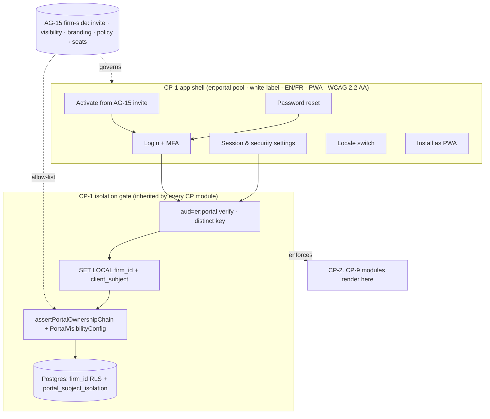

### 3.1 The walled identity pool — login, the portal's separate auth surface

**How it works.** The portal authenticates against the **client-portal pool** only: `POST /api/v1/auth/portal/login` (Doc 1 §3.1), tokens stamped `aud = er:portal`, signed and verified with the **portal-pool key** (distinct from the firm and platform keys, sourced per the firm's region from KMS). The pool is a thin configuration of the shared **AuthCore** (Doc 1 §3.2) — CP-1 authors no password hashing, token signing, or MFA verification of its own; it declares the portal pool descriptor (key ref, `aud = er:portal`, the `portal_session` table, the `portal_credential` store, the portal MFA policy). A firm or platform token presented to a portal route fails at the cryptographic layer (wrong key) and again at the audience assertion (`aud` mismatch) — two independent walls (Doc 1 §3.1, AU-A1/AU-A3).

**World-class behaviour.** A portal credential is *structurally* incapable of touching the staff console, and a stolen staff token is *structurally* incapable of touching the portal — not "by a role check," but by separate keys and separate stores. The login surface is branded (the firm's logo and name, the client's locale) before a single character is typed.

**Key screens.** *Login* (firm-branded; email + password; locale switcher; "forgot password"; MFA step when enrolled). *MFA challenge* (TOTP code, passkey/WebAuthn, or recovery code). *Locked/throttled* state (uniform, non-enumerating message).

**Data flow.** Credential → portal login controller → AuthCore `verifyPassword` (Argon2id) → if MFA enrolled, AuthCore `verifyTotp`/`verifyWebAuthn`/`verifyRecoveryCode` → `issueSession` writes a `portal_session` row + Redis validity cache → 15-min access JWT (`aud=er:portal`, `sid`, `firm_id`, `tbf`, **no permissions** — Doc 1 §3.4) in an `HttpOnly`/`Secure`/`SameSite` cookie (browser) + rotating refresh cookie → audit `PORTAL_LOGIN`.

### 3.2 Account activation from an AG-15 invite

**How it works.** A client never self-registers. The firm invites them in AG-15, which creates/activates the `ClientCustomer` credential lens, sets `portalStatus = PENDING_ACTIVATION`, and mints a single-use, short-TTL **activation capability token** (Doc 1 §4.6) delivered as a branded, localized email (EmailRelayPort). CP-1 owns the *redemption*: the client follows the link, CP-1 resolves the token server-side to exactly one `ClientCustomer` (token in the path/header, never a URL query param, never the raw id — Doc 1 §3.5), the client sets a password meeting policy and (per `PortalAccessPolicy.clientMfaRequired`) optionally enrols MFA, the token is consumed, and `portalStatus` flips to `ACTIVE`. CP-1 then emits the canonical activation fact that AG-15 consumes to notify the officer.

**World-class behaviour.** Activation is one branded screen in the client's language, never "ExpatReady has invited you." An expired/redeemed token shows a friendly "ask your consultant to resend" (which is an AG-15 action, not a client self-serve), never a stack trace and never an account-existence oracle.

**Key screens.** *Activation* (branded; set password with live policy meter; optional MFA enrolment with QR/passkey; consent acknowledgement). *Token-invalid* (friendly, non-enumerating).

**Data flow.** Client opens link → CP-1 resolves capability token → password set via AuthCore `hashPassword` → optional MFA enrolment (secret encrypted under the portal/per-firm operational DEK, Doc 1 §3.6) → token consumed → `portalStatus = ACTIVE`, `lastPortalLogin` stamped on first login → emit `portal.account.activated` → audit `PORTAL_ACTIVATED`.

**Ownership (activation consent):** the consent acknowledgement captured at activation is written by **CP-1** as an SA-11 `ConsentRecord` (source = portal activation); SA-11 owns the register and the purpose taxonomy, CP-8 is where the client later views/withdraws it.

### 3.3 The own-case-only isolation gate (the load-bearing contract)

**How it works.** This is the reason CP-1 exists. On every portal request the tenant middleware (Doc 1 §2.4) resolves the principal from the verified portal token — never from the request body — and runs, inside one transaction, BOTH `SET LOCAL app.current_firm_id = <firm>` and `SET LOCAL app.current_client_subject = <clientCustomerId>` before any business query. Three layers then decide what is returned:

1. **Postgres RLS (the backstop).** The firm `tenant_isolation` policy confines to the firm; the **`portal_subject_isolation` policy** (Doc 1 §2.5) further restricts every CLIENT-PII table — for reads AND writes (`USING` + `WITH CHECK`) — to rows whose `client_id` (Party) resolves to the GUC's `clientCustomerId`. Resolution is Party→ClientCustomer (direct), via `owner_chain_to` (child rows), or via `PartyRelationship` (corporate seats) — *never* a naive `client_id = subject` equality.
2. **The scoped repository (Doc 1 §4.5).** No method accepts a caller-supplied `firm_id`/`client_id`/owner id; scope comes only from `PrincipalContext`.
3. **`assertPortalOwnershipChain(record)` (the fast, observable layer).** The service re-checks the ownership chain AND that the record's entity type is on the firm's `PortalVisibilityConfig` allow-list (leak-off by default). On either failure it throws `404` — never `200`, never a sibling's data, never existence leakage.

CP-1 owns the **reusable enforcement primitive** every other CP module calls (CP-2..CP-9 inherit it and cite "per CP-1 §3.3", not restated); it does not own the `PortalVisibilityConfig` data (AG-15) or the per-module read endpoints (CP-2..CP-9) — it owns the gate they pass through.

**World-class behaviour.** Isolation is *defense-in-depth*: a developer in CP-3 who forgets the ownership check still cannot leak, because the DB policy denies the row. A corporate seat-holder sees exactly the roster the firm scoped to their seat — a non-seat sibling gets `404` at both the app and the DB.

**Key screens.** None client-facing — this is server machinery. Its visible effect is that the dashboard, document list, invoices, and messages *only ever* show the client's own case(s).

**Data flow.** Portal token → `PrincipalContext{ firm_id, principalId, ownershipRoot=clientCustomerId, pool=portal }` → `SET LOCAL` both GUCs → scoped repo query (firm predicate injected; RLS + portal policy double-check) → `assertPortalOwnershipChain` + allow-list → masked, scoped result (Restricted PII masked unless reveal-permitted, Doc 1 §7.2).

### 3.4 IDOR-safe object access — presigned URLs and public-by-id reads

**How it works.** CP-1 sets the rule every CP module obeys: a presigned storage URL is **always derived from an ownership-checked record**, never signed from a caller-supplied key. The flow resolves the record by id → `assertPortalOwnershipChain` → only then reads the storage key *from the record* and mints the presigned URL via `ObjectStoragePort` (Doc 1 §4.5 AC-4.5.5 — record-level authz; §6.3.3 — the port that makes the unsafe path impossible to express). Any public-by-id read (e.g. an emailed link to view a document before login) uses an unguessable, single-purpose, time-boxed **capability token** (Doc 1 §4.6), carried in the path/header — never the record id, never a token or PII in a query param. The DB backstop is the §2.5 portal dimension; the serving-header controls are Doc 1 §7.7.

**World-class behaviour.** This closes the live reference-prototype IDOR class where a handler signed whatever key it was handed. A client cannot guess or tamper a URL into another client's passport scan.

**Key screens.** Transparent to the user (a document opens), but the URL never contains a guessable id or a token.

**Data flow.** `GET document/:id` → resolve record (scoped repo) → ownership check → storage key read from record → presigned URL minted and returned → audit on access.

### 3.5 Session, MFA & password reset

**How it works.** CP-1 uses the platform session model (Doc 1 §3.4): 15-min access JWT + rotating, single-use refresh cookie + a server-side `portal_session` row re-validated on every request (revocation is instant, not at expiry). Portal absolute window 24h / idle 30 min (defaults, configurable). MFA is optional-encouraged for the portal by default (Doc 1 §3.6): TOTP, WebAuthn/passkey, recovery codes — never blocking a client from their own case unless the firm's `PortalAccessPolicy.clientMfaRequired` is set. Self-service password reset issues a single-use, 1-hour, hashed reset token to the verified address, requires a policy-compliant new password, and **revokes all existing sessions** on success; responses are uniform (no account-enumeration oracle) and rate-limited (Doc 1 §3.7).

**World-class behaviour.** "Log out everywhere" and admin (AG-15) revocation are instant. A roaming mobile client is not logged out for changing networks — token binding is to the session/device pairing, not the IP (Doc 1 §3.4, `tbf`).

**Key screens.** *Session & security* (active sessions list with device/last-used, revoke individually or all; manage MFA factors; regenerate recovery codes; change password). *Forgot password* (uniform-response request) + *Reset* (set new password).

**Data flow.** Reset request → uniform response + (if address valid) hashed reset token email → redeem → new password (AuthCore) → `revokeAllSessions` → audit `PORTAL_PASSWORD_RESET`.

### 3.6 White-label, EN/FR locale, installable PWA, accessibility

**How it works.** CP-1 reads the firm's `PortalBranding` (AG-15-owned portal white-label entity, Doc 3 AG-15 §7 — logo, accent color, display name, support contact, email sender, optional custom domain; distinct from the firm-identity `FirmBranding`, AG-1/AG-16) and skins the entire shell — there is no ExpatReady chrome on the client surface. Locale: the client's own `preferredLocale` (independent of staff UI language, Doc 1 §8.6) drives react-i18next ICU catalogues, lazy-loaded per route, with no hardcoded user-facing string; date renders America/Toronto-default, money in the case/invoice currency. PWA: a manifest + service worker provide an installable app with an **offline read-only shell + last-read cache**; an attempted offline *write* is cleanly blocked with a "you are offline" message — **no silent write queue** for regulated PII (Doc 1 §8.7). Accessibility: built on Radix/shadcn primitives, axe-clean in CI, keyboard-operable, ≥4.5:1 contrast, 200% text resize, accessible error identification — WCAG 2.2 AA, the same bar as the staff console (Doc 1 §8.5).

**World-class behaviour.** A client installs the firm's branded app on their phone, switches to French, and works one-handed with VoiceOver — and when the subway drops signal, the last-viewed checklist still renders read-only. The offline cache is per-subject and cleared on logout, so a shared device never leaks the prior client's data.

**Key screens.** Branded *app shell* (firm logo/accent header; locale switcher; install prompt; account menu). *Offline banner*. Every CP module inherits this shell.

**Ownership (in-app notification inbox):** the portal's in-app notification bell/inbox surface belongs to the **CP-1 shell**; spoke modules (CP-2…CP-9) raise notifications through AG-10 and deep-link via this inbox — no CP module builds its own notification surface.

**Data flow.** App boot → resolve firm from host/branding + client locale → load branding tokens + locale catalogue → register service worker (cache app shell + read responses, keyed to the authenticated subject) → render. Logout clears the subject-scoped cache and Redis session validity.

## 4. Functional Requirements

- **CP-1-1.** The portal SHALL authenticate only against the client-portal pool (`POST /api/v1/auth/portal/login`, `aud = er:portal`, distinct signing key, separate `portal_credential` / `portal_session` stores) per Doc 1 §3.1; a firm or platform token presented to any portal route returns 401.
- **CP-1-2.** The portal SHALL be a thin configuration of AuthCore (Doc 1 §3.2) and SHALL NOT re-implement password hashing, token signing, session writing, or MFA verification.
- **CP-1-3.** Account activation SHALL occur only by redeeming a single-use, short-TTL AG-15 invite capability token (no client self-registration); redemption sets the password, optionally enrols MFA, consumes the token, flips `portalStatus PENDING_ACTIVATION → ACTIVE`, and emits `portal.account.activated`.
- **CP-1-4.** On every portal request the middleware SHALL set BOTH `app.current_firm_id` and `app.current_client_subject` (= the verified token's `clientCustomerId`) via `SET LOCAL` inside the request transaction, before any business query, sourced from `PrincipalContext` and never from caller input.
- **CP-1-5.** Every CP read/write of CLIENT-PII SHALL pass `assertPortalOwnershipChain` (ownership chain resolves to the caller's `clientCustomerId`, traversing `owner_chain_to` for child rows and `PartyRelationship` for corporate seats) AND the firm's `PortalVisibilityConfig` allow-list (whose toggles are the exact AG-15 fields `showProgress` / `showDocuments` / `showFirmProducedDocs` / `showSqr` / `showInvoices` / `showAgreements` / `enableMessaging`, Doc 3 AG-15 §7); failure returns `404`/empty + audit, never `200` and never sibling/other-firm data in body, error, or logs.
- **CP-1-6.** The portal SHALL rely on the Postgres `portal_subject_isolation` policy (`USING` + `WITH CHECK`, Doc 1 §2.5) as the database backstop for client-to-client isolation, so isolation holds even if CP-1-5 is missed in code.
- **CP-1-7.** Every presigned storage URL and every public-by-id read SHALL be derived from an ownership-checked record (key read from the record, not the caller; Doc 1 §4.5 AC-4.5.5 + §6.3.3); public-by-id reads SHALL use unguessable capability tokens carried in the path/header, never a record id and never a token/PII in a URL query param.
- **CP-1-8.** The portal SHALL use the platform session model (15-min access JWT carrying no permissions, rotating single-use refresh, server-side `portal_session` re-validated each request, instant revocation, 24h absolute / 30 min idle defaults).
- **CP-1-9.** The portal SHALL support TOTP, WebAuthn/passkey, and recovery codes via AuthCore; MFA is optional-encouraged by default and mandatory only when the firm's `PortalAccessPolicy.clientMfaRequired` is set; MFA never blocks a client from their own case unless required.
- **CP-1-10.** Self-service password reset SHALL issue a single-use, time-boxed, hashed reset token to the verified address, require a policy-compliant new password, revoke all sessions on success, return uniform (non-enumerating) rate-limited responses.
- **CP-1-11.** The portal SHALL white-label from `PortalBranding` (no ExpatReady chrome on the client surface) and resolve the firm + branding + locale per request, including optional per-firm custom domain.
- **CP-1-12.** The portal UI, validation, errors, and notification copy SHALL render fully in EN + Canadian French driven by the client's own `preferredLocale` (independent of staff language), with no hardcoded user-facing string, America/Toronto-default dates, and case-currency money.
- **CP-1-13.** The portal SHALL be an installable PWA (manifest + service worker) with an offline read-only shell + last-read cache; an offline write SHALL be cleanly blocked with a message and SHALL NOT be silently queued; the read cache SHALL be subject-scoped and cleared on logout.
- **CP-1-14.** The portal SHALL conform to WCAG 2.2 AA (Radix/shadcn primitives, axe-clean in CI, keyboard operability, ≥4.5:1 contrast, 200% resize, accessible error identification), held to the same bar as the staff console.
- **CP-1-15.** Login is permitted only when `portalStatus = ACTIVE`; `PENDING_ACTIVATION`, `SUSPENDED`, and `REVOKED` cannot authenticate; an AG-15 revoke/suspend instantly invalidates all of that client's sessions.
- **CP-1-16.** A corporate seat-holder SHALL see only the roster of cases its seat's `PartyRelationship`-mediated ownership chain resolves to; a non-seat sibling receives `404` at both the app and DB layers.
- **CP-1-17.** Token transport SHALL be header or `HttpOnly`/`Secure`/`SameSite` cookie only; no token in any URL component; browser sessions carry double-submit anti-CSRF on state-changing requests (Doc 1 §3.5).
- **CP-1-18.** Every authentication and access event (login, login-failure, MFA verify/fail, activation, reset, logout, session revoke, denied access) SHALL write an immutable per-firm hash-chained audit entry (Doc 1 §7.5) with actor, `firm_id`, `clientCustomerId`, action.

## 5. Business Rules

- **BR-1 (Separate identity, never mixed).** The client is a `ClientCustomer` credential lens on the `Party` spine, on the `er:portal` pool with a distinct key. No identity, session, or permission is shared with the firm or platform pools.
- **BR-2 (Own-case-only + allow-list, leak-off by default).** A client touches only rows whose ownership chain resolves to their own `clientCustomerId` AND whose entity type the firm enabled in `PortalVisibilityConfig`. An entity type not on the list is invisible even for an own-owned record.
- **BR-3 (Database is the backstop).** Client-to-client isolation does not depend on the application layer alone; the `portal_subject_isolation` RLS policy (`USING` + `WITH CHECK`) denies cross-client read AND write at the database.
- **BR-4 (No caller-supplied scope).** No portal endpoint accepts a `firm_id`/`client_id`/owner id for scoping; scope comes only from the verified token via `PrincipalContext`.
- **BR-5 (Object access is record-bound).** Presigned URLs and public-by-id reads derive from an ownership-checked record; capability tokens (not ids) gate pre-login reads; no token/PII in URLs.
- **BR-6 (Access lifecycle).** `portalStatus` is the login source of truth; only `ACTIVE` may authenticate; suspend/revoke is instant and session-killing; suspend ≠ delete (data retained; deletion is a separate audited SA-11 action).
- **BR-7 (Activation is invite-only).** No open self-registration; activation consumes a single-use AG-15 invite token; an expired/redeemed token cannot activate.
- **BR-8 (Reset revokes sessions).** A successful password reset revokes all of the client's sessions; reset/forgot responses are uniform and rate-limited.
- **BR-9 (Offline is read-only).** No offline write/sync; an offline write is blocked, not queued; the read cache is subject-scoped and cleared on logout.
- **BR-10 (One bar for a11y/i18n).** The portal meets WCAG 2.2 AA and full EN/FR; the client's locale is independent of staff language.
- **BR-11 (Brand is the firm's).** The client surface carries the firm's branding; no ExpatReady chrome.
- **BR-12 (Corporate seat scope is firm-set).** A seat sees only the firm-scoped roster; scope is firm-set in AG-15, never client-set.
- **BR-13 (Region-resolved).** Identity keys, session store, branding, and KMS resolve per the firm's `region`; no Canada hard-pin in code.

## 6. States & Lifecycle

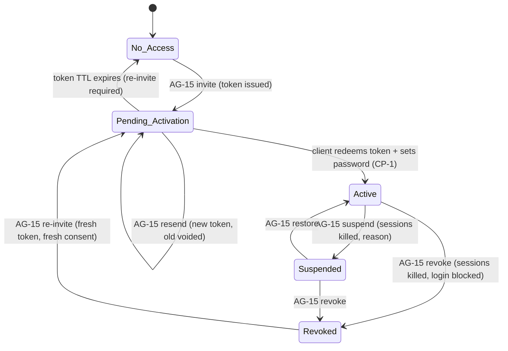

**`portalStatus` (the login gate)** is owned operationally by AG-15 (the firm acts) but *enforced* by CP-1 at login (only `ACTIVE` authenticates). The transitions firm-side (invite/resend/suspend/restore/revoke/re-invite) are AG-15; the transition CP-1 owns is **`Pending_Activation → Active`** (the client redeems and sets a password).

**Session lifecycle.** `Created (login) → Live (re-validated each request, refresh-rotated) → Revoked (logout / reset / AG-15 suspend-revoke / theft-detected refresh-reuse) → Expired (idle or absolute window)`. A revoked session is dead immediately, not at access-token expiry, and a revocation surviving in Postgres is never un-enforced by a Redis flush (fail-closed to the durable row, Doc 1 §3.4 AU-A16).

## 7. Key Entities & Fields

CP-1 introduces **no new domain tables** — isolation correctness comes from *not* proliferating credential/identity roots. It uses the platform identity entities (Doc 1 §3 / §5.2) and the AG-15-owned portal config entities (Doc 1 §5; AG-15 §7), citing them rather than redefining them. *(For the doc-wide footprint: the portal as a whole owns exactly three net-new tables, all in spoke modules — CP-5 `PortalPaymentAttempt`, CP-8 `PortalAccountViewState`, CP-9 `OrgPortalRollup` — none of them here in CP-1.)*

- **`ClientCustomer`** *(Doc 1 §5.2 — credential lens on `Party`; CLIENT-PII, `firm_id` + RLS; portal-side fields added by AG-15)* — `id` (= `clientCustomerId`, the portal subject the second RLS dimension joins on), `partyId`, `firm_id`, `portalStatus` (`PENDING_ACTIVATION | ACTIVE | SUSPENDED | REVOKED`), `lastPortalLogin?`, activation/reset capability-token refs + expiry, `preferredLocale?`, `mfaEnabled?`. CP-1 reads/sets `portalStatus → ACTIVE`, `lastPortalLogin`, `preferredLocale`, and MFA enrolment; the firm-side lifecycle transitions are AG-15.
- **`portal_credential`** *(Doc 1 §3.1 — auth pool store; CLIENT-PII, `firm_id` + RLS)* — thin login artifact bound to a `ClientCustomer`: password hash (Argon2id), MFA factors (TOTP secret + WebAuthn credentials + hashed recovery codes, encrypted under the per-firm operational DEK, Doc 1 §3.6). Carries authentication state only, never domain data; no FK crosses to `firm_user`/`platform_user` (Doc 1 §3.1 AU-A4).
- **`portal_session`** *(Doc 1 §3.4 — session table; AG-15 surfaces this as `PortalSession`, `aud = er:portal`, Doc 3 AG-15 §7)* — `{ session_id, subject_id (=clientCustomerId), firm_id, refresh_hash, token_binding_fingerprint, created_at, last_seen_at, idle_expires_at, absolute_expires_at, revoked_at?, device_label, ip_first_seen }`. Re-validated each request; Redis-cached with Postgres as durable truth.
- **`PortalVisibilityConfig`** *(AG-15-owned — TENANT, `firm_id` + RLS; consumed read-only)* — the per-case allow-list `assertPortalOwnershipChain` reads (Doc 1 §4.5 AC-4.5.4). Toggles are the exact AG-15 fields `showProgress`, `showDocuments`, `showFirmProducedDocs`, `showSqr`, `showInvoices`, `showAgreements`, `enableMessaging`, plus `stageLabelMapJson` (Doc 3 AG-15 §7). CP-1 reads it; AG-15 writes it.
- **`PortalBranding`** *(AG-15-owned — TENANT; consumed read-only; Doc 3 AG-15 §7 — the portal white-label entity, distinct from the firm-identity `FirmBranding` of AG-1/AG-16)* — logo, accent, display name, support contact, email sender, custom domain. CP-1 skins from it.
- **`PortalAccessPolicy`** *(AG-1-owned — TENANT; consumed read-only)* — `inviteTokenTtl`, `clientMfaRequired`, `offeredLocales[]`, `defaultVisibilityConfigJson`. CP-1 honors `clientMfaRequired` + `offeredLocales`.
- **`CorporatePortalSeat`** *(AG-15-owned — CLIENT-PII; consumed read-only)* — `id`, `firm_id`, `clientCustomerId`, `corporatePartyId`, `contactName`, `contactEmail`, `portalStatus`, `scopeJson` (which applicant cases this seat may see), token refs (Doc 3 AG-15 §7). Ownership chain resolves via `PartyRelationship` (Doc 1 §2.5). CP-1 enforces seat scope at login/access; it consumes the entity unchanged and adds no field to it. *(The entity also carries a typed `seatRole` field — `ORG_ADMIN | HR_COORDINATOR | VIEWER`, added by Doc 3 AG-15-43 — which selects the SA-6-owned corporate role-to-capability template, while `scopeJson` remains the record-scope facet; see CP-9 §7/§10.)*

**Events emitted / consumed.** Canonical names per the Doc 1 §6.1 dictionary (domain events = lowercase `dot.case`, `noun.verb-past`; notifications = `notif/` `dash.case`). CP-1 is the **SOLE emitter of every portal-identity fact** — no other CP module mints a login/session/activation event or any synonym thereof. The three names below are **FROZEN** (the vendor builds against them); only their dictionary file-entry registration lands in the §6.1 integration pass.

| Event | Direction | Emitter / Consumer role | Notes |
|---|---|---|---|
| `portal.account.activated` | emitted | emitter: portal (CP-1, sole) | client redeemed invite + set password; consumed by AG-15 → raises `notif/client-activated` to the assigned officer |
| `portal.client.loggedin` | emitted | emitter: portal (CP-1, sole) | the canonical portal login fact; drives `PortalActivityEvent` (AG-15-owned materialized stream) + `lastPortalLogin`; consumers: communications (engagement). No other module may mint a login/session-start synonym (e.g. `portal.session.started`) — they reuse this name or the AG-15 `PortalActivityEvent(LOGIN)` row |
| `portal.session.revoked` | emitted | emitter: portal (CP-1, sole) | logout / reset / theft-detected refresh-reuse; consumed by audit + AG-15 access-log surfacing |
| *firm-side lifecycle* (suspend/revoke) | consumed | emitted by AG-15 | instantly invalidates this client's sessions (BR-6); login blocked unless `portalStatus = ACTIVE` |

> `PortalActivityEvent` is an AG-15-owned internal materialized stream, not a registered domain event; CP-1 feeds it via `portal.client.loggedin` and the per-module activity events. No Restricted PII is ever projected into search (Doc 1 §8.8). Any genuinely-new `portal.corporate.seat.*` events are AG-15-owned and will be registered centrally in the integration pass — they are NOT CP-1-minted.

## 8. User Stories + Acceptance (Given / When / Then)

- **US-1 — Activate from an invite.** *Given* an engaged client with `portalStatus = PENDING_ACTIVATION`, `preferredLocale = fr-CA`, and a valid invite token, *When* they open the branded French activation link and set a policy-compliant password, *Then* the token is consumed, `portalStatus` becomes `ACTIVE`, `portal.account.activated` is emitted, the officer receives `notif/client-activated`, and the action is audited; the token cannot be replayed.
- **US-2 — Own-case-only.** *Given* client X logged into firm F, *When* X requests any case/document/invoice/message id belonging to sibling client Y, *Then* the response is `404`/empty for 100% of resources, audited, never `200`, with no Y data in body, error, or logs — proven with the application bypassed at the DB (`portal_subject_isolation`) and at the API.
- **US-3 — Cross-firm impossible.** *Given* a portal token for firm F, *When* it requests any firm G identifier, *Then* RLS returns zero rows and the API returns `404` — no path, export, or error leaks G's data.
- **US-4 — IDOR-safe document open.** *Given* client X with an own document, *When* X opens it, *Then* a presigned URL bound to that ownership-checked record is returned with no guessable id or token in the URL; *When* X tampers the URL to a sibling's storage key, *Then* the request is `404` (the key was never caller-supplied).
- **US-5 — Cross-pool token rejected.** *Given* a valid firm-staff token (`aud = er:firm`), *When* presented to any portal route, *Then* it returns `401` with no resource body (CI enumerates all six ordered pool pairs = the three pools).
- **US-6 — Password reset.** *Given* an active client, *When* they request a reset and redeem the emailed token with a new password, *Then* all their sessions are revoked, the response is uniform whether or not the address exists, and the request is rate-limited.
- **US-7 — Corporate seat scope.** *Given* an HR seat scoped to roster R, *When* the seat logs in, *Then* it sees exactly R's cases and `404` for any non-seat sibling — at both the app and DB layers.
- **US-8 — White-label + locale.** *Given* firm F's branding and a client whose locale is French, *When* the client opens the portal, *Then* the shell shows F's logo/name/accent (no ExpatReady chrome) and renders fully in French; *When* staff use English, the client's French is unaffected.
- **US-9 — Installable, offline read-only.** *Given* the portal on a phone, *When* the client installs it and goes offline, *Then* the app shell + last-read case render; *When* they attempt an offline upload/payment, *Then* a clear "you are offline" message blocks it with no silent queue.
- **US-10 — Instant revocation.** *Given* an active client session, *When* the firm revokes access in AG-15, *Then* the next request bearing the still-unexpired access token returns `401`, and the revocation survives a Redis flush.

## 9. Edge Cases

- **Expired/redeemed invite token** → friendly, non-enumerating "ask your consultant to resend"; resend is an AG-15 action; the old token is voided when a new one is issued.
- **Reused (rotated) refresh token** → treated as theft: the whole session family is revoked, `portal.session.revoked` emitted, re-auth forced (Doc 1 §3.4 AU-A12).
- **Roaming mobile (network change)** → not logged out; `tbf` binds to the session/device pairing, not the IP (Doc 1 §3.4).
- **Redis flush / stale restore** → a previously revoked session is still rejected; the validator fails closed to the Postgres session row (Doc 1 §3.4 AU-A16).
- **Shared device** → logout clears the subject-scoped offline read cache and Redis validity; the next client cannot see the prior client's cached data.
- **Client locale not in `offeredLocales`** → falls back to the firm's default offered locale; never renders a hardcoded string.
- **`PortalVisibilityConfig` toggle turned off mid-session for an entity type** → enforcement is server-side per request; the now-disallowed type returns `404`/empty on the next request even within a live session.
- **Corporate seat removed from roster mid-session** → the relationship-mediated chain no longer resolves; the previously-visible case returns `404` on the next request.
- **MFA factor lost** → recovery code path; if exhausted, the firm (AG-15) can reset MFA (privileged, audited, step-up-gated, Doc 1 §3.6).
- **Custom domain not yet DNS-verified** → portal serves on the default ExpatReady-hosted portal host with firm branding until `domainVerifiedAt` is set; no broken-brand state.
- **Account-enumeration probe on login/reset** → uniform responses + per-IP/per-account/per-tenant throttling with progressive backoff and a bot challenge (Doc 1 §3.7 AU-A31).
- **Suspended client mid-session** → AG-15 suspend kills sessions instantly; next request `401`.

## 10. Permissions (`portal/*`)

CP-1 consumes `portal/*` keys (LOCAL; catalog owned by SA-6, Doc 1 §4.3–4.4); it authors none. The portal access token carries **no** permissions — authorization is resolved per request from the principal against the catalogue. CP-1 relies on these foundational keys (exact strings catalogued by SA-6):

| Capability | Permission (LOCAL `portal/*`) | Notes |
|---|---|---|
| View own case overview | `portal/case:view.own` | own-case-only; gated by ownership chain + allow-list |
| Manage own portal account / session | `portal/account:manage.own` | password change, MFA factors, session revoke, locale |
| Activate account (pre-auth) | *(capability-token, `@Public` with `capability-token` control)* | not a permission — single-purpose invite/reset token (Doc 1 §4.6) |

All portal routes are either `@RequirePermissions('portal/...')` or `@Public({ control: 'capability-token' | 'rate-limit' })` with a named compensating control (Doc 1 §4.6); the login, refresh, activation, and reset endpoints are the named `@Public` set. A `portal/*` permission can never satisfy an `agent/*` or `system/*` route (scope-aware guard, Doc 1 §4.2); a write-side filter rejects any GLOBAL/system permission on a portal role (Doc 1 §4.3). The three portal role templates (Primary Applicant, Corporate Sponsor/Seat Admin, Dependent/Viewer) and the `portal/corporate:*` keys are owned/catalogued by SA-6, not by any CP module (Doc 1 §4.4).

## 11. Scalability · Security · Performance (isolation FIRST)

**Security & isolation (the first-order concern).**
- **Two RLS dimensions + app layer + scoped repo, defense-in-depth.** Firm `tenant_isolation` (firm-against-firm) + `portal_subject_isolation` (client-against-client, `USING` + `WITH CHECK`) at the DB; `assertPortalOwnershipChain` + allow-list + scoped repo above. Isolation holds even when CP code is wrong (Doc 1 §2.5, §4.5). This is the single normative source of the portal isolation primitive; CP-2..CP-9 inherit it ("per CP-1 §3.3 / §3.4") and do not re-derive or weaken it. **Release gate:** the §2.8 cross-tenant + portal cross-client denial suite (DB + API, read + write, child-row, corporate-seat, connection-reuse GUC-bleed, replica path) must be green; a pre-go-live horizontal-access pentest must fail to leak for 100% of resources (Doc 1 §2.8.1 AC-2.8.5, §4.5 AC-4.5.3).
- **Walled identity.** Distinct portal signing key + mandatory `aud = er:portal` verification; separate `portal_credential`/`portal_session` stores; CI enumerates all six cross-pool pairs returning 401 (the three pools, Doc 1 §3.1).
- **No caller-supplied scope; record-bound object access.** Static code-scan asserts no portal signature accepts a scoping id and no presigned URL is signed from a caller-supplied key; no token/PII in any URL (Doc 1 §2.4 AC-2.4.3/2.4.4, §4.5 AC-4.5.5, §6.3.3).
- **PII handling.** Restricted PII masked-by-default with reveal-permission + `PII_REVEAL` audit; never in logs/traces; never in the offline cache beyond the subject's own last-read; never in the search projection (Doc 1 §7.2, §8.8). Field-level envelope encryption (per-subject key, Doc 1 §7.1) is orthogonal to RLS and inherited.
- **Audit.** Every auth/access/denial event writes to the per-firm append-only hash-chained audit spine via the security-audit path (Doc 1 §2.4 AC-2.4.5, §7.5).
- **Transport.** Tokens via header or `HttpOnly`/`Secure`/`SameSite` cookie only; anti-CSRF double-submit on state-changing requests (Doc 1 §3.5).

**Scalability.** The portal is stateless app + Redis session cache + Postgres durable session truth + per-firm region routing; it scales horizontally with the platform (Doc 1 §8.2). The portal-subject GUC and the `resolve_subject` ownership resolution participate in indexed predicates (the `client_id` → `ClientCustomer` resolution and `owner_chain_to` joins are indexed) so portal reads stay within budget at launch volume. Offline read-cache offloads repeat reads from the network.

**Performance.** Inherits the platform budgets (Doc 1 §8.1): read p95 ≤ 300ms / p99 ≤ 800ms; write p95 ≤ 600ms; FCP ≤ 1.5s; LCP ≤ 2.5s p75; INP ≤ 200ms p75 — verified on a **mid-tier mobile device** since the portal is mobile-first. The per-request `BEGIN`/`SET LOCAL` (both GUCs)/`COMMIT` overhead is accounted for in the §2.7 pool sizing. Locale catalogues are lazy-loaded per route; the service worker caches the app shell for instant subsequent loads.

## 12. Reference Note (NEW — portal is greenfield)

The Client Portal console is **net-new** — it is the gap-analysis critical scope-hole C2, never previously specced. The reference prototype carried a *partial* client-facing auth surface (a separate client login existed) but **no** isolation-native foundation: it shared a single `JWT_SECRET` across pools (the distinct portal key was defined-but-unused), had **no** second RLS dimension (client-to-client isolation rested on application code alone), and contained a **live IDOR** where presigned-read signed any caller-supplied key. CP-1 is therefore authored as **greenfield target-state**: the vendor builds the walled portal pool, the `app.current_client_subject` dimension, the ownership-chain resolver, the record-bound object-access rule, the white-label/i18n/PWA/a11y shell, and the activation/session/reset flows **as specified here against Doc 1**, with no parity obligation to the prototype. The prototype is design-provenance only (NDA-gated, read-only reference the vendor MAY inspect but MUST NOT depend on) — it demonstrates the *shape* of a client login, not the *correctness* this module mandates. Every acceptance criterion is measured solely against this spec + Doc 1 + the procurement shell.

## 13. Open Questions / [FOUNDER-CONFIRM]

- **[FOUNDER-CONFIRM] Portal MFA posture.** Recommended default: optional-encouraged (TOTP/passkey), never blocking a client from their own case. Confirm whether any firm tier should default portal MFA to mandatory (sets `PortalAccessPolicy.clientMfaRequired`); the mechanism is fixed regardless (Doc 1 §3.6).
- **[FOUNDER-CONFIRM] Invite & reset token TTLs.** Proposed: activation 72h, reset 1h. Confirm or adjust; mechanism (single-use, hashed, capability-token) is fixed (Doc 1 §3.7).
- **[FOUNDER-CONFIRM] Portal session windows.** Proposed: 24h absolute / 30 min idle. Confirm or relax for client UX; the 15-min access TTL + rotating refresh are fixed (Doc 1 §3.4).
- **[FOUNDER-CONFIRM] SMS-OTP fallback appetite for the portal.** SMS/email OTP is fallback-only (never primary) and carries a rail cost; confirm whether to enable it for the portal pool (Doc 1 §3.6).
- **[FOUNDER-CONFIRM] Launch locales beyond EN + Canadian French.** Default: EN/FR at launch; further locales are catalogue additions (Doc 1 §8.6). Confirm if any near-term firm requires a third locale.
- **[FOUNDER-CONFIRM] Custom-domain offering tier.** Per-firm custom portal domain is plan-gated (SA-3); confirm which plan tiers include it and the DNS-verification SLA (machinery is built regardless).
- **[FOUNDER-CONFIRM] Breached-password screening corpus.** In-region corpus vs external k-anonymity service is a residency/sub-processor decision (Doc 1 §3.7); the screening is performed regardless.
- **Architect note (no founder input needed).** The three CP-1 events `portal.account.activated` / `portal.client.loggedin` / `portal.session.revoked` are **FROZEN** names (the vendor builds against them); only their entry in the Doc 1 §6.1 event dictionary lands in the final integration pass. CP-1 is the SOLE emitter for all three, and the single source of every portal-identity fact — no other CP module may mint a login/session/activation synonym. (Any new `portal.corporate.seat.*` names are AG-15-owned and registered centrally in the same pass.)

---

# Module CP-2: Client Dashboard & Case Tracking

## Module Index

- **1. Purpose & Goal** — the client's home: a calm, plain-language picture of where their case stands, what they owe, and what has happened — read-only on firm internals, isolation-native.
- **2. Users & JTBD** — Primary Applicant, Corporate Sponsor / Seat Admin, Dependent / Viewer.
- **3. Functional Design** — the home shell & multi-case switcher (3.1); the stage progress stepper from AG-7 `StageTemplate` with client-safe labels (3.2); next-actions / "you owe us X" (3.3); the client-visible case timeline (3.4); milestones & decision surfacing (3.5); empty / offline / data-flow (3.6).
- **4. Functional Requirements** — CP-2-1 … CP-2-26.
- **5. Business Rules** — BR-1 … BR-12.
- **6. States & Lifecycle** — the derived client-facing case state machine over `StageTemplate.kind`.
- **7. Key Entities & Fields** — consumed spine entities (cite Doc 1 §5); the Events emitted/consumed table.
- **8. User Stories + Acceptance** — US-1 … US-7 (Given/When/Then).
- **9. Edge Cases & Validations.**
- **10. Permissions** — the `portal/*` set this module reads.
- **11. Scalability · Security · Performance** — isolation FIRST.
- **12. Reference Note** — greenfield; no prototype counterpart.
- **13. Open Questions / [FOUNDER-CONFIRM].**

> Client Portal console (Doc 4). **Plane:** Client portal (`aud = er:portal`, the cryptographically-walled client identity pool, Doc 1 §3.1 — the single canonical client-portal audience constant; no other constant exists). **Permissions:** `portal/*` LOCAL only (catalog owned by SA-6; Doc 1 §4.4). **Tenant key:** `firm_id` (RLS ENABLED+FORCED, Doc 1 §2.2) **plus the second portal RLS dimension** `app.current_client_subject` (Doc 1 §2.5) and the record-level ownership-chain authz contract (Doc 1 §4.5). **Isolation backbone:** inherited from CP-1 §3 (own-case-only gate, second-RLS-dimension wiring, ownership chain, ownership-bound presigned object access) — referenced here, not re-derived. **Identity:** the logged-in client is a `ClientCustomer` credential lens on the `Party` spine (Doc 1 §5.2). **Consumes (mirrors, never re-specs):** AG-7 (case, `StagePipeline`/`StageTemplate`, `CaseMilestone`, `Submission`, `Decision`, `Deficiency` — only as a *next-action* signal), AG-15 (`PortalVisibilityConfig`, the firm-side control plane that decides what is exposed and how it is relabelled), AG-13 (the materialized `ActivityEvent` table, `visibility = client-visible` slice), AG-9 (document status, surfaced as outstanding asks), AG-6 (invoices — owed amounts), AG-5 (e-sign — agreements awaiting signature), AG-10 (unread-message signal). **Content-neutral:** CP-2 specs the machinery; the client-friendly stage labels, milestone names, and copy are founder/SME Country-Pack content surfaced through AG-15 [FOUNDER-CONFIRM].

---

## 1. Purpose & Goal

CP-2 is the screen the immigrant client lands on the moment they sign in — their entire relationship with the firm, distilled to three honest questions: *Where is my case? What do I need to do? What just happened?* It is the read-only counterpart to the firm's AG-7 Case Workspace: the firm operates the case; the client *watches* it and *acts on what is asked of them*.

The business outcome it must make structurally true: **a client is never confused about their status and never the silent bottleneck**, while **never seeing a single byte of another client's data, the firm's internal workflow, or case strategy**. This module is the platform's top PII-leak surface (ADR FINAL #3, Doc 1 §2.5); its first design constraint is not UX, it is isolation — every figure on this dashboard resolves through the record-level ownership-chain check (Doc 1 §4.5) with the portal RLS dimension as the database backstop (Doc 1 §2.5), and surfaces only what the firm's `PortalVisibilityConfig` allow-list (owned firm-side by AG-15) explicitly enables, leak-off by default.

CP-2 owns **no case data**. It is a presentation-and-orchestration layer over the shared spine: the stage stepper is the AG-7 `StagePipeline` rendered with the AG-15 client-safe labels; the timeline is the AG-13 `ActivityEvent` table filtered to `visibility = client-visible`; "you owe us X" is a derived roll-up of AG-9 outstanding documents, AG-8 questionnaire state, AG-6 unpaid invoices, and AG-5 unsigned agreements — each item a deep-link into the module (CP-4 documents, CP-3 questionnaire, CP-5 invoices, CP-6 e-sign, CP-7 messaging) that actually fulfils it. CP-2 is the hub; the other CP modules are the spokes.

The moat versus a generic "login + file drop" portal: a **firm-governed, white-labelled, isolation-native command center** that speaks the client's language, shows real progress (not a fake percentage bar), and turns every firm ask into a single prioritised to-do list — so the client always knows the one next thing to do.

## 2. Users & Jobs-to-be-Done

| Role (`portal/*`) | Primary job | Representative JTBD |
|---|---|---|
| **Primary Applicant** (heaviest user) | Understand my case and do my part. | "Show me where my application is, in plain English/French, without immigration jargon." · "Tell me the *one* next thing I owe the firm and let me do it from here." · "Let me see what's happened since I last logged in — was my document accepted?" · "If I have two matters (a work permit and my spouse's PR), let me switch between them cleanly." |
| **Corporate Sponsor / Seat Admin** | Track the roster I'm responsible for. | "Show me the company's in-scope applicant cases and each one's stage at a glance." · "Let me drill into one applicant's progress — only the cases the firm scoped to my seat." · "Don't show me an applicant's sensitive personal documents unless the firm enabled it for my seat." |
| **Dependent / Viewer** | See progress on the family matter, read-only. | "Let me see the case is moving without being able to change anything or pay." |

**Design implication.** The Primary Applicant is the protagonist; the default landing is the **single-case dashboard** (or the **multi-case switcher** when more than one in-scope case resolves to the subject). The Corporate Sponsor/Seat sees a **roster dashboard** first (the same components, one row per in-scope case), then drills into a single-case view scoped by the seat's relationship-mediated ownership chain (Doc 1 §2.5 corporate-seat case). The Dependent/Viewer gets the identical read surface with every action affordance suppressed (the `portal/*` write keys are simply not held — UI suppression is cosmetic; the server is the boundary).

## 3. Functional Design — How It Works

Each sub-function is designed for *how it works*, the *world-class behaviour*, the *key screens*, and the *data flow*. Every read in this section runs inside the portal request context: the tenant middleware has set both `app.current_firm_id` and `app.current_client_subject` from the verified `er:portal` token (Doc 1 §2.4–§2.5) before any row is touched; every service call re-applies the CP-1 §3 own-case-only gate (`assertPortalOwnershipChain`, Doc 1 §4.5) + the `PortalVisibilityConfig` allow-list. Nothing below relaxes that.

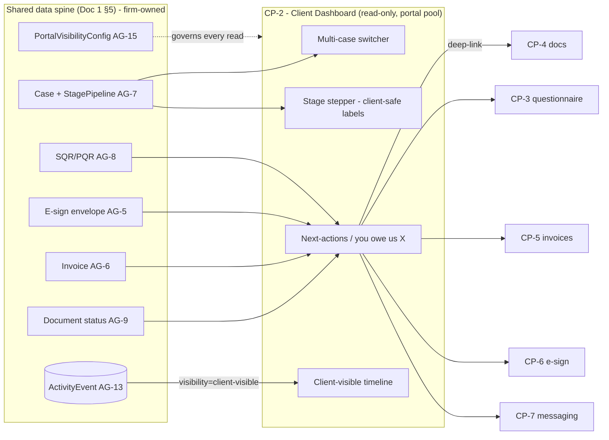

### 3.1 The home shell & multi-case switcher — "every matter I have with this firm, one clean place"

**How it works.** On sign-in, CP-2 resolves the set of cases whose ownership chain resolves to the caller's `clientCustomerId` (Doc 1 §2.5: direct Party→ClientCustomer for an individual; the corporate `PartyRelationship` traversal for a seat-holder) **and** that `PortalVisibilityConfig` exposes (the `showProgress` toggle, AG-15 §3.3). If exactly one case resolves, the client lands directly on that case's dashboard. If more than one resolves, the **case switcher** is the landing surface: one card per in-scope case showing the client-safe program label, the current client-friendly stage, the next-action count badge, and a "last update" timestamp. Switching is a client-side route change scoped to the selected `caseId`; the server re-derives every panel for that case and re-applies the ownership check (never trusts a `caseId` from the URL as an authorization — Doc 1 §4.5: scope from context, the `caseId` is only a *filter* validated against the resolved in-scope set).

**World-class behaviour.** No dead-ends — a client with one case never sees a needless switcher. Roster-aware — a corporate seat sees the company's in-scope cases as the switcher rows (the same component, no fork). Resume-where-I-left — the switcher highlights the case with the oldest outstanding next-action first (the "do this next" bias), mirroring AG-15's anti-stall doctrine from the client's side. White-labelled — the shell carries the firm's brand (logo, accent, display name) read from the AG-15-owned `PortalBranding` (Doc 1 §1.2 white-label), never "ExpatReady."

**Key screens.** *Case switcher* (card grid, badge per case). *Single-case dashboard* (the default: a header band — client-safe program + current stage + firm contact — over three stacked regions: the stage stepper (3.2), the next-actions panel (3.3), the timeline (3.4)). *Account/locale chip* (the client picks EN/FR independent of staff UI language, Doc 1 §8 i18n; persisted on `ClientCustomer`/`PartyProfile.locale`).

**Data flow.** Sign-in (CP-1 identity) → resolve in-scope case set (ownership chain + `PortalVisibilityConfig.showProgress`) → 0 cases ⇒ empty state (3.6); 1 case ⇒ single-case dashboard; N cases ⇒ switcher → on select `caseId`, validate it is in the resolved in-scope set → derive header + 3 regions (3.2–3.4) → render per the client locale.

### 3.2 The stage progress stepper — the AG-7 `StageTemplate` pipeline, client-safe

**How it works.** The stepper is the case's AG-7 `StagePipeline` — the ordered `StageTemplate`s (Doc 1 §5.13.4) — rendered as a horizontal/vertical progress stepper. Each step is one `StageTemplate`; the **current step** is the case's `currentStageId`; completed steps are those the case has already entered (anchored on `stageEnteredAt`). Crucially, **CP-2 never renders the internal `StageTemplate.nameKey`** — it renders the **client-friendly label** from the AG-15 `PortalVisibilityConfig.stageLabelMapJson` internal-stage→client-label map (AG-15 §3.3 / AG-15-14). A stage with no client-label, or whose `kind` is not on the `PortalVisibilityConfig` exposed set, is **collapsed** — the stepper shows only the exposed milestones, so "PR-portal internal QA" never appears; the client sees "We're reviewing your file." The behavioural `StageTemplate.kind` (`PRE_WORK | COLLECTION | PREPARATION | READY | REVIEW | SUBMITTED | POST_SUBMISSION | DECISION | TERMINAL | ON_HOLD`) drives the client-side *presentation* (icon, colour, "what this means" helper), but the client never sees the `kind` token itself — `kind` is a presentation discriminator, label is content.

**World-class behaviour.** Real progress, not a fake bar — the stepper reflects the actual pipeline the firm works, so "you're on step 4 of 7" is true, not invented. Honest, calm states — `ON_HOLD` presents as "Paused — we'll let you know" (never an alarming red); `DECISION`/`TERMINAL` present the outcome through 3.5, not a raw status. No re-rendering of internals — collapsed internal stages keep the client's view clean and the firm's strategy private (the isolation property is also a *clarity* property). Locale-correct — labels and helpers render in the client's chosen locale with fallback to the firm default (never an empty/broken string, mirroring AG-15 §3.8).

**Key screens.** *Stage stepper* (current step emphasised; past steps checked; future steps muted; each step a tap-target showing the client-friendly "what happens here" helper). *Stage detail popover* (the client-safe label, the date entered if the firm exposes it, the plain-language explanation — all AG-15/Country-Pack content).

**Data flow.** Read the case's resolved `StagePipeline` (stamped `packVersionId`, Doc 1 §5.8) → join `StageTemplate`s to the AG-15 `stageLabelMapJson` client-label map + `PortalVisibilityConfig` exposed-stage set → drop unexposed/unlabelled stages → mark current (`currentStageId`) + completed (entered) → render per locale. The data is recomputed live on each load (never cached cross-client; §11).

### 3.3 Next-actions — "you owe us X", the one prioritised to-do list

**How it works.** The next-actions panel is the client-side mirror of AG-15's `ClientWorkItem` orchestration (AG-15 §3.4): the firm asks, the client acts. CP-2 derives a single prioritised list from the things the firm has exposed and is waiting on — anchored on the AG-15 `ClientWorkItem` whose `type` enum is the authoritative source for each ask (`DOCUMENT_REQUEST | SQR_ASSIGN | INVOICE_EXPOSE | AGREEMENT_SEND | MESSAGE_ASK`, Doc 3 AG-15 §7):

- **Documents to upload / re-upload** — outstanding AG-9 `Document` items in a client-actionable status (`Requested`, or `Rejected` with the firm's reason in the client's locale), surfaced via the AG-15 `ClientWorkItem` of type `DOCUMENT_REQUEST`. A quarantined upload (AG-9 `scan_status` non-clean while `Document.status` stays `Uploaded`/`Scanning`) shows as **"awaiting a clean re-upload"**, never as done (AG-15 §3.4 / AG-15 BR-18). Each item deep-links to **CP-4**.
- **Questionnaire to complete** — an assigned SQR/PQR not yet `SUBMITTED` (AG-8 state via the AG-15 `SQR_ASSIGN` work item). Deep-links to **CP-3**.
- **Invoices to pay** — the authoritative signal is the AG-15 `ClientWorkItem` of type `INVOICE_EXPOSE` (equivalently, AG-6 invoice state gated by `PortalVisibilityConfig.showInvoices` — not both ambiguously); the **amount owed** is shown in the invoice currency (money is single-sourced in AG-6 / Biller — CP-2 displays, never computes or stores a balance). Deep-links to **CP-5**.
- **Agreements to sign** — AG-5 envelopes exposed and awaiting the client's signature (`SENT`/`VIEWED`, not yet `envelope.signed`), surfaced via the AG-15 `ClientWorkItem` of type `AGREEMENT_SEND`. Deep-links to **CP-6**.
- **Messages awaiting reply** — a firm `MESSAGE_ASK` work item (the AG-15-modelled firm ask) is the authoritative source for a "the firm needs a reply" next-action; a passive AG-10 unread signal (CP-7's mechanism) drives only the unread badge, not a next-action. Deep-links to **CP-7**.

Each next-action carries a type, a plain-language ask ("Upload your passport bio page"), an optional due date (the firm-set work-item due), and an age. The panel **ranks by urgency** (overdue first, then nearest due, then oldest), giving the client one obvious next thing.

**World-class behaviour.** One list, not five tabs — documents, forms, money, signatures, and questions converge into a single "what's on me" feed, the antidote to the client losing track across channels. Two-sides-one-wire from the client's seat — completing an action makes it disappear from the list the next time the firm-side completion event fires (`document.uploaded`, `sqr.submitted`, `payment.succeeded`, `envelope.signed` — the AG-15 `ClientWorkItem` status-flip set, Doc 3 AG-15 §3.4 / §7), with no client refresh confusion. Plain language always — every ask uses the firm/Country-Pack copy in the client's locale, never an internal code. Read-only on internals — CP-2 surfaces *that* a deficiency requires a client document, but never the firm's internal `Deficiency` detail, severity taxonomy, or strategy notes (BR-7); the only client-visible facet of a deficiency is the action it generates.

**Key screens.** *Next-actions panel* (ranked list; per-item type icon, ask, due/age chip, primary CTA deep-linking to the fulfilling CP module). *Empty/all-clear state* ("You're all caught up — we'll let you know when we need something," 3.6).

**Data flow.** For the in-scope `caseId` (ownership-checked) → query each source for its client-actionable, portal-exposed items (the AG-15 `ClientWorkItem` set: `DOCUMENT_REQUEST` over AG-9 outstanding docs, `SQR_ASSIGN` over AG-8 unsubmitted SQR, `INVOICE_EXPOSE` over AG-6 unpaid invoices, `AGREEMENT_SEND` over AG-5 unsigned envelopes, `MESSAGE_ASK` over AG-10) → filter every source through `PortalVisibilityConfig` (a source the firm did not expose contributes nothing) → normalise into a typed next-action list → rank by urgency → render per locale. CP-2 reads each owning module's service interface; it never queries another module's tables directly (Doc 1 §1.1 modulith boundary).

### 3.4 The client-visible case timeline — the AG-13 `ActivityEvent` client slice

**How it works.** The timeline is the AG-13-owned materialized append-only `ActivityEvent` table (Doc 1, AG-13 §3.4) read for `(entityType = CASE, entityId = the in-scope caseId)` and **filtered to `visibility = client-visible`** — the exact column AG-13 stamps on every projected event for precisely this portal feed (AG-13: "the portal timeline shows only client-visible items … backed by Doc 1 §4.5/§2.5"). CP-2 is a *consumer*; it does not aggregate at read time and does not maintain a parallel timeline. The feed is keyset-paginated by the AG-13 composite cursor `{occurredAt, sourceType, sourceId}` (page ≤ 50), reverse-chronological, so equal-timestamp events never skip or duplicate across pages, and the first load is never a full-history fetch.

Client-visible events are the firm-curated subset: stage advances the firm chose to expose, milestones reached (3.5), a document accepted, an invoice paid, an agreement signed, an appointment scheduled, a client-visible note (AG-13 §3.3 `visibility = client-visible`), a message exchanged. Internal-only events (staff notes, internal stage churn, deficiency raise/waive, assignment, internal QA) carry `visibility = internal-only` and are **never** in the client feed — the same wall the notes module applies, enforced server-side, with the portal RLS dimension as the DB backstop (Doc 1 §2.5).

**World-class behaviour.** A reassuring narrative, not a log — the client sees their story ("Your passport was accepted," "We submitted your application on 12 May") in plain language and their locale (the `ActivityEvent.summary jsonb` is per-locale presenter input). Triple-gated visibility — an event must be (a) `client-visible`, (b) owned via the ownership chain, and (c) of a class the `PortalVisibilityConfig` exposes; failing any one removes it. Deep-linkable — a timeline row about a document or invoice deep-links to the relevant CP module (where the ownership check runs again). Stable under scale — one covering-index scan over one table, not a cross-source fan-out (the reason AG-13 owns the materialization).

**Key screens.** *Timeline feed* (reverse-chronological, typed icons, per-locale summaries, "load more" keyset paging). *Type filter* (documents / payments / progress / messages — all still within the client-visible slice).

**Data flow.** Read `ActivityEvent` WHERE `(firm_id, entityType=CASE, entityId)` AND `visibility = 'client-visible'` (under the portal subject GUC — Doc 1 §2.5) → keyset page `{occurredAt DESC, sourceType, sourceId}` (≤ 50) → apply any client type filter → render per-locale presenters → "load more" advances the cursor. No event is ever *written* by CP-2 (the portal does not author timeline rows; client actions emit their domain events from the owning module — e.g. `document.uploaded` from CP-4 — which AG-13 projects).

### 3.5 Milestones & decision surfacing — the moments that matter

**How it works.** Beyond the stepper, CP-2 surfaces the case's dated **milestones** (AG-7 `CaseMilestone` — AOR, biometrics, medical, PPR, COPR or any country equivalent, all pack-named values) and the final **`Decision`** (AG-7 §3.6) — **only those the firm exposes**. A reached milestone renders as a client-friendly dated event ("Biometrics completed — 3 June") on the timeline and, for upcoming firm-exposed milestones with a client-relevant date, as a gentle heads-up. A recorded `Decision` (`APPROVED | REFUSED | WITHDRAWN | other-per-pack`) surfaces through the client-safe label and the firm's chosen next-step copy — the firm decides whether a refusal is shown raw or accompanied by guidance (AG-7 post-decision playbook drives the firm's messaging; CP-2 only renders what the firm exposed). CP-2 does **not** invent outcome language and does **not** surface a decision the firm has not exposed.

**World-class behaviour.** Big moments feel big — a milestone or an approval is presented prominently and warmly, in the client's language. Firm-mediated bad news — a refusal is never a blunt machine message; it carries the firm's guidance copy (the firm, not the platform, owns how a sensitive outcome reaches the client) [FOUNDER-CONFIRM] whether the portal shows a refusal at all before a human contact, or holds it for firm release. Single source — the milestone/decision facts are AG-7's; CP-2 reads, never duplicates.

**Key screens.** *Milestone band* (dated, client-safe). *Decision card* (outcome label + firm next-step copy + CTA to message the firm).

**Data flow.** Read AG-7 `CaseMilestone` + `Decision` for the in-scope case → filter to firm-exposed (`PortalVisibilityConfig`) → render client-safe labels + firm copy per locale. Decision surfacing is also reflected on the timeline (3.4) via the `case.decided`-projected `ActivityEvent` (if marked client-visible).

### 3.6 Empty, loading, error & offline states

**How it works.** Because this is a consumer dashboard, the non-happy states are first-class. **No in-scope case** (invited but not yet attached, or all cases hidden by `PortalVisibilityConfig`): a branded "Your firm hasn't shared a case yet — they'll let you know" — never a 403, never a hint that a case exists. **All-clear** (no next-actions): a positive "You're all caught up" rather than a blank panel. **Loading:** skeletons for each region; the dashboard renders progressively (header → stepper → next-actions → timeline) so a slow timeline never blocks the status. **Error:** a friendly retry, never a stack trace or an internal id. **Offline (PWA, Doc 1 §8 / NFR5-13):** the installed PWA serves the **read-only** last-cached dashboard (stage, next-action list, recent timeline) with a clear "showing your last loaded view — reconnect to refresh" banner; no write is possible offline (offline is bounded to read-only by ADR NFR5-13). Cached content is the caller's own subject data only, in the service worker's per-origin cache, cleared on logout (BR-11).

**Data flow.** Each region resolves independently; a region's failure degrades only that region. Offline ⇒ service worker returns the cached read shell; any action CTA is disabled with the offline banner.

## 4. Detailed Functional Requirements

> All requirements run under the portal pool (`aud = er:portal`, Doc 1 §3.1), both RLS dimensions set (Doc 1 §2.5), and re-apply the CP-1 §3 own-case-only gate (`assertPortalOwnershipChain`) + `PortalVisibilityConfig` per read (Doc 1 §4.5). CP-2 is **read-only**; it authors no case data and emits no domain events.

**Home shell & multi-case switcher (3.1)**
- **CP-2-1.** On sign-in the system SHALL resolve the set of cases whose ownership chain resolves to the caller's `clientCustomerId` (Doc 1 §2.5, including the corporate-seat `PartyRelationship` traversal) AND that `PortalVisibilityConfig` exposes via the `showProgress` toggle; a case failing either is invisible.
- **CP-2-2.** With exactly one in-scope case the system SHALL land the client on that case's single-case dashboard; with more than one it SHALL land on the multi-case switcher.
- **CP-2-3.** Switching to a `caseId` SHALL validate that `caseId` is a member of the caller's resolved in-scope set before deriving any panel; a `caseId` not in the set SHALL return 404/empty (never 200, never a sibling's data — Doc 1 §4.5).
- **CP-2-4.** The switcher SHALL show, per in-scope case, the client-safe program label, the current client-friendly stage, the count of outstanding next-actions, and the last-update timestamp; it SHALL rank by oldest outstanding next-action first.
- **CP-2-5.** The shell SHALL render the firm's white-label branding (logo, accent, display name) from the AG-15-owned `PortalBranding`, never the ExpatReady brand.
- **CP-2-6.** The client SHALL choose their locale (EN/FR/…) from the firm's offered set, persisted on `ClientCustomer`/`PartyProfile.locale`, independent of staff UI language; a missing translation SHALL fall back to the firm default, never an empty string.

**Stage progress stepper (3.2)**
- **CP-2-7.** The stepper SHALL render the case's resolved AG-7 `StagePipeline` `StageTemplate`s, marking the `currentStageId` and the entered (completed) stages.
- **CP-2-8.** The stepper SHALL render the AG-15 `PortalVisibilityConfig.stageLabelMapJson` internal-stage→client-friendly label for each stage and SHALL NEVER render the internal `StageTemplate.nameKey`.
- **CP-2-9.** A stage that is unlabelled for the client or whose class is not exposed by `PortalVisibilityConfig` SHALL be collapsed (not shown), so internal stages never leak.
- **CP-2-10.** The system SHALL use `StageTemplate.kind` only as a presentation discriminator (icon/colour/helper) and SHALL NOT display the `kind` token; `ON_HOLD` SHALL present as a calm "paused" state.

**Next-actions / "you owe us X" (3.3)**
- **CP-2-11.** The system SHALL derive a single prioritised next-action list for the in-scope case from the AG-15 `ClientWorkItem` set: `DOCUMENT_REQUEST` (outstanding AG-9 documents `Requested`/`Rejected`), `SQR_ASSIGN` (unsubmitted assigned AG-8 SQR/PQR), `INVOICE_EXPOSE` (unpaid portal-exposed AG-6 invoices), `AGREEMENT_SEND` (unsigned portal-exposed AG-5 envelopes), and `MESSAGE_ASK` (firm-asked AG-10 messages) — each filtered through `PortalVisibilityConfig`.
- **CP-2-12.** Each next-action SHALL carry a typed plain-language ask (firm/Country-Pack copy, client locale), an optional due date, and an age; the list SHALL rank overdue-first, then nearest-due, then oldest.
- **CP-2-13.** Each next-action SHALL deep-link to the CP module that fulfils it (CP-4 docs / CP-3 questionnaire / CP-5 invoices / CP-6 e-sign / CP-7 messages); CP-2 SHALL NOT fulfil the action itself.
- **CP-2-14.** A quarantined upload (AG-9 `scan_status` non-clean, `Document.status` not yet `Received`/`Verified`) SHALL present as "awaiting a clean re-upload" and SHALL NOT count as completed (AG-15 BR-18 mirror).
- **CP-2-15.** Invoice amounts SHALL be read and displayed from AG-6 (Biller) in the invoice currency; CP-2 SHALL NOT compute, derive, or store any balance (single-source-of-money, BR-6).
- **CP-2-16.** The system SHALL surface that a client document/answer is needed without exposing any internal `Deficiency` detail, severity, or strategy (BR-7).

**Client-visible timeline (3.4)**
- **CP-2-17.** The timeline SHALL read the AG-13 `ActivityEvent` table for `(entityType=CASE, entityId)` filtered to `visibility = client-visible`; CP-2 SHALL NOT aggregate at read time or maintain a parallel timeline.
- **CP-2-18.** The timeline SHALL be keyset-paginated by `{occurredAt, sourceType, sourceId}` (page ≤ 50), reverse-chronological, with no skip/duplicate across page edges and no full-history first fetch.
- **CP-2-19.** An `ActivityEvent` with `visibility = internal-only`, or failing the ownership chain, or of a class `PortalVisibilityConfig` does not expose, SHALL NOT appear in the feed (triple-gated).
- **CP-2-20.** Timeline summaries SHALL render from `ActivityEvent.summary jsonb` per the client locale; a row referencing a document/invoice SHALL deep-link to the relevant CP module (re-checked there).

**Milestones & decision (3.5)**
- **CP-2-21.** The system SHALL surface firm-exposed AG-7 `CaseMilestone`s as dated client-safe events and SHALL surface a firm-exposed AG-7 `Decision` through its client-safe label plus the firm's next-step copy.
- **CP-2-22.** CP-2 SHALL NOT invent outcome language and SHALL NOT surface a milestone or decision the firm has not exposed via `PortalVisibilityConfig`.

**States & PWA (3.6)**
- **CP-2-23.** With zero in-scope cases the system SHALL render a neutral "no case shared yet" state — never a 403 and never a signal that a hidden case exists.
- **CP-2-24.** Each dashboard region SHALL load and degrade independently; a failed region SHALL show a friendly retry with no internal id or stack trace.
- **CP-2-25.** The installable PWA SHALL serve a read-only last-cached dashboard offline with a clear "last loaded view" banner; all action CTAs SHALL be disabled offline (no offline write, ADR NFR5-13).
- **CP-2-26.** Every list/feed/region SHALL be cursor-paginated or bounded (≤ 50); no CP-2 read SHALL return an unbounded set (Doc 1 §8 P).

## 5. Business Rules

- **BR-1 (Read-only).** CP-2 never writes case, document, invoice, envelope, or answer data and never emits a domain event; every mutation lives in the spoke CP module (CP-3..CP-7) under its own `portal/*` write key.
- **BR-2 (Ownership chain first).** Every read resolves through the CP-1 §3 own-case-only gate (`assertPortalOwnershipChain`, Doc 1 §4.5) with the `app.current_client_subject` RLS dimension (Doc 1 §2.5) as the DB backstop; a missing app check is caught by the database, not leaked.
- **BR-3 (Allow-list, leak-off by default).** A source, stage, milestone, decision, or event class absent from the case's `PortalVisibilityConfig` is invisible even for an own-owned record (Doc 1 §4.5 AC-4.5.4).
- **BR-4 (Client-safe labels only).** Internal `StageTemplate.nameKey`, `kind` tokens, and internal entity names are never rendered; only AG-15 `stageLabelMapJson` client-friendly labels and Country-Pack copy appear.
- **BR-5 (Locale follows the client).** All client-facing strings render in the client's chosen locale with fallback to the firm default; never an empty/broken string (AG-15 §3.8 mirror).
- **BR-6 (Money single-sourced).** Owed amounts are read from AG-6; CP-2 displays, never computes or stores a balance.
- **BR-7 (Internal work stays internal).** Deficiencies, internal notes, assignments, strategy, and any `internal-only` activity never reach the client; a deficiency surfaces only as the client action it generates.
- **BR-8 (Single source per fact).** Stages = AG-7; timeline = AG-13; documents = AG-9; invoices = AG-6; envelopes = AG-5; questionnaire = AG-8; visibility & work-items = AG-15 — CP-2 reads each via its service interface, never another module's tables (Doc 1 §1.1).
- **BR-9 (caseId is a filter, not an authorization).** A URL/route `caseId` is validated against the caller's resolved in-scope set; it is never the scope source (scope is the context's `clientCustomerId`).
- **BR-10 (No universal search).** Portal gets no cross-entity search (ADR C4-D4); CP-2 surfaces only the caller's own in-scope cases.
- **BR-11 (Offline read-only, purged on logout).** PWA offline cache holds only the caller's own subject data, read-only, cleared on logout/session-revoke.
- **BR-12 (Corporate scope is firm-set).** A seat-holder sees exactly the roster the firm scoped to the seat and only the per-seat visibility the firm configured (AG-15 §3.2); a non-seat sibling gets 404 at app and DB.

## 6. States & Lifecycle

CP-2 holds **no state of its own** — it is a projection. The client-facing case state is a *derived presentation* over AG-7's authoritative stage machine, mapped through `StageTemplate.kind` to a small, calm client vocabulary (the exact labels are AG-15/Country-Pack content [FOUNDER-CONFIRM]):

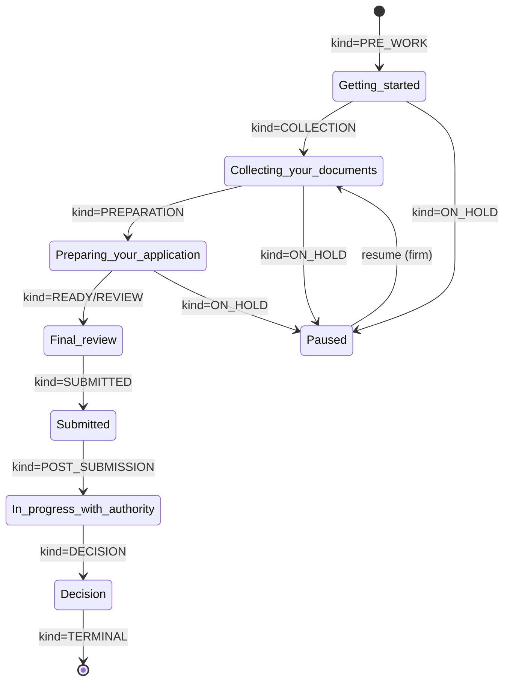

The transitions are **driven entirely by AG-7** (the firm advances the case); CP-2 re-derives the displayed step on each load. The client cannot transition anything — there are no client-initiated state changes in CP-2 (write actions live in CP-3..CP-7 and change *those* entities, not the case stage). Collapsed internal stages (BR-4) mean the client's visible step set is a subsequence of the true pipeline.

## 7. Key Entities & Fields

CP-2 **owns no entities**. It consumes spine and module entities (cite Doc 1 §5 and the AG modules); it redefines none.

**Consumed (cite, never redefine):**
- **`Case`** (AG-7, CLIENT-PII: `firm_id` + `client_id` = Party FK) — read for `id`, `caseCode`, resolved `programNodeKey`/`packVersionId`/`countryCode`, `currentStageId`, `stageEnteredAt`, `bucket`. Scope source for every panel.
- **`StagePipeline` / `StageTemplate`** (GLOBAL pack, Doc 1 §5.13.4) — `order`, `nameKey` (NOT rendered), `kind` (presentation only), `isMilestone`, `deadlineOffsetDays`.
- **`PortalVisibilityConfig`** (TENANT, **owned by AG-15** §3.3, Doc 3 AG-15 §7) — the per-case allow-list: `showProgress`, `stageLabelMapJson` (internal→client label allow-list), `showDocuments`, `showFirmProducedDocs`, `showSqr`, `showInvoices`, `showAgreements`, `enableMessaging`. CP-2 *reads* it as the contract; AG-15 owns authoring.
- **`ClientWorkItem`** (CLIENT-PII, **owned by AG-15** §3.4, Doc 3 AG-15 §7) — `type` (`DOCUMENT_REQUEST | SQR_ASSIGN | INVOICE_EXPOSE | AGREEMENT_SEND | MESSAGE_ASK`), `targetRef`, `status`, `dueAt?`, `rejectReason?`. The authoritative source for the next-actions roll-up (3.3); CP-2 reads, never authors.
- **`ActivityEvent`** (**owned by AG-13**, materialized append-only) — `firm_id`, `entityType`, `entityId`, `occurredAt`, `sourceType`, `sourceId`, `actorUserId?`, `summary jsonb` (per-locale), **`visibility enum(internal-only|client-visible)`** (the portal filter), `deepLink`, `eventIdempotencyKey`. CP-2 reads the `client-visible` slice via the composite cursor.
- **`CaseMilestone`** / **`Submission`** / **`Decision`** (AG-7 §3.6) — dated facts surfaced when firm-exposed.
- **`Document`** (AG-9, CLIENT-PII) — `status` (10-state), `scan_status`, `requirementId`, `requestedDueAt`, `rejectionReason` — read only to derive outstanding-document next-actions (display + deep-link; fulfilment is CP-4).
- **`Invoice`** (AG-6) — owed amount + currency + status, display-only (BR-6).
- **e-sign envelope** (AG-5) — `SENT`/`VIEWED`/signed state, to derive unsigned-agreement next-actions.
- **`SqrAssignment`** (AG-8) — assigned/unsubmitted state, to derive questionnaire next-action.
- **`ClientCustomer` / `Party` / `PartyProfile`** (Doc 1 §5.2) — the credential-lens subject + `locale`; the ownership-chain root.

**Events emitted / consumed.**

| Direction | Event | Notes |
|---|---|---|
| **Emit** | *(none)* | CP-2 is read-only and authors no facts; client write actions in the spoke CP modules *cause* domain events that are emitted by their owning engines (e.g. a CP-4 upload → `document.uploaded` from AG-9; a CP-5 payment → `payment.succeeded` from AG-6, the sole emitter; a CP-6 signing → `envelope.signed` from AG-5, the sole emitter; a CP-3 submit → `sqr.submitted` from AG-8). |
| **Consume (read-projection only)** | `case.created`, `case.stage.changed`, `case.submitted`, `case.decided`, `case.closed` | Reflected via the AG-13 `ActivityEvent` client-visible projection (stage stepper + timeline refresh on next load). CP-2 does not subscribe directly to the bus — it reads the AG-13-materialized result. |
| **Consume (next-action freshness)** | `document.uploaded`, `sqr.submitted`, `payment.succeeded`, `envelope.signed` | The exact AG-15 `ClientWorkItem` status-flip set (Doc 3 AG-15 §3.4 / §7) that drives the disappearance of a completed next-action; CP-2 observes the resulting work-item state on next read (no direct subscription — the owning modules / AG-15 update state; CP-2 re-derives). |

> CP-2 deliberately has **no bus subscription**: it is a pure read surface. The "consume" rows document which facts *change what CP-2 will render*, sourced through the owning module's state and the AG-13 projection — not a CP-2 listener. Every event name above is a registered Doc 1 §6.1 dictionary entry consumed via its owning emitter (no CP-2-minted or synonym name). This keeps the portal off the write path and minimises its attack surface.

**ERD (consumed, read-only).**

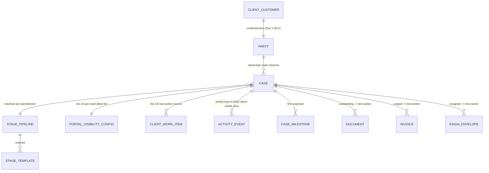

## 8. User Stories + Acceptance

- **US-1 — See where my case is.** *Given* I am a Primary Applicant with one in-scope case, *When* I sign in, *Then* I land on my case dashboard showing a stage stepper in client-friendly labels in my chosen language, with the current step emphasised and internal stages collapsed. *And* I never see an internal stage name or `kind` token.
- **US-2 — Know my one next thing.** *Given* the firm has requested a document and exposed an unpaid invoice, *When* I open my dashboard, *Then* the next-actions panel lists both, ranked by urgency, each with a plain-language ask and a button that takes me to upload (CP-4) or pay (CP-5). *And* once I upload, the document action is gone on my next load.
- **US-3 — Switch between my matters.** *Given* I have two in-scope cases (my PR and my spouse's work permit), *When* I sign in, *Then* I see a switcher with both, ranked with the case needing my attention first, *And* selecting one shows only that case — never any other client's case.
- **US-4 — Read my story.** *Given* my case has months of activity, *When* I open the timeline, *Then* I see a reverse-chronological feed of only client-visible events in my language, paginated 50 at a time with "load more," *And* no internal note, deficiency, or staff assignment ever appears.
- **US-5 — Isolation holds (the security story).** *Given* I am client X, *When* I (or a tampered request) ask for client Y's `caseId`, document, invoice, or timeline, *Then* I receive 404/empty for 100% of resources — no Y data in body, error, or log — at the app layer, *And* the second portal RLS dimension denies it at the database even if the app check were bypassed (Doc 1 §2.5 AC-2.5.1/§4.5 AC).
- **US-6 — Corporate roster, firm-scoped.** *Given* I am a Seat Admin, *When* I sign in, *Then* I see exactly the company's in-scope applicant cases the firm scoped to my seat, each with its stage, *And* a sibling applicant not in my seat scope returns 404 (Doc 1 §2.5 AC-2.5.6).
- **US-7 — Calm when there's nothing.** *Given* I was invited but no case is shared yet, *When* I sign in, *Then* I see a neutral "your firm hasn't shared a case yet" message — never a 403 and never a hint a case exists; *And* when I'm fully caught up, I see "you're all caught up," not a blank screen.

## 9. Edge Cases & Validations

- **Stale `caseId` after revoke/scope change.** A case removed from the caller's in-scope set (corporate scope change, suspension) returns 404 on the next request even if the client holds an old deep-link; the resolved in-scope set is recomputed each request (BR-9).
- **All stages collapsed.** If the firm exposes the case but maps no stage to a client label, the stepper shows a single safe "in progress" state rather than an empty stepper (BR-4 / CP-2-9).
- **Quarantined upload.** A scan-failed upload keeps its next-action open as "awaiting a clean re-upload"; it never reads as done and never silently blocks (CP-2-14).
- **Currency the client doesn't recognise.** Invoice currency is shown as AG-6 stores it (firm/case currency); CP-2 does not convert (BR-6) — any FX is AG-6/Biller's concern.
- **Decision before firm release.** If the firm has recorded a `Decision` but not exposed it, CP-2 shows no outcome (CP-2-22); [FOUNDER-CONFIRM] whether a refusal is ever auto-surfaced.
- **Locale with partial translation.** Missing client-label/copy falls back to the firm default locale, never an empty string (BR-5).
- **Offline then act.** Tapping an action CTA while offline is disabled with the offline banner; no request is queued (read-only offline, BR-11).
- **Many milestones / long timeline.** Both are cursor-paginated; the dashboard first paint never blocks on the full timeline (CP-2-18/§11).
- **Dependent/Viewer attempts an action.** The action CTA is hidden (no write key) and the corresponding `portal/*` write endpoint 403s — UI suppression is cosmetic; the server is the boundary.
- **Concurrent firm stage advance during a client session.** The client sees the new step on next load (no realtime push in foundation, Doc 1 §6 note); no stale write risk because CP-2 writes nothing.

## 10. Permissions

`portal/*` LOCAL keys (catalog **owned by SA-6**, Doc 1 §4.4; CP-2 holds **read** keys only — every write lives in CP-3..CP-7). Bound to the own-ownership-chain (Doc 1 §4.5); a portal token (`aud = er:portal`) can never satisfy an `agent/*` route (Doc 1 §3.1).

| Permission | Grants | Held by (portal roles, §4.4) |
|---|---|---|
| `portal/dashboard:view` | Load the home shell, switcher, and single-case dashboard for an in-scope case. | Primary Applicant, Corporate Sponsor/Seat, Dependent/Viewer |
| `portal/case:view.own` | Read the case header + stage stepper (client-safe) for an own/in-scope case. | all three |
| `portal/timeline:view.own` | Read the `client-visible` `ActivityEvent` slice for an own/in-scope case. | all three |
| `portal/next-actions:view.own` | Read the derived next-action roll-up (document/SQR/invoice/agreement/message asks). | Primary Applicant, Corporate Sponsor/Seat (Viewer optional, firm-set) |
| `portal/case:view.roster` | Read the corporate roster of in-scope cases for a seat. | Corporate Sponsor/Seat Admin |

> Fulfilment keys (`portal/document:upload`, `portal/invoice:pay`, `portal/envelope:sign`, `portal/sqr:answer`, `portal/message:send`) belong to the spoke CP modules; CP-2's deep-links route to them but CP-2 itself requires only the read keys above. The `view.own` qualifier is satisfied only when the record-level layer resolves the record to the caller (Doc 1 §4.1). The exact `portal/*` key strings and the `.own`/`.roster` qualifiers are illustrative here; the authoritative catalog and its single grammar are owned by SA-6 and CI-derived from each CP §10 (Doc 1 §4.4 / ADR C3-D3).

## 11. Scalability · Security · Performance

> **Isolation backbone inherited from CP-1 §3, not restated here.** CP-2 inherits the CP-1 §3 own-case-only gate (`assertPortalOwnershipChain`), the second-RLS-dimension wiring, and the §3.4 ownership-bound presigned object-access rule, all per Doc 1 §2.5/§4.5. The block below records only the CP-2-specific isolation deltas; the contract itself lives in CP-1 and may not be weakened.

**Security & isolation (FIRST — this is the top PII-leak surface).**
- **Two RLS dimensions, both forced.** Every read executes with `app.current_firm_id` AND `app.current_client_subject` set from the verified `er:portal` token (Doc 1 §2.4–§2.5); the portal policy's `USING` (and the mirrored `WITH CHECK`, though CP-2 never writes) backstops client-to-client isolation at the database. A missed app check yields zero rows, not a leak.
- **App layer = fast/observable; RLS = guarantee.** The CP-1 §3 own-case-only gate + `PortalVisibilityConfig` allow-list run on every read and return 404/empty (never 200, never a sibling's data, no PII in body/error/log — Doc 1 §4.5 AC). The release-gating cross-tenant/cross-record denial suite (Doc 1 §2.8) and the pre-go-live horizontal-access pentest (Doc 1 §4.7) MUST fail 100% against CP-2 endpoints, including `caseId` tampering and corporate-seat chain abuse.
- **Leak-off by default.** Stage labels, sources, milestones, decisions, and timeline classes are invisible unless `PortalVisibilityConfig` exposes them — the wall is server-side, never the UI hiding a section (AG-15 §3.3 / Doc 1 §4.5 AC-4.5.4).
- **No caller-supplied scope, no signed-from-input keys.** Scope is the context's `clientCustomerId`; any deep-linked document opens via the CP-1 §3.4 ownership-bound presigned URL resolved from the owned record in CP-4 (never a caller-supplied key, Doc 1 §4.5/§7.7) — CP-2 only carries the deep-link, not the bytes.
- **Minimal attack surface.** CP-2 has no bus subscription, no write path, and no universal search (ADR C4-D4) — it is a read projection, the smallest possible footprint for the most exposed console.
- **Audit.** Client reads of sensitive views and any reveal are access-audited to the per-firm hash-chain (Doc 1 §7.5); the firm sees a provable record (AG-15 §3.9) that the client touched only their own records.

**Scalability.** CP-2 adds no new tables — it reads the existing spine + the AG-13 materialized `ActivityEvent` (the table ADR §6.2 committed IN precisely to make high-traffic timelines scale without read-time fan-out). The timeline is a single covering-index scan + keyset page; the stepper is a bounded pipeline read; next-actions are bounded per-source queries over the AG-15 `ClientWorkItem` set. The same module serves a solo-RCIC's single client and a multi-country firm's corporate roster with no fork (the switcher row is the unit of scale). Targets the Doc 1 §5 spine at the §8 P-scale.

**Performance.** Read p95 ≤ 300ms / p99 ≤ 800ms; FCP ≤ 1.5s / LCP ≤ 2.5s p75 / INP ≤ 200ms p75 (Doc 1 §8, the portal carries the PWA budget). Progressive render (header → stepper → next-actions → timeline) so a slow region never blocks status. All feeds cursor-paginated (≤ 50, CP-2-26). Per-subject read caching is permitted **only** within the caller's own request/session and the PWA per-origin cache (BR-11) — never a cross-client cache key; the dashboard is recomputed live per load (no shared dashboard cache that could cross subjects). Workers/realtime are not required (no realtime push in foundation, Doc 1 §6 note); the client sees firm changes on next load.

## 12. Reference Note

**Greenfield — NEW (no prototype counterpart).** The Client Portal is the gap-analysis CRITICAL scope-hole C2: it was never previously specced, so there is no design-provenance to mirror and no "exists/CHANGED" prototype baseline (Doc 1 §1.8). Every requirement here is a fresh build measured solely against this spec and the procurement acceptance gate (ADR 6.1/6.3). What CP-2 reuses is **architecture, not code**: the AG-7 stage machine, the AG-13 `ActivityEvent` materialization with its `visibility` column, the AG-15 `PortalVisibilityConfig` allow-list and `stageLabelMapJson` client-label map plus the `ClientWorkItem` orchestration, the AG-6/AG-5/AG-8/AG-9 state, the Doc 1 §2.5 portal RLS dimension, the Doc 1 §4.5 record-level authz layer, and the Doc 1 §3 client identity pool — all of which exist (or are committed IN) as the firm-side/foundation counterparts CP-2 consumes. CP-2 contributes the client-facing presentation and orchestration only; **CP-2 itself introduces no new tables and no new domain events** (the most conservative possible addition for the highest-risk surface). Note: this "no new tables" property is module-scoped — three sibling portal modules do own new tables (CP-5 `PortalPaymentAttempt`, CP-8 `PortalAccountViewState`, CP-9 `OrgPortalRollup`), enumerated once in the doc front-matter; it is not a doc-wide invariant.

## 13. Open Questions / [FOUNDER-CONFIRM]

- **Client-facing stage/milestone vocabulary.** The exact client-friendly labels for each `StageTemplate.kind`, the milestone display names, and the "what this means" helper copy are Country-Pack/AG-15 `stageLabelMapJson` content [FOUNDER-CONFIRM] — CP-2 ships the machinery; the words are the founder/SME deliverable.
- **Refusal disclosure policy.** Whether a recorded `Decision` of `REFUSED` (or other sensitive outcome) is ever auto-surfaced to the client through CP-2 before a human firm contact, or held for explicit firm release [FOUNDER-CONFIRM] — affects 3.5/CP-2-22 and the post-decision playbook seam (AG-7 §3.6).
- **Next-action for the Dependent/Viewer.** Whether the Viewer role sees the next-actions panel at all (read-only progress only) or a firm-configurable subset [FOUNDER-CONFIRM] — a role-boundary policy (default: progress + timeline only, no next-actions). Confirm the Viewer role's exact `portal/*` read-key set so least-privilege is seeded day one (SA-6 catalog).
- **Stage-entered dates exposure.** Whether `stageEnteredAt` dates are shown per stage by default or only when the firm exposes them [FOUNDER-CONFIRM] (default: firm-exposed only, per `PortalVisibilityConfig`).
- **Switcher ranking signal.** Confirm "oldest outstanding next-action first" as the default switcher ordering (the anti-stall bias) vs. most-recently-updated [FOUNDER-CONFIRM].
- **Offline cache TTL.** The maximum age of the read-only PWA cache before it forces a reconnect-to-refresh prompt [FOUNDER-CONFIRM] (a privacy-vs-convenience knob for cached PII on the device).

---

# Module CP-3: Questionnaire (PQR/SQR fill)

> **Plane:** Client Portal console (Doc 4) — the applicant-facing third console, served from the cryptographically-walled **client-portal auth pool** (`aud = er:portal`, distinct signing key, Doc 1 §3.1). **Tenant key:** `firm_id` (RLS ENABLED+FORCED, Doc 1 §2.2) **plus** the second portal RLS dimension `app.current_client_subject` (Doc 1 §2.5) — every read and write is double-scoped by firm and by the logged-in client's `clientCustomerId`. **Permissions:** LOCAL `portal/*` (catalog owned by SA-6; this module declares its keys in §10). **What it is:** the client-facing **fill surface** for the Smart Questionnaire — PQR at the prospect stage, SQR at the case stage. **What it consumes (mirrors, never re-specs):** the AG-8 SQR/PQR runtime engine (Doc 3) and its `SqrAssignment`; the Doc 1 §5.3 `CanonicalField` catalogue, §5.4 append-only answer store, §5.5 section engine, and §5.13.1 `Predicate` contract; AG-9 documents (CP-4) for inline upload; AG-15's `PortalVisibilityConfig`/invite model for whether the questionnaire is exposed at all (the `showSqr` toggle). **Content-neutral:** all sections, questions, conditions, validation, and bindings are SA-1-authored Country-Pack data resolved by AG-8; CP-3 renders and submits — it authors no immigration content. **Identity rule (load-bearing):** answers are written `ClientCanonicalAnswer` keyed by **server-resolved** `partyId + subjectId + canonicalFieldId` — the portal **never** trusts a client-supplied identity, assignment id, firm id, or storage key. **Isolation backbone:** owned by CP-1 §3 (own-case-only RLS gate, the second portal RLS dimension, the ownership-chain check, the presigned-URL binding rule) — CP-3 inherits it and does not re-state or weaken it (per CP-1 §3; Doc 1 §2.5/§4.5).

## Module Index

1. Purpose & Goal
2. Users & Jobs-to-be-Done
3. Functional Design — How It Works (entry/auth, wizard, branching, capture-once/autosave, multi-subject, inline docs, validation, review/submit/resume, PWA offline, pre-account PQR & activation identity-join)
4. Detailed Functional Requirements (CP-3-1..CP-3-38)
5. Business Rules & Logic
6. States & Lifecycle
7. Key Entities & Fields (consumed Doc 1 §5 / AG-8; Events emitted/consumed; ERD)
8. User Stories + Acceptance Criteria (G/W/T)
9. Edge Cases & Validations
10. Permissions (LOCAL `portal/*`)
11. Scalability · Security · Performance (isolation FIRST)
12. Reference Note (NEW — portal is greenfield)
13. Open Questions / [FOUNDER-CONFIRM]

---

## 1. Purpose & Goal

**What it is.** CP-3 is the screen where the immigrant client tells the firm their immigration story — once, on their phone, in their language. It is the **client end** of the capture-once moat: the firm assigns an SQR (full intake, case stage) or a PQR (lighter pre-qualification subset, prospect stage) in AG-8; CP-3 is where the human actually answers it. Every answer the client types lands directly in the canonical append-only answer store (Doc 1 §5.4) keyed by `canonicalFieldId`, so it flows with **zero re-keying** to the Qualifier (AG-3), the government-form Filler (AG-7), and the document checklist (AG-9). CP-3 owns no answer schema, no question content, and no rule language — it is a thin, hardened, accessible, bilingual rendering-and-submission surface over the AG-8 runtime.

**The business outcome.** Intake is where immigration files stall and where refusal-risk is born: a half-finished questionnaire, a wrong passport digit, the same fact re-typed into a CRM then an intake sheet then a government PDF. CP-3 makes **"answer once, only what's left, save anytime, finish on any device"** structurally true for the client — the counterpart to AG-8's firm-side promise. A fact captured at PQR is never re-asked at SQR; a fact from a prior case prefills the new one (freshness-gated); a hidden field is never shown and never submitted; and a half-done wizard resumes exactly where it was left.

**Why it matters / world-class positioning.** A generic form tool (Typeform, JotForm, a PDF emailed back) produces a flat answer bag disconnected from eligibility and forms, with no isolation guarantee, no localisation, no save/resume, no provenance, and a public link anyone can poke. CP-3 is immigration-native and isolation-native: (a) **capture-once** — every question is a presentation of a `SectionQuestion` bound to a `canonicalFieldKey`, so an answer flows downstream untouched; (b) **ask-only-remaining** — the runtime subtracts what the store already knows; (c) **branching that is real** — show/require/skip is the one server-evaluated §5.13.1 `Predicate`, so the client never wades through irrelevant sections; (d) **save-and-resume that survives a dropped call** — autosave appends `FINAL` answers on every field; (e) **bilingual EN/FR + WCAG 2.2 AA + installable PWA** at the same bar as the rest of the platform; (f) **own-data-only by construction** — the wizard resolves to exactly one assignment for exactly one subject the logged-in client owns, backstopped at the database by the portal RLS dimension (CP-1 §3 owns this gate).

**Global ambition.** The same wizard serves a Canada-only solo RCIC's client and a multi-country firm's corporate applicant. Sections, questions, conditions, validation, and document names are GLOBAL Country-Pack data resolved by AG-8; the client picks their own locale independent of staff UI language; single-country/single-locale is the degenerate case with no code change.

## 2. Users & Jobs-to-be-Done

| Role | Primary job | Representative JTBD |
|---|---|---|
| **Principal applicant** (the protagonist) | Tell the firm everything once, on my phone, in my language, without re-typing what I already gave them. | "A calm step-by-step wizard I can pause and resume." · "Only ask me what's relevant and not already known." · "Switch the whole thing to French." · "Upload my passport from my camera, right next to the question about it." |
| **Spouse / accompanying adult dependant** | Fill my own part of the family's intake, privately. | "Answer my own section under my own login or via my own link — my spouse should not see my passport number." |
| **Corporate seat-holder** (e.g. HR coordinator) | Complete or progress intake for an applicant on the company roster, within the scope the firm set. | "Open the questionnaire for the applicant I'm authorised for — and only that applicant." |
| **Returning client** | Re-use what I gave the firm last time. | "Don't make me re-enter my date of birth and education for a second application — just confirm what may have changed." |
| **Low-confidence / low-bandwidth user** | Get through a long form on a cheap phone on a weak connection. | "Don't lose my answers when my connection drops." · "Big tap targets, clear errors in plain language, a progress bar that means something." |
| *(referenced, not a CP-3 user)* **Firm staff** | Assign, review, verify, re-open. *(AG-8 / AG-15 — they never see a CP-3 screen.)* | Owns content + assignment + verification; CP-3 is the client's door into the same data. |

**Design implication.** Two design poles meet here: a **consumer-grade, mobile-first, anxiety-aware** experience (this is a stressful, high-stakes form for a non-expert in a possibly-second language) and a **regulated-PII, isolation-native** backend contract (every keystroke is one person's restricted data on the platform's highest-exposure surface). CP-3 must be calm and forgiving on the surface and uncompromising underneath.

## 3. Functional Design — How It Works

Each sub-function is designed for *how it works*, the *world-class behaviour*, the *key screens*, and the *data flow*. CP-3 is a pure consumer of the AG-8 three-layer runtime (Selection authored in SA-1 → `SqrAssignment` in AG-8 → answers in the canonical store); it adds the client-facing wizard, the offline shell, and the portal-pool security envelope. **Ownership (wizard):** the SQR/PQR **wizard UX is owned by CP-3**; AG-8 owns the engine (resolution, branching, validation, lifecycle) — no other module specs a fill surface. The isolation primitive itself (the own-case-only gate, the second RLS dimension, `assertPortalOwnershipChain`, the presigned-URL binding rule) is owned by CP-1 §3 and inherited here, not re-derived.

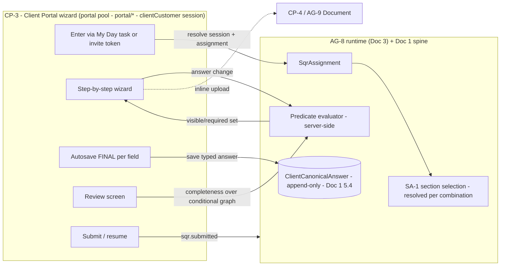

### 3.0 Entry & portal-pool authentication (the door, hardened)

**How it works.** A client reaches the questionnaire two ways, both resolving to **one** `SqrAssignment` server-side:

- **Authenticated entry (primary).** A logged-in `ClientCustomer` (portal pool, `aud = er:portal`, Doc 1 §3) opens the questionnaire from a My Day / "Action needed" task in CP-1, or from the case view in CP-2. The session principal is the caller's `clientCustomerId`; the middleware sets `SET LOCAL app.current_firm_id` AND `SET LOCAL app.current_client_subject` (Doc 1 §2.5/§4.5) before any query. The assignment is resolved by `(firm_id, subject, kind)` from the **PrincipalContext**, never from a request body.
- **Capability-token entry (invite/pre-account).** Before a client has set a password (PQR for a fresh prospect, or an SQR sent to a not-yet-activated client), AG-8 mints an **unguessable, expiring capability token** (Doc 1 §4.6 — carried in the path/header, never a URL query param, never a sequential/UUID id in the URL). CP-3 resolves the token server-side to exactly one assignment → `firm_id` + subject; the token is single-purpose (this assignment only) and rate-limited. The DB backstop for this pre-account path is the resolved subject the token binds to (specified in §11 / [ARCHITECT-CONFIRM]), not an assumed `clientCustomerId`.

Whichever the door, the server resolves the assignment and **derives** `partyId` + `subjectId` + `firm_id`; the client never names them. `PortalVisibilityConfig` (AG-15) is consulted first via the `showSqr` toggle: if the firm has not exposed the questionnaire for this case, the surface returns 404/empty (leak-off-by-default, Doc 1 §4.5).

**World-class behaviour.** *No separate account needed for first PQR* — a prospect answers via token, then a single tap converts the token session into a real `ClientCustomer` activation (CP-1 owns activation; CP-3 hands off; the full pre-account flow and the activation identity-join contract are §3.9). *Self-healing links* — an expired token shows a non-leaking "this link has expired, ask your consultant to resend" (firm regenerates in AG-8; answers are preserved). *One subject per session* — a corporate seat-holder or a spouse with their own link sees only their own subject's assignment.

**Key screens.** *Questionnaire launcher* (assignment title, locale switch, estimated time, progress if resumed, "Continue / Start"). *Expired/invalid-link* (non-leaking, with a "request a new link" affordance routed to the firm).

**Data flow.** Entry (session or token) → server resolves assignment → PrincipalContext (`firm_id`, `clientCustomerId`, derived `partyId`/`subjectId`) → `SET LOCAL` both GUCs → `PortalVisibilityConfig.showSqr` check → load pinned section selection + current answers → render launcher.

### 3.1 The fill wizard (section-by-section)

**How it works.** The wizard renders the AG-8-resolved question set **one logical section at a time** (Doc 1 §5.5 `LogicalSection`/`SectionQuestion`), with a progress indicator over the *live conditional graph* (not over the static section count, so the bar is honest as branches open/close). Each question is a presentation of a `canonicalFieldKey`; its label, help text, control type, options (`EnumSet`), and validation all come from the resolved `CanonicalField` + `LocalizedLabel` in the client's locale. The client moves section-to-section; within a section, fields validate inline as typed.

**World-class behaviour.** *Calm, single-focus steps* — never a wall of 80 fields. *Honest progress* — recomputed against the conditional graph so "3 of 7 sections" reflects what this client will actually be asked. *Plain-language, anxiety-aware copy* — errors say what to do, not "ERR_VALIDATION". *Per-locale, switchable mid-flow* — switching EN↔FR re-renders labels/help/validation/option lists with no answer loss (answers are language-neutral typed values).

**Key screens.** *Wizard frame* (section nav rail / stepper, progress, locale switch, save indicator, Back/Next). *Section page* (the resolved questions). *Computed/derived fields* render read-only (recomputed server-side, never client-trusted).

**Data flow.** Load selection → render section N → field input → inline client validation (UX) → on advance/blur, server re-evaluates branching (§3.2) and autosaves (§3.3) → progress recompute → next section.

### 3.2 Branching / conditional logic (the ONE predicate, server-authoritative)

**How it works.** Show/require/skip is **not** a CP-3 feature — it is the single typed §5.13.1 `Predicate` (closed operator set `eq/neq/in/gt/gte/lt/lte/exists` + `and/or/not`), authored in SA-1, evaluated by the AG-8 server-side evaluator. CP-3 calls the evaluator on each answer change for live UX, and the server re-evaluates authoritatively at every save and at submit. The client UI **never** decides visibility/requiredness on its own and is never trusted to.

**World-class behaviour.** *Whole sections switch on/off* — the spouse section appears only when the predicate over `maritalStatus` is true; pick "single" and it is neither shown, required, nor submitted. *Hidden ≠ deleted* — a field hidden by a predicate is excluded from the projection but its prior answer is retained (append-only) and restored if re-shown — no ghost spouse (mirrors AG-8 §3.3 / EC). *No dead ends* — SA-1's publish-time validator already proved the predicate graph references only published canonical keys, so the runtime always resolves deterministically. *Tamper-proof* — a client who hand-crafts a submit for a hidden field has it ignored server-side.

**Data flow.** Answer change → portal endpoint → AG-8 predicate eval over the subject's current answers → visible/required set returned → wizard re-renders → (on submit) server re-evaluates completeness over the same graph.

### 3.3 Capture-once, prefill, and autosave / save-and-resume

**How it works.** Three behaviours, all backed by the append-only store (Doc 1 §5.4), none re-implemented in CP-3:

- **Capture-once (ask-only-remaining).** On load, AG-8 subtracts every `canonicalFieldId` for which a current (un-superseded) `ClientCanonicalAnswer` exists for the subject; CP-3 renders those **prefilled-read-only** (with an edit affordance) and asks only the net-new fields. PQR answers ARE SQR answers (PQR is the `inPqr` subset of the same questions, Doc 2 §3.5) — no carry-over copy.
- **Cross-case prefill (freshness-gated).** `CLIENT_LEVEL` facts from prior cases prefill, relevance-gated (`appliesToRoles`/`subjectKind`) and freshness-gated: a `mustReaffirmPerCase` field or an aged-out `FreshnessRule` field renders **prefilled-reaffirm** ("please confirm — this may have changed"), never silently trusted.
- **Autosave / save-and-resume.** Every field change appends a `FINAL`-status `ClientCanonicalAnswer` (supersede semantics, never overwrite) via the portal fill endpoint; the wizard shows a "saved" indicator. Resume restores the exact section and field position from the latest FINAL state. A dropped connection loses at most the one unsynced field; the offline shell (§3.8) queues nothing that mutates server state.

**World-class behaviour.** The client never re-types a known fact; a long form survives a tab close, a phone reboot, or a flaky connection; the three display states (*ask* / *prefilled-confirmed* / *prefilled-reaffirm*) are visually distinct so the client knows what's expected. Confirming a prefilled-reaffirm field appends a fresh-`effectiveAt` answer (audited provenance = portal).

**Data flow.** Load → AG-8 subtract known + classify (ask/confirm/reaffirm) → render → field change → POST answer (server type-validates, appends FINAL) → `sqr.answer.captured` (emitted by AG-8) → progress recompute → resume reads latest FINAL.

### 3.4 Multi-subject fill (principal / spouse / each dependant)

**How it works.** A single case holds answers for a whole family without flattening them (Doc 1 §5.4 `AnswerSubject`). The principal declares the family unit once (materialising `AnswerSubject` + `ClientFactRecord` rows in AG-8); shared `CLIENT_LEVEL` facts (family size, accompanying counts, marital status, mailing address) are captured once on the principal subject and read by every linked applicant — a form can never disagree with the principal's count by construction. Each adult subject answers their own `subjectId`, either under their own `ClientCustomer` login or via their own linked capability token (AG-8 §3.7); CP-3 renders **exactly one subject's assignment per session**.

**World-class behaviour.** *Declare the family once* — dependants and spouse appear as the right per-subject question sets, never re-asking the shared facts. *Privacy between subjects* — a spouse's Restricted-PII answers are masked from the principal by default (firm-configurable, AG-8 §13 / [FOUNDER-CONFIRM]); a CP-3 session for the principal cannot read the spouse subject's restricted values. *Consistency surfaced firm-side* — contradictions (a spouse's marital status disagreeing with the principal's; a dependant DOB making them age-ineligible) are flagged to staff by AG-8, not silently projected; CP-3 just collects.

**Data flow.** Principal family declaration → AG-8 materialises subjects + linked assignments → each subject's session resolves its own `subjectId` (server-derived) → shared `CLIENT_LEVEL` answers read, not re-asked → per-subject answers written under each subject.

### 3.5 Inline document-request items (hand-off to CP-4 / AG-9)

**How it works.** A combination's `DocumentRequirement` set (Doc 1 §5.6, SA-1-authored) surfaces in the wizard as **document-request cards** — standalone or attached to the question they evidence (the passport-number question carries "upload your passport"). The client uploads inline via an **ownership-checked presigned URL** that the server resolves *from the owned record* — CP-3 **never** signs or accepts a caller-supplied storage key (Doc 1 §2.5/§4.6, the IDOR fix; the binding rule is owned by CP-1 §3). The realised `Document` and its 10-state lifecycle are owned by AG-9 / CP-4; CP-3 *requests and surfaces status*, it does not own the document lifecycle.

**World-class behaviour.** *Contextual* — the document sits beside the fact it evidences, setting up firm-side verification (AG-8 §3.8). *Camera-first on mobile* — capture or pick a file; client-side image down-scale before upload to respect bandwidth. *Scan-aware status* — a document in `Scanning`/quarantine renders "awaiting a clean re-upload" via AG-9's `Document.status` + orthogonal `scan_status`, and **never counts as received/verified**. *Reuse, don't re-ask* — if a valid `Document` of the required `documentTypeKey` already exists (derived checklist, Doc 1 §5.6), the card shows "already provided" instead of re-requesting.

**Data flow.** `DocumentRequirement` → wizard card → request presign (server binds URL to an ownership-checked record) → PUT to S3 → AG-9 `Document` created/linked (polymorphic, EntityTypeRegistry-validated) → `document.uploaded` → card status refresh.

### 3.6 Validation against `CanonicalField.validation` (server is the authority)

**How it works.** Every answer is validated **server-side** against the field's `CanonicalField.dataType` + `validationJson` (Zod-expressible min/max/regex/required) + `EnumSet` membership + conditional requiredness from the live predicate graph (AG-8 §3.5 / AG-8-13). Client-side validation mirrors the same rules for instant UX but is never the gate; an invalid answer is **rejected and not persisted**. There is no manual if/else validation anywhere — schema (the field's own `validationJson` + the closed predicate grammar) is the single mechanism.

**World-class behaviour.** *Typed and localised* — a date control for `DATE`, a select for `ENUM`, a number stepper for `NUMBER`; errors render in the client's locale with plain-language remediation. *No silent coercion* — a value that doesn't type-check is rejected with a reason, not quietly truncated. *Computed fields read-only* — derived values are recomputed server-side and never client-trusted.

**Data flow.** Field change → POST → server resolves `CanonicalField` → type + `validationJson` + `EnumSet` + conditional-required check → reject (localised error, nothing persisted) OR append FINAL answer.

### 3.7 Review, submit, lock & targeted re-open

**How it works.** Pre-submit, CP-3 runs the AG-8 **completeness check over the live conditional graph** — all visible required (incl. conditionally-required) questions answered and required `PRIMARY` documents satisfied (derived checklist, Doc 1 §5.6). The review screen lists every section with its answers (Restricted PII masked) and any outstanding items deep-linked. The client submits only when complete, unless the firm allows partial-with-gaps (firm-configurable, default per AG-8 §13). On submit, AG-8 **locks** the assignment read-only, takes a `CaseSqrSnapshot`, and emits `sqr.submitted` (idempotent on `(assignmentId, submit)`). If the firm later **requests changes** targeting specific questions (AG-8 §3.9), CP-3 re-opens only those fields in the client's locale with the firm's note; re-answer appends (prior retained), re-submit re-locks.

**World-class behaviour.** *No surprise dead-ends* — the review screen names exactly what's missing with a tap to fix it. *Submit means submit* — a clear confirmation, then a read-only, reassuring "received" state with what happens next. *Targeted re-open* — the client fixes three fields, not the whole form, with the firm's reason shown in-locale. *Idempotent* — a double-tap or a retried request never double-submits or double-advances the case.

**Data flow.** Review → completeness over conditional graph → block/allow per policy → submit → AG-8 lock + `CaseSqrSnapshot` + `sqr.submitted` → Conductor (re-score AG-3, advance case, notify firm) → CP-3 shows "received" → (later) firm request-changes → CP-3 re-opens targeted fields.

### 3.8 PWA, offline (read-only), accessibility & localisation

**How it works.** CP-3 is part of the installable portal PWA (Doc 1 §8 / NFR5-13): a manifest, a service worker caching the app shell + the **read-only** view of the current assignment (resolved questions + the client's own current answers) so a client on the subway can *review* where they are. Offline is **bounded to read** — no offline write/sync engine for regulated PII; a write attempted offline queues nothing and surfaces "you're offline, reconnect to save," and autosave resumes on reconnect. The wizard is WCAG 2.2 AA (Radix/shadcn primitives, full keyboard, screen-reader labels, focus management on section change, target sizes) and fully EN/FR with locale fallback to the country's required base locale (never a blank label).

**World-class behaviour.** *Installable* — add-to-home-screen for a near-app feel. *Read-offline, write-online* — honest about what is safe offline; the highest-risk/lowest-value offline-write engine is deliberately not built. *Accessible by construction* — axe-clean per component in CI plus a manual AT audit before go-live. *Bilingual everywhere* — labels, help, validation messages, document names, and the consent/no-guarantee disclaimer all localise.

**Data flow.** First load caches shell + read view → offline: render cached read view only → write attempt offline → blocked with reconnect prompt → online: autosave/submit resume.

### 3.9 Pre-account PQR & the activation identity-join (the funnel-top gate, closed)

**How it works.** The PQR funnel starts before an account exists, and the design closes the gap with one invariant: **the answers are canonical from the first keystroke — the account joins the answers later; the answers never move.** The flow, end to end:

1. **Token fill (no account).** AG-8 mints the single-purpose capability token (§3.0, Doc 1 §4.6) against an assignment whose `partyId` + `subjectId` already exist firm-side (the prospect's `Party`/`AnswerSubject` is created at lead capture, AG-2/AG-8 — [FOUNDER-CONFIRM] only for *which lead events* auto-mint a PQR link; the machinery assumes nothing). The prospect fills the wizard exactly as an authenticated client would (§3.1–§3.6, same screens); every autosave appends a `ClientCanonicalAnswer` on the **token-resolved** `partyId + subjectId + canonicalFieldId`. There is **no staging store and no copy-on-activation** — pre-account rows and post-account rows are the same rows. `sourceJson` records provenance = portal-pre-account + token lineage (assignment id, token hash reference), so a pre-account answer is forever distinguishable in audit from a logged-in one.
2. **Submit.** Per §3.7 (completeness → lock → `CaseSqrSnapshot` → `sqr.submitted`); the "received" screen then offers the activation hand-off (one-tap default, §13 FC-4) or ends cleanly if the firm prefers invite-led activation (CP-1 §3.2). Either way the answers are already on the canonical store and firm-side scoring (AG-3) proceeds — activation is never a precondition for the funnel to advance.
3. **The activation identity-join (CP-1 executes activation; CP-3 defines the join contract).** When the prospect activates a portal account:
   - **What matches (server-side, never the client's claim):** the activation invite and the PQR token must resolve to the **same `partyId`**; CP-1's channel challenge (email/phone verification per CP-1 §3.2) proves control of the contact point that `Party` record holds. Matching is by resolved id, never by string-comparing an email the client typed.
   - **What the client confirms:** a **bind-review screen** — "We have your questionnaire from *{date}*: *{n}* sections answered" with a masked summary (Restricted PII never shown here) and an explicit "Yes, these are my answers" confirmation. Confirming changes **no data** (nothing is copied, re-keyed, or superseded); it flips the bind state and creates the human-consent record for the join.
   - **What is audited:** the bind writes a hash-chained audit entry (Doc 1 §7.5) linking the token-era actor (assignment-scoped principal) to the new `clientCustomerId` — actor lineage over the prospect's pre-account actions is continuous and queryable. Event emission for the bind rides CP-1's portal-identity events (pending Doc-1 Amendment A4-2 / F2 registration); the audit entry itself is not pending.
   - **What never happens:** a silent merge. If activation resolves to a *different* `partyId` than the token's assignment (forwarded link, shared mailbox, duplicate lead), CP-3/CP-1 bind nothing, leak nothing, and raise a firm-side review item — de-duplication is a staff decision (AG-2), never a portal-side auto-merge.

**The RLS binding mechanism — two options, one console-side default.** The open question is what the Doc 1 §2.5 second portal RLS dimension (`app.current_client_subject`) binds to *before* a `ClientCustomer` exists. Both options are specced so the console build is not blocked; the mechanism decision is **(pending Amendment A4 verification F6 / Doc 1 §2.5)**:

- **Option A — token-scoped RLS dimension (DB backstop active pre-account).** The pre-account request sets the subject GUC from the token resolution — either as a provisional `PENDING_ACTIVATION` `ClientCustomer` minted at first token use (keeps the §2.5 policy shape intact), or as a token-resolved `AnswerSubject`/assignment key the §2.5 policies additionally accept (changes the frozen policy shape — the hard-gate variant F6 must verify). **UX under A:** invisible. Pre-account and post-account are one continuous surface; the bind-review screen is still shown (recognition + consent), but data-side the subject was real all along; activation upgrades the provisional identity in place.
- **Option B — deferred-bind-on-activation (console-side DEFAULT if the RLS option is rejected).** Pre-account writes run under a narrowly-scoped, assignment-bound principal: authorisation is the app-layer token guard (one token → one assignment, ownership chain, per-IP/per-token rate limits, CP-3-5) with firm RLS (`app.current_firm_id`) still FORCED at the DB; the **second** dimension is asserted only from activation onward, once the join has verified the `ClientCustomer → Party` ownership chain over rows that were always keyed to that `partyId`. **UX under B:** identical wizard pre-account; at activation the bind-review confirmation is **mandatory before the pre-account answers render in the new account** — until confirmed, the answers remain firm-visible (they are the firm's intake) but the portal account shows the questionnaire as "pending your confirmation." The confirm is the moment the DB-level subject assertion begins, so the UX makes it explicit rather than silent.

Under both options the pre-account path joins the Doc 1 §2.8 denial suite: a token for assignment A must fail at the DB (A) or at the guarded app layer (B) to read or write assignment B — CI-gated either way (CP-3-38).

**Key screens.** *Bind-review* (answer summary masked, explicit confirm, decline → firm review). *Activation hand-off* (post-submit one-tap, owned by CP-1; CP-3 supplies the assignment context). *Mismatch* (non-leaking "we couldn't link this questionnaire automatically — your consultant will help," nothing shown from either identity).

**Data flow.** Token fill → append answers on token-resolved `partyId`/`subjectId` (provenance = pre-account) → submit → activation (CP-1) → server match on `partyId` + channel challenge → bind-review confirm → bind state flips + audit link entry → subsequent sessions authenticate normally, second RLS dimension asserted (from first write under A; from bind under B) → token retired.

## 4. Detailed Functional Requirements

> "SHALL" = mandatory; each FR is a QA case. `firm_id` + `app.current_client_subject` are server-resolved from the portal session/token, **never** from client input. CP-3 consumes the AG-8 runtime and the Doc 1 §5 spine; it authors no content and defines no rule language. The isolation primitive (own-case-only gate, second RLS dimension, ownership-chain, presigned binding) is owned by CP-1 §3 and inherited here.

**Entry, identity & isolation**
- **CP-3-1.** The system SHALL serve the questionnaire only to a client-portal-pool principal (`aud = er:portal`) or a valid AG-8 capability token; a firm-pool (`aud = er:firm`) or platform token (`aud = er:platform`) SHALL be rejected (cross-pool 401, Doc 1 §3.1).
- **CP-3-2.** The system SHALL resolve the target `SqrAssignment`, `firm_id`, `partyId`, and `subjectId` **server-side** from the PrincipalContext / resolved token — NEVER from a client-supplied id, firm id, party id, or subject id.
- **CP-3-3.** The portal request SHALL set `SET LOCAL app.current_firm_id` AND `SET LOCAL app.current_client_subject` before any business query, so reads/writes are double-scoped (firm + client-subject, Doc 1 §2.5; per the CP-1 §3 gate).
- **CP-3-4.** The system SHALL render the questionnaire only when the case's `PortalVisibilityConfig.showSqr` (AG-15) exposes it (leak-off-by-default); otherwise 404/empty, audited, never 200 (Doc 1 §4.5).
- **CP-3-5.** A capability-token entry SHALL be single-purpose (this assignment only), expiring, carried in path/header (never a query param, never an id-in-URL), rate-limited per-IP and per-token; nothing SHALL persist on token-validation failure (Doc 1 §4.6).

**Wizard & branching**
- **CP-3-6.** The wizard SHALL render the AG-8-resolved question set section-by-section, each question a presentation of its `canonicalFieldKey`, with label/help/options/validation from the resolved `CanonicalField` + `LocalizedLabel` in the client's locale.
- **CP-3-7.** Show/require/skip SHALL be the single §5.13.1 `Predicate` evaluated **server-side authoritatively**, with live client re-evaluation for UX; CP-3 SHALL NOT introduce any second rule language or client-only visibility logic.
- **CP-3-8.** A field hidden by a predicate SHALL be not-required and excluded from the submission/projection; a client-submitted value for a hidden field SHALL be ignored server-side (tamper-proof).
- **CP-3-9.** A predicate-hidden field's prior answer SHALL be retained (append-only) and restored if the branch re-opens (no ghost data).
- **CP-3-10.** The progress indicator SHALL be computed over the live conditional graph, not the static section count.

**Capture-once, prefill, autosave**
- **CP-3-11.** On load the runtime SHALL subtract every `canonicalFieldId` already answered (current, un-superseded) for the subject and present it prefilled-read-only; CP-3 SHALL ask only net-new fields (capture-once, Doc 1 §5.4).
- **CP-3-12.** PQR answers (the `inPqr` subset) SHALL satisfy the corresponding SQR questions with no carry-over copy (same `ClientCanonicalAnswer`s, AG-8 §3.2).
- **CP-3-13.** Cross-case prefill SHALL apply only to `CLIENT_LEVEL` fields relevant to the subject; a `mustReaffirmPerCase` or aged-out `FreshnessRule` field SHALL render prefilled-reaffirm and SHALL require confirmation (appending a fresh-`effectiveAt` answer) — never silently trusted (Doc 1 §5.3).
- **CP-3-14.** Every field change SHALL autosave as a `FINAL`-status `ClientCanonicalAnswer` (supersede, never overwrite) via the portal fill endpoint, with a visible save indicator.
- **CP-3-15.** Resume SHALL restore the exact section/field position from the latest FINAL state; a dropped connection SHALL lose at most the one unsynced field.

**Multi-subject**
- **CP-3-16.** CP-3 SHALL render exactly one subject's assignment per session; the `subjectId` SHALL be server-derived from the assignment, never client-supplied.
- **CP-3-17.** Shared `CLIENT_LEVEL` facts SHALL be read from the principal subject, never independently re-asked in a way that can contradict (Doc 1 §5.4; AG-8 §3.7).
- **CP-3-18.** A subject's Restricted-PII answers SHALL be masked from another subject's session per the firm's spouse-privacy setting (default private; [FOUNDER-CONFIRM] AG-8 §13).

**Inline documents**
- **CP-3-19.** A combination's `DocumentRequirement`s SHALL surface as wizard cards; upload SHALL use a presigned URL the server binds to an ownership-checked record — CP-3 SHALL NEVER sign or accept a caller-supplied storage key (Doc 1 §2.5/§4.6; per the CP-1 §3 binding rule).
- **CP-3-20.** The realised `Document` + 10-state lifecycle SHALL be owned by AG-9/CP-4; CP-3 SHALL only request, display status (incl. `scan_status`), and surface reuse — a `Scanning`/quarantined document SHALL NOT count as satisfied.

**Validation**
- **CP-3-21.** The portal fill endpoint SHALL type-validate every answer server-side against the field's `dataType` + `validationJson` + `EnumSet` + conditional requiredness; invalid answers SHALL be rejected with a localised reason and NOT persisted (schema validation only; no manual if/else).
- **CP-3-22.** Computed/derived fields SHALL render read-only and be recomputed server-side, never client-trusted.

**Review, submit, re-open**
- **CP-3-23.** Pre-submit completeness SHALL be computed over the live conditional graph (all visible-required answered + required `PRIMARY` documents satisfied); the review screen SHALL deep-link every outstanding item.
- **CP-3-24.** Submit SHALL be allowed only when complete unless the firm enables partial-with-gaps (default = block; AG-8 §13); on submit AG-8 SHALL lock the assignment, take a `CaseSqrSnapshot`, and emit `sqr.submitted`, idempotent on `(assignmentId, submit)`.
- **CP-3-25.** A firm targeted re-open SHALL re-open only the specified questions in the client's locale with the firm's note; a re-answer SHALL append (prior retained) and re-submit SHALL re-lock.

**Restricted PII, accessibility, localisation, offline, audit**
- **CP-3-26.** Restricted-PII answers (`CanonicalField.isRestrictedPii`) SHALL be field-encrypted under the field's `retentionClass` sub-key (Doc 1 §7.1), masked by default in any CP-3 read view, and SHALL never appear in logs/traces.
- **CP-3-27.** The wizard SHALL meet WCAG 2.2 AA (keyboard, screen-reader, focus management, target sizes) and SHALL be fully EN/FR with fallback to the country's required base locale — never a blank label.
- **CP-3-28.** CP-3 SHALL be an installable PWA with read-only offline (cached shell + the client's own current read view); a write attempted offline SHALL be blocked with a reconnect prompt — no offline write/sync (Doc 1 §8 / NFR5-13).
- **CP-3-29.** Intake SHALL capture the client's consent and render the SA-1 `RegulatorConfig` no-guarantee disclaimer in-locale with pack-version provenance (Doc 1 §5.13); any eligibility hint SHALL carry the indicative-not-guaranteed posture, never a promise.
- **CP-3-30.** Every client-side action (open, autosave, submit, re-answer, document upload, consent) SHALL be auditable in the per-firm hash-chained audit spine (actor = `clientCustomerId`, target, action; Doc 1 §7.5), and abusive volume SHALL be rate-limited/size-capped with nothing persisted on failure.

**Pre-account PQR & activation identity-join (§3.9)**
- **CP-3-31.** A pre-account (capability-token) autosave SHALL append a `ClientCanonicalAnswer` on the token-resolved `partyId + subjectId + canonicalFieldId` from the first keystroke — no staging store, no copy-on-activation; `sourceJson` SHALL record pre-account provenance + token lineage (assignment id, token hash reference).
- **CP-3-32.** A pre-account token session SHALL expose exactly one assignment and nothing else — no dashboard, no case view, no messaging, no documents beyond this assignment's inline cards; every other portal route returns 404/empty for a token principal.
- **CP-3-33.** The activation identity-join SHALL bind only when the activation invite and the PQR token resolve server-side to the same `partyId` (plus CP-1's channel challenge); a mismatch SHALL bind nothing, leak nothing from either identity, and raise a firm-side review item — the portal SHALL NEVER auto-merge identities.
- **CP-3-34.** The bind SHALL require explicit client confirmation on a bind-review screen (masked answer summary; Restricted PII never rendered); confirmation SHALL change no answer data — it flips the bind state and records consent to the join.
- **CP-3-35.** The bind SHALL write a hash-chained audit entry linking the token-era actor (assignment-scoped principal) to the new `clientCustomerId`, so actor lineage over pre-account actions is continuous; bind event emission rides CP-1's portal-identity events (pending Doc-1 Amendment A4-2 / F2).
- **CP-3-36.** The pre-account DB-backstop mechanism SHALL be exactly one of §3.9 Option A (token-scoped subject GUC, §2.5 backstop active pre-account) or Option B (deferred-bind: app-layer token guard + forced firm RLS pre-account; second dimension asserted from bind) — decision (pending Amendment A4 verification F6 / Doc 1 §2.5), console-side default = Option B. CP-3 SHALL NOT claim the second-dimension backstop for the pre-account path unless Option A is verified.
- **CP-3-37.** Un-activated pre-account answers SHALL be retained under their fields' `retentionClass` (Doc 1 §7.1) exactly as activated answers are; the dormant-prospect purge window is firm policy [FOUNDER-CONFIRM] — machinery enforces whatever window is set, never a hard-coded value.
- **CP-3-38.** The pre-account path SHALL be in the Doc 1 §2.8 CI denial suite under whichever mechanism lands: a token for assignment A SHALL fail to read or write assignment B (at the DB under Option A; at the guarded app layer with firm-RLS backstop under Option B), and post-bind cross-client denial SHALL hold unchanged.

## 5. Business Rules & Logic

- **BR-1 (Server owns identity).** `firm_id`, `partyId`, `subjectId`, and the assignment are resolved from the portal session/token server-side; the client never supplies a scoping id. A client-supplied id is ignored, not honoured.
- **BR-2 (Own-data-only + firm allow-list).** A client touches only rows whose ownership chain resolves to their own `clientCustomerId` AND only entity types the firm exposed in `PortalVisibilityConfig` — enforced at the app layer (404/empty, audited) and backstopped by the second portal RLS dimension (the CP-1 §3 gate; Doc 1 §2.5/§4.5).
- **BR-3 (Single source).** Answers live once in `ClientCanonicalAnswer` keyed by `canonicalFieldId`; CP-3 holds no answer blob and no profile copy. The Qualifier and Filler read the canonical projection, never a CP-3 store.
- **BR-4 (Capture-once, freshness-gated).** Known `CLIENT_LEVEL` facts are not re-asked; `mustReaffirmPerCase`/aged-out `FreshnessRule` facts are re-asked (prefilled + confirm).
- **BR-5 (PQR ⊂ SQR).** PQR is the `inPqr` subset of the same SQR questions; a PQR answer is an SQR answer with no carry-over copy. A prospect-stage PQR resolves via `tentativeProgramNodeKey` or a country-level program-null default and carries forward losslessly at conversion (AG-8 §3.4).
- **BR-6 (One predicate contract, server-authoritative).** Conditional logic is the §5.13.1 `Predicate`, evaluated server-side; a hidden field is not required, excluded from projection, and its answer retained. No client-only visibility decides what is submitted.
- **BR-7 (Schema validation mandatory).** Every answer is validated against its `CanonicalField` (`validationJson` + `EnumSet` + conditional-required); invalid input is rejected, never persisted; no manual validation chains.
- **BR-8 (Append-only provenance).** Answers supersede, never overwrite; `status` (`FINAL|DECLARED|VERIFIED`) + `sourceJson` (= portal + locale + timestamp) always present. Verification (`DECLARED→VERIFIED`) is firm-side (AG-8); CP-3 writes `FINAL`/`DECLARED` only.
- **BR-9 (No silent clobber of verified data).** A new declared value differing from an existing `VERIFIED` one does not supersede it silently — AG-8 raises a conflict for staff; CP-3 surfaces "your consultant will review this."
- **BR-10 (Version pinning + snapshot).** The assignment pins `packVersionId`; an in-flight client completes on the pinned version even if SA-1 publishes a new pack; submit takes a `CaseSqrSnapshot` for reproducibility.
- **BR-11 (Idempotent submit).** `sqr.submitted` is idempotent on `(assignmentId, submit)`; a retried/double-tapped submit never double-advances the case.
- **BR-12 (Restricted PII = crown jewels).** `isRestrictedPii` fields are field-encrypted under their `retentionClass` sub-key, masked by default in any read view, never in logs/traces; CP-3 has no reveal action (reveal is a firm-side `agent/*` capability).
- **BR-13 (Read-only offline).** No regulated PII is written offline; offline is bounded to reviewing the client's own current state.
- **BR-14 (No-guarantee posture).** Any eligibility hint carries the SA-1 `RegulatorConfig` indicative-not-guaranteed disclaimer with pack-version provenance — never a promise.
- **BR-15 (Content is not CP-3's).** Sections, questions, conditions, validation, document names, and bindings are SA-1 Country-Pack content resolved by AG-8; CP-3 renders and submits, authoring nothing.
- **BR-16 (Canonical from the first keystroke).** Pre-account answers are ordinary `ClientCanonicalAnswer` rows on the token-resolved `partyId`/`subjectId`; account activation joins an identity to data that was always canonical — the bind never copies, re-keys, or supersedes an answer (§3.9).
- **BR-17 (Explicit, audited join — never a silent merge).** The identity-join requires a server-side `partyId` match + channel challenge + explicit client confirmation, and writes an audit entry linking both actors; any mismatch routes to firm review (AG-2 de-duplication) with nothing bound and nothing leaked.

## 6. States & Lifecycle

CP-3 does not own the assignment lifecycle — it is the **client-facing view** of the AG-8 `SqrAssignment` lifecycle (Doc 3 AG-8 §6). The client-experienced states map onto it:

```
  (firm assigns in AG-8)
        |
   ASSIGNED ──open via session/token──> OPENED ──answer/autosave──> IN_PROGRESS
        |                                  |                            |
        |                                  |                  submit (complete over conditional graph,
        |                                  |                   or partial if firm-enabled)
        |                                  |                            v
     EXPIRED <───token expiry────────────-+                   SUBMITTED / LOCKED  (read-only "received")
   (non-leaking "ask your consultant                                   |
    to resend"; answers preserved)                          firm request-changes (targeted | full)
                                                                        v
                                                            CHANGES_REQUESTED
                                                              | re-answer + re-submit
                                                              v
                                                    SUBMITTED / LOCKED (CaseSqrSnapshot retaken)
```

**Per-answer states (Doc 1 §5.4):** `FINAL` (autosaved, not submitted) → `DECLARED` (submitted self-declaration). `VERIFIED` and `CONFLICTING` are firm-side transitions (AG-8); CP-3 reads them to show "confirmed by your consultant" / "your consultant will review this," and writes only `FINAL`/`DECLARED`.

| From | To | Guard (server) | Client-side effect |
|---|---|---|---|
| ASSIGNED | OPENED | valid non-expired non-locked session/token + `PortalVisibilityConfig.showSqr` exposes it | launcher → first section; AG-8 emits "opened" |
| OPENED/IN_PROGRESS | IN_PROGRESS | server type-validates each answer + re-evaluates branching | autosave (`FINAL`); honest progress recompute |
| IN_PROGRESS | SUBMITTED/LOCKED | completeness over conditional graph (or partial if enabled) | read-only "received"; AG-8 lock + `CaseSqrSnapshot` + `sqr.submitted` |
| SUBMITTED/LOCKED | CHANGES_REQUESTED | firm `agent/sqr:request-changes` | targeted fields re-open in-locale with the firm's note |
| CHANGES_REQUESTED | SUBMITTED/LOCKED | re-validate + completeness | re-lock; re-snapshot |
| any | EXPIRED | token past expiry | non-leaking expired screen; answers preserved; firm regenerates |

**Pre-account identity overlay (§3.9 — orthogonal to the assignment lifecycle above).** A pre-account assignment additionally carries a bind state: `TOKEN_FILL` (answers accruing under the token-resolved subject) → `BIND_PENDING` (client activated, `partyId` matched, awaiting bind-review confirmation — under Option B the answers do not render in the account yet) → `BOUND` (confirmed; audit link written; second RLS dimension asserted for all subsequent sessions) — or `BIND_MISMATCH` (activation resolved to a different `partyId`; nothing bound; firm review item raised). The overlay never alters answer rows or the assignment's own state; a `SUBMITTED/LOCKED` assignment binds exactly the same way as an `IN_PROGRESS` one.

## 7. Key Entities & Fields

> CP-3 **owns no new persistent entity.** It is a client-facing renderer/submitter over the AG-8 runtime and the Doc 1 §5 spine. It cites, never redefines, the entities below. Any UI/session state is ephemeral (Redis-backed portal session, Doc 1 §3.4).

**Consumed (Doc 1 §5 / AG-8 — cited, not redefined):**
- `SqrAssignment` (AG-8-owned, CLIENT-PII): `firm_id`, `caseId`/`contactId`, `subjectId`, `kind` (`SQR|PQR`), `pinnedPackVersionId`, `pinnedSectionSelectionVersion`, `tentativeProgramNodeKey?`, `parentAssignmentId?`, `locale`, `capabilityTokenHash`, `tokenExpiresAt`, `status`, `editAccess`, `targetedQuestionRefs[]?`, `caseSqrSnapshotId?`. CP-3 resolves exactly one of these per session and writes none of its fields except via AG-8 transitions.
- `CanonicalField` (§5.3, GLOBAL): `canonicalFieldKey`, `dataType`, `enumSetId`, `validationJson`, `scope`, `subjectKind`, `appliesToRoles[]`, `mustReaffirmPerCase`, `freshnessRuleJson`, `isRestrictedPii`, `retentionClass` — the render + validation source.
- `LogicalSection`/`SectionQuestion`/`ConditionalRule`/`SqrSectionSelection` (§5.5, GLOBAL, SA-1-authored): the resolved question set + `inPqr` subset + show/require predicates.
- `Predicate` (§5.13.1): the one `predicateJson` discriminated-union contract, `subjectKind`-scoped, evaluated by AG-8 server-side.
- `ClientCanonicalAnswer` (§5.4, CLIENT-PII): `firm_id`, `partyId`, `subjectId`, `canonicalFieldId`, `valueJson` (encrypted if Restricted), `status` (`FINAL|DECLARED|VERIFIED`), `effectiveAt`, `supersededById`, `sourceJson`, plus `AnswerSubject`, `ClientFactRecord`/`ClientFactValue` (repeating composites), `CaseAnswerOverride`.
- `AnswerSnapshot`/`CaseSqrSnapshot` (§5.4): the immutable point-in-time set produced by AG-8 at submit.
- `DocumentRequirement` (§5.6) / AG-9 `Document` (realised artefact + 10-state lifecycle, owned by CP-4/AG-9).
- `PortalVisibilityConfig` (AG-15, TENANT): the leak-off allow-list gating whether the questionnaire is exposed via `showSqr` (alongside `showProgress`, `showDocuments`, `showFirmProducedDocs`, `showInvoices`, `showAgreements`, `enableMessaging`, `stageLabelMapJson`).
- `ClientCustomer` (§5.2, the portal credential lens) + `PartyRelationship` (corporate-seat chain) — the identity the session resolves to.

**Events emitted / consumed** (canonical dot.case names, registered centrally in Doc 1 §6.1; the SQR events are **emitted by AG-8** — CP-3 triggers them by calling the runtime, it does not own the emitter):

| Direction | Event | Payload (key fields) | Notes |
|---|---|---|---|
| **Trigger → AG-8 emits** | `sqr.answer.captured` | `assignmentId`, `subjectId`, `canonicalFieldId`, `status`, `effectiveAt` | per autosaved field; idempotency `(assignmentId, canonicalFieldId, effectiveAt)` |
| **Trigger → AG-8 emits** | `sqr.submitted` | `assignmentId`, `caseId`, `subjectId`, `caseSqrSnapshotId`, `packVersionId` | on submit; idempotent on `(assignmentId, submit)`; drives AG-3 re-score + case advance + firm notification |
| **Trigger → AG-9 emits** | `document.uploaded` | document keys + `scan_status` | inline upload from a wizard card (CP-4/AG-9 own the lifecycle) |
| **Consume** | `document.status.changed` / `document.received` | document keys + `scan_status` | refresh wizard document-card status (received/scanning/quarantined/reuse) |
| **Consume** | `sqr.changes.requested` (AG-8) | `assignmentId`, `targetedQuestionRefs[]`, note | re-open targeted fields in the client's locale |

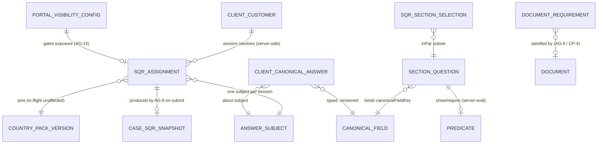

## 8. User Stories + Acceptance Criteria

**US-1 — Fill the SQR on my phone, in my language.**
- **G** I am an activated `ClientCustomer` with an exposed SQR, **W** I open it on mobile and switch to French, **T** the wizard renders section-by-section with FR labels/help/validation, autosaves every field, shows honest progress, and re-renders branches as I answer — with no answer loss on the locale switch.

**US-2 — Capture-once: I never re-type what I gave at PQR.**
- **G** I answered the PQR (the `inPqr` subset) as a prospect, **W** the full SQR is assigned after I retain the firm, **T** every PQR-answered field opens prefilled-read-only and the SQR asks only net-new fields, with no carry-over copy (the same `ClientCanonicalAnswer`s).

**US-3 — Branching is real and tamper-proof.**
- **G** the spouse section's predicate keys on `maritalStatus`, **W** I pick "single," **T** the spouse section never appears, its fields are not required and not submitted; **W** I hand-craft a request submitting a hidden `spouseName`, **T** the server ignores it; **W** I pick "married" and omit `spouseName`, **T** submission is rejected as incomplete with a localised, deep-linked prompt.

**US-4 — Save-and-resume survives a dropped connection.**
- **G** I am mid-form on a weak connection, **W** my connection drops after typing a field, **T** at most that one unsynced field is lost; **W** I reopen later, **T** I resume at the exact section/field with all prior answers intact.

**US-5 — Cross-case prefill, freshness-gated.**
- **G** I am a returning client with `CLIENT_LEVEL` facts on file, **W** a new case's SQR opens, **T** fresh relevant facts prefill read-only, and a `mustReaffirmPerCase`/aged-out field renders "please confirm" and requires me to confirm (appending a fresh-`effectiveAt` answer).

**US-6 — Own-data-only (isolation).**
- **G** I am client X, **W** I (or a tampered request) reference an assignment/answer/document belonging to sibling client Y of the same firm, **T** I receive 404/empty for 100% of resources, audited, never 200, with no Y data in body/error/logs — enforced at the app layer and backstopped at the DB by the portal RLS dimension (the CP-1 §3 gate).

**US-7 — Inline document upload, securely.**
- **G** a passport-number question with an attached "upload your passport" card, **W** I upload from my camera, **T** the upload uses a presigned URL the server bound to my owned record (never a key I supplied), an AG-9 `Document` is created, and the card shows "uploaded → scanning"; **G** the scan quarantines it, **T** the card shows "awaiting a clean re-upload" and it does not count as satisfied.

**US-8 — Multi-subject privacy.**
- **G** I am the principal and my spouse fills their own linked assignment, **W** I view the family section, **T** shared `CLIENT_LEVEL` facts read once from my declaration, my spouse's Restricted-PII answers are masked from my session (firm default), and a dependant-DOB contradiction is flagged to staff, not silently projected.

**US-9 — Submit once, idempotently; targeted re-open.**
- **G** a complete response, **W** I tap submit (and a retried request arrives), **T** the assignment locks read-only, a `CaseSqrSnapshot` is taken, `sqr.submitted` advances the case exactly once, and I see a reassuring "received" with next steps; **W** my consultant later requests changes on two fields, **T** only those two re-open in my locale with their note, and re-submit re-locks.

**US-10 — Validation rejects bad input, never persists it.**
- **G** a field with a `validationJson` regex/min-max, **W** I enter an invalid value, **T** it is rejected server-side with a localised plain-language reason and nothing is persisted; **G** abusive request volume, **T** per-IP/per-token rate limits engage; **G** any read view, **T** Restricted PII is masked and absent from logs.

**US-11 — Accessible and offline-readable.**
- **G** a keyboard / screen-reader user, **W** I navigate the wizard, **T** it meets WCAG 2.2 AA (focus management on section change, labelled controls, adequate target sizes); **G** I install the PWA and go offline, **T** I can review my own current state read-only, and a write attempt is blocked with a "reconnect to save" prompt.

**US-12 — Pre-account PQR, then my answers follow me into my account.**
- **G** I completed a PQR via a capability-token link with no account, **W** I later activate my portal account from the firm's invite, **T** the server matches my activation to the same `partyId` as my PQR, shows me a bind-review of my answers (masked summary), and on my explicit confirm everything appears in my account with zero re-typing — the same `ClientCanonicalAnswer` rows, no copy — and the audit chain links my token-era actions to my new `clientCustomerId`; **W** the activation instead resolves to a different `partyId` (forwarded link / duplicate lead), **T** nothing merges, nothing from either identity leaks, and a firm-side review item is raised.

## 9. Edge Cases & Validations

- **Cross-client id probing** → 404/empty for any sibling-client resource, audited; DB portal-RLS `USING`+`WITH CHECK` backstops a missed app check (the CP-1 §3 gate; Doc 1 §2.5).
- **Wrong-pool / mismatched-audience token** → cross-pool 401; a firm/platform token never satisfies a `portal/*` route.
- **Expired/locked/regenerated capability token** → non-leaking "ask your consultant to resend"; answers preserved; a regenerated token reaches the same assignment, the old one dies.
- **Conditional-requiredness bypass** → hidden field not required/not projected; tampered hidden answer ignored; conditionally-required-but-missing blocks submit.
- **Toggling a branch (married→single→married)** → spouse answers retained (append-only), excluded while hidden, restored if re-shown — no ghost spouse, no data loss.
- **Stale prefill** → `FreshnessRule`/`mustReaffirmPerCase` forces re-ask; never silently trusted.
- **Prospect-stage PQR with no program pair** → resolves via `tentativeProgramNodeKey` or a country-level program-null default; answers carry forward losslessly at conversion (AG-8 §3.4).
- **Pack published mid-flight** → the in-flight client completes on the pinned `packVersionId`; the new version applies only to new assignments.
- **Old response re-opened later** → re-renders/re-maps via the stamped `CaseSqrSnapshot` versions.
- **New declared value vs an existing verified one** → not clobbered; AG-8 raises a conflict; CP-3 shows "your consultant will review this."
- **Concurrent autosave / two devices** → the §5.4 partial-unique index guarantees one current answer per key; the loser retries against the now-current row — never two current answers.
- **Locale missing a translation** → fall back to the country's required base locale (never a blank label); SA-1 surfaces the coverage gap.
- **Document blurry/wrong/quarantined** → AG-9 reject-with-localised-reason / scan-quarantine; client re-uploads without unlocking the whole SQR; never counts as satisfied.
- **Reuse of an existing valid document** → card shows "already provided," no re-request.
- **Offline write attempt** → blocked with a reconnect prompt; nothing queued (no offline write/sync).
- **Submit-event redelivery / double-tap** → idempotent on `(assignmentId, submit)`; case advances and projection run once.
- **Computed/derived field** → read-only, recomputed server-side, never client-trusted.
- **Huge repeating group (e.g. 30 prior addresses)** → `ClientFactRecord` rows paginated/virtualised; server validates the collection; no unbounded payload.
- **Endpoint abuse (flood / oversized / injection / invalid token)** → rate-limited / size-capped / schema-rejected / token-denied; nothing persisted.
- **Forwarded PQR link (someone else fills it)** → the token was minted for one assignment/subject, so answers still land on that subject only; the bind-review confirm at activation is the human checkpoint — the activating client sees the summary and can decline, routing to firm review instead of binding wrong data (§3.9).
- **Prospect activates mid-fill (before submit)** → bind proceeds per §3.9 (match → confirm → audit link); the wizard continues seamlessly in the authenticated session at the exact resume position; the capability token is retired.
- **Activation resolves to a different `partyId` (duplicate lead, shared mailbox)** → `BIND_MISMATCH`: nothing bound, non-leaking message, firm-side review item (de-duplication is AG-2 staff work, never a portal auto-merge).

**Validation doctrine.** Every client answer is validated by **schema** — the field's own `CanonicalField.validationJson` + `EnumSet` + the closed §5.13.1 predicate grammar — never ad-hoc if/else; reject early with a localised message; never persist on failure (Doc 1 NFR; AG-8 §9).

## 10. Permissions (LOCAL `portal/*`)

Default-deny, additive, always within the caller's server-resolved `firm_id` + `clientCustomerId` (Doc 1 §4). One resource namespace (`portal/questionnaire`), colon grammar `portal/<resource>:<action>`. These are **LOCAL `portal/*`** keys; the catalog is owned and seeded by SA-6 (Doc 2) — CP-3 declares them here for CI derivation (Doc 1 §4.4, ADR C3-D3). The capability-token (pre-account) path is authorised by the token + portal record-level authz + the second RLS dimension (the CP-1 §3 gate; see §11 for the pre-account subject binding), NOT by a `portal/*` permission.

| Permission Key | Description |
|---|---|
| `portal/questionnaire:view` | Open and read the client's own exposed SQR/PQR assignment (own subject only) |
| `portal/questionnaire:answer` | Autosave/answer fields on the client's own assignment (writes `FINAL`/`DECLARED`) |
| `portal/questionnaire:submit` | Submit the client's own completed assignment (locks + snapshots via AG-8) |
| `portal/questionnaire:upload` | Upload an inline document-request item via an ownership-bound presigned URL (delegates to `portal/document:upload`, CP-4) |

> All keys are scope `portal/*` (LOCAL), in the single `portal/questionnaire` resource namespace, CI-derived into the SA-6-seeded catalog. There is **no** `agent/*` or `system/*` key here — assignment, verification (`DECLARED→VERIFIED`), PII reveal, request-changes, and content authoring are firm/super-admin capabilities (AG-8 `agent/sqr:*`, SA-1 `system/pack:author`). Enforcement is route-level (`@RequirePermissions` + scope-aware RolesGuard on the portal pool) AND object-level (the ownership-chain check + `PortalVisibilityConfig` allow-list, the CP-1 §3 gate; Doc 1 §4.5) AND database-level (the portal RLS dimension, Doc 1 §2.5). [FOUNDER-CONFIRM] the default portal role matrix (which of the 3 portal roles, SA-6 §C3-D3, hold each key — a principal likely holds all four; a read-only corporate HR seat may hold only `:view`).

## 11. Scalability · Security · Performance

> **Isolation backbone — inherited from CP-1 §3, not restated.** The walled portal pool, the two RLS dimensions, `assertPortalOwnershipChain`, the `PortalVisibilityConfig` allow-list, and the ownership-bound-presigned-URL rule are OWNED and specified by CP-1 §3 (per Doc 1 §2.5/§4.5). CP-3 inherits that gate and MAY NOT weaken it; the points below are the module-specific deltas only.

**Security & isolation (FIRST — this is the platform's top PII-leak surface).**
- **Walled identity (inherited).** Served only from the client-portal pool (`aud = er:portal`, distinct signing key); a firm/platform token is structurally invalid here (cross-pool 401, Doc 1 §3.1, per CP-1 §3). *CP-3 delta:* the capability-token (pre-account) path is single-purpose, expiring, path/header-carried (never a query param, never an id-in-URL), and rate-limited (Doc 1 §4.6).
- **Server owns scope (inherited).** `firm_id`, `partyId`, `subjectId`, and the assignment are resolved from the PrincipalContext/token, never from client input (Doc 1 §4.5). No service/repository signature accepts a caller-supplied scoping id (CI code-scan, AC-4.5.1).
- **Double RLS by construction (inherited, per CP-1 §3).** Every read/write is firm-scoped (`app.current_firm_id`, forced RLS) AND client-subject-scoped (`app.current_client_subject`, the second portal RLS dimension with both `USING` and `WITH CHECK`, Doc 1 §2.5) — a query bug or a missed app check cannot cross firm OR client, and a portal write cannot attribute a row to a sibling client. Corporate-seat ownership resolves through `PartyRelationship` (AC-2.5.6).
- **Pre-account subject binding (CP-3 delta — specced both ways in §3.9; mechanism decision pending Amendment A4 verification F6 / Doc 1 §2.5).** On the pre-account capability-token path a `ClientCustomer` may not yet exist, so what the §2.5 second dimension binds to must be one of: **Option A — token-scoped RLS dimension** (subject GUC set pre-account, via a provisional `PENDING_ACTIVATION` `ClientCustomer` — policy shape intact — or a token-resolved `AnswerSubject`/assignment policy key — a frozen §2.5 shape change, the F6 hard-gate variant), giving a DB backstop from the first pre-account write; or **Option B — deferred-bind-on-activation** (console-side DEFAULT if the RLS option is rejected): app-layer single-assignment token guard + forced firm RLS pre-account, with the second dimension asserted from the audited activation identity-join onward (§3.9). Under either, CP-3 does not claim the second-dimension backstop for the pre-account path beyond what the landed mechanism provides (CP-3-36), and the pre-account path is in the §2.8 denial suite (CP-3-38: a token for assignment A cannot read/write assignment B). Owned jointly with CP-1 §3 and Doc 1 §2.5.
- **Leak-off-by-default (inherited).** The questionnaire renders only if `PortalVisibilityConfig.showSqr` exposes it; an absent entity type is invisible even for an own-owned record (Doc 1 §4.5).
- **Restricted PII = crown jewels.** `isRestrictedPii` answers are field-encrypted under their `retentionClass` sub-key (Doc 1 §7.1), masked by default in any read view, never in logs/traces; CP-3 has no reveal path (reveal is a firm `agent/*` capability, audited there).
- **Storage IDOR closed (inherited).** Inline uploads use presigned URLs the server binds to an ownership-checked record; CP-3 never signs a caller-supplied key (the CP-1 §3 binding rule; Doc 1 §2.5/§4.6).
- **Server validates everything.** No raw-answer persistence; each answer is type-checked against its `CanonicalField` + the conditional graph; abusive volume is rate-limited/size-capped with nothing persisted on failure.
- **Audit + consent.** Open/answer/submit/upload/consent write immutable hash-chained audit entries (actor = `clientCustomerId`, Doc 1 §7.5); intake timestamps consent and renders the SA-1 no-guarantee disclaimer in-locale.
- **Release gate.** The horizontal-access pentest (AC-4.5.3) must fail to leak cross-client data 100%; the §2.8 cross-tenant + §2.5 cross-client denial suites (incl. `WITH CHECK` write denial and the pre-account-token case) are CI release gates.

**Scalability.** Config- and pack-driven by construction: sections, questions, conditions, validation, and document names are GLOBAL data SA-1 authors — a new country/pathway/locale is *shipping a pack*, not changing CP-3 code; single-country/single-locale is the degenerate case. The pinned section tree is cacheable per `(packVersionId, sectionSelectionVersion, locale)` (immutable). Autosave is a high-frequency write path — answers are append-only single-row inserts behind the partial-unique index, no read-modify-write; submit-time re-score/projection/form-fill fan out async on BullMQ (workers scale horizontally). Repeating groups and the review screen cursor-paginate; no unbounded fetch.

**Performance.** Read budgets per Doc 1 NFR (read p95 ≤ 300ms; answer-save p95 ≤ 400ms); FCP ≤ 1.5s / LCP ≤ 2.5s p75 / INP ≤ 200ms p75 on mid-tier mobile (NFR5-15) — the wizard is the consumer-grade hot path, so the PWA shell is precached and section payloads are lazy-loaded. Predicate re-evaluation on answer change is server-authoritative but debounced client-side for responsiveness; the heavy work (re-score, snapshot, form-fill) is off the submit response path so the client gets a fast "received." `sqr.submitted`/`sqr.answer.captured` are at-least-once with idempotent consumers, so redelivery never double-advances.

## 12. Reference Note (NEW — portal is greenfield)

> **Build framing:** greenfield (Doc 1 §1.8); the existing private codebase is design-provenance only. The Client Portal console (Doc 4) is the gap-analysis critical scope-hole C2 — **never previously specced**. The notes below are informational, not a parity obligation.

**Design provenance (informational).** A `smart-questionnaire` prototype resolves a case by `sqrLinkCode` and serves ordered Mongo `Form` sections + required documents to a client over a `@Public()` link, with save/submit, lock/edit-access primitives, inline upload, and `familyCases`/`parentCaseId`. Honest gaps the target-state closes: the link is public with no rate-limiting/masking and PII is logged; answers are an untyped Mongo blob with no canonical binding (so they feed neither the Qualifier nor forms — re-keyed by hand); no conditional logic; no versioning; the config is global with no tenant key; no server-side answer validation; no provenance; no portal auth pool, no record-level ownership chain, no second RLS dimension, no WCAG/i18n/PWA discipline.

**NEW (target-state, this module's build).**
- The **client-facing fill wizard** as a hardened, accessible, bilingual PWA surface over the AG-8 runtime — section-by-section, branching, autosave/save-and-resume, multi-subject, inline document cards, review/submit, targeted re-open.
- **Portal-pool entry + capability-token entry**, both resolving server-side to exactly one assignment/`firm_id`/subject — the client never supplies a scoping id.
- **Double-scoped writes** into `ClientCanonicalAnswer` (firm RLS + the second portal RLS dimension, per the CP-1 §3 gate), with the `WITH CHECK` write-denial backstop — net-new vs the prototype's public, untenanted, unvalidated write path.
- **Server-side validation** against `CanonicalField.validationJson`/`EnumSet` + the §5.13.1 conditional graph; **field-level encryption + mask-by-default** for Restricted PII; **read-only offline PWA**; **WCAG 2.2 AA**; **full EN/FR**.
- **`portal/*` permission set** + the SA-6 catalog wiring; **idempotent submit**; **audit on every client action**.

**CHANGED (reconciliations from the prototype — normative).**
- **`sqrLinkCode` public link** → portal-pool session OR an unguessable single-purpose capability token (Doc 1 §4.6); never a public id-in-URL, never a token-in-query.
- **Untyped Mongo `Form.data`/`filledData`** → typed append-only `ClientCanonicalAnswer` keyed by `canonicalFieldId` (Mongo eliminated platform-wide, ADR C1-2).
- **Client-decided / no conditional logic** → the one server-authoritative §5.13.1 `Predicate`; the client UI never decides what is submitted.
- **No tenant/client isolation** → forced firm RLS + the second portal RLS dimension + record-level ownership-chain authz (the CP-1 §3 gate; Doc 1 §2.5/§4.5).
- **Public upload of caller-supplied keys** → presigned URLs bound to ownership-checked records (the IDOR fix, CP-1 §3; Doc 1 §2.5/§4.6).
- **WCAG 2.1 / no PWA / no i18n** → WCAG 2.2 AA + installable read-only-offline PWA + full EN/FR (Doc 1 §8 / NFR5-11/12/13).

## 13. Open Questions / [FOUNDER-CONFIRM]

**Resolved to IN (one frozen scope, no phasing):** section-by-section wizard; server-authoritative §5.13.1 branching; capture-once + cross-case prefill (freshness-gated); autosave/save-and-resume; multi-subject fill; inline document upload via ownership-bound presigned URLs; review/submit/lock + targeted re-open; full EN/FR; WCAG 2.2 AA; installable read-only-offline PWA; field-level encryption + mask-by-default; double RLS isolation; idempotent submit; capability-token + portal-pool entry — all IN.

**[ARCHITECT-CONFIRM] (machinery, owned with CP-1 / Doc 1):**
- **Pre-account binding mechanism — Option A vs Option B** (§3.9/§11): token-scoped RLS dimension (subject GUC pre-account; the `AnswerSubject`-policy variant touches frozen Doc 1 §2.5) versus deferred-bind-on-activation. **Both are fully specced console-side (§3.9 flow + UX, CP-3-31..38), so this decision does not block the CP-3 build; it selects the DB-backstop wiring only.** Console-side default = Option B (deferred-bind) if the RLS option is rejected. Decision (pending Amendment A4 verification F6 / Doc 1 §2.5); owned jointly with CP-1 §3 and Doc 1 §2.5; either outcome ships in the §2.8 denial suite. Related pending: bind event emission rides CP-1's portal-identity events (pending Doc-1 Amendment A4-2 / F2).

**[FOUNDER-CONFIRM] (business/domain — machinery is fixed regardless):**
1. **Partial-submit default** (mirrors AG-8 §13): block submit until complete, or allow partial-with-gaps from the client side? *Proposed default: block; firm may enable partial per case.*
2. **Spouse / dependant privacy model** (mirrors AG-8 §13): can a principal's CP-3 session see a linked adult subject's Restricted-PII answers, or are they firm-only? *Proposed default: other subjects' Restricted fields private from the principal; firm sees all.*
3. **Corporate-seat questionnaire scope:** may a corporate seat-holder (e.g. HR coordinator) *fill* an applicant's questionnaire, or only *view* progress? *Proposed default: firm-set per seat in AG-15; CP-3 honours the seat's visibility scope and `portal/*` keys.*
4. **Pre-account PQR activation friction:** after a prospect answers a PQR via capability token, do we offer one-tap conversion to a real `ClientCustomer` account at submit, or leave activation to the firm's invite? *Proposed default: offer one-tap activation handed off to CP-1; machinery supports either.*
5. **No-guarantee disclaimer placement/wording (FR-CA):** the consent text and the `RegulatorConfig` indicative-not-guaranteed disclaimer phrasing — routed to the Immigration-SME (founder is final authority) as SA-1 content, not CP-3 machinery.

> **Routed to the Immigration-SME (founder is final authority), as SA-1 / AG-8 content — NOT CP-3 machinery:** the section/question set and `inPqr` subset per combination; the correct `canonicalFieldKey` bindings; which fields are filing-critical; `mustReaffirmPerCase`/`FreshnessRule` values (which facts drift, how fast); the FR-CA phrasing of consent + disclaimers; and the dependant-eligibility/family-unit consistency rules. CP-3 renders and submits the structure; the immigration *values* live in the SA-1 Country Pack consumed via AG-8.

---

# Module CP-4: Documents (upload, checklist, re-upload)

> **Console:** Client Portal (Doc 4) — the applicant-facing third console. **Plane:** end-client (LOCAL, `portal/*`). **Identity:** the **client-portal** auth pool (`aud = er:portal`, Doc 1 §3.1 — distinct signing key, `ClientCustomer` credential lens on the `Party` spine, Doc 1 §5.2). **Tenant key:** `firm_id` (RLS ENABLED+FORCED, Doc 1 §2.2) **plus** the **portal second RLS dimension** `app.current_client_subject` (Doc 1 §2.5) — the database backstop for client-to-client isolation on the platform's highest-PII surface. **Isolation backbone:** CP-4 **inherits** the CP-1 §3 own-case-only ownership-chain gate, the portal second-RLS-dimension wiring, and the ownership-bound presigned-I/O object-access rule; this module REFERENCES that primitive (per CP-1 §3) and never re-states or weakens it. **What this module owns:** the *client-facing* document experience — the read-only checklist of what is required, the upload flow, the re-upload-on-rejection loop, expiry warnings, and viewing own + firm-shared documents. **What it consumes (never re-specs):** the AG-9 `Document` engine (the realised instance, the 10-state lifecycle, the orthogonal scan sub-state, versions, the single-status contract, ownership-bound presigned I/O — Doc 3 AG-9); the AG-9-/AG-7-derived `DocumentRequirement` resolution (combination-mandatory + answer-conditional, Doc 1 §5.6); the AG-15 `PortalVisibilityConfig` allow-list (`showDocuments` / `showFirmProducedDocs`) and `ClientWorkItem` request loop (Doc 3 AG-15); the canonical answer store (Doc 1 §5.4); the `ObjectStoragePort` / S3 rail with AV-scan-before-availability and safe serving headers (Doc 1 §1.4, §7.7); the Minder Doer (expiry, via the registered `deadline.approaching` deadline primitive); the canonical event dictionary (Doc 1 §6.1). **Content-neutral:** the document *taxonomy* (which types, which need translation, which are answer-conditional) is Country-Pack content authored super-admin-side and configured firm-side — never in this module. Immigration *values* are **[FOUNDER-CONFIRM]**.

## Module Index

- **§1 Purpose & Goal** — the single, calm, in-language place a client knows exactly what to upload, what is wrong, and what is expiring — with cross-client isolation as the first feature.
- **§2 Users & Jobs-to-be-Done** — the individual applicant (protagonist), the family/spouse data subject, the corporate HR seat-holder.
- **§3 Functional Design** — the derived checklist read; combination-mandatory & answer-conditional resolution; direct-to-storage upload + validation; the scan/quarantine wait; re-upload-on-rejection; expiry warnings; view own + firm-shared; mobile capture; offline/PWA read; isolation-by-construction (inherited from CP-1).
- **§4 Functional Requirements** — CP-4-1 … CP-4-24, each testable, tagged (consume) / (portal).
- **§5 Business Rules & Logic** — BR-1 … BR-15 (isolation-first, allow-list, single-status read, scan-gated, no caller-key-sign, reason-travels, locale, non-destructive).
- **§6 States & Lifecycle** — the *client-facing projection* of AG-9's 10 states + scan sub-state into the four things a client should ever see.
- **§7 Key Entities & Fields** — entities cited (not redefined) from AG-9/AG-15/Doc 1; the read/write projection; the Events emitted/consumed table.
- **§8 User Stories + Acceptance (G/W/T)** — US-1 … US-9.
- **§9 Edge Cases & Validations** — cross-client, quarantine, expiry-mid-view, conditional flip, oversize, scan-down, supersede, corporate-seat.
- **§10 Permissions (`portal/*`)** — the per-action client document catalog (local; catalog owned by SA-6).
- **§11 Scalability · Security · Performance (isolation FIRST)** — the cross-client denial contract (inherited from CP-1), presigned-only I/O, paginated/cached checklist.
- **§12 Reference Note (NEW — portal is greenfield)** — what is genuinely new vs. the consumed firm-side engine.
- **§13 Open Questions / [FOUNDER-CONFIRM]** — taxonomy, expiry horizons, share-policy defaults; architect items resolved IN with no phasing.

---

## 1. Purpose & Goal

**What it is.** CP-4 is the immigrant client's window onto the documents their case needs. It answers three questions a client repeatedly asks — *what do you still need from me? what was wrong with the thing I sent? what is about to expire?* — and lets them answer the firm's asks (upload, re-upload) from a phone or desktop, in their own language, without a single email thread. It is the client-facing counterpart of the officer's AG-9 document panel and of the AG-15 request loop: the firm requests (AG-15), the engine stores/scans/versions (AG-9), and **CP-4 is where the client sees the ask and fulfils it.**

**The business outcome.** Immigration files stall on the client side most of all: a passport never uploaded, a bank letter re-requested three times because nobody told the client *why* it was rejected, a police certificate that quietly expired before submission. CP-4 makes **"the client always knows exactly what to do, why, and by when — and the right file is never in doubt"** structurally true: a live checklist that updates as they upload; rejection reasons in their locale attached to a one-tap re-upload; expiry warnings before a document dies; and the certainty that what they see is *only theirs.*

**Why isolation is the first feature, not a footnote.** This is the platform's **highest PII-exposure surface** (Doc 1 §2.5): a logged-in client must never glimpse a sibling client's passport, even by a crafted id. CP-4 therefore does not "hide a link" — it inherits the CP-1 §3 isolation backbone: every read and write is bound to the caller's `clientCustomerId` by the record-level ownership-chain check (CP-1 §3, Doc 1 §4.5), and the **portal second RLS dimension** (`app.current_client_subject`, with both `USING` and `WITH CHECK`, Doc 1 §2.5) is the database backstop that holds even if application code is ever missed. Every document byte is served only via an **ownership-bound presigned URL** — the key is resolved *from* the owned record, never signed from a caller-supplied key (CP-1 §3, Doc 1 §4.5/§7.7). Isolation is by construction; CP-4 applies the inherited primitive to the document surface, it does not redefine it.

**Why it is world-class.** A generic portal is a folder you drop files into. CP-4 is **firm-governed, immigration-aware, and isolation-native**: the checklist understands *combination-mandatory* groups (any one of a set satisfies) and *answer-conditional* requirements (a document becomes required only because of an SQR answer — capture-once feeds the checklist), so the client is never asked for what they do not need; rejection feedback travels in their language tied to a re-upload; expiry is a proactive warning, not a post-mortem; and the whole surface is WCAG 2.2 AA, fully EN/FR, responsive, and an installable PWA with **read-only offline** (Doc 1 §8) — a client on transit can see *what is needed* even with no signal, and upload when back online.

**Global ambition.** The same module serves a Canada-only solo RCIC's client and a multi-country firm's applicant: document types and translation/notarisation rules come from the active Country Pack; bilingual labels render in the client's chosen locale; the firm white-labels the whole surface (AG-1/AG-16). Single-country/single-language is the degenerate case — no code change.

## 2. Users & Jobs-to-be-Done

| Role | Primary job in CP-4 | Representative JTBD |
|---|---|---|
| **Individual applicant** (protagonist) | Get every requested document in, correctly, on time. | "Show me a clear list of what you still need — in my language — and let me upload from my phone camera." · "Tell me exactly what was wrong with my bank letter so I can fix it in one tap." · "Warn me before my passport or police certificate expires." |
| **Family / spouse data subject** (own seat, where the firm grants it) | Upload my own personal documents to the family file. | "I'm the spouse on this application; let me upload *my* passport and language result without seeing my partner's private financials beyond what the firm shares." |
| **Corporate HR seat-holder** (org seat) | See and fulfil document asks for the company's roster of applicants. | "For each employee case in our program, see the outstanding document asks and upload company-side documents (employment letters, LMIA support) at the scope the firm set for me." |

**Design implication.** The **individual applicant is the protagonist**: the home of CP-4 is a single, scannable **outstanding-first checklist** with one-tap upload and a clear "rejected — here's why → re-upload" path. The corporate seat-holder gets a roster lens (each in-scope case's checklist), strictly bounded by the firm-set seat scope (Doc 1 §2.5 corporate-seat chain). No client ever sees internal officer notes, the firm's review workflow, another client's anything, or any document class the firm did not expose via `PortalVisibilityConfig` (`showDocuments` / `showFirmProducedDocs`).

## 3. Functional Design — How It Works

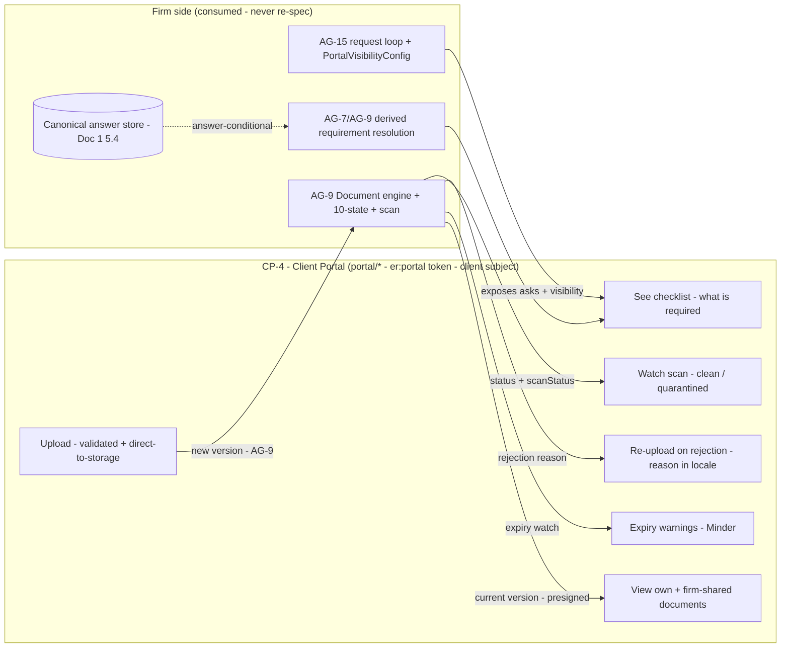

### 3.0 The boundary — what CP-4 does and does not own

The single most important architectural fact: **CP-4 stores no document state and owns no document lifecycle.** AG-9 owns the `Document`, its 10 states, versions, scan, content-hash, and the single-status contract; AG-15 owns the request loop (`ClientWorkItem`) and the `PortalVisibilityConfig` allow-list; AG-7/AG-9 own the *derived checklist* (what is required); CP-1 owns the isolation primitive CP-4 runs inside. CP-4 is the **client-facing renderer + fulfilment door**: it reads those contracts through the `portal/*` permission model and the portal RLS dimension, and it writes only through AG-9's upload/re-upload path. The clean test: *configuring which documents to request = AG-15; declaring what a pathway requires = AG-7; storing/scanning/versioning = AG-9; the own-case-only isolation gate = CP-1; **seeing the ask and uploading = CP-4.*** CP-4 never decides what is required, never sets a document's status, and never destroys or disposes anything.

### 3.1 The checklist — "what you still need, in your language"

**How it works.** On open, CP-4 fetches the **client-scoped, visibility-filtered checklist** for each case the caller's subject owns. The checklist is the AG-7/AG-9 **derived view**: it resolves the effective `DocumentRequirement` set for the case (Doc 1 §5.6), filters it through the firm's `PortalVisibilityConfig` allow-list (`showDocuments` for client-supplied requirements, `showFirmProducedDocs` for firm-generated artifacts — Doc 3 AG-15 §3.3, leak-off by default), and joins each requirement to its AG-9 `Document` status. The client sees, per item: the **bilingual label** (their locale), a plain-language status (Needed / Uploaded / In review / Accepted / Needs fixing / Expiring soon), the due date, and any officer reason or annotation marked `visibleToClient`. Items are **outstanding-first**: Needed and Needs-fixing float to the top; Accepted collapse below.

**World-class behaviour.** The list is a living thing — it updates as the client uploads (no refresh-and-pray). It never asks for what the case does not need (§3.2). It speaks the client's evidence language, not the firm's internal stage names. It is the *same* `Document.status` the officer sees (the single-status contract, Doc 1 §5.6) — never a private client-side copy that can drift.

**Data flow.** Portal token → resolve `clientCustomerId` → `SET LOCAL app.current_firm_id` + `app.current_client_subject` (per CP-1 §3, Doc 1 §2.5) → fetch the derived requirement set for the subject's owned case(s) → intersect with `PortalVisibilityConfig` (`showDocuments` / `showFirmProducedDocs`) → project each to the client-facing status (§6) → render. Restricted/internal fields (internal notes, other clients, non-exposed document classes) are never in the response body, never just hidden in the UI.

### 3.2 Combination-mandatory & answer-conditional requirements — "asked for exactly what you need, never more"

**How it works.** CP-4 honours two requirement shapes the firm-side resolution computes (Doc 1 §5.6 invariants), rendering each so the client understands it:

- **Combination-mandatory (ALTERNATIVE group).** A set of requirements sharing an `alternativeGroupId` where **any one** satisfies the group (e.g. "*one of* a passport *or* a national ID"). CP-4 renders these as a single grouped item — "Provide **one of**: …" — and once one is Accepted, the group shows satisfied and the alternatives drop out of the outstanding list. A **PRIMARY** requirement with no satisfying upload blocks readiness (the client sees it as required, never optional).
- **Answer-conditional (`ANSWER_CONDITIONAL`).** A requirement that becomes required only because of an SQR/PQR answer (the firm-side rule evaluates against the canonical answer store, Doc 1 §5.4) — e.g. a marriage certificate becomes required only once the client answered "married." CP-4 simply **reflects** the resolved set: a newly-required item *appears* in the checklist (with a gentle "added because of your questionnaire answers" affordance, copy [FOUNDER-CONFIRM]); a no-longer-required item *disappears* (its prior upload is retained by AG-9, never deleted).

**World-class behaviour.** Capture-once pays off here — the client's earlier SQR answers shape the checklist with zero re-asking. The combination logic spares the classic "I sent my passport, why is it still asking for ID?" confusion. The resolution is **server-side and authoritative** (CP-4 never recomputes conditional logic client-side); the client UI only renders what the firm-side derived view returns.

**Data flow.** Derived requirement resolution (firm side) evaluates `ANSWER_CONDITIONAL` rules against the answer store + ALTERNATIVE grouping → returns the effective set per case → CP-4 renders groups and conditional items → on an SQR answer change (submitted via CP-3, the questionnaire module), the next checklist fetch reflects the recomputed set.

### 3.3 Upload — "drop it in, from anywhere, and it's instantly safe"

**How it works.** Upload is **direct-to-storage** via a short-lived ownership-bound presigned PUT — identical to the AG-9 path (Doc 3 AG-9 §3.2), exercised through the `portal/*` door and the CP-1 §3 object-access rule. The client picks a checklist item and a file (or uses the camera); CP-4 calls the slot-issue endpoint, which **validates server-side** the declared *and* sniffed (magic-byte) content-type against the per-type allow-list and the per-type size cap (Doc 1 §7.7, AC-7.7.7), resolves the owning `Document` (asserting the subject owns it, per CP-1 §3), and returns a signed PUT with a **firm-prefixed key**, content-type locked, SSE-KMS enforced, short TTL. The browser uploads straight to S3; CP-4 then calls **attach-version**, which creates the AG-9 `Media` + `DocumentVersion` (`scanStatus = scanning`), advances the `Document` toward Uploaded→Scanning, and enqueues the AV scan. The API **never proxies bytes.**

**World-class behaviour.** Validation happens at slot-issue, before anything persists — a client cannot smuggle an `.exe`/HTML/SVG/polyglot into a "passport" slot, and nothing is stored on rejection. Every upload against an existing item is a **new version, never an overwrite** (AG-9 §3.4) — the client re-uploading a corrected file supersedes the old one cleanly. Mobile **camera capture** with multi-page assembly (IN v1, §3.8) uses the same signed-URL + scan path. The whole flow is keyboard-reachable and screen-reader-labelled (WCAG 2.2 AA, Doc 1 §8).

**Data flow.** Pick item + file → slot-issue (validate declared+sniffed type/size, ownership check per CP-1 §3, presigned PUT, firm-prefixed key, SSE-KMS, type locked, short TTL) → direct PUT to S3 → attach-version → AG-9 `Media`+`DocumentVersion` (`scanStatus=scanning`) + enqueue scan → AG-9 emits `document.uploaded`. **The presigned URL is bound to the owned record; a caller-supplied storage key is never signed (CP-1 §3, Doc 1 §4.5, AC-7.7.4).**

### 3.4 The scan / quarantine wait — "nothing dangerous is ever served, and you know the moment it's clean"

**How it works.** AG-9 AV-scans every upload **asynchronously before availability** (Doc 1 §7.7). While `scanStatus = scanning`, CP-4 shows the item as **"Checking your file…"** and no presigned GET is ever issued for it. On a **clean** result the version's `scanStatus → clean`, the `Document` advances to **Received**, and CP-4 flips the item to **"Uploaded — in review."** On an **infected** result the version enters the **Quarantined** sub-state (`scanStatus = infected`, never servable) and the `Document.status` returns to its pre-clean prior state (AG-9 §6); CP-4 must **honour the scan sub-state** and render the item as **"This file couldn't be accepted — please upload it again"** (not "received," not silently fulfilled), in the client's locale. On a scan **error/timeout** (`scanStatus = pending`, the SCAN_PENDING indicator) CP-4 shows **"We're still checking — try again shortly"** and the item is excluded from "uploaded" until a retry succeeds; it never silently becomes Received.

**World-class behaviour.** Scan-gated trust the client can see — "uploaded" *means* "scanned clean." A quarantined file is a calm re-upload prompt, never an alarming dead end and never a security leak (the bytes are never served to anyone). The client is never left wondering: the item always shows a true, plain-language state (§6). CP-4 reads the orthogonal `scanStatus` sub-field exactly as the AG-7 checklist and the officer panel do — one truth, three audiences.

**Data flow.** Upload → `scanStatus=scanning` (item: "Checking…") → AG-9 scan job → `document.scan.passed` ⇒ Received (item: "In review") **or** `document.scan.failed` ⇒ Quarantined sub-state (item: "Couldn't accept — re-upload") **or** `pending` ⇒ SCAN_PENDING (item: "Still checking — retry"). CP-4 reflects state via polling (realtime push is a later wave, Doc 1 §1.5).

### 3.5 Re-upload on rejection — "we tell you exactly what was wrong, and you fix it in one tap"

**How it works.** When an officer **rejects** a document (AG-9 §3.9 — a reason is mandatory) or a scan quarantines it, AG-15's request loop re-opens the ask and the rejection reason travels to the client in **their locale** (Doc 3 AG-15 §3.4). CP-4 surfaces the item as **"Needs fixing"** with the firm's reason ("photo of page 2 is cut off — please re-take") and any `visibleToClient` annotation, plus a prominent **Re-upload** action. Re-uploading runs the §3.3 path against the *same* `Document` → a new AG-9 version supersedes the prior (retained, read-only) → re-scan → the firm re-reviews. The loop is closed without a single email.

**World-class behaviour.** The reason *travels* — the client never has to guess or phone in. The re-upload is one tap on the failing item, pre-targeted to the right requirement (no re-navigating the checklist). Non-destructive: the prior (rejected) upload is versioned, not lost — auditable for the firm, invisible clutter for the client. Re-request reminders respect consent and quiet-hours (Minder/Messenger, transactional service message, Doc 1 §7.6).

**Data flow.** Officer rejects (reason) **or** scan quarantines → `document.status.changed` / `document.scan.failed` → AG-15 re-opens the work item with the localized reason → CP-4 renders "Needs fixing" + reason + Re-upload → client re-uploads (§3.3) → new version (AG-9 emits `document.version.added`) → re-scan → officer re-review. CP-4 writes only the new version via AG-9; it never sets the status itself.

### 3.6 Expiry warnings — "we warn you before it dies"

**How it works.** For document types where the pack marks the requirement `expiryRelevant` / `expiryRuleJson` (passports, police certificates, language results, medicals), AG-9 stamps an `expirationDate` and the **Minder** Doer arms a renewal watch at the configured horizon (Doc 1 §5.6, AG-9 §3.6/§3.9). When the horizon is reached the Minder emits the registered **`deadline.approaching`** deadline primitive (Doc 3 AG-11/Conductor §3.1 — the canonical date-anchored lead-time signal, anchored on `DocumentRequirement.expiryRuleJson`), which drives the client-facing nudge as a localized, consent-respecting `notif/*` (dash-case) + `Reminder`. CP-4 surfaces this to the client as a non-alarming **"Expiring soon"** badge on the relevant item, with a one-tap path to upload the renewed document (which versions the existing one). Already-expired documents show **"Expired — please provide a current one."**

**World-class behaviour.** Proactive, not post-mortem — the classic "we submitted an expired passport" failure becomes structurally hard. The warning horizon is config-driven per type (Minder), and the nudge is transactional, localized, brand-skinned, and auto-exits when the client uploads a renewal. The expiry signal is the *same* AG-9 field the officer's renewal watch reads — one source. CP-4 consumes the **single registered** `deadline.approaching` event; it mints no `document.expiry.*` synonym (Doc 1 §6.1 single-emitter / no-synonym law).

**Data flow.** Pack requirement `expiryRelevant`/`expiryRuleJson` → AG-9 stamps `expirationDate` → Minder evaluates the horizon (timezone-aware) → emits `deadline.approaching` → client-facing `notif/*` + `Reminder` (Messenger/Mailer) → CP-4 renders "Expiring soon"/"Expired" badge + the nudge → client uploads renewal (§3.3, new version). [FOUNDER-CONFIRM] the per-type warning horizons (the Minder watch lead-time).

### 3.7 View own + firm-shared documents — "see what you sent and what we've shared back"

**How it works.** CP-4 lets the client view two sets, both strictly ownership-bound: (1) **their own uploads** — every document they (or the firm on their behalf) provided, current version, with status and version history visible at a calm level; and (2) **firm-shared documents** — documents the firm has explicitly chosen to expose to the client via `PortalVisibilityConfig.showFirmProducedDocs` (e.g. the prepared submission package, a firm-generated cover letter, a receipt). Whether firm-produced documents are visible at all, and which classes, is the firm's allow-list decision (`showFirmProducedDocs`, AG-15 §3.3) — **leak-off by default** (Doc 1 §2.5/§4.5: an entity class absent from the config is invisible to the portal even for an own-owned record). Viewing opens an **in-app preview** via a short-lived **ownership-bound presigned GET** with safe serving headers (`Content-Disposition: attachment`, `X-Content-Type-Options: nosniff`, restrictive CSP, Doc 1 §7.7), per the CP-1 §3 object-access rule; every client read writes a `DocumentAccessLog` (AG-9 §3.11).

**World-class behaviour.** Transparency without leakage — the client sees their own evidentiary record and exactly what the firm chose to share, never internal-only artifacts, never another client's anything. Every view is access-audited (a PIPEDA-grade trail: the firm can prove who opened what). Quarantined/SCAN_PENDING versions are **never** previewable (no presigned GET is ever issued for an unscanned/infected version, §3.4).

**Data flow.** List own + shared → record-level ownership-chain filter (CP-1 §3, Doc 1 §4.5) + `PortalVisibilityConfig` allow-list (`showDocuments` / `showFirmProducedDocs`) + portal RLS dimension (Doc 1 §2.5) → open → ownership check → `DocumentAccessLog` write → presigned GET (safe headers, short TTL) → direct-from-rail render. **No caller-supplied key is ever signed; quarantined/pending versions never served.**

### 3.8 Mobile capture & PWA read-only offline — "from your phone, even with no signal"

**How it works.** CP-4 is responsive and an **installable PWA** (Doc 1 §8): the client installs it like an app, captures documents with the device camera (multi-page assembly is **IN v1**, §3.3), and uploads through the same signed-URL + scan path (§3.3). **Offline is read-only** (Doc 1 §8): with no connection the client can still see the cached checklist — *what is needed and why* — and queue nothing destructive; uploads require connectivity (a presigned PUT cannot be issued offline) and are clearly disabled with a "you're offline — reconnect to upload" affordance. Cached content respects isolation: only the caller's own subject-scoped checklist is ever cached on the device, the cache carries a bounded TTL, and the cache is cleared on logout/session-revocation (§13, CP-4-17).

**World-class behaviour.** A client on transit can review their to-do list with no signal and act the moment they reconnect. Camera-first capture meets the real-world way clients hold a passport up to a phone. Full WCAG 2.2 AA, EN/FR — the offline shell is itself accessible and localized.

### 3.9 Isolation by construction (inherited from CP-1) — "you only ever see yours"

CP-4 **inherits, and does not re-derive,** the CP-1 §3 portal isolation backbone (the own-case-only ownership-chain gate, the portal second RLS dimension wiring, and the ownership-bound presign rule); this section states only the document-surface deltas. Every CP-4 read and write resolves the caller's `clientCustomerId` from the **verified portal token's audience-walled identity** (`aud = er:portal`, never from caller input — CP-1 §3, Doc 1 §3.1/§4.5) and runs inside a transaction with **both** GUCs set: `app.current_firm_id` and `app.current_client_subject` (Doc 1 §2.5). The three inherited layers (which CP-4 may not weaken) are:

1. **Record-level authz (app, Layer 4, CP-1 §3 / Doc 1 §4.5).** Every request asserts the target document's ownership chain resolves to the caller's subject (direct, child-via-`owner_chain_to`, or corporate-seat via `PartyRelationship`); a miss returns **404/empty, never 200, never a different client's data**, and is audited.
2. **`PortalVisibilityConfig` allow-list (firm-governed, Doc 1 §4.5/AG-15 §3.3).** Even an own-owned document class invisible to the portal (`showDocuments` / `showFirmProducedDocs` off) is not returned.
3. **Portal second RLS dimension (DB backstop, Doc 1 §2.5).** The portal-subject isolation policy (both `USING` and `WITH CHECK`) holds even on a hypothetical raw query — a client cannot read *or write/re-attribute* a sibling client's row at the database.

This pairs with the inherited **ownership-bound presign** rule (§3.3/§3.7): the storage edge is closed too. The cross-client IDOR vector is shut at the database, the service, and the storage layer together — the contract is owned by CP-1, applied here to documents.

## 4. Detailed Functional Requirements

> Each is testable. **(consume)** = built on a Doc 1/AG-9/AG-15/CP-1 contract; **(portal)** = the client-facing logic this module owns.

**Checklist (3.1–3.2)**
- **CP-4-1 (consume).** The checklist is the AG-7/AG-9 **derived requirement view** for the caller's owned case(s), filtered by `PortalVisibilityConfig` (`showDocuments` / `showFirmProducedDocs`), joined to AG-9 `Document` status — never a private client copy (single-status contract, Doc 1 §5.6).
- **CP-4-2 (portal).** **Combination-mandatory** (ALTERNATIVE group) items render as "provide one of…"; satisfying any one collapses the group; a PRIMARY requirement with no satisfying upload is shown as required.
- **CP-4-3 (consume).** **Answer-conditional** requirements appear/disappear exactly as the firm-side resolution computes against the canonical answer store (Doc 1 §5.4/§5.6); CP-4 never recomputes conditional logic client-side.
- **CP-4-4 (portal).** Each item shows the **bilingual label** (caller's locale), a plain-language status (§6), due date, and any `visibleToClient` reason/annotation; outstanding items sort first.

**Upload (3.3)**
- **CP-4-5 (consume).** Files upload **direct-to-storage** via a short-lived **ownership-bound** presigned PUT (CP-1 §3, Doc 1 §1.4/§4.5); the API never proxies bytes; the storage key is resolved from the owned record, never signed from a caller-supplied key (AC-7.7.4).
- **CP-4-6 (consume).** Declared **and** sniffed content-type are validated against a per-type allow-list with a per-type size cap **at slot-issue, before storage**; mismatch/disallowed/over-size is rejected and nothing persists (Doc 1 §7.7 AC-7.7.7). Validation is Zod/schema-based, never ad-hoc.
- **CP-4-7 (consume).** Every upload against an existing item creates a **new AG-9 version** (non-destructive); never an in-place overwrite.
- **CP-4-8 (portal).** **Mobile camera capture, including multi-page assembly, is IN v1** and uses the same signed-URL + scan path.

**Scan / quarantine (3.4)**
- **CP-4-9 (consume).** While `scanStatus = scanning`/`pending` or `infected`, the version is **not servable** (no presigned GET issued) and never counts as fulfilled; CP-4 honours the orthogonal scan sub-state (AG-9 §6).
- **CP-4-10 (portal).** A **quarantined** (`infected`) item renders as "couldn't accept — re-upload"; a **SCAN_PENDING** (`pending`) item renders as "still checking — retry"; a **clean** item renders as "uploaded — in review." None silently shows fulfilled.

**Re-upload on rejection (3.5)**
- **CP-4-11 (consume).** On officer **reject** (reason required, AG-9 §3.9) or **quarantine**, the rejection reason travels to the client **in their locale** (AG-15 §3.4); CP-4 renders "Needs fixing" + reason + a one-tap **Re-upload** targeted to the same `Document`.
- **CP-4-12 (portal).** Re-upload runs the §3.3 path against the same `Document` → new AG-9 version supersedes the prior (retained) → re-scan → firm re-review; CP-4 never sets `Document.status` itself.

**Expiry (3.6)**
- **CP-4-13 (consume).** For `expiryRelevant` requirements, CP-4 surfaces AG-9's `expirationDate` as "Expiring soon" (driven by the Minder's registered `deadline.approaching` horizon) / "Expired," with a one-tap renewal upload (new version).
- **CP-4-14 (consume).** Expiry nudges are **transactional**, in-locale, brand-skinned, consent/quiet-hours-respecting (Minder/Messenger `notif/*` + `Reminder`, Doc 1 §7.6), and auto-exit on renewal upload.

**View own + shared (3.7)**
- **CP-4-15 (consume).** The client may view **own uploaded** documents (current version + calm history) and **firm-shared** documents — exactly those `PortalVisibilityConfig.showFirmProducedDocs` exposes (leak-off by default, Doc 1 §2.5/§4.5).
- **CP-4-16 (consume).** Preview/view opens via a short-lived **ownership-bound presigned GET** with safe serving headers (`Content-Disposition: attachment`, `nosniff`, restrictive CSP, Doc 1 §7.7 AC-7.7.8), per CP-1 §3; **every client read writes a `DocumentAccessLog`** (AG-9 §3.11).

**Mobile / PWA (3.8)**
- **CP-4-17 (consume).** CP-4 is responsive, WCAG 2.2 AA, full EN/FR, and an **installable PWA** with **read-only offline** (cached checklist only; uploads require connectivity) per Doc 1 §8; the device cache is subject-scoped, carries a bounded TTL of **24 hours**, and **MUST be cleared on logout and on session revocation** — a revoked session's next online interaction purges the cache (testable: after revocation, the cached checklist is unreadable and a fresh fetch 401s, Doc 1 §3 instant-revocation).

**Isolation (3.9 — inherited from CP-1)**
- **CP-4-18 (consume).** Every request resolves `clientCustomerId` from the verified `er:portal` token (never caller input) and runs with both `app.current_firm_id` and `app.current_client_subject` set (CP-1 §3, Doc 1 §2.5/§3/§4.5).
- **CP-4-19 (consume).** A request for any document/requirement not owned by the caller's subject returns **404/empty** (never 200, never sibling data in body/error/logs), audited; the portal RLS dimension (USING + WITH CHECK) is the DB backstop (Doc 1 §2.5 AC-2.5.2/AC-2.5.5).
- **CP-4-20 (consume).** A **corporate seat-holder** sees exactly the in-scope cases its `PartyRelationship`-mediated chain resolves to, at the firm-set seat scope; a non-seat sibling is denied at app and DB (Doc 1 §2.5 AC-2.5.6).

**Cross-cutting**
- **CP-4-21 (consume).** Every mutation (upload, attach-version, re-upload) writes a per-firm hash-chained `AuditLog` (Doc 1 §7.5); every read writes a `DocumentAccessLog`; **no Restricted PII, file content, read URL, or token in any log** (Doc 1 §7.7 AC-7.7.5).
- **CP-4-22 (consume).** No capability-bearing value (presigned URL, capability token, JWT) ever appears in a URL query parameter, path, or fragment (Doc 1 §3.5 AU-A19); any public link uses an unguessable capability token (Doc 1 §4.6), never a guessable id.
- **CP-4-23 (portal).** All `portal/document:*` routes carry `@RequirePermissions` and are evaluated by the scope-aware guard within the caller's `firm_id` and ownership chain (Doc 1 §4.1–4.2); default-deny, additive.
- **CP-4-24 (portal).** Every client-facing string (labels, statuses, reasons, errors, offline/empty states) is localized (EN/FR + pack locales); no hardcoded copy. Immigration content is pack-supplied, never in this module.

## 5. Business Rules & Logic

- **BR-1 (Isolation is first — inherited).** Every read and write is bound to the caller's `clientCustomerId` by the CP-1 §3 record-level ownership-chain check (Doc 1 §4.5) and backstopped by the portal second RLS dimension (`app.current_client_subject`, USING + WITH CHECK, Doc 1 §2.5). A cross-client request returns 404/empty, audited, never 200. CP-4 does not weaken this inherited contract.
- **BR-2 (Allow-list, not leak-by-default).** A document class the firm has not exposed via `PortalVisibilityConfig` (`showDocuments` / `showFirmProducedDocs`) is invisible to the portal even for an own-owned record (Doc 1 §2.5/§4.5).
- **BR-3 (Single-status contract — read-only).** CP-4 reads the one AG-9 `Document.status` (and the orthogonal `scanStatus` sub-field), never a private copy, and never *sets* status. The firm verifies/rejects; CP-4 only provides versions (Doc 1 §5.6).
- **BR-4 (Scan-gated trust).** No version with `scanStatus ∈ {scanning, pending, infected}` is ever servable to the client; only a clean version previews; a quarantined item renders as "couldn't accept — re-upload," never fulfilled (Doc 1 §7.7, AG-9 §6).
- **BR-5 (Bytes never through the API; never public; never caller-keyed).** Upload/download use short-lived **ownership-bound** presigned URLs direct to the rail, per the CP-1 §3 object-access rule; no public bucket; the key is resolved from the owned record, never signed from a caller-supplied key (Doc 1 §4.5/§7.7).
- **BR-6 (Server-side validation).** Declared + sniffed content-type against an allow-list and a per-type size cap, enforced at slot-issue; fixed-type slots lock the content-type; Zod/schema validation, never ad-hoc (Doc 1 §7.7).
- **BR-7 (Non-destructive versioning).** Re-upload creates a new AG-9 version; the prior is Superseded (read-only, retained). A no-longer-required answer-conditional document's prior upload is retained, never deleted.
- **BR-8 (Reason travels, in locale).** An officer rejection reason (mandatory, AG-9) and quarantine outcome reach the client in their locale, attached to the re-upload (AG-15 §3.4).
- **BR-9 (Conditional & combination resolution is firm-side).** Answer-conditional inclusion and ALTERNATIVE grouping are computed by the firm-side derived view against the canonical answer store (Doc 1 §5.4/§5.6); CP-4 only renders the resolved set.
- **BR-10 (Transactional comms only).** Request/re-request/expiry nudges are transactional service messages (no marketing consent needed) but still honour hard opt-outs, channel preferences, and quiet-hours (Doc 1 §7.6).
- **BR-11 (Audit everything).** Every mutation → per-firm hash-chained `AuditLog`; every read → `DocumentAccessLog`; no Restricted PII / file content / read URL / token in logs (Doc 1 §7.5/§7.7).
- **BR-12 (No tokens in URLs).** No presigned URL, capability token, or JWT in any query param/path/fragment (Doc 1 §3.5).
- **BR-13 (Corporate-seat scope).** A seat-holder sees only the firm-set in-scope cases its `PartyRelationship` chain resolves to (Doc 1 §2.5 corporate-seat case).
- **BR-14 (Offline read-only).** The PWA offline mode is strictly read (cached subject-scoped checklist, 24h TTL); no upload, no destructive action offline; cache cleared on logout/revocation (Doc 1 §8/§3).
- **BR-15 (Locale & content-neutrality).** All client copy localized; immigration content (types, conditional rules, labels) is pack-supplied; this module hardcodes none.

## 6. States & Lifecycle

CP-4 owns **no** document lifecycle. It projects AG-9's authoritative **10-state status** + **orthogonal `scanStatus`** into the small set of plain-language states a client should ever see — the same source of truth, a kinder surface.

| Client-facing state | Derived from (AG-9 status / scanStatus) | What the client sees |
|---|---|---|
| **Needed** | Required, or Requested | "Please upload this." (+ due date) |
| **Checking** | Uploaded / Scanning, or `scanStatus = scanning` | "Checking your file…" |
| **Still checking** | `scanStatus = pending` (SCAN_PENDING) | "We're still checking — try again shortly." |
| **In review** | Received (clean scan, awaiting verify) | "Uploaded — your firm is reviewing it." |
| **Accepted** | Verified | "Done — accepted." |
| **Needs fixing** | Rejected (officer reason) **or** Quarantined (`scanStatus = infected`) | "Couldn't accept — here's why → re-upload." (reason in locale) |
| **Expiring soon / Expired** | Verified/Received + `expirationDate` near/past (Minder `deadline.approaching`) | "This expires on … please provide a current one." |
| **Not needed** | Waived / Not Applicable | (collapsed/hidden, or "your firm marked this not needed") |
| **Replaced** | Superseded | (history only; the current version shows the live state) |

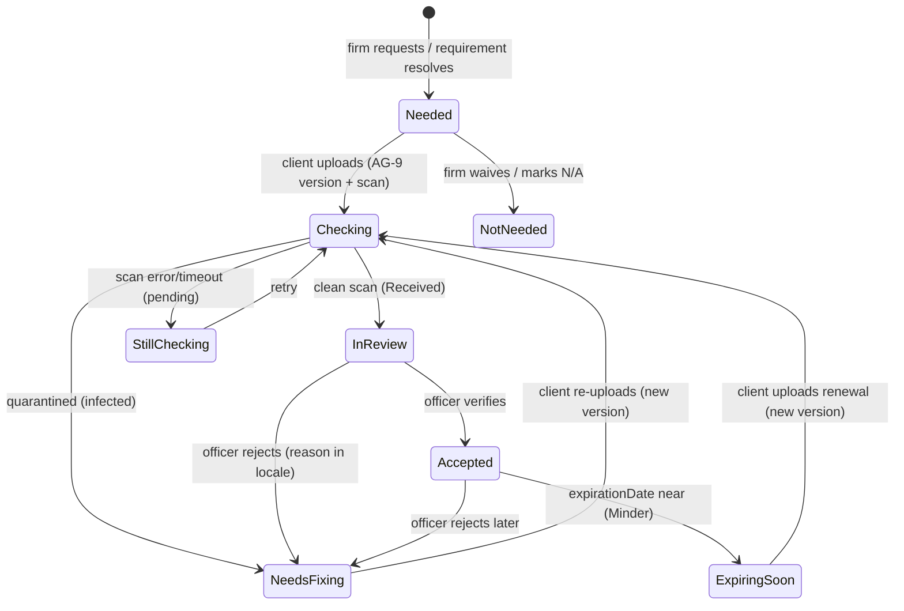

**Projection rules.** CP-4 reads AG-9's status *and* the version `scanStatus` for every item; an item with a non-clean current version is **never** rendered Accepted/In review (BR-4). Answer-conditional items appear/disappear by the firm-side resolution, never by a CP-4 transition. CP-4 effects exactly one transition the client can drive — **upload/re-upload a version** — which is an AG-9 write; all status changes are the firm's.

## 7. Key Entities & Fields

> CP-4 **introduces no new persisted document entity.** It reads/writes the AG-9 instance layer and reads the AG-15/AG-7 derived contracts. Entities are **cited, not redefined** (Doc 1 §5; AG-9 §7; AG-15 §7). Polymorphic columns are camelCase `entityType`/`entityId` with UPPER_SNAKE values (Doc 1 §5.8).

**Consumed (read and, where noted, written-via-AG-9):**
- **`Document`** (CLIENT-PII; `firm_id` + `client_id` = the Party FK — Doc 1 §2.5/§5.2; AG-9 §7) — CP-4 **reads** `status`, `scanStatus` (via current version), `documentTypeId`/`nameLocalized` (bilingual label), `requirementId`, `expirationDate`, `rejectionReason`, `requestedDueAt`; **writes** only a new version via the AG-9 upload path. CP-4 never writes status, flags, or disposal fields.
- **`DocumentVersion`** (AG-9 §7) — CP-4 reads `versionNo`/`isCurrent`/`scanStatus` for the projection; the upload path creates a new version.
- **`Media`** (AG-9 §7) — written by the AG-9 attach-version path (firm-prefixed `key`, `size`, SHA-256 `contentHash`, `sseKmsKeyRef`); CP-4 never touches bytes directly.
- **`DocumentRequirement`** / **`DocumentType`** (pack masters, Doc 1 §5.6) — read via the firm-side derived view (effective set, `alternativeGroupId`, `ANSWER_CONDITIONAL` rules, `expiryRelevant`/`expiryRuleJson`, bilingual labels). CP-4 cites, never edits.
- **`DocumentAccessLog`** (AG-9 §7) — CP-4 **writes one per client read** (actor = the `ClientCustomer` subject, action ∈ `preview | url_issued`).
- **`PortalVisibilityConfig`** (AG-15 §7) — the firm-owned allow-list CP-4 reads to filter the checklist and the view-shared set; the relevant toggles are `showDocuments` (client-supplied document requirements) and `showFirmProducedDocs` (firm-generated artifacts) — leak-off by default. (Field names exactly per AG-15 §7: `showProgress`, `showDocuments`, `showSqr`, `showInvoices`, `showAgreements`, `showFirmProducedDocs`, `enableMessaging`, `stageLabelMapJson`.)
- **`ClientWorkItem`** (AG-15 §7) — the firm-side request/status row CP-4 fulfils; the document ask is type `DOCUMENT_REQUEST` (Doc 3 AG-15 enum). CP-4 reads the ask + localized reason and reflects status; AG-15 flips it on the completion event (`document.uploaded`).
- **`ClientCanonicalAnswer`** (Doc 1 §5.4) — read indirectly via the answer-conditional resolution (CP-4 does not query it directly here).
- **`ClientCustomer`** / **`portal_session`** (Doc 1 §5.2/§3) — the credential lens + session that yields `app.current_client_subject`; identity machinery, not domain data.

**Cross-cutting (cited, attach polymorphically):** `AuditLog` (per-firm hash-chained mutation spine, Doc 1 §7.5), `Notification`/`Reminder` (Minder expiry/re-request nudges, surfaced as `notif/*`). CP-4 emits `Notification`; preferences are AG-10-owned.

**Events emitted / consumed** (canonical dot.case, Doc 1 §6.1 — CP-4 mints **no** domain event; it triggers AG-9's emitters via the shared upload path and consumes registered names only):

| Direction | Event | When / Meaning | Notes |
|---|---|---|---|
| Trigger (AG-9 emits) | `document.uploaded` | Client attaches a version (first upload) | AG-9 is the sole emitter; idempotency keyed on `documentId` + `versionNo`. Flips the AG-15 `DOCUMENT_REQUEST` work item once. |
| Trigger (AG-9 emits) | `document.version.added` | Client re-uploads (supersede) | AG-9 sole emitter; resets `Document` to Received post-clean-scan; officer Notification. |
| Consume | `document.scan.passed` | AV scan clean (AG-9) | CP-4 flips the item to "In review." |
| Consume | `document.scan.failed` | AV scan infected / quarantine (AG-9) | CP-4 flips the item to "Needs fixing — re-upload." |
| Consume | `document.status.changed` | Officer verify/reject (reason) (AG-9) | CP-4 reflects "Accepted"/"Needs fixing" + localized reason. |
| Consume | `document.requested` | Firm requests a document (AG-9 via AG-15) | New "Needed" item appears in the checklist. |
| Consume | `deadline.approaching` *(Minder)* | Expiry horizon reached against the requirement's `expiryRuleJson` watch | "Expiring soon" badge + localized `notif/*` nudge. The single registered Minder deadline primitive (Doc 3 AG-11/Conductor §3.1) — CP-4 mints **no** `document.expiry.*` synonym. |

> CP-4 mints **no new domain event.** Document facts have a single emitter (AG-9, Doc 1 §6.1 — no synonym drift); the expiry signal is the Minder's single registered `deadline.approaching`. The login/identity fact is owned and emitted solely by CP-1 (`portal.client.loggedin`, CP-1 §7) — CP-4 emits no portal-identity event. If a portal-activity signal is needed for AG-15 engagement, it is the AG-15-owned `PortalActivityEvent`, emitted there.

## 8. User Stories + Acceptance Criteria

**US-1 — Applicant: see exactly what's needed, in my language.**
- **Given** my case has resolved requirements (some combination-mandatory, some answer-conditional), **When** I open CP-4, **Then** I see an outstanding-first checklist in my locale, "provide one of…" groups render as one item, and items not required by my answers do not appear.
- **Given** I later answered "married" in the SQR (CP-3), **When** I revisit the checklist, **Then** a marriage-certificate item now appears (firm-side conditional resolution), with no item I don't need.

**US-2 — Applicant: upload from my phone, safely.**
- **Given** a "Needed" passport item, **When** I capture it with my camera and upload, **Then** it uploads direct-to-storage via an ownership-bound presigned PUT, the API never sees the bytes, and the item shows "Checking your file…".
- **Given** I try to upload an `.exe` or HTML renamed to `.pdf`, **When** I upload, **Then** it is rejected at slot-issue on sniffed-type mismatch and nothing is stored.

**US-3 — Applicant: know the moment it's clean — or that it wasn't.**
- **Given** my upload passes the AV scan, **When** the scan returns clean, **Then** the item flips to "Uploaded — in review" and no email was exchanged.
- **Given** my upload is infected, **When** the scan quarantines it, **Then** no download URL is ever issued for it, and the item shows "Couldn't accept — please upload again," never "uploaded."

**US-4 — Applicant: fix a rejection in one tap.**
- **Given** the officer rejected my bank letter with reason "page 2 illegible," **When** I open the checklist, **Then** the item shows "Needs fixing" with that reason **in my language** and a Re-upload action.
- **Given** I re-upload a corrected file, **When** it scans clean, **Then** a new version supersedes the old one and the item returns to "In review" — the prior upload retained, not lost.

**US-5 — Applicant: warned before something expires.**
- **Given** my police certificate expires in 30 days and its pack requirement is expiry-relevant, **When** the Minder horizon is reached (`deadline.approaching`), **Then** the item shows "Expiring soon" and I get a localized, on-brand `notif/*` nudge with a one-tap renewal upload that auto-exits when I act.

**US-6 — Applicant: see my own and shared documents only.**
- **Given** the firm exposed the prepared submission package via `PortalVisibilityConfig.showFirmProducedDocs`, **When** I open "Shared with me," **Then** I can preview it via a short-lived ownership-bound presigned GET with safe serving headers, and the view is access-audited.
- **Given** the firm did not expose internal staff documents, **When** I look, **Then** they are not in my response at all (leak-off by default), not merely hidden in the UI.

**US-7 — Security: I can never reach a sibling client.**
- **Given** I am client X, **When** I request any document/requirement id belonging to sibling client Y, **Then** I get 404/empty (never 200, no Y data in body/error/logs), it is audited, and the portal RLS dimension backstops at the database (inherited CP-1 §3 / Doc 1 §2.5).
- **Given** I attempt to upload a version attributing the row to sibling Y, **When** the write runs, **Then** the portal `WITH CHECK` rejects it at the database (Doc 1 §2.5 AC-2.5.5).

**US-8 — Corporate seat-holder: scoped roster only.**
- **Given** I am an HR seat on a corporate client, **When** I open CP-4, **Then** I see only the in-scope applicant cases my relationship chain resolves to at the firm-set scope, and a non-seat sibling case returns 404 at app and DB.

**US-9 — Offline: review with no signal.**
- **Given** I installed the PWA and have no connection, **When** I open CP-4, **Then** I can read my cached checklist (what's needed and why), uploads are clearly disabled with "reconnect to upload," and on logout or session revocation the device cache is cleared.

## 9. Edge Cases & Validations

- **Cross-client read/write** → 404/empty + audited; portal RLS USING+WITH CHECK backstop at DB (BR-1; inherited CP-1 §3 / Doc 1 §2.5).
- **Caller-supplied raw storage key to sign** → rejected by construction; only keys resolved from an owned record are signed (CP-1 §3, Doc 1 §4.5 AC-7.7.4).
- **Disallowed type / oversize / declared≠sniffed** → rejected at slot-issue, nothing persisted (BR-6).
- **Quarantined download attempt** → no presigned GET ever issued; item shows "couldn't accept" (BR-4).
- **Scan service down/timeout** → `scanStatus = pending`; item "still checking — retry"; never auto-fulfilled (CP-4-10).
- **Presigned URL expires mid-view** → expired GET fails closed; UI re-requests a fresh short-lived URL (access re-logged) — never a long-lived link.
- **Answer-conditional flip after upload** → if a requirement becomes not-required after the client uploaded, the upload is retained (AG-9 versioning), the item leaves the outstanding list; if it becomes required, it appears as "Needed."
- **Combination-mandatory partially satisfied** → uploading one alternative collapses the group as satisfied; the others drop from outstanding (CP-4-2).
- **Officer rejects an Accepted document later** → item returns to "Needs fixing" with the new reason; the client is nudged (transactional, in-locale).
- **New version supersedes a verified one** → AG-9 resets to Received; the client sees "In review" again; the old version is never silently used downstream (BR-7).
- **Document class not in `PortalVisibilityConfig`** (`showDocuments`/`showFirmProducedDocs` off) → invisible to the portal even if own-owned (BR-2).
- **Corporate non-seat sibling** → 404 at app + DB (BR-13; Doc 1 §2.5 AC-2.5.6).
- **Offline upload attempt** → blocked with a clear "reconnect to upload" message; no half-state queued (BR-14).
- **Session revoked while offline cache present** → next online interaction 401s and purges the 24h cache; the cached checklist is no longer readable (CP-4-17).
- **Storage rail unavailable** → upload fails closed with a clear retryable error; no half-written version without a Media; the request never hangs proxying bytes.
- **Token in URL / PII in logs** → never; capability-bearing values never in query params (BR-12); logs carry IDs + `firm_id` only (BR-11).
- **Locale missing a label** → fall back to the firm/default locale gracefully; never render a raw key or English-only string to a French client (BR-15).

**Validation doctrine.** Every input (upload metadata, file type/size, requirement target, locale) is Zod/class-validator schema-validated, never ad-hoc; reject early with a clear localized message; never persist on validation failure (Doc 1 edge discipline).

## 10. Permissions (LOCAL `portal/*`)

Default-deny; additive; evaluated within the caller's `firm_id` **and** their own ownership chain by the scope-aware guard (Doc 1 §4.1–4.2) + the record-level authz layer (CP-1 §3 / Doc 1 §4.5) + the portal RLS dimension (Doc 1 §2.5). All keys are LOCAL (`portal/*`), grammar `portal/<resource>:<action>`; none may be a `system/*` key on a portal role (Doc 1 §4.3 write-side filter). The **catalog is owned by SA-6**; CP-4 declares these keys for the per-action route surface. Every state-changing route carries `@RequirePermissions` (Doc 1 §4.4 completeness).

| Permission Key | Description |
|---|---|
| `portal/document:list` | List the client's own document checklist for an owned case (the checklist view). |
| `portal/document:show` | Open a single own/shared document's client-safe detail/status. |
| `portal/document:upload` | Upload a version against an own requirement (slot-issue + attach-version). |
| `portal/document:reupload` | Re-upload a clean copy against a rejected/quarantined own document. |
| `portal/document:download` | Preview/download an own or firm-shared document (ownership-bound presigned GET; access-audited). |

> Notes: there is **no** `portal/document:verify`, `:reject`, `:waive`, `:delete`, `:dispose`, `:link`, `:annotate`, `:legal-hold`, or `:request` — those are firm powers (`agent/document:*`, AG-9 §10). The client is a write actor only for *their own version uploads* and a read actor for own + firm-shared documents; everything else is the firm's, enforced by the cross-pool 401 (a portal token can never satisfy an `agent/*` route, Doc 1 §3.1).

## 11. Scalability · Security · Performance (isolation FIRST)

**Security & isolation (first, because this is the top PII-leak surface; the contract is owned by CP-1 §3 and applied here, not re-derived).**
- **Cross-client denial is the headline contract.** A portal token for client X requesting any id belonging to sibling Y returns 404/empty for **100%** of resources — no Y data in body, error, or logs — proven at both the app (Layer 4, CP-1 §3 / Doc 1 §4.5) and the DB (portal RLS USING + WITH CHECK, Doc 1 §2.5 AC-2.5.2/AC-2.5.5). The corporate-seat chain resolves correctly (AC-2.5.6). This is wired into the §2.8 cross-tenant/cross-client denial suite and the pre-go-live + annual horizontal-access pentest (Doc 1 §4 must-fail-100%).
- **Bytes are closed at three edges.** Ownership-bound presigned I/O only, per the CP-1 §3 object-access rule (no public bucket, no caller-keyed signing, AC-7.7.4); safe serving headers (`Content-Disposition: attachment`, `nosniff`, restrictive CSP, AC-7.7.8); AV-scan-before-availability with quarantine never served (§7.7). No capability-bearing value in any URL (AU-A19).
- **Identity wall.** Client-portal pool only (`aud = er:portal`, Doc 1 §3.1, distinct signing key); cross-pool 401 (Doc 1 §3.1); session-bound instant revocation clears the device cache (Doc 1 §3, §8). MFA posture is the portal pool's session MFA — no per-upload step-up (§13, resolved).
- **Audit & PII minimization.** Every read → `DocumentAccessLog`; every mutation → hash-chained `AuditLog`; no Restricted PII / file content / read URL / token in logs (AC-7.7.5). Restricted-PII fields stay field-encrypted (Doc 1 §7.1/§7.2) — orthogonal to RLS.

**Scalability.**
- **Reads, not heavy compute.** The checklist read is a join over the (firm-side computed) derived requirement set + AG-9 status; CP-4 adds no new aggregation. Heavy/derived reads route to read replicas (which enforce identical FORCED RLS + the portal GUC, AC-2.7.4/AC-7.7.9).
- **Region seam.** Storage, DB, KMS, Minder all honour the per-firm region binding (Doc 1 §2.9/§7.7) — a future EU-resident firm's portal is config, not code.
- **Pack-driven taxonomy.** New document types/conditional rules/locales are pack config (Doc 1 §5.6) — zero CP-4 change.

**Performance.**
- **Direct-to-storage I/O.** Upload/download never proxy bytes through the API (presigned PUT/GET) — the API stays light regardless of file size.
- **Paginated, cached checklist.** The checklist is paginated and the per-case projection is cacheable (short TTL, invalidated on the consumed `document.*` events); the PWA caches the subject-scoped checklist (24h TTL, cleared on revocation) for offline read (Doc 1 §8).
- **Async by default.** Scanning, expiry evaluation, and nudges are BullMQ work (Doc 1 §1.4) — uploads return immediately with a "Checking…" badge; freshness via polling until the realtime wave lands (Doc 1 §1.5).
- **NFR alignment.** Read budget P1, the queued-if-over-5s rule (P7), and WCAG 2.2 AA / EN-FR / responsive / installable-PWA (Doc 1 §8) all apply unchanged.

## 12. Reference Note (NEW — portal is greenfield)

This module is **NEW**. The Client Portal was gap-analysis critical scope-hole **C2** — never previously specced — and the *client-facing* document surface did not exist as a designed module in the reference prototype (the prototype carried a firm-side document subsystem and a thin portal login artifact only). What CP-4 contributes that is genuinely new: the **client-facing checklist projection** (combination-mandatory + answer-conditional rendered for a layperson), the **client re-upload-on-rejection loop with the reason in the client's locale**, **client-side expiry warnings**, the **own + firm-shared view governed by the allow-list**, and the **read-only offline PWA** shell — all sitting on, and never re-implementing, the **consumed** AG-9 document engine, AG-15 control plane, the CP-1 isolation backbone, and the Doc 1 foundation. The single most load-bearing inherited contract is **isolation as a feature**: the CP-1 §3 portal second RLS dimension + record-level ownership chain + ownership-bound presign, applied to the document surface specifically (Doc 1 §2.5/§4.5/§7.7). **CHANGED vs. prototype:** nothing — CP-4 adds; it does not modify AG-9/AG-15/CP-1, which it consumes through their published contracts. **EXISTS (consumed):** AG-9 engine, AG-15 control plane, CP-1 isolation primitive, Doc 1 identity/RLS/storage foundation, the canonical answer store. **Net-new tables: zero** — CP-4 introduces no persisted entity (the portal's net-new tables `PortalPaymentAttempt` (CP-5), `PortalAccountViewState` (CP-8), `OrgPortalRollup` (CP-9) are owned elsewhere).

## 13. Open Questions / [FOUNDER-CONFIRM]

**Domain / business (founder + Immigration-SME):**
1. **Document taxonomy & answer-conditional rules** — which types, which are answer-conditional (and on which SQR answers), which belong to combination-mandatory groups, which require translation/notarisation. **Country-Pack content, not this module.**
2. **Expiry warning horizons** — per-requirement "expiring soon" lead time (e.g. 90/60/30 days for a passport vs. a language result). Drives the Minder `expiryRuleJson` watch that emits `deadline.approaching`.
3. **Default share policy** — out of the box, which firm-produced documents (submission package, receipts, cover letters) are exposed to the client via `PortalVisibilityConfig.showFirmProducedDocs`? Leak-off by default is the safe stance; the founder sets the recommended default.
4. **Client-friendly status copy** — the plain-language labels for §6 states and the "added because of your questionnaire answers" affordance (bilingual).
5. **Re-request reminder cadence** — default Minder cadence/quiet-hours for outstanding/expiring document nudges (transactional, consent-aware).

**Architect items — RESOLVED IN (normative, no phasing):**
6. **MFA / step-up on upload — RESOLVED.** Document upload and download rely on the portal pool's **session-level MFA** (Doc 1 §3); there is **no per-upload step-up** in v1. This is normative, not an open question.
7. **Minder expiry event — RESOLVED.** CP-4 consumes the **single registered** `deadline.approaching` (the Minder deadline primitive, Doc 3 AG-11/Conductor §3.1, anchored on `DocumentRequirement.expiryRuleJson`); the client-facing nudge is a localized `notif/*` + `Reminder`. CP-4 mints **no** `document.expiry.*` synonym (Doc 1 §6.1 single-emitter / no-synonym law). The placeholder name is removed.
8. **Multi-page mobile assembly — RESOLVED IN v1.** Camera multi-page capture/assembly is in scope for v1 (CP-4-8), on the same signed-URL + scan path; no phasing.
9. **Offline cache TTL & eviction — RESOLVED.** The PWA read-only cache holds the subject-scoped checklist for a bounded **24-hour TTL** and **MUST be cleared on logout and on session revocation** (CP-4-17); the must-clear-on-revocation guarantee is a testable AC tied to Doc 1 §3 instant-revocation.


---

# Module CP-5: Invoices & Online Payment

## Module Index

- **§1 Purpose & Goal** — the client's own money surface: see what I owe, pay it securely online, keep my receipts — a pure view-and-pay window onto AG-6, never a second ledger.
- **§2 Users & Jobs-to-be-Done** — the individual applicant (protagonist), the corporate seat-holder (HR/sponsor payer), the family co-applicant; their pay-and-prove jobs.
- **§3 Functional Design** — how the portal renders AG-6 invoices read-only; the hosted-checkout pay flow over `PaymentRailPort` (card never touches ER, PCI SAQ-A); webhook-truth not redirect-truth; receipts; the milestone/installment schedule view; what is deliberately absent.
- **§4 Detailed Functional Requirements** — CP-5-1 … CP-5-24.
- **§5 Business Rules** — BR-1 … BR-14 (view-only, single-source money, own-invoice-only, webhook-truth, no card storage, no overpay).
- **§6 States & Lifecycle** — the portal-projected invoice state and the client-pay-attempt state machine.
- **§7 Key Entities & Fields** — consumed AG-6 entities (read-only) + the one new portal-owned `PortalPaymentAttempt`; events emitted/consumed.
- **§8 User Stories + Acceptance (G/W/T)** — US-1 … US-9.
- **§9 Edge Cases & Validations** — abandoned checkout, redirect-without-webhook, sibling-invoice probe, offline-only firm, non-`ACTIVE` connected account, currency display, overpay.
- **§10 Permissions** (`portal/*`) — the portal billing key set.
- **§11 Scalability · Security · Performance** — isolation FIRST (the top PII + money surface), then scale and latency.
- **§12 Reference Note (NEW)** — greenfield; no client-pay surface exists today.
- **§13 Open Questions / [FOUNDER-CONFIRM]**.

> **Plane:** Client Portal console (LOCAL, the third console). **Tenant key:** `firm_id`, FORCED RLS (Doc 1 §2.2). **Second isolation axis:** the portal subject GUC `app.current_client_subject` (the caller's `clientCustomerId`) per Doc 1 §2.5 — client-to-client isolation has a DATABASE backstop, not just app code. **Identity pool:** client-portal (`aud = er:portal`, Doc 1 §3.1), distinct signing key, 15-min access / 24-h absolute / 30-min idle session (Doc 1 §3). **Permission scope:** `portal/*` (LOCAL), record-level authz + `assertPortalOwnershipChain` + `PortalVisibilityConfig` allow-list (Doc 1 §4.5). **Isolation backbone inherited from CP-1:** the walled portal pool, the second RLS dimension wiring, `assertPortalOwnershipChain`, and the ownership-bound presigned-URL rule are OWNED by CP-1 §3.3/§3.4 (per Doc 1 §2.5/§4.5); CP-5 inherits and may not weaken them — it states only its money-specific deltas. **Consumes (mirrors, never re-specs):** AG-6 (Biller — the single source of all client money), the `PaymentRailPort` online-rail adapter + hosted checkout (Doc 1 §6.3), the canonical event dictionary (Doc 1 §6.1), AG-15 (firm-side `PortalVisibilityConfig` / `showInvoices` gate / invites), the firm's white-label branding (AG-1/AG-16). **Distinct from SA-4:** this is **client → firm** money. The platform never custodies funds; funds settle to the firm's own connected account.

---

## 1. Purpose & Goal

CP-5 is the immigrant client's window onto the money side of their engagement. It answers three questions the way an anxious applicant actually asks them: **"What do I owe?"**, **"Can I pay it right now, safely, from my phone?"**, and **"Do I have proof I paid?"** Nothing more — and, just as deliberately, nothing less.

The load-bearing design fact is that **CP-5 owns no money**. Every invoice, every line item, every tax figure, every payment fact, every receipt number, every installment schedule lives in AG-6 (the Biller) as the firm's system of record. CP-5 is a **view-and-pay surface**: it renders AG-6 invoices read-only, and it triggers a payment that AG-6 — not the portal — records as the immutable truth. There is no second invoice table, no portal copy of a balance, no portal-side recompute. The portal and the firm console can never disagree about a dollar because they read the same rows. This is the single-source-of-truth discipline (AG-6 BR-15) projected onto the client surface.

The business outcome CP-5 must make structurally true: **a client who wants to pay can always pay, in seconds, in their own currency and language, without a phone call or a chase** — and walks away with a receipt. Immigration fees stall in three predictable places that CP-5 removes: the client who never got a clean way to pay (so the firm dunned them needlessly), the client who paid offline and had no proof (so reconciliation became a fight), and the client who didn't understand a multi-currency milestone schedule (so they delayed). CP-5 turns "please remit the deposit" into a single secure tap.

**World-class positioning.** A generic portal bolts a Stripe button onto a PDF. CP-5 is a calm, trustworthy financial surface for a person spending a large, emotionally-loaded sum with a firm in a country they may not yet live in: it shows fees in **their** invoice currency with line-level clarity (a government fee is visibly a pass-through, not the firm's charge); it shows the **milestone/retainer schedule** so the client sees the whole financial arc of their case, not just the next bill; it is **bilingual (EN/FR), WCAG 2.2 AA, mobile-first, and a read-only-offline PWA** (Doc 1 §8) so a client on a slow connection can still see what they owe and find how to pay; and it is **white-labelled** to the firm's brand so the client never sees "ExpatReady." Card data **never touches ExpatReady** — payment happens in the rail's hosted checkout, keeping PCI scope at **SAQ-A** (Doc 1 §6.3 / ADR C4-D1).

## 2. Users & Jobs-to-be-Done

| Role | Primary job | Representative JTBD |
|---|---|---|
| **Individual applicant** (protagonist) | Understand and pay what I owe; keep proof. | "Show me my deposit invoice in CAD with the line items so I know what I'm paying for." · "Let me pay it right now on my phone, securely, and stop the reminder emails the moment I do." · "Give me a receipt I can download for my records." · "Show me the whole payment plan so I know what's coming." |
| **Corporate seat-holder** (HR coordinator / sponsor who pays for an applicant) | Pay on behalf of an in-scope applicant case I am entitled to. | "Show me the invoices for the cases my company is sponsoring — and only those — and let me pay them." (Org-scoped via the corporate `PartyRelationship` chain, Doc 1 §2.5/§4.5.) |
| **Family co-applicant / dependant** (a `ClientCustomer` on a related case) | See and, if my case exposes it, pay my own invoice. | "I'm the spouse on this application; show me my invoice, not my partner's, unless the firm has linked us." (Ownership chain decides; never the UI.) |

**Design implication.** The portal payer is non-expert, possibly stressed, possibly on mobile, possibly not a native EN/FR speaker, and is handling a significant sum. Every screen optimizes for **trust and clarity over density** (the inverse of the agent console). There is exactly one money action a client can take — **pay an issued, payable invoice** — and it is unmissable, reassuring, and irreversible-by-design (the client cannot edit, void, refund, or re-attribute anything). Everything else is read.

## 3. Functional Design

### 3.1 The money model the client sees (a read-only projection of AG-6)

The portal renders three AG-6 concepts and **no others**:

- **Invoice** — the firm's statement of what this client owes, in the **invoice's own currency** (set by AG-6, never chosen in the portal), with its typed line items, frozen tax, total, paid-to-date, and derived balance (`dueAmount`). The portal shows the AG-6 status **relabelled for a client audience** (see §3.2). The portal never edits a line, never recomputes a total — it displays AG-6's frozen figures.
- **Payment** — an immutable fact AG-6 owns. The portal shows each payment (date, amount, method label) as history; it never writes a Payment row directly. A client pay action causes AG-6 to write the Payment fact on webhook confirmation (§3.3).
- **Receipt** — AG-6's numbered receipt (the PDF behind a `Document`/Media object, gap-free `ReceiptNumberSequence`, AG-6 §3.2). The portal lets the client view and download it via an **ownership-bound presigned URL** (issued only after `assertPortalOwnershipChain`, never a caller-supplied key — the CP-1 §3.4 object-access primitive, per Doc 1 §4.5).

The **milestone/retainer schedule** (AG-6 `PaymentPlan` + ordered `Installment` rows, possibly seeded from the signed retainer) is shown read-only so the client sees the full financial arc: paid milestones, the next one due, future ones scheduled. CP-5 does not create, edit, or reorder a plan — that is AG-6 (`agent/billing:plan-manage`).

**What is deliberately absent from the portal** (because it is firm-side AG-6, not client-facing): creating/editing/issuing/voiding/cancelling invoices; recording offline payments; refunds; numbering/tax/currency configuration; dunning configuration; financial-PII reveal of *other* parties; firm-wide reports; accounting export. A client touching any of these is a category error; none of these routes exist in the `portal/*` namespace.

### 3.2 Rendering invoices — the client list and detail (read-only)

**How it works.** On login, the portal resolves the client's `clientCustomerId` from the verified portal token (Doc 1 §3), the tenant middleware sets `app.current_firm_id` + `app.current_client_subject` (Doc 1 §2.5), and the invoice list query returns **only** invoices whose ownership chain resolves to that subject **and** only if the case's `PortalVisibilityConfig.showInvoices` is enabled (AG-15-owned allow-list; leak-off by default, Doc 1 §4.5 AC-4.5.4). A firm that has not enabled invoice exposure for a case shows the client **no billing surface at all** — not an empty list, the section simply does not appear in nav.

The list groups invoices by **client-meaningful status**: **To pay** (issued/partially-paid/overdue with a balance), **Paid**, and **Past** (cancelled/void are generally not shown; a cancelled-after-partial-payment invoice may appear under Paid history if it carries client-relevant payment facts — [FOUNDER-CONFIRM] §13). Each row shows invoice number, a one-line summary, currency + total, balance, and due date with an **overdue affordance** that is informative, never punitive ("Due 3 days ago — pay now").

**Status relabelling for a client audience.** AG-6's internal statuses are mapped to plain language (the mapping is fixed portal copy, authored by the content writer, not firm-editable):

| AG-6 status | Client-facing label |
|---|---|
| `ISSUED` (balance > 0) | "To pay" |
| `PARTIALLY_PAID` | "Partly paid" |
| `OVERDUE` | "Overdue — please pay" |
| `PAID` | "Paid" |
| `CANCELLED` | "Cancelled" (shown only with prior payment history) |
| `REFUNDED` / `PARTIALLY_REFUNDED` | "Refunded" / "Partly refunded" |

**Invoice detail** shows the billed-to snapshot, the typed line items with their **kind made human** (a `GOVERNMENT_FEE` line is visibly labelled "Government fee (paid to the authority)" so the client understands the firm is not charging it), the per-line and total tax, the grand total, payments-to-date with each receipt, and the running balance. All figures are AG-6's frozen values; the portal formats them per the currency's `minorUnitExponent` and the client's locale, using the **same rounding rule** AG-6 used (per-line round-half-to-even then summed, AG-6 BR-16) so the portal, the receipt, and the firm console never disagree by a cent.

**Screens.** *Billing home* (To pay / Paid / schedule summary, with the next-due amount hero); *Invoice detail* (lines, tax, payments, balance, Pay button when payable); *Receipt viewer* (in-portal PDF + download); *Schedule view* (the milestone/installment timeline).

### 3.3 Paying online — hosted checkout over `PaymentRailPort` (card never touches ER)

**Design principle (load-bearing).** The client pays on the **firm's own connected processor account** through Doc 1's `PaymentRailPort` (the online-rail v1 adapter). The card is entered in the **rail's hosted checkout**, not in any ExpatReady form — so card data never traverses, and is never stored by, the ExpatReady platform. **PCI scope stays SAQ-A** (Doc 1 §6.3, ADR C4-D1). The platform never custodies funds; settlement is firm → rail → firm's bank.

**The flow (client side):**

1. On a payable invoice (status has a balance **and** `getConnectedAccountStatus(firmId) === ACTIVE`), the client taps **Pay**.
2. CP-5 calls its server endpoint, which (re-asserting ownership + `showInvoices` + same-firm) asks AG-6 to create a payment intent **on the firm's connected account** for the **invoice's amount and currency** (never a client-supplied amount, never a hardcoded currency), with metadata `(firm_id, invoiceId, clientCustomerId)` and a generated idempotency key (AG-6-14). AG-6 returns a **hosted-checkout session reference / URL** from the rail adapter.
3. CP-5 writes a `PortalPaymentAttempt` row (§7) — the **only** entity CP-5 owns — recording `{ invoiceId, clientCustomerId, intentRef, status = INITIATED }`, then redirects (or opens) the rail's hosted checkout. The client enters card / completes 3-D Secure / SCA **on the rail**.
4. On completion the rail returns the client to a CP-5 **cosmetic success page**. This page is **not** the source of truth.
5. **The invoice is marked paid by the webhook fact, not the redirect** (AG-6-17, BR-10). The rail's signed webhook hits AG-6's adapter (signature-verified, Doc 1 §4.6; idempotent on the rail event id via the per-firm processed-event ledger, Doc 1 §6.2.3), AG-6 writes the immutable Payment fact and recomputes the invoice in one atomic transaction, issues the numbered receipt, and emits `payment.succeeded` (+ `invoice.paid` when the balance zeroes). CP-5 simply re-reads AG-6 and now shows "Paid" + the receipt.

**Webhook-truth, not redirect-truth (why the success page is cosmetic).** A tab can close, a redirect can be spoofed or lost on a flaky mobile connection. CP-5 therefore **never** confirms payment from the browser return; it confirms by re-reading AG-6 state, which only changes on the verified webhook (or AG-6's 15-minute missed-webhook reconciliation poll, AG-6-18). The success page polls AG-6 for the now-`PAID` state and shows a spinner with reassuring copy until it flips — and tells the client "you can safely close this; your receipt will appear here and in your email" if the webhook is briefly delayed.

**Connect-state fallback (firm not money-ready).** When `getConnectedAccountStatus(firmId)` is not `ACTIVE` (the firm hasn't finished AG-1 payment-rail connect, or the account is `RESTRICTED`/`SUSPENDED`), the **Pay button is disabled** with calm copy ("Online payment isn't available for this firm yet — please contact your case manager to pay") and CP-5 surfaces the firm's offline-payment instructions from the AG-16 field `offlinePaymentInstructionsEn/Fr` (+ optional per-currency override map) on the office's `InvoiceBillingConfig` (Doc 3 AG-16 §3.2 / AG-16-33 — sanitized rich text, resolved office → invoice-currency override → office default, rendered in the client's `language` with firm-default fallback; AG-6 owns the offline payment path, AG-16 owns the instruction text, CP-5 only **displays** it and records no offline payment). The former [ARCHITECT-CONFIRM] on this field is **resolved** — AG-16-33 defines it (see §13 item 2). A client is never shown a broken or dead Pay button.

**No portal-side amount choice.** The client pays the invoice's full outstanding balance (or a firm-defined installment amount in draw mode where AG-6 has cut a milestone-draw invoice). The portal **never** lets the client type an amount — overpayment and arbitrary partials are an AG-6 firm-side concern (AG-6 BR-7 rejects overpay at the source regardless).

**Screens.** *Pay confirmation sheet* (amount, currency, "you'll pay securely on <rail's hosted page>"), *hosted checkout* (the rail's page, not ours), *cosmetic success/pending page* (polls AG-6, shows receipt when settled), *payment-unavailable state* (offline instructions).

### 3.4 Receipts & the schedule view

**Receipts.** Every settled payment produces an AG-6 numbered receipt (PDF + Media). CP-5 lists receipts on the invoice detail and a "Receipts" tab, each downloadable via the CP-1 §3.4 ownership-bound presigned-URL primitive (Doc 1 §4.5 — issued only after `assertPortalOwnershipChain`, never against a client-supplied key). The portal also surfaces the receipt that AG-6 emails the client (the rail/Biller send), so the client has it in two places.

**Milestone / retainer schedule.** Where a case has an AG-6 `PaymentPlan`, CP-5 renders the ordered `Installment` rows as a **timeline**: each milestone's amount, due date, and status (paid / next-due / scheduled), with the milestone that seeded from the signed retainer clearly tied to "your agreement." This gives the client the whole arc — what they've paid, what's next, what's coming — which is the single biggest anxiety-reducer for a large multi-stage immigration fee. The schedule is **read-only**; a due milestone's actual bill arrives as an AG-6 invoice the client pays through §3.3.

### 3.5 Notifications the client receives (consumed, not owned)

CP-5 does not own messaging. When AG-6 issues an invoice, marks one overdue, or records a payment, AG-6 raises `Notification`s (AG-6-35) that — for portal-exposed invoices — reach the client through the Communications module (AG-10) respecting the client's `NotificationPreference` and locale, white-labelled to the firm (AG-15). CP-5's job is to make sure that when the client clicks "view invoice" or "pay" from such a message, they land on the right, ownership-checked screen. Dunning reminders the client receives are transactional (service messages, no marketing consent needed) and **auto-exit the instant the balance clears** (AG-6 BR-12) — so paying in the portal stops the chase with no client action.

### 3.6 Data-flow diagram

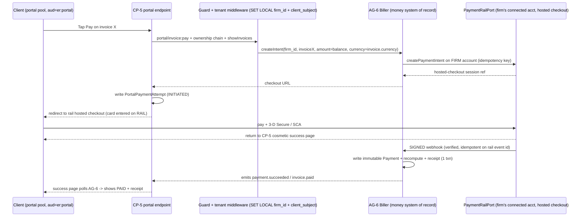

## 4. Detailed Functional Requirements

**Viewing invoices (read-only projection of AG-6)**
- **CP-5-1** The portal SHALL list an invoice to a client **only** when (a) its ownership chain resolves to the caller's `clientCustomerId` (Doc 1 §2.5/§4.5) **and** (b) the case's `PortalVisibilityConfig.showInvoices` is enabled (AG-15; leak-off by default). A firm with invoices not exposed SHALL see no billing nav surface.
- **CP-5-2** The invoice list SHALL group by client-facing status (To pay / Paid / Past), each row showing number, summary, currency, total, balance, due date, and an informative overdue affordance — all read from AG-6, never a portal copy.
- **CP-5-3** Invoice detail SHALL show the typed line items with client-friendly `kind` labels (esp. `GOVERNMENT_FEE` as a visible pass-through), per-line and total tax, grand total, payments-to-date, each receipt, and running balance — all AG-6's frozen values, formatted per the currency `minorUnitExponent` and client locale using AG-6's round-half-to-even rule.
- **CP-5-4** The portal SHALL NOT expose any create / edit / issue / void / cancel / refund / numbering / tax / currency / dunning-config / firm-report / export capability; no such route SHALL exist in `portal/*`.
- **CP-5-5** Invoice and payment amounts SHALL be displayed exactly as AG-6 stores them (integer minor units, AG-6's rounding); the portal SHALL NOT recompute a total, tax, or balance.

**Paying online (hosted checkout, card never touches ER)**
- **CP-5-6** Pay SHALL be offered only when the invoice has a positive balance AND `PaymentRailPort.getConnectedAccountStatus(firmId) === ACTIVE`; otherwise the action SHALL be disabled with calm copy and the firm's offline-payment instructions (`offlinePaymentInstructionsEn/Fr` + per-currency override on the AG-16 `InvoiceBillingConfig`, Doc 3 AG-16-33; localized, resolved for the invoice's office + currency) displayed read-only — display only; CP-5 records no offline payment.
- **CP-5-7** On Pay, CP-5 SHALL request AG-6 to create a payment intent **on the firm's connected account** for the **invoice's exact outstanding balance and the invoice's own currency**, never a client-supplied amount or a hardcoded currency, with metadata `(firm_id, invoiceId, clientCustomerId)` and an idempotency key (AG-6-14).
- **CP-5-8** Card entry and 3-D Secure / SCA SHALL occur entirely in the rail's **hosted checkout**; no card data SHALL traverse or be stored by ExpatReady (PCI SAQ-A, Doc 1 §6.3). No `portal/*` route SHALL accept a PAN, CVV, or raw card field.
- **CP-5-9** The invoice SHALL be marked paid by the **verified webhook fact in AG-6, never by the browser redirect** (AG-6-17/BR-10); the CP-5 success page SHALL be cosmetic and SHALL confirm only by re-reading AG-6 state.
- **CP-5-10** A redelivered rail webhook SHALL be a no-op (AG-6's idempotency on the rail event id); a closed tab / lost redirect SHALL still settle the invoice (AG-6 webhook + 15-min reconciliation poll). CP-5 SHALL surface "you can safely close this" while a settlement is briefly pending.
- **CP-5-11** No AG-6/CP-5 code SHALL import a vendor SDK or name a processor in any durable model, enum, or `portal/*` permission — the rail is consumed only through `PaymentRailPort` (Doc 1 §6.3 boundary lint). This boundary lint covers every CP module that references the pay path (incl. CP-9's corporate pay surface, which reuses CP-5 / `PaymentRailPort`).
- **CP-5-12** The client SHALL NOT be able to choose or override the payment amount; the portal pays the invoice's outstanding balance (or AG-6's draw-mode milestone-draw invoice amount).

**Receipts & schedule**
- **CP-5-13** Every settled payment's AG-6 numbered receipt SHALL be viewable and downloadable in-portal via the CP-1 §3.4 **ownership-bound presigned URL** issued only after `assertPortalOwnershipChain` (Doc 1 §4.5) — never against a client-supplied storage key.
- **CP-5-14** Where an AG-6 `PaymentPlan` exists for the case, CP-5 SHALL render its ordered `Installment` rows read-only as a paid / next-due / scheduled timeline, tying the retainer-seeded milestone to "your agreement"; CP-5 SHALL NOT create, edit, or reorder a plan.

**The one portal-owned entity**
- **CP-5-15** CP-5 SHALL own exactly one new entity, `PortalPaymentAttempt` (a CLIENT-PII row carrying `firm_id` + the subject chain), recording a client's checkout initiation `{ invoiceId, clientCustomerId, intentRef, status, createdAt }`; it SHALL be a **convenience/UX trace only** and SHALL NOT be a money fact — the authoritative Payment is AG-6's.
- **CP-5-16** `PortalPaymentAttempt` SHALL NOT drive invoice status, balance, or any roll-up; AG-6's webhook-written Payment fact SHALL be the only thing that settles an invoice.

**Isolation, identity & cross-cutting**
- **CP-5-17** Every CP-5 read/write SHALL run in the client-portal pool (`aud = er:portal`, Doc 1 §3.1) with `app.current_firm_id` + `app.current_client_subject` set by middleware from the verified token, never from caller input; the portal RLS dimension (USING + WITH CHECK) SHALL backstop every CLIENT-PII access (the CP-1 §3.3 backbone, per Doc 1 §2.5).
- **CP-5-18** A corporate seat-holder SHALL see and pay only invoices for in-scope applicant cases reachable through the corporate `PartyRelationship` chain (Doc 1 §2.5 corporate-seat case + AG-15 `CorporatePortalSeat` scope); a non-seat sibling SHALL get 404 at both app and DB.
- **CP-5-19** A request for an invoice/receipt not owned by the caller SHALL return 404/empty (never 200, never another client's data), denied at the app layer (`assertPortalOwnershipChain`) AND at the DB (portal RLS), even if the app check is ever missed.
- **CP-5-20** All input SHALL be schema-validated (Zod from `packages/contracts`); the pay endpoint SHALL accept only an `invoiceId` (+ idempotency token) — never an amount, currency, payee, or card field; reject early, persist nothing on failure.
- **CP-5-21** Sensitive client money actions (initiating a pay attempt, viewing/downloading a receipt) SHALL be audited via the per-firm synchronous audit outbox (Doc 1 §7.5) with actor (`clientCustomerId`), target invoice/receipt, and action; a receipt view that reveals payer Restricted-PII SHALL route through Doc 1 §7.2 (a client revealing their **own** receipt is in-scope; another party's is impossible by ownership).
- **CP-5-22** CP-5 SHALL be EN/FR bilingual, WCAG 2.2 AA, mobile-first, and a read-only-offline PWA (Doc 1 §8): cached invoices/receipts viewable offline; the Pay action requires connectivity and disables gracefully offline.
- **CP-5-23** Every CP-5 surface SHALL be white-labelled to the firm's branding (AG-1/AG-16) — logo, accent, display name — with no "ExpatReady" string visible to the client.
- **CP-5-24** All lists SHALL be paginated/bounded and tenant + subject scoped (no unbounded fetch); freshness for balances/status SHALL re-read AG-6 (no portal cache of money state beyond a short, evictable display cache).

## 5. Business Rules

- **BR-1 (View-only money).** CP-5 renders AG-6; it owns no invoice, payment, refund, tax, numbering, or balance. The portal and firm console read the same rows (AG-6 BR-15) and can never disagree.
- **BR-2 (Own-invoice-only + firm allow-list).** A client sees/pays an invoice only if its ownership chain resolves to their `clientCustomerId` AND the case's `PortalVisibilityConfig.showInvoices` is on (leak-off by default, Doc 1 §4.5).
- **BR-3 (Webhook-truth).** An invoice is paid by AG-6's verified webhook (or reconciliation poll), never by the browser redirect; the success page is cosmetic (AG-6-17/BR-10).
- **BR-4 (No card storage).** Card entry is on the rail's hosted checkout; ExpatReady never sees or stores card data; PCI scope stays SAQ-A (Doc 1 §6.3).
- **BR-5 (No portal-set amount).** The client pays the invoice's outstanding balance / AG-6's draw amount; the portal never accepts a client-typed amount, currency, or payee.
- **BR-6 (No overpay, no partial-at-will).** Amount is server-derived from AG-6; AG-6 rejects overpay at the source (BR-7). The portal exposes no path to exceed or arbitrarily split a balance.
- **BR-7 (Single pay action).** A client's only money action is "pay an issued payable invoice." No edit / void / refund / record-offline exists in `portal/*`.
- **BR-8 (Connect-state gate).** Pay is offered only when the firm's connected account is `ACTIVE`; otherwise disabled with offline instructions — the client is never shown a dead Pay button (AG-6-18a).
- **BR-9 (Vendor-neutral).** No processor SDK/name in any CP-5 model, enum, or permission; rail consumed only via `PaymentRailPort`. This rule binds every CP module that reuses the pay path.
- **BR-10 (Receipts ownership-bound).** Receipts are served via presigned URLs issued only after an ownership check, never against a client-supplied key (the CP-1 §3.4 primitive, Doc 1 §4.5).
- **BR-11 (Currency & rounding fidelity).** Amounts are displayed exactly as AG-6 stores them (minor units, round-half-to-even); the portal never re-rounds or re-sums.
- **BR-12 (Dunning auto-stop).** Paying in the portal clears the balance, which AG-6 uses to auto-exit the `DunningEnrollment` (BR-12) — no client action needed, no "overdue" email after payment.
- **BR-13 (Attempt ≠ fact).** `PortalPaymentAttempt` is a UX trace; it never settles an invoice or drives a roll-up. Only AG-6's Payment fact does.
- **BR-14 (Audit + isolation always).** Every pay-attempt and receipt access is audited (Doc 1 §7.5) and double-walled by RLS firm_id + the portal subject dimension; cross-client access is denied at the DB.

## 6. States & Lifecycle

**Portal-projected invoice state (read-only mirror of AG-6).** The portal does not own invoice state; it relabels AG-6's derived status (AG-6 §6) for a client audience and decides only whether the **Pay** action is offered:

```mermaid
stateDiagram-v2
    [*] --> NotVisible : showInvoices off OR not owned
    NotVisible --> ToPay : firm exposes + balance > 0 + account ACTIVE
    NotVisible --> ToPay_Disabled : firm exposes + balance > 0 + account NOT ACTIVE
    ToPay --> Paying : client taps Pay (attempt INITIATED)
    Paying --> ToPay : checkout abandoned / failed (AG-6 unchanged)
    Paying --> Paid : AG-6 webhook settles (invoice.paid)
    ToPay --> PartlyPaid : AG-6 records a partial (firm-side or prior)
    PartlyPaid --> Paid : AG-6 zeroes balance
    Paid --> Refunded : AG-6 refund (firm-side; portal shows label only)
    ToPay --> Cancelled : AG-6 cancels (firm-side)
    note right of Paying : success page is cosmetic; truth = AG-6 webhook
```

**Client pay-attempt state (the one CP-5-owned lifecycle).** A `PortalPaymentAttempt` tracks the client's checkout journey for UX (so the success page knows what it's polling); it never settles anything:

`INITIATED` (intent created, redirected to checkout) → `AWAITING_CONFIRMATION` (returned to success page, polling AG-6) → `CONFIRMED` (AG-6 shows the matching Payment settled) | `ABANDONED` (client left checkout; no AG-6 settlement within the window) | `FAILED` (rail reported failure / AG-6 `payment.failed`). An `ABANDONED`/`FAILED` attempt leaves the invoice **exactly as it was** — a new Pay tap starts a fresh attempt with a fresh idempotency key; AG-6's idempotency prevents any double-charge.

## 7. Key Entities & Fields

> `firm_id` tenant key with FORCED RLS (Doc 1 §2.2) **plus** the portal subject dimension `app.current_client_subject` (Doc 1 §2.5) on every CLIENT-PII row. Amounts are AG-6's integer minor units. Cross-cutting `Note`/`Task`/`Reminder`/`Document`/`AuditLog`/`Notification` attach via `(entityType, entityId)` per Doc 1 §5.8 — not redefined. CP-5 owns **one** new entity (`PortalPaymentAttempt`); everything else is consumed read-only from AG-6 / Doc 1. (For the portal's full net-new schema footprint across modules — `PortalPaymentAttempt` (CP-5), `PortalAccountViewState` (CP-8), `OrgPortalRollup` (CP-9) — see the front-matter note in CP-1 §7; CP-5's claim is module-scoped, not a doc-wide "zero new tables" invariant.)

**Consumed read-only (AG-6 — the single source of money; CP-5 never writes these):**
- **`Invoice`** (AG-6 §7) — read for list/detail: number, billing party (resolving to this client's chain), `currency`, `status`, line totals, `taxAmount`, `totalAmount`, `paidAmount`, `dueAmount` (derived), `dueDate`, billed-to snapshot, `officeId`. The portal reads; AG-6 owns.
- **`InvoiceLineItem`** (AG-6 §7) — read for the line breakdown incl. `kind` (relabelled for the client), amounts, tax.
- **`Payment`** (AG-6 §7, immutable) — read for payment history (date, amount, `method` label only — never bank refs of another party; payer Restricted-PII masked per Doc 1 §7.2).
- **`Receipt`** (AG-6 §7) — read for receipt list/download; the `mediaId` PDF served via the CP-1 §3.4 ownership-bound presigned URL.
- **`PaymentPlan` / `Installment`** (AG-6 §7) — read for the schedule timeline.
- **`Currency`** (AG-6 reference/config) — read for display formatting (`minorUnitExponent`).

**Consumed read-only (Doc 1 / other modules):**
- **`ClientCustomer`** (Doc 1 §5.2) — the caller's credential lens; `clientCustomerId` is the portal subject (the GUC value). Identity only, never a money store.
- **`PortalVisibilityConfig`** (Doc 3 AG-15 §7) — read for the `showInvoices` gate (the allow-list the record-level authz layer reads, Doc 1 §4.5). Field names are AG-15's exact struct: `showProgress`, `showDocuments`, `showSqr`, `showInvoices`, `showAgreements`, `showFirmProducedDocs`, `enableMessaging`, `stageLabelMapJson`; CP-5 reads only `showInvoices`.
- **`InvoiceBillingConfig.offlinePaymentInstructionsEn/Fr` + `offlinePaymentInstructionsByCurrencyJson`** (Doc 3 AG-16 §3.2/§7, AG-16-33 — per-office, localized, sanitized rich text) — read for the connect-state-fallback display (see §3.3), resolved for the invoice's office + currency. Resolved: AG-16 defines the field; no [ARCHITECT-CONFIRM] remains.
- **`PaymentRailPort`** (Doc 1 §6.3) — `createPaymentIntent` (on firm account), `getConnectedAccountStatus(firmId)`; consumed via AG-6, never directly importing a vendor SDK.

**NEW — CP-5 owns exactly one entity:**
- **`PortalPaymentAttempt`** *(NEW — CLIENT-PII; `firm_id` + ownership chain to `clientCustomerId`)* — `id`, `firm_id`, `clientCustomerId` (the data subject; the portal-subject chain anchor), `invoiceId` (→ AG-6 `Invoice`, same-firm validated), `intentRef` (rail-neutral checkout/intent reference returned by AG-6/`PaymentRailPort` — **no card data, no vendor name**), `status` (`INITIATED | AWAITING_CONFIRMATION | CONFIRMED | ABANDONED | FAILED`), `idempotencyKey`, `currencyAtAttempt` (snapshot of the invoice currency for the success-page display), `amountAtAttempt` (snapshot of the balance for display only — **not** authoritative), `createdAt`, `updatedAt`. **Not a money fact** (BR-13): it never settles an invoice or feeds a roll-up; it exists so the cosmetic success page knows what to poll and so a client's checkout journey is auditable. Indexes: `(firm_id, clientCustomerId, status)`, `(invoiceId)`, `(intentRef)`.

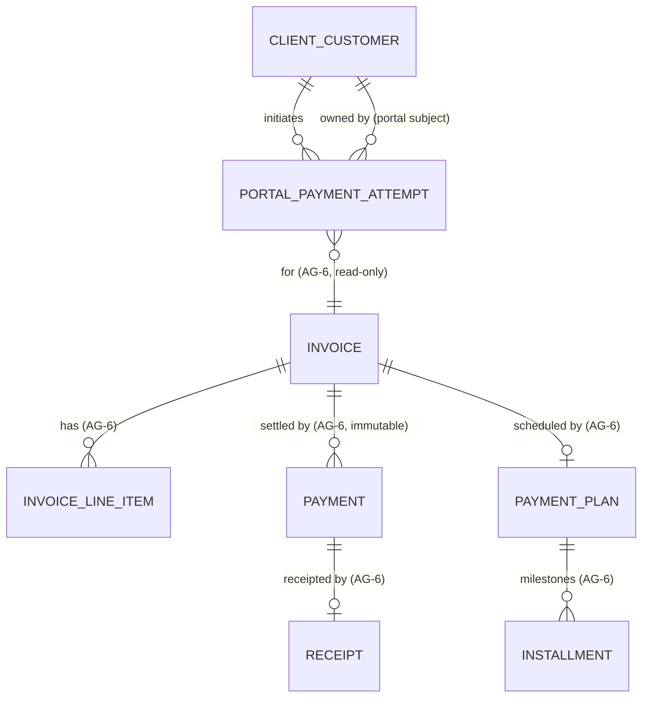

**Events emitted / consumed.** (Canonical dot.case names; registered centrally in Doc 1 §6.1. AG-6 is the registered emitter of `invoice.*`/`payment.*`; CP-5 is a **consumer** of those facts and **emits no domain event** — a client's checkout initiation is visible via the `PortalPaymentAttempt` record (CP-5-15), not an event; see §13.)

| Event | Direction | Trigger / Handler | Idempotency key |
|---|---|---|---|
| `invoice.issued` | Consume | AG-6 issues an invoice → if portal-exposed, surface "To pay" + (via AG-10) notify the client | `invoice.issued:${invoiceId}` |
| `invoice.overdue` | Consume | AG-6 firm-tz sweep → surface the overdue affordance; the client's dunning reminder is AG-6/AG-10-driven | `invoice.overdue:${invoiceId}:${dueDate}` |
| `payment.succeeded` | Consume | AG-6 settles (webhook/poll) → flip the success page to Paid, surface the receipt, mark the matching `PortalPaymentAttempt` `CONFIRMED` | `payment.succeeded:${railEventId}` |
| `invoice.paid` | Consume | AG-6 zeroes the balance → move the invoice to the Paid group; dunning auto-exits at AG-6 | `invoice.paid:${invoiceId}` |
| `payment.failed` | Consume | AG-6 reports a failed online intent → mark the attempt `FAILED`, show retry copy (invoice unchanged) | `payment.failed:${railEventId}` |
| `payment.refunded` | Consume | AG-6 refund (firm-side) → relabel the invoice "Refunded" in the portal | `payment.refunded:${refundId}` |

## 8. User Stories + Acceptance

**US-1 — See what I owe, clearly.** *Given* I am an activated client whose firm has enabled `showInvoices` for my case, *when* I open Billing, *then* I see my deposit invoice grouped under "To pay" in CAD with its balance and due date, line items I can read (with the government fee shown as a pass-through), and tax — all matching the firm console to the cent; *and given* the firm has NOT enabled invoice exposure, *then* there is no Billing nav and no invoice is reachable by URL.

**US-2 — Pay online, securely, on my phone.** *Given* a payable invoice and the firm's connected account is `ACTIVE`, *when* I tap Pay, *then* I am taken to the rail's hosted checkout, enter my card there (never on an ExpatReady form), complete 3-D Secure, and return to a success page; *and when* AG-6's verified webhook settles it, *then* the invoice flips to "Paid," a receipt appears, and the page never claimed "paid" before the webhook fact.

**US-3 — A closed tab doesn't lose my payment.** *Given* I completed checkout but my browser closed before redirect, *when* the rail webhook reaches AG-6 (or the 15-min reconciliation poll runs), *then* the invoice is still marked Paid and my receipt is available next login; *and given* the webhook is redelivered, *then* it is a no-op and I am never double-charged.

**US-4 — Get my receipt.** *Given* a settled payment, *when* I open the invoice or the Receipts tab, *then* I can view and download the numbered receipt via a link bound to my ownership (a tampered/sibling receipt id returns 404), and I also have it in the firm-branded email AG-6 sent me.

**US-5 — See my whole payment plan.** *Given* my case has a milestone plan seeded from my signed retainer, *when* I open the schedule, *then* I see paid milestones, the next-due amount and date, and future scheduled milestones as a read-only timeline tied to "your agreement" — and I cannot edit any of it.

**US-6 — Paying stops the reminders.** *Given* an overdue invoice that has been chasing me, *when* I pay it in the portal, *then* the balance clears, AG-6 auto-exits the dunning enrollment, and I get no further "overdue" email — with no action from me beyond paying.

**US-7 — I can't reach another client's money.** *Given* a sibling client of the same firm has an invoice, *when* I probe its id by URL or API, *then* I get 404/empty — denied by my ownership chain at the app layer AND by the portal RLS dimension at the database even if the app check were missed; *and given* I am a corporate seat-holder, *then* I see only the in-scope applicant cases my company sponsors, resolved through the corporate relationship chain.

**US-8 — The firm isn't money-ready.** *Given* the firm's connected account is not `ACTIVE`, *when* I open a payable invoice, *then* the Pay button is disabled with calm copy and the firm's offline-payment instructions (the AG-16 `InvoiceBillingConfig` `offlinePaymentInstructionsEn/Fr`, Doc 3 AG-16-33, if provided) are shown, and I am never presented a broken pay flow; *and given* the account later becomes `ACTIVE`, *then* Pay is enabled on my next view.

**US-9 — French, on a slow connection.** *Given* `preferredLocale = fr-CA` and the installable PWA, *when* I open Billing offline, *then* I see my cached invoices and receipts in French, fully formatted; *and when* I try to Pay offline, *then* the action is gracefully disabled with "reconnect to pay securely," never a confusing error.

## 9. Edge Cases & Validations

- **Checkout abandoned** → `PortalPaymentAttempt = ABANDONED` after the polling window; AG-6 invoice unchanged; a fresh Pay tap starts a new attempt (new idempotency key); no double-charge.
- **Redirect without webhook** → not marked paid on redirect; AG-6's webhook or 15-min reconciliation poll settles it; the success page polls and reassures ("you can safely close this").
- **Duplicate / redelivered webhook** → AG-6 idempotent on the rail event id; no second Payment; portal simply re-reads the same Paid state.
- **Sibling-invoice probe (IDOR)** → 404/empty; denied at app (`assertPortalOwnershipChain`) and DB (portal RLS USING/WITH CHECK); never 200, never another client's data.
- **Corporate seat over-reach** → a seat-holder requesting a case outside their relationship-mediated scope gets 404 at both layers (Doc 1 §2.5 corporate-seat).
- **Firm account `RESTRICTED`/`SUSPENDED`/`ONBOARDING`/`NOT_CONNECTED`** → Pay disabled; offline instructions shown; offline payment is recorded by the firm in AG-6, then appears in the client's history.
- **Client tries to overpay / type an amount** → impossible: the portal never accepts an amount; AG-6 rejects overpay at the source (BR-7).
- **Invoice cancelled after a partial payment** → portal shows the retained payment history under "Past/Paid"; the cancelled state is labelled clearly; the client can still download receipts for what they paid.
- **Refund issued firm-side** → portal relabels the invoice "Refunded/Partly refunded" (read-only); the client sees the reversing fact in history; CP-5 never initiates a refund.
- **Missing FX / multi-currency** → the portal shows each invoice in its OWN currency (AG-6 never raw-sums across currencies for the client either, BR-8); the portal shows no cross-currency total to the client.
- **Receipt PDF not yet generated** → the portal shows "receipt generating…" and surfaces it once AG-6's Media object exists; never a dead link.
- **Stale display cache** → balances/status re-read AG-6 on view; the short display cache is evicted on the consumed `payment.succeeded`/`invoice.paid`/`payment.refunded` events.
- **Two devices, two Pay taps** → both create attempts but share AG-6's idempotency at the rail; at most one charge settles; the other attempt resolves `ABANDONED`/no-op.

**Validation doctrine.** All input is Zod-validated from `packages/contracts`; the pay endpoint accepts only an `invoiceId` (+ idempotency token) — never an amount, currency, payee, or any card field; reject early, persist nothing on failure.

## 10. Permissions (LOCAL `portal/*`)

Default-deny; additive; always evaluated within the caller's `firm_id` (RLS) AND their own ownership chain (the portal subject dimension + `assertPortalOwnershipChain` + `PortalVisibilityConfig`, Doc 1 §2.5/§4.5). Keys follow the canonical grammar `portal/<resource>:<action>` (Doc 1 §4.1). The catalog of `portal/*` keys is **owned by SA-6** and CI-validated against this section (Doc 1 §4.4); CP-5 defines the keys its routes require.

| Permission Key | Description |
|---|---|
| `portal/invoice:list` | List the client's own exposed invoices (paginated, own-chain + `showInvoices` only) |
| `portal/invoice:view` | Open the client's own invoice detail (lines, tax, payments, balance) |
| `portal/invoice:pay` | Initiate a hosted-checkout payment for an own payable invoice (server-derived amount/currency; no card data) |
| `portal/receipt:view` | View / download an own receipt via an ownership-bound presigned URL |
| `portal/schedule:view` | View the read-only milestone / installment schedule for an own case |

> **No `portal/*` write key for money exists beyond `invoice:pay`-as-initiation.** There is no portal create / edit / void / refund / record-offline / config key — those are firm-side `agent/billing:*` only (AG-6 §10). A portal principal that requests an `agent/*` route is rejected `403 SCOPE_VIOLATION` (Doc 1 §4.2 AC-4.2.3). `portal/invoice:pay` triggers an AG-6 intent; it never writes a Payment fact itself.

**Enforcement.** Route-level `@RequirePermissions` (scope-aware guard, Doc 1 §4.2) verifies the caller is a client-portal-pool principal (`aud = er:portal`, Doc 1 §3.1) holding the `portal/*` key; object-level `assertSameFirm` + `assertPortalOwnershipChain` + `PortalVisibilityConfig` (Doc 1 §4.5) gate the specific record; the portal RLS dimension (Doc 1 §2.5) is the DB backstop. The rail webhook is **not** a portal surface — it is AG-6's `@Public` `webhook-signature`-gated endpoint (Doc 1 §4.6); the portal never receives or trusts the webhook.

## 11. Scalability · Security · Performance

**Security & isolation (FIRST — this is the top PII-leak and money surface).** The portal isolation backbone — the walled `er:portal` pool, the two RLS dimensions, `assertPortalOwnershipChain`, and the ownership-bound presigned-URL primitive — is OWNED by CP-1 §3.3/§3.4 (per Doc 1 §2.5/§4.5). CP-5 INHERITS it and may not weaken it; the points below are CP-5's money-specific application, not a re-derivation of the contract.
- **Two walls, by construction.** Every CP-5 access runs under the CP-1 backbone: `firm_id` FORCED RLS (Doc 1 §2.2) **and** the portal subject dimension `app.current_client_subject` (Doc 1 §2.5), both `USING` and `WITH CHECK`, so a client can neither read nor write a sibling client's invoice/receipt/attempt at the **database** — independent of any application bug. The middleware sets both GUCs from the **verified portal token**, never from caller input.
- **Defense-in-depth above the DB.** The CP-1 §3.3 ownership checks (`assertPortalOwnershipChain` resolving Party→ClientCustomer, incl. the corporate-seat `PartyRelationship` path) plus the `PortalVisibilityConfig` allow-list (leak-off by default) run first and return 404/empty; the RLS dimension is the backstop if they are ever missed (Doc 1 §4.5).
- **Card data never touches ER.** Hosted checkout means PANs/CVVs never enter ExpatReady; PCI scope stays SAQ-A (Doc 1 §6.3). No `portal/*` route accepts a card field; CI lint forbids a vendor SDK import or a processor name in any CP-5 model/enum/permission.
- **Webhook-truth, not redirect-truth.** Settlement is the verified AG-6 webhook fact (signature-verified, idempotent on the rail event id), never the browser return — closing the spoofed-redirect and lost-tab vectors (BR-3/BR-10).
- **Ownership-bound presigned URLs.** Receipts are served only via the CP-1 §3.4 presigned-URL primitive — issued after an ownership check, never against a client-supplied key (Doc 1 §4.5) — closing the cross-client receipt-IDOR vector at the storage edge.
- **Audit + PII.** Pay-attempt and receipt access are written to the per-firm synchronous audit outbox (Doc 1 §7.5, actor = `clientCustomerId`); payer Restricted-PII is mask-by-default with audited reveal (Doc 1 §7.2) — a client may reveal their **own** receipt's data; another party's is unreachable by ownership. No PII in logs/traces.
- **Session safety.** Short portal sessions (15-min access / 24-h absolute / 30-min idle), instant session-bound revocation (Doc 1 §3), MFA optional/encouraged but never blocking a client from their own case.

**Scalability.**
- **CP-5 stores almost nothing.** The only writable entity is the lightweight `PortalPaymentAttempt`; all heavy data (invoices, payments, plans, receipts) is AG-6's, read through tenant + subject-scoped repositories. CP-5 adds negligible write load.
- **Read off replicas.** Invoice list / detail / schedule reads route to read replicas (Doc 1 §8.1) under the **identical** FORCED RLS + portal dimension + non-`BYPASSRLS` role (Doc 1 §2.7) — a replica is never a relaxed-isolation path.
- **Many clients per firm.** The portal serves potentially thousands of concurrent clients across many firms; isolation is by GUC + RLS, not per-client connections, so it scales with the connection pool, not with client count.

**Performance.**
- **Budgets.** Read p95 ≤ 300 ms (invoice list/detail/schedule), pay-initiation write p95 ≤ 600 ms (Doc 1 §8). Lists paginated/bounded.
- **Freshness over caching for money.** Balances/status re-read AG-6 on view; a short, evictable display cache keyed `(firm_id, clientCustomerId, invoiceId)` is invalidated on consumed `payment.succeeded`/`invoice.paid`/`payment.refunded` — never a stale "you still owe" after payment.
- **PWA read-only offline.** Invoices and receipts are cached for offline viewing; the Pay action requires connectivity and disables gracefully (Doc 1 §8).
- **Plan/entitlement gating.** If a firm's plan does not include online client payments (SA-3 catalog), the Pay action is hidden/disabled with a firm-appropriate message and the **server enforces** the gate; viewing invoices/receipts remains available so the client can still pay offline.

## 12. Reference Note (NEW — greenfield)

The Client Portal is greenfield (gap-analysis critical scope-hole C2 — never previously specced), so CP-5 is **NEW in its entirety**: there is no client-facing pay surface in the reference prototype. The prototype proves only the **firm-side** money shape (the AG-6 §12 provenance: Invoice/`InvoiceItem` compute, `recordReceipt`, per-office numbering, the polymorphic billing party, raw processor primitives) — none of which is client-facing. Everything CP-5 specifies is target-state:
- A **read-only client projection** of AG-6 invoices/payments/receipts/plans with client-friendly relabelling and locale/currency formatting fidelity to AG-6.
- A **hosted-checkout pay flow** over `PaymentRailPort` on the firm's connected account, card-never-touches-ER, webhook-truth, with the single new `PortalPaymentAttempt` UX/audit trace.
- The **portal isolation contract** applied to money: inherited from CP-1 §3.3/§3.4 — the second RLS dimension, ownership-chain + `PortalVisibilityConfig` allow-list, ownership-bound presigned receipts, and the `portal/*` (not `agent/*`) permission boundary.
- The **client-experience NFRs**: EN/FR, WCAG 2.2 AA, mobile-first, read-only-offline PWA, white-label.

CP-5 deliberately **does not** rebuild any AG-6 capability; it consumes AG-6 as the single source of money (BR-1) and AG-15 as the firm-side control plane (the `showInvoices` gate, invites, branding). Where AG-6 and CP-5 appear to overlap (e.g. "showing an invoice"), AG-6 owns the data and the firm view; CP-5 owns only the client view of it.

## 13. Open Questions / [FOUNDER-CONFIRM]

**Business / domain / commercial (need a founder decision):**
1. **Cancelled-with-payment visibility** — should a cancelled invoice that carried a partial client payment appear in the client's "Past/Paid" history (so they keep proof), or be hidden entirely? (Proposed: show, with a clear "Cancelled" label and downloadable receipts for what was paid.)
2. **Offline-instructions surface — RESOLVED (architect-confirmed)** — CP-5 displays firm-authored offline-payment instructions when the connected account is not `ACTIVE`. Owning field: **`offlinePaymentInstructionsEn/Fr` (+ per-currency override map) on the AG-16 `InvoiceBillingConfig`** (Doc 3 AG-16 §3.2/§7, AG-16-33 — per-office, localized, sanitized rich text, change-audited), surfaced read-only by CP-5 (§3.3, CP-5-6). No open question remains; retained here as the resolution record.
3. **Corporate payer model** — confirm that a corporate seat-holder (HR/sponsor) may **pay** an in-scope applicant's invoice, not merely view it, and whether the applicant also retains their own pay right (dual-payer). (Proposed: both, gated by `PortalVisibilityConfig` + the corporate seat scope. Note: the role-to-capability mapping for corporate seats — the six `portal/corporate:*` keys, CP-9 §10 — is OWNED BY SA-6 + AG-15 `CorporatePortalSeat.scopeJson` + portal role grants, not by CP-5/CP-9; CP-5 only enforces that a seat reaching the pay path holds the pay grant.)
4. **`portal.payment.initiated` firm notification** — should starting a checkout notify the firm ("client is paying now") or stay a silent audit-only signal? (Proposed: audit-only by default; firm-notification entitlement-optional.) `portal.payment.initiated` — proposed for Doc-1 dictionary Amendment A4 (F2); until registered, initiation is visible via the payment attempt record (`PortalPaymentAttempt`, CP-5-15), not an event.
5. **Partial-payment in portal** — confirm the portal pays only the full outstanding balance (and AG-6 draw-mode amounts), i.e. the client cannot choose a partial amount. (Proposed: yes; partial-at-will is a firm-side AG-6 concern.)
6. **Entitlement tier for online client payments** — which firm plan(s) include the portal Pay action (SA-3 catalog), and the fallback copy when a firm lacks it. (Proposed: viewing is always available; paying may be tiered, with offline fallback.)

**Resolved / inherited (no founder decision needed — architect-decided, inherited from Doc 1 / AG-6):**
- Hosted checkout, card-never-touches-ER, PCI SAQ-A, vendor-neutral `PaymentRailPort`, webhook-truth, the missed-webhook reconciliation poll, the firm's-own-connected-account settlement, and the platform-never-custodies-funds posture are all **decided** in Doc 1 §6.3 / AG-6; CP-5 consumes them unchanged.
- Tenant + client-to-client isolation (FORCED RLS + the portal subject dimension), the `er:portal` audience constant (Doc 1 §3.1), ownership-bound presigned URLs (CP-1 §3.4), and the `portal/*` (catalog owned by SA-6) permission model are **decided** in Doc 1 §2/§3/§4 and CP-1; CP-5 applies them.

---

# Module CP-6: In-Portal E-Signature

## Module Index

- **§1 Purpose & Goal** — the client-facing signing room: the immigrant reviews and signs the firm's retainer/agreement inside their own white-labelled portal, on their phone, in their language, and walks away with the executed copy. CP-6 is the **client half** of one in-house e-sign envelope whose machinery is AG-5 (the Signer); CP-6 never re-specs the Signer — it presents the ceremony and feeds AG-5's legally-defensible audit trail.
- **§2 Users & JTBD** — the Individual Applicant (protagonist), the Corporate Seat-Holder / authorized corporate signer, the Co-applicant (couple/family), the (firm-side counterparties are AG-5/AG-15, listed only to mark the wall).
- **§3 Functional Design** — the boundary; the work-item entry; the signing ceremony (open → review → consent gate → field completion → submit); identity/timestamp/consent capture; `allowedSignatureMethods` rendering; sequential-order awareness; post-sign download of the executed document + certificate; re-send and expiry handling; offline + accessibility + PWA posture.
- **§4 Detailed Functional Requirements** — `CP-6-1` … `CP-6-24` (RFC-2119).
- **§5 Business Rules & Logic** — `BR-1` … `BR-15`.
- **§6 States & Lifecycle** — the client-visible recipient sub-lifecycle projected from AG-5's canonical `ESignRecipient.status` enum (`PENDING → SENT → VIEWED → SIGNED`/`DECLINED`, Doc 3 AG-5 §7); *waiting* and *consented* are presentation-only sub-states, never persisted statuses; never owned.
- **§7 Key Entities & Fields** — CP-6 owns **no** signing entities; it reads/writes AG-5's `ESignEnvelope`/`ESignRecipient`/`ESignField`/`ESignAuditEvent` through portal-scoped commands; the Events emitted/consumed table.
- **§8 User Stories + Acceptance Criteria** — `US-1` … `US-7` (Given/When/Then).
- **§9 Edge Cases & Validations** — token/order/consent/method/expiry/void-mid-ceremony/sibling-isolation/offline edges + validation doctrine.
- **§10 Permissions** — LOCAL `portal/*` (catalog owned by SA-6): `portal/agreement:view`, `portal/agreement:sign`, `portal/agreement:download`; the relationship to AG-5's capability-token public surface.
- **§11 Scalability · Security · Performance** — **isolation FIRST** (the CP-1 §3 portal isolation backbone — second portal RLS dimension + record-level authz + capability-token signing — referenced, not restated), tamper-evidence integrity, async PDF, budgets.
- **§12 Reference Note (NEW — portal is greenfield)** — provenance only; the portal signing surface is net-new.
- **§13 Open Questions / [FOUNDER-CONFIRM]** — portal-vs-emailed-link signing posture, MFA-on-sign appetite, decline UX, corporate co-sign labelling.

> **What this is.** CP-6 is the vendor-build specification for the Client Portal's **in-portal signing room**: where a logged-in immigrant client reviews and signs the firm's service agreement (retainer or other agreement) and downloads the executed document — entirely inside the firm's white-labelled portal. It is the **client-facing half** of a single in-house e-sign envelope. The **engine** — the agreement model, clause assembly, merge binding, field placement, sealing, certificate generation, the tamper-evident hash chain, and the canonical `envelope.signed` completion fact — is **AG-5 (Doc 3, the Signer)** and is **consumed, never re-specced** here. CP-6 supplies the ceremony, captures the client's identity/timestamp/consent/signature into AG-5's trail, and exposes the executed copy.

> **Greenfield, isolation-first.** This module is built against the target architecture; the prior private codebase is design-provenance only (Doc 1 §1.8). The **portal identity, isolation, and object-access backbone is owned by CP-1 §3 and inherited here, not restated** (per CP-1 §3): the **client identity pool** (`aud = er:portal`, distinct signing key, Doc 1 §3.1); the **second portal RLS dimension** (`app.current_client_subject`, Doc 1 §2.5) and **record-level authz** with the `PortalVisibilityConfig` allow-list (Doc 1 §4.5); the **ownership-bound presigned-URL** rule (Doc 1 §4.5 authz + §6.3.3 port); the canonical **event dictionary + idempotency ledger** (Doc 1 §6.1–§6.2); the **rails-as-ports** `ObjectStoragePort`/`EmailRelayPort` (Doc 1 §6.3); the **KMS/field-encryption/append-only hash-chained audit** (Doc 1 §7); and the **WCAG 2.2 AA / full EN-FR / responsive installable read-only-offline PWA / white-label** NFRs (Doc 1 §8.5–§8.7). The Client Portal is the platform's **top PII-leak surface**; isolation is non-negotiable and is treated first in §11 by reference to the CP-1 §3 gate.

> **Content-neutral.** CP-6 specs the **signing experience machinery** — the ceremony flow, the consent gate, the method-rendering, the order awareness, the download. The legal substance — the clause set, the e-signature recital text, mandatory merge fields, the retention horizon — is the firm's Country-Pack content authored in SA-5 (Doc 2 §3.11) and resolved by AG-5; CP-6 renders whatever AG-5 hands it and never embeds immigration or legal content. Every such value is **[FOUNDER-CONFIRM]**.

---

## 1. Purpose & Goal

CP-6 is the moment the relationship becomes real *from the client's side*. The firm has drafted a clause-correct, merge-bound, bilingual agreement in AG-5 and sent it; CP-6 is where the immigrant **reads it, understands the fees and refund terms, consents to sign electronically, signs with their finger on a phone, and receives their own executed copy** — without a third-party e-sign vendor ever touching the document, and without leaving the firm's branded portal.

**The outcome it produces.** Retained-client onboarding stalls at exactly this gate: a retainer is emailed, the client cannot find it, does not trust a strange e-sign domain, abandons a confusing desktop-only flow, or signs but never gets a copy. CP-6 makes signing **fast, trustworthy, and self-evidencing**: one tracked to-do in the client's own portal; a calm, guided, mobile-first ceremony in the client's language; a hard consent gate; a signature captured with full identity/timestamp/consent provenance that flows straight into AG-5's tamper-evident, hash-chained audit trail; and the executed copy plus certificate available to download the instant the envelope completes. The act of signing is what fires `envelope.signed` (emitted by AG-5), which drives the deal to WON and hands the fee to the Biller — but **CP-6 does not own that fact; it causes it by completing the client's part of the ceremony.**

**Why in-portal beats an emailed e-sign link.** A generic e-sign tool signs *a* PDF on a vendor's domain the client has never heard of, with the firm's most sensitive legal document leaving the tenant. CP-6's signing room is **in the firm's own white-labelled portal**, behind the client's own authenticated session, on the firm's own storage rail — the client signs "in my lawyer's secure system," not on a third-party e-sign domain. It is **bilingual by construction** (EN/FR, the legally-required language for Quebec), **mobile-first** (consumer reality), and **wired to the case** (the executed agreement and its case progress live one tap away). Because it is in-house, the executed document and the entire audit trail never leave the firm's tenant — a decisive PIPEDA / Quebec Law-25 advantage.

**The dual-surface reality (kept honest).** AG-5 mints each recipient a single-purpose capability token (Doc 1 §4.6) so a retainer *can* be signed from an emailed link even by a client who has no portal account yet. CP-6 adds the **authenticated, in-portal** signing surface for clients who *do* have a portal session: the same envelope, the same fields, the same audit trail — reached through their `portal/*` session and the ownership chain instead of (or in addition to) the capability link. Whether the firm prefers portal-only, link-only, or both is a firm posture (§13). The two surfaces share one envelope and one trail; they never fork the document.

---

## 2. Users & JTBD

| Role | Primary job in the signing room | Representative jobs-to-be-done |
|---|---|---|
| **Individual Applicant** (protagonist) | Understand and sign my agreement, on my phone, in my language, and get my copy. | "Show me my retainer as a clear to-do when I log in." · "Let me read the fees and refund terms before I sign, in French." · "Sign with my finger and know it counted." · "Tell me what consent I'm giving and why." · "Give me my executed copy and certificate to download and keep." |
| **Corporate Seat-Holder / authorized corporate signer** | Sign on behalf of (or as a seat under) the corporate file I'm authorized for. | "Let me sign the agreement for the file I'm a seat on — and nothing belonging to another seat or another client." |
| **Co-applicant (couple / family member)** | Sign my part when the agreement needs more than one client signature. | "When my spouse and I both need to sign, let me sign my fields without touching theirs, and see whose turn it is." |
| *(separate persona)* **Firm staff (RCIC / Sales Rep / Owner)** | Draft, send, countersign, track, void, re-issue. *(Served by AG-5 + AG-15, NOT CP-6.)* | "Generate, send, countersign, and watch the retainer." *(Drives AG-5/AG-15; here only to mark the wall.)* |

**Design implication.** The **Individual Applicant is the protagonist** — the ceremony is calm, guided, one-thing-at-a-time, thumb-reachable, bilingual, and WCAG 2.2 AA. The **co-applicant** and **corporate seat** cases are the sequential/parallel multi-signer variants AG-5 already models; CP-6 renders only *this* client's turn and *this* client's fields (IDOR-safe by recipient). The **firm never sees a CP-6 screen** — drafting, sending, countersigning, voiding, and re-issuing are AG-5/AG-15. The wall between the firm pool (`aud = er:firm`, `agent/*`) and the client pool (`aud = er:portal`, `portal/*`) is absolute (Doc 1 §3.1): a firm token can never satisfy a CP-6 route and a client token can never satisfy an AG-5 staff route.

---

## 3. Functional Design

Each sub-function is designed in depth: **how it works**, the **world-class behaviour**, the **key screens & interactions** (functional, not pixel-level), and the **data flow**. CP-6 owns the *experience*; AG-5 owns the *envelope*. The portal isolation primitive (own-case-only RLS, ownership-chain resolution, IDOR-safe object access) is **inherited from CP-1 §3 and not re-derived here** (per CP-1 §3); CP-6 states only its module-specific deltas.

### 3.0 The boundary — one envelope, two doors (read first)

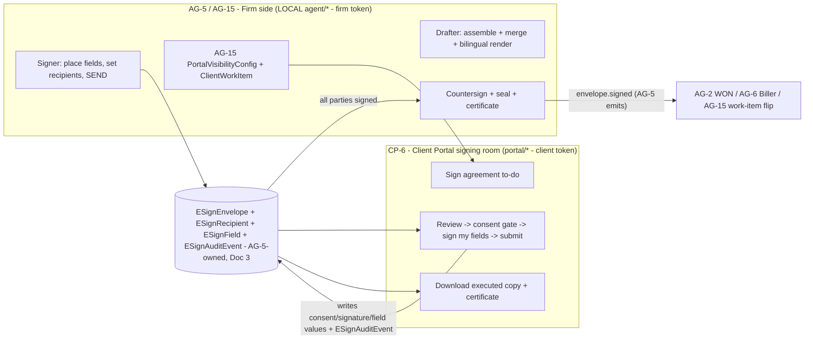

**The clean test:** *the logged-in firm employee does it → AG-5/AG-15; the logged-in immigrant client does it → CP-6.* Generating, sending, placing fields, countersigning, sealing, certifying, voiding, re-issuing = AG-5. Reviewing, consenting, signing my own fields, downloading my copy = CP-6. **CP-6 owns no signing entity** — it reads and writes AG-5's `ESignEnvelope`/`ESignRecipient`/`ESignField`/`ESignAuditEvent` (Doc 3 §7) through portal-scoped commands, always for the recipient that resolves to *this* client's subject. The envelope, the seal, the certificate, the hash chain, and the `envelope.signed` emission are AG-5's and are never duplicated.

### 3.1 The entry — a "sign your agreement" to-do (how it works)

An agreement reaches the client's portal as an **AG-15 `ClientWorkItem` of type `AGREEMENT_SEND`** (Doc 3 AG-15 §3.4, enum `AGREEMENT_SEND`) whose target is the AG-5 envelope, gated by AG-15's `PortalVisibilityConfig` allow-list (the `showAgreements` toggle enabled for this case). The client's portal home (CP-1 hub) surfaces it as a prominent action card — "Sign your service agreement" — with a status chip (`Ready to sign` / `In progress` / `Waiting on the firm` / `Signed`) and a due/expiry hint, in the client's locale and the firm's brand.

**World-class behaviour.** The agreement is a **tracked to-do, not a buried email**: it appears the moment the firm sends, it shows whose turn it is in a multi-signer envelope ("Your spouse has signed — your turn"), and it auto-resolves to "Signed — view your copy" the instant the client's part completes. A client with **no portal account yet** still receives AG-5's capability-token email link; once they activate (CP-1), the *same* envelope is also reachable in-portal — no second document, no fork.

**Key screens.** *Portal home action card* (sign-agreement to-do with status + due); *Agreements list* (if the firm exposes more than one — e.g. retainer plus a later amendment), each row a status chip + open action.

**Data flow.** AG-15 creates the `ClientWorkItem(type=AGREEMENT_SEND)` → CP-6 lists it for the client subject by resolving the envelope through the ownership chain (Party → ClientCustomer, Doc 1 §4.5) **and** the `PortalVisibilityConfig.showAgreements` toggle → renders the card with a state projected from the AG-5 envelope/recipient status. CP-6 stores **no** list state of its own; the work-item and envelope are the source of truth.

### 3.2 The ceremony — open → review → consent → sign → submit (how it works)

Opening the to-do enters the **signing room**: a calm, single-purpose, mobile-first, full-bleed flow with the firm's brand and the client's locale. The ceremony is a strict, guided sequence:

1. **Open / view.** CP-6 resolves the client's `ESignRecipient` on the envelope (the one whose chain resolves to this subject) and fetches the rendered agreement PDF via an **ownership-bound presigned URL** (the key resolved *from* the owned record, never caller-supplied — Doc 1 §4.5 / §6.3.3). Opening writes a **`VIEWED`** `ESignAuditEvent` with timestamp + IP + user-agent (AG-5's evidentiary detail, Doc 1 §7.5 chain).
2. **Review.** The client reads the full agreement (the WYSIWYG document AG-5 produced — what they review is exactly what they sign). The room surfaces the locale the agreement was rendered in and offers the language toggle only across the variants AG-5 actually produced (no on-the-fly translation of legal text).
3. **Consent gate (hard).** Before any signature is accepted, the client must give **affirmative electronic-signing consent** tied to the **versioned, country/locale-appropriate recital** authored in SA-5 (`consentText`, `consentTextVersion`) and handed through by AG-5. Consent capture writes a **`CONSENT_GIVEN`** event with `consentTextVersion` + affirmative-action flag + timestamp + IP + UA. No field value or signature image is persisted without it (BR-3).
4. **Complete my fields.** CP-6 presents **only the fields assigned to this recipient** (`SIGNATURE | INITIALS | DATE | TEXT`, placed by AG-5 at page + 0–100% coordinates) — guided one required field at a time, each anchored to its place in the document. A required `SIGNATURE` requires an actual signature image produced by an **allowed method** (§3.3). The client can only ever complete their own fields (IDOR-safe by recipient — Doc 1 §4.5).
5. **Submit.** On submit, CP-6 validates all required fields complete and consent present, then writes the field values + signature image(s) and a **`SIGNED`** event (per recipient, IP/UA, `signatureMethodUsed`) into AG-5's envelope; the recipient's capability token (if used) goes dead, and the recipient sub-state advances to `SIGNED`. **AG-5** advances the envelope (next signer notified, or seal + certificate + `envelope.signed` when all parties have signed) — CP-6 does not seal, certify, or emit.

**World-class behaviour.** One thing at a time, never a wall of fields; explicit "what you're agreeing to" before the pen; the signature pad is thumb-friendly with clear/redo; a progress indicator ("Step 2 of 3"); the room is **save-safe** — a dropped connection mid-review never loses consent or a captured-but-unsubmitted state past what was durably written, and re-entry resumes at the right step. Nothing is persisted before consent.

**Key screens.** *Signing room* (branded full-screen: document viewer → consent panel with the recital + affirmative checkbox/button → guided field stepper → signature pad → review-and-submit), with a persistent "your part is X of Y" cue in multi-signer envelopes.

**Data flow.** Open → resolve recipient by ownership chain → presigned PDF fetch → `VIEWED` audit → consent submit (Zod-validated) → `CONSENT_GIVEN` audit → per-field complete (validated to type + the 0–100 box + allowed method) → submit → write field values + signature image (image stored via `ObjectStoragePort`, key + SHA referenced, never bytes in DB) + `SIGNED` audit → AG-5 advances envelope. Every step writes to AG-5's append-only, hash-chained trail **synchronously via the outbox** (Doc 1 §7.5), over ciphertext/HMAC references, never plaintext.

```mermaid
stateDiagram-v2
    [*] --> SENT : firm sends; this recipient's turn (sequential) or any-order (parallel)
    SENT --> VIEWED : client opens (VIEWED audit, IP/UA)
    VIEWED --> CONSENTED : affirmative consent (CONSENT_GIVEN + consentTextVersion)
    CONSENTED --> SIGNED : all required own-fields complete + signature via allowed method (SIGNED audit)
    VIEWED --> DECLINED : client declines (reason)
    CONSENTED --> DECLINED : client declines (reason)
    SENT --> WAITING : sequential - not this client's turn yet (read-only, cannot sign)
    WAITING --> SENT : prior signer completes
    SIGNED --> [*] : AG-5 advances envelope (countersign / seal / envelope.signed)
    note right of SIGNED : CP-6 never seals or emits; AG-5 owns completion + envelope.signed
```

### 3.3 Identity, timestamp & consent capture; allowedSignatureMethods (how it works)

CP-6 is the **collection point** that feeds AG-5's legally-defensible trail. At every meaningful action it captures and writes (into AG-5's `ESignAuditEvent` + the platform hash-chain spine):

- **Identity context** — the authenticated portal subject (`clientCustomerId`) for an in-portal sign, or the single-purpose capability-token recipient for a link sign; plus the recipient name/email/role AG-5 set.
- **Timestamp** — server-authoritative `occurredAt` for `VIEWED`, `CONSENT_GIVEN`, `SIGNED`, `DECLINED`.
- **Network context** — IP address (Confidential) + user-agent, for each event.
- **Consent provenance** — `consentTextVersion` + the affirmative-action fact.
- **Signature provenance** — `signatureMethodUsed` from the closed enum.

**`allowedSignatureMethods` is server-enforced, not UI.** The envelope carries AG-5's allow-list `SignatureMethod ∈ {DRAWN, TYPED, UPLOADED_IMAGE}` (default `[DRAWN, TYPED]` [FOUNDER-CONFIRM]). CP-6 renders only the allowed methods (a drawn-signature pad, a typed-name-in-signature-font, and/or an image upload), but the control is the **server reject**: a signature produced by a method not on the envelope's list is rejected server-side even if the client forges the request — UI hiding is never the control. Stronger identity verification (KBA, gov-ID, OTP-to-phone, MFA-on-sign) is a structural slot behind this same enum/recipient model; the **methods themselves are deferred** (§13) and any MFA-on-sign step would reuse the client pool's in-house MFA (Doc 1 §3.6), never a third party.

**World-class behaviour.** The trail is **complete and tamper-evident by construction** — the client never has to "trust us": the certificate AG-5 generates prints both SHA-256 hashes, the signer table (name/email/role/signed-at/IP/method), and the country/locale e-signature recital, so anyone holding the executed PDF can re-hash and verify. CP-6's job is to make sure every capture is real (affirmative, server-timestamped, method-validated) and lands in that trail.

**Data flow.** Each ceremony step → CP-6 service writes the `ESignAuditEvent` + the platform §7.5 chain entry atomically with the operation (synchronous outbox) → image/field bytes via `ObjectStoragePort` → AG-5 reads the recipient state to advance.

### 3.4 Sequential-order awareness — whose turn is it (how it works)

AG-5 envelopes sign **sequential** (order enforced — the retainer canonical mode is client-first-then-firm-countersign) or **parallel**. CP-6 **respects, never overrides, AG-5's order**: in sequential mode, if it is not this client's turn (e.g. a co-applicant ahead of them has not signed, or the firm countersignatory is a later step), the signing room shows the agreement **read-only** with a clear "waiting on {prior party}" state and no active sign action — and the server rejects any sign attempt because the recipient's turn is not active (the capability token / portal sign command is not yet live for that recipient). When the prior signer completes, AG-5 advances order atomically and CP-6's to-do flips to "your turn."

**World-class behaviour.** No confusing dead buttons and no out-of-order signing: the client always knows whether the ball is in their court or someone else's, in their language. The firm countersignature is **never** a CP-6 action — when the client has signed, the room shows "Signed — waiting for {firm} to countersign," and on full execution flips to "Signed — download your copy."

**Data flow.** CP-6 reads the recipient's `signingOrder` + status + the envelope `signingMode` to project the client-visible sub-state (§6); the **active-turn gate is enforced server-side by AG-5's order engine**, not by CP-6 hiding a button.

### 3.5 Post-sign — download the executed document + certificate (how it works)

On envelope completion (`EXECUTED` — all parties incl. firm countersignatory have signed and AG-5 has sealed + certified), the client's to-do becomes **"Signed — download your copy,"** and CP-6 exposes:

- The **executed PDF** (the sealed, embedded-signatures document).
- The **Certificate of Completion** (both SHA-256 hashes + signer table + chronological audit + the country/locale e-signature recital).

Both are fetched via **ownership-bound presigned URLs** resolved from the owned agreement record (never a caller-supplied key — Doc 1 §4.5 / §6.3.3); the access is itself recorded (an `EXPORTED`-class evidentiary event). AG-5 also **emails** the executed copy + certificate to each signer via `EmailRelayPort` on completion (CICC requires the client receive a copy); the portal download is the always-available second channel.

**World-class behaviour.** The client keeps their own legally-meaningful proof: they can download, re-hash, and verify against the certificate. The executed agreement is also **one tap from their case** (CP-2 case progress / CP-4 documents, subject to `PortalVisibilityConfig`) so it never has to be hunted for later. The PWA read-cache (Doc 1 §8.7) may cache the *last-read* executed copy for offline viewing — **read-only**; there is no offline signing or offline write (BR-13).

**Data flow.** Completion (AG-5) → CP-6 to-do projects "Signed" → download request → record-level ownership check + `PortalVisibilityConfig.showAgreements` toggle → presigned URL bound to the owned executed-doc / certificate key → audited access. CP-6 never signs a caller-supplied storage key and never serves a sibling client's document (§11).

### 3.6 Re-send & expiry handling (how it works)

**Re-send.** A sent envelope can be re-sent (AG-5 `:send`-class action, or an AG-15 reminder) — for example the client lost the email or the link expired. CP-6's job is to make the **portal copy the durable home**: the in-portal to-do persists regardless of email re-sends, so a logged-in client always has a live path to the *current* envelope. When AG-5 issues a fresh capability token on re-send, the prior link is dead; the portal route (authenticated) remains the stable entry.

**Expiry.** A sent envelope carries an `expiresAt` (firm-default TTL, e.g. 14 days [FOUNDER-CONFIRM]); past it with no completion, **AG-5** moves the envelope to `EXPIRED`. CP-6 then shows the to-do as **"This agreement has expired — your firm will send a new one"** (calm, non-alarming, localized) and removes the sign action — a client can never sign an expired envelope (server-rejected; the recipient turn is dead). **Re-issue is a firm action** (AG-5: a new agreement version + new envelope linked to the terminal predecessor — never resurrecting a terminal one, BR-7); when the firm re-issues, a fresh to-do appears in the portal and the cycle restarts. CP-6 **never** reopens, extends, or re-issues; it reflects AG-5's terminal/active state.

**World-class behaviour.** Expiry is a gentle handoff, not a dead end — the client is told what happens next (the firm will re-send) in their language and brand. Reminders the firm sends are timezone- and business-hours-aware (AG-5/SA-10 calendar) so a weekend never false-flags a "stuck" agreement.

**Data flow.** AG-5 owns `expiresAt`, the EXPIRED transition, void, and re-issue; CP-6 reads the envelope status to render the correct client-facing message and to enable/disable the sign action; the active-sign gate is server-enforced by AG-5.

### 3.7 Decline, accessibility, locale & PWA posture (how it works)

**Decline.** A client may **decline to sign** with a required reason (a `DECLINED` event); AG-5 marks the recipient/envelope terminal-for-this-attempt and notifies the firm. The decline UX is respectful and non-coercive (the client is told the firm will be in touch) [FOUNDER-CONFIRM the exact copy/posture].

**Accessibility & locale.** The signing room is **WCAG 2.2 AA** (Doc 1 §8.5): full keyboard operability (the signature pad has a keyboard/typed-name alternative — `TYPED` is always offerable as the accessible path where the firm allows it), visible focus, programmatic labels, sufficient contrast on the firm's brand accent (contrast-checked at render), and screen-reader-announced step changes. It is **fully EN/FR** (Doc 1 §8.6) — every chrome string is in the catalogue; the legal document text is whatever localized variant AG-5 rendered.

**PWA.** The portal is a responsive, installable PWA with a **read-only** offline cache (Doc 1 §8.7): an executed copy can be cached for offline viewing, but **signing requires connectivity** — an attempted offline sign is cleanly blocked with a "you are offline" message and **no silent queue** (BR-13). Signing is a regulated, server-validated, audit-writing act; it is never optimistic-offline.

---

## 4. Detailed Functional Requirements

RFC-2119 SHALL/SHOULD/MAY. Numbered `CP-6-n`. CP-6 owns no signing entity; these requirements govern the **client-facing surface** over AG-5's envelope.

**Boundary & entry**
- **CP-6-1.** CP-6 SHALL NOT define, own, or duplicate any e-sign entity; it SHALL read and write AG-5's `ESignEnvelope`/`ESignRecipient`/`ESignField`/`ESignAuditEvent` (Doc 3 §7) exclusively through portal-scoped commands, always resolved to the recipient whose ownership chain resolves to the caller's `clientCustomerId`.
- **CP-6-2.** CP-6 SHALL surface an agreement as a client to-do only when (a) its ownership chain resolves to the caller's subject (Doc 1 §4.5) **and** (b) the firm's `PortalVisibilityConfig.showAgreements` toggle enables agreements for the case (leak-off by default, AC-4.5.4); an envelope failing either SHALL be invisible (404/empty), never partially shown.
- **CP-6-3.** CP-6 SHALL project the client-visible agreement state (§6) from the AG-5 envelope/recipient status and SHALL NOT store an independent copy of that state.

**The ceremony**
- **CP-6-4.** Opening the signing room SHALL fetch the rendered agreement via an **ownership-bound presigned URL** resolved from the owned record (never a caller-supplied key, Doc 1 §4.5 / §6.3.3) and SHALL write a `VIEWED` `ESignAuditEvent` with timestamp + IP + user-agent.
- **CP-6-5.** Before any field value or signature image is persisted, CP-6 SHALL require **affirmative electronic-signing consent** tied to the SA-5-authored, versioned, country/locale-appropriate recital, capturing `consentTextVersion` + affirmative-action + timestamp + IP + UA in a `CONSENT_GIVEN` event; absent or false consent SHALL be rejected and **nothing persisted** (BR-3).
- **CP-6-6.** CP-6 SHALL present and allow completion of **only the fields assigned to the caller's recipient**; an attempt to complete another recipient's field SHALL be rejected server-side (IDOR-safe, Doc 1 §4.5). Each field value SHALL be validated to its type and (for placed fields) the 0–100% box AG-5 defined.
- **CP-6-7.** A signature SHALL be accepted only if produced by a method in the envelope's `allowedSignatureMethods`; a method not on the list SHALL be **rejected server-side** regardless of UI. A required `SIGNATURE` field SHALL require an actual signature image; a required field SHALL block submit until complete.
- **CP-6-8.** Signature images SHALL be uploaded via `ObjectStoragePort` (PNG/JPEG, type + size validated, ≤ 2 MB per Doc 1 §7.7); the database SHALL store **keys + metadata only**, never image bytes.
- **CP-6-9.** On submit, CP-6 SHALL (atomically) write the field values + signature image reference + a `SIGNED` event (per recipient, IP/UA, `signatureMethodUsed`) into AG-5's envelope and SHALL dead any capability token used; it SHALL NOT seal, generate a certificate, or emit `envelope.signed` — those are AG-5's (BR-1).

**Order, decline, expiry, re-send**
- **CP-6-10.** In sequential mode, CP-6 SHALL render the agreement read-only with a "waiting on {prior party}" state when it is not the caller's turn, and any sign attempt SHALL be rejected server-side by AG-5's order engine (the turn is not active); CP-6 SHALL NOT enable signing out of order.
- **CP-6-11.** CP-6 SHALL never expose the firm countersignature as a client action; after the client signs, it SHALL show "waiting for {firm} to countersign" and, on full execution, "signed — download your copy."
- **CP-6-12.** CP-6 SHALL allow a client to **decline** with a required reason (a `DECLINED` event); it SHALL NOT permit a client to void, re-issue, extend, or reopen an envelope (those are AG-5/AG-15 firm actions).
- **CP-6-13.** When AG-5 marks an envelope `EXPIRED`/`VOIDED`/`DECLINED`/`EXECUTED` (terminal), CP-6 SHALL reflect the terminal state with the correct localized message and SHALL disable the sign action; a sign attempt on a terminal/inactive envelope SHALL be server-rejected.
- **CP-6-14.** CP-6 SHALL keep the in-portal to-do as the durable, authenticated entry to the current envelope across firm re-sends; when AG-5 re-issues a new envelope, CP-6 SHALL surface the fresh to-do and SHALL NOT surface a terminal predecessor as signable.

**Download & receipt**
- **CP-6-15.** On `EXECUTED`, CP-6 SHALL expose the executed PDF and the Certificate of Completion to the owning client via ownership-bound presigned URLs (resolved from the owned record), and SHALL record the access as an evidentiary event; it SHALL NOT serve a document whose chain does not resolve to the caller's subject.
- **CP-6-16.** CP-6 SHALL NOT re-implement certificate generation, hashing, or sealing; the certificate and both SHA-256 hashes are AG-5's outputs, presented read-only.

**Identity, isolation, audit**
- **CP-6-17.** All CP-6 signing routes SHALL run in the client identity pool (`aud = er:portal`, Doc 1 §3.1); a firm token SHALL never satisfy a CP-6 route and a client token SHALL never satisfy an AG-5 staff route (proven by the cross-pool 401 test, AU-A1's six ordered pairs = exactly the 3 pools).
- **CP-6-18.** Every CP-6 read/write SHALL run under the second portal RLS dimension (`app.current_client_subject` set from the portal token's resolved `clientCustomerId`, Doc 1 §2.5) plus the `assertPortalOwnershipChain` + `PortalVisibilityConfig` application check (Doc 1 §4.5), as owned by CP-1 §3 and not re-derived here; scope SHALL be read from `PrincipalContext`, never from request input (no caller-supplied `firm_id`/`client_id`/recipient id for scoping).
- **CP-6-19.** Every meaningful action (view, consent, sign, decline, download) SHALL write to AG-5's append-only, hash-chained audit spine (Doc 1 §7.5) **synchronously via the outbox**, over ciphertext/HMAC references (never plaintext PII); the trail SHALL be non-bypassable.
- **CP-6-20.** The public capability-token signing endpoint (for clients without a portal account) SHALL be `@Public({ control: 'capability-token' })` (Doc 1 §4.6) — single-use, time-boxed, token in path/header (never a query param, Doc 1 §3.5), per-IP rate-limited, payload-size-limited — and SHALL feed the **same** envelope and trail as the authenticated portal path.

**Experience, locale, accessibility, offline**
- **CP-6-21.** The signing room SHALL be WCAG 2.2 AA (Doc 1 §8.5): full keyboard operability incl. a non-drawn signature alternative where allowed, visible focus, programmatic labels, contrast-checked brand accent, screen-reader-announced steps.
- **CP-6-22.** The signing room SHALL be fully bilingual EN/FR (Doc 1 §8.6) — all chrome from the i18n catalogue; the legal document text SHALL be the localized variant AG-5 rendered, with a language toggle only across the variants that exist (no on-the-fly legal-text translation).
- **CP-6-23.** Signing SHALL require connectivity; an attempted offline sign SHALL be cleanly blocked with an offline message and **no silent queue** (Doc 1 §8.7 / AC-M1); only read (viewing a cached executed copy) MAY be offline.
- **CP-6-24.** All input (consent, field values, signature method/image, decline reason, download request) SHALL be schema-validated (Zod/class-validator) and rejected early with clear localized messages; the white-label brand + locale SHALL apply to the room, the signature emails (AG-5 via `EmailRelayPort`), and the certificate presentation.

---

## 5. Business Rules & Logic

- **BR-1 (CP-6 causes completion; AG-5 owns it).** Completing the client's part of the ceremony is what causes execution, but **AG-5** seals, certifies, and emits the canonical `envelope.signed` (the single completion fact, no synonym — Doc 1 §6.1). CP-6 never seals, certifies, or emits; it writes the client's consent/signature/field values + audit events into AG-5's envelope.
- **BR-2 (One envelope, two doors).** The authenticated portal sign and the capability-token link sign feed the **same** `ESignEnvelope` and the **same** audit trail; they never fork the document or create a second agreement.
- **BR-3 (Consent + identity are hard gates).** No field value or signature image persists without affirmative, versioned, locale-correct consent captured with timestamp + IP + UA; capability tokens are single-purpose and dead on sign/decline (mirrors AG-5 BR-8).
- **BR-4 (Own fields only).** A client may complete only the fields assigned to their own recipient; a cross-recipient field write is rejected server-side (IDOR-safe).
- **BR-5 (Method is server-enforced).** A signature must be produced by a method in `allowedSignatureMethods`; an out-of-list method is rejected server-side — UI hiding is never the control.
- **BR-6 (Order is AG-5's, respected here).** Sequential order is enforced by AG-5's engine; CP-6 renders read-only "waiting" when it is not the client's turn and never enables out-of-order signing.
- **BR-7 (Terminal is terminal; re-issue is the firm's).** `EXPIRED/VOIDED/DECLINED/EXECUTED` are terminal; CP-6 cannot sign, reopen, extend, void, or re-issue a terminal envelope — re-issue (new version + new envelope) is an AG-5/AG-15 firm action (mirrors AG-5 BR-7).
- **BR-8 (Countersignature is never a client action).** Firm countersignature is `agent/retainer:countersign` in AG-5; CP-6 only shows its pending/done state to the client.
- **BR-9 (Tamper-evidence is AG-5's, surfaced here).** The executed PDF + certificate carry AG-5's SHA-256 hashes; CP-6 presents them read-only and never re-hashes, re-seals, or alters the document.
- **BR-10 (Firm-owned storage; no third-party e-sign).** Every document, signature image, and certificate lives in the firm's own storage via `ObjectStoragePort`, encrypted under the subject key; nothing transits a third-party e-sign vendor (founder constraint, non-negotiable — mirrors AG-5 BR-11).
- **BR-11 (Leak-off by default).** An agreement is visible/signable in the portal only if its ownership chain resolves to the caller's subject **and** `PortalVisibilityConfig.showAgreements` enables agreements; absence of the toggle hides it even for an own-owned envelope (Doc 1 §4.5).
- **BR-12 (Audit is the legal record).** Every CP-6 action writes to the per-firm, append-only, hash-chained, WORM-anchored audit spine over ciphertext/HMAC; the trail survives DSR erasure and still verifies (Doc 1 §7.4–§7.5).
- **BR-13 (No offline signing).** Signing is online-only; there is no offline write/sync for regulated PII; only read is offline (Doc 1 §8.7).
- **BR-14 (Idempotent client action).** A redelivered/double-submitted sign (e.g. flaky mobile network) is idempotent against the per-firm processed-event ledger (Doc 1 §6.2.3): the client's part completes **once**, never double-signing or double-emitting downstream.
- **BR-15 (Pool wall absolute).** CP-6 runs in `aud = er:portal` with `portal/*` permissions; a firm token can never satisfy a CP-6 route and vice-versa (Doc 1 §3.1).

---

## 6. States & Lifecycle

CP-6 **owns no lifecycle**; it projects a **client-visible recipient sub-lifecycle** from the AG-5 `ESignRecipient`/`ESignEnvelope` status (Doc 3 §6). The mapping:

| AG-5 envelope/recipient state | CP-6 client-visible state | Client can sign? |
|---|---|---|
| Recipient `PENDING`, not their turn (sequential) | **Waiting on {prior party}** (read-only) | No (server-gated) |
| Recipient `SENT`, their turn | **Ready to sign** | Yes |
| Recipient `VIEWED` (opened) | **In progress** (`VIEWED` audit row captured) | Yes |
| Consent given, fields pending | **In progress** (consent captured — `CONSENT_GIVEN` audit row; presentation-only, not a persisted status) | Yes |
| Recipient `SIGNED`, envelope `CLIENT_SIGNED`/`COUNTERSIGN_PENDING` | **Signed — waiting for the firm** | No (done) |
| Envelope `EXECUTED` | **Signed — download your copy** | No (download) |
| Recipient `DECLINED` / envelope `DECLINED` | **Declined** | No |
| Envelope `EXPIRED` | **Expired — your firm will send a new one** | No |
| Envelope `VOIDED` | **No longer active** (calm message) | No |

**Normative:** the **active-sign gate is server-enforced by AG-5** (recipient turn + envelope status); CP-6's projection is for display and never the control. A terminal AG-5 state always renders a terminal, non-signable CP-6 state.

---

## 7. Key Entities & Fields

> **CP-6 introduces NO new persisted entity.** It is a client-facing surface over AG-5's CLIENT-PII entities and the AG-15 work-item. All entities below are **consumed, not redefined** — cited by name with their owner. Every consumed CLIENT-PII table carries `firm_id NOT NULL` + FORCED RLS (Doc 1 §2.2) **and** the `portal_subject_isolation` policy (Doc 1 §2.5), so a portal read/write is confined to the caller's subject at the database (the isolation backbone is owned by CP-1 §3, per CP-1 §3).

**Consumed (AG-5 — Doc 3 §7, owned there):**
- **`ESignEnvelope`** — read for status/`signingMode`/`allowedSignatureMethods`/`requiresCountersignature`/`expiresAt`/`signedDocKey`/`certificateKey`; CP-6 writes only via AG-5 commands that advance the caller's recipient. CP-6 never writes seal/cert/hash fields.
- **`ESignRecipient`** — CP-6 resolves the **caller's** recipient (chain → `clientCustomerId`) and updates its `status`/`consentTextVersion`/`consentAt`/`signedAt`/`lastViewedAt`/`ipAddress`/`userAgent`/`signatureMethodUsed`/`signatureImageKey`/`declineReason` for that one recipient only.
- **`ESignField`** — CP-6 reads the caller-recipient's placed fields and writes their `value`/`completedAt`; never another recipient's field.
- **`ESignAuditEvent`** — CP-6 appends `VIEWED`/`CONSENT_GIVEN`/`SIGNED`/`DECLINED` (+ download/export) evidentiary rows for the caller's recipient; append-only.
- **`RetainerAgreement`** (or other agreement instance) — read-only for title/locale/`clientPortalVisible`; CP-6 reads, never mutates the snapshot.
- **`SigningCertificate`** (as `certificateKey`) — presented read-only on completion.

**Consumed (AG-15 — Doc 3, owned there):**
- **`ClientWorkItem(type=AGREEMENT_SEND)`** — the to-do that surfaces the envelope in the portal; CP-6 reads it to render the card; AG-15 flips its status (on the `envelope.signed` fact) — CP-6 does not own work-item state. (Type value `AGREEMENT_SEND` per the Doc 3 AG-15 enum `DOCUMENT_REQUEST | SQR_ASSIGN | INVOICE_EXPOSE | AGREEMENT_SEND | MESSAGE_ASK`.)
- **`PortalVisibilityConfig`** — the firm allow-list CP-6's record-level authz reads; CP-6 reads the `showAgreements` toggle (agreements enabled?) (Doc 1 §4.5; field per Doc 3 AG-15 struct).

**Consumed (Doc 1 foundation):** `Party`/`ClientCustomer` (§5.2 — the subject-resolution chain); `ObjectStoragePort` (§6.3 — presigned, ownership-bound, AV-scanned); `EmailRelayPort` (§6.3 — AG-5 sends the executed copy/certificate); the client identity pool (§3.1, `aud = er:portal`); the per-firm hash-chained audit spine (§7.5); the processed-event ledger (§6.2.3); the i18n catalogue + WCAG + PWA machinery (§8.5–§8.7).

**Country-Pack content inputs (consumed, deferred):** the e-signature legal recital / `consentText` per locale, the mandatory merge-field list, and the retention horizon — authored in SA-5 (Doc 2 §3.11), resolved by AG-5, rendered by CP-6, never hardcoded — [FOUNDER-CONFIRM].

**Events emitted / consumed.** (Canonical dot.case names; the Doc 1 §6.1 registry is the source of truth. **CP-6 emits NO domain event of its own** — the completion fact `envelope.signed` is emitted by AG-5, the sole registered emitter; CP-6 *causes* it by completing the client's part. Portal-identity facts are emitted solely by CP-1 — see CP-1 §7. CP-6 raises `notif/*` only as delivery instructions, owned by Communications/AG-10.)

| Direction | Event | Payload / trigger | Counterpart |
|---|---|---|---|
| **Cause (not emit)** | `envelope.signed` | client completes their part → AG-5 seals on full execution → **AG-5 emits** with payload `firmId, retainerAgreementId, envelopeId, sourceEntityType, sourceId, partyId, executedDocKey, certificateKey, feeAmountMinor, feeCurrency, feeSchedule, fxSnapshotId, signerNames, portalVisible` | Emitter = AG-5 (Agreements & E-Sign). Consumed by AG-2 (→ WON), AG-6 (Biller), AG-15 (work-item flip), Notification, Search; idempotency `envelope.signed:${envelopeId}` (Doc 1 §6.1.4) |
| Consume (read state) | `envelope.signed` (its effects) | reflect EXECUTED → enable download | CP-6 reads the resulting envelope/work-item state; it does not re-fire the event |
| Raise (notification) | `notif/agreement-ready-to-sign`, `notif/agreement-signed` | client-facing portal/web-push prompts | Owned by AG-10/Communications; CP-6 triggers, AG-10 delivers (locale + brand + channel prefs) |

---

## 8. User Stories + Acceptance Criteria

**US-1 — Sign my retainer in-portal, on my phone, in French.**
- **Given** Client A's `language = fr-CA` and an agreement to-do in her portal, **When** she opens the signing room, **Then** the agreement and the consent recital render in French, the firm's brand applies, a `VIEWED` event records her IP/UA, and the room is mobile-first and WCAG 2.2 AA.
- **Given** she has not affirmed consent, **When** she tries to sign, **Then** signing is rejected ("electronic consent is required"), nothing is persisted, and the captured consent later records `consentTextVersion`.
- **Given** the envelope's `allowedSignatureMethods = [DRAWN, TYPED]`, **When** she tries to upload an image, **Then** the server rejects it (method not allowed); **When** she signs with her finger (`DRAWN`), **Then** a `SIGNED` event records the method, IP, and timestamp.

**US-2 — Get my executed copy.**
- **Given** the firm has countersigned and the envelope is EXECUTED, **When** Client A returns to her portal, **Then** the to-do reads "Signed — download your copy" and she can download the executed PDF and the Certificate of Completion via ownership-bound presigned URLs, with the access audited.
- **Given** she re-hashes the executed PDF, **When** she compares to the certificate's recorded SHA-256, **Then** they match (tamper-evidence, AG-5's output).

**US-3 — I can only touch my own agreement.**
- **Given** Client A is logged in, **When** she requests the envelope id of another of the firm's clients, **Then** she gets 404/empty (audited, never 200, no sibling data in body/error/logs), enforced by the second portal RLS dimension at the DB and `assertPortalOwnershipChain` in the app (the CP-1 §3 gate).
- **Given** a multi-signer envelope, **When** she attempts to complete a field assigned to her co-applicant, **Then** the server rejects it (own-fields-only).

**US-4 — Whose turn is it (sequential).**
- **Given** a sequential envelope where Client A signs before the firm countersignatory, **When** the firm has not yet countersigned, **Then** Client A's room shows "Signed — waiting for {firm}" with no countersign action for her.
- **Given** a couple where the spouse signs first, **When** Client A opens before her spouse has signed, **Then** the agreement is read-only with "waiting on {spouse}" and a sign attempt is server-rejected (turn not active).

**US-5 — Expiry and re-send.**
- **Given** a sent agreement Client A did not sign for 14 days, **When** `expiresAt` passes, **Then** AG-5 moves it to EXPIRED and CP-6 shows "Expired — your firm will send a new one" with no sign action; a sign attempt is rejected.
- **Given** the firm re-issues, **When** a new envelope is sent, **Then** a fresh to-do appears in Client A's portal and the expired predecessor is never signable.
- **Given** the firm re-sends the same envelope, **When** Client A's email link expired, **Then** her authenticated in-portal to-do still opens the current envelope.

**US-6 — No portal account yet (capability link), then in-portal.**
- **Given** Client A has not activated her portal, **When** she opens AG-5's capability-token link, **Then** she signs the same envelope through the hardened public surface (single-use token in path, rate-limited), feeding the same audit trail.
- **Given** she later activates her portal, **When** she logs in, **Then** the same agreement (executed) is reachable in-portal as her copy — no second document.

**US-7 — Offline is read-only.**
- **Given** Client A installed the PWA and is offline, **When** she opens a cached executed copy, **Then** it renders read-only; **When** she tries to sign offline, **Then** she gets a clean "you are offline" block with no silent queue.

---

## 9. Edge Cases & Validations

- **Sibling-client isolation (the headline).** A portal token for client X requesting any envelope/field/document belonging to client Y returns 404/empty for 100% of resources — proven at the DB with the app bypassed (Doc 1 AC-2.5.1/AC-2.5.2) and at the app via `assertPortalOwnershipChain` (AC-4.5.3). A cross-client **write** (X attempting to attribute a signature/field to Y) is rejected by the `portal_subject_isolation` `WITH CHECK` at the DB (AC-2.5.5).
- **Corporate seat.** A corporate seat-holder is admitted only to rows whose chain resolves through the corporate Party via `PartyRelationship` to their own `clientCustomerId` (Doc 1 AC-2.5.6/AC-4.5.9); a non-seat sibling gets 404.
- **Out-of-order sign.** A later signer's token/portal command is not active until the earlier signer completes; a premature sign is server-rejected, not just UI-hidden.
- **Consent then abandon.** Consent given but submit never completed → nothing past the durably-written `CONSENT_GIVEN`/captured-but-unsubmitted state leaks; re-entry resumes; no signature persists without a completed submit.
- **Method forgery.** A request claiming a method outside `allowedSignatureMethods` is rejected server-side even if the UI offered only allowed methods.
- **Double-submit / flaky network.** A re-sent sign is idempotent (per-firm ledger) — the recipient completes once; downstream `envelope.signed` effects fire once (BR-14).
- **Void mid-ceremony.** If the firm voids while the client has the room open, the next server action returns the terminal state with a calm message; no partial signature is sealed.
- **Expired link, live portal.** An expired capability link is dead; the authenticated portal route still reaches the current envelope (BR-2, CP-6-14).
- **Capability token in URL.** Tokens travel in path/header only, never a query param (Doc 1 §3.5, AU-A17); a token presented only as a query param is treated as anonymous.
- **Locale gap.** If the client's language variant was not produced by AG-5, CP-6 shows only the variants that exist and never on-the-fly-translates legal text; a missing required-locale variant surfaces the firm's policy message (block/warn — AG-5/BR-6).
- **Validation doctrine.** All input is Zod/class-validator-schema-validated at the edge, rejected early with clear localized messages; no manual if/else validation chains; no caller-supplied scoping ids; signature images type/size-validated (PNG/JPEG ≤ 2 MB, AV-scanned via the storage port).

---

## 10. Permissions

> **Plane:** Client Portal (LOCAL). **Pool:** `aud = er:portal` (Doc 1 §3.1). **Namespace:** `portal/*` — **catalog owned by SA-6** (Doc 2); CP-6 declares the keys it needs, SA-6 seeds them. Every route is either `@RequirePermissions('portal/...')` or `@Public({ control: 'capability-token' })` (Doc 1 §4.6) — no implicit-public route. The scope-aware RolesGuard + record-level authz + the second portal RLS dimension apply to every key (Doc 1 §2.5/§4.1–§4.5; the gate is owned by CP-1 §3).

| Permission (LOCAL `portal/*`) | Grants | Notes |
|---|---|---|
| `portal/agreement:view` | List + open the client's own agreement to-dos and view the rendered agreement | Gated by ownership chain + `PortalVisibilityConfig.showAgreements` |
| `portal/agreement:sign` | Give consent, complete own fields, submit signature, decline | Server-enforces own-recipient-only + allowed-method + active-turn; writes to AG-5's trail |
| `portal/agreement:download` | Download the executed PDF + Certificate of Completion | Ownership-bound presigned URL only; access audited |

- **Public surface (no portal account).** The capability-token signing endpoint is `@Public({ control: 'capability-token' })` — single-use, time-boxed, token in path/header, per-IP rate-limited, payload-size-limited — and feeds the **same** envelope/trail as the authenticated path (CP-6-20). It is the only `@Public()` route in CP-6 and declares its named compensating control.
- **Wall.** No `agent/retainer:*` key is ever satisfiable by a client token (and vice-versa); drafting/sending/countersigning/voiding/re-issuing are AG-5 firm keys, never exposed to CP-6 (BR-8/BR-15).
- **Feature gate.** In-portal e-sign rides the firm's `feature.esign` entitlement (SA-3) and the AG-15 agreements visibility toggle (`PortalVisibilityConfig.showAgreements`); absent either, the surface is server-hidden, not just UI-hidden.

---

## 11. Scalability · Security · Performance (isolation FIRST)

> **Isolation backbone inherited, not restated.** CP-6 inherits the CP-1 §3 own-case-only gate (`assertPortalOwnershipChain`, the second-RLS-dimension wiring, the IDOR-safe object-access rule) and the Doc 1 §2.5/§4.5 contract, and may not weaken it. The block below states only the CP-6-specific deltas and the release gates that apply to the signing surface.

**Security — isolation (the paramount concern; the portal is the top PII-leak surface).**
1. **Two walled identity pools.** CP-6 runs only in the client pool (`aud = er:portal`, distinct signing key, Doc 1 §3.1). A firm token can never satisfy a CP-6 route and a client token can never satisfy an AG-5 staff route — the cross-pool 401 test (AU-A1's six ordered pairs = the 3 pools) is a release gate (CP-6-17, AC-3.1).
2. **The second RLS dimension is the DB backstop.** Every CLIENT-PII table CP-6 touches (the AG-5 envelope family) carries the `portal_subject_isolation` policy (Doc 1 §2.5): with `app.current_client_subject` set from the portal token's resolved `clientCustomerId`, a `SELECT`/`INSERT`/`UPDATE` is confined — for **reads and writes** (the mirrored `WITH CHECK`) — to rows whose ownership chain resolves to the caller's subject (Party → ClientCustomer, with `PartyRelationship` for corporate seats). Cross-client isolation does **not** depend on the application alone; it is proven at the DB with the app bypassed (AC-2.5.1/2.5.5/2.5.6) and wired into the §2.8 denial suite. (Mechanism owned by CP-1 §3.)
3. **Record-level authz, fail-closed.** `assertPortalOwnershipChain` (resolves the chain to the caller's `clientCustomerId`) **and** the `PortalVisibilityConfig.showAgreements` allow-list (agreements enabled, leak-off by default) run in the service layer; either failure returns 404 (no existence leak) + an AUTHZ audit. Scope is read from `PrincipalContext` only — no caller-supplied `firm_id`/`client_id`/recipient id (AC-4.5.1).
4. **Capability-token discipline.** The no-portal-account path uses single-use, time-boxed, path/header-only tokens (never a query param — AU-A17), per-IP rate-limited and payload-size-limited; the public route declares its compensating control (Doc 1 §4.6).
5. **IDOR-safe storage.** Every document/signature/certificate fetch is an ownership-bound presigned URL resolved *from* the owned record; CP-6 never signs a caller-supplied storage key (Doc 1 §4.5 / §6.3.3; AC-4.5.5).
6. **Own-fields + allowed-method.** A client can complete only their own recipient's fields, and only via an envelope-listed signature method — both server-enforced.

**Security — integrity, consent & audit.** Tamper-evidence (dual SHA-256), sealing, and the certificate are AG-5's; CP-6 presents them read-only and alters nothing. Every CP-6 action (view/consent/sign/decline/download) writes to the per-firm, append-only, hash-chained, WORM-anchored audit spine **synchronously via the outbox**, over ciphertext/HMAC references — never plaintext PII (Doc 1 §7.4–§7.5); the trail survives DSR erasure and still verifies. Restricted PII (IP, signature image) is encrypted under the subject key (Doc 1 §7.1–§7.2), never logged. The firm-owned-storage / no-third-party-e-sign constraint is absolute (BR-10). All input is schema-validated; signature images are type/size-validated + AV-scanned (Doc 1 §7.7).

**Scalability.** CP-6 holds **no signing state of its own** — it is a thin, stateless client surface over AG-5's envelope, so it scales with the read path. Heavy PDF work (render, embed, seal, certificate) is AG-5's and runs **async on BullMQ** (Doc 1 §6.2), off the request path — the client gets immediate feedback and a progress state, not a blocked request. The signed-doc/certificate emails are AG-5's queued sends. Lists (agreement to-dos) are cursor-paginated and small per client (Doc 1 §8.1). The same machinery serves a solo-RCIC's handful of retainers and a large firm's volume without change; multi-country/multi-locale/multi-currency are config, not branches.

**Performance.** Budgets per Doc 1 §8.1: read p95 ≤ 300 ms (open-room and to-do reads are small, ownership-checked, cached-where-safe reads), write p95 ≤ 600 ms (consent/field/sign writes + the synchronous audit-outbox entry). The document and certificate are fetched directly from S3 via presigned URLs (off the API), so a large PDF never loads through the app tier. The signature pad and step transitions are client-side; only consent/field/sign submits hit the server. PWA read-cache serves the last-read executed copy instantly offline (read-only).

---

## 12. Reference Note (NEW — portal is greenfield)

> Per Doc 1 §1.8 / ADR [6.1] this is a **greenfield** build measured solely against this spec; the prior private codebase is design-provenance only (NDA-gated, non-binding), not a parity obligation.

- **NEW (CP-6 builds):** the entire **client-facing in-portal signing room** — the agreement to-do entry (over AG-15's `ClientWorkItem(type=AGREEMENT_SEND)`), the guided ceremony (open → review → consent gate → own-field completion → submit), the `allowedSignatureMethods` rendering, the sequential-order-aware "whose turn" UX, the post-sign executed-copy + certificate download, the expiry/re-send/decline client-facing handling, and the bilingual + WCAG 2.2 AA + read-only-offline PWA surface — all in the client identity pool (`aud = er:portal`) under `portal/*`. This surface did **not** exist as a target-shaped, isolation-backstopped client console; it is net-new.
- **CONSUMED, not re-built (the deliberate boundary):** the e-sign **engine** is **AG-5 (Doc 3)** — the agreement model, clause/merge/render pipeline, field placement, sealing, dual-SHA-256 tamper-evidence, the Certificate of Completion, the append-only `ESignAuditEvent` + the platform hash-chain, and the **sole** emission of the canonical `envelope.signed`. CP-6 owns **no** signing entity and emits **no** domain event; it presents the ceremony and feeds AG-5's trail. The firm-side control plane (invite, visibility, send, countersign, void, re-issue, track) is **AG-5 + AG-15**. The portal isolation backbone is **CP-1 §3** (own-case-only RLS, ownership chain, presigned-URL binding), consumed not re-derived.
- **CHANGED vs the naive prototype shape (deliberate corrections):** the client signs in an **authenticated, white-labelled, in-portal** surface backed by the **second portal RLS dimension** + record-level authz + `PortalVisibilityConfig.showAgreements` (not a guessable-id public read); the completion fact is the **one canonical `envelope.signed`** emitted by AG-5 (no `esign.envelope.completed` synonym to drift against — ADR FINAL [C4-D2]); downloads are **ownership-bound presigned URLs** (closing the prototype retainer IDOR); offline is **read-only** for regulated PII (no optimistic offline signing).

---

## 13. Open Questions / [FOUNDER-CONFIRM]

- **Signing posture.** Portal-only, capability-link-only, or both (in-portal + emailed link to the same envelope)? Recommended: **both** (durable in-portal home plus a link for not-yet-activated clients), but the default and any firm override are a founder/commercial call. **[FOUNDER-CONFIRM]**
- **MFA-on-sign.** Whether signing the retainer requires a step-up (the client pool's in-house TOTP/passkey, Doc 1 §3.6) above session auth, balancing friction vs. evidentiary strength. The structural slot exists behind the recipient/method model; the appetite is the founder's. **[FOUNDER-CONFIRM]**
- **Stronger identity-verification methods** (KBA, gov-ID check, OTP-to-phone) behind the `allowedSignatureMethods`/recipient model — IN scope as a slot; the **methods themselves deferred** (§13 of AG-5 mirrors this). Which, if any, ship in the first pack. **[FOUNDER-CONFIRM]**
- **Decline copy & posture.** In-portal decline itself is **decided** (CP-6-12, mirroring Doc 3 AG-5: reason required, `DECLINED` terminal, token dead, re-issue firm-side); open is only the exact respectful copy/next-step shown after a decline. **[FOUNDER-CONFIRM]**
- **Corporate co-sign labelling.** How a corporate seat-holder's signing role is labelled to the client (e.g. "signing as authorized representative of {company}") and whether seat co-signing is parallel or sequential by default. **[FOUNDER-CONFIRM]**
- **Expiry TTL & reminder cadence** (the client-facing message and timing) — the envelope `expiresAt` default (e.g. 14 days) and reminder schedule are AG-5/AG-15 settings; the client-facing copy/cadence is **[FOUNDER-CONFIRM]**.
- **Content (deferred to SA-5 authoring):** the e-signature legal recital / `consentText` per locale, the mandatory merge-field list, and the retention horizon — authored super-admin-side, resolved by AG-5, rendered by CP-6, never hardcoded. **[FOUNDER-CONFIRM]**

---

# Module CP-7: Secure Messaging

> **What this is.** The vendor-build specification for the **applicant-facing** half of secure messaging: the screen and endpoints a logged-in client uses to read and send messages with their firm, one thread per case (FD-9), with attachments, unread state, and notifications. This is the client-side **lens onto AG-10** — it owns **no message store, no delivery rail, no notification catalogue, and no consent/template machinery**. AG-10 (Doc 3) owns `Conversation`, `ChatMessage`, `Communication`, `DeliveryEvent`, the `notif/` catalogue, and the per-user `NotificationPreference`; AG-15 (Doc 3 §3.7) governs *whether* a case thread is enabled (`PortalVisibilityConfig.enableMessaging`) and *who on the firm may send*. CP-7 reuses all of it and adds only the portal read/compose surface, the client-side unread/notification experience, and the isolation guarantees that make a client see strictly their own thread. It sits on **Doc 1 — Platform Foundation** and **inherits the portal isolation backbone defined by CP-1 §3 (not restated here): the walled `er:portal` auth pool (Doc 1 §3.1), the two RLS dimensions including the portal `app.current_client_subject` (Doc 1 §2.5), `assertPortalOwnershipChain` + the `PortalVisibilityConfig` allow-list (Doc 1 §4.5), the ownership-bound presigned URL rule (Doc 1 §4.5 authz + §7.7 storage headers + §6.3.3 port), the `EntityTypeRegistry` polymorphic doctrine (Doc 1 §5.8), KMS field-encryption of message bodies (Doc 1 §7.1–§7.2), the per-firm hash-chained audit (Doc 1 §7.5), and WCAG 2.2 AA + EN/FR + read-only-offline PWA (Doc 1 §8)**. CP-7 is **greenfield** — Doc 4 (the client portal) was the gap-analysis hole C2 and has no reference prototype.

## Module Index

1. **Purpose & Goal** — why an on-the-record firm↔client channel exists, seen from the client's chair
2. **Users & Jobs-To-Be-Done** — applicant, family, corporate seat-holder; the firm mirror
3. **Functional Design** — how it works · world-class behaviour · freshness model · screens · data flow
4. **Functional Requirements** — CP-7-1 … CP-7-23 (threads, compose, attachments, unread, notifications, l10n/a11y/offline, audit)
5. **Business Rules & Logic** — BR-1 … BR-12 (own-thread-only, firm-governed, two-sides-one-wire, …)
6. **States & Lifecycle** — thread availability · message lifecycle · conversation/unread
7. **Key Entities & Fields** — cited AG-10/AG-9/AG-15/Doc-1 entities · events emitted/consumed
8. **User Stories + Acceptance Criteria** — US-1 … US-7 (G/W/T)
9. **Edge Cases** — sibling-id guess, disabled-mid-thread, quarantine, offline, …
10. **Permissions (`portal/*`)** — the keys CP-7 declares (SA-6-owned catalog)
11. **Scalability · Security · Performance** — isolation FIRST (inherited from CP-1, deltas only)
12. **Reference Note (greenfield)** — reuse over rebuild; what the build actually is
13. **Open Questions / [FOUNDER-CONFIRM]** — residual decisions routed to the founder/architect

---

## 1. Purpose & Goal

A retained immigration client must be able to ask a question, answer the firm's question, and exchange a file **inside one private, on-the-record channel** — not over personal email, WhatsApp, or a phone call that leaves no trace. CP-7 is that channel, seen from the client's chair. It gives the client a localized, white-labelled, accessible thread per case (FD-9), shows them when the firm has replied, lets them attach a document through the governed pipeline, and notifies them per **their own** preferences — while guaranteeing, at the database and not merely in the UI, that they can never see another client's conversation.

**Goal.** Make firm↔client communication trustworthy and reconstructable for a regulated profession (PIPEDA / RCIC record-keeping), while keeping the client experience as simple as a chat app. CP-7 succeeds when: a client sends and receives messages with zero exposure to any sibling client's data; the thread renders fully in the client's locale and the firm's brand; attachments ride the AG-9 pipeline (scanned, presigned, ownership-bound) and never become loose email; and notifications honour the client's `NotificationPreference` bounded by the firm policy ceiling. CP-7 deliberately **does not** introduce a new messaging engine, a new notification system, or a new file store — reuse over rebuild is the design.

## 2. Users & Jobs-To-Be-Done

| User | Pool / lens | JTBD |
|---|---|---|
| **Primary applicant** | `er:portal` ClientCustomer | "Ask my consultant a question and get an answer where I can find it later — in my language." |
| **Spouse / dependent on the file** | ClientCustomer, own ownership chain | "See and reply on the family file the firm has shared with me — and nothing about anyone else." |
| **Corporate seat-holder (HR coordinator)** | ClientCustomer via `PartyRelationship` seat | "Message the firm about an in-scope applicant case I administer, within the visibility the firm granted my seat." |
| **(Mirror) Firm case officer** | `er:firm` (AG-10/AG-15) | Sends the firm side; CP-7 only *surfaces* their replies to the client. Specced in Doc 3, not here. |

**Non-users.** Marketing recipients (CP-7 carries only `TRANSACTIONAL` service messages about the client's own retained file), unauthenticated visitors, and firm staff acting as a client (cryptographically impossible — separate pool, distinct `aud = er:portal` audience claim vs the firm pool's `er:firm`).

## 3. Functional Design

### 3.1 How it works — one private thread per case, on the record (FD-9)

When a firm enables messaging for a case (`PortalVisibilityConfig.enableMessaging = true`, owned by AG-15), an AG-10 `Conversation` exists for that `(entityType=CASE, entityId)` bound to the client's `clientCustomerId`. CP-7 renders that conversation to the client and lets them append a `ChatMessage` with `messageType = CLIENT_MESSAGE`. A firm reply is a `ChatMessage` with `messageType = AGENT_REPLY` that CP-7 displays — attributed to the **firm's brand**, not the individual staff member's personal contact details unless the firm opted to expose them. Every message is also a `Communication` row on the entity timeline (channel `CHAT`), so the firm sees the exact same exchange in the case view (two sides, one wire). CP-7 writes through AG-10's portal-chat service and AG-9's media pipeline; it owns neither table.

A client with multiple engagements (e.g. a PR case and a later citizenship case, or a family member on a second file) sees a **thread list** — one row per conversation they own that the firm has enabled — and opens one at a time. The list is the client's "inbox"; each row shows the firm/brand, the engagement label (the client-friendly stage/case label from `PortalVisibilityConfig.stageLabelMapJson`, never the internal name), a last-message preview, a timestamp in the client's timezone, and an unread badge.

### 3.2 World-class behaviour

- **Provably private.** A client sees only conversations whose ownership chain resolves to their own `clientCustomerId`, enforced by `assertPortalOwnershipChain` **and** the Doc 1 §2.5 portal RLS `USING`/`WITH CHECK` policy (the CP-1 §3 backbone) — not by the UI hiding a link. Guessing a sibling's `conversationId` returns `404`, audited, never `200`.
- **Governed, not free-for-all.** The thread exists only if the firm enabled it; if the firm later disables messaging, CP-7 shows the history read-only with a localized "messaging is currently closed for this file" notice rather than a broken composer.
- **Attachments are work, not chaos.** A client attaching a file uploads through the AG-9 pipeline (AV-scan, type/size allow-list, ownership-bound presigned PUT); a quarantined upload is not yet a delivered attachment. A firm `MESSAGE_ASK` / `DOCUMENT_REQUEST` (AG-15 `ClientWorkItem`) can be answered in-thread, tying the message to the work-item tracker.
- **Localized + branded everywhere.** Thread UI, system lines ("the firm shared a document"), empty/error states, the email/push notification of a new reply — all render in the **client's** locale and the firm's brand; no surface leaks "ExpatReady."
- **Notification-disciplined.** A new firm reply raises `notif/message-received` to the client, delivered per the client's `NotificationPreference` (channel matrix, quiet hours, digest) **intersected with** the firm-policy notification ceiling (AG-16) — never a 3 a.m. push, never a channel the firm switched off.
- **Accessible + offline-readable.** WCAG 2.2 AA (focus order, live-region announcement of new messages, keyboard send); the PWA caches the open thread **read-only** offline (Doc 1 §8) — composing requires connectivity (no offline write in foundation).

### 3.3 Freshness model (no realtime gateway in foundation)

A server-pushed realtime gateway (WebSocket/SSE) is **explicitly out of foundation scope** (Doc 1 §1.5 / §8.2). CP-7 therefore uses **request/response + polling**: an open thread polls for new messages on a bounded interval (default **15 s while the thread is active/focused, backing off toward 60 s when idle/backgrounded**), and the thread-list unread badge refreshes from a lightweight unread-count endpoint (cache-backed, ≤ 60 s staleness per AG-10's cache contract). Messaging freshness is driven by the same mechanism CP-7 emits/consumes everywhere — `notif/message-received` plus the AG-13 materialized `ActivityEvent` (CHAT row) — **not** by any minted `message.*` domain event (none exists; §7). When the realtime wave lands, CP-7's poll swaps for a subscription **without a data-model change** — the conversation/message store is unchanged; only the transport differs. This is called out so the vendor does not build a bespoke socket layer.

### 3.4 Key screens

- **Message Center (thread list).** One row per owned, enabled conversation: brand/firm, engagement label, last-message preview, timestamp (client tz), unread badge, sort by most-recent. Empty state ("No messages yet"), loading skeletons, error/retry — all localized.
- **Thread view.** Reverse-or-forward-chronological bubbles, agent vs client styling, attachment chips (open via ownership-bound presigned GET), date separators, "firm is the sender" brand header, and **no firm read-receipts** (FD-9: the firm sees the client's read-state only; the client is never shown the firm's). A composer at the bottom: multiline text + attach button (AG-9), send (disabled-with-reason when messaging is disabled, the file is read-only, or no connectivity).
- **Attachment flow.** Pick/drop a file → AG-9 presigned PUT → scanning indicator → on clean, the chip becomes openable; on quarantine, "this file is being checked / could not be shared."
- **Notification surfaces.** In-app bell/unread count on the portal shell; the email/push reply notification (branded, localized) deep-links straight into the thread.

### 3.5 Data flow

Client opens Message Center → `GET /portal/conversations` (scope from `PrincipalContext.ownershipRoot`, never request input) → list of owned + enabled conversations with unread counts. Opens one → `GET /portal/conversations/:id/messages` (keyset-paginated) → CP-7 marks the client's view read (`POST …/read`) → AG-10 decrements `Conversation.unreadCount` for the client side. Client composes → optional AG-9 presigned upload → `POST /portal/conversations/:id/messages` → AG-10 writes `ChatMessage(messageType=CLIENT_MESSAGE)` + `Communication(channel=CHAT, direction=INBOUND, messageClass=TRANSACTIONAL)` + appends the AG-13 `ActivityEvent` + raises `notif/message-received` to the firm + writes a `PortalActivityEvent(MESSAGE)` (AG-15) + per-firm audit. Firm reply (Doc 3) → CP-7's next poll surfaces it → `notif/message-received` to the client per their `NotificationPreference` ∩ AG-16 ceiling.

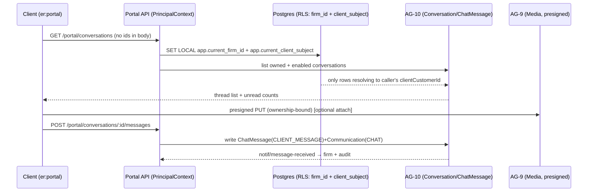

## 4. Functional Requirements

**Threads & visibility**
- **CP-7-1** *(NEW)* The portal SHALL list, for the authenticated client, only `Conversation`s whose ownership chain resolves to their own `clientCustomerId` (direct, child-via-`owner_chain_to`, or corporate-seat via `PartyRelationship`) **and** whose case has `PortalVisibilityConfig.enableMessaging = true`. Scope is derived from `PrincipalContext.ownershipRoot`, never from request input.
- **CP-7-2** *(NEW)* A `Conversation` whose case does not enable messaging SHALL be invisible to the portal (leak-off-by-default, Doc 1 §4.5 AC-4.5.4) — not merely hidden in the UI.
- **CP-7-3** *(NEW)* Opening a thread SHALL return its messages keyset-paginated by `{createdAt, communicationId}`; no endpoint returns an unbounded set.

**Compose & reply**
- **CP-7-4** *(NEW)* A client holding `portal/message:send` SHALL append a `ChatMessage(messageType = CLIENT_MESSAGE)` to an owned, enabled conversation; CP-7 calls AG-10's portal-chat service (it does not write the table directly), which records the `Communication(channel = CHAT, direction = INBOUND, messageClass = TRANSACTIONAL)` and appends the AG-13 `ActivityEvent`. `portal/message:send` SHALL admit both a **first** message (client-initiated) and an append to a firm-opened thread, subject only to `enableMessaging` (RESOLVED — FD-9: client-may-start; §13).
- **CP-7-5** *(NEW)* A client-originated message SHALL always be `TRANSACTIONAL` (a service message about the client's own retained file); CP-7 SHALL never permit a client to originate `MARKETING`-class content.
- **CP-7-6** *(NEW)* A firm reply (`messageType = AGENT_REPLY`, written firm-side per Doc 3) SHALL render to the client attributed to the firm's brand/display name (AG-15 `PortalBranding`), with staff personal contact details shown only if the firm opted in.
- **CP-7-7** *(NEW)* The composer SHALL be disabled-with-a-localized-reason when: messaging is disabled for the case, the engagement is closed/revoked, the client lacks `portal/message:send`, or the device is offline (PWA read-only offline).
- **CP-7-8** *(NEW)* A reply MAY reference a prior message via `replyToMessageId` (AG-10 field) for in-thread quoting; CP-7 only sets/renders it.

**Attachments (via AG-9)**
- **CP-7-9** *(NEW)* Attaching a file SHALL upload via the AG-9 pipeline using an **ownership-bound presigned PUT** (Doc 1 §6.3.3 port + §7.7 storage headers — never a caller-supplied key); the resulting AG-9 media ref SHALL be linked into the `ChatMessage.mediaItems[]`. CP-7 stores no bytes.
- **CP-7-10** *(NEW)* An attachment whose AG-9 `scan_status` is not clean SHALL NOT be presented as a shared file; the message SHALL show "being checked / could not be shared" in the client's locale and the firm SHALL NOT see it as a delivered attachment.
- **CP-7-11** *(NEW)* Opening/downloading an attachment SHALL use an AG-9 ownership-bound presigned GET; a client SHALL never be able to fetch a sibling client's media even with a guessed media id (404).
- **CP-7-12** *(NEW)* Where a firm document request (AG-15 `ClientWorkItem` of type `MESSAGE_ASK`/`DOCUMENT_REQUEST`) is linked to the thread, answering in-thread MAY satisfy it via the existing AG-15 work-item flow; CP-7 surfaces the ask and the upload affordance, it does not re-implement the work-item engine.

**Unread state**
- **CP-7-13** *(NEW)* The thread list SHALL show a per-conversation unread badge and a portal-shell total unread count, read from AG-10's client-side `Conversation.unreadCount` (cache-backed, ≤ 60 s staleness; refreshed by the §3.3 poll at the 15 s active / 60 s idle cadence).
- **CP-7-14** *(NEW)* Opening a thread (or an explicit mark-read) SHALL mark the client's view read via `POST /portal/conversations/:id/read`, decrementing the client-side unread count idempotently; re-marking an already-read thread is a no-op.
- **CP-7-15** *(NEW)* A new firm reply SHALL increment the client-side unread count and (per CP-7-16) raise the client notification; the firm-side unread is governed by AG-10/Doc 3.

**Notifications (consume AG-10 + NotificationPreference)**
- **CP-7-16** *(NEW)* A firm reply SHALL raise `notif/message-received` **to the client**, delivered per the client's `NotificationPreference` (channel matrix, quiet hours, digest) **intersected with** the firm-policy notification ceiling (AG-16). CP-7 raises through AG-10's Notification service; it owns no notification store.
- **CP-7-17** *(NEW)* The client SHALL be able to reach their messaging notification settings from the Message Center via a **deep-link into the CP-8 `NotificationPreference` matrix** (CP-8 §3.3 owns the matrix UI; AG-10 owns the entity; channels the firm ceiling forbids appear disabled, not selectable) — CP-7 builds no preference editor of its own.
- **CP-7-18** *(NEW)* The client in-app notification SHALL deep-link via its payload (`entityType = CASE`/`CONVERSATION` + id) directly to the thread, in the client's locale and the firm's brand.

**Localization, branding, accessibility, offline**
- **CP-7-19** *(NEW)* Every CP-7 surface and the reply notification SHALL render in the client's locale (`ClientCustomer.preferredLocale` / `PartyProfile.locale`), falling back to the firm default on a missing translation — never an empty/broken string.
- **CP-7-20** *(NEW)* CP-7 SHALL apply the firm's `PortalBranding`; no surface leaks the platform name to a client.
- **CP-7-21** *(NEW)* CP-7 SHALL meet WCAG 2.2 AA, including live-region announcement of new messages, full keyboard operation, and visible focus.
- **CP-7-22** *(NEW)* The PWA SHALL cache the open thread **read-only** for offline reading; composing/sending requires connectivity (no offline write in foundation, Doc 1 §8).

**Activity & audit**
- **CP-7-23** *(NEW)* A client send/open SHALL emit a `PortalActivityEvent(eventType = MESSAGE)` (AG-15-owned stream) and a per-firm hash-chained audit entry (Doc 1 §7.5); message bodies SHALL never appear in logs/traces (Doc 1 §7.7).

## 5. Business Rules & Logic

- **BR-1 (Own-thread-only — cardinal).** A client may read/write **only** conversations and messages whose ownership chain resolves to their own `clientCustomerId`. Scope comes from `PrincipalContext`, never a caller-supplied id; cross-client access returns `404`/empty, audited, never `200` — enforced in the service **and** at the DB by the Doc 1 §2.5 portal RLS `USING` + `WITH CHECK` (the CP-1 §3 backbone, not re-derived here).
- **BR-2 (Firm-governed existence).** A thread is visible/usable only when `PortalVisibilityConfig.enableMessaging = true` for that case (AG-15). Disabling it later makes the thread read-only history for the client, not gone, not broken (BR-6 retain-don't-destroy applies — history is preserved).
- **BR-3 (Two sides, one wire).** A client message and a firm reply are the **same** `Conversation`/`Communication` data viewed from two consoles; CP-7 never forks a parallel store. The firm always sees what the client sees and vice-versa (within visibility config).
- **BR-4 (Transactional-only from the client).** Client-originated messages are `TRANSACTIONAL` service messages about the client's own file; CP-7 cannot originate `MARKETING`. The AG-10 send-gate's marketing/consent rules are a firm-side concern; a transactional reply to a client's own message is always deliverable.
- **BR-5 (Brand & locale everywhere).** Every client-facing string, system line, and notification renders the firm's brand and the **client's** locale; missing translation → firm default; no platform name leaks (Doc 3 BR-9/BR-10 mirrored).
- **BR-6 (Attachments via AG-9 only).** No bytes live in CP-7 or AG-10; attachments are AG-9 media refs, AV-scanned, type/size-gated, served by ownership-bound presigned URLs. A quarantined upload is never a delivered attachment (Doc 3 AG-9 §6 scan sub-state).
- **BR-7 (Notification preference is the client's, bounded by firm policy).** Client reply notifications honour the client's own `NotificationPreference` (AG-10) intersected with the AG-16 firm-policy ceiling; a client cannot opt into a channel the firm disabled; quiet hours and digest apply.
- **BR-8 (No realtime dependence).** Freshness is via polling within Doc 1's foundation; CP-7 must function correctly with eventual (≤ 60 s) unread refresh and never assume a live socket. A future realtime wave is additive.
- **BR-9 (Read-state is per-side).** "Read" for the client is independent of the firm's read-state; marking read decrements only the client-side unread; it is idempotent and never reveals firm-internal read-state to the client — the firm sees the client's read-state **only** (FD-9).
- **BR-10 (Audit & PII).** Every client message event writes a per-firm hash-chained audit entry; message bodies are field-encrypted at rest (Doc 1 §7.1–§7.2) and never logged; no Restricted PII is placed in any rail payload (CHAT is in-portal, not a rail, but the notification email/push carries only a brand-safe "you have a new message" prompt, never the body).
- **BR-11 (Corporate-seat scope).** A seat-holder may message only on in-scope cases their seat resolves to via `PartyRelationship`; a non-seat sibling requesting an in-scope conversation gets `404` (Doc 1 §4.5 AC-4.5.9). Revoking the company cascades to seats (Doc 3 BR-13) — a revoked seat cannot message.
- **BR-12 (Access lifecycle gates messaging).** Only an `ACTIVE` `ClientCustomer` may send/read; `SUSPENDED`/`REVOKED`/`PENDING_ACTIVATION` cannot (Doc 3 BR-5); revoke invalidates sessions immediately.
- **BR-13 (No edit, no recall — FD-9).** A sent message is immutable to the client: no edit, no delete, no recall; corrections are new messages (record-keeping / regulated-profession reconstructability). CP-7 exposes no edit/delete affordance and AG-10's portal-chat service accepts no portal-side mutation of a delivered `ChatMessage`.

## 6. States & Lifecycle

**Client thread availability** (derived, per case — not a new stored state machine):

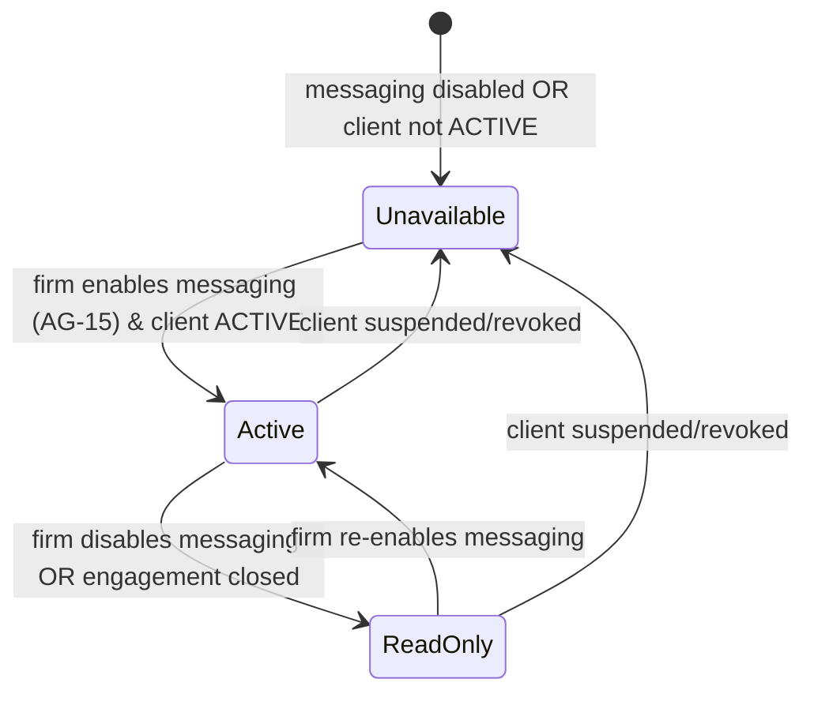

**Message lifecycle (client-originated).** `composing → (attach: uploading → scanning → clean|quarantined) → sent → delivered (firm view) → read (firm-side)`. A quarantined attachment holds the message's attachment chip at "being checked"; the text portion still sends. CP-7 reads AG-10's `ChatMessage`/`Communication.status` and AG-9's `scan_status`; it invents no parallel status.

**Conversation.** `Open` (one per case the client owns and the firm enabled — FD-9) → messages append → `archivable` firm-side; never deleted as a side-effect (retain-don't-destroy). `unreadCount` (client side) increments on a firm reply and resets on the client's mark-read.

**Transitions & side-effects (summary).**

| From | To | Trigger | Side-effect |
|---|---|---|---|
| Unavailable | Active | AG-15 enables messaging + client ACTIVE | thread visible; composer enabled |
| Active | ReadOnly | AG-15 disables / engagement closed | composer disabled-with-reason; history retained |
| (any) | message sent | client `POST …/messages` | `ChatMessage`+`Communication`(CHAT) + `ActivityEvent` + `notif/message-received`→firm + `PortalActivityEvent(MESSAGE)` + audit |
| firm reply | client unread+1 | AG-10 write (firm side) | client `unreadCount`++ ; `notif/message-received`→client per pref ∩ ceiling |
| thread opened | read | client `POST …/read` | client `unreadCount` reset (idempotent) |

## 7. Key Entities & Fields

> Tenant key `firm_id` (FORCED RLS, Doc 1 §2.2); CLIENT-PII rows carry `client_id` = the Party FK and ride the **Doc 1 §2.5 portal dimension** keyed on `app.current_client_subject` = the caller's `clientCustomerId`. Polymorphic cross-cutting attaches via the registry-validated `(entityType, entityId)` (camelCase columns, UPPER_SNAKE values — `CASE`, `CONVERSATION`, `DOCUMENT`). **CP-7 defines no new tables** — it consumes AG-10/AG-9/AG-15/Doc-1 entities and is a read/compose lens. The entities below are **cited, not redefined.**

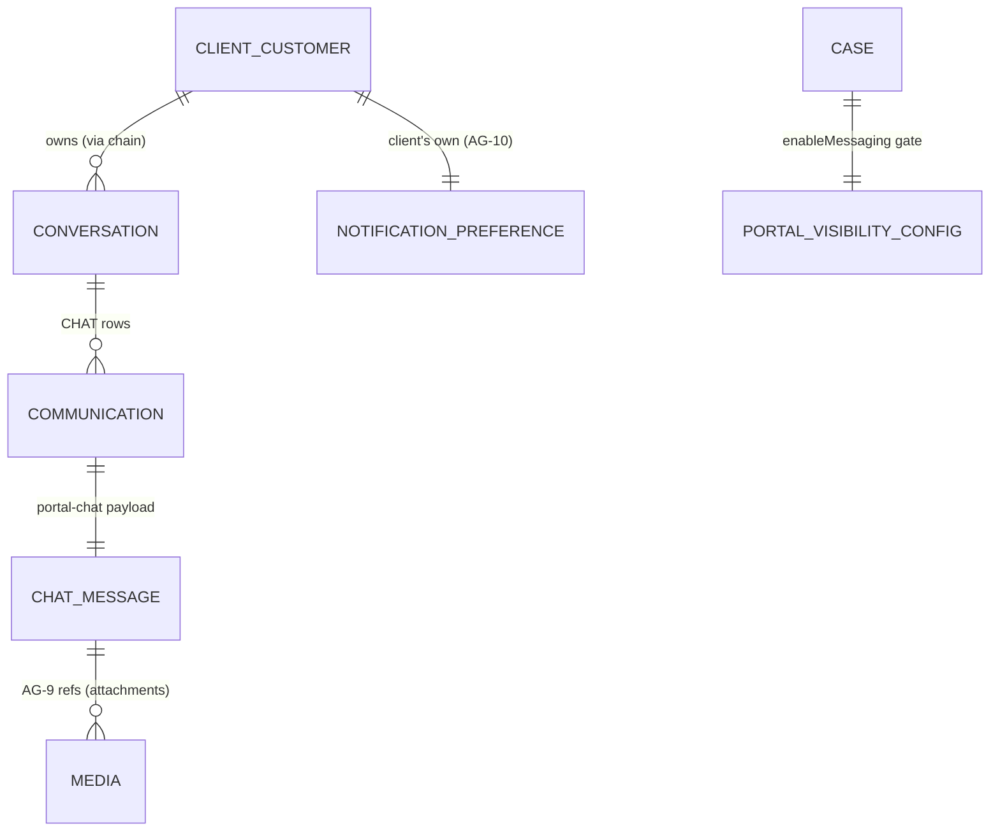

- **`Conversation`** *(AG-10-owned — cited)* — `id`, `firm_id`, `entityType`, `entityId` (the CASE/engagement), `clientCustomerId? fk`, `lastMessageAt`, `unreadCount`, `isArchived`. CP-7 lists/reads it scoped to the caller's chain + `enableMessaging`. (`waSessionExpiresAt` is WhatsApp-only and irrelevant to portal chat.)
- **`ChatMessage`** *(AG-10-owned — cited)* — `communicationId fk`, `content` (encrypted), `messageType` (`AGENT_REPLY | CLIENT_MESSAGE`), `sentByUserId?` / `sentByClientCustomerId?`, `replyToMessageId?`, `mediaItems[]` (AG-9 refs), `createdAt`. CP-7 writes `CLIENT_MESSAGE` (with `sentByClientCustomerId`) via AG-10's service and renders `AGENT_REPLY`.
- **`Communication`** *(AG-10-owned — cited)* — the polymorphic spine row per message: `channel = CHAT`, `direction = INBOUND` (client) / `OUTBOUND` (firm), `messageClass = TRANSACTIONAL`, `consentBasis = TRANSACTIONAL`, `conversationId`, `isRead`, `preview`, `occurredAt`. Indexed `(firm_id, conversationId, occurredAt)` (the keyset CP-7 paginates on).
- **`PortalVisibilityConfig`** *(AG-15-owned, TENANT — cited)* — the `enableMessaging` flag CP-7 reads as the visibility gate (BR-2), and `stageLabelMapJson` for the client-friendly engagement label. Field names per the AG-15 struct (Doc 3 §3.7): `showProgress`, `showDocuments`, `showFirmProducedDocs`, `showSqr`, `showInvoices`, `showAgreements`, `enableMessaging`, `stageLabelMapJson`. Owned firm-side; CP-7 never writes it.
- **`NotificationPreference`** *(AG-10-owned, per-subject — cited)* — the client's channel matrix per `notif/*` event type + quiet hours + digest, **bounded by the AG-16 firm-policy ceiling**. CP-7 surfaces a client-editable view of the messaging-event rows (CP-7-17); it does not redefine the entity.
- **`Media` / AG-9 document refs** *(AG-9-owned — cited)* — attachment bytes, `scan_status`, type/size gates, ownership-bound presigned URLs. CP-7 links refs into `ChatMessage.mediaItems[]`; stores no bytes.
- **`PortalActivityEvent`** *(AG-15-owned, CLIENT-PII — cited)* — `eventType = MESSAGE` row written on a client send/open; feeds firm-side engagement (Doc 3 §3.6) and access audit (§3.9). CP-7 emits into it; it does not own it.
- **`ClientWorkItem`** *(AG-15-owned — cited)* — type `MESSAGE_ASK`/`DOCUMENT_REQUEST` linked to the thread; CP-7 surfaces the ask + upload affordance (CP-7-12), the AG-15 engine drives status.
- **Cross-cutting (cited):** per-firm hash-chained `AuditLog` (Doc 1 §7.5), `Notification` (AG-10), `EntityTypeRegistry` (Doc 1 §5.8).

**Events emitted / consumed.** CP-7 is portal-facing and, like AG-10, **emits no new domain event** — domain facts live in the central Doc 1 §6.1 dictionary; CP-7 writes `ActivityEvent`/`PortalActivityEvent` rows and raises `notif/*` via AG-10. The single emitter of portal-identity facts is **CP-1** (`portal.client.loggedin`); CP-7 mints no portal-session or `message.*` event of its own.

| Event / signal | Direction | Emitter / Consumer | Notes |
|---|---|---|---|
| `notif/message-received` | raised (to client) | AG-10 Notification service | on a firm reply; delivered per client `NotificationPreference` ∩ AG-16 ceiling; deep-links to the thread |
| `notif/message-received` | raised (to firm) | AG-10 Notification service | on a client send; mirrors to the case officer (Doc 3) |
| `ActivityEvent` (CHAT row) | written | AG-13 timeline (via AG-10) | every client/firm message appends one materialized row (committed-IN, ADR 6.2); this CHAT row is the messaging-refresh signal — no `message.*` domain event |
| `PortalActivityEvent(MESSAGE)` | written | AG-15 stream | client send/open touch event for engagement + access audit |
| `document.uploaded` | consumed (indirect) | emitted by AG-9 | an in-thread attachment upload; flips a linked `MESSAGE_ASK`/`DOCUMENT_REQUEST` work item once (AG-15), quarantine excepted |

> No domain event named `message.*` exists in the dictionary; portal chat is recorded as `Communication`/`ChatMessage` and surfaced via `notif/message-received` + the materialized AG-13 timeline (CHAT `ActivityEvent` row). Introducing a registered `chat.message.sent` domain event would be an AG-10/Doc-1 §6.1 dictionary change, not a CP-7 decision — flagged in §13.

## 8. User Stories + Acceptance Criteria

**US-1 — Client: read and reply in my own thread.**
- **Given** I am an `ACTIVE` client on a case with messaging enabled, **When** I open Message Center, **Then** I see only my own conversation(s) with an unread badge, in my locale and the firm's brand; **When** I open one and reply, **Then** my message appears as a `CLIENT_MESSAGE`, the officer is notified, and the firm sees the same exchange in the case.

**US-2 — Client: attach a document through the safe pipeline.**
- **Given** an open thread, **When** I attach a PDF, **Then** it uploads via an ownership-bound presigned URL, shows a scanning state, and becomes openable only once AG-9 reports it clean; **Given** the file is flagged, **Then** the chip shows "being checked / could not be shared" in my locale and the firm does not receive it as a delivered attachment.

**US-3 — Security: cross-client isolation holds at the DB.**
- **Given** Client A is authenticated, **When** A requests Client B's `conversationId`, message id, or attachment media id by guessing, **Then** the server returns `404`/empty for 100% of attempts, nothing of B's appears in body/error/logs, and the attempt is audited — enforced at the service AND by the Doc 1 §2.5 portal RLS `USING`. **When** A attempts to POST a message attributed to B's conversation, **Then** the §2.5 `WITH CHECK` rejects it at the DB (Doc 1 AC-2.5.5).

**US-4 — Client: notified my way, never at 3 a.m.**
- **Given** I set messaging notifications to email + quiet hours 22:00–07:00, **When** the firm replies at midnight my time, **Then** I get an in-app notification immediately and the email is held to morning (or digested), in my locale and the firm's brand; **Given** the firm policy disables push, **Then** push appears disabled in my preferences and is never sent.

**US-5 — Governance: messaging disabled mid-engagement.**
- **Given** the firm disables messaging for my case, **When** I open the thread, **Then** I see the full history read-only with a localized "messaging is currently closed" notice and a disabled composer — never a broken page or a 500; **When** the firm re-enables it, **Then** the composer returns.

**US-6 — Corporate seat: scoped messaging.**
- **Given** I am an HR-coordinator seat scoped to 10 of 12 applicant cases, **When** I open Message Center, **Then** I see threads only for in-scope cases the firm enabled; **When** I request a 2-out-of-scope case's conversation id, **Then** I get `404` (Doc 1 AC-4.5.9); **When** the company is revoked, **Then** I can no longer message.

**US-7 — Accessibility & offline.**
- **Given** I use a screen reader, **When** a new firm reply arrives while the thread is open, **Then** it is announced via an ARIA live region and reachable by keyboard; **Given** I lose connectivity, **When** I open a previously-viewed thread, **Then** I can read it offline and the composer is disabled-with-reason (no offline write).

## 9. Edge Cases

- **Sibling-id guess (read & write).** Any sibling `conversationId`/messageId/mediaId → `404`, audited; never `200`, never partial body. Write attribution to a sibling → DB `WITH CHECK` rejection.
- **Messaging disabled while thread open.** Next poll/compose returns the read-only state; an in-flight send is rejected with a localized "messaging closed" message, not a 500.
- **Client suspended/revoked mid-session.** Session invalidation blocks send/read immediately (Doc 3 BR-5); a cached PWA thread shows read-only with a "your access has changed" notice on next online action.
- **Quarantined attachment.** Text sends; attachment held at "being checked"; if AG-9 ultimately rejects, the chip shows "could not be shared" and prompts a re-upload — the message is not deleted.
- **Large/disallowed file.** AG-9 type/size allow-list rejects before any share; the client sees a localized reason, no partial upload persists.
- **Missing translation.** Falls back to the firm default locale string; never an empty bubble or a raw i18n key.
- **No internet (PWA).** Read-only cached thread; compose disabled-with-reason; queued offline sends are NOT supported in foundation (avoid a false "will send later" promise).
- **Duplicate send (double-tap / retry).** Idempotent on a client-supplied request key so a flaky network does not post the message twice.
- **Notification when client preference empty.** In-app notification is always created (never suppressed); email/push obey preference ∩ ceiling; if both off, only in-app.
- **Empty thread / first message.** Localized empty state with a clear "send your first message" affordance whenever `enableMessaging` is on — client-initiation is permitted (FD-9).
- **Concurrent firm + client messages.** Keyset ordering on `{createdAt, communicationId}` keeps the interleave stable; equal timestamps never skip/duplicate.
- **Realtime absent.** Up to ~60 s unread-count staleness is acceptable and expected; the open thread polls at the §3.3 cadence; no socket assumed.

## 10. Permissions (`portal/*`)

> LOCAL `portal/*` keys, always evaluated within the caller's `firm_id` **and** their own ownership chain (Doc 1 §4). The catalog is owned by **SA-6**; CP-7 declares these keys for its routes; they are seeded in the wave CP-7 ships (Doc 1 §4.4 incremental seeding). All keys use the single grammar `portal/<resource>:<action>[.own]` (colon-dot qualifier — aligned with CP-8). A `portal/*` token (`aud = er:portal`) can never reach an `agent/*` route (`403 SCOPE_VIOLATION`).

| Permission | Grants |
|---|---|
| `portal/message:list` | List own enabled conversations + unread counts |
| `portal/message:view` | Open an owned thread + read its messages |
| `portal/message:send` | Compose/send a `CLIENT_MESSAGE` to an owned, enabled conversation |
| `portal/message:attach` | Attach an AG-9 media item to an outgoing message (separable from send) |
| `portal/message:mark-read` | Mark an owned thread read (reset client unread) |
| `portal/notification-preference:manage.own` | *(declared by CP-8, cited here)* — the CP-7 deep-link target for editing own messaging `NotificationPreference` rows (within the AG-16 ceiling; CP-8 §3.3 owns the matrix UI) |

Firm-side send/governance keys (`agent/communication:send-message`, AG-15's `agent/portal:*` enable/disable) live in Doc 3 — CP-7 only consumes their effect (`enableMessaging`). Default-deny; UI hiding is never the security boundary.

## 11. Scalability · Security · Performance (isolation FIRST)

**Isolation (inherited from CP-1 §3, not restated — deltas only).** CP-7 is one of the top PII-leak surfaces, so it relies on — and does not weaken — the CP-1 §3 portal isolation backbone: the walled `er:portal` auth pool (Doc 1 §3.1), the two RLS dimensions `app.current_firm_id` + `app.current_client_subject` (both `USING` and `WITH CHECK`, Doc 1 §2.5), `assertPortalOwnershipChain` + the `PortalVisibilityConfig` allow-list (Doc 1 §4.5), scope sourced from `PrincipalContext` only (no caller-supplied id ever sets the GUC), and ownership-bound presigned URLs at the storage edge (Doc 1 §4.5 authz + §7.7 headers + §6.3.3 port). **CP-7-specific deltas:** (1) the visibility gate for a CHAT thread is `PortalVisibilityConfig.enableMessaging` — an unenabled case's `Conversation` is invisible (leak-off-by-default, Doc 1 §4.5 AC-4.5.4), not merely UI-hidden; (2) attachment IDOR is closed at the AG-9 storage edge — a guessed sibling media id returns `404`; (3) corporate-seat reads resolve via `PartyRelationship`; a non-seat sibling gets `404`. CP-7 adds no second enforcement path and re-derives none of the CP-1 contract.

**Security (rest).** Message bodies are field-encrypted at rest (Doc 1 §7.1–§7.2), masked in any reveal-gated context, and **never** in logs/traces/search (Doc 1 §7.7 scanners). Reply notification emails/pushes carry only a brand-safe "you have a new message" prompt — **never the message body** — so no Restricted PII rides a rail. Every client message/open writes a per-firm hash-chained audit entry (Doc 1 §7.5), making "this client touched only their own thread" provable. The portal-chat endpoint, like every external surface, is schema-validated (Zod), size/rate-limited, tenant- and subject-scoped, idempotent on a client request key, and nothing persists on a failed check. Access lifecycle (`portalStatus`) gates every call; revoke kills sessions immediately.

**Scalability.** Conversation/message reads are keyset-paginated `(firm_id, conversationId, occurredAt)` — no unbounded set; the thread list and unread counts are cache-backed (Redis, keyed `(firm_id, clientCustomerId, scope)`, ≤ 60 s staleness, invalidated on new message / read-state). Reads route to RLS-identical read replicas (the portal GUC is set per-transaction on the replica too, Doc 1 §8.2), so portal traffic does not load the write primary. No realtime gateway is provisioned (Doc 1 §1.5); polling intervals are bounded (15 s active / 60 s idle, §3.3) and back off when idle to keep the read fan-out flat as portal users grow.

**Performance (within Doc 1 §8.1 budgets).** Thread-list and open-thread reads p95 ≤ 300 ms; send-enqueue p95 ≤ 200 ms (the message persists synchronously; notification fan-out is async); mark-read p95 ≤ 150 ms; unread-count read served from cache. Attachment uploads are direct-to-S3 via presigned URL (no proxy through the API). The PWA pre-caches the open thread for offline read. WCAG 2.2 AA is a build-time gate (Radix primitives, focus management, live regions), held to the **same** bar as the staff consoles (Doc 1 §8.5).

## 12. Reference Note (greenfield)

CP-7 is **NEW / greenfield**. Doc 4 (the client portal) is gap-analysis hole C2 and has **no reference prototype** — there is no existing client-facing messaging screen to honour or refactor. Therefore every CP-7 FR is `NEW`. CP-7 is, however, **not** a new engine: it is a thin client-side lens that **reuses** the already-specced AG-10 messaging store (`Conversation`/`ChatMessage`/`Communication`/`DeliveryEvent`/`NotificationPreference`), the AG-9 document/media pipeline, the AG-15 visibility governance (`enableMessaging`) and `PortalActivityEvent` stream, and the Doc 1 / CP-1 §3 foundation (the `er:portal` pool, RLS dimensions, audit, presigned URLs, i18n, PWA, WCAG). The build is: portal routes + screens + the portal-scoped read/compose/mark-read endpoints + the client `NotificationPreference` view — wired to existing firm-side machinery. No new table, no new domain event, no new file store, no new notification system. The firm-side counterpart (sending, enable/disable, surfacing in the case) is specced in Doc 3 §3.7 / AG-15-35/36 / AG-10 §3.4 and is consumed, not re-specced.

## 13. Open Questions / [FOUNDER-CONFIRM]

- **RESOLVED (FD-9, 2026-07-03) — Thread granularity: per-case.** One conversation per case via AG-10's existing `(entityType = CASE, entityId)` binding (no schema change; the list query and unread model are per-case — §3.1). CP-9 §3.8's org/case-scoped threads reference this same resolution — one entity model, two lenses.
- **RESOLVED (FD-9, 2026-07-03) — Client-may-start.** A client holding `portal/message:send` may **start** a new message on any owned case with `enableMessaging = true`, not only reply within a firm-opened thread (CP-7-4 updated). The contextual "ask the firm" deep-links from CP-3/4/5/6 depend on this — reply-only would make them dead ends.
- **RESOLVED (FD-9, 2026-07-03) — Read receipts.** The firm sees the client's read-state **only**; the client is never shown firm read-state (no opt-in exposure in v1 — avoids "why haven't they read it yet" pressure on staff). Reflected in §3.4 thread view and BR-9.
- **RESOLVED (FD-9, 2026-07-03) — No edit/recall.** A sent message cannot be edited or deleted; corrections are new messages (record-keeping / regulated-profession reconstructability). Normative as BR-13.
- **[ARCHITECT — to AG-10/Doc-1] Registered `chat.message.sent` domain event?** CP-7 relies on `notif/message-received` + the materialized AG-13 CHAT `ActivityEvent` (AG-10 emits no `message.*` domain event). If a future consumer (Conductor auto-exit on a client reply, analytics) needs a first-class event, that is a Doc 1 §6.1 dictionary addition + an AG-10 emitter change — out of CP-7's authority, flagged for the human architect. Until then, CP-9 and CP-7 must both reference the same materialized-timeline mechanism, never a minted `message.posted`/`message.*` name.
- **[CONFIRM — realtime wave] PWA offline-write.** Foundation is poll-only (15 s active / 60 s idle per §3.3, now normative) and offline-read-only. Confirm that offline **compose-and-queue** is correctly deferred to the realtime wave (no false "will send when online" promise in v1).

---

# Module CP-8: Profile, Notifications & Consent

> **Vendor deliverable — Client Portal (Doc 4).** The immigrant client's own *account surface*: a masked-by-default view/edit over their canonical Party data, their per-user notification preferences (bounded by the firm's policy ceiling), their language preference, their consent state, and their personal data-export / data-subject request — the privacy console the regulated immigrant client uses to govern how the firm holds and contacts them. **Plane:** Client Portal (LOCAL, `aud = er:portal`, per Doc 1 §3.1). **Permissions:** `portal/*` (catalog owned by SA-6, seeded per Doc 1 §4.4). **Tenant key:** `firm_id` (RLS ENABLED+FORCED, Doc 1 §2.2) *plus* the second portal RLS dimension `app.current_client_subject` (Doc 1 §2.5) and the record-level ownership-chain contract (Doc 1 §4.5). **Isolation backbone:** owned by CP-1 §3 (`assertPortalOwnershipChain`, the second-RLS-dimension wiring, the ownership-bound presigned/object-access rule); CP-8 inherits it and does not re-state or weaken it. **Identity:** the client is a cryptographically-walled `ClientCustomer` credential lens on the `Party` spine (Doc 1 §3.1, §5.2). **Consumes (mirrors, never re-specs):** the canonical `Party` / `PartyProfile` / answer store (Doc 1 §5.2, §5.4); the AG-10-owned per-user `NotificationPreference` entity; the AG-16-owned firm-policy notification ceiling; AG-15's `PortalVisibilityConfig` + `PortalAccessPolicy`; the SA-11 governance plane (`ConsentRecord`, `DsrRequest`, the one canonical per-individual export). This is **greenfield** target-state machinery and **content-neutral** — no immigration content appears here.

## Module Index

1. Purpose & Goal · 2. Users & Jobs-to-be-Done · 3. Functional Design (account home, profile view/edit over Party, notification preferences, language, consent register, DSR/export) · 4. Functional Requirements (CP-8-n) · 5. Business Rules & Logic · 6. States & Lifecycle · 7. Key Entities & Fields (+ Events emitted/consumed) · 8. User Stories + Acceptance (G/W/T) · 9. Edge Cases & Validations · 10. Permissions (`portal/*`) · 11. Scalability · Security · Performance (isolation first) · 12. Reference Note (greenfield) · 13. Open Questions / [FOUNDER-CONFIRM]

---

## 1. Purpose & Goal

**What it is.** CP-8 is the client's *account and privacy console* — the one place a logged-in immigrant client manages their **own** identity-facing settings: see and (within field-level rules) correct the personal facts the firm holds about them, choose how and in what language the firm reaches them, see what they have consented to and withdraw it, and exercise their statutory data rights (export everything, or request access / correction / erasure). It is the portal counterpart of the firm-side controls — but governed by the inverse permission model: a client may only ever touch their **own** subject's data, enforced by the record-level ownership chain and the second portal RLS dimension (CP-1 §3, Doc 1 §2.5/§4.5), never by the UI hiding a button.

**Why it is the highest-stakes portal surface.** This module reads and writes the client's most sensitive data (names, contact channels, locale, consent, and — through profile and export — Restricted PII like passport/SIN-class fields). The Client Portal is the platform's top PII-leak surface (Doc 1 §2.5, §4.5); CP-8 is the densest concentration of personal-data read/write/egress *within* it. Every screen here is built isolation-first: masked-by-default Restricted fields (Doc 1 §7.2), `portal/pii:reveal-own` + audited reveal for the client's own cleartext, ownership-chain-resolved reads (CP-1 §3), and the export as a single audited egress chokepoint routed to SA-11.

**The business outcome.** A regulated immigration firm must be able to prove, to a client and to a regulator, that the client could see exactly what was held about them, correct it through a controlled channel, control their own contactability, and exercise PIPEDA / Quebec Law-25 rights — all in their own language, all on the firm's brand. CP-8 makes "the client governs their own data, the firm proves it did so lawfully" structurally true.

**The boundary (read first).** CP-8 is content-neutral machinery. It does **not** own: the `NotificationPreference` entity (AG-10 owns it; CP-8 is the client-facing editor over the client's own row), the firm-policy notification *ceiling* (AG-16), the consent *register* or the DSR/export *engine* (SA-11), the visibility allow-list (AG-15 `PortalVisibilityConfig`), the portal isolation primitive (CP-1 §3), or the canonical `Party`/answer store (Doc 1 §5). CP-8 is the *client lens* that reads and, within rules, writes those single-sourced stores — never a second copy of any of them.

---

## 2. Users & Jobs-to-be-Done

| User | Job-to-be-done | In their words |
|---|---|---|
| **Individual client** (the applicant) | Keep my details right, control how I'm contacted, in my language, and prove I can see my own data. | "Fix my phone number and mailing address myself." · "Stop the SMS reminders but keep email." · "Read everything in French." · "See my passport number is correct without it sitting in plain view." |
| **Spouse / dependent on the file** (if seated as their own `ClientCustomer`) | Manage my own subset, not the principal's. | "Update *my* contact details and consent — I shouldn't see or change anyone else's." |
| **Corporate seat-holder** (HR coordinator, Doc 1 §2.5 corporate-seat case) | Manage my own portal account, not the applicants' personal profiles. | "Set my own login locale and notifications; the applicants own their personal data, not me." |
| **Privacy-conscious client** | Exercise my legal rights without phoning the office. | "Download a machine-readable copy of everything you hold on me." · "Withdraw consent to marketing." · "Ask you to correct / erase my data and watch the clock." |

**Design implication.** The protagonist is the **individual client** on a phone (the portal is a responsive, installable PWA, Doc 1 §8 / NFR5-13). The account home is a calm, plain-language hub: *Your details · How we contact you · Your language · Your privacy & consent · Your data rights*. Everything is masked-safe by default, bilingual end-to-end, and WCAG 2.2 AA. A seat-holder/dependent sees only their own subject — the ownership chain guarantees it server-side.

---

## 3. Functional Design — How It Works

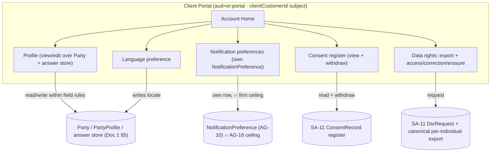

Every read/write below is funnelled through `PrincipalContext` (Doc 1 §4.5): scope is the authenticated `clientCustomerId`, never a caller-supplied id; the middleware sets `app.current_firm_id` + `app.current_client_subject`; the service layer re-runs the CP-1 §3 own-case-only gate (`assertPortalOwnershipChain`) + the `PortalVisibilityConfig` allow-list. CP-8 never signs a caller-supplied storage key (CP-1 §3 object-access rule, Doc 1 §4.5).

### 3.1 Account home — the privacy console

A single hub linking the five surfaces with at-a-glance state: display name + masked primary contact, current language, "you have N active consents / 1 open data request", and a security strip (active sessions with device/IP/last-used, each individually revocable, reusing the Doc 1 §3.4 session model surfaced via the CP-1 session backbone; force-logout-others). The home renders only the client's own subject; a seat-holder/dependent sees only theirs.

**World-class behaviour.** Plain-language, not legalese; every Restricted value masked (last-4 pattern) with a deliberate, audited "Reveal" affordance; bilingual; mobile-first; offline shows a read-only cached snapshot (PWA read-cache, Doc 1 §8 — never an offline write of PII).

**The session security strip — structured contract.** The strip is a *client lens over the CP-1 session backbone* — the Doc 1 §3.4 `portal_session` model as configured in CP-1 §3.5 — never a second session store or a re-derivation of the refresh/rotation mechanics (those are cited from CP-1, not duplicated here). CP-8 owns only the screen.

- **The list contract.** One row per live (non-revoked, non-expired) `portal_session` of the authenticated subject, each showing: **device label** (`device_label`, parsed user-agent class — e.g. "Safari on iPhone" — never the raw UA string), **coarse location** derived from the session IP at render time (city/region granularity, resolved server-side; the raw IP is never shown and the derived location is never persisted by CP-8), **signed in** (`created_at`), **last used** (`last_seen_at`), and an unambiguous **"this device" marker** on the current session (matched by the caller's `sid`), pinned first. The row exposes an opaque session id only — never `refresh_hash`, `token_binding_fingerprint`, or any token material.
- **Actions.** *Revoke* per row and *Sign out everywhere else* (revoke-all-others, current session kept). Both delegate to the CP-1/AuthCore revocation service — instant, durable-row fail-closed (Doc 1 §3.4) — with a plain-language confirm. Revoking the row marked "this device" is a full logout (subject-scoped cache cleared, CP-1 §3.6).
- **Rate limits.** Via the Doc 1 §3.7 limiter, per subject: list reads ≤ 30/min; per-session revoke ≤ 10/min; revoke-all-others ≤ 3/hour; excess returns a uniform, localized 429 — no oracle.
- **Screen states.** Loading skeleton → loaded list (current pinned + marked) → single-session state (revoke-all-others disabled with explanation) → post-revoke re-fetch (revoked row gone, success toast) → error-with-retry → offline (cached read-only list stamped with its as-of time; both revoke actions disabled — an offline revoke is blocked, never queued, per CP-1-13).

### 3.2 Profile — view/edit over the canonical Party (field-level rules)

**How it works.** The profile is a *projection*, not a store. It reads the slow-changing descriptive attributes from `PartyProfile` (display name, contact channels, locale) and the relevant standing facts from the append-only answer store (`ClientCanonicalAnswer`, Doc 1 §5.4) for the client's own `AnswerSubject`. There is no CP-8 profile table — the single source is the Party spine.

Each field has one of three **field-level edit rules**, derived from the `CanonicalField` definition (Doc 1 §5.3) and a firm policy, never invented here:

- **Self-editable** — the client may correct it directly (e.g. mobile phone, mailing address, preferred contact email). A write *supersedes* the prior `ClientCanonicalAnswer` (append-only, Doc 1 §5.4) with `status = DECLARED`, `sourceJson = {surface: 'PORTAL_PROFILE'}`, never overwriting history. Restricted self-editable fields are written through the encryption codec (Doc 1 §7.2).
- **Request-correction-only** — high-trust facts a firm must verify (e.g. legal name, date of birth, a previously-`VERIFIED` answer). The client cannot silently change these; the "Edit" affordance opens a **correction request** that becomes an SA-11 `DsrRequest` of type `CORRECTION` (§3.6) routed to the firm — the standing `VERIFIED` answer is untouched until staff act.
- **Read-only** — firm-managed or derived facts the client may see (masked where Restricted) but not edit or request to change inline.

**Restricted PII presentation.** Restricted fields (passport/SIN-class, Doc 1 §7.2) render masked by default. The client may reveal their **own** cleartext only by holding `portal/pii:reveal-own` and passing the ownership check; the reveal emits exactly one `PII_REVEAL` audit entry *before* cleartext is returned (audit-before-reveal is fail-closed, Doc 1 §7.2 AC-7.2.3/7.2.4). A client never sees another subject's field, masked or otherwise — the ownership chain denies it 404 (Doc 1 §4.5 AC-4.5.3).

**Validation.** All input is Zod-validated at the edge against the field's `validationJson` (Doc 1 §5.3); a self-edit that violates the constraint is rejected with a localized message, nothing persisted.

**Data flow.** Profile read → repository injects `firm_id` predicate + RLS double-checks + portal subject GUC → resolve own `AnswerSubject` → project `PartyProfile` + current (un-superseded) `ClientCanonicalAnswer`s → mask Restricted → render. Self-edit → Zod-validate → `assertPortalOwnershipChain` (CP-1 §3) → supersede answer in one transaction (Doc 1 §5.4 currency contract) → synchronous audit-outbox entry (Doc 1 §7.5) → emit `client.profile.updated`.

### 3.3 Notification preferences — the client's own row, bounded by the firm ceiling

**Ownership (matrix):** the client-facing `NotificationPreference` **matrix UI is owned by CP-8** (this section); other CP modules (e.g. CP-7 Messaging) deep-link into it and build no editor of their own; AG-10 owns the entity.

**How it works.** CP-8 is the client-facing editor over the client's **own** `NotificationPreference` row — the per-user entity **owned by AG-10** (`channelMatrixJson` per `eventType`, `quietHoursStart/End` + `timezone`, `digestEnabled`/`digestFrequency`; keyed `firm_id + userId`, where for a portal subject `userId` resolves to the `clientCustomerId`). CP-8 does **not** redefine the entity; it reads and writes the one row scoped to the authenticated subject.

The screen shows the **client-facing** subset of the `notif/` catalogue (Doc 1 §6.1.2 / AG-10 §3.7) — the events that legitimately reach a client about their own file (e.g. `notif/document-requested`, `notif/invoice-issued`, `notif/message-received`, `notif/envelope-ready`) — as an event-type × channel matrix (in-app / email / push), plus quiet hours + digest. The exact client catalogue subset is config-as-JSONB (`NotificationEventCatalogue`, AG-10) so adding a client-facing type is a row, not a migration.

**The firm ceiling (NORMATIVE).** A channel a client opts *into* is only honoured if the **AG-16-owned firm-policy notification ceiling** permits it: effective channels = the client's choice ∩ the firm ceiling (mirrors AG-10 AG-10-30b). A channel the firm has switched off renders disabled with a localized explanation; the client cannot enable it. **Service messages are non-suppressible:** transactional/service notifications about the client's own active retained file (an unsigned retainer, an overdue invoice, a requested document) are always deliverable in-app regardless of preference — preferences govern *marketing-class and convenience* delivery and *secondary channels*, never the client's ability to learn about a duty on their own file (Doc 1 §7.6; AG-15 §3.6 consent-aware-but-service-always rule).

**Data flow.** Read → load own `NotificationPreference` (absent → catalogue defaults) → intersect with AG-16 firm ceiling → render with forbidden channels disabled. Save → Zod-validate → re-intersect with ceiling (reject any channel above ceiling) → upsert the row in one transaction → audit → emit `client.preferences.updated`.

### 3.4 Language preference — the client picks, everything follows

**How it works.** The client's preferred locale lives on `PartyProfile.locale` (and is mirrored to the `ClientCustomer` for fast session render), captured at invite from AG-2 / AG-15 §3.8 and overridable here. Setting it re-renders every client-facing string, the activation/invite/nudge/notification emails, and document-request labels in the client's locale — independent of any staff UI language (Doc 1 NFR5-12). The firm offers a configured set of locales via AG-15 `PortalAccessPolicy.offeredLocales`; the client picks among them. A missing translation falls back to the firm's default locale, never a broken/empty string (AG-15 §3.8).

**Data flow.** Client selects locale (must be in `offeredLocales`) → write `PartyProfile.locale` → mirror to `ClientCustomer.locale` → every Doer (Mailer/Messenger) and the Doc 4 renderer select the matching template at send/render time → audit → emit `client.locale.changed` (consumed by AG-10 for template selection). No PII in template-selection logs (Doc 1 §7.7).

### 3.5 Consent register — see what I agreed to, withdraw it

**How it works.** CP-8 surfaces the client's **own** consent state from the **SA-11 `ConsentRecord` register** (Doc 1 §7.6) — the single source for consent. Consent is recorded **per purpose** (Law-25 granularity: e.g. marketing communications, optional analytics, each named purpose) with the version of the privacy notice shown and a timestamp. The client sees each purpose, its current state (granted/withdrawn) and when, the privacy-notice version they accepted, and — where granted — a **Withdraw** action.

Withdrawal writes a new versioned `ConsentRecord` (withdrawal supported, Doc 1 §7.6 AC-7.6.1) for that purpose; it is **enforced at point of use** — the AG-10 send-gate reads live consent at send time and the Conductor re-checks per-recipient inside the worker (AG-2 §3, AG-10 §3.7), so a withdrawn marketing purpose halts marketing on every path, while transactional/service messages about the client's own file remain lawful and continue. Consent here is **read + withdraw + (re-)grant**; the *register schema and the legal purpose taxonomy* are SA-11's, not CP-8's.

**Data flow.** Read → SA-11 consent query scoped to the subject's Party → render per-purpose state + notice version. Withdraw/grant → write a new `ConsentRecord` (purpose, state, notice version, timestamp, source = portal) via the SA-11 service → audit (consent change is audited, Doc 1 §7.5) → emit `client.consent.changed` (consumed by AG-10's send-gate and the Conductor).

### 3.6 Data-subject rights — the one canonical export + access/correction/erasure

**How it works.** CP-8 is the portal *entry point* for the data-subject's statutory rights; the **engine is SA-11** (Doc 1 §7.6). The client can:

- **Export my data** — request the **one canonical per-individual export** (machine-readable JSON + human-readable PDF of all of their personal information across modules: the answer store, documents, comms, cases, financials-as-recorded). It is **identity-verified before release** (re-auth / step-up on the portal session), **masked-unless-reveal** (Restricted fields masked unless the requester is authorized and the reveal is audited), and the export itself is **audited as a data egress** (Doc 1 §7.6 AC-7.6.5). Delivery is an ownership-bound presigned URL / capability token to the generated artifact (never a caller-supplied key, CP-1 §3 / Doc 1 §4.5/§4.6). This is *one* export, not five partial per-module ones.
- **Request access / correction / erasure / portability** — opens an SA-11 `DsrRequest` of the chosen type, on the **statutory clock** (countdown to the legal deadline, surfaced to the client and wired to the legal-clock alarm, Doc 1 §7.5/§7.6). The register is **hold- and floor-aware and honest**: an erasure that hits a financial retention floor or an active legal hold is reported truthfully ("PII deleted; financial records retained until {date}" / "request paused — legal hold"), never falsely "fully deleted" (Doc 1 §7.4, §7.6 AC-7.6.3). The client sees request status, the deadline, and the honest outcome.

CP-8 does not implement crypto-shred, the disposal orchestrator, retention floors, legal-hold precedence, or the export job — all SA-11 (Doc 1 §7.4/§7.6). CP-8 raises the request, verifies identity at the portal edge, and shows the client honest status.

**Data flow.** Export request → step-up re-auth → SA-11 export job (identity-verified, masked-unless-reveal) → on completion `notif/data-export-ready` (in-app + email per preference) with an ownership-bound capability link → access audited as egress. DSR request → create `DsrRequest` (type, subject Party, statutory clock) → SA-11 orchestrates (hold/floor-aware) → status surfaced to the client → every action audited.

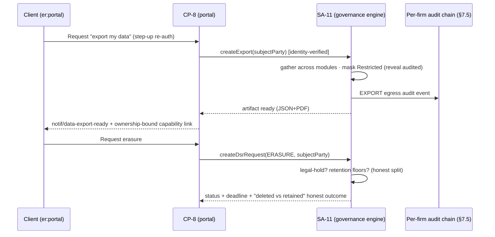

---

## 4. Detailed Functional Requirements

**Profile (view/edit over Party).**
- **CP-8-1** The portal SHALL render the client's own profile as a projection over `PartyProfile` + the current `ClientCanonicalAnswer`s for the client's own `AnswerSubject` (Doc 1 §5.4) — never a CP-8-owned profile copy.
- **CP-8-2** Restricted fields SHALL render masked by default; cleartext SHALL be returned only to a holder of `portal/pii:reveal-own` passing the ownership check, emitting exactly one `PII_REVEAL` audit entry before cleartext (Doc 1 §7.2).
- **CP-8-3** Each profile field SHALL carry exactly one edit rule — self-editable, request-correction-only, or read-only — derived from `CanonicalField` + firm policy; the rule SHALL be enforced server-side, never by UI gating alone.
- **CP-8-4** A self-edit SHALL supersede (not overwrite) the prior `ClientCanonicalAnswer` in one transaction (Doc 1 §5.4 currency contract), set `status = DECLARED` and `sourceJson.surface = 'PORTAL_PROFILE'`, route Restricted values through the encryption codec, and audit.
- **CP-8-5** A "request-correction-only" edit SHALL open an SA-11 `DsrRequest` of type `CORRECTION` and SHALL NOT mutate the standing `VERIFIED` answer.
- **CP-8-6** All profile input SHALL be Zod-validated against the field's `validationJson` (Doc 1 §5.3); invalid input is rejected with a localized message and nothing persisted.

**Notification preferences.**
- **CP-8-7** The portal SHALL edit the client's own `NotificationPreference` row (AG-10-owned entity; keyed `firm_id + clientCustomerId`); absent → catalogue defaults.
- **CP-8-8** Effective channels SHALL be the client's choice ∩ the AG-16 firm-policy ceiling; a channel above the ceiling SHALL be disabled and SHALL be rejected on save.
- **CP-8-9** The matrix SHALL cover only the client-facing subset of the `notif/` catalogue, plus quiet hours (+ timezone) and digest; service/transactional notifications about the client's own active file SHALL remain deliverable in-app regardless of preference.

**Language.**
- **CP-8-10** The client SHALL set their preferred locale from the firm's `offeredLocales` (AG-15 `PortalAccessPolicy`); the write SHALL update `PartyProfile.locale` (mirrored to `ClientCustomer.locale`) and SHALL drive all client-facing strings, emails, nudges, notifications, and labels.
- **CP-8-11** A missing translation SHALL fall back to the firm default locale, never an empty/broken string.

**Consent.**
- **CP-8-12** The portal SHALL display the client's own per-purpose consent state from the SA-11 `ConsentRecord` register (purpose, state, timestamp, privacy-notice version) — read from the single source, not a copy.
- **CP-8-13** The client SHALL withdraw or (re-)grant consent per purpose; a withdrawal SHALL write a new versioned `ConsentRecord` and SHALL be enforced at point of use by the AG-10 send-gate and the Conductor; transactional/service messages SHALL remain lawful.

**Data rights.**
- **CP-8-14** The client SHALL request the **one canonical per-individual export** (JSON + PDF); the request SHALL require step-up identity verification, the export SHALL be masked-unless-reveal, audited as egress, and delivered via an ownership-bound capability link (never a caller-supplied key).
- **CP-8-15** The client SHALL open a `DsrRequest` of type ACCESS / CORRECTION / ERASURE / PORTABILITY on the SA-11 statutory clock; the portal SHALL show status, deadline, and the **honest** hold/floor-aware outcome (never a false "fully deleted").
- **CP-8-16** CP-8 SHALL NOT implement crypto-shred, the disposal orchestrator, retention floors, legal-hold precedence, the consent register schema, or the export job — these are SA-11 (Doc 1 §7.4/§7.6); CP-8 raises requests and surfaces honest status.

**Cross-cutting.**
- **CP-8-17** Every read/write SHALL derive scope from `PrincipalContext` (the authenticated `clientCustomerId`), never a caller-supplied id; cross-subject access SHALL return 404/empty, audited, never 200 (per CP-1 §3, Doc 1 §4.5).
- **CP-8-18** All CP-8 screens SHALL meet WCAG 2.2 AA and render fully in EN + Canadian French; the PWA offline mode SHALL be read-only (cached snapshot), never an offline PII write (Doc 1 §8 / NFR5-13).

**Session security strip (§3.1).**
- **CP-8-19** The strip SHALL list only the authenticated subject's own live `portal_session` rows (Doc 1 §3.4, via the CP-1 session backbone; gated by `portal/session:manage.own`), each rendering `device_label` (parsed class, never raw UA), an IP-derived **coarse** location (city/region, resolved server-side at render, raw IP never shown, derived value never persisted), `created_at`, `last_seen_at`, and a current-session marker (matched by the caller's `sid`, pinned first); the API SHALL expose an opaque session id only and SHALL NOT expose `refresh_hash`, `token_binding_fingerprint`, or any token material.
- **CP-8-20** Per-session revoke and revoke-all-others SHALL delegate to the CP-1/AuthCore revocation service (instant, durable-row fail-closed, Doc 1 §3.4) — CP-8 SHALL NOT write `portal_session` directly; revoking the current session SHALL behave as a full logout, clearing the subject-scoped PWA cache (CP-1-13); revoke-all-others SHALL preserve the current session.
- **CP-8-21** Every revoke from the strip SHALL surface as the CP-1-owned `portal.session.revoked` event plus the CP-1-18 hash-chained audit entry (actor, `firm_id`, `clientCustomerId`, session id, action = self-revoke vs revoke-all-others); CP-8 SHALL mint no session event or audit synonym of its own (§7).
- **CP-8-22** Strip endpoints SHALL be rate-limited per subject via the Doc 1 §3.7 limiter (list ≤ 30/min; per-session revoke ≤ 10/min; revoke-all-others ≤ 3/hour) with a uniform localized 429.
- **CP-8-23** The strip SHALL implement the §3.1 screen states (loading / loaded-with-current-pinned / single-session with revoke-all disabled / post-revoke re-fetch / error-with-retry / offline read-only with actions disabled and an as-of stamp); an offline revoke SHALL be blocked, never queued.

---

## 5. Business Rules & Logic

- **BR-1 (Own-subject only — cardinal).** A client may read/write **only** rows whose ownership chain resolves to their own `clientCustomerId` (Party → ClientCustomer, traversing `PartyRelationship` for a corporate seat / a dependent subject, Doc 1 §2.5/§4.5). Scope comes from `PrincipalContext`, never request input. Backed at the DB by the second portal RLS dimension (`USING` + `WITH CHECK`). This is the CP-1 §3 own-case-only gate — inherited, not re-derived.
- **BR-2 (Single source of truth — no copies).** Profile = projection over `Party`/`PartyProfile`/answer store; notification prefs = the AG-10 entity; consent + DSR + export = SA-11; visibility allow-list = AG-15. CP-8 holds **no** duplicate of any of these. Money is never touched here (it lives in AG-6/Accounting; the export *reads* financials-as-recorded via SA-11, never re-stores them).
- **BR-3 (Masked by default; own-reveal is audited).** Restricted PII is masked everywhere by default; a client revealing their own cleartext requires `portal/pii:reveal-own` + ownership and emits a `PII_REVEAL` audit before cleartext; the audit-before-reveal write is fail-closed (Doc 1 §7.2).
- **BR-4 (Append-only correction).** A self-edit supersedes; it never overwrites. History is the audit trail (Doc 1 §5.4). High-trust fields are correction-request-only — the firm verifies before the standing answer changes.
- **BR-5 (Firm ceiling beats client choice; service is non-suppressible).** Effective notification channels = client choice ∩ AG-16 firm ceiling. Service/transactional messages about the client's own active file are always deliverable in-app regardless of preference; preferences govern marketing-class and secondary-channel delivery.
- **BR-6 (Consent enforced at point of use).** A withdrawn purpose is enforced live by the send-gate/Conductor (Doc 1 §7.6); withdrawal never blocks lawful transactional contact about the client's own retained file.
- **BR-7 (DSR honesty).** Erasure/correction outcomes are hold- and floor-aware and reported truthfully; legal hold always beats deletion; a financial floor retains-but-notes (Doc 1 §7.4/§7.6).
- **BR-8 (Export is identity-verified, single, audited egress).** The export is one canonical job, step-up-verified, masked-unless-reveal, audited as egress, delivered by ownership-bound link (Doc 1 §7.6).
- **BR-9 (Allow-list gates exposure).** Even an own-owned record/section is invisible unless the firm's `PortalVisibilityConfig` enables that entity type (Doc 1 §4.5 AC-4.5.4) — leak-off by default.
- **BR-10 (Session strip is a lens, not a store).** The security strip reads and revokes the subject's own `portal_session` rows exclusively through the CP-1 session backbone (Doc 1 §3.4); CP-8 persists no session data, derives coarse location transiently at render, and the revoke event/audit belong to CP-1 (sole emitter of portal-identity facts).

---

## 6. States & Lifecycle

**Profile-field correction request.**

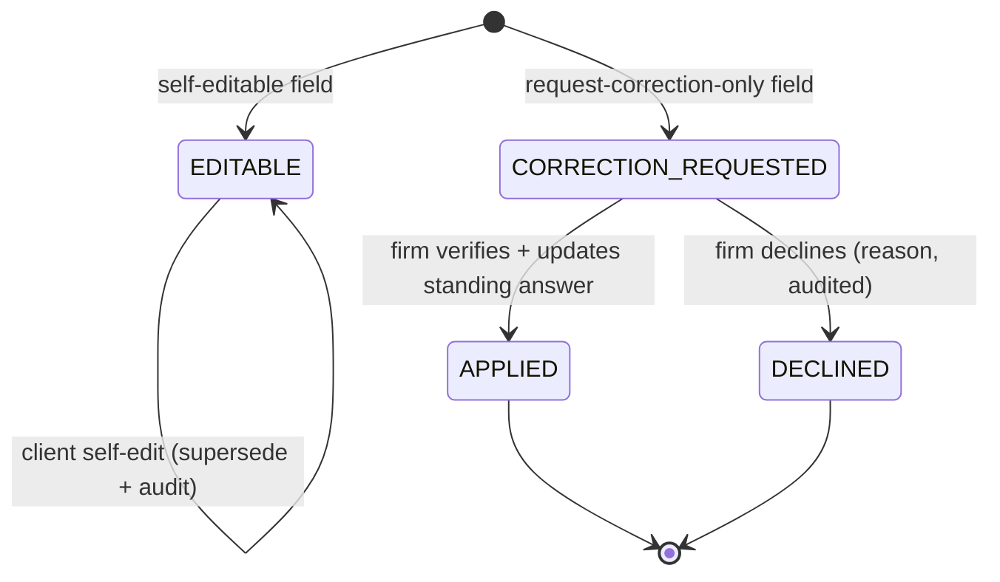

**Consent (per purpose).** `GRANTED → WITHDRAWN → (RE-)GRANTED` — each transition a new versioned `ConsentRecord`, audited, enforced live (SA-11).

**DSR request.** `SUBMITTED → IDENTITY_VERIFIED → IN_PROGRESS → COMPLETED` (with honest sub-states `COMPLETED_FULL` / `COMPLETED_PARTIAL_RETAINED` / `PAUSED_LEGAL_HOLD`), on a statutory clock (SA-11, Doc 1 §7.6). CP-8 surfaces these; SA-11 drives them.

**Export job.** `REQUESTED → VERIFIED → GENERATING → READY (ownership-bound link) → ACCESSED (egress audited) → EXPIRED` (SA-11; CP-8 shows status + delivers the link).

---

## 7. Key Entities & Fields

> Tenant key `firm_id` (FORCED RLS, Doc 1 §2.2) + the portal second dimension `app.current_client_subject` (Doc 1 §2.5). CP-8 **owns no new durable entity** beyond a thin per-request projection and the optional view-state below; it reads/writes single-sourced entities owned elsewhere. Cited-not-redefined entities carry their owning module. Restricted columns use field-level envelope encryption + mask-by-default + audited reveal (Doc 1 §7.2).

**Consumed / projected (NOT owned by CP-8):**
- **`Party` / `PartyProfile`** (Doc 1 §5.2) — identity root + slow-changing attributes (`displayName`, `locale`, contact channels). CP-8 writes self-editable `PartyProfile` fields (locale, contact channels) within field rules; never redefines the entity.
- **`ClientCustomer`** (Doc 1 §5.2) — the portal credential lens carrying `clientCustomerId` (the portal subject GUC value) and a mirrored `locale` for fast render. Authentication binding only; no domain data.
- **`portal_session`** (Doc 1 §3.4 — owned by the platform session model, surfaced via the CP-1 session backbone; see CP-1 §7) — the §3.1 security strip reads a projection of the caller's own live rows (`device_label`, `created_at`, `last_seen_at`, IP for transient coarse-location derivation only) and invokes the CP-1/AuthCore revocation service; CP-8 never writes the table and never reads/returns `refresh_hash` or `token_binding_fingerprint`. Cited, not redefined.
- **`AnswerSubject` / `ClientCanonicalAnswer` / `ClientFactRecord`** (Doc 1 §5.4) — the append-only answer store; profile reads the current (un-superseded) answers for the client's own subject; a self-edit supersedes. Restricted answers stay field-encrypted (Doc 1 §7.2).
- **`CanonicalField`** (Doc 1 §5.3) — supplies each field's `dataType`, `validationJson`, `isRestrictedPii`, and (via firm policy) the edit-rule classification. Read-only reference.
- **`NotificationPreference`** (AG-10-owned) — `firm_id`, `userId` (= `clientCustomerId` for a portal subject), `channelMatrixJson` (per `eventType`: `{inApp,email,push}`), `quietHoursStart/End`, `timezone`, `digestEnabled`, `digestFrequency`. CP-8 edits the client's own row; effective channels = this ∩ the AG-16 firm ceiling. Cited, not redefined.
- **`NotificationEventCatalogue`** (AG-10, config-as-JSONB) — the typed `notif/` catalogue; CP-8 shows only the client-facing subset.
- **AG-16 firm-policy notification ceiling** — the per-firm allowed-channel set that bounds the client's choices. Cited, not redefined.
- **`PortalVisibilityConfig` / `PortalAccessPolicy`** (AG-15-owned) — the allow-list that gates which sections/entity types CP-8 may render (AG-15 fields: `showProgress`, `showDocuments`, `showFirmProducedDocs`, `showSqr`, `showInvoices`, `showAgreements`, `enableMessaging`, `stageLabelMapJson`), and `offeredLocales` for the language picker. Read as the contract; enforced server-side.
- **`ConsentRecord`** (SA-11-owned) — per-purpose, versioned, withdrawable; CP-8 reads the subject's records and writes withdrawals/grants via the SA-11 service.
- **`DsrRequest`** (SA-11-owned) — `type` (ACCESS/CORRECTION/ERASURE/PORTABILITY), subject Party, statutory clock, honest hold/floor-aware outcome. CP-8 raises and surfaces status.
- **Canonical per-individual export job** (SA-11-owned) — one identity-verified, masked-unless-reveal, audited-egress export (JSON+PDF). CP-8 requests and delivers the ownership-bound link.
- **Cross-cutting (attached via registry-validated `(entityType, entityId)`, Doc 1 §5.8):** `AuditLog`/`PII_REVEAL` (Doc 1 §7.5/§7.2), `Notification` (AG-10), `Reminder` (DSR-deadline reminders), `Media` (the generated export artifact) — referenced, not redefined.

**Optional CP-8-owned view-state (thin):**
- **`PortalAccountViewState`** (TENANT, CLIENT-PII) — `id`, `firm_id`, `client_id` (Party FK), `clientCustomerId`, `lastSeenPrivacyNoticeVersion?`, `profileTourDismissedAt?`, `createdAt`, `updatedAt`. Purely UI convenience; carries no authoritative PII. `@@unique(firm_id, clientCustomerId)`. Subject to both RLS dimensions. (This is one of the three portal-owned tables — alongside CP-5 `PortalPaymentAttempt` and CP-9 `OrgPortalRollup`; the rest of the portal introduces no new tables.)

**Events emitted / consumed.** (Domain events: pure `dot.case`, past-tense registered verb token, Doc 1 §6.1.2 — no dash.case segment inside a domain event; dash.case is reserved for `notif/`.) CP-8 emits only `client.*` data-governance facts about the subject's own profile/locale/consent/DSR — it does **not** emit any portal-identity/session fact (`portal.client.loggedin` and the session events are CP-1-owned per CP-1 §7; CP-8 does not duplicate or synonymise them). Each name below has **exactly one declared emitter** (CP-8 for the `client.*` rows) and is **FROZEN** for the vendor to build against; only the central Doc 1 §6.1 dictionary file-entry + idempotency-key row is pending the integration pass — the name itself is not provisional.

| Direction | Name | Counterparty / consumer | When |
|---|---|---|---|
| Emit | `client.profile.updated` | AG-15 (firm-side engagement timeline), Search projection | client self-edits a profile field |
| Emit | `client.locale.changed` | AG-10 (template/locale selection) | client changes language preference |
| Emit | `client.preferences.updated` | AG-10 (delivery routing) | client saves notification prefs |
| Emit | `client.consent.changed` | SA-11 (register), AG-10 send-gate, AG-11 Conductor | client withdraws/grants a purpose |
| Emit | `client.dsr.requested` | SA-11 (DSR engine), AG-15 (firm awareness), Reminder (deadline) | client opens a DSR / export request |
| Consume | `dsr.completed` | from SA-11 | drives DSR status + `notif/data-request-updated` |
| Consume | `export.ready` | from SA-11 | drives `notif/data-export-ready` + ownership-bound link |
| Raise | `notif/data-export-ready` | the client (in-app + email per pref) | export artifact ready |
| Raise | `notif/data-request-updated` | the client | DSR status/clock change |
| Raise | `notif/profile-correction-resolved` | the client | firm applies/declines a correction request |

> The binding source is the Doc 1 §6.1 dictionary; the canonical names above are FROZEN for the build and CI-linted against that dictionary (Doc 1 §6.4). Their central registration (payload + idempotency key, single-emitter assertion) lands in the integration pass — the names are not minted ad hoc and must not drift.

---

## 8. User Stories + Acceptance (G/W/T)

**US-1 — Correct my own contact details.**
*Given* I am a logged-in client viewing my profile, *When* I edit my mobile phone (a self-editable field) to a valid number, *Then* a new `ClientCanonicalAnswer` supersedes the prior one with `status = DECLARED` and `sourceJson.surface = PORTAL_PROFILE`, the old answer is retained in history, the change is audited, and `client.profile.updated` is emitted. *And* if I enter an invalid number, *Then* a localized validation error shows and nothing is persisted.

**US-2 — See but not silently change my legal name.**
*Given* my legal name is a request-correction-only field, *When* I tap Edit, *Then* a correction request opens (SA-11 `DsrRequest` type CORRECTION), the standing `VERIFIED` answer is unchanged, and I see "submitted for the firm to verify"; *When* the firm applies it, *Then* I get `notif/profile-correction-resolved` and the standing answer updates.

**US-3 — Reveal my own passport number safely.**
*Given* my passport number renders masked, *When* I tap Reveal and I hold `portal/pii:reveal-own`, *Then* exactly one `PII_REVEAL` audit entry is written before the cleartext is returned; *And* if the audit write fails, *Then* no cleartext is returned (fail-closed).

**US-4 — Turn off SMS but keep email.**
*Given* the firm's ceiling allows email + in-app but the firm has disabled SMS firm-wide, *When* I open notification preferences, *Then* SMS is shown disabled with an explanation, *And* I can switch document-reminder email off while in-app stays on; *And* a service message about my unsigned retainer still reaches me in-app regardless.

**US-5 — Use the portal in French.**
*Given* the firm offers EN + FR, *When* I set my language to French, *Then* `PartyProfile.locale` updates, every client-facing string, email, nudge, and notification renders in French, and a string with no FR translation falls back to the firm default — never blank.

**US-6 — Withdraw marketing consent.**
*Given* I previously granted marketing consent, *When* I withdraw it, *Then* a new versioned `ConsentRecord` is written, `client.consent.changed` fires, the send-gate/Conductor stop all marketing to me at point of use, *And* transactional messages about my own file continue.

**US-7 — Export everything you hold on me.**
*Given* I request my data export, *When* I pass step-up identity verification, *Then* SA-11 produces one JSON+PDF export with Restricted fields masked-unless-reveal, the access is audited as egress, and I receive `notif/data-export-ready` with an ownership-bound link that 404s for any other client.

**US-8 — Ask to be erased, get an honest answer.**
*Given* I have financial records under a 7-year floor, *When* I request erasure, *Then* an SA-11 `DsrRequest` opens on the statutory clock, and the outcome honestly reports "personal data deleted; financial records retained until {date}" — never falsely "fully deleted"; *And* if a legal hold is active, *Then* it reports paused-by-hold.

**US-9 — A sibling client cannot see my account.**
*Given* a portal token for client X, *When* X requests client Y's profile / preference / consent / DSR identifier, *Then* the response is 404/empty, audited, never 200, with no Y data in body/error/logs — proven at both the API and DB layers (Doc 1 §2.5/§4.5).

**US-10 — Sign out a device I don't recognise.**
*Given* my security strip lists two sessions — this device (pinned, marked) and "Chrome on Windows, Toronto area, last used yesterday" — *When* I revoke the unfamiliar one, *Then* that session is dead immediately (not at token expiry, Doc 1 §3.4), `portal.session.revoked` and a CP-1-18 audit entry are written, and the list re-fetches without it while my own session survives; *And when* I choose "Sign out everywhere else", *Then* every session except my current one is revoked in one action.

---

## 9. Edge Cases & Validations

- **Cross-subject id in any CP-8 request** → 404/empty, audited, denied at the DB by the second portal RLS dimension; never 200, never an existence leak (Doc 1 §2.5 AC-2.5.2).
- **Corporate seat-holder / dependent** → ownership resolves through `PartyRelationship`; the seat sees only its own subject's account surface; a non-seat sibling gets 404 at app + DB (Doc 1 §2.5 AC-2.5.6).
- **Self-edit collides with a concurrent firm-side update** → the append-only supersede + partial-unique index (Doc 1 §5.4) lets exactly one writer leave a current row; the loser retries / re-resolves against the now-current answer.
- **Client opts into a channel above the firm ceiling** → rejected on save with a localized message; UI shows it disabled (server-enforced, not UI-only).
- **Reveal audit write fails** → reveal denied, 5xx/denied, no cleartext (audit-before-reveal fail-closed, Doc 1 §7.2 AC-7.2.4).
- **Withdraw consent then a marketing send is mid-flight** → the worker re-checks live consent per recipient and skips the now-withdrawn subject (Doc 1 §7.6; AG-10).
- **Export requested twice** → idempotent on the request key (Doc 1 §6.2.3 ledger); one job, one artifact, no duplicate egress.
- **DSR erasure under active legal hold** → refused/paused honestly; hold beats deletion (Doc 1 §7.4 AC-7.4.2).
- **Locale not in `offeredLocales`** → rejected; the picker only offers the firm's configured set (AG-15 `PortalAccessPolicy`).
- **Entity type not on `PortalVisibilityConfig`** → that profile section is invisible even for an own-owned record (leak-off by default).
- **Offline (PWA)** → read-only cached snapshot; any write (self-edit, preference, withdrawal, DSR) is disabled offline and queued only as an explicit user re-submit on reconnect — never a silent offline PII write (Doc 1 §8 / NFR5-13).
- **Revoke targets the current session** → treated as an explicit logout: session revoked, subject-scoped cache cleared, redirect to login (CP-1-13) — never a half-dead state.
- **Session revoked elsewhere (reset / AG-15 suspend) while the strip is on screen** → the next strip action 401s (instant revocation, Doc 1 §3.4); the client is returned to login, no stale-list action succeeds.
- **Revoke-all-others with only one live session** → the action renders disabled with an explanation; a forced call is a validated no-op, not an error.
- **Session-id of another subject passed to a revoke route** → 404/empty + audit, never 200 (ownership chain + second RLS dimension, Doc 1 §4.5) — same denial contract as every CP-8 surface.
- **Restricted value in a log/trace** → forbidden; the PII/secret log-redaction scanner (Doc 1 §7.7) must show zero Restricted values from CP-8 paths.

---

## 10. Permissions (`portal/*`)

> LOCAL scope, `aud = er:portal`, evaluated within `firm_id` **and** the client's ownership chain (Doc 1 §4.1). The catalog is **owned by SA-6** and seeded per Doc 1 §4.4; CP-8 declares the keys its routes require. All keys are `.own`-qualified by construction — a portal key can never grant cross-subject reach. Grammar is uniform `portal/<resource>:<action>.own` (colon-dot), matching the consolidated portal permission appendix so the §4.4 CI completeness derivation is mechanically green.

| Permission | Governs |
|---|---|
| `portal/profile:view.own` | Read the client's own profile projection (masked Restricted) |
| `portal/profile:edit.own` | Self-edit self-editable profile fields (supersede + audit) |
| `portal/profile:request-correction.own` | Open a CORRECTION DSR for a request-correction-only field |
| `portal/pii:reveal-own` | Reveal the client's own Restricted cleartext (audited `PII_REVEAL`) — defined in Doc 1 §7.2 |
| `portal/notification-preference:manage.own` | View/edit the client's own `NotificationPreference` (∩ firm ceiling) |
| `portal/locale:set.own` | Set the client's own preferred locale (within `offeredLocales`) |
| `portal/consent:view.own` | View the client's own per-purpose consent state |
| `portal/consent:manage.own` | Withdraw / (re-)grant the client's own consent per purpose |
| `portal/data-export:request.own` | Request the canonical per-individual export (step-up verified) |
| `portal/dsr:request.own` | Open an access/correction/erasure/portability DSR |
| `portal/dsr:view.own` | View the client's own DSR status + statutory clock |
| `portal/session:manage.own` | View/revoke the client's own active sessions (Doc 1 §3.4) |

CI completeness (Doc 1 §4.4): every `@RequirePermissions('portal/...')` on a CP-8 route exists in the SA-6 catalog and is wired to ≥ 1 route; the scope-aware guard rejects any non-`portal/*` token on these routes (`403 SCOPE_VIOLATION`), and the cross-pool 401 test (Doc 1 §3.1) proves a firm/platform token cannot reach them.

---

## 11. Scalability · Security · Performance (isolation first)

**Isolation (first, non-negotiable).** CP-8 inherits the portal isolation backbone from CP-1 §3 (the own-case-only gate `assertPortalOwnershipChain`, the second-RLS-dimension wiring, and the ownership-bound object-access rule) per Doc 1 §2.5/§4.5 — it is **not re-stated or weakened here**; only the CP-8-specific deltas follow. Concretely, every CP-8 read/write is doubly bounded: `firm_id` RLS (firm-against-firm) **and** the second portal RLS dimension `app.current_client_subject` (client-against-client), each with `USING` + `WITH CHECK` so a portal subject can neither read nor write a sibling's row at the DB even if the application layer is bypassed (Doc 1 §2.5). Scope is sourced only from `PrincipalContext` (the authenticated `clientCustomerId`), never request input (Doc 1 §4.5 AC-4.5.1). The CP-1 §3 record-level helpers (`assertPortalOwnershipChain` + `PortalVisibilityConfig` allow-list) run server-side on every read/write and on the export/DSR paths; cross-subject access is 404/empty, audited, never 200 (AC-4.5.3). CP-8 is in scope for the §2.8 cross-tenant + portal cross-client denial suite (DB + API + corporate-seat chain) and the pre-go-live horizontal-access pentest that must fail to leak for 100% of resources.

**PII security.** Restricted fields are field-encrypted (AES-256-GCM under the per-subject / per-retention-class sub-key, Doc 1 §7.1/§7.2), masked by default, revealed only with `portal/pii:reveal-own` + audited `PII_REVEAL` (fail-closed). No Restricted PII is ever projected into the search index or any log/trace (Doc 1 §7.3/§7.7). The export is the single audited egress chokepoint (masked-unless-reveal, identity-verified). No card data is ever stored (PCI SAQ-A). The DSR erasure path inherits crypto-shred + retention-floor + legal-hold precedence from SA-11 (Doc 1 §7.4) — CP-8 stores nothing that escapes that regime; the only CP-8-owned row (`PortalAccountViewState`) carries no authoritative PII and is itself under both RLS dimensions.

**Auth & session.** `aud = er:portal` on a distinct signing key (Doc 1 §3.1); session re-validated every request (instant revocation, Doc 1 §3.4); step-up re-auth gates the export. The export/artifact link is an ownership-bound presigned/capability token (per CP-1 §3 object-access rule), never a caller-supplied key, never a token-in-URL (Doc 1 §3.5/§4.5/§4.6).

**Accessibility & i18n.** WCAG 2.2 AA (axe-in-CI + manual AT audit + VPAT, Doc 1 NFR5-11); full EN + Canadian French including all emails, notifications, and the export PDF (Doc 1 NFR5-12). The PWA is responsive + installable with a read-only offline shell (Doc 1 NFR5-13).

**Performance & scale.** Reads p95 ≤ 300ms / p99 ≤ 800ms; writes p95 ≤ 600ms (Doc 1 NFR5-15). The profile read is a bounded projection (one subject's current answers + `PartyProfile`) — no unbounded fetch; answer-store reads use the partial-unique current-answer index (Doc 1 §5.4). Export generation is async via BullMQ (work > 5s, Doc 1 §8) with the client notified on completion — never a blocking request. Consent/DSR reads are single-subject, small, and cursor-paginated where lists appear. All durable data + the export artifact reside in the tenant's region (Doc 1 §2.9/§7.7).

---

## 12. Reference Note (greenfield)

CP-8 is **greenfield**. There is no prior Client Portal account/privacy console in the reference prototype — the Client Portal console was the gap-analysis CRITICAL scope-hole C2, never previously specced (ADR W2). The firm-side counterparts the prototype *does* gesture at (a `global:true` notification-read defect, an IDOR presigned-read that signs any caller-supplied key) are precisely the anti-patterns this module is written **against**: notification reads here are `firm_id` + subject-scoped with an RLS backstop, and the export/artifact link is always ownership-bound. The single sources CP-8 reads/writes — `Party`/answer store (Doc 1 §5), `NotificationPreference` (AG-10), the firm ceiling (AG-16), `PortalVisibilityConfig`/`PortalAccessPolicy` (AG-15), and the SA-11 governance plane — exist as target-state contracts in their owning modules; CP-8 is the client lens over them, not a reimplementation. The vendor builds CP-8 fresh against this spec; no parity obligation to the prototype applies (ADR 6.1). Every entity here is either consumed-as-specified or a thin view-state with no authoritative PII.

---

## 13. Open Questions / [FOUNDER-CONFIRM]

- **[FOUNDER-CONFIRM] Field-level edit-rule matrix.** Which profile fields are self-editable vs request-correction-only vs read-only is a firm-policy + domain call (with privacy/SME input). The machinery (three rules, append-only supersede, correction-as-DSR) is fixed; the per-field classification is content/policy. Default proposed: contact channels + mailing address + locale self-editable; legal name + DOB + any `VERIFIED` answer correction-request-only; firm-managed/derived facts read-only.
- **[FOUNDER-CONFIRM] Client-facing `notif/` subset.** Which catalogue event types appear in the client's preference matrix, their default channels, and which are non-suppressible service messages. Mechanism (matrix ∩ ceiling, service-always-in-app) is fixed; the subset is config.
- **[FOUNDER-CONFIRM] Consent purpose taxonomy.** The named Law-25 per-purpose set the register exposes (owned by SA-11 + privacy counsel); CP-8 renders whatever purposes exist. Mechanism fixed.
- **[FOUNDER-CONFIRM] DSR self-service scope.** Whether erasure/portability are fully self-initiated in the portal or require a firm confirmation step before SA-11 runs them; and the exact statutory-clock interpretation (set with counsel, Doc 1 §7.6). The request-and-honest-status surface is fixed.
- **[FOUNDER-CONFIRM] Export step-up factor.** Whether the export identity re-verification requires MFA re-challenge vs password re-entry for portal subjects (portal MFA is optional by default, Doc 1 §3.6). Recommend MFA re-challenge where the client has MFA enrolled, password re-entry otherwise; export is gated regardless.
- **[FOUNDER-CONFIRM] Seat-holder profile scope.** Whether a corporate seat-holder / dependent edits only their own contact + consent (recommended) or has any read window into roster-level non-PII. Ownership chain enforces whatever is decided; default is own-subject-only.

---

# Module CP-9: Corporate / Org-Scoped Portal

> **Plane:** Client Portal console (the third console). **Auth pool:** `er:portal` (the physically-walled client-portal pool, Doc 1 §3.1; AG-15 `PortalSession` pins `aud = er:portal`). **Tenant key:** `firm_id` (FORCED RLS, Doc 1 §2.2). **Portal isolation key:** `app.current_client_subject` = the seat-holder's `clientCustomerId`, traversed through `PartyRelationship` to the corporate Party (Doc 1 §2.5 corporate-seat case, §4.5, §5.2). **Isolation backbone:** owned by CP-1 (the own-case-only gate `assertPortalOwnershipChain`, the second portal RLS dimension wiring, the IDOR-safe presigned-object rule) — CP-9 inherits it per CP-1 §3, never re-derives or weakens it. **What this module owns:** the *org-scoped seat experience* — how a corporate sponsor/employer logs in, sees the firm's engagement at the **organisation** level (their linked applicants/cases, e.g. an LMIA or corporate engagement), participates in the shared firm-side flows (documents, status, invoices, e-sign, messaging) at the org scope, and manages multiple human seats under one organisation. **What it consumes (mirrors, does not re-spec):** the corporate case shape from AG-7 (`Case.caseType = CORPORATE`, `CorporateCaseProfile`, `CaseApplicant role = EMPLOYEE`); the Party org/relationship model (Doc 1 §5.2, `Party.kind = ORGANISATION`, `PartyRelationship`); the firm-side portal control plane AG-15 (`PortalVisibilityConfig`, `CorporatePortalSeat`, invite/suspend/revoke machinery, `PortalAccessPolicy`, white-label); and the per-document/per-invoice/per-envelope flows already specified for the individual portal (CP-4 documents, CP-5 invoices+pay, CP-6 e-sign, CP-7 messaging, CP-3 SQR/PQR). **Country:** content-neutral; the immigration content (which org-level fields, which document types, what "LMIA" even is) is pack/founder-supplied and never appears here.

## Module Index

1. **Purpose & Goal**
2. **Users & Jobs-to-be-Done**
3. **Functional Design — How It Works** (how / world-class / key screens / data-flow)
4. **Functional Requirements** (numbered)
5. **Business Rules & Logic**
6. **States & Lifecycle**
7. **Key Entities & Fields** (cite Doc 1 §5; Events emitted/consumed table)
8. **User Stories + Acceptance Criteria** (Given/When/Then)
9. **Edge Cases & Validations**
10. **Permissions** (LOCAL `portal/*`)
11. **Scalability · Security · Performance** (isolation FIRST)
12. **Reference Note** (NEW — portal is greenfield)
13. **Open Questions / Founder Decisions**

### Visual Overview

```mermaid
flowchart TD
  subgraph ORG["Corporate Party (kind = ORGANISATION)"]
    SEAT1["Seat-holder A<br/>ClientCustomer · admin-capability grant"]
    SEAT2["Seat-holder B<br/>ClientCustomer · viewer-capability grant"]
  end
  SEAT1 -->|app.current_client_subject| RLS{{"Portal 2nd RLS dim<br/>resolve_subject() via PartyRelationship"}}
  SEAT2 -->|app.current_client_subject| RLS
  RLS -->|corporate-seat traversal| CORP["Corporate Cases<br/>(caseType = CORPORATE)"]
  CORP --> CP["CorporateCaseProfile<br/>(employer data once · AG-7)"]
  CORP --> EMP["CaseApplicant role = EMPLOYEE × N"]
  RLS -.->|PortalVisibilityConfig allow-list<br/>+ CorporatePortalSeat scopeJson| GATE["What the org seat may see/do"]
  GATE --> DOCS["Org documents (CP-4)"]
  GATE --> STAT["Org status / progress"]
  GATE --> INV["Org invoices + pay (CP-5)"]
  GATE --> SIGN["Org e-sign (CP-6)"]
  GATE --> MSG["Org messaging (CP-7)"]
  X["Another org's case"] -.->|"resolve_subject() ≠ subject → 404 + DB denial"| SEAT1
```

---

## 1. Purpose & Goal

CP-9 is the **employer/sponsor face** of the Client Portal. Where the individual portal serves one applicant looking at their own file, CP-9 serves a **corporation** — an employer running an LMIA, a sponsor backing several applicants, a company relocating staff — and gives it an **org-level seat view**: one login surface where the organisation sees the firm's work across *all the people and cases tied to that organisation*, and where **multiple humans from that company** can hold seats under the one organisation without each becoming a separate, siloed client.

The design problem CP-9 solves is precisely the one Doc 1 calls out as the portal's hardest: a portal user must see **only** rows whose ownership chain resolves to their own subject. For an individual that is a flat `client_id = me` check. For a corporate seat it is a **graph traversal** — the seat-holder is a `ClientCustomer` whose chain resolves *through a `PartyRelationship` edge to the corporate Party* (Doc 1 §2.5, §5.2), and the org's reach is everything that corporate Party owns (its corporate cases, its employee applicants' org-level rows), filtered by the firm's `PortalVisibilityConfig` allow-list and the seat's granted capabilities. CP-9 is where that org-scoped record-level authz — owned and enforced by CP-1's isolation backbone (per CP-1 §3) — becomes a usable product instead of a database guarantee.

The goal: an HR/mobility manager logs in once and sees their whole program — every linked case, every org-level document outstanding, every invoice due, every agreement to counter-sign — **at the organisation scope, and nothing from any other organisation or any unrelated individual client of the same firm**. Isolation is the feature, not the constraint.

## 2. Users & Jobs-to-be-Done

| User | Goal | JTBD |
|---|---|---|
| **Corporate Sponsor / Seat Admin** (the primary seat) | Run the company's immigration program with the firm; keep all its people moving. | "When I log in, I want one dashboard of every case my organisation has with this firm — who's where, what's blocking — so I'm not chasing the consultant per employee." · "When the firm needs the company's incorporation docs or a signed offer, I want to provide them once at the org level, not re-attach per employee." · "When I add my colleague, I want to give them a seat under our company so they see the same program — without seeing another company's files." |
| **Corporate Seat Viewer** (a delegated seat) | Stay informed; do the part delegated to them. | "When my admin invites me, I want to see exactly the cases and tasks I'm allowed to, in my language, and not be able to touch billing or remove other seats." |
| **Employee / Beneficiary applicant** (an individual the org sponsors) | Provide their own personal facts and documents. | "When I'm the applicant, I want to fill *my* SQR and upload *my* passport in my own private space — and I do NOT want my employer to see my Restricted personal data unless the firm explicitly shares it." *(Served by the individual CP-2 dashboard / CP-3 questionnaire / CP-4 documents surfaces; CP-9 defines the boundary that keeps the employee's personal PII out of the org seat by default.)* |
| **Firm staff** (AG-15) | Govern the org's access. | "When I set up the corporate engagement, I want to grant the company a seat, decide what the org may see vs. what stays employee-private, and add/remove the company's people." *(Firm-side; CP-9 consumes AG-15's `CorporatePortalSeat` + `PortalVisibilityConfig` and never authors them.)* |

**Design implication.** The Seat Admin is the protagonist of the CP-9 UI: an **org dashboard** that rolls up many cases, an **org-document** surface, an **org-billing** surface, and a **seat-management** panel. The viewer gets the same read surfaces minus the privileged actions. The employee-as-applicant is a *different person on a different (individual) portal surface* whose private answers CP-9 must structurally never expose to the org seat unless the firm's config opts that field/document in. The line between "org-level" and "employee-private" is the whole module.

## 3. Functional Design — How It Works

### 3.0 The org-scope model — one organisation, many seats, many cases (the foundation)

A corporate engagement is anchored on a **`Party` of `kind = ORGANISATION`** (Doc 1 §5.2) — the employer/sponsor. The firm's work for it lives as one or more **corporate cases** (`Case.caseType = CORPORATE`, each binding a `CorporateCaseProfile` that stores employer data **once**, AG-7), each containing **employee `CaseApplicant`s (`role = EMPLOYEE`)**. A human who logs in for the company is a **`ClientCustomer`** (the credential lens) whose ownership chain resolves **through a `PartyRelationship` edge to that corporate Party** — this is the corporate-seat case the foundation mandates (Doc 1 §2.5, §4.5 AC-5.2b, §5.2).

CP-9 never invents any of those entities. It consumes the firm-side **`CorporatePortalSeat`** (AG-15) that binds a `ClientCustomer` to the corporate Party with a firm-set `scopeJson`, and renders the org view that the second RLS dimension + `PortalVisibilityConfig` admit. The org-scope rule, stated once and enforced everywhere (by the CP-1 backbone, per CP-1 §3): **a seat sees the org chain — the corporate Party, its corporate cases, and the org-level rows those cases own — and never another organisation's chain, and never an employee's personal-PII rows unless the firm's config opts them in.**

### 3.1 Org-scoped login & seat resolution — "you log in as a person, but you act for the company"

A seat-holder authenticates through the walled `er:portal` pool (Doc 1 §3.1), exactly like an individual client — same activation/MFA/session model (CP-1; account/session-management screens in CP-8), same single-use capability-token activation (issued firm-side by AG-15). What differs is **subject resolution**: on a corporate seat login the portal middleware sets `app.current_client_subject` to the seat-holder's `clientCustomerId`, and the RLS policy's `resolve_subject()` traverses the `PartyRelationship` edge to admit the corporate Party's rows (Doc 1 §2.5). The seat-holder's *own* personal individual rows (if they also happen to be an individual client) remain reachable under the direct-`client_id` branch — the two are additive, never conflated.

**World-class behaviour.** *Seat, not a shared login* — every human gets their own credential and MFA; no "the company password." *One identity, possibly many contexts* — if a person is both an org seat-holder and an individual applicant elsewhere, they switch context explicitly (an **org/personal context switcher**), and the active context drives which subject GUC is set; data never bleeds between contexts. *Honest scope label* — the header always shows "Acting for **{Organisation}**" so a seat-holder is never confused about whose data they are looking at.

**Data flow.** Login (er:portal) → resolve `clientCustomerId` → look up `CorporatePortalSeat` → set `app.current_client_subject` + (active context = ORG) → middleware sets the GUC inside the request transaction → every query is RLS-confined to the org chain → `assertPortalOwnershipChain` re-checks at the service layer (per CP-1 §3) → the seat-session touch is recorded on the AG-15-owned `PortalActivityEvent` stream (`eventType = LOGIN`, carrying `seatId`, `corporatePartyId`); CP-9 mints no portal-login domain event (CP-1 is the SOLE emitter of portal-identity facts, `portal.client.loggedin`).

### 3.2 The org dashboard — "one screen for the whole program"

The landing surface is a **roll-up across the organisation's cases**: a tile/row per linked corporate case showing client-friendly stage/progress (relabelled via `PortalVisibilityConfig.stageLabelMapJson`, never the internal stage), an outstanding-actions count (documents requested, agreements to sign, invoices due — aggregated org-wide), and a per-case drill-in. A second strip rolls up **org-level work items** that are not case-specific (e.g. company incorporation documents, the master service agreement). The progress surface itself is gated by `PortalVisibilityConfig.showProgress`. **Ownership (roster lens):** the corporate **roster lens** (the seat-scoped list/roll-up of in-scope cases) is owned by **CP-9**; CP-2's roster dashboard and CP-4's org checklist embed this lens — they do not define a second roster model.

**World-class behaviour.** *Aggregate, never fan-out-at-read* — the dashboard reads pre-aggregated org rollups (per-org outstanding counts, per-case progress), not N live case scans, so an org with 200 sponsored applicants still loads fast (§11). *Always answers "what does the company need to do next?"* — a single ranked org action list (sign this, pay that, upload these) across all cases. *Relabelled + bilingual* — every stage/label is the firm's client-facing copy in the seat-holder's locale (Doc 1 §8 EN/FR; Law-25). *Allow-list honest* — a case or section the firm has not enabled for the org simply isn't there (leak-off by default); the seat-holder sees no "locked" teaser of data they may not have.

### 3.3 Org documents — "provide company evidence once; see the org checklist; respect the employee wall"

CP-9 reuses the CP-4 document surface (request list, upload via ownership-bound presigned PUT, status badges, re-upload-on-reject), scoped to **org-level documents**: documents attached to the corporate Party or the corporate case (incorporation, business licence, recruitment proof, the offer of employment as an org artefact), per the `PortalVisibilityConfig` allow-list (`showDocuments` / `showFirmProducedDocs`). The seat uploads through the identical scan-gated, version-not-overwrite path AG-9 defines.

**The employee wall (load-bearing).** An employee applicant's **personal** documents (their passport, their police certificate) belong to the *employee's* Party, not the corporate Party. By the ownership-chain rule they resolve to the *employee's* subject, **not** the org's — so they are invisible to the org seat by construction, **unless** the firm explicitly opts a given document/type into org visibility for that case via `PortalVisibilityConfig`. CP-9 never widens this; it can only render what the config + chain admit (enforced by the CP-1 backbone, per CP-1 §3).

**World-class behaviour.** *Upload once, link everywhere (same org)* — an org document the firm marks reusable links onto every relevant corporate case via AG-9 `DocumentLink` (same-client/same-org scope only, never cross-org). *Two-sides-one-wire status* — when the firm receives/verifies/rejects an org document, the seat's list reflects it on the next poll/load (consuming `document.requested` / `document.uploaded` / status events, Doc 1 §6; freshness is the CP-4 polling model — no realtime push in foundation, Doc 1 §1.5). *Reject travels with a reason* in the seat-holder's locale.

### 3.4 Org status & per-case drill-in — "see where each person is, at the level we're allowed to show"

Drilling into a case shows the **client-facing progress** for that case (relabelled stages, milestone ribbon, what-we-need-from-you, what-the-firm-is-doing) — the same CP read surface an individual gets, but reachable here because the seat's chain resolves to the org that owns the case. For a corporate case with many employees, the seat sees an **employee roster at the org-permitted grain**: per-employee progress and per-employee outstanding org-actions, with each employee's *personal* detail gated behind the wall (§3.3).

**World-class behaviour.** *Org-grain by default, person-grain only by opt-in* — the roster shows "Employee 3 of 12 · stage: Submitting" without exposing the employee's private answers; the firm can opt specific fields/documents in. *Stage relabelled, never raw* — internal workflow vocabulary never reaches the seat. *No internal notes ever* — the internal-only vs client-visible note wall (AG-13) means a candid case note can never surface to the org seat (server-enforced read filter + the second RLS dimension, Doc 1 §2.5).

### 3.5 Org invoices & online payment — "see and pay the company's bills, single-sourced from Accounting"

CP-9 surfaces the **org's invoices** — those raised against the corporate billing party (`corporateCaseId` / `corporateProspectId`, resolving to the corporate Party, AG-6 polymorphic billing party) — and lets a privileged seat pay online through the same CP-5 path (the card never touches ER; payment intents on the firm's connected account via the `PaymentRailPort`). Money is **read from and written back to Accounting (AG-6)**; CP-9 stores no balances and computes no totals — it renders AG-6's amounts and posts a payment intent whose success AG-6 reconciles.

**World-class behaviour.** *Pay-permission is a distinct seat capability* — a viewer seat sees invoices but cannot pay; only a seat holding `portal/corporate:pay` initiates payment (so an admin can delegate read without delegating spend). *Reporting currency, never raw-sum* — multi-currency org balances are converted via `FxRateSnapshot` (Doc 1 §6.5), never naively summed. *Receipts + history* org-wide, with each payment attributed to the seat-holder who paid (audited).

### 3.6 Org e-sign — "the company counter-signs as the sponsor, in-portal"

A corporate engagement often needs the **organisation** to sign (the service agreement, an employer attestation, an offer of employment). CP-9 reuses CP-6's in-portal e-sign surface, scoped to envelopes where the **org seat is a designated signer**. The Signer's sequential/parallel order (AG-5) is honoured; the seat sees only envelopes routed to it, signs in-portal, and the canonical `envelope.signed` fact — emitted SOLELY by AG-5 (the Signer), per Doc 1 §6.1 (no synonym; ADR FINAL C4-D2) — flows back to the firm-side flow (case advance, document filing) exactly as for an individual. CP-9 emits NO portal-side signing event; it only routes the seat's act to AG-5.

**World-class behaviour.** *Signer authority is a seat capability* — only a seat holding `portal/corporate:sign` may execute the org's signature; a viewer cannot bind the company. *Current-signer-only* — a seat is notified and unlocked only when it is the active signer (no premature signing). *Audit-grade* — identity/IP/time recorded; the executed copy is filed as a distinct `[Signed]` version (AG-9), original never mutated.

### 3.7 Seat management — "add and manage the company's people, within firm-granted limits"

A seat holding `portal/corporate:seat-manage` (the Seat Admin) can **invite, view, and request removal of** other seats under the same organisation — but always **mediated by the firm**: CP-9 raises a *seat request* to AG-15, which actually mints/activates the `ClientCustomer` credential and creates the `CorporatePortalSeat` binding (the firm retains governance, seat caps, and revoke authority). The admin requests a **capability grant** for the new seat (view / document-upload / pay / sign / seat-manage / message — the six `portal/corporate:*` keys in §10, within what the firm enables) — these capabilities are granted via the seat's `seatRole` (Doc 3 AG-15 §7) and exercised within its `scopeJson`, per the role-to-capability matrix **owned by SA-6** (Doc 2 SA-6 §3.1; CP-9 does not author it) — and sees each seat's status (pending/active/suspended), last login, and MFA badge.

**World-class behaviour.** *Firm-governed self-service* — the org manages its own people without a support ticket, but the firm sets the cap (`PortalAccessPolicy`/plan seat limit) and can override any grant; an at-cap invite shows "seat limit reached — contact your firm." *Least-privilege default* — a new seat defaults to view-only; elevation is explicit. *Deactivate, never orphan* — removing a seat revokes its sessions immediately (Doc 1 §3.4) but preserves its audit history; it can never delete org data. *No cross-org reach* — a Seat Admin can only manage seats of *their own* organisation; another org's seats are invisible and unreachable (the same chain rule, per CP-1 §3).

### 3.8 Messaging — "the org's threads with the firm, scoped to the company"

CP-9 surfaces the org's secure thread(s) with the firm (AG-10 owns store/delivery; AG-15 owns enablement via `PortalVisibilityConfig.enableMessaging`). The threads are **org-scoped**: every seat-holder on the org sees the org↔firm thread(s), and never another org's threads; thread granularity follows the single resolution CP-7 §13 fixes (CP-9 does not assert its own org/case scoping rule). Employee-private threads (an employee discussing their personal matter) stay on the employee's surface, behind the wall. Freshness follows CP-7's model: CP-9 consumes the AG-10-raised `notif/message-received` (and/or reads the AG-13 materialized `ActivityEvent` CHAT slice) and polls per the no-realtime-in-foundation rule (Doc 1 §1.5); there is no `message.*` domain event in the dictionary, and CP-9 mints none.

### 3.9 Recruitment activity summary — "see that the hiring effort is moving, at tile grain only" *(per FD-7, 2026-07-03)*

When the firm runs recruitment for the organisation through the **Recruiter** (Doc 3 AG-17 — light-evidence scope per FD-7), a corporate seat **MAY** see a **read-only summary tile** on the org dashboard (§3.2): campaign-level **counts and stage only** — campaign status, checklist completion (n of m), aggregate candidate counts by status (e.g. applications · interviewed · offer), key dates — for *their own org's* campaigns. The tile is a pure render of **AG-17's per-campaign summary projection** (Doc 3 AG-17 §3.11 / AG-17-25; CP-9 reads the projection, stores nothing, computes nothing, and mints no events). It carries **no applicant PII and no candidate records** — candidates are firm-side records only (no identity plane, FD-7), and no name, CV, or per-candidate row ever crosses to the org seat; there is **no drill-through** below the campaign aggregate. Visibility is gated **server-side** on the firm's **`cap.recruiter` entitlement** (Doc 1 §4.1 entitlement layer; Doc 2 Capability Catalog) **AND** the seat's visibility scope (`portal/corporate:view` within the seat's `seatRole`/`scopeJson` reach and the `PortalVisibilityConfig` allow-list). When the capability is off or the seat's scope excludes it, the tile is **absent entirely** — no locked teaser, per the leak-off posture (§3.2).

### Key screens

1. **Org Dashboard** — cross-case roll-up, ranked org action list, org-level work items, recruitment summary tile (§3.9, when entitled), context switcher header ("Acting for {Org}").
2. **Case Drill-in** — relabelled progress + employee roster (org-grain), what-we-need / what-we're-doing.
3. **Org Documents** — request list, upload, status, org-reusable docs; employee-private docs absent unless opted in.
4. **Org Billing** — invoices, balances (reporting currency), pay-online (pay-capable seats), receipts.
5. **Org Agreements (e-sign)** — envelopes routed to the org; sign-capable seats only.
6. **Seat Management** — invite/list/capability-grant/request-removal; status + MFA badges.
7. **Org Messaging** — secure org↔firm thread.

## 4. Functional Requirements

- **CP-9-1.** A corporate seat-holder SHALL authenticate via the `er:portal` walled pool (Doc 1 §3.1) with the same activation/MFA/session model as an individual portal user (CP-1; session-management screen in CP-8); no separate corporate auth pool exists.
- **CP-9-2.** On a corporate seat session the middleware SHALL set `app.current_client_subject` to the seat-holder's `clientCustomerId`; subject resolution SHALL traverse `PartyRelationship` to the corporate Party (Doc 1 §2.5, §5.2) so the session is confined to the org chain at the database.
- **CP-9-3.** A seat-holder SHALL see ONLY rows whose ownership chain resolves to their organisation's corporate Party (its corporate cases, org-level rows), filtered by the firm's `PortalVisibilityConfig` allow-list (leak-off by default, Doc 1 §4.5 AC-4.5.4) and the seat's capability grant; any other organisation's rows and any unrelated individual client's rows SHALL be unreachable (404 + DB denial) — enforced by the CP-1 isolation backbone, per CP-1 §3.
- **CP-9-4.** An employee applicant's personal-PII rows (answers/documents owned by the employee's Party, not the corporate Party) SHALL be invisible to the org seat by default; they become visible ONLY when the firm explicitly opts the specific type/field into org visibility via `PortalVisibilityConfig` for that case.
- **CP-9-5.** The org dashboard SHALL roll up, across all the organisation's linked corporate cases, client-facing progress (relabelled via `stageLabelMapJson`, gated by `showProgress`) and aggregated outstanding actions (documents/agreements/invoices), reading pre-aggregated org rollups, never an unbounded per-case read fan-out.
- **CP-9-6.** A seat SHALL upload org-level documents through the AG-9 ownership-bound presigned-PUT path (scan-gated, version-not-overwrite); the upload SHALL bind to an ownership-checked corporate-Party/corporate-case record and SHALL NEVER sign a caller-supplied storage key (Doc 1 §4.5; presigned-object rule owned by CP-1 §3).
- **CP-9-7.** A seat SHALL see org invoices raised against the corporate billing party (AG-6) and, when holding `portal/corporate:pay`, pay online via the CP-5 / `PaymentRailPort` path; CP-9 SHALL store no balances and SHALL render amounts/totals computed by AG-6 (single source of money).
- **CP-9-8.** Multi-currency org balances SHALL be presented in the reporting currency converted via `FxRateSnapshot` (Doc 1 §6.5); a raw cross-currency sum SHALL NOT be performed.
- **CP-9-9.** A seat holding `portal/corporate:sign` SHALL execute the organisation's e-signature in-portal via CP-6 / the Signer for envelopes routed to the org seat; a non-signer seat SHALL NOT be able to bind the company. CP-9 causes the AG-5-emitted `envelope.signed`; it emits no portal-side signing event.
- **CP-9-10.** A seat holding `portal/corporate:seat-manage` SHALL invite/list/capability-grant/request-removal of seats under the SAME organisation only; the actual credential mint/activation and the `CorporatePortalSeat` binding SHALL be performed firm-side by AG-15 (firm-governed), subject to the firm's seat cap (`PortalAccessPolicy`/plan limit).
- **CP-9-11.** Seat removal SHALL revoke the removed seat's sessions immediately (Doc 1 §3.4) and SHALL preserve its audit history; it SHALL NOT delete any org data.
- **CP-9-12.** A new seat SHALL default to the least-privilege capability (view-only); elevation to manage/pay/sign SHALL be an explicit, audited action.
- **CP-9-13.** The org↔firm secure thread (AG-10) SHALL be surfaced only when enabled in `PortalVisibilityConfig.enableMessaging`; a seat SHALL see only its organisation's thread(s) at the granularity CP-7 §13 fixes; employee-private threads SHALL stay behind the wall.
- **CP-9-14.** All seat-facing copy (stages, labels, document names, validation, notifications) SHALL render in the seat-holder's locale with full EN/FR coverage (Doc 1 §8); the active org context label ("Acting for {Org}") SHALL be persistently visible.
- **CP-9-15.** Every seat read/write that crosses the org/employee boundary SHALL re-apply `assertPortalOwnershipChain` + the `PortalVisibilityConfig` check at the service layer in addition to the RLS backstop (per CP-1 §3); drill-throughs, rosters, and rollups SHALL re-apply the check (a roll-up is not a loophole).
- **CP-9-16.** CP-9 SHALL operate within the installable PWA shell (Doc 1 §8): the org dashboard and read surfaces are available read-only offline (cached); all writes (upload, pay, sign, seat changes) require connectivity.
- **CP-9-17.** All input (seat invites, capability changes, payment intents, uploads, messages) SHALL be schema-validated (Zod) at the edge; no manual validation chains.
- **CP-9-18.** CP-9 SHALL emit `portal.corporate.seat.invited`, `portal.corporate.seat.activated`, `portal.corporate.seat.removed` (genuinely-new, **AG-15-owned**; registered centrally in Doc 1 §6.1 in the integration pass — see §7), and consume `case.stage.changed`, `document.requested`/`document.uploaded`, `invoice.issued`/`payment.succeeded`, `envelope.signed`, and `notif/message-received` for messaging refresh (canonical names, Doc 1 §6) — see §7. CP-9 mints no portal-login, payment, document-upload, or envelope-sign domain event; it reuses the owning emitters (CP-1, AG-9/CP-4, AG-6, AG-5).
- **CP-9-19.** The recruitment summary tile (§3.9) SHALL render ONLY when the firm holds the **`cap.recruiter`** entitlement (Doc 1 §4.1; Doc 2 Capability Catalog) AND the seat holds `portal/corporate:view` with the org's recruitment activity inside its `seatRole`/`scopeJson` visibility scope — both checks enforced **server-side** on the read endpoint, not by UI hiding; when either check fails the tile and its endpoint SHALL be absent entirely (404-style leak-off, no disabled/teaser state).
- **CP-9-20.** The tile SHALL surface campaign-level aggregate counts and stage ONLY (campaign status, checklist completion n of m, aggregate candidate counts by status, key dates — exact field set per §13 #9), read from AG-17's per-campaign summary projection (Doc 3 AG-17 §3.11 / AG-17-25) scoped to the seat's own corporate Party; it SHALL expose NO applicant/candidate PII, NO per-candidate rows, and NO drill-through below the campaign aggregate; CP-9 SHALL persist no recruitment data and emit no recruitment events (per FD-7).

## 5. Business Rules & Logic

- **BR-1 (Org chain is the scope).** A seat's reach = the corporate Party its `CorporatePortalSeat`/`PartyRelationship` resolves to, plus the org-level rows that Party owns. Equality `client_id = subject` is **never** the rule for a corporate seat (Doc 1 §5.2); the relationship-mediated traversal is (resolved by the CP-1 backbone, per CP-1 §3).
- **BR-2 (Allow-list, leak-off by default).** A seat sees only entity types the case's `PortalVisibilityConfig` enables (Doc 1 §4.5 AC-4.5.4). An un-listed type is invisible even for an org-owned row.
- **BR-3 (The employee wall).** Employee personal-PII (passport, police cert, personal answers under the employee's subject) is NOT org-visible unless the firm opts the specific type/field in. The org is a sponsor, not the data subject of its employees' private facts.
- **BR-4 (Firm governs seats).** The org may self-serve seat invites/capability requests, but credential minting, seat caps, and revoke authority remain firm-side (AG-15). CP-9 raises requests; AG-15 executes.
- **BR-5 (Capability split).** view / document-upload / pay / sign / seat-manage / message (the six §10 keys) are distinct `portal/corporate:*` capabilities; an admin can delegate read without delegating spend or binding authority. The capabilities are granted via the seat's `seatRole` (Doc 3 AG-15 §7 / AG-15-43) and exercised within the seat's `scopeJson`; the `portal/corporate:*` catalog group and the role-to-capability matrix are **owned by SA-6** (Doc 2 SA-6 §3.1), not CP-9.
- **BR-6 (Money lives in Accounting).** CP-9 never computes or stores a balance; it renders AG-6 amounts and posts a payment intent AG-6 reconciles. FX via `FxRateSnapshot`, never raw-sum.
- **BR-7 (No internal leakage).** Internal stages, internal-only notes, staff workflow, deficiency strategy, and other orgs/clients are never exposed; stages are relabelled; notes filtered to client-visible only.
- **BR-8 (Deactivate, never orphan).** Seat removal kills sessions and blocks login but retains history; hard-delete is a separate firm-side audited retention action.
- **BR-9 (One engine, a discriminator — mirrored).** CP-9 does not fork a parallel data tree; it is the org-scoped *view* over AG-7's single `caseType = CORPORATE` engine and the one Party spine (no duplicate corporate models).
- **BR-10 (Context isolation).** If a human is both an org seat and an individual client, the two contexts set different subject GUCs and never co-render; switching context is explicit and audited. (See §13 OQ-2: for a multi-org seat the DB backstop depends on resolving OQ-2 — recommend one corporate Party per `clientCustomerId` so the GUC alone confines each context.)

## 6. States & Lifecycle

**Seat lifecycle** (the CP-9-facing view of AG-15's `CorporatePortalSeat.portalStatus` + the `ClientCustomer` credential):

```mermaid
stateDiagram-v2
    [*] --> REQUESTED: Seat Admin invites (CP-9) → AG-15
    REQUESTED --> PENDING_ACTIVATION: AG-15 mints credential + capability token
    PENDING_ACTIVATION --> ACTIVE: seat-holder activates + sets password (+MFA)
    PENDING_ACTIVATION --> EXPIRED: token TTL elapses
    EXPIRED --> PENDING_ACTIVATION: re-invite (fresh token)
    ACTIVE --> SUSPENDED: firm or admin-requested pause (reason captured)
    SUSPENDED --> ACTIVE: restore
    ACTIVE --> REMOVED: removal (sessions revoked; history retained)
    SUSPENDED --> REMOVED: removal
    REMOVED --> PENDING_ACTIVATION: re-invite (fresh consent)
```

| From | To | Guard | Effects |
|---|---|---|---|
| (none) | REQUESTED | seat-manage capability; same-org; under seat cap | seat request → AG-15; emit `portal.corporate.seat.invited` |
| REQUESTED | PENDING_ACTIVATION | AG-15 mints credential | capability token + branded localized email |
| PENDING_ACTIVATION | ACTIVE | valid token; password+MFA set | `clientCustomerId` bound to org seat; emit `portal.corporate.seat.activated` |
| ACTIVE | SUSPENDED | firm/admin pause | sessions paused; reason audited |
| ACTIVE/SUSPENDED | REMOVED | firm/admin removal | `revokeAllSessions`; login blocked; history retained; emit `portal.corporate.seat.removed` |

## 7. Key Entities & Fields

CP-9 **owns almost no schema** — it is an org-scoped view over the foundation spine (Doc 1 §5) and the firm-side AG-15 entities. It cites/consumes:

- **`Party` (kind = ORGANISATION)** — the employer/sponsor identity root (Doc 1 §5.2). CLIENT-PII plane, `firm_id` + RLS.
- **`PartyRelationship`** — `(fromPartyId, toPartyId, relationshipType, role, validFrom, validTo)` — the content-neutral edge whose `relationshipType` (sponsor/employer values, pack-filled) binds a seat-holder/employee to the corporate Party; the traversal the corporate-seat RLS resolves (Doc 1 §2.5, §5.2). The policy's `resolve_subject()` SHALL enforce `validFrom <= now < validTo` (an expired edge resolves to zero rows). [FOUNDER-CONFIRM cardinality — §13 OQ-2.]
- **`ClientCorporate`** — the engaged-client lens for the org Party (Doc 1 §5.2).
- **`ClientCustomer`** — the seat-holder's portal-credential lens; carries the `clientCustomerId` the session GUC uses (Doc 1 §5.2, §2.5). Consumed; minted firm-side (AG-15).
- **`CorporatePortalSeat`** *(AG-15-owned; CP-9 consumes)* — per Doc 3 AG-15 §7: `id`, `firm_id`, `clientCustomerId`, `corporatePartyId`, `contactName`, `contactEmail`, `portalStatus`, `seatRole` (`ORG_ADMIN | HR_COORDINATOR | VIEWER` — the capability facet; selects the SA-6-cataloged portal-corporate role template, Doc 3 AG-15 §7 / AG-15-43), `scopeJson` (which applicant cases / what this seat may see — the record-scope facet), token refs, `createdAt`. CP-9 renders/requests; AG-15 authors. The six corporate capabilities (view/document-upload/pay/sign/seat-manage/message — the §10 `portal/corporate:*` keys, cataloged in Doc 2 SA-6 §3.1) are granted via the seat's `seatRole` template and exercised within `scopeJson`; the role-to-capability matrix is owned by SA-6. *(§13 OQ-7 resolved: Doc 3 AG-15-43 adds `seatRole`; Doc 2 SA-6 §3.1 catalogs the group.)*
- **`PortalVisibilityConfig`** *(AG-15-owned; CP-9 reads)* — the case-scoped allow-list, exact AG-15 struct (Doc 3 AG-15 §7): `showProgress`, `stageLabelMapJson`, `showDocuments`, `showFirmProducedDocs`, `showSqr`, `showInvoices`, `showAgreements`, `enableMessaging` — the record-level layer reads it (Doc 1 §4.5). CP-9 obeys; never edits.
- **`Case` (caseType = CORPORATE)`** + **`CorporateCaseProfile`** + **`CaseApplicant` (role = EMPLOYEE)** *(AG-7-owned; CP-9 reads at org grain)* — the corporate case shape; employer data stored once.
- **`Invoice`** *(AG-6-owned)* — org invoices via the corporate billing party (`corporateCaseId`/`corporateProspectId`), with `fxSnapshotId` for roll-up. CP-9 renders.
- **`PortalActivityEvent`** *(AG-15-owned; CP-9 emits touches into)* — the internal materialized touch stream (Doc 3 AG-15 §7); CP-9 records the seat-session `LOGIN`/`VIEW_*`/`UPLOAD`/`PAYMENT`/`MESSAGE` touch (carrying `seatId`, `corporatePartyId`). Not a registered domain event.
- **`OrgPortalRollup`** *(NEW — **CLIENT-PII**, `firm_id` + RLS **AND** the second portal RLS dimension; the only CP-9-owned table)* — a denormalised per-`(firm_id, corporatePartyId)` aggregate: outstanding documents/agreements/invoices counts, per-case progress summary, refreshed incrementally on the consumed events; the dashboard reads this, not raw rows (§11). It carries `client_id` = the corporate Party FK and the `portal_subject_isolation` policy (USING + WITH CHECK) whose `resolve_subject(client_id)` traverses `PartyRelationship` to the seat (Doc 1 §2.5 corporate-seat case), so the org-dashboard read is DB-confined to the caller's org chain exactly like every other corporate-seat read — it is NOT firm_id-only. It is in scope of the AC-2.5.7 schema-lint and the §2.8 denial suite (request rollup as Org A then Org B; B sees zero of A). Carries no Restricted PII (counts/labels only).

**Events emitted / consumed**

| Direction | Event | Counterparty | Note |
|---|---|---|---|
| Emit | `portal.corporate.seat.invited` | AG-15 (executes), Notification | Seat Admin requests a seat. AG-15-owned new name; registered centrally in Doc 1 §6.1 in the integration pass. |
| Emit | `portal.corporate.seat.activated` | AG-15, Notification | seat-holder activated; AG-15 raises `notif/client-activated` to the case officer. AG-15-owned new name; central registration pending. |
| Emit | `portal.corporate.seat.removed` | AG-15, Notification | removal request executed firm-side. AG-15-owned new name; central registration pending. |
| Consume | `case.stage.changed` | AG-7 | refresh org dashboard progress (relabelled per config) |
| Consume | `document.requested` / `document.uploaded` | AG-9 | flip org document list two-sides-one-wire |
| Consume | `invoice.issued` / `payment.succeeded` | AG-6 | refresh org billing; receipt |
| Consume | `envelope.signed` | AG-5 | mark org agreement executed (AG-5 is the SOLE emitter) |
| Consume | `notif/message-received` | AG-10 | surface new org-thread message (if `enableMessaging`); freshness per CP-7 |

> *Login/session:* CP-9 records the seat-session touch on the AG-15-owned `PortalActivityEvent` stream (`eventType = LOGIN`) and relies on CP-1 — the SOLE emitter of portal-identity facts — for the canonical `portal.client.loggedin` event. CP-9 does NOT mint `portal.session.started`. *No `portal.document.uploaded` / `portal.payment.initiated` / `portal.envelope.signed.requested`:* document upload, payment initiation, and signing are owned by AG-9/CP-4, CP-5 (the `PortalPaymentAttempt` record — no domain event, CP-5 §7/§13), and AG-5 respectively; CP-9 reuses those owners and mints no portal-side synonym (ADR FINAL C4-D2). *No `message.*` domain event exists in the dictionary* (CP-7 §7); messaging refresh uses `notif/message-received` / the AG-13 materialized `ActivityEvent` CHAT row.

## 8. User Stories + Acceptance Criteria

- **US-1 — Org login is org-confined.** *Given* I am a seat-holder for Org A, *When* I log in, *Then* `app.current_client_subject` is set to my `clientCustomerId`, my session resolves through `PartyRelationship` to Org A, and I see Org A's corporate cases — *and* a request for any Org B identifier returns 404 with no data in the body/error/logs (the second RLS dimension's `USING` + `WITH CHECK` denies at the DB even on a raw query, per CP-1 §3).
- **US-2 — The employee wall holds.** *Given* an employee applicant's passport is owned by the employee's Party and not opted into org visibility, *When* I (the Seat Admin) open the case, *Then* I see the employee's org-grain progress but NOT their passport or personal answers; *And* when the firm opts that document type into `PortalVisibilityConfig` for the case, *Then* it becomes visible — never before.
- **US-3 — Provide company evidence once.** *Given* the firm requested the company's incorporation certificate, *When* I upload it, *Then* it uploads via an ownership-bound presigned PUT (no caller-supplied key), is scan-gated, and — where the firm marked it reusable — links onto every relevant corporate case via `DocumentLink` without re-upload, never crossing to another org.
- **US-4 — Pay is a delegated capability.** *Given* I hold `portal/corporate:view` but not `:pay`, *When* I open Billing, *Then* I see invoices and balances (in the reporting currency, FX-converted, no raw-sum) but no Pay action; *Given* a Payer seat, *When* they pay, *Then* a payment intent is created on the firm's connected account via the `PaymentRailPort` (the card never touches ER), AG-6 reconciles `payment.succeeded`, and the payment is attributed to that seat in the audit.
- **US-5 — The org counter-signs.** *Given* the service agreement routes the org as the current signer, *When* a `:sign` seat opens it in-portal, *Then* they can execute the company's signature, identity/IP/time are recorded, the `[Signed]` copy is filed by AG-9, and the AG-5-emitted `envelope.signed` advances the firm-side flow; *Given* a Viewer seat, *When* they open it, *Then* they cannot sign.
- **US-6 — Manage seats within firm limits.** *Given* I am the Seat Admin under cap, *When* I invite a colleague as a viewer, *Then* a seat request goes to AG-15, AG-15 mints the credential + capability token and sends a branded localized activation email, and on activation the colleague sees the same org program at view-only scope; *Given* at cap, *When* I invite, *Then* I see "seat limit reached — contact your firm" and no seat is created.
- **US-7 — Remove cleanly.** *Given* a colleague seat with no special data ownership, *When* I request removal, *Then* AG-15 revokes their sessions immediately, login is blocked, their history stays attributed, and no org data is deleted; reactivation is a fresh invite.
- **US-8 — Bilingual + offline read.** *Given* my locale is `fr-CA`, *When* I open the org dashboard offline (PWA), *Then* the cached read surface renders in French; *And* attempting to pay/upload/sign/manage-seats while offline shows a "connection required" state and queues nothing.
- **US-9 — No cross-org seat management.** *Given* I am Seat Admin of Org A, *When* I attempt to view or manage a seat of Org B (by any identifier), *Then* I receive 404 and the attempt is audited; Org B's seats are never enumerable to me.

## 9. Edge Cases & Validations

- **Dual-context human** → a person who is both an Org A seat and an individual client must switch context explicitly; the two never co-render; the wrong-context GUC must never leak the other context's rows (proven by the denial suite, Doc 1 §2.8).
- **Seat without a relationship edge** → a `ClientCustomer` whose `PartyRelationship` to the corporate Party is missing/expired (`validTo` passed) resolves to NO org rows (fail-closed); the seat sees an empty/`no access` state, not another org's data. The policy's `resolve_subject()` explicitly checks `validFrom/validTo`.
- **Employee who is also a seat** → an employee granted an org seat sees org-grain rows via the org chain AND their own personal rows via the direct-`client_id` branch; the org seat context must NOT surface their personal Restricted PII to *other* seats.
- **Org with hundreds of employees** → the roster and dashboard must paginate/aggregate (cursor ≤ 50; counts from `OrgPortalRollup`), never a full per-employee scan at read.
- **Cross-currency org balance** → never raw-sum; missing FX rate → exclude-with-note (Doc 1 §6.5), never a wrong total.
- **Allow-list narrowed mid-engagement** → if the firm disables a section in `PortalVisibilityConfig`, the seat's next request must reflect it server-side immediately (config is the contract both render and authz read); no stale client cache may expose it.
- **Payment race** → two seats paying the same invoice concurrently → AG-6 idempotency on the payment intent prevents double-charge; CP-9 reflects AG-6's reconciled outcome only.
- **Capability-token abuse on seat activation** → activation tokens are single-use, short-TTL, path/header-carried, never in a URL query param or a guessable id (Doc 1 §4.6); a reused/expired token fails closed.
- **Presigned-URL tampering** → a seat that edits a signed upload/download key gets 404 (every URL bound to an ownership-checked record; never sign a caller-supplied key — Doc 1 §4.5; rule owned by CP-1 §3).

## 10. Permissions (LOCAL `portal/*`)

> All keys are LOCAL `portal/*` — the six keys below are the **`portal/corporate:*` group cataloged by SA-6 (Doc 2 SA-6 §3.1)**; the role-to-capability matrix is likewise SA-6-owned. A seat exercises them via its `seatRole` (`ORG_ADMIN | HR_COORDINATOR | VIEWER`, Doc 3 AG-15 §7 / AG-15-43), which selects the SA-6 portal-corporate role template holding the keys. Every key is bounded to the seat's own-org ownership chain (Doc 1 §4.5); a key never grants cross-org reach.

| Permission | Grants |
|---|---|
| `portal/corporate:view` | View the org dashboard, case drill-ins (org grain), org documents/status, org invoices, org thread — within the allow-list |
| `portal/corporate:document-upload` | Upload/re-upload org-level documents (scan-gated, ownership-bound) |
| `portal/corporate:pay` | Initiate online payment on org invoices (CP-5 / `PaymentRailPort`) |
| `portal/corporate:sign` | Execute the organisation's e-signature on routed envelopes (CP-6 / Signer) |
| `portal/corporate:seat-manage` | Invite / capability-grant / request-removal of seats under the same org (executed firm-side by AG-15) |
| `portal/corporate:message` | Read/post in the org↔firm thread(s) (when enabled in `PortalVisibilityConfig.enableMessaging`) |

**Default seat capability sets** (within the firm-enabled set; the canonical role-to-capability matrix is owned by SA-6, not CP-9): a **Seat Admin** typically holds view + document-upload + pay + sign + seat-manage + message; a **Payer** view + pay + message; a **Signer** view + sign + message; a **Viewer** view (+ message if enabled). A new seat defaults to **Viewer (view-only)** (`seatRole = VIEWER`, AG-15-43). *(The grouping above is illustrative; the authoritative templates are the SA-6-cataloged portal-corporate role templates selected by the seat's `seatRole` — Doc 2 SA-6 §3.1/§3.2, Doc 3 AG-15 §7; matrix membership is **[FOUNDER-CONFIRM]** per SA-6 §3.2. §13 OQ-7 is resolved by this backing.)*

## 11. Scalability · Security · Performance

**Security & isolation (FIRST — CP-9 is on the top PII-leak surface).** CP-9 inherits the portal isolation backbone from CP-1 (the own-case-only `assertPortalOwnershipChain` gate, the second-RLS-dimension wiring, and the IDOR-safe presigned-object rule — per CP-1 §3, backed by Doc 1 §2.5 / §4.5) and does not re-derive or weaken it; only the CP-9-specific deltas are stated here. Org-to-org isolation has a **database backstop, not just app code**: every corporate-seat request sets `app.current_client_subject` to the seat-holder's `clientCustomerId`; the second portal RLS dimension (Doc 1 §2.5) resolves the subject through `PartyRelationship` to the corporate Party and confines reads via `USING` **and** writes via `WITH CHECK`, so a seat cannot read OR re-attribute a sibling org's row even on a hypothetical raw query. The **org-dashboard read surface is no exception**: `OrgPortalRollup` is CLIENT-PII (carries `client_id` = the corporate Party FK) and carries the `portal_subject_isolation` policy, so even the aggregate the dashboard reads is DB-confined to the caller's org chain (this closes the firm_id-only-RLS hole and makes the "database backstop, not just app code" claim true for the dashboard). On top of RLS, the service layer re-applies `assertPortalOwnershipChain` (the corporate-seat traversal of Doc 1 §4.5 AC-5.2b) + the `PortalVisibilityConfig` allow-list (leak-off by default, AC-4.5.4) — the fast, observable denial. The **employee wall** (BR-3) is enforced the same way: employee personal-PII resolves to the *employee's* subject, so it is invisible to the org subject unless the firm opts it in — by construction, not by UI hiding. No presigned URL or public-by-id read is ever issued for a caller-supplied key (Doc 1 §4.5); activation/payment tokens are single-use, short-TTL, never in URL query params (Doc 1 §3.5/§4.6). Restricted PII is field-encrypted, mask-by-default, reveal-permissioned, never in logs (Doc 1 §7.1–§7.2). Every cross-boundary access (preview, payment, signature, seat change, denied cross-org attempt) writes to the per-firm hash-chained audit spine (Doc 1 §7.5). The pre-go-live horizontal-access pentest MUST fail 100% for corporate-seat chain abuse (Doc 1 §4.7) and the cross-tenant/cross-subject denial suite (Doc 1 §2.8) gates release, exercising both the org-chain traversal (including the `OrgPortalRollup` read: request as Org A then Org B; B sees zero of A) and the connection-pool reuse case (request as Org A then Org B on a pooled connection; B sees zero of A).

**Scalability.** No forked corporate data tree — CP-9 is a view over AG-7's one `caseType = CORPORATE` engine, the one Party spine, and the AG-15 control plane (zero duplicate models; new attachable hosts are `EntityTypeRegistry` rows, not migrations — Doc 1 MX2). The org dashboard reads the denormalised `OrgPortalRollup` aggregate (refreshed incrementally on the consumed events via BullMQ), so an org with hundreds of sponsored employees loads from counts, never a per-case read-time fan-out. Rosters and lists are cursor-paginated (≤ 50). Stateless services + Redis sessions + read-replica-friendly reads (replicas run the identical FORCED RLS + portal dimension, Doc 1 §2.7). The org/employee boundary is a pack/config decision (`PortalVisibilityConfig`), so changing what an org sees is data, not a deploy.

**Performance.** Read p95 ≤ 300ms / write p95 ≤ 600ms (Doc 1 §8). Dashboard rollups served from `OrgPortalRollup` + a Redis cache keyed `(firm_id, corporatePartyId, filter-hash)`, evicted on the consumed `case.stage.changed` / `document.*` / `payment.*` / `envelope.signed` events with a short TTL (dashboard may lag ≤ 60s; case drill-in and billing are always live). FX conversion uses stored `FxRateSnapshot` ids, never a live call on the read path. The PWA caches the read shell for offline read-only (Doc 1 §8); writes require connectivity and never queue offline (no offline write-sync for regulated PII). Consumers are idempotent against the per-firm processed-event ledger (Doc 1 §6) so a redelivered event never double-flips a status or double-bills.

## 12. Reference Note (NEW — portal is greenfield)

CP-9 is **net-new**: the prototype never had a third (client) console, let alone an org-scoped one (this is gap-analysis critical scope-hole C2). There is **no brownfield code to map**; everything here is target-state. The *machinery it stands on* is already specified greenfield in the foundation and the firm-side docs and is consumed, not rebuilt: the corporate-seat ownership chain and the second RLS dimension (Doc 1 §2.5 / §4.5 / §5.2, owned at the portal layer by CP-1 §3), the `er:portal` walled pool (Doc 1 §3.1), the corporate case shape (AG-7 `caseType = CORPORATE` + `CorporateCaseProfile` + `CaseApplicant role = EMPLOYEE`), and the firm-side control plane (AG-15 `CorporatePortalSeat` + `PortalVisibilityConfig` + `PortalAccessPolicy`). The one CP-9-owned addition is the `OrgPortalRollup` read aggregate (a CLIENT-PII performance projection carrying no Restricted PII). The reference prototype's corporate-case and corporate-note paths are *firm-side* and unify into the single polymorphic/AG-7 engine (Doc 3) — CP-9 does not re-spec them; it renders their org-permitted projection. Greenfield framing per ADR §6.1: this is informational, with no parity obligation.

## 13. Open Questions / Founder Decisions

1. **[FOUNDER-CONFIRM] Org/employee data-sharing default.** What is the default `PortalVisibilityConfig` posture for an LMIA/corporate engagement — does the sponsor see employee *progress only* (recommended privacy-default), or also nominated-employee identity/documents? Which employee fields are *ever* org-visible vs. always employee-private? (Architecture supports either; the founder sets the safe default and the opt-in set. Doc 1 §5.2 / AG-15.)
2. **[FOUNDER-CONFIRM] `PartyRelationship` cardinality for sponsor/employer.** Does a seat-holder bind to exactly one corporate Party at a time, or may one person hold seats across multiple client organisations of the same firm (multi-org seat)? This is isolation-relevant, not merely UX: if `resolve_subject()` admits a row for ANY active `PartyRelationship`, a multi-org person sees a UNION of both orgs under one subject GUC and the context switcher becomes the only separation (app-layer, not a DB backstop). **Recommendation:** ONE active corporate Party per `clientCustomerId` (a multi-org person gets a distinct ClientCustomer/seat per org, so the subject GUC alone DB-confines each context); if multi-org-per-credential is required, the GUC must encode the active context as a `(clientCustomerId, activeCorporatePartyId)` composite the policy checks. The edge schema supports either; the constraint is the founder's call — mirrors Doc 1 §5.2 [FOUNDER-CONFIRM].
3. **[FOUNDER-CONFIRM] Self-serve seat governance limits.** May a Seat Admin invite/remove seats self-serve (firm-governed, recommended), or must every seat change be firm-initiated? And what is the corporate seat cap model — per `PortalAccessPolicy`, per plan tier, or per corporate engagement? (AG-15 / Doc 2 SA-3 entitlements.)
4. **[FOUNDER-CONFIRM] Org signing authority.** May the org's e-signature be executed by any `:sign` seat, or must it be a named authorised representative of the company (regulatory/contractual)? Mirrors the AG-5 countersignature authority question.
5. **[FOUNDER-CONFIRM] Org billing visibility grain.** Does the sponsor see per-employee invoice line detail or only the org-level total? Affects what AG-6 amounts CP-9 renders to which seat capability.
6. **[FOUNDER-CONFIRM] Corporate filing atomicity surfacing.** When AG-7 resolves whether a corporate matter submits atomically (all employees ready) vs. per-employee, how should the org dashboard surface readiness — one org-level "ready to file" or per-employee? (Consumes the AG-7 [FOUNDER-CONFIRM]; CP-9 renders whatever AG-7 decides.)
7. **[RESOLVED] Seat capability model backing.** Resolved cross-doc (Chief Architect): AG-15's `CorporatePortalSeat` now carries a typed `seatRole` (`ORG_ADMIN | HR_COORDINATOR | VIEWER` — machinery values, display labels firm-configurable; Doc 3 AG-15 §7 + AG-15-43), and SA-6 catalogs the `portal/corporate:*` group the six §10 capabilities key against (Doc 2 SA-6 §3.1). The typed-field option was chosen over extending `scopeJson`: `seatRole` is the capability facet (authorization content), `scopeJson` stays the record-scope facet — conflating them would have put permission grants inside an untyped Json blob. The role-to-capability matrix (which `seatRole` template holds which keys) remains SA-6 default-role-matrix content **[FOUNDER-CONFIRM]** (SA-6 §3.2); the least-privilege floor (new seat = `VIEWER`, CP-9-12) is fixed.
8. **[RESOLVED — FD-7, 2026-07-03] Employer visibility of recruitment activity: read-only summary.** The founder fixed CP-9's recruitment exposure at **summary-tile grain** (§3.9, CP-9-19/20): campaign aggregate counts + stage, no applicant PII, no candidate records, gated on `cap.recruiter` + seat scope. **Growth path (not v1):** fuller employer-facing recruitment views — per-candidate lists, pipeline drill-ins, employer feedback on shortlists — remain a plan-gated future wave tied to the ATS-grade Recruiter growth path FD-7 names; any such widening would re-open the candidate-identity question (foundation flag F7) and is a founder decision, not a CP-9 drift.
9. **[ARCHITECT-CONFIRM] Exact recruitment-tile field set.** Architect default = AG-17's summary projection (campaign position title, status, checklist completion n of m, aggregate candidate counts by status, key dates — zero applicant PII); registered on **both** seams (Doc 3 AG-17 §3.11/§13 ↔ here) per the AG-17 seam note; confirm the exact set at the build seam — any widening beyond campaign-aggregate grain re-opens FD-7 (item 8), not a CP-9 drift.
