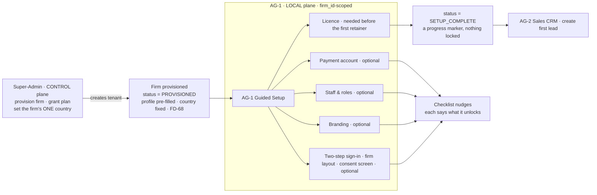
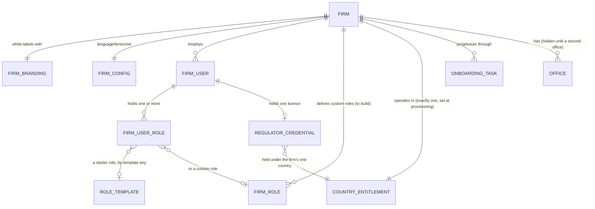

> **Document control** · Version **1.23** · **2026-10-18** · Status: **AG-07 review decisions that touch AG-01 applied, minimal wording only (AG07-D3: the retainer's representative is pre-filled with the case's lead representative, a different person is a warning and never a block; AG07-D4: role seeding uses the built keys; AG07-D12: handover slots are lead representative, case officer and reviewer; AG07-D16 Q36: pointer for changing a case's office); previously: Second pass AG16-54, AG16-55, AG16-80 applied to AG-01 (FirmConfig business-hours profile and the withdrawn AG-1-73 pointer deleted; Team list column "Email / Calendar" specified, AG-1-76; open questions Q13 and Q14 closed by AG16-55; pointer to the Owner-only AI switch). *Earlier status (v1.21):* AG-16 review decisions AG16-37 and AG16-45 applied to AG-01 (office time zone `Office.timezone`; deactivation screen warns which firm mailboxes will stop syncing; build cards AG-1-74 and AG-1-75). *Earlier status (v1.20):* **AG-16 review decisions applied where they touch AG-01 (AG16-1, -5, -6, -7, -14, -15, -18, -23; v1.20 — small consistency edits only). Earlier status (v1.19): AG-01 review decisions applied (AG01-1 – AG01-19, the product owner, 13 Oct): the portal lives at the firm's web address; "Setup complete" replaces the READY gate and nothing is locked; two-step sign-in is optional; licences are held by people, mixed representative types are allowed, and each case has one lead representative; one only-Owner guard; one-click work handover; role editor in plain capabilities; passkeys in Release 1; settings defaults and placement listed (Rule 9); §12 rewritten against the ERv2 code. Same-day revision (AG01-20 – AG01-22): the lead representative's stored signature is applied automatically on send for signature; skipped handover work stays visible in the Unassigned lists tagged "From <name>"; "Setup complete" is licence + firm profile.** Earlier status text is kept in the change-log rows below.\
> Part of: *Agent (RCIC/Lawyer) Console — Functional Requirements* · Split from `FINAL-Agent-FR.md` lines 134–774 on 2026-09-16 · Previous version: `_archive/AG-01-firm-setup-and-onboarding_v1.22_2026-10-17.md`\
>
> | Version | Date | Change | Decisions |
> |---|---|---|---|
> | 1.23 | 2026-10-18 | **AG-07 review decisions that touch AG-01 applied (the product owner, 18 Oct); minimal and precise, because this file is already with the developers.** (1) **AG07-D3:** the retainer's representative is pre-filled with the case's lead representative. It is not required to be the same person: a different person shows a warning in AG-05 and never blocks. The IMM 5476 still names the case's lead representative. The block when the firm has no active licensed person is kept (AG1-D8, AG-1-51). Wording changed in the AG01-5 row, §3.5, AG-1-32, AG-1-68, AG1-D19, BR-12, US-3 and the §0.2 rows for AG-05 and AG-07. (2) **AG07-D4:** role seeding uses the built keys, and the case work keys AG-07 withdrew are not seeded (one pointer bullet in §3.3; the seed table stays in SA-06). (3) **AG07-D12:** handover slots are lead representative, case officer and reviewer only; no Watcher, and a paralegal is a case officer (AG1-D5, AG-1-48, §0.2 row AG-07). (4) **AG07-D16 (Q36):** pointer in AG-1-74 for changing a case's office. **Added requirements:** none. **Open questions:** none added or closed. *18 Oct (later): consistency fixes after expert review — AG16-89(8) (assignment-pool / round-robin wording removed), X-2 (5).* *18 Oct (final): AG07-D17 – D21 applied — AG07-D19, AG07-D20(c), AG07-D20(v).* **Wording and pointers only.** (1) **AG07-D20(c):** the stored signature of AG01-20 / AG01-23 is read as the retainer's representative's on a retainer (AG-1-72, §3.5 paragraph, BR-19, the AG01-20 row, §0.2 row AG-05, US-3, §9); the consent text reads "Use my signature on documents I'm the representative for"; who countersigns is specified in AG-5-27. (2) **AG07-D19:** pointer in AG-1-50, the AG01-21 row and §0.2 row AG-07 — a case with no lead representative shows under the filter "Needs a lead representative" (home AG-07). (3) **AG07-D20(v):** pointer in the same places — the "From <name>" tag is read from the handover record; no new case field. **Added requirements:** none. **Open questions:** none added or closed. *18 Oct (final): AG07-D24 applied.* The Case Officer starter role also seeds `agent/case:waive-deficiency` (SA6-D2 row, role table row 4, role note, AG-1-63, §10 note). *18 Oct (final): AG07-D25 applied.* The Admin starter role also seeds `agent/case:waive-deficiency` (SA6-D2 row, SA6-D5 row, role table row 2, role note, AG-1-63, AG-1-65 boundary sentence, §10 note); the other three professional approvals stay Owner and Case Manager. *18 Oct (later): AG01-29 / AG16-105 and gap-check fixes applied — (1) **AG01-29(1):** sign-out after 28 days unused stays (AG1-D17, AG1-D18, AG1-D20, AG-1-56, §3.7, US-9, §12). (2) **AG01-29(2):** the "Update representative" task is created whenever the lead representative of a submitted case changes, in a handover or later on the case screen; AG-1-52 now points to AG-7-44 (AG1-D9). (3) **AG01-29(3):** suspended staff get no new work (AG1-D4, AG-1-47, §3.2, §6, §9, US-5). (4) **AG01-29(4):** a licence removed from someone who still leads cases (§3.5, AG-1-51, AG-1-68, §9). (5) **AG01-29(5):** an appointment moves only if AG-04's availability check says free (AG1-D5, AG1-D14, AG-1-48, §0.2, §9, US-12). (6) **AG01-29(6):** the handover moves all the leaver's clients; safety line (AG1-D5, AG1-D4, AG-1-47, AG-1-48, §0.2, US-12). (7) **AG01-29(7):** who edits the firm details (AG-1-4, §3.1, §7 `Firm`, §10; `Firm` fields corrected). (8) **AG01-29(8):** one licence record per person (AG-1-30, §7, diagram). **Gap-check fixes (verified findings only):** the Owner-role bug in §12 stated as verified; invite role binding not built; MFA default in two places and corrected line numbers; one session at a time is built; the built lifecycle (`deactivatedAt`, no `status` write) and `FirmStatus`; built profile columns; roles are kept on deactivation; seat-limit suspension; the firm-asset store is NEW; `PlanRoleTemplateSet`; signature narrowed to retainers and letters; email unique per firm; deactivation Reason required; AG-1-10 applies AG-1-60; permission keys instead of role names for the badge and card; SIGNATURE task key; "My account → Signature"; struck text deleted. Developer questions are in §13, "Developer decides (gap check, 18 Oct)". **Added requirements:** none.* *18 Oct (later): AG01-30 and check fixes applied — AG01-30(1): a standard deadline whose reminder would go to a suspended person alerts the holders of `agent/case:assign` (AG1-D4, AG-1-47, §8 test). Check fixes: "never auto-logged out" wording removed (AG-1-56, AG-1-57); Owner-role bug code lines corrected (§12); the licence-removed warning uses the existing AG-1-51 string; tests added for AG01-29(4), (7), (8); backtick and repeated-text repairs.* | AG07-D3 · AG07-D4 · AG07-D12 · AG07-D16 · AG07-D19 · AG07-D20(c), (v) · AG07-D24 · AG07-D25 · AG01-29 · AG01-30 |
> | 1.22 | 2026-10-17 | **Second-pass decisions applied (the product owner, 17 Oct).** (1) **AG16-54 #4:** §7 `FirmConfig` no longer lists a "business-hours profile" (hours and closed days are AG-16 §3.14), and the §0.2 AG-16 row no longer points to the withdrawn AG-1-73. (2) **AG16-54 #22:** the Team list column "Email: connected / Calendar: connected" has its home here: new **AG-1-76** with a build card; §3.2 key screens updated. (3) **AG16-55:** Q13 and Q14 closed with the defaults proposed in v1.21; **Q15 and Q16 stay open** (no default was stated). AG-1-74 card updated in place (rule 2, rule 5 note, edge case) and given the "Clicks" and "Person decides" lines. (4) **AG16-80:** the AI switch is a sixth Owner-only action (`agent/ai:switch`), specified in SA-06 and AG-16; pointer added to AG-1-65, §3.3 and §10. **Added:** AG-1-76. **Changed:** AG-1-74 (card), AG-1-65 (pointer). **Open questions added:** Q17. *Same-day fixes (17 Oct): AG16-83 – AG16-88 — "five" Owner-only actions become six with `agent/ai:switch` non-delegable (AG16-83 #5); plain words for the government in the AG-1-74 card (#8); screens English-only and translation-ready, firm language no longer chosen as French at sign-up (AG16-88). AG16-84 to AG16-87 do not touch this file.* *Same-day fixes (18 Oct): AG16-90 — card AG-1-75 gains "Person decides:" and "Clicks:".* *18 Oct: new section 'Decisions that change this epic' (index of AG16 decisions; no requirement changed).* *Same-day fixes (18 Oct): AG01-24 – AG01-27 — display rule for office times (item's own office time, labelled, no conversion; AG-1-74 + card rule 5, worked example, two tests); deactivation pointer words "[Name]'s open work is handed over below." (AG-1-75 + card); "connected by" field `MailboxConnection.connectedByUserId` (AG-10); office add / edit uses `agent/settings:edit` (AG-1-74 card Access, §10 key description); Q15 and Q16 closed.* *Same-day fixes (18 Oct): AG01-28 — Team list wording and who sees it (AG-1-76 + card): a broken connection reads "Email: disconnected" / "Calendar: disconnected" (AG-16-16 wording); a deactivated person reads "(Inactive) Name" (AG-04 BR-20 label); Settings → Team is visible to holders of `agent/staff:manage` (Owner, Admin); colleague names in pickers and on records need no key; one test added; Q17 closed.* | AG16-54, AG16-55, AG16-80, AG16-90, AG01-24 – AG01-28 |
> | 1.21 | 2026-10-17 | **AG-16 review decisions AG16-37 and AG16-45 applied (the product owner, 17 Oct); AG16-51 trim applied.** (1) **Office time zone (AG16-45):** new `Office.timezone` (IANA), pre-filled from the office address's province and editable; it matters only once a second office exists; the **case's office** decides which time zone and closed days apply to that case; government dates stay calendar dates. **No escalation by office** (dropped, AG16-51). New requirement **AG-1-74** with a build card; §7 `Office`, §3.2, §3.9 and §9 updated. (2) **Deactivation warning line (AG16-37):** the deactivation screen is specified here (AG-1-48), so the one-line warning lives here: *"These mailboxes will stop syncing: documents@ (connected by Client G). [Reconnect as me]"*. It warns and never blocks. New requirement **AG-1-75** with a build card; AG-1-48 and §3.2 point to it. The mailbox rules stay in AG-10; the Connect screen is AG-16. **Added:** AG-1-74, AG-1-75. **Changed:** AG-1-48 (pointer). **Open questions added:** Q13 – Q16. *Not changed on purpose (reported to the product owner):* `FirmConfig` in §7 still mentions a business-hours profile and §0.2 still says AG-1-73 holds profile fields, although AG-1-73 was withdrawn on 14 Oct.* | AG16-37, AG16-45, AG16-51 |
> | 1.20 | 2026-10-14 | **AG-16 review decisions applied to AG-01 (the product owner, 14 Oct) — consistency edits only.** (1) **Client two-step (AG16-23):** no firm "require" switch for clients; a client may turn two-step on for themselves in their own portal account, off unless they choose; the built portal firm policy stays dormant and is not shown (§3.7, §3.9, §0.2 AG-15 row). Firm-staff two-step (AG01-3) unchanged. (2) **IP allow-list (AG16-5):** not in Release 1, removed from the `agent/security-policy:manage` description (§10); the key now covers the two-step switch only. (3) **Business hours and closed days (AG16-1, -6, -7):** added to the firm profile (Settings → Your firm) — new AG-1-73, §3.9 rows, §3.1 key screens; default Mon–Fri 9:00–17:00 in the firm timezone, closed days are the firm's own list and start empty, used only for the firm's internal clocks, never move government dates. (4) **Settings structure (AG16-1):** §3.8 names the nine Settings sections, Set up your tools, Advanced and My account; the two-step switch sits in Settings → Security & your data. (5) **Mailboxes (AG16-15):** §3.8 points to Settings → Connections (shared firm mailbox) and My account → Email (personal); mailbox rules stay in AG-10. (6) **Stored signature placement (AG16-1):** "My profile → Signature" is now **My account → Signature**. (7) §0.2 AG-15 and AG-16 rows updated. Nothing else in AG-01 touches notification settings, calendars, escalation, backup approver, Team safeguards, "preferred" mark, Recently deleted, WhatsApp, payment fallback, Automatic messages or the AI switch; user deletion (AG1-D1) is unchanged. **Added:** AG-1-73. **Changed:** AG-1-40, AG-1-4 (hours pointer), AG-1-72, §10 `agent/security-policy:manage`. *Same-day audit corrections (14 Oct): business hours and closed days have one home, AG-16 §3.14 — AG-1-73 withdrawn (ID not reused; next free ID AG-1-74), §3.9 rows, AG-1-4 and §3.1 reduced to pointers.* | AG16-1, AG16-5, AG16-6, AG16-7, AG16-15, AG16-23 |
> | 1.19 | 2026-10-13 | **AG-01 review decisions AG01-1 – AG01-19 applied (the product owner, 13 Oct).** **Portal and setup:** the portal lives at the firm's web address, read-only in Branding (AG01-1); custom domain is Release 2 (AG01-14); "Setup complete" replaces the READY gate and nothing is locked, licence first, payment optional (AG01-2); profile pre-filled, default currency CAD, reporting currency and FX removed (AG01-9); two reminders at day 3 and 7 (AG01-15); optional checklist items for two-step sign-in, firm layout and the consent screen (AG01-3a, A15). **Security:** two-step sign-in optional, one switch, default off, "admins only" dropped (AG01-3); passkeys in Release 1 (AG01-12); step-up on the Owner role and the payment account (AG01-11); one only-Owner guard replaces the last-admin guard (AG01-7, A1); reason optional except the Owner role, audit always (A2); custom-role delete asks for a replacement only for holders left with no role (A3). **Licences:** held by people, mixed representative types, one lead representative per case drives the retainer and IMM 5476, default lead representative setting, designated-person card dropped (AG01-4, AG01-5); no licence monitoring confirmed, AI-approval and supervision uses removed (AG01-5a, A9); retainer blocked, forms warn (AG01-6); changes logged, views not (AG01-13); neutral licence wording, "Lead representative" rename (A6, A8). **People:** one-click handover with a smart suggestion (AG01-8); offices hidden until a second office (AG01-10); role preview in plain capabilities with a one-line summary and a Compare roles panel (AG01-17); multi-row invite with Case Officer pre-selected (AG01-18); ~30-capability role editor with Advanced view (A4); subscription-invoice view for Owner, Admin and Billing / Finance (A5); staff account emails ExpatReady-owned, no email on suspend, deactivate, delete or role change (A13); fixed-wording notices (A14); starter-role approval by Platform Owner or Admin, never the requester (A16); payment account on every plan via hosted sign-up (A11); rule 7 clean-up (A12); SA7-X20 applied (A18); stale text fixed (A20). Support toggle and Get help screen live in AG-16 (AG01-16). **Document:** new section 0 AG-01 review table, 0.2 knock-ons (Pending), 3.9 Settings defaults and placement (Rule 9); section 7 role model aligned to SA-06 (`FirmUserRole`, `FirmRole`), `FirmBranding`, `autoAssignOfficer`/`enabledFeatures` removed; section 12 rewritten against ERv2; section 13 Q2, Q4, Q6, Q7, Q8, Q9 closed (Q3 too), Q10 – Q12 noted. **Requirements changed:** AG-1-1, -2, -4, -5, -6, -8, -10, -14, -16, -20, -21, -22, -23, -24, -28, -28a, -30, -31, -32, -34, -35, -36, -37, -38, -39, -40, -42, -43, -44, -46, -48, -49, -51, -52, -54, -58, -60, -61, -64, -65, -66; BR-5, -10, -11, -12, -13, -14, -15, -16, -17, -18; decisions AG1-D1, D5, D6, D8, D9, D14, D19 (D16 note); US-1, 3, 4, 5, 6, 7, 8, 9, 10, 11, 12, 13. **Added:** AG-1-68 (default lead representative), AG-1-69 (multi-row invite and role preview), AG-1-70 (staff account emails), AG-1-71 (payment account on every plan). **Withdrawn:** AG-1-7 (portal subdomain); decision AG1-D15 (last-admin suspend guard). **Same-day revision (AG01-20 – AG01-23, the product owner, 13 Oct):** AG01-23 — inline "Add your signature" on the send screen for the lead representative (save for next time); another sender sends anyway and the representative e-signs after; the "Needs attention" card is shown to Owner and Admins. *Stored signature (AG01-20):* a person's signature lives on their own profile (My profile → Signature), is applied automatically when staff send for signature on documents the case's lead representative signs, with a send-screen fallback to e-signature; safeguards listed. Changed: §3.5, §3.6, §3.9, §7 (`RegulatorCredential`, `FirmUser`), §9, §10, §13 Q10 closed; AG-1-30, -31, -58, -64; BR-10; US-3. **Added:** AG-1-72 (stored signature), BR-19. *Handover leftovers (AG01-21):* skipped work goes to the existing Unassigned lists tagged "From <name>" (filterable), plus a dashboard "Needs attention — from <name> (left <date>)" card that clears itself. Changed: §3.2, §9, §13 Q11 closed; AG-1-48, -50; decisions AG1-D5, AG1-D7; US-12. *Setup complete (AG01-22):* licence + firm profile; optional items listed, then kept as a dismissible "Make the most of ExpatReady" list. Changed: §3.6, §3.9, §13 Q12 closed; AG-1-37; BR-13; US-1. §0 review table rows AG01-20 – AG01-22; §0.2 rows extended for AG-02, AG-05, AG-07, AG-13, AG-14 and added for AG-12, SA-08. | AG01-1 – AG01-22 |
> | 1.18 | 2026-10-10 | Applied from SA-03 v2.16 (SA3-X7; the product owner, 10 Oct): **MFA — including requiring it for every staff member — and custom firm roles are in every plan and are never plan features** (SA3-D18). The plan / entitlement feature-gating bullet in §11 is rewritten; §3.0 says a plan is features and limits from SA-3's feature catalogue; US-7's example changed from "forecasting" to Automations. Permissions offered in the custom-role picker are still limited to features on the firm's plan (BR-2, unchanged). | SA3-D18, SA3-D10 |
> | 1.17 | 2026-10-10 | SA6-D12 — starter roles configured in Super Admin (the product owner, 10 Oct; owned by SA-06 v3.1 §3.9): starter roles are data managed by Expat Ready, not fixed in code; the code seeds only the first version (today's six). Expat Ready can add, edit, rename and retire starter roles (second-person approval); every firm sees every published starter role; a firm uses one as is or copies it and edits the copy, and the copy does not change when the starter role changes; the Owner starter role always exists and cannot be edited or retired; a retired starter role stops new assignments, holders keep it until the firm reassigns them, and firms are notified. §3.3 Roles screen shows "retired — reassign". AG-1-17, AG-1-18, AG-1-20, AG-1-61 changed. | SA6-D12 |
> | 1.16 | 2026-10-08 | Session decision (the product owner, 8 Oct): `agent/security-policy:manage` now covers MFA and IP allow-list only (session timeout removed, §10 and the SA-06 decision row annotated). session rules for firm staff are set by the platform only; a firm has no session setting, so AG-16-23 (firm session policy) is withdrawn (AG-16 v1.12). Firm staff have no idle timeout and no maximum session length, and "Remember me" is removed. Clients' sessions never expire (unchanged). **A password change or a second-step (MFA) reset ends all of that person's other sessions at once — firm staff and clients** (new AG-1-67). One session at a time for firm staff re-confirmed for Release 1. Client portal session tokens must not be readable by page script, Release 1 (CP-1-91, Client Portal FR). AG1-D16 to AG1-D18 changed; §0, §0.1 contents, §3.7, AG-1-41, AG-1-55, AG-1-56, AG-1-57, new AG-1-67, §8 US-9, §9 changed. | AG1-D20 |
> | 1.15 | 2026-10-07 | Role changes the **system** makes record an automatic reason: "Firm created" when the first Owner is given the Owner role at firm creation; "Staff member deactivated by <name>: <their deactivation reason>" when deactivation removes a person's roles. Nobody types a second reason (SA-06 v3.0 BR-23, Open Question 11 closed). Added to AG-1-66. | SA6-D3 |
> | 1.14 | 2026-10-07 | SA-06 v3.0 closing decisions (the product owner, 7 Oct; owned by SA-06 v3.0). **(F2) A written reason is REQUIRED for every firm role create, edit and delete, and for every role assignment or removal** (including the roles chosen at invite and the replacement roles chosen when a role in use is deleted); the reason is recorded in the audit log with who, when, and before/after. Changed: §3.2 (key screens, data flow), §3.3 (who can make and change roles, key screens, data flow), AG-1-23, AG-1-24, AG-1-60, new AG-1-66, acceptance criteria (US-6, US-7: 3 new), edge cases (1 new), `UserRole` and `Role` entities, §10 (`agent/role:manage`, `agent/role:assign`). **Permission renames:** `agent/firm:view-onboarding` → `agent/onboarding:view`; `agent/firm:complete-onboarding` → `agent/onboarding:complete`; `agent/mfa-policy:manage` (and its merged predecessors) → `agent/security-policy:manage`, now covering MFA, session timeout and IP allow-list, held by Owner and Admin (closes SA-06 N6 for this module). Changed: §10 (three rows, enforcement paragraph), §12, SA6-D10 naming rule. Old keys in earlier version rows are history and are not rewritten. Requirement IDs unchanged. | SA-06 v3.0 closing decisions (F2) · SA6-D10 |
> | 1.13 | 2026-10-07 | Subscription billing screen split (the product owner, 7 Oct; decision owned by SA-06 v3.0 SA6-D5, extended; screen specified in SA-04 v2.8). Replaces the wording added earlier today ("Admin may update the card; invoices and cancellation stay Owner-only"). **On the firm's own Expat Ready subscription billing screen the Admin may update the subscription card and pay an overdue bill; Owner-only: upgrades, invoices and credit notes, billing details, downgrades and cancellation.** The client-payments payout account (`agent/payment-rail:connect`) stays one of the five Owner-only actions and can never be put on a custom role. **Persona fix:** the Accounts / Billing persona no longer connects the payment rail; it works with invoices and payments, and the Owner connects the payout account. Changed: §2 Accounts / Billing persona, §3.3 (Admin row, five Owner-only paragraph), AG-1-65, §10 (`agent/payment-rail:connect` row), Applied-from-SA-06 table (SA6-D5 v1.12 row corrected, new v1.13 row). Requirement IDs unchanged. | SA6-D5 |
> | 1.12 | 2026-10-07 | SA-06 v3.0 review decisions SA6-D3 and SA6-D5 (the product owner, 7 Oct; owned by SA-06 v3.0). **Role rules (SA6-D3):** an Admin may give or remove a role only if the Admin holds every permission in it (same ceiling as create and edit), so by default only the Owner hands out roles with the four professional approvals; only an Owner gives or removes the Owner role and the last active Owner cannot be removed; deleting a custom role follows the edit rule (Owner, or an Admin holding every permission in it); the Owner role itself is still never edited or deleted. **Owner-only (SA6-D5):** the five Owner-only actions can never be put on a custom role, even by the Owner (server rejects); "connect the payment account" is the account where clients' payments are paid out (`agent/payment-rail:connect`); the firm's subscription card follows SA-04 (Admin may update the card; invoices and cancellation stay Owner-only). Changed: §3.3 (Admin row, who can make and change roles, five Owner-only actions, lockout guard), §3.2/§3.3 data flow, AG-1-60, AG-1-65, BR-5, acceptance criteria (4 new), edge cases (1 new), §10 (`agent/role:manage`, `agent/role:assign`, `agent/payment-rail:connect`, Owner-only paragraph). Requirement IDs unchanged. | SA6-D3 · SA6-D5 |
> | 1.11 | 2026-10-07 | Applied SA-06 v3.0 rename map and knock-ons (the product owner, 7 Oct; founder-authorised; decisions owned by SA-06 v3.0). **(1) Rename map (SA6-D10, Appendix B):** every permission key in this document uses its canonical name — `agent/client:view-all` → `agent/client:view.all`, `agent/client:list` → `agent/client:view.own`, `agent/case:view-all` → `agent/case:view.all`, `agent/prospect:view-all` → `agent/prospect:view.all`, `agent/task-all:list` → `agent/task:view.all`; `agent/firm:manage-users` → `agent/staff:manage`; `agent/firm:manage-roles`, `agent/role:create`, `agent/role:edit` → `agent/role:manage`; `agent/role:list` → `agent/role:assign`; `agent/firm:manage-credentials` and `agent/settings/designated-person:*` → `agent/firm-credential:manage`; `agent/firm:connect-payment` → `agent/payment-rail:connect`; `agent/firm:manage-security` → `agent/mfa-policy:manage`; `agent/firm:view` → `agent/settings:list`; `agent/firm:edit` → `agent/settings:edit` + `agent/firm-profile:manage`; `agent/settings/invoice-config:*` → `agent/billing-config:numbering`. §10 keeps a "was" note on each renamed key; withdrawn rows (`agent/firm:manage-countries`, `agent/firm:reveal-credential`) keep their old names as history. **(2) Owner-only is five actions** (allow Expat Ready support to make changes; cancel the subscription; edit the legal firm profile; export all firm data; connect the payment account) — the fifth, payment-account connect, was missing (§3.3 table and bullets, §10, new AG-1-65). **(3) Regulator licence credentials are not Owner-only:** each licensed person maintains their own on their own profile; Owner or Admin may enter or edit anyone's through `agent/firm-credential:manage`; audited (§3.3, §3.5, AG-1-31, BR-10, §7 table, US-3, §10, new AG-1-64). **(4) Admin** = all administration except the five Owner-only actions; an Admin cannot hand out a key the Admin lacks. **(5) Professional approvals** are four keys (`agent/case:waive-deficiency`, `agent/case:form-approve`, `agent/case:review-approve`, `agent/retainer:countersign`) held by Owner and Case Manager by default (AG-1-63, was two keys). **(6)** Case Manager no longer carries a personal-data reveal (AG7-D10). **(7)** "Firm Admin" wording in the MFA and onboarding text changed to "Admin" / "Owner or Admin". Changed: §0 (Applied-from table), §3.3, §3.5, AG-1-21, AG-1-31, AG-1-54, AG-1-59, AG-1-63, BR-10, §7, US-3, §10, §12, §13 Q7. New: AG-1-64, AG-1-65. Old keys in earlier version rows below are history and are not rewritten. | SA6-D1 · SA6-D2 · SA6-D3 · SA6-D5 · SA6-D9 · SA6-D10 |
> | 1.10 | 2026-10-07 | Roles and permissions (the product owner, 7 Oct; decisions owned by SA-06 v3.0): **(1)** the six starter roles are the six in code — Owner, Admin, Case Manager, Case Officer, Billing / Finance, Read-only — replacing the old template list; the RCIC and Sales / Intake Rep templates are **withdrawn**, and the optional 7th Viewer template is resolved (it is Read-only) (SA6-D5); every firm gets the same six at set-up, whatever its plan (SA6-D7). **(2)** A staff member can hold **several** roles and access is the sum (SA6-D3a). **(3)** Starter roles are **fixed**; a firm copies one and edits the copy, or builds from scratch (SA6-D3c). Owner and Admin create and edit custom roles; an Admin can never create or edit a role containing a permission the Admin does not hold; nobody edits or removes the Owner role; nobody changes their own role assignments (SA6-D3b). A firm role may hold only firm (`agent/*`) permissions, checked server-side (SA6-D3d). **(4)** `agent/client:view-all`, `agent/case:view-all`, `agent/prospect:view-all` and `agent/task-all:list` are seeded on **every** starter role (all six at launch) *(changed v1.17 — SA6-D12)*; a firm makes a role "own only" by removing them (SA6-D1, replaces AG7-D5's Owner-and-Manager seeding). **(5)** `agent/case:waive-deficiency` and `agent/case:form-approve` are seeded on Owner and Case Manager; no licensed-representative role and no licence check on permissions; every use audited (SA6-D2) — licence credentials (AG1-D8, AG1-D19) unchanged. Changed: §0 (new table), §2, §3.0, §3.2, §3.3 (table, bullets, data flow), AG-1-1, AG-1-10, AG-1-14, AG-1-16, AG-1-17, AG-1-18, AG-1-19, AG-1-20, AG-1-22, AG-1-49, AG-1-59, BR-3, BR-5, BR-17, §6, §7 (`FirmUser`, `Role`, new `UserRole`), US-4, US-6, US-7, §9, §10, §11, §12, §13 Q1. New: AG-1-60 – AG-1-63. | SA6-D1 · SA6-D2 · SA6-D3 · SA6-D5 · SA6-D7 |
> | 1.9 | 2026-10-05 | Knock-ons from AG-07 v2.3 (the product owner, 5 Oct): the Owner (Firm Admin) and Manager role templates seed the new permission `agent/client:view-all`, and every other role with client access is seeded with `agent/client:list` (own clients only) — §3.3 table rows 1 and 2 and a new sentence after the table, new **AG-1-59**, permissions note in §10 (AG7-D5); the `Office` entity (§7) notes that AG-07 clients reference offices through `officeId` (AG-7-69). `Party` ownership (AG7-D9): AG-01 does not reference it, so nothing to align. Same day (AG7-D10): masking and reveal removed everywhere — `agent/firm:reveal-credential` withdrawn (§10 row kept, marked withdrawn); the licence credential is shown in full to users allowed on the credentials screen; `agent/pii:export-unmasked` is not seeded on the Owner template (the "Unmasked export on the templates" bullet removed, AG-1-59 sentence removed); credential masking and audited-reveal text removed from §3.5, AG-1-31, BR-10, BR-16, §7 `RegulatorCredential`, the §9 scenarios, §11 and §12; the "licence number stays masked, reveal control unavailable" scenario reworded; API keys, passwords, tokens and webhook secrets stay write-only and field-level encryption at rest is kept. | AG7-D5 · AG7-D9 (no change), AG7-D10 |
> | 1.8 | 2026-10-05 | No licence monitoring (the product owner, 5 Oct): ExpatReady works for the firm, not the regulator. New decision AG1-D19 (§0, "Licences (5 Oct)"). §3.5 now defines a **licensed user** (an active user the firm has linked to a regulator credential it entered; cited by other modules as "AG-01 §3.5") and states that licence validity and expiry are never checked, tracked, reminded about or acted on. **Withdrawn:** AG-1-33 (expiry reminder) and the "Validity awareness" bullet. **Changed:** AG-1-30 (no validity dates), AG-1-34 (format hint is an input typo check, never a validity check), AG-1-49, BR-17 and AG1-D6 (lead-RCIC eligibility = licensed user); `RegulatorCredential` loses `validFrom` / `validUntil`; the credential card, the "Expiry reminder" config, the schedule-expiry-reminder step, the licence-expiry edge case (with its "warns at document generation") and the expiry reminders in §11 and §12 are removed. **New:** AG-1-58. Kept: recording credentials, stamping the firm's documents, AG1-D8 (a departed staff member's credential is not stamped on new documents — staff status, not licence validity). The other knock-ons listed in AG-11 §0.2 for AG-01 are not applied here. | AG1-D19 |
> | 1.7 | 2026-10-03 | Consistency review fixes (3 Oct). AG1-D9 wording made authority-neutral throughout: "Authority representative update" (was "IRCC representative update ... with IRCC"), and the D13 list calls it the "representative-update task" — matching AG-1-52 since v1.6. "Phase-1 / Phase-2 / Phase-3" wording in the portal-domain, role-template and deferral text replaced by Release terms (AG17-D60). No requirement added, removed or changed in meaning. | AG17-D1 · AG17-D60 |
> | 1.6 | 2026-10-02 | Representative-update task made authority-neutral (founder decision, AG-17 §0.2): it fires for a case submitted to **any authority** and names the authority the case was submitted to, taken from the country pack (IRCC for individual cases, ESDC for LMIA files) — no longer IRCC only. AG-1-52 changed; AG1-D9 carries a pointer. Nothing else changed. | AG17-D1 |
> | 1.5 | 2026-10-02 | Session decisions (the product owner, 2 Oct): firm staff are signed in on one device at a time (AG1-D16, new AG-1-55); the platform never auto-logs firm staff out, and a firm may switch on its own policy, default off (AG1-D17, new AG-1-56); clients may use several devices with no auto-logout, applied in AG-15 (AG1-D18, cross-reference AG-1-57). §0, §3.7, AG-1-41, §8 US-9, §9 changed. | AG1-D16, AG1-D17, AG1-D18 |
> | 1.4 | 2026-10-01 | Merged with SA-07 v2.5 (the co-product owner): AG1-D12 now points to the applied SA-07 rules (SA7-D64, SA-7-46, SA-7-47, BR-20) and notes that Super Admin staff have no Suspend (SA7-D10). Requirements unchanged. | AG1-D12 · SA7-D10, SA7-D64 |
> | 1.3 | 2026-10-01 | Decisions revised by the product owner (1 Oct, later the same day): delete allowed after deactivation (D1); the last admin cannot be suspended (new D15); nothing deferred — all staff-leaving items ship in the MVP (D13); IRCC task confirmed, no SME sign-off (D9); 'Not doing' list trimmed (D14). §0, §0.1, §3.2, §3.5, AG-1-13 – AG-1-15, AG-1-22, AG-1-46, AG-1-48 – AG-1-53, BR-5, BR-6, BR-7, BR-16, BR-17, BR-18, §6, §7 FirmUser, §8 US-5, US-12, US-13, §9, §10, §13 changed; new requirement AG-1-54 added. | AG1-D1, AG1-D9, AG1-D13, AG1-D14, AG1-D15 |
> | 1.2 | 2026-10-01 | Staff-leaving decisions (product owner, 1 Oct): deactivate-only; instant lock-out on deactivate and suspend; seat rules; no new work to deactivated staff; work-handover prompt, role-filtered owners, Unassigned + badge (deferred); credentials of departed staff never used on new documents; reports keep departed staff. §0 added; §3.2, §3.5, AG-1-13 – AG-1-15, AG-1-41, BR-6, BR-7, BR-15, §6, §8, §9, §13 Q5 changed; new requirements added. | AG1-D1 – AG1-D14 |
> | 1.1 | 2026-08-28 | Baseline — complete document v1.1 | — |
>
> **Requirement IDs are permanent.** A changed requirement keeps its number. New requirements continue from AG-1-77 (AG-1-73 was withdrawn the day it was written and is not reused; AG-1-74 and AG-1-75 added v1.21; AG-1-76 added v1.22). Numbers are never reused.

## Decisions that change this epic (14–18 Oct) *(new 18 Oct)*

Product-wide rules (apply here as everywhere; home: Agent `00-Overview` → "Product rules every epic follows"): AG16-11, AG16-31, AG16-42, AG16-63, AG16-76.

The "AG16" prefix is historical: these decisions began in the AG-16 review and apply across the product. Full text: `TEMPLATE-MAP-working_2026-10-10.md`.

| Decision | What was decided (one line) | What it changes in this epic | Where (requirement / card / section) |
|---|---|---|---|
| AG16-1 | Settings has nine sections; the two-step switch sits in Security & your data; "My account" is the personal page | Wording and placement only: signature lives on the person's own profile (My account → Signature); the staff two-step switch is placed in Settings → Security & your data; AG-1 stays the first-run surface and links to AG-16 for the deep settings | §0.2 AG-16 row · §3 "How it works" · signature paragraph (AG01-20) · §3 settings table row "Require two-step sign-in for all staff" |
| AG16-5 | IP allow-list is not in Release 1 (wish list) | IP allow-list removed from the `agent/security-policy:manage` description; the key now covers the two-step switch only | §10 `agent/security-policy:manage` · §0 decision row (AG1-D20 / SA6 rename) |
| AG16-6 | Business hours and closed days: firm default plus per-office; closed days are the firm's own list | Hours and closed days are owned by AG-16 §3.14; AG-1 keeps only pointers. Each office's hours, closed days and clocks use that office's time zone; government and legal dates stay calendar dates | Settings table pointer rows "Business hours" and "Closed days" · AG-1-74 (+ card) · §0.2 AG-16 row |
| AG16-7 | A due date on a closed day moves earlier, never later | Cited as context in AG-1-74: government and legal dates never move. Referenced only (no change here) | AG-1-74 |
| AG16-11 | One "Automatic messages" page, documented in one place only (its single-home rule applied to business hours) | Requirement AG-1-73 (business hours and closed days) withdrawn; the single home is AG-16 §3.14; the ID is not reused | AG-1-73 (withdrawn) · pointer rows in the settings table · §3 note on Settings → Your firm |
| AG16-15 | Mailboxes: firm and personal, nothing required | §3 points to Settings → Connections (shared firm mailbox) and My account → Email for personal mailboxes; the mailbox rules are in AG-10 | §3 "How it works" (mailbox connections sentence) · AG-1-75 (via AG16-37) |
| AG16-22 | One escalation rule: push the high-stakes, show the routine | Cited in AG-1-74: there is no escalation by office; deadline and overdue alerts go to everyone holding `agent/case:assign`. Referenced only (no new behaviour here) | AG-1-74 · AG-1-74 card rule 7 |
| AG16-23 | Client two-step sign-in: no firm "require" switch; client's own choice | No firm switch for client two-step; a client may turn it on in their own portal account; the portal-pool policy stays dormant and is not shown; staff two-step unchanged | AG-1-40 · §3 two-step paragraph · settings table row "Client two-step sign-in" · §0.2 AG-15 row · onboarding checklist item |
| AG16-25 | Mailbox roles, solo setup, how email data separates | Cited in the AG-1-75 card: a mailbox has one address and one role, so [Reconnect as me] reconnects the same address. Referenced only (rules live in AG-10 / AG-16) | AG-1-75 card step 6 |
| AG16-37 | Mailbox go-live essentials (deactivation warning, etc.) | The deactivation screen shows one warning line listing firm mailboxes the leaver connected, with [Reconnect as me]; it warns and never blocks | AG-1-75 (+ card) · AG-1-48 pointer · §3 deactivation screen · settings table row "Mailbox warning on the deactivate screen" |
| AG16-45 | Office time zones; escalation by office | Each office gets a time zone, pre-filled from the address's province and editable, used only once a second office exists; the case's office decides the zone and closed days | AG-1-74 (+ card) · §7 `Office.timezone` · §3 offices paragraph · settings table row "Office time zone" |
| AG16-49 | Client quiet hours in the client's own time zone | Cited as a non-goal only: no client time zone here (the person's time zone, `PartyProfile.timezone`; field AG-02, fill rule AG-07 AG-7-98). Referenced only (no change here) | AG-1-74 card rule 13 (Non-goals) |
| AG16-51 | Three trims to avoid over-building | Escalation by office dropped from the office time-zone requirement; no time zone per user | AG-1-74 · AG-1-74 card (Non-goals) |
| AG16-52 | Connecting one's own mailbox or calendar needs no permission | The Team-list email/calendar column needs no new permission key | AG-1-76 card rule 8 (Access) |
| AG16-54 | 25 consistency fixes after the 17 Oct write | #4: `FirmConfig` no longer lists a business-hours profile and the §0.2 AG-16 row no longer points to withdrawn AG-1-73. #22: Team list gets an "Email / Calendar" status column, new home AG-1-76 | §7 `FirmConfig` · §0.2 AG-16 row · AG-1-76 (+ card) · §3.2 User list |
| AG16-55 | Writers' recommended defaults accepted for the detail questions | Open questions Q13 and Q14 (office time zone) closed: province → time zone list is a short list kept as pack content; the first, hidden office holds the firm time zone. Q15 and Q16 stayed open until closed 18 Oct by AG01-24 – AG01-27 | AG-1-74 (+ card rules 2, 5, edge case) · open questions 13–16 |
| AG16-80 | AI switch and plans: only the Owner switches AI | The AI on/off switch is a sixth Owner-only action (`agent/ai:switch`), specified in SA-06 and AG-16; AG-1 holds a pointer only | AG-1-65 · §3 Owner-only list · §10 |
| AG16-83 | 26 follow-through fixes after the second pass (batch A) | "Five" Owner-only actions become six, including `agent/ai:switch`, non-delegable even on a custom role; plain words for the government in the AG-1-74 card | §0 decision row SA6-D5 · Owner and Office Manager role text · AG-1-65 · AG-1-74 card |
| AG16-84 | Very short deadlines: the letter note is the client message | Change log states it does not touch this file. Referenced only (no change here) | Change-log row 1.22 |
| AG16-87 | "New letter patterns" stays a plain list | Change log states it does not touch this file. Referenced only (no change here) | Change-log row 1.22 |
| AG16-88 | Release 1 is English-first; French later | Firm language is English (Canada) at launch and French is not offered at sign-up; templates are written in English first | AG-1-4 · AG-1-5 · §3 language paragraph · settings table row "Firm language" |
| AG16-90 | Batch C: consistency fixes from the 17 Oct audit | Card AG-1-75 gains the "Person decides" and "Clicks" lines | AG-1-75 card |
| AG01-24 | Times shown in the item's own office time, labelled (closes Q15) | Office-tied times show in that office's zone, labelled when it differs ("10:00 (Calgary)"), no conversion; items with no office use the viewer's office zone | AG-1-74 (+ card outcome, rule 5, tests, edge case) · open question 15 |
| AG01-25 | Deactivate screen pointer words (closes Q16(a)) | "[Name]'s open work is handed over below." points to the one-click handover on the same screen | AG-1-75 (+ card rule 3) · open question 16 |
| AG01-26 | "Connected by" field (closes Q16(b)) | The field is `MailboxConnection.connectedByUserId` (AG-10) | AG-1-75 card Data · open question 16 |
| AG01-27 | Office add / edit uses `agent/settings:edit` (closes Q16(c)) | Owner and Admin; no new key; the key's description gains "offices" | AG-1-74 card Access · §10 key row · open question 16 |
| AG01-28 | Team list wording and who sees it (closes Q17) | Broken connection: "Email: disconnected" / "Calendar: disconnected" (AG-16-16 wording); deactivated person: "(Inactive) Name" (AG-04 BR-20 label). Settings → Team is visible to holders of `agent/staff:manage` (Owner, Admin); colleague names in pickers and on records need no key. | AG-1-76 (+ card rules 1, 2, 4, 8; test) · open question 17 |
| AG07-D3 | Retainer from a lead, a client or a case; representative pre-filled, never forced (home AG-05). | The retainer's representative is pre-filled with the case's lead representative and need not be the same person; a different person is a warning, not a block. The IMM 5476 still names the case's lead representative. The no-licensed-person block stays. | AG01-5 row (§0) · §3.5 · AG-1-32 · AG-1-68 · BR-12 · AG1-D19 · US-3 · §0.2 rows AG-05, AG-07 |
| AG07-D4 | Case permissions use the built keys; everyday work folds into `agent/case:edit` (home SA-06). | Role seeding uses the built keys; the withdrawn case work keys are not seeded. Pointer only. | §3.3 bullet "Case work keys" |
| AG07-D12 | Team roles: Watcher dropped, Paralegal folded into Officer (home AG-07). | Handover slots are lead representative, case officer and reviewer only. | AG1-D5 · AG-1-48 · §0.2 row AG-07 |
| AG16-89 (8) / 00-Overview rule 8 | No routing rules, no round robin, no assignment pools | A leaver is never assigned work or notified; booking-host removal (AG-04) stays; AG-02 lead routing rules are withdrawn | AG1-D4 · AG-1-47 · §3.2 · §0.2 row AG-02 · BR-7 · state table · acceptance test *(fixed 18 Oct)* |
| AG07-D16 (Q36) | Changing a case's office needs `agent/case:edit`, shown once a second office exists (home AG-07, AG-7-102). | Pointer only: AG-01 adds no control; the case's office still decides the time zone. | AG-1-74 |
| AG07-D19 | Unassigned and "Take it" (home AG-07). | Pointer only: a case with no lead representative shows under the separate filter "Needs a lead representative" (the group named in AG01-21). AG-01 adds no control. | AG-1-50 · AG01-21 row · §0.2 row AG-07 |
| AG07-D20(c) | Retainer signer and countersign (home AG-05). | AG01-20 / AG01-23 read as "the retainer's representative": on a retainer, that person's stored signature is applied; consent text now "Use my signature on documents I'm the representative for"; who countersigns, and who may sign instead when that person is away, is AG-5-27. | AG-1-72 · §3.5 stored-signature paragraph · BR-19 · AG01-20 row · §0.2 row AG-05 · US-3 · §9 |
| AG07-D20(v) | "From <name>" tag is read from the handover record; no new case field (home AG-07). | Pointer only: AG-01 adds no field. | AG-1-50 · AG01-21 row · §0.2 row AG-07 |
| AG07-D24 | The starter Case Officer role holds `agent/case:waive-deficiency` by default, as do Owner and Case Manager; the other three professional approvals stay Owner and Case Manager (home SA-06). | The Case Officer starter role seeds `agent/case:waive-deficiency`; wording only, no new key. | SA6-D2 row · role table row 4 · AG-1-63 · §10 note |
| AG07-D25 | Admin also holds the pass of a CRITICAL warning by default (option A; follows AG07-D24(b); home SA-06). | The Admin starter role seeds `agent/case:waive-deficiency`, with Owner, Case Manager and Case Officer; `agent/case:form-approve`, `agent/case:review-approve` and `agent/retainer:countersign` stay Owner and Case Manager. SA6-D3 and AC6.1a are unchanged. Wording only, no new key. | SA6-D2 row · SA6-D5 row · role table row 2 · AG-1-63 · AG-1-65 · §10 note |
| AG01-29(1) | Sign-out after 28 days unused stays (built; platform setting 1–365 days; staff and clients). | AG1-D20 now reads "no short idle timeout and no firm session setting; after 28 days unused, sign in again." | AG1-D17 · AG1-D18 · AG1-D20 · AG-1-56 · §3.7 · US-9 · §12 |
| AG01-29(2) | The "Update representative with the authority" task is created whenever the lead representative of a submitted case changes (home AG-07, AG-7-44). | Created in a handover or later on the case screen, assigned to the new lead representative; never before submission (the new representative signs the IMM 5476 filed with the application). | AG1-D9 · AG-1-52 |
| AG01-29(3) | Suspended staff get no new work. | Treated like a deactivated person for new work only: tasks an automation would give them are created unassigned, no bookable times, no notifications; open work and seat stay; a "Suspended" tag beside their name where assigned; nothing moves automatically. | AG1-D4 · AG-1-47 · §3.2 · §6 · §9 · US-5 |
| AG01-29(4) | A licence record removed from someone who still leads cases: nothing moves. | Their cases keep them and show the existing "No licensed representative on this case. Add one before submitting." warning (Submit anyway, AG07-D20(b)); the default setting shows "<name> is no longer licensed — choose another" and new cases get no default until one is picked; the Owner gets one Needs you item. | §3.5 · AG-1-51 · AG-1-68 · §9 |
| AG01-29(5) | Appointments in a handover move only if AG-04's availability check says the new person is free. | ExpatReady bookings plus the calendars they chose to check (AG-4-27, AG16-18); else "Needs a new host". AG1-D14 "not doing": no separate clash screen in the handover. | AG1-D5 · AG1-D14 · AG-1-48 · §0.2 · §9 · US-12 |
| AG01-29(6) | The handover moves all of the leaver's clients (file owner) to the main choice. | Same click; preview "N clients (M with open cases) → <name>"; "Choose per type" and "Skip for now" unchanged. Safety line: an item for a client whose file owner is deactivated is created with no owner and shows in "Needs an owner" (AG-1-15; AG16-25(6), AG16-29(1), AG16-67(2)). | AG1-D4 · AG1-D5 · AG-1-47 · AG-1-48 · §0.2 · US-12 |
| AG01-29(7) | Firm details: who edits. | Legal name and trading name: ExpatReady support (Super Admin). Business address, tax number, billing email: Owner only (`agent/firm-profile:manage`). Public phone, public email, website, logo, colours, sender name, footer, email signature, language, time zone, default currency, offices: Owner and Admin (`agent/settings:edit`, not yet in code). `Firm` fields corrected in §7. | AG-1-4 · §3.1 · §7 `Firm` · §10 |
| AG01-29(8) | One licence record per person. | `RegulatorCredential` has a unique `heldByUserId`; can be lifted later without moving data. | AG-1-30 · §7 · diagram |
| AG01-30(1) | A standard deadline whose reminder would go to a suspended person (the product owner, 18 Oct: "A, B, apply fixes"). | Treated as "a deadline nobody is watching": holders of `agent/case:assign` are alerted, as for a deactivated file owner; the suspended person gets nothing; no work moves. Home: AG-11. | AG1-D4 · AG-1-47 · §8 test |

## Module AG-1: Firm Setup & Onboarding

### 0. Decision log — staff leaving (2026-10-01)

Product-owner decisions of 1 October 2026 on what happens when a staff member leaves the firm. AG-1 owns them; other modules follow (named in the last column).

| ID | Decision | Where applied |
|---|---|---|
| **AG1-D1** *(revised 1 Oct, v1.3)* | **Deactivate first, then delete — two deliberate steps.** A firm can **delete** a staff member, but only one who is already **Deactivated**. Delete erases the person's login (password hash, MFA secrets, sessions, invite tokens) and personal profile details, removes them from staff lists, and **releases their email address** so it can be used again at this firm (email is unique per firm, `identity-auth.prisma:121`). Delete is **irreversible** — a deleted person cannot be reactivated. It needs the same permission as deactivate plus a confirmation step, and it is audited. Their **work history stays** on client files (notes, calls, emails, cases, audit), shown as "(Deleted) Name" (the name is kept only for attribution), so the firm can meet its own record-keeping duties *(changed v1.19 — AG01-19 A12, rule 7)*. A deleted user never counts toward seats. A licence linked to them stays only as history on documents already generated and is never used on new documents (D8). Deactivation alone stays reversible and keeps the "(Inactive) Name" label. Platform retention (SA-11-16) still governs later disposal. | §3.2 · AG-1-15 · AG-1-54 · BR-7 · §6 · §7 |
| **AG1-D2** | **Instant lock-out.** Deactivate and Suspend both revoke all the person's sessions immediately and block login. The lock-out never waits for the handover. *(Before this, the document never said what Suspend does.)* | §3.2 · AG-1-14, AG-1-15 · BR-7 · §6 · §8 |
| **AG1-D3** | **Seats.** Deactivated and deleted staff do not count toward the seat limit; the seat is freed at once. Suspended staff keep their seat — they are expected back. Active users and pending invitations count (aligns with SA-3-41 / SA3-U2). This closes the former open question 5 and the "founder to confirm" wording in BR-6. | §3.2 · AG-1-13 · BR-6 · §9 · §13 Q5 |
| **AG1-D4** | **No new work to departed staff.** On deactivation the person is never assigned work or notified (no assignment pools or round-robin exist, AG16-89(8)), removed as host from every booking calendar and appointment type (AG-04), and automations never assign work to or notify a deactivated person — a task an automation would have given them is created unassigned (AG-11, AG-13). **Suspended staff** *(changed 18 Oct — AG01-29(3))* are treated like a deactivated person for new work only: tasks an automation would give them are created unassigned, they have no bookable times and get no notifications; their open work and seat stay; a "Suspended" tag shows beside their name where they are assigned; nothing moves automatically (AG-1-47). **A standard deadline whose reminder would go to a suspended person** *(changed 18 Oct — AG01-30(1))* is treated as "a deadline nobody is watching": the holders of `agent/case:assign` are alerted, as for a deactivated file owner (AG-11-47, AG-13-66); the suspended person gets nothing. **A client whose file owner is deactivated** *(changed 18 Oct — AG01-29(6))*: an item for that client is created with no owner and shows in "Needs an owner", never sent to the departed person (AG-1-47). | §3.2 · AG-1-47 · §9 |
| **AG1-D5** *(changed v1.19 — AG01-8; replaces the per-type picker)* | **Work handover — one click.** On deactivation the admin sees one screen, and it never blocks the lock-out (AG1-D2). **Main choice:** "Hand all open work to ___", with a **pre-selected suggestion** — the colleague who shares the most of the leaver's open cases in any slot of the case team (AG-07 §3.8), shown as "Client C — already on 6 of Client H's 8 cases"; the fallback is the Owner. **Slots:** case officer and reviewer go to the chosen person (the reviewer is cleared if the case is not in review); these three — lead representative, case officer, reviewer — are the only team slots *(changed 18 Oct — AG07-D12: no Watcher; a paralegal is a case officer)*; the **lead representative** goes to the chosen person if licensed, else to the firm's default lead representative (AG-1-68), else the case shows "Needs a lead representative". Tasks follow their case or lead representative; personal tasks follow the main choice. **Appointments** move only if AG-04's availability check says the new person is free (ExpatReady bookings plus the calendars they chose to check, AG-4-27, AG16-18) *(changed 18 Oct — AG01-29(5))*, and the client gets "Booking updated"; otherwise they show "Needs a new host" — never silently cancelled. **Clients:** all of the leaver's clients (file owner) move to the main choice in the same click *(changed 18 Oct — AG01-29(6))*; clients are not work items, so the "only open work moves" rule below does not apply to them. A preview line shows the result before confirming, e.g. "N clients (M with open cases) → <name>". Optional, collapsed: "Choose per type" and "Skip for now" (the work then goes to the Unassigned lists tagged "From <name>", AG1-D7) *(revised same day — AG01-21)*. No new settings. Only open work moves; won, lost or closed items keep the departed person as owner. | §3.2 · AG-1-48 · §8 US-12 |
| **AG1-D6** *(changed v1.19 — AG01-8, AG01-19 A8)* | **Only eligible new owners are offered.** The list shows only active staff of the same firm whose role grants the permission for that type of work — checked by permission, not by role name, because firms create custom roles (§3.3). For the **lead representative** slot the person must be a licensed user (§3.5); if the chosen person is not licensed, the slot falls back to the firm's default lead representative, else "Needs a lead representative" (AG1-D5). If nobody is eligible, a pop-up explains: give someone a role that allows this work, or skip. The Owner role holds all firm permissions, so the pop-up is rare. The filter applies to the handover only; everyday reassignment (AG-2-13c, AG-7-35) is unchanged. | §3.2 · AG-1-49 · BR-17 · §8 US-12 |
| **AG1-D7** | **Skipped work is never invisible.** Skipped items go to the existing Unassigned lists (leads AG-02, cases AG-07, tasks AG-13). A badge on the home screen of anyone who can reassign work (holders of `agent/case:assign` or the matching lead or task assign key — by permission, never by role name, AG1-D6) shows the count of all unassigned work (e.g. "⚠ 18 unassigned items: 15 leads, 3 cases") and links to the lists, until cleared. One counter of all unassigned work, no alert emails, no repeat reminders. *(revised same day — AG01-21)* Work skipped in a handover carries a **"From <name>"** tag and the Unassigned lists filter by it in one click, so it does not mix unseen with new enquiries; there is no second list. A dashboard card **"Needs attention — from <name> (left <date>)"** groups the three leftovers (need an owner · need a lead representative · appointment needs a new host), one action per group; it clears itself as items are assigned and disappears when done (AG-14). | §3.2 · AG-1-50 · §8 US-12 |
| **AG1-D8** *(kept v1.19 — AG01-5a; changed v1.19 — AG01-6)* | **A departed consultant's licence is never used on new documents.** A licence linked to a deactivated or deleted staff member is never stamped on new retainers or forms. If the firm then has no active licensed person, **creating a new retainer is blocked** with "No active licensed consultant — add one" (AG-05 BR-4, the one kept exception to rule 7). **Government forms are never blocked** — a case with no licensed representative shows a warning at submission only (AG-1-51). Documents already generated or signed are unchanged. | §3.5 · AG-1-51 · BR-18 · §8 US-13 · §9 |
| **AG1-D9** *(revised 1 Oct, v1.3; changed v1.19 — AG01-19 A8)* | **Authority representative update — confirmed and built in the MVP.** The product owner has confirmed this step; no Immigration-SME sign-off is required. When the lead representative of a case already submitted to an authority changes — in a handover or later on the case screen *(changed 18 Oct — AG01-29(2))* — the system creates one task per such case, "Update representative with <authority>", assigned to the new lead representative; never before submission. Home AG-07 (AG-7-44). *(Widened v1.6 — AG17-D1: any authority, named from the pack; see AG-1-52.)* | AG-1-52 |
| **AG1-D10** | **Clients are not emailed automatically.** The firm tells clients itself. Portal notifications already follow the current case owner (AG-15). Moved or cancelled consultations use the existing booking update and cancellation emails (AG-04). | No new requirement |
| **AG1-D11** | **Reports keep departed staff.** Reports for any period show everyone who had activity in it, with departed staff marked "(Inactive)" (or "(Deleted)" once deleted), so totals add up. Credit goes to whoever closes; no split credit (AG-14). | AG-1-53 |
| **AG1-D12** | **Super Admin side follows the same pattern** (SA-02, SA-07, SA-10 — applied in SA-07 v2.5 as SA7-D64, SA-7-46, SA-7-47, BR-20). Super Admin staff have no Suspend (SA7-D10), so for them the instant lock-out of AG1-D2 is deactivation. A Super Admin user who is an account manager can be deactivated at once; their firms are handed over or fall back to the shared team inbox; their open support tickets return to the unassigned support queue. | SA-02 · SA-07 · SA-10 |
| **AG1-D13** *(revised 1 Oct, v1.3)* | **Nothing is deferred — everything ships in the MVP (same release).** The work-handover prompt (D5), eligible-owner filter and pop-up (D6), Unassigned badge (D7), representative-update task (D9) and the Super Admin account-manager handover screen are all in scope for the MVP release, together with the rules in D1 – D4, D8, D11, D12 and D15. | §3.2 · AG-1-48 – AG-1-50, AG-1-52 |
| **AG1-D14** *(changed v1.19 — AG01-8)* | **Not doing** (recorded so it is not reopened): charging seats for inactive staff (full, or a cheaper "archive" seat); alert emails or repeat reminders for unassigned work; a combined "unassigned work" screen; owner suggestions by workload or office (least busy, same office) — the suggestion is by shared open cases only (AG1-D5); splitting one type of work across several new owners except through the collapsed "Choose per type"; a separate clash screen in the handover — "free" is AG-04's availability check (ExpatReady bookings plus the calendars the person chose to check, AG-4-27, AG16-18) *(changed 18 Oct — AG01-29(5))*; automatic client emails; split sales credit; temporary-absence or holiday cover; a screen listing or replacing the person in every automation. | — |
| **AG1-D15** *(withdrawn v1.19 — AG01-7)* | ~~**The last admin cannot be suspended.**~~ **Withdrawn.** Replaced by one rule, the only-Owner guard (SA-6-44, AG-1-22): the server refuses to deactivate, suspend or otherwise disable the firm's only active Owner, or to remove the Owner role from them, with "This is your firm's only active Owner. Give the Owner role to another person first." | §3.2 · AG-1-14 · AG-1-22 · BR-5 · §6 · §9 |

#### Sessions (2 Oct)

Product-owner decisions of 2 October 2026 on how long, and on how many devices, people stay signed in. Expat Ready's own Super Admin staff keep auto-logout always on (SA-07); that is not part of this module.

| ID | Decision | Where applied |
|---|---|---|
| **AG1-D16** | **Firm staff: one session at a time.** A firm user can be signed in on only one device at a time. Signing in on a new device ends the older session at once, and the old screen shows "You signed in on another device" with a "Sign in again here" button. *Why:* stops several people sharing one paid seat and keeps every action traceable to one person. A platform rule — the firm cannot switch it off. *(re-confirmed for Release 1 v1.16 — AG1-D20; the paid-seat reason is SA7-X20, applied v1.19 — AG01-19 A18)* | §3.7 · AG-1-41 · AG-1-55 · §8 US-9 · §9 |
| **AG1-D17** *(changed v1.16 — AG1-D20; changed 18 Oct — AG01-29(1))* | **No short idle timeout for firm staff, and no firm session policy.** Firm users are not signed out for being idle for a short time or after a maximum time; after 28 days unused they sign in again (built, AG1-D20). A firm has no session setting of its own (AG-16-23 is withdrawn). "Remember me" is removed, because there are no timers to work within. | §3.7 · AG-1-56 · §8 US-9 · §9 |
| **AG1-D18** | **Clients may be signed in on several devices, with no short idle timeout.** *(Cross-reference — applied in AG-15.)* A client can use the portal on a laptop and a phone at the same time (e.g. filling the questionnaire on the laptop while uploading a passport photo from the phone). No short idle timeout for clients; after 28 days unused they sign in again (AG1-D20(3)) *(changed 18 Oct — AG01-29(1))*. Client questionnaires save every answer as it is typed and reopen at the same question (AG-8-15). A password change or a second-step reset ends a client's other sessions too (AG1-D20, AG-1-67). | AG-15-42 · AG-15-43 · AG-15 §9 · AG-8-15 · AG-1-67 |
| **AG1-D20** | **Session rules are set by the platform only (the product owner, product owner, 8 Oct 2026).** (1) A firm has no session setting; AG-16-23 (firm session policy) is withdrawn (AG-16 v1.12). (2) Firm staff: no short idle timeout and no maximum session length; after 28 days unused, sign in again. "Remember me" is removed. (3) Clients: the same — no short idle timeout; after 28 days unused, sign in again (AG1-D18, AG-15-43). (4) A password change or a second-step reset ends all of that person's other sessions at once — firm staff and clients. Deactivation already does (AG-1-41). (5) One session at a time for firm staff (AG1-D16, AG-1-55) is re-confirmed for Release 1. (6) Client portal session tokens must not be readable by page script, Release 1 (CP-1-91 in the Client Portal FR). *(changed 18 Oct — AG01-29(1))* AG1-D20 reads: "no short idle timeout and no firm session setting; after 28 days unused, sign in again." This is built: both pools use the `remembered` lifetime, a rolling idle-only window set by the platform setting `platform.session.remembered_idle_days` (seeded 28, editable 1–365 days; `api/infra/18-platform-setting-seed.sql:250-251`, `contracts/schemas/platform-setting.session.ts:39-41`, `api/src/auth/authcore/pool-descriptor.ts:62-66, 103, 125`). It is a platform setting, not a firm setting. *Why:* one rule for every firm, no per-firm configuration; manual and automatic session-ending replaces short timers as the defence for lost devices. | §3.7 · AG-1-41 · AG-1-55 · AG-1-56 · AG-1-67 · §8 US-9 · §9 · AG-16 (AG-16-23 withdrawn) · AG-15-43 · CP-1-91 · CP-1-96 |

#### Licences (5 Oct)

Product-owner decision of 5 October 2026 (the product owner): "We are not monitoring RCIC licences — that's not our job." Principle: ExpatReady works for the firm, not the regulator.

| ID | Decision | Where applied |
|---|---|---|
| **AG1-D19** *(changed v1.19 — AG01-5, AG01-5a, AG01-19 A6, A9)* | **No licence monitoring.** A **licensed user** is an active user whose own profile holds a licence record the firm entered: **representative type, licensing body and licence number**. ExpatReady stores what the firm enters and uses it only to (a) stamp the firm's documents (the retainer uses its representative's licence, pre-filled from the case's lead representative; government forms use the case's lead representative's licence) *(changed 18 Oct — AG07-D3)* and (b) drive the firm's own safe defaults: who may be a case's lead representative and who is offered lead-representative work at handover. It **never checks, tracks, reminds about, warns about or acts on** licence validity or expiry, and never verifies a licence against any register. No validity or expiry date is stored or drives any behaviour. A person stays licensed until the firm removes the licence from their profile; what that does to cases they still lead is in §3.5 and AG-1-51 *(changed 18 Oct — AG01-29(4))*. A person holds at most one licence record *(changed 18 Oct — AG01-29(8))*. The licence-number format hint stays as an input typo check only. **Removed v1.19 (R5):** "who approves AI-written client text" and "who supervises unlicensed staff" are no longer uses of a licence. Unchanged: AG1-D8. *Why:* the licence is the practitioner's relationship with their regulator; the firm, not ExpatReady, answers for it. | §3.5 · AG-1-30, AG-1-33 (withdrawn), AG-1-34, AG-1-49, AG-1-58 · BR-17 · AG1-D6 · §6 · §7 · §9 · §11 · §12 · AG-11 §3.5 / AG-11-88, AG-16 §9, AG-07, AG-10, AG-02, AG-18, glossary |

#### Applied from SA-06 v3.0 (2026-10-07)

Founder decisions of 7 October 2026 on roles and permissions. SA-06 v3.0 owns the decision IDs; AG-1 applies them to firm roles.

| ID | Decision | Where applied |
|---|---|---|
| **SA6-D1** | **Visibility default is open.** `agent/client:view.all`, `agent/case:view.all`, `agent/prospect:view.all` and `agent/task:view.all` (with their `view.own` siblings) are seeded on **every** starter role (all six at launch) *(changed v1.17 — SA6-D12)*. A firm makes a role "own only" by removing the `view.all` keys from a copy of it. *(Replaces AG7-D5's "seeded on the Owner and Manager templates".)* | §3.3 · AG-1-59 · §10 |
| **SA6-D2** | **Default holder of professional approvals.** There is no licensed-representative ("RCIC") role and no licence check on permissions. the four professional-approval keys `agent/case:waive-deficiency`, `agent/case:form-approve`, `agent/case:review-approve` and `agent/retainer:countersign` are seeded on the **Owner** and **Case Manager** starter roles *(changed v1.11 — was two keys)* *(changed 18 Oct — AG07-D24)* (`agent/case:waive-deficiency` is also seeded on the **Case Officer** starter role, and on the **Admin** starter role *(changed 18 Oct — AG07-D25)*); the firm may grant them to any role; every use is audited. Licence *records* are unchanged — the licence number on a consultant profile and retainers needing an active licensed consultant (AG1-D8, AG1-D19, AG-05 AG-5-49) are licence data, not a role *(wording changed v1.19 — AG01-19 A6)*. | §3.3 · AG-1-63 · §10 |
| **SA6-D3** | **Firm roles.** (a) A staff member can hold several roles; access is the sum. (b) Owner and Admin create and edit custom roles; an Admin can never create or edit a role containing a permission the Admin does not hold; nobody edits or removes the Owner role; nobody changes their own role assignments. (c) Starter roles are published by Expat Ready in Super Admin and cannot be edited by a firm *(changed v1.17 — SA6-D12)*; a firm uses one as is or copies one and edits the copy, or builds from scratch. (d) A firm role may contain only firm (`agent/*`) permissions, validated server-side on every create and edit; the firm's plan still decides what actually works. | §2 · §3.0 · §3.2 · §3.3 · AG-1-1, AG-1-10, AG-1-14, AG-1-16, AG-1-18, AG-1-60 – AG-1-62 · BR-3, BR-5 · §7 · §9 |
| **SA6-D5** | **Starter roles are published in Super Admin (six at launch) *(changed v1.17 — SA6-D12)*:** Owner (`firm-owner`), Admin (`firm-admin`), Case Manager (`firm-case-manager`), Case Officer (`firm-case-officer`), Billing / Finance (`firm-billing-finance`), Read-only (`firm-read-only`) — the code only seeds this first version (`ERv2-sanitized/packages/contracts/src/schemas/role-template.ts:139-355`); after that Expat Ready manages them in Super Admin (SA-06 §3.9). Replaces the former list. A front-desk or intake role is a custom role made by copying. | §3.3 · AG-1-17 · §12 · §13 Q1 |
| **SA6-D5 (v1.11)** | **Owner-only is six actions *(fix 17 Oct — AG16-83)*:** allow Expat Ready support to make changes (`agent/support-access:manage`); cancel the subscription (`agent/subscription:cancel`); edit the legal firm profile (`agent/firm-profile:manage`); export all firm data (`agent/firm-data-export:request`); connect the payment account (`agent/payment-rail:connect`); switch AI on and off (`agent/ai:switch`, non-delegable like the other five). **Admin = all firm administration except those six**; the professional approvals sit with Owner and Case Manager by default (`agent/case:waive-deficiency` is also held by Admin by default *(changed 18 Oct — AG07-D25)*), and an Admin cannot hand out a key the Admin lacks. **Regulator licence credentials are not Owner-only** — see SA6-D9. Case Manager no longer carries a personal-data reveal (AG7-D10). | §3.3 · §3.5 · AG-1-64, AG-1-65 · §10 |
| **SA6-D9** | **A licensed user is a person, not a role.** Each licensed person enters and maintains their own licence (representative type, licensing body and number) on their own profile *(changed v1.19 — AG01-4, A6)*; Owner or Admin may also enter or edit anyone's through `agent/firm-credential:manage` (seeded on Owner and Admin); every change is audited. A licence never blocks a permission. | §3.5 · AG-1-31, AG-1-64 · BR-10 · §10 |
| **SA6-D10** | **Naming rule.** Every permission key written in this document uses the canonical name in SA-06 Appendix B (`view.own` / `view.all`, `role:assign`, `role:manage`, `staff:manage`, `firm-credential:manage`, `payment-rail:connect`, `security-policy:manage`, `onboarding:view`, `onboarding:complete`, `firm-profile:manage`, `billing-config:numbering`). §10 keeps a "was `<old>`" note on each renamed key. | §3.3 · §3.5 · §10 · all key mentions |
| **SA6-D7** | **Same published starter roles for every plan *(changed v1.17 — SA6-D12)*.** No per-plan starter set. Every firm sees the same published starter roles (six at launch); the plan only decides which permissions actually work. | §3.0 · §3.3 · AG-1-17, AG-1-20 · §12 |
| **SA6-D3 / SA6-D5 (v1.12)** | **Role rules:** an Admin gives or removes a role only if the Admin holds every permission in it; only an Owner gives or removes the Owner role and the last active Owner cannot be removed; deleting a custom role follows the edit rule. **The six Owner-only actions can never *(fix 17 Oct — AG16-83)* be put on a custom role, even by the Owner**; "connect the payment account" = where clients' payments are paid out; the subscription billing screen follows SA-04 v2.8 (Admin may update the card and pay an overdue bill; the rest Owner-only; see v1.13 row) | §3.3 · AG-1-60, AG-1-65 · BR-5 · §10 · acceptance criteria and edge cases |
| **SA6-D5 (v1.13)** | **Subscription billing screen (SA-04 v2.8):** the Admin may update the subscription card and pay an overdue bill; Owner-only: upgrades, invoices and credit notes, billing details, downgrades, cancellation *(viewing invoices and credit notes opened to Owner, Admin and Billing / Finance in v1.19 — AG01-19 A5)*. Replaces the earlier "Admin may update the card; invoices and cancellation Owner-only". The client-payments payout account (`agent/payment-rail:connect`) stays Owner-only and never goes on a custom role | §2 · §3.3 · AG-1-65 · §10 |
| **SA-06 v3.0 closing decisions (v1.14)** *(reason rule changed v1.19 — AG01-19 A2)* | **Reason on role changes (R36, replaces F2).** The reason is **optional**, except **giving or removing the Owner role**, which requires one. Audit **always** records who, when and before / after. Automatic system reasons stay. **Renames:** `agent/firm:view-onboarding` → `agent/onboarding:view`; `agent/firm:complete-onboarding` → `agent/onboarding:complete`; `agent/mfa-policy:manage` (with its merged predecessors) → `agent/security-policy:manage` (MFA, IP allow-list; Owner and Admin — session timeout removed v1.16, AG1-D20; IP allow-list not in Release 1, v1.20 — AG16-5). | §3.2 · §3.3 · AG-1-23, AG-1-24, AG-1-60, AG-1-66 · §10 · §12 |
| **SA3-D18 (v1.18 — from SA-03 v2.16)** | **MFA and custom roles are never plan-gated.** MFA, including requiring it for every staff member, is part of the security floor on every plan (SA3-D3a); copying a starter role to make a custom role (SA6-D3) is in every plan. A plan is the features and four limits of SA-3's feature catalogue (SA3-D10, SA3-D14). | §3.0 · §11 feature-gating bullet · US-7 |
| **SA6-D12 (v1.17)** | **Starter roles are data managed in Super Admin (SA-06 §3.9 "Starter-role editor").** The code only seeds the first version (today's six). Expat Ready can add, edit, rename and retire starter roles; a change is approved before publishing by a Platform Owner or an Admin of Expat Ready who is not the person who asked for it (SR-Q1) *(changed v1.19 — AG01-19 A16)*; every firm sees every published starter role. A firm uses a starter role as is, or copies it and customises the copy; the copy does not change when the starter role changes. The Owner starter role always exists, holds everything, and cannot be edited or retired. Retiring a starter role stops new assignments; holders keep it until the firm reassigns them; firms are notified. | §3.3 · AG-1-17, AG-1-18, AG-1-20, AG-1-61 · §12 · §13 Q1 |

#### AG-01 review (13 Oct 2026)

The product owner's decisions of 13 October 2026, recorded in `TEMPLATE-MAP-working_2026-10-10.md` ("AG-01 review — decisions"). The map owns the wording; this table says where each decision is applied.

| ID | Decision | Where applied |
|---|---|---|
| **AG01-1** | **One firm address.** The client portal lives at the firm's web address (SA2-D8), shown **read-only** in Branding ("To change it, contact support"). The firm-editable portal subdomain is removed. | §3.1 · AG-1-6, AG-1-7 (withdrawn), AG-1-9 · BR-14 · §7 `FirmBranding` · US-8 |
| **AG01-2** | **Setup complete gates nothing.** The end state is renamed "Setup complete" — a progress marker. Order: licence first ("Needed before your first retainer"); payment account, team, branding, firm layout and the consent screen are optional and nudged, each saying what it unlocks. Real stops only at the point of action: card payment needs a connected account; a retainer needs a licensed person. | §3.6 · AG-1-2, AG-1-35 – AG-1-38 · BR-13 · §6 · US-1, US-10 · §13 Q2 |
| **AG01-3 / 3a** | **Two-step sign-in is optional** — default off for staff and clients. One switch, "Require two-step sign-in for all staff", which only the Owner (and Admin with `agent/security-policy:manage`) can turn on; anyone can turn it on for themselves. The "admins only" level is dropped. The checklist has an optional "Turn on two-step sign-in" item. Code change: the built default is mandatory — make it not mandatory. *(v1.20 — AG16-23: for clients there is no firm switch; the client's own choice only.)* | §3.7 · AG-1-40 · BR-15 · US-9 · §7 `FirmMfaPolicy` · §12 · §13 Q4 |
| **AG01-4** | **Mixed representative types in one firm** (replaces FD-31 "one profession per firm"). Each licensed person records type, licensing body and number on their own profile. | §3.5 · AG-1-30 · BR-11 |
| **AG01-5** | **One lead representative per case drives the retainer and the IRCC representative form (IMM 5476).** New firm setting "Default lead representative for new cases" (default none, Advanced). The retainer lists the rest of the case team as "people who will assist". The designated-person card and its two flags are dropped. *(changed 18 Oct — AG07-D3: the retainer's representative is pre-filled with the case's lead representative; it is not required to be the same person. A different person shows a warning in AG-05 and never blocks. The IMM 5476 still names the case's lead representative.)* | §3.5 · AG-1-30 – AG-1-32, AG-1-68 · BR-11, BR-12 · US-3 · §7 |
| **AG01-5a** | **No licence monitoring confirmed** (AG1-D19 stands); AG1-D8 stands; the "uses" list drops AI-text approval and supervision (R5). | AG1-D19 · §3.5 · AG-1-58 |
| **AG01-6** | **Retainer: blocked** without an active licensed person. **Government forms: never blocked** — warning at submission only. | AG1-D8 · AG-1-51 · BR-18 · US-13 · §9 |
| **AG01-7** | **One only-Owner rule** replaces the "last admin" guard. | AG1-D15 (withdrawn) · AG-1-14, AG-1-22 · BR-5 · §6 · US-5, US-6 · §9 · §10 |
| **AG01-8** | **One-click work handover** with a smart suggestion. | AG1-D5, D6, D14 · AG-1-48, AG-1-49 · US-12 · §9 |
| **AG01-9** | **Profile pre-filled, task 1 starts complete.** Default currency for new cases CAD; reporting currency and FX source removed (R18). | §3.1 · §3.6 · AG-1-4, AG-1-5 · §7 `FirmConfig` · §13 Q6 |
| **AG01-10** | **Offices hidden until a second office** (Settings → Advanced → Offices). | §3.2 · AG-1-10, AG-1-16 · §7 `Office` · §9 |
| **AG01-11** | **Step-up on two actions:** giving or removing the Owner role, and connecting or changing the payment account (authenticator code or passkey, otherwise the password; valid 5 minutes). | §3.7 · AG-1-42 · §13 Q9 |
| **AG01-12** | **Passkeys in Release 1** (built stays). | §3.7 · AG-1-40 · §13 |
| **AG01-13** | **Licence records: log changes, not views.** | §3.5 · BR-10, BR-16 · AG-1-46 |
| **AG01-14** | **Custom portal domain moves to Release 2.** | §3.1 · §13 Q8 · §0.2 |
| **AG01-15** | **Two stalled-setup reminders** (3 and 7 days), fixed wording. | §3.6 · AG-1-39 |
| **AG01-16** | **Screen ownership:** the support "make changes" toggle and the "Get help" screen are specified in AG-16; AG-01 keeps the Owner-only list. | §3.3 · AG-1-65 · §0.2 |
| **AG01-17** *(with refinement)* | **Role preview** in plain capabilities (R2, never permission keys). The invite form shows one always-visible line under each row's role (e.g. "Case Officer — cases, documents, client messages · no billing or settings") and a "Compare roles" link that opens a side panel with the six starter roles side by side (can / cannot). The role editor keeps the full capability preview. | §3.2 · §3.3 · AG-1-10, AG-1-24 |
| **AG01-18** | **Multi-row invite**, "Case Officer" pre-selected per row. | §3.2 · AG-1-10, AG-1-69 |
| **AG01-19** | **Text-fix batch** (A1 – A18, A20): only-Owner guard; reason only for the Owner role; custom-role delete asks for a replacement only for holders left with no role; capability role editor with an Advanced view; subscription-invoice view; neutral licence wording; retainer uses the lead representative's licence; "Lead representative" rename; R5 and R18 removals; payment account on every plan; rule 7 clean-up; staff account emails ExpatReady-owned; fixed-wording notices; checklist items firm layout and consent screen; starter-role approval by Platform Owner or Admin; support toggle (AG-16); SA7-X20 applied; stale text. Also: §7 role model aligned to SA-06, one branding entity `FirmBranding`, §12 rewritten, new Settings subsection (§3.9, Rule 9). | throughout; see the change-log row |
| **AG01-20** *(revised same day)* | **Stored signature, applied automatically.** Each person adds their signature once (upload or draw) on their own profile — **My account → Signature** — with one consent tick; the setup licence step offers it (optional). When staff **Send for signature**, the stored signature of the person who signs is already applied — the retainer's representative on a retainer *(AG07-D20(c))*, the case's lead representative on letters (government forms are answer sheets staff fill by hand, AG07-D17; who signs each and how is a pack field, AG07-D27(5), home AG-07 — no stored signature is applied to them) *(changed 18 Oct — gap check)*: no per-send choice, no firm setting. No signature yet → the send screen offers "Add your signature now" or "Sign electronically instead" (SA8-D21). Safeguards: only the person manages their own; every use audited; the certificate states it factually; a deactivated person's signature is never used. | §3.5 · §3.6 · §3.9 · AG-1-30, AG-1-31, AG-1-58, AG-1-64, AG-1-72 · BR-10, BR-19 · §7 · §9 · §10 · US-3 · §13 Q10 · §0.2 |
| **AG01-21** *(revised same day)* | **Handover leftovers stay visible.** Skipped work goes to the existing Unassigned lists (AG1-D7), tagged "From <name>" and filterable in one click. A dashboard "Needs attention — from <name> (left <date>)" card groups the three leftovers, one action per group, and clears itself. A case with no lead representative shows under the separate filter "Needs a lead representative" (AG07-D19; home AG-07), and the "From <name>" tag is read from the handover record, with no new case field (AG07-D20(v)). | AG1-D5, D7 · §3.2 · AG-1-48, AG-1-50 · US-12 · §9 · §13 Q11 · §0.2 |
| **AG01-22** *(revised same day)* | **"Setup complete" = licence + firm profile.** Optional items do not count; after completion they stay as a dismissible "Make the most of ExpatReady" list, each saying what it unlocks. | §3.6 · §3.9 · AG-1-37 · BR-13 · US-1 · §13 Q12 |

#### 0.1 Deferred

None — all staff-leaving items ship in the MVP (AG1-D13 revised 1 Oct).

#### 0.2 Knock-ons to other documents *(new v1.19)*

| Document | What changes there | From | Status |
|---|---|---|---|
| **AG-02** | A leaver's leads, and all of the leaver's clients (file owner), go to the chosen person in the one-click handover (AG01-8; AG01-29(6)); there are no lead routing rules (withdrawn, AG16-89(8)). *(fixed 18 Oct — AG16-89(8))* Skipped leads go to the Unassigned lead list tagged "From <name>", with a filter (AG01-21). | AG01-8, AG01-21 | **Pending** |
| **AG-04** | On handover, the leaver's appointments move to the new person only if AG-04's availability check says they are free (AG01-29(5)), with the automatic "Booking updated" email; a suspended host has no bookable times (AG01-29(3)); otherwise they show "Needs a new host" (never silently cancelled). | AG01-8 | **Pending** |
| **AG-05** | The retainer is signed by, and shows the licence of, **its representative, pre-filled with the case's lead representative; the same person is the goal but never forced, and a different person shows a warning** *(changed 18 Oct — AG07-D3; AG-5-57)*; the other case-team members are listed as "people who will assist" (taken from the case team); the footer licence text is an AG-16 layout setting. **Send for signature applies the representative's stored signature automatically** for documents the representative signs (retainer, letters) *(read as the retainer's representative on a retainer — AG07-D20(c))*; **the retainer's representative countersigns by default and any holder of `agent/retainer:countersign` may sign instead when that person is away, recorded (AG-5-27)**; with no stored signature the send screen offers "Add your signature now" or "Sign electronically instead" (e-signature, SA8-D21). | AG01-5, A7, AG01-20 | **Pending** |
| **AG-06** | The firm's payment account is optional, connected through the provider's hosted sign-up, on every plan; card payment is stopped only at the point of action ("no online card payment without a connected account"); the default currency for new cases is CAD, changeable per case. | AG01-2, AG01-9, A11 | **Pending** |
| **AG-07** | A new case takes its lead representative from the retainer of the lead or client it came from, else the firm's **default lead representative** (AG-1-68), unless staff choose another *(changed 18 Oct — AG07-D3; AG-7-104)*; the **case-team model** (lead representative, case officer, reviewer — no Watcher; a paralegal is a case officer, AG07-D12; §3.8) is needed by the work handover (AG01-8); "Lead RCIC" / `LEAD_RCIC` becomes "Lead representative"; **government forms warn at submission** when the case has no licensed lead representative, and never block preparation (AG01-6); the IMM 5476 representative is the case's lead representative (AG01-5). Skipped cases go to the Unassigned case list tagged "From <name>", with a filter (AG01-21); a case with no lead representative shows under the filter "Needs a lead representative" (AG07-D19), and the tag is read from the handover record with no new case field (AG07-D20(v)); the stored signature is applied to letters, not to government forms (answer sheets, AG07-D17; who signs and how is a pack field, AG07-D27(5), home AG-07) (AG01-20). | AG01-5, AG01-6, AG01-8, A8, AG01-20, AG01-21 | **Pending** |
| **AG-13** | On handover, tasks follow their case or lead; personal tasks follow the main choice; skipped tasks go to the Unassigned task list tagged "From <name>", with a filter (AG01-21). A suspended person gets no new tasks: they are created unassigned (AG01-29(3)). | AG01-8, AG01-21, AG01-29(3) | **Pending** |
| **AG-10** | An email filed on a client whose file owner is deactivated is created with no owner and shows in "Needs an owner"; it is never sent to the departed person (AG01-29(6)). | AG01-29(6) | **Pending** |
| **AG-14** | The dashboard shows one card, **"Needs attention — from <name> (left <date>)"**, shown to holders of `agent/staff:manage` (Owner and Admin by default) *(revised same day — AG01-23; by permission, gap check)*, grouping the three leftovers — needs an owner, needs a lead representative, appointment needs a new host — with one action per group; it clears itself as items are assigned and disappears when done. | AG01-8, AG01-21 | **Pending** |
| **AG-12** | Document templates' signer line uses the signer's stored signature (AG01-20). | AG01-20 | **Pending** |
| **SA-08** | The signing certificate names an applied stored signature factually ("Client A's signature applied, sent by Client H, 14 Mar"). | AG01-20 | **Pending** |
| **AG-15** | Custom domain is **Release 2** (AG-15-27); the branding entity is named `FirmBranding`; client two-step sign-in is the client's own choice, off unless they turn it on, with no firm switch *(changed v1.20 — AG16-23)*. | AG01-14, AG01-1, AG01-3, AG16-23 | **Pending** |
| **AG-16** | Specify: the **"Allow support to make changes"** toggle and the **"Get help"** screen (AG01-16); the **Default lead representative for new cases** setting (Advanced); the **Offices** setting (Advanced → Offices); the **firm layout** settings; where the firm **two-step sign-in switch** sits (Settings → Security & your data, AG16-1). AG-16 also places **business hours and closed days** in Settings → Your firm (AG16-1, AG16-6) *(v1.21 note: hours and closed days are AG-16 §3.14. `Office.timezone` is AG-1-74; the deactivation mailbox line is AG-1-75. Changed v1.22 — AG16-54 #4: the pointer to the withdrawn AG-1-73 is deleted.)* | AG01-16, AG01-5, AG01-10, AG01-2, AG01-3, AG16-1, AG16-6, AG16-37, AG16-45 | **Pending** |
| **SA-03** | Catalogue #23 (custom domain) is marked "Release 2 — coming later". | AG01-14 | **Pending** |
| **Agent 00-Overview** | In the licensed-user line, remove "who approves AI-written client text". | AG01-5a, R5 | **Pending** |
| **Agent 99-Phasing-and-Glossary** | Add the terms "Setup complete", "Lead representative" and "Default lead representative"; withdraw "READY" gating and "designated person". | AG01-2, AG01-5 | **Pending** |
| **SA-07** | SA7-X20 (the paid-seat reason for one session at a time) is applied in AG1-D16. | A18 | **Applied v1.19** |

---

### Module Index

Scan the whole module in ~30 seconds; jump to any part.

0. **Decision log — staff leaving (2026-10-01)** (AG1-D1 – AG1-D14 · AG1-D15 withdrawn · Sessions (2 Oct) AG1-D16 – AG1-D18, AG1-D20 · AG-01 review (13 Oct) AG01-1 – AG01-22 · 0.1 Deferred · 0.2 Knock-ons)
1. **Purpose & Goal**
2. **Users & Jobs-to-be-Done**
3. **Functional Design — How It Works** (core)
   - 3.0 The tenant model (Firm · User · Role · entitlement) · 3.1 Firm profile & branding (white-label) · 3.2 Staff / user management (invite → role → deactivate → delete) · 3.3 Firm RBAC (starter roles published in Super Admin, six at launch · several roles per person · copy-to-custom · default-deny) · 3.4 Firm country (set at provisioning, immutable — FD-68) · 3.5 Licences (held by people · lead representative · PII) · 3.6 Guided setup checklist (provisioned → setup complete) · 3.7 Two-step sign-in & session security · 3.8 Pointer to deep settings (AG-16) · 3.9 Settings — defaults and placement (Rule 9)
4. **Detailed Functional Requirements** (AG-1-x)
5. **Business Rules & Logic**
6. **States & Lifecycle**
7. **Key Entities & Fields**
8. **User Stories + Acceptance Criteria**
9. **Edge Cases & Validations**
10. **Permissions** (LOCAL `agent/*`)
11. **Scalability · Security · Performance**
12. **Reference Note** (exists / NEW / changed)
13. **Open Questions / Founder Decisions**

### Visual Overview

**A. Where AG-1 sits — the control plane hands a provisioned tenant to the firm, who sets itself up.** (Super-Admin / CONTROL grants the firm's *entitlements* and fixes its one country; AG-1 / LOCAL is where the firm configures itself and reaches "Setup complete" — the country is not among the things it configures, FD-68.)



**B. The setup journey — provisioned to setup complete** (the checklist is the spine; it guides and gates nothing — real stops appear only at the point of action):

```mermaid
stateDiagram-v2
    [*] --> Provisioned : Super-Admin creates firm + grants plan + sets its ONE country (FD-68)
    Provisioned --> ProfileSet : profile pre-filled from sign-up (task 1 starts complete)
    ProfileSet --> LicenceAdded : add a licence (needed before the first retainer)
    LicenceAdded --> SetupComplete : core items done
    SetupComplete --> [*] : optional items keep nudging; nothing is locked
    note right of Provisioned : the firm's one country is fixed here and drives every country-aware surface (AG-2/3/7/8)
    note right of LicenceAdded : licence held by a person · representative type, licensing body, number
    note right of SetupComplete : "Setup complete" is a progress marker, not a gate (AG01-2)
```



**C. Firm / User / Role / entitlement data model** (the foundation every module's authz and country-awareness sits on):



> Cross-cutting `AuditLog · Notification · Media (logo/signature)` attach to AG-1 entities via the polymorphic `(entityType, entityId)` pattern — defined once in Part 2, reused here, never redefined.

---

### 1. Purpose & Goal

**What it is.** AG-1 is the **first room a firm walks into** and the **admin nerve-centre it returns to**. It is the surface that turns a freshly-provisioned tenant — an empty shell created by Super-Admin with a plan and the one country the account operates in (FD-68) — into a **firm that is set up to take its first client**: identity and branding set, staff invited with the right roles, its licence on file and, if it wants card payments, its payment account connected. Everything downstream (AG-2 leads, AG-3 eligibility, AG-5 retainers, AG-7 cases, the client portal) trusts what is configured here.

**The business outcome it must produce.** Firms abandon SaaS in the first hour. They sign up, land on an empty dashboard, don't know what to do first, and churn before they ever experience value — the "empty-room problem." AG-1 exists to make **time-to-first-client structurally short**: a guided checklist that always answers *"what do I do next?"*, sensible defaults so a solo RCIC is ready in minutes, and **no locks**: a real stop appears only at the point of action (a card payment needs a connected payment account; a new retainer needs a licensed person on file) *(changed v1.19 — AG01-2)*. The secondary outcome is **trustworthy authorization**: because every other module enforces `agent/*` permissions, AG-1's RBAC is the single point where "who can do what in this firm" is decided — getting it right (default-deny, least-privilege, audited) is what lets a regulated firm sleep at night.

**Why it matters / world-class positioning.** A generic SaaS onboarding is a settings page and a "complete your profile" banner. Expat Ready's is **immigration-firm-shaped**: it knows a firm is a *regulated entity* (it asks for each licensed person's licence — representative type, licensing body and number — as a first-class, document-feeding fact, not a buried text field) *(changed v1.19 — AG01-5)*, it knows the firm is *country-shaped* (the account's one country, fixed at provisioning, resolves the Country Pack that drives every immigration surface — the platform serves many countries, a firm serves one, FD-68), and it knows the firm is *white-labelling a client portal* (branding is real, not cosmetic). The onboarding checklist is not a tutorial overlay — it is a **stateful, resumable, role-aware project plan** that drives the firm to operational readiness and keeps nudging until the required items are done.

**How it ties to the journey.** AG-1 is the **pre-condition for the revenue journey.** Super-Admin provisions the firm and grants entitlements (CONTROL plane, outside AG-1) → the firm completes AG-1 onboarding → the firm creates its first lead in AG-2. The firm's one country — set by Super-Admin at provisioning and never chosen here (FD-68) — is the **country context** for AG-2 lead capture, AG-3 eligibility, AG-7 forms, and the portal. The licence held by a case's **lead representative** is **stamped onto that case's retainer and government forms** (AG-5/AG-7). The language and timezone set here are what AG-2's dashboards, SLA clocks, and bilingual templates read; currency is chosen per case (default CAD, R18) *(changed v1.19 — AG01-5, AG01-9)*. AG-1 is small in screens but **load-bearing for the whole product.**

**Global ambition (founder's core point).** The same module serves a solo RCIC provisioned for Canada and a large firm provisioned for Australia or the UK, **with no code change per country** — the platform is multi-country, a firm is not (FD-68). English-only is the degenerate case of `defaultLocale`. The licensing bodies and representative types are **per country**, resolved from the firm's Country Pack — never a hardcoded "RCIC" string. This global-by-construction posture is visible in every section below.

---

### 2. Users & Jobs-to-be-Done

AG-1 is used almost entirely by the **firm's administrator(s)** — but the "admin" persona splits, and the people *affected* by AG-1's output (every other role, gated by the RBAC set here) matter to the design. JTBD framing keeps it honest.

| Role | Primary job in AG-1 | Jobs-to-be-done (representative) |
|---|---|---|
| **Owner / Principal** (heaviest user) | Stand the firm up and own its compliance posture. | "When I first sign in, I want to be told exactly what to do, in order, to start taking clients — not stare at an empty dashboard." · "When a licensed person adds their licence once, I want it to appear automatically on the retainer and government forms of the cases they lead." *(changed v1.19 — AG01-5)* · "When I hire, I want to invite a teammate, give them only the access they need, and have them set their own password securely." · "When Expat Ready publishes an update to my country's pack — a new program, a revised grid — I want my firm to pick it up everywhere, with no re-implementation and no migration." |
| **Office Manager / Operations** (delegated admin) | Run day-to-day firm config the owner delegates. | "When staff change, I want to invite, reassign roles, move people between offices, and deactivate leavers — without touching billing or the regulator licence." · "When I need a bespoke role (e.g. a part-time intake person who can see leads but not money), I want to copy a starter role and trim the copy." |
| **Accounts / Billing** | Touch AG-1 only at the money edge. | "When the firm needs to take payment, I want to work with invoices and payments, and to see and download the firm's subscription invoices (`agent/subscription-invoice:view`, R37)." *(changed v1.19 — AG01-19 A5, A10)* The Owner connects the payout account (`agent/payment-rail:connect`, Owner-only); this persona does not. (Deep billing config lives in AG-6/AG-16; AG-1 surfaces the *connect-rail* onboarding step for the Owner.) |
| **Licensed representative** (RCIC, lawyer, paralegal …) *(changed v1.19 — AG01-4, AG01-5)* | Be the named, licensed person on the retainer and forms of the cases they lead. | "When I add my own licence (representative type, licensing body, number) to my profile, I want it on the retainer and government forms of every case where I am the lead representative." (Their *licence* is firm-critical data; they rarely edit anything else in AG-1.) |
| **Every other staff role** (Case Manager, Case Officer, Billing / Finance, Read-only, or a firm's own custom role such as front desk / intake) | *Be governed by* AG-1, not configure it. | "When I'm invited, I want a clean set-password flow and immediately the right (and only the right) menus and actions." (They are the *subjects* of the RBAC defined here; default-deny means they see nothing they weren't granted.) |
| **Super-Admin** (CONTROL plane — **not** an AG-1 user) | Provision the tenant and grant entitlements. | Creates the firm, assigns the plan, **sets the one country the account is for** (immutable thereafter — FD-68), sets seat caps. AG-1 *consumes* these grants; it never lets a firm grant itself more than it's entitled to. (Documented here for the seam; specified in the Super-Admin module.) |

**Design implication.** The **Owner/Firm-Admin is the protagonist** — the guided setup checklist is *their* home until setup is complete, and the admin surfaces (profile, users, roles, licences, branding) are designed for them. The **Office Manager** is a delegated admin whose powers are a *subset* (none of the six Owner-only actions *(fix 17 Oct — AG16-83)*). Everyone else is a **subject** of AG-1's RBAC, not an operator of it. Permissions (§10) draw these lines precisely, default-deny.

---

### 3. Functional Design — How It Works (core)

Each sub-function is designed in depth: **how it works**, the **world-class behaviour** that beats a generic settings page, the **key screens & interactions** (functional, not pixel-level), and the **data flow**.

#### 3.0 The Tenant Model (the foundation everything else sits on)

**Design decision: a Firm is the tenant; a User belongs to exactly one Firm; a Role is a LOCAL bundle of permissions; entitlements are granted from above and consumed here.** This is the structural backbone of multi-tenancy and authz.

- **Firm** (`firm_id`) = the durable tenant identity of one immigration practice — solo or multi-office, and always **single-country** (FD-68). Holds the company profile, branding, config (language, timezone), the onboarding state, and is the **isolation boundary** for every row in the system. *(Today this is the `Client` model keyed by `clientId`; the rebuild renames the key to `firm_id` and adds RLS — see §12.)*
- **User** = a staff member of exactly **one** Firm, holding **one or more** Roles (access is the sum of all of them) *(changed v1.10 — SA6-D3a)*, with an office (offices appear only once the firm has a second one, AG01-10) and an account status (Invited / Active / Suspended / Deactivated / Deleted). Authenticates with email + password (set via secure invite) and may turn on **two-step sign-in** (optional; the Owner can require it for everyone, §3.7). A user may hold a **licence** (§3.5).
- **Role** = a **LOCAL-scope** named bundle of `agent/*` permissions, owned by the Firm. Every firm sees the same **starter roles published by Expat Ready in Super Admin** (six at launch), whatever its plan (§3.3) *(changed v1.10 — SA6-D5, SA6-D7; changed v1.17 — SA6-D12)*; a firm uses a starter role as is, or makes its own role by **copying** one and editing the copy, or building from scratch, and a firm role may hold only firm (`agent/*`) permissions *(changed v1.10 — SA6-D3c, D3d)*. Authorization is **default-deny**: a permission not granted is denied.
- **Entitlement (granted from the CONTROL plane)** = what the Firm is *allowed* to do — its plan (its features and limits from SA-3's feature catalogue, including the seat limit *(changed v1.18 — SA3-D10)*) and its **one entitled country** (a single `FirmCountryEntitlement` row, FD-68). AG-1 lets the firm **configure within** its entitlements, never beyond them: it cannot grant a role a permission its plan doesn't include, and it cannot change, add or remove a country at all — the country is a provisioning-time fact, not a firm-side toggle.
- **Why this separation matters.** It cleanly distinguishes *capability* (entitlement — the plan and the account's one country — set by Super-Admin) from *configuration* (roles, profile, licences, set by the firm) from *enforcement* (default-deny `agent/*` checks at every endpoint). Each module trusts this triad; AG-1 is its single source of truth.

> **Reference-note callout:** in ERv2 the tenant is `Firm`; firm staff sign in through their own pool (`FirmUser`), roles are held by template key (`FirmUserRole`, several per person), and the firm's one country is `Firm.destinationCountryCode`. Built: `Firm` columns `name`, `legalName?`, `locale`, address and `billingEmail`, plus `FirmTaxRegistration`, `FirmContact` and the key/value `FirmSetting`. No tables yet: branding, config, offices, licences, custom roles and the onboarding checklist. See §12.

#### 3.1 Firm Profile & Branding (white-label) — "the firm looks like itself, to staff and to clients"

**How it works.** The firm's identity is two layers: **profile** (the factual record — legal/company name, trading name, primary address, primary phone/email, website, tax/registration identifiers, and the operational defaults **language** and **timezone**) and **branding** (the visual white-label — logo, favicon, primary colour, optional accent colour, firm tagline, and the **client-portal** banner). *(changed v1.19 — AG01-9)* **The profile starts filled in**: name, address and Owner contact come from the firm's creation in Super Admin (SA-02); language is English (Canada), or French if chosen at sign-up; timezone comes from the address's province, else the country pack's default zone (America/Toronto for Canada); the **default currency for new cases is CAD** (changeable per case, R18). Reporting currency and FX source no longer exist. Every default is editable, so setup task 1 starts complete.

**World-class behaviour.**
- **Branding is real, not cosmetic.** The logo and colour flow into the **firm console chrome**, every **generated PDF** (retainers, invoices, submission cover sheets), every **outbound email** (Mailer templates), and the **client portal** — one upload, applied everywhere. A live **preview** shows the portal and a sample email with the firm's branding before save.
- **Language and timezone are first-class, not buried.** They drive AG-2's template language field (templates are written in English at launch; French templates come later — AG16-88) and timezone-aware SLA clocks. Invoice currency is chosen per case (R18), so there is no firm reporting currency. *(changed v1.19 — AG01-9)*
- **One firm address *(changed v1.19 — AG01-1)*.** The client portal lives at the firm's web address (for example `maple.expatready.com`, SA2-D8), set when the firm is created. Branding shows it **read-only** with "To change it, contact support"; only Super Admin changes it (`POST firms/:firmId/slug`). The firm-editable portal subdomain is removed. A custom domain is **Release 2** — "coming later" (AG01-14).
- **Asset hygiene.** Logo, favicon and banner uploads go through the **Media** pipeline (S3, presigned upload, type/size validation, dimension capture) — upload only; there is no external-URL option. *(changed v1.19 — AG01-19)* **The firm-asset store is NEW:** ERv2 has only `PackMedia` and `PackMediaUploadReservation` (country packs), no general Media model (`country-pack-core.prisma:777, 820`).
- **Who edits what *(changed 18 Oct — AG01-29(7))*.** Legal name and trading name — ExpatReady support (Super Admin), like the portal address (built `legalName`, `operatingName`). Business address with tax number, and billing email — Owner only (built `agent/firm-profile:manage`, `contracts/schemas/firm-record.ts:667-670`). Public phone, public email, website, logo, colours, sender name, footer, email signature, language, time zone, default currency and offices — Owner and Admin (`agent/settings:edit`, not yet in code). The public phone, email and website are new fields, read by AG-12-109.

**Key screens & interactions.** *Firm profile* (factual fields, pre-filled; language and timezone pickers; business hours and closed days are not here — they live in AG-16 §3.14), *Branding studio* (logo/favicon/colour pickers, tagline, the read-only portal address, **live portal + email preview**), *Asset uploader* (drag-drop via Media/S3 with validation).

**Data flow.** Profile save → validate (schema) → update `Firm` + `FirmConfig` → AuditLog. Branding save → Media upload (presigned S3) → update `FirmBranding` (logo/favicon/banner Media refs, colours, tagline) → invalidate any branding cache → AuditLog. The portal address is read from the firm record and is never written here.

#### 3.2 Staff / User Management — "invite the team, give each the right access, off-board cleanly"

**How it works.** The admin manages the firm's people: **invite** a new user (name + email + one or more roles; an office too once the firm has a second one), from **one form with several rows** (AG-1-69), which creates the user in **Invited** state and sends a **secure set-password invite** (single-use, expiring token); the user sets their password and becomes **Active**. The admin can **edit** a user (name, roles, offices), **suspend/reactivate**, **deactivate** (off-board) a leaver, and — only once a person is deactivated — **delete** them. A user list shows each person's role, status, last login, and two-step sign-in state (an office column only once a second office exists). **Active users and pending invitations** count toward the plan's seat limit (`maxUsers`), enforced server-side at invite and reactivation (AG1-D3). **Suspend** (a temporary stop) also revokes all the person's sessions immediately and blocks login, but keeps their seat; **Deactivate** (a leaver) does the same and frees the seat at once (AG1-D2). The firm's only active Owner cannot be deactivated or suspended (AG-1-22).

**World-class behaviour.**
- **Secure invite, not a shared password.** Invites use a **single-use, time-limited token** delivered by Mailer; the invitee sets their own password (meeting the password policy) — admins never see or set user passwords. Staff account emails — invitation, password reset, password changed, two-step reset — are ExpatReady-owned, carry the firm's branding and cannot be edited; nobody is emailed when they are suspended, deactivated, deleted or have a role changed (AG-1-70). Pending invites are visible, **resendable**, and **revocable**; an expired invite is clearly flagged with one-click re-invite.
- **Least-privilege by default, in plain words *(changed v1.19 — AG01-17)*.** Each invite row has "Case Officer" pre-selected and shows one always-visible line under its role (for example "Case Officer — cases, documents, client messages · no billing or settings"). A "Compare roles" link opens a side panel with the six starter roles side by side (can / cannot). The wording is the same ~30 plain capabilities as the role editor (R2) — never permission keys.
- **Deactivate first, then delete — never orphan (AG1-D1, D2, D4).** Leaving is two deliberate steps: **deactivate**, then (optionally) **delete**. Deactivating **revokes all their sessions immediately** (they can't keep working on a stale token) and **blocks login**; the lock-out never waits for any handover. Their **history stays** (notes, calls, emails, cases, audit trail) and is shown as **"(Inactive) Name"**. They are **removed from new-work assignment** — never assigned work or notified (no pools, no round-robin), host of every booking calendar and appointment type (AG-04) — and automations never assign work to or notify them: a task an automation would have given them is created **unassigned** (AG-11, AG-13). An item for a client whose file owner is deactivated is created with no owner and shows in "Needs an owner"; it is never sent to the departed person *(changed 18 Oct — AG01-29(6))*. **A suspended person is treated the same way for new work only** *(changed 18 Oct — AG01-29(3))*: tasks an automation would give them are created unassigned, they have no bookable times and get no notifications; their open work and seat stay, a "Suspended" tag shows beside their name where they are assigned, and nothing moves automatically. Deactivation is reversible (reactivate).
- **Delete a deactivated person (AG1-D1).** The firm can **delete** a staff member only after deactivating them — the Delete action is not offered on an active, suspended or invited user. Delete asks for a confirmation step, needs the same permission as deactivate, is **irreversible**, and is audited. It erases the person's login (password hash, MFA secrets, sessions, invite tokens) and personal profile details, removes them from staff lists, and **releases their email address** for reuse at this firm (email is unique per firm, `identity-auth.prisma:121`; the same address can also be a staff member at another firm). Their **work history stays** on client files, shown as **"(Deleted) Name"** (name kept only for attribution), so the firm can meet its own record-keeping duties. A deleted person never counts toward seats. Platform retention (SA-11-16) still governs later disposal.
- **One-click handover of what they own *(changed v1.19 — AG01-8; AG1-D5, D6, D7)*.** Deactivation opens one screen that never blocks the lock-out. The main choice is "Hand all open work to ___", pre-selected with the colleague who shares the most of the leaver's open cases ("Client C — already on 6 of Client H's 8 cases"), else the Owner. Case officer and reviewer go to that person; the lead representative goes to them if licensed, else to the firm's default lead representative, else "Needs a lead representative"; tasks follow their case; appointments move only if AG-04's availability check says the new person is free (the client gets "Booking updated"), else show "Needs a new host" *(changed 18 Oct — AG01-29(5))*; all of the leaver's clients (file owner) move to the same person in the same click, shown in the preview as "N clients (M with open cases) → <name>" *(changed 18 Oct — AG01-29(6))*. Deactivation asks for one required line, a **Reason** (1–200 characters; built). A preview line shows the result before confirming. Collapsed: "Choose per type" and "Skip for now". Only open work moves. *(revised same day — AG01-21)* Skipped work goes to the existing **Unassigned lists** (AG-02, AG-07, AG-13), each item tagged **"From <name>"** and filterable in one click, so it does not mix unseen with new enquiries; there is no second list. A **badge** on the home screen of anyone who can reassign work shows the count until cleared — one counter, no alert emails — and a dashboard card **"Needs attention — from <name> (left <date>)"** groups the three leftovers (need an owner · need a lead representative · appointment needs a new host), one action per group, clearing itself as items are assigned and disappearing when done. Clients are not emailed automatically (AG1-D10); the firm tells them. Depends on the AG-07 case-team model (not built). *(v1.21 — AG16-37)* The same screen shows one warning line when the person connected a firm mailbox with their own sign-in (AG-1-75).
- **Seat-cap honesty (AG1-D3).** Hitting the plan seat cap shows a clear "plan limit reached — deactivate someone or upgrade" message with the upgrade affordance, never a cryptic error. **Active users and pending invitations count**; **deactivated users don't** (the seat frees at once); **suspended users keep their seat**. A cancelled or expired invitation frees its seat (SA-3-41).
- **Seat-limit suspension is not the manual Suspend *(gap check)*.** When a plan downgrade leaves more people than seats, the Owner picks who keeps a seat and the system suspends the others (`deactivationKind = SEAT_SUSPENDED`; `FirmSeatSelection`, `FirmSeatTransition`; `firm-seat-selection.service.ts`, `seat-suspension-core.ts`). It differs from the manual Suspend above, which keeps the seat. What staff see is owned by SA-03 / SA-04.
- **Offices stay out of sight until there are two *(changed v1.19 — AG01-10)*.** A firm has one office automatically and never sees the word "office". An Owner or Admin adds one in **Settings → Advanced → Offices → "Add an office"**; from then the office field shows in invites, staff profiles and filters, and per-office invoice numbering becomes available (R18). Removing the second office hides it again. `officeId` stays on records from day one. *(v1.21 — AG16-45)* Once a second office exists, each office has a **time zone** (`Office.timezone`, AG-1-74); with one office the firm time zone is used and no time-zone field is shown.

**Key screens & interactions.** *User list* (role, status, last-login, two-step badge, **"Email / Calendar" connection status — AG-1-76, AG16-54 #22**, filter/search, paginated; office column only once a second office exists), *Invite people* (rows of name, email and one or more roles, "Case Officer" pre-selected, the one-line role summary, "Compare roles" side panel, "+ Add another person", a seat check such as "7 of 10 seats after these invites"; opens from the setup checklist with three empty rows and from Settings → Team with one row; no spreadsheet upload), *Pending invites* (resend/revoke/expiry), *Edit user* (roles; status; a reason is asked only when giving or removing the Owner role), *Suspend* and *Deactivate* (each with a session-revoke confirmation; Deactivate also asks for a required one-line Reason, 1–200 characters; deactivated people show as "(Inactive) Name"), *Delete* (offered only on a deactivated person, with a confirmation step; deleted people show as "(Deleted) Name"), the one-click handover screen, the no-eligible-owner pop-up, the Unassigned badge on the home screen and the "Needs attention — from <name>" dashboard card.

**Data flow.** Invite (one call per row) → seat-cap check for the whole form first (over the limit → "remove 1 person or upgrade", nothing half-sent; duplicates and existing staff flagged on the row) → issue single-use invite token (hashed, expiring; built as an `AuthToken` of purpose `INVITE` — the `FirmUser` row is created when the invitee redeems it, §6 note) → Mailer set-password email → AuditLog. Set password → validate token + password policy → set hash, status=Active, consume token. Edit/role-change → validate (every role belongs to the firm; permission to assign; the user is not changing their own role assignments *(SA6-D3b)*; if the Owner role is given or removed — only an Owner, and a written reason and step-up confirmation, AG-1-42) → write the user's role assignments (`FirmUserRole`) → AuditLog with who, when, the before/after roles, and the reason when one was given *(changed v1.19 — AG01-19 A2)*. Suspend → status=Suspended → **revoke all sessions**, block login, seat kept → AuditLog. Deactivate → status=Deactivated → **revoke all sessions**, block login → free the seat → remove from every booking host list (AG-04); never assigned work or notified *(fixed 18 Oct — AG16-89(8))* → exclude from automation assignment and notification (AG-11, AG-13) → AuditLog. → one-click handover → skipped items to the Unassigned lists → badge count recomputed. Suspend, deactivate or delete of the only active Owner → refused in the same transaction (AG-1-22). Delete (only from Deactivated) → confirm → erase password hash, MFA secrets, sessions, invite tokens and personal profile details → replace the row's email with a tombstone value (releases the address) → status=Deleted → remove from staff lists → history kept as "(Deleted) Name" → AuditLog.

#### 3.3 Firm RBAC — Roles & Permissions (LOCAL) — "who can do what, default-deny, least-privilege, auditable"

**How it works.** Authorization is **role-based and additive over a default-deny baseline**: a user holds **one or more** Roles (access is the sum of all their roles) *(changed v1.10 — SA6-D3a)*; a Role grants a set of `agent/*` permission keys; an action is allowed only if at least one of the user's roles holds the matching key. Every firm sees the same **starter roles published by Expat Ready in Super Admin** (six at launch, below) *(changed v1.10 — SA6-D5, D7; changed v1.17 — SA6-D12)*; a firm uses a starter role as is, or **copies** it and edits the copy, or **builds a custom role** from scratch. A firm role can contain **only firm (`agent/*`) permissions**, checked server-side on every create and edit *(new v1.10 — SA6-D3d)*. The plan decides what actually works: the permissions a firm can grant are **bounded by its plan's entitled permission set** — a permission whose feature is not on the firm's plan does not work.

**The starter roles (six at launch) *(changed v1.10 — SA6-D5; changed v1.17 — SA6-D12)*.** Published by Expat Ready in Super Admin (SA-06 §3.9), not fixed in code; every firm sees every published starter role, the same whatever the plan (SA6-D7). The firm cannot edit or delete them; only Expat Ready changes them (SA6-D3c); a change is approved by a Platform Owner or Admin of Expat Ready who is not the person who asked for it (SR-Q1) *(changed v1.19 — AG01-19 A16)*. A firm uses a starter role as is, or copies it and edits the copy; the copy does not change when the starter role changes. The **Owner** starter role always exists, holds everything and cannot be edited or retired. When Expat Ready **retires** a starter role, it can no longer be newly assigned; people who hold it keep it until the firm reassigns them, and the firm is notified. The code only seeds the first version (`ERv2-sanitized/packages/contracts/src/schemas/role-template.ts:139-355`). The six at launch map onto the immigration-firm reality and onto the personas in §2:

| # | Default Role | Intent (capability summary) |
|---|---|---|
| 1 | **Owner** (`firm-owner`) *(changed v1.10 — SA6-D5; was "Firm Admin (Owner)")* | Full firm authority: all firm permissions — all of AG-1 (profile, branding, users, roles, **licences**, payment-account connect), plus operational modules. Holds the **six Owner-only actions** *(fix 17 Oct — AG16-83)*: allow Expat Ready support to make changes; cancel the subscription; edit the legal firm profile; export all firm data; connect the payment account; switch AI on and off (`agent/ai:switch`) *(changed v1.11 — SA6-D5; was four, payment-account connect added)*. The Owner role cannot be edited or removed by anyone (SA6-D3b). (The firm’s country is not administrable — FD-68.) Seeds the four visibility keys (SA6-D1) and the four professional-approval keys (SA6-D2). |
| 2 | **Admin** (`firm-admin`) *(changed v1.10 — SA6-D5; was "Manager" in part)* | Firm administration: staff, role assignment, firm capabilities, the two-step sign-in switch, all documents and notes, data-governance registers. All firm administration — everything the Owner has **except** the six Owner-only actions *(fix 17 Oct — AG16-83)* *(changed v1.11 — SA6-D5)*. The professional approvals sit with Owner and Case Manager by default, not Admin (SA6-D2); the exception is `agent/case:waive-deficiency`, which Admin also holds by default *(changed 18 Oct — AG07-D25)*. Enters or edits anyone's licence through `agent/firm-credential:manage` (not Owner-only — SA6-D5, SA6-D9). Can create and edit custom roles, but never one with a permission the Admin does not hold, so an Admin cannot hand out a key the Admin lacks (SA6-D3b). Gives or removes a role only if the Admin holds every permission in it, so by default cannot give the roles that carry the four professional approvals, and never the Owner role *(changed v1.12 — SA6-D3)*. On the firm's own Expat Ready subscription billing screen the Admin may view and download subscription invoices and credit notes (`agent/subscription-invoice:view`, R37), update the subscription card and pay an overdue bill; upgrades, billing details, downgrades and cancellation stay Owner-only (SA-04 v2.8) *(changed v1.13 — SA6-D5; changed v1.19 — AG01-19 A5)*. Seeds the four visibility keys (SA6-D1). |
| 3 | **Case Manager** (`firm-case-manager`) *(changed v1.10 — SA6-D5; was "Manager")* | Operational leadership of cases: full document and note read and write across the firm, statutory export, party and search access *(changed v1.11 — AG7-D10: no personal-data reveal anywhere)*; no user or role administration. Seeds the four visibility keys (SA6-D1) and the four professional-approval keys, `agent/case:waive-deficiency`, `agent/case:form-approve`, `agent/case:review-approve` and `agent/retainer:countersign` (SA6-D2) — this is where the former RCIC template's approvals now sit by default. |
| 4 | **Case Officer** (`firm-case-officer`) *(changed v1.10 — SA6-D5; was "Case Officer / Paralegal")* | Delivery: case work (documents, forms, notes), own-document bias, write access; no admin. Seeds the four visibility keys (SA6-D1) and `agent/case:waive-deficiency` (SA6-D2) *(changed 18 Oct — AG07-D24)*; a firm that wants officers to see only their own work removes them in a copy. |
| 5 | **Billing / Finance** (`firm-billing-finance`) *(changed v1.10 — SA6-D5; was "Accounts / Billing")* | The money edge: reads firm documents and parties; views and downloads subscription invoices and credit notes (`agent/subscription-invoice:view`, R37); no RBAC, no licence editing. *(changed v1.19 — AG01-19 A5)* In code this is a placeholder that borrows `agent/document:view.all` until billing keys ship. Seeds the four visibility keys (SA6-D1). |
| 6 | **Read-only** (`firm-read-only`) *(changed v1.10 — SA6-D5; was the optional 7th "Viewer / Read-only")* | Audit / observer access: read dashboards and records, no mutations. Now one of the six, no longer optional. Seeds the four visibility keys (SA6-D1). |
| — | ~~**RCIC / Regulated Consultant**~~ **withdrawn v1.10 (SA6-D2, SA6-D5)** | No licensed-representative role template, and no licence check on permissions. Its professional approvals (`agent/case:waive-deficiency`, `agent/case:form-approve`, `agent/case:review-approve`, `agent/retainer:countersign`) sit on Owner and Case Manager by default (`agent/case:waive-deficiency` also on Case Officer *(changed 18 Oct — AG07-D24)* and on Admin *(changed 18 Oct — AG07-D25)*) and may be granted to any role. The licence itself (the licence number on a consultant profile, §3.5) is licence data and is unchanged. |
| — | ~~**Sales / Intake Rep**~~ **withdrawn v1.10 (SA6-D5)** | A front-desk / intake role is a custom role the firm makes by copying a starter role and editing the copy. |

**World-class behaviour.**
- **Default-deny, surfaced honestly.** A new role grants *nothing* until capabilities are added; the UI shows, in plain language, what a role lets a person do (the same wording used at invite). No "mystery access."
- **Capabilities first, Advanced second *(changed v1.19 — AG01-19 A4; R2, SA6-D13)*.** The role editor shows about **30 plain-language capabilities** (for example "Work on invoices and payments", "Give refunds"), each a fixed bundle of permissions defined in SA-06 Appendix D, with the full capability preview. An **Advanced** toggle shows every individual permission. Permission keys never appear on the main screens. A role stores permission keys; a capability is a display bundle only. The invite form uses the same wording: one line under each role and a "Compare roles" side panel (AG01-17).
- **Visibility on the starter roles *(changed v1.10 — SA6-D1; replaces AG7-D5)*.** Every starter role (all six at launch) is seeded with `agent/client:view.all`, `agent/case:view.all`, `agent/prospect:view.all` and `agent/task:view.all`, together with their `view.own` siblings — visibility is open by default. A firm makes a role "own only" by removing the `view.all` keys from a copy of it (the `view.own` keys stay); own-only then means the user's own clients, cases, prospects and tasks (for clients: those the user owns as file owner or is on a case team of, `agent/client:view.own`). Unassigned prospects and tasks are visible to `view.all` holders and to holders of the assign permission (SA6-D6). *(changed v1.11 — SA6-D10)* The `agent/client:*` keys are owned by AG-07 (§10 there) and catalogued in SA-06.
- **Professional approvals *(new v1.10 — SA6-D2; changed v1.11)*.** `agent/case:waive-deficiency`, `agent/case:form-approve`, `agent/case:review-approve` and `agent/retainer:countersign` are seeded on Owner and Case Manager, not on Admin *(changed 18 Oct — AG07-D24)*: `agent/case:waive-deficiency` is the exception, and is also seeded on Case Officer and on Admin *(changed 18 Oct — AG07-D25)*. The firm may grant them to any role. There is no licence check on the permission, and every use is audited.
- **Case work keys *(new 18 Oct — AG07-D4; pointer only)*.** Seeding of case work uses the keys the code already has — `agent/pack:adopt`, `agent/form:create` and `agent/pack:extend` — and `agent/case:edit`, which covers documents, deficiencies, sending a case for internal review and government steps. The case work keys AG-07 withdrew are not seeded. Which starter role holds which key stays in SA-06; the role editor's capabilities do not change for firms.
- **Starter roles, published and copyable *(changed v1.10 — SA6-D3c; changed v1.17 — SA6-D12)*.** The starter roles (six at launch) are published by Expat Ready, trimmed to a sensible set for each persona, and cannot be edited by the firm. Records are open by default (SA6-D1); the firm narrows by copying a role and removing keys, and adds deliberately in the copy.
- **Privilege separation on sensitive powers.** RBAC editing, **licence editing**, and **payment-account connect** are *separate* permissions. Payment-account connect is one of the six Owner-only actions *(fix 17 Oct — AG16-83)*; credential editing is not Owner-only (each licensed person maintains their own, and Owner or Admin may edit anyone's — SA6-D5, SA6-D9) *(changed v1.11)*. (This mirrors AG-2's lesson that convert/bulk/lose must not all ride on `:edit`.)
- **The only-Owner guard *(changed v1.19 — AG01-7; replaces the "last admin" guard and AG1-D15)*.** One rule, one message: the server refuses to deactivate, suspend or otherwise disable the firm's **only active Owner**, or to remove the Owner role from them, with "This is your firm's only active Owner. Give the Owner role to another person first." (SA-6-44). The check runs on every route that can end a firm user's active status, in the same database transaction as the change. The Owner role cannot be edited or deleted, and nobody changes their own role assignments, so the other ways to lose the Owner are already closed.
- **Role-in-use safety *(changed v1.19 — AG01-19 A3; SA-6-32)*.** Deleting a custom role shows how many people hold it. Only holders who would be **left with no role** need a replacement role chosen; holders who have another role are simply removed from the deleted role, with no prompt. Nobody is silently stripped of all access.
- **Entitlement-bounded grants.** The editor offers only capabilities the firm's plan entitles; un-entitled ones are shown disabled with an upgrade affordance (individual permissions likewise in Advanced), and the server enforces the bound (UI hiding is not security).
- **Who can make and change roles *(new v1.10 — SA6-D3b)*.** Owner and Admin create and edit custom roles. An Admin can never create or edit a role containing a permission the Admin does not hold (no stepping above yourself). Nobody edits or deletes the Owner role itself. Nobody changes their own role assignments — someone else must. **Giving and removing roles *(changed v1.12 — SA6-D3, SA6-D5)*:** an Admin may give or remove a role only if the Admin holds every permission in it (the same ceiling as creating and editing a role), so by default only the Owner hands out roles that carry the four professional approvals (waive-deficiency, form-approve, review-approve, retainer countersign). Only an Owner gives or removes the Owner role, and the last active Owner cannot be removed. Deleting a custom role follows the edit rule: the Owner, or an Admin who holds every permission in it. **Reason *(changed v1.19 — AG01-19 A2; R36)*:** a written reason is **optional**, except when **giving or removing the Owner role**, which needs one (and a step-up confirmation, AG-1-42). The audit log **always** records who, when and before/after. Role changes the system makes record an automatic reason (AG-1-66).
- **Six actions stay Owner-only *(fix 17 Oct — AG16-83)* *(new v1.11 — SA6-D5)*.** Allow Expat Ready support to make changes; cancel the subscription; edit the legal firm profile; export all firm data; connect the payment account; switch AI on and off (`agent/ai:switch`, AG16-80; specified in SA-06 and AG-16). All six are non-delegable. Because an Admin cannot put on a role a key the Admin lacks, an Admin cannot hand any of these out; **no one can put them on a custom role, not even the Owner**: the server rejects any create or edit of a custom role that contains one of the six *(changed v1.12 — SA6-D3, SA6-D5)*. "Connect the payment account" means the account where the firm's clients' payments are paid out (`agent/payment-rail:connect`); it is not the firm's own subscription billing screen. That screen follows SA-04 v2.8: the Admin may update the subscription card and pay an overdue bill; upgrades, billing details, downgrades and cancellation are Owner-only, while viewing invoices and credit notes is open to Owner, Admin and Billing / Finance *(changed v1.13 — SA6-D5; changed v1.19 — AG01-19 A5)*. The firm's "Allow support to make changes" toggle is specified in AG-16 (AG01-16); AG-01 keeps only this Owner-only list.
- **Firm roles hold firm permissions only *(new v1.10 — SA6-D3d)*.** Every create and edit is rejected server-side if the role contains any key outside `agent/*`.

**Key screens & interactions.** *Roles list* (starter + custom, user-count per role; starter roles shown read-only with a "Copy" action; a starter role that Expat Ready has retired but the firm still uses shows as "retired — reassign" until its holders are reassigned *(changed v1.17 — SA6-D12)*), *Role editor* (copy-from-starter-role, about 30 plain-language capabilities with the full capability preview, an **Advanced** toggle for individual permissions, entitlement-disabled items, an optional reason *(changed v1.19)*), *Assign / remove role* and *Delete role* dialogs (a reason is required only for the Owner role; delete asks for replacements only for people left with no role), *Permission impact* (who holds this role; what changes), *Compare roles* side panel, only-Owner guard messaging.

**Data flow.** Create/copy role → validate name unique within firm + every requested permission is a firm (`agent/*`) permission *(SA6-D3d)* + within plan entitlement + the actor is Owner or Admin + if the actor is an Admin, every requested permission is one the Admin holds *(SA6-D3b)* + none of the six Owner-only keys *(fix 17 Oct — AG16-83)*, even for the Owner *(SA6-D3)* → create the custom role (`FirmRole` / `FirmRolePermission`, to build — SA-06 §7) → AuditLog (who, when, before/after, and the reason when given). Edit role → same checks; blocked outright for a starter role or the Owner role. Assign roles to user → validate every role belongs to firm + the actor is not the user *(SA6-D3b)* + if the actor is an Admin, the Admin holds every permission in each role given or removed + only an Owner gives or removes the Owner role, and not from the last active Owner, and then only with a written reason and a step-up confirmation *(AG01-11; the built check does not yet stop an Admin — §12)* → write `FirmUserRole` rows (several allowed, by template key) → AuditLog (who, when, before/after, reason when given). Delete role → the actor is the Owner, or an Admin holding every permission in the role *(SA6-D3)* + holders left with no role choose a replacement → update → AuditLog. Every authz decision elsewhere: `userHasPermission(user, 'agent/...')` against the **union** of the permission sets of all the user's roles, default-deny.

#### 3.4 Firm Country — "set once at provisioning; immutable; there is nothing here to switch" (supersedes the prior "Country activation" design, per FD-68)

**How it works.** A firm operates in exactly **one** country. Super-Admin sets it when the account is provisioned (Super Admin Module SA-2) as a single **`FirmCountryEntitlement`** row keyed by ISO `countryCode`, and it is **immutable thereafter** — not by the firm, not by an operator (FD-68). AG-1 does not activate, add, switch or deactivate a country; it **reads** the firm's one country and surfaces it everywhere it is needed: the stamped `destinationCountry` in AG-2 lead capture, the program/eligibility packs in AG-3, the form/document packs in AG-7/AG-8, the regulator resolution in §3.5, and the portal's country context. There is no country picker anywhere in the Agent console, because the answer is already known before the firm signs in. A practice that genuinely works two destination countries holds **two accounts**.

**World-class behaviour.**
- **Capability and configuration stay cleanly separated — country sits on the capability side.** *Which* country an account is for is a CONTROL-plane fact the firm consumes and cannot edit; what the firm configures is everything else (profile, roles, licences, branding, automation). This is how the same module serves a Canada solo RCIC and an Australian firm with no code change and no per-firm multi-country branch.
- **The country resolves a pack, not a toggle.** The firm's `countryCode` resolves the published **Country Pack** for that country — programs, regulator (CICC/RCIC for Canada, MARA for Australia, OISC for the UK), document set, locale options — by taking the greatest `effectiveAt ≤ now` against `CountryPackVersion`. Nothing per-country is hardcoded; a pack update changes firm behaviour without a deployment.
- **No published pack yet → `WAITING_ON_PLATFORM`, not a broken firm.** If an account is provisioned into a country whose pack Super-Admin has not published, country-aware selectors show "pack not yet available", the onboarding checklist says plainly that the firm is waiting on Expat Ready, and the firm is **excluded from the platform's setup-complete count** so platform reporting stays honest *(wording changed v1.19 — AG01-2)*. Nothing silently fails and nothing is fabricated. The state clears itself the moment a pack version is published for that country — no firm-side action, and no re-activation, because there was never an activation.
- **Profile defaulting from the one country.** The country seeds (editable) defaults for timezone, language and the licensing context (representative types and licensing bodies); the default currency for new cases is CAD — so a firm is configured almost entirely by a fact it never had to enter.

**Key screens & interactions.** The firm's country is a **read-only fact**, shown on the firm profile and on the onboarding checklist (country name, its regulator, the resolved pack version or a `WAITING_ON_PLATFORM` banner). There is no activation screen, no primary-country radio and no deactivation guard — FD-68 removed all three.

**Data flow.** Provisioning (SA-2) writes the account's `countryCode` onto its one `FirmCountryEntitlement` row. AG-1 reads it read-only and derives `packState` (READY / `WAITING_ON_PLATFORM`) plus the resolved `countryPackVersionId` **at read time** — a computed projection, never a stored activation row. There is no firm-triggered activate/deactivate write path and no country-activation event to emit.

#### 3.5 Licences — "each licensed person's licence on their own profile, feeding documents (PII, locked down)" *(changed v1.19 — AG01-4, AG01-5; revised same day — AG01-20)*

**How it works.** Immigration is a regulated profession, and a licence belongs to a **person**, not to the firm. Each licensed staff member records on their **own profile** the **representative type** (from the country's regulator setup — in Canada RCIC, Lawyer / notary, Paralegal), the **licensing body** (from the Country Pack — never typed free-form) and the **licence number**. A firm may mix types (AG01-4; replaces FD-31 "one profession per firm"). The licence is **stamped onto the documents of the cases that person leads**: the retainer (AG-5) and the government representative form (IMM 5476, AG-7) both use the **case's lead representative**, so they always name the same person. The firm-level "designated person" card and its two flags (`isAuthorizedRepresentative`, `isResponsiblePerson`) are dropped (AG01-5). **ExpatReady records what the firm enters and nothing more: it never checks, tracks, reminds about or acts on licence validity or expiry, and never verifies a licence against any register (AG1-D19).**

**World-class behaviour.**
- **One concept: the case's lead representative.** Only a licensed user (below) can be a case's lead representative (decision 13). A firm setting **"Default lead representative for new cases"** (AG-1-68) is **none** by default (chosen per case), or one named licensed person (for example "Always Client A"); it sits under **Advanced**, and staff can change the lead representative on any case. The retainer lists the other members of the case team as "people who will assist". The retainer's representative is pre-filled with the case's lead representative; it is not required to be the same person, and a different person shows a warning in AG-05 and never blocks (AG07-D3, AG-5-57). *(changed 18 Oct — AG07-D3)* *(The label "Lead RCIC" / `LEAD_RCIC` is renamed "Lead representative" everywhere — AG01-19 A8.)*
- **Credential data is PII / Confidential — treated as such.** Licence numbers and signatures are sensitive: stored encrypted at rest (TARGET — see §12), **shown in full** to users allowed to see licences *(AG7-D10: no masking, no reveal)*, never written to logs or traces, never put into the content of emails, WhatsApp messages or notifications, and editable by the licensed person on their own profile, and — for the licence, not the signature — on anyone's profile by holders of `agent/firm-credential:manage` (Owner and Admin by default; separate from general settings). Licences are **not** Owner-only *(SA6-D5, SA6-D9)*.
- **Who maintains a licence *(SA6-D5, SA6-D9)*.** Each licensed person enters and maintains their **own** licence. The Owner or an Admin may also enter or edit anyone's through `agent/firm-credential:manage`. **Every add, change or removal is audited** (who, whose profile, before and after, when). **Viewing is not logged** — the number is printed on every retainer *(changed v1.19 — AG01-13)*. No licence check ever blocks a permission.
- **Document-generation single source.** The licence is entered **once**, on the person's profile, and read by AG-5/AG-7 generators for the retainer's representative and for the case's lead representative — never re-keyed onto each retainer. The footer licence text on firm documents is a firm-written **layout setting** in AG-16 (A7).
- **Stored signature, applied automatically *(new same day — AG01-20; closes Q10)*.** A person's signature lives on **their own profile** (**My account → Signature**, renamed v1.20 — AG16-1) — not on a firm card and not on the licence record. They **upload or draw** it once and tick one consent box, "Use my signature on documents I'm the representative for" *(changed 18 Oct — AG07-D20(c))*. The setup licence step offers it (optional, skippable). When staff **Send for signature** a document its representative signs — the retainer's representative on a retainer *(AG07-D20(c); who countersigns is AG-5-27)*, the case's lead representative on letters (government forms: who signs and how is the pack's field, AG07-D17, AG07-D27(5); home AG-07) — that person's stored signature is **already applied**: the client signs in the portal and that is all. There is no per-send choice and no firm setting. If that representative has no stored signature, the send screen offers **"Add your signature now"** or **"Sign electronically instead"** (e-signature, SA8-D21, stays available). Safeguards, with no extra steps: **only the person uploads, changes or deletes their own signature** (Owner and Admin cannot, and `agent/firm-credential:manage` does not cover it); **every use is audited**; the signing certificate states it factually ("Client A's signature applied, sent by Client H, 14 Mar"); a **deactivated or deleted person's signature is never used** (AG1-D8).
- **Licensed user *(AG1-D19)*.** A **licensed user** is an **active user whose own profile holds a licence record** (`heldByUserId`), entered by that person or by an Owner or Admin. Other modules cite this definition as "AG-01 §3.5" and use it only for the firm's own safe defaults — who may be a case's lead representative and who is offered lead-representative work at handover (AG1-D6). **Removed v1.19 (R5):** who approves AI-written client text, and who supervises unlicensed staff. A user stays licensed until the firm removes the licence from their profile or the person stops being active. A person holds **at most one licence record** (unique `heldByUserId`); the limit can be lifted later without moving data *(changed 18 Oct — AG01-29(8))*. **No validity or expiry date drives this or anything else.**
- **A departed consultant's licence is never used (AG1-D8) — and what it blocks *(changed v1.19 — AG01-6)*.** A licence held by a deactivated or deleted staff member is never stamped on a new retainer or form. If the firm has **no active licensed person**, **creating a new retainer is blocked** ("No active licensed consultant — add one", AG-05 BR-4; the one kept exception to rule 7). **Government forms are never blocked** to prepare; a case with no licensed lead representative shows a **warning at submission** ("No licensed representative on this case. Add one before submitting."). Documents already generated or signed are unchanged.
- **A licence record removed from someone who still leads cases *(changed 18 Oct — AG01-29(4))*.** Nothing moves. Their cases keep them and show the existing "No licensed representative on this case. Add one before submitting." warning at submission, with the one-click **Submit anyway** (AG07-D20(b), home AG-07). The default lead representative setting shows "<name> is no longer licensed — choose another", and new cases get no default until one is picked. The Owner gets one Needs you item, "<name> is no longer licensed — N cases led by them", linking to the list.
- **Format validation, from the pack.** The licence-number format is checked against the pattern the Country Pack holds for that licensing body, where it holds one — a soft warning on mismatch, never a block on an unusual-but-valid value. The formats come from the pack (O32). It is an **input typo check, not a validity check** (AG1-D19).

**Key screens & interactions.** *My licence* (on one's own profile: representative type, licensing body, licence number with format hint), *My account → Signature* (upload or draw, one consent tick; only the person sees and manages their own), *Licences list* (one row per licensed person: name, type, body, number; Owner and Admin can add or edit for anyone), the send-for-signature fallback ("Add your signature now" / "Sign electronically instead"), the *Default lead representative* setting (Advanced).

**Data flow.** Add/edit licence → permission check (own profile, or `agent/firm-credential:manage` for anyone's) → validate (representative type and licensing body from the firm's country pack; format hint) → upsert `RegulatorCredential` (encrypted PII fields) → AuditLog (who, whose profile, before/after). Viewing → decrypt for display in full, not logged. Retainer creation (AG-5) → read the retainer's representative's licence (pre-filled from the case's lead representative, AG-5-57), skipping a person who is deactivated or deleted → stamp type/body/number; no active licensed person → block with "No active licensed consultant — add one". Government form (AG-7) → same stamp; none → warn at submission, never block. Save signature → only the owner of the profile (schema-validated upload or drawn image via Media/S3; consent tick recorded) → AuditLog. Send for signature (AG-5) → the lead representative is active, has a stored signature and has given consent → apply it, AuditLog the use, write the certificate line (SA-08); otherwise show the send-screen fallback.

#### 3.6 Guided Setup Checklist — "from provisioned to setup complete, with progress and nudges" *(changed v1.19 — AG01-2)*

This is the **anti-empty-room engine** and the clearest place AG-1 is world-class rather than a settings page. It is **not a tutorial overlay** — it is a **stateful, resumable, role-aware setup project** for the firm. **It gates nothing.** "Setup complete" is a progress marker; "Create your first client" is never locked.

**How it works.** On first sign-in after provisioning, the firm lands on the **setup checklist** (its home until setup is complete). The checklist is an ordered set of **tasks**, each mapping to a §3 sub-function, each tracking its own **state** (not-started / in-progress / complete / skipped), and each saying **what it unlocks**. The default task set:

| Order | Task | Maps to | Kind | "Done" means |
|---|---|---|---|---|
| 1 | **Add your licence** | §3.5 | **Core** — highlighted "Needed before your first retainer" | A staff member's licence (type, licensing body, number) on file; the same step also offers an optional signature, which can be skipped *(revised same day — AG01-20)* |
| 2 | **Check your firm profile** | §3.1 | **Core** — starts complete | Name, address, Owner contact, language, timezone and default currency are pre-filled from sign-up (AG01-9) |
| — | **WITHDRAWN by FD-68** — *was: activate at least one country* | §3.4 | — | The account's country is fixed by Super-Admin at provisioning. Row kept for task-order continuity. |
| 3 | **Invite your team & set roles** | §3.2/§3.3 | Optional (solo firms skip) | ≥1 additional person invited *or* explicitly "I work solo" |
| 4 | **Connect your payment account** | AG-6 · §3.6 below | Optional — "Needed to take card payments" | Account connected through the payment provider's hosted sign-up |
| 5 | **Add your branding** | §3.1 | Optional | Logo + primary colour set |
| 6 | **Turn on two-step sign-in** | §3.7 | Optional | Explains the benefit; never required *(new v1.19 — AG01-3a)* |
| 7 | **Set up your firm layout** | AG-16 | Optional | Footer, sender name, signature and the other layout settings that wrap every template saved *(new v1.19 — A15)* |
| 8 | **See what clients agree to** | AG-15 / AG-16 | Optional | The client consent screen has been opened *(new v1.19 — A15)* |
| 9 | **Add your signature** | §3.5 | Optional — "Signs your retainers and letters for you" | A signature is saved on My account → Signature, for the person viewing the checklist *(new same day — AG01-20; per person, gap check)* |

**Setup complete** means the two core items — **licence and firm profile** — are done; no optional item counts *(revised same day — AG01-22)*. The optional items (payment account, team invites, branding, firm layout, consent screen, two-step sign-in, signature) are listed and keep nudging, with a visible % complete. After setup is complete they stay as a **dismissible "Make the most of ExpatReady" list**, each item saying what it unlocks.

**World-class behaviour.**
- **Always answers "what's next?"** The checklist computes the **single most valuable next step** and highlights it — usually "add your licence". It is a progress marker, not a gate.
- **Smart, sensible-default short path.** A solo RCIC provisioned for Canada is at "one step from setup complete" on arrival: the profile is already filled in (task 2 starts complete, nothing to do — FD-68), and the checklist asks for the one licence. It still *adapts* to the firm's shape (solo vs staffed) and to whether its country pack is published yet — but never to a *number of countries*.
- **Resumable and non-blocking.** The firm can leave and come back; state persists. **Nothing is locked.** A stop appears only at the point of action, with a **contextual, actionable hint**: an **online card payment** needs a connected payment account ("no online card payment without a connected account"), and a **new retainer** needs a licensed person on file ("Add your licence to create this retainer → finish setup"). Government forms are never blocked (AG01-6).
- **Payment account on every plan (A11; SA8-D36).** Connecting the firm's own payment account is on every plan, through the provider's **hosted sign-up**; the Owner connects it (`agent/payment-rail:connect`) and re-confirms their identity first (AG-1-42). It is optional and nudged.
- **Two reminders only *(changed v1.19 — AG01-15)*.** A firm that stalls gets one reminder **3 days** and one **7 days** after its last setup progress — an email plus a dashboard card in fixed ExpatReady wording that names the next step ("You're 1 step from setup complete: add your licence (needed before your first retainer)"). They stop when setup is complete or on "Don't remind me". A code constant, no setting.
- **Fixed-wording notices *(A14)*.** Setup notices to the Owner and Admins ("Setup complete", the two reminders) use fixed ExpatReady wording, like staff notifications; they are not templates.

**Key screens & interactions.** *Setup home* (ordered checklist, % complete, highlighted next step, per-task deep-link and a line saying what it unlocks, "I work solo" affordance, "Don't remind me", "Setup complete" state, then the dismissible "Make the most of ExpatReady" list), *Contextual setup hints* (inline where a prerequisite is missing elsewhere in the app), *Resume banner* (for returning firms that are not yet complete).

**Data flow.** Provisioning seeds the `OnboardingTask` set for the firm (the profile task already complete; credential tasks are scoped to the firm's one country, FD-68). Completing a mapped action (licence add, user invite, payment-account connect, branding save, …) **marks the task complete** and recomputes progress. When both core tasks are complete → set firm `onboardingStatus = SETUP_COMPLETE` (was READY) → notice ("Setup complete"). Stalled state → the two scheduled reminders. Every transition AuditLogged.

#### 3.7 Two-Step Sign-in & Session Security — "the firm's front door is hard to kick in, without forcing it" *(changed v1.19 — AG01-3, AG01-11, AG01-12)*

**How it works.** **Two-step sign-in (MFA) is optional and off by default**, for firm staff and for clients. Any staff member can turn it on for themselves at any time and choose a **passkey** (fingerprint / face / device PIN, or a phone through a QR code) or an **authenticator app**; **recovery codes** cover a lost device. Passkeys ship in Release 1 (AG01-12; built). The Owner — or an Admin holding `agent/security-policy:manage` — can switch on one firm setting, **"Require two-step sign-in for all staff"** (default off); staff without it are then walked through enrolment at their next sign-in. The earlier three-level policy ("admins only") is dropped; there is one switch (built as `FirmMfaPolicy.mandatory`). *(changed v1.20 — AG16-23)* There is **no firm switch for client two-step sign-in**: the firm never requires it. A client may turn it on for themselves in their own portal account (built; off unless they choose; recovery codes as built — AG-15). The built firm policy for the portal pool stays dormant and is not shown to firms. ExpatReady's own staff are unaffected — theirs is mandatory (SA-07). Sessions are tracked (device, IP, last-active) and **revocable** — by the user (their own) and by an admin (any firm user's). A firm user is signed in on **one device at a time**, and the platform does **not** sign firm staff out for being idle.

**World-class behaviour.**
- **The switch is enforced at login.** When the firm requires two-step sign-in, a user without it is walked through enrolment before they can continue — enforced server-side, not merely encouraged. **Code change:** the built default when a firm has no policy row is mandatory (`FirmMfaPolicy` at `identity-auth.prisma:295-306`; the default is in `mfa-policy.service.ts:69` (`readPolicy`) and in `isMandatoryInTx` at `:92` (`?? true`) — the firm login reads the policy row, not the pool descriptor constant, `firm-auth.service.ts:368-372`); change both places so it becomes **not mandatory** for both the firm and portal pools.
- **Deactivation = instant session kill.** Off-boarding a user (§3.2) **revokes all their sessions immediately**, so a former employee cannot keep working on a live token.
- **One session at a time (AG1-D16).** Signing in on a new device ends the older session at once. The old screen shows "You signed in on another device" with a **"Sign in again here"** button. This stops several people sharing one paid seat and keeps every action traceable to one person. It is a platform rule; the firm cannot switch it off (re-confirmed for Release 1 — AG1-D20).
- **No short idle timeout, and no firm session setting (AG1-D17, AG1-D20) *(changed 18 Oct — AG01-29(1))*.** Firm users are not signed out for being idle for a short time or after a maximum time; after 28 days unused they sign in again (built platform setting, 1–365 days, `platform.session.remembered_idle_days`, seeded 28). A firm cannot set a session timeout. "Remember me" is removed. Clients are the same (AG1-D18, AG-15).
- **Password change or second-step reset ends the other sessions (AG1-D20, AG-1-67).** All their other sessions end at once — firm staff and clients. The client side is CP-1-96 (Client Portal FR).
- **Session visibility for everyone.** Each user sees their active sessions (device/IP/last-active) and can revoke any.
- **Step-up on two high-stakes actions *(changed v1.19 — AG01-11; replaces the "fast-follow")*.** Before **giving or removing the Owner role** and before **connecting or changing the payment account**, the person confirms their identity: an **authenticator code or passkey** if they use two-step sign-in, otherwise **their password**. The confirmation is valid for 5 minutes (the built window). The same step-up already protects changing your own two-step settings. Everyday actions — including editing your own licence — have no step-up. No setting.

**Key screens & interactions.** *Security settings* (the one firm switch; password-policy display), *My account → two-step sign-in* (passkey or authenticator app, recovery codes), *My sessions* (list, revoke, revoke-all), *Admin session control* (revoke a user's sessions on off-board), the step-up prompt.

**Data flow.** Set the switch → write `FirmMfaPolicy.mandatory` (pool `firm`) → enforce at login. Enrol → TOTP or WebAuthn enrolment (secret/credential, verify) → recovery codes issued. Revoke session(s) → invalidate session row(s). Deactivate user → cascade session revoke (§3.2). Step-up → verify code/passkey or password → 5-minute confirmation → the action proceeds. All security-relevant changes AuditLogged.

> **Honest note:** firm-staff TOTP, passkeys and recovery codes, the firm switch and the step-up for one's own two-step settings are **built** (§12). Not built: the not-mandatory default, the password path and the wiring of step-up to the two actions above, and the firm session-revoke routes. One session at a time for firm staff **is built** (§12).

#### 3.8 Pointer to Deep Settings (AG-16)

**How it works.** AG-1 is the **first-run + core-admin** surface; the **exhaustive** settings (advanced invoice-number formats, mailbox connections — the shared firm mailbox in Settings → Connections and each person's own in My account → Email, with "Other provider (IMAP/SMTP)" collapsed, AG16-15, rules in AG-10 — payment-settings detail, notification templates, data-retention policy, API keys for inbound leads, the support "make changes" toggle, the "Get help" screen, the default lead representative, offices, firm layout, etc.) live in **AG-16 (Settings & Configuration)**. AG-1 deliberately exposes the *minimum needed for setup*; everything else is a clearly-signposted link into AG-16. This keeps onboarding fast and uncluttered while ensuring nothing is lost — the deep knobs exist, one click away. *(added v1.20 — AG16-1)* Settings has nine sections — Your firm (profile, language, timezone, default currency, business hours and holidays), How clients see you, Team, Getting paid, Connections, Client messages & AI, Security & your data, Help & support, Plan & billing — plus "Set up your tools" links, an Advanced section, and a personal **My account** (profile and language, licence, stored signature, email signature, calendar, availability, out-of-office, notifications, two-step sign-in, sessions). AG-01 is the single spec home for the firm profile and branding; AG-16 places the screens. Staff notifications are personal settings in My account, and calendars are personal (AG-04); AG-01 specifies neither.

**World-class behaviour.** Progressive disclosure done right: the firm is never overwhelmed at setup, but a power admin always finds the advanced control via a consistent "Advanced settings →" affordance from each AG-1 area into its AG-16 counterpart. (E.g. AG-1's "connect payment rail" links to AG-16's full payment-settings; AG-1's branding links to AG-16's portal detail; a custom domain is Release 2.)

#### 3.9 Settings — defaults and placement *(new v1.19 — Rule 9)*

Every AG-01 setting has a default, so a new firm runs from day one without opening Settings. "Main" is on the normal path; "Advanced" sits in a collapsed section; "Code constant" is not a setting at all. Test for each: could a non-technical solo RCIC set it up alone in 15 minutes without calling support?

| Setting | Default | Placement |
|---|---|---|
| Firm language | English (Canada); French is not offered at launch (fix 17 Oct — AG16-88) | Main — pre-filled |
| Firm timezone | From the address's province, else the country pack's default zone (America/Toronto for Canada) | Main — pre-filled |
| Default currency for new cases | CAD (changeable per case) | Main — pre-filled |
| Business hours *(pointer — AG16-6, AG16-11)* | Owned by AG-16 §3.14 (AG-16-59). | Main — Settings → Your firm |
| Closed days *(pointer — AG16-6, AG16-11)* | Owned by AG-16 §3.14 (AG-16-60, BR-24). | Main — Settings → Your firm |
| Branding: logo, favicon, colours, tagline, portal banner | ExpatReady's look until set | Main — optional, nudged |
| Portal address | Set when the firm is created; read-only here | Main — read-only ("To change it, contact support") |
| My licence (type, licensing body, number) | Empty | Main — on each person's own profile |
| My signature (stored, applied automatically) | Empty; optional, one consent tick. No firm setting *(revised same day — AG01-20)* | Main — My account → Signature |
| "Make the most of ExpatReady" list | Shown after Setup complete until dismissed *(revised same day — AG01-22)* | Main — dismissible |
| Default lead representative for new cases | None (chosen per case) | **Advanced** |
| Roles given at invite | "Case Officer" pre-selected on each row | Main |
| Role editor: Advanced per-permission view | Off (capabilities shown) | **Advanced** toggle |
| Reason on a role change | Optional; required only for giving or removing the Owner role | Code constant |
| Require two-step sign-in for all staff | Off | Main — one switch in Settings → Security & your data *(placement fixed v1.20 — AG16-1)* |
| My own two-step sign-in | Off | Main — My account |
| Client two-step sign-in | Client's own choice in their portal account; off unless they turn it on; no firm switch *(changed v1.20 — AG16-23)* | No firm setting (AG-15) |
| Offices | One office, never shown | **Advanced** → Offices → "Add an office" |
| Office time zone *(v1.21 — AG16-45)* | Pre-filled from the office address's province; editable. Not shown until a second office exists | **Advanced** → Offices |
| Mailbox warning on the deactivate screen *(v1.21 — AG16-37)* | Shown only when the leaver connected a firm mailbox; no setting | Code constant |
| Work handover when someone leaves | "Hand all open work to ___" with a suggestion | No setting; "Choose per type" is collapsed |
| Stalled-setup reminders (day 3 and day 7) | On; "Don't remind me" on the reminder | Code constant |
| Step-up confirmation window | 5 minutes | Code constant |
| Session rules (one device, no auto-logout) | Platform rule | Code constant |
| Staff account emails (invitation, password reset, password changed, two-step reset) | ExpatReady wording, firm branding | Code constant — not editable |
| "Allow support to make changes" | Specified in AG-16 (R9-pass ruling 2) | Main — AG-16 (1- and 30-day choices under Advanced) |
| Custom portal domain | Not available — Release 2 | — |

---

### 4. Detailed Functional Requirements

Numbered `AG-1-x`, granular, covering every function in §3.

**Tenant & model**
- **AG-1-1.** The system SHALL model **Firm** (tenant, key `firm_id`), **FirmUser** (belongs to exactly one Firm, holds one or more Roles *(changed v1.10 — SA6-D3a)*), and **Role** (a starter role held by template key, or a firm's own custom role — a LOCAL-scope bundle of `agent/*` permissions; §7) as the authz foundation; all are scoped by `firm_id`. *(changed v1.19 — AG01-19 §7 alignment)*
- **AG-1-2 *(changed v1.19 — AG01-2)*.** A Firm SHALL carry an **`onboardingStatus`** (PROVISIONED / IN_PROGRESS / SETUP_COMPLETE — was READY) and a **`firmStatus`** distinct from onboarding — the built `FirmStatus` (eight values: PROVISIONING, TRIAL, ACTIVE, PAYMENT_HOLD, SECURITY_LOCK, SUSPENDED, ABANDONED, DELETED; `tenancy-core.prisma:415-424`; home SA-02), not an enum of its own here. "Read-mostly" is defined by the SA-02 / SA-04 status rules; the built owner-profile route stays writable under PAYMENT_HOLD on purpose (`firm-owner-profile.controller.ts:19-21`). `onboardingStatus` is a progress marker and SHALL NOT lock any feature.
- **AG-1-3.** Every AG-1 mutation SHALL be tenant-scoped to the caller's `firm_id` and SHALL be **audited** (actor, target, before/after).

**Profile & branding**
- **AG-1-4 *(changed v1.19 — AG01-9)*.** The Firm SHALL have a **profile**: legal/company name, trading name, address, primary phone/email, website, tax/registration identifiers, and the operational defaults **`defaultLocale`** and **`defaultTimezone`**. The default currency for new cases is CAD, changeable per case (R18). There is no reporting currency and no FX source. Business hours and closed days sit on the same Settings → Your firm page but are specified only in AG-16 §3.14 (AG16-11). **Who edits *(changed 18 Oct — AG01-29(7))*:** legal name and trading name — ExpatReady support (Super Admin), like the portal address; business address, tax number and billing email — Owner only (`agent/firm-profile:manage`); public phone, public email, website, logo, colours, sender name, footer, email signature, language, time zone, default currency and offices — Owner and Admin (`agent/settings:edit`). Public phone, email and website are new fields, read by AG-12-109.
- **AG-1-5 *(changed v1.19 — AG01-9)*.** The profile SHALL start **pre-filled**: name, address and Owner contact from the firm's creation in Super Admin (SA-02); language English (Canada) (French is not offered at launch — fix 17 Oct, AG16-88); timezone from the address's province, else the country pack's default zone (America/Toronto for Canada; content neutrality, `ERv2-sanitized/CLAUDE.md:9`). Every value remains editable, and setup task 2 (profile) starts complete.
- **AG-1-6 *(changed v1.19 — AG01-1)*.** The Firm SHALL set **branding**: logo, favicon, primary colour, optional accent colour, firm tagline, portal banner. The portal address is not part of branding (AG-1-7).
- **AG-1-7 *(withdrawn v1.19 — AG01-1)*.** *(Was: the portal subdomain is validated for format, uniqueness and reserved words.)* The client portal lives at the firm's SA-02 web address (SA2-D8); Branding shows it **read-only** with "To change it, contact support"; only Super Admin changes it. Retained, tombstoned, for numbering continuity.
- **AG-1-8 *(changed v1.19 — AG01-19)*.** Branding assets (logo/favicon/banner) SHALL be uploaded via the **Media/S3** pipeline (presigned upload, type/size/dimension validation). Upload is the only way; a raw external URL SHALL NOT be accepted. The firm-asset store is NEW (ERv2 has only `PackMedia` and `PackMediaUploadReservation`, `country-pack-core.prisma:777, 820`).
- **AG-1-9.** Branding SHALL apply to firm-console chrome, generated PDFs, outbound emails, and the client portal; a **live preview** SHALL be shown before save.

**Staff / users**
- **AG-1-10 *(changed v1.19 — AG01-10, AG01-17, AG01-18)*.** An admin SHALL **invite** people (name, email, one or more roles *(SA6-D3a)*, and an office only once the firm has a second office); each person SHALL be created in **Invited** state and sent a **single-use, expiring set-password invite** via Mailer. Each row SHALL show one always-visible plain-language line for its role and a "Compare roles" link (AG-1-69). A written reason is not required (AG-1-66), except for the Owner role: AG-1-60 applies to the invite picker — only an Owner gives the Owner role, with a written reason and step-up (AG-1-42), and an Admin's row offers only roles within the Admin's ceiling (every permission in the role is held by the Admin, SA6-D3) *(changed 18 Oct — gap check)*. Role binding at invite is not built (§12).
- **AG-1-11.** Admins SHALL **never** see or set a user's password; the invitee sets their own, meeting the **password policy**.
- **AG-1-12.** Pending invites SHALL be **listable, resendable, and revocable**; expired invites SHALL be flagged with one-click re-invite.
- **AG-1-13.** **Active users and pending invitations** SHALL count toward the plan's **seat limit** (`maxUsers`), enforced **server-side** at invite and reactivation; a cancelled or expired invitation SHALL free its seat; **deactivated and deleted users SHALL NOT count** (their seat is freed at once); **suspended users SHALL keep their seat**; hitting the cap SHALL show an upgrade affordance, not a cryptic error. *(AG1-D3; aligns with SA-3-41.)*
- **AG-1-14 *(changed v1.19 — AG01-7)*.** An admin SHALL **edit** a user (name, roles, offices once a second office exists) and change **status** (suspend / reactivate / deactivate). **Suspending** a user SHALL **revoke all their sessions immediately** and **block login**, and SHALL **keep their seat**. The system SHALL refuse to suspend or deactivate the firm's only active Owner (AG-1-22). *(AG1-D2, D3.)*
- **AG-1-15.** A firm SHALL **deactivate** a staff member as the first step of leaving; deletion is the separate second step in AG-1-54. Deactivating SHALL **revoke all their sessions immediately** and **block login** — never waiting for any handover; SHALL **free their seat**; SHALL **preserve their history** (notes, calls, emails, cases, audit), shown as **"(Inactive) Name"**; and SHALL apply AG-1-47 (no new work). Deactivation SHALL be **reversible** (reactivation needs a free seat) until the person is deleted; it SHALL keep the person's roles (built: `deactivate-lifecycle.service.ts:83-96` writes no role), so reactivation restores access. Deactivation SHALL require a one-line **Reason** (1–200 characters; built, `contracts/schemas/auth-lifecycle.ts:136-141`). The handover prompt for work the person owns is AG-1-48. *(AG1-D1, D2, D5.)*
- **AG-1-16 *(changed v1.10 — SA6-D3a; changed v1.19 — AG01-10)*.** A user SHALL hold **one or more Roles** (access is the **sum** of all their roles). A firm SHALL have **one office automatically** and SHALL NOT show the word "office" until a second office is added (Settings → Advanced → Offices → "Add an office", Owner or Admin); from then the office field SHALL appear in invites, staff profiles and filters and office-specific config (per-office invoice numbering) SHALL become available. Removing the second office hides it again; `officeId` stays on records from day one.

**Staff leaving & work handover (AG1-D1 – AG1-D15)**
- **AG-1-47 (No new work to departed staff).** On deactivation the system SHALL never assign work to, or notify, the person (there are no assignment pools or round-robin, AG16-89(8)) and SHALL remove them as **host from every booking calendar and appointment type** (AG-04); **automations SHALL never assign work to, or notify, a deactivated user** — a task an automation would have given them SHALL be created **unassigned** (AG-11, AG-13). An item for a client whose file owner is deactivated SHALL be created with **no owner** and shown in "Needs an owner", and SHALL never be sent to the departed person *(changed 18 Oct — AG01-29(6))*. A **suspended** person SHALL be treated like a deactivated one **for new work only** *(changed 18 Oct — AG01-29(3))*: tasks an automation would give them are created unassigned, they have no bookable times (AG-04) and get no notifications; their open work and seat stay; a "Suspended" tag SHALL show beside their name where they are assigned; nothing moves automatically. A standard deadline whose reminder would go to a suspended person SHALL instead alert the holders of `agent/case:assign` ("a deadline nobody is watching", as for a deactivated file owner; AG-11-47, AG-13-66), and the suspended person SHALL get nothing *(changed 18 Oct — AG01-30(1))*. *(AG1-D4.)*
- **AG-1-48 *(changed v1.19 — AG01-8; replaces the per-type picker)* (One-click work handover).** On deactivation the admin SHALL see one screen, which SHALL never block the lock-out (AG1-D2). The main choice SHALL be **"Hand all open work to ___"**, pre-selected with the colleague who shares the most of the leaver's open cases in any slot of the case team (AG-07 §3.8), shown as "Client C — already on 6 of Client H's 8 cases"; the fallback is the Owner. Case officer and reviewer SHALL go to the chosen person (the reviewer cleared if the case is not in review), and these three slots (lead representative, case officer, reviewer) are the only ones *(changed 18 Oct — AG07-D12)*; the **lead representative** SHALL go to the chosen person if licensed, else to the firm's default lead representative (AG-1-68), else the case SHALL show "Needs a lead representative". Tasks SHALL follow their case or lead representative; personal tasks follow the main choice. **Appointments** SHALL move only if AG-04's availability check says the new person is free (ExpatReady bookings plus the calendars they chose to check, AG-4-27, AG16-18; no separate clash screen) *(changed 18 Oct — AG01-29(5))*, and the client gets "Booking updated"; otherwise they show "Needs a new host" — never silently cancelled. The handover SHALL also move **all of the leaver's clients** (file owner) to the main choice, in the same click, whether or not they have open cases *(changed 18 Oct — AG01-29(6))*. A preview line SHALL show the result before confirming, e.g. "N clients (M with open cases) → <name>". The deactivation screen SHALL ask for a required one-line **Reason** (1–200 characters; built). Collapsed options: "Choose per type" and "Skip for now" (work then goes to the Unassigned lists tagged "From <name>", AG-1-50) *(revised same day — AG01-21)*. Only **open** work SHALL move; won, lost and closed items keep the departed person as owner. Clients SHALL NOT be emailed automatically (AG1-D10). No new settings. Depends on the AG-07 case-team model (not built). *(AG1-D5, D10.)* *(v1.21 — AG16-37: the same screen carries the one-line mailbox warning, AG-1-75.)*
- **AG-1-49 *(changed v1.19 — AG01-8)* (Eligible new owners only).** The handover list SHALL show only **active staff of the same firm** whose roles grant the permission for that type of work, **checked by permission, not role name**; for the lead-representative slot, only **licensed users** (§3.5) — otherwise the fallback in AG-1-48 applies. If nobody is eligible, a **pop-up** SHALL explain: give someone a role that allows this work, or skip. The filter applies to the handover only; everyday reassignment (AG-2-13c, AG-7-35) is unchanged. *(AG1-D6; BR-17.)*
- **AG-1-50 *(changed same day — AG01-21)* (Unassigned badge, tag and card).** Skipped items SHALL go to the existing **Unassigned lists** (leads AG-02, cases AG-07, tasks AG-13). A **badge** on the home screen of anyone who can reassign work (holders of `agent/case:assign` or the matching lead or task assign key — by permission, never by role name) SHALL show the **count of all unassigned work** (e.g. "⚠ 18 unassigned items: 15 leads, 3 cases") and link to the lists, until cleared. There SHALL be one counter of all unassigned work, with no alert emails and no repeat reminders. Each skipped item SHALL carry a **"From <name>"** tag and the Unassigned lists SHALL filter by it in one click; there SHALL be no second list. The dashboard SHALL show, to holders of `agent/staff:manage`, a card **"Needs attention — from <name> (left <date>)"** grouping the three leftovers (need an owner · need a lead representative · appointment needs a new host) with one action per group; it SHALL clear itself as items are assigned and disappear when none are left (AG-14). A case with no lead representative SHALL show under the separate filter **"Needs a lead representative"** (AG07-D19; home AG-07), and the "From <name>" tag SHALL be read from the handover record, with no new case field (AG07-D20(v)). *(AG1-D7.)*
- **AG-1-51 *(changed v1.19 — AG01-6)* (Departed licence never used; what is blocked).** A licence held by a deactivated or deleted staff member SHALL NOT be stamped on any **new** retainer or form. If the firm then has **no active licensed person**, **creating a new retainer** SHALL be blocked with **"No active licensed consultant — add one"** (AG-05 BR-4). **Government forms SHALL never be blocked** to prepare; a case with no licensed lead representative SHALL show a warning at submission only ("No licensed representative on this case. Add one before submitting.") with a recorded one-click **Submit anyway** (AG07-D20(b); home AG-07). **A licence record removed from someone who still leads cases** SHALL move nothing: their cases keep them and show the existing "No licensed representative on this case. Add one before submitting." warning; the Owner gets one Needs you item, "<name> is no longer licensed — N cases led by them", linking to the list *(changed 18 Oct — AG01-29(4))*. Documents already generated or signed SHALL be unchanged; a deleted person's licence SHALL remain only as history on documents already generated. *(AG1-D8; BR-18.)*
- **AG-1-52 *(changed v1.6 — AG17-D1; changed v1.19 — AG01-19 A8; changed 18 Oct — AG01-29(2))* (Authority representative update).** Home: AG-07 (AG-7-44). When the lead representative of a case **already submitted to any authority** changes — in a handover or later on the case screen — the system SHALL create **one task per such case**, "Update representative with <authority>", assigned to the new lead representative; never before submission (the new representative signs the IMM 5476 filed with the application). A case the handover leaves at "Needs a lead representative" gets no task until someone is set; the task is then created for that person. The task names **every authority the case's filings were submitted to** (AG07-D22 Q74, AG-7-44 rule 2), read from the country pack — IRCC for individual cases, ESDC for LMIA files — never hard-coded to IRCC (content neutrality, AG17-D1). The step is confirmed by the product owner; no Immigration-SME sign-off is required. *(AG1-D9.)*
- **AG-1-53 (Reports keep departed staff).** Reports for any period SHALL show **everyone who had activity in it**, with departed staff marked **"(Inactive)"** (or **"(Deleted)"** once deleted), so totals add up; credit goes to whoever closes, with **no split credit** (AG-14). *(AG1-D11.)*
- **AG-1-54 (Delete a deactivated staff member).** A firm SHALL be able to **delete** a staff member **only if they are already Deactivated**; the action SHALL NOT be offered on an Invited, Active or Suspended user. Delete SHALL require the **same permission as deactivate** (`agent/staff:manage`) plus an explicit **confirmation step**, SHALL be **irreversible** (a deleted person cannot be reactivated), and SHALL be **audited** (actor, target). Delete SHALL (a) erase the person's login — password hash, MFA secrets, sessions and invite tokens — and their personal profile details; (b) remove them from staff lists; and (c) **release their email address** so it can be invited again at this firm — the per-firm email-uniqueness constraint on `FirmUser` (`identity-auth.prisma:121`) SHALL allow this (e.g. the deleted row's email is replaced by a tombstone value). Their **work history SHALL stay** on client files (notes, emails, calls, cases, audit), shown as **"(Deleted) Name"**, the name kept only for attribution, so the firm can meet its own record-keeping duties. A deleted user SHALL never count toward seats. A licence linked to them SHALL stay only as history on documents already generated and SHALL never be used on new documents (AG-1-51). Platform retention (SA-11-16) still governs later disposal. *(AG1-D1.)*
- **AG-1-69 *(new v1.19 — AG01-17, AG01-18)* (Multi-row invite and role preview).** One invite form SHALL hold rows of name, email and one or more roles, with **"Case Officer" pre-selected** on each row and a "+ Add another person" control. Under each row's role the form SHALL show one always-visible plain-language line (for example "Case Officer — cases, documents, client messages · no billing or settings") and a **"Compare roles"** link that opens a side panel with the six starter roles side by side (can / cannot), worded with the same ~30 plain-language capabilities as the role editor (R2) and never with permission keys. Before sending, the system SHALL check seats for the whole form ("7 of 10 seats after these invites"); over the limit it SHALL show "remove 1 person or upgrade" and send nothing; duplicates and existing staff SHALL be flagged on their row. Each person SHALL get their own invite (one call per row). There SHALL be no spreadsheet upload. The form opens from the setup checklist (three empty rows) and from Settings → Team (one row).
- **AG-1-70 *(new v1.19 — AG01-19 A13)* (Staff account emails).** The staff invitation, password reset, password-changed notice and two-step (MFA) reset notice SHALL be ExpatReady-owned, carry the firm's branding and SHALL NOT be editable by the firm. The system SHALL NOT email a person when they are suspended, deactivated, deleted or have a role changed.

**RBAC**
- **AG-1-17 *(changed v1.10 — SA6-D5, SA6-D7; changed v1.17 — SA6-D12)*.** The system SHALL show every firm the **starter roles Expat Ready has published in Super Admin**, the same for every firm whatever its plan; the code SHALL seed only the first version, which is six at launch — Owner (`firm-owner`), Admin (`firm-admin`), Case Manager (`firm-case-manager`), Case Officer (`firm-case-officer`), Billing / Finance (`firm-billing-finance`), Read-only (`firm-read-only`). The plan SHALL NOT change which starter roles are seeded; it only decides which permissions actually work. At launch there is no RCIC or Sales / Intake Rep starter role and no optional 7th role; Expat Ready may add one later in Super Admin (SA-06 §3.9). The Owner starter role SHALL always exist.
- **AG-1-59 *(new v1.9 — AG7-D5; changed v1.10 — SA6-D1; changed v1.11 — SA6-D10)* (Visibility permissions on the starter roles).** The system SHALL seed `agent/client:view.all`, `agent/case:view.all`, `agent/prospect:view.all` and `agent/task:view.all`, together with their `view.own` siblings, on **all six** starter roles. A firm makes a role "own only" by removing the `view.all` keys from a copy of it. The keys and their meaning are defined in AG-07 §10 (AG-7-88) and catalogued in SA-06.
- **AG-1-18 *(changed v1.10 — SA6-D3c; changed v1.17 — SA6-D12)*.** A firm SHALL **copy a starter role** into a custom role (and edit the copy) or **create a custom role** from scratch; role names SHALL be **unique within the firm**. Starter roles SHALL NOT be editable or removable by the firm. A firm's copy SHALL NOT change when the starter role changes.
- **AG-1-60 *(new v1.10 — SA6-D3b; changed v1.12; changed v1.19 — AG01-7, AG01-11, AG01-19 A1, A2)* (Who can create and edit roles).** Only **Owner** and **Admin** SHALL create and edit custom roles. The system SHALL reject, server-side, an Admin creating or editing a role that contains a permission the Admin does not hold. The system SHALL reject any edit or deletion of the **Owner** role itself, by anyone. The system SHALL reject a user changing **their own** role assignments. The system SHALL allow an Admin to give or remove a role only if the Admin holds every permission in that role, and SHALL reject it otherwise. Only an **Owner** SHALL give or remove the **Owner** role — and only after a written reason and a step-up confirmation (AG-1-42, AG-1-66) — and the system SHALL reject removing the Owner role from the **last active Owner** (AG-1-22). The checks run on the server and are all-or-nothing (SA-6-29). Deleting a custom role SHALL follow the edit rule: the Owner, or an Admin who holds every permission in the role.
- **AG-1-61 *(new v1.10 — SA6-D3c; changed v1.17 — SA6-D12; changed v1.19 — AG01-19 A16)* (Starter roles are published by Expat Ready).** Starter roles SHALL change only when Expat Ready publishes a change in Super Admin, approved by a Platform Owner or Admin of Expat Ready who is **not the person who requested it**; a firm SHALL NOT edit, rename or delete them. A firm SHALL be able to use any published starter role as is or copy it; the copy SHALL NOT change when the starter role changes. The Owner starter role SHALL NOT be edited or retired. When a starter role is retired, the system SHALL stop new assignments, SHALL let current holders keep it until the firm reassigns them, SHALL show it to those firms as "retired — reassign", and SHALL notify the firms.
- **AG-1-62 *(new v1.10 — SA6-D3d)* (Firm roles hold firm permissions only).** A firm role SHALL contain only firm (`agent/*`) permissions. The system SHALL validate this server-side on **every** create and edit and reject the request otherwise. The firm's plan still decides which permissions actually work (AG-1-20).
- **AG-1-63 *(new v1.10 — SA6-D2; changed v1.11)* (Professional approvals).** The system SHALL seed `agent/case:waive-deficiency`, `agent/case:form-approve`, `agent/case:review-approve` and `agent/retainer:countersign` on the **Owner** and **Case Manager** starter roles, and not on Admin *(changed 18 Oct — AG07-D24)*; `agent/case:waive-deficiency` is the exception: it SHALL also be seeded on the **Case Officer** starter role and on the **Admin** starter role *(changed 18 Oct — AG07-D25)*. A firm MAY remove or grant any of them for any role. The system SHALL NOT require a licensed-representative role or check a licence when evaluating these permissions, and SHALL audit every use. Licence credentials (§3.5, AG1-D8, AG1-D19) are unchanged.
- **AG-1-64 *(new v1.11 — SA6-D5, SA6-D9; changed v1.19 — AG01-13)* (Licences are not Owner-only).** Each licensed person SHALL be able to enter and edit their own licence on their own profile. A holder of `agent/firm-credential:manage` (seeded on Owner and Admin) SHALL be able to enter or edit anyone's licence; this SHALL NOT cover a signature, which only its owner manages (AG-1-72). The system SHALL audit every add, change or removal of a licence (who, whose profile, before and after, when); viewing a licence is not logged. No licence check SHALL block a permission.
- **AG-1-65 *(new v1.11 — SA6-D5, SA6-D3; changed v1.19 — AG01-16, AG01-19 A5)* (Owner-only actions and the Admin boundary).** Exactly six actions SHALL be Owner-only *(fix 17 Oct — AG16-83)*: allow Expat Ready support to make changes (`agent/support-access:manage`); cancel the subscription (`agent/subscription:cancel`); edit the legal firm profile (`agent/firm-profile:manage`); export all firm data (`agent/firm-data-export:request`); connect the payment account (`agent/payment-rail:connect`); switch AI on and off (`agent/ai:switch`). *(AG16-80: the AI switch is specified in SA-06 and AG-16, not here. AG-01 adds no control for it. All six are non-delegable.)* The Admin starter role SHALL hold all other firm administration. The system SHALL reject, server-side, an Admin creating or editing a role that contains any key the Admin does not hold, including these six and, by default, the professional approvals other than `agent/case:waive-deficiency` (AG-1-60, AG-1-63) *(changed 18 Oct — AG07-D25)*. The system SHALL also reject, server-side, any create or edit of a custom role that contains any of the six Owner-only keys, **even when the actor is the Owner**. "Connect the payment account" SHALL mean the account where clients' payments are paid out (`agent/payment-rail:connect`). The firm's own subscription billing screen follows SA-04 v2.8 with **three tabs — Plan & payment · Invoices · Billing details** (cancel under "More"); `agent/subscription-invoice:view` is seeded on **Owner, Admin and Billing / Finance**, so all three can view and download subscription invoices and credit notes; the Admin may update the subscription card and pay an overdue bill; upgrades, billing details, downgrades and cancellation are Owner-only, and an Admin sees "Only the Owner can do this" on those items. The screen for the support "make changes" toggle is specified in AG-16.
- **AG-1-66 *(new v1.14 — F2; changed v1.19 — AG01-19 A2; R36)* (Reason on role changes).** A written reason SHALL be **optional** for firm role create, edit, delete and for role assignment or removal, **except giving or removing the Owner role, which SHALL require a reason** (non-empty after trimming; the server SHALL reject the request without it). The system SHALL **always** record in the audit log **who** acted, **when**, and the **before and after** state (the role's name, description and permissions; or the user's set of roles), and the reason when one was given. Role changes made by the system record an automatic reason instead: "Firm created" (first Owner at firm creation). Deactivation does not remove roles (built: `deactivate-lifecycle.service.ts:83-96` writes no role), so it records no role-change reason *(changed 18 Oct — gap check)*. The reason is stored with the audit entry and is not shown to the affected user unless the firm's audit view is opened by a user allowed to see it.
- **AG-1-67 *(new v1.16 — AG1-D20)* (Password change or second-step reset ends the other sessions).** A password change or a second-step (MFA) reset SHALL end all of the person's other sessions at once — firm users and clients — and SHALL be recorded in the audit log. *(NEW — AG1-D20)*
- **AG-1-19 *(changed v1.10 — SA6-D3a)*.** Authorization SHALL be **default-deny**: an action is allowed only if at least one of the user's roles holds the matching `agent/*` permission.
- **AG-1-20 *(changed v1.19 — AG01-19 A4)*.** The permissions a firm can grant SHALL be **bounded by its plan's entitled permission set** *(the plan decides which permissions work; it does not change which starter roles a firm sees — SA6-D7)*; un-entitled capabilities (and, in Advanced, permissions) SHALL be shown disabled (upgrade affordance) and **rejected server-side** if requested.
- **AG-1-21 *(changed v1.11 — SA6-D5)*.** **RBAC editing**, **licence editing**, and **payment-account connect** SHALL be **separate permissions** (privilege separation), not bundled under a generic settings permission.
- **AG-1-22 *(changed v1.19 — AG01-7; SA-6-44)* (Only-Owner guard).** The system SHALL refuse to deactivate, suspend or otherwise disable a firm user account when that user holds the Owner role and no other **active** user does, and SHALL refuse to remove the Owner role from the last active Owner. The check SHALL run on **every** route that can end a firm user's active status, **on the server, in the same database transaction** as the change, so two simultaneous requests cannot both succeed. An Owner who is already suspended or deactivated does not count as active. On refusal: 403, nothing written, a security audit event naming actor, target and firm, and the message **"This is your firm's only active Owner. Give the Owner role to another person first."** This one rule replaces the former "last admin / RBAC-admin permission" guard and the separate "can't suspend the only admin" message (AG1-D15, withdrawn). Self-removal of roles is already rejected by AG-1-60, and the Owner role can never be edited or removed.
- **AG-1-23 *(changed v1.19 — AG01-19 A3; SA-6-32)* (Role-in-use safety).** Deleting a custom role SHALL show how many people hold it. A replacement role SHALL be required **only for people who would be left with no role**; people who hold another role SHALL simply be removed from the deleted role, with no prompt. The delete and every reassignment SHALL be audited.
- **AG-1-24 *(changed v1.14 — F2; changed v1.19 — AG01-17, AG01-19 A2, A4)*.** The role editor SHALL show about **30 plain-language capabilities** (SA-06 Appendix D) with a **capability preview** (which menus and actions the role unlocks) before save, plus an **Advanced** toggle that shows every individual permission; permission keys SHALL NOT appear on the main screens. The reason field SHALL be optional (AG-1-66). The invite form uses the same wording through the one-line role summary and the "Compare roles" panel (AG-1-69); the role editor keeps the full capability preview.

**Firm country (set at provisioning — FD-68)**
> **⚠ THESE NUMBERS ARE DOCUMENT-LOCAL, AND THEY DRIFTED BEFORE FD-68.** The same
> `AG-1-NN` identifier means different requirements in this document, in
> `FINAL-Agent-FR.md` and in `AG-1-firm-setup.md`. **Never action a withdrawal by
> grepping the number across the package** — match the quoted *Was:* text instead.
> The live counter-example: `AG-1-27` is WITHDRAWN in the FR and the AG-1 slice, and
> in `05-Doc-3-Agent-Console.md` it is a LIVE Restricted-PII encryption requirement.
> Deleting it on a cross-document grep would remove a security control.

- **AG-1-25 (this document's numbering). WITHDRAWN by FD-68.** *(Was: the firm activates countries from its entitled set and designates a primary country. A firm operates in exactly one country, set by Super-Admin at provisioning and immutable thereafter — there is no activation and no primary. Retained, tombstoned, for numbering continuity.)*
- **AG-1-26.** The firm's **one `FirmCountryEntitlement`** (written by Super-Admin at provisioning) SHALL resolve that country's published **Country Pack** (programs, regulator, document set, locale options), and that country SHALL be the country context of every country-aware surface — read-only to the firm.
- **AG-1-27 (this document's numbering). WITHDRAWN by FD-68.** *(Was: deactivating a country hides it from new selection without orphaning data. A firm's country is immutable, so there is no deactivation to make non-destructive. Retained, tombstoned, for numbering continuity.)*
- **AG-1-28.** The firm's one country SHALL seed (editable) defaults for timezone, language, and the licensing context (representative types and licensing bodies).
- **AG-1-28a.** Where the firm's one country has **no published Country Pack version**, the firm SHALL enter `WAITING_ON_PLATFORM`: country-aware selectors disabled with "pack not yet available", the onboarding checklist stating the firm is waiting on Expat Ready, and the firm **excluded from the platform's setup-complete count**. The state SHALL clear itself when a pack version is published — with no firm-side action.
- **AG-1-29.** Regulator identity, programs, and compliance wording SHALL be **pack-driven from the firm's country**, never hardcoded.

**Licences** *(heading changed v1.19 — AG01-4, AG01-5, AG01-19 A6)*
- **AG-1-30 *(changed v1.8 — AG1-D19; changed v1.19 — AG01-4, AG01-5; revised same day — AG01-20)*.** Each licensed person SHALL record on their **own profile**, for the firm's one country (FD-68), a **RegulatorCredential**: **representative type** (from the pack — in Canada RCIC, Lawyer / notary, Paralegal), **licensing body** (from the pack) and **licence number**. The signature is not part of the licence: it lives on the person's profile (AG-1-72). A firm MAY hold several types at once (replaces FD-31 "one profession per firm"), but each person holds **at most one** licence record (unique `heldByUserId`; the limit can be lifted later without moving data) *(changed 18 Oct — AG01-29(8))*. The designated-person card and its `isAuthorizedRepresentative` / `isResponsiblePerson` flags SHALL NOT exist. No validity dates are recorded.
- **AG-1-31.** Licence PII (licence number, signature) SHALL be treated as **Confidential**: **encrypted at rest** (TARGET), **shown in full** to users allowed on the credentials screen, never logged (nor put into the content of emails, WhatsApp messages or notifications), and editable by the licensed person on their own profile or, for anyone's, with **`agent/firm-credential:manage`** (Owner and Admin by default; not Owner-only). The signature is the exception: only its owner SHALL manage it (AG-1-72). *(changed v1.9 — AG7-D10; changed v1.11 — SA6-D5, SA6-D10; revised same day — AG01-20)*
- **AG-1-32 *(changed v1.19 — AG01-5)*.** The licence SHALL be the **single source** read by document generation (AG-5/AG-7) **for the case's lead representative** (and for the retainer's representative) and SHALL be stamped onto that case's retainer and government forms (whose country is always the firm's country). The IMM 5476 representative SHALL be the case's lead representative; the retainer's representative is pre-filled with the same person, but it is not required to be (a different person shows a warning in AG-05, never a block) *(changed 18 Oct — AG07-D3)*.
- **AG-1-33 *(withdrawn v1.8 — AG1-D19)*.** Withdrawn: ExpatReady does not track licence expiry or send expiry reminders.
- **AG-1-34 *(changed v1.8 — AG1-D19; changed v1.19 — AG01-19 A12)*.** The licence number SHALL be checked against the format the **country pack holds for that licensing body**, where it holds one (soft warning on mismatch; never a hard block on an unusual-but-valid value). An input typo check, not a validity check.
- **AG-1-68 *(new v1.19 — AG01-5)* (Default lead representative).** The firm SHALL have a setting **"Default lead representative for new cases"**: **none** by default (the lead representative is chosen per case), or one named licensed person. It SHALL sit under **Advanced**, new cases SHALL take it (AG-07) unless the retainer of the lead or client the case came from already names a representative (AG07-D3, AG-7-104), and staff MAY change the lead representative on any case. Only a licensed user can be a lead representative. If the licence record of the person named is removed, the setting SHALL show "<name> is no longer licensed — choose another" and new cases SHALL get no default until one is picked *(changed 18 Oct — AG01-29(4))*.

**Guided onboarding**
- **AG-1-35 *(changed v1.19 — AG01-2, AG01-3a, A15)*.** Provisioning SHALL seed an ordered **OnboardingTask** set per firm: the **core** items (licence, and the profile, which starts complete) and the **optional** items (team invites, payment account, branding, "Turn on two-step sign-in", "Set up your firm layout", "See what clients agree to", "Add your signature" — done per person: the person viewing the checklist has a stored signature); tasks SHALL track their own **state**, and each SHALL say what it unlocks; credential tasks SHALL be scoped to the firm's **one country** — no cross-country fan-out (FD-68). The licence task SHALL be first and highlighted "Needed before your first retainer".
- **AG-1-36.** The setup home SHALL show **ordered tasks, % complete, and the single highlighted next step**, with per-task deep-links and an **"I work solo"** affordance for the team-invite task.
- **AG-1-37 *(changed v1.19 — AG01-2)*.** When the core tasks complete, the firm SHALL show **"Setup complete"** (`onboardingStatus = SETUP_COMPLETE`) and the owner SHALL get a fixed-wording notice. Setup complete is a progress marker and SHALL NOT lock or unlock any feature; "Create your first client" is never locked. The two core tasks SHALL be the licence and the firm profile; no optional item SHALL count towards "Setup complete". After completion the optional items (payment account, team invites, branding, firm layout, consent screen, two-step sign-in, signature) SHALL stay as a dismissible "Make the most of ExpatReady" list, each saying what it unlocks. *(revised same day — AG01-22)*
- **AG-1-38 *(changed v1.19 — AG01-2, AG01-6)*.** The checklist SHALL gate nothing. A real stop SHALL appear only at the point of action, with a contextual, actionable hint: an **online card payment** needs a connected payment account (no online card payment without a connected account), and a **new retainer** needs an active licensed person (AG-1-51). Government forms are never blocked. All other incomplete steps SHALL nudge, not block.
- **AG-1-39 *(changed v1.19 — AG01-15, A14)*.** A firm that stalls before "Setup complete" SHALL receive exactly **two** reminders — **3 and 7 days** after its last setup progress — as an email plus a dashboard card in **fixed ExpatReady wording** that names the next step ("You're 1 step from setup complete: add your licence (needed before your first retainer)"). They SHALL stop when setup is complete or on "Don't remind me". The timings are a code constant, not a setting.
- **AG-1-71 *(new v1.19 — AG01-2, AG01-19 A11; SA8-D36)* (Payment account).** A firm SHALL be able to connect its own payment account on **every plan**, through the payment provider's **hosted sign-up**; connecting is optional and nudged in the checklist. There SHALL be **no online card payment without a connected account**; that stop appears only when someone tries to take a card payment (paid consultations and pay-by-card invoices — AG-04, AG-06). Connecting or changing the account is Owner-only and needs the step-up in AG-1-42. Not built today.
- **AG-1-72 *(new same day — AG01-20; closes Q10)* (Stored signature, applied automatically).** A person SHALL be able to add a signature to **their own profile** (**My account → Signature**) by uploading or drawing it, with one consent tick, "Use my signature on documents I'm the representative for" *(changed 18 Oct — AG07-D20(c))*. The setup licence step SHALL offer it as optional. When staff **Send for signature** a document that its representative signs — **the retainer's representative** on a retainer (AG07-D20(c)), the case's lead representative on letters (government forms: who signs and how is the pack's field, AG07-D17, AG07-D27(5); home AG-07) — the system SHALL apply that person's stored signature automatically, with no per-send choice and no firm setting; the client then signs in the portal. If that representative has no stored signature *(revised same day — AG01-23; read as the retainer's representative on a retainer, AG07-D20(c))*: (a) **when the representative is the sender**, the send screen of the retainer **or any letter** SHALL show an inline **"Add your signature"** box (draw or upload) with **"Save for next time"** ticked by default (saved to their profile with the consent tick), or "Sign electronically instead" (e-signature, SA8-D21); (b) **when someone else is sending**, the screen SHALL say "Client A hasn't added a signature. Send anyway — Client A will be asked to e-sign after the client signs"; the document SHALL go out at once and that representative SHALL receive one "Countersign <client>'s <document>" notification — nothing waits. For a retainer, who countersigns, and that any holder of `agent/retainer:countersign` may sign instead as themselves when the representative is away, is specified in AG-5-27 (AG07-D20(c)). Only the person SHALL upload, change or delete their own signature — not an Owner or Admin, and not through `agent/firm-credential:manage`. Every use SHALL be audited. The signing certificate SHALL state an applied stored signature factually ("Client A's signature applied, sent by Client H, 14 Mar"; SA-08). A deactivated or deleted person's signature SHALL NOT be used (AG1-D8). Signature uploads SHALL be schema-validated at the Media layer (§11).
- **AG-1-73 *(withdrawn same day, v1.20 — AG16-11)*.** ~~Business hours and closed days.~~ Withdrawn on 14 Oct: single home is AG-16 §3.14 (AG-16-59, AG-16-60, BR-24). The ID is not reused.
- **AG-1-74 *(new v1.21 — AG16-45, AG16-51)* (Office time zone).** Each office SHALL have a **time zone** (`Office.timezone`, IANA). It applies **only once the firm has a second office** (AG01-10); a firm with one office keeps using the firm time zone and sees no time-zone field. When an office is added, the field SHALL be **pre-filled from the province of the office's address** (for example Calgary, Alberta → `America/Edmonton`) and SHALL stay editable. That office's **hours, closed days and the five internal clocks** (AG16-6) SHALL use it. The **case's office** (`officeId`) decides which time zone and closed days apply to that case. Times shown on screen are in the **item's own office time**, labelled with the office when it differs from the viewer's ("10:00 (Calgary)"), with **no conversion**; an item with no office of its own (for example a personal task) uses the viewer's office zone *(changed 18 Oct — AG01-24; closes Q15)*. *(v1.22 — AG16-55: the province → time zone list is a short list kept as pack content, Q13 closed.)* **Government and legal dates stay calendar dates** and never move (AG16-6, AG16-7). **There is no escalation by office:** alerts go to everyone holding `agent/case:assign` (AG16-22, AG16-51). The screen is placed in AG-16 (AG-16-68, AG-16-75); the clocks and recipients are AG-11's. *(18 Oct — AG07-D16 Q36, pointer only: changing a case's office is specified in AG-7-102. It needs `agent/case:edit` and is shown only once a second office exists; reminders not yet sent are recalculated for the new office; government dates never move. AG-01 adds no control.)* Build card below.
- **AG-1-75 *(new v1.21 — AG16-37)* (Deactivation screen: mailbox warning line).** When an admin deactivates a person who connected a **firm mailbox** with their own sign-in, the deactivation screen (AG-1-48) SHALL show **one warning line**: "These mailboxes will stop syncing: documents@ (connected by Client G). [Reconnect as me]", and the pointer **"[Name]'s open work is handed over below."** to the one-click handover on the same screen (AG-1-48, AG01-8); open items not handed over become unassigned (AG-1-50) *(changed 18 Oct — AG01-25; closes Q16(a))*. The line SHALL **warn and never block** the deactivation or the lock-out (AG1-D2). ExpatReady SHALL itself delete the person's stored mailbox access. No separate reassignment step and no line about a representative's email address are added. Mailbox rules are AG-10's; the Connect screen opened by [Reconnect as me] is AG-16's (AG-16-12). Build card below.
- **AG-1-76 *(new v1.22 — AG16-54 #22)* (Team list shows each person's email and calendar connection).** The User list (Settings → Team) SHALL show, for each person, one column reading **"Email: connected / Calendar: connected"** (each half "connected", "not connected" or, when the connection is broken, **"disconnected"** — the AG-16-16 wording) *(changed 18 Oct — AG01-28)*. A deactivated person's name reads **"(Inactive) Name"** (AG-04 BR-20 label). **Access:** Settings → Team is visible to holders of `agent/staff:manage` (Owner, Admin); colleague names in pickers and on records need no key *(changed 18 Oct — AG01-28)*. The column is a status only: no address, no button, no alert. The connect flows are in AG-16 (My account) and the mailbox rules in AG-10; AG-01 owns only this column. Build card below.

**MFA & sessions**
- **AG-1-40 *(changed v1.19 — AG01-3, AG01-12)*.** Two-step sign-in SHALL be **optional and off by default** for firm staff. Any user SHALL be able to turn it on for themselves at any time and choose a **passkey** (WebAuthn) or an **authenticator app** (TOTP), with **recovery codes**. The Owner, or an Admin holding `agent/security-policy:manage`, MAY switch on one firm setting **"Require two-step sign-in for all staff"** (default off; stored as `FirmMfaPolicy.mandatory`), **enforced server-side at login**. The "admins only" level SHALL NOT exist. When no policy row exists the default SHALL be not mandatory, for both the firm and portal pools. There SHALL be no firm switch for client two-step sign-in: the firm never requires it, and a client may turn it on for themselves in their own portal account *(changed v1.20 — AG16-23)*. ExpatReady's own staff are unaffected (SA-07).
- **AG-1-41.** Sessions SHALL be **tracked** (device/IP/last-active) and **revocable** by the user (own) and by an admin (any firm user); **deactivation and suspension SHALL cascade-revoke** the user's sessions immediately (AG1-D2). The one-session-at-a-time rule is AG-1-55 and the no-short-idle-timeout rule is AG-1-56 (AG1-D16, AG1-D17). A password change or second-step reset also ends the person's other sessions (AG-1-67, AG1-D20).
- **AG-1-42 *(changed v1.19 — AG01-11; was "TARGET, MAY")*.** Before a person **gives or removes the Owner role**, and before they **connect or change the payment account**, the system SHALL require them to confirm their identity: an **authenticator code or passkey** if they use two-step sign-in, otherwise **their password**. The confirmation SHALL be valid for 5 minutes. The same step-up SHALL keep protecting changes to one's own two-step settings (built). Everyday actions, including editing one's own licence, SHALL NOT need step-up. There is no setting.
- **AG-1-55 (One session at a time — firm staff).** A firm user SHALL be signed in on **only one device at a time**. Signing in on a new device SHALL end the older session **at once**, and the older screen SHALL show "You signed in on another device" with a **"Sign in again here"** button. The rule SHALL apply to every firm role, is a **platform rule the firm cannot switch off**, and SHALL be recorded in the audit log (user, new device, ended session). *(NEW — AG1-D16; re-confirmed for Release 1 v1.16 — AG1-D20)*
- **AG-1-56 (No auto-logout — firm staff)** *(changed v1.16 — AG1-D20)*. The platform SHALL NOT sign a firm user out for being idle for a short time or after a maximum session length; a person unused for 28 days SHALL sign in again (built platform setting of 1–365 days, `platform.session.remembered_idle_days`, seeded 28; clients the same) *(changed 18 Oct — AG01-29(1))*. A firm SHALL NOT be able to set a session timeout: session rules are a platform rule and a firm has no session setting (AG-16-23 is withdrawn). "Remember me" does not exist. Clients have no short idle timer either; the 28-day rule applies to them too (AG1-D18, AG-15-43). *(NEW — AG1-D17; changed v1.16 — AG1-D20)*
- **AG-1-57 (Clients — cross-reference).** Clients are **not** limited to one device and have no short idle timeout (they sign in again after 28 days unused); the rule is specified in **AG-15-42 and AG-15-43** (AG1-D18). The client side of a password change or second-step reset (AG-1-67) is specified in **CP-1-96** (Client Portal FR). *(Cross-reference only — no AG-1 behaviour.)*
- **AG-1-58 *(new v1.8 — AG1-D19; changed v1.19 — AG01-5a, AG01-19 A9)* (Licensed user; no licence monitoring).** A **licensed user** SHALL mean an active user whose own profile holds a licence the firm entered (§3.5). The system SHALL store the representative type, licensing body, licence number the firm enters and SHALL use them only to stamp the firm's documents and to drive the firm's own safe defaults (who may be a case's lead representative, AG-1-49). Approving AI-written client text and supervising unlicensed staff SHALL NOT be uses of a licence (R5). The system SHALL NOT check, track, remind about, warn about or act on licence validity or expiry, SHALL NOT verify a licence against any register, and SHALL NOT store or use any validity or expiry date. A user SHALL remain licensed until the firm removes the licence from their profile.

**Deep settings pointer**
- **AG-1-43.** Each AG-1 area SHALL link to its **AG-16** deep-settings counterpart via a consistent "Advanced settings →" affordance; AG-1 SHALL expose only the minimum needed for setup.

**Security & validation (functional)**
- **AG-1-44.** Every input (profile, branding, invite, role, licence, onboarding action) SHALL be **schema-validated** (Zod/class-validator); reject early with a clear, localised message; never persist on validation failure.
- **AG-1-45.** Every list/read SHALL be **paginated and tenant-scoped**; no endpoint SHALL return an unbounded set or another firm's data.
- **AG-1-46 *(changed v1.19 — AG01-13)*.** Sensitive actions (role change, licence add/change/removal — not views, user deactivate, user delete, payment-account connect, two-step switch change) SHALL be **audited** with actor, target, and before/after.


#### Build cards *(new v1.21 — BUILD-CARD-STANDARD_2026-10-17.md)*

### AG-1-74 — Office time zone      Decision: AG16-45, AG16-51   Status: Not built

1. Outcome      An Owner or Admin of a firm with two or more offices gets each office's hours, closed days and clocks in that office's own time zone; staff see each item's time in its own office's zone, labelled when it differs from theirs *(changed 18 Oct — AG01-24)*.
2. Why          Today there is one firm time zone (`FirmConfig.defaultTimezone`, AG-1-4) and `Office` has no time zone (§7 before v1.21); per-office hours use the firm zone (AG-16 §3.14). A Calgary office on a Toronto-zone firm would show hours that are two hours off its own day. Decision AG16-45; trimmed by AG16-51.
3. Where        NEW field `Office.timezone` on the `Office` entity (§7; the table itself is not built — §12 "Offices: no table or route"). Screen: Settings → Advanced → Offices (placed in AG-16, AG-16-68 and AG-16-75). Read by the hours and closed-days code (AG-16 §3.14), the clocks (AG-11, AG-17) and AG-13.
4. Engine       Rules (no AI). Doer: none for the field; the Minder and the Reminder read it when they compute clocks (clocks are AG-11's). AI-OFF behaviour: not applicable, no AI step.
5. Rules        1) Applies only when the firm has 2 or more offices. One office → clocks use `FirmConfig.defaultTimezone`; no field shown. e.g. firm with one Toronto office, zone `America/Toronto` → no time-zone field; clocks run in `America/Toronto`.
                2) On "Add an office", `Office.timezone` is pre-filled from the province of the office address through a province → IANA list, a short list kept as pack content (AG16-55 closes Q13; the list's entries are still to be written, one IANA name per province and territory). e.g. address "Calgary, AB" → `America/Edmonton`. The Owner or Admin may change it (picker of IANA names; schema-validated).
                3) The office's business hours, closed days and the five internal clocks (AG16-6) are computed in `Office.timezone`. e.g. Calgary office hours 09:00–17:00 mean 09:00–17:00 `America/Edmonton`, whatever the firm zone is.
                4) The case's office (`officeId` on the case) decides which time zone and which closed days apply to that case. e.g. a Calgary-office case in a Toronto-zone firm counts "2 working days" on the Calgary closed-days list.
                5) Display rule *(changed 18 Oct — AG01-24)*: a time tied to an office (booking, case deadline, office clock) is shown in that office's own time zone, labelled when it differs from the viewer's office zone: "10:00 (Calgary)". No conversion. An item with no office of its own (for example a personal task) is shown in the viewer's office zone, with no label. Why: staff quote times to clients of that office; a converted time invites the wrong time being told. e.g. a booking at 10:00 in the Calgary office, seen by a Toronto viewer → "10:00 (Calgary)" (not 12:00); seen by a Calgary viewer → "10:00"; a personal task at 14:00 in the Toronto viewer's zone → "14:00", no label.
                6) Government and legal dates are calendar dates and never move (AG16-6). e.g. a permit expiring Sun 7 Mar shows Sun 7 Mar in every office.
                7) No escalation by office. Deadline and overdue alerts go to everyone holding `agent/case:assign`, as AG16-22 says. e.g. a Calgary case's deadline alert reaches the Toronto Admin who holds the key.
6. States       None (a field).
7. Data         `Office.timezone`: string, IANA name, null while the firm has one office (the firm zone is used). `firm_id` tenant key as on `Office`. Kept while the office exists; if a second office is removed the firm returns to one hidden office and values stay unused (§9). The first (hidden) office holds the firm time zone when a second office is added (AG16-55 closes Q14). Changing an office time zone re-computes only reminders created afterwards.
8. Access       Add or edit an office: `agent/settings:edit` (Owner and Admin; AG-1-10 / §3.2) *(changed 18 Oct — AG01-27; closes Q16(c))*. No new key. Reading: all staff, as the zone only shapes times.
9. Events       Audit entry "office time zone changed" with actor and before/after (AG-16-29 sensitive-setting rule). No domain event.
10. Safety      Saved only by an explicit Save (AG16-31). No alert when it changes (AG16-42). Government dates never move (Rule 7 spirit: ExpatReady shows, the firm decides). No personal data.
11. Tests       Given a firm with one Toronto office, when the Admin adds a Calgary office with a "Calgary, AB" address, then the new office's time zone shows `America/Edmonton`, pre-filled and editable.
                Given the Admin enters "Mountain", when they save, then the save is refused with "Choose a time zone from the list" and nothing is stored.
                Given a Calgary-office case, when the Minder counts "2 working days before" a government date, then the Calgary office hours and closed days are used (AG-11 owns the clock test).
                Given a booking in the Calgary office at 10:00 and a Toronto-office viewer, when the viewer opens the booking, then it shows "10:00 (Calgary)", not 12:00 *(added 18 Oct — AG01-24)*.
                Given a personal task at 14:00 and a Toronto-office viewer, when the viewer opens it, then it shows "14:00" in the viewer's zone with no label *(added 18 Oct — AG01-24)*.
                AI-OFF case: not applicable.
12. Edge cases  Address has no province, or is outside Canada → field starts as the firm time zone and the person may change it (AG16-55, Q14). Second office removed → firm returns to one hidden office; `officeId` on records unchanged. Case has no office → firm time zone. Viewer in a different zone from the case → shown per rule 5 (AG01-24). Changing an office time zone later → only reminders created afterwards use it.
13. Non-goals   No escalation by office (AG16-51). No time zone per user. No client time zone here (the person's time zone, `PartyProfile.timezone`; field AG-02, fill rule AG-07 AG-7-98; AG16-49) *(fixed 18 Oct — X-2 (5))*. No change to government deadline dates.
                Clicks: none removed; one optional edit when a second office is added (the field is pre-filled). Person decides: whether to keep the pre-filled time zone (AG16-31, AG16-63, AG16-76).
14. Mode        HARDEN (new schema field, clocks that drive reminders).

### AG-1-75 — Deactivation screen warns which firm mailboxes will stop      Decision: AG16-37   Status: Not built

1. Outcome      An Owner or Admin deactivating a person sees at once which firm mailboxes that person connected, and can reconnect them as themselves in one click.
2. Why          23 bounces to one deleted staff alias in 14 days (`research_notes/Mailbox connection design for ExpatReady/inbox_mix_snapshot.md` §4 item 9, quoted in AG16-37). Without the line, a firm mailbox stops syncing silently when its connector leaves.
3. Where        AG-01 deactivation screen (§3.2, AG-1-48; screen NEW, handover not built). Reads the firm mailbox records owned by AG-10 (`MailboxConnection` / AG-16 `FirmConnection`). The Connect screen behind [Reconnect as me] is AG-16-12.
4. Engine       Rules (no AI). Doer: none (screen). AI-OFF behaviour: not applicable, no AI step.
5. Rules        1) On opening Deactivate for a person, list every firm mailbox whose connection was made with that person's own sign-in. e.g. Client G connected documents@ → line "These mailboxes will stop syncing: documents@ (connected by Client G). [Reconnect as me]".
                2) No such mailbox → no line. e.g. Client A connected no firm mailbox → the screen has no mailbox line.
                3) Add the pointer "[Name]'s open work is handed over below." to the one-click handover on the same screen (AG-1-48, AG01-8); open items not handed over become unassigned (AG1-D5, AG-1-50) *(changed 18 Oct — AG01-25)*. e.g. leaver Client G → "Client G's open work is handed over below."
                4) The line warns and never blocks. The Deactivate button, the instant lock-out (AG1-D2) and the handover work as before.
                5) ExpatReady deletes the person's stored mailbox access itself at deactivation. e.g. after deactivating Client G, his stored access for documents@ is gone and documents@ stops syncing until reconnected.
                6) [Reconnect as me] opens the Connect flow for the same address with the admin's own sign-in (one address, one role: AG16-25). It is shown only to a person who may connect a firm mailbox (Owner and Admin). Anyone else sees the line without the button.
                7) Dropped by decision: the line about a representative's email address (the firm handles that with the government) *(fix 17 Oct — AG16-83)* and a separate reassignment step.
6. States       Screen only. Connection: Connected → stops syncing at deactivation → (Reconnect as me) Pending → Connected (lifecycle: AG-16 §6).
7. Data         No new field in AG-01. Needs the person who connected each firm mailbox (`MailboxConnection.connectedByUserId`, AG-10) *(changed 18 Oct — AG01-26; closes Q16(b))*. Tenant key `firm_id`.
8. Access       Deactivate: `agent/staff:manage` (§10). [Reconnect as me]: `agent/integration-mail-receive:manage` and `agent/integration-smtp:manage` (Owner and Admin, AG-16 §10).
9. Events       Existing audit "user deactivated". Add audit "mailbox access removed (person left)" with mailbox id and actor; no addresses in logs beyond the mailbox id.
10. Safety      Warn, never block. Quiet by default (AG16-42): no email, no alert, one line only. Mailbox addresses are shown on screen but never written to system logs (AG-10 privacy rule).
                Person decides: *(added 18 Oct — AG16-90)* whether to deactivate, whether to click [Reconnect as me] for each listed mailbox, and who takes over the person's open items; ExpatReady only shows the warning (AG16-76).
11. Tests       Given Client G connected documents@ with his own sign-in, when an Admin opens Deactivate for Client G, then the screen shows the warning line for documents@ and the Deactivate button is enabled.
                Given the Admin clicks Deactivate anyway, then Client G's sessions end at once, his stored mailbox access is deleted, and documents@ shows as not syncing.
                Given Client A connected no firm mailbox, when an Admin opens Deactivate for Client A, then no mailbox line appears.
                AI-OFF case: not applicable.
12. Edge cases  Two firm mailboxes connected by the same person → both listed in one line. The person is the only active Owner → deactivation is refused by the only-Owner guard (AG-1-22) and no line is needed. Admin without the connect key → line shown, no button. The mailbox was the main address → email falls back to ExpatReady's shared sending under the firm's name until reconnected (AG-16 §3.4 Fallback).
                Clicks: *(added 18 Oct — AG16-90)* adds 0 to Deactivate; one optional click per mailbox, [Reconnect as me], which opens the Connect flow; removes the search through Settings → Connections for what the leaver connected (AG16-63(4)).
13. Non-goals   No block. No representative-email line for the government *(fix 17 Oct — AG16-83)*. No separate reassignment step. No email to the firm about it.
14. Mode        HARDEN (credential deletion, authentication, tenant data).

### AG-1-76 — Team list shows email and calendar connection      Decision: AG16-54 #22, AG16-52   Status: Not built

1. Outcome      An Owner or Admin sees at a glance, in the Team list, whether each person's email and calendar are connected.
2. Why          Mail that is not connected is not filed and not seen; a firm with several staff cannot tell who is connected without opening each profile. The column was named in AG-16 (AG-16-71 rule 4) with no owner document; AG16-54 #22 gives it a home in AG-01.
3. Where        AG-01 §3.2 User list (Settings → Team). Reads the personal mailbox and personal calendar connections owned by AG-10 (`MailboxConnection`) and AG-16 (`FirmConnection.ownerUserId`); NEW column, no new table.
4. Engine       Rules (no AI). Doer: none (display). AI-OFF behaviour: not applicable, no AI step.
5. Rules        1) One column per person: "Email: connected / Calendar: connected". e.g. Client G has Gmail and Google Calendar connected → "Email: connected / Calendar: connected".
                2) A half with no active personal connection reads "not connected". e.g. Client A connected only her calendar → "Email: not connected / Calendar: connected".
                3) Status only: no address, no button, no alert. Firm mailboxes (info@) are not shown here; they are in Settings → Connections (AG-16).
                4) *(changed 18 Oct — AG01-28)* A broken connection reads "Email: disconnected" or "Calendar: disconnected" (AG-16-16 wording), e.g. Client G's Gmail token was revoked → "Email: disconnected / Calendar: connected". A deactivated person's name reads "(Inactive) Name" (AG-04 BR-20 label), e.g. "(Inactive) Client A".
6. States       None (display of AG-16/AG-10 connection state).
7. Data         No new field. Reads `ownerUserId` connections, tenant key `firm_id`.
8. Access       Same as the User list; no new permission key. *(changed 18 Oct — AG01-28)* Settings → Team is visible to holders of `agent/staff:manage` (Owner, Admin); colleague names in pickers and on records need no key. Connecting one's own mailbox or calendar needs no key (AG16-52).
9. Events       None.
10. Safety      Display only; quiet by default (AG16-42). Shows no mailbox address, no content. Person decides: nothing; the column informs, and each person connects or disconnects their own mailbox themselves (AG16-76).
11. Tests       Given Client G has a personal mailbox and calendar connected, when an Admin opens the Team list, then Client G's row reads "Email: connected / Calendar: connected".
                Given Client A connected only a calendar, then her row reads "Email: not connected / Calendar: connected".
                *(changed 18 Oct — AG01-28)* Given Client G's mailbox connection is broken and Client A is deactivated, when an Admin opens the Team list, then Client G's row reads "Email: disconnected / Calendar: connected" and Client A's name reads "(Inactive) Client A"; Given a Case Officer without `agent/staff:manage`, when they open Settings → Team, then it is not shown, while colleague names still appear in pickers and on records.
                AI-OFF case: not applicable.
12. Edge cases  Person has several calendars → "connected". Invited person who has not signed in → "not connected". Clicks: added 0, removed 1 per person (no need to open a profile to check).
13. Non-goals   No reminder or nag to connect; no way to connect on someone else's behalf; no address shown.
14. Mode        THIN SLICE (read-only column).

---

### 5. Business Rules & Logic

- **BR-1 (Tenant isolation absolute).** Every AG-1 row and read is scoped to one `firm_id`; cross-firm access is impossible by construction (RLS — TARGET; app-side `clientId` filtering today). A user belongs to exactly one firm.
- **BR-2 (Entitlement bounds configuration).** A firm can **grant** only permissions its plan includes, and operates only in the **one country** its `FirmCountryEntitlement` names (FD-68 — it cannot change or add one). Entitlements are set by Super-Admin (CONTROL); AG-1 never lets a firm exceed them. Server-enforced, not UI-only.
- **BR-3 (Default-deny authz).** An action is denied unless at least one of the user's roles holds the matching `agent/*` permission (access is the sum of the roles — SA6-D3a). New/custom roles grant nothing until permissions are added.
- **BR-4 (Privilege separation).** RBAC administration, licence management, and payment-account connect are **distinct** permissions; none implies the others. Editing roles ≠ editing the firm's licence ≠ touching money.
- **BR-5 *(changed v1.19 — AG01-7)* (Only-Owner guard).** A firm MUST always keep ≥1 active user holding the Owner role. The system refuses, in the same transaction, to deactivate, suspend or otherwise disable the only active Owner, or to remove the Owner role from them (AG-1-22, SA-6-44), with "This is your firm's only active Owner. Give the Owner role to another person first." Self-stripping is separately rejected and the Owner role itself cannot be edited or deleted (AG-1-60, SA6-D3b).
- **BR-6 (Seat cap).** Active users + pending invitations ≤ plan `maxUsers` (AG1-D3; SA-3-41). **Deactivated and deleted users do not count** — the seat is freed at once; **suspended users keep their seat**; a cancelled or expired invitation frees its seat. Cap hit ⇒ upgrade affordance, never a silent failure. *(The former "founder to confirm" is closed — §13 Q5.)*
- **BR-7 (Deactivate first, then delete; never orphan).** A firm deletes a staff member only after deactivating them (AG1-D1). Deactivation and suspension both revoke all sessions and block login **immediately**, never waiting for a handover (AG1-D2). Deactivation also removes the person from booking-host lists and stops automations assigning to or notifying them (AG1-D4), and **preserves history** shown as "(Inactive) Name". Owned open work is handed over through the prompt (AG1-D5). Delete is irreversible: it erases login and personal profile details, releases the email address (tombstone value on the deleted row so email uniqueness holds), keeps history shown as "(Deleted) Name", and is audited. Platform retention (SA-11-16) still governs later disposal.
- **BR-8 (Secure invite only).** Users are onboarded via a single-use, expiring token; admins never see/set passwords; passwords meet the policy.
- **BR-9. WITHDRAWN by FD-68.** *(Was: country deactivation is non-destructive. A firm's country is immutable after provisioning, so there is no deactivation to be non-destructive about. If the platform ever suspends a country pack, that is a Super-Admin SA-1 concern, not a firm-level one. Retained, tombstoned, for numbering continuity.)*
- **BR-10 *(changed v1.19 — AG01-13)* (Licence PII).** Licence numbers and signatures are Confidential — encrypted at rest (TARGET), shown in full to users allowed to see licences, never logged, edit-gated by the holder's own profile or `agent/firm-credential:manage`; a signature is managed only by its owner (BR-19). Every add, change or removal is audited; viewing is not logged. *(SA6-D5, SA6-D9; AG7-D10)*
- **BR-11 *(changed v1.19 — AG01-4)* (Representative types are per country, pack-driven; mixed types allowed).** The representative types, licensing bodies and licence formats are resolved from the firm country's published Country Pack, never hardcoded. A firm MAY hold licences of several types at once (replaces FD-31 "one profession per firm"); each licence sits on its holder's profile.
- **BR-12 *(changed v1.19 — AG01-5)* (Document-generation single source).** The retainer reads the licence of **its representative**, pre-filled from the case's lead representative; government forms read the licence of **the case's lead representative** (the document's country is always the firm's country) *(changed 18 Oct — AG07-D3)*; it is entered once on the person's profile and reused — never re-keyed per document.
- **BR-13 *(changed v1.19 — AG01-2)* (Setup complete is not a gate).** "Setup complete" shows when the core tasks are done and locks nothing. The only real stops are at the point of action: **no online card payment without a connected payment account**, and **no new retainer without an active licensed person**. Government forms are never blocked; everything else nudges. The core tasks are the licence and the firm profile; no optional item counts, and after completion the optional items stay as a dismissible "Make the most of ExpatReady" list. *(revised same day — AG01-22)*
- **BR-14 *(changed v1.19 — AG01-1)* (Branding everywhere, validated assets).** Branding applies to chrome, PDFs, emails, and portal; assets flow through Media/S3 validation (upload only); the portal address is the firm's Super Admin-managed web address, read-only here.
- **BR-15 *(changed v1.19 — AG01-3)* (Two-step switch enforced server-side).** When the firm switch "Require two-step sign-in for all staff" is on, it is enforced at login (not merely encouraged). The default is off. Deactivation and suspension cascade-revoke sessions immediately (AG1-D2).
- **BR-16 (Audit of sensitive admin).** Role changes, licence add/change/removal (not views), user deactivation and deletion, payment-account connect, and two-step switch changes write immutable audit entries. *(changed v1.9 — AG7-D10; changed v1.19 — AG01-13)* *(Country activation is gone from this list — FD-68 leaves no firm-side country action to audit.)*
- **BR-17 *(changed v1.19 — AG01-8, A8)* (Eligible handover owners).** A new owner offered in the handover must be an **active** user of the **same firm** whose roles hold the permission for that type of work, **checked by permission, never by role name** (firms create custom roles — §3.3). For the lead-representative slot the user must also be a **licensed user** (§3.5); otherwise the firm's default lead representative, else "Needs a lead representative". This filter does not apply to everyday reassignment (AG-2-13c, AG-7-35). *(AG1-D6.)*
- **BR-18 *(changed v1.19 — AG01-6)* (Departed licence never stamped).** A licence whose `heldByUserId` is a deactivated or deleted user is **not active** and is never read by document generation for new documents. With no active licensed person left, **new retainer creation is blocked** (AG-05 BR-4); government forms are never blocked and warn at submission. Existing generated or signed documents are never altered. *(AG1-D8.)*
- **BR-19 *(new same day — AG01-20)* (Stored signature).** A stored signature is applied only to a document its representative signs (the retainer's representative on a retainer, AG07-D20(c); the case's lead representative on letters; not government forms, AG07-D17, AG07-D27(5)), only if that person stored it and gave consent, and never if they are deactivated or deleted. Only the person manages their own; every use is audited; the certificate names it factually. No firm setting.

---

### 6. States & Lifecycle

**Firm onboarding lifecycle** *(changed v1.19 — AG01-2)* — the firm moves from a provisioned shell (profile already filled in) to "Setup complete"; the marker is a function of the *core* tasks only and locks nothing.

```
  Super-Admin provisions (plan + the firm's ONE country — FD-68; profile pre-filled)
        │
        ▼
   [PROVISIONED] ──first admin sign-in──► [IN_PROGRESS] ──core tasks done──► [SETUP_COMPLETE] ──► create first client (AG-2) — never locked
        │                                      │  (optional tasks keep nudging)                       │
        │                                      └── stalled ► two reminders (day 3, day 7) ────────────┘
        ▼
  (firmStatus, orthogonal): the built `FirmStatus`, eight values (AG-1-2; home SA-02)
```

**FirmUser (account) lifecycle.**

```
  invite ─► [INVITED] ──set password (valid token)──► [ACTIVE] ⇄ [SUSPENDED]
     │            │                                       │
     │       (token expires)                          deactivate
     │            ▼                                       ▼
     │        [INVITE_EXPIRED] ──re-invite──► INVITED  [DEACTIVATED] ──reactivate──► ACTIVE
     │                                                    │
     │                                                  delete (irreversible)
     │                                                    ▼
     │                                                [DELETED] (terminal)
     └─ (history always preserved)
```

**Transitions, guards, triggers (summary).**

| Entity | From | To | Guard | Trigger / side-effect |
|---|---|---|---|---|
| Firm | PROVISIONED | IN_PROGRESS | first admin sign-in | seed/show onboarding checklist |
| Firm | IN_PROGRESS | SETUP_COMPLETE | **core tasks complete** (licence; profile starts complete) | show "Setup complete"; fixed-wording notice; unlocks nothing and locks nothing *(changed v1.19 — AG01-2)* |
| Firm | IN_PROGRESS | IN_PROGRESS | stalled (no progress for 3 days, then 7 days) | the two fixed-wording reminders (AG-1-39); none after, or on "Don't remind me" *(changed v1.19 — AG01-15)* |
| FirmUser | (none) | INVITED | seat cap not exceeded; valid role(s) | issue single-use token; Mailer invite; AuditLog |
| FirmUser | INVITED | ACTIVE | valid token + password policy | set hash; consume token |
| FirmUser | INVITED | INVITE_EXPIRED | token TTL elapsed | flag; offer re-invite |
| FirmUser | ACTIVE | SUSPENDED | **not the only active Owner** (BR-5, SA-6-44) | **revoke all sessions immediately**; block login; **keeps seat** (AG1-D2, D3); new work stops (AG-1-47, AG01-29(3)); AuditLog *(changed v1.19 — AG01-7)* |
| FirmUser | SUSPENDED | ACTIVE | admin action (seat already held) | restore login; AuditLog |
| FirmUser | ACTIVE | DEACTIVATED | **not the only active Owner** (BR-5) | **revoke all sessions immediately**; block login; **free the seat**; remove from booking-host lists; automations stop assigning/notifying (AG1-D4); history kept as "(Inactive) Name"; one-click handover (AG1-D5); AuditLog *(changed v1.19 — AG01-7, AG01-8)* |
| FirmUser | DEACTIVATED | ACTIVE | seat cap not exceeded (BR-6) | restore access; AuditLog (does not restore pools, host lists or work) |
| FirmUser | DEACTIVATED | DELETED | **only from DEACTIVATED**; same permission as deactivate; confirmation step (AG1-D1, AG-1-54) | **irreversible**; erase password hash, MFA secrets, sessions, invite tokens and personal profile details; remove from staff lists; **release the email** (tombstone value on the row); history kept as "(Deleted) Name"; never counts toward seats; AuditLog |
| *FirmCountry (both rows)* | — | — | **WITHDRAWN by FD-68** | The `FirmCountry` activation state machine is removed entirely: a firm's country is a provisioning-time fact, not a lifecycle row. What remains is a read-time projection of the one `FirmCountryEntitlement` into `READY` / `WAITING_ON_PLATFORM`, which has no firm-triggered transition. |
| Custom role | (none) | created | name unique in firm; only `agent/*` perms (SA6-D3d); actor is Owner or Admin, and an Admin holds every permission requested (SA6-D3b); perms within entitlement (BR-2); none of the six Owner-only keys *(fix 17 Oct — AG16-83)* | create `FirmRole`; AuditLog (who, when, before/after; reason if given) *(changed v1.19)* |
| Custom role | held | deleted/down-scoped | replacement chosen **only for holders left with no role** (AG-1-23); the Owner role and starter roles cannot be deleted or down-scoped (AG-1-60, AG-1-61) | reassign those holders; remove the role from the rest; AuditLog *(changed v1.19 — AG01-19 A3)* |
| Licence (`RegulatorCredential`) | (none) | on-file | holder's own profile, or `agent/firm-credential:manage` | encrypt PII; AuditLog of add/change/removal (views not logged) *(changed v1.19 — AG01-13)* |

**Built in code *(gap check, 18 Oct)*.** The lifecycle above is written in product terms; the code differs. An invite is only an `AuthToken`; the `firm_user` row is created when the invitee redeems it, so **Invited** = a live INVITE token. `firm_user.status` is only ever written as `'ACTIVE'` at insert (`seat-accounting.ts:26-28`, `firm-owner-in-auth-tx.ts:19-22`, `identity-auth.prisma:102-111`; the login path also reads it, `session-insert.ts:184`). **Active** = `deactivatedAt IS NULL`. **Deactivated** = `deactivatedAt` set with `deactivationKind` `MANUAL`; the seat-limit flow sets `SEAT_SUSPENDED`. The manual **Suspended** state and **Deleted** do not exist yet and need their own column or kind. A developer must not add a `status` column that the code never writes.

**OnboardingTask sub-state:** `NOT_STARTED → IN_PROGRESS → COMPLETE` (or `SKIPPED` for optional, e.g. "I work solo"). Credential tasks are scoped to the firm's **one country** — there is no cross-country fan-out (FD-68).

---

### 7. Key Entities & Fields

> Names follow the rebuild's conventions (`firm_id` tenant key, RLS, polymorphic cross-cutting). Where current code differs, the Reference Note (§12) maps it.

- **`Firm`** *(ERv2 `Firm`, `apps/api/prisma/models/tenancy-core.prisma:9`; corrected 18 Oct — AG01-29(7))* — `firm_id` (PK), `slug` (unique; the client portal's web address, changed only by Super Admin, SA2-D8). **Built:** `name` (the trading name, shown as `operatingName` in the contracts), `legalName?` (`:80`), `locale`, address columns (`:140-145`), `billingEmail` (`:149`), `destinationCountryCode`, `status` (the built `FirmStatus`, eight values, AG-1-2); tax identifiers are `FirmTaxRegistration` rows (`:369`), the Owner contact is `FirmContact` (`:445`), key/value settings are `FirmSetting` (`:388`). **Not built (new fields):** `email`, `phone` (public), `website?` (needed by AG-12-109); there is no `tradingName` column (the trading name is `name`). **Who edits:** see AG-1-4. Also: plan reference (seat cap, feature tier), **`onboardingStatus`** *(NEW — PROVISIONED/IN_PROGRESS/SETUP_COMPLETE; was READY, AG01-2)*, setup-reminder state (reminders sent, "Don't remind me" — NEW), subscription refs, `createdAt/updatedAt`. Relations: branding, config, users, custom roles, offices, licences (through users), onboardingTasks (and, read-only from the CONTROL plane, its one country).
- **`FirmConfig`** *(NEW — AG-01 keeps only what it owns; changed v1.19 — AG01-9, AG01-19)* — `firm_id`, `defaultLocale`, `defaultTimezone`, `defaultCurrency` (default for new cases, CAD, changeable per case — R18), **`defaultLeadRepresentativeUserId?`** *(NEW — AG-1-68; none by default)*. **Removed:** the business-hours profile *(deleted v1.22 — AG16-54 #4; hours and closed days live in AG-16 §3.14)*, `reportingCurrency` and FX source (R18), `enabledFeatures` and `autoAssignOfficer` (owned elsewhere — plan features SA-03, assignment AG-02/AG-07), and `mfaPolicy` (the switch is `FirmMfaPolicy`).
- **`FirmMfaPolicy`** *(built, `identity-auth.prisma:295-306`)* — `firmId`, `pool` (`'firm'` | `'portal'`), `mandatory` (boolean). One row per firm per pool. **To change (AG01-3):** with no row the built default is mandatory (`mfa-policy.service.ts:69` and `isMandatoryInTx` `:92`); it becomes **not mandatory** in both places.
- **`FirmBranding`** *(the one branding entity name — AG-15 and AG-16 refer to it; the legacy code name `ClientBranding` is retired; changed v1.19 — AG01-1, AG01-19)* — `firm_id`, `logoMediaId?`, `faviconMediaId?`, `primaryHex`, **`accentHex?`** *(NEW)*, `firmTagline?`, `portalBannerMediaId?`. Upload only — no URL fields. **No portal subdomain:** the portal address is `Firm.slug`.
- **`FirmUser`** *(ERv2 `FirmUser`, `identity-auth.prisma:95`)* — `userId` (PK), `firm_id`, `firstName`, `lastName`, `email` (unique per firm, `@@unique([firmId, emailNormalized])`, `identity-auth.prisma:121`; on delete it is replaced by a tombstone value so the address is released at this firm), `passwordHash?`, roles (via `FirmUserRole` — several per person, SA6-D3a), account status (INVITED/ACTIVE/SUSPENDED/DEACTIVATED/DELETED — terminal; in code see the "Built in code" note in §6), `lastLogin?`, two-step factors (built: authenticator app, passkeys, recovery codes), `offices` (via `UserOffice`; hidden until a second office exists), **`signatureMediaId?`** → Media and **`signatureConsentAt?`** *(the stored signature; only the person manages their own; new same day — AG01-20)*, `createdAt/updatedAt`.
- **Invite token** *(built as a dedicated token row, `AuthToken` with purpose `INVITE`, `identity-auth.prisma:431`; pending invites count as seats, `auth/lifecycle/seat-accounting.ts:20-25`)* — single-use, hashed, expiring, revocable, resendable.
- **Role model — aligned to SA-06 as built *(changed v1.19 — AG01-19)*.** AG-01 owns no separate role tables; SA-06 §7 is the source. **`RoleTemplate`** + **`RoleTemplatePermission`** (built) hold the starter roles, published by Expat Ready (SA6-D12). **`FirmUserRole`** (built, `apps/api/prisma/models/authorization.prisma:173`) — `principalId`, `firmId`, `roleTemplateKey`, `createdAt`; unique on `(firmId, principalId, roleTemplateKey)`; **several roles per person**; access is the union of the roles' permissions; `assignedBy` is never the person (SA6-D3b). It has **no reason column**: who, when, before/after and the reason (when given) live in the audit log. **`FirmRole`** / **`FirmRolePermission`** (to build — SA6-D3) hold a firm's custom role: `id`, `firmId`, `name` (unique in the firm), `description`, `copiedFromTemplateKey?`, `createdBy`, timestamps; permission keys, `agent/*` only, validated server-side (SA6-D3d); assignment reuses `FirmUserRole` with a firm-unique key or adds a sibling column (an engineering choice, SA-06 §7). Permission keys come from the built **`PermissionCatalog`**; the ~30 capabilities are code metadata (SA-06 Appendix D), never stored on a role. AG-01's former `Role`, `RolePermission`, `UserRole`, `Permission` and `PlanPermission` do not exist in ERv2 and are withdrawn here; the plan decides which permissions work through its feature entitlements (SA-03).
- **`FirmCountry` — REMOVED by FD-68.** AG-1 owns no country-activation entity: no `isActive`, no `isPrimary`, no `activatedAt`/`deactivatedAt`, and no "one primary among active" index. Retained here as a tombstone because the name is referenced elsewhere. What replaces it is a **read-time projection** over the single `CountryEntitlement` row: `countryCode`, the resolved `countryPackVersionId`, and a derived `packState` (`READY` / `WAITING_ON_PLATFORM`) — computed, never stored.
- **`CountryEntitlement`** *(NEW — CONTROL-plane-owned, referenced here; named `FirmCountryEntitlement` in Doc 2 SA-2 and in the code — the same row)* — `firm_id`, `countryCode`, `grantedAt`, `revokedAt?`. **Exactly one live row per firm** (FD-68). *(In ERv2 the firm's one country is built as `Firm.destinationCountryCode`, immutable once set — `tenancy-core.prisma:139` — not as a separate row.)* AG-1 reads it read-only; it is the fact that says which country the account is for, and it is written only by Super-Admin provisioning.
- **`RegulatorCredential`** *(a licence held by a person; extends today's single `DesignatedPerson`; changed v1.19 — AG01-4, AG01-5, AG01-19 A6)* — `id`, `firm_id`, `countryCode` *(always the firm's one country, denormalised for stamping; FD-68)*, **`representativeType`** *(from the pack — RCIC, Lawyer / notary, Paralegal …)*, **`licensingBody`** *(from the pack)*, **`licenceNumber`** *(encrypted-at-rest TARGET)*, **`heldByUserId`** *(required and **unique** — one licence record per person, AG01-29(8); can be lifted later without moving data; the person who holds it; name and contact come from their profile)*, `createdAt/updatedAt`. **Removed:** the signature (moved to the person's profile, `FirmUser`; AG01-20), the designated-person name/phone/email fields and `isAuthorizedRepresentative` / `isResponsiblePerson`. PII shown in full to users allowed to see licences *(AG7-D10)*.
- **`Office`** *(NEW — no table yet; changed v1.19 — AG01-10)* — `officeId`, `firm_id`, `officeName`, `location`, `officeStatus` (ACTIVE/INACTIVE), **`timezone`** *(NEW v1.21 — AG16-45; IANA name such as `America/Edmonton`; see AG-1-74)*. A firm has one office automatically and never sees "office" until a second is added; users assign to offices via `UserOffice`. Office-scoped config (per-office invoice numbering) lives here / AG-6. `officeId` stays on records from day one. AG-07 clients reference these offices through `officeId` (AG-7-69).
- **`OnboardingTask`** *(NEW — none today; changed v1.19 — AG01-2, AG01-3a, A15)* — `id`, `firm_id`, `key` (LICENCE/PROFILE/TEAM/PAYMENT/BRANDING/TWO_STEP/FIRM_LAYOUT/CONSENT_SCREEN/SIGNATURE — SIGNATURE is done per person, not per firm: the person viewing the checklist has a stored signature — the `COUNTRIES` key is removed by FD-68), `countryCode?` (the firm's one country, carried for stamping only), `isCore` (was `isRequired`), `state` (NOT_STARTED/IN_PROGRESS/COMPLETE/SKIPPED), `order`, `completedAt?`. Drives §3.6.
- **Cross-cutting (Part 2, attached via `(entityType, entityId)`):** `AuditLog` (every sensitive AG-1 action), **`Notification` + `NotificationPreference`** (setup reminders, "Setup complete", invite events), `Media` (logo/favicon/banner/signature via S3 — **NEW**: no general Media model exists, only `PackMedia` and `PackMediaUploadReservation`, `country-pack-core.prisma:777, 820`). Not redefined here — attached per the polymorphic doctrine. `Session` (existing) backs §3.7.

---

### 8. User Stories + Acceptance Criteria

> Given/When/Then. These become the QA agent's test cases.

**US-1 — Owner: I'm guided from empty to set up, never staring at a blank dashboard.** *(changed v1.19 — AG01-2, AG01-15)*
*As an Owner or Admin, I want a guided checklist so that I know exactly what to do next, without being locked out of anything.*
- **Given** a freshly-provisioned firm, **When** the admin first signs in, **Then** the setup checklist is shown with the profile already complete, the licence task first and highlighted "Needed before your first retainer", a % complete, and each task saying what it unlocks.
- **Given** the core tasks are complete, **When** the last one finishes, **Then** "Setup complete" shows and a fixed-wording notice is sent; nothing was locked before and nothing new unlocks.
- **Given** setup is complete, **When** the Owner returns, **Then** the optional items still undone appear as a "Make the most of ExpatReady" list, each saying what it unlocks, and the Owner can dismiss it; no optional item was needed for "Setup complete". *(new same day — AG01-22)*
- **Given** optional branding is still incomplete, **When** setup is complete, **Then** branding keeps nudging but nothing is blocked.
- **Given** I am an Admin, **When** I edit the firm's public phone, **Then** it is saved; **When** I edit the legal name or trading name, **Then** it is refused (ExpatReady support changes it); **When** I edit the business address, tax number or billing email, **Then** it is refused (Owner only). *(added 18 Oct — AG01-29(7); gap check #10)*
- **Given** a firm that has made no setup progress, **When** 3 days pass and then 7 days, **Then** it gets exactly two reminders (email + dashboard card) naming the next step; **When** setup completes or the owner chooses "Don't remind me", **Then** no more are sent.
- **Given** the firm has no connected payment account, **When** someone tries to take an online card payment, **Then** the action stops with a hint to connect one; every other action works.

**US-2 — WITHDRAWN by FD-68** *(was: activate a country and it appears everywhere — a firm has exactly one country, set at provisioning, so there is nothing to activate).* **Replacement — Owner: my country is already there, everywhere, on day one.**
- **Given** a firm provisioned for Canada, **When** the admin first signs in, **Then** Canada is already the destination country in AG-2/AG-3/AG-7 with no picker to touch, and the CICC/RCIC regulator is already resolved for credentials.
- **Given** the same firm, **When** the admin looks for a way to add or switch a country, **Then** none exists in the Agent console; the surface states plainly that a second destination country means a second account.
- **Given** a firm provisioned into a country with **no published pack**, **When** the admin signs in, **Then** country-aware selectors are disabled with "pack not yet available", the checklist says the firm is waiting on Expat Ready, and the firm is excluded from the platform's setup-complete count (AG-1-28a).

**US-3 — Licensed person: record my licence once, see it on every document I lead.** *(changed v1.19 — AG01-4, AG01-5; revised same day — AG01-20)*
*As a licensed person (or an Owner or Admin on their behalf), I want to enter my licence once so that every retainer and government form for cases I lead is generated correctly.*
- **Given** a firm provisioned for Canada, **When** a lawyer adds "Lawyer, Law Society of Ontario, #12345" to their profile and a colleague adds an RCIC licence, **Then** both are saved (mixed types in one firm), shown in full on the licences screen.
- **Given** a retainer is generated for a case (AG-5), **When** it renders, **Then** it carries the retainer's representative's name, licence type, licensing body and number (pre-filled with the case's lead representative), and lists the rest of the case team as "people who will assist". *(changed 18 Oct — AG07-D3)*
- **Given** the same case, **When** the IRCC representative form (IMM 5476) is prepared, **Then** it names the case's lead representative. If the retainer's representative is another person, AG-05 showed a warning and did not block (AG07-D3).
- **Given** a user who is neither the licence's holder nor a holder of `agent/firm-credential:manage`, **When** they open the licence, **Then** the edit controls are unavailable.
- **Given** a licence is added, changed or removed, **Then** the audit log records who, whose profile, before/after and when; **Given** someone only views it, **Then** nothing is logged.
- **Given** a licensed consultant who is not Owner or Admin, **When** they open their own profile, **Then** they can enter and edit their own licence, and the change is audited. *(new v1.11 — SA6-D9)*
- **Given** Client A already has a licence record, **When** an Admin adds a second licence record for Client A, **Then** it is refused. *(added 18 Oct — AG01-29(8); gap check #10)*
- **Given** Client A's licence record is removed while she is the firm's default lead representative and leads 4 cases, **Then** the setting shows "Client A is no longer licensed — choose another", new cases get no default, the Owner has one Needs you item "Client A is no longer licensed — 4 cases led by them", and no case moves. *(added 18 Oct — AG01-29(4); gap check #10)*
- **Given** the Advanced setting "Default lead representative for new cases" is "Always Client A", **When** a case is created, **Then** Client A is its lead representative and staff can change it. *(new v1.19 — AG-1-68)*
- **Given** Client A has stored her signature on My account → Signature and ticked consent, **When** staff Send for signature a retainer she is the representative for, **Then** her signature is already applied, the client signs in the portal, the use is audited and the certificate reads "Client A's signature applied, sent by Client H, 14 Mar". *(new same day — AG01-20)*
- **Given** the representative who signs has no stored signature, **When** staff open the send screen, **Then** it offers "Add your signature now" or "Sign electronically instead". *(new same day — AG01-20)*
- **Given** Client A is deactivated, **When** staff send a new document, **Then** her signature is never applied (AG1-D8). *(new same day — AG01-20)*
- **Given** an Owner or Admin opens another person's profile, **Then** no signature upload, change or delete is offered. *(new same day — AG01-20)*

**US-4 — Manager: invite a teammate with least-privilege, securely.**
- **Given** the firm is below its seat cap, **When** the admin opens the invite form, **Then** each row has "Case Officer" pre-selected, a one-line plain summary of the role and a "Compare roles" panel; **When** they add three people and send, **Then** each gets their own single-use set-password email, no reason is asked (except for the Owner role, AG-1-60), and the admin never sets a password. *(changed v1.19 — AG01-17, AG01-18)*
- **Given** the form would take the firm over its seat limit, **When** the admin sends, **Then** it shows "remove 1 person or upgrade" and sends nothing.
- **Given** the firm is **at** its seat cap, **When** the admin tries to invite, **Then** an upgrade affordance is shown (not a cryptic error) and no user is created.
- **Given** an invited user sets their password via a valid token, **When** they submit, **Then** they become **Active** and immediately see only the menus/actions their role grants (default-deny everywhere else).

**US-5 — Admin: off-board a leaver cleanly, no orphans, no lingering access.**
- **Given** a Case Officer with open leads, **When** the admin deactivates them, **Then** their sessions are revoked immediately, login is blocked, their seat is freed, they are never assigned work or notified and are removed from every booking host list, and their history stays intact and shown as "(Inactive) Name" — and the lock-out does not wait for any handover.
- **Given** an Active user with a live session, **When** the admin suspends them, **Then** all their sessions are revoked immediately, login is blocked, and their seat stays taken.
- **Given** the deactivated user, **When** the admin reactivates them (seat available), **Then** access is restored.
- **Given** a deactivated user, **When** the admin deletes them and confirms, **Then** their login (password hash, MFA secrets, sessions, invite tokens) and personal profile details are erased, they disappear from staff lists, their email address is released for reuse at this firm, the action cannot be undone, an audit entry is written, and their notes, emails, calls and cases stay on the client files shown as "(Deleted) Name" (AG-1-54).
- **Given** the firm's only active Owner, **When** anyone tries to suspend, deactivate or delete them, **Then** the server refuses in the same transaction with "This is your firm's only active Owner. Give the Owner role to another person first." (AG-1-22). *(changed v1.19 — AG01-7)*
- **Given** an automation that would assign a task to a deactivated user, **When** it runs, **Then** the task is created unassigned and the deactivated user is not notified (AG-1-47).
- **Given** Client C is suspended, **When** an automation would assign him a task or a client would book his calendar, **Then** the task is created unassigned, he has no bookable times and gets no notification; his open work and seat stay and a "Suspended" tag shows beside his name where he is assigned. *(changed 18 Oct — AG01-29(3))*
- **Given** Client C is suspended and owns a case with a standard deadline in 2 days, **When** the reminder is due, **Then** Client C gets nothing, the holders of `agent/case:assign` are alerted, no task is created and the case stays with Client C. *(added 18 Oct — AG01-30(1))*
- **Given** a filed client email whose client's file owner is deactivated, **When** it is filed, **Then** the item has no owner and shows in "Needs an owner"; it is never sent to the departed person. *(changed 18 Oct — AG01-29(6))*

**US-12 — Admin: hand over a leaver's work in one click, nothing invisible.** *(changed v1.19 — AG01-8; revised same day — AG01-21)*
- **Given** Client H is deactivated and owns 8 open cases, **When** the handover screen opens, **Then** it shows "Hand all open work to ___" pre-selected with "Client C — already on 6 of Client H's 8 cases", a preview line of the result, and the lock-out has already happened.
- **Given** Client H is lead representative on a case and Client C is not licensed, **When** the admin confirms, **Then** the lead representative becomes the firm's default lead representative if there is one, otherwise the case shows "Needs a lead representative".
- **Given** Client H has a booked consultation, **When** AG-04's availability check says Client C is free, **Then** it moves and the client gets "Booking updated"; **When** it says he is not free, **Then** it shows "Needs a new host" and is not cancelled. *(changed 18 Oct — AG01-29(5))*
- **Given** Client H owns 40 clients, 8 with open cases, **When** the admin confirms the main choice, **Then** all 40 move to Client C in the same click and the preview line reads "40 clients (8 with open cases) → Client C". *(changed 18 Oct — AG01-29(6))*
- **Given** the admin chooses "Skip for now", **Then** the work goes to the existing Unassigned lists tagged "From Client H", the home-screen badge counts it until cleared, and the lists filter to "From Client H" in one click.
- **Given** Client H's work was skipped, **When** the Owner opens the dashboard, **Then** a "Needs attention — from Client H (left 12 Oct)" card groups what needs an owner, what needs a lead representative and which appointments need a new host, with one action per group; it clears itself as items are assigned and disappears when none are left. *(new same day — AG01-21)*
- **Given** won, lost or closed items owned by the departed person, **When** the admin hands over, **Then** they stay with the departed person.

**US-13 — Compliance: a departed consultant's licence is never stamped on a new document.** *(changed v1.19 — AG01-6)*
- **Given** the firm's only licence is held by a deactivated (or deleted) person, **When** staff create a new retainer, **Then** creation is blocked with "No active licensed consultant — add one", and retainers already generated or signed are unchanged.
- **Given** the same firm, **When** staff prepare a government form, **Then** it is not blocked; at submission a warning says "No licensed representative on this case. Add one before submitting."

**US-6 — Safety: a firm can never lose its only Owner, and role changes stay accountable.** *(changed v1.19 — AG01-7, AG01-19 A1, A2)*
- **Given** I am the firm's only active Owner, **When** I (or anyone) try to deactivate, suspend or delete me, or remove my Owner role, **Then** the server refuses with "This is your firm's only active Owner. Give the Owner role to another person first.", nothing is written, and a security event is logged. Two simultaneous requests cannot both succeed.
- **Given** any user, **When** they try to change their own role assignments, **Then** the system rejects it; someone else must do it. *(SA6-D3b)*
- **Given** the Owner role, **When** anyone tries to edit or delete it, **Then** the system rejects it.
- **Given** an Admin who does not hold every permission in a role, **When** the Admin tries to give it or remove it, **Then** the server rejects it; an Owner can.
- **Given** I am an Admin, **When** I try to give or remove the Owner role (even to myself), **Then** the server rejects it; only an Owner can. *(closes the built security bug — §12)*
- **Given** I am an Owner, **When** I give or remove the Owner role, **Then** I must enter a reason and confirm my identity (authenticator code or passkey, otherwise my password), and the audit log records the reason, who, when and before/after. *(AG01-11)*
- **Given** I am the Owner, **When** I create or edit a custom role and include one of the six Owner-only actions *(fix 17 Oct — AG16-83)*, **Then** the server rejects it.
- **Given** I create, edit or delete a custom role, or give or remove any role other than the Owner role, **When** I submit without a reason, **Then** it is accepted, and the audit log still records who, when and before/after. *(changed v1.19 — R36)*
- **Given** I delete a custom role held by users, **When** I confirm, **Then** I choose a replacement only for people who would be left with no role; people with another role are removed from it without a prompt.

**US-7 — Custom role, entitlement-bounded.**
- **Given** the firm's plan does **not** include Automations, **When** the admin builds a custom role, **Then** the automation permissions are shown disabled (upgrade affordance) and are rejected server-side if forced into the request. *(example changed v1.18 — SA3-D10)*
- **Given** an Admin building a custom role, **When** they include a permission the Admin does not hold, **Then** the server rejects it. An Owner may include any permission the plan allows. *(new v1.10 — SA6-D3b)*
- **Given** a role request containing any non-firm (not `agent/*`) permission, **When** it is created or edited, **Then** the server rejects it on every call. *(new v1.10 — SA6-D3d)*
- **Given** a starter role, **When** a firm user tries to edit it, **Then** it is refused and a "Copy" action is offered; the copy is editable. *(new v1.10 — SA6-D3c)*
- **Given** Expat Ready has retired a starter role that a user still holds, **When** the firm opens Roles, **Then** the role shows as "retired — reassign", the user keeps it until reassigned, and it cannot be given to anyone else. *(new v1.17 — SA6-D12)*
- **Given** a user holding two roles, **When** they act, **Then** the action is allowed if either role grants it. *(new v1.10 — SA6-D3a)*
- **Given** a custom role held by 4 users, 1 of whom has no other role, **When** the admin deletes it, **Then** the impact prompt requires choosing a replacement role for that 1 person only. *(changed v1.19 — AG01-19 A3)*
- **Given** a custom role containing a permission the Admin does not hold, **When** that Admin tries to delete it, **Then** the server rejects it; the Owner can delete it. *(changed v1.12 — SA6-D3)*

**US-8 — Branding the firm and its portal.**
- **Given** the admin uploads a logo and sets a primary colour, **When** they save, **Then** a live preview shows the portal and a sample email branded, and the branding applies to console chrome, PDFs, and emails. *(changed v1.19 — AG01-1)*
- **Given** the admin opens Branding, **When** they look at the portal address, **Then** it is shown read-only with "To change it, contact support". *(changed v1.19 — AG01-1)*

**US-9 — Two-step sign-in is optional; sessions are safe.** *(changed v1.19 — AG01-3, AG01-12)*
- **Given** a new firm, **When** staff sign in, **Then** nobody is forced to enrol; **When** a staff member turns on two-step sign-in for themselves, **Then** they can choose a passkey or an authenticator app and get recovery codes.
- **Given** the Owner switches on "Require two-step sign-in for all staff", **When** a user without it signs in, **Then** they are walked through enrolment before continuing (server-enforced).
- **Given** a user, **When** they view their sessions, **Then** they see device/IP/last-active and can revoke any.
- **Given** a person gives or removes the Owner role or connects the payment account, **When** they confirm, **Then** they are asked for an authenticator code or passkey if they use two-step sign-in, otherwise their password; the confirmation lasts 5 minutes. *(AG01-11)*
- **Given** Client C is signed in on his laptop, **When** he signs in on his phone, **Then** the laptop session ends at once and the laptop screen shows "You signed in on another device" with a "Sign in again here" button (AG1-D16, AG-1-55).
- **Given** a firm user is signed in, **When** they leave the screen idle for many hours, **Then** the platform does not sign them out (AG1-D17, AG-1-56); **When** they have not used ExpatReady for 28 days, **Then** they sign in again (AG1-D20) *(changed 18 Oct — AG01-29(1))*.
- **Given** Client C is signed in on his laptop and his phone has an older session, **When** he changes his password on his laptop, **Then** his phone session ends at once, the laptop stays signed in, and the audit log records it (AG1-D20, AG-1-67).

**US-10 — Solo firm short path.** *(changed v1.19 — AG01-2, AG01-9)*
- **Given** a solo RCIC provisioned for Canada, **When** they first sign in, **Then** the profile (language, timezone, CAD) is already filled in (no step to perform — FD-68), the team-invite task offers "I work solo" (skippable), and after adding one licence the firm shows "Setup complete" in minutes; connecting a payment account stays optional.

**US-11 — Audit of sensitive admin actions.**
- **Given** an admin changes a user's role, adds or changes a licence, deactivates a user, or connects the payment account, **When** each action completes, **Then** an immutable audit entry records actor, target, and before/after.

---

### 9. Edge Cases & Validations

- **Provisioned into a country with no published pack** → the firm enters `WAITING_ON_PLATFORM`: selectors disabled with "pack not yet available", the checklist says so, and the firm is out of the platform's setup-complete count; it clears itself on publication (AG-1-28a). *(The former "activate an un-entitled country" and "deactivate a country with live data" edges are WITHDRAWN by FD-68 — there is no firm-side activation to reject and no deactivation to survive.)*
- **Only-Owner lockout attempts** *(changed v1.19 — AG01-7)* → deactivating, suspending, deleting or otherwise disabling the only active Owner, or removing their Owner role, is refused on every route in the same transaction (two simultaneous requests cannot both succeed), with "This is your firm's only active Owner. Give the Owner role to another person first." An Owner who is already suspended or deactivated does not count as active (AG-1-22, SA-6-44). Self-stripping one's own role assignment and any edit of the Owner role are rejected outright (AG-1-60).
- **Seat cap boundary** → Active users **and pending invitations** count (AG1-D3): an invite at cap is blocked with the upgrade affordance; deactivating a user frees a seat at once; a cancelled or expired invitation frees its seat; a **suspended** user keeps theirs, so reactivating a suspended user never needs a free seat. Reactivating a **deactivated** user past the cap is blocked until a seat frees.
- **Invite token misuse** → expired token rejected (offer re-invite); already-consumed token rejected; token for a since-deactivated user rejected; password not meeting policy rejected before any state change.
- **Duplicate email on invite** → rejected (email is unique per firm); clear "user already exists / re-invite?" path rather than a 500.
- **Someone asks to change the portal address** *(changed v1.19 — AG01-1)* → there is no firm-side control; Branding shows the address read-only with "To change it, contact support". Only Super Admin changes it (reason required, audited; the old address redirects for 90 days — SA2-D8).
- **Branding asset abuse** → oversized/wrong-type/malicious upload rejected at the Media/S3 validation layer; upload is the only way (no external URL); nothing persisted on failure.
- **Licence PII exposure** *(changed v1.19 — AG01-13)* → shown in full only to users allowed to see licences; licence additions, changes and removals are audited, views are not; PII never appears in logs/traces/error messages; the signature is access-controlled like any Confidential document.
- **The representative who signs has no stored signature, or has not given consent** *(new same day — AG01-20)* → the send screen offers "Add your signature now" or "Sign electronically instead"; nothing is sent as signed without one of them.
- **Someone other than the person tries to upload, change or delete a signature** *(new same day — AG01-20)* → refused server-side, including for Owner and Admin; nothing is saved.
- **Licence-number format mismatch** → soft warning (the pattern the pack holds for that licensing body, where it holds one), not a hard block (an unusual-but-valid number must still save). *(changed v1.19 — AG01-19 A12)*
- **Licence validity is not tracked** *(AG1-D19)* → no validity or expiry date exists on a licence, so nothing is flagged, reminded or warned; a user stays licensed until the firm removes the licence from their profile. The licence-number format hint remains a soft typo check only.
- **Giving or removing the Owner role with a blank or whitespace-only reason** *(changed v1.19 — AG01-19 A2)* → rejected server-side with "Enter a reason"; nothing is saved and no audit entry is written. Any other role change needs no reason; the audit entry still records who, when and before/after.
- **Role with zero permissions** → allowed to exist (default-deny means a user holding it can do nothing) but flagged in the UI as "grants no access" to avoid accidental no-op assignments.
- **Role with zero permissions held alongside others** → harmless: access is the sum, so a user with an empty role plus another role has only the other role's access.
- **An Admin tries to give the Owner role (to anyone, including themselves)** *(changed v1.19 — AG01-7; closes the built bug in §12)* → the server rejects it; only an Owner gives or removes the Owner role, with a written reason and a step-up confirmation (AG-1-60, AG-1-42). The same applies to **removing** the Owner role: an Admin cannot, and nobody can remove it from the last active Owner (the built bug, §12).
- **Concurrent role edits** → last-write-wins with audit of both; permission set replaced transactionally (today's `deleteMany`+`create` pattern, made transactional).
- **A licence record is removed from someone who still leads cases, or is the default lead representative** *(changed 18 Oct — AG01-29(4))*  → nothing moves: their cases keep them and show the existing "No licensed representative on this case. Add one before submitting." warning at submission (Submit anyway, AG07-D20(b)); the default setting shows "<name> is no longer licensed — choose another" and new cases get no default until one is picked; the Owner gets one Needs you item "<name> is no longer licensed — N cases led by them" (AG-1-51, AG-1-68).
- **Default lead representative is deactivated** *(new v1.19 — AG01-5, AG01-8)* → the setting is cleared to "none"; new cases are created with no lead representative until staff choose one; open cases the person led follow the handover rule (AG-1-48).
- **Office time zone with one office** *(new v1.21 — AG16-45)* → no field shown; clocks use the firm time zone (AG-1-74).
- **A second office is removed** *(new v1.19 — AG01-10)* → the firm goes back to one hidden office; `officeId` values on existing records are unchanged.
- **Over-limit multi-row invite** *(new v1.19 — AG01-18)* → "remove 1 person or upgrade"; nothing is sent; a duplicate or existing staff email is flagged on its own row.
- **Point-of-action stops** *(changed v1.19 — AG01-2, AG01-6)* → trying to take an **online card payment** with no connected payment account, or to **create a retainer** with no active licensed person, shows a **contextual actionable hint** linking back to the exact setup step (BR-13), never a dead end. Nothing else is locked, and government forms are never blocked.
- **Several licensed people, mixed types** *(changed v1.19 — AG01-4)* → each licensed person holds their own licence (RCIC, lawyer, paralegal …) on their own profile; document generation reads the licence of the case's lead representative, not a firm-level pick. *(The former multi-country fan-out edge is WITHDRAWN by FD-68 — there is never a country B.)*
- **Deactivated user's owned work** → nothing is auto-deleted or auto-moved; historical attribution is preserved ("(Inactive) Name"). The one-click handover (AG1-D5) lets the admin move open work; skipped work goes to the Unassigned lists tagged "From <name>" *(revised same day — AG01-21)*. Won/lost/closed items always keep the departed owner.
- **Delete attempted on an active, suspended or invited user** → not offered; delete is available only on a Deactivated user (AG-1-54).
- **Deleted person's email invited again** → allowed at this firm; it creates a brand-new user with no link to the deleted one (AG1-D1). The same address may already be a staff member at another firm (email is unique per firm; the login has a built select-firm step, `firm-auth.controller.ts:164-174`).
- **Deleted user on an old note, email, call or case** → shown as "(Deleted) Name"; the name is kept only for attribution and the record is unchanged (AG1-D1).
- **Deleted person who held a licence** → the licence stays only as history on documents already generated and is never used on new documents (AG1-D8, AG-1-51).
- **Deactivated sole booking host** → the person is removed as host from every calendar and appointment type (AG-04, AG-1-47); an appointment type left with no host is no longer bookable (no silent fallback to someone else). Their booked consultations move to the person chosen in the handover only if AG-04's availability check says that person is free (the client gets "Booking updated"), otherwise they show "Needs a new host"; nothing is silently cancelled (AG-1-48). *(changed v1.19 — AG01-8; changed 18 Oct — AG01-29(5))*
- **Deactivated sole licensed consultant** → the firm has no active licensed person; **new retainers are blocked** with "No active licensed consultant — add one" (AG1-D8, AG-05 BR-4); government forms are not blocked and warn at submission; already generated or signed documents are unchanged. Adding a licence to an active person's profile unblocks retainers. *(changed v1.19 — AG01-6)*
- **Automation targeting a deactivated user** → the automation never assigns to or notifies them; a task it would have created for them is created unassigned (AG-11, AG-13, AG1-D4); the same holds for a suspended person (AG01-29(3)). No screen lists or replaces the person in every automation (AG1-D14).
- **Same user, two browsers at once** → the newer sign-in wins and the older browser's session ends at once with "You signed in on another device" and "Sign in again here"; two tabs in the same browser share one session and nothing is ended (AG1-D16, AG-1-55).
- **"Sign in again here" pressed on the old device** → that device becomes the newest session and the other device is ended in turn; nothing is lost because work is saved as it is entered (AG-1-55).
- **Firm asks to set a session timeout** → not available; sessions are a platform rule and a firm has no session setting (AG1-D20, AG-1-56).
- **Two-step switch turned on while people are signed in** *(changed v1.19 — AG01-3)* → people without two-step sign-in are walked through enrolment at their next sign-in; existing sessions continue until then. Turning the switch off changes nothing for people who already enrolled.
- **Suspended firm (billing)** → AG-1 becomes read-mostly (what that means per `FirmStatus` value is defined in SA-02 / SA-04, AG-1-2); the firm can view but not expand (a billing-state concern surfaced here, owned by Super-Admin/AG-6).

**Validation doctrine.** All input (profile, branding, invite, role, credential, onboarding action) is validated by **schema** (Zod/class-validator), not ad-hoc `if/else`. Reject early with a clear, localised message; never persist on validation failure.

---

### 10. Permissions (LOCAL `agent/*`)

Default-deny; additive; always evaluated within the caller's `firm_id`; bounded by the firm's plan entitlement.

> **Honesty note.** SA-06 v3.0 (Appendix B, §12) renames and merges the keys this module used to write, and records that the legacy code keys it names (`designated-person:*`, `invoice-config:*`, `role:list | create | edit`, `settings:*`) are **not confirmed in the ERv2 catalogue** (SA-06 §12, "unverified"). There is no country-activation permission and there never will be, since FD-68 removes the capability. Keys marked **NEW** must be added; credential management must resolve its regulator from the firm's country and be clearly privilege-separated. Names below are the canonical SA-06 Appendix B names; a "was" note gives the key this document used before v1.11 *(changed v1.11 — SA6-D10)*.

| Permission Key | Status | Description |
|---|---|---|
| `agent/settings:list` | exists in SA-06 catalogue | View firm profile/branding/config (read). *(was `agent/firm:view`, merged — SA6-D10)* |
| `agent/settings:edit` | in SA-06 catalogue — **not yet in code** (no `agent/settings:` key exists in ERv2) | Edit non-legal firm settings: public phone, public email, website, logo and colours (branding), sender name, footer, email signature, language, time zone, default currency and offices *(changed 18 Oct — AG01-27, AG01-29(7))*. Legal name and trading name are not here: they are edited by ExpatReady support (Super Admin). *(was part of `agent/firm:edit` — state split, SA6-D10; wording changed v1.19)* |
| `agent/firm-profile:manage` | catalogued in SA-06 — **Owner-only** | Edit the legal firm profile fields (business address, tax number, billing email) — built (`firm-record.ts:667-670`). Legal name and trading name are Super Admin's, not the Owner's *(AG01-29(7))*. *(was part of `agent/firm:edit` — SA6-D5, SA6-D10)* |
| `agent/staff:manage` | exists in SA-06 catalogue | Invite/edit/suspend/deactivate/delete users, assign offices; see Settings → Team (AG-1-76) *(changed 18 Oct — AG01-28)*. *(was `agent/firm:manage-users`)* |
| `agent/role:manage` | **NEW** (SA-06) | Create/copy/edit/delete custom LOCAL roles; Owner and Admin only; an Admin only with permissions the Admin holds (deleting follows the edit rule); never the Owner or a starter role; never the six Owner-only keys *(fix 17 Oct — AG16-83)* on a custom role, even for the Owner; every change audited (who, when, before/after); the reason is optional *(changed v1.19 — R36)*. *(was `agent/firm:manage-roles`, `agent/role:create`, `agent/role:edit`, merged)* |
| `agent/role:assign` | exists in SA-06 catalogue | Assign firm roles to staff (also lists roles); an Admin gives or removes a role only if the Admin holds every permission in it; only an Owner gives or removes the Owner role, with a required reason and a step-up confirmation, and the last active Owner cannot be removed; nobody changes their own assignments; for any other role the reason is optional, and the audit always records who, when and before/after *(changed v1.12 — SA6-D3; changed v1.19 — R36, AG01-11)*. *(was `agent/role:list`, merged)* |
| `agent/firm:manage-countries` | **WITHDRAWN by FD-68** | *(Was: activate/deactivate countries, set primary.)* There is no country management at firm level — the account's one country is a Super-Admin provisioning fact, not a firm-grantable capability. The key must not be minted. |
| `agent/firm-credential:manage` | **NEW** (SA-06; seeded on Owner and Admin; **not** Owner-only) | Enter/edit anyone's licence (representative type, licensing body, number) — **not** a signature, which only its owner manages on their own profile (AG-1-72; revised same day — AG01-20); each licensed person may also maintain their own licence on their own profile without this key; additions, changes and removals audited, views not; **separate** from `agent/settings:edit` *(changed v1.11 — SA6-D5, SA6-D9; changed v1.19 — AG01-13)*. *(was `agent/firm:manage-credentials`; `agent/settings/designated-person:list | edit`)* |
| `agent/firm:reveal-credential` | ~~NEW~~ **withdrawn — AG7-D10** | ~~Reveal masked licence/PII (audited)~~ No masking and no reveal: the credential is shown in full to users allowed on the credentials screen |
| `agent/payment-rail:connect` | **NEW** (SA-06) — **Owner-only** | Connect/disconnect the account where clients' payments are paid out, through the provider's hosted sign-up, on every plan (Biller/AG-6 seam); needs the step-up in AG-1-42; not the firm's own subscription billing screen (SA-04 v2.8: the Admin may update the subscription card and pay an overdue bill; upgrades, billing details, downgrades and cancellation are Owner-only) *(changed v1.13 — SA6-D5; changed v1.19 — AG01-11, A11)*. Can never be put on a custom role, even by the Owner. *(was `agent/firm:connect-payment`)* |
| `agent/subscription-invoice:view` | in SA-06 catalogue — seeded on **Owner, Admin and Billing / Finance** | View and download the firm's subscription invoices and credit notes (R37, SA-6-52). Not Owner-only; cancel, upgrade, downgrade and billing details stay Owner-only *(new v1.19 — AG01-19 A5)* |
| `agent/security-policy:manage` | exists in SA-06 catalogue | Set the firm's security policy: the one "Require two-step sign-in for all staff" switch; held by Owner and Admin *(changed v1.14 — closing decision; session timeout removed v1.16 — AG1-D20; wording changed v1.19 — AG01-3; IP allow-list removed v1.20 — AG16-5, not in Release 1)*. *(was `agent/mfa-policy:manage`; before that `agent/firm:manage-security`, merged)* |
| `agent/support-access:manage` | in SA-06 catalogue — **Owner-only** | Allow or revoke Expat Ready support access to the firm (SA-2-28). The firm screen (the "Allow support to make changes" toggle) is specified in AG-16 (AG01-16); listed here for the Owner-only set *(new v1.11)* |
| `agent/subscription:cancel` | in SA-06 catalogue — **Owner-only** | Cancel or undo cancellation of the firm subscription (SA-2-31). Catalogued in SA-06 *(new v1.11)* |
| `agent/firm-data-export:request` | in SA-06 catalogue — **Owner-only** | Request, list and download a whole-firm data export; audited. Owned by AG-16 / SA-06 *(new v1.11)* |
| `agent/onboarding:view` | **NEW** | View the onboarding checklist/progress. *(was `agent/firm:view-onboarding`)* |
| `agent/onboarding:complete` | **NEW** | Mark onboarding tasks / drive readiness. *(was `agent/firm:complete-onboarding`)* |
| `agent/billing-config:numbering` | in SA-06 catalogue | Existing invoice-number config (deep-settings/AG-16 territory). *(was `agent/settings/invoice-config:list | show | create | edit`, merged)* |

**Owner-only actions *(new v1.11 — SA6-D5)*.** Exactly six *(fix 17 Oct — AG16-83)*: `agent/support-access:manage`, `agent/subscription:cancel`, `agent/firm-profile:manage`, `agent/firm-data-export:request`, `agent/payment-rail:connect`, `agent/ai:switch`. Admin holds all other firm administration. `agent/firm-credential:manage` is **not** among them. The six can never be put on a custom role, even by the Owner (the server rejects it) *(changed v1.12 — SA6-D5)*.

**Enforcement.** Route-level (`@RequirePermissions`) **and** object-level (`firm_id` ownership). **Privilege separation is mandatory:** `agent/role:manage`, `agent/firm-credential:manage`, `agent/payment-rail:connect`, and `agent/security-policy:manage` are **distinct** keys — a delegated Office Manager can hold `agent/staff:manage` without `agent/firm-credential:manage` or `agent/payment-rail:connect`. *(changed v1.11 — SA6-D10)* Licence changes are audited, views are not *(changed v1.9 — AG7-D10: the separate reveal key is withdrawn; changed v1.19 — AG01-13)*. Entitlement gating (plan/feature, §11) layers on top: a permission outside the plan cannot be granted. The **six starter roles** (§3.3) are seeded as fixed bundles of exactly these keys, plus the `agent/client:*` keys owned by AG-07 (all six starter roles hold `agent/client:view.all`, `agent/case:view.all`, `agent/prospect:view.all` and `agent/task:view.all` with their `view.own` siblings — SA6-D1; Owner and Case Manager also hold `agent/case:waive-deficiency`, `agent/case:form-approve`, `agent/case:review-approve` and `agent/retainer:countersign`; Case Officer and Admin also hold `agent/case:waive-deficiency` — SA6-D2 *(changed 18 Oct — AG07-D24)* *(changed 18 Oct — AG07-D25)*). *(changed v1.10; changed v1.11 — SA6-D10)*

---

### 11. Scalability · Security · Performance

**Scalability / Expandability.**
- **Config-driven, not code-driven:** roles, permissions, credentials, branding, onboarding tasks, and offices are **data** — a firm reshapes its setup without a deploy. New countries are onboarded by the *platform* publishing a pack and provisioning firms into it, never by a per-firm activation toggle (FD-68).
- **Country-aware & pack-driven:** the firm's one `CountryEntitlement` + its Country Pack make serving a new country (Australia, UK…) a platform content act, not a migration — and single-country is not a degenerate case but the only case a firm ever has (FD-68).
- **Entitlement layering:** plan → the firm's one entitled country + the permissions that actually work, set in the CONTROL plane and consumed here, lets the same code serve a free-trial solo RCIC in one country and a large enterprise firm in another — with no per-country code fork and no per-firm multi-country branch.
- **Polymorphic cross-cutting:** audit/notification/media attach via `(entityType, entityId)` — extending is configuration, not migration.
- **Stateless services + queue-backed work:** invite emails and onboarding nudges run on the Bull queue; reads are tenant-scoped and indexed; AG-1's volumes are small per firm (users/roles/licences are tens, not millions) so the scaling concern is **tenant count**, met by `firm_id` partitioning/indexing and RLS.

**Security (security-by-design — paramount for this module).**
- **Tenant isolation — honest TARGET state.** Today isolation is **application-discipline `clientId` filtering** (tenant key `clientId`, no DB-enforced RLS). **TARGET / NEW:** rename to **`firm_id`** and add **PostgreSQL RLS (enabled + forced)** so the app role cannot bypass tenant scoping even on a query bug; object-level checks back up RLS (no IDOR, no client-supplied tenant id). AG-1 is the *definer* of the firm boundary, so this matters most here. Until RLS lands, app-side scoping is the only backstop — flagged as the gap to close.
- **RBAC is the product's authz spine.** Default-deny; starter roles published by Expat Ready (use as is or copy into custom roles); several roles per person; privilege-separated sensitive powers (RBAC/licences/payment/security as distinct keys); the **only-Owner guard** (AG-1-22); entitlement-bounded grants enforced server-side (UI hiding is not security). Every authz decision is `agent/*`-checked at the endpoint.
- **Credential PII — TARGET/NEW.** Licence numbers and signatures are Confidential: **field-level encryption at rest** is **NEW/TARGET** (today the designated-person/licence fields are plaintext in the legacy code; the ERv2 licence table is not built); no PII in logs/traces/errors, and passport and financial numbers are never put into the content of emails, WhatsApp messages or notifications; no masking and no reveal *(changed v1.9 — AG7-D10)*.
- **Secure account lifecycle.** Single-use, expiring invite tokens (dedicated token rows, built); admins never see passwords; password policy; **optional two-step sign-in** (authenticator app, passkeys, recovery codes — built) with one server-enforced firm switch, default off; **deactivation cascade-revokes sessions** immediately; sessions are visible and revocable; **step-up** (code, passkey or password) for giving or removing the Owner role and for the payment account (AG-1-42). *(changed v1.19 — AG01-3, AG01-11, AG01-12)*
- **Input validation everywhere:** schema validation on every profile/branding/invite/role/credential/onboarding input — no manual chains. Branding/signature uploads validated at the Media/S3 layer (type/size/dimension; no script payloads).
- **Audit of sensitive actions:** role change, licence add/change/removal (not views), user deactivate, payment-account connect, two-step switch change — immutable audit (actor, target, before/after). *(Country activate/deactivate is gone — FD-68.)* Audit is itself tenant-scoped and tamper-evident.

**Performance.**
- **Reads are tiny and cacheable.** Profile/branding/config/role-permission-set and the firm's one `countryCode` + resolved pack version are small per-firm rows read on nearly every request (authz + chrome + country context). Cache the **user's effective permission set** and the **firm's country + branding** in Redis, keyed by `(firm_id[, userId])`, invalidated by role-change / branding-save events and by a Country-Pack publication (targeted eviction, short TTL safety net). There is no country-activation event to invalidate on — FD-68 removed it; the firm's `countryCode` never changes, so only the resolved pack version can move. Authz checks must be **O(1) lookups**, never a DB round-trip per check.
- **Indexed + paginated, always:** indexes on `(firm_id)` across all AG-1 tables, `(firm_id, userStatus)`, `(firmId, principalId)` on `FirmUserRole` (built), `(firm_id, countryCode)` on credentials, unique `(firm_id, name)` on custom roles. *(The `(firm_id, isActive)` and `(firm_id, isPrimary)` country indexes are WITHDRAWN by FD-68 — the "one primary among several active" rule they enforced no longer exists.)* User/role lists paginated; no unbounded fetch.
- **Async for outbound work:** invite emails and onboarding nudges run on the queue (never blocking the request).
- **Plan / entitlement feature-gating (NEW; changed v1.18 — SA3-D18).** ~~AG-1 features (advanced roles, MFA enforcement tier) are plan-gated;~~ **No AG-1 capability is plan-gated:** MFA (including requiring it for all staff) and custom firm roles are in every plan. AG-1 is limited by the plan only through the **seat limit** (SA-3-41) and by permissions whose feature is off (BR-2); *("extra countries" is no longer among them — FD-68 makes a second country a second account, sold as a second subscription, not a plan add-on.)* when un-entitled, hidden or shown disabled with an upgrade affordance, **server-enforced**.
- **Budgets:** read p95 ≤ 300 ms (authz/branding/country-context reads must be far faster, served from cache), write p95 ≤ 600 ms; all lists paginated; uploads handled via presigned S3 (off the app path).

---

### 12. Reference Note — what exists today vs NEW vs CHANGED *(rewritten v1.19 against the ERv2 code)*

> Checked on 13 Oct 2026: every path below was opened (`ls` or `grep`). **Built** means found in ERv2; **Not built** means searched for and not found. Backend paths are under `ERv2-sanitized/apps/api/` unless stated; frontend paths are under `ERv2-frontend/`. The legacy `src/settings`, `src/role`, `src/user`, `src/office` description that earlier versions used is withdrawn.

**BUILT (ERv2).**
- **Firm and its one country.** `Firm` has `slug`, `name`, `legalName?`, `locale`, `status` (the eight-value `FirmStatus`, `:415-424`), address columns (`:140-145`), `billingEmail` (`:149`) and an immutable `destinationCountryCode` (`prisma/models/tenancy-core.prisma:9`, `:80`, `:139`). Also built: `FirmTaxRegistration` (`:369`), `FirmSetting` (`:388`), `FirmContact` (`:445`) and `FirmUser.locale` (`identity-auth.prisma:115`). There is no firm time-zone column and no `tradingName`, `email`, `phone` or `website` on `Firm`. Super Admin changes the web address: `POST firms/:firmId/slug` (`src/firm/firm.controller.ts:366`).
- **Firm staff two-step sign-in:** authenticator app (TOTP), **passkeys (WebAuthn)** and **recovery codes** (`src/auth/firm/firm-account.controller.ts`).
- **The firm two-step switch:** `FirmMfaPolicy` — `firmId`, `pool` (`firm` / `portal`), `mandatory` (`prisma/models/identity-auth.prisma:295-306`). **With no row the code treats the firm as mandatory** in two places: `readPolicy` (`src/auth/mfa-policy/mfa-policy.service.ts:69`) and `isMandatoryInTx` (`:92`, `?? true`); the firm login reads the policy row, not the `FIRM_POOL` constant (`src/auth/firm/firm-auth.service.ts:368-372`). AG01-3 changes the default to not mandatory in both places.
- **Firm step-up for one's own two-step settings:** `POST auth/firm/mfa/step-up` (`src/auth/firm/firm-self-mfa.controller.ts`), authenticator code or passkey only.
- **Invites (single-email token built; role binding at invite NOT built):** dedicated single-use invite tokens (`AuthToken`, purpose `INVITE`, `identity-auth.prisma:431`); the firm invite body is `email` + a free-text `roleHint` (`packages/contracts/src/schemas/auth-lifecycle.ts:36-42`), stored as a legacy non-binding payload (`src/auth/lifecycle/invite-lifecycle.service.ts:174-179`); redeeming grants a role only for a bootstrap payload (`:431-434`, `:569-596`), so a firm invitee lands with **no** `FirmUserRole` (default-deny); **pending invitations count as seats** (`src/auth/lifecycle/seat-accounting.ts:20-25`); invite, reset and verify routes (`src/auth/lifecycle/auth-lifecycle.controller.ts`).
- **Several roles per person:** `FirmUserRole` by template key (`prisma/models/authorization.prisma:173`); role give and revoke routes (`src/authz/role-assignment.controller.ts`); the first six starter roles seeded from `packages/contracts/src/schemas/role-template.ts`.
- **Deactivate:** `POST auth/firm/deactivate` (`auth-lifecycle.controller.ts:344`, `src/auth/lifecycle/deactivate-lifecycle.service.ts`) takes a **required** reason (1–200 characters, `packages/contracts/src/schemas/auth-lifecycle.ts:136-141`), frees the seat, revokes sessions and keeps the person's `FirmUserRole` rows; seat-limit suspension (`src/auth/lifecycle/firm-seat-selection.service.ts`, `seat-suspension-core.ts`).
- **Owner legal-profile route:** `GET` / `PATCH firm/profile` (`src/firm/firm-owner-profile.controller.ts`) with its screen (`src/features/settings/components/profile-api.ts`).
- **One session at a time for firm staff:** `FIRM_POOL.singleSession: true` (`src/auth/authcore/pool-descriptor.ts:94-105`); a new sign-in supersedes the older session with a device label (`src/auth/authcore/revoke-firm-user-sessions.ts:65-77`, called at sign-in, `authcore.service.ts:376`; columns on `FirmSession`, `identity-auth.prisma:153-155`). The "You signed in on another device" screen in the frontend was not checked.
- **Sessions last 28 days unused** for firm staff and clients (`remembered` lifetime; see AG1-D20).
- **Frontend mocks only:** the setup checklist (`src/features/firm-setup/*`) and the role capability preview (`src/features/settings/role-management/role-capability-preview.tsx`).

**NOT BUILT (searched, not found).**
- The **setup checklist** backend (`OnboardingTask`, `onboardingStatus`, reminders).
- **Licences** (`RegulatorCredential`): no table, route or screen.
- **Offices:** no table or route.
- **Firm branding and firm config** tables (`FirmBranding`, `FirmConfig`).
- **Custom roles** (`FirmRole`, `FirmRolePermission`; the resolver and boot gate read only registry keys — SA-06 §7).
- The **only-Owner guard** for firms: the guard exists only for platform Owners (`src/auth/lifecycle/platform-owner-guard.ts:15`); SA-6-44. Today an Admin can remove the Owner role, including from the last active Owner (see SECURITY BUG).
- **Firm suspend, delete and session routes:** firm staff can be deactivated (above), but there is no firm route to suspend by hand, to delete a deactivated person, or to list and revoke sessions (the session routes found are platform-side).
- **Multi-role invite** (one form, several roles per row, several rows) and **role binding at invite**: role keys validated at invite (with the Admin ceiling) and granted on redeem, in the same transaction; **optional reasons** on role changes (no reason field on `FirmUserRole`).
- **Step-up by password**, and step-up wired to the Owner role and the payment account (AG01-11).
- **The firm's own payment account** (hosted sign-up): only ExpatReady's own billing adapter exists (SA8-D36).

**SECURITY BUG (fix first; priority DEV-TASKS H14).** In the code an Admin can remove the Owner role, including from the last active Owner, and any role-assign holder can change their own roles. Revoke is a bare `deleteMany` with no Owner, self or last-Owner check (`src/authz/role-assignment.service.ts:92-100, 208-210`), gated only by `agent/role:assign` (`src/authz/role-assignment.controller.ts:74-91`), which the Admin starter role holds (`packages/contracts/src/schemas/role-template.ts:222`); there is no database trigger on `firm_user_role`. AG-1-22 and AG-1-60 already require all three checks. **And:** **An Admin can give the Owner role, including to themselves.** `RoleAssignmentService` checks only the template, plane and target membership (`src/authz/role-assignment.service.ts:122-125, 132-136, 198-201` region, as SA-06 §12 records it); there is no "only an Owner gives the Owner role" check and no "nobody changes their own roles" check, and `agent/role:assign` is held by the Admin starter role. Fix as AG-1-60 and US-6 describe (SA6-D3).

**NEW (requires build).**
- Everything under **NOT BUILT** above, as specified in this version.
- **Code change:** firm and portal two-step default **not mandatory** (AG01-3).
- **Capability view** and **Advanced view** in the role editor (SA-06 §3.5.1, Appendix D); the frontend preview is a mock.
- **Staff account emails** that are ExpatReady-owned and firm-branded (AG-1-70).
- **Case-team model** needed by the one-click handover (AG-07 §3.8, AG01-8).
- **Field-level encryption** of licence PII (TARGET) — see §13 "Developer decides" (classification).
- **The firm-asset store** (logo, favicon, banner, signature): ERv2 has no general Media model, only `PackMedia` and `PackMediaUploadReservation` (`country-pack-core.prisma:777, 820`).
- **Effective-permission and branding caching** (Redis, targeted invalidation).

**CHANGED (deliberate corrections, summarised).**
- The tenant key and role model follow ERv2 and SA-06 (`FirmUserRole`, `FirmRole`); AG-01's own `Role`, `RolePermission`, `UserRole`, `Permission`, `PlanPermission` are withdrawn.
- `DesignatedPerson` is replaced by **licences held by people** (`RegulatorCredential` with representative type, licensing body and number; no designated-person card or flags).
- `ClientBranding` is `FirmBranding`; the portal subdomain is gone (the portal is at the firm's web address); upload only.
- `ClientConfig` becomes `FirmConfig` without `reportingCurrency`, `enabledFeatures`, `autoAssignOfficer` or `mfaPolicy`.
- "READY" becomes "Setup complete", a progress marker that gates nothing.
- The "last admin" guard is the one only-Owner guard.
- **`PlanRoleTemplateSet`** (`authorization.prisma:132-145`) is built and seeded by SQL (`api/infra/14-sa3-seed.sql`, `09-role-matrix-seed.sql`), not by plan CRUD (`plan-crud.service.ts:322` only deletes it with the plan); no reader for firm seeding was found. SA6-D7 says there is no per-plan starter set: retire it, or document why it stays (DEV-TASKS).
- **"Client Admin from plan"** seeding replaced *(changed v1.10 — SA6-D7)*: every firm sees the same **starter roles published by Expat Ready in Super Admin** (six at launch), whatever its plan *(changed v1.17 — SA6-D12)*; the plan decides which permissions actually work through its feature entitlements (SA-03).

---

### 13. Open Questions / Founder Decisions

**Closed in v1.19 (AG-01 review, the product owner, 13 Oct 2026; Q10 – Q12 closed same day by AG01-20 – AG01-22):**
1. ~~**Default role templates count.**~~ **CLOSED by SA6-D5 / SA6-D7 (2026-10-07):** starter roles published by Expat Ready in Super Admin, six at launch (Owner, Admin, Case Manager, Case Officer, Billing / Finance, Read-only), the same for every plan *(changed v1.17 — SA6-D12)*; Read-only is one of the six; no RCIC or Sales / Intake Rep role. Several roles per person (SA6-D3a).
2. ~~**Required onboarding tasks for "ready."**~~ **CLOSED by AG01-2:** nothing is required to use the product. "Setup complete" is a progress marker (licence first, profile pre-filled); payment account, team, branding, two-step sign-in, firm layout and the consent screen are optional and nudged.
3. ~~**Hard gates.**~~ **CLOSED by AG01-2 and AG01-6:** the only stops are at the point of action — no online card payment without a connected payment account, and no new retainer without an active licensed person. Government forms are never blocked (warning at submission).
4. ~~**MFA policy default.**~~ **CLOSED by AG01-3:** optional and **off by default**; one switch the Owner can turn on for all staff; the "admins only" level is dropped. Passkeys are in Release 1 (AG01-12).
5. ~~**Seat-cap counting rule.**~~ **CLOSED by AG1-D3 (2026-10-01):** Active users **and pending invitations** count (SA-3-41 / SA3-U2); cancelled or expired invitations free the seat; deactivated users do not count; suspended users keep their seat. *(The pending-invitation count is built — `seat-accounting.ts:20-25`.)*
6. ~~**Reporting currency default & FX source.**~~ **CLOSED by AG01-9 (R18):** no reporting currency and no FX source; the default currency for new cases is CAD, changeable per case.
7. ~~**Payment-rail provider(s).**~~ **CLOSED by AG01-19 A11 (SA-Q1, SA8-D36):** the firm connects its own payment account on every plan through the provider's hosted sign-up; no online card payment without a connected account.
8. ~~**Custom portal domain (CNAME) in Release 1?**~~ **CLOSED by AG01-14:** Release 2 — "coming later". Release 1 uses the firm's web address (AG01-1).
9. ~~**Step-up re-auth scope.**~~ **CLOSED by AG01-11:** two actions — giving or removing the Owner role, and connecting or changing the payment account — plus the built step-up for one's own two-step settings.

10. ~~**Where does a person's signature live?**~~ **CLOSED by AG01-20:** on the person's own profile (My account → Signature), not on the licence record and not a firm card; applied automatically on send for signature (AG-1-72).
11. ~~**"Needs an owner" versus the Unassigned lists.**~~ **CLOSED by AG01-21:** the same lists — no second list. Skipped work goes to the existing Unassigned lists tagged "From <name>" and filterable, with a dashboard "Needs attention" card (AG1-D7, AG-1-50).
12. ~~**What "Setup complete" requires.**~~ **CLOSED by AG01-22:** licence + firm profile; no optional item counts; the optional items stay as a dismissible "Make the most of ExpatReady" list (AG-1-37).

**Genuinely open (added v1.21):**
13. ~~**Province → time zone list (AG-1-74).**~~ **CLOSED by AG16-55 (v1.22):** a short list kept as pack content (the writer's proposal). Its entries are still to be written. Original text: **Province → time zone list (AG-1-74).** AG16-45 gives one example (Calgary → `America/Edmonton`) and says "pre-filled from the office address's province". The full list (one IANA name per province and territory; provinces that span two zones) is not decided. Owner: the product owner. Proposed: a short list kept as pack content.
14. ~~**First office and missing province (AG-1-74).**~~ **CLOSED by AG16-55 (v1.22):** the first, hidden office holds the firm time zone; a missing or non-Canadian province pre-fills the firm time zone; changing an office time zone affects only reminders created afterwards. Original text: **First office and missing province (AG-1-74).** What time zone does the first, hidden office hold when a second office is added (proposed: the firm time zone)? What is pre-filled when the address has no province or is outside Canada (proposed: the firm time zone)? Does changing an office time zone re-compute reminders already created (proposed: no, only new ones)? Owner: the product owner.
15. ~~**Display rule (AG-1-74 rule 5).**~~ **Closed 18 Oct — AG01-24:** the item's own office time, labelled when it differs, no conversion; items with no office use the viewer's office zone. Original text: Times shown on screen use the viewer's office time zone, with the zone named when it differs: converted, or the item's own zone? Owner: the product owner.
16. ~~**Wording and data (AG-1-75; AG-1-74).**~~ **Closed 18 Oct — AG01-25, AG01-26, AG01-27:** (a) the pointer words are "[Name]'s open work is handed over below."; (b) the "connected by" field is `MailboxConnection.connectedByUserId` (AG-10); (c) adding or editing an office uses `agent/settings:edit` (Owner and Admin). Original text: exact words of the pointer to open items; the mailbox field name for "connected by"; the permission key for adding or editing an office. Owner: the product owner with the AG-10 and AG-16 writers.

**Added v1.22:**
17. ~~**Team list column wording (AG-1-76).**~~ **Closed 18 Oct — AG01-28:** a broken connection reads "Email: disconnected" / "Calendar: disconnected" (AG-16-16 wording); a deactivated person reads "(Inactive) Name" (AG-04 BR-20 label); Settings → Team is visible to holders of `agent/staff:manage` (Owner, Admin); colleague names in pickers and on records need no key. Original text: The exact words for a broken connection and for a deactivated person, and the permission that lets someone see the User list (only `agent/staff:manage` is named, §10). Owner: the product owner.

#### Developer decides (gap check, 18 Oct)

One line each: the question, the suggested default, the requirement ID. The product owner does not need to answer these.

1. **Where is a person's name stored?** `firm_user` has no name column and the firm invite has no name field (`identity-auth.prisma:95-125`, `auth-lifecycle.ts:36-42`). Suggested: add `firstName`, `lastName` (text, required, 1–100), written at invite, editable by `agent/staff:manage` and by the person; kept as "(Deleted) <name>" for attribution. AG-1-10, §7 `FirmUser`.
2. **Shared event name for "staff member deactivated"?** Only `PLATFORM_USER_DEACTIVATE_EVENT` exists (`platform-user-lifecycle.service.ts:86`). Suggested: `firm_user.deactivated` {firmId, userId, actorId, at, kind}, emitted in the deactivate transaction (outbox), with `firm_user.reactivated` and `firm_user.deleted`; AG-04, AG-10, AG-11, AG-13 react. AG-1-15, AG-1-47, AG-1-75.
3. **Office address and viewer zone?** `Office` has no address, yet AG-1-74 pre-fills the zone from the office address's province. Suggested: add `Office.addressRegion` (province code, like `Firm.addressRegion`); the viewer's zone is their primary office, else the firm zone. AG-1-74, §7 `Office`.
4. **Key and route for an admin revoking another person's sessions?** Suggested: `agent/staff:manage`; `POST auth/firm/users/:id/sessions/revoke` using the built `revokeFirmUserSessionsInTx`. AG-1-41.
5. **Delete mechanics?** `passwordHash` is NOT NULL (`identity-auth.prisma:100`). Suggested: keep the row with an unusable sentinel hash; hard-delete the factor and token rows (`MfaTotpEnrolment`, `WebAuthnCredential`, `RecoveryCode`) and the `FirmUserRole` rows; email becomes `deleted-<id>@invalid`. AG-1-54.
6. **Inviting an email that belongs to a deactivated person?** The per-firm unique key blocks a new invite. Suggested: on the invite row show "This person was deactivated — Reactivate instead" (the seat check applies). AG-1-10, §9.
7. **Invite link lifetime?** Built default is 72 hours (`INVITE_TTL_HOURS`, `auth-session.shape.ts:162`, used at `auth-lifecycle.service.ts:108`). Suggested: keep 72 hours and state it. AG-1-10, AG-1-12.
8. **How is licence data classified?** ERv2's law gives the field codec only to Restricted data (`ERv2-sanitized/CLAUDE.md:11`, `CLASSIFICATION_REGISTRY`); this epic calls licence data "Confidential" and "encrypted at rest (TARGET)". Suggested: signature image Restricted; licence number Confidential (no field codec). AG-1-31, BR-10, §11.
9. **Where are the firm time zone, default currency and default lead representative stored?** No firm time-zone column exists. Suggested: keys in the built `FirmSetting` (it has FORCE RLS), not a new `FirmConfig` table. AG-1-5, AG-1-28, AG-1-68, §7 `FirmConfig`.
10. **Limits for firm-asset uploads, and does the store reuse `PackMediaUploadReservation`?** Suggested: logo PNG/SVG/JPEG up to 2 MB; favicon 32–512 px square; signature PNG up to 500 KB; reuse the reservation pattern. AG-1-8, AG-1-72.
11. **Which keys let the actor move each type of work, and what makes a colleague "eligible"?** AG-1-48 gates deactivation with `agent/staff:manage`; AG-07 says moving cases needs `agent/case:assign`; nothing names the key for leads, tasks, appointments or clients. Suggested: cases need `agent/case:assign` (eligible holds `agent/case:edit`), leads `agent/prospect:assign`, tasks the AG-13 assign key; a type the actor cannot move shows as "Skip for now" with a one-line reason. AG-1-48, AG-1-49.
12. **When is an onboarding task "done"?** Task 6 ("Explains the benefit"), task 8 ("opened by whom") and "I work solo" are untestable as written; `agent/onboarding:complete` has no defined action. Suggested: task 6 done when the viewing Owner or Admin has a second factor or the firm switch is on; task 8 done when any Owner or Admin opened the screen; "I work solo" and "Skip" use `agent/onboarding:complete` and can be undone. AG-1-35, §10.
13. **Setup-reminder details?** AG-1-39 sends two reminders but names no recipients, hour, zone or opt-out scope, and "last setup progress" is not defined. Suggested: active Owners; 09:00 in the firm zone; "Don't remind me" is firm-wide, dismissing the "Make the most" list is per person; progress = any task changing state; fields `setupReminder1SentAt`, `setupReminder2SentAt`, `setupRemindersOff` on `Firm`. AG-1-37, AG-1-39.
14. **Handover fallback and repeat runs?** "The fallback is the Owner" is unclear with several Owners or when the leaver is an Owner; two admins may deactivate the same person at once; the handover may be needed later after "Skip for now". Suggested: the acting Owner if the actor is an Owner, else the longest-serving active Owner; deactivate is idempotent (second request says "already deactivated"); "Hand over now" stays available from the deactivated person's profile. AG-1-48.
15. **"Tasks follow their case or lead representative" — which "lead"?** It means the prospect (§0.2, AG-13 row) but reads as the lead representative. Suggested wording: "Tasks linked to a case or a lead (prospect) follow that case's or lead's new owner; personal tasks follow the main choice." AG-1-48, AG1-D5.
16. **What are the types under "Choose per type", and the preview wording?** Suggested types: Leads · Cases · Tasks · Appointments · Clients; preview "Client C takes 15 leads, 8 cases, 12 tasks and N clients; 2 cases need a lead representative; 1 appointment needs a new host." AG-1-48.
17. **Licence task while the firm is `WAITING_ON_PLATFORM`?** The task cannot be finished, so "Setup complete" cannot be reached. Suggested: the task shows "Waiting on Expat Ready" and is disabled; the firm is already outside the platform's setup-complete count. AG-1-28a, AG-1-35.
18. **Does `SETUP_COMPLETE` ever revert?** Not stated for the case where the only licence holder is later deactivated or the licence removed. Suggested: it never reverts (a progress marker); the retainer block (AG-1-51) is the only stop. AG-1-37.

**Named deferrals (Release 2 or later, not in Release 1):**
- **Custom domains (CNAME)** for the portal — Release 2 (AG01-14).
- **Delegation hierarchies / several designated persons** — not built; licences are a flat set held by people.
- **Deep settings (advanced invoice formats, SMTP, retention policy, inbound-API keys)** — surfaced as AG-16 links from AG-1, not built here.
- **Per-payment application fee on the firm's payment account** — a possible later decision, not taken (SA-Q1).

> **No expert routing.** Licence-number formats come from the country pack (O32); ExpatReady records no expert check on wording and decides nothing a regulator would (rule 7). *(changed v1.19 — AG01-19 A12; replaces the Immigration-SME routing note)*
