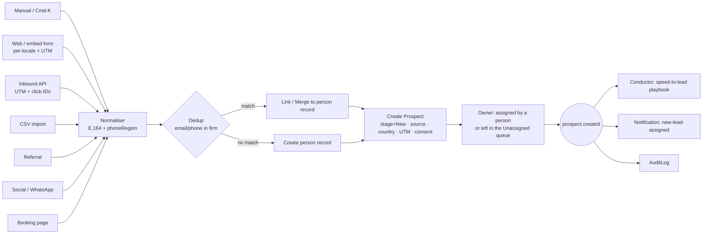
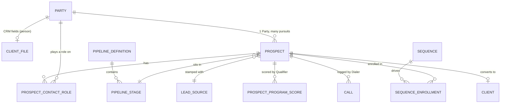

> **Document control** · Version **1.14** · **2026-10-18** · Status: **People model X-2 applied (every real person has a person record; "Contact" is a screen name, the Contact table is retired) and AG-07 review decisions AG07-D3 (conversion carries the retainer and its representative) and AG07-D15 / AG7-D21 (credited sales user read-only on the client) applied; previously: Second pass AG16-54, -55, -57, -65, -67, -72 applied (form-notification rule matches sender + subject, learned and shown; AI-read fields shown as "Suggested details"; "Show me possible new enquiries" folded into Unmatched "Only you"; open questions 22, 23, 24, 25, 26, 28 closed; 21 and 27 stay open); previously: AG-16 review round 2 applied (the product owner, 15–17 Oct: AG16-32 leads from form notification emails, AG16-44 no automatic merge, AG16-25 and AG16-42 lead owner alert; pointers AG16-25 and AG16-49); previously: AG-16 review decisions applied (the product owner, 14 Oct: AG16-6, -11, -14, -21, -22; notes for AG16-10); previously: SA05-R9a applied (the product owner, 12 Oct): automatic messages run from day one, nothing is held for a review; previously: SA-06 v3.0 rename map applied (SA6-D10: `agent/prospect:view.own` / `view.all`; unassigned prospects visible to `view.all` and `assign` holders, SA6-D6); previously: prospect visibility applied (SA6-D1, SA6-D6b: lists show only the user's own prospects unless the role has `agent/prospect:view.all`, which is seeded on all six starter roles); previously: Knock-on changes from AG-07 v2.3 applied (client fields on the Contact lens, AG-02 owns `Party`, no masking and no reveal of personal data — AG7-D10); previously: Baseline — agent-native decisions applied (from AG-11 / AG-18, 4 Oct); speed-to-lead acknowledgement is AUTO (template message), same-day simplify; imported leads quiet until switched on (AG18-D9); review fixes applied the same day (a quiet lead converted gives a quiet client, licence-aware approval, AI off until terms recorded, imported consent, quiet state shown as "Not started")**\
> Part of: *Agent (RCIC/Lawyer) Console — Functional Requirements* · Split from `FINAL-Agent-FR.md` lines 775–1644 on 2026-09-16 · Previous version: `_archive/AG-02-prospect-lead-sales-crm_v1.13_2026-10-17.md`\
>
> | Version | Date | Change | Decisions |
> |---|---|---|---|
> | 1.14 | 2026-10-18 | **People model (X-2) and AG-07 review decisions applied to AG-02 (the product owner, 18 Oct).** (1) **X-2:** every real person gets their own person record (a `Party` of kind PERSON). It is created automatically when a family member is added, after ExpatReady offers the client's family members already on file ("Client J, daughter, already on file — use her?"). Staff decide; merge stays the repair path. New AG-2-72 with a build card. "Contact" is now only the name of the screen: the separate `Contact` table is retired. A person's details sit in `Party` + `PartyProfile` (extended with phone region, country of origin, time zone), a small one-per-person `ClientFile` (lifecycle stage, file owner, client code, office) and the built `ConsentRecord`; relationships use `PartyRelationship`. New AG-2-73 with a build card. A reading table before §1 maps every old `Contact` field to its new home. (2) **AG07-D3:** conversion carries the retainer and its representative to the client and the case; a case created from a lead gets its lead representative pre-filled from the retainer, editable. New AG-2-74 with a build card. The pre-fill order, the warning and the block are specified once, in AG-05. (3) **AG07-D15 (AG7-D21):** the sales user credited at conversion shows read-only on the client and cannot be set on Add client (AG-2-47). **Changed:** §3.0 – §3.3, §3.11, §3.14, AG-2-1, -3, -14, -29a, -31a, -47, -47a, -47b, -54, -68, BR-15, BR-18, §6, §7, §8, §9, §12, §13 question 1. **Added requirements:** AG-2-72, AG-2-73, AG-2-74. **Open questions added:** 29, 30, 31. **Closed:** none. *18 Oct (later): consistency fixes after expert review — AG16-89(8) (lead routing and round robin withdrawn: §3.13, AG-2-13a, -13b, -13d, BR-11 rule part, `AssignmentRule`, routing user story and edge case, Q5 assignment rule; `agent/prospect:assign` no longer manages rules), X-2 (5) (time zone pointer), AG07-D12 (persona).* *18 Oct (final): AG07-D17 – D21 applied — AG07-D20(h), AG07-D20(k).* **AG07-D20(h) (pointer):** when the client adds a family member in the questionnaire, the client picks from family members already linked to them (names only) or adds a new person; staff see "Possible duplicate?" and decide (specified in AG-8-28, AG-08); question 30(d) closed. **AG07-D20(k):** the `ClientFile` record is created only when a person becomes a lead or client (AG-2-73 requirement and card, §7); a family member who is neither has none; question 30(b) closed. **Open questions:** 30(b) and 30(d) closed; 30(a) and 30(c) stay open. Requirement IDs unchanged. *18 Oct (final): AG07-D22 applied — Q65 (the client code is assigned at conversion; a lead has none: AG-2-73 requirement, card rule 3 and a new test, §3.11 convert list) and Q44 (a returning client with a new program: new case by default, adding a filing to an open case allowed: §3.11 convert list).* *18 Oct (later): AG01-29 / AG16-105 and gap-check fixes applied — **AG01-29(6):** the staff-leaving handover (AG-01) also moves all of the leaver's clients, that is the file owner (`ClientFile.fileOwnerUserId`), to the main choice in the same click; safety line: an item for a client whose file owner is deactivated is created with no owner and shows in "Needs an owner", never sent to the departed person (§3.8, §9, the AG1-D4 and AG1-D5 rows). **Added requirements:** none.* | X-2 · AG07-D3 · AG07-D5 (replaced by X-2) · AG07-D15 (AG7-D21) · AG16-89 (8) · AG07-D20(h), (k) · AG07-D22 · AG01-29(6) |
> | 1.13 | 2026-10-17 | **Second pass (AG16-54 – AG16-82, the product owner, 17 Oct) applied to AG-02.** (1) **Form-notification rule (AG16-65):** the offer groups repeated Unmatched items by **sender + subject line (digit runs ignored)** and shows exactly what it will match ("From info@ with subject 'New enquiry from website' — 12 so far. Always create leads from these?"); each form gets its own rule; anything that does not match stays in Unmatched; a changed subject makes the offer reappear. Changes AG-2-67 (requirement, card rules 1–2, §3.1 source 8, §7). Closes question 23. (2) **"Suggested details" (AG16-54 #11, AG16-33):** fields the Sorter reads from a notification are shown on the lead as "Suggested details" for staff to accept; they are not written to the lead. Closes question 25. (3) **AG-2-70 (AG16-57):** the separate personal list is folded into Unmatched: items from a personal mailbox show only to that person marked "Only you"; "Create lead" lives only in Unmatched (AG-10). Pointer rewritten. (4) **AG-2-69 (AG16-67):** the lead owner alert is kept as one of four "no reply" layers; one-line note added. (5) **AG-2-71 (AG16-72):** pointer notes the refined time-zone fill order, owned by AG-07. (6) **AG16-55 defaults:** questions 22, 24, 26, 28 closed with the defaults in the v1.12 card; 23 by AG16-65; 25 by AG16-54 #11; **21 and 27 stay open** (no default stated). (7) **Build cards:** AG-2-67 changed; AG-2-68 and AG-2-69 given "Clicks" and "Person decides" lines; AG-2-67 gains the same. **Added requirements:** none. *Same-day fixes (17 Oct): AG16-83 – AG16-88 — Q28 reverts to AG16-42(4) (alert only when the mail arrived in a mailbox the owner does not read) and Q24 default source "Website form" (AG16-83 #11, #22); English-first notes on the per-locale web form, bilingual templates and sequences summary (AG16-88; legal French consent text flagged for the product owner).* *Same-day fixes (18 Oct): AG16-89 — lead owner alert (AG-2-69, AG-2-48a, Q28): one rule, alert only if the email arrived in a mailbox that is not the owner's own; the "reads" test and "flagged for the product owner" are removed; in a one-user firm every mailbox is the user's. AG-2-70: the "Only you" items are dropped; a personal mailbox no longer brings in unknown senders; "Create lead" lives in Unmatched for firm mail.* *Same-day fixes (18 Oct): AG16-90 — web-form test now says the French acknowledgement is the firm's own French template (AG16-88).* *18 Oct: new section 'Decisions that change this epic' (index of AG16 decisions; no requirement changed).* *Same-day fixes (18 Oct): AG16-96, AG16-97 — AG-2-67: the offer appears on the 3rd matching Unmatched item, with a test (2 matching items: no offer; the 3rd: offer shows); switching a rule on or off uses `agent/integration-mail-receive:manage`, no new key; question 21 closed.* | AG16-33 · AG16-54 · AG16-55 · AG16-57 · AG16-60 · AG16-65 · AG16-67 · AG16-72 · AG16-76 · AG16-89 · AG16-90 · AG16-96 · AG16-97 |
> | 1.12 | 2026-10-17 | **AG-16 review round 2 (AG16-24 – AG16-53, the product owner, 14–17 Oct) applied to AG-02.** **Leads from form notification emails (AG16-32):** a lead is created from a notification only after the Owner or Admin has clicked "Always create leads" once for that sender; each notification then creates a lead with `source` = that form (new source 8 in §3.1, new AG-2-67). **No automatic merge (AG16-44, which corrects AG16-32(4)):** a match on email or phone shows "Possible duplicate of [name] — Link / Merge / Keep separate" and staff decide (new AG-2-68; AG-2-15 and §3.2 changed). **Lead owner alert (AG16-25(6), trimmed by AG16-42(4)):** an email from a lead is filed silently; the lead owner is alerted only when it arrived in a mailbox the owner does not read (new AG-2-69). **Pointers with no control of their own:** "Show me possible new enquiries" (home AG-10; AG-2-70) and `Contact.timezone` (home AG-07, AG16-49; AG-2-71; §7 `Contact`). **Unchanged:** speed-to-lead, the lead response clock (AG16-6), going-cold. The Default lead representative (A12) is not specified in AG-02 and is unchanged (it is AG-01's setting, AG-1-68). **Build cards** (new section at the end of §4): AG-2-67, AG-2-68, AG-2-69. **Open questions** 21–28 added. **Open questions closed: none** (none of AG16-24 – AG16-53 answers questions 16–19). | AG16-25 · AG16-31 · AG16-32 · AG16-33 · AG16-42 · AG16-44 · AG16-49 |
> | 1.11 | 2026-10-14 | **AG-16 review decisions applied (the product owner, 14 Oct).** (1) **Sequence on/off moves to the Automatic messages page (AG16-11):** each sequence message is a row on that page (AG-12 is its only spec home); the Sequence library screen no longer has its own on/off, and the recipe on/off wording in AG-2-31, AG-2-56 and AG-2-57 now points to the page. Step editing is left as it was; new open question 16 asks how it fits Release 2 "firm-authored recipes". (2) **Lead response clock uses the firm's business hours and closed days (AG16-6)** (going-cold reverted to calendar days the same day); the closed-days list is the firm's own and starts empty. (3) **New-lead and other staff notifications follow each person's own settings (AG16-14)**; there is no firm notification grid. (4) **Deleting leads (AG16-21):** Undo for a few seconds, then 30 days in Recently deleted; bulk delete for spam leads; delete is offered only for an empty lead; a lead with history is closed (Lost), not deleted. New AG-2-66. (5) **Escalation to a supervisor or manager removed (AG16-22):** overdue lead tasks remind the assignee; the single Escalation switch lives in AG-16/AG-11. (6) **For the AG-02 review (notes only, nothing built or decided):** the inbound lead API keys (AG-2-6) will share one "API keys" screen with the Developer API (AG16-10), and the phase of an ExpatReady listing in Zapier's app directory. Changed: §3.1 speed-to-lead bullet, §3.6 (sequence paragraph, key screens, going-cold, tasks), AG-2-6, AG-2-22, AG-2-31, AG-2-39, AG-2-48a, AG-2-56, AG-2-57, BR-12, §9, §10 (`agent/prospect:delete`), §13 (Q5 note). New: AG-2-66; open questions 16–19. *Same-day audit corrections (14 Oct): R5 applied (supervised client messages and licensed-approver routing removed — AG11-D11 and AG18-D11(b) rows, AG-2-56, -58, -59, BR-20, §3.6, §9, edge cases; Q20 closed); AI-edited-template per-send floor removed (AG12-D25); going-cold reverted to calendar days (AG-2-39, BR-12, §3.6, edge case; only the lead response clock uses business hours).* | AG16-6 · AG16-10 · AG16-11 · AG16-14 · AG16-21 · AG16-22 · R5 · AG12-D25 |
> | 1.10 | 2026-10-12 | **Automatic messages run from day one (SA05-R9a, the product owner, 12 Oct; decision owned by AG-12 as AG12-D23).** Nothing waits for a review any more: the speed-to-lead acknowledgement (and every other template message) is sent on its own from the first day, in ExpatReady's neutral wording, unless it is off by default. The "Review your standard messages" screen (AG11-D12) is no longer a gate; it becomes the optional "Review your automatic messages" page (on/off list, AG-12-52). A message missing a firm detail it needs is not sent and the firm sees a short note (AG-12-109); a one-time dashboard notice says the messages are on (AG-12-110). Unchanged: imported clients stay quiet until switched on (AG18-D9/D10), AI floors, autonomy levels, WhatsApp opt-in. Changed: AG11-D1, AG11-D12, §3.6 sequences paragraph, AG-2-35, AG-2-56, AG-2-57, BR-20, US-13, §9 edge cases (2). New: AG-2-65. Open question 15 added. SA5-X46 recorded as applied. Same-day closing (SA05-R9b): open question 15 is closed — each message needs the firm details it uses, and the on/off permission is `agent/template:configure` (Owner and Admin). *(revised same day — SA05-R9b)* | SA05-R9a, AG12-D23, SA5-X46 · SA05-R9b |
> | 1.9 | 2026-10-07 | Applied SA-06 v3.0 rename map and knock-ons (the product owner, 7 Oct; founder-authorised; decisions owned by SA-06 v3.0). **Prospect visibility keys renamed to the canonical pair (SA6-D10, Appendix B):** `agent/prospect:view-all` → `agent/prospect:view.all`; `agent/prospect:list` → `agent/prospect:view.own`; both `view.own` (withdrawn in v1.8) and `view.all` (superseded in v1.8) are **reinstated** and their §10 rows reconciled — the dot-versus-hyphen open item is closed. **Unassigned prospects** are visible to `agent/prospect:view.all` holders and `agent/prospect:assign` holders (SA6-D6); the "managers" / open-item wording is removed (§3.13, AG-2-64, Applied-from table). "Firm Admin" → "Admin" (§10 import permissions). §10 honesty note and §12 reworded: SA-06 treats the legacy prospect keys as unverified in the ERv2 catalogue. Withdrawn rows (`agent/prospect:reveal-pii`, `agent/pii:export-unmasked`) keep their old names as history. Changed: Applied-from table, §3.13, AG-2-41, AG-2-64, §10, §12. No new requirement. Old keys in earlier version rows below are history and are not rewritten. | SA6-D1 · SA6-D6 · SA6-D10 |
> | 1.8 | 2026-10-07 | Founder decisions on who sees which prospects (7 Oct, the product owner; decisions owned by SA-06 v3.0). **Open by default, own-only by choice:** the new key `agent/prospect:view-all` is seeded on all six firm starter roles (Owner, Admin, Case Manager, Case Officer, Billing / Finance, Read-only); a firm removes it from a role to make that role see only the prospects assigned to its users. Without it, `agent/prospect:list` shows only the user's own prospects. The rule applies to the list, the pipeline board, counts, search, export and every dashboard fed from AG-2. Notes, tasks and reminders on a prospect follow the prospect's visibility. New: AG-2-64. Changed: §10 (new `agent/prospect:view-all`; `agent/prospect:list` description; `view.all` and `view.own` rows superseded; Enforcement), AG-2-41, AG-2-49a, AG-2-50, §3.13 unassigned-queue sentence, §11 permission bullet. Conflicts noticed but not decided are in the open items at the end of this row's Applied-from table (naming of `view.all` vs `view-all`; who sees the Unassigned queue). | SA6-D1, SA6-D6 |
> | 1.7 | 2026-10-05 | Knock-on changes from AG-07 v2.3 (5 Oct, the product owner). **Client fields on the Contact lens:** at `lifecycleStage = CLIENT` the `Contact` carries `clientCode`, `fileOwnerUserId?` and `officeId?` (§7 `Contact`, NEW v1.7; AG-07 §3.1, AG-7-69). **Post-convert confirmation** links to the AG-07 client screen (§3.11 key screens; AG-7-77). **Shared duplicate check:** the §3.2 check also serves AG-07 Add client and the case wizard's + New client (§3.2; AG-7-73, AG-7-89). **AG-02 owns `Party`** (§7 `Party` changed from "not owned by AG-2"; AG-07, AG-17 and AG-18 read and write parties through AG-02's service); §12 adds a note that "no Party in code" (`AG-02:209`) and AG-17's "Party exists in `client-spine.prisma`" (`AG-17:303`) are unreconciled and not re-checked on same-day `dev` (DOCS-6) — to be reconciled before build. **Personal data (AG7-D7, replaced the same day by AG7-D10):** the module's `agent/prospect:reveal-pii` is **withdrawn** (§10 row kept, marked withdrawn). Changed: §3.2, §3.11, §3.12 (recording playback wording), §3.14, §7 (`Party`, `Contact`), §9, §10, §11, §12, AG-2-49a, AG-2-51, US-10. AG-2-63 was added for AG7-D7 and is withdrawn the same day. No open question was settled by these decisions. Same day (AG7-D10): masking and reveal removed everywhere — personal data is never masked on screens, lists, search, exports, reports, audit viewers or import previews, and there is no reveal action; `agent/pii:export-unmasked` is withdrawn (§10 row kept, marked withdrawn; exports are governed only by `agent/prospect:export` and every export is audited); AG-2-63 withdrawn; reworded: AG-2-49a, AG-2-51, US-10 (retitled), §3.12 recording playback line, §3.14 PII-safe export bullet, §9 edge cases (export of a huge set, Restricted PII display), §10 `agent/prospect:export` row, §11 (permission, Lead PII handling, audit), §12 (permission note, export/portability and PII-masking items). Kept: personal data never in system logs or traces; passport and financial numbers never in the content of emails, WhatsApp messages or notifications; field-level encryption at rest. | AG7-D1, AG7-D5, AG7-D9, AG7-D10 |
> | 1.6 | 2026-10-04 | Agent-native decisions (4 Oct, the product owner). **Bulk CSV import is un-parked into Release 1:** it runs as an adapter on the one AG-18 import engine, not a second engine (AG-2-7 changed; new AG-2-59, BR-19). **The speed-to-lead recipe runs in Release 1** through the minimal Conductor, with client-facing messages at APPROVE by default and the internal tasks at AUTO (AG-2-35 changed; new AG-2-56, AG-2-57, BR-20). The other seeded sequences (no-show recovery, going-cold, post-consult) stay Release 2 and stay read-only (AG-2-31 changed; new AG-2-58). Inbound WhatsApp from a known lead lands on the timeline through the Sorter (AG-2-9 changed; new AG-2-60). Imports never fire the speed-to-lead recipe or any client-facing recipe. Changed: §3.1 (sources 4 and 6), §3.6, §9, §12, §13 (parked list, new Q11 and Q12), AG-2-7, AG-2-9, AG-2-31, AG-2-35. New: AG-2-56 – AG-2-60, BR-19, BR-20, US-13. **Same day (simplify, "easy for solo, safe for teams"):** the speed-to-lead acknowledgement is now **AUTO**, not APPROVE — it is a template message (active firm template, merge fields only), so it goes out on its own once the firm has approved the template; AG-2-56, AG-2-35, AG-2-58, BR-20, US-13, §3.6 and the edge case revised. A speed-to-lead message waits for approval only if the Drafter wrote it or AI edited the template body, or — under Team safeguards (AG11-D9) — an unlicensed staff member writes or edits a message to the lead. **Same day (fix):** imported leads are **quiet** until the firm switches them on (AG18-D9) — the speed-to-lead recipe and every other client-facing recipe skip a quiet lead, on the import and on every later trigger or scan, until "Start client automations" is confirmed after a preview; internal actions (owner task, notification) still run; a manual message does not switch a lead on; the lead shows "Imported — client automations not started". Changed: AG-2-59, AG-2-56, BR-19, §3.1 source 4, §7 `Prospect`, US-13, §9; new open question 13. **Same day (closing decisions):** **AG18-D9 applied further** — a lead created by an import never starts the speed-to-lead SLA clock or breach flag, and neither the import nor "Start client automations" starts it or replays `prospect.created` for that lead. Revised same day: AG-2-59, BR-12, BR-19, US-13, §3.1 speed-to-lead text, §3.4 stage table (New), §3.7, §9 (imported lead still quiet); §13 Q13 clock part marked decided (the single-lead switch-on permission part stays open). **Same day (review fixes):** principle added — **we work for the firm, not the regulator** (§1 paragraph; "regulator-safe" and "regulated-profession" wording replaced in §1, §3.3, §3.7, §3.14, §4, §13). **AG18-D10(a):** a quiet lead converted (create_new or link) produces or keeps a quiet client, and a client-facing action is skipped if any record it concerns or the recipient party is QUIET; the state is shown as **"Not started"** (new AG-2-61, BR-21; AG-2-56, AG-2-59, §3.11, §7 `Prospect`, §9, US-13 revised). **AG18-D10 (b), (c), (e), (h), (i), (o):** pause and start with a by-recipe-and-action preview, 14-day default undo window, "Verify imported values", attestation on every batch with personal data, an imported consent column never written to consent flags, a merge fills empty fields only (AG-2-59, BR-19, §3.1 source 4, §9, §13 Q11 revised). **AG11-D11:** message supervision for unlicensed users is a standalone firm setting (on by default once an unlicensed user can message clients), AI-written text needs a licensed approver by default, the Owner may approve when no licensed user is active, recorded (AG-2-56, AG-2-58, BR-20, §9, §10 revised). **AG11-D12:** the speed-to-lead acknowledgement is a published-template message and waits in Needs you until the firm confirms its one "Review your standard messages" screen (AG-2-35, AG-2-56, BR-20, §3.6, US-13 revised). **AG11-D13:** AI Doers and WhatsApp inbound are off until the provider terms are recorded; an AI-only inbound match never files automatically (AG-2-60, §3.1 source 6, §9 revised). New: AG-2-61, BR-21; new open question 14. Same day (final alignment): an unverified sender's client-facing action drops to APPROVE and waits in Needs you, never skipped (AG11-D13 row, AG-2-60); §3.1 source 4 no longer calls the undo window an open question (14 days, AG18-D10(c)). Same day (5 Oct): AG1-D19 — no licence monitoring; licensed user = linked by the firm. 5 Oct (open questions closed): AG11-D14 to D17 and AG18-D11 applied. Changed: AG-2-59 (switching on one lead: the licensed lead owner or a user with `agent/import:run`; an unlicensed owner's switch-on waits for a licensed user's approval; a paused lead's waiting items stay, marked "client paused" — AG18-D11(b), (e)) and AG-2-61 (a case created from a quiet lead linked to an existing ACTIVE client follows the client — AG18-D11(c)); edge cases (quiet lead converted; lead in two batches); the AG11-D13 row (AI processing in Canada only — AG11-D15); the Needs you due time for a speed-to-lead message ("2 business days, capped by any linked deadline" is now "2 working days, and 2 working days before a government deadline" — AG11-D17). §13 Q12, Q13 and Q14 decided. No new requirement numbers. **5 Oct (Release 1 scope review, AG11-D18):** (b) an unknown WhatsApp number can become a lead in Release 1 — it lands in the Unmatched inbox with a **"Create lead"** action; a person clicks it, never automatic; it creates a lead with source WhatsApp, links the conversation and starts speed-to-lead (AG-2-9 and AG-2-60 changed; new AG-2-62; §3.1 source 6, §9 and §13 Q12 revised — the earlier 5 Oct answer on Q12 is reversed); (d) the three other seeded sequences — no-show recovery, going-cold, post-consult — run in Release 1 as AG-11 recipes, **off by default** until the firm ticks them on, with the consent gate applying (AG-2-31, AG-2-57, AG-2-39, §3.6, §13 parked list and deferrals changed); manual enrolment and editing steps stay Release 2; (a) proactive outbound WhatsApp is Release 1, SMS stays Release 2 (AG11-D6 row, deferrals). New: AG-2-62. **5 Oct (Release 1 scope review, small fixes):** `WHATSAPP` added to the lead source list (`LeadSource` in §7; §3.1 source 6; AG-2-9) so WhatsApp-originated leads use `WHATSAPP`, not `SOCIAL`; AG-2-62 states that the speed-to-lead acknowledgement for a lead created from WhatsApp goes on WhatsApp as an in-window reply, falling back to email if the window has closed. 5 Oct (final check fixes): §3.1 source 6 — WhatsApp is Release 1 (AG11-D6, D18(a), (b)), only other live channels (SMS) Release 2; parked-list sequences clause ("disabled affordance … no sequence runs until AG-11 lands") struck as superseded by AG11-D3 and AG11-D18(d); positioning heading in §3.6 reworded to "how it protects the firm's practice". No requirement changed. | AG11-D1 (revised), D2 (revised), D3, D4, D6, D9 (revised), D11, D12, D13 · AG18-D2, D4, D6, D7, D9, D10 · AG1-D19 · AG11-D14 to D17 · AG18-D11 · AG11-D18 |
> | 1.5 | 2026-10-03 | Consistency review fixes (3 Oct). The Corporate pipeline is now stated in the requirements, not only in §13: it is seeded with the same nine stages, kinds and meanings as the Individual pipeline, for an employer "Qualified" means the LMIA Check was run, and a returning employer's next LMIA opens directly as a new file (AG-2-52, AG17-D75). Running the Check never moves the prospect's stage — staff move the card (AG-2-55, AG17-D80). §3.4 no longer calls the stage table "the Individual pipeline above". Applied-from table gains AG17-D35, D75 and D80 rows. "Phase 2 / Phase 3" wording replaced by "Release 2 or later" or "after Release 1" (AG17-D60): §3.4, the click-to-call and assignment-eligibility text, AG-2-9, AG-2-17, §7 `ActivityEvent`, §13 Q2 and the named deferrals. | AG17-D75, AG17-D80 · AG17-D35, D60 |
> | 1.4 | 2026-10-02 | Corporate pipeline brought forward into Release 1 (AG-17 §0.2). A second, corporate pipeline ships beside the individual one; employer prospects are organisation prospects in the same CRM. The board follows the Individual / Corporate view, which never hides search results, notifications, tasks or links. Corporate convert creates the organisation client, copies the prospect's contacts and roles (including SIGNATORY) and hands off to "New LMIA file"; programme interest carries forward only as a hint. A corporate prospect offers a quick informational **Check** (owned by AG-17). No new permissions. New: AG-2-52 – AG-2-55, US-12. Changed: §3.3, §3.4, §3.11, §3.13, AG-2-25, §7 `PipelineDefinition`, §9, §10, §11, §12, §13. | AG17-D5, AG17-D6, AG17-D52, AG17-D61, AG17-D75 |
> | 1.3 | 2026-10-01 | Knock-on from AG-01 v1.3 (decisions revised 1 Oct): a deactivated rep can later be deleted, so history reads "(Inactive) Name" or "(Deleted) Name"; the handover prompt, eligible-owner filter and Unassigned queue ship in the MVP, so the interim "filter by owner and bulk-reassign" wording is removed. Changed: §3.8 world-class behaviour (reassignment), §9 "Owner deactivated with open leads", Applied-from table. | AG1-D1, AG1-D13 |
> | 1.2 | 2026-10-01 | Knock-on from AG-01 v1.2 (staff leaving): deactivated reps leave round-robin at once; open leads handled through the AG-01 handover (deferred) or owner filter + bulk reassign; skipped leads go to Unassigned; won/lost leads keep the departed owner; AG-2-13c unchanged. Changed: §3.8 world-class behaviour (reassignment), §9 edge case "Owner deactivated with open leads". | AG1-D1, AG1-D4, AG1-D5, AG1-D6, AG1-D7 |
> | 1.1 | 2026-08-28 | Baseline — complete document v1.1 | — |

## Decisions that change this epic (14–18 Oct) *(new 18 Oct)*

Product-wide rules (apply here as everywhere; home: Agent `00-Overview` → "Product rules every epic follows"): AG16-31, AG16-33, AG16-42, AG16-44, AG16-60, AG16-63, AG16-76 (AG16-11 and AG16-89 also have rows below because they changed requirements).

The "AG16" prefix is historical: these decisions began in the AG-16 review and apply across the product. Full text: `TEMPLATE-MAP-working_2026-10-10.md`.

| Decision | What was decided (one line) | What it changes in this epic | Where (requirement / card / section) |
|---|---|---|---|
| AG16-6 | Business hours and closed days (Mon–Fri 9–17 default, firm's own closed days). | The lead response clock (speed-to-lead) runs on the firm's business hours and closed days; going-cold stays in calendar days. Closed-days list starts empty. | §3.1 · §3.7 · §3.12 · AG-2-39 · BR-12 (§5) · §9 |
| AG16-10 | Developer API: spec follows code. | Note only: inbound lead API keys (AG-2-6, not built) will share one "API keys" screen with the Developer API. Nothing built or decided here. | AG-2-6 (note) · §13 Q17 |
| AG16-11 | One "Automatic messages" page, documented in one place only (product-wide rule). | Sequence on/off moves to the Automatic messages page; the Sequence library screen has no on/off of its own. | AG-2-31 · AG-2-56 · AG-2-57 · §13 Q16 |
| AG16-14 | Staff notifications: personal settings only. | New-lead and other staff notifications follow each person's own settings; no firm notification grid. | §3.1 · §3.8 · AG-2-69 · notifications requirement in §4 |
| AG16-21 | Undoing deletes (Undo, 30-day Recently deleted). | New: Undo after a lead delete, 30 days in Recently deleted, bulk delete for empty spam leads only; a lead with history is closed as Lost, not deleted. | AG-2-66 (new) · bulk actions in §4 · §9 · §10 `agent/prospect:delete` · §13 Q18 |
| AG16-22 | One escalation rule: push the high-stakes, show the routine. | Overdue lead tasks and SLA breaches remind the assignee or owner only; no escalation to a supervisor or manager. | §3.8 · BR-12 (§5) |
| AG16-24 | Own mailbox and own calendar on every plan. | Cited — see change-log row 1.12 (decision range only; no AG-02 text found). | Change-log row 1.12 |
| AG16-25 | Mailbox roles, solo setup, and how email data separates. | Adds the lead owner alert on a filed email (AG-2-69) and the pointer for personal-mailbox enquiries (AG-2-70). | AG-2-69 · AG-2-70 |
| AG16-32 | Lead notification emails become leads. | New: a lead is created from a form notification email only after the Owner or Admin has clicked "Always create leads" once; the lead's source is that form. | AG-2-67 (requirement and card) · §3.1 source 8 |
| AG16-34 | AI is included in higher plans, not an add-on. | Referenced only (no change here): the Sorter used by AG-2-67 is plan-gated. | AG-2-67 card (Engine) |
| AG16-49 | Client quiet hours in the client's own time zone. | Pointer only: the person's time zone (`PartyProfile.timezone`; field AG-02, fill rule AG-07 AG-7-98); AG-02 adds no control. Lead detail shows it. *(fixed 18 Oct — X-2 (5))* | AG-2-71 · §3.3 |
| AG16-53 | Video links are per person; no firm video account. | Cited — see change-log row 1.12 (decision range only; no AG-02 text found). | Change-log row 1.12 |
| AG16-54 | 25 consistency fixes after the 17 Oct write. | Fields the Sorter reads from a form notification are shown on the lead as "Suggested details" for staff to accept (#11); never written on their own. | AG-2-67 card · §3.1 source 8 · §13 Q25 (closed) |
| AG16-55 | Writers' recommended defaults accepted for the detail questions. | Open questions closed with the card defaults: a notification with no readable email or phone creates no lead and stays in Unmatched (Q22); Link behaves as written (Q26). Q21 and Q27 stay open. | AG-2-67 · AG-2-68 · §13 Q21–Q28 |
| AG16-57 | Two places for unfiled messages: Unmatched and "Not brought in". | The separate personal "Show me possible new enquiries" list is folded into Unmatched. Superseded in part here by AG16-89 ("Only you" items dropped). | AG-2-70 |
| AG16-65 | Form-notification rule matches sender + subject pattern, learned and shown. | The "Always create leads" rule matches sender and subject pattern (digit runs ignored), one rule per form; a changed subject makes the offer reappear. | AG-2-67 (requirement, card rules 1–2) · §3.1 source 8 · §7 · §13 Q23 (closed) |
| AG16-67 | "No reply" signals kept as layers. | The lead owner alert is kept as one of four "no reply" layers (note added; no behaviour change). | AG-2-69 |
| AG16-72 | Client time zone from the phone code only for single-zone countries. | Pointer notes the refined fill order (address, single-zone phone code, office time zone); owned by AG-07. | AG-2-71 |
| AG16-82 | One rule for every broken connection. | Cited — see change-log row 1.13 (decision range only; no AG-02 text found). | Change-log row 1.13 |
| AG16-83 | 26 follow-through fixes after the second pass. | Default lead source name is "Website form", editable by Owner or Admin (#22); the lead owner alert rule is restated (#11, Q28). | AG-2-67 card (rule 4) · §13 Q24, Q28 (closed) |
| AG16-88 | Release 1 is English-first; French later. | Notes added: web form locale, bilingual templates and sequences are English at launch; the locale mechanism stays. | §3.1 · §3.6 · §12 |
| AG16-89 | Simplified mailbox model: assign and file (product-wide rule). | Lead owner alert fires only if the email arrived in a mailbox that is not the owner's own. "Only you" items dropped: a personal mailbox no longer brings in unknown senders; "Create lead" lives in Unmatched for firm mail. | AG-2-69 · AG-2-48a · AG-2-70 · §13 Q28 |
| AG16-89 (8) / 00-Overview rule 8 | No routing rules, no round robin; the firm manages its own queue by assigning. | §3.13 routing, AG-2-13a, -13b, -13d, BR-11's rule part, the `AssignmentRule` entity, the routing user story and edge case, and question 5's assignment rule are withdrawn. Kept: manual assign and reassign (AG-2-13c, `agent/prospect:assign`), the Unassigned queue, the new-owner notification, and the one-click "Take it" style claim of AG16-89(3) (AG-7-106 for cases; for a lead, taking it is assigning it to oneself). `agent/prospect:assign` no longer includes managing assignment rules. | §3.13 · AG-2-12, -13a–d · AG-2-48a · BR-11 · §7 · §8 US-1 · §9 · §10 · §12 · §13 Q5 *(fixed 18 Oct)* |
| AG16-90 | Batch C: consistency fixes from the 17 Oct audit. | The web-form test now says the French acknowledgement is the firm's own French template. | §8 user story (web form, French) |
| AG16-96 | Form-lead offer appears on the 3rd matching email. | The offer ("From info@ with subject '…' — N so far. Always create leads from these?") appears once 3 Unmatched items share sender + subject pattern (digit runs ignored); a person still clicks Yes (AG16-31). Closes question 21. | AG-2-67 (requirement, card rule 1, tests) · §13 Q21 |
| AG16-97 | Form-lead rules use the existing firm-mailbox key. | Turning a form-lead rule on or off uses `agent/integration-mail-receive:manage` (Owner and Admin); no new key. | AG-2-67 (card, Access) · §10 |
| X-2 | One person record per real person; one place for a person's details (option A; the product owner, 18 Oct; replaces AG07-D5). AG-02 is the home. | Every real person gets a `Party` of kind PERSON, created automatically when a family member is added, with an "already on file — use her?" offer. "Contact" becomes the screen name; the `Contact` table is retired for `Party` + `PartyProfile` + `ClientFile` + `ConsentRecord`; relationships use `PartyRelationship`. | AG-2-72 (card) · AG-2-73 (card) · AG-2-1 · AG-2-3 · §3.0 – §3.3 · §3.11 · §3.14 · §7 · reading table before §1 · §13 Q29, Q30 |
| AG07-D3 | Retainer from a lead, a client or a case; representative pre-filled, never forced. Home: AG-05. | Conversion carries the retainer and its representative to the client and case; a case created from a lead gets its lead representative pre-filled from the retainer, editable. Pointer only for the pre-fill order, warning and block (AG-05). | AG-2-74 (card) · §3.11 · §13 Q31 |
| AG07-D15 (AG7-D21) | AG-07 author's defaults approved as a batch. | The sales user credited at conversion is shown read-only on the client; not settable on Add client. | AG-2-47 |
| AG07-D20(h) | Client adds a family member in the questionnaire (home AG-08; X-2, AG16-44). | Pointer only: the client picks from family members already linked to them (names only) or adds a new person; staff see "Possible duplicate?" and decide. Question 30(d) closed. AG-02 adds no control; Merge stays the repair path. | AG-2-72 (pointer) · §13 Q30(d) |
| AG07-D20(k) | The client-file record is created only when a person becomes a lead or client. Home: AG-02. | A `ClientFile` is made when the person becomes a lead or client, not when a family member is added; a child or other family member has none until then. Question 30(b) closed. | AG-2-73 (requirement and card rules 3, 7, tests, edge case) · §7 · reading table · §13 Q30(b) |
| AG07-D22 (Q65) | The client number (`clientCode`) is assigned at conversion to client; a lead has none. | A lead's `ClientFile` exists (AG07-D20(k)) but its `clientCode` is empty until conversion. AG07-D20(k) is not changed. | AG-2-73 (requirement, card rule 3, test) · §3.11 |
| AG07-D22 (Q44) | A returning client with a new program gets a new case by default; adding a filing to an open case is also allowed. | One line in the convert list (§3.11); the case itself stays an explicit step. | §3.11 |
| AG01-29(6) | The staff-leaving handover moves all of the leaver's clients (file owner) to the main choice, in the same click (home AG-01). | `ClientFile.fileOwnerUserId` of every client the leaver owns moves with the main choice; "Choose per type" and "Skip for now" unchanged. Safety line: an item for a client whose file owner is deactivated is created with no owner and shows in "Needs an owner", never sent to the departed person (AG-1-15; AG16-25(6), AG16-29(1), AG16-67(2)). | §3.8 · §9 |

## People model: how to read "Contact" in this file *(new 18 Oct — X-2)*

"Contact" is the name of a **screen** (the Contacts list and the Lead / Contact detail view). It is **not a table**. The separate `Contact` table is retired. Where this file still says "the Contact" for stored data, read **"the person record"**: the `Party` of kind PERSON plus the rows below. The rules are AG-2-72 (every real person has a person record) and AG-2-73 (one place for a person's details).

| Old (v1.13 and earlier) | Now (X-2) |
|---|---|
| `Contact` row, unique per `(firm_id, partyId)` | The `Party` itself (`client-spine.prisma:20`). No extra row. |
| Name, email, phone, `phoneRegion`, `countryOfOrigin`, `language`, `timezone` | `PartyProfile` (built, `client-spine.prisma:100`), extended with these fields |
| `lifecycleStage`, `clientCode`, `fileOwnerUserId`, `officeId` | New small `ClientFile`, created only when the person becomes a lead or client *(AG07-D20(k))* |
| Consent flags with time and source | Built `ConsentRecord` (`security-governance.prisma:332`); see question 29 |
| `mergedIntoId` | `Party.mergedIntoPartyId` (`client-spine.prisma:24`) |
| `ContactFamilyMember`, `ContactProfile` | Retired. Each family member is a person record linked with `PartyRelationship` (`client-spine.prisma:125`). Profile facts stay canonical answers (§7). |
| `ProspectContactRole.contactId`, `DuplicateFlag.matchedContactId` | `partyId`, `matchedPartyId` |
| Polymorphic attach `(entityType = CONTACT, entityId)` and `Call.contactId` | Attach to the person's `Party`. The value name `CONTACT` belongs to the Part 2 vocabulary and is not renamed here (question 30). |

Exact field placement is the backend lead's call (X-2). Organisations (a `Party` of kind ORGANISATION) are not covered by this table: see question 29.

## Module AG-2: Prospect / Lead / Sales CRM

**Applied from SA-06 v3.0 (record visibility, 2026-10-07)** (decisions owned by `SA-06` v3.0):

| ID | Decision | Applied here |
|---|---|---|
| **SA6-D1** | Visibility is open by default and a firm can switch a role to own-only: the "see all" keys (`agent/prospect:view.all`, with `agent/prospect:view.own`) are seeded on all six firm starter roles (Owner, Admin, Case Manager, Case Officer, Billing / Finance, Read-only); a firm removes `view.all` from a role to make it own-only *(changed v1.9 — SA6-D10)* | §10 · AG-2-64 |
| **SA6-D6(b)** | Prospects get their own own/all pair: `agent/prospect:view.all` ("See every prospect of the firm in lists, pipeline, counts, search and export; seeded on all six starter roles") and `agent/prospect:view.own`. Without `view.all`, `agent/prospect:view.own` shows only prospects assigned to the user. **Unassigned prospects are visible to `agent/prospect:view.all` holders and to `agent/prospect:assign` holders.** *(changed v1.9 — SA6-D10, SA6-D6)* | §10 · AG-2-64 · AG-2-41 · AG-2-49a · AG-2-50 · §3.13 |
| **SA6-D6(a)** | Records attached to a client or case follow that parent's visibility (AG-07 shared-core check, AG-7-88). For AG-2 this matters at conversion: once a lead becomes a client, its history follows the client's rules | AG-2-64 |
| **SA6-D10** | **Naming rule.** Visibility keys follow the `view.own` / `view.all` qualifier rule. `agent/prospect:view-all` is written `agent/prospect:view.all`; `agent/prospect:list` is `agent/prospect:view.own`. Both qualifier keys are reinstated (they were withdrawn / superseded in v1.8). *(Closes former open item (1): spelling.)* | §10 · AG-2-64 |
| **SA6-D6 (v1.9)** | The Unassigned queue is visible to holders of `agent/prospect:view.all` and of `agent/prospect:assign`. *(Closes former open item (2); the "provisional / open" wording is removed.)* | §3.13 · AG-2-64 |

**Applied from AG-01 v1.3 (staff leaving, 2026-10-01)** (decisions owned by `AG-01-firm-setup-and-onboarding` v1.3 §0):

| ID | Decision | Applied here |
|---|---|---|
| **AG1-D1** | Delete allowed only after deactivation; history stays as "(Inactive) Name", or "(Deleted) Name" once deleted | §3.8 reassignment · §9 "Owner deactivated with open leads" |
| **AG1-D4** | No new work to a deactivated person | §3.8 · §9 (never assigned work or notified) *(fixed 18 Oct — AG16-89(8))*; an item for a client whose file owner is deactivated is created with no owner *(changed 18 Oct — AG01-29(6))* |
| **AG1-D5** | Work-handover prompt on deactivation | §3.8 · §9 (open leads listed in the prompt; all of the leaver's clients move with the main choice *(changed 18 Oct — AG01-29(6))*) |
| **AG1-D6** | Only eligible staff offered in handover | §3.8 · §9 (AG-2-13c unchanged) |
| **AG1-D7** | Skipped work goes to Unassigned lists | §3.8 · §9 |
| **AG1-D13** | All staff-leaving items ship in the MVP, same release | §3.8 · §9 |

**Applied from AG-17 v0.1 (corporate pipeline, 2026-10-02)** (decisions owned by `AG-17-corporate-cases-and-lmia` §0, row "AG-02 CRM" of §0.2):

| ID | Decision | Applied here |
|---|---|---|
| **AG17-D5** | Corporate prospects stay in AG-02 (one CRM) with a separate corporate pipeline, brought forward into Release 1; corporate convert creates the organisation client and hands off to a new LMIA file | §3.4 · §3.11 · AG-2-25, AG-2-52, AG-2-54 |
| **AG17-D6** | The board follows the Individual / Corporate view; the view never hides search, notifications, tasks or links | §3.4 · AG-2-53 · §9 |
| **AG17-D52** | A corporate prospect offers a quick informational Check, owned by AG-17; AG-02 only hosts the entry point | §3.3 · AG-2-55 |
| **AG17-D61** | The switch is a "view" (not "workspace") | §3.4 · AG-2-53 |
| **AG17-D35** | Corporate is in every plan; plans differ by capacity, so the Corporate pipeline ships in every plan | §11 · §13 Q8 |
| **AG17-D75** | The Corporate pipeline is seeded with the same nine stages as the Individual one; for an employer, Qualified = the LMIA Check was run; a returning employer's next LMIA opens directly as a new file | §3.4 · AG-2-52 · §13 Q10 |
| **AG17-D80** | Running the LMIA Check does not move the prospect to Qualified; staff move the card | AG-2-55 |

**Applied from AG-12 / SA-05 (automatic messages run from day one, 2026-10-12)** (decision SA05-R9a owned by `AG-12-templates` as AG12-D23):

| ID | Decision | Applied here |
|---|---|---|
| **SA5-X46 (SA-05)** | SA05-R9a automatic messages run from day one - applied v1.10. Note: SA5-X46 is not yet listed in SA-05 v3.3 section 0.2 (next free row); its text is not restated here beyond the decision. | AG11-D1, AG11-D12 (withdrawn) · AG-2-35, AG-2-56, AG-2-57, AG-2-65 · BR-20 · US-13 · §9 |
| **AG12-D23** | Nothing is held for a review; "Review your automatic messages" is optional (AG-12-52); missing firm detail blocks only that message (AG-12-109); one-time dashboard notice (AG-12-110) | same |

**Applied from AG-16 review (the product owner, 14 Oct 2026)** (decisions recorded in the Super Admin template map, section "AG-16 review — decisions"):

| ID | Decision | Applied here |
|---|---|---|
| **AG16-6** | Business hours default Mon–Fri 9:00–17:00 in the firm's timezone, firm-changeable; closed days are the firm's own list (starts empty, ExpatReady seeds none). They drive internal clocks only, including lead response time. | §3.1 · §3.6 · AG-2-39 · BR-12 · §9 |
| **AG16-11** | One Automatic messages page; AG-12 is its only spec home. Sequence on/off becomes rows there. | §3.6 key screens · AG-2-31 · AG-2-56 · AG-2-57 · open question 16 |
| **AG16-14** | Staff notifications follow personal settings only; no firm matrix. | §3.1 · AG-2-48a |
| **AG16-21** | Undo + 30-day Recently deleted; bulk delete for spam leads; delete only an empty lead. | AG-2-22 · AG-2-66 · §9 · §10 |
| **AG16-22** | One escalation rule; no escalation to a manager. | §3.6 tasks · BR-12 |
| **AG16-10** (note) | Inbound lead API keys will share one "API keys" screen with the Developer API (AG-16). | AG-2-6 · open question 17 |

**Applied from AG-16 review round 2 (the product owner, 15–17 Oct 2026)** (decisions recorded in the Super Admin template map, section "AG-16 review — decisions"):

| ID | Decision | Applied here |
|---|---|---|
| **AG16-32** | Lead notification emails become leads: the Owner or Admin clicks "Always create leads" once per sender; fields read by rule; the Sorter reads other layouts when AI is on; the response clock starts from the notification time | §3.1 source 8 · AG-2-67 · card |
| **AG16-44** | ExpatReady never quietly judges: **corrects AG16-32(4)** — no automatic merge of form leads; "Possible duplicate — Link / Merge / Keep separate"; form-lead rules can be turned off per sender | §3.2 · AG-2-15 · AG-2-68 · card |
| **AG16-25 (6)** · **AG16-42 (4)** | Who is alerted when an email is filed: the lead owner for a lead; **trimmed by AG16-42(4):** only when the email arrived in a mailbox that is not the owner's own *(changed 18 Oct — AG16-89)* | AG-2-69 · card |
| **AG16-25 (4)** · **AG16-57** | ~~"Show me possible new enquiries" (personal mailbox list) is folded into Unmatched: items from a personal mailbox show only to that person, marked "Only you"~~ Withdrawn 18 Oct — AG16-89: personal-mailbox unknown senders are no longer brought in; no "Only you" items — rule home AG-10 | AG-2-70 (pointer) |
| **AG16-65** | Form-notification rule matches sender + subject pattern, learned and shown; one rule per form | §3.1 source 8 · AG-2-67 · card · §7 |
| **AG16-54 #11** · **AG16-33** | AI-read form-notification fields appear on the lead as "Suggested details" | AG-2-67 · card rule 8 · question 25 |
| **AG16-67** | "No reply" signals kept as layers; the lead owner alert is one of them | AG-2-69 (note) |
| **AG16-72** | Time zone from a single-zone phone code; fill order owned by AG-07 | AG-2-71 (pointer) |
| **AG16-49** | the person's time zone (`PartyProfile.timezone`; field AG-02, fill rule AG-07 AG-7-98) *(fixed 18 Oct — X-2 (5))* | AG-2-71 (pointer) |
| **AG16-31** · **AG16-33** | Standing rules: ExpatReady suggests, the firm decides; AI reads, rules check, a person confirms | cited in the cards |

**Applied from AG-11 / AG-18 (Agent-native decisions, 2026-10-04)** (decisions owned by `AG-11-automation` and the new module `AG-18` Data Import & Migration; cross-referenced by decision ID):

| ID | Decision | Applied here |
|---|---|---|
| **AG11-D1 (revised)** | Every automated action carries an autonomy level (AUTO / APPROVE / OFF). A template message (published firm template version, merge fields only) defaults to AUTO; the seeded recipes' client messages are template messages, so the speed-to-lead acknowledgement goes out on its own from day one; nothing waits for a review *(changed v1.10 - SA05-R9a)*. The APPROVE floor stays for one-off AI-written text to a client, government forms and unlooked-at verified-profile writes (a template edited by AI is approved once, when published — AG12-D25 *(changed 14 Oct)*); "reads as advice" is no longer a mechanical floor | §3.6 · AG-2-35, AG-2-56 · BR-20 · US-13 |
| **AG11-D2 (revised)** | Approve inline when the approver is the person acting; Needs you holds only work a Doer prepared with no human present or work waiting on a different person | AG-2-56, AG-2-58 · §10 · §9 |
| **AG11-D3** *(changed 5 Oct — AG11-D18(d))* | A minimal Conductor ships in Release 1 with a seeded recipe set enabled at provisioning, speed-to-lead among them; visual builder and firm-authored recipes stay Release 2. *(5 Oct: the further ready-made recipes — no-show recovery, going-cold, post-consult — are Release 1, off by default.)* | §3.6 · AG-2-31, AG-2-35, AG-2-56, AG-2-57 · §13 parked list |
| **AG11-D4** | The Sorter (and the other AI Doers) are off until the provider terms are recorded and the Owner switches AI on (AG11-D13), propose with provenance and confidence, never fabricate; an AI-only match or low confidence goes to the Unmatched inbox and Needs you | §3.1 source 6 · AG-2-60 |
| **AG11-D6** *(changed 5 Oct — AG11-D18(a), (b))* | Inbound WhatsApp (messages and attachments) lands on the client's file via the Sorter in Release 1; proactive outbound WhatsApp with provider-approved templates is also Release 1 *(5 Oct)*; SMS stays Release 2. An unknown number can become a lead through a person-clicked "Create lead" *(5 Oct)* | §3.1 source 6 · AG-2-9, AG-2-60, AG-2-62 |
| **AG11-D9 (revised same day)** | Team safeguards keeps four-eyes on government forms, escalation, at-risk marks and supervisor routing (applied elsewhere). The part that touched AG-2 — supervised messages to a lead — moved to AG11-D11(c) and was then **withdrawn (R5, 12 Oct; applied here 14 Oct)** | AG-2-56 · BR-20 · US-13 |
| **AG11-D11 (rewritten 14 Oct — R5, SA-Q3, SR-Q10; was "Licence-aware defaults")** | **No licence-based routing.** AI-written text to a lead: a human always approves; **anyone who holds the sending permission for that channel may approve it** (a Writer draft sent unedited counts as AI-written), and the draft is shown at once to every active holder; the first decision closes it for all. There is no licensed-approver default, no "preferred" mark and no firm setting for who approves. Supervised messages (an unlicensed user's message) are **withdrawn**: such a message is an ordinary manual send. **If no one holds the permission, the Owner may approve it, recorded; nothing is blocked.** The licence rules R5 kept (the retainer's lead representative / licensed signatory — AG01) are untouched | AG-2-56 · BR-20 · US-13 · §9 · §10 |
| **AG11-D12 (new same day)** | ~~**Standard messages reviewed once at setup.** A template message is a firm-scope PUBLISHED template version; the seeded recipes' client messages (speed-to-lead acknowledgement among them) wait in Needs you as APPROVE until the firm confirms one "Review your standard messages" screen. Internal actions run. (AG-12 knock-on pending)~~ **Withdrawn v1.10 - SA05-R9a (the product owner, 12 Oct): the review is no longer a gate.** Automatic messages run from day one; "Review your automatic messages" is an optional on/off page (AG12-D23, AG-12-52). Missing firm detail: AG-12-109; dashboard notice: AG-12-110. See AG-2-65. | §3.6 · AG-2-35, AG-2-56 · BR-20 · US-13 · §9 |
| **AG11-D13 (new same day)** | **AI Doers off until processing terms are recorded; injection safeguards.** AI is off for every firm until Super Admin records the provider, region (Canada only, AG11-D15) and a no-training/no-retention agreement; then the Owner switches AI on once (one switch for all four Doers). A match made only by the AI, with no deterministic signal (reply token, header chain, known sender address), is never filed automatically; a classification of a message from an unverified sender never triggers client-facing AUTO actions — such an action drops to APPROVE and waits in Needs you; it is not skipped *(final alignment)* | §3.1 source 6 · AG-2-60 · §9 |
| **AG18-D10 (new same day)** | **Imports usable and safe.** Parts applied here: (a) a case or lead created on a quiet client, and a client created by converting or linking a quiet lead, inherit QUIET; a client-facing action is skipped if any record it concerns or the recipient party is QUIET; one import marker, `IMPORT`, with the record state authoritative; (b) pause and start per client and per batch, with a preview by recipe and action type; (c) default undo window 14 days; (e) "Verify imported values"; (h) attestation on every batch with personal data; (i) an imported consent column is never written to consent records until legal decides; (o) a merge fills empty fields only; (q) the quiet state is shown as "Not started" | §3.1 source 4 · §3.11 · AG-2-59, AG-2-61 · BR-19, BR-21 · §7 `Prospect` · US-13 · §9 · §13 Q11, Q14 |
| **AG11-D14 (5 Oct)** | **Core in-house, approved providers.** The client record and all Doer logic are built and owned by ExpatReady; outside providers only for AI/OCR, WhatsApp and mailbox connections, each approved by Super Admin (SA-08). | §3.1 source 6 |
| **AG11-D15 (5 Oct)** | **AI processing in Canada only.** The Sorter and Reader process client data only in Canada; AI stays off until the provider and region are recorded. | AG-2-60 · §9 |
| **AG11-D16 (5 Oct; revised 5 Oct — AG11-D18(c))** | **Inbound email.** Release 1: Gmail, Microsoft 365 (OAuth) and plain IMAP mailbox connection, all with Sorter filing. | No change here (owned by AG-10) |
| **AG11-D18 (5 Oct — Release 1 scope review)** | (a) Proactive outbound WhatsApp (provider-approved templates, preferred channel, email fallback) is Release 1; SMS stays Release 2. (b) An unknown WhatsApp number can become a lead through a **"Create lead"** action in the Unmatched inbox — a person clicks it; never automatic. (d) No-show recovery, going-cold and post-consult run in Release 1 as AG-11 recipes, off by default; manual enrolment stays Release 2. | §3.1 source 6 · §3.6 · AG-2-9, AG-2-31, AG-2-39, AG-2-57, AG-2-60, AG-2-62 · §9 · §13 Q12 |
| **AG11-D17 (5 Oct)** | **Timings the firm can change.** A speed-to-lead message waiting in Needs you is overdue after 2 working days; anything linked to a government deadline must be approved no later than 2 working days before it (due immediately and urgent if less remains). | §13 Q12 |
| **AG18-D11 (5 Oct)** | (b) **Switching on one imported lead:** the lead's owner, or a user with `agent/import:run`, may switch on a single lead; no licensed approval is needed *(changed 14 Oct — R5; AG-18-63: the licensed-user condition and AG-18-86 are withdrawn)*. (c) A case created from a quiet lead linked to an existing ACTIVE client follows the client (ACTIVE). (e) A paused lead's waiting drafts stay in Needs you marked "client paused" and cannot be sent until the lead is started again or the item is deleted. (g) A lead in two batches is switched on by its own batch or individually. | AG-2-59 · AG-2-61 · §9 · §13 Q13, Q14 |
| **AG18-D2** | One import engine for the platform; AG-2's lead CSV import is an adapter on it and is un-parked into Release 1 | §3.1 source 4 · AG-2-7, AG-2-59 · §13 parked list |
| **AG18-D4** | Imports are safe by construction: mandatory dry-run, field mapping, async job with result report, duplicate detection, undo of a whole batch | §3.1 source 4 · AG-2-7 · §9 |
| **AG18-D6** | Every imported value is stamped with its source, date and user; imported values are unverified until a human verifies them | AG-2-59 · BR-19 |
| **AG18-D7** | Imports never trigger client-facing automation; internal actions still fire *(extended same day — AG18-D9)* | AG-2-59 · BR-19, BR-20 · §9 |
| **AG18-D9 (new)** | Imported clients, leads and cases are quiet for client-facing automation — on the import and on every later trigger or scan — until the firm switches them on with "Start client automations" (per batch or per client, after a preview and a confirmation, audited). Internal work runs normally; a manual message does not switch them on; a badge "Not started" ("client automations not started") shows on the record *(label revised same day — AG18-D10(q))*. *(Revised same day: a lead created by an import never starts the speed-to-lead SLA clock or breach flag, and `prospect.created` is not replayed for it on switch-on.)* | §3.1 source 4 · AG-2-56, AG-2-59 · BR-19 · §7 `Prospect` · US-13 · §9 · §13 Q13 |

### Module Index

Scan the whole module in ~30 seconds; jump to any part.

1. **Purpose & Goal**
2. **Users & Jobs-to-be-Done**
3. **Functional Design — How It Works** (core)
   - 3.0 Lead ↔ Contact model · 3.1 Lead capture (multi-source, UTM/attribution, per-locale) · 3.2 De-duplication & merge · 3.3 Lead/Contact detail view · 3.4 Pipeline (Kanban) board & stages · 3.5 Stage-transition & lifecycle engine (e-sign-driven WON) · 3.6 Activities, follow-ups & sequences (bilingual, CASL-rechecked) · 3.7 Lead scoring & "what to do next" · 3.8 Tasks, reminders & work-queue · 3.9 Sales dashboard, KPIs, forecasting & multi-currency · 3.10 Loss, nurture, recycling & reopen · 3.11 Convert prospect → client (history re-parent + profile carry-forward) · **3.12 Call logging / Dialer (in-house Doer)** · **3.13 Lead assignment** *(routing withdrawn 18 Oct — AG16-89(8))* · **3.14 Data export & portability (PIPEDA)**
4. **Detailed Functional Requirements** (AG-2-x)
5. **Business Rules & Logic**
6. **States & Lifecycle**
7. **Key Entities & Fields**
8. **User Stories + Acceptance Criteria**
9. **Edge Cases & Validations**
10. **Permissions** (LOCAL `agent/*`)
11. **Scalability · Security · Performance**
12. **Reference Note** (exists / NEW / changed)
13. **Open Questions / Founder Decisions**

### Visual Overview

**A. Prospect lifecycle** (stage *kind* is the behavioural state; labelled stages are firm-configurable; **WON is driven by the e-sign `envelope.signed` event**, not a manual drag):

```mermaid
stateDiagram-v2
    [*] --> New : capture
    New --> Contacted
    Contacted --> Qualified
    Qualified --> Consult
    Consult --> Proposal
    Proposal --> RetainerSent
    RetainerSent --> RetainerSigned : envelope.signed → WON
    RetainerSigned --> Converted : convert → Client/Case (AG-7)
    Converted --> [*]
    Contacted --> Lost : loss flow (reason required)
    Qualified --> Lost
    Consult --> Lost
    Proposal --> Lost
    New --> Nurture
    Qualified --> Nurture
    Nurture --> Contacted : warm trigger (re-engage)
    Lost --> NewOpp : reopen = NEW Prospect on same Party
    Converted --> NewOpp : reopen = NEW Prospect on same Party
    note right of Converted : status = CONVERTED
    note right of Lost : status stays OPEN; stage.kind = LOST (BR-8)
    note right of NewOpp : §3.0 — never resurrect a terminal row
```

**B. Lead capture — one pipeline, many doors** (every source converges on one normalise → dedup → validate → create path; web/API also capture UTM + click-IDs + consent in the visitor's locale):



**C. Core data model** (`Party` is the identity root, PERSON or ORGANISATION; the CRM view of a person is `PartyProfile` + `ClientFile` + `ConsentRecord`, X-2; cross-cutting attaches polymorphically):



> `Note · Task · Reminder · Activity · Communication · Call · Document · AuditLog · Notification` attach to a person (`CONTACT` entityType = the person's `Party`, X-2) or `PROSPECT` via the polymorphic `(entityType, entityId)` pattern — defined once (Part 2), reused here, never redefined. Immigration-profile facts are not on this diagram: they live against the `Party` in `ClientCanonicalAnswer` (Section 7), not in a private AG-2 table.

---

### 1. Purpose & Goal

**What it is.** AG-2 is the **top of the firm's revenue funnel** and its operational home base for everyone who turns inquiries into paying clients. Every dollar a firm earns enters the system here, as a lead, before it becomes a retained client (AG-2 → convert → Client → Case). It is the first module a prospective firm sees in a demo and the one they will live in all day.

**The business outcome it must produce.** Immigration firms do not lose revenue because they lack leads — they lose it because **leads are dropped**: an inquiry that never got a call back, a hot prospect that went cold over a weekend, a consult no-show that was never rebooked, a "thinking about it" that was never followed up. AG-2 exists to make **"no lead ever falls through the cracks"** structurally true — not by discipline, but by design: speed-to-lead (where a **logged outbound call is the first-response touch**), timezone-aware going-cold detection, automated bilingual sequences, and a "work-queue" that tells each rep exactly who to call next. Secondary outcomes: faster qualification (the immigration eligibility engine triages leads instantly and *feeds the lead score*), higher consult-to-retainer conversion (assessment → consult → proposal → e-sign → payment is one unbroken spine with no re-keying), and owner-level visibility — with **forecasting and multi-currency reporting** — into where revenue comes from and where it leaks.

**Why it matters / world-class positioning.** Per the product vision this is **not a me-too CRM**. A generic CRM is a list + a board + a form. Expat Ready's CRM is a **revenue engine specialised for immigration**: it captures leads from everywhere (with full marketing attribution), **qualifies them with a real eligibility assessment** (no generic CRM can do this), automates follow-up so nothing is dropped, lets the team converse in one place, and converts to a retained client with the full immigration profile carried forward. The moat versus GoHighLevel is two-fold: (a) **immigration eligibility as the qualification engine** (the Qualifier) and the lead-score input, and (b) **compliance-native, globally-aware behaviour** — every nurture and every email respects CASL/Law-25 consent *in the recipient's language*, every claim respects a no-guarantee rule that protects the firm's practice, every lead is tenant-isolated for PIPEDA, every SLA clock is measured in the office's timezone and business hours. A generic CRM cannot sell safely to an immigration firm in any country; ours is built for it.

**How it ties to the revenue journey.** Lead captured → assigned → qualified (Qualifier / AG-3) → consult booked (Scheduler / AG-4) → proposal & retainer sent (Drafter + Signer / AG-5) → **e-sign signature drives WON** → payment (Biller / AG-6) → **convert to client** → case delivery (AG-7+). AG-2 owns the first transitions and hands off cleanly to the rest. The pipeline's stages *are* this journey.

**Global ambition (founder's core point).** The same module serves a solo RCIC provisioned for Canada and a large firm provisioned for Australia or the UK, with **no code change per country** — the platform is multi-country, a firm is not (FD-68); single-currency/single-locale is the degenerate case within a firm. Country comes from the firm's **Country Pack**; money is reported in the firm's **reporting currency** via FX snapshots (never summed raw across currencies); time is the **firm/office timezone** with business hours; copy and consent are **per-locale**. This global-by-construction posture is visible in every section below, not appended as an afterthought.

**Principle — we work for the firm, not the regulator** *(new same day, the product owner)*. AG-2 ships safe defaults and keeps a record of what happened; **the firm decides**. ExpatReady never reports to a regulator, never declares a firm non-compliant, and never blocks the firm's own licensed judgement. Product copy talks about protecting the firm's practice and never cites a regulator's code section as a rule. The floors that stay fixed protect ExpatReady's own product: a human approves AI-written text before it reaches a lead, nothing is fabricated, ExpatReady submits nothing to an authority, and AI processing waits until the provider terms are recorded (AG11-D13). (AG-11 §3.4: ExpatReady assists firms; it does not monitor them.)

---

### 2. Users & Jobs-to-be-Done

The "Agent" persona is an umbrella; AG-2 is used differently by each sub-role. JTBD framing ("when… I want to… so that…") keeps the design honest about what each person is actually trying to accomplish.

| Role | Primary job in AG-2 | Jobs-to-be-done (representative) |
|---|---|---|
| **Intake / Sales Representative** (heaviest user) | Convert inquiries into retained clients; never drop a lead. | "When a new inquiry arrives, I want to see it at once, take it, and know within minutes, so I can call while they're hot and beat a competitor." · "When I start my day, I want a ranked list of exactly who to contact and why — in my timezone — so I'm not guessing or working stale leads." · "When I'm on a call, I want one screen with their whole story and one-click click-to-call + log-outcome, so the call itself counts as my first response and nothing slips." |
| **RCIC / Non-Owner Consultant** | Qualify the genuinely viable, run the assessment, take the consult, close. | "When a lead reaches me, I want the eligibility assessment already run so I can give credible advice in the first consult." · "When I finish a consult, I want to turn it into a proposal and retainer without retyping anything, and have the signature itself move the deal to WON." |
| **Manager** | Keep the funnel healthy and the team productive. | "When I review the week, I want conversion rate, where leads stall, which *source/campaign* actually produces clients, a weighted **forecast** against quota, and which rep needs help — filterable by rep, source and program, and shown in one currency." · "When a lead has been sitting untouched past business-hours SLA, I want it flagged before it dies." · ~~"When I set up the team, I want new leads to route by program then round-robin, respecting who's off."~~ *(withdrawn 18 Oct — AG16-89(8), 00-Overview rule 8)* |
| **Owner / Principal RCIC** | Own the revenue number and the firm's compliance posture. | "When I look at the pipeline, I want to trust every marketing dollar is attributed to a campaign and that everything we send respects CASL/Law-25 and promises no outcome." · "When I configure the funnel, I want stages, sources, loss reasons, and a per-locale web form to match how *my* firm sells." |
| **Accounts / Billing** | Touch AG-2 only at the money edge. | "When a lead is ready to pay, I want the proposal/invoice to flow from the pipeline so I'm not re-creating client and fee data, in the right currency." (Owns AG-6; consumes AG-2's hand-off.) |
| **Case Officer** *(fixed 18 Oct — AG07-D12)* | Light read access; picks up post-conversion. | "When a lead converts, I want their full history *and immigration profile* already on the new client/case so I start work, not re-keying." |

**Design implication.** The Intake Rep is the protagonist of the UI — the default landing surface, the work-queue, the lead detail view, and the keyboard-first interactions (including click-to-call) are designed for them, in their timezone and locale. The Manager/Owner get the analytics, forecasting, and configuration surfaces. The RCIC gets the Qualifier and the consult→proposal→e-sign hand-off. Permissions (Section 10) cleanly separate these.

---

### 3. Functional Design — How It Works (core)

This is the heart of the spec. Each sub-function is designed in depth: **how it works**, the **smart / world-class behaviour** that makes it better than a generic CRM, the **key screens & interactions** (functional, not pixel-level), and the **data flow**.

#### 3.0 The Lead ↔ Contact model (the foundation everything else sits on)

**Design decision: a Lead is an *opportunity*; the person or organisation it is about is a *Party*, and "Contact" is the name of the screen that shows a Party's CRM view** *(changed 18 Oct — X-2; was "a Contact is the CRM lens on a Party")*. This is the GoHighLevel/CRM-correct model and it matters for immigration because one subject can inquire more than once (a refused PR applicant comes back two years later for a study permit; a client refers their spouse; one person pursues two different programs — a study permit and a work permit — at the same time) *and* because the subject is not always a person: an employer running an LMIA is as real a pursuit as an individual applicant, and it needs its own durable identity rather than a name typed into a text field on someone else's record. *(The former "Canada and Australia at once" example is gone: within one firm every pursuit shares the firm's one destination country, FD-68. The multiplicity is real; its axis is program and scope, not country.)* If "lead" and "person" are the same row, you either create duplicates or you destroy history — and if "lead" can only ever *be* a person, a corporate deal has nowhere honest to live.

**Corporate ships alongside Individual from day one, fully — not modelled-now-built-later** (founder ruling, 2026-08-28). The model below is one model for both, not two parallel tracks: a `Prospect`'s subject is a **`Party`** of either kind (`PERSON` or `ORGANISATION`), and every screen, service, and permission this module defines works identically over both from the first slice.

- **Party** = the durable identity root — a person **or** an organisation, firm-scoped and merge-aware. It is not new machinery invented for AG-2; it is the same spine the rest of the platform resolves identity against. **Every real person is a Party of kind PERSON, including each family member** *(new 18 Oct — X-2; AG-2-72)*: staff do not create or merge these records by hand. Adding a family member creates the record, after ExpatReady offers the client's family members already on file ("Client J, daughter, already on file — use her?"). A record with no person behind it exists only for someone who does not exist yet (an unborn child).
- **Contact** = the **name of the screen**, not a table *(changed 18 Oct — X-2; was "the CRM lens on a Party, one row per Party")*. What the screen shows for a person is stored in one place each (AG-2-73): identity, channels, `phoneRegion`, locale and time zone in `PartyProfile`; **`lifecycleStage`** (`LEAD | ACTIVE_PROSPECT | CLIENT | PAST_CLIENT`), file owner, client code and office in the small one-per-person `ClientFile`; consent in `ConsentRecord`. `lifecycleStage` is what makes "one list" real (below). The person record does **not** hold the immigration profile — see the entity note in Section 7. A person accumulates *all* interactions across *all* their leads, consults, and (after conversion) client/case records — the "golden thread," for a person or a company alike.
- **Lead (Prospect / Opportunity)** = a *single pursuit* of converting a Party into a retained client, on a specific **destination country** and **program interest**, moving through a pipeline, with a deal value, an owner, and a stage. Its subject is the Party directly, **not** a separate Contact row (there is none) — `subjectPartyId` plus **`subjectPartyKind`**, carried into a composite foreign key against `Party(id, firm_id, kind)` so the database itself refuses a row that disagrees with the Party it names; a corporate deal cannot silently render as an individual one. *(Named `subjectPartyKind`, deliberately not "pathway" — "Pathway" already names the top level of the country-authored programme tree, and a Prospect column with that name would collide with `pathwayNodeId` and read as the CRM authoring tree content, which content-neutrality forbids. The UI may render it as "Individual / Corporate.")* A Party may have one open Lead (the common case) or, occasionally, more than one (different program or scope pursuits within the firm's one country — see 3.11 multi-open-lead convert).
- **A deal can carry several people, each with a role — not one primary contact bolted onto the record.** `ProspectContactRole` attaches one or more people (Parties) to a Prospect with a role (`PRIMARY | SIGNATORY | HR | HIRING_MANAGER | APPLICANT | SPOUSE | REPRESENTATIVE | BILLING`). This is what lets a corporate LMIA file hold an HR contact, a hiring manager, and a signatory at once, instead of one designation-typed name field — and it serves the individual case the same way: an applicant plus a spouse plus a paying relative is the same shape.
- **One Contacts list, opportunities layered on top — never two surfaces.** Converting a Prospect changes what the person *is* (`ClientFile.lifecycleStage` moves to `CLIENT`), never which list they live in. The board's default filter hides `CLIENT`/`PAST_CLIENT` so the funnel stays a funnel, but hiding is a view default — the moment it becomes two tables, the benefit is gone.
- **Reopen creates a new opportunity, never resurrects a terminal one.** A WON or LOST prospect that is "reopened" produces a **new Prospect (a new opportunity) on the same Party** — a fresh ACTIVE pursuit — while the terminal row stays intact for attribution and audit. We never silently drag a terminal row backward (BR-15). This is the model-level reason terminal stages have no outgoing moves (3.5).
- **Why not collapse them for the demo?** Even in the demo we keep the conceptual separation but present it simply: the rep mostly sees "the lead," and the person is the subject behind it — a person's name or a company's name, rendered the same way. The data model is correct from day one (cheap to extend); the UI **hides the machinery for single-lead contacts** (the locked single-lead principle — don't make people feel plumbing they don't need). *(Locked founder decision: the Contact↔Prospect split ships in Phase-1, Individual and Corporate together.)*

> **Reference-note callout:** today's code has a single `Prospect` row (no separate Contact, no Party *(corrected 17 Oct, §12: `Party` is built)*, and no corporate pursuit at all — V1.5 modelled corporate as a second parallel module, `corporate-prospect`, with its own tables). This is the one structural change in the model. Dedup today is implicit. The rebuild uses `Party` as the identity root (built), `PartyProfile` + `ClientFile` + `ConsentRecord` as the CRM view of a person *(changed 18 Oct — X-2: there is no `Contact` table)*, and `Prospect` as the opportunity pointing at the Party directly (with `ProspectContactRole` for the people on the deal) — one model for both pathways, not two. See Section 12.

#### 3.1 Lead Capture (multi-source, attribution-complete, per-locale) — "every inquiry lands here, instantly, deduped, attributed"

**How it works.** A lead can enter from many sources; each path normalises into the same person-record + `Prospect` creation *(changed 18 Oct — X-2)*, runs the same dedup check, stamps the same mandatory `source`, captures **marketing attribution** where available, waits in the Unassigned queue until a person assigns it (3.13, AG-2-13c), and (for new contacts) enters the pipeline at the first **ACTIVE** stage ("New").

Sources, designed:

1. **Manual create** — a fast "New lead" modal (and a ⌘K "Add lead" command). Minimal required fields (name + one contact channel + source — the destination country is stamped from the firm's one country and is not asked, FD-68); everything else is progressive. Inline dedup: as the rep types an email/phone, the form live-checks and warns *before* save if a matching person record exists, offering "open existing / add as new lead on this person."
2. **Embeddable web form (the firm's own capture widget)** — the firm configures a form (fields, consent checkboxes, thank-you behaviour — no country target, since every lead the firm takes is for its one country, FD-68) and embeds it on its site via a script/iframe snippet. **The form is per-locale (EN/FR/…)** *(AG16-88 note, fix 17 Oct: French is not built or sold at launch; the locale field stays; the French consent text for Quebec is a legal item flagged for the product owner)*: the firm publishes one widget per language, and the **consent text is rendered in the client's language** to satisfy CASL *and* Quebec's Law 25 (which requires French). The locale is stamped on the person's profile (`PartyProfile` language *(changed 18 Oct — X-2)*) so every later message picks the right template (3.6). Submissions create a person record + lead with `source = website form` and capture full attribution (below). **This is a public, unauthenticated endpoint and is the module's primary attack surface** — it is hardened (Section 11): per-IP and per-firm rate limits, CAPTCHA/bot mitigation, honeypot field, schema validation, server-side consent capture with timestamp + locale + form-version. The form is *generated from config*, so adding a field is configuration, not code.
3. **Public inbound API** — a firm-scoped API key lets external lead sources (ad platforms, landing builders, partner portals) `POST` a lead, including the attribution payload. Same dedup, same hardening, same validation; the lead lands Unassigned (AG-2-13c). Keys are revocable, scoped to `firm_id`, rate-limited, and never grant read access — write-only lead creation.
4. **Bulk CSV import** — column-to-field mapping UI (no destination-country column: every imported lead is stamped with the firm's one country, FD-68), **dry-run preview** (shows how many will create vs. merge vs. error and *why*), then an **asynchronous** import job (never a blocking request) with a result report (created / merged / skipped-with-reason). Duplicate rows within the file and against existing contacts are both detected. UTM columns map through if present. *(changed v1.6 — AG18-D2, D4: the import runs on the **AG-18 import engine** as a thin lead adapter, not a second engine, and is **un-parked into Release 1** through it. The dry-run, mapping, duplicate detection, async job, result report and whole-batch undo are the engine's (AG18-D4); the default undo window is 14 days (AG18-D10(c)) *(stale "open question" wording corrected — final alignment)*. Every imported value is stamped as imported, with source, date and user, and is unverified until a human verifies it (AG18-D6). **An import never fires the speed-to-lead recipe or any other client-facing recipe** (AG18-D7, BR-19). Extended same day — AG18-D9: an imported lead stays **quiet** until the firm switches it on, so the speed-to-lead recipe and every other client-facing recipe also skip it on later triggers and scheduled scans; internal actions still run. *Revised same day — AG18-D10:* the quiet state is shown as **"Not started"**; an imported **consent column is never written** to the lead's consent flags until legal decides; the Owner's data-transfer **attestation** is required on every batch containing personal data; a merge fills empty fields only; the default undo window is 14 days; the firm can **pause** a lead or batch back to Not started.)*
5. **Referral** — captured as a structured field (referring client/partner/sub-agent/education agent), because referral attribution is a real immigration-firm channel. Referral source is reportable alongside paid-channel attribution.
6. **Inbound message / social / WhatsApp** (via **Messenger**) — an inbound message from an unknown number/handle can spawn a lead with `source = SOCIAL` (social handles) or `source = WHATSAPP` (a WhatsApp number; *added 5 Oct*), linking the conversation thread to the new lead from the first message. (Depends on Messenger. WhatsApp is Release 1 — AG11-D6, AG11-D18(a), (b); other live channels (SMS) are Release 2. The capture path is designed now.) *(changed v1.6 — AG11-D6, D4: from Release 1, an inbound WhatsApp message or attachment from a number that **matches a known lead or contact by a deterministic signal** (a known sender number; an AI-only match never files automatically, AG11-D13) lands on that lead's timeline, filed by the **Sorter**; the firm replies within the provider's customer-service window. A message the Sorter cannot match with confidence goes to the Unmatched inbox and Needs you. ~~Creating a **new lead** from an unknown sender stays Release 2 or later (AG-2-9).~~ *(Revised 5 Oct — AG11-D18(b): an inbound WhatsApp message from an **unknown number** lands in the Unmatched inbox with a **"Create lead"** action. A person clicks it — it is never automatic — and it creates a lead with source WhatsApp, links the conversation and starts speed-to-lead. AG-2-62.)* Proactive outbound WhatsApp is Release 1 *(5 Oct — AG11-D18(a))*; SMS stays Release 2. Provider choice is pending SA-08, and WhatsApp inbound ships built but switched off until a provider is recorded, AG11-D13.)*
7. **Booking page (Scheduler)** — if a prospect books a consult and their email is new, a lead is auto-created with `source = booking` and the appointment pre-linked. (Owned by AG-4; AG-2 receives it.)
8. **Form-notification email** *(new v1.12 — AG16-32; AG-2-67)* — the firm's existing website form, chat widget and Facebook lead ads email a notification to the firm mailbox (in the sample firm: 64 form notifications in 14 days, about 20 chat transcripts, 3 Facebook lead-ad emails; `research_notes/Mailbox connection design for ExpatReady/inbox_mix_snapshot.md`, sections 2 and 3). When the Unmatched inbox holds repeated notifications with the same sender and the same subject line (digit runs ignored), AG-10 offers "From info@ with subject 'New enquiry from website' — 12 so far. Always create leads from these?" (AG-10-77; AG16-65). The **Owner or Admin clicks Yes once per form** *(changed v1.13 — AG16-65; was once per sender)*. From then on each notification matching that sender and subject creates a lead with `source` = that form, through the same normalise → dedup → validate → route path as every other source. Fields are read by rule ("Name:", "Email:", "Phone:", "Message:"); anything not understood goes into the lead's note. With AI on, the **Sorter** reads any layout, chat transcripts and Facebook emails included; what it reads is shown on the lead as **"Suggested details"** for staff to accept, never written to the lead on its own (AG16-33, AG16-54 #11). Because a person set the rule, a person still decides that these leads exist (the principle of AG-10 BR-32). A match on email or phone is **never merged automatically** (AG-2-68). The lead response clock and the speed-to-lead message start from the time of the notification (AG16-32(5)). Moving to the firm's own widget (source 2) or to a Meta Lead Ads connection through the inbound API (source 3) stays optional.

**Marketing attribution (NEW — first-class).** On the web form and inbound API, capture and persist on the Prospect:
- **UTM parameters:** `utmSource`, `utmMedium`, `utmCampaign`, `utmTerm`, `utmContent`.
- **Click IDs:** `gclid` (Google Ads), `fbclid` (Meta) — and the model is open to others (`msclkid`, `ttclid`).
- **Page context:** `landingPageUrl`, `referrerUrl`.
These flow straight into the source-ROI / campaign attribution dashboard (3.9), so the owner sees *which campaign and ad* produced retained, paying clients — not just "website." Attribution is stamped at creation and immutable.

**Phone normalisation with region (NEW — `phoneRegion`).** The Normaliser converts every phone to **E.164** for dedup and dialing (3.12). Because the same digits are ambiguous across countries, capture forms send a **`phoneRegion`** (ISO-2, e.g. `CA`, `IN`, `AU`) — from the form's locale/country default or an explicit picker — to disambiguate. If a number **cannot be parsed** (too short, invalid for the region), the lead is **still created** (we never drop an inquiry on a phone-format error) but the phone is flagged `unverified`/`unparseable`, surfaced for correction, and **excluded from phone-based dedup and click-to-call** until fixed.

**World-class behaviour.**
- **Speed-to-lead is a first-class feature, not a hope — and a logged call satisfies it.** Every new lead fires a Conductor speed-to-lead playbook immediately: notify the owner once a person assigns the lead (3.13) via the **Notification** module (`new-lead-assigned`, following the assignee's personal notification settings — My account → Notifications; no firm notification grid) *(changed v1.11 — AG16-14)*, optionally send an instant branded auto-acknowledgement (CASL-safe transactional, in the lead's locale), and create a "call within X minutes" task. **The SLA clock is satisfied by the first logged outbound touch — and a logged outbound *call* (3.12) is the canonical one** (a call beats an email for a hot lead). The clock is **timezone-aware**: measured against the firm/office timezone and the firm's business hours and closed days (Settings → Your firm; default Mon–Fri 9:00–17:00; closed days are the firm's own list and start empty), so a lead arriving at 11pm local isn't marked "breached" by morning *(changed v1.11 — AG16-6)*. *(Revised same day — AG18-D9: a lead created by an import never starts this clock or its breach flag, and switching it on with "Start client automations" does not start it either — AG-2-59.)*
- **Attribution is trustworthy and complete.** Source is mandatory; UTM/click-IDs are captured automatically where present. Every later ROI report depends on this.
- **One capture pipeline, many doors.** All sources converge on one creation service with one dedup + one validation + one creation path — so behaviour is identical and a new source is a thin adapter.

**Key screens & interactions.**
- *New lead modal* (manual + ⌘K): minimal-required, progressive disclosure, live dedup banner, `phoneRegion` defaulting from the firm's one country (FD-68). *(Note `phoneRegion` is the **contact's** dialling region and is genuinely variable — an India-based applicant for a Canadian firm — so it remains an explicit, overridable field.)*
- *Web-form builder* (config screen, Owner/Manager): field list, **locale (EN/FR…)** — no country target, since every lead is for the firm's one country (FD-68) — consent options *with localized text preview*, embed-snippet output, live preview, spam-protection toggles, and a hidden-fields note documenting auto-captured UTM/click-IDs.
- *CSV import wizard*: upload → map columns (incl. UTM) → **dry-run preview with counts and per-row issues** → confirm → async progress → downloadable result report. (No country step — FD-68.)
- *API keys screen*: create/revoke firm-scoped write-only keys with last-used and rate-limit visibility.

**Data flow.** Source adapter → normaliser (E.164 + `phoneRegion`; locale) → **dedup resolver** (match on email/phone within `firm_id`) → create the person record (`Party` + `PartyProfile` + `ClientFile`) or attach to the existing one *(changed 18 Oct — X-2)* + create `Prospect` (stage = first ACTIVE, `source` stamped, `destinationCountry` set, **UTM/click-IDs/landing/referrer** stamped, consent flags + locale + timestamp recorded) → owner set by a person, else the Unassigned queue (3.13) → emit `prospect.created` event → Conductor evaluates timezone-aware speed-to-lead playbooks + Notification (`new-lead-assigned`) → AuditLog entry.

#### 3.2 De-duplication & Merge — "never silently create a duplicate; never lose history on merge"

**How it works.** Dedup runs at every entry point. The match key is **normalised email and normalised phone (E.164)** within the firm. On a match the system does **not** silently create a duplicate and does **not** silently merge — it surfaces a choice:
- **Link** the new lead/opportunity to the existing person record (the right answer when a known person starts a new pursuit), or
- **Merge** two person records that are genuinely the same person captured twice (this is also the **repair path** for a duplicate made by family-member entry, AG-2-72), or
- **Keep separate** *(added v1.12 — AG16-44)* — they are different people, or the firm wants two records; the new lead stays on its own person record. For a lead created from a form notification these are the three choices (AG-2-68). The duplicate banner's existing "dismiss with a reason" is this choice; whether a reason is required is open question 27.

**Merge, designed safely (this is where naive CRMs lose data).**
- Merge presents a **field-by-field reconciliation** (which name, which phone, which profile values survive), defaults to the most complete/most recent, and lets the user override per field.
- **All children re-parent, nothing is deleted:** every note, task, activity, communication, **call**, document, assessment, appointment, and any open lead from the losing person record re-attach to the surviving person record via the polymorphic `(entityType, entityId)` re-pointing. The losing record is tombstoned (`Party.mergedIntoPartyId`, kept, marked merged-into) — never hard-deleted — for audit reversibility. *(changed 18 Oct — X-2: a person's answers, family links, consent history and `ClientFile` also follow the survivor; the exact list is the backend lead's check against the built `MergePartyService`, `client-spine.prisma:16`.)*
- Merge is **permissioned, audited** (who merged what into what, with the before/after), and **idempotent-safe** (can't merge a record into itself; concurrent merges resolve deterministically).

**World-class behaviour.** Proactive duplicate *suggestions*: a background pass can flag likely duplicates (same person, slightly different email) for review, rather than waiting for the next inbound. Conversion (Section 3.11) also checks against existing *clients*, not just prospects — so converting a returning client links to their existing client record instead of creating a second one. (The current code already distinguishes `convert: create_new` vs `link_existing`; we extend that idea to the contact layer.)

**One check, three callers *(v1.7 — AG7-D1, AG7-D3).*** This same check (normalised email and phone, link / merge / new) also serves AG-07's **Add client** and the case wizard's **+ New client**: they offer the existing client instead of creating a second one (AG-7-73, AG-7-89). AG-02 owns the check; AG-07 reuses it and defines no second one.

**Key screens.** *Duplicate banner* on the lead (inline, dismissible-with-reason), *Merge wizard* (field reconciliation + "what will move" summary), *Potential-duplicates review* queue (Manager).

**Data flow.** Dedup resolver returns match candidates with a confidence signal → UI presents link/merge/new → on merge: transactional re-parent of all polymorphic children to survivor + tombstone loser + AuditLog.

#### 3.3 The Lead / Contact Detail View — "one screen that holds the whole story and lets you act"

This is the single most important screen in the module and the clearest place to be world-class vs. me-too. It is **not a form** — it is a **command center for one relationship**.

**Layout (functional, three zones).**
- **Left rail — Identity & immigration profile.** Name, photo/initials, contact channels (**click-to-call via Dialer (3.12)**, click-to-email via Mailer, click-to-message via Messenger), destination country (badge), program interest, source **+ campaign attribution** (UTM/referral), owner, lead score/eligibility summary, tags, **locale/language**, consent state (CASL/PIPEDA/Law-25 badges), and the **immigration profile** captured compactly: family unit (spouse/partner + dependants — because eligibility scoring depends on the family unit; each family member is their own person record, AG-2-72), highest education + ECA status, language test + per-skill scores, work history summary with occupation classification, current status, goals. Profile fields are **the single source** that feeds the Qualifier and (post-conversion) the SQR and forms — entered once, reused everywhere.
- **Center — Activity timeline + composer.** A unified, reverse-chronological, **typed and filterable** timeline of everything: **calls logged (with outcome + duration + recording link)**, emails sent/received (via Mailer), messages (Messenger), notes, stage changes, tasks created/completed, reminders, assessments run, appointments, documents, retainer/payment events. At the top, a **composer** to **click-to-call and log the outcome**, write a note, send an email/message, or take an action — without leaving the screen. (Timeline, notes, tasks, comms, calls, reminders are the cross-cutting Part-2 modules attached via `(entityType = PROSPECT/CONTACT, entityId)` — AG-2 renders them, doesn't re-implement them.)
- **Right rail — "What to do next" + contextual Doers.** The intelligence layer (Section 3.7): next-best-action, the active sequence step, the next scheduled touch, ageing/SLA status (timezone-aware). Below it, the **contextual Doer action bar** for a lead: **Qualifier** (assess), **Scheduler** (book consult), **Dialer** (call), **Mailer/Messenger** (reach out), **Drafter + Signer** (proposal/retainer), **Biller** (invoice) — the verbs of converting this person, one click each, pre-filled from this record. On a **corporate (organisation) prospect** the bar also offers **Check** — a quick, informational LMIA check owned by AG-17 (§3.2, AG17-D52); AG-02 only hosts the button (AG-2-55). *(changed v1.4 — AG17-D52)*

**World-class behaviour.**
- **Everything is one click and pre-filled.** Calling, booking, assessing, emailing, sending a retainer — all launch from this screen carrying the lead's data; the rep never re-types a name, number, or fee.
- **Keyboard-first.** Click-to-call, log-a-call, add-note, change-stage, set-next-step are all reachable without the mouse (Superhuman-grade); the demo should *feel* fast.
- **The timeline is the audit-grade record of the relationship** — a record the firm needs to protect its practice (every advice/touch/call reconstructable), and good UX.

**Data flow.** Single detail-load fetches the person record (Party + profile + client-file record) *(changed 18 Oct — X-2)* + active Prospect + a *paginated* slice of the polymorphic timeline (never the whole history at once) + the latest assessment summary + the NBA. Composer actions write to the relevant cross-cutting module (incl. `Call`) and append to the timeline; stage changes go through the stage service (3.5).

#### 3.4 The Pipeline (Kanban) Board & Configurable Stages — "see the whole funnel; move work by dragging"

**How it works.** A drag-and-drop Kanban with one column per **pipeline stage**. Cards are leads; each card shows name, destination-country badge, deal value (in its deal currency, with the reporting-currency equivalent on hover), owner avatar, top eligibility signal, days-in-stage (ageing), and a next-action indicator. Dragging a card to a new column changes the stage (3.5), writes a timeline entry, and may fire automation. The board has a paired **list/table view** (same data, sortable/filterable columns) for power users — the two stay in sync.

**Stages, designed (grounded in the existing engine).** The default pipeline mirrors the firm's revenue journey and the current code's nine stages, each carrying a **`StageKind`** (`ACTIVE | WON | LOST | NURTURE`) that drives behaviour:

| Order | Stage (default label) | Kind | Meaning |
|---|---|---|---|
| 1 | New | ACTIVE | Just captured; timezone-aware speed-to-lead clock running *(revised same day — AG18-D9: not for a lead created by an import, which never starts the clock or breach flag, and switch-on does not start it)* |
| 2 | Contacted | ACTIVE | First touch made (a logged call/email) |
| 3 | Qualified (pre-assessment) | ACTIVE | Eligibility assessed; viable |
| 4 | Consult | ACTIVE | Consultation booked/held |
| 5 | Proposal | ACTIVE | Services + fee proposed |
| 6 | Retainer Sent | ACTIVE | Agreement out for e-sign |
| 7 | Retainer Signed | **WON** | Executed (driven by `envelope.signed`); convert to client |
| 8 | Lost | **LOST** | Closed-lost (reason required) |
| 9 | Nurture | **NURTURE** | Parked for long-term re-engagement |

Stages are **firm-configurable**: rename, reorder, recolour, add, remove. The **kind** is the invariant that keeps logic correct regardless of labels — WON/LOST are terminal, NURTURE is re-enterable. *(changed v1.4 — AG17-D5: **two pipelines ship in Release 1** — an **Individual pipeline** and a **Corporate pipeline** for employer prospects, both seeded from the nine default stages above (AG17-D75). Further named pipelines, for example per programme, stay Release 2 or later.)*

**Individual and Corporate pipelines, and the view (AG17-D5, D6, D61).** *(new v1.4)* An employer prospect is an **organisation prospect in the same CRM** — same Party model, same capture, dedup, assignment and permissions — and sits in the **Corporate pipeline**; a person prospect sits in the **Individual pipeline**. Each pipeline has its own firm-configurable stages with the same `StageKind` rules (3.5). The board follows the user's **Individual / Corporate view** (the word is "view", never "workspace" — that word means the firm's whole account): in the Individual view it shows the Individual pipeline, in the Corporate view the Corporate pipeline, and the list view and default list filter follow the same way, with a visible, clearable chip. **The view only changes what the board and lists show by default. It never hides global search results, notifications, tasks or links between records** — a search for an employer finds the prospect whichever view is active. The view itself (switch, memory of the last choice) is owned by AG-17 §3.0; AG-02 follows it and adds no screen.

**World-class behaviour.**
- **Stage = revenue journey, not arbitrary buckets.** Each forward move corresponds to a real conversion event (assessed, booked, proposed, **signed**) and can trigger the right automation and the right Doer.
- **Ageing & WIP signals on the board.** Cards visibly age (colour shift / "7d in Contacted", computed in firm timezone); optional per-stage WIP soft-limits warn when a stage is clogged. The board *shows where revenue is stuck*.
- **Bulk actions** from multi-select: move stage, assign owner, add/remove tag, start a sequence, archive — for triage at volume.
- **Saved, shareable views** (per-user and firm): "My open consults this week, Canada," "Unassigned new leads," etc.
- **Performance-first board** (Section 11): the Kanban never fetches an unbounded set — columns are **paginated/virtualised** ("load more" per column, counts from cached aggregates), so a firm with thousands of leads still gets a fast board.

**Key screens & interactions.** *Kanban board* (drag-drop, follows the Individual / Corporate view, filter bar — a single-country board, because a firm operates in exactly one country, FD-68), *List view* (sortable columns, inline edit), *Stage configuration* (drag to reorder, set kind/colour, delete-with-reassign — the existing "you must move N prospects before deleting a stage" guard is exactly right), *Saved-views* manager, *Filter bar* (rep, source, **campaign**, program, tag, stage, date, score — no country facet: every lead already shares the firm's one country).

**Data flow.** Board load → stages for firm (active, ordered) + a paginated page of leads per stage (selected card fields only) + cached per-stage counts/values (with FX-converted reporting-currency totals). Drag → stage-change service (guards in 3.5) → update + timeline + `prospect.stage_changed` event → Conductor.

#### 3.5 Stage Transition Rules & Lifecycle Engine — "signatures cause stages, not the other way round"

**How it works.** A small, explicit transition engine governs moves (this exists today and is sound — keep and generalise):
- **Terminal kinds (WON, LOST) have no outgoing moves** — once signed or lost, a lead doesn't drift back through the funnel. Re-engagement is an explicit **reopen**, which creates a **new Prospect on the same Party** (3.0 / 3.10), not a silent backward drag.
- **WON ("Retainer Signed") is only reachable from Proposal or Retainer Sent** — you cannot mark a brand-new lead as "signed." This prevents fake conversions and keeps the funnel honest.
- **NURTURE is re-enterable** — a parked lead can move back into any ACTIVE stage when it warms up.
- **Moving to LOST requires the loss endpoint** (a reason is mandatory) — you cannot drag a card to Lost and skip the reason. (The current code already blocks "drag to Lost" and routes it through the loss flow — preserve this.)
- **Side-effects are derived from the target stage**, not hand-set: entering "Retainer Sent" sets retainer status = SENT; entering WON sets status = CONVERTED + retainer SIGNED, *but does not auto-create the case* — case creation stays an explicit, deliberate action (conversion is a decision, not a side-effect of a drag).

**The e-sign signature DRIVES the move to WON (don't invert the causality).** The correct, world-class flow is: Retainer Sent → the client signs in the Signer → **AG-5 emits `envelope.signed`** → the Conductor consumes it → the engine transitions the prospect to **WON** and stamps retainer = SIGNED. **The signature causes the stage; the stage does not "mark" a signature.** A manual drag to WON is therefore the *exception* (e.g. an offline wet-ink retainer), is permissioned, requires an explicit "signed offline" reason, and itself records a signature event for audit — it never invents an executed document. This keeps "the deal is won" and "the agreement is executed" as **two sides of one wire**, sourced from the actual signing system of record.

**Conductor event semantics (must-have for correctness).** `prospect.created`, `prospect.stage_changed`, `prospect.converted`, and especially the inbound `envelope.signed` are processed with **at-least-once** delivery, so each consumer must be **idempotent**: an `envelope.signed` redelivered (or a duplicate webhook) must move the prospect to WON **once** — keyed on the envelope id + prospect id — never twice, never re-firing onboarding. Stage-change side-effects (Notifications, sequence exits, derived statuses) are likewise idempotent and **non-fatal to the move** if a downstream automation errors (the stage change commits; the failed side-effect is retried/queued, not rolled back).

**World-class behaviour.** Every transition is **logged and timestamped** (`stageEnteredAt`, `lastActivityAt`, both stored in UTC and rendered in firm timezone), feeding both the timeline and time-in-stage analytics, and every transition is an **event** the Conductor can hook. Guards return clear, human messages ("Retainer Signed is only reachable from Proposal or Retainer Sent"), never silent failure.

**Data flow.** `changeStage(prospect, toStage)` → guard (`canTransition(fromKind, toKind, fromKey, toKey)`) → update stage + derived side-effects + stamps → `prospect.stage_changed` event (non-fatal, idempotent consumers) → AuditLog. **Signature path:** `envelope.signed` (AG-5) → idempotency check (envelope+prospect) → `changeStage(→ WON)` → retainer = SIGNED, status = CONVERTED → Notification (owner: "retainer signed") → AuditLog.

#### 3.6 Activities, Follow-ups & Sequences — "the firm's follow-up runs itself, in the right language, within the law"

This is the **anti-dropped-lead engine** and the single biggest differentiator versus a passive CRM.

**Activities (the manual layer).** From the lead detail composer: **log a call** (via the Dialer, 3.12 — outcome picklist + duration + next-step note), **write a note**, **send an email** (Mailer) or **message** (Messenger), **create a task** (type, due date in firm timezone, assignee, note), **set a reminder**. Overdue tasks/reminders are flagged and surface in the rep's work-queue. All of these land on the timeline and are attributed.

**Sequences / cadences (the automated layer — via Conductor + Doers).** A **sequence** is a pre-built, multi-step follow-up cadence (e.g. Day 0 auto-ack, Day 1 call task, Day 3 email, Day 7 "going cold" nudge, Day 14 move to Nurture). The firm enrolls a lead (manually or by trigger) and the **Conductor** executes the steps on schedule, using the **Doers** (Mailer for email, Messenger for SMS/WhatsApp, Tasker for the rep's call tasks, Reminder for nudges, Scheduler for booking links). *(Locked founder decision: the demo runs **email-only** sequences; SMS/WhatsApp designed, Phase-2. Superseded 5 Oct — AG11-D18(a): proactive outbound WhatsApp with provider-approved templates is Release 1; SMS stays Release 2.)* *(changed v1.6 — AG11-D3, D1: the Conductor engine ships in Release 1 in minimal form. ~~**Only the speed-to-lead recipe** of the four seeded sequences runs in Release 1~~ *(changed 5 Oct — AG11-D18(d): all four seeded sequences run in Release 1 as AG-11 recipes; speed-to-lead is on, and no-show recovery, going-cold and post-consult are off until the firm ticks them on)*, and the speed-to-lead client-facing acknowledgement is a **template message**, so it is **AUTO** by default (it goes out on its own from day one with ExpatReady's neutral wording; nothing waits for a review; the firm can switch it off) *(revised same day — AG11-D1; changed v1.10 - SA05-R9a)* — as are its internal steps (the owner's call task, the notification). Otherwise only one-off AI-written text waits in Needs you (an AI-edited template is approved once, when published — AG12-D25; no message supervision — R5) *(changed 14 Oct)*. ~~The other three seeded sequences (no-show recovery, going-cold re-engagement, post-consult follow-up) stay Release 2: they remain visible read-only.~~ *(Changed 5 Oct — AG11-D18(d): they run in Release 1, off by default; the consent gate applies.)* Enrolling a lead in a sequence by hand stays Release 2.)*

**Bilingual templates (locale-selected).** *(Fix 17 Oct — AG16-88: at launch only English templates are written; the locale mechanism stays so French can be added later; the Law-25 French requirement below is flagged for the product owner.)* Every step's message exists as a **template set keyed by locale** (EN, FR, …). When a step fires, the Doer selects the template matching the **person's `language`** (captured at the per-locale web form, 3.1) and falls back to the firm's default locale only if a translation is missing. A Quebec lead receives French; an Ontario lead receives English — from the same single sequence definition. This is both UX and a Law-25 compliance requirement.

**World-class behaviour (and how it protects the firm's practice).**
- **Library-first, not blank-canvas.** Per the RNA/automation direction, AG-2 ships **pre-built, immigration-validated sequences** the firm lightly edits (on/off is on the Automatic messages page, AG-12 — changed v1.11, AG16-11) — *not* a Zapier canvas the rep must build. (Speed-to-lead, no-show recovery, going-cold re-engagement, post-consult follow-up are seeded; **in Release 1 all four are available** — speed-to-lead on, the other three off until the firm ticks them on — v1.6, changed 5 Oct, AG11-D18(d).) The raw builder is "advanced mode," not the front door.
- **CASL/Law-25-gated by construction — and re-checked inside the async job.** Every *marketing/nurture* step checks the recipient's **express-consent** flag before sending; transactional messages (a booking confirmation, a retainer link) are allowed without marketing consent. Critically, for the **bulk path** (a sequence fanned out to many recipients, or a bulk enrol), **consent is re-verified per recipient inside the async worker at send time** — not just once at enrol time. Consent can change between enrol and send (someone unsubscribes on Tuesday for a Friday step); the worker reads the live consent state for *each* recipient and **skips** any non-consented one, logging the skip. A firm literally cannot fire a marketing drip at a now-non-consented lead, even mid-batch. Unsubscribe is honoured automatically and halts the sequence.
- **Auto-exit on progress.** A sequence stops the instant the goal is met (lead replies, books, or advances stage) — no awkward "we already booked, why are they still chasing me" messages. (The "two sides, one wire" principle.) A **`lead-replied`** Notification fires to the owner when the lead responds.
- **Speed-to-lead built in, timezone-aware.** The flagship seeded sequence reaches a brand-new lead within minutes and tasks the owner to call — scheduled against the office's business hours, directly attacking the #1 firm pain. A logged outbound call (3.12) satisfies and stops the speed-to-lead step.

**Key screens.** *Composer* (click-to-call / note / email / message / task / reminder), *Sequence library* (see enrolled count, edit steps, **manage per-locale templates**; ~~toggle on/off~~ *withdrawn v1.11 — AG16-11: each sequence message is a row on the Automatic messages page (AG-12), where it is switched Send automatically · Ask me first · Off*), *Per-lead "enrolled in" indicator* (which sequence, which step, next send in firm timezone), *Work-queue* (the rep's due/overdue actions across all their leads — see 3.8).

**Data flow.** Manual activity → cross-cutting module write + timeline. Sequence enroll → Conductor schedules steps (Bull-backed queue) → **each step, per recipient, re-checks live consent + exit conditions inside the worker** → Doer selects locale template → executes (async) → outcome logged to timeline → Notification on reply → metrics updated.

#### 3.7 Lead Scoring, Prioritisation & "What to Do Next" — "the system tells each rep who to work, and why"

**How it works.** Two complementary signals drive prioritisation; **eligibility is the primary driver of the lead score** *(locked founder decision: eligibility-driven lead score)*:
1. **Immigration eligibility score (the moat, and the primary lead-score input).** Via the **Qualifier** (AG-3): a lead's profile is scored across the destination country's programs (for Canada today: CRS/Express Entry + PNP streams etc.), returning eligible/borderline/ineligible with a ranked recommendation. **A genuinely eligible lead is, by definition, a better lead** — so eligibility is the first-class prioritisation input and the lead score is *driven by* it. (Existing code already attaches program scores to a prospect and exposes the top results on the board card.)
2. **Engagement/behaviour score (secondary).** Recency and intensity of engagement (opened the email, replied, **answered a call**, booked, sat untouched), source quality, deal value, and ageing — used to break ties and surface decay.

**World-class behaviour.**
- **Next-Best-Action (NBA), per lead.** The right rail proposes the single most valuable next move ("Book consult — assessment shows strong CRS," "Send retainer — consult done, fee quoted," "Re-engage — 9 days no contact"), derived from the lead's stage + assessment + activity + sequence state. This is the "what to do next" intelligence the founder asked for, made concrete.
- **The Work-Queue is the rep's home.** Instead of staring at a board wondering who to call, the rep gets a **ranked queue**: hot-and-eligible first, going-cold next, overdue follow-ups flagged, no-shows to rebook surfaced. (This is the "My Day" surface, lead-side.)
- **Going-cold detection (timezone-aware).** Leads with no activity for N **calendar** days (firm-configurable; **seeded default: 7-day going-cold**) are flagged and (optionally) auto-enrolled in re-engagement — turning silent attrition into a managed motion. "No activity for N days" is computed against the **firm/office timezone** in calendar days, not UTC; business hours and closed days do not apply to it (AG16-6 limits them to five internal clocks; going-cold is not one) *(v1.11 business-hours wording reverted 14 Oct)*. A **`going-cold`** Notification fires to the owner when a lead crosses the threshold.
- **Compliance-bounded.** Scores and recommendations never become *promises*. Every assessment surface carries the no-guarantee disclaimer ("indicative eligibility — not a guarantee of approval," already present in the evaluation service) and the rules-as-of/pack-version provenance.

**Key screens.** *Right-rail NBA* on the lead, *Work-queue / My Day (lead side)* (ranked, reason-annotated, timezone-aware), *Score & assessment summary* on the card and detail.

**Data flow.** Qualifier produces program scores + provenance (stored, version-stamped) → **drives the lead score**, combined with engagement/ageing signals → NBA + queue ranking computed (cacheable) → *(revised same day — AG18-D9: the speed-to-lead SLA clock and breach flag do not exist for a lead created by an import, so no SLA status or breach is shown for it, AG-2-59)* → surfaced on card, detail right-rail, and work-queue; going-cold evaluation reads firm timezone/business-hours config → Notification on threshold cross.

#### 3.8 Tasks, Reminders & the Work-Queue

**How it works.** Tasks and reminders are the cross-cutting AG-13 modules attached to the lead via `(entityType, entityId)`. A task has a type, due date (in firm timezone), assignee, and note; a reminder fires at a time on a channel. The **work-queue** aggregates, per rep, everything due/overdue across all their leads, sorted by urgency and value, and is the operational starting point each morning.

**World-class behaviour.** Tasks can be **auto-generated by sequences and stage changes** (so the rep doesn't have to remember to create the call task — the system does). An overdue item reminds its assignee and raises a **`task-due`** Notification following that person's personal settings; it is **not** escalated to a supervisor or manager *(changed v1.11 — AG16-22, AG16-14; the single Escalation switch is owned by AG-16/AG-11)*. Completing a task can advance a sequence (two sides, one wire). Due dates and "overdue" are evaluated in the **firm timezone**, so a rep in a different zone isn't mis-flagged.

**Data flow.** Task/reminder write (manual or automation) → work-queue aggregation (firm + owner scoped, paginated) → completion writes timeline + may trigger Conductor; due/overdue evaluation in firm timezone → Notification (`task-due`).

#### 3.9 Sales Dashboard, KPIs, Forecasting & Multi-Currency — "the owner sees where revenue comes from, where it leaks, and what's coming"

**How it works.** Two audiences, two views:
- **Manager/Owner dashboard:** leads by source **and campaign (UTM)**, stage counts (funnel), leads added this period, **conversion rate**, **average days to convert**, **time-in-stage** (where leads stall), estimated **pipeline value**, **revenue collected** (attributed), **lost-by-reason**, and a **weighted forecast** (below) — all **filterable by date range, rep, source, and campaign**, all expressed in the firm's **reporting currency**. (Destination country is not a filter — within a firm it is a constant, FD-68.)
- **Per-rep performance view:** a single rep's leads, conversion rate, activity volume (incl. **calls logged/connected**), pipeline value, revenue, and **forecast vs quota** — for coaching and a leaderboard. (The existing sales-performance service already computes per-rep leads/converted/conversion-rate/pipeline-value and **attributes collected revenue from paid invoices linked to the prospect or its converted case** — that revenue-attribution *logic* is correct and we keep it; the *computation method* is re-architected below.)

**Forecasting (NEW — first-class).**
- **Weighted pipeline = Σ (deal value × stage-probability).** Each pipeline stage carries a configurable **win-probability** (e.g. Consult 30%, Proposal 50%, Retainer Sent 80%); the weighted forecast sums each open deal's value times its stage probability — a realistic "what will we actually close" number, not the raw pipeline total.
- **Expected close date.** Each deal carries an `expectedCloseDate` (set by the rep or defaulted from average time-to-convert per stage), so the forecast can be bucketed into a period.
- **Period commit vs best-case vs quota.** For the selected period the dashboard shows **commit** (high-probability stages), **best-case** (all open weighted), and progress against the **quota/target** (per rep and per team). This is the language sales managers expect.

**Multi-currency reporting (NEW — first-class; never sum mixed currencies raw).**
- A deal's value is stored in its **deal currency** (the currency the firm quoted that client). A firm can legitimately quote in more than one currency inside its one country — a Canadian firm quoting a US-resident applicant in USD — so multi-currency is a real within-firm case even though multi-country is not (FD-68).
- **Every roll-up converts each deal into the firm's `reportingCurrency` via an FX snapshot** — an **`FxRate` captured at a defined moment** (deal creation, or period close, per a documented policy) and **stored on the deal/aggregate** so the number is stable and auditable (a report doesn't silently change because today's FX moved). The system **never sums values across currencies without conversion** — doing so is a correctness bug, blocked by design. Original deal currency is always shown alongside the converted figure on drill-down.

**Performance: DB-side aggregation, not in-memory (explicit re-architecture).** The current `salesPerformance()` computes over **all rows in application memory** — O(n) on the full lead/invoice set, which does not scale to a 100k–1M-record tenant. **This is replaced, not extended.** The dashboard reads from **DB-side aggregation**: pre-computed **materialized rollups** (e.g. per-firm/per-rep/per-stage/per-currency daily aggregates, refreshed incrementally on the queue — country is a firm-wide constant and carries no information within a firm's own rollups, though the platform still rolls up *across* firms by country in SA-9, FD-68) plus indexed `GROUP BY` queries on the read replica. Filters re-query the **aggregates/cache**, never the raw rows. (Do **not** "keep the existing in-memory backbone" — keep the *attribution rule*, replace the *mechanism*.)

**World-class behaviour.**
- **Source/campaign ROI / attribution** is the headline: which channel *and campaign* actually produces *retained, paying* clients (not just leads) — joined from the UTM/click-IDs captured at 3.1 — because immigration firms spend real money on ads, agents, and webinars and need to know what works.
- **Forecast against quota** gives owners a forward number, not just a rear-view.
- **Funnel analytics with bottleneck callouts** (time-in-stage highlights the leaky stage).
- **Single-currency reporting** — every money figure converted into the firm's one reporting currency via FX snapshots, whatever currency the deal was quoted in. *(Country segmentation is WITHDRAWN by FD-68: every metric in a firm's dashboard already shares one destination country.)*
- **Cached & fast** (Section 11): dashboards read pre-aggregated rollups, never scan the full lead table live.

**Key screens.** *Sales dashboard* (funnel + KPI tiles + **forecast (commit/best-case/quota)** + source/campaign-ROI + lost-reasons, with the filter bar, reporting-currency toggle), *Rep performance / leaderboard* (incl. call activity + forecast vs quota).

**Data flow.** Incremental **materialized rollups** (firm-scoped, per-currency; the firm's one country is stamped on every row, never a rollup axis — FD-68) built off prospects + stages + linked invoices on the queue; **FX snapshots** applied at the defined moment and stored on aggregates; dashboard reads the rollups/cache (read replica), filters re-query the cache; forecast = Σ(value × stage-probability) bucketed by `expectedCloseDate`, converted to `reportingCurrency`.

#### 3.10 Loss, Nurture, Recycling & Reopen — "lose with discipline; never throw away a future client"

**How it works.** Marking a lead **Lost** requires a **mandatory reason** from a firm-configurable picklist (defaults grounded in the existing code: *Not eligible, Price, Went with competitor, Unresponsive, Not ready / timing, Other*) plus an optional note. Loss reasons are reportable. A lost lead is **not deleted** — it is retained and **reopenable**.

**Nurture & recycling (the world-class part).** Many immigration "losses" are *timing* losses — "not eligible yet," "saving up," "waiting on a language retest." These belong in **Nurture**, not the bin. A nurtured lead can be enrolled in a **long-horizon re-engagement** (e.g. quarterly check-in, "draw cut-offs moved" update, "your CRS would change if…" nudge — all CASL-consented and in the lead's locale) and **automatically recycled back into the active pipeline** when a trigger fires (a new draw, a profile update, a reply). This converts the firm's *historical* leads into future revenue — an asset a generic CRM lets rot.

**Reopen = a NEW Prospect on the same Party (ties to §3.0).** Reopening a **WON or LOST** prospect does **not** drag the terminal row backward. It **creates a new Prospect (a new opportunity)** on the **same Party**, in an ACTIVE stage, optionally pre-filled from the closed one (profile, source attribution; the destination country is the firm's and is simply re-stamped) — a genuinely new pursuit. The original terminal row is preserved untouched for attribution and audit. This is why terminal stages have no outgoing moves (3.5) and is the lifecycle expression of the Lead↔Party model. *(A NURTURE lead, by contrast, is not terminal — it re-enters an ACTIVE stage on the **same** Prospect via the warm trigger.)*

**Note on the status/stage asymmetry (grounded in current code).** `ProspectStatus` models only `OPEN | CONVERTED`. **Lost/Nurture are represented by `pipelineStage.kind` (LOST/NURTURE), not by status** — a lost lead keeps `status = OPEN` while its stage kind is LOST. This is a deliberate, documented asymmetry with the WON path (which *does* sync `status = CONVERTED`). The rebuild keeps this but documents it explicitly so analytics and the lifecycle (Section 6) read the right source of truth (stage kind for lost/nurture; status for converted).

**Key screens.** *Loss modal* (reason required + note), *Nurture view* (parked leads + their re-engagement state), *Reopen* action (clearly labelled "Reopen as new opportunity"), *Lost-by-reason* analytics.

**Data flow.** Loss → loss service (validates reason, moves to LOST stage, stamps reason/note) → timeline + AuditLog. Nurture → NURTURE stage → optional long-horizon sequence → recycle trigger moves the same prospect back to an ACTIVE stage. Reopen → **create new Prospect** on the Party (carry country/profile/source) → `prospect.created` → AuditLog (linked to the closed row).

#### 3.11 Convert Prospect → Client — "one continuous spine; zero re-keying (honestly built, not assumed)"

**How it works.** A qualified, signed lead is **converted to a Client**. Conversion:
- **Preserves the entire history** — every note, activity, communication, **call**, document, assessment, and appointment carries forward (re-parented to the new client via the polymorphic pattern), and the original lead is marked **Converted (not deleted)**, retaining its source/attribution.
- **Carries the destination country and the immigration profile forward** so the new Client record — and any case started from it — is **pre-populated** (the single-source / no-re-keying principle that feeds AG-8 SQR and AG-7 forms).
- **Carries the retainer and its representative** *(new 18 Oct — AG07-D3; AG-2-74)* — the retainer prepared or signed from the lead moves to the client and to any case created from it, with the licensed person who signs it. A case created from the lead gets its lead representative pre-filled from the retainer, and staff can change it. The pre-fill order, the warning and the block are specified once, in AG-05 ("Prepare retainer").
- **Offers create-new vs link-existing** (grounded in the existing `ConvertToClientDto`: `create_new | link_existing`): a brand-new Party — person or organisation — becomes a new client; a returning client links to their existing client record (no duplicate Party). *(changed 18 Oct — AG07-D22 Q44)* A returning client who comes with a new program gets a **new case by default**; adding a filing to a case that is still open is also allowed.
- **Assigns the client code** *(changed 18 Oct — AG07-D22 Q65)* — the client number (`clientCode`) is given when the lead becomes a client; a lead has none.
- **May trigger onboarding automation** (welcome, portal invite, document request) via the Conductor (idempotent — fires once even on event redelivery). *(Same day — AG18-D10(a):* not for a client created by converting or linking a **quiet** lead: that client is QUIET ("Not started"), so no welcome, portal invite or request goes until the firm switches it on — AG-2-61.)

**Honest reference note — what conversion does NOT do today (these are explicit NEW deliverables, not assumptions).** A truthful audit of the current code shows conversion is incomplete; the rebuild must close these gaps and they are first-class build items, not "already handled":
- **History is NOT re-parented today.** Converting currently does **not** move the prospect's notes, tasks, communications, **calls**, documents, or timeline onto the new client — the "golden thread" is silently dropped. **NEW deliverable:** a transactional **polymorphic `updateMany`** that re-points every `(entityType=PROSPECT|CONTACT, entityId)` child to the new client (`entityType=CLIENT`) inside the conversion, audited, all-or-nothing.
- **The immigration profile is NOT carried forward today.** Conversion does **not** copy the family unit, education/ECA, language scores, work history, occupation, or goals onto the client — so delivery starts by re-keying. **NEW deliverable:** explicit **profile carry-forward** (the Party's canonical answers, per §7, → Client profile — there is no `ContactProfile` copy to carry, by design), the single-source guarantee AG-8 depends on. Carry-forward is itself blocked on AG-3's answer-capture write path landing (§13).
- **`gender: 'MALE'` is hardcoded on convert (a bug).** The current convert path writes a literal `gender: 'MALE'` rather than carrying the captured value (or leaving it unset/`unknown`). **NEW deliverable:** fix — carry the real captured gender from the profile, never a hardcoded default; if unknown, store `unknown`/null, never a wrong value.

**Multi-open-lead convert (a Party with more than one opportunity).** A Party may have two opportunities open at once within the firm's one country (3.0) — say a **study-permit** pursuit *and* a **work-permit** pursuit — and a *person* Party can additionally sit on a **second, organisation-subject** Prospect via a `ProspectContactRole` (e.g. representing their employer's LMIA) without that Prospect's subject ever becoming theirs. *(The former "Canada opportunity and Australia opportunity" framing is replaced per FD-68: the mechanism survives intact; only its country justification is wrong — the axis is program and scope.)* When the rep converts **one** of them:
- **Only the converted opportunity becomes (or links to) a Client** — the conversion is per-Prospect, not per-Party. **One Client** is created (or linked) for that Party.
- **The other open opportunity is NOT auto-closed and NOT auto-converted.** It stays an open pursuit (different program/scope). It is, however, **linked to the now-existing Client record** (the Party now exists as a client), so a later conversion of *that* opportunity uses **link-existing** to the same Client — never creating a second Party. The convert UI surfaces "this Party has 1 other open opportunity (Study Permit) — it will remain open and stay linked to this client."
- This guarantees **one Client per Party** (person or organisation) with **many opportunities/cases** hanging off them — the correct end-state of the Lead↔Contact model.

**Corporate convert (organisation prospect) — AG17-D5.** *(new v1.4)* Converting a Corporate-pipeline prospect uses the same conversion above, with these corporate specifics:
- It **creates the organisation client** (a Party of kind `ORGANISATION`), or **links the existing one** for a repeat employer — never a second Party.
- The prospect's **contacts and their AG-02 roles (`PRIMARY`, `SIGNATORY`, `HR`, `HIRING_MANAGER`, `BILLING`, …) are copied onto the new corporate client**, so the authorised signatory is already in place for the retainer and the LMIA file.
- It then **hands off to "New LMIA file"** (AG-17). As elsewhere, the file is **not** created automatically — the consultant opens it deliberately.
- The prospect's **programme interest carries forward only as a hint** to the new file. It never binds the file to a stream or a configurator row; the stream is proposed and confirmed at file set-up (AG-17).
- Values entered in the quick **Check** (AG-17 §3.2) pre-fill the new file; AG-17 owns that pre-fill.

**World-class behaviour.** Conversion is the **clean hand-off seam** of the whole product: sales → delivery in one motion, with the rep credited (revenue attribution), the client pre-built *with full history and profile*, and the case ready to start. **Case creation stays an explicit step** (not an automatic side-effect) so the consultant decides scope deliberately.

**Key screens.** *Convert modal* (create-new vs link-existing, **explicit list of what carries forward** — history, profile, country, attribution, the retainer and its representative *(AG07-D3)*; and a banner for any other open opportunities on the person), *post-convert confirmation* (links to the new client/case; the client link opens the AG-07 client screen, AG-07 §3.1, AG-7-77 *(changed v1.7 — AG7-D1)*), *converted-leads list* (for attribution).

**Data flow.** Convert → resolve create/link Client → **transactional polymorphic `updateMany`** re-parents all children (notes/tasks/comms/calls/docs/assessments/appointments) to the Client → **carry country + profile forward** (fixing the `gender` bug) → **re-attach the lead's retainers with their representative** *(AG07-D3)* → (optionally) seed case (lead representative pre-filled from the retainer) → mark prospect CONVERTED + credit sales user → link any sibling open opportunities to the Client → `prospect.converted` event (idempotent consumers) → onboarding playbook + AuditLog.

---

#### 3.12 Call Logging / Dialer (in-house Doer) — "the call is the first response, and it's on the record"

**Why this is NEW.** There is **no call logging in the system today** — calls happen off-platform and never reach the timeline, so the relationship record is incomplete and the speed-to-lead SLA can't be satisfied by the action that actually wins hot leads (a phone call). The **Dialer** is a new in-house Doer that makes calls a first-class, logged activity.

**How it works.** A **`Call`** record is the unit of work, attached to the lead/contact via the polymorphic `(entityType, entityId)` pattern (Part-2 doctrine — not redefined, attached). Fields:
- **`direction`** — `OUTBOUND | INBOUND`.
- **`outcome`** — a firm-configurable **picklist**: defaults `Connected`, `No answer`, `Left voicemail`, `Busy`, `Wrong number`, `Callback requested`, `Not in service`.
- **`duration`** — seconds (0 for no-answer).
- **`notes`** — free text (the call summary / next step).
- **`recordingRef?`** — an **optional** reference to a recording artifact (in Document storage / S3), present only if the firm enables call recording (consent-gated — see below).
- Plus `prospectId/contactId`, `agentUserId`, `startedAt` (UTC, rendered in firm timezone), `phoneNumberE164`, `phoneRegion`.

**Click-to-call.** From the lead detail composer and the left-rail phone field, **one click initiates a call** (via the firm's telephony rail; the Dialer Doer abstracts the provider — Release 2 or later may add live SIP/Twilio, but the *log* path and click-to-call UX are designed now). Click-to-call uses the **E.164 + `phoneRegion`** normalised number (3.1); a lead whose phone is `unparseable` shows the click-to-call disabled with a "fix number" hint. After the call, an **outcome modal** pre-fills duration and asks for the outcome + next step, then writes the `Call` to the timeline and optionally creates the follow-up task.

**A logged outbound call IS the speed-to-lead first-response touch.** This is the headline behaviour: when a rep logs the **first OUTBOUND `Call`** on a new lead, it **stops the speed-to-lead clock** and satisfies the first-response SLA (3.1 / 3.7 / BR-12). A call outranks an email as the canonical first response for a hot lead. The first-response time is measured from `prospect.created` to that first logged outbound touch, **timezone-aware** (against the firm's business hours and closed days, AG16-6). Logging a connected call also advances the lead to "Contacted" (derived, per 3.5 side-effects) and can auto-exit the speed-to-lead sequence step (3.6).

**Compliance & consent.** Call **recording** is **off by default** and, when enabled, is governed by the firm's jurisdiction rules (e.g. one-/two-party consent) and a consent flag/notice — recordings are PII (Confidential), access-controlled, and audited on playback *(changed v1.7 — AG7-D10)*. The Dialer never records without the firm's explicit configuration. Outbound calling itself respects do-not-call / unsubscribe state where applicable.

**World-class behaviour.**
- **Calls are on the golden thread.** Every call (with outcome and duration) appears on the timeline and feeds engagement scoring (3.7) and rep activity metrics / leaderboards (3.9 — calls logged/connected).
- **Outcome-driven next steps.** "No answer" → suggest a callback task tomorrow; "Callback requested" → schedule it; "Connected" → NBA proposes the next conversion step. (Two sides, one wire.)
- **Notifications.** An inbound call logged against a lead can raise a Notification to the owner; a missed/!connected pattern can escalate.

**Key screens.** *Click-to-call control* (left rail + composer), *Call-outcome modal* (outcome picklist + duration + next step + optional recording link), *Call entries on the timeline* (typed, filterable), *Rep call-activity* on the performance view.

**Data flow.** Click-to-call → Dialer initiates (provider-abstracted) → on end, outcome modal → write `Call` (polymorphic attach) + timeline + optional follow-up task → if first OUTBOUND on a new lead: **stop speed-to-lead clock**, mark first-response met, derive "Contacted", auto-exit speed-to-lead step → engagement/metrics updated → AuditLog (recording access audited separately).

#### 3.13 Lead Assignment — "every lead has an owner because a person gave it one" *(routing and round robin withdrawn 18 Oct — AG16-89(8); was "Lead Routing & Assignment")*

**Withdrawn 18 Oct (AG16-89(8), 00-Overview rule 8: "simple tools people use (assign, take it, file) over rules that route work; no routing rules or round robin").** There is no `AssignmentRule`, no round-robin pointer, no pool or out-of-office routing and no routing screen. **What stays:** a person assigns or reassigns a lead (`agent/prospect:assign`); a lead with no owner waits in the **Unassigned queue**, and taking it is one assign action (the "Take it" style claim of AG16-89(3); AG-7-106 for cases); the new owner gets the `new-lead-assigned` notification; the AG-01 handover and bulk reassign when a rep leaves. The old text below is kept struck through as history.

~~**Why this matters.** Speed-to-lead is meaningless if a fresh lead has **no owner** to act on it — an unassigned public-form lead is a dropped lead. Routing is the mechanism that turns "a lead arrived" into "*this rep* owns it now," and it must be a **real, deterministic mechanism**, not a manual afterthought.~~ *(withdrawn 18 Oct — AG16-89(8), 00-Overview rule 8)*

~~**How it works.** An **`AssignmentRule`** (firm-configurable, per pipeline — the Individual and Corporate pipelines each have their own rules) defines how a new lead gets an owner. Supported strategies:~~ *(withdrawn 18 Oct — AG16-89(8), 00-Overview rule 8)*
- ~~**Explicit owner** — always assign to a named rep (e.g. a solo firm, or a "VIP" form).~~ *(withdrawn 18 Oct — AG16-89(8), 00-Overview rule 8)*
- ~~**Round-robin** — distribute evenly across an eligible rep pool, advancing a persisted **round-robin pointer** so assignment is fair over time (not random, not always-the-first-rep).~~ *(withdrawn 18 Oct — AG16-89(8), 00-Overview rule 8)*
- ~~**By-program** — route by program interest (e.g. Express Entry vs Study Permit vs LMIA) to the desk that owns it.~~ *(withdrawn 18 Oct — AG16-89(8), 00-Overview rule 8)*
- ~~**By-source** — route by lead source/campaign (e.g. webinar leads → the closer who ran the webinar).~~ *(withdrawn 18 Oct — AG16-89(8), 00-Overview rule 8)*
- ~~**Composable:** rules chain (e.g. **by-program → then round-robin within that program's pool**), which is the **seeded default**: *by-program-then-round-robin*.~~ *(withdrawn 18 Oct — AG16-89(8), 00-Overview rule 8)*
- **By-country — WITHDRAWN by FD-68.** *(Was: route by the lead's `destinationCountry` to the desk that owns it. Every lead in a firm shares the firm's one country, so the strategy is a guaranteed no-op. Program is the meaningful desk-routing dimension, and it replaces by-country as the seeded default.)*

~~**Round-robin pointer state.** Round-robin keeps **persisted pointer state** per pool (per firm / per program pool), incremented on each assignment, so distribution is even and survives restarts/concurrency. Concurrent captures advance the pointer atomically (no two simultaneous leads both grabbing the same "next" rep, and no rep skipped).~~ *(withdrawn 18 Oct — AG16-89(8), 00-Overview rule 8)*

~~**Rep eligibility / availability / out-of-office.** The eligible pool for round-robin/by-program respects:~~ *(withdrawn 18 Oct — AG16-89(8), 00-Overview rule 8)*
- ~~**Eligibility** — only reps with the right permission/role/desk and (Release 2 or later) capacity caps.~~ *(withdrawn 18 Oct — AG16-89(8), 00-Overview rule 8)*
- ~~**Availability** — only **active** users (a deactivated rep is never assigned new leads).~~ *(withdrawn 18 Oct — AG16-89(8), 00-Overview rule 8)*
- ~~**Out-of-office** — a rep marked OOO (with a date range) is **skipped** in round-robin for that window; their existing leads can optionally route to a backup. (OOO is the routing-time application of the availability state.)~~ *(withdrawn 18 Oct — AG16-89(8), 00-Overview rule 8)*

~~**Routing of unassigned public-capture leads.** Web-form and inbound-API leads arrive **owner-less**; the AssignmentRule runs **at capture** so they are owned *before* the speed-to-lead playbook fires (3.1). If no eligible rep is found (everyone OOO/inactive), the lead lands in an **"Unassigned" queue** (visible to users holding `agent/prospect:view.all` or `agent/prospect:assign` — *changed v1.9 — SA6-D6, SA6-D10: a lead with no owner is outside any user's "assigned to me" scope, so these two groups see it*) and raises a Notification, rather than silently sitting ownerless — and a fallback rule (e.g. assign to the manager) can be configured.~~ *(withdrawn 18 Oct — AG16-89(8), 00-Overview rule 8)*

**Public-capture leads arrive without an owner** and land in the **"Unassigned" queue**, visible to users holding `agent/prospect:view.all` or `agent/prospect:assign` (*changed v1.9 — SA6-D6, SA6-D10: a lead with no owner is outside any user's "assigned to me" scope, so these two groups see it*) and raise a Notification, rather than silently sitting ownerless. A person with assign permission assigns it, to themself or a colleague. *(kept from the old paragraph — AG16-89(8))*

**World-class behaviour.**
- ~~**Fair, automatic, and auditable.** Every auto-assignment is logged (which rule, which pointer position, why this rep), so a manager can see and trust the distribution.~~ *(withdrawn 18 Oct — AG16-89(8), 00-Overview rule 8)*
- **Reassignment is permissioned and logged** (`agent/prospect:assign`); bulk reassign (e.g. when a rep leaves) is supported and audited. **When a rep is deactivated** (AG1-D1), they are never assigned work or notified (AG1-D4) *(fixed 18 Oct — AG16-89(8))*. Their open leads are listed in the AG-01 work-handover prompt (AG1-D5): one new owner is chosen for all open leads, or the manager skips and the leads land in the **Unassigned queue**, which the home-screen badge counts (AG1-D7). Won and lost leads keep the departed owner, so AG-14 credit for closed deals is unchanged. **The handover also moves all of the leaver's clients** (the file owner, `ClientFile.fileOwnerUserId`) to the main choice in the same click, shown in AG-01's preview as "N clients (M with open cases) → <name>" (AG-1-48) *(changed 18 Oct — AG01-29(6))*. **Safety line:** an item for a client whose file owner is deactivated is created with no owner and shows in "Needs an owner"; it is never sent to the departed person (AG-1-15; AG16-25(6), AG16-29(1), AG16-67(2)) *(changed 18 Oct — AG01-29(6))*. **Eligibility for everyday reassignment (AG-2-13c) is unchanged:** the role-permission filter applies to the handover only (AG1-D6).
- **Notification on assignment.** Each new owner gets a **`new-lead-assigned`** Notification (in-app + email, per-user prefs) so they act within SLA.
- **Cross-firm safety.** An assignee must belong to the same `firm_id` (the existing validation) — assignment never crosses tenants.

~~**Key screens.** *Routing/assignment config* (choose strategy, compose by-program→round-robin, set eligible pools, fallback), *Round-robin pool editor* (members, OOO indicators), *Unassigned queue* (manager triage), *Reassign / bulk-reassign* action.~~ *(withdrawn 18 Oct — AG16-89(8), 00-Overview rule 8)*

**Key screens.** *Unassigned queue* (manager triage), *Reassign / bulk-reassign* action. *(fixed 18 Oct — AG16-89(8))*

~~**Data flow.** `prospect.created` (or at capture, pre-event) → AssignmentRule resolves strategy → for round-robin: read+advance persisted pointer atomically over the eligible/available/non-OOO pool → set `ownerUserId` (or → Unassigned queue if none) → Notification (`new-lead-assigned`) → speed-to-lead playbook → AuditLog (rule + chosen rep).~~ *(withdrawn 18 Oct — AG16-89(8), 00-Overview rule 8)*

**Data flow.** `prospect.created` (or at capture, pre-event) → `ownerUserId` empty → Unassigned queue → a person assigns (`agent/prospect:assign`, same-`firm_id` check) → Notification (`new-lead-assigned`) → AuditLog (who assigned to whom). *(fixed 18 Oct — AG16-89(8))*

#### 3.14 Data Export & Portability (PIPEDA) — "the firm's data is theirs; a person's data is theirs"

**Why this is NEW.** There is **no export today**. Two distinct needs make export first-class: (a) firms expect to get **their own data out** (no lock-in; reporting in their own tools); and (b) **PIPEDA's right of access** (and Quebec Law 25's portability) requires the firm to produce, on request, the personal information held about an individual. Both are designed here.

**How it works — two export modes.**
1. **Operational export (firm data).** Export **leads / a filtered list / the dashboard** to **CSV and Excel (XLSX)**:
   - **Filtered-list export** honours the *exact* current filter + saved view (rep, source, campaign, program, tag, stage, date, score) and the column set the user sees — "export what I'm looking at."
   - **Dashboard export** outputs the aggregates/funnel/forecast/source-ROI behind the current dashboard view (XLSX with a sheet per table), in the **reporting currency** (with original deal currency on the detail sheet).
   - Large exports run **asynchronously** on the queue (never a blocking request) and deliver a downloadable file; the export is **tenant-scoped** (only this firm's rows) and **permission-scoped** (a `view.own` rep exports only their own leads — export can never widen visibility).
2. **Per-contact data export (PIPEDA right-of-access / portability).** For a single **person record** (privacy requests work per person, X-2), produce a **complete personal-data package**: their identity + profile, every opportunity, and the full polymorphic history (notes, tasks, communications, **calls**, documents/assessments references) — in a human-readable format (PDF/CSV bundle) suitable to fulfil an access request. This is a **distinct, separately-permissioned, audited** action (it surfaces a lot of PII at once), and it reads **only that person's** data within the firm *(changed 18 Oct — X-2)*.

**World-class behaviour.**
- **No raw-currency sums in exports.** A dashboard/list export with money obeys the multi-currency rule (3.9): converted to reporting currency via the stored FX snapshot, with original currency shown — an export never emits a misleading mixed-currency total.
- **PII-safe by construction.** *(changed v1.7 — AG7-D10)* Operational exports are governed only by `agent/prospect:export` and never mask personal data; exports never include other tenants' data; passport and financial numbers are never put into the content of emails, WhatsApp messages or notifications, and personal data is never written to system logs or traces; **every export is audited** (who exported what, scope, row count, timestamp) because a bulk export is a data-egress event.
- **Right-of-access is a one-click, audited motion** — not a manual database dig — which is exactly what a firm needs to protect its practice and to answer a client's request quickly.
- **Locale-aware.** Exports can render headers/labels in the firm's locale; the per-contact package can be produced in the contact's language where required.

**Key screens.** *Export button* on board/list/dashboard (format choice CSV/XLSX, "current filter" confirmation, async progress + download), *Per-contact "Export personal data" action* on the person's record (permission-gated, audited, format choice), *Export history/audit* (manager).

**Data flow.** Export request → permission + tenant + filter scope resolved (never widens visibility) → async job builds CSV/XLSX (money converted via stored FX snapshot) → downloadable artifact → **AuditLog** (actor, scope, row count). Per-contact: gather the single person's polymorphic data within `firm_id` → render package → separately-audited delivery.
### 4. Detailed Functional Requirements

Numbered `AG-2-x`, granular, covering every function in §3 (including the §3.12 Dialer, §3.13 assignment, §3.14 export sub-functions and the attribution / forecasting / multi-currency / timezone / notification / reopen / e-sign extensions added in Part A).

**Lead / Contact model**
- **AG-2-1.** The system SHALL model **Party** (the durable identity root, kind `PERSON` or `ORGANISATION`) and **Prospect/Lead** (an opportunity whose subject is a Party of either kind, via `subjectPartyId` + `subjectPartyKind`) as distinct entities. "Contact" is the name of the screen that shows a Party's CRM view; it is not an entity and has no table *(changed 18 Oct — X-2)* A Party MAY have multiple Prospects over time (including more than one *open* at once), and a Prospect MAY carry multiple people via `ProspectContactRole`, each with a role.
- **AG-2-2.** Every Prospect SHALL carry a mandatory **`source`**, a **`destinationCountry`** that MUST equal the firm's one entitled country (FD-68 — stamped, never chosen), an **owner**, a **stage**, an optional **deal value** with a mandatory **`dealValueCurrency`** (ISO-4217) whenever a value is set, and an optional **`expectedCloseDate`**.
- **AG-2-3.** The person record SHALL hold the top-of-funnel attributes AG-2 owns — identity and channels, **`phoneRegion`** (default-country hint for phone parsing), locale, consent, owner, tags, and **`lifecycleStage`** — each in the one place AG-2-73 names *(changed 18 Oct — X-2)*. The person record SHALL NOT hold the canonical immigration profile: family unit, education + ECA status, language test + per-skill scores, work history + occupation classification, current status, and goals are captured once against the **Party** (not a table of AG-2 — `ContactProfile` is retired as a store, §7) and read by the Qualifier, SQR, and forms without re-entry once the answer-capture write path lands (currently blocked — §13).

**Capture (multi-source)**
- **AG-2-4.** Staff with `agent/prospect:create` SHALL create a lead via a minimal-required modal and ⌘K command, with **inline duplicate detection** before save.
- **AG-2-5.** The firm SHALL configure an **embeddable web form** (fields, **`locale`** for the rendered form + confirmation copy, consent options, embed snippet — no country target, FD-68) whose submissions create leads with `source = WEBSITE`; the endpoint SHALL be public and hardened per AG-2-49.
- **AG-2-5a.** A firm MAY configure **more than one `WebFormConfig`**, each with its own `locale` (e.g. an English form and a French form), and each rendered form and its auto-acknowledgement SHALL use its configured locale.
- **AG-2-6.** The firm SHALL create/revoke **firm-scoped, write-only inbound API keys**; an authenticated POST SHALL create a lead with `source = API`, subject to rate limiting (AG-2-49). *(note v1.11 — AG16-10: these keys will share one "API keys" screen with the Developer API; see open question 17. Screen placement is owned by AG-16.)*
- **AG-2-7.** Staff SHALL **bulk-import** leads from CSV with column mapping (destination country is stamped from the firm's one country and SHALL NOT be a mappable column; a country column in the file SHALL be rejected if it disagrees — FD-68), a **dry-run preview** (create/merge/error counts with reasons), **asynchronous** processing, and a downloadable result report. *(changed v1.6 — AG18-D2, D4: runs as an adapter on the AG-18 import engine and is in Release 1; the engine owns the dry-run, mapping, duplicate detection, async job, report and batch undo, so AG-2 SHALL NOT build a second import engine. Lead-specific rules above (country) stay here. See AG-2-59.)*
- **AG-2-8.** The system SHALL capture **referral source** as a structured, reportable field (client / partner / sub-agent / education agent).
- **AG-2-8a (UTM / campaign attribution).** Every capture path that can carry web context (web form, inbound API, booking) SHALL persist **`utmSource`, `utmMedium`, `utmCampaign`, `utmTerm`, `utmContent`, `clickId`, `landingPage`, `referrerUrl`** on the Prospect when supplied; these fields are reportable alongside `source`. Absence is allowed (manual/CSV leads have no UTM); fields are never fabricated.
- **AG-2-9.** An inbound message from an unknown sender (Messenger) MAY create a lead with `source = SOCIAL` and link the conversation thread from the first message. *(Release 2 or later for live channels other than WhatsApp.)* *(Changed 5 Oct: a lead created from WhatsApp SHALL carry `source = WHATSAPP`, not `SOCIAL`.)* *(changed v1.6 — AG11-D6; changed 5 Oct — AG11-D18(b): for WhatsApp this is Release 1, but only as a person-clicked "Create lead" action in the Unmatched inbox, never automatic — see AG-2-62; the WhatsApp matching scope is AG-2-60. Other live channels stay Release 2 or later.)*
- **AG-2-10.** A booking from the public booking page (Scheduler) for a new email SHALL create a lead with `source = BOOKING` and pre-link the appointment.
- **AG-2-11.** `source` SHALL be **mandatory** on every lead regardless of entry path.
- **AG-2-12.** Every new lead SHALL emit a `prospect.created` event consumable by the Conductor (speed-to-lead) and a lead with no owner SHALL wait in the Unassigned queue (AG-2-13c). *(fixed 18 Oct — AG16-89(8))*

**Lead assignment** *(routing withdrawn 18 Oct — AG16-89(8))*
- ~~**AG-2-13a.** On creation, a lead SHALL be assigned by the firm's active **`AssignmentRule`**: explicit owner (from the capture path), **round-robin** among eligible reps, **by program** (then round-robin within the matched group), or by source. The seeded default is **by-program-then-round-robin** (the by-country strategy is WITHDRAWN by FD-68 — a no-op within a firm); if no rule matches, the lead is left **Unassigned** and surfaced in an "Unassigned new leads" queue (never silently dropped).~~ *(withdrawn 18 Oct — AG16-89(8), 00-Overview rule 8)*
- ~~**AG-2-13b.** An `AssignmentRule` SHALL define ordered match criteria (program / source; country is not a criterion — it is constant within a firm, FD-68), an assignment strategy (round-robin / load-balanced / fixed user), and an eligible-rep set; rules are firm-configurable and evaluated top-down (first match wins).~~ *(withdrawn 18 Oct — AG16-89(8), 00-Overview rule 8)*
- **AG-2-13c.** **Reassignment** of an existing lead SHALL require `agent/prospect:assign`, SHALL validate the new owner belongs to the same `firm_id` (BR-11), SHALL be audited, and SHALL notify the new owner via the Notification module (AG-2-48a). A lead with no owner SHALL be shown in the **Unassigned queue** (never silently dropped), visible to holders of `agent/prospect:view.all` or `agent/prospect:assign`; assigning it, to oneself or a colleague, is how it is taken (AG16-89(3)). *(moved here from AG-2-13a — AG16-89(8))*
- ~~**AG-2-13d.** Round-robin state SHALL be persisted per rule (last-assigned cursor) so assignment is fair and deterministic across restarts; concurrent creations SHALL not double-assign the same slot (the cursor advance is atomic).~~ *(withdrawn 18 Oct — AG16-89(8), 00-Overview rule 8)*

**Dedup & merge**
- **AG-2-14.** Dedup SHALL match on normalised email and E.164 phone **within `firm_id`** at every capture path. Phone normalisation SHALL use `PartyProfile.phoneRegion` (or the firm default region) *(changed 18 Oct — X-2)* to resolve national-format numbers; ambiguous numbers that cannot be resolved to E.164 are stored as raw + flagged "unverified phone" and excluded from phone-based dedup (email dedup still applies).
- **AG-2-15.** On match the system SHALL offer **link** or **merge** (and never silently create a duplicate or silently merge). *(changed v1.12 — AG16-44: **Keep separate** is the third choice, shown for a lead created from a form notification as in AG-2-68; nothing is merged, linked or hidden automatically.)*
- **AG-2-16.** Merge SHALL present **field-by-field reconciliation**, **re-parent all** polymorphic children (notes/tasks/comms/docs/assessments/appointments/calls/open leads) to the survivor, **tombstone** (never hard-delete) the loser, be **permissioned and audited**, and reject self-merge.
- **AG-2-17.** A background pass SHALL surface **potential-duplicate suggestions** for review. *(Release 2 or later — see §13 deferrals.)*

**Pipeline & stages**
- **AG-2-18.** A drag-and-drop **Kanban** SHALL display leads as cards in firm-configurable stages; a paired **list/table** view SHALL show the same data and stay in sync. Both SHALL be **paginated per column / per page** (AG-2-50).
- **AG-2-19.** Each card SHALL show name, destination-country badge, deal value (in its own currency), owner, top eligibility signal, **days-in-stage**, and a next-action indicator.
- **AG-2-20.** Firms SHALL **rename, reorder, recolour, add, and remove** stages; each stage SHALL carry an immutable **`kind`** (ACTIVE/WON/LOST/NURTURE) and a **`winProbability`** (0–100) used by forecasting (AG-2-43a).
- **AG-2-21.** Deleting a stage that contains leads SHALL require a **reassignment target** before deletion (no orphaned leads).
- **AG-2-22.** The board SHALL support **bulk actions** on multi-selected leads: move stage, assign owner, add/remove tag, enroll in sequence, archive, and **delete spam leads in bulk** (empty leads only — AG-2-66). *(changed v1.11 — AG16-21)*
- **AG-2-23.** The board/list SHALL be **filterable** by rep, source, program interest, tag, stage, date range, score, and **campaign/UTM** (destination country is not a filter — FD-68), with **saved named views** (per-user and firm).
- **AG-2-24. WITHDRAWN by FD-68.** *(Was: at a multi-country firm the pipeline spans all activated countries with a destination-country filter. A firm has exactly one country — the pipeline is single-country by construction and there is no filter to offer. Retained, tombstoned, for numbering continuity.)*
- **AG-2-25.** The architecture SHALL support **multiple named pipelines** per firm; **Release 1 SHALL ship two: the Individual pipeline and the Corporate pipeline** (AG-2-52); further named pipelines (for example per programme) are deferred — §13. *(changed v1.4 — AG17-D5; was "one default pipeline")*
- **AG-2-52.** *(new v1.4 — AG17-D5)* An employer prospect SHALL be an **organisation prospect in the same CRM** (`subjectPartyKind = ORGANISATION`) and SHALL sit in the **Corporate pipeline**; a person prospect SHALL sit in the Individual pipeline. The Corporate pipeline SHALL have its own firm-configurable stages (same `StageKind` rules and transition guards as AG-2-26) and its own assignment rules. The Corporate pipeline SHALL be seeded with the same nine stages, kinds and meanings as the Individual pipeline (§3.4); for an employer, staff move it to Qualified once the LMIA Check (AG-2-55) has been run (AG17-D80). A returning employer's next LMIA is opened directly as a new file, not through the pipeline. *(AG17-D75)*
- **AG-2-53.** *(new v1.4 — AG17-D6, D61)* The board and list SHALL follow the user's **Individual / Corporate view** (set in AG-17 §3.0), with a visible, clearable chip. The view SHALL NOT filter global search results, notifications, tasks or links between records. The word is "view", not "workspace".

**Stage transitions & lifecycle**
- **AG-2-26.** WON and LOST stages SHALL be **terminal** (no outgoing drag); WON SHALL be reachable **only from Proposal or Retainer Sent**; NURTURE SHALL be **re-enterable** to any ACTIVE stage.
- **AG-2-27.** Moving to a LOST stage SHALL be possible **only via the loss flow** (mandatory reason), not by drag.
- **AG-2-28.** Stage side-effects SHALL be **derived from the target stage** (Retainer Sent → retainer SENT; WON → status CONVERTED + retainer SIGNED) and SHALL **not** auto-create a case.
- **AG-2-28a (e-sign-driven WON).** When the Signer emits **`envelope.signed`** for a lead's retainer, the system SHALL move that lead to the **WON** stage automatically (the canonical machine-driven path into WON), in addition to allowing a manual move from Proposal/Retainer Sent. Manual WON remains available for offline-signed retainers.
- **AG-2-28b (Conductor idempotency).** Stage-change and capture events consumed by the Conductor SHALL be **idempotent**: a redelivered `envelope.signed` / `prospect.created` SHALL NOT re-fire side-effects (no duplicate WON move, no duplicate auto-ack). Idempotency is keyed on (eventType, entityId, externalEventId).
- **AG-2-29.** Every transition SHALL stamp `stageEnteredAt`/`lastActivityAt`, write a timeline entry, emit `prospect.stage_changed`, and be **non-fatal** to the move if a downstream automation errors.
- **AG-2-29a (Reopen).** Reopening a **LOST or CONVERTED** lead SHALL **create a new Prospect on the same Party** (a fresh pursuit, stage = first ACTIVE, new `source`/owner as chosen), never resurrect the terminal record by dragging it backward. The terminal record is retained for history/attribution; the new Prospect links to the same person's profile and timeline *(changed 18 Oct — X-2)*.

**Activities, follow-ups, sequences**
- **AG-2-30.** Staff SHALL **log a call** (outcome picklist + next-step note — see AG-2-37a), **add a note**, **send email** (Mailer), **send message** (Messenger), **create a task**, and **set a reminder** from the lead detail composer; all SHALL append to the timeline, attributed.
- **AG-2-31.** The firm SHALL have a **sequence library** of pre-built, editable, immigration-validated cadences; staff SHALL enroll/unenroll a lead manually, and triggers MAY auto-enroll. *(changed v1.6 — AG11-D3; changed 5 Oct — AG11-D18(d): in Release 1 the speed-to-lead recipe and the three other seeded sequences — no-show recovery, going-cold, post-consult — run as AG-11 recipes; the firm switches each on or off, and sets how its messages send, as rows on the Automatic messages page (AG-12) — the Sequence library has no on/off of its own *(changed v1.11 — AG16-11)*; the three others are **off by default**. Manual enrolment and editing steps stay Release 2.)*
- **AG-2-31a (bilingual sequences).** A sequence step's template SHALL support a **language variant**; the variant sent is chosen from the person's `language` (falling back to the firm/web-form locale, then firm default). ~~Phase-1 ships **email-only** sequences (Mailer); SMS/WhatsApp variants are designed but deferred (§13).~~ *(Changed 5 Oct — AG11-D18(a): a step may go by WhatsApp using a provider-approved template, on the client's preferred channel, with email as the fallback; SMS stays Release 2.)*
- **AG-2-32.** Sequence steps SHALL execute via the **Conductor + Doers** (Mailer/Messenger/Tasker/Reminder/Scheduler) **asynchronously**, with at-least-once delivery and idempotent step execution (AG-2-28b).
- **AG-2-33.** Every **marketing/nurture** step SHALL verify the recipient's **CASL express consent before each send** (per-recipient, evaluated at send time, not enrollment time); **transactional** messages SHALL be exempt; **unsubscribe** SHALL stop marketing steps automatically and permanently until re-consent.
- **AG-2-34.** A sequence SHALL **auto-exit** when its goal is met (reply / booking / qualifying stage change).
- **AG-2-35.** A **speed-to-lead** sequence SHALL be seeded (instant acknowledgement + owner call-task on `prospect.created`). *(changed v1.6 — AG11-D3, D1; revised same day — AG11-D1: runs in Release 1 on the minimal Conductor; the acknowledgement to the lead is a template message and is **AUTO** by default and runs from day one with no review step (SA05-R9a), the owner call-task is AUTO. See AG-2-56.)* *(changed v1.10 - SA05-R9a)*

**Scoring, NBA, work-queue**
- **AG-2-36.** A lead SHALL surface an **eligibility score/summary** from the Qualifier (AG-3), version-stamped and carrying the no-guarantee disclaimer (the lead score is **eligibility-driven** per the locked decision).
- **AG-2-37.** The lead detail SHALL show a **Next-Best-Action** derived from stage + assessment + activity + sequence state.
- **AG-2-37a (call logging / Dialer).** Staff SHALL **log a call** with an **outcome** (answered / no answer / left message / wrong number / callback requested / not interested), a duration (optional), a direction (in/out), and a next-step note. Logging a call SHALL **count as a first-response touch** for the SLA timer (AG-2-44/BR-12) and append a typed `Call` event to the timeline. Where a click-to-call provider is integrated, the Dialer MAY auto-create the Call log on completion; absent a provider, the Call is logged manually. *(Live telephony integration is Phase-2; the log-and-SLA behaviour ships now.)*
- **AG-2-38.** Each rep SHALL have a **ranked work-queue** (hot/eligible, going-cold, overdue, no-shows to rebook, unassigned), reason-annotated.
- **AG-2-39.** Leads with **no activity for N days** (firm-configurable, **timezone-aware** per AG-2-44; counted in **calendar days** — going-cold is not one of the five business-hours clocks of AG16-6) SHALL be flagged "going cold" and MAY auto-enroll in re-engagement *(5 Oct — AG11-D18(d): the going-cold follow-up recipe runs in Release 1 but is off until the firm ticks it on)*. Seeded default N = **7 days**. *(changed 14 Oct — AG16-6: the v1.11 business-hours wording is reverted)*

**Tasks & reminders**
- **AG-2-40.** Tasks/reminders (AG-13) SHALL attach via `(entityType, entityId)`; **overdue** items SHALL be flagged and surfaced in the work-queue; sequences/stage-changes MAY auto-create them.

**Dashboard, KPIs, forecasting, multi-currency**
- **AG-2-41.** A **sales dashboard** SHALL show leads-by-source, funnel stage counts, leads added, conversion rate, average days to convert, time-in-stage, pipeline value, attributed revenue collected, and lost-by-reason — filterable by date range, rep, source, and campaign/UTM (country segmentation is a no-op within a firm, FD-68). *(changed v1.8 — SA6-D6(b): every figure on the dashboard, the forecast and the rep leaderboard counts only the prospects the viewer may see under AG-2-64, so an own-only user's counts are their own; firm-wide totals need `agent/prospect:view.all`.)* *(changed v1.9 — SA6-D10)*
- **AG-2-42.** A **per-rep performance** view/leaderboard SHALL show a rep's leads, conversion rate, activity volume (including **calls logged**), pipeline value, and **attributed collected revenue** (from paid invoices linked to the prospect or its converted case).
- **AG-2-43.** Dashboards SHALL read **pre-aggregated/cached** counts computed by **DB-side aggregation/rollup** (no live full-table scans, no in-memory per-row computation — see §11 and §12 on replacing `salesPerformance()`).
- **AG-2-43a (forecasting).** The dashboard SHALL show a **weighted forecast** = Σ(`dealValue` × stage `winProbability`) for open leads with an `expectedCloseDate` in the selected window, grouped by period and segmentable by rep or program (country segmentation is a no-op within a firm, FD-68). Leads without `expectedCloseDate` are reported separately ("unscheduled pipeline"), never silently included.
- **AG-2-43b (multi-currency reporting).** Each deal value is stored in its **own `dealValueCurrency`**. The firm has a single **`reportingCurrency`**. Any KPI that **sums or compares money across deals** (pipeline value, forecast, attributed revenue) SHALL convert each amount to the reportingCurrency using an **`FxRateSnapshot`** captured at the relevant economic moment (deal value → FX at value-set/last-update; collected revenue → FX at payment) — the system SHALL **never sum raw amounts of differing currencies** (BR-16). The dashboard SHALL show the reportingCurrency total and SHALL disclose that figures are converted (with the snapshot basis available on hover/detail).

**Loss, nurture, recycle**
- **AG-2-44.** Marking **Lost** SHALL require a reason from a **firm-configurable** picklist (+ optional note); a lost lead SHALL be **retained and reopenable** (reopen per AG-2-29a); loss reasons SHALL be reportable.
- **AG-2-45.** **Nurture** SHALL support long-horizon re-engagement and **automatic recycling** back to an ACTIVE stage on a trigger.
- **AG-2-46.** Lost/Nurture SHALL be represented by **`stage.kind`** (not `ProspectStatus`); analytics SHALL read stage kind for lost/nurture and status for converted (documented asymmetry, BR-8).

**Conversion**
- **AG-2-47.** Converting a lead SHALL offer **create-new vs link-existing** client, **preserve full history** (re-parent children), **carry destinationCountry + immigration profile forward** (no re-keying into the Client/SQR), mark the lead **CONVERTED (not deleted)**, credit the sales user, emit `prospect.converted`, carry the lead's retainer and its representative (AG-2-74), and SHALL **not** auto-create a case. *(changed 18 Oct — AG07-D15 / AG7-D21)* The credited sales user SHALL be shown on the client **read-only** (client header, AG-7-77) and SHALL NOT be settable on Add client.
- **AG-2-47a (honest carry-forward).** Conversion SHALL carry forward **only the fields actually held on the person record/profile**; it SHALL NOT fabricate or default missing values (notably: it SHALL NOT hardcode `gender = 'MALE'` — the current code's bug, fixed here). Fields absent on the lead are left blank on the Client for the consultant to complete, not invented.
- **AG-2-47b (multi-open-lead convert).** If the Party has **more than one open Prospect**, converting one SHALL convert/credit **only that Prospect**; the other open Prospects remain open on the same (now-client) Party, and the UI SHALL make explicit which pursuit is being converted.

- **AG-2-54.** *(new v1.4 — AG17-D5)* Converting an organisation prospect SHALL create the **organisation client** (or link the existing one), **copy the prospect's contacts and their `ProspectContactRole` roles — including `SIGNATORY` — onto the new corporate client**, and **hand off to "New LMIA file"** without creating the file automatically. The prospect's programme interest SHALL carry forward **only as a hint** and SHALL NOT bind the file to a stream or configurator row.
- **AG-2-55.** *(new v1.4 — AG17-D52)* On an organisation prospect the detail view SHALL offer the **Check** action, which opens AG-17's quick informational LMIA check (location, occupation, wage, positions → stream, refusal-area status, cap check, fee estimate). The check and its rules are **owned by AG-17**; AG-02 hosts only the entry point. The result is **information only** and SHALL NOT block, delay or gate any stage move or conversion; running the Check SHALL NOT move the prospect's stage — staff move the card (AG17-D80); the entered values pre-fill the new file on conversion.

**Agent-native: speed-to-lead, import and inbound WhatsApp** *(new v1.6 — AG11 / AG18 decisions of 2026-10-04)*
- **AG-2-56.** *(new v1.6 — AG11-D3, D1; revised same day — AG11-D1, D2, D9)* On `prospect.created` the seeded **speed-to-lead** recipe SHALL run in Release 1 on the minimal Conductor, enabled at firm provisioning. Its internal actions (create the owner's call task, raise the new-lead notification) SHALL be **AUTO**. Its client-facing acknowledgement is a **template message** (a published firm-scope template version with only merge fields filled; AG11-D12) and SHALL default to **AUTO**: it is sent without a per-send approval, because the firm approved the template once. ~~*(Revised same day — AG11-D12)* Until the firm has confirmed its one "Review your standard messages" screen, the acknowledgement SHALL wait in Needs you as APPROVE while the recipe's internal actions run.~~ *(Withdrawn v1.10 - SA05-R9a: nothing waits for a review; the acknowledgement is sent from day one. A message missing a firm detail it needs is not sent, AG-2-65.)* The acknowledgement SHALL be **APPROVE** (prepared as a draft that waits in Needs you until a user with the right to send that message approves it) only where the floor applies (AG11-D1: one-off AI-written text; a template whose body AI edited is approved once, when published — AG12-D25). **Anyone who holds the sending permission for that channel may approve it**, shown at once to every such holder, the first decision closing it for all; the Owner approves, recorded, only when nobody holds the permission (AG11-D11) *(changed 14 Oct — R5, AG12-D25; supervised messages and licensed-approver default removed)*. The firm MAY set the recipe's client message to APPROVE or OFF (a row on the Automatic messages page, AG-12; "Ask me first" = APPROVE); it SHALL NOT lower a message covered by the floor. Pending drafts SHALL never send on timeout. The recipe keeps the existing guards: per-recipient CASL check at send time (BR-9), idempotency (AG-2-28b), and auto-exit when a first outbound touch is logged (§3.12). The firm MAY set or switch off the recipe's client message on the Automatic messages page (AG-12) *(changed v1.11 — AG16-11)*. *(Same day, fix — AG18-D9: the recipe SHALL skip a lead whose `automationState` is QUIET, an imported lead not yet switched on, and SHALL log the skip with the reason; see AG-2-59. *Revised same day — AG18-D10(a):* the recipe SHALL also skip when any record the action concerns, or the recipient party, is QUIET; see AG-2-61.)* *(changed v1.10 - SA05-R9a)*
- **AG-2-57.** *(new v1.6 — AG11-D3)* ~~The three other seeded sequences (no-show recovery, going-cold re-engagement, post-consult follow-up) SHALL stay Release 2: in Release 1 they SHALL render read-only with their steps visible and SHALL NOT run.~~ **Changed 5 Oct — AG11-D18(d):** the three other seeded sequences (no-show recovery, going-cold follow-up, post-consult follow-up) SHALL run in Release 1 as AG-11 recipes, **off by default**: the firm switches each one on from its row on the Automatic messages page (AG-12; the page replaces the separate on/off, AG16-11; earlier: AG-12-52, v1.10 - SA05-R9a). They stay off until the firm ticks them on. The CASL consent gate SHALL apply to them (BR-9), as will the quiet state, autonomy, rate caps and quiet hours *("supervision" removed 14 Oct — R5)*. Their timings are firm-editable in Release 1 (AG11-D17). Manually enrolling a lead into a sequence, editing steps and firm-authored sequences SHALL stay Release 2. Going-cold *detection* and the Nurture recycle trigger are unchanged by this requirement. *(changed v1.10 - SA05-R9a)*
- **AG-2-58.** *(new v1.6 — AG11-D3; revised same day — AG11-D1; changed 14 Oct — R5, AG12-D25)* A lead's "enrolled in" indicator and work-queue SHALL show the speed-to-lead run, including the acknowledgement as sent (or skipped with the reason) and any message of it waiting in Needs you (one-off AI-written text), so a rep can see why a message has or has not gone to a new lead.
- **AG-2-59.** *(new v1.6 — AG18-D2, D4, D6, D7; revised same day — AG18-D9; changed 5 Oct — AG18-D11(b), (e), (g))* The lead CSV import SHALL run on the AG-18 import engine as a lead adapter. Every lead created by an import SHALL start **QUIET** (`automationState = QUIET`; `activatedBy` and `activatedAt` empty) and SHALL carry the import origin `IMPORT` (for audit only; the record's `automationState` is what decides — AG18-D10(a)). While a lead is QUIET it SHALL NOT receive any client-facing action — the speed-to-lead recipe and every other client-facing recipe, chase, acknowledgement, portal invitation or questionnaire link — whether the trigger is the import, a later event, a user's edit or a scheduled scan; each skip SHALL be logged with the reason. Internal actions (for example the owner's task or a notification) SHALL run normally. The firm switches leads on with **Start client automations**, per import batch or per lead, after a preview of what would be sent and a confirmation, as the AG-18 engine defines it (AG-18, AG18-D9); the preview shows counts by recipe and action type after the consent gate and rate caps, with a checkbox to skip any action type and a filter for open cases only, and confirming releases the messages through the normal scan with rate caps, never as a burst; the firm can also **pause** a lead or batch back to Not started, audited (AG18-D10(b)); a batch needs `agent/import:run`; a single lead can be switched on by a user with `agent/import:run` or by the lead's owner, with no licensed approval (AG18-D11(b); AG-18-63 *(changed 14 Oct — R5: the licensed-user condition and AG-18-86 are withdrawn)*); drafts already waiting for a paused lead stay in Needs you marked "client paused" and cannot be sent until the lead is started again or the item is deleted (AG18-D11(e)); a lead in two batches is switched on by the batch that created it or individually (AG18-D11(g)); the switch-on is audited; after it the lead behaves like any other lead. A manual message to a QUIET lead is allowed and SHALL NOT switch the lead on. A QUIET lead SHALL show the badge **"Not started"** ("client automations not started") *(label revised same day — AG18-D10(q))*. A lead created by an import SHALL NEVER start the speed-to-lead SLA clock or breach flag, and `prospect.created` SHALL NOT be replayed for it; switching it on with Start client automations SHALL NOT start the clock either *(revised same day — AG18-D9)*. Every imported value SHALL be stamped with its source, import date and user and SHALL be unverified until a human verifies it, through the per-client "Verify imported values" action (AG18-D10(e)). An imported consent column SHALL NOT be written to the lead's or contact's consent flags or to any consent record until legal decides (AG18-D10(i)); an imported lead holds no marketing consent from the import. The Owner's data-transfer attestation SHALL be required on every batch containing personal data (AG18-D10(h)). A merge into an existing lead SHALL fill empty fields only (AG18-D10(o)). Undoing an import batch SHALL remove or restore the leads that batch created or merged within the AG-18 undo window (default 14 days), as the AG-18 engine defines it, including which leads count as worked on and are kept (AG18-D10(c)). Running the import requires the AG-18 import permissions (§10).
- **AG-2-60.** *(new v1.6 — AG11-D6, D4)* An inbound WhatsApp message or attachment whose sender matches a known contact by a deterministic signal (a known sender number) SHALL be filed on that contact's lead timeline by the Sorter, attributed to the channel, and SHALL raise the `lead-replied` notification to the owner and count as a reply for sequence auto-exit. A message the Sorter cannot match with confidence, or matches only by AI with no deterministic signal, SHALL go to the Unmatched inbox and Needs you; it SHALL NOT create a lead automatically (AG-2-9; a person may create one with "Create lead", AG-2-62), and a classification of a message from an unverified sender SHALL NOT trigger any client-facing AUTO action; such an action SHALL drop to APPROVE and wait in Needs you, and SHALL NOT be skipped (AG11-D13) *(final alignment)*. AI Doers are off for every firm until Super Admin records the provider terms and the Owner switches AI on; while they are off, inbound messages SHALL be filed manually from the Unmatched inbox, and WhatsApp inbound ships built but switched off until a provider is recorded. The WhatsApp provider and the customer-service reply window come from the provider (pending SA-08); proactive outbound WhatsApp (provider-approved templates, AG11-D18(a)) is Release 1 and SMS is Release 2. *(Changed 5 Oct — AG11-D18(a), (b).)*
- **AG-2-61.** *(new same day — AG18-D10(a); changed 5 Oct — AG18-D11(c))* Converting a QUIET lead SHALL NOT make the result reachable. With **create_new**, the client SHALL be created QUIET ("Not started"; `activatedBy` and `activatedAt` empty). With **link_existing**, the linked client SHALL keep its own state: a QUIET client stays QUIET, and conversion SHALL NOT switch any record on or change an ACTIVE client's state. A case or lead created on a QUIET client SHALL inherit QUIET. A case created from a QUIET lead that is linked to an existing ACTIVE client SHALL follow the client and be ACTIVE. A client-facing action SHALL be skipped if any record it concerns, or the recipient party, is QUIET, with the skip logged. The converted lead keeps its own state. The Party/Client `automationState`, `activatedBy` and `activatedAt` are owned by AG-18 until AG-01 adopts them (pending knock-on).
- **AG-2-62.** *(new 5 Oct — AG11-D18(b))* An inbound WhatsApp message from an **unknown number** SHALL land in the Unmatched inbox (AG-10) with a **"Create lead"** action. A user with `agent/prospect:create` who clicks it SHALL create a lead with `source = WHATSAPP` (changed 5 Oct), link the conversation thread to the new lead from the first message, run the normal duplicate check (AG-2-4) and start speed-to-lead (AG-2-56). The action SHALL NEVER run automatically — no lead exists until a person clicks, and the message stays in the Unmatched inbox until then. The lead is a normal lead, not an imported one: it is not QUIET, and the CASL consent gate, autonomy and rate caps apply to speed-to-lead as for any lead. The click SHALL be audited with the user and time. *(Changed 5 Oct — AG11-D18(b), small fix:)* The speed-to-lead acknowledgement for a lead created this way SHALL be sent **on WhatsApp as an in-window reply** (the person has just messaged, so the customer-service window is open), and SHALL **fall back to email** if the window has closed by the time it is sent; it follows the same autonomy, consent and rate-cap rules as AG-2-56.
- **AG-2-63.** *(withdrawn v1.7 — AG7-D10)*
- **AG-2-64.** *(new v1.8 — SA6-D1, SA6-D6(b), SA6-D6(a))* **Who sees which prospects.** A user with `agent/prospect:view.all` SHALL see every prospect of the firm. A user with `agent/prospect:view.own` but without `agent/prospect:view.all` SHALL see only the prospects **assigned to them** (`ownerUserId` = the user). A prospect with no owner (Unassigned) SHALL be visible to holders of `agent/prospect:view.all` and to holders of `agent/prospect:assign`. *(changed v1.9 — SA6-D6, SA6-D10; was `agent/prospect:view-all` and `agent/prospect:list`)* The scope SHALL be applied **by the server** to the list, the pipeline board (every column and card count), stage and pipeline counts, search (a prospect outside the scope is not returned, not even by name or count), export (AG-2-49a), the sales dashboard and every figure fed from AG-2 (AG-2-41, AG-2-43a), and direct links (a prospect outside the scope opens as "not found" or "no access", never partially). The key `agent/prospect:view.all` (with `agent/prospect:view.own`) is **seeded on all six firm starter roles** (Owner, Admin, Case Manager, Case Officer, Billing / Finance, Read-only); a firm makes a role own-only by removing `agent/prospect:view.all`. **Attached records follow the prospect:** notes, tasks, reminders and documents on a prospect are visible exactly to the users who can see that prospect. When a prospect is reassigned, visibility moves with the new owner on the next read. When a prospect is converted, the records re-parent to the client, and the client's visibility rules take over (AG-07 shared-core check, AG-7-88).
- **AG-2-66.** *(new v1.11 — AG16-21)* **Deleting a lead.** (1) After any lead delete the screen SHALL show **"Undo"** for a few seconds. (2) A deleted lead SHALL go to **Recently deleted** (Settings → Security & your data; screen owned by AG-16) and be restorable for **30 days**, then removed permanently; the user who deleted it, the Owner and Admin can restore it, back to where it was (same stage and owner). (3) Delete SHALL be offered **only for an empty lead** (a duplicate or spam entry). A lead with any history is **closed (Lost, with a reason), not deleted**, and stays searchable and reopenable (AG-2-44). (4) **Bulk delete** SHALL be available for spam leads, with the same empty-lead rule, Undo and 30-day restore (bulk action AG-2-22). (5) Delete follows `agent/prospect:delete` (§10). (6) An approved "delete my data" request skips Recently deleted (its own 7-day grace and Cancel); a lead on legal hold cannot be deleted (AG16-21(7)). What counts as "empty" is open question 18.
- **AG-2-65.** *(new v1.10 - SA05-R9a; decision owned by AG-12 as AG12-D23)* **Automatic messages run from day one.** No automatic message of a lead recipe (speed-to-lead acknowledgement included) SHALL be held for a review; it SHALL be sent from day one in ExpatReady's neutral wording unless the recipe is off by default (no-show recovery, going-cold, post-consult stay off until ticked on, AG-2-57). A message missing a firm detail it needs SHALL NOT be sent and the firm SHALL see a short note naming the detail (AG-12-109). The one-time dashboard notice is AG-12-110; the optional on/off page is AG-12-52. Unchanged: quiet imported leads (AG-2-59, AG-2-61), the CASL check (BR-9), the AI floors and autonomy levels (BR-20), WhatsApp opt-in.

**Leads from form notification emails, duplicates and the lead owner alert** *(new v1.12 — AG16-25, AG16-32, AG16-42, AG16-44, AG16-49; AG-2-67 to AG-2-69 are build cards in "Build cards" at the end of this section)*
- **AG-2-67 (lead from a form notification email).** *(NEW v1.12 — AG16-32; card AG-2-67)* A lead SHALL be created from a notification email only when it matches a rule (sender address **and** subject pattern, digit runs ignored) that an Owner or Admin has switched on with one click ("Always create leads") *(changed v1.13 — AG16-65; was sender only)*. *(changed 18 Oct — AG16-96)* The offer SHALL appear on the **3rd** matching Unmatched item (same sender + subject pattern); a person still clicks Yes. *(changed 18 Oct — AG16-97)* Switching a rule on or off SHALL use `agent/integration-mail-receive:manage`; no new key. Each form (contact form, assessment form, chat transcript) SHALL get its own rule so each lead gets the right source. Anything that does not match SHALL stay in Unmatched, and a changed subject SHALL make the offer reappear. The rule SHALL apply from that click onward (earlier items stay in the Unmatched inbox), SHALL be turned off per rule (AG16-44), and every switch-on or switch-off SHALL be audited. Each such notification SHALL create a lead with `source` = the form named in the rule, fields read by rule ("Name:", "Email:", "Phone:", "Message:"), anything else in the lead's note, the notification filed on the lead's timeline, and the lead response clock and speed-to-lead message started from the notification's received time. With AI on, the Sorter MAY read other layouts and its fields SHALL be shown as "Suggested details" (AG16-54 #11); with AI off the rule parser is the floor (AG16-33). A notification with no readable email and no readable phone SHALL create no lead and SHALL stay in Unmatched.
- **AG-2-68 (possible duplicate on a form lead).** *(NEW v1.12 — AG16-44; card AG-2-68)* When a lead created from a form notification matches an existing person record on normalised email or E.164 phone (AG-2-14), the lead SHALL be created and SHALL show **"Possible duplicate of [name] — [Link] [Merge] [Keep separate]"**. The system SHALL NOT merge, link or hide anything on its own. The choice, the user and the time SHALL be audited.
- **AG-2-69 (lead owner alert).** *(NEW v1.12 — AG16-25(6), AG16-42(4); card AG-2-69)* An email from a lead SHALL be filed to the lead silently (it appears on the timeline and in Done for you). The lead owner SHALL be alerted (`lead-replied`, AG-2-60) only when the email arrived in a mailbox that is not the owner's own; no alert when it arrived in the owner's own mailbox; in a one-user firm every mailbox is the user's, so no alert *(changed 18 Oct — AG16-89)*. A lead with no owner raises no alert; it stays in the Unassigned queue (AG-2-13c). *(fixed 18 Oct — AG16-89(8))* *(v1.13 — AG16-67: this alert is kept as one of four "no reply" layers — Waiting on us, Remind me if no reply, this lead owner alert, Overdue by person — shown together in the home-screen section "Waiting on us · No reply"; AG-10 and AG-11 own the others.)*
- **AG-2-70 (pointer — personal-mailbox enquiries, now in Unmatched).** *(NEW v1.12 — AG16-25(4); changed v1.13 — AG16-57)* The separate personal "Show me possible new enquiries" list no longer exists. ~~Messages from people who wrote to a **personal** mailbox and were not filed appear in Unmatched, visible only to that person and marked "Only you".~~ Withdrawn 18 Oct — AG16-89: unknown senders in a **personal** mailbox are no longer brought in; they stay in the person's own Gmail or Outlook. A new enquiry to a personal address is handled by the person (New lead, or forward to the firm mailbox). **"Create lead" lives in Unmatched for firm mail** *(changed 18 Oct — AG16-89)*. This is specified in AG-10 (AG-10-65, AG-10-68) and is the only place its rules live. AG-02 adds no control: a lead created from an Unmatched item is an ordinary lead through the capture path (AG-2-4) and the duplicate check of §3.2.
- **AG-2-71 (pointer — contact time zone).** *(NEW v1.12 — AG16-49)* `PartyProfile.timezone` (IANA, auto-filled, editable; named `Contact.timezone` before X-2) is defined in AG-07 (AG-7-98). The lead detail left rail (§3.3) shows it as "Time zone: Dubai (auto)". AG-02 adds no control and no fill rule. *(v1.13 — AG16-72: the fill order is now address, then the phone country code only for a country with one time zone, then the office time zone; owned by AG-07.)*

- **AG-2-72 (every real person has their own person record).** *(NEW 18 Oct — X-2; card AG-2-72)* Every real person in a lead, client or case SHALL have their own person record: a `Party` of kind PERSON. When staff add a family member, the record SHALL be created automatically. Before creating it, the system SHALL show the client's family members already on file, for example "Client J, daughter, already on file — use her?", and staff SHALL choose [Use her] or [Add as a new person] (AG16-44). **In the client's own questionnaire** the rule is AG-8-28 *(AG07-D20(h))*: the client picks from the family members already linked to them (names only) or adds a new person, and staff see "Possible duplicate?" and decide. Staff do not create the record by hand. A person who does not exist yet (an unborn child) MAY have an answer subject with no Party; the record is created once the person exists. The role (principal, spouse, child, other) belongs to each filing, not to the person (AG-07). A duplicate that still happens SHALL be repaired by merge (§3.2). The lead's family unit (§3.3) is the entry point in this document; AG-07 and AG-08 call the same rule and add no second one.
- **AG-2-73 (one place for a person's details; "Contact" is a screen).** *(NEW 18 Oct — X-2; card AG-2-73)* A person's details SHALL be stored once: name, email, phone, language and country in the built `PartyProfile`, extended with AG-02's fields (phone region, country of origin, time zone); lifecycle stage, file owner, client code and office in a small `ClientFile` that is created only when the person becomes a lead or client *(changed 18 Oct — AG07-D20(k))*; the client code is empty for a lead and assigned at conversion to client *(changed 18 Oct — AG07-D22 Q65)*; consent in the built `ConsentRecord`; links between people in `PartyRelationship`. "Contact" SHALL be only the name of the screen. A separate `Contact` table SHALL NOT be built. Exact field placement is the backend lead's call; tags and organisations are open (questions 29, 30).
- **AG-2-74 (conversion carries the retainer and its representative).** *(NEW 18 Oct — AG07-D3; card AG-2-74; rule home AG-05)* When a lead is converted, the retainer prepared or signed from that lead (AG-05 "Prepare retainer") SHALL move to the client and to any case created from the lead, with its representative (the licensed person who signs). A case created from the lead SHALL get its lead representative pre-filled from the retainer, and staff MAY change it. The pre-fill order, the warning when another person signs, and the block when the firm has no licensed person are specified only in AG-05; AG-02 adds no control.

**Notifications (cross-cutting, wired throughout)**
- **AG-2-48a.** The module SHALL raise **Notifications** (via the Notification module, respecting each user's own `NotificationPreference` — personal settings only, no firm notification grid, AG16-14) on: new-lead assignment, SLA breach / going-cold, sequence-needs-attention (bounce/halt), task overdue, lead converted, lead reopened, and an email from a lead filed in a mailbox that is not the lead owner's own *(changed 18 Oct — AG16-89)* (AG-2-69). Notifications are tenant-scoped and never leak cross-firm.

**Data export & portability**
- **AG-2-49a (export).** Staff with `agent/prospect:export` SHALL export leads/contacts (filtered set or full) to CSV/JSON for portability and reporting. Export SHALL run **asynchronously** for large sets, be **tenant-scoped** (only the caller's `firm_id`), and write an **audit entry** (actor, filter, row-count, timestamp). Personal data is never masked in the export. *(changed v1.7 — AG7-D10)* Export honours the same pagination/streaming discipline (no unbounded in-memory build). *(changed v1.8 — SA6-D6(b): an export contains only the prospects the exporter may see under AG-2-64; `agent/prospect:export` does not widen visibility.)*

**Security & hardening (functional)**
- **AG-2-49.** The **public web-form and inbound-API endpoints** SHALL enforce per-IP, per-firm rate limits, CAPTCHA/bot mitigation, a honeypot, schema validation, payload-size limits, and server-side consent capture with timestamp.
- **AG-2-50.** Every read/list/board/dashboard/export SHALL be **paginated/streamed** and tenant-scoped; no endpoint SHALL return an unbounded set (board columns default ≤ 50 with keyset "load more"). *(changed v1.8 — SA6-D6(b): the visibility scope of AG-2-64 is applied by the server to every one of these reads.)*
- **AG-2-51.** Sensitive actions (merge, convert, bulk action, assignment, configuration change, export) SHALL be **audited** with actor, target, and before/after. *(changed v1.7 — AG7-D10: "PII reveal" and "unmasked export" event types removed; exports are audited as exports)*

### Build cards *(new v1.12 — BUILD-CARD-STANDARD_2026-10-17)*

Ordered by requirement ID. Standing rules relied on: AG16-31 (ExpatReady suggests, the firm decides), AG16-33 (AI reads, rules check, a person confirms), AG16-42 (quiet by default), AG16-44 (never quietly judge). AG-2-70 and AG-2-71 are pointers and have no card. *(18 Oct)* AG-2-72, AG-2-73 and AG-2-74 have cards below; they also rely on AG16-60 and AG16-76.

#### AG-2-67 — Lead from a form notification email      Decision: AG16-32, AG16-33, AG16-44, AG16-96, AG16-97   Status: Not built

- **1. Outcome.** The Owner or Admin clicks "Always create leads" once for a sender; from then on every notification email from that sender becomes a lead in the pipeline.
- **2. Why.** In 14 days the sample firm's mailbox held 64 website-form notifications (about 4.6 a day, sent from the firm's own address to itself), about 20 chat transcripts and 3 Facebook lead-ad emails. None reach a CRM by themselves, so someone retypes them or they are missed (`inbox_mix_snapshot.md`, section 2 line 47 and section 4 item 5).
- **3. Where.** AG-02 §3.1 source 8 and the capture path (normaliser → dedup → route). AG-10 shows the suggestion in the Unmatched inbox (AG-10-77). AG-16 lists the per-sender rules under Connections → firm mailbox. NEW: `FormNotificationRule`, `FormNotificationParser`. Existing code: none. `apps/api/prisma/models/` holds no Prospect, Contact or mailbox model (listed 17 Oct; 14 `.prisma` files). Only the identity root exists: `Party` (`client-spine.prisma:20`) and `PartyProfile.contactChannelsJson` (`client-spine.prisma:106`).
- **4. Engine.** Rules + AI. Doers: Mailer (brings the notification in, AG-10), Tasker (the owner's call task from speed-to-lead, AG-2-56); AI: Sorter, optional. The Sorter is plan-gated (AG16-34) and locked until the provider is recorded (AG11-D13). **AI OFF:** only the four labels below are read; every other line goes into the lead's note; a notification with no readable email and no readable phone creates no lead and stays in the Unmatched inbox marked "Form notification — no contact details" (AG16-55 closes question 22; AG16-65 (4)).
- **5. Rules.**
  1. **Offer** *(changed v1.13 — AG16-65)*. Group repeated Unmatched items by **sender + subject line, digit runs ignored**, and show the Owner and Admin exactly what the rule will match, with [Yes] [No]. Example: "From info@ with subject 'New enquiry from website' — 3 so far. Always create leads from these?" Subjects "New enquiry 1042" and "New enquiry 1043" are one group. No setup by the firm. *(changed 18 Oct — AG16-96; closes question 21)* The offer appears on the **3rd** matching Unmatched item: with 2 matching items there is no offer; the 3rd makes it show. A person still clicks Yes.
  2. **Switch on** *(changed v1.13 — AG16-65; closes question 23)*. [Yes] saves one rule per form: the sender address plus the subject pattern. Each form gets its own rule (contact form, assessment form and chat transcript differ by subject), so each lead gets the right source. Ordinary staff mail from the same address (the website sends its notifications from the firm's own address to itself) never matches. Anything that does not match stays in Unmatched, visible; if the website subject changes after a redesign, the items land in Unmatched and the offer reappears (a duplicate beats a miss, AG16-60). It applies from the click onward; items already in Unmatched stay there.
  3. **Read fields by rule.** Lines starting `Name:`, `Email:`, `Phone:`, `Message:` fill the person's name, email, phone and the lead's first note. Every other line goes into the same note under "Other details". Phone is parsed to E.164 with the rule of AG-2-14 and BR-18; an unparseable phone is kept raw and flagged, and the lead is still created.
     Example (FN-01): `Name: A. Example` / `Email: a.example@example.com` / `Phone: +1 416 555 0100` / `Message: I want to apply for a study permit.` / `Source: floating button` → person "A. Example", email `a.example@example.com`, phone `+14165550100`; note "Enquiry message: I want to apply for a study permit. Other details: Source: floating button".
  4. **Create the lead** through the normal path: `source` = the rule's name (default "Website form", editable by the Owner or an Admin *(fix 17 Oct — AG16-83)*; question 24 closed), stage New, no owner (the lead goes to the Unassigned queue, AG-2-13c) *(fixed 18 Oct — AG16-89(8))*, `prospect.created`, speed-to-lead.
  5. **Clock.** The lead response clock and the speed-to-lead message start from the notification's received time, not from the creation time, counted on the firm's business hours and closed days (AG16-6). Example: received Friday 17:40, firm hours Monday–Friday 09:00–17:00 → the clock starts counting on Monday 09:00.
  6. **Consent.** A notification carries no consent record. The consent flags stay empty, so marketing steps skip the lead (BR-9) and the transactional acknowledgement is allowed.
  7. **Duplicates.** A match on email or phone is handled by AG-2-68. Never merged here.
  8. **AI on.** The Sorter MAY read layouts the labels do not cover (chat transcripts, Facebook emails). Fields it reads appear on the lead as **"Suggested details"** with an accept action; nothing the Sorter reads is written to the lead until a person accepts it (AG16-54 #11, AG16-33; closes question 25). Example: a chat transcript where the Sorter finds "Client S, client-s@example.com" → the lead shows Suggested details "Name: Client S, Email: client-s@example.com" with [Accept]. AI OFF: no Suggested details; the rule parser is the floor.
- **6. States.** Rule: Offered → Active | Declined (the offer reappears if the form's subject changes); Active → Off (per sender) → Active again. Notification: Unmatched → Lead created (rule active) | stays Unmatched.
- **7. Data.** NEW `FormNotificationRule { id, firm_id, mailboxConnectionId, senderAddress, subjectPattern, sourceName, isActive, createdByUserId, createdAt, turnedOffAt? }`. `Prospect.source` = the rule's `sourceName` (a firm-extensible `LeadSource` value, §7). The notification email is filed to the new lead's timeline (AG-10); no copy of the body is stored on the rule. Firm-scoped (`firm_id`); the rule is kept until the firm deletes it.
- **8. Access.** Switch a rule on or off: `agent/integration-mail-receive:manage` (Owner and Admin; AG-16 §10, line 964); no new key *(confirmed 18 Oct — AG16-97)*. The suggestion is shown only to holders of that key (AG16-42). The lead itself is created by the system and follows `agent/prospect:view.own` / `view.all` (AG-2-64). Plan: the rules floor is on every plan; the Sorter part follows the AI plan gate.
- **9. Events.** Emits `prospect.created` (AG-2-12). Consumes `message.received` (AG-10). Audit: "form-notification rule switched on / off for <sender> by <user>"; "lead created by rule <name>".
- **10. Safety.** A person sets the rule (AG16-32); it can be turned off per sender (AG16-44). The lead is a normal lead, shown with its source. Notification bodies hold names, phones and enquiry text: never copied to logs. Quiet by default (AG16-42): the lead owner gets the normal new-lead notification only (AG-2-48a); nothing else is raised.
- **11. Tests.** Fixtures: `fixtures/form-notifications/FN-01.eml` to `FN-04.eml` (synthetic; to be replaced by 3 de-identified real notifications from the design-partner firm, with no real names or numbers).
  - Given an active rule for `info@firm.example` with subject pattern "New enquiry", when FN-01 arrives, then one lead exists with the person record, phone `+14165550100`, source = the rule's name, stage New, the note above, FN-01 on the timeline, and the clock started at FN-01's received time.
  - Given no rule, when FN-01 arrives, then no lead exists and FN-01 is in the Unmatched inbox; on the 3rd matching notification the Owner sees the offer (AG16-96), and a Case Officer without the key does not.
  - Given 2 Unmatched items with the same sender and the same subject pattern (digit runs ignored), when the Owner opens Unmatched, then no "Always create leads" offer shows; given a 3rd matching item arrives, then the offer shows "From info@ with subject '…' — 3 so far. Always create leads from these?" *(added 18 Oct — AG16-96)*.
  - Given AI OFF and FN-02 (labels `Full name:`, `Email address:`, no recognised label), then no lead is created and FN-02 stays in Unmatched marked "Form notification — no contact details" (AG16-55, question 22).
  - Given a staff email from `info@firm.example` with subject "Re: documents" (FN-04), then no lead is created (subject pattern does not match).
  - Given the rule is turned off for the sender, when FN-01 arrives, then no lead is created.
  - Given an active rule for subject "New enquiry" and a chat transcript from the same address with subject "Chat transcript 88", when it arrives, then it stays in Unmatched and the offer shows "From info@ with subject 'Chat transcript' …" once repeated (AG16-65).
- **12. Edge cases.** Same notification in two connected mailboxes → one lead (message ID, AG-10-64). One person submits three times → three leads, each flagged by AG-2-68. Notification with no `Phone:` but an `Email:` → lead created. A sender address or subject that changes → new offer. Chat transcript with AI off → handled as FN-02.
- **13. Non-goals.** No automatic merge. No creation of leads without the one click. No setup screen for rule patterns (they are learned and shown). Clicks: added one Yes per form, once; removed the retyping of every web enquiry. Person decides: whether this form becomes leads, and whether to accept each Suggested detail (AG16-31, AG16-63, AG16-76). No backfill of items already in Unmatched. No parsing of `Source:` into UTM or click-ID attribution (it goes to the note). No Meta Lead Ads or Zapier connection. No change to the firm's website form.
- **14. Mode.** HARDEN (creates records from inbound mail; PII; worker).

#### AG-2-68 — Possible duplicate on a form lead: Link / Merge / Keep separate      Decision: AG16-44, AG16-32   Status: Not built

- **1. Outcome.** Staff see which existing contact a new form lead may repeat, and choose Link, Merge or Keep separate; nothing happens on its own.
- **2. Why.** One person submitted the website form three times in the sample window, and chat visitors said "I filled out your form" (`inbox_mix_snapshot.md`, section 4 item 5). A silent merge would hide real people or lose history; AG16-44 forbids it.
- **3. Where.** AG-02 §3.2 dedup resolver (specified, not built); duplicate banner on the lead detail and a chip on the list. Existing code: none for leads or contacts. A merged `Party` is tombstoned, never deleted: `mergedIntoPartyId` (`client-spine.prisma:24`); the file comment names `MergePartyService` as the repair path (`client-spine.prisma:16`).
- **4. Engine.** Rules. Doer: none (screen). No AI step; the behaviour is the same with AI off. The proactive background duplicate pass stays Release 2 (AG-2-17).
- **5. Rules.**
  1. Match key: normalised email, or E.164 phone, within `firm_id` (AG-2-14, BR-3). An unparseable phone is excluded from phone matching (BR-18).
  2. A matching form lead is **created at once** (so the response clock keeps running) and shows "Possible duplicate of [name] — [Link] [Merge] [Keep separate]". Example: FN-03 repeats FN-01's email `a.example@example.com` → second lead created, banner names "A. Example" and links to the first.
  3. **Link:** the new lead moves onto the existing person record as a new pursuit and the empty new person record is tombstoned (open question 26). **Merge:** opens the merge wizard of §3.2 (field reconciliation, re-parent children, tombstone, audit). **Keep separate:** the banner clears and the pair is not flagged again.
  4. If the match is a client (`lifecycleStage = CLIENT`), the banner reads "Possible duplicate of [name] (client)" and Link attaches the lead to the existing client.
  5. If email matches one contact and phone another, show both candidates.
- **6. States.** Flagged → Linked | Merged | Kept separate. A kept-separate pair can still be merged later from the person's record.
- **7. Data.** NEW `DuplicateFlag { id, firm_id, prospectId, matchedPartyId, matchedOn (EMAIL | PHONE), state (FLAGGED | LINKED | MERGED | KEPT_SEPARATE), decidedByUserId?, decidedAt? }`. Firm-scoped. Kept for the life of the lead.
- **8. Access.** Link and Keep separate: `agent/prospect:edit`. Merge: `agent/prospect:merge` (§10, NEW). Seeing the banner follows lead visibility (AG-2-64).
- **9. Events.** Audit: "duplicate flagged", "linked / merged / kept separate by <user>" with before and after (AG-2-51). Merge emits the existing merge audit (AG-2-16). No notification (AG16-42).
- **10. Safety.** Never quietly judge (AG16-44): no automatic merge, link or hide. The only exception is an identical technical copy of one email, stored once by message ID (AG-10-64). No alert is raised for a flag (AG16-42). Person emails and phones are never logged.
- **11. Tests.**
  - Given FN-01 created a lead for `a.example@example.com`, when FN-03 (same email) creates a second lead, then both leads exist, FN-03's lead shows the banner, and no person record is merged.
  - When staff click Keep separate, then the banner clears, two person records remain, and the audit shows the user and time.
  - Given a user without `agent/prospect:merge`, when they click Merge, then the action is refused and nothing changes.
  - Given the phone `0000` cannot be parsed, then phone matching is skipped and email matching still applies.
- **12. Edge cases.** Third submission matches the first two → the banner lists both. Matched person record already merged away → follow `mergedIntoPartyId` to the survivor. Lead owner differs from the matched contact's owner → no change of owner (Link keeps the new lead's owner; open question 26).
- **13. Non-goals.** No background suggestion pass (AG-2-17). No fuzzy name matching. No confidence score. No automatic merge, ever. Clicks: one per flagged lead (Link, Merge or Keep separate); none added to ordinary leads. Person decides: every duplicate (AG16-44, AG16-76). Question 26 closed by AG16-55: Link behaves as written in rule 3.
- **14. Mode.** HARDEN (merge re-parents PII and is destructive in effect).

#### AG-2-69 — Lead owner alert on a filed email      Decision: AG16-25 (6), AG16-42 (1)(4), AG16-89 (2)   Status: Not built

- **1. Outcome.** The lead owner (the salesperson) is told when a lead's email lands in a mailbox that is not their own; an email that reached the owner's own mailbox raises nothing *(changed 18 Oct — AG16-89)*.
- **2. Why.** Four client threads in 14 days show clients re-asking after 1 to 4 days; only about 4 human replies left the shared mailbox in that time (`inbox_mix_snapshot.md`, section 3). A filed email nobody sees is a lost lead; a duplicate alert is noise (AG16-42).
- **3. Where.** AG-10 filing (AG-10-10) raises `message.received`; AG-02 owns the alert to the lead owner via the Notification module (AG-2-48a, `lead-replied` from AG-2-60). Existing code: none (no notification module under `apps/api/src`'s listed folders).
- **4. Engine.** Rules. Doer: Mailer (filing). No AI step. AI OFF: identical.
- **5. Rules.**
  1. An email is filed to one lead (AG-10, BR-6). Filing is silent: it shows on the timeline and in Done for you.
  2. Alert the lead owner only if the email arrived in a mailbox that is not the owner's own *(changed 18 Oct — AG16-89)*. Example: lead writes to `info@`, Client A owns the lead → Client A gets `lead-replied`. Lead writes to Client A's own connected mailbox → no alert. In a one-user firm every mailbox is the user's → no alert.
  3. "Own" means the owner's own connected mailbox only. Every other mailbox, including the firm mailbox, is "not the owner's own". No permission check (AG16-42(4); AG16-89(2); question 28). *(changed 18 Oct — AG16-89)*
  4. No owner → no alert; the lead stays in the Unassigned queue (AG-2-13c).
  5. Channel and wording follow the owner's own notification settings (AG16-14): in-app on, email on ("a client messaged me").
- **6. States.** None (a notification is sent or not).
- **7. Data.** None new. Reads the email's mailbox (`MailboxConnection`, AG-10) and the lead's `ownerUserId`.
- **8. Access.** None to trigger. The alert goes to the lead owner only.
- **9. Events.** Consumes `message.received`. Sends `lead-replied`. Audit: not needed beyond the existing notification record.
- **10. Safety.** Quiet by default (AG16-42): no alert to the whole office, no alert to the owner who already has the email. No email text in the notification beyond the sender's name and subject line; subjects are personal data and are never logged.
- **11. Tests.**
  - Given lead L owned by Client A and Client A's personal mailbox connected, when L emails Client A's address, then the email is filed to L and no alert is sent.
  - Given the same lead emails `info@` (not Client A's own mailbox), then the email is filed to L and Client A receives `lead-replied` once. Given a one-user firm, when the lead emails any connected mailbox, then no alert is sent. *(changed 18 Oct — AG16-89)*
  - Given L has no owner, then the email is filed and no alert is sent.
- **12. Edge cases.** The same email in two mailboxes is stored once (AG-10-64): the same email in the owner's own mailbox and in `info@` → no alert (it is in their own mailbox; AG16-89) *(changed 18 Oct — AG16-89)*. Owner deactivated → lead is Unassigned (AG-2 §3.8), no alert.
- **13. Non-goals.** No alert to managers. No digest. No "someone is replying" marker. Clicks: none added. Person decides: the owner decides whether and how to reply; the alert only tells them (AG16-76). This alert stays as one of four "no reply" layers (AG16-67).
- **14. Mode.** THIN SLICE.

---

#### AG-2-72 — Every real person has their own person record      Decision: X-2 (replaces AG07-D5), AG16-44, AG16-60, AG16-76   Status: Not built (the `Party` table is built; the automatic record and the offer are not)

- **1. Outcome.** Staff who add a family member get a person record for that person, made for them after they are offered any family member already on file. Nobody creates or merges these records by hand.
- **2. Why.** The built answer store keys access, encryption, export and erasure to the answer's Party (map X-2: `answer-store.service.ts:673-675, 728-734`; `export-aggregator.service.ts:382, 402`). An answer about a child with no Party has no owner for a privacy request. `AnswerSubject.partyId` is nullable only for "not-yet-a-Party" people such as an unborn child (`client-spine.prisma:210-221`). One person keeps one set of answers across all their cases.
- **3. Where.** AG-02 §3.3 (the lead's family unit) is the entry point in this document. The same rule is called by AG-07 (client and case family members) and AG-08 (questionnaire); they add no second one. NEW service `PersonRecordService` (working name). Existing: `Party` (`client-spine.prisma:20`), `PartyRelationship` (`client-spine.prisma:125`), `PartyProfile` (`client-spine.prisma:100`); the file comment names `MergePartyService` as the repair path for duplicates (`client-spine.prisma:16`).
- **4. Engine.** Rules. Doers: none (screen). No AI step; the behaviour is the same with AI off.
- **5. Rules.**
  1. **Trigger.** Staff add a family member (name, relationship; email, phone and date of birth optional) on a lead, a client or a case. The questionnaire (AG-08) can add one too; the client's own pick-or-add and the staff "Possible duplicate?" decision are specified in AG-8-28 *(AG07-D20(h))*.
  2. **Look up the client's family on file.** List the people already linked to this client by `PartyRelationship` (family kind) or already an applicant on one of the client's other filings, and not yet on this lead or case. Example: Client S has Client J (daughter) on file from a 2025 study permit. Staff add "Client J, daughter" to Client S's new lead. The screen shows "Client J, daughter, already on file — use her?" with [Use her] [Add as a new person].
  3. **[Use her]** links the existing person to this lead or case. No new record is made. **[Add as a new person]** creates a `Party` of kind PERSON, a `PartyProfile` with the typed details, and a `PartyRelationship` from the client to the new person with the relationship word ("daughter").
  4. **No match** (no family on file, or none matches the typed name): create the record without asking. No extra click.
  5. **The role is not stored on the person.** Principal, spouse, child or other is stored on the person's applicant row in each filing (`CaseApplicant`, AG-07).
  6. **Someone who does not exist yet** (an unborn child): the answers may sit under an answer subject with no Party. The record is created once the person exists. How the existing answers move to the new Party is the backend lead's call (X-2).
  7. **A duplicate that still happens** (the same person added twice, or a person who is also a lead): staff repair it with Merge (§3.2, AG-2-16). Nothing merges on its own (AG16-44).
- **6. States.** Offer: Shown → Used existing | Created new | Not answered (nothing saved). Person record: Active → Merged-into (tombstone).
- **7. Data.** No new table for the person. `Party { kind = PERSON }`, `PartyProfile`, `PartyRelationship { fromPartyId = client, toPartyId = family member, relationshipType, role }`, `AnswerSubject.partyId` set to the new Party. Firm-scoped (`firm_id`, RLS). Kept as long as the Party.
- **8. Access.** From a lead: `agent/prospect:edit`. From a client or case: the AG-07 edit keys (AG-07 §10). From the questionnaire: the client's own session (AG-08). Merge: `agent/prospect:merge`. No new key. Plan: every plan.
- **9. Events.** Audit: "person record created for [name] as [relationship] of [client] by [user or questionnaire]"; "family member on file used: [name]". Merge audit as in AG-2-51. No notification.
- **10. Safety.** Confirm-before-commit (AG16-31): when a family member is on file, the person clicks [Use her] or [Add as a new person]; leaving the offer open saves nothing. Quiet by default (AG16-42): making a record sends nothing; a child's record gives no login and no emails (map X-2, portal access is a separate grant). Names and dates of birth are never written to logs.
  Person decides: whether the person already on file is the same person.
  Duplicate beats a miss (AG16-60): when two entries could be one person, both stay visible and Merge repairs it later; the existing person is never hidden or silently replaced.
- **11. Tests.**
  - Given Client S has Client J (daughter) on file, when staff add "Client J, daughter" to a new lead, then the offer shows; when staff click [Use her], then the number of PERSON Parties for the firm is unchanged and Client J is linked to the lead.
  - Given the same offer, when staff click [Add as a new person], then a second Party exists, both are listed, and Merge combines them.
  - Given no family on file, when staff add "Client AD, son", then one Party is created with no prompt and no email or login is created.
  - Failure state: given the Party insert fails, when staff add a family member, then nothing is saved, the screen shows "Could not add Client AD. Try again.", and no `AnswerSubject` or `PartyRelationship` is left behind.
  - Given another firm has an "Client J, daughter", then she is never offered (tenant boundary).
  - Given an unborn child is added, then an answer subject with no Party exists and no Party is created.
- **12. Edge cases.** Twin sons with the same first name → both are listed; staff pick. The principal never appears in their own family list. A family member who is also a client in their own right but not linked to this client → not offered (no firm-wide name search); Merge repairs it. Staff close the screen with the offer open → nothing saved.
  Clicks: adds 1 choice only when a family member is already on file; adds 0 otherwise; removes retyping that person's details and the later manual merge.
- **13. Non-goals.** No automatic matching or merging by name (AG16-44). No firm-wide search for a match; the email and phone duplicate check (AG-2-14) is unchanged. No login or email for the person. No role stored on the person. No data migration (none built; backend lead). No change for organisations (question 29). The "principal sees family members on a shared case" rule and "Keep private from the principal" belong to AG-07 / AG-15 (X-2 rule 4), not to this card.
- **14. Mode.** HARDEN (PII, tenancy, privacy requests keyed to the Party).

#### AG-2-73 — One place for a person's details      Decision: X-2   Status: Partly built (`Party` and `PartyProfile` are built; the extra fields and `ClientFile` are not)

- **1. Outcome.** A person's phone number is edited once, and every screen (lead, Contacts list, client) shows the same value.
- **2. Why.** AG-02 planned a `Contact` table beside `Party`. A second copy of the same facts drifts and doubles the places a privacy request must reach (map X-2, rule 5). `Party` and `PartyProfile` are built; no `Contact` model exists (`apps/api/prisma/models/` listed 17 Oct, §12).
- **3. Where.** AG-02 §7 and the reading table before §1. `PartyProfile` (`client-spine.prisma:100`) is extended. NEW `ClientFile`. `ConsentRecord` (`security-governance.prisma:332`) is used as built. Relationships: `PartyRelationship` (`client-spine.prisma:125`). Screens: Contacts list, Lead / Contact detail view (§3.3), client screen (AG-07).
- **4. Engine.** Rules. Doers: none. No AI step.
- **5. Rules.**
  1. **Name, email, phone, language, country** are stored in `PartyProfile` only. Example: staff correct Client S's phone on the lead; the client screen shows the new phone because it reads the same row.
  2. **Phone region, country of origin, time zone** are stored in `PartyProfile` as new nullable fields. The time zone fill rules stay in AG-07 (AG-7-98).
  3. **Lifecycle stage, client code, file owner, office** are stored in `ClientFile`, one per person the CRM follows. **It is created only when the person becomes a lead or client** *(AG07-D20(k))*: a family member added to a case or questionnaire gets a person record (AG-2-72) and no `ClientFile` until then. Converting a lead changes `lifecycleStage` to `CLIENT` on the same row and assigns the client code *(changed 18 Oct — AG07-D22 Q65)*; a lead has no client code; the person never moves to another table.
  4. **Consent** is stored in `ConsentRecord`: one row per change, never edited. The current state is the latest row per firm, person and purpose; a withdrawal is a new row (`security-governance.prisma:325-331`).
  5. **Links between people** (daughter, spouse, HR contact of an employer) use `PartyRelationship`.
  6. **Not built, by design:** a `Contact` table, `ContactFamilyMember`, `ContactProfile`. Profile facts stay canonical answers (§7).
- **6. States.** `ClientFile.lifecycleStage`: LEAD → ACTIVE_PROSPECT → CLIENT → PAST_CLIENT (AG-02 §7, unchanged).
- **7. Data.** `PartyProfile` + `phoneRegion` (ISO-3166 alpha-2, nullable), `countryOfOrigin` (nullable), `timezone` (IANA, nullable). NEW `ClientFile { id, firm_id, partyId unique, lifecycleStage, clientCode? unique per firm, fileOwnerUserId?, officeId?, createdAt, updatedAt, createdBy }`. `ConsentRecord` rows per purpose. All firm-scoped. Exact field placement: backend lead (X-2). Open: tags, organisations, consent source and locale (questions 29, 30).
- **8. Access.** Lead fields: `agent/prospect:view.own` / `view.all`, `agent/prospect:edit` (AG-2-64). Client fields after conversion: the AG-07 client rules. No new key.
- **9. Events.** Audit on each change: who, field, before, after (AG-2-51). No notification.
- **10. Safety.** Personal data is never written to logs. Consent is append-only, so history is kept.
  Person decides: which value is right when staff correct a field; ExpatReady changes nothing on its own.
  Duplicate beats a miss (AG16-60): the merge wizard (§3.2) shows both values of each field and lets staff choose; neither value is dropped silently.
- **11. Tests.**
  - Given Client S's phone is changed on the lead, when staff open her client screen, then it shows the new phone.
  - Given a lead is converted, then `ClientFile.lifecycleStage` is `CLIENT` and no second person row exists.
  - Given a lead has not been converted, then its `ClientFile.clientCode` is empty; given the lead is converted, then a client code unique in the firm is assigned *(AG07-D22 Q65)*. Failure state: given the code cannot be assigned, then the conversion is not saved and no half-converted client is left.
  - Given staff add a child to a case, then a person record exists and no `ClientFile` exists for the child; given the child later becomes a lead, then one `ClientFile` is created for the same person (AG07-D20(k)).
  - Given marketing consent is withdrawn, then a new `ConsentRecord` row exists with the withdrawn status and the earlier row is unchanged.
  - Failure state: given `ClientFile` creation fails while a lead is created, then no lead and no orphan Party are saved, and the form shows "Could not save the lead. Try again."
- **12. Edge cases.** A family member who is not a lead or client has no `ClientFile` until they become one *(decided 18 Oct — AG07-D20(k); closes question 30(b))*. An employer (ORGANISATION): question 29. Two screens never disagree because there is one stored value.
  Clicks: removes the second place to edit a person's details; adds 0.
- **13. Non-goals.** No `Contact` table. No data migration (none built). Profile facts stay in canonical answers. No change to the time zone fill rules (AG-07).
- **14. Mode.** HARDEN (schema, PII).

#### AG-2-74 — Conversion carries the retainer and its representative      Decision: AG07-D3 (rule home AG-05), AG16-31, AG16-76   Status: Not built

- **1. Outcome.** When a lead is converted, its retainer and the person who signs it move to the client and to the new case, and the case's lead representative starts filled in.
- **2. Why.** Today AG-05 starts a retainer only from the consult or lead (AG-05 §3.13, v1.10 line 352; map AG07-D3). Without a carry, a case made from a lead starts with no representative and staff retype it. The product owner: "ideally the same person, but we will not block the firm" (map AG07-D3).
- **3. Where.** AG-02 §3.11 convert service (NEW behaviour; today's convert is thin, §12). The retainer and the pre-fill rule are AG-05's. The case wizard that shows the pre-fill is AG-07's; AG-02 adds no screen.
- **4. Engine.** Rules. Doers: none. No AI step.
- **5. Rules.**
  1. At convert, find every retainer attached to the lead, in any state (draft, sent, signed, expired, voided).
  2. Re-attach each to the client. If a case is created from the lead, attach it to the case as well. The link to the original lead stays in the history. This runs in the same transaction as the convert (AG-2-47).
  3. Each retainer already holds its representative (AG-05). The case's lead representative is pre-filled from the retainer's representative, and staff can change it. Example: the retainer was signed by Client A; the case wizard shows Client A as lead representative; staff pick Client G and save with no block.
  4. A lead with more than one retainer: the wizard lists their representatives and staff pick (question 31).
  5. The warning when another person signs, and the block when the firm has no active licensed person, are AG-05's (single home, AG16-11).
- **6. States.** None new. Retainer states are AG-05's; the lead's states are unchanged (CONVERTED).
- **7. Data.** No new field in AG-02. The retainer record (AG-05) gains `clientId` and `caseId` links; AG-05 owns them. Firm-scoped.
- **8. Access.** `agent/prospect:convert` (existing, §10). No new key.
- **9. Events.** `prospect.converted` (existing). Audit: "retainer [id] attached to client [name] and case [code] at conversion".
- **10. Safety.** Warn, never block (Rule 7): the pre-fill is a suggestion.
  Person decides: who is the case's lead representative.
  Duplicate beats a miss (AG16-60): all of the lead's retainers stay visible on the client, including expired and voided ones.
- **11. Tests.**
  - Given a lead with a retainer signed by Client A, when the lead is converted and a case is created, then the case wizard shows Client A as lead representative and the retainer shows on the client and the case.
  - Given the same, when staff change the representative to Client G, then the case saves; no block.
  - Given a lead with no retainer, then conversion works and nothing is pre-filled.
  - Failure state: given the re-attach fails, then the whole convert is rolled back, the lead stays unconverted, and the screen shows "Could not convert this lead. Try again."
- **12. Edge cases.** Link-existing convert → the retainer attaches to the existing client. Expired or voided retainer → attached for history; it does not pre-fill the representative (proposed; question 31). Lead lost, never converted → no change.
  Clicks: removes retyping the representative on the case; adds 0.
- **13. Non-goals.** The pre-fill order, the warning text and the block are not specified here (AG-05). No automatic case creation (AG-2-28). No change to how WON is driven by the signature (AG-2-28a).
- **14. Mode.** HARDEN (legal document, transactional re-attach).

---

### 5. Business Rules & Logic

- **BR-1 (Source mandatory).** No lead can exist without a `source`. Capture paths that don't supply one are rejected.
- **BR-2 (Country constrained).** A lead's `destinationCountry` MUST equal the firm's one entitled country (`FirmCountryEntitlement`, FD-68). It is stamped at creation and is not selectable; a submitted value that disagrees is rejected server-side.
- **BR-3 (Dedup scope).** Dedup matching is **always within `firm_id`** — never across tenants (a cross-tenant match would itself be an isolation breach).
- **BR-4 (Merge integrity).** Merge re-parents *all* children and tombstones the loser; it never hard-deletes and never silently merges. Self-merge is rejected.
- **BR-5 (Stage transition guards).** WON/LOST terminal; WON only from Proposal/Retainer Sent; NURTURE re-enterable; LOST only via loss flow. Guards return human messages.
- **BR-6 (Stage side-effects derived).** Retainer status and converted status are derived from the target stage, not independently editable. Case creation is never an automatic side-effect.
- **BR-7 (Loss reason mandatory).** A lead cannot enter a LOST stage without a reason from the configured picklist.
- **BR-8 (Status/stage source-of-truth).** Converted ⇒ `status = CONVERTED`. Lost/Nurture ⇒ read `stage.kind`; `status` stays OPEN. Analytics and lifecycle MUST follow this split.
- **BR-9 (CASL consent gate — per recipient, at send time).** Marketing/nurture sends require **each recipient's** recorded express consent, evaluated **at the moment of each send** (a consent withdrawn after enrollment blocks the next step). Transactional sends don't require marketing consent. Unsubscribe halts marketing automation immediately and permanently until re-consent. **In a bulk sequence enrollment, consent is evaluated per recipient** — consented recipients receive the step; non-consented recipients are skipped (and reported), never sent to.
- **BR-10 (No-guarantee rule).** Any eligibility/score shown to staff or client carries the indicative-not-guaranteed disclaimer and the rules-as-of/pack-version provenance; the product never renders an eligibility result as a promise.
- **BR-11 (Assignment).** ~~New leads are assigned by the firm's active `AssignmentRule` (explicit / round-robin / by-program / by-source); seeded default = **by-program-then-round-robin** (FD-68 — country is a firm-wide constant, not a routing dimension).~~ *(withdrawn 18 Oct — AG16-89(8), 00-Overview rule 8)* A lead with no owner is in the Unassigned queue. Reassignment is permissioned (`assign`), validates same-firm owner, is logged, and notifies the new owner. ~~Round-robin cursor advances atomically (no double-assignment).~~ *(withdrawn 18 Oct — AG16-89(8), 00-Overview rule 8)*
- **BR-12 (SLA / ageing — timezone-aware).** "Going cold" = no activity for N days (firm-configurable, **default 7**). First-response SLA is measured from `prospect.created` to the first logged outbound touch (**a logged Call counts**, per AG-2-37a). **Both clocks respect the firm's/office's configured timezone.** The first-response (lead response) SLA also uses the firm's business hours — elapsed time is computed in the firm's local calendar, and (where business-hours mode is on) only business hours accrue, so a Friday-evening lead is not "breached" by Monday merely from the weekend. **Going-cold counts calendar days** and does not use business hours. Breaches flag in the queue and raise a Notification to the owner; they are **not** escalated to a manager (AG16-22). *(changed v1.11 — AG16-6, AG16-22: the lead response clock uses the firm's business hours and closed days; the closed-days list is the firm's own and starts empty. Going-cold reverted to calendar days 14 Oct — AG16-6 lists five business-hours clocks and going-cold is not one.)* *(Revised same day — AG18-D9)* A lead created by an import never starts the first-response clock or breach flag; switching it on does not start it or replay `prospect.created`.
- **BR-13 (Conversion carry-forward — honest).** Conversion MUST preserve history and pre-populate the client/case from the lead's `destinationCountry` + profile **fields that actually exist**; it MUST NOT fabricate/default missing values (no `gender='MALE'` hardcode). The source lead is retained for attribution.
- **BR-14 (Country tagging on attribution).** Source-ROI and all dashboards stamp `destinationCountry` (always the firm's one country, FD-68) on every metric. Within a firm it is a constant and not a segmentation axis; it earns its place because the **platform** rolls metrics up *across* firms by country (Super Admin SA-9).
- **BR-15 (Reopen semantics).** Reopening a LOST/CONVERTED lead **creates a new Prospect on the same Party** (a fresh ACTIVE pursuit), never a silent backward stage drag from a terminal kind. The terminal record stays for history.
- **BR-16 (Multi-currency — never sum raw).** Each deal carries its own `dealValueCurrency`; the firm has one `reportingCurrency`. Money is **never summed or compared across differing currencies in raw form**. Every cross-deal money KPI converts each amount to reportingCurrency via an `FxRateSnapshot` captured at the economic moment (deal value → at set/last-update; collected revenue → at payment). The conversion basis is retained and disclosable. `Currency` is **reference/config** (not a closed enum), so a firm transacting in any currency is supported.
- **BR-17 (e-sign drives WON, idempotently).** `envelope.signed` from the Signer is the canonical trigger into WON; a redelivered event MUST NOT re-fire the WON move or its side-effects (idempotency key per AG-2-28b). Manual WON remains valid for offline signatures but cannot be set from a non-allowed stage (BR-5).
- **BR-18 (Phone region resolution).** Phone normalisation to E.164 uses `PartyProfile.phoneRegion` then firm default region *(changed 18 Oct — X-2)*; numbers that remain ambiguous are stored raw, flagged unverified, and excluded from phone dedup (email dedup still applies).
- **BR-19 (Imported leads — provenance and quiet until switched on).** *(new v1.6 — AG18-D6, D7; revised same day — AG18-D9)* A lead created or merged by an import is stamped with its import source, date and user; its values are unverified until a human verifies them (never presented as client-verified). A lead created by an import is quiet: no client-facing recipe, on the import or on any later trigger or scan, reaches it until the firm switches it on after a preview and a confirmation (AG18-D9), so importing 500 prospects sends nothing to any of them, now or later, without the firm's say-so. Internal actions still fire. An imported lead has no speed-to-lead SLA clock or breach flag, and switching it on does not start one or replay `prospect.created`. A merge into an existing lead never changes that lead's state and fills empty fields only (AG18-D10(o)). An imported consent column is never written to consent flags until legal decides (AG18-D10(i)).
- **BR-20 (Autonomy on lead automation).** *(new v1.6 — AG11-D1; revised same day — AG11-D1, D9)* Every action in a lead recipe carries an autonomy level. The speed-to-lead acknowledgement is a template message (a published template version) and defaults to AUTO from day one, with no review step (SA05-R9a). One-off AI-written text to a lead and any value written into a verified profile without a human looking at its source cannot be set below APPROVE by the firm ("reads as advice" is not a mechanical floor; it is covered by firm-approved templates and the AI floor). A template whose body AI edited is approved once, when published (AG12-D25), not per send. AI-written text is approved by anyone who holds the sending permission for that channel; the Owner approves, recorded, only when nobody holds it (AG11-D11). There is no message supervision and no licensed-approver default *(changed 14 Oct — R5, AG12-D25)*. The guards of BR-9 and BR-17 apply on top. *(changed v1.10 - SA05-R9a)*
- **BR-21 (Quiet carries through conversion).** *(new same day — AG18-D10(a))* A client created by converting a QUIET lead is QUIET; a linked existing client keeps its own state; a case or lead created on a QUIET client inherits QUIET. A client-facing action is skipped if any record it concerns, or the recipient party, is QUIET. Conversion never switches a record on. The UI label is "Not started".

---

### 6. States & Lifecycle

**Prospect (opportunity) lifecycle** — the *stage kind* is the behavioural state; default labelled stages map onto it. **Reopen does not reverse a terminal state — it spawns a new Prospect on the same Party.**

```
  capture
  ────►  [ACTIVE: New] ─► [Contacted] ─► [Qualified] ─► [Consult] ─► [Proposal] ─► [Retainer Sent]
                 │              │             │             │            │                │
                 │              └─────────────┴─────────────┴────────────┘                │  envelope.signed
   (any ACTIVE) ─┤                       (mandatory reason)                               ▼  (or manual)
                 ▼                              ▼                                  [WON: Retainer Signed]
            [NURTURE] ◄─(warm trigger)──►   [LOST]                                          │ convert
                 │                              │                                           ▼
                 └──► (re-enter ACTIVE)         │                                    CLIENT / CASE (AG-7)
                                                │
        [LOST] ──reopen──► NEW Prospect (same Party)  ◄──reopen── [CONVERTED]
```

**Transitions, guards, triggers (summary).**

| From (kind) | To (kind) | Guard | Trigger / side-effect |
|---|---|---|---|
| ACTIVE | ACTIVE | Free (forward/back within active) | timeline + `stage_changed` event |
| Proposal / Retainer Sent | WON | Allowed (manual, offline-signed) | status=CONVERTED, retainer=SIGNED, `stage_changed`; **no auto-case** |
| Proposal / Retainer Sent | WON | **`envelope.signed`** (Signer) | same side-effects; **idempotent** (BR-17/AG-2-28b) |
| other ACTIVE | WON | **Blocked** (must pass through Proposal/Retainer Sent) | human error message |
| any ACTIVE | LOST | **Only via loss flow** (reason required) | loss reason/note stamped; timeline; Notification; reportable |
| any ACTIVE | NURTURE | Allowed | optional long-horizon re-engagement enrolled |
| NURTURE | any ACTIVE | Allowed (re-enterable) | recycle trigger or manual |
| WON / LOST | (same record) anything | **Blocked** (terminal) | — |
| **WON / LOST** | **reopen** | Allowed action (`lose` perm covers reopen) | **creates NEW Prospect on same Party** (BR-15), stage = first ACTIVE; Notification |
| WON | (post-convert) | convert action | Client (create/link) + carry-forward + `prospect.converted` |

**Person record (identity) lifecycle** *(changed 18 Oct — X-2; was "Contact")*. `Active` → (`Merged-into` tombstone, on merge). Person records are never hard-deleted via merge; deletion is a separate, audited, retention-policy action.

**Retainer status (derived sub-state):** `NONE → SENT → SIGNED` (driven by stage entry / `envelope.signed`; executed-document detail lives in AG-5/Signer).

---

### 7. Key Entities & Fields

> Names follow the rebuild's conventions (`firm_id` tenant key, RLS, polymorphic cross-cutting). Where current code differs, the Reference Note (§12) maps it.

- **`Party`** *(owned by AG-02 — AG7-D9; changed v1.7. Whether it already exists in code is unreconciled — §12)* — AG-02 owns the Party record, its dedup and merge (§3.2), and the CRM view of a person below *(changed 18 Oct — X-2)*. Other modules (AG-07 clients, AG-17 employers, AG-18 imports) read and write parties through AG-02's service and define no party table of their own. Fields: `id`, `firm_id`, `kind` (`PERSON | ORGANISATION`), merge-aware; `@@unique([id, firm_id, kind])` so the Prospect subject FK below can carry `kind` honestly. AG-2 defines no person or organisation table beside `Party`.
- **`Contact` — RETIRED as a table** *(changed 18 Oct — X-2; was NEW)*. "Contact" is the name of the screen. What the old `Contact` row held is now stored as follows (exact placement: backend lead). **`PartyProfile`** *(built, `client-spine.prisma:100`; extended)*: `displayName` (built), `firstName`/`lastName` or `organisationName` (per the Party's `kind`), `salutation?`, normalised `email` and E.164 `phone` (today inside `contactChannelsJson`, `client-spine.prisma:106`), **`phoneRegion`** *(NEW — ISO-3166 hint for phone parsing/dedup)*, `countryOfOrigin?`, `language?` (built as `localePreference`, `client-spine.prisma:105`), **`timezone`** *(pointer, v1.12 — AG16-49: IANA name, nullable, auto-filled and editable; the field and its fill rules are defined in AG-07, AG-7-98; AG-02 adds nothing)*. **`ClientFile`** *(NEW — one per person the CRM follows, created only when the person becomes a lead or client — AG07-D20(k); name is a working name)*: `id`, `firm_id`, `partyId` → Party (unique), **`lifecycleStage`** *(`LEAD | ACTIVE_PROSPECT | CLIENT | PAST_CLIENT`; the column that makes "one contacts list" real — converting changes this value, never which record the person lives in; the default board filter hides `CLIENT`/`PAST_CLIENT`)*, **`clientCode`** *(unique per firm, distinct from the case code; set when the person becomes a client; AG-07 §3.1 / AG-7-69, AG7-D1)*, **`fileOwnerUserId?`** *(null = unassigned, screen label "File owner")*, **`officeId?`** → AG-01 `Office`, `createdAt/updatedAt`, `createdBy`. **`ConsentRecord`** *(built, `security-governance.prisma:332`)*: consent per purpose, append-only; it replaces the old consent flags (`serviceContactConsent`, `marketingConsent` + timestamps + source); see question 29. The merge tombstone is `Party.mergedIntoPartyId` (`client-spine.prisma:24`). **Holds no immigration profile** — see below.
- **`ContactProfile` — RETIRED as a store (ADR C2-D4).** Profile facts (family unit, education + ECA status, language test + per-skill scores, work-history summary, occupation classification, current status, goals) belong in `ClientCanonicalAnswer` against the **Party**, captured once and read by the Qualifier, the SQR, and IMM auto-fill — the single-source guarantee a private AG-2 profile table would silently defeat (a second copy the Qualifier never reads). This is uncomfortable today: nothing can record an answer yet (blocked — §13), so the profile panel ships read-only. `ContactFamilyMember` is retired for the same reason — family-unit facts are canonical answers, not an AG-2-owned child table. *(changed 18 Oct — X-2: each family member is also their own person record, a Party of kind PERSON linked to the client with `PartyRelationship`, AG-2-72; the answers about them live under that Party.)*
- **`Prospect` (Lead/Opportunity)** — `id` (`prospectCode`), `firm_id`, **`subjectPartyId` + `subjectPartyKind`** *(NEW — replaces `contactId` → Contact; the subject is the Party directly. `subjectPartyKind` is carried into a composite foreign key against `Party(id, firm_id, kind)` so a row cannot disagree with the Party it names — a corporate deal cannot render as an individual one. Deliberately named `subjectPartyKind`, not `pathway`: "Pathway" already names the top level of the country-authored programme tree)*, **`destinationCountry`** (always the firm's one country, FD-68), `pipelineId`, `pipelineStageId`, `stageEnteredAt`, `lastActivityAt`, **`source` (`LeadSource`)**, `referrerName?/referrerType?`, **attribution** *(NEW: `utmSource?`, `utmMedium?`, `utmCampaign?`, `utmTerm?`, `utmContent?`, `clickId?`, `landingPage?`, `referrerUrl?` — write-once, never updated after creation)*, `pathwayNodeId?/programId?/categoryId?/subCategoryId?` (pack-driven program interest; `pathwayNodeId` MUST resolve to a tree branch whose root agrees with `subjectPartyKind` — a service check, since the traversal crosses tables, not a database constraint), `ownerUserId` (nullable → Unassigned), **`automationState`** *(NEW same day — AG18-D9: `QUIET` / `ACTIVE`; `QUIET` when created by an import, `ACTIVE` otherwise; also `QUIET` when created on a quiet client or by converting or linking a quiet lead's client, AG18-D10(a); UI label "Not started"; the Party/Client fields are owned by AG-18 until AG-01 adopts them)* with `activatedBy?` / `activatedAt?`, `salesMarketingRepId`, `dealValue?`, **`dealValueCurrency?`** *(NEW — ISO-4217, CHECK-tied: required whenever `dealValue` is set)*, **`expectedCloseDate?`** *(NEW — forecasting)*, `retainerStatus` (NONE/SENT/SIGNED), `status` (OPEN/CONVERTED), loss (`lossReasonId?`, `lossNote?`), conversion (`convertedClientCustomerId?`, `convertedCaseId?`, `creditedSalesUserId?`), `reopenedFromProspectId?` *(NEW — links a reopen-spawned lead to its terminal predecessor)*, `createdAt`.
- **`ProspectContactRole`** *(NEW)* — `id`, `firm_id`, `prospectId` → Prospect, `partyId` → Party (the person; composite FKs on both sides carrying `firm_id`; was `contactId` → Contact), `role` (`PRIMARY | SIGNATORY | HR | HIRING_MANAGER | APPLICANT | SPOUSE | REPRESENTATIVE | BILLING`), unique `(firm_id, prospectId, partyId, role)`. The people on a deal, each with a role — an LMIA file holds an HR contact, a hiring manager, and a signatory at once; an individual file holds the applicant, a spouse, and a paying relative the same way. Replaces the one-contact-per-record shape (V1.5's `primaryContactFullName`/`primaryContactDesignationType`), which could not represent more than one person on a corporate deal.
- **`PipelineDefinition`** *(multi-pipeline-ready)* — `id`, `firm_id`, `name`, `isDefault`, **`subjectPartyKind`** (`PERSON | ORGANISATION` — which kind of prospect the pipeline serves; one default per kind; a Prospect's `pipelineId` must agree with its `subjectPartyKind`, a service check). *(changed v1.4 — AG17-D5: two pipelines ship in Release 1, Individual and Corporate)*
- **`PipelineStage`** — `id`, `firm_id`, `pipelineId`, `key`, `label`, `order`, **`kind`** (ACTIVE/WON/LOST/NURTURE), `color`, `wipLimit?`, **`winProbability`** *(NEW — 0–100, forecasting)*, `isDefault`, `isActive`, `deletedAt?`.
- ~~**`AssignmentRule`** *(NEW)* — `id`, `firm_id`, `name`, `order` (first-match-wins), `criteriaJson` (program/source matchers — FD-68 removed the country matcher), `strategy` (`ROUND_ROBIN | LOAD_BALANCED | FIXED_USER`), `eligibleUserIds[]`, `fixedUserId?`, `roundRobinCursor` (persisted), `isActive`.~~ *(withdrawn 18 Oct — AG16-89(8), 00-Overview rule 8)*
- **`Call`** *(NEW)* — `id`, `firm_id`, `prospectId`/`contactId` (polymorphic via `entityType,entityId`), `direction` (IN/OUT), `outcome` (answered/no-answer/left-message/wrong-number/callback-requested/not-interested), `durationSec?`, `nextStepNote?`, `loggedByUserId`, `providerCallId?` (when Dialer-integrated), `occurredAt`. Counts as a first-response touch for SLA.
- **`LeadSource`** — **reference/config** (grounded in existing values: `MANUAL, WEBSITE, REFERRAL, PARTNER, SUB_AGENT, EDUCATION_AGENT, WEBINAR, EVENT, SOCIAL, WHATSAPP, WALK_IN, IMPORT, API, BOOKING, PQR/CALENDAR`; `WHATSAPP` added 5 Oct — AG11-D18(b)), bilingual labels; firm-extensible.
- **`LossReason`** — `id`, `firm_id`, `label`, `order`, `isActive`, `deletedAt?`.
- **`Sequence`** — `id`, `firm_id`, `name`, `goal`, `isActive`, library-origin flag; **`SequenceStep`** — `sequenceId`, `order`, `delay`, `action` (Doer + template ref), **`templateVariantsByLocale`** *(NEW — bilingual)*, `consentClass` (transactional/marketing), `exitOn`, **`autonomyLevel`** *(NEW v1.6 — AUTO / APPROVE / OFF, AG11-D1; template-message steps default AUTO; AI-written steps APPROVE — revised same day)*.
- **`SequenceEnrollment`** — `prospectId`, `sequenceId`, `currentStep`, `status` (active/exited/completed), `nextRunAt`.
- **`SavedFilterView`** — `id`, `firm_id`, `ownerUserId?` (null = firm-shared), `name`, `filterJson`.
- **`WebFormConfig`** — `id`, `firm_id`, `name`, `destinationCountry`, **`locale`** *(NEW — per-locale form + confirmation copy; a firm may have several)*, `fieldsJson`, `consentOptions`, `embedToken`, spam-protection settings.
- **`InboundApiKey`** — `id`, `firm_id`, `keyHash`, `label`, `lastUsedAt`, `revokedAt?` (write-only).
- **`FormNotificationRule`** *(NEW v1.12 — AG16-32)* — `id`, `firm_id`, `mailboxConnectionId`, `senderAddress`, `subjectPattern`, `sourceName`, `isActive`, `createdByUserId`, `createdAt`, `turnedOffAt?`. One row per form (sender + subject pattern) the Owner or Admin switched on *(changed v1.13 — AG16-65)*.
- **`DuplicateFlag`** *(NEW v1.12 — AG16-44)* — `id`, `firm_id`, `prospectId`, `matchedPartyId`, `matchedOn` (`EMAIL | PHONE`), `state` (`FLAGGED | LINKED | MERGED | KEPT_SEPARATE`), `decidedByUserId?`, `decidedAt?`.
- **`FxRateSnapshot`** *(NEW — multi-currency)* — `id`, `firm_id?` (or platform-shared), `baseCurrency`, `quoteCurrency`, `rate`, `asOf`, `source`. Captured at the economic moment and referenced by money KPIs so historical conversions stay stable; the system **never sums raw differing currencies** (BR-16).
- **Firm config (referenced, owned by AG-1):** **`reportingCurrency`** *(NEW)*, firm/office **timezone** + **business-hours** profile (drives BR-12).
- **Eligibility (consumed from AG-3):** **`ProspectProgramScore`** — `prospectId`, `programKey`, `programLabel`, `score`, `maxScore`, `passMark?`, `eligible`, version/provenance; **`AssessmentProvenance`** — pack/rules version + disclaimer.
- **`ActivityEvent` (the unified timeline — DEFINED here).** Chosen model: **read-time aggregation with a cross-source keyset cursor** (no separate materialized table for Release 1). The timeline is assembled at read time from the typed cross-cutting sources — `Note`, `Task`, `Reminder`, `Communication` (Mailer/Messenger), `Call`, `Document`, stage-change/audit events, assessment runs, appointments — each ordered by `occurredAt`. A **composite cursor** `{occurredAt, sourceType, sourceId}` provides stable keyset pagination across sources (tie-break by sourceType then sourceId so equal timestamps never skip/duplicate). Rationale: avoids a write-amplifying fan-out table and dual-write drift for the demo's volumes; if cross-source read cost grows, the same `ActivityEvent` shape is promoted to a materialized append-only table behind the identical cursor contract (a swap, not a redesign). *(This is the one explicit pick the §7 brief requires.)*
- **Cross-cutting (Part 2, attached via `(entityType=PROSPECT|CONTACT, entityId)`):** `Note`, `Task`, `Reminder`, `Activity/Timeline`, `Communication`, `Document`, `AuditLog`, **`Notification` + `NotificationPreference`** *(NEW to this list — wired per AG-2-48a; per-user channel/opt-in preferences, tenant-scoped)*. Not redefined here — attached per the polymorphic doctrine.

---

### 8. User Stories + Acceptance Criteria

> Given/When/Then. These become the QA agent's test cases.

**US-1 — Intake Rep: inbound leads land automatically, deduped, fast.**
~~*As an Intake Rep, I want inbound inquiries to land, dedupe, and auto-assign to the right rep instantly so that no lead is missed.*~~ *(withdrawn 18 Oct — AG16-89(8), 00-Overview rule 8)*
*As an Intake Rep, I want inbound inquiries to land, dedupe, and show in the Unassigned queue instantly so that I can take them and no lead is missed.* *(fixed 18 Oct — AG16-89(8))*
- **Given** the firm's web form (targeting Canada, locale `fr-CA`) is embedded, **When** a visitor submits it, **Then** a person record + Prospect is created in the first ACTIVE stage with `source = WEBSITE`, `destinationCountry = Canada`, any UTM/clickId persisted, consent recorded with timestamp, and the auto-acknowledgement is sent using the **firm's own French template** (ExpatReady ships no French text in Release 1, AG16-88) *(changed 18 Oct — AG16-90; was "the French auto-acknowledgement")*.
~~- **Given** the active `AssignmentRule` is by-program-then-round-robin, **When** the lead is created, **Then** it is assigned to the next eligible rep on that program's desk, that rep receives a Notification, and the round-robin cursor advances atomically.~~ *(withdrawn 18 Oct — AG16-89(8), 00-Overview rule 8)*
- **Given** a lead with no owner, **When** a person with `agent/prospect:assign` assigns it to themself or a colleague from the Unassigned queue, **Then** the new owner receives a Notification and the assignment is audited. *(fixed 18 Oct — AG16-89(8))*
- **Given** the submission's email matches an existing person record, **When** processed, **Then** the new opportunity links to that person record (or flags merge) rather than creating a duplicate person.

**US-2 — Intake Rep: know exactly who to work next.**
- **Given** I open my work-queue, **When** it loads, **Then** leads are ranked hot-and-eligible first, with going-cold, overdue, no-shows-to-rebook, and unassigned flagged and reason-annotated.
- **Given** a lead with a completed consult and a quoted fee, **When** I open it, **Then** the right-rail NBA is "Send retainer," and one click launches Drafter/Signer pre-filled.

**US-3 — Sales Rep: log a call that counts toward SLA.**
*As a Sales Rep, I want logging a call to satisfy the speed-to-lead SLA so the funnel reflects my real outreach.*
- **Given** a new lead created at 16:55 Friday in the firm's timezone with business-hours SLA on, **When** I log an outbound call with outcome "no answer" at 09:10 Monday, **Then** the Call appears on the timeline, the first-response SLA is computed over **business hours only** (not breached by the weekend), and the SLA timer is satisfied by this logged touch.
- **Given** a lead in New, **When** I drag it directly to Retainer Signed, **Then** the move is blocked with "Retainer Signed is only reachable from Proposal or Retainer Sent."

**US-4 — RCIC: qualify with a real assessment.**
- **Given** a lead with a completed profile, **When** I run the Qualifier, **Then** the lead shows ranked program eligibility with the indicative-not-guaranteed disclaimer and the rules-as-of/pack-version stamp, and the top signal appears on the board card.
- **Given** Super Admin later publishes new scoring rules, **When** I view the earlier assessment, **Then** it still shows the version it was computed under.

**US-5 — Manager/Owner: forecast and multi-currency dashboard.**
*As an Owner, I want a forecast and a single-currency view across multi-currency deals so I can trust the revenue number.*
- **Given** open leads with deals in CAD, USD, and INR and per-stage win-probabilities, **When** I open the dashboard with `reportingCurrency = CAD`, **Then** pipeline value and the **weighted forecast** are shown in CAD, each deal converted via its `FxRateSnapshot`, no raw cross-currency sum is performed, and the conversion basis is disclosed.
- **Given** some open leads have no `expectedCloseDate`, **When** the forecast renders, **Then** those leads are reported under "unscheduled pipeline," not folded into the weighted forecast.

**US-6 — Owner: e-sign drives WON automatically.**
- **Given** a lead in Retainer Sent, **When** the Signer emits `envelope.signed`, **Then** the lead moves to WON, status=CONVERTED+retainer=SIGNED is derived, and no case is auto-created.
- **Given** the same `envelope.signed` is redelivered, **When** the Conductor reprocesses it, **Then** no duplicate WON move or duplicate side-effect occurs (idempotent).

**US-7 — Convert without losing anything, re-key, or fabricating.**
- **Given** I convert a signed lead choosing "create new client," **When** conversion completes, **Then** a Client exists carrying the lead's profile, family unit, destinationCountry, and entire timeline; the lead is CONVERTED (not deleted); the sales user is credited; **and no value is fabricated** (e.g. gender is left blank if unknown, never defaulted to MALE).
- **Given** the person has two open Prospects, **When** I convert one, **Then** only that pursuit converts/credits and the other remains open on the now-client person record.

**US-8 — Compliance: bulk sequence respects per-recipient consent.**
- **Given** I bulk-enroll 50 leads in a marketing sequence where 30 have express consent and 20 do not, **When** the marketing step runs, **Then** the 30 consented receive it, the 20 non-consented are skipped and reported, and a later-withdrawn consent blocks that recipient's next step.

**US-9 — Reopen a lost lead correctly.**
- **Given** a LOST lead, **When** I reopen it, **Then** a **new Prospect is created on the same Party** at the first ACTIVE stage (linked via `reopenedFromProspectId`), the original LOST record is retained for attribution, and the owner is notified — no terminal record is dragged backward.

**US-10 — Export with audit.** *(changed v1.7 — AG7-D10)*
- **Given** I hold `export` *(changed v1.7 — AG7-D10)*, **When** I export my filtered leads, **Then** I get a tenant-scoped file with the data in full, the export runs async for large sets, and an audit entry records actor/filter/row-count.

**US-11 — Owner: configure the funnel.**
- **Given** I add a stage and reorder the board, **When** I save, **Then** the new stage (with its kind and winProbability) appears for all staff in order.
- **Given** I try to delete a stage holding 12 leads, **When** I confirm without a reassignment target, **Then** the delete is blocked until I choose a destination stage.

**US-12 — Corporate sales: take an employer from prospect to a new LMIA file.** *(new v1.4 — AG17-D5, D6, D52)*
- **Given** I am in the Corporate view, **When** I open the board, **Then** I see the Corporate pipeline; **When** I switch to the Individual view, **Then** I see the Individual pipeline, and a global search for the employer still finds the prospect in either view.
- **Given** an organisation prospect, **When** I click **Check** and enter location, occupation, wage and positions, **Then** I see the proposed stream, refusal-area status, cap check and fee estimate as information only, and I can still move or convert the prospect whatever the result.
- **Given** a Corporate-pipeline prospect with an HR contact and a signatory, **When** I convert it, **Then** the organisation client is created, both contacts arrive on it with their roles, I am offered "New LMIA file", and no file exists until I open one.

**US-13 — A new lead is acknowledged automatically from the firm's template; an import stays silent.** *(new v1.6 — AG11-D1, D3 · AG18-D7; revised same day — AG11-D1, D9; changed v1.10 - SA05-R9a)*
- **Given** a new web-form lead, **When** `prospect.created` fires, **Then** the owner gets a call task at once and, the acknowledgement is sent automatically from the firm's published template (ExpatReady's neutral wording until the firm changes it), appearing on the lead's timeline (subject to the CASL check, below), with no review step *(changed v1.10 - SA05-R9a)*.
- **Given** a new lead has no consent that permits the message, **When** the acknowledgement is due, **Then** the CASL gate skips it and logs the reason; **and given** the firm edited the template body with AI or set the recipe to APPROVE, **Then** the acknowledgement waits in Needs you until approved.
- **Given** I import 500 leads from CSV, **When** the import completes, **Then** no acknowledgement draft or email is created for any of them, the leads show as imported and unverified, and I can undo the batch within the window.
- **Given** the imported leads are quiet, **When** a later trigger or a scheduled scan would have sent them a message, **Then** nothing is sent and the skip is logged with the reason; **and when** I choose Start client automations for the batch, see the preview of what would be sent and confirm, **Then** the leads are switched on, with my name and the time recorded, and behave like any other lead, except that they have no speed-to-lead SLA clock or breach flag and `prospect.created` is not replayed. A message I send by hand to a quiet lead does not switch it on. *(revised same day — AG18-D9)*
- **Given** a quiet imported lead is converted to a new client, **When** the conversion completes, **Then** the client is created quiet ("Not started") and no welcome, portal invite or request goes to it until the firm switches it on; **and given** the lead is linked to an existing ACTIVE client, **Then** that client's state is unchanged. *(new same day — AG18-D10(a))*

---

### 9. Edge Cases & Validations

- **Duplicate at capture from two channels simultaneously** → dedup converges to one person record; concurrent creates resolve to link, not two person records (idempotency key on normalised email+firm).
- **Merge collisions** → transactional, deterministic survivor; second merge no-ops / re-points to the survived record; never double-tombstone.
- **Multi-open-lead convert** → converting one of several open Prospects on one Party converts/credits only that one; others stay open; UI states which pursuit is converting (AG-2-47b).
- **Corporate convert with no contacts or no signatory on the prospect** *(new v1.4)* → conversion proceeds; the client is created without them and staff add contacts there; nothing is invented. A repeat employer links to the existing organisation client and adds only the contacts it lacks.
- **Corporate convert with a programme interest set** *(new v1.4)* → the interest is passed as a hint only; it never fixes the stream or row of the new LMIA file (AG-2-54).
- **Active view differs from the prospect's pipeline** *(new v1.4)* → a prospect found by search or opened from a link opens normally and shows its own pipeline's stages; the view never hides it (AG-2-53).
- **Deleting a lead that has history** *(new v1.11 — AG16-21)* → delete is not offered; the lead is closed as Lost with a reason and stays searchable and reopenable (AG-2-66). A deleted empty lead can be restored for 30 days from Recently deleted.
- **Converting a lead twice** → second conversion blocked (already CONVERTED) or routed to "open existing client."
- **Reopen of a terminal lead** → spawns a new Prospect on the same Party; never reverses the terminal record (AG-2-29a). Reopening twice creates two distinct new pursuits (both linked to the predecessor) — allowed and visible.
- **Mixed-currency dashboard** → values in differing currencies are each FX-converted to reportingCurrency before any sum/compare; a missing `FxRateSnapshot` for a pair surfaces a clear "rate unavailable — excluded from total" note rather than summing raw or silently dropping (BR-16).
- **Deal value set without currency** → rejected at schema validation (currency required when value present).
- **Ambiguous phone region** → number that can't resolve to E.164 is stored raw, flagged unverified, excluded from phone dedup; email dedup still applies (BR-18).
- **Bulk sequence with mixed consent** → per-recipient consent gate at send time; consented sent, non-consented skipped + reported; no all-or-nothing send (BR-9).
- **Timezone boundary on SLA** → SLA and going-cold computed in the firm's local calendar; the SLA (not going-cold) accrues business hours only; a Friday-evening lead is not auto-breached over the weekend (BR-12). DST transitions use the firm's zone, not a fixed offset.
- ~~**Round-robin under concurrency** → atomic cursor advance prevents two simultaneous leads landing on the same rep slot; no eligible rep ⇒ Unassigned queue (BR-11).~~ *(withdrawn 18 Oct — AG16-89(8), 00-Overview rule 8)*
- **e-sign event redelivery / out-of-order** → idempotent WON (BR-17); an `envelope.signed` for an already-WON/converted lead is a no-op.
- **Country deactivated after leads exist — WITHDRAWN by FD-68.** *(A firm's country is immutable after provisioning, so there is no per-firm deactivation event for this edge to describe. A platform-wide pack suspension is a Super-Admin SA-1 concern, not an AG-2 one.)*
- **Loss without reason / invalid reason id**, **Drag to Lost**, **WON from a non-allowed stage** → all blocked with clear messages.
- **Sequence to invalid/bounced/unsubscribed address** → step skipped/halted; bounce logged; Notification raised; no infinite retry.
- **CSV import**: malformed rows / a country column disagreeing with the firm's one country / a consent column (never written to consent flags, AG18-D10(i)) / dup-within-file / oversized → dry-run surfaces each per row; oversized chunked; async; partial-success report. *(v1.6: the checks and the report are the AG-18 engine's; imported leads fire no client-facing recipe — BR-19.)*
- **Imported lead still quiet** *(new same day — AG18-D9)* → no client-facing recipe reaches it on any trigger or scan; internal actions run; a manual message does not switch it on; a merge into an existing ACTIVE lead leaves that lead ACTIVE; a lead in two batches is switched on only by the batch that created it or by the lead itself (decided 5 Oct — AG18-D11(g)); it never starts a speed-to-lead SLA clock or breach flag, and switch-on does not start one or replay `prospect.created` *(revised same day — AG18-D9)*.
- **Quiet lead converted** *(new same day — AG18-D10(a))* → create_new gives a QUIET client; link_existing leaves the linked client's state unchanged; no welcome, portal invite or request is sent to a QUIET client; the converted lead and any case created from it stay QUIET while a record they concern is QUIET (AG-2-61). *(Decided 5 Oct — AG18-D11(c): a case created from a quiet lead on an ACTIVE linked client follows the client and is ACTIVE; §13 Q14.)*
- ~~**Speed-to-lead before the standard-messages review** *(new same day — AG11-D12)* → the acknowledgement waits in Needs you as APPROVE; the owner's call task and notification still run.~~ withdrawn v1.10 - SA05-R9a: nothing waits for a review. Replaced by: **Speed-to-lead message missing a firm detail** *(new v1.10 - SA05-R9a; AG-2-65)* → the message is not sent, the firm sees a short note naming the detail (AG-12-109); the owner's call task and notification still run.
- **No one holds the sending permission** *(rewritten 14 Oct — R5; was "Unlicensed owner, no licensed user active")* → an AI-written message to a lead goes to the Owner, who may approve it; recorded "approved by Owner — no active holder of the sending permission"; nothing is blocked.
- **Speed-to-lead message waiting for approval** *(new v1.6; revised same day)* → applies only when the message is one-off AI-written text *(changed v1.10 - SA05-R9a: "firm has not yet confirmed its review" removed; changed 14 Oct — R5, AG12-D25: AI-edited and supervised removed)*; it stays in Needs you, shown to every holder of the sending permission, with its age shown and is reminded to its owner; it never sends on timeout (AG11-D2); logging a first outbound call still stops the speed-to-lead clock and closes the draft.
- **Inbound WhatsApp from an unmatched number** *(new v1.6; changed 5 Oct — AG11-D18(b))* → Unmatched inbox and Needs you; no lead is created automatically (AG-2-60). A person may click "Create lead" (AG-2-62); until then nothing is created.
- **"Create lead" on a number that matches an existing contact by email or phone** *(new 5 Oct — AG11-D18(b))* → the normal duplicate check offers to link to the existing contact instead of creating a second one (AG-2-4); nothing is merged without the person's choice.
- **"Create lead" clicked twice, or by two people** *(new 5 Oct — AG11-D18(b))* → the second click finds the conversation already linked to a lead and opens that lead; one lead only.
- **Web-form/API abuse**: flood / oversized payload / missing consent / injection → rate-limited / CAPTCHA / schema-rejected / consent-required; nothing persisted on failure.
- **Export of a huge filtered set** → streamed/async, never built unbounded in memory; audited (AG-2-49a). *(changed v1.7 — AG7-D10)*
- **Reassign to a user from another firm** → rejected (same-`firm_id` only).
- **Bulk action on a mix of terminal and active leads** → terminal skipped with per-row note; active proceed.
- **Timeline at scale** → read-time aggregation paginated by the composite cursor `{occurredAt,sourceType,sourceId}`; equal timestamps never skip/duplicate; detail load never fetches full history.
- **Restricted PII display** *(changed v1.7 — AG7-D10)* → shown in full everywhere (screens, lists, search, exports, reports, audit viewers, import previews) to anyone who may see that record; there is no masking and no reveal. Personal data is never written to system logs or traces, and passport and financial numbers are never put into the content of emails, WhatsApp messages or notifications.
- **Owner deactivated with open leads** → the rep is never assigned work or notified (AG1-D4). Open leads stay on their record, shown as "(Inactive) Name", or "(Deleted) Name" once the firm deletes the deactivated user (AG1-D1), and are listed in the AG-01 handover prompt (AG1-D5). Skipped leads go to the Unassigned queue (AG1-D7); nothing is orphaned. Won and lost leads keep the departed owner, so AG-14 credit is unchanged. The leaver's clients (file owner) move with the main choice in the same handover *(changed 18 Oct — AG01-29(6))*; an item for a client whose file owner is deactivated is created with no owner and shows in "Needs an owner", never sent to the departed person. AG-2-13c eligibility is unchanged (AG1-D6).

**Validation doctrine.** All input (every capture path, config, action, export filter) is validated by **schema** (Zod/class-validator), not ad-hoc `if/else`. Reject early with a clear, localised message; never persist on validation failure.

---

### 10. Permissions (LOCAL `agent/*`)

Default-deny; additive; always evaluated within the caller's `firm_id`.

> **Honesty note (corrected from a prior over-claim).** Earlier versions said the code defines `agent/prospect:list | show | create | edit | delete | view.all` and has no `view.own`, with own-only enforced by the *absence* of `view.all` (callers without it forced to `mine=true` server-side). SA-06 v3.0 (Appendix B, §12) treats `agent/prospect:view.own` and `agent/prospect:view.all` as catalogue keys, NEW in the ERv2 catalogue, and records the legacy keys as unverified there; this document does not re-check the code. Several privileged actions (**convert, bulk, lose**) currently ride on `:edit` — a privilege-separation gap. The keys below marked **NEW** do not exist yet and must be added; convert/bulk/lose must **move off `:edit`** onto their own keys.

| Permission Key | Status | Description |
|---|---|---|
| `agent/prospect:view.own` | catalogue key (SA-06) — reinstated v1.9 | List/board access (paginated); shows only the prospects assigned to the user. To see every prospect of the firm the role also needs `agent/prospect:view.all`. *(was `agent/prospect:list`; v1.8 had withdrawn `view.own` — reinstated by SA-06 under the qualifier rule, SA6-D10)* |
| `agent/prospect:show` | exists | Open a lead detail |
| `agent/prospect:create` | exists | Create a lead (manual/import/etc.) |
| `agent/prospect:edit` | exists | Edit a lead and move pipeline stage |
| `agent/prospect:delete` | exists | Delete/archive a lead; restore from Recently deleted is also open to the user who deleted it, the Owner and Admin *(changed v1.11 — AG16-21)* |
| `agent/prospect:view.all` | catalogue key (SA-06) — reinstated v1.9 | See every prospect of the firm in lists, pipeline, counts, search and export; seeded on all six starter roles; Unassigned prospects are visible to its holders and to `agent/prospect:assign` holders. *(was `agent/prospect:view-all`; v1.8 had marked `view.all` superseded — SA6-D10 settles the spelling as `view.all`, so the dot/hyphen open item is closed)* |
| `agent/prospect:merge` | **NEW** | Merge/link duplicate contacts |
| `agent/prospect:bulk` | **NEW** | Bulk pipeline actions (today rides on `:edit`) |
| `agent/prospect:convert` | **NEW** | Convert a lead to a client (today rides on `:edit`) |
| `agent/prospect:lose` | **NEW** | Mark lost / **reopen** (today rides on `:edit`) |
| `agent/prospect:assign` | **NEW** | Assign/reassign lead owner *(fixed 18 Oct — AG16-89(8))* |
| `agent/prospect:sequence` | **NEW** | Enroll/unenroll leads in sequences |
| `agent/prospect:export` | **NEW** | Export leads/contacts (audited; never masked) *(changed v1.7 — AG7-D10)* |
| `agent/prospect:log-call` | **NEW** | Log a call / use the Dialer |
| `agent/prospect:configure-pipeline` | **NEW** | Configure stages, sources, loss reasons, win-probabilities |
| `agent/prospect:configure-form` | **NEW** | Configure web forms (incl. locale) |
| `agent/prospect:configure-source` | **NEW** | Manage inbound API keys / lead sources |
| `agent/prospect:view-dashboard` | **NEW** | View sales dashboard & KPIs (incl. forecast/currency) |
| `agent/prospect:view-performance` | **NEW** | View per-rep performance / leaderboard |
| `agent/prospect:reveal-pii` | ~~NEW~~ **withdrawn v1.7 (AG7-D7; confirmed AG7-D10)** | ~~Reveal masked Restricted PII (audited)~~ No masking and no reveal: personal data is shown in full to anyone allowed to see the record |
| `agent/pii:export-unmasked` | ~~NEW v1.7 (AG7-D7)~~ **withdrawn — AG7-D10** | ~~Export without masking, audited~~ Exports are never masked; they are governed only by the module's export permission and are audited |

**Import permissions (v1.6 — AG18).** Running the lead CSV import, undoing a batch and viewing import reports use the `agent/import:*` keys owned by AG-18 (default Owner and Admin); AG-2 adds no import key of its own and the lead import also needs `agent/prospect:create`. Approving a client-facing draft from a lead recipe needs the same permission as sending that message by hand (AG11-D2); approval is inline when the approver is the person acting, and AI-written text is approved by anyone who holds that sending permission, shown at once to every holder; the Owner approves, recorded, only when nobody holds it (AG11-D11) *(changed 14 Oct — R5; licensed-approver default and message supervision removed)*. `agent/import:*` is the authoritative key set for imports (AG18-D10(l)).

**No new permission key in v1.12 (AG16-32, AG16-44).** Switching a form-notification rule on or off uses `agent/integration-mail-receive:manage` (Owner and Admin; AG-16 §10; AG16-97 confirms: no new key). Link and Keep separate use `agent/prospect:edit`; Merge uses `agent/prospect:merge` (above).

**One permission surface for both pathways.** These keys are not doubled for Individual vs Corporate — a single `agent/prospect:*` grant covers a rep working either subject kind; there is no separate corporate permission set to keep in sync. The Corporate pipeline, the view and the **Check** entry point add **no new permissions** *(v1.4 — AG17-D5)*. (This is the V1.5 scar the model retires: `src/prospect/` and `src/corporate-prospect/` ran as two parallel modules, each with its own authorization surface.)

**Enforcement.** Route-level (`@RequirePermissions`) **and** object-level (`firm_id` ownership). Own-only vs all (`agent/prospect:view.all`, AG-2-64) is enforced **server-side** (the board never trusts the client to scope). *(changed v1.8 — SA6-D6(b))* `convert`/`bulk`/`lose` must be checked against their **own** keys, not `:edit`. Entitlement gating (plan/feature, §11) layers on top.

---

### 11. Scalability · Security · Performance

**Scalability / Expandability.**
- **Config-driven, not code-driven:** stages, loss reasons, lead sources, sequences, web-form fields, **currencies (reference/config)**, and saved views are **data**; a firm reshapes its funnel without a deploy. New lead sources are thin adapters onto one capture pipeline.
- **Country-aware & pack-driven:** `destinationCountry` first-class (stamped from the firm's one country, FD-68); programs/eligibility from that country's Country Pack (AG-3), never Canada-hardcoded — the same code serves a firm in any packed country.
- **Polymorphic cross-cutting:** notes/tasks/comms/docs/calls/audit/notifications attach via `(entityType, entityId)` — extending is configuration, not migration.
- **Stateless services + queue-backed work:** capture, import, sequences, **exports**, and aggregation scale horizontally; workers scale independently; read-replica-friendly dashboard queries. Target: a large tenant at **100k → 1M records** with the board/list still fast.

**Security (security-by-design).**
- **Permission per action:** every endpoint carries the correct `agent/*` key (§10); own-only vs `agent/prospect:view.all` enforced server-side *(changed v1.8)*; every export is audited *(changed v1.7 — AG7-D10)*.
- **Tenant isolation — corrected to honest TARGET state.** Today isolation is **application-discipline `clientId` filtering** (the tenant key is **`clientId`**, not `firm_id`), with no database-enforced RLS. **TARGET / NEW:** rename the tenant key to **`firm_id`** and add **PostgreSQL RLS (enabled + forced)** so the app role cannot bypass tenant scoping even on a query bug; object-level checks back up RLS (no IDOR, no client-supplied tenant id). Until RLS lands, app-side `clientId` scoping is the only backstop — this is explicitly flagged as the gap to close.
- **Lead PII handling — TARGET/NEW.** Lead/contact PII is Confidential. **Field-level PII encryption** is **NEW/TARGET** (not present today); *(changed v1.7 — AG7-D10)* personal data is never masked and there is no reveal; every export is audited; no PII in logs/traces, and passport and financial numbers are never put into the content of emails, WhatsApp messages or notifications; CASL/PIPEDA consent captured, timestamped, honoured.
- **Public-endpoint hardening:** web-form & inbound-API enforce per-IP/per-firm rate limits, CAPTCHA/bot mitigation, honeypot, strict schema validation, payload-size limits, write-only revocable API keys, no read access; abuse monitoring flags floods.
- **Input validation everywhere:** schema validation on every capture path, config, action, and export filter — no manual chains.
- **Audit of sensitive actions:** merge, convert, bulk, assignment, configuration change, **export** write immutable audit entries (actor, target, before/after). *(changed v1.7 — AG7-D10: "unmasked export" event removed)*

**Performance (highest priority).**
- **Replace the unscalable `salesPerformance()` (scale-debt).** Today per-rep performance/attribution is computed **in memory over fetched rows** — it will not scale. **NEW:** move to **DB-side aggregation / pre-computed rollups** (grouped queries + a periodically refreshed rollup table) off the read replica; the dashboard reads rollups, never per-row in app memory.
- **Cache-invalidation contract (NEW).** What is cached, where, and when it goes stale:
  - **Cached:** per-stage board **counts/values**, funnel counts, KPI tiles, source-ROI, **forecast** (and the reportingCurrency conversions). Stored in **Redis**, keyed by `(firm_id, filter-hash)`.
  - **Invalidated by:** `prospect.created`, `prospect.stage_changed`, `prospect.converted`, loss, assignment change, deal-value/currency change, and a paid-invoice link (revenue). These events **evict the affected firm's count/dashboard keys** (targeted eviction, not a global flush).
  - **Staleness tolerance:** counts/dashboards may lag real-time by a **short TTL (≤ 60s)** as a safety net even without an event; the work-queue and the lead detail are **always live** (never served from the stale cache). FX snapshots are immutable once captured (no invalidation needed).
- **Board pagination (NEW).** The Kanban never fetches an unbounded set — columns are **keyset-paginated/virtualised** (default ≤ 50, "load more" per column; counts from the cached aggregates), so a firm with thousands of leads still gets a fast board. The timeline uses the §7 composite cursor.
- **Indexed + paginated, always:** indexes on `(firm_id, pipelineStageId)`, `(firm_id, ownerUserId)`, `(firm_id, status)`, `(firm_id, source)`, `(firm_id, expectedCloseDate)`, normalised email/phone (dedup), and `(entityType, entityId, occurredAt)` on cross-cutting tables. **No unbounded fetches.**
- **Async for heavy work:** **bulk import, sequence sends, exports** run on the Bull queue (never blocking the request); UI shows progress.
- **Conductor event delivery — at-least-once + idempotent (NEW).** Events to the Conductor are **at-least-once**; every consumer (WON-on-sign, speed-to-lead auto-ack, sequence steps) is **idempotent** (key per AG-2-28b) so redelivery/out-of-order never double-fires side-effects.
- **Plan / entitlement feature-gating (NEW).** AG-2 features are **plan-gated**: e.g. advanced sequences, further named pipelines (beyond the Individual and Corporate pipelines, which ship in every plan — AG17-D35), inbound API keys, forecasting, and multi-currency reporting may be entitlement-tiered. When a firm lacks an entitlement, the feature is **hidden or shown disabled with an upgrade affordance** (never a hard error mid-flow), and the server enforces the gate (UI hiding alone is not security).
- **Budgets:** read p95 ≤ 300 ms, write p95 ≤ 600 ms; lists/boards/exports paginated/streamed; search indexed.

---

### 12. Reference Note — what exists today vs NEW vs CHANGED

> This pattern is copied into all 13 module docs, so it is kept **scrupulously honest** — no "already enforced" claim that isn't true today.

**EXISTING (current codebase — audited read-only; a real, demo-active foundation).**
- A substantial prospect/pipeline module: **9-stage Kanban** with `StageKind` (ACTIVE/WON/LOST/NURTURE), a **transition guard engine** (`canTransition` — terminal WON/LOST, WON-only-from-Proposal/Retainer-Sent, NURTURE re-enterable, drag-to-Lost blocked), **configurable stages** (create/update/reorder/**delete-with-reassign**), **firm-configurable loss reasons**, **bulk actions** (move/assign/tag/lose), and **server-enforced own-vs-all scoping** on the board (driven by presence/absence of `view.all`; `view.own` and `view.all` are both catalogue keys — SA6-D10 *(changed v1.9)*).
- A **7-program eligibility engine** (`prospect-evaluation`: CRS/FSW/OINP/SINP/AAIP/BCPNP/MPNP) attaching `ProspectProgramScore` rows, surfacing top results on board cards, with a **compliance disclaimer block** and a **`RULES_AS_OF`** provenance stamp.
- A **sales-performance service** computing per-rep leads/converted/conversion-rate/pipeline-value and attributing collected revenue from paid invoices linked to the prospect or its converted case.
- **Convert-to-client** with **create-new vs link-existing** (`ConvertToClientDto`), and a `WorkflowTriggerService` hook on stage change.
- Cross-cutting **notes/tasks/reminders/communications** already attach to prospects; a rich **`LeadSource`** enum exists.

**CORRECTIONS to prior over-claims (now stated honestly).**
- **Convert does NOT re-parent children or carry the immigration profile forward today** — that carry-forward/no-re-keying behaviour is **NEW** (this spec adds it). Today's convert is much thinner.
- **The permission keys are mostly NEW, not "already enforced."** Earlier versions said only `list/show/create/edit/delete/view.all` exist; SA-06 v3.0 renames `list` to `view.own` and catalogues both `view.own` and `view.all` (unverified against the ERv2 catalogue). **Merge, bulk, convert, lose, assign, sequence, export, log-call, configure-*, view-dashboard, view-performance` are NEW** (`reveal-pii` was listed here and is withdrawn in v1.7 — AG7-D10). convert/bulk/lose currently ride on `:edit` and must move to their own keys.
- **Tenant isolation is `clientId` application-filtering today** — **`firm_id` and RLS (enabled+forced) are NEW**, not current.
- **`sales-performance` is scale-debt to REPLACE** (in-memory per-row computation), not "keep as-is" — replace with DB-side aggregation/rollup.
- **Board pagination is NEW** — today's board can fetch unbounded columns.
- **The convert `gender:'MALE'` hardcode is a bug to FIX** — conversion must not fabricate values (AG-2-47a / BR-13).
- **`Currency` is a closed enum today** — change it to **reference/config** so any firm currency works and multi-currency reporting (BR-16) is possible.
- **`ProspectStatus` is `OPEN | CONVERTED` only** — lost/nurture via `stage.kind` (the documented BR-8 asymmetry); kept but explicitly documented, not "fixed."

**NEW (requires build).**
- **One person record per person** (`Party`, built; one person → many leads; *changed 18 Oct — X-2: there is no `Contact` table; `ClientFile` and the automatic family-member record with its "already on file" offer are NEW*; proper dedup/merge without losing history); **explicit dedup + safe merge** (field-by-field, re-parent all children, tombstone-not-delete, audited); **potential-duplicate suggestions** (Phase-2/3).
- **`destinationCountry`** first-class as a stamped attribute across board/list/dashboards (no country filter or segmenter — FD-68).
- **Multi-source capture as first-class:** hardened **web form** (with per-locale `WebFormConfig`), write-only **inbound API keys**, **CSV import** (dry-run + async; **runs on the AG-18 import engine, Release 1 — NEW v1.6**), **Messenger inbound** (and, **NEW v1.6**, inbound WhatsApp filed by the Sorter in Release 1, built but switched off until a provider is recorded, AG11-D13).
- ~~**Lead routing & assignment (`AssignmentRule`)** incl. by-program-then-round-robin default and Unassigned queue.~~ *(withdrawn 18 Oct — AG16-89(8), 00-Overview rule 8)*
- **Call logging / Dialer (`Call`)** with SLA-credit; **timezone-aware** SLA/going-cold (firm/office timezone + business hours).
- **Sequences/cadences** (library-first, **per-recipient CASL at send time**, **English at launch, translation-ready** *(fix 17 Oct — AG16-88)*, auto-exit) via Conductor + Doers; seeded **speed-to-lead** (**runs in Release 1 on the minimal Conductor, acknowledgement AUTO by default as a template message, from day one with no review step — NEW v1.6, revised same day; changed v1.10 - SA05-R9a**; the other three seeded sequences run in Release 1, off by default — changed 5 Oct, AG11-D18(d)); going-cold detection; nurture recycling. Email-only for the demo. None of the v1.6 additions is built today, and the code facts in this section were not re-checked for v1.6.
- **UTM/campaign attribution** fields + campaign filtering/reporting.
- **Forecasting** (`expectedCloseDate` + stage `winProbability` → weighted forecast) and **multi-currency reporting** (`dealValueCurrency`, firm `reportingCurrency`, `FxRateSnapshot`, never-sum-raw).
- **Reopen = new Prospect on same Party** (`reopenedFromProspectId`); **e-sign-driven WON** via `envelope.signed` + **Conductor idempotency/at-least-once**.
- **Next-Best-Action + ranked work-queue**; **source-ROI / funnel / leaderboard** on a **DB-side-aggregated, cached** backbone with the **cache-invalidation contract** above; **saved filter views**.
- **Notification + NotificationPreference wiring** throughout (assignment, SLA, sequence attention, overdue, convert, reopen).
- **Data export/portability** (async, audited, never masked) *(changed v1.7 — AG7-D10)*.
- **Field-level encryption** *(changed v1.7 — AG7-D10: PII masking withdrawn)*, **plan/entitlement feature-gating**, **board pagination**, **multiple-pipeline support** (architecture now; one pipeline ships today — the second, Corporate pipeline is NEW in Release 1, v1.4).

**Party — unreconciled before build *(NEW v1.7 — AG7-D9; DOCS-6)*.** AG-02 owns `Party` (§7). Two statements about today's code disagree: the §3.0 callout (`AG-02:209`) says the code has no Party, while AG-17 (`AG-17-corporate-cases-and-lmia_v0.2_2026-10-03.md:303`) says Party exists in `client-spine.prisma`. Neither was re-checked on same-day `dev` for this change. **This must be reconciled against same-day `origin/dev` of both repositories (recording the commit ids) before build**; until then neither statement is relied on.

**CHANGED (deliberate corrections, summarised).**
- Tenant key **`clientId` → `firm_id`** with **RLS enabled+forced**.
- Eligibility becomes **pack-driven** (versioned Country Pack), extending today's `RULES_AS_OF`.
- Lead gains `subjectPartyId` + `destinationCountry` *(was `contactId`; corrected 18 Oct — X-2)*; conversion **carries country+profile forward honestly**.
- `salesPerformance()` **replaced** with DB-side aggregation/rollup.
- `Currency` enum → **reference/config**; status/stage asymmetry **kept but documented** (BR-8).
- **Corporate pipeline (v1.4 — AG17-D5).** Today's code has no corporate prospect in the new model: the old corporate prospects ran as a separate module with its own tables (see the §3.0 callout). Release 1 builds the Corporate pipeline in this CRM, the board following the Individual / Corporate view, organisation convert with contact and role copy, and the **Check** entry point. The Check itself is built by AG-17; AG-02 hosts the button only. None of this exists in AG-02 today. *(Code facts were not re-checked for v1.4; §12 still reflects the earlier check.)*
- **Checked 17 Oct 2026 (v1.12).** `ERv2-sanitized/apps/api/prisma/models/` holds no `Prospect`, `Contact`, lead-source, mailbox or notification-rule model. `Party` **does** exist (`client-spine.prisma:20`, kinds PERSON and ORGANISATION, tombstone `mergedIntoPartyId` at line 24), with `PartyProfile` (`client-spine.prisma:100`, `localePreference` line 105, `contactChannelsJson` line 106) and `PartyRelationship` (`client-spine.prisma:125`). This settles the earlier "no Party in code" note (`AG-02:209`) in favour of AG-17's "Party exists": `Party` is built; `Contact`, `Prospect` and everything in §7 beyond `Party` are not. The only `timezone` column under `apps/api/prisma/models/` is on `PlatformUser` (`identity-auth.prisma:32`, ExpatReady staff, not firm users).
- **Checked 18 Oct (X-2).** `PartyProfile` holds only `displayName`, `localePreference` and `contactChannelsJson` today (`client-spine.prisma:100-107`); `phoneRegion`, `countryOfOrigin`, `timezone` and the `ClientFile` record are NEW. `ConsentRecord` is built (`security-governance.prisma:332`): per purpose, append-only, with `privacyNoticeVersion` and `occurredAt` and no source or locale column (question 29). `AnswerSubject.partyId` is nullable, null only for "not-yet-a-Party" people (`client-spine.prisma:210-221`). The automatic person record for a family member and the "already on file" offer are not built. Data migration: none built (X-2).
- IA shift: lead detail = **command center** with contextual Doer bar; rep home = **work-queue / "My Day."**

---

### 13. Open Questions / Founder Decisions

**Original five (carried forward):**
1. **Contact↔Lead split, and the subject's kind.** *Locked 2026-08-28 (supersedes the "distinct Contact (person) and Prospect" framing above): `Party` (`PERSON | ORGANISATION`) is the identity root; `Contact` is the CRM lens on a Party *(changed 18 Oct — X-2: "Contact" is now only the screen name; no `Contact` table, see the reading table before §1 and AG-2-73)*; `Prospect`'s subject is a Party of either kind via `subjectPartyId` + `subjectPartyKind`; `ProspectContactRole` puts many contacts with roles on one deal; `ContactProfile` is retired as a store (ADR C2-D4, §7). Individual and Corporate ship together, fully, from day one — not modelled-now-built-later. One Contacts list, `lifecycleStage`-driven, opportunities layered on top — never two surfaces. See §3.0 and §7. (`ERv2-agent/plans/ag2-prospect-crm/01-DATA-MODEL.md`.)*
2. **Multi-pipeline in Release 1?** *Locked 2026-08-28: one default pipeline for the first build. **Revised v1.4 — AG17-D5: two pipelines (Individual and Corporate) ship in Release 1;** any further named pipelines stay deferred.*
3. **Live nurture channels at demo time.** *(Changed 5 Oct — AG11-D18(a), (d): proactive outbound WhatsApp and the other seeded sequences are Release 1; SMS stays Release 2.)* *Locked: email-only sequences for the demo; SMS/WhatsApp designed but deferred. Superseded 2026-08-28: sequences of every channel, including email, are parked whole — see "Parked" below. Real one-to-one email on the timeline (not a sequence) still ships, per the scope ruling.*
4. **Lead-score formula.** *Locked: eligibility-driven score (primary signal) + simple ageing; blended engagement score is a fast-follow. (Immigration weighting → the immigration expert.)*
5. **Default SLA / going-cold thresholds.** *Locked seeded default: going-cold = **7 days**.* ~~assignment rule = by-program-then-round-robin (revised from by-country by FD-68)~~ *(withdrawn 18 Oct — AG16-89(8), 00-Overview rule 8)* Still to confirm: business-hours-mode default (on/off) and the default first-response SLA target in hours. *(note v1.11 — AG16-6: the firm default hours are now decided — Mon–Fri 9:00–17:00 in the firm timezone, closed days the firm's own list. Whether the lead response clock can be switched to wall-clock hours, and the target in hours, are still open — see question 19.)*

**Still genuinely open (need a founder decision):**
6. **`reportingCurrency` & FX source.** What is each firm's default reporting currency, and what FX source feeds `FxRateSnapshot` (manual firm-entered rate vs an external rate provider)? Demo can use a seeded static snapshot; production source is a decision.
7. **Call/Dialer provider for live telephony.** Which click-to-call/telephony provider (if any) for auto-logged calls? The manual log + SLA credit ships regardless; live dialing depends on this.
8. **Entitlement tiers.** Which AG-2 features sit behind which plan (advanced sequences, further named pipelines, inbound API, forecasting, multi-currency)? *(The Corporate pipeline is in every plan — AG17-D35.)* Needed to wire the feature-gates.
9. **`isWonEntry` as a per-stage flag.** `WON_ENTRY_STAGE_KEYS` is a fixed two-key list, so a firm that adds a custom active stage between Proposal and Retainer Sent finds WON unreachable from it. It fails *closed* — the safe direction — but the honest fix is a configurable flag on the stage row; flagged in the existing contract comment, needs a founder call before it is built. *(New — `ERv2-agent/plans/ag2-prospect-crm/DEPENDENCIES.md` §E.5.)*
10. ~~**Corporate pipeline defaults.**~~ **Decided (AG17-D75):** the seeded Corporate pipeline starts with the **same nine stages, kinds and meanings** as the individual pipeline (§3.4 table); for an employer, "Qualified (pre-assessment)" means the LMIA Check (AG-2-55) was run. Firms may rename stages as usual. A returning employer's next LMIA is opened directly as a new file, not through the pipeline.

**Parked, by founder ruling 2026-08-28 — scope is the CRM spine plus conversations (real email on the timeline, manual call logging); full contracts and "ships now" shapes are in `ERv2-agent/plans/ag2-prospect-crm/DEPENDENCIES.md`:**
- **Sequences / cadences (§3.6), the whole Conductor-run library** — owned by AG-11. ~~Ships as a disabled affordance: the four seeded sequences render read-only with their steps visible *(superseded for Release 1 — see the next sentence and AG11-D18(d))*; `prospect.created`/`prospect.stage.changed` are emitted for real so AG-11 has live triggers on day one (DEPENDENCIES.md D-7). This supersedes the former "email-only now, SMS/WhatsApp deferred" framing below — no sequence, of any channel, runs until AG-11 lands.~~ *(Superseded — AG11-D3, AG11-D18(d): the minimal Conductor and the seeded sequences run in Release 1, as set out in the next sentences.)* **Partly un-parked in v1.6 (AG11-D3, D1):** the minimal Conductor ships in Release 1 and the **speed-to-lead** recipe runs in it, acknowledgement AUTO by default as a template message (revised same day — AG11-D1); ~~the other three seeded sequences (no-show recovery, going-cold, post-consult) stay parked to Release 2 and stay read-only.~~ **Un-parked 5 Oct (AG11-D18(d)):** the other three seeded sequences run in Release 1 as AG-11 recipes, off by default until the firm ticks them on; manual enrolment and editing steps stay Release 2.
- **Click-to-call / the telephony rail (§3.12)** — owned by AG-10. The **manual call log ships for real** and satisfies speed-to-lead (the SLA clock depends on the *log*, not the dial); click-to-call itself is a disabled affordance pending a provider (see open question 7 / DEPENDENCIES.md D-6).
- **Sales dashboard, forecasting, and multi-currency FX (§3.9)** — owned by AG-14. Out of shipped scope; today's in-memory `salesPerformance()` is not extended in the meantime. Two things still ship because they are cheap now and expensive to backfill: the attribution columns (write-once) and `dealValueCurrency` CHECK-tied to `dealValue` (DEPENDENCIES.md D-9).
- ~~**Bulk CSV import (§3.1 source 4)**~~ **Un-parked in v1.6 (AG18-D2):** runs in Release 1 as a thin AG-2 adapter on the AG-18 import engine, not a second import engine (DEPENDENCIES.md D-10).

**Open questions added in v1.6 (agent-native decisions of 2026-10-04):**
11. ~~**Import undo window.**~~ **Defaulted (AG18-D10(c)):** 14 days. AG-18 defines which leads count as worked on (switched ACTIVE, a client-facing message sent, an inbound client message or upload) and are kept on undo.
12. ~~**Unknown WhatsApp senders.** Should an unmatched inbound WhatsApp message ever offer "create lead" from the Unmatched inbox in Release 1, or stay Release 2 or later as AG-2-9 says?~~ **Decided (the product owner, 5 Oct) — reversed later the same day by the Release 1 scope review (AG11-D18(b)):** an unmatched inbound WhatsApp message offers a person-clicked **"Create lead"** action in the Unmatched inbox in Release 1 (AG-2-9, AG-2-60, AG-2-62); it is never automatic. ~~Creating a lead from an unknown WhatsApp number stays Release 2 or later.~~ The due time for a speed-to-lead message waiting in Needs you is decided (AG11-D17): overdue after 2 working days, and anything linked to a government deadline must be approved no later than 2 working days before it; the firm can change both in Release 1.

13. ~~**Quiet imported leads and the speed-to-lead clock** *(new same day — AG18-D9)*.~~ ~~A quiet imported lead enters at stage New, where the speed-to-lead SLA clock runs (§3.4, §3.7). Should the clock, its breach flag and the "call within X minutes" task apply to an imported lead? Should switching a lead on replay `prospect.created`? Not decided; proposed: no replay, and no SLA clock for imported leads until the firm decides.~~ **Decided (the product owner, 4 Oct):** a lead created by an import never starts the speed-to-lead SLA clock or breach flag, `prospect.created` is not replayed for it, and "Start client automations" does not start the clock either (AG-2-59, BR-12). *(The "call within X minutes" task was not named in the decision; it stays an internal action, which runs normally for a quiet lead — AG-2-59.)* **Decided (the product owner, 5 Oct) — AG18-D11(b):** the licensed lead owner, or a user with `agent/import:run`, may switch on a single lead; if an unlicensed owner switches it on, the switch-on waits for a licensed user's approval (AG-2-59, AG-18-86). *Superseded 14 Oct — R5: no licensed approval for switching on an imported lead (AG-18-63).*
14. ~~**Case created from a quiet lead on an already-ACTIVE linked client** *(new same day — AG18-D10(a))*. AG18-D10(a) says a case or lead created on a quiet client inherits QUIET, and a client created by converting or linking a quiet lead inherits QUIET. It does not say what happens when a quiet lead is linked to an existing ACTIVE client and a case is then created. AG-2-61 keeps the client ACTIVE and leaves the converted lead QUIET, so actions about that lead skip, but whether the new case is QUIET is undecided. Owned by AG-18 §13; confirm.~~ **Decided (the product owner, 5 Oct):** a case created from a quiet lead that is linked to an existing ACTIVE client follows the client and is ACTIVE (AG18-D11(c); AG-2-61).
15. **Which firm details each automatic message needs** *(new v1.10 - SA05-R9a)*. **Closed same day — SA05-R9b:** each message needs the firm details it uses (for the speed-to-lead acknowledgement, for example firm name, sender, booking link); if one is blank it is not sent and the firm is told; the on/off permission for lead recipes is `agent/template:configure`. *(revised same day — SA05-R9b)* Guard 1 (AG-12-109) stops a message that lacks a firm detail it needs.

**Open questions added in v1.11 (AG-16 review, 14 Oct 2026) — for the AG-02 review:**
16. **Step editing versus Release 2 "firm-authored recipes".** The Sequence library keeps "edit steps" (§3.6 key screens), while the named deferrals list "editing sequence steps, firm-authored recipes" as Release 2 (and AG-2-57 says the same). The two disagree. Decide whether a firm can edit the steps of a seeded sequence in Release 1, or only its timings and wording, as the Automatic messages page (AG-12) does. Not decided; text left as it was (AG16-11).
17. **Inbound lead API keys and the Developer API** *(AG16-10)*. AG-2-6 (not built) will share one "API keys" screen with the Developer API (AG-16), instead of a second screen. Also to decide: the phase of an ExpatReady listing in Zapier's app directory (it works with key authentication).
18. **What is an "empty" lead for delete** *(AG16-21)*. AG16-21 allows delete only for an empty lead. Proposed, not decided: no logged call, email, message, note, task, document, assessment or booking beyond the creation entry, and not linked to a client or case.
19. **Business-hours switch and first-response target** *(AG16-6)*. BR-12 says "where business-hours mode is on". AG16-6 sets one default (Mon–Fri 9:00–17:00) and says it drives lead response time, but does not say whether the clock can be set to run on wall-clock hours, nor the first-response target in hours (question 5).
20. ~~**Leftover supervision and licensed-approver text (pending knock-on).** This file still carries wording withdrawn by R5 (12 Oct) — AG11-D11(a)/(c)/(d), "message supervision", "licensed approver", "approved by Owner without a licensed user": §3.6 line 358, AG-2-56, AG-2-57, AG-2-58, AG-2-59, AG-2-61, BR-20, §9 (two edge cases) and §10. It was not part of this 14 Oct pass and is left untouched; it needs its own sweep so the licence rules R5 kept (retainer; lead representative) are not removed by mistake.~~ **Closed — applied same day, 14 Oct (R5):** §3.6 line 358 needed no change (no supervision wording there), AG-2-56..58 (AG-2-60/61 carry none), AG-2-59, BR-20, AG11-D9/D11/AG18-D11(b) rows, §9, two edge cases and Q13 note were updated; the retainer / lead-representative licence rules were not touched.

**Open questions added in v1.12 (AG-16 review round 2, 17 Oct 2026) — for the product owner:**
21. ~~**How many notifications make "repeated"?**~~ **Closed 18 Oct — AG16-96:** the offer appears on the 3rd matching Unmatched item (same sender + subject pattern, digit runs ignored). Original text (was: STILL OPEN — no default stated, AG16-55 exception): AG16-32(1) offers the rule "when Unmatched holds repeated notifications from one form tool or address" and gives no number. Not decided; owner: the product owner.
22. ~~**A form notification with no readable email or phone.**~~ **CLOSED by AG16-55 (v1.13), the card's default:** with AI off such a notification stays in Unmatched marked "Form notification — no contact details"; no lead is created (consistent with AG16-65 (4)). Original text: With AI off, a notification with neither (for example a chat transcript) is kept in the Unmatched inbox in the card; the alternative is to create a lead with the name and note only. AG16-32 does not say. Not decided; owner: the product owner.
23. ~~**What the rule matches on.**~~ **CLOSED by AG16-65 (v1.13; AG16-55 defers to it):** sender + subject pattern (digit runs ignored), learned and shown, one rule per form. Original text: AG16-32 says "once per sender". The website sends its notifications from the firm's own address to itself, so a rule on the sender alone would turn every staff email from that address into a lead. The card matches sender plus subject pattern. Confirm. Owner: the product owner.
24. ~~**The lead's source name.**~~ **CLOSED by AG16-83 #22 (fix 17 Oct):** the default lead source name is "Website form", editable by the Owner or an Admin. Original text: AG16-32(2) says "source = that form". Who names it, and what is the default (the form tool's name, "Website form")? Not decided; owner: the product owner.
25. ~~**AI-read fields on a form lead.**~~ **CLOSED by AG16-54 #11 (v1.13; AG16-55 defers to it):** shown as "Suggested details"; a person accepts. Original text: AG16-32(3) lets the Sorter read any layout; AG16-33 says AI output is always a suggestion. Are fields the Sorter reads written to the lead (marked as AI-read) or shown as a suggestion to accept? Owner: the product owner.
26. ~~**What "Link" does for a form lead that was already created.**~~ **CLOSED by AG16-55 (v1.13), the card's default:** the new lead moves onto the existing Contact, the empty new Contact is tombstoned, the new lead keeps its owner. Original text: The card moves the new lead onto the existing Contact, tombstones the empty new Contact, and keeps the new lead's owner. AG16-44 names the three choices only. Confirm. Owner: the product owner.
27. **STILL OPEN — no default stated (AG16-55 exception). Keep separate: is a reason required?** The existing duplicate banner is "dismissible with a reason" (§3.2 key screens); AG16-44 shows [Keep separate] with no reason. Owner: the product owner.
28. ~~**Does the lead owner "read" the firm mailbox?**~~ **CLOSED by AG16-83 #11 (fix 17 Oct), reverting AG16-55:** the owner is alerted only when the email arrived in a mailbox the owner does not read (AG16-42(4)); the "firm mailbox always alerts" default is withdrawn. **Rule fixed 18 Oct — AG16-89:** alert only if the email arrived in a mailbox that is not the owner's own; "reads" = the owner's own connected mailbox only; in a one-user firm every mailbox is the user's; no permission check. Original text: AG16-42(4) alerts the owner only if the email arrived in a mailbox they do not read. The product knows an owner reads their own connected mailbox; for the firm mailbox it has no signal. Options: never count the firm mailbox as read (alert always), or count it as read for holders of `agent/communication:resolve-unmatched`. Owner: the product owner.

**Open questions added in v1.14 (X-2 and AG-07 review, 18 Oct 2026) — for the product owner and the backend lead:**
29. **Organisations and consent details after X-2.** (a) X-2 says the client-file record is "one-per-person". An employer is a `Party` of kind ORGANISATION and today has the same CRM fields (lifecycle stage, file owner, office, client code). Does it use the same `ClientFile`? Not decided; text left as "one per person the CRM follows". (b) AG-2 records consent with timestamp, locale, form version and source (§3.1 source 2, AG-2-49). The built `ConsentRecord` has `purpose`, `status`, `privacyNoticeVersion` and `occurredAt` only (`security-governance.prisma:332-346`). Where do source and locale live? Owner: backend lead, then the product owner.
30. **Three loose ends in the person record.** (a) The old `Contact` carried tags; X-2 does not say where they go. (b) ~~Does every person record, including a child, get a `ClientFile`, or only people who are a lead or client in their own right? Proposed, not decided: only the latter.~~ **Closed 18 Oct — AG07-D20(k): only people who become a lead or client.** (c) The polymorphic `entityType = CONTACT` value (notes, tasks, calls) belongs to the Part 2 vocabulary; renaming it to the person's `Party` is for the Part 2 owner (AG-13). (d) ~~When the client adds a family member in the questionnaire (AG-08), nobody on staff is there to answer "already on file — use her?". Proposed, not decided: the record is created, and staff then see "Possible duplicate" and can merge.~~ **Closed 18 Oct — AG07-D20(h): the client picks from family members already linked to them (names only) or adds a new person; staff see "Possible duplicate?" and decide (AG-8-28).** Owner: the product owner.
31. **A lead with more than one retainer** *(AG07-D3, AG-2-74)*. Which representative pre-fills the case's lead representative? Proposed, not decided: the case wizard lists the representatives of the lead's retainers and staff pick. Owner: the product owner.

**Named deferrals (Release 2 or later, not in Release 1):**
- **Per-program pipelines, stages, and loss-reason sets** (Release 2 or later) — one shared default set ships now. *(The former per-country variant is WITHDRAWN by FD-68 — a firm has one country, so a per-country fork inside it is unreachable.)*
- **Further named pipelines** (Release 2 or later) — beyond the Individual and Corporate pipelines, which ship in Release 1 *(changed v1.4 — AG17-D5)*.
- **Proactive duplicate-suggestion background pass** (Release 2 or later) — point-of-capture dedup ships now.
- **Manual sequence enrolment, editing sequence steps, firm-authored recipes and SMS** (Release 2) *(v1.6 — AG11-D3, D6; changed 5 Oct — AG11-D18: the other three seeded sequences and proactive outbound WhatsApp moved to Release 1)*.
- **Materialized `ActivityEvent` timeline table** (Release 2 or later, if read cost grows) — read-time aggregation behind the same cursor contract ships now.

> **Domain-correctness items routed to the Immigration-SME; founder is final authority:** the exact program set and eligibility/score weighting; the precise no-guarantee wording that protects the firm's practice; which capture fields are mandatory for a *useful* preliminary qualification; and the correct bilingual (FR-CA) phrasing of consent/disclaimer copy. This BA spec defines structure and behaviour; the immigration *values* are confirmed there.
