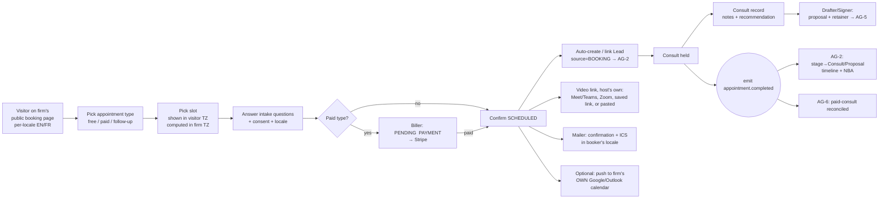
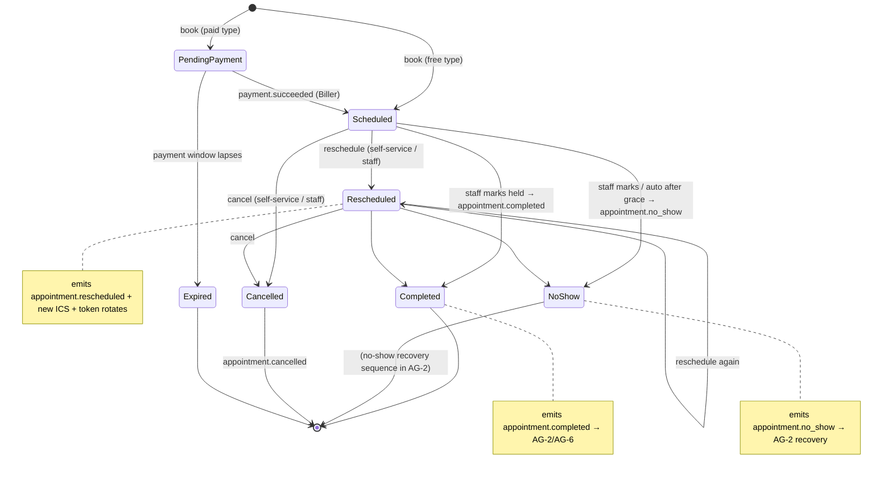
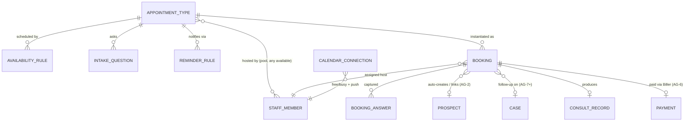

> **Document control** · Version **1.8** · **2026-10-17** · Status: **Second pass AG16-54 #7, AG16-55, AG16-56, AG16-79 applied (regulator and statute names replaced by plain words; booking reminders and payment-hold messages send at the exact time, any hour — new AG-4-61 with build card; closed-days yearly add pointer; open questions 14–18 stay open, no defaults stated); previously: AG-16 review round 2 applied (the product owner, 17 Oct: AG16-24, AG16-45, AG16-46, AG16-52, AG16-53); previously: AG-16 review decisions applied (14 Oct: AG16-6, AG16-11, AG16-18); Permission keys renamed to the SA-06 v3.0 canonical catalogue (SA6-D10); default starter roles added (SA6-D5) — Baseline — staff-leaving decisions applied (from AG-01 v1.3); no masking and no reveal of personal data (AG7-D10)**\
> Part of: *Agent (RCIC/Lawyer) Console — Functional Requirements* · Split from `FINAL-Agent-FR.md` lines 2317–3115 on 2026-09-16 · Previous version: `_archive/AG-04-consultation-and-booking_v1.7_2026-10-17.md`\
>
> | Version | Date | Change | Decisions |
> |---|---|---|---|
> | 1.8 (18 Oct, later) | 2026-10-18 | *18 Oct (later): §7 `CalendarConnection` and `MeetingAccountConnection` use AG-16's shared `ConnectionStatus` (AG-16 §7), replacing `ACTIVE|REVOKED|ERROR`.* *18 Oct (later): consistency fixes after expert review — AG07-D12, SA6-D5, X-2.* Persona "Case Officer / Paralegal" renamed "Case Officer"; a one-line X-2 pointer on `Booking.contactId?` and an X-2 row in the decisions table. No requirement added, removed or renumbered. *18 Oct (final): AG07-D17 – D21 applied — AG07-D20(j): booking round robin withdrawn (§3.13, AG-4-51, BR-16, entitlement list, persona line); "Any available" picks the first free person; round robin is not built in ERv2 (no match in `apps` or `packages`, 18 Oct).* *18 Oct (later): AG01-29 / AG16-105 and gap-check fixes applied — (1) **AG01-29(3):** a suspended host has no bookable times; their open bookings stay (AG-4-53, BR-20, §9). (2) **AG01-29(5):** a handover moves an appointment only if AG-04's availability check says the new person is free (ExpatReady bookings plus the calendars they chose to check, AG-4-27, AG16-18); otherwise "Needs a new host" (§3.13, AG-4-54, US-12, §9). AG1-D14's old line "the new host's calendar is not checked" is corrected. (3) **AG16-105(2):** the host is notified of a booking in the notification group "Work handed to me" (§3.7, AG-4-47; home AG-16). **Added requirements:** none.* *18 Oct (later): check fix applied — US-12 test for a suspended host (AG01-29(3)).* | AG07-D12, SA6-D5, X-2, AG07-D20(j), AG01-29, AG16-105 |
> | 1.8 | 2026-10-17 | **Second pass (AG16-54 – AG16-82, the product owner, 17 Oct) applied to AG-04.** (1) **Rule 7 (AG16-54 #7):** regulator and statute names in product text replaced with plain words in §1 (opening positioning paragraph), §3.3, BR-8, §11 and the §13 domain-correctness note; code field names such as `ciccAgreementUrl` are kept (built stays). (2) **When consult messages send (AG16-56):** booking reminders and the payment-hold messages ("Complete your payment", "Payment expired") send at the exact time, any hour, because they are tied to a time the booker chose or to a payment hold; new **AG-4-61** with a build card; the sending-window rule itself stays in AG-10. (3) **Closed days (AG16-79):** the per-day "Same date every year" tick and the December item are gone; one "Add these every year" tick on the Add holidays dialog is specified in AG-16 §3.14. AG-4-7 and its card now point to it; `sameEveryYear` removed from the card's data line. (4) **AG16-55:** questions 14–18 have **no stated default**, so they **stay open** (reported to the product owner). **Added:** AG-4-61, question 19. **Changed:** AG-4-7 (card), §3.1 item 8 (pointer). *Same-day fixes (17 Oct): AG16-83 – AG16-88 — Q19 closed: the after-meeting follow-up and "Ask me first" rows follow the 08:00–20:00 window (AG16-83 #20). The per-locale EN/FR public booking page (§3.3, AG-4-19) is not in the AG16-88 file list; listed for the product owner.* *Same-day fixes (18 Oct): AG16-90 — cards AG-4-29, AG-4-56, AG-4-58, AG-4-59 and AG-4-60 gain "Person decides:" and "Clicks:"; the AG-4-29 citation of the old v1.6 passage now names the archived file and the current §3.6.* *18 Oct: new section 'Decisions that change this epic' (index of AG16 decisions; no requirement changed).* *Same-day fixes (18 Oct): AG16-99 — "Connect Zoom" is hidden until Zoom approves ExpatReady's app (Zoom Marketplace approval, SA8-D43(5)); until then Zoom users save their personal room as "My meeting link"; Meet and Teams links come from the calendar (§3.6, AG-4-58).* | AG16-54 · AG16-55 · AG16-56 · AG16-60 · AG16-76 · AG16-79 · AG16-90 · AG16-99 |
> | 1.7 | 2026-10-17 | **AG-16 review round 2 applied (the product owner, 17 Oct).** (1) **Video links are per person (AG16-53):** §3.6 rewritten. Each video booking gets its link in this order: Meet or Teams from the host's connected Google or Microsoft calendar; the host's own Zoom ("Connect Zoom" in My account); the host's saved "My meeting link"; a link pasted on the booking. There is no firm video account. The in-house video room is **not in Release 1** (the product owner accepted, 17 Oct). `agent/integration-calendar:create` is **withdrawn** (§10). AG-4-28 withdrawn; AG-4-29 and AG-4-30 changed; AG-4-58 new; build cards written. (2) **Connecting one's own calendar or Zoom needs no permission (AG16-52):** AG-4-59 new; §13 Q13 closed. (3) **Bookable slots use the firm's closed-days list (AG16-46)**, which the firm can fill with "Add holidays for [province] [year]"; the list is still the firm's own and starts empty. Screen and reference list: AG-16 §3.14 and SA-01. AG-4-7 changed with a build card. (4) **Slots use the host office's time zone (AG16-45)** once a second office exists; `Office.timezone` is specified in AG-01. (5) **Calendar connection is on every plan (AG16-24)**; not a paid extra. §11 gating line corrected. Changed: §1, §3.1, §3.2, §3.6, §3.9, AG-4-7, AG-4-29, AG-4-30, AG-4-56, BR-2, BR-14, §7, §10, §11, §12, §13 (Q1, Q5, Q6, Q13). New: AG-4-58, AG-4-59, AG-4-60, Build cards section; open questions 14–18. Closed: Q13 (AG16-52), Q5 (AG16-53). | AG16-24 · AG16-45 · AG16-46 · AG16-52 · AG16-53 |
> | 1.6 | 2026-10-14 | **AG-16 review decisions applied (the product owner, 14 Oct).** (1) **AG-04 is the single home for calendars (AG16-18):** personal calendars are connected only in My account → Calendar (optional); on connecting, the person chooses which calendar(s) to check for busy times and which calendar new bookings are added to (may be a shared calendar, such as a firm "Consultations" calendar). The firm-wide calendar connection is removed; the firm's own video account stays in Settings → Connections. Without a calendar, booking works from the hours the person sets in ExpatReady. Booking confirmation emails carry a calendar invite. (2) **Office closures come from the firm's closed-days list (AG16-6):** firm-maintained, starts empty, ExpatReady seeds no holiday list; "holidays seeded from the country pack" is removed (AG-4-7, §3.1, BR-2, §7, §11). Open question 8 is closed for business hours: default Mon–Fri 9:00–17:00 in the firm timezone, per-office hours under Advanced (the auto-no-show grace period stays open). (3) **Consult reminders are rows on the Automatic messages page (AG-12) (AG16-11):** one-line pointer in §3.7; new open question 12 asks how this fits the per-type reminder editor. Changed: §1, §3.1, §3.7, §3.9 (retitled), BR-2, BR-14, AG-4-7, §7, §8 (US calendar), §10 (`agent/integration-calendar:create` description), §11, §12, §13 (Q1, Q8). New: AG-4-56, AG-4-57; open questions 12–13. *Same-day audit corrections (14 Oct): AG-4-7 now only points to AG-16 §3.14; AG-4-40 says each person connects their own calendar; change-log quote prefix fixed.* | AG16-6 · AG16-11 · AG16-18 |
| 1.5 | 2026-10-07 | Applied from SA-06 v3.0 (RBAC, 7 Oct). **Changed:** §10 — all 16 live permission keys renamed to the single-segment canonical form (`agent/booking/event-types:*` → `agent/booking-event-type:*`; `agent/booking/bookings:*` → `agent/booking:*`; `agent/booking/consult:*` → `agent/booking-consult:*`; `agent/booking/page:configure` → `agent/booking-page:configure`; `agent/booking/analytics:view` → `agent/booking-analytics:view`; `agent/booking/calendar:connect` → `agent/integration-calendar:create`, a merged calendar key); a "Default roles" column added from SA-06 §10b; the Honesty note, §11 permission-set mention and persona/user-story role names aligned (Manager → Case Manager; Accounts / Billing → Billing / Finance). Withdrawn rows `agent/booking/bookings:reveal-pii` and `agent/pii:export-unmasked` stay marked withdrawn (AG7-D10). No requirement, BR, US or edge-case meaning changed. | SA6-D10, SA6-D5 |
> | 1.4 | 2026-10-05 | Knock-on from AG-07 v2.3 (sensitive data — AG7-D7, the product owner, 5 Oct): booker PII is shown to users who may see the booking. Changed: §10 (`agent/booking/bookings:reveal-pii` withdrawn v1.4), §11 (Booking PII handling; audit of sensitive actions). No requirement, BR, US or edge-case text changed (none mentions reveal). Same day (AG7-D10): masking and reveal removed everywhere — booker PII is never masked (screens, lists, search, exports, reports, audit viewers); `agent/pii:export-unmasked` withdrawn (§10 row kept, marked withdrawn); reworded: §10 reveal-pii row and Enforcement, §11 (Booking PII handling — no masking, no reveal; the "PII reveal" and "unmasked export" audit event types removed, exports are audited as exports), §12 PII-masking item. Kept: no PII in system logs or traces; passport and financial numbers never in the content of emails, WhatsApp messages or notifications; field-level encryption at rest. | AG7-D7 (replaced by AG7-D10), AG7-D10 |
> | 1.3 | 2026-10-01 | Knock-on from AG-01 v1.3 (decisions revised 1 Oct): host history reads "(Inactive) Name" or "(Deleted) Name" after a firm deletes a deactivated user; the handover prompt (future consultations, sole-host appointment types, eligible hosts only) ships in the MVP, so the deferral markers and interim wording are removed. Changed: §3.13 "Staff who leave", AG-4-53, AG-4-54, AG-4-55, BR-20, US-12, one §9 edge case, Applied-from table. | AG1-D1, AG1-D13 |
> | 1.2 | 2026-10-01 | Knock-on from AG-01 v1.2 (staff leaving): deactivated staff are removed as host everywhere at once, their future consultations and sole-host appointment types go to the AG-01 handover (deferred), clients get existing update/cancellation emails, no calendar-clash check on moved bookings. Added: AG-4-53, AG-4-54, AG-4-55, BR-20, US-12, one edge case; changed: §3.13 behaviour list. | AG1-D1, AG1-D4, AG1-D5, AG1-D6, AG1-D10, AG1-D13, AG1-D14 |
> | 1.1 | 2026-08-28 | Baseline — complete document v1.1 | — |

## Decisions that change this epic (14–18 Oct) *(new 18 Oct)*

Product-wide rules (apply here as everywhere; home: Agent `00-Overview` → "Product rules every epic follows"): AG16-11, AG16-31, AG16-42, AG16-60, AG16-63, AG16-76.

The "AG16" prefix is historical: these decisions began in the AG-16 review and apply across the product. Full text: `TEMPLATE-MAP-working_2026-10-10.md`.

| Decision | What was decided (one line) | What it changes in this epic | Where (requirement / card / section) |
|---|---|---|---|
| **AG16-6** | Business hours and closed days: default Mon–Fri 9:00–17:00, closed days are the firm's own list | "Holidays seeded from the country pack" removed; the closed-days list starts empty; bookable slots use business hours and that list | AG-4-7 (card), §3.1, BR-2, §7, §11, §13 Q8 (closed) |
| **AG16-11** | One "Automatic messages" page, documented in one place only | Consult confirmations and reminders are rows on that page (AG-12 is its only home); restated defaults removed; one-line pointer added; raises open question 12 | §3.7, §13 Q12 |
| **AG16-12** | Where timings live | Open question 12 asks whether a per-type reminder offset stays here or the page row replaces it; no text changed | §13 Q12 |
| **AG16-18** | Calendars: personal only, with "choose which calendars" | Calendars are connected only in My account → Calendar; no firm-wide calendar connection; the person chooses calendars to check and where bookings go; confirmation emails carry a calendar invite | §3.9, §3.7, AG-4-40, AG-4-56, AG-4-57, BR-14, §10, §12, §13 Q13 |
| **AG16-24** | Own mailbox and own calendar on every plan | Calendar connection is not a paid extra; §11 gating line corrected; question 17 asks the same of a person's own Zoom | AG-4-56 (card), §3.9, §11, §13 Q17 |
| **AG16-31** | Standing rule: ExpatReady suggests, the firm decides | The "Add holidays" button saves nothing until the firm clicks Add; the firm decides which holidays and whether to repeat yearly | AG-4-7 (card: Safety, Person decides) |
| **AG16-37** | Mailbox go-live essentials | Referenced only (no change here): cited in an edge case — the Owner cannot disconnect a colleague's calendar; deactivating the colleague stops syncing | AG-4-59 (card: Edge cases) |
| **AG16-42** | "Quiet by default", plus telling the client | A booking already made on a date later marked closed stays valid, with no cancellation and no alert; also the test applied in open question 16 | AG-4-7 (card: Edge cases), §13 Q16 |
| **AG16-45** | Office time zones and escalation by office | Once a second office exists, slots use the host office's time zone, hours and closed days (new requirement); question 14 left open | AG-4-60 (new, card), §3.1, §13 Q14 |
| **AG16-46** | Closed days: suggested holidays, firm adds | Bookable slots use the firm's closed-days list; "Add holidays for [province] [year]" button, holidays pre-ticked, nothing saved until Add; question 18 asks about staff manual booking on a closed day | AG-4-7 (card), BR-2, §3.1, §5, §13 Q18 |
| **AG16-49** | Client quiet hours in the client's own time zone | Context for AG-4-61: other consult messages follow the 08:00–20:00 client-time window, but booking reminders and payment-hold messages are exempt | AG-4-61 (card: Why) |
| **AG16-51** | Three trims to avoid over-building | No escalation by office (dropped) | AG-4-60 (card: Non-goals) |
| **AG16-52** | Connecting one's own mailbox or calendar needs no permission | Any signed-in staff member connects their own calendar or Zoom; `agent/integration-calendar:create` withdrawn; question 13 closed | AG-4-59 (new, card), AG-4-58, §3.9, §10, §13 Q13 (closed) |
| **AG16-53** | Video links are per person; no firm video account | §3.6 rewritten: link from the host's Meet or Teams, own Zoom, saved "My meeting link", or a pasted link; in-house video room is not in Release 1 (AG-4-28 withdrawn); `IN_HOUSE` and `WEBEX` removed; questions 15–17 left open | §3.6, §3.9, AG-4-28 (withdrawn), AG-4-29, AG-4-30, AG-4-58, §7, §10, §12, §13 Q5 (closed), Q6, Q15–Q17 |
| **AG16-54** | 25 consistency fixes after the 17 Oct write | Rule 7 (#7): regulator and statute names in product text replaced with plain words; code field names such as `ciccAgreementUrl` kept | §1, §3.3, BR-8, §11, §13 (domain-correctness note) |
| **AG16-55** | Writers' recommended defaults accepted for the detail questions | Questions 14–18 had no stated default, so they stay open (reported to the product owner); question 19 added | §13 Q14–Q18, Q19 |
| **AG16-56** | When automatic messages send, by what their timer counts | Booking reminders and payment-hold messages ("Complete your payment", "Payment expired") send at the exact time, any hour (new requirement) | AG-4-61 (new, card), §13 Q19 |
| **AG16-60** | Standing rule: a duplicate beats a miss | Cited in the Decision line of AG-4-61; no separate change stated — Cited, see AG-4-61 | AG-4-61 (card) |
| **AG16-63** | Design checks every requirement must pass | Each card's "Clicks:" line states clicks added or removed (rule 4) | AG-4-29, AG-4-56, AG-4-58, AG-4-59, AG-4-60 (cards: Clicks) |
| **AG16-76** | Standing rule: help people, don't replace them; do, don't overdo | Each card's "Person decides:" line names what the person decides; booking reminders are existing messages with a defined time, not new client automation | AG-4-7, AG-4-29, AG-4-56, AG-4-58, AG-4-59, AG-4-60, AG-4-61 (cards) |
| **AG16-79** | Closed days: one "Add these every year" tick, asked once; no December alert | Per-day "Same date every year" tick and the December item removed; `sameEveryYear` removed from the card; AG-4-7 points to AG-16 §3.14 | AG-4-7 (card), §3.1 item 8 |
| **AG16-82** | One rule for every broken connection | Cited — see change-log row 1.8 (named only as the end of the range "AG16-54 – AG16-82"); no AG-04 requirement text names it | Change log row 1.8 |
| **AG16-83** | 26 follow-through fixes after the second pass | #20: the after-meeting follow-up and "Ask me first" reminder rows follow the 08:00–20:00 client window; question 19 closed | AG-4-61 (card: Rules 6, Edge cases), §13 Q19 (closed) |
| **AG16-88** | Release 1 is English-first; French later | Not applied here: the per-locale EN/FR public booking page is not in the AG16-88 file list; listed for the product owner | §3.3, AG-4-19 |
| **AG16-90** | Batch C: consistency fixes from the 17 Oct audit | Cards AG-4-29, AG-4-56, AG-4-58, AG-4-59 and AG-4-60 gain "Person decides:" and "Clicks:"; citations of the archived v1.6 file made explicit | AG-4-29, AG-4-56, AG-4-58, AG-4-59, AG-4-60 (cards) |
| **AG16-99** | "Connect Zoom" is hidden until Zoom approves the app. | Until the Zoom Marketplace approval (SA8-D43(5)) the button is not shown; Zoom users save their personal room as "My meeting link" (source 3); Meet and Teams links come from the calendar. | §3.6 (source 2, key screens) · AG-4-58 (card) |
| **X-2** | One person record per real person; AG-02 is the home | The `contactId?` link on a booking points at the person's Party record (the retired Contact model is not used); no requirement added or renumbered | §7 `Booking` (`contactId?`) |
| **AG07-D20(j)** | Booking round robin withdrawn (not built in ERv2: no match in `apps` or `packages`, 18 Oct); "Any available" on the booking page picks the first free person. | §3.13 rewritten; AG-4-12, AG-4-51, BR-16 changed; the `ROUND_ROBIN` hosting kind, the persona line and the plan-tier mention removed from live text. No requirement ID lost. | §3.13, AG-4-12, AG-4-51, BR-16, hosting line |
| **AG01-29(3)** | Suspended staff get no new work (home AG-01). | A suspended host has no bookable times; their open bookings and seat stay; nothing moves automatically. | AG-4-53 · BR-20 · §9 |
| **AG01-29(5)** | A handover moves an appointment only if AG-04's availability check says the new person is free (home AG-01). | "Free" means ExpatReady bookings plus the calendars the person chose to check (AG-4-27, AG16-18); otherwise "Needs a new host". AG1-D14's "not doing" line: no separate clash screen in the handover. | §3.13 · AG-4-54 · US-12 · §9 |
| **AG16-105(2)** | Notification groups; the host is notified of a booking in group 1, "Work handed to me" (home AG-16 §3.3, AG-16-10). | A client booking a consultation with a person notifies that person in "Work handed to me"; the group's email default and the rest of the list are AG-16's. | §3.7 · AG-4-47 |

## Module AG-4: Consultation & Booking (the Scheduler)

**Applied from SA-06 v3.0 (2026-10-07)** (decisions owned by `SA-06-rbac` v3.0 §0; key map in its Appendix B):

| ID | Decision | Applied here |
|---|---|---|
| **SA6-D10** | Naming rule: one kebab-case resource and one action per key, grammar `^(system\|agent\|portal)/[a-z0-9-]+:[a-z0-9.-]+$`; old → new map in SA-06 Appendix B | §10 — `agent/booking/event-types:list` → `agent/booking-event-type:list`, `agent/booking/event-types:create` → `agent/booking-event-type:create`, `agent/booking/event-types:edit` → `agent/booking-event-type:edit`, `agent/booking/event-types:delete` → `agent/booking-event-type:delete`, `agent/booking/event-types:configure-availability` → `agent/booking-event-type:configure-availability`, `agent/booking/event-types:configure-reminders` → `agent/booking-event-type:configure-reminders`, `agent/booking/bookings:list` → `agent/booking:list`, `agent/booking/bookings:edit` → `agent/booking:edit`, `agent/booking/bookings:create` → `agent/booking:create`, `agent/booking/bookings:reschedule` → `agent/booking:reschedule`, `agent/booking/bookings:mark-attendance` → `agent/booking:mark-attendance`, `agent/booking/consult:write` → `agent/booking-consult:write`, `agent/booking/consult:create-proposal` → `agent/booking-consult:create-proposal`, `agent/booking/page:configure` → `agent/booking-page:configure`, `agent/booking/calendar:connect` → `agent/integration-calendar:create`, `agent/booking/analytics:view` → `agent/booking-analytics:view` |
| **SA6-D5** | Six starter roles: Owner, Admin, Case Manager, Case Officer, Billing / Finance, Read-only; defaults per SA-06 §10b | §10 "Default roles" column · persona and user-story role names |
| **AG7-D10** | (unchanged) Withdrawn reveal / unmasked-export keys stay withdrawn | §10 rows `agent/booking/bookings:reveal-pii` (SA-06: WITHDRAWN) and `agent/pii:export-unmasked` (SA-06: WITHDRAWN) |

**Applied from AG-01 v1.3 (staff leaving, 2026-10-01)** (decisions owned by `AG-01-firm-setup-and-onboarding` v1.3 §0):

| ID | Decision | Applied here |
|---|---|---|---|
| **AG1-D1** | Delete allowed only after deactivation; history shown "(Inactive) Name", or "(Deleted) Name" once deleted | §3.13 · AG-4-53 · BR-20 |
| **AG1-D4** | No new work to a deactivated person (removed as host everywhere) | §3.13 · AG-4-53 · BR-20 · US-12 |
| **AG1-D5** | Handover prompt lists future consultations and sole-host types | AG-4-54, AG-4-55 · §9 |
| **AG1-D6** | Only eligible staff offered as new host | AG-4-55 |
| **AG1-D10** | No automatic client emails beyond booking update/cancellation | AG-4-54 |
| **AG1-D13** | All staff-leaving items ship in the MVP, same release: removal as host and the handover | AG-4-54, AG-4-55 · §9 |
| **AG1-D14** | Not doing: a separate clash screen in the handover; "free" is AG-04's availability check *(changed 18 Oct — AG01-29(5))* | §3.13 · AG-4-54 · §9 |

**Applied from AG-16 review (the product owner, 14 Oct 2026)** (decisions recorded in the Super Admin template map, section "AG-16 review — decisions"):

| ID | Decision | Applied here |
|---|---|---|
| **AG16-18** | Calendars are personal only; AG-04 is the single spec home. No firm-wide calendar connection. The person chooses which calendar(s) to check for busy times and which to add bookings to. Booking emails carry a calendar invite. | §3.9 · AG-4-56 · AG-4-57 · BR-14 · §10 · §12 |
| **AG16-6** | Business hours default Mon–Fri 9:00–17:00 in the firm timezone; per-office hours under Advanced; closed days are the firm's own list (starts empty, no seeded holidays). Used for bookable slots. | AG-4-7 · §3.1 · BR-2 · §7 · §11 · §13 Q8 |
| **AG16-11** | Consult reminders are rows on the Automatic messages page; AG-12 is its only home. | §3.7 · open question 12 |

**Applied from AG-16 review round 2 (the product owner, 17 Oct 2026)** (decisions recorded in the Super Admin template map, section "AG-16 review — decisions"):

| ID | Decision | Applied here |
|---|---|---|
| **AG16-53** | Video links are per person: Meet or Teams from the host's calendar, then the host's Zoom, then "My meeting link", then a pasted link. No firm video account. In-house video room not in Release 1. `agent/integration-calendar:create` withdrawn. | §3.6 · AG-4-28 (withdrawn) · AG-4-29 · AG-4-30 · AG-4-58 · §3.9 · §10 · §13 |
| **AG16-52** | Connecting one's own mailbox or calendar needs no permission. | AG-4-59 · §10 · §13 Q13 closed |
| **AG16-46** | Bookable slots use the firm's closed-days list; the firm can fill it with "Add holidays for [province] [year]". Home: AG-16 §3.14. | AG-4-7 · BR-2 · §3.1 |
| **AG16-79** | Closed days: one "Add these every year" tick, asked once; no December item and no per-day tick. Home: AG-16 §3.14. | AG-4-7 (pointer) · card |
| **AG16-56** | Booking reminders and payment-hold messages send at the exact time, any hour. | AG-4-61 · card · open question 19 |
| **AG16-45** | Slots use the host office's time zone once a second office exists. Home: AG-01 (`Office.timezone`), AG-16 §3.14. | AG-4-60 · §3.1 |
| **AG16-24** | Own calendar connection is included on every plan. | AG-4-56 · §11 |

### Module Index

Scan the whole module in ~30 seconds; jump to any part.

1. **Purpose & Goal**
2. **Users & Jobs-to-be-Done**
3. **Functional Design — How It Works** (core)
   - 3.0 The Scheduler's place in the revenue spine · 3.1 Availability & scheduling rules (timezone-aware) · 3.2 Appointment types (free / paid / follow-up) · 3.3 The public booking page (branded, per-locale, accessible) · 3.4 Lead auto-creation & hand-off to AG-2 · 3.5 Slot computation & double-booking safety · 3.6 Video links — one per person · 3.7 Confirmations, reminders & follow-ups (ICS, bilingual, template-driven) · 3.8 No-show / cancel / reschedule self-service · 3.9 Optional two-way sync to a person's OWN calendar · 3.10 Paid consults → Biller · 3.11 Lifecycle events the module EMITS · 3.12 Consult records → consultation→retainer hand-off (AG-5) · 3.13 "Any available" assignment *(round robin withdrawn 18 Oct — AG07-D20(j))* · 3.14 Booking analytics (show-rate, no-show, source)
4. **Detailed Functional Requirements** (AG-4-x)
5. **Business Rules & Logic**
6. **States & Lifecycle**
7. **Key Entities & Fields**
8. **User Stories + Acceptance Criteria**
9. **Edge Cases & Validations**
10. **Permissions** (LOCAL `agent/*`)
11. **Scalability · Security · Performance**
12. **Reference Note** (exists / NEW / changed)
13. **Open Questions / Founder Decisions**

### Visual Overview

**A. The booking flow — public page → slot → confirm → consult → retainer hand-off** (one unbroken spine; a new booker becomes a lead; a completed consult feeds the retainer):



**B. Appointment lifecycle** (the booking's behavioural states; **paid types pass through `PENDING_PAYMENT`**; completion/no-show are post-hoc dispositions that *emit events*):



**C. Core data model** (the appointment type is the template; the booking is the instance; everything attaches polymorphically):



> `Note · Task · Reminder · Communication · Document · AuditLog · Notification` attach to a `BOOKING`, a `CONSULT_RECORD`, or the linked `PROSPECT`/`CASE` via the polymorphic `(entityType, entityId)` pattern — defined once (Part 2), reused here, never redefined.

---

### 1. Purpose & Goal

**What it is.** AG-4 is the firm's **in-house consultation scheduler** — the Doer that turns "I'd like to talk to someone" into a booked, confirmed, reminded, and ultimately *held* consultation, then hands a clean consult record to the retainer flow. It sits at the **single most fragile seam of the revenue funnel**: the moment a curious prospect commits time. A booked consult is the firm's highest-intent signal short of a signature, and the consult itself is where most retainers are actually won.

**The business outcome it must produce.** Immigration firms lose consults — and the revenue behind them — in three predictable ways: (1) **friction at booking** (a prospect emails "what's your availability?" and the thread dies; a phone-tag loop never resolves; a clunky form scares off a serious applicant), (2) **no-shows** (a free consult booked on a whim, never reminded, never rebooked), and (3) **dropped hand-off** (the consult happens but nothing flows into a proposal, so the rep re-keys everything and the momentum cools). AG-4 exists to make **"a prospect can book the right consult in under a minute, will be reminded so they show, and the held consult flows straight into a retainer"** structurally true — by design, not by discipline. It does this with a frictionless, branded, **timezone-aware**, **bilingual** booking page; ICS-anchored confirmations and reminders; self-service reschedule/cancel that protects the firm's calendar; and lifecycle events that drive AG-2's pipeline and no-show recovery automatically.

**Why it matters / world-class positioning.** This is **not a Calendly clone bolted onto a CRM**. The founder's principle is explicit: the Scheduler is an **in-house Doer**, not a rented third-party tool. That choice is the moat. A generic scheduler treats a booking as a calendar event; ours treats it as a **revenue event in a regulated immigration business**: a free booker auto-becomes an attributed lead in the pipeline; a paid consult flows through the firm's own Biller (not Calendly's payment add-on); the consult produces a structured **consult record** that pre-fills the retainer; every confirmation respects the booker's **language** and privacy and consent rights, and the firm's no-guarantee posture; every slot is computed in the **firm's timezone with DST correctness** while shown in the **visitor's timezone**; and the firm's data never leaves its tenant for a third party's servers. The only external touch we permit is a **connector to each person's OWN Google/Outlook calendar** (so a consult doesn't collide with the RCIC's dentist appointment) and each host's OWN Meet, Teams or Zoom for the meeting link — their own accounts, fully optional, disable-and-stay-self-contained *(changed v1.7 — AG16-53)*. A generic scheduling SaaS cannot do attribution-aware lead creation, compliant bilingual comms, in-house paid consults, and tenant-isolated PII for a regulated RCIC firm. Ours is built for exactly that.

**How it ties to the revenue journey.** Lead captured & qualified (AG-2 / Qualifier AG-3) → **consult booked (AG-4)** → consult held → **consult record → proposal & retainer (Drafter/Signer, AG-5)** → e-sign drives WON → payment (Biller, AG-6) → convert to client → case delivery (AG-7+). AG-4 owns the *book → confirm → hold → record* arc and the events that move AG-2's pipeline. It is also reused **post-conversion** for case-stage appointments (follow-up reviews, document-collection calls) hanging off a `Case`.

**Global ambition.** The same Scheduler serves a solo RCIC provisioned for Canada and a firm provisioned for Australia or the UK, each in its own timezone — **no code change per country**. Every firm is single-country (FD-68), so multi-timezone breadth is a platform property; within a firm, single-timezone / single-locale is the degenerate case (and a multi-office firm spanning timezones inside its one country is the non-degenerate one). Slot math is always done in the **host's/firm's timezone** with business hours and closed days from the firm's settings (AG16-6); the booking page renders **per-locale**; paid consult prices are in the appointment type's **currency** and reconciled in the firm's **reporting currency** (via AG-6's FX policy); reminders pick the **booker's language**. This global-by-construction posture is visible in every section below.

---

### 2. Users & Jobs-to-be-Done

The "Agent" persona is an umbrella; AG-4 is used very differently by each sub-role, plus the **public booker** (an external, unauthenticated actor — a first-class user of the booking page).

| Role | Primary job in AG-4 | Jobs-to-be-done (representative) |
|---|---|---|---|
| **Public booker** (prospect / existing client — unauthenticated) | Book the right consult, fast, in my language and timezone, and trust I'll be reminded. | "When I land on the firm's booking page, I want to see real open times *in my own timezone* and book in under a minute without creating an account." · "When I book, I want an instant confirmation with a calendar invite and a join link, in French if I'm in Quebec." · "When something comes up, I want to reschedule or cancel myself without phoning the office." |
| **Intake / Sales Representative** (heaviest staff user) | Make sure consults happen, show up, and convert; never let a booking die. | "When a prospect books, I want it auto-linked to their lead and on my work-queue, so the consult is part of the deal, not a separate calendar." · "When someone no-shows, I want them flagged and a recovery sequence started automatically, so I rebook instead of forgetting." · "When I'm on the phone with a hot lead, I want to grab a slot *for* them in two clicks (manual booking) without sending them to the public page." |
| **RCIC / Consultant** (the host) | Protect my time; arrive prepared; turn the consult into a retainer. | "When I open my day, I want my booked consults with the prospect's eligibility assessment and intake answers already attached, so I give credible advice in minute one." · "When a consult ends, I want to capture the outcome and recommendation once and turn it into a proposal without retyping." · "When my personal calendar is busy, I want the booking page to never offer that time." |
| **Case Manager** *(changed v1.5 — SA6-D5)* | Keep consult volume high and no-shows low across the team. | "When I review the week, I want bookings by type and source, the team's **show-rate** and **no-show rate**, and who's over/under-booked — filterable by type and source, in one currency for paid consults." · "When I set up the team, I want consults to go to 'any available' (the first free person), respecting who's off." *(round robin withdrawn 18 Oct — AG07-D20(j))* |
| **Owner / Principal RCIC** | Own the booking experience and the firm's compliance posture. | "When I configure the booking page, I want it branded, bilingual, embeddable, and to capture exactly the intake I need — and I want every confirmation to respect consent and never promise an outcome." · "When I connect my Google calendar, I want two-way sync so the page never double-books; and I want to be able to turn that off and stay fully self-contained." |
| **Billing / Finance** *(changed v1.5 — SA6-D5)* | Touch AG-4 only at the paid-consult money edge. | "When a consult is paid, I want it reconciled in the right currency through our own Biller, not a third party — and refunded cleanly if cancelled in policy." (Owns AG-6; consumes AG-4's hand-off.) |
| **Case Officer** *(fixed 18 Oct — AG07-D12, SA6-D5)* | Schedule case-stage touchpoints post-conversion. | "When a case needs a document-review call, I want to book it against the client and case, with the same reminders, so it actually happens." |

**Design implication.** The **public booker** drives the design of the booking page (fast, mobile, accessible, per-locale, no login). The **Intake Rep** drives the staff console (bookings woven into the lead, manual booking, no-show recovery). The **RCIC/host** drives the prepared-consult experience (assessment + intake attached) and the consult-record → retainer hand-off. The **Owner/Case Manager** get configuration (appointment types, availability, branding, calendar connection) and analytics. Permissions (§10) cleanly separate these.

---

### 3. Functional Design — How It Works (core)

This is the heart of the spec. Each sub-function is designed in depth: **how it works**, the **smart / world-class behaviour** that beats a generic scheduler, the **key screens & interactions** (functional, not pixel-level), and the **data flow**.

#### 3.0 The Scheduler's place in the revenue spine (the foundation)

**Design decision: a booking is a *revenue event*, not a calendar event.** Every booking is born linked (or linkable) to a **Lead/Contact** in AG-2 and, when it produces a consult, to a **consult record** that feeds AG-5. The appointment lifecycle **emits events** the rest of the product consumes (§3.11). This is the structural reason AG-4 is in-house and not a Calendly embed: a third party owns the calendar event but cannot own the *revenue semantics* — attribution, pipeline movement, no-show recovery, paid-consult reconciliation, consult-to-retainer carry-forward.

- **Appointment Type** = the durable *template* (a free 30-min consult, a paid 60-min strategy session, a 20-min follow-up): its duration, mode(s), price, host pool, availability rules, intake questions, reminders, and locale variants. Configured once; reused for every booking.
- **Booking** = a single *instance* — a specific person, at a specific UTC instant, with a host, a status, answers, and links to the lead/case it belongs to.
- **Consult Record** = the *outcome* of a held booking — attendance, the consultant's notes, the recommended pathway/services, and the seed for the proposal. This is the seam to AG-5.
- **Reuse for cases.** The same Appointment Type / Booking machinery serves **post-conversion** case touchpoints (a booking can attach to a `Case`, not just a `Prospect`) — so the firm has one scheduler, not two.

> **Reference-note callout:** today the codebase already has a strong in-house booking engine (`src/booking`: `EventType` = appointment type, `Booking`, availability rules, public page, slot math, self-service). The rebuild's renames (`AppointmentType`, `firm_id`) and the **`ConsultRecord`** entity, the **case-attach** path, and the **first-class lifecycle events** are the principal additions. See §12 for an honest exists/NEW/changed map.

#### 3.1 Availability & scheduling rules (timezone-aware) — "the page only ever offers a time the firm can actually keep"

**How it works.** Availability is layered, and each layer can subtract from the bookable set:

1. **Per-appointment-type weekly availability rules** — for each weekday, zero or more `{startTime, endTime}` windows (e.g. Mon 09:00–12:00 & 13:00–17:00). Times are **wall-clock in the host's/firm's timezone**, never UTC.
2. **Slot granularity** = the type's duration (a 30-min type yields slots every 30 min within each window). *Founder-decision flag:* a separate slot-interval (e.g. 60-min type bookable every 30 min) is a Phase-2 nicety — see §13.
3. **Buffers** — `bufferBefore` / `bufferAfter` minutes pad each booking so the host gets breathing room; padded busy-time blocks neighbouring slots.
4. **Minimum notice** — `minNoticeHours`: slots sooner than now + min-notice are not offered (no "book me in 5 minutes").
5. **Booking window** — `futureBookingDays`: how far ahead the page opens (default 60).
6. **Capacity caps** — `maxPerDay` / `maxPerWeek` / `maxPerMonth` per host (and, for group types, per slot).
7. **Existing bookings** — the host's already-booked (and `PENDING_PAYMENT`) intervals subtract their padded span.
8. **Business hours & holidays** — the firm's business hours (default Monday–Friday, 9:00–17:00 in the firm's timezone; per-office hours under Advanced) and its **closed-days list** (firm-maintained, starts empty; ExpatReady seeds no holiday list) further constrain availability, so a day the firm has marked closed, or a Saturday, is closed without editing every type. The firm fills the closed-days list itself; it can use the button "Add holidays for [province] [year]" on the closed-days screen (AG-16 §3.14), and nothing is saved until it clicks Add *(changed v1.7 — AG16-46)*. One pre-ticked "Add these every year" tick on that dialog adds next year's holidays each December (AG-16 §3.14; AG16-79); AG-04 adds no control. Once a second office exists, the host's office decides the time zone, hours and closed days for the slot (AG-4-60; AG16-45; see open question 14). *(changed v1.6 — AG16-6; was "holidays seeded from the country pack")* Build card: AG-4-7.
9. **(Optional) the host's OWN connected calendar free/busy** — if connected (§3.9), external busy blocks subtract too, so the page never offers a time the RCIC is personally booked.

**Timezone correctness is non-negotiable (and already done right in the current engine).** Availability rule times are interpreted in the **appointment type's timezone**; each candidate slot's canonical **UTC instant** is derived per calendar date so the correct **DST offset** for *that specific date* is applied (09:00 Toronto = 13:00Z in summer, 14:00Z in winter — one computation handles both). Day-of-week is computed in the **host timezone** (not UTC) so a near-midnight western-zone date picks the right weekday's rules. The **booker's timezone is display-only** — it never enters slot-identity math; slots are anchored to the host's zone and merely *rendered* in the booker's. This is the single most common scheduler bug and the rebuild keeps the current code's correct approach.

**World-class behaviour.**
- **Composable, subtractive availability.** Each layer only ever *removes* time; the final bookable set is provably a subset of declared windows minus buffers minus notice minus caps minus existing/external busy minus holidays. No layer can accidentally *add* a bookable time.
- **Timezone- and DST-safe by construction**, across countries, for both display and identity.
- **Capacity that protects the human.** Per-host daily/weekly caps stop a popular RCIC being booked into burnout; group capacity supports seminars/webinars.
- **Closed-day- and business-hours-aware** from shared firm config — no per-type holiday editing.

**Key screens & interactions.** *Availability editor* on the appointment type (weekly grid with multiple windows per day, copy-day-to-day, timezone shown explicitly), *buffer/notice/window/caps* fields, a **live "preview as a booker"** that renders the resulting open slots for a chosen date and timezone so the owner sees exactly what visitors will see.

**Data flow.** Slot request (type, date, viewer-tz) → load type + rules + caps + business-hours/closed-days config (+ external free/busy if connected) → compute candidate slots in host-tz → derive UTC instants per-date (DST-correct) → subtract padded existing/external busy + min-notice + caps → return `{startTimeUtc, available}[]`; the FE renders each in the booker's timezone.

#### 3.2 Appointment types (free / paid / follow-up) — "one template per kind of conversation the firm sells"

**How it works.** An **Appointment Type** is the configurable template a booking instantiates. Core attributes:
- **Identity:** name, description, colour, public **slug** (per firm), active flag, soft-delete.
- **Purpose/category:** `FREE_CONSULT | PAID_CONSULT | FOLLOW_UP | CASE_REVIEW | OTHER` — drives default copy, whether Biller is invoked, and which lifecycle events matter.
- **Duration** (minutes) and the scheduling rules of §3.1.
- **Mode / location:** one or more of `IN_PERSON | PHONE | VIDEO` (the current `locationTypes` / `EventLocation` set — Zoom/Meet/Teams/Webex/phone/in-person). The booker picks among the enabled modes; video drives link generation (§3.6; Webex or any other provider by a pasted link); in-person can carry an office address; phone collects the booker's number.
- **Price (paid types):** `priceAmount` + `priceCurrency` → routed to the **Biller** (§3.10). Free types skip payment entirely.
- **Hosting:** a single host (`ONE_ON_ONE`), a **pool** ("any available": the first free person) *(round robin withdrawn 18 Oct — AG07-D20(j))*, a **group** (one host, many attendees — seminars), or **collective** (several staff, one booking). The host pool drives assignment (§3.13).
- **Intake questions** (§3.3) and **reminder rules** (§3.7), with sensible seeded defaults.
- **Per-locale:** a type carries **locale variants** of its public-facing copy (name/description/confirmation), so the booking page and comms are bilingual. Its `destinationCountry` is always the firm's one country (FD-68) — carried for stamping and for the platform's cross-firm rollups, not as a scoping choice, since there is no second country's page to keep it off.

**World-class behaviour.**
- **Purpose-typed, not generic.** Because the type carries a *purpose*, the system knows a paid consult must clear payment before it's truly `SCHEDULED`, a free consult should auto-create a lead, and a follow-up attaches to a case — without per-booking branching by the rep.
- **Mode-aware.** Video → link; phone → captured number; in-person → address + map; the confirmation copy adapts to the mode automatically.
- **Locale-scoped templates.** A firm publishes the right consults on the right localized page from one configuration set — a Canadian firm's EN and FR pages, for instance. *(Country scoping is WITHDRAWN by FD-68: a firm has one country, so there is no second country's page to route a type to.)*
- **Regulator-safe copy hooks.** Paid-consult types can carry the engagement/disclaimer document the firm must surface before payment (the current code already models a `ciccAgreementUrl` / `ciccAccepted` acceptance — generalised to a pack-driven **pre-consult agreement** — the wording resolved from the firm's Country Pack — that the booker must accept).

**Key screens & interactions.** *Appointment-type list* (cards with booking counts, active toggle), *type editor* (tabs: Details · Availability · Intake questions · Reminders · Payment · Locale variants), *embed-snippet* output per type, *duplicate-type* for fast setup.

**Data flow.** Create/update type → persist template + nested availability/questions/reminders + locale variants → generate unique public slug → expose on the firm's public page; bookings reference the type at instantiation (a later type edit never mutates past bookings' captured terms).

#### 3.3 The public booking page (branded, per-locale, accessible) — "a serious applicant can book in under a minute, in their language"

**How it works.** The firm gets a **branded, public, unauthenticated** booking surface, reachable at a stable per-firm URL (`/{firmSlug}/{typeSlug}`) and **embeddable** via a script/iframe snippet on the firm's own website. The flow:
1. **Choose appointment type** (or land directly on one via its slug).
2. **Pick a date & slot** — slots are computed in the host timezone (§3.1, §3.5) and **rendered in the visitor's detected timezone** (with an explicit picker to override), so a prospect in Dubai sees Dubai times.
3. **Answer intake questions** — name + email always; phone, and any firm-configured questions (text, dropdown, multi-select, date, number). Selected questions can **map to lead/profile fields** (the current `prospectFieldMap`) so answers pre-fill the lead.
4. **Consent + locale** — consent checkboxes rendered **in the visitor's language** (service vs. marketing, separately), and any **pre-consult agreement** acceptance for paid/regulated types. The locale is stamped on the booking and the auto-created lead.
5. **Pay if required** (§3.10) — paid types route to the Biller before final confirmation.
6. **Confirm** — instant on-screen confirmation + email with **ICS** and join details (§3.7).

**World-class behaviour (and why it beats Calendly for *this* business).**
- **Per-locale, bilingual end-to-end.** The page, the intake labels, the consent text, the confirmation, and the calendar invite all render in the booker's language (EN/FR…), so the booker reads and agrees in their own language — a compliance need a generic tool treats as an afterthought.
- **Timezone-honest.** Visitor sees their own timezone by default, with a clear label ("Times shown in Asia/Dubai") and an override — eliminating the #1 cross-border booking error.
- **Accessible & mobile-first.** WCAG-conscious: keyboard navigable, screen-reader labels, sufficient contrast, large tap targets, no time-pressured CAPTCHAs that block legitimate users (invisible/risk-based bot mitigation instead — §11).
- **Branded, not "powered by a competitor."** Firm logo, colours, and copy; the URL and the experience are the *firm's*, reinforcing trust at the highest-intent moment. No third-party branding.
- **Lead-aware.** A new booker silently becomes an attributed lead (§3.4); a returning email links to the existing lead/contact — the booking is never an orphan calendar entry.
- **Hardened public surface.** This is the module's primary attack surface and is treated as such (§11): tenant resolution by **opaque slug only** (never a raw tenant UUID — that would be an enumeration oracle), per-IP/per-firm rate limits, honeypot, strict schema validation, answer-ownership checks (an answer's questionId must belong to *this* type), generic not-found messages so tenants/events can't be enumerated, payload-size limits.

**Key screens & interactions.** *Public type/landing page* (firm-branded, locale-switch, type description, host name/photo), *date+slot picker* (month/week view, visitor-tz label + override, "no times? try another week" affordance), *intake form* (progressive, validated inline), *payment step* (paid types), *confirmation screen* (add-to-calendar buttons, reschedule/cancel links, join details). *Booking-page builder* (Owner/Case Manager): branding, which types are public, locale variants, embed snippet, spam-protection toggles, intake-question editor with field-mapping.

**Data flow.** Public GET (firmSlug→firm via slug-only resolver; typeSlug→type) returns the *public projection* of the type (no internal IDs leaked — the FE drives off slug) → slot GET computes availability → booking POST validates (schema + answer-ownership + slot still free) → creates booking (+ lead, §3.4) → triggers payment (paid) → on success, confirmation + ICS + events.

#### 3.4 Lead auto-creation & hand-off to AG-2 — "a booker is a lead, attributed, the instant they book"

**How it works.** When a booking is created from the public page (or manually by staff), the Scheduler resolves the booker against AG-2's people:
- **New email →** create a **Lead/Contact** with **`source = BOOKING`**, stamp the **locale**, the booker's name/email/phone, the firm's **`destinationCountry`** (stamped, never chosen — FD-68), and **link the appointment** to the lead. (The current engine already auto-upserts a `Prospect` with `channelSource: 'CALENDAR'` on public-book — the rebuild renames the source to `BOOKING`, adds locale/country/attribution, and routes through AG-2's normalise→dedup→assign pipeline.)
- **Existing email →** **link** the new booking to the existing Contact's open lead (or create a fresh opportunity per AG-2's reopen rules) — never a duplicate person.
- **Returning client →** link the booking to the existing client/case (case-attach path), so post-conversion consults land on the case, not a stray lead.
- **Assignment & speed-to-lead.** A booking-born lead is routed by AG-2's `AssignmentRule`; the **host of the booking** is the natural owner for `ONE_ON_ONE` types. The Conductor's speed-to-lead playbook still runs (the booking itself is a strong first-touch signal).

**World-class behaviour.**
- **Zero orphan calendar entries.** Every booking is part of the funnel; the rep sees the consult on the lead's timeline and work-queue, not in a separate calendar silo.
- **Attribution-complete.** UTM/referrer captured on the booking page flow into the lead's attribution, so "consults from the Google campaign" is reportable end-to-end.
- **Dedup-safe under concurrency.** The lead upsert is keyed on `(firm_id, normalised email)` so two near-simultaneous bookings by the same person resolve to one Contact (the current `clientId_email` upsert is exactly this guarantee).

**Key screens.** No dedicated screen — this is a side-effect of booking; it surfaces *in AG-2* (the lead's timeline shows "Consult booked — 60-min Strategy Session, Jul 8 14:00") and on the booking detail (a link to the lead).

**Data flow.** Booking create → resolve booker (dedup by email within firm) → create/link Lead/Contact (`source=BOOKING`, locale, country, attribution) → link booking↔lead (and case if applicable) → emit `appointment.scheduled` → AG-2 Conductor (assignment, speed-to-lead, timeline) → Notification to owner.

#### 3.5 Slot computation & double-booking safety — "two people cannot grab the same slot, ever"

**How it works.** Slot availability (§3.1) is computed at view time, but **availability at view time is not a reservation** — the slot must be re-checked and **locked at booking time**. The booking transaction:
1. Recomputes the requested slot's availability (the slot the booker saw may have just been taken).
2. Takes a **row-level lock** (`SELECT … FOR UPDATE`) over the host's conflicting intervals, serializing concurrent attempts on InnoDB: the second transaction blocks until the first commits or rolls back, then sees the conflict and is rejected with a clear "this time was just booked — pick another."
3. Resolves the host ("any available" picks the first free person, §3.13) inside the same logic. *(round robin withdrawn 18 Oct — AG07-D20(j))*
4. Creates the booking (and lead, and answers) atomically.

The current engine implements exactly this (`computeAvailableSlots` for view, `FOR UPDATE` conflict lock + atomic create in the booking transaction, plus a race-safe prospect upsert) — the rebuild preserves it and extends the conflict set to include external (connected-calendar) busy where applicable.

**World-class behaviour.**
- **Correct under concurrency, not just usually.** The lock makes double-booking *impossible*, not merely unlikely — essential when a page link is shared and several people click the last slot.
- **Honest failure.** The loser gets an actionable message and the freshly-recomputed slots, not a silent overwrite.
- **PENDING_PAYMENT holds the slot.** A paid booking awaiting payment occupies the slot (conflict set includes `PENDING_PAYMENT`) so it can't be double-sold; if payment lapses, the hold expires and the slot frees (§3.10).

**Data flow.** Book → recompute slot → `FOR UPDATE` lock on host conflicts (incl. SCHEDULED/RESCHEDULED/PENDING_PAYMENT, + external busy) → if clear: assign host + create booking+answers (+lead) in one transaction → else: 409 with refreshed slots.

#### 3.6 Video links — one per person — "a join link from the host's own tools, no firm video account" *(rewritten v1.7 — AG16-53)*

**How it works.** Video is set up **per person in My account** (placement: AG-16 §3.19). Settings → Connections has **no video card** and the firm has **no video account**. Each `VIDEO` booking gets its link from its **host** (`assignedHostUserId`), taking the first source that works, in this order:
1. **Meet or Teams automatically** from the host's connected Google or Microsoft calendar (§3.9, AG16-18): Google calendar → Meet, Microsoft calendar → Teams. No extra connection.
2. **The host's own Zoom**, if the host has used **Connect Zoom** in My account (optional, per person). *(changed 18 Oct — AG16-99)* Until Zoom approves ExpatReady's app (Zoom Marketplace approval, SA8-D43(5)), **"Connect Zoom" is hidden**, so this source is empty; Zoom users save their personal room as "My meeting link" (source 3), and Meet and Teams links come from the calendar.
3. **"My meeting link"**: one link the host saved in My account (for example a Zoom personal room), used for every video booking of that host.
4. **A link pasted on one booking.** Always available, on any booking, by anyone who may edit it (`agent/booking:edit`).

If a source fails when the link is created (for example the calendar token has expired), the next source in the order is tried. Build card: AG-4-29. The per-person setup is AG-4-58.

**Not in Release 1: an in-house video room** (the product owner accepted, 17 Oct 2026, AG16-53; raised explicitly under the Release 1 scope principle; nothing is built; it can be revisited later). Nothing in this module depends on it.

There is **no third-party *scheduling*-tool dependency.** Booking, slots, reminders and self-service are in-house. The only external calls are into the host's **own** calendar and Zoom accounts, and each has the paste fallback.

**Link lifecycle.** Reschedule updates the link and the ICS; cancel voids it; the link is in the confirmation and every reminder (unchanged).

**Key screens.** My account → Video (AG-16 owns the placement): Connect Zoom *(hidden until Zoom approves the app — changed 18 Oct — AG16-99)*, "My meeting link". Per-booking link field (host or staff may paste). On the appointment type: the Video mode only; whether the type still chooses a provider is open (open question 15).

**Data flow.** Confirm video booking → host's sources in order (calendar event with Meet/Teams, Zoom meeting, saved link) → store `meetingLink` and `meetingProvider` on the booking → confirmation, ICS and reminders. If no source gives a link, the booking is still created and the link field stays empty for a pasted link (open question 16).

#### 3.7 Confirmations, reminders & follow-ups (ICS, bilingual, template-driven) — "they get a calendar invite and the right nudges, in their language"

**How it works.** Each appointment type owns **reminder rules**, each with a **trigger**, an **offset**, a **channel**, and a **template** (the current model: `BOOKING_CONFIRMED` at offset 0, `BEFORE_MEETING` at 24h and 1h, `AFTER_MEETING` follow-up, plus `CANCELLATION`). On booking, the Scheduler **schedules delayed jobs** on the queue for each rule; on reschedule it reschedules them; on cancel it fires the cancellation note. Sends go through the **Mailer** (email) and **Messenger** (SMS/WhatsApp) Doers.

- **Automatic messages page.** Whether each consult confirmation and reminder sends automatically, asks first, or is off is a row on the Automatic messages page (AG-12) *(AG16-11; AG-12 is the only home for that page; see open question 12)*.
- **ICS attachment.** The confirmation (and reschedule) email carries a standards-compliant **ICS** so the booker can add it to any calendar (Google/Outlook/Apple); every booking confirmation email carries this calendar invite, which also covers people who use iCloud or only a phone *(AG16-18)* with the host, time (in the booker's tz), location/join link, and a stable UID (so a rescheduled invite *updates* rather than duplicates).
- **Add-to-calendar links** on the confirmation screen for one-click add.
- **Bilingual, template-driven.** Each reminder template has **locale variants**; the Doer selects the variant matching the **booking's locale**, falling back to the firm default only if missing. Templates support merge fields (`{name}`, `{date}`, `{time}`, `{link}`, `{host}`, `{address}`…) rendered in the booker's locale and timezone.
- **No-show & follow-up.** The `AFTER_MEETING` follow-up nudges post-consult; a **no-show** disposition (§3.8) triggers AG-2's no-show recovery sequence rather than a one-off email.

**World-class behaviour.**
- **ICS by default** (most schedulers bury it) — the single biggest lever on show-rate is the event actually being in the booker's calendar.
- **Reschedule-correct invites.** A stable ICS UID + `SEQUENCE` bump means a reschedule updates the existing calendar entry, never leaves a stale one.
- **Bilingual reminders** from one type definition — Quebec bookers get French automatically.
- **Channel-aware & consent-aware.** Confirmations/reminders are **transactional** (allowed without marketing consent); any *marketing* follow-up respects consent at send time (BR re §3.4/AG-2). SMS reminders go via Messenger (designed; email-only for the demo per §13).
- **Resilient.** Reminder scheduling is **non-fatal** — if the queue is down, the booking still succeeds (the current code already treats reminder scheduling as best-effort), and jobs are retried with backoff.

**Key screens.** *Reminder editor* on the type (trigger/offset/channel/template, locale variants, live preview), *per-booking comms log* (what was sent/when, on the timeline).

**Data flow.** Booking confirmed → for each active reminder rule, compute fire-time relative to start (skip past-due) → enqueue delayed job (retry+backoff) → at fire-time, worker selects locale template, renders merge fields in booker tz/locale, sends via Mailer/Messenger → log to timeline. Reschedule → re-enqueue with updated ICS; cancel → fire cancellation note + cancel pending jobs.

#### 3.8 No-show / cancel / reschedule self-service — "the booker manages their own appointment; the firm's calendar stays clean"

**How it works.** Every booking carries a **single-use self-service token** (an unguessable secret) embedded in confirmation links, enabling **account-free** reschedule/cancel:
- **Reschedule.** The booker picks a new slot; the system enforces the type's **`rescheduleNoticeHours`** deadline and `allowReschedule` flag, re-checks slot availability with the same `FOR UPDATE` safety, moves the booking to `RESCHEDULED`, **rotates the token** (so the old link can't be replayed), regenerates the video link + ICS, reschedules reminders, and emits `appointment.rescheduled`.
- **Cancel.** Enforces `cancelNoticeHours` + `allowCancellation`, moves to `CANCELLED`, fires the cancellation note, voids the link, and emits `appointment.cancelled` (which can trigger refund logic for paid consults, §3.10).
- **No-show.** After the meeting, staff mark `NO_SHOW` (or an **auto-no-show** fires after a configurable grace period past start if not marked Completed). This emits `appointment.no_show`, which drives **AG-2's no-show recovery** (a sequence: "sorry we missed you — rebook here").
- **Completed.** Staff mark `COMPLETED` when the consult is held, which emits `appointment.completed` and opens the **consult record** (§3.12).

The current engine implements token-based self-service cancel/reschedule with notice-window enforcement and **token rotation on reschedule** — the rebuild preserves this and adds the auto-no-show timer + the explicit event emissions.

**World-class behaviour.**
- **Account-free, friction-free.** Bookers reschedule/cancel from the email link — no login, no phone tag — which *increases* compliance (they reschedule instead of ghosting).
- **Policy-enforced.** Notice windows and allow-flags are honoured server-side; late cancels/reschedules are blocked with a clear message (and may forfeit a paid fee per policy).
- **Replay-safe.** Token rotation on every reschedule prevents a leaked link from being used twice.
- **No-show is a managed motion, not a dead end.** It triggers recovery, recovering revenue a generic scheduler simply loses.

**Key screens.** *Self-service reschedule/cancel pages* (public, token-gated, locale-aware), *staff booking detail* (mark Completed/No-show, staff reschedule/cancel on behalf), *no-show queue* (surfaced in AG-2 work-queue).

**Data flow.** Token link → validate token + booking → enforce notice/allow → (reschedule: re-check slot under lock → move + rotate token + new link/ICS/reminders) / (cancel: move + cancellation note + void link + refund hook) → emit event → AG-2/AG-6 consume.

#### 3.9 Optional two-way sync to a person's OWN calendar — "never double-book a human; disable and stay self-contained" *(retitled v1.6 — AG16-18)*

**How it works.** Each person can **connect their OWN Google or Outlook calendar**, optionally, in **My account → Calendar** (the only place a calendar is connected; there is **no firm-wide calendar connection**, AG16-18) via OAuth — the staff member's own account, read+write scoped. On connecting, the person chooses **which calendar(s) to check for busy times** and **which calendar new bookings are added to** — this may be a shared calendar (for example a firm "Consultations" calendar). Without a connected calendar, booking works from the hours the person sets in ExpatReady, and the team's bookings are always seen in ExpatReady's own schedule view *(changed v1.6 — AG16-18)*:
- **Free/busy (inbound).** The Scheduler reads the busy blocks of the calendar(s) the host chose to check and **subtracts** them from bookable slots (§3.1), so the page never offers a time the RCIC is personally booked (dentist, court, another meeting).
- **Event push (outbound).** When a booking is created/rescheduled/cancelled, the Scheduler **writes/updates/deletes** the corresponding event on the calendar the host chose for bookings, so their day-to-day calendar reflects consults.
- **Conflict precedence.** External busy is authoritative for *blocking* (we never overbook a human), but the Scheduler's own bookings are the source of truth for *consults* (the external event is a mirror).
- **Fully optional & reversible.** Disconnect → the Scheduler is **completely self-contained** (its own availability + internal bookings only). No feature *requires* a connected calendar.

**This is the only external calendar integration in AG-4, and it is the person's OWN account — not a competing scheduling tool.** Connecting it needs no permission and is included on every plan (AG16-52, AG16-24). Meet and Teams links for video bookings come from this connection (§3.6). A person's own Zoom is connected separately, in My account → Video *(changed v1.7 — AG16-53; was "the firm's own video account in Settings → Connections")*.

**World-class behaviour.**
- **No human double-booking**, even against off-platform commitments.
- **Two-way and honest about precedence** (external blocks; internal is the consult record of truth).
- **Token hygiene.** OAuth tokens are encrypted at rest, refreshed transparently, scoped minimally, and revocable; a revoked/expired connection **degrades to self-contained** with a clear "reconnect" prompt — never a hard failure that breaks booking.
- **Sync resilience.** Push is best-effort with retry; a failed external push **never** rolls back the internal booking (the booking is the source of truth).

**Key screens.** *My account → Calendar* (connect/disconnect, choose calendars to check and the calendar bookings go to, status, last-synced, scopes), per-host "connected" badge on availability. *(changed v1.6 — AG16-18; was a Settings screen)*

**Data flow.** Connect → OAuth → store encrypted tokens (host-scoped, firm-scoped) → slot computation includes external free/busy; booking lifecycle enqueues external event upserts (best-effort, retried). Disconnect → drop tokens, fall back to internal-only.

#### 3.10 Paid consults → Biller — "the firm charges for a strategy session through its OWN billing, not a third party"

**How it works.** A `PAID_CONSULT` type carries `priceAmount` + `priceCurrency`. On booking a paid type:
1. The booking is created in **`PENDING_PAYMENT`** (holding the slot, §3.5).
2. The booker is routed to the **Biller** (AG-6) to pay (the firm's own Stripe/payment account).
3. On `payment.succeeded` the booking transitions to **`SCHEDULED`**, confirmation + ICS fire, and the lead/consult flow proceeds.
4. If payment is not completed within a window, the hold **expires** (`EXPIRED`) and the slot frees.
5. **Cancellation/refund** for a paid consult follows the firm's refund policy (full/partial/none by notice window), executed through the Biller; `appointment.cancelled` carries the paid context.

The current engine already models `paymentEnabled` + price + the `PENDING_PAYMENT` status gating real confirmation behind Stripe — the rebuild formalises the Biller hand-off, the expiry timer, and the refund-on-cancel policy.

**World-class behaviour.**
- **In-house monetisation.** Paid consults are a real revenue line, charged through the firm's own Biller in the consult's currency, reconciled in the firm's reporting currency (AG-6 FX) — no third-party payment middleman taking a cut or owning the data.
- **Slot integrity during payment.** The `PENDING_PAYMENT` hold prevents selling the same slot twice while the booker is at checkout, and a lapse frees it cleanly.
- **Pre-payment agreement.** Regulated/paid types can require acceptance of a **pre-consult agreement** (generalised from the current `ciccAccepted`) before payment — captured with timestamp.

**Data flow.** Book paid type → create `PENDING_PAYMENT` (slot held) → Biller checkout → `payment.succeeded` → `SCHEDULED` + confirm/ICS + lead flow; timeout → `EXPIRED` + free slot; cancel-in-policy → Biller refund + `appointment.cancelled`.

#### 3.11 Lifecycle events the module EMITS — "the booking moves the rest of the product"

**How it works.** AG-4 is an **event producer**. The appointment lifecycle emits, to the Conductor, a small, explicit set of events that other modules consume. All are **at-least-once** delivery; every consumer is **idempotent** (keyed on `bookingId` + transition) so a redelivered event never double-fires:

| Event | Fired when | Primary consumers |
|---|---|---|---|
| `appointment.scheduled` | A booking becomes `SCHEDULED` (free, or paid-then-paid) | AG-2 (lead link + timeline + speed-to-lead), Notification (owner) |
| `appointment.rescheduled` | A booking moves to `RESCHEDULED` | AG-2 (timeline), Mailer (new ICS), connected calendar (update) |
| `appointment.cancelled` | A booking moves to `CANCELLED` | AG-2 (timeline + optional stage nudge), AG-6 (refund if paid), Mailer (cancellation) |
| `appointment.no_show` | Staff/auto marks `NO_SHOW` | **AG-2 no-show recovery sequence**, Notification (owner), analytics |
| `appointment.completed` | Staff marks `COMPLETED` | AG-2 (stage → Consult/Proposal, timeline, NBA "send retainer"), **AG-5 consult record**, AG-6 (paid-consult reconciled), analytics |

**World-class behaviour.**
- **Decoupled and durable.** AG-4 doesn't reach into AG-2's pipeline directly; it emits a fact and the Conductor routes it — so adding a consumer (e.g. a new analytics rollup) needs no AG-4 change.
- **Idempotent by contract.** A duplicate `appointment.completed` advances the stage once, opens one consult record, reconciles one payment.
- **Non-fatal side-effects.** A failed downstream consumer never rolls back the disposition (the booking *is* completed); the failed side-effect is retried/queued.

> **Reference-note callout:** today, stage movement on booking is partially wired via a `WorkflowTriggerService` hook in the older `calendar-management` path. The rebuild makes these **first-class, named lifecycle events** with idempotent consumers — see §12.

**Data flow.** Disposition write → emit event (with idempotency key) → Conductor fans out to consumers (each idempotent, non-fatal) → AuditLog.

#### 3.12 Consult records → consultation→retainer hand-off (AG-5) — "the consult is captured once and becomes the proposal"

**How it works.** When a booking is marked `COMPLETED`, the Scheduler opens (or the host fills) a **Consult Record** attached to the booking and the lead/case:
- **Attendance & summary:** attended (yes/no), duration actually spent, consultation notes.
- **Recommendation:** the recommended **pathway/program(s)** and the **services** the firm proposes (pre-filled from the lead's Qualifier assessment where present) — the structured seed for the proposal.
- **Quoted fee (optional):** a fee/currency the consultant quoted, carried to the Drafter.
- **Next step:** "send retainer", "needs more documents", "not proceeding (reason)".

This record is the **clean seam to AG-5**: one click ("Create proposal from consult") launches the **Drafter** pre-filled with the recommended services + fee, which the **Signer** sends for e-signature — and the signature drives WON back in AG-2. The consultant captures the outcome **once**; nothing is re-keyed.

**World-class behaviour.**
- **Prepared in, structured out.** The host walks in with the assessment + intake attached and walks out with a structured record that *is* the proposal's content — closing the consult-to-retainer gap where momentum usually dies.
- **Compliance-safe.** The recommendation surfaces the indicative-not-guaranteed disclaimer and the pack/rules provenance from the assessment; the consult record is part of the audit-grade client history a regulated firm must keep.
- **Reusable for cases.** A `CASE_REVIEW` booking's consult record attaches to the case, feeding case notes/next steps rather than a proposal.

**Key screens.** *Consult-record panel* on the booking detail (notes, recommended pathway/services, fee, next step), *"Create proposal from consult"* action → AG-5, *consult history* on the lead/contact.

**Data flow.** `appointment.completed` → open consult record (pre-fill from assessment) → host completes → "create proposal" → Drafter pre-filled (services/fee) → Signer → `envelope.signed` → AG-2 WON. Consult record persists on the lead/case timeline.

#### 3.13 "Any available" assignment *(round robin withdrawn 18 Oct — AG07-D20(j))* — "whoever's free, without the rep choosing"

*(changed 18 Oct — AG07-D20(j))* **Booking round robin is withdrawn.** It is not built in ERv2 (no match in `apps` or `packages`, checked 18 Oct), and the firm gets no fair-distribution setting. For pooled types, "Any available" on the booking page picks the **first free person** in the type's eligible host pool.

**How it works.** For pooled types ("any available"), the host is chosen at booking time from the type's eligible host pool:
- **Any available:** pick the first host in the pool who is free for the slot (the booker effectively books "the firm"). e.g. Maple's consult type has Client H and Client Z; Client H is booked at 10:00, so a client who picks 10:00 is given Client Z.
- **Eligibility & ownership validation.** Only hosts who actually belong to the firm and to the type's pool are considered (the current code validates `agentIds` against the firm at query time to defend against stored-injection — preserved).
- **Capacity-aware.** A host at their daily/weekly cap is skipped.

**World-class behaviour.**
- **No rep self-selection.** The booker doesn't have to know who to pick; the first free person takes the booking — fewer empty calendars.
- **Concurrency-correct.** Assignment happens *inside* the locked booking transaction (§3.5), so two simultaneous bookings can't both land on the same host's last slot.
- **Defensive.** Pool membership is validated against the firm at assignment time (not just at config) so previously-stored bad data can't be exploited.
- **Staff who leave.** A deactivated staff member is removed as host from every appointment type and calendar the moment they are deactivated (AG1-D4), so no new booking can be made with them (AG-4-53). Their future booked consultations appear in the AG-01 work-handover prompt (AG1-D5) to be moved to another host or cancelled; the client gets the existing update or cancellation email with the calendar update and rebook link (AG1-D10, AG-4-54). An appointment type whose only host was deactivated shows as "only host — choose new host" in the handover (AG-4-55) and shows no availability until a new host is chosen. A booking moves to the new host only if AG-04's availability check says that person is free (ExpatReady bookings plus the calendars they chose to check, AG-4-27, AG16-18); otherwise it shows "Needs a new host" and is never silently cancelled *(changed 18 Oct — AG01-29(5))*. A **suspended** staff member has no bookable times (they are not offered as host) but keeps their open bookings and seat; nothing moves automatically *(changed 18 Oct — AG01-29(3))*.

**Data flow.** Pooled booking → resolve eligible+owned host pool → first free host → assign inside the `FOR UPDATE` transaction → create booking.

#### 3.14 Booking analytics (show-rate, no-show, source) — "the owner sees consult volume, show-rate, and what drives bookings"

**How it works.** A booking dashboard (and tiles surfaced in AG-2) reports, firm-scoped and currency-aware:
- **Volume:** bookings this period vs last, upcoming next 7 days, next consult time.
- **Quality:** **show-rate** (completed / (completed + no-show)) and **no-show rate**, this period vs last (the current engine already computes show-rate and period-over-period).
- **Revenue (paid consults):** paid-consult revenue this period vs last, in the reporting currency (AG-6 FX).
- **Source & type:** bookings by appointment type and by lead source/campaign (which channel produces consults that *convert*).
- **Per-host:** bookings, show-rate, utilization (for balancing the pool).

**World-class behaviour.**
- **Show-rate is the headline metric** — the lever the reminder system exists to move; trend it and tie it to reminder configuration.
- **Source-aware.** Joined with AG-2 attribution: which campaign's consults actually convert to retainers, not just which produce bookings.
- **Currency-segmented**; paid-consult money always converted into the firm's one reporting currency, never summed raw across currencies. *(Country segmentation is WITHDRAWN by FD-68 — every booking in a firm shares its one country.)*
- **DB-side aggregated & cached** (§11) — never an in-memory scan of all bookings; the current analytics uses indexed aggregate queries (`count`/`aggregate` with date+status filters), which the rebuild extends to rollups + cache at scale.

**Data flow.** Aggregate queries / rollups over bookings (by status, type, host, source, date) off the read replica → cached per `(firm_id, filter-hash)` → dashboard reads cache; FX applied per AG-6 for money.

---

### 4. Detailed Functional Requirements (AG-4-x)

Grouped by sub-function. Each is build-ready and testable.

**Availability & rules (§3.1)**
- **AG-4-1** Per-appointment-type weekly availability rules with multiple `{startTime,endTime}` windows per weekday, edited via a grid with copy-day-to-day. *(exists; CHANGED — explicit firm-tz label)*
- **AG-4-2** Rule times interpreted in the host/firm timezone; slot UTC instants derived per calendar date with correct DST offset. *(exists)*
- **AG-4-3** Day-of-week computed in host timezone (not UTC). *(exists)*
- **AG-4-4** `bufferBefore`/`bufferAfter` pad each booking; padded span blocks neighbouring slots. *(exists)*
- **AG-4-5** `minNoticeHours`, `futureBookingDays` constrain the bookable window. *(exists)*
- **AG-4-6** Per-host capacity caps `maxPerDay`/`maxPerWeek`/`maxPerMonth`; group capacity per slot. *(exists at type level; CHANGED — enforce in slot math + per-host)*
- **AG-4-7** Closures and business hours come from AG-16 §3.14 and subtract from availability. The closed-days list is the firm's own (starts empty); the firm can fill it with "Add holidays for [province] [year]" (AG-16 §3.14; reference list: SA-01). *(NEW; changed v1.6 — AG16-6; restated defaults removed same day — AG16-11; changed v1.7 — AG16-46)* Build card below.
- **AG-4-8** "Preview as a booker" renders resulting slots for a chosen date/timezone. *(NEW)*

**Appointment types (§3.2)**
- **AG-4-9** CRUD appointment types with name/slug/colour/active/soft-delete; unique slug per firm. *(exists)*
- **AG-4-10** Purpose category (`FREE_CONSULT|PAID_CONSULT|FOLLOW_UP|CASE_REVIEW|OTHER`) drives behaviour. *(NEW — generalises current free/paid)*
- **AG-4-11** Duration (5–480 min) and modes (`IN_PERSON|PHONE|VIDEO` incl. provider). *(exists)*
- **AG-4-12** Hosting model (`ONE_ON_ONE|GROUP|COLLECTIVE`) + host pool ("any available") *(changed 18 Oct — AG07-D20(j): the `ROUND_ROBIN` hosting kind is withdrawn; how the pool is stored is the backend lead's call)*. *(exists)*
- **AG-4-13** Per-locale public-copy variants; `destinationCountry` stamped from the firm's one country (FD-68 — not a scoping choice). *(NEW)*
- **AG-4-14** Configurable intake questions (text/email/phone/dropdown/multiselect/longtext/number/date), required flags, options, and field-mapping to lead/profile. *(exists — `prospectFieldMap`)*
- **AG-4-15** Pre-consult agreement requirement (acceptance captured w/ timestamp), wording resolved from the firm's Country Pack. *(exists today under a regulator-specific field name; CHANGED — generalised)*

**Public booking page (§3.3)**
- **AG-4-16** Public, unauthenticated, branded page at `/{firmSlug}/{typeSlug}`, embeddable via snippet. *(exists)*
- **AG-4-17** Tenant resolution by opaque slug only; raw tenant UUID rejected (no enumeration oracle); generic not-found. *(exists)*
- **AG-4-18** Slots rendered in visitor timezone (auto-detected, overridable); host-tz used for identity. *(exists)*
- **AG-4-19** Per-locale page, intake labels, consent text, confirmation, and ICS (EN/FR…). *(NEW — partial today)*
- **AG-4-20** Accessibility: keyboard nav, screen-reader labels, contrast, large targets; risk-based bot mitigation (no blocking CAPTCHA for legit users). *(NEW)*
- **AG-4-21** Answer-ownership check: every answer's `questionId` must belong to this type. *(exists)*

**Lead hand-off (§3.4)**
- **AG-4-22** New booker → create Lead/Contact `source=BOOKING` with locale/country/attribution; existing → link; returning client → link to client/case. *(exists as `channelSource:'CALENDAR'`; CHANGED — source rename + locale/country/attribution + dedup via AG-2)*
- **AG-4-23** Lead upsert race-safe on `(firm_id, normalised email)`. *(exists)*
- **AG-4-24** Booking-born lead routed by AG-2 `AssignmentRule`; host is natural owner for 1:1. *(NEW)*

**Slot safety (§3.5)**
- **AG-4-25** Booking re-checks slot availability at write time. *(exists)*
- **AG-4-26** `SELECT … FOR UPDATE` lock serializes concurrent bookings on a host; loser gets 409 + refreshed slots. *(exists)*
- **AG-4-27** Conflict set includes SCHEDULED|RESCHEDULED|PENDING_PAYMENT (+ external busy if connected). *(exists; CHANGED — add external)*

**Video links (§3.6)**
- ~~**AG-4-28** In-house room link generated by default (no external account).~~ **Withdrawn v1.7 — AG16-53** (in-house video room not in Release 1).
- **AG-4-29** Each video booking SHALL get its link from its host, in this order: (1) Meet or Teams from the host's connected Google or Microsoft calendar; (2) the host's own Zoom; (3) the host's "My meeting link"; (4) a link pasted on the booking. There is no firm video account. *(NEW; changed v1.7 — AG16-53)* Build card below.
- **AG-4-30** A link can be pasted on any booking at any time (step 4 of AG-4-29); reschedule updates the link, cancel voids it. *(NEW; changed v1.7 — AG16-53; specified in the AG-4-29 card)*
- **AG-4-58** *(new v1.7 — AG16-53)* Each person SHALL be able to connect their own Zoom ("Connect Zoom") and save one "My meeting link" in My account → Video. *(changed 18 Oct — AG16-99)* "Connect Zoom" SHALL be hidden until Zoom approves ExpatReady's app (SA8-D43(5)); "My meeting link" covers Zoom users meanwhile. Build card below.

**Confirmations & reminders (§3.7)**
- **AG-4-31** Per-type reminder rules (trigger/offset/channel/template) with seeded defaults. *(exists)*
- **AG-4-32** ICS attachment on confirmation/reschedule with stable UID + SEQUENCE bump (update, not duplicate). *(NEW)*
- **AG-4-33** Bilingual templates: variant selected by booking locale, fallback to firm default. *(NEW)*
- **AG-4-34** Reminder scheduling on the queue with retry/backoff; non-fatal if queue down. *(exists)*
- **AG-4-35** Sends via Mailer (email) / Messenger (SMS/WhatsApp; email-only for demo). *(CHANGED — wire Doers)*

**Self-service & disposition (§3.8)**
- **AG-4-36** Single-use self-service token enables account-free reschedule/cancel. *(exists)*
- **AG-4-37** Notice-window + allow-flag enforcement on reschedule/cancel. *(exists)*
- **AG-4-38** Token rotates on reschedule (replay-safe). *(exists)*
- **AG-4-39** Staff mark Completed/No-show; auto-no-show after configurable grace. *(CHANGED — add auto-no-show)*

**Calendar sync (§3.9)**
- **AG-4-40** Each person connects their own Google/Outlook calendar via OAuth (host-scoped, encrypted tokens); see AG-4-56 and AG16-18. *(NEW; changed same day v1.6 — AG16-18)*
- **AG-4-41** External free/busy subtracts from availability. *(NEW)*
- **AG-4-42** Booking lifecycle pushes/updates/deletes external events (best-effort, retried, non-fatal). *(NEW)*
- **AG-4-43** Disconnect → fully self-contained; revoked token degrades gracefully. *(NEW)*

**Paid consults (§3.10)**
- **AG-4-44** Paid type → `PENDING_PAYMENT` (slot held) → Biller → `SCHEDULED` on success. *(exists)*
- **AG-4-45** Payment-window expiry → `EXPIRED` + slot freed. *(NEW)*
- **AG-4-46** Refund-on-cancel per policy via Biller. *(NEW)*

**Lifecycle events (§3.11)**
- **AG-4-47** Emit `appointment.scheduled|rescheduled|cancelled|no_show|completed` to the Conductor; at-least-once. When a client books a consultation with a person, that person (the host) SHALL be notified in the notification group **"Work handed to me"** *(changed 18 Oct — AG16-105(2); home AG-16 §3.3, AG-16-10)*. *(CHANGED — first-class events; partial today)*
- **AG-4-48** Consumers idempotent (key = bookingId + transition); side-effects non-fatal to the disposition. *(NEW)*

**Consult records (§3.12)**
- **AG-4-49** Completed booking opens a Consult Record (attendance/notes/recommended pathway+services/fee/next-step). *(NEW)*
- **AG-4-50** "Create proposal from consult" launches Drafter pre-filled → Signer (AG-5). *(NEW)*

**Assignment (§3.13)**
- **AG-4-51** *(changed 18 Oct — AG07-D20(j))* "Any available" picks the first free person in the pool; capacity- and ownership-validated. ~~Round-robin (lowest-count via GROUP BY, persisted cursor)~~ **Withdrawn 18 Oct — AG07-D20(j)** (not built in ERv2; ID stable). *(exists; CHANGED)*

**Analytics (§3.14)**
- **AG-4-52** Show-rate, no-show rate, volume, upcoming, paid revenue — period-over-period, currency/source/type-segmented (country is a firm-wide constant, FD-68), DB-aggregated + cached. *(exists; CHANGED — rollups/cache + source segmentation)*

**Staff who leave (§3.13)**
- **AG-4-53** A deactivated staff member SHALL be removed as host from every appointment type and calendar immediately, so no new booking can be made with them; a **suspended** staff member SHALL have no bookable times (not offered as host), while their open bookings and seat stay and nothing moves automatically *(changed 18 Oct — AG01-29(3))*; existing history keeps their name shown as "(Inactive) Name", or "(Deleted) Name" once the firm deletes the deactivated user (AG1-D1, AG1-D4). *(NEW)*
- **AG-4-54** Future booked consultations of a deactivated host SHALL be listed in the AG-01 work-handover prompt (AG1-D5) for reassignment to another host or cancellation, with one new host chosen per prompt; a booking SHALL move to the new host only if AG-04's availability check says that person is free (ExpatReady bookings plus the calendars they chose to check, AG-4-27, AG16-18), otherwise it SHALL show "Needs a new host" and SHALL never be silently cancelled *(changed 18 Oct — AG01-29(5))*. The client SHALL receive the existing booking update or cancellation email (with calendar update/cancel and rebook link); no other automatic client email is sent (AG1-D10). *(NEW)*
- **AG-4-56** *(new v1.6 — AG16-18)* A calendar SHALL be connected only by the person it belongs to, in My account → Calendar. On connecting, the person SHALL choose which calendar(s) are checked for busy times and which calendar new bookings are added to (a shared calendar is allowed). No firm-wide calendar connection exists; the team's bookings are seen in ExpatReady's own schedule view. Connecting a calendar is included on every plan; it is not a paid extra *(changed v1.7 — AG16-24)*. Build card below.
- **AG-4-57** *(new v1.6 — AG16-18)* Every booking confirmation email (and reschedule email) SHALL carry a calendar invite (AG-4-32), so a person with no connected calendar still gets the booking into theirs.
- **AG-4-59** *(new v1.7 — AG16-52)* Any signed-in staff member SHALL be able to connect, change or disconnect their own calendar and their own Zoom in My account with no permission key. Build card below.
- **AG-4-60** *(new v1.7 — AG16-45)* Once a second office exists, a slot's business hours, closed days and time zone SHALL be those of the host's office (`Office.timezone`, specified in AG-01). One-office and solo firms are unchanged. Build card below; see open question 14.
- **AG-4-61** *(new v1.8 — AG16-56)* Booking reminders (`BEFORE_MEETING`, for example 24 hours and 1 hour before) and the payment-hold messages ("Complete your payment" during a hold, "Payment expired" at expiry) SHALL send at the **exact computed time, at any hour**, because each is tied to a time the booker chose or to a payment hold. They SHALL NOT wait for 09:00 or for the 08:00–20:00 client-time window. Booking confirmations still send at once (unchanged). The sending-window rules are specified in AG-10; the Automatic messages rows in AG-12. Build card below.
- **AG-4-55** An appointment type whose only host was deactivated SHALL appear in the handover as "only host — choose new host" (AG1-D5, eligible staff only per AG1-D6). Until a new host is chosen the type SHALL show no availability on the booking page. *(NEW)*


### Build cards *(new v1.7 — BUILD-CARD-STANDARD 17 Oct 2026)*

Ordered by requirement ID. Status words follow §12: nothing for these is built. No `path:line` is cited because no code exists for them; where the map gives a line it is quoted.

### AG-4-7 — Bookable slots respect business hours and the firm's closed days      Decision: AG16-6, AG16-46   Status: Not built

1. Outcome      A booker is never offered a slot on a day the firm is closed, and the firm can fill its closed days in one step instead of typing each holiday.
2. Why          With an empty list, booking offers slots on Christmas Day (AG16-46 problem statement). Moving holidays (Good Friday, Family Day, Thanksgiving) must otherwise be looked up each year. The list stays the firm's own because firms differ (one Ontario firm opens on Victoria Day, another closes; AG16-6).
3. Where        AG-4 §3.1 slot computation (stateless, no write). The closed-days screen, the "Add holidays" button and the yearly "Add these every year" tick are specified in AG-16 §3.14 (AG16-79); the holiday reference list is pack content in SA-01. NEW: no booking code exists (§12).
4. Engine       Rules (no AI). Doer: Scheduler. AI: none, so no AI-OFF case.
5. Rules        1) A slot must lie inside the type's weekly windows AND inside the firm's business hours (default Monday to Friday, 09:00 to 17:00 in the firm time zone, AG16-6). e.g. type window Saturday 10:00-12:00, business hours Monday-Friday → no Saturday slots.
                2) A slot on a date in the firm's closed-days list is not offered. The date is read in the host office's time zone (AG-4-60). e.g. list holds 2026-12-25 → no slots on 2026-12-25.
                3) The list starts empty. ExpatReady changes it only through the yearly add the firm itself ticked (AG-16 §3.14, AG16-79). e.g. new firm, 2026-12-25 not in the list → Friday 25 Dec slots are offered.
                4) The firm fills the list by hand or with "Add holidays for [province] [year]" (AG-16 §3.14, AG16-46): holidays are pre-ticked and labelled "Suggested - check before adding"; nothing is saved until the firm clicks Add. e.g. firm clicks Add with Christmas Day ticked → from that moment no 25 Dec slots.
                5) Next year's holidays appear in the list only if the firm ticked "Add these every year" when it first added holidays (AG-16 §3.14, AG16-79; changed v1.8, replaces the per-day tick of AG16-46). e.g. ticked in 2026 → in December 2026 the 2027 holidays are in the list and no 2027 holiday slot is offered. AG-04 reads the list and adds no rule.
                6) Government and legal dates are never affected; this card changes bookable slots only.
6. States       None (stateless computation).
7. Data         Reads `ClosedDay{firm_id, officeId?, date}` and business hours, both owned by AG-16 §3.14. Writes nothing.
8. Access       None for the public page. Editing the list: `agent/settings:edit` (AG-16).
9. Events       None emitted. The list change is audited by AG-16.
10. Safety      Warn, never block (Rule 7): whether staff manual booking (US-11) may pick a closed day is not decided (open question 18). ExpatReady suggests, the firm decides (AG16-31): the holiday button saves nothing until Add.
11. Tests       Given the list holds 2026-12-25, when a visitor views slots for 2026-12-25, then none are offered.
                Given an empty list, when a visitor views 2026-12-25 (a Friday), then slots inside business hours are offered.
                Given the firm clicks "Add holidays for Ontario 2026" and unticks Boxing Day, then Add, then Boxing Day stays bookable and the other ticked days are closed.
                Failure: given the firm opens the holiday dialog and closes it without Add, then the list is unchanged and slots are unchanged.
                AI-OFF: not applicable (no AI).
12. Edge cases  A booking already made on a date later marked closed → stays valid; it is not cancelled and no alert is raised (AG16-42). | Closed day in one office, open in another → the host's office decides (AG-4-60). | Type window outside business hours → slot not offered.
13. Non-goals   No seeded holiday list. No change to the firm's saved list when the reference list changes, except the yearly add the firm ticked (AG16-46(4), AG16-79). No change to government dates. No per-type closed days. Clicks: none added in AG-04; none removed. Person decides: which holidays to add and whether to repeat them yearly (AG16-31, AG16-76).
14. Mode        HARDEN (booking correctness; time zone and date maths affect real bookings).

### AG-4-29 — A video link comes from the host, in a fixed order      Decision: AG16-53   Status: Not built

1. Outcome      Every video booking gets a join link from its host's own tools, without the firm holding a video account.
2. Why          Meet and Teams links are created on the host's own calendar event, and Zoom licences are per host, so one firm account puts meetings under the wrong host and clashes on overlapping bookings (AG16-53). Pattern: Calendly, Cal.com, HubSpot Meetings, Clio Scheduler, Jane.
3. Where        AG-4 §3.6; booking confirmation worker (Scheduler); My account → Video screen is AG-16. NEW (the old three tiers, in-house video room first, are in `_archive/AG-04-consultation-and-booking_v1.6_2026-10-14.md` lines 285-290; they no longer exist in this file, where §3.6 is the current rule; nothing built) *(changed 18 Oct — AG16-90; was "AG-04 v1.6 lines 285-290")*.
4. Engine       Rules (no AI). Doer: Scheduler; Mailer sends the link in the confirmation. AI: none, so no AI-OFF case.
5. Rules        1) Only for bookings whose mode is VIDEO. The host is `assignedHostUserId`.
                2) Source 1: the host has an ACTIVE `CalendarConnection`. Google → create the booking event on the calendar bookings are added to (AG-4-56) with a Meet link; Microsoft → create it with a Teams link. e.g. host with Google calendar → `meetingProvider = GOOGLE_MEET`, link `https://meet.google.com/...`.
                3) Source 2: else the host has an ACTIVE `MeetingAccountConnection` (Zoom) → create a Zoom meeting on the host's account. e.g. → `ZOOM`.
                4) Source 3: else the host has `myMeetingLink` → use it. e.g. `https://zoom.us/j/1234567890` → `MY_LINK`.
                5) Source 4: else no link yet; anyone with `agent/booking:edit` can paste a link on the booking → `MANUAL`. A pasted link replaces any earlier link.
                6) If source 1 or 2 errors while creating, try the next source. The booking is never rolled back because a link failed.
                7) Reschedule: update the link and the ICS. Cancel: void the link (delete the calendar event or Zoom meeting where one was made).
                8) Order is fixed. A host with a connected Google calendar and Zoom gets Meet (open question 15).
6. States       Booking video link: None → Set (source) → Voided on cancel.
7. Data         `Booking.meetingLink`, `Booking.meetingProvider` (`GOOGLE_MEET|ZOOM|TEAMS|MY_LINK|MANUAL`), see §7. Firm-scoped by `firm_id`. Meeting links are personal data of the booking: never written to logs.
8. Access       System action. Pasting a link: `agent/booking:edit` (exists). No new key.
9. Events       Audit "video link set (source: calendar | zoom | my link | pasted)" without the URL. Consumes `appointment.scheduled`, `appointment.rescheduled`, `appointment.cancelled`.
10. Safety      "My meeting link" and pasted links accept `https` URLs only. Tokens encrypted at rest. Warn, never block: a booking without a link still confirms.
                Person decides: *(added 18 Oct — AG16-90)* whether to paste a link when no source produced one, and which tool they connect; ExpatReady only creates the link (AG16-76).
11. Tests       Given a host with a connected Google calendar and a VIDEO booking, when it is confirmed, then the booking holds a Meet link and `meetingProvider = GOOGLE_MEET`.
                Given a host with no calendar, Zoom connected, then the booking holds a Zoom link.
                Given only a saved "My meeting link", then that link is used.
                Failure: given a host with no source, when confirmed, then the booking exists with no link and a staff member with `agent/booking:edit` can paste one.
                Failure: given the Google token is revoked and the host has a saved link, then the saved link is used and the booking confirms.
                AI-OFF: not applicable (no AI).
12. Edge cases  Host changes at handover (AG-4-54) → link re-made for the new host (open question 16). | Pooled type → the link follows the assigned host, not the type. | Webex or any other provider → paste it (source 4).
                Clicks: *(added 18 Oct — AG16-90)* removes pasting a link by hand on each booking for a host with a connected calendar, Zoom or saved link; adds 1 paste when no source produced a link (AG16-63(4)).
13. Non-goals   No firm video account. No in-house video room (not in Release 1). No recording, no waiting-room control, no per-type provider choice (open question 15).
14. Mode        HARDEN (OAuth tokens, external calls, async worker).

### AG-4-56 — A calendar is included on every plan      Decision: AG16-24, AG16-18   Status: Not built

1. Outcome      Every staff member on any plan can connect their own calendar, so a solo firm never gets double bookings.
2. Why          A solo firm on the entry plan must not get double bookings (AG16-24; Release 1 principle; FD-19 "Solo must be complete").
3. Where        SA-03 plan catalogue (#27 merged, no longer sellable); AG-04 §3.9; My account → Calendar screen in AG-16. NEW.
4. Engine       Rules. Doer: Scheduler. AI: none.
5. Rules        1) No entitlement check on calendar connect, free/busy read or booking push. e.g. entry-plan firm → "Connect your calendar" works.
                2) Only the person themself connects their calendar (AG-4-56 text, unchanged).
6. States       None.
7. Data         None new.
8. Access       Plan entitlement: none required. Permission: none (AG-4-59).
9. Events       Audit on connect and disconnect (existing §11).
10. Safety      Own account only; tokens encrypted.
                Person decides: *(added 18 Oct — AG16-90)* whether to connect their own calendar; ExpatReady only reads busy times and adds bookings (AG16-76).
11. Tests       Given a firm on the entry plan, when a staff member opens My account → Calendar, then Connect is available.
                Failure: given the connection is revoked, then booking falls back to the hours set in ExpatReady.
                AI-OFF: not applicable.
12. Edge cases  Plan downgrade → existing calendar connections stay connected.  *(simplest answer; confirm with SA-03)*
                Clicks: *(added 18 Oct — AG16-90)* adds one Connect click per person, once; none per booking; removes none (AG16-63(4)).
13. Non-goals   No paid calendar tier.
14. Mode        THIN SLICE.

### AG-4-58 — Each person sets up their own video in My account      Decision: AG16-53, AG16-52   Status: Not built

1. Outcome      A staff member can connect their own Zoom and save one "My meeting link" so their video bookings get a link.
2. Why          See AG-4-29: links must belong to the host.
3. Where        Screen: My account → Video (placement owned by AG-16 §3.19). Service: NEW video settings service; Zoom OAuth app (ExpatReady's Zoom Marketplace app).
4. Engine       Rules. Doer: Scheduler. AI: none.
5. Rules        1) "Connect Zoom": OAuth to the person's own Zoom; on success `MeetingAccountConnection` is ACTIVE. e.g. host connects → status shown "Zoom: connected". *(changed 18 Oct — AG16-99)* The button is **hidden until Zoom approves ExpatReady's app** (Zoom Marketplace approval, SA8-D43(5)). Until then Zoom users save their personal room as "My meeting link" (rule 2, source 3 of §3.6); Meet and Teams links come from the calendar.
                2) "My meeting link": one `https` URL. e.g. `https://zoom.us/j/1234567890` saved; `zoom.us/j/1234` (no scheme) → rejected with "Enter a full link starting with https://".
                3) Disconnect Zoom or clear the link at any time; later bookings use the next source.
                4) Team shows per person "Calendar: connected" (AG16-52); whether Zoom is shown too is not decided.
6. States       Zoom connection: the shared `ConnectionStatus` of AG-16 §7 — NotConnected → Pending → Connected → Degraded | Failed → Connected (reconnect); Disconnected by the person.
7. Data         `MeetingAccountConnection` and `myMeetingLink` (§7). Tokens encrypted, never logged.
8. Access       Own account only; no permission key (AG16-52).
9. Events       Audit "Zoom connected / disconnected", "meeting link changed" (no URL, no token).
10. Safety      Schema validation (Zod) on the URL: `https` only, max 2048 characters.
                Person decides: *(added 18 Oct — AG16-90)* whether to connect Zoom, which link to save as "My meeting link", and when to disconnect; ExpatReady only uses what they saved (AG16-76).
11. Tests       Given a staff member, when they save `https://zoom.us/j/1234567890`, then it is stored and used for their next video booking.
                Failure: given `zoom.us/j/1234`, then the form shows the error and saves nothing.
                Failure: given the Zoom token is revoked, then status shows "Reconnect Zoom" and bookings use the next source.
                Given Zoom has not yet approved the app, when a host opens My account → Video, then "Connect Zoom" is not shown and "My meeting link" is. *(added 18 Oct — AG16-99)*
                AI-OFF: not applicable.
12. Edge cases  Person leaves the firm → connection and saved link are dropped on deactivation (AG-4-53). | Two firm members use the same personal-room link → allowed; overlapping bookings are the firm's concern.
                Clicks: *(added 18 Oct — AG16-90)* adds one Connect Zoom or one Save click per person, once; none per booking; removes none (AG16-63(4)).
13. Non-goals   No firm-wide Zoom. No Webex connector.
14. Mode        HARDEN (OAuth, external provider).

### AG-4-59 — Connecting one's own calendar or Zoom needs no permission      Decision: AG16-52, AG16-53   Status: Not built

1. Outcome      Any signed-in staff member connects, changes or disconnects their own calendar and Zoom without asking an Owner or Admin.
2. Why          `agent/integration-calendar:create` was seeded for Owner and Admin only (`_archive/AG-04-consultation-and-booking_v1.6_2026-10-14.md:744`; changed 18 Oct — AG16-90), yet everyone connects their own email and calendar in My account (AG16-52). Pattern: HubSpot, Clio, Pipedrive, Calendly.
3. Where        My account → Calendar and Video (AG-16); API guard on the connect endpoints checks "is this my own connection", not a permission. NEW.
4. Engine       Rules. Doer: none (settings). AI: none.
5. Rules        1) The connect, change and disconnect endpoints act only on the caller's own `userId`. e.g. user A cannot disconnect user B's calendar → 403.
                2) No `agent/*` key is checked. The key `agent/integration-calendar:create` is withdrawn (SA-06 removes it).
                3) Firm-level connections stay restricted and are outside this card: firm mailbox and WhatsApp (Owner and Admin), payment account (Owner only, `agent/payment-rail:connect`).
6. States       None.
7. Data         None new.
8. Access       Signed-in staff, own record only. Plan entitlement: none (AG-4-56).
9. Events       Audit on connect and disconnect, actor = target = the person.
10. Safety      Own-record check is server-side (UI hiding is not security).
                Person decides: *(added 18 Oct — AG16-90)* whether to connect, change or disconnect their own calendar or Zoom; no Owner or Admin approval is asked (AG16-76).
11. Tests       Given a Case Officer with no extra permissions, when they connect their own Google calendar, then it succeeds.
                Failure: given the same user calls disconnect for another user's calendar, then 403 and nothing changes.
                AI-OFF: not applicable.
12. Edge cases  Owner disconnects a colleague's calendar → not allowed; the Owner can deactivate the colleague (AG-4-53), which stops syncing (AG16-37).
                Clicks: *(added 18 Oct — AG16-90)* removes asking an Owner or Admin to connect for you; adds 0 (AG16-63(4)).
13. Non-goals   No new permission key. No firm-wide calendar.
14. Mode        HARDEN (auth).

### AG-4-60 — Slots use the host office's time zone once a second office exists      Decision: AG16-45   Status: Not built

1. Outcome      A firm with offices in different time zones offers each host's slots in that host's office time, with that office's hours and closed days.
2. Why          Per-office hours exist but use the firm time zone, and `Office` has no time zone (AG16-45, citing `AG-16…:507, :778` and `AG-01…:663`).
3. Where        AG-4 §3.1 slot computation; `Office.timezone` specified in AG-01; hours and closed-days screens in AG-16 §3.14. NEW.
4. Engine       Rules. Doer: Scheduler. AI: none.
5. Rules        1) Applies only once a second office exists. Solo and one-office firms are unchanged (offices stay hidden until then, AG01-10).
                2) For a slot, find the host's office; use its `Office.timezone` (IANA, pre-filled from the office address's province) for business hours, closed-day dates and weekday. e.g. Calgary office host → `America/Edmonton`; window 09:00 → 16:00Z in winter.
                3) The booker still sees times in their own zone (BR-1 unchanged).
                4) Where the type's own time zone (`AppointmentType.timezone`) and the office zone differ, the rule is not decided (open question 14).
6. States       None.
7. Data         Reads `Office.timezone`, `User.officeId`. No new field here.
8. Access       None (public page).
9. Events       None.
10. Safety      DST per date as in §3.1. Warn, never block.
                Person decides: *(added 18 Oct — AG16-90)* nothing at booking time; the firm sets each office's time zone (AG-01), pre-filled from the office address, and ExpatReady only applies it (AG16-76).
11. Tests       Given two offices (Toronto, Calgary) and a Calgary host with window 09:00-12:00, when a visitor views a winter date, then the first slot is 16:00Z and is shown to a Dubai booker as 20:00.
                Failure: given an invalid zone string on an office, then it is rejected when saved (IANA set).
                AI-OFF: not applicable.
12. Edge cases  Host with no office → firm time zone. | Pooled hosts in two offices → each host's slots use that host's office (open question 14 covers the type zone).
                Clicks: *(added 18 Oct — AG16-90)* none added; none removed (the zone is applied by the slot computation) (AG16-63(4)).
13. Non-goals   No escalation by office (dropped, AG16-51). No per-office booking pages (Phase-3).
14. Mode        HARDEN (time zones and DST).

### AG-4-61 — Booking reminders and payment-hold messages send at the exact time      Decision: AG16-56, AG16-60, AG16-76   Status: Not built

1. Outcome      A booker, wherever they are, gets the reminder one hour before their call and the payment prompts while the hold is still open, never after the call or the hold.
2. Why          Under the 08:00–20:00 window (AG16-49) a "1 hour before" reminder for a 08:30 call, or a "Complete your payment" 10 minutes into a 30-minute hold, could be held until after the meeting or the hold lapsed for a client abroad (AG16-56 problem statement).
3. Where        AG-4 §3.7 reminder scheduling (delayed queue jobs, `ReminderRule`, §7) and §3.10 payment hold. Window and timer classes: AG-10 (sending window card) and AG-11 (sending engine). Existing code: reminder rules and delayed jobs exist but the processor only logs the send (§12, the two "Reminders" bullets); the exact-time class is NEW.
4. Engine       Rules (no AI). Doers: Reminder (schedules), Mailer (email), Messenger (WhatsApp / SMS), Scheduler. AI-OFF behaviour: not applicable, no AI step.
5. Rules        1) Fire time = meeting start minus the rule's offset (or hold start plus the prompt offset; hold end for "Payment expired"), computed in UTC and rendered in the booker's time zone and locale (BR-8). e.g. call at 23:00 Manila time → the 1-hour reminder fires at 22:00 Manila time, the 24-hour reminder at 23:00 Manila time the day before.
                2) Send at that time at any hour. No 09:00 rule, no 08:00–20:00 window, no quiet-hours deferral (AG16-56 (2)). e.g. a 07:30 Dubai call → the 1-hour reminder goes at 06:30 Dubai time.
                3) A fire time already in the past when the booking is made is skipped (existing rule, §3.7 data flow). e.g. booked at 22:30 for a 23:00 call → the 24-hour and 1-hour reminders are skipped.
                4) Payment hold: "Complete your payment" fires at its offset inside the hold (map example: 10 minutes into a 30-minute hold); "Payment expired" fires at expiry (AG-4-45). The hold length itself is open question 7.
                5) Reschedule re-computes every reminder; cancel and payment success cancel the pending ones (§3.7).
                6) Any other consult message (for example the after-meeting follow-up) follows the 08:00–20:00 client-time window (AG16-56(3)) and the AG-10 / AG-12 rules; question 19 closed. *(fix 17 Oct — AG16-83 #20)*
6. States       Reminder job: Scheduled → Sent | Skipped (past due) | Cancelled.
7. Data         No new field. Reads `ReminderRule`, `Booking.startAt`, the hold deadline and the booker's locale. Tenant key `firm_id`.
8. Access       None to trigger (system). Editing reminder rules: `agent/booking-event-type:configure-reminders` (§10).
9. Events       Existing timeline log entry for each send (what, when, channel). No new domain event.
10. Safety      Transactional messages, allowed without marketing consent (§3.7, channel-aware and consent-aware). These are existing messages with a defined time, not new client automation (AG16-76); the firm still controls each row on the Automatic messages page (Send automatically · Ask me first · Off, AG-12). A duplicate send is prevented by the job key `(bookingId, reminderRuleId, fireTime)` (§11).
11. Tests       Given a call at 23:00 Manila time and rule "1 hour before", when the booking is confirmed, then one job is scheduled for 22:00 Manila time and it sends at that time.
                Given a 30-minute hold and "Complete your payment" at 10 minutes, when the hold starts at 02:00 client time, then the message sends at 02:10 client time.
                Failure: given a booking made 30 minutes before the call, then the 1-hour reminder is skipped and the log says "skipped: past due".
                AI-OFF case: not applicable.
12. Edge cases  Daylight-saving change between booking and call → computed from the UTC start, so the offset still holds. Booker has no time zone → the host's office zone is used for display only; the fire time is unaffected. Row set to "Ask me first" → it follows the 08:00–20:00 client-time window like the other messages (AG16-83 #20, question 19 closed). Clicks: added 0, removed 0.
13. Non-goals   No change to the 08:00–20:00 window for other messages. No new reminder types. No SMS before a provider exists. Person decides: whether each reminder row sends automatically, asks first or is off (AG-12).
14. Mode        HARDEN (async worker, time and date maths, client messaging).

---

### 5. Business Rules & Logic

- **BR-1 (Slot identity is host-tz/UTC; display is booker-tz).** A slot's canonical instant is computed in the host/firm timezone and stored as UTC; the booker's timezone is display-only and never enters identity math. DST offsets are applied per calendar date.
- **BR-2 (Availability is subtractive).** The bookable set = declared windows − buffers − min-notice − beyond-window − capacity-exceeded − existing/PENDING_PAYMENT busy − firm closed days (the firm's own list, AG16-46) − external busy (if connected). No layer may add a bookable time.
- **BR-3 (No double-booking — ever).** A booking commits only after a `SELECT … FOR UPDATE` lock confirms no conflicting interval for the host; the conflict set includes SCHEDULED, RESCHEDULED, PENDING_PAYMENT (and external busy). Concurrent losers receive a 409 with refreshed slots, never a silent overwrite.
- **BR-4 (Paid consults gate confirmation).** A `PAID_CONSULT` booking is `PENDING_PAYMENT` (slot held) until `payment.succeeded`; it becomes `SCHEDULED` only on payment, and `EXPIRED` (slot freed) if the payment window lapses. Free types go straight to `SCHEDULED`.
- **BR-5 (Tenant resolution by slug only).** The public page resolves a firm by opaque slug only; a raw tenant UUID is never accepted (enumeration oracle). Firm-not-found and event-not-found return **identical** generic messages so tenants/events can't be enumerated.
- **BR-6 (Answer ownership).** Every submitted answer's `questionId` must belong to the booked appointment type, else the booking is rejected (cross-tenant/cross-event answer injection blocked).
- **BR-7 (Booker → lead, deduped, attributed).** Every public booking creates or links a Lead/Contact with `source=BOOKING`, the booking's locale, the firm's one `destinationCountry`, and captured attribution; dedup is on `(firm_id, normalised email)`; a returning client links to the existing client/case. No orphan bookings; no duplicate persons.
- **BR-8 (Locale drives comms).** Confirmations/reminders/ICS render in the **booking's locale**, falling back to the firm default only when a variant is missing. French-speaking bookers receive French; transactional comms are allowed regardless of marketing consent.
- **BR-9 (ICS correctness).** Confirmation/reschedule emails carry an ICS with a **stable UID**; a reschedule **updates** (UID + SEQUENCE bump) rather than creating a duplicate calendar entry; a cancel issues a cancellation.
- **BR-10 (Self-service policy).** Reschedule/cancel are allowed only if the type permits them and the request is within the configured notice window; the self-service **token is single-use and rotates on every reschedule** (replay-safe).
- **BR-11 (No-show recovery).** A `NO_SHOW` (staff or auto-after-grace) emits `appointment.no_show` which triggers AG-2's recovery sequence; a no-show is never a silent dead end.
- **BR-12 (Lifecycle events at-least-once + idempotent).** `appointment.scheduled|rescheduled|cancelled|no_show|completed` are emitted at-least-once; consumers are idempotent (key = bookingId + transition) and their failures are **non-fatal** to the booking's disposition.
- **BR-13 (Consult → proposal carry-forward).** A `COMPLETED` consult opens a Consult Record whose recommended services + fee pre-fill the Drafter; the consultant captures the outcome once and nothing is re-keyed into the proposal.
- **BR-14 (Calendar connector is optional & the firm's own).** Any external calendar or video integration is to the **person's own account**, fully optional and reversible *(changed v1.7 — AG16-53; was "video … the firm's own account")*; disconnect leaves the Scheduler self-contained; a failed external push/sync never rolls back the internal booking (internal is the source of truth).
- **BR-15 (Capacity caps respected).** A host at a daily/weekly/monthly cap is not offered and not assigned; group types respect per-slot capacity.
- **BR-16 (Assignment safety).** *(changed 18 Oct — AG07-D20(j))* Pooled assignment picks the first free eligible host ("any available"), validated against firm ownership, **inside** the locked booking transaction. ~~Lowest-count round robin with a persisted cursor~~ **Withdrawn 18 Oct — AG07-D20(j).**
- **BR-17 (No-guarantee in consult outputs).** Any eligibility/recommendation surfaced in the booking flow or consult record carries the indicative-not-guaranteed disclaimer and pack/rules provenance; the product never renders eligibility as a promise.
- **BR-18 (Paid-consult money — never sum raw currencies).** Paid-consult revenue is stored in the consult's currency and converted to the firm's reporting currency via AG-6's FX policy before any cross-currency roll-up; raw cross-currency sums are blocked (consistent with AG-2/AG-6 BR-16).
- **BR-19 (Past edits don't mutate past bookings).** Editing an appointment type (price, duration, questions) never alters already-created bookings' captured terms; bookings reference the type's values as of instantiation.
- **BR-20 (No new bookings with a deactivated host).** A deactivated staff member is never offered or assigned as host (single, pooled, group or collective) and automations never assign to or notify them (AG1-D4); a suspended staff member is likewise never offered as host and gets no notification, but keeps open bookings and seat *(changed 18 Oct — AG01-29(3))*; their past and future bookings keep their name as "(Inactive) Name" (or "(Deleted) Name" once the firm deletes the deactivated user, AG1-D1) until moved or cancelled.

---

### 6. States & Lifecycle

**Booking lifecycle** — status is the behavioural state; **paid types pass through `PENDING_PAYMENT`**; completion/no-show are post-hoc dispositions that *emit events*.

```
  book (free)                       book (paid)
  ──────────► [SCHEDULED] ◄──payment.succeeded── [PENDING_PAYMENT] ──window lapses──► [EXPIRED]
                  │   │                                   │
   reschedule ────┤   ├──── cancel ──► [CANCELLED] ──(refund if paid)──► appointment.cancelled
   (notice OK)    │   │
                  ▼   ▼
            [RESCHEDULED] ──(reschedule again)──► [RESCHEDULED]
                  │
   staff/auto ────┼──── mark held ──► [COMPLETED] ──► appointment.completed ──► ConsultRecord + AG-2/AG-5/AG-6
                  │
                  └──── no-show / auto-after-grace ──► [NO_SHOW] ──► appointment.no_show ──► AG-2 recovery
```

**Transitions, guards, triggers (summary).**

| From | To | Guard | Trigger / side-effect |
|---|---|---|---|
| (new, free) | SCHEDULED | slot free under lock | create + lead + confirmation/ICS + `appointment.scheduled` |
| (new, paid) | PENDING_PAYMENT | slot free under lock | hold slot → Biller checkout |
| PENDING_PAYMENT | SCHEDULED | `payment.succeeded` (Biller) | confirmation/ICS + lead flow + `appointment.scheduled` |
| PENDING_PAYMENT | EXPIRED | payment window lapses | free slot; optional "payment expired" note |
| SCHEDULED / RESCHEDULED | RESCHEDULED | `allowReschedule` + within notice + slot free under lock | move time + **rotate token** + new link/ICS/reminders + `appointment.rescheduled` |
| SCHEDULED / RESCHEDULED | CANCELLED | `allowCancellation` + within notice (staff may override) | cancellation note + void link + refund-if-paid + `appointment.cancelled` |
| SCHEDULED / RESCHEDULED | COMPLETED | staff marks held | open ConsultRecord + `appointment.completed` (AG-2 stage/NBA, AG-5, AG-6) |
| SCHEDULED / RESCHEDULED | NO_SHOW | staff marks, or auto after grace | `appointment.no_show` → AG-2 recovery; Notification |
| COMPLETED / CANCELLED / EXPIRED / NO_SHOW | (anything) | **Terminal** | — |

**Appointment-type lifecycle.** `Active` → `Inactive` (unpublished) → `Soft-deleted` (hidden, history preserved; slug freed for reuse). Past bookings are unaffected by type edits/deletes (BR-19).

**Consult-record lifecycle.** `Open` (on completion) → `Filled` (host completes) → optionally `Converted-to-proposal` (Drafter launched). Retained on the lead/case timeline as audit-grade history.

---

### 7. Key Entities & Fields

> Names follow rebuild conventions (`firm_id` tenant key, RLS, polymorphic cross-cutting). Where current code differs (`clientId`, `EventType`, `channelSource`), the Reference Note (§12) maps it.

- **`AppointmentType`** *(today `EventType`)* — `id`, `firm_id`, `slug` (unique per firm), `name`, `description`, `color`, **`category`** (`FREE_CONSULT|PAID_CONSULT|FOLLOW_UP|CASE_REVIEW|OTHER`) *(NEW)*, `durationMins`, `timezone` (host/firm tz), `locationTypes[]` (IN_PERSON/PHONE/VIDEO + provider), `hostingModel` (`ONE_ON_ONE|GROUP|COLLECTIVE`; `ROUND_ROBIN` withdrawn 18 Oct — AG07-D20(j)), `hostUserIds[]` (pool; validated against firm), **`destinationCountry?`** *(NEW — always the firm's one country, denormalised for stamping; FD-68)*, **`localeVariants` (name/description/confirmation per locale)** *(NEW)*, `bufferBefore`, `bufferAfter`, `minNoticeHours`, `futureBookingDays`, capacity (`maxPerDay/Week/Month`, `groupCapacity?`), `allowCancellation`, `cancelNoticeHours`, `allowReschedule`, `rescheduleNoticeHours`, `roundRobinMode`, `paymentEnabled`, `priceAmount?`, `priceCurrency?`, **`preConsultAgreementUrl?`** *(today `ciccAgreementUrl`; CHANGED — generalised, resolved from the firm's Country Pack)*, `isActive`, `isDeleted`, `deletedAt?`, `createdByUserId`, `createdAt/updatedAt`.
- **`AvailabilityRule`** — `id`, `appointmentTypeId`, `dayOfWeek` (0–6, host-tz), `startTime` ("HH:MM"), `endTime` ("HH:MM"). *(exists)*
- **`IntakeQuestion`** *(today `BookingQuestion`)* — `id`, `appointmentTypeId`, `order`, `label`, `type` (text/email/phone/dropdown/multiselect/longtext/number/date), `required`, `options?` (JSON), **`leadFieldMap?`** *(today `prospectFieldMap`)*, locale label variants *(NEW)*. *(exists)*
- **`ReminderRule`** *(today `BookingReminder`)* — `id`, `appointmentTypeId`, `triggerType` (`BOOKING_CONFIRMED|BEFORE_MEETING|AFTER_MEETING|CANCELLATION`), `offsetMinutes`, `channel` (`EMAIL|SMS|BOTH`), **`templateVariantsByLocale`** *(NEW — bilingual)*, `isActive`. *(exists; CHANGED — locale variants)*
- **`Booking`** — `id`, `firm_id`, `appointmentTypeId`, **`prospectId?` / `contactId?`** *(X-2 pointer, 18 Oct: the person record is the Party; `contactId?` points at that person's Party)* (auto-created/linked lead) + **`caseId?`** *(NEW — case-attach)*, `assignedHostUserId`, `guestName`, `guestEmail` (normalised), `guestPhone?`, `startTime` (UTC), `endTime` (UTC), `timezone` (booker display tz), `locale` *(NEW)*, `mode/platform` (IN_PERSON/PHONE/VIDEO+provider), `meetingLink?`, `meetingProvider?` (`GOOGLE_MEET|ZOOM|TEAMS|MY_LINK|MANUAL`) *(NEW; changed v1.7 — AG16-53: `IN_HOUSE` and `WEBEX` removed; a Webex link is a pasted `MANUAL` link)*, `address?` (in-person), `status` (`PENDING_PAYMENT|SCHEDULED|RESCHEDULED|COMPLETED|NO_SHOW|CANCELLED|EXPIRED`), `selfServiceToken` (single-use, rotates), `preConsultAgreementAccepted` *(today `ciccAccepted`)* + acceptedAt, attribution (utm/referrer) *(NEW)*, payment (`paidAmount?`, `paidCurrency?`, `paymentId?`) , `cancelledAt?`, `pendingReminderJobIds[]`, `createdAt`.
- **`BookingAnswer`** — `id`, `bookingId`, `questionId`, `answer`. *(exists)*
- **`ConsultRecord`** *(NEW — seam to AG-5)* — `id`, `firm_id`, `bookingId`, `prospectId?`/`caseId?`, `attended` (bool), `actualDurationMins?`, `notes`, `recommendedPathwayIds[]`/`recommendedServiceIds[]`, `quotedFeeAmount?`, `quotedFeeCurrency?`, `nextStep` (`SEND_RETAINER|NEEDS_DOCS|NOT_PROCEEDING|OTHER`), `nextStepReason?`, `proposalId?` (once Drafter launched), `completedByUserId`, `createdAt`.
- **`CalendarConnection`** *(NEW — the person's OWN account)* — `id`, `firm_id`, `userId` (host), `provider` (`GOOGLE|OUTLOOK`), `accessTokenEnc`, `refreshTokenEnc`, `scopes`, `externalCalendarId`, `syncState`, `lastSyncedAt`, `status` (`ConnectionStatus`, AG-16 §7: `NotConnected|Pending|Connected|Degraded|Failed|Disconnected`) *(changed 18 Oct — AG16 gap check #5)*, `lastCheckedAt`, `brokenNotifiedAt?` (replaces `ACTIVE|REVOKED|ERROR`), `connectedAt`. Tokens encrypted at rest, host+firm-scoped, revocable.
- **`MeetingAccountConnection`** *(NEW — optional, the person's OWN Zoom; changed v1.7 — AG16-53, was the firm's video account)* — `id`, `firm_id`, `userId` (host), `provider` (`ZOOM` only; Meet and Teams links come from `CalendarConnection`), encrypted tokens, `status` (`ConnectionStatus`, AG-16 §7: `NotConnected|Pending|Connected|Degraded|Failed|Disconnected`) *(changed 18 Oct — AG16 gap check #5)*, `lastCheckedAt`, `brokenNotifiedAt?` (replaces `ACTIVE|REVOKED|ERROR`), `connectedAt`. Drives §3.6 step 2.
- **`myMeetingLink?`** *(NEW v1.7 — AG16-53)* — one `https` URL per staff member (on the staff profile, My account → Video).
- **`BookingPageConfig`** *(NEW)* — `id`, `firm_id`, branding (logo/colours), which types are public, default/allowed locales, embed token, spam-protection settings, business-hours/holiday reference.
- **Firm config (referenced, owned by AG-1):** firm/office **timezone** + **business-hours** + **closed-days list** (firm-maintained, empty at the start; AG16-6); **reportingCurrency** (paid-consult roll-ups, via AG-6 FX).
- **Eligibility (consumed from AG-3):** the lead's `ProspectProgramScore` + provenance, surfaced to the host pre-consult and seeded into the consult record's recommendation.
- **Cross-cutting (Part 2, attached via `(entityType=BOOKING|CONSULT_RECORD|PROSPECT|CASE, entityId)`):** `Note`, `Task`, `Reminder`, `Communication` (Mailer/Messenger sends), `Document`, `AuditLog`, **`Notification` + `NotificationPreference`**. Not redefined here — attached per the polymorphic doctrine.

> **One explicit pick (per the §7 brief).** The **reminder scheduling model** is **delayed queue jobs per reminder rule** (Bull), enqueued at booking/reschedule with retry+backoff, idempotent on `(bookingId, reminderRuleId, fireTime)` so a redelivery never double-sends; cancellation cancels pending jobs. This matches the current engine and avoids a polling cron; if rule volume grows, the same contract is served by a single periodic sweep over a `due_reminders` index (a swap, not a redesign).

---

### 8. User Stories + Acceptance Criteria

> Given/When/Then. These become the QA agent's test cases.

**US-1 — Public booker: book a free consult in my timezone and language.**
*As a prospect, I want to book a free consult in my own timezone and language and get a calendar invite, so I'm confident it will happen.*
- **Given** the firm's booking page for a 30-min free consult (host tz America/Toronto), **When** I open it from Asia/Dubai with locale `fr`, **Then** open slots render in Asia/Dubai time with an explicit tz label, and the page/intake/consent render in French.
- **Given** I pick a slot and submit name+email+consent, **When** the booking succeeds, **Then** I see an on-screen confirmation with add-to-calendar buttons, and I receive a **French** confirmation email with an **ICS** attachment carrying the correct local time and the join link.
- **Given** my email is new to the firm, **When** I book, **Then** a Lead is created with `source=BOOKING`, locale `fr`, the firm's `destinationCountry`, and the appointment is linked to that lead.

**US-2 — Public booker: reschedule myself, replay-safe.**
- **Given** I hold a confirmation with a self-service link and the type allows reschedule with 24h notice, **When** I reschedule to a free slot 3 days out, **Then** the booking moves to RESCHEDULED, my old link stops working (token rotated), I get an updated ICS that **updates** (not duplicates) my calendar entry, and reminders are rescheduled.
- **Given** the new meeting is <24h away, **When** I try to reschedule, **Then** it is blocked with a clear "reschedule at least 24h before" message.

**US-3 — No double-booking under concurrency.**
*As an owner, I want it to be impossible for two people to book the same slot, so my calendar is trustworthy.*
- **Given** one slot is free, **When** two bookers submit it within milliseconds, **Then** exactly one booking is created and the other receives a 409 "this time was just booked" with refreshed slots — never two bookings on the same host interval.
- **Given** a paid consult is `PENDING_PAYMENT` on a slot, **When** another booker requests that slot, **Then** it is unavailable (held) until payment succeeds or the hold expires.

**US-4 — Paid consult through the firm's own Biller.**
- **Given** a paid 60-min strategy session priced at CAD 150, **When** a booker confirms, **Then** the booking is `PENDING_PAYMENT` (slot held) and the booker is routed to the firm's Biller; on `payment.succeeded` the booking becomes `SCHEDULED`, the French/English confirmation+ICS fire, and the lead flow proceeds.
- **Given** the booker abandons checkout, **When** the payment window lapses, **Then** the booking becomes `EXPIRED` and the slot is freed.

**US-5 — RCIC: arrive prepared, capture once, hand off to retainer.**
- **Given** a booked consult on a lead with a completed Qualifier assessment, **When** I open my day, **Then** the booking shows the eligibility summary and the intake answers attached.
- **Given** the consult is held, **When** I mark it `COMPLETED` and fill the consult record (recommended pathway + services + quoted fee), **Then** `appointment.completed` fires, AG-2 advances the stage with NBA "send retainer", and **"Create proposal from consult"** launches the Drafter pre-filled — no re-keying.

**US-6 — Intake Rep: no-show is recovered automatically.**
- **Given** a SCHEDULED consult whose start passes the grace period without being marked held, **When** the auto-no-show fires (or I mark NO_SHOW), **Then** `appointment.no_show` fires, the lead is flagged in my work-queue, and AG-2's no-show recovery sequence starts ("sorry we missed you — rebook here").

**US-7 — Owner: don't double-book a human (own calendar).**
- **Given** I connect my **own** Google calendar, **When** I have a personal 14:00–15:00 block, **Then** the booking page never offers 14:00–15:00 for my consults; and when a consult is booked, a mirror event appears on the calendar I chose for bookings.
- **Given** I disconnect, **When** I view availability, **Then** the Scheduler is fully self-contained (internal availability only) with no error.

**US-8 — Case Manager: show-rate and no-show analytics.**
- **Given** bookings across types this month, **When** I open booking analytics, **Then** I see volume vs last month, **show-rate** and **no-show rate** (period-over-period), upcoming next 7 days, and paid-consult revenue in the reporting currency — segmentable by appointment type and source (destination country is a no-op within a firm — every booking shares the firm's one country, FD-68).

**US-9 — Owner: configure a bilingual, branded, embeddable page.**
- **Given** I configure the booking page, **When** I save branding, allowed locales (EN/FR), public types, and an embed snippet, **Then** the page renders branded and bilingual at the firm slug, the snippet embeds on my website, and a French booker gets a fully French experience.
- **Given** I add an intake question mapped to the lead's "country of origin", **When** a booker answers it, **Then** the answer pre-fills that field on the auto-created lead.

**US-10 — Public surface is hardened.**
- **Given** the public booking endpoints, **When** an attacker probes with a raw tenant UUID as the firm slug, **Then** it is rejected with the same generic not-found as any miss (no enumeration), and **When** they flood the endpoint, **Then** per-IP/per-firm rate limits throttle them and nothing is persisted on validation failure.
- **Given** a booking payload with an answer whose `questionId` belongs to another type, **When** submitted, **Then** it is rejected (answer-ownership check).

**US-11 — Manual booking for a hot lead.**
- **Given** I'm on the phone with a hot lead, **When** I create a booking for them from the staff console (selecting type, host, slot), **Then** the booking is created with the same slot-safety and reminders, linked to their lead, without sending them to the public page.

---

**US-12 — Admin: a host leaves the firm.**
- **Given** Client C is suspended, **When** a visitor opens the booking page, a host picker or the manual-booking host list, **Then** Client C is not offered and has no bookable times; his existing bookings and seat stay and nothing moves. *(added 18 Oct — AG01-29(3); gap check #10)*
- **Given** a consultant who hosts two appointment types (one shared, one as the only host) and has future consultations, **When** an admin deactivates them, **Then** they are removed as host from both types at once and no new booking can be made with them; the shared type keeps working with the remaining hosts; the type where they were the only host shows no availability; and their future consultations are listed in the AG-01 handover to move to another host or cancel, with the client receiving the existing update or cancellation email and no other automatic message; a consultation moves only if AG-04's availability check says the new host is free, otherwise it shows "Needs a new host" *(changed 18 Oct — AG01-29(5))*.

---

### 9. Edge Cases & Validations

- **DST boundary slot** → slot UTC instants are derived per calendar date in the host timezone, so 09:00 Toronto resolves correctly to 13:00Z (summer) / 14:00Z (winter); a slot spanning a DST change keeps its wall-clock start. Day-of-week is host-tz, so a near-midnight western-zone date picks the right weekday's rules.
- **Booker and host in different timezones** → identity in host-tz/UTC; display in booker-tz with explicit label + override; the ICS carries the correct local time for the booker's calendar.
- **Two simultaneous bookings on the last slot** → `FOR UPDATE` lock serializes; one wins, the other gets a 409 + refreshed slots; never two bookings (BR-3).
- **Paid booking abandoned at checkout** → `PENDING_PAYMENT` holds the slot, then `EXPIRED` frees it after the window; no ghost confirmed booking (BR-4).
- **Reschedule/cancel outside notice window** → blocked with a clear message; staff may override on the staff console (audited).
- **Replay of an old self-service link** → token is single-use and rotates on reschedule; the stale link 404s/invalid-tokens (BR-10).
- **Auto-no-show vs late "mark completed"** → grace timer marks NO_SHOW; if the host later marks COMPLETED, the disposition corrects to COMPLETED (audited), no-show recovery is halted, and `appointment.completed` fires (idempotent consumers handle the supersession).
- **Lifecycle event redelivery / out-of-order** → consumers idempotent (key = bookingId+transition); a duplicate `appointment.completed` advances the stage once and opens one consult record; an event for an already-terminal booking is a no-op (BR-12).
- **Connected-calendar token expired/revoked** → availability degrades to internal-only; push is skipped with a "reconnect" prompt; the booking still succeeds (external is never required) (BR-14).
- **External calendar push fails** → booking is unaffected (internal is source of truth); push retried; failure surfaced as a sync warning, not a booking error.
- **Capacity cap reached** → the host's slots disappear once at cap; pooled assignment skips a capped host; group type rejects beyond per-slot capacity (BR-15).
- **Pooled type with no free/eligible host for a slot** → that slot is unavailable; if no host has any availability, the page shows "no times — try another week".
- **Host deactivated with future bookings or as the only host** → removed from all types at once (AG-4-53); a shared type continues with its remaining hosts; a type with no remaining host shows no availability ("no times — try another week"); their future bookings stay valid until the handover moves or cancels them, with the existing update/cancellation email (AG-4-54, AG-4-55, BR-20); a booking moves only if AG-04's availability check says the new host is free, else "Needs a new host" *(changed 18 Oct — AG01-29(5))*. **Host suspended** → no bookable times while suspended; open bookings and seat stay; nothing moves automatically *(changed 18 Oct — AG01-29(3))*.
- **Not doing:** checking the new host's calendar for clashes when bookings are moved (AG1-D14).
- **Stored-injection in host pool** (`agentIds`/`hostUserIds`) → host IDs validated against the firm at assignment time; non-owned IDs dropped; falls back to the type creator (preserves current defense).
- **Tenant enumeration via slug** → firm resolved by opaque slug only; raw UUID rejected; firm-not-found and event-not-found are byte-identical generic messages (BR-5).
- **Cross-event answer injection** → every answer's questionId must belong to the booked type, else rejected (BR-6).
- **Public-endpoint abuse** (flood / oversized payload / missing consent / injection) → per-IP/per-firm rate limits, honeypot, schema validation, payload-size caps; nothing persisted on failure.
- **Type edited after bookings exist** → past bookings keep their captured terms (price/duration/questions); only future bookings use the new config (BR-19).
- **Type soft-deleted with future bookings** → existing bookings remain valid/manageable; the slug is freed; the type no longer appears on the page.
- **Booker email matches an existing client** → booking links to the existing client/case (case-attach), not a duplicate lead/person (BR-7).
- **Queue/Redis down at booking time** → booking still commits; reminder scheduling is best-effort and skipped with a warning; jobs are (re)enqueued when available (BR re AG-4-34).
- **Mixed-currency paid-consult reporting** → each amount converted to reporting currency via AG-6 FX before any roll-up; a missing rate surfaces "rate unavailable — excluded", never a raw sum (BR-18).
- **In-person mode** → no video link; address + map shown; confirmation copy adapts; phone-mode collects/echoes the booker's number.
- **Bilingual fallback** → if a locale variant is missing for a template/label, fall back to the firm default locale (never blank) (BR-8).

**Validation doctrine.** Every input — public booking payload, slot query, type config, self-service action, reschedule time — is validated by **schema** (class-validator / Zod), never ad-hoc `if/else`; timezone strings validated against the IANA set; reject early with a clear, localised message; never persist on validation failure.

---

### 10. Permissions (LOCAL `agent/*`)

Default-deny; additive; always evaluated within the caller's `firm_id`. Public endpoints are unauthenticated by design (no permission; hardened per §11).

> **Honesty note.** Today the booking module defines `agent/booking-event-type:list|create|edit` and `agent/booking:list|edit` *(changed v1.5 — SA6-D10; written `agent/booking/event-types:*` and `agent/booking/bookings:*` before v1.5)* (delete rides on `booking-event-type:edit`). The keys below marked **NEW** do not exist yet; several actions currently riding on `:edit` should move to their own keys.

| Permission Key | Status | Description | Default roles |
|---|---|---|---|
| `agent/booking-event-type:list` *(changed v1.5 — SA6-D10)* | exists | List/view appointment types (was `agent/booking/event-types:list`) | Owner, Admin, Case Manager, Case Officer, Read-only |
| `agent/booking-event-type:create` *(changed v1.5 — SA6-D10)* | exists | Create an appointment type (was `agent/booking/event-types:create`) | Owner, Admin |
| `agent/booking-event-type:edit` *(changed v1.5 — SA6-D10)* | exists | Edit an appointment type (and today: delete, questions, reminders) (was `agent/booking/event-types:edit`) | Owner, Admin |
| `agent/booking-event-type:delete` *(changed v1.5 — SA6-D10)* | **NEW** | Delete/soft-delete a type (today rides on `:edit`) (was `agent/booking/event-types:delete`) | Owner, Admin |
| `agent/booking-event-type:configure-availability` *(changed v1.5 — SA6-D10)* | **NEW** | Edit availability/buffers/caps (today rides on `:edit`) (was `agent/booking/event-types:configure-availability`) | Owner, Admin |
| `agent/booking-event-type:configure-reminders` *(changed v1.5 — SA6-D10)* | **NEW** | Edit reminder rules + locale templates (today rides on `:edit`) (was `agent/booking/event-types:configure-reminders`) | Owner, Admin |
| `agent/booking:list` *(changed v1.5 — SA6-D10)* | exists | List/view bookings + analytics (was `agent/booking/bookings:list`) | Owner, Admin, Case Manager, Case Officer, Read-only |
| `agent/booking:edit` *(changed v1.5 — SA6-D10)* | exists | Update a booking status (today: mark completed/cancelled) (was `agent/booking/bookings:edit`) | Owner, Admin, Case Manager, Case Officer |
| `agent/booking:create` *(changed v1.5 — SA6-D10)* | **NEW** | Staff manual booking on behalf of a lead (was `agent/booking/bookings:create`) | Owner, Admin, Case Manager, Case Officer |
| `agent/booking:reschedule` *(changed v1.5 — SA6-D10)* | **NEW** | Staff reschedule/cancel on behalf (override notice — audited) (was `agent/booking/bookings:reschedule`) | Owner, Admin, Case Manager, Case Officer |
| `agent/booking:mark-attendance` *(changed v1.5 — SA6-D10)* | **NEW** | Mark Completed / No-show (today rides on `:edit`) (was `agent/booking/bookings:mark-attendance`) | Owner, Admin, Case Manager, Case Officer |
| `agent/booking-consult:write` *(changed v1.5 — SA6-D10)* | **NEW** | Create/edit a consult record (was `agent/booking/consult:write`) | Owner, Admin, Case Manager, Case Officer |
| `agent/booking-consult:create-proposal` *(changed v1.5 — SA6-D10)* | **NEW** | Launch Drafter from a consult (AG-5 hand-off) (was `agent/booking/consult:create-proposal`) | Owner, Admin, Case Manager, Case Officer |
| `agent/booking-page:configure` *(changed v1.5 — SA6-D10)* | **NEW** | Configure the public booking page (branding/locales/embed) (was `agent/booking/page:configure`) | Owner, Admin |
| ~~`agent/integration-calendar:create`~~ | ~~NEW~~ **withdrawn v1.7 — AG16-53** | ~~Connect/disconnect a calendar or the firm's video account~~ Not needed: connecting one's own calendar or Zoom needs no permission (AG16-52) and there is no firm video account (AG16-53). SA-06 removes the key. | withdrawn — held by no role |
| `agent/booking-analytics:view` *(changed v1.5 — SA6-D10)* | **NEW** | View booking analytics (show-rate/revenue) (was `agent/booking/analytics:view`) | Owner, Admin, Case Manager |
| `agent/booking/bookings:reveal-pii` | ~~NEW~~ **withdrawn v1.4 (AG7-D7; confirmed AG7-D10)** | No masking and no reveal: users who may see a booking see booker details in full everywhere | withdrawn — held by no role |
| `agent/pii:export-unmasked` | ~~NEW v1.4 (AG7-D7)~~ **withdrawn — AG7-D10** | ~~Export with sensitive fields unmasked; audited~~ Exports are never masked and are audited as exports | withdrawn — held by no role |

**Enforcement.** Route-level (`@RequirePermissions`) **and** object-level (`firm_id` ownership on every booking/type). Mark-attendance, manual booking, staff reschedule, consult write, and proposal-launch should check their **own** keys, not `:edit`. *(changed v1.4 — AG7-D10)* Connecting one's own calendar or Zoom needs no permission (AG16-52) but is audited; any export of booking data is audited (who, what, when) and never masked. Public endpoints carry **no** permission but are throttled and validated (§11).

---

### 11. Scalability · Security · Performance

**Scalability / Expandability.**
- **Config-driven, not code-driven:** appointment types, availability, intake questions, reminder rules, locale variants, booking-page branding, and capacity are **data** — a firm reshapes its booking offering without a deploy. A new appointment kind is configuration.
- **Country-aware & pack-driven:** the firm's one country resolves its pre-consult wording from the Country Pack (no holiday list is seeded: office closures are the firm's own closed-days list, AG16-6); business hours are **per office**, which is the axis that genuinely varies inside a firm (FD-68 removed the per-country one). Single-timezone is the degenerate case.
- **Polymorphic cross-cutting:** notes/tasks/comms/docs/audit/notifications attach via `(entityType, entityId)` to bookings/consult-records/leads/cases — extending is configuration, not migration.
- **Stateless services + queue-backed work:** slot computation is stateless; reminders, external-calendar sync, and analytics rollups run on the Bull queue and scale horizontally; read-replica-friendly dashboard queries. Target: a busy multi-host firm with **tens of thousands of bookings** and a fast public page.

**Security (security-by-design — the public page is the primary attack surface).**
- **Public-endpoint hardening:** tenant resolution by **opaque slug only** (raw UUID rejected — no enumeration oracle); **identical generic not-found** for firm/event misses; per-IP **and** per-firm **rate limits** (the current `@Throttle` on the public controller, extended with per-firm quotas); honeypot field; risk-based bot mitigation (no blocking CAPTCHA for legitimate users); strict **schema validation** (whitelist + forbid-unknown + transform) and **payload-size limits**; **answer-ownership** checks; nothing persisted on validation failure.
- **Tenant isolation — honest TARGET.** Today isolation is **application-discipline `clientId` filtering** (no DB-enforced RLS). **TARGET/NEW:** rename to **`firm_id`** and add **PostgreSQL RLS (enabled + forced)** so a query bug can't cross tenants; object-level `firm_id` checks back it up. Until RLS lands, app-side scoping is the only backstop — flagged as the gap to close. Cross-tenant answer/host injection is already defended (answer-ownership + host-ownership validation).
- **Booking PII handling — TARGET/NEW.** Booker name/email/phone and intake answers are Confidential PII. **Field-level PII encryption** is **NEW/TARGET** *(changed v1.4 — AG7-D10)*; booker data is shown in full to users who may see the booking, with no masking and no reveal; exports are audited; no PII in logs or traces (the reminder processor must not log full bodies in production), and passport and financial numbers are never put into the content of emails, WhatsApp messages or notifications; consent captured (timestamp + locale + form-version) and honoured.
- **Self-service token security:** unguessable single-use token, **rotated on every reschedule** (replay-safe), scoped to one booking, never exposes internal IDs.
- **Calendar/video connector security:** OAuth tokens **encrypted at rest**, minimal scopes, host+firm-scoped, refreshed transparently, revocable; a revoked token degrades to self-contained, never a hard failure; the person's own account only — no third-party scheduler. "My meeting link" accepts `https` URLs only.
- **Audit of sensitive actions:** type config changes, manual/staff reschedule-override, mark-attendance, consult write, calendar connect/disconnect, export *(changed v1.4 — AG7-D10: the "PII reveal" and "unmasked export" event types are removed)*, and refunds write immutable audit entries (actor, target, before/after).

**Performance (highest priority).**
- **Slot computation is bounded & cheap:** a slot query reads one type + its rules + a **windowed** set of the host's existing bookings (tight UTC bounds) — never an unbounded scan (the current engine already windows the conflict query). External free/busy (if connected) is fetched once per query and cached briefly.
- **Booking write is a short, locked transaction:** recompute slot → `FOR UPDATE` lock → assign → create — p95 ≤ 600 ms even under contention; the lock window is minimal.
- **Reminders are async + idempotent:** delayed Bull jobs with retry/backoff, idempotent on `(bookingId, reminderRuleId, fireTime)`; queue unavailability is non-fatal; a periodic sweep is the fallback at scale.
- **Analytics are DB-aggregated + cached (NEW at scale):** show-rate/no-show/volume/revenue come from **indexed aggregate queries** (the current `count`/`aggregate` approach) promoted to **periodic rollups** + a **Redis cache** keyed by `(firm_id, filter-hash)`, evicted on `appointment.*` events and after a short TTL (≤ 60s); the public page and booking detail are **always live** (never served stale).
- **Lifecycle events at-least-once + idempotent (NEW):** emissions to the Conductor are at-least-once; consumers idempotent; redelivery/out-of-order never double-fires (BR-12).
- **Plan / entitlement feature-gating (NEW):** paid consults, multi-host pools ("any available") and bilingual templates may be entitlement-tiered; **calendar connection is on every plan** and not an extra (AG16-24) *(changed v1.7)*; whether Zoom is tiered is not decided (open question 17); lacking an entitlement hides/disables the feature with an upgrade affordance (server-enforced; UI hiding is not security).
- **Budgets:** public slot read p95 ≤ 300 ms; booking write p95 ≤ 600 ms; analytics from cache p95 ≤ 300 ms; lists paginated; no unbounded fetches.

---

### 12. Reference Note — what exists today vs NEW vs CHANGED

> Kept **scrupulously honest** — no "already enforced" claim that isn't true today. Two parallel implementations exist in the current code; the rebuild consolidates onto the modern one.

**EXISTING (current codebase — audited read-only; a strong, real foundation).**
- **`src/booking` — a genuinely well-built in-house Scheduler.** `EventType` (appointment type) CRUD with unique per-`clientId` slug, soft-delete, colour, duration (5–480), modes (`EventLocation`: Zoom/Meet/Teams/Webex/phone/in-person), hosting kinds (`ONE_ON_ONE/ROUND_ROBIN/GROUP/COLLECTIVE` in the legacy engine; ROUND_ROBIN not carried to ERv2 — AG07-D20(j)), buffers, min-notice, future-window, per-day/week/month caps, allow/notice for cancel+reschedule, paid-consult fields (`paymentEnabled/priceAmount/priceCurrency`) with a `PENDING_PAYMENT` status gating real confirmation behind Stripe, and a pre-consult agreement (today stored as `ciccAgreementUrl`/`ciccAccepted`).
- **A correct, DST-safe availability engine** (`computeAvailableSlots`): rule times in the event timezone, per-date UTC derivation with correct DST offset, day-of-week in event-tz, buffers + min-notice + window applied, booker tz display-only. **This is the gold the spec preserves.**
- **A hardened public booking surface** (`PublicBookingController`): `@Public` + `@Throttle` (20/min) endpoints, **slug-only tenant resolution** (raw UUID rejected as an enumeration oracle), **identical generic not-found** for firm/event misses, **answer-ownership** validation, public projection that **omits internal IDs**.
- **Double-booking safety:** `SELECT … FOR UPDATE` conflict lock + atomic create in the booking transaction; conflict set includes SCHEDULED/RESCHEDULED/PENDING_PAYMENT; legacy round-robin via a single `GROUP BY` (lowest count; not carried to ERv2 — AG07-D20(j)); **host-ownership validation** against the firm to defend stored-injection.
- **Lead auto-creation on public-book:** race-safe `Prospect` **upsert** on `(clientId, email)` with **`channelSource: 'CALENDAR'`**, requiring an active office.
- **Self-service** token cancel/reschedule with notice-window enforcement and **token rotation on reschedule** (replay-safe).
- **Reminders:** per-event `BookingReminder` rules (confirmed/before/after/cancellation), seeded defaults, **delayed Bull jobs** with retry/backoff, **non-fatal** if the queue is down; a processor that does merge-field substitution (currently logs the send; SMS explicitly "not yet configured").
- **Analytics:** `getAnalytics` computes bookings this/last month, upcoming-7-days, next booking, paid revenue this/last month, and **show-rate** period-over-period via indexed `count`/`aggregate` queries.
- **Tests present:** availability, booking-concurrency, public-validation, tenant-isolation, agentIds-injection.
- **`src/calendar-management` — an older, parallel implementation** (`UserService`, `UserOfficeTiming`, `CalendarEvent`, manual booking, reschedule/cancel/no-show, **`WorkflowTriggerService`** hook on events, `LeadSource`). Overlaps `src/booking`; the rebuild **consolidates onto `src/booking`** and treats `calendar-management` as legacy to retire/migrate.

**CORRECTIONS to avoid over-claiming (stated honestly).**
- **Two booking systems coexist** (`booking` + `calendar-management`) — this is duplication to **consolidate**, not two features.
- **Reminders are not actually delivered today** — the processor **logs** the email and **skips SMS** ("not yet configured"); real Mailer/Messenger wiring + **ICS** are **NEW**.
- **No first-class lifecycle events** from `src/booking` — stage movement on booking is only partially wired via `calendar-management`'s `WorkflowTriggerService`; named `appointment.*` events with idempotent consumers are **NEW**.
- **No consult record** entity/flow exists — the consult→retainer seam is **NEW**.
- **No calendar/video connector** exists — Google/Outlook free-busy + push, Meet/Teams links from the calendar, and each person's own Zoom are **NEW** *(changed v1.7 — AG16-53)*.
- **Lead auto-create is thin** — it upserts a prospect with `channelSource:'CALENDAR'` but does **not** stamp locale/country/attribution or route through AG-2's assignment; that enrichment is **NEW/CHANGED**.
- **Tenant key is `clientId` app-filtering** — `firm_id` + RLS (enabled+forced) are **NEW**.
- **Bilingual/per-locale** page + comms are largely **NEW** (the page is single-locale today).
- **`priceCurrency` is a free string** and analytics revenue is summed in raw currency — multi-currency reporting via AG-6 FX (never-sum-raw) is **NEW/CHANGED**.

**NEW (requires build).**
- **`ConsultRecord`** entity + the **consult→proposal** hand-off to AG-5 (Drafter pre-fill).
- **First-class lifecycle events** `appointment.scheduled|rescheduled|cancelled|no_show|completed` with **at-least-once + idempotent** consumers; **auto-no-show** grace timer; AG-2 **no-show recovery** trigger.
- **ICS** generation (stable UID + SEQUENCE) on confirm/reschedule; **real Mailer/Messenger** delivery; **bilingual** templates + page + consent.
- **Calendar connector to each person's OWN Google/Outlook** (free/busy + event push, encrypted OAuth, optional/reversible) and each person's **own Zoom** connector, with "My meeting link" and a **pasted-link fallback**. *(The in-house video room is not in Release 1 — AG16-53.)*
- **Lead hand-off enrichment**: `source=BOOKING`, locale/country/attribution, dedup + **AssignmentRule** routing; **case-attach** (`caseId`) for post-conversion bookings.
- **Business-hours + closed-days** subtraction; **per-host capacity enforcement in slot math**; "preview as a booker".
- **Booking-page builder** (branding/locales/embed/spam-protection) and **manual staff booking**.
- **Booking analytics rollups + cache** with source/type/currency segmentation; **multi-currency** paid-consult reporting via AG-6 FX.
- **Field-level encryption** *(changed v1.4 — AG7-D10: PII masking withdrawn)*; **plan/entitlement gating**; the expanded **`agent/booking-*` / `agent/booking:*` permission set** *(changed v1.5 — SA6-D10)* (§10).
- **Payment-window expiry** (`EXPIRED`) + **refund-on-cancel** policy via Biller.

**CHANGED (deliberate corrections, summarised).**
- Tenant key **`clientId` → `firm_id`** with **RLS enabled+forced**; rename `EventType→AppointmentType`, `BookingQuestion→IntakeQuestion`, `BookingReminder→ReminderRule`, `prospectFieldMap→leadFieldMap`, `ciccAgreementUrl/ciccAccepted→preConsultAgreement*` (generalised, pack-resolved).
- **Consolidate** `calendar-management` into `booking` (retire the legacy path; migrate `WorkflowTriggerService` hooks to named events).
- Appointment type gains a **purpose `category`** and **locale variants**. *(The former per-type `destinationCountry` scope is dropped — every type in the firm sits in its one country, FD-68.)*
- Lead-on-booking carries **locale/country/attribution** and routes through **AG-2 assignment**; `channelSource:'CALENDAR' → source=BOOKING`.
- Reminders deliver via **Doers** with **ICS** and **bilingual** templates (today: logged, no ICS, SMS stubbed).
- Analytics promoted to **rollups + cache**; paid-consult money in **reporting currency** (never raw cross-currency sum).

---

### 13. Open Questions / Founder Decisions

**Locked (carried from project direction):**
1. **In-house Scheduler, no third-party scheduling tool.** *Locked: build the Scheduler as an in-house Doer; the only external touch is a connector to each person's OWN Google/Outlook calendar and each person's OWN Zoom.* *(changed v1.6 — AG16-18; v1.7 — AG16-53)*
2. **Consolidate onto `src/booking`.** *Locked direction: the modern engine is the foundation; `calendar-management` is legacy to retire/migrate.*
3. **Demo channels.** *Locked: email-only confirmations/reminders for the demo (with ICS); SMS/WhatsApp via Messenger designed but deferred.*
4. **Lead source on booking.** *Locked: a public booker becomes a lead with `source=BOOKING`, deduped and assigned via AG-2.*

**Still genuinely open (need a founder decision):**
5. ~~**In-house video room depth for the demo.**~~ **Closed v1.7 — AG16-53:** links are per person (Meet or Teams from the calendar, own Zoom, "My meeting link", pasted); the in-house video room is not in Release 1.
6. **Which calendar/video providers in Phase-1.** Calendar: Google and Outlook. Video is decided (AG16-53): Meet and Teams from the calendar, plus Zoom. Go-live item: Zoom Marketplace app approval (SA-08, DEV-TASKS); until approved, "Connect Zoom" is hidden (AG16-99). Still open: nothing for video; the first calendar provider order if both cannot ship together.
7. **Paid-consult policy.** Default payment-hold window before `EXPIRED`; refund policy on cancel (full/partial/none by notice window); whether a pre-consult agreement is **required** for paid types per country.
8. **Auto-no-show grace period** (still open) **& business-hours-mode default** (closed v1.6 — AG16-6). Minutes past start before auto-no-show is still open. ~~Whether availability/holidays default business-hours-mode on.~~ **Decided (AG16-6):** default business hours are Monday–Friday, 9:00–17:00 in the firm's timezone, firm-changeable; per-office hours under Advanced; closed days are the firm's own list (starts empty).
9. **Slot interval vs duration.** Do we ship a separate bookable interval (e.g. a 60-min type bookable every 30 min), or keep interval = duration for Phase-1?
10. **`reportingCurrency` & FX source** for paid-consult roll-ups (shared with AG-2/AG-6): firm default reporting currency and the FX source feeding conversion.
11. **Group/seminar bookings in Phase-1?** The model supports `GROUP` capacity; is a public seminar/webinar booking in scope for the demo, or 1:1 + "any available" pool only?

**Open questions added in v1.6 (AG-16 review, 14 Oct 2026):**
12. **Per-type reminder editor versus the Automatic messages page** *(AG16-11, AG16-12)*. §3.7, AG-4-31 and the key `agent/booking-event-type:configure-reminders` let each appointment type own reminder rules (trigger, offset, channel, template). AG16-11/12 put every automatic message, with its timing, on one row of the Automatic messages page (AG-12). Not decided: whether a per-type offset or wording override stays here or the page row replaces it. Text left as it was; a one-line pointer was added to §3.7.
13. ~~**Who may connect a calendar** *(AG16-18)*.~~ **Closed v1.7 — AG16-52, AG16-53:** any signed-in staff member connects their own calendar and Zoom with no permission; `agent/integration-calendar:create` is withdrawn.

**Open questions added in v1.7 (AG-16 review round 2, 17 Oct 2026):**
14. **STILL OPEN — no default stated (AG16-55 exception). Appointment-type time zone versus the host office's time zone** *(AG16-45)*. §3.1, AG-4-2 and `AppointmentType.timezone` read rule times in the type's own time zone. AG16-45 says the host's office decides the time zone once a second office exists. Not decided: which wins when they differ, and what happens for a pooled type whose hosts sit in different offices. Text left as it was; AG-4-60 states the office rule only. Owner: the product owner.
15. **STILL OPEN — no default stated (AG16-55 exception). Choice of provider when a host has several sources** *(AG16-53)*. The order gives Meet or Teams first whenever the host's calendar is connected. Not decided: whether a host who also connected Zoom can choose Zoom as the preferred source, and whether the type's old "which video providers are allowed" picker is dropped. Owner: the product owner.
16. **STILL OPEN — no default stated (AG16-55 exception). Video booking with no source** *(AG16-53)*. If the host has no connected calendar, no Zoom and no saved link, a video booking has no link until someone pastes one. Not decided: whether the booking page still offers Video for that host, and whether the missing link is flagged to the host (AG16-42 test: real work they would otherwise miss). The same question applies when a booking moves to a new host at handover (AG-4-54): whether the link is re-made for the new host. Owner: the product owner.
17. **STILL OPEN — no default stated (AG16-55 exception). Is a person's own Zoom connection on every plan?** *(AG16-24, AG16-53)*. AG16-24 makes the calendar connection a plan-wide feature; nothing says the same or otherwise for Zoom. Owner: the product owner (SA-03).
18. **STILL OPEN — no default stated (AG16-55 exception). Staff manual booking on a closed day** *(AG16-46, Rule 7)*. Public slots skip closed days. Not decided: whether a staff member booking for a lead (US-11) can still choose a closed day, with a warning. Owner: the product owner.

**Open questions added in v1.8 (second pass, 17 Oct 2026):**
19. ~~**Which messages besides reminders and payment-hold messages send at the exact time** *(AG16-56)*. The after-meeting follow-up and the no-show message are tied to the meeting but are not named in AG16-56; by AG16-56 (3) they would follow the 08:00–20:00 window. Also: a reminder row set to "Ask me first" and not approved before its fire time. Not decided; owner: the product owner.~~ **CLOSED by AG16-83 #20 (fix 17 Oct):** the after-meeting follow-up and any "Ask me first" row follow the 08:00–20:00 client-time window (AG16-56(3)). The no-show message was not named in the decision; it is listed for the product owner.

**Named deferrals (explicitly Phase-2 / Phase-3, not in the demo):**
- **Live SMS / WhatsApp reminders** (Phase-2) — email + ICS only now; channels designed.
- ~~**Full in-house WebRTC video** (Phase-2/3)~~ — **not in Release 1; can be revisited** *(changed v1.7 — AG16-53)*.
- **Multiple calendar providers beyond the first** and **two-way conflict-resolution niceties** (Phase-2).
- **Per-office booking pages with distinct branding/holidays** (Phase-3) — one branded, multi-locale page now. *(The former per-country variant is WITHDRAWN by FD-68 — a firm has one country; office is the axis that varies.)*
- **Group/seminar registration & waitlists** (Phase-2/3) — 1:1 + "any available" pool first (pending Q11).
- **Materialized booking-analytics tables** (Phase-2, if read cost grows) — indexed aggregates + cache now.

> **Domain-correctness items routed to the Immigration-SME; founder is final authority:** the careful wording of the **pre-consult agreement** and any disclaimers shown before a paid consult; whether a free vs paid consult carries different consent/engagement requirements per country (for Canada too); the correct bilingual (FR-CA) phrasing of the booking page, consent, confirmation, and ICS copy; and which intake questions are mandatory for a *useful* pre-consult (so the host arrives prepared). This BA spec defines structure and behaviour; the immigration *values* are confirmed there.
