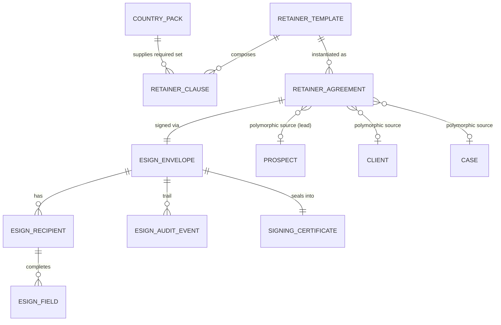

> **Document control** · Version **1.11** · **2026-10-18** · Status: **"Prepare retainer" on a lead, a client and a case applied (AG07-D3): one engine and one e-sign flow, all outcomes recorded for all three starts, representative pre-filled and never forced, pre-filled merge fields with "missing" shown before sending; people-model wording (X-2); new section "Decisions that change this epic"; previously: E-sign settings source applied from SA-08 v2.5 (SA8-X8); Countersign requests shown to every active holder of `agent/retainer:countersign`, no licence marking (SA-Q3), first countersignature closes the request, Owner if no holder (SA-06 v3.0 closing decision F4, SA6-D9). Earlier: countersign default applied from SA-06 v3.0 (SA6-D2): `agent/retainer:countersign` is seeded on Owner and Case Manager; the firm may grant it to any role. Earlier: signing page returns the client to the portal; regulator wording neutralised; no masking and no reveal of personal data (AG7-D10)**\
> Part of: *Agent (RCIC/Lawyer) Console — Functional Requirements* · Split from `FINAL-Agent-FR.md` lines 3116–3804 on 2026-09-16 · Previous version: `_archive/AG-05-retainer-and-agreements_v1.10_2026-10-10.md`\
>
> | Version | Date | Change | Decisions |
> |---|---|---|---|
> | 1.11 | 2026-10-18 | *18 Oct (later): AG-01 gap check #13 — AG-5-49's "fall back to another active credential" removed; the representative follows AG07-D3(3) (AG-5-57); the block is kept.* **"Prepare retainer" on a lead, a client and a case (AG07-D3, the product owner, 18 Oct) and the people model (X-2).** (1) **New AG-5-55 – AG-5-58 with one build card (AG-5-55):** "Prepare retainer" is offered on a lead, a client and a case, with one Drafter, one Signer and one e-sign flow (AG-5-55). Every outcome — e-signed, signed on paper ("signed offline"), re-issued, expired, voided with a reason — is recorded the same way for all three starts (AG-5-56). The retainer names one **representative** (the licensed person who signs), pre-filled in this order: the case's lead representative, the firm's default lead representative, the person preparing it if licensed, otherwise staff pick. A different person shows a warning and never blocks; the one kept block is the firm with no active licensed person (AG-5-57, AG01-6). Merge fields are pre-filled from what the system holds, and anything missing shows as "missing" before sending (AG-5-58). (2) **Changed:** AG-5-2, AG-5-8, AG-5-40, BR-15, §3.0, §3.1, §3.2, §3.13, §7 `RetainerAgreement` (source `PROSPECT | CLIENT | CASE`; new `representativeUserId`), §11, §12; new US-12; two edge cases. (3) **People model (X-2):** merge fields read the client's person record (`Party` + `PartyProfile`); "Contact" is a screen name, not a table. (4) **New section** "Decisions that change this epic (14–18 Oct)" (this file had none). **Open questions added:** 9 – 12 (countersign versus the representative's stored signature; where fee and scope are typed for a client or case start; AG-01 knock-ons still pending here; several open retainers). **Closed:** none. Requirement IDs added: AG-5-55, AG-5-56, AG-5-57, AG-5-58. *18 Oct (later): consistency fixes after expert review — SA-Q3 ("preferred" countersign mark removed), AG01-5 / SA6-D20 / Rule 7 (merge tokens renamed to `{{representative.*}}`, "assigned RCIC" reworded; Q11 rename part closed).* *18 Oct (final): AG07-D17 – D21 applied — AG07-D20(c).* **The retainer's representative countersigns by default and their stored signature is applied; any holder of `agent/retainer:countersign` may sign instead when that person is away; recorded (AG07-D20(c)).** Changed: AG-5-27 (new build card), AG-5-57, §3.5, §3.7, BR-9, §6 transitions, US-4, countersign edge cases, §10, AG-5-55 card non-goals. **Open questions closed:** 9 and the rest of 11; **added:** 13 – 14. Requirement IDs unchanged. | AG07-D3 · X-2 · SA-Q3 · AG01-5 · AG07-D20(c) |
> | 1.10 | 2026-10-10 | Applied from SA-08 v2.5 (SA8-X8; merge decided by the product owner, 10 Oct): the **e-sign consent text, the certificate wording, the evidence captured and the signing-link expiry come from Expat Ready's E-signature settings** (SA-8 §3.8), written by the content author and **approved and published by the Owner** — not from the country pack; a wording change applies to new signing requests only. New AG-5-54. Retainer wording and required clauses are unchanged here (the template management review covers retainer templates). | SA8-D21, SA8-D22 (SA8-X8) |
> | 1.9 | 2026-10-07 | **SA-06 v3.0 closing decision F4 follow-up (the product owner, 7 Oct).** A retainer awaiting the firm's countersignature is a professional approval: the countersign request is **shown at once to every active holder of `agent/retainer:countersign`**; **active licensed holders are marked "preferred"** (a mark and sort order, not a restriction); **the first to countersign closes the request for everyone**, the others seeing who countersigned and when; **if no one holds the permission, the Owner countersigns**, recorded "countersigned by Owner — no active holder of the countersign permission". Replaces notifying one named countersignatory (the responsible RCIC). **Unchanged:** the regulator-credential rules (AG-5-49, BR-4, `{{rcic.*}}` merge tokens) — the licence is a person's attribute (SA6-D9); the permission key, its seeding on Owner and Case Manager, and every countersignature being audited (SA6-D2); the client-then-firm sequence. Requirement IDs unchanged. Changed: Document control, new row in "Applied from SA-06 v3.0" (SA6-D9 extended), §3.5 recipients text, §3.7 text and countersign bullets, AG-5-27, BR-9, §6 state-change rows for COUNTERSIGN_PENDING, US-4, one edge case, §10 `countersign` row. | SA6-D2, SA6-D9 |
> | 1.8 | 2026-10-07 | Roles and permissions knock-on from SA-06 v3.0 (the product owner, 7 Oct; decisions owned by SA-06). **Changed:** `agent/retainer:countersign` is seeded on the **Owner and Case Manager** starter roles by default; the firm may grant it to any role; every countersignature is audited (SA6-D2). There is no licensed-representative (RCIC) role: BR-9, AG-5-27, §10, the countersign scenario and Open Question 7 no longer tie countersignature to the assigned RCIC. **Not changed:** the regulator-credential rules for retainers (AG-5-49, BR-4, the `{{rcic.*}}` merge tokens) — the licence credential is a person's attribute, not a role (SA6-D9). Persona "Manager" renamed "Case Manager" (SA6-D5). No permission key in this module is renamed by SA-06 Appendix B; `agent/retainer:*` keys are unchanged. | SA6-D2 · SA6-D5 · SA6-D9 |
> | 1.7 | 2026-10-05 | Knock-on changes from AG-07 v2.3 and the client-portal document CP-01 v0.1 (5 Oct). **Added:** AG-5-53 and a "Return to the portal" paragraph in §3.5 — when the client opens a signing request from a portal to-do, the signing page returns them to the portal afterwards with the to-do shown done; the portal never renders its own signing step (CP-1-53). **Changed:** AG-5-31 — "a CICC requirement" replaced by a neutral statement of what the system does (the firm's required clause set, from the pack), per AG-07 BR-26 (we work for the firm, not the regulator). **Not changed:** this module has no `reveal-pii` key. Other requirement IDs unchanged. Same day (AG7-D10): masking and reveal removed everywhere — the §11 PII line no longer masks anything (sensitive fields are shown in full to users who may see the record; the `agent/pii:export-unmasked` mention is removed; exports are audited as exports) and the §12 "PII masking" item is withdrawn; kept: no PII in system logs or traces, passport and financial numbers never in the content of emails, WhatsApp messages or notifications, field-level encryption at rest. Same day (AG-07 BR-26, decided): every remaining claim of regulator authority is reworded neutrally to the AG-5-31 pattern (the firm's required clause set, from the pack) — §1 and §3 intro text, the clause panel badge, §3.12 (heading and retention text), AG-5-5, AG-5-43, BR-3, BR-12, the `RetainerClause` and Country Pack input lines, the required-clause and retention scenarios, the edge case on missing clauses, §11 config note, §12 NEW note, §13 SME note; the required clauses and retention horizons still exist in the pack, only the claim of regulator authority goes. | CP1-D4 · AG-07 BR-26 · AG7-D7 (replaced by AG7-D10) · AG7-D10 |
> | 1.6 | 2026-10-03 | Consistency review fixes (3 Oct). Regulatory wording corrected: the regulator requires a written agreement, ExpatReady warns but does not block, and the firm decides when to start (AG17-D62) (§1). AG-5-50 now cites AG17-D39 only (masters are not a system feature, so D50 belongs to AG-5-52). "Corporate equivalents" replaced by "prospect or case; client type distinguishes corporate" (§3.0, §3.13). BR-1 sentence about what work may begin untangled. AG-5-51 and the BR-1 wording "neither executed nor signed offline". The v1.5 change-log row now lists §3.11 and BR-14 among the changed items, and its lost row marker is restored. "Phase-2 / Phase-3" deferrals restated as "Release 2 or later" (AG17-D60). No requirement added or removed. | AG17-D62 · AG17-D39, D60 |
> | 1.5 | 2026-10-02 | Founder decisions applied (2026-10-02). **BR-1's hard gate is replaced by a CRITICAL warning** on the case, individual and corporate: work may start before signature and the warning is passed at submission with `agent/case:waive-deficiency` and a reason; invoicing still needs a signed agreement (BR-14 stays). New recipient role **"signs for the organisation"** (the employer's authorised signatory); **no master-agreement concept** (firms upload masters as employer documents and use a short per-file retainer). **Staff never sign on a client's behalf** — a paper signature is uploaded and marked "signed offline". Changed: §1, §3.11 and §3.13 wording, AG-5-39, AG-5-40, BR-1, BR-2, BR-14, US-10, §9, §12; added: AG-5-50, AG-5-51, AG-5-52, US-11, one edge case. | AG17-D39, AG17-D50, AG17-D62, AG17-D66 |
> | 1.4 | 2026-10-02 | Applied AG17 terminology/consistency changes (safe set): separate corporate case / corporate prospect agreement sources collapsed to case / prospect + client type (AG-5-2, BR-15, data model). | AG17-D4 |
> | 1.3 | 2026-10-01 | Knock-on from AG-01 v1.3 (decisions revised 1 Oct): only the Applied-from table row for AG1-D1 changed (a deactivated user can later be deleted); AG-5-49 still applies and past agreements stay unchanged; this module had no deferred staff-leaving items to remove. | AG1-D1 |
> | 1.2 | 2026-10-01 | Knock-on from AG-01 v1.2 (staff leaving): a credential tied to a deactivated staff member is treated as absent for new documents (blocked with "No active licensed consultant — add one" if none remain); executed agreements untouched. Added: AG-5-49, one edge case, one acceptance criterion under US-1; changed: BR-4, §3.2 behaviour list. | AG1-D1, AG1-D8 |
> | 1.1 | 2026-08-28 | Baseline — complete document v1.1 | — |

## Decisions that change this epic (14–18 Oct) *(new 18 Oct)*

Product-wide rules (apply here as everywhere; home: Agent `00-Overview` → "Product rules every epic follows"): AG16-31, AG16-42, AG16-60, AG16-63, AG16-76.

The "AG07" prefix is the AG-07 review (18 Oct); X-2 is the people model. Full text: `TEMPLATE-MAP-working_2026-10-10.md`. A search of the decision map (18 Oct) found no AG16 decision that names an AG-05 requirement; AG16-21 lists AG-05 among delete owners, but no AG-05 text needed to change. AG-01 lists four knock-ons for AG-05 that are still pending (question 11).

| Decision | What was decided (one line) | What it changes in this epic | Where (requirement / card / section) |
|---|---|---|---|
| AG07-D3 | Retainer from a lead, a client or a case; representative pre-filled, never forced (option A; the product owner, 18 Oct). AG-05 is the home. | "Prepare retainer" on a lead, a client and a case, one engine and one e-sign flow; all outcomes recorded for all three starts; representative pre-filled in a fixed order, a different person is a warning and never a block; merge fields pre-filled with "missing" shown before sending; the AG01-6 block is kept. | AG-5-55 (card) · AG-5-56 · AG-5-57 · AG-5-58 · AG-5-2 · AG-5-40 · BR-15 · §3.13 · §7 · US-12 |
| X-2 | One person record per real person; "Contact" is a screen name, not a table (option A; the product owner, 18 Oct; replaces AG07-D5). Home: AG-02. | Merge fields read the client's person record (`Party` + `PartyProfile`) instead of a Contact; no other behaviour changes. | §3.2 · AG-5-8 · AG-5-58 |
| SA-Q3 | No licence marking anywhere; licensed or not, every holder of a permission is treated alike (closed v3.6, SA-06 Q13). | The "preferred" mark and sort order for licensed countersign holders is removed: no holder is marked, and the first to countersign still closes the request. | AG-5-27 · BR-9 · §3.7 · countersign edge case · §10 `retainer:countersign` · SA6-D9 row *(fixed 18 Oct)* |
| AG01-5 / SA6-D20 / Rule 7 | "Lead RCIC" is "lead representative"; no regulator names in product text (merge tokens are firm-visible). | `{{rcic.name}}` and `{{rcic.ciccNumber}}` become `{{representative.name}}` and `{{representative.licenceNumber}}`; "assigned RCIC" becomes "the retainer's representative". Q11 rename part closed. | §3.2 · §3.7 · Q7 · Q11 *(fixed 18 Oct)* |
| AG07-D3(3) (gap check #13) | Representative order | AG-5-49 no longer says generation falls back to another active credential; it follows the AG-5-57 order and keeps the block when no active licensed person exists | AG-5-49 |
| AG07-D20(c) | Retainer signer and countersign (the product owner, 18 Oct). AG-05 is the home. | The retainer's representative countersigns by default and their stored signature is applied (AG01-20 / AG01-23 read as "the retainer's representative"); any holder of `agent/retainer:countersign` may sign instead when that person is away; recorded. Q9 and the rest of Q11 closed. | AG-5-27 (card) · AG-5-57 · §3.7 · BR-9 · §6 · US-4 · §9 · §10 · Q9 · Q11 · Q13 – Q14 |

## Module AG-5: Retainer & Agreements

**Applied from AG-01 v1.3 (staff leaving, 2026-10-01)** (decisions owned by `AG-01-firm-setup-and-onboarding` v1.3 §0):

| ID | Decision | Applied here |
|---|---|---|
| **AG1-D1** | Delete allowed only after deactivation; history stays | AG-5-49 (past agreements unchanged, including after the user is deleted) |
| **AG1-D8** | A deactivated staff member's credential is never stamped on new documents | §3.2 · AG-5-49 · BR-4 · §9 · US-1 |

**Applied from AG-17 (corporate cases and LMIA, founder-decided 2026-10-02)** (decisions owned by `AG-17-corporate-cases-and-lmia` and `Corporate LMIA/DECISION-LOG.md`):

| ID | Decision | Applied here |
|---|---|---|
| **AG17-D39** | An unsigned agreement is a CRITICAL warning, not a lock — individual and corporate; the employer's authorised signatory signs for the company | BR-1 · AG-5-40 · AG-5-50 · AG-5-51 |
| **AG17-D50** | No master-agreement concept; masters are employer documents, each file uses its own short retainer | AG-5-52 |
| **AG17-D62** | Unsigned retainer = CRITICAL warning, never a block; passed at submission with `agent/case:waive-deficiency` and a reason; invoicing still needs a signed agreement (BR-14) | BR-1 · AG-5-40 · AG-5-51 · US-11 · §9 |
| **AG17-D66** | Staff never sign on a client's behalf; a paper signature is uploaded and marked "signed offline" | AG-5-39 · BR-2 · US-10 |

**Applied from SA-06 v3.0 (2026-10-07)** (decisions owned by `SA-06-rbac` v3.0 §0)

| ID | Decision | Applied here |
|---|---|---|
| **SA6-D2** | `agent/retainer:countersign` is held by default by the Owner and Case Manager starter roles; the firm may grant it to any role; every use is audited; no licensed-representative role | §10 · BR-9 · AG-5-27 · US-4 · §13 Q7 |
| **SA6-D5** | The six starter roles are Owner, Admin, Case Manager, Case Officer, Billing / Finance, Read-only; "Manager" (role) is "Case Manager" | §2 personas |
| **SA6-D9** *(extended v1.9 — closing decision F4, 7 Oct)* | A licensed user is a person (credential), not a role; the credential rules of AG-5-49 are unchanged. A countersign request is shown at once to every active holder of `agent/retainer:countersign`, no licence marking (SA-Q3 — fixed 18 Oct); the first to countersign closes it for everyone; if no one holds the permission, the Owner countersigns, recorded | AG-5-49 · BR-4 · §3.5 · §3.7 · AG-5-27 · BR-9 · US-4 · §10 |

**Applied from AG-07 v2.3 and CP-01 v0.1 (2026-10-05)**

| ID | Decision | Applied here |
|---|---|---|
| **CP1-D4** | Signing from the client portal hands off to the AG-05 signing page (consent, fields, certificate) and returns the client to the portal; the portal never renders its own signing step. One signing engine for portal and emailed links. | §3.5 · AG-5-53 |
| **AG-07 BR-26** | We work for the firm, not the regulator: copy states what the system does, not that a regulator requires it. | AG-5-31 |

### Module Index

Scan the whole module in ~30 seconds; jump to any part.

1. **Purpose & Goal**
2. **Users & Jobs-to-be-Done**
3. **Functional Design — How It Works** (core)
   - 3.0 The retainer as the revenue gate (the model) · 3.1 The Drafter — template selection & clause assembly · 3.2 The Drafter — merge-field binding from the live record · 3.3 The Drafter — bilingual rendering · 3.4 Consultant review/edit before send (the proofing gate) · 3.5 The Signer — recipients, identity & consent capture · 3.6 The Signer — field placement (signature/initials/date) · 3.7 The Signer — sequential / parallel signing, client-sign + firm-countersign · 3.8 The Signer — tamper-evidence (hashing) & the signing audit trail · 3.9 The Signer — certificate of completion · 3.10 Expiry, reminders, void & re-issue · 3.11 The lifecycle event that DRIVES WON (`envelope.signed`) · 3.12 Storage, retention & the firm's own cloud · 3.13 Hand-offs — from Consult (AG-4); to Biller (AG-6)
4. **Detailed Functional Requirements** (AG-5-x)
5. **Business Rules & Logic**
6. **States & Lifecycle**
7. **Key Entities & Fields**
8. **User Stories + Acceptance Criteria**
9. **Edge Cases & Validations**
10. **Permissions** (LOCAL `agent/*`)
11. **Scalability · Security · Performance**
12. **Reference Note** (exists / NEW / changed)
13. **Open Questions / Founder Decisions**

### Visual Overview

**A. Retainer lifecycle** (the agreement state; **WON in AG-2 is *caused by* `envelope.signed`, never the inverse**; countersign is a real, distinct step before EXECUTED):

```mermaid
stateDiagram-v2
    [*] --> DRAFT : Drafter generates from template + merge fields + clauses
    DRAFT --> DRAFT : consultant review / edit / re-render
    DRAFT --> SENT : Signer sends (identity + consent enabled, fields placed)
    SENT --> VIEWED : recipient opens (audited)
    VIEWED --> CLIENT_SIGNED : client completes their fields
    SENT --> CLIENT_SIGNED : (direct sign)
    CLIENT_SIGNED --> COUNTERSIGN_PENDING : firm countersignature required
    COUNTERSIGN_PENDING --> EXECUTED : RCIC/authorized signer countersigns → all parties signed
    CLIENT_SIGNED --> EXECUTED : (no countersign required by firm policy)
    DRAFT --> VOIDED : void (reason)
    SENT --> VOIDED : void (reason)
    VIEWED --> VOIDED : void (reason)
    COUNTERSIGN_PENDING --> VOIDED : void (reason)
    SENT --> DECLINED : recipient declines (reason)
    SENT --> EXPIRED : past expiresAt with no completion
    VIEWED --> EXPIRED : past expiresAt with no completion
    EXECUTED --> [*] : tamper-evident PDF + certificate retained in firm storage
    note right of EXECUTED : emits envelope.signed → AG-2 WON + retainerStatus=SIGNED; hand-off to AG-6 Biller
    note right of VOIDED : re-issue = NEW envelope (never resurrect a terminal one)
    note right of EXPIRED : re-issue = NEW envelope
```

**B. The Drafter → Signer pipeline** (one spine: generate → proof → place → sign → countersign → seal → file → hand off; every step is firm-tenant-scoped and country-pack-aware):

```mermaid
flowchart LR
    SRC[Consult / Prospect AG-4<br/>fees + scope + RCIC] --> T[Template pick<br/>matter type + locale]
    T --> CL[Clause assembly<br/>required clause set<br/>pack-versioned]
    CL --> MF[Merge-field bind<br/>client/firm/RCIC/fees/scope<br/>from live record]
    MF --> RB[Bilingual render<br/>EN/FR... → PDF]
    RB --> RV{Consultant<br/>review/edit}
    RV -->|edit| RB
    RV -->|approve| PL[Field placement<br/>sig/initials/date per recipient]
    PL --> SN[Signer: SEND<br/>identity + consent + tokens]
    SN --> SG[Client signs] --> CS[Firm countersigns]
    CS --> SEAL[Hash original+signed<br/>SHA-256 · build certificate]
    SEAL --> FILE[(Firm's own cloud storage<br/>executed PDF + cert + audit)]
    FILE --> EV((envelope.signed))
    EV --> WON[AG-2: prospect → WON<br/>retainerStatus = SIGNED]
    EV --> BILL[AG-6 Biller: raise/settle invoice]
    EV --> AU[AuditLog + Notification]
```



**C. Core data model** (the agreement is polymorphic — it attaches to a lead, a client or a case (a corporate case or prospect is a case or prospect whose client type is Corporate — AG17-D4); the template + clause library are the firm/country-pack inputs):



> `Note · Task · Reminder · Activity · Communication · Document · AuditLog · Notification` attach to a `RETAINER_AGREEMENT` (and its source prospect/case) via the polymorphic `(entityType, entityId)` pattern — defined once (Part 2), reused here, never redefined. The executed PDF, its signed copy, the certificate, and the signature images all live in the **firm's own configured cloud storage**; the DB stores keys + hashes, not bytes.

---

### 1. Purpose & Goal

**What it is.** AG-5 is the **legal gate of the revenue spine**. The firm needs a written agreement with the client (the firm's required clause set comes from the pack); ExpatReady warns, it does not block — the firm decides when to start (AG17-D62). *(changed v1.7 — AG-07 BR-26)* AG-5 is the module that **generates that agreement, gets it signed by the client and countersigned by the firm, seals it tamper-evidently, retains it, and signals the rest of the system that the deal is real.** It sits exactly between "the prospect agreed verbally in the consult" (AG-4) and "we can take their money and start the case" (AG-6 → AG-7+). Until the agreement is signed, the case shows a **CRITICAL warning** (AG17-D62): work may start, but the warning must be cleared by signature or consciously passed at submission, and **no invoice can be raised** against an unsigned agreement because the fee comes from the signed agreement.

**The business outcome it must produce.** Immigration firms lose money and risk discipline at this gate three ways: (a) **slow, manual drafting** — a consultant copy-pasting last client's Word retainer, hand-editing the name, the fee, the scope, forgetting a required clause *(changed v1.7 — AG-07 BR-26)*; (b) **chasing wet-ink signatures** — printing, emailing PDFs, waiting days, re-sending, never knowing if it was opened; and (c) **weak proof** — an unsigned or un-versioned agreement that can't be defended to a regulator or a client complaint. AG-5 makes the gate **fast, correct, and defensible**: the Drafter produces a complete, clause-correct, merge-bound, bilingual agreement in seconds from a template; the Signer collects a legally-recognized electronic signature with full identity/consent capture, sequential client-then-firm signing, tamper-evident hashing, and a certificate of completion — entirely **in-house**, with the executed file retained in the **firm's own storage**. The result: *signed faster, never missing a required clause, always defensible.*

**Why it matters / world-class positioning.** A generic e-sign tool (DocuSign et al.) is a dumb pipe: it signs *a* PDF, but it does not know what a *retainer* is, does not assemble the *firm's required* clauses *(changed v1.7 — AG-07 BR-26)*, does not bind *immigration* merge fields, does not render *bilingually* for Quebec, does not *drive a sales stage to WON*, and — critically — it ships the firm's most sensitive legal document to **a third-party vendor's cloud**. Expat Ready's moat is that the Drafter and Signer are **immigration-native and in-house**: the agreement is built from a **country-pack clause set** (so a Canada retainer carries the Canada pack's required clause set and a future Australia retainer carries the Australia pack's, with **no code change**), bound to the **same single-source client/firm/RCIC/fee/scope record** the rest of the product already holds (zero re-keying), rendered in the **client's language**, and the **act of signing is wired to the revenue funnel** (signature → WON → invoice). And because it is in-house, the executed agreement and its audit trail **never leave the firm's tenant or its own storage** — a decisive trust and PIPEDA/Law-25 advantage when selling to a regulated firm. The founder's instruction is explicit and load-bearing: **in-house Doers only; no third-party e-sign; firm-owned storage.**

**How it ties to the revenue journey.** Lead → qualified (AG-3) → consult held, scope + fee agreed (AG-4) → **Drafter generates the retainer → Signer sends → client signs → firm countersigns → executed (AG-5)** → `envelope.signed` **drives** prospect → WON + `retainerStatus = SIGNED` (AG-2) → Biller raises/settles the invoice (AG-6) → convert to client → case delivery (AG-7+). AG-5 owns the legal-gate transition and hands off cleanly on execution. **The signature causes the stage; the stage never invents a signature** (the "two sides, one wire" doctrine inherited from AG-2 §3.5).

**Global ambition (founder's core point).** The same module serves a solo RCIC provisioned for Canada and a firm provisioned for Australia or the UK with **no code change per country** — the platform is multi-country, a firm is not (FD-68). The *structure* of a retainer (parties, scope, fees, refund, dispute, confidentiality, termination, signatures) is universal; the *required clause set, the regulator citations, the locale, and the e-signature legal recital* come from the firm's **Country Pack**. Single-locale is the degenerate case within a firm. Bilingual (EN/FR for Canada; extensible) is first-class, because Quebec's Charter of the French Language / Law 25 makes a French-language agreement a legal requirement, not a nicety — and a global product must treat "the client's language" as a first-class axis everywhere.

---

### 2. Users & Jobs-to-be-Done

The "Agent" persona is an umbrella; AG-5 is used differently by each sub-role. JTBD framing keeps the design honest about what each person is actually trying to accomplish at the legal gate.

| Role | Primary job in AG-5 | Jobs-to-be-done (representative) |
|---|---|---|
| **RCIC / Consultant** (the authority at this gate) | Put a correct, complete, defensible agreement in front of the client and countersign it. | "When I finish a consult, I want the retainer generated from the right template for this matter with the fee and scope I quoted already filled in, so I'm not retyping or risking a wrong number." · "When I review the draft, I want to see every required clause present and be warned if one is missing, so I never send a non-compliant agreement." · "When the client has signed, I want to countersign with one click as the responsible consultant, so the agreement is properly executed by *me*, the authorized party." |
| **Intake / Sales Representative** | Get the agreed deal across the line fast; never let a 'yes' go cold. | "When the consult ends in a yes, I want to send the retainer in minutes, in the client's language, and see the moment they open and sign it, so I can nudge if they stall." · "When the client asks for the agreement again, I want one-click resend, not a re-draft." |
| **Case Manager** *(changed v1.8 — SA6-D5; was Manager)* | Keep the gate fast, compliant, and visible. | "When I review the week, I want to see retainers out / signed / stuck / expiring, time-to-sign, and any voided with reasons, filterable by consultant and matter type." · "When a retainer has sat unsigned past our SLA, I want it flagged before the deal dies." |
| **Owner / Principal RCIC** | Own compliance and the firm's legal exposure at the gate. | "When I configure the firm, I want to set our retainer templates per matter type for the country we practise in, lock the required clauses so no one can delete them, and choose who is allowed to send and to countersign." · "When a regulator or client disputes our engagement, I want the executed agreement, its version, and the full signing audit trail retrievable in seconds — from *our* storage, not a vendor's." |
| **Accounts / Billing** | Start billing only when the gate is passed. | "When a retainer executes, I want the invoice to flow automatically from the agreed fee in the right currency, so I'm not re-creating fee data and never billing against an unsigned agreement." (Owns AG-6; consumes AG-5's `envelope.signed`.) |
| **Client (signer)** | Understand and sign easily, in their language, with confidence it's legitimate. | "When I get the agreement, I want to read it in my language on my phone, understand the fees and refund terms, sign with my finger, and receive my own copy — and trust this is my lawyer's secure system, not a random link." (Signs on the public Signer page; not an agent.) |

**Design implication.** The **RCIC/Consultant is the protagonist** of AG-5 — the Drafter's generate/proof/clause-check screen and the one-click countersign are designed for them. The **Sales Rep** gets the send + track surface. The **Owner** gets template + clause configuration and the locked-clause guarantee. The **Client** gets a clean, mobile-first, bilingual, trustworthy signing page. Permissions (Section 10) cleanly separate who can draft, send, countersign, void, and configure.

---

### 3. Functional Design — How It Works (core)

This is the heart of the spec. Each sub-function is designed in depth: **how it works**, the **smart / world-class behaviour** that beats a generic e-sign tool, the **key screens & interactions** (functional, not pixel-level), and the **data flow**.

#### 3.0 The retainer as the revenue gate (the model everything sits on)

**Design decision: a `RetainerAgreement` is an *instance* of a `RetainerTemplate`, signed via exactly one `ESignEnvelope`, attached polymorphically to its source (lead, client or case).** *(changed 18 Oct — AG07-D3)* This separation matters:

- **`RetainerTemplate`** = a firm's reusable, locale/matter-type-scoped definition of *what a retainer says* (its country is the firm's own, so country is not one of its axes — FD-68) — body content with merge tokens + an ordered set of clauses (some **locked** because the pack marks them required). Owned/configured by the Owner; seeded from Country-Pack defaults.
- **`RetainerAgreement`** = a *single agreement with a single client*, produced by binding a template to a live record at a moment in time. It captures the **rendered, version-stamped** document, the bound merge values, the chosen clause set, the locale, the fee + scope snapshot, and a polymorphic pointer to its **source** (`PROSPECT` / `CLIENT` / `CASE`; client type distinguishes corporate) *(changed 18 Oct — AG07-D3)*.
- **`ESignEnvelope`** = the *signing instrument* for that agreement — recipients, placed fields, signing order, audit trail, hashes, certificate. **One agreement ↔ one active envelope.** Re-issue creates a **new** envelope (and a new agreement version), never resurrects a terminal one (mirrors AG-2's "never resurrect a terminal row").

**Why three things, not one.** A naive design ("a signed PDF row") cannot answer the questions a regulated firm and its regulator actually ask: *Which template version was this built from? Which clauses were included and were the required ones present? What were the exact bound fee/scope values? In what language did the client sign? Who countersigned, when, from what IP? Is the file tamper-evident?* The template/agreement/envelope split makes every one of those a first-class, auditable fact.

> **Reference-note callout (honest):** today the codebase has **two** parallel, *unintegrated* systems: (1) a rich, security-hardened in-house **e-sign** module (`src/e-sign`) — envelopes, recipients, placed fields, per-recipient consent/IP/UA capture, SHA-256 hashing of original + signed PDFs, a certificate of completion, a completion event, void/remind/expiry — i.e. **DocuSign-lite, feasibility already proven**; and (2) an older, thinner **retainer-agreement** flow (`src/retainer-agreement`) — a public click-to-accept page that captures a typed name/place + IP/UA, flips a Mongo `status` to `SIGNED`, and drives a Stripe checkout. **The rebuild unifies these:** the retainer becomes a first-class `RetainerAgreement` produced by the **Drafter** and signed through the **Signer** (the existing e-sign engine, generalized), retiring the thin click-to-accept path. See Section 12 for the full exists/NEW/changed map.

#### 3.1 The Drafter — template selection & clause assembly — "the right agreement for this matter, in the firm's country, with every required clause, by construction"

**How it works.** When a consultant initiates a retainer (from the consult, a lead, a client or a case — §3.13, AG-5-55) *(changed 18 Oct — AG07-D3)*, the Drafter resolves the correct **template** by three axes: the **destination country** (always the firm's one country, FD-68 — which is what selects its Country Pack), the firm's **template for that country** (a firm may have several), and optionally the **matter type** (e.g. Express Entry vs Study Permit vs Sponsorship). It then assembles the **clause set**: the Country Pack supplies the **firm's required clause set** (for Canada: scope of services, fees & billing, refund policy, dispute resolution, confidentiality, termination — exact set and wording confirmed by the Immigration-SME), which are marked **locked** (cannot be removed or reordered out of the required positions); the firm template may add **optional firm clauses** (e.g. communication policy, third-party disbursements) which the consultant may include/exclude per agreement.

**World-class behaviour.**
- **Required clauses are structurally guaranteed, not hoped for.** The required clause set comes from the pack and is **locked** in the template and re-validated at generation and at send: the Signer **refuses to send** an agreement missing a required clause for the firm's country (BR-3). A generic tool cannot do this — it has no concept of "required clause for this country."
- **Country-pack-driven, zero code per country.** The platform serving Australia or the UK is a matter of publishing a pack with that regulator's required clause set + recitals + locale — not a code change, and not a firm-side act (FD-68). Any one firm draws on exactly one such pack.
- **Versioned & provenance-stamped.** Every generated agreement records the **template version** and the **clause-set / pack version** it was built from, so an agreement signed last year still shows the terms it was actually built under (the same `RULES_AS_OF` provenance discipline AG-3 uses for eligibility).

**Key screens & interactions.** *Generate-retainer launcher* (from consult/prospect/case: pick template — pre-selected by matter — and locale), *Clause panel* (required clauses shown locked with a small "required" badge; optional clauses as toggles), *Template manager* (Owner; per-matter templates within the firm's one country, clause ordering, lock indicators — §10-gated).

**Data flow.** Initiate → resolve the firm's country (a constant — FD-68) → load its Country-Pack required clause set + the firm template for (matter, locale) → assemble ordered clause list (locked required + chosen optional) → carry template version + pack version onto the draft → proceed to merge-field binding (§3.2).

#### 3.2 The Drafter — merge-field binding from the live record — "the fee, the scope, the names — filled in from the one true record, never retyped"

**How it works.** The template body and clauses contain **merge tokens** (e.g. `{{client.fullName}}`, `{{firm.legalName}}`, `{{representative.name}}`, `{{representative.licenceNumber}}` *(renamed 18 Oct — AG01-5, SA6-D20, Rule 7; were `{{rcic.name}}`, `{{rcic.ciccNumber}}`)*, `{{fees.total}}`, `{{fees.currency}}`, `{{fees.schedule}}`, `{{scope.summary}}`, `{{matter.programLabel}}`, `{{date.today}}`). At generation the Drafter **binds** these from the **live source record** — the person record of the lead or client (`Party` + `PartyProfile`) *(changed 18 Oct — X-2)*, the firm/office profile, the retainer's representative's regulator registration (AG-5-57), and the **fee + scope snapshot** carried from the consult/proposal (AG-4). Bound values are **snapshotted onto the agreement** (so the executed document is immutable even if the prospect's data later changes), and a **completeness check** flags any required token that resolved empty (e.g. missing CICC number, missing fee) **before** the consultant can send.

**World-class behaviour.**
- **Zero re-keying — the single-source guarantee.** The same profile/fee/scope the firm already captured flows straight in; the consultant never retypes a name, a number, or a fee. This is the spine-continuity promise inherited from AG-2 (no re-keying across the revenue journey).
- **Empty-token guardrail.** A required merge field that resolves to blank is surfaced ("CICC number is missing — complete the consultant profile") and **blocks send** rather than producing an agreement with a hole where the fee should be. The system never silently renders an empty `{{fees.total}}`.
- **A leaving consultant's licence number is never stamped on new agreements.** A regulator credential linked to a deactivated staff member is treated as absent for new documents (AG1-D8). If no active credential remains, generation is blocked by the same guardrail with "No active licensed consultant — add one". Agreements already generated or signed are unchanged (AG-5-49, BR-4).
- **Money is currency-aware.** `{{fees.total}}` is rendered with its **currency** (ISO-4217) from the deal/consult, consistent with AG-2/AG-6 multi-currency discipline; a Canadian firm can still render CAD for a domestic retainer and USD for a US-resident applicant it quoted in USD — multi-currency is a real within-firm case even though multi-country is not (FD-68).
- **Bound values are auditable.** The exact bound merge map is stored on the agreement, so "what fee did the client actually agree to?" is answerable from the record, not by re-deriving.

**Key screens & interactions.** *Merge preview* (the consultant sees the rendered agreement with values filled in; every value the system does not hold shows as "missing", and empty-required fields are highlighted) *(changed 18 Oct — AG07-D3)*, *Fix-source affordances* (deep-link to the field that's missing, e.g. consultant profile or fee).

**Data flow.** Resolve token map from (person record of the lead or client + firm/office + the representative's registration + fee/scope snapshot) → render body + clauses → run required-token completeness check → snapshot bound values onto the agreement → produce the rendered document (§3.3).

#### 3.3 The Drafter — bilingual rendering — "the client signs in their language; the firm keeps the record it needs"

**How it works.** Each template (body + each clause) exists as a **locale-keyed content set** (EN, FR, …). At generation the Drafter selects the variant matching the **client's `language`** (captured upstream at the per-locale web form / contact profile in AG-2), falling back to the firm's default locale only if a translation is missing — and **flags the fallback** so no one unknowingly sends an English agreement to a French-only client where French is legally required. The bound merge values are language-neutral (names, numbers); only the surrounding legal text is localized. The output is a **PDF** (the format the Signer places fields on and the firm retains).

**World-class behaviour.**
- **Law-25 / Charter compliance by construction.** A Quebec client receives a French agreement from the *same* template definition; the firm is not maintaining two disconnected documents. This is both UX and a legal requirement.
- **Bilingual side-by-side option.** Where a firm wants a dual-language executed record, the template may render **both languages** (e.g. EN + FR stacked) into one PDF — a common practice for cross-border agreements — selectable per template.
- **Missing-translation is loud, not silent.** If a required-locale variant is absent, the consultant is warned and (per firm policy) blocked, never defaulted into a non-compliant language silently.

**Key screens & interactions.** *Locale selector* on the generate launcher (defaulted from the client's language), *fallback warning banner*, *dual-language toggle* (per template).

**Data flow.** Select locale from client language (fallback to firm default, flag if used) → pick locale-keyed body + clause variants → merge-bind (§3.2) → render PDF (single- or dual-language) → store the rendered original in firm storage as the draft document.

#### 3.4 Consultant review/edit before send (the proofing gate) — "nothing goes out unread; the responsible consultant approves it"

**How it works.** The generated draft lands in a **review state (DRAFT)** where the responsible consultant can: read the full rendered PDF; **edit** permitted free-text regions (e.g. a custom scope paragraph, an optional clause's variable text) — **but not** delete or alter locked required clauses; toggle optional clauses; correct a bound value by fixing the source and re-rendering; and finally **approve for send**. Editing re-renders and **bumps the agreement version**; the prior render is retained for audit.

**World-class behaviour.**
- **Locked-clause integrity.** The editor physically cannot remove or rewrite a locked required clause (the field is non-editable); attempts are refused with a clear message. This is the structural guarantee that a consultant under time pressure cannot ship a non-compliant retainer.
- **WYSIWYG, exactly what the client will sign.** The review PDF *is* the document the Signer will place fields on and send — no "the preview looked different" surprises.
- **Re-render is cheap and versioned.** Fix a fee, re-generate, and the new version supersedes the old with both retained — the firm can prove exactly what was sent and when.
- **Approval is attributable.** "Approved for send by {consultant} at {time}" is recorded; the act of approving is the consultant taking professional responsibility for the agreement's content.

**Key screens & interactions.** *Draft review screen* (rendered PDF + an edit panel for permitted regions + clause toggles + "Approve & continue to send"), *version history* (who edited/re-rendered when).

**Data flow.** Render → DRAFT → (optional) edit permitted regions / toggle optional clauses → re-render + version bump (audited) → approve-for-send (records approver) → proceed to recipients + field placement (§3.5–3.6).

#### 3.5 The Signer — recipients, identity & consent capture — "the right people, who they are, and that they agreed to sign electronically"

**How it works.** The consultant adds **recipients** to the envelope — at minimum the **client** (signer) and the **firm countersignatory** (the retainer's representative countersigns by default *(changed 18 Oct — AG07-D20(c))*; any active holder of `agent/retainer:countersign` may sign instead when that person is away, and the request stays visible to all holders — §3.7) *(changed v1.9 — F4)*. Each recipient has a name, email (and optional phone), and a **role** (`Client`, `Consultant`, `Witness`, …). The Signer issues each recipient a **unique, single-use access token** (a long random secret) embedded in a private signing link; opening the link records a **VIEWED** audit event with IP + user-agent + timestamp. Before any signature is accepted, the recipient must give **explicit electronic-signing consent** (an affirmative checkbox tied to a versioned consent recital appropriate to the country/locale — Canada: UECA/PIPEDA-style recital; eIDAS-style where the pack so specifies); the consent is captured with **timestamp + IP + UA + consent-text version**.

**World-class behaviour.**
- **Identity & intent are captured, not assumed.** Per-recipient token, view tracking, affirmative consent, IP/UA, and timestamps form the evidentiary chain that makes the signature legally defensible — exactly what a regulator or a disputed-engagement complaint needs.
- **Country/locale-correct legal recital.** The consent text and the e-signature legal recital come from **Expat Ready's E-signature settings for the firm's country** (SA-8 §3.8 — Owner-approved; *changed v1.10, was "pack/locale-driven"*) (Canadian electronic-commerce legislation for Canada; the appropriate regime per country), shown in the client's language — not a hardcoded US-centric blurb.
- **Single-use, rotating tokens.** A token is rotated to a dead value once the recipient signs or declines, so a forwarded/leaked link cannot be reused — a real security property (already implemented in the existing engine).
- **Consent is a hard gate.** No field value or signature image is persisted unless consent is affirmatively given; a missing/false consent is rejected.

**Key screens & interactions.** *Recipient editor* (add client + countersignatory, set roles, choose signing order — §3.7), *(client-facing) signing page* (the document, the consent recital in the client's language with an affirmative checkbox, the fields to complete).

**Data flow.** Add recipients → generate per-recipient single-use token + private link → recipient opens (audited VIEWED + IP/UA) → recipient affirms consent (captured: timestamp + IP/UA + consent-text version) → only then accept field completion + signature (§3.6).

**Return to the portal (v1.7 — CP1-D4).** When the client opens a signing request from a **portal to-do** (AG-15; CP-1-53), the signing page is the same public signing page that an emailed link opens — one signing engine for both. After the client signs, the page SHALL return them to the portal, with that to-do shown done. The portal never renders its own signing step; consent, fields and the certificate stay on this page.

#### 3.6 The Signer — field placement (signature/initials/date) — "exactly where each party signs, validated, on the real document"

**How it works.** Before sending, the agreement's **signing fields** are placed on the rendered PDF: **signature**, **initials**, **date**, and optional **text** fields, each assigned to a **specific recipient** and positioned by page + percentage coordinates (resolution-independent). A firm can rely on a **default placement** for its standard retainer (a sensible signature + date block on the last page, per recipient) or use a **field-placement editor** to drag fields precisely. Required fields are enforced at signing: a recipient cannot complete signing while a required field assigned to them is empty, and a required signature field requires an actual signature image.

**World-class behaviour.**
- **Per-recipient fields.** The client's signature block and the firm countersignature block are distinct fields owned by distinct recipients — so each party signs *their* place, and the executed PDF shows both signatures correctly (the existing engine already embeds each field with its **own** signer's image).
- **Coordinates are bounded and safe.** Field coordinates are validated to a 0–100% box per page (already enforced) so a field can never be pushed off-page or used to probe the renderer — a small but real hardening.
- **Default-but-overridable.** The common case (standard retainer) needs zero manual placement; the uncommon case (a bespoke multi-party agreement) gets a full editor. Defaults auto-resolve to the document's real last page at send time.

**Key screens & interactions.** *Field-placement editor* (drag signature/initials/date onto the PDF, assign each to a recipient; or accept defaults), *required-field indicators* on the signing page.

**Data flow.** Place fields (default layout or explicit editor) bound to recipients with page + %-coords → validate coords + recipient ownership → at send, resolve any sentinel/default page to the real last page → fields are the contract for what each recipient must complete (§3.7).

#### 3.7 The Signer — sequential / parallel signing, client-sign + firm-countersign — "client first, firm countersigns; the order is enforced"

**How it works.** An envelope signs either **in parallel** (all recipients can sign at once) or **sequentially** (signing order enforced). For a retainer the canonical mode is **sequential: the client signs first, then the firm countersigns**. The Signer notifies only the **current** signer; when the client completes their fields, the agreement moves to **client-signed** and the **countersign request is addressed to the retainer's representative**, who countersigns by default with their stored signature applied, and **stays shown, and unlocked, for every active holder of `agent/retainer:countersign`**, any of whom may sign instead when the representative is away, recorded (no licence marking; the Owner if no one holds the permission) *(changed 18 Oct — AG07-D20(c); fixed 18 Oct — SA-Q3; changed v1.9 — F4)*; when the firm countersigns, **all parties have signed** and the envelope completes (→ seal + certificate, §3.8–3.9). A firm may, per policy/template, **not require a countersignature** (client-signed = executed) — but the default and recommended posture is client-sign + firm-countersign, because an agreement executed by the responsible consultant is stronger evidence of the engagement.

**World-class behaviour.**
- **Countersignature is a real, distinct, attributable step** — not a checkbox. The firm's execution of the agreement is performed by an authorized signer (permission-gated, §10), recorded with their identity/IP/time, and is what flips the agreement to **EXECUTED**. This is the correct legal shape of an engagement: both parties sign.
- **One-click countersign for the consultant.** The retainer's representative countersigns by default, with their stored signature applied; any other holder of the countersign permission can sign instead when the representative is away, and the record says so *(changed 18 Oct — AG07-D20(c); card AG-5-27)*. The friction is near-zero for the firm side while the evidentiary capture is full. It is **one request**: when anyone countersigns it closes for everyone, and the others see who countersigned and when. No holder is marked or sorted by licence; any holder may countersign *(fixed 18 Oct — SA-Q3)*. If no active user holds the permission, the Owner sees the request and may countersign, recorded "countersigned by Owner — no active holder of the countersign permission"; nothing is blocked *(new v1.9 — F4)*.
- **Order is enforced server-side.** In sequential mode, a later signer cannot sign before an earlier one (the next signer's link isn't active yet); the engine advances the order atomically as each party completes.
- **Parallel where it fits.** Multi-client matters (e.g. a couple, or a sponsor + applicant) can sign in parallel where order doesn't matter; the model supports both without code change.

**Key screens & interactions.** *Signing-order toggle* (sequential/parallel) + recipient order, *countersign action* for the firm signatory (in-app, post client-sign), *progress indicator* (who has signed, who's next).

**Data flow.** Send → (sequential) notify first signer only → client signs their required fields (+ signature image) → status = client-signed → notify countersignatory → firm countersigns → all-signed check passes → complete (§3.8). (Parallel) all notified at once → complete when the last required signer finishes.

#### 3.8 The Signer — tamper-evidence (hashing) & the signing audit trail — "prove the document wasn't altered and reconstruct exactly how it was signed"

**How it works.** On completion the Signer **embeds** each recipient's signature image and field values into the PDF, producing the **executed document**, and computes a **SHA-256 hash of both the original and the executed PDF** — stored on the agreement. Throughout, every meaningful action writes an immutable **audit event**: created, sent, viewed (per recipient, IP/UA), consent-given (with consent-text version + affirmative-action note), signed (per recipient, IP/UA), countersigned, completed, declined, voided, expired, reminder-sent, completion-notice-sent. The audit trail is append-only and tenant-scoped.

**World-class behaviour.**
- **Tamper-evidence is real and cheap.** Anyone holding the executed PDF can re-hash it and compare to the recorded SHA-256 to prove it hasn't been altered since execution; the certificate (§3.9) prints both hashes. This is the integrity property a regulated firm needs and a generic "we emailed a PDF" flow lacks. (The hashing + per-field per-signer embedding already exist in the engine.)
- **Full reconstructable history.** Who opened it, when, from where; when they consented and to what version of the recital; when each party signed; who countersigned — all timestamped and IP-stamped. This is the evidentiary record that defends the engagement.
- **Audit is non-bypassable.** Audit writes are part of the signing transaction path, not best-effort; the trail cannot be silently skipped.

**Key screens & interactions.** *Agreement detail → audit tab* (chronological event list with actor/IP/time), *download executed PDF* + *download certificate* (signed/cert), *hash display* (for verification).

**Data flow.** Last required signature → embed signatures + values → executed PDF → SHA-256(original) + SHA-256(executed) stored → audit `COMPLETED` → build certificate (§3.9) → file in firm storage (§3.12) → emit `envelope.signed` (§3.11).

#### 3.9 The Signer — certificate of completion — "a one-page, self-contained proof of who signed what, when, and that it's intact"

**How it works.** On completion the Signer generates a **Certificate of Completion** PDF containing: the envelope/agreement title and id; the **original and executed SHA-256 hashes**; the **signer table** (name, email, role, signed-at, IP); the **chronological audit trail**; and a **country/locale-appropriate legal recital** stating the electronic signatures are recognized under the applicable regime (Canada: UECA / provincial e-commerce legislation + PIPEDA; eIDAS-style where the pack specifies). The certificate is stored alongside the executed PDF and is downloadable and (per policy) emailed to all signers with their executed copy.

**World-class behaviour.**
- **Self-contained legal artifact.** The certificate + the executed PDF + the recorded hashes together are a complete, portable proof package the firm can hand to a regulator, a court, or a complaining client — no need to log into the system.
- **Pack/locale-correct recital.** The legal recital reflects the **country and language** of the agreement, not a hardcoded jurisdiction (today's certificate hardcodes the Canadian recital — the rebuild makes it pack/locale-driven; see §12).
- **Auto-delivered proof-of-send.** Each signer is emailed their executed copy + certificate, and the **proof of that send** is itself audited (`COMPLETION_NOTICE_SENT`) — closing the loop on "did the client get their copy?".

**Key screens & interactions.** *Certificate download/preview*, *resend executed copy + certificate* action, *(client) completion email* with the executed PDF + certificate attached.

**Data flow.** Completion → assemble certificate (title/id + both hashes + signer table + audit list + pack/locale recital) → store in firm storage → email executed copy + certificate to each signer → audit each send.

#### 3.10 Expiry, reminders, void & re-issue — "keep it moving; kill it cleanly; never resurrect a dead one"

**How it works.** A sent envelope carries an **expiry** (`expiresAt`; firm-default TTL, e.g. 14 days). The Signer can **remind** outstanding signers (re-send the invite to those still SENT/VIEWED — and only the current signer in sequential mode); **void** a non-terminal envelope with a **mandatory reason** (e.g. wrong fee, client renegotiated); and on expiry the envelope moves to **EXPIRED**. A voided/expired/declined agreement is **terminal** — to send a corrected version the consultant **re-issues**, which produces a **new agreement version + new envelope** (carrying forward template/clauses/merge values for convenience), never reopening the terminal one. Reminders and going-stale detection are **timezone-aware** (firm/office timezone + business hours), consistent with AG-2's SLA discipline.

**World-class behaviour.**
- **Re-issue = new envelope (never resurrect).** A terminal envelope stays intact for audit; the corrected agreement is a fresh, fully-audited instrument linked to its predecessor — the exact "never drag a terminal row backward" principle from AG-2, applied to agreements.
- **Voiding terminal states is blocked.** You cannot void an already COMPLETED/EXECUTED/VOIDED/DECLINED/EXPIRED envelope (already enforced) — clear human messages, no silent corruption.
- **Reminders are smart.** Only the people who still need to sign are reminded; in sequential mode, signers waiting their turn aren't pestered; reminders best-effort (a missing SMTP in dev never fails the action) and audited per send.
- **Stuck-retainer surfacing.** Agreements unsigned past the firm's SLA are flagged in the manager view and raise a Notification before the deal dies (the AG-2 going-cold pattern, applied to the gate).

**Key screens & interactions.** *Agreement detail actions* (remind / void-with-reason / download), *re-issue* action (clearly labelled "Re-issue as new agreement"), *expiring/stuck* list for managers.

**Data flow.** Send sets `expiresAt` → reminder re-sends to outstanding signers (audited) → void sets VOIDED + reason (audited) → past `expiresAt` → EXPIRED (audited) → re-issue creates a new agreement version + new envelope linked to the predecessor.

#### 3.11 The lifecycle event that DRIVES WON (`envelope.signed`) — "the signature causes the stage; the stage never invents a signature"

**How it works.** When a retainer becomes **EXECUTED** (all required parties signed, including firm countersignature where required), the Signer emits a single, decoupled domain event — **`envelope.signed`** — carrying the complete contract a consumer needs (agreement id, source type + ids, executed-doc key, certificate key, signer names, client/firm ids, portal-visibility flag) so no consumer ever has to query back into Signer internals. The **Conductor** consumes it and: (a) drives the source **prospect → WON** and stamps **`retainerStatus = SIGNED`** in AG-2; (b) notifies the **Biller** (AG-6) to raise/settle the agreed invoice; (c) raises Notifications (owner: "retainer executed") and writes AuditLog. **The signature is the cause; a sales stage never fabricates an executed document.** A manual "signed offline" path (wet-ink retainer) remains available: staff upload the client's paper signature and mark it "signed offline"; the action is permissioned, requires an explicit reason, and itself records a signature event for audit — it never invents an executed file. Staff never sign on a client's behalf (AG17-D66, AG-5-39).

**World-class behaviour.**
- **Two sides of one wire.** "The deal is won" and "the agreement is executed" are the *same fact* sourced from the actual signing system of record — no double-entry, no drift between "WON" and "actually signed."
- **At-least-once + idempotent.** `envelope.signed` is delivered at-least-once; every consumer is **idempotent** (keyed on agreement/envelope id) so a redelivered event moves the prospect to WON **once**, raises one invoice, and never re-fires onboarding. Out-of-order or duplicate delivery is a no-op past the first.
- **Non-fatal side-effects.** If a downstream consumer (e.g. invoice raise) errors, the **execution and filing still stand** (the signature is legally complete and stored); the failed side-effect is retried/queued, never rolled back. The gate's integrity does not depend on a downstream success.

**Reference-note callout (honest):** the existing engine emits **`esign.envelope.completed`** (consumed today by `accounting`, `forms`, and `documents` listeners) — but there is **no prospect/WON listener** and the event name differs from AG-2's expected **`envelope.signed`**. The rebuild standardizes the event (or bridges it) and **adds the prospect-WON + Biller consumers**. This is a NEW wiring, not an existing behaviour. See §12.

**Data flow.** EXECUTED → emit `envelope.signed` (full payload) → Conductor (idempotent): prospect → WON + `retainerStatus = SIGNED` (AG-2) · notify Biller raise/settle invoice (AG-6) · Notification (owner) · AuditLog. Manual offline path: permissioned action records a signature event + sets the same derived states, never fabricating a file.

#### 3.12 Storage, retention & the firm's own cloud — "the firm's most sensitive document lives in the firm's own storage, retained for the period set in the pack"

**How it works.** The **rendered original**, the **executed PDF**, the **certificate of completion**, and the **signature images** are stored as objects in the **firm's own configured cloud storage** (the storage rail — e.g. the firm's S3-compatible bucket), keyed by tenant; the database holds only **keys + hashes + metadata**, never the document bytes. Access is always via **short-lived presigned URLs** scoped to a tenant-checked request — never a public, durable link. **Retention** follows the **retention horizon in the country pack** (the exact period is a pack/Immigration-SME value), enforced by a retention policy on the agreement; deletion before the retention horizon is blocked, and disposal after it is an audited, policy-driven action.

**World-class behaviour.**
- **In-house / firm-owned by construction.** The executed agreement and its audit/certificate **never leave the firm's tenant or its own storage** to a third-party e-sign vendor — the decisive trust/PIPEDA/Law-25 advantage and an explicit founder constraint.
- **Tenant-scoped, time-boxed access.** Every download is a permissioned, presigned, expiring URL within the caller's `firm_id`; no cross-tenant key access, no IDOR (the existing engine already scopes downloads via tenant-checked presigned reads).
- **Retention is a first-class policy, not a manual habit.** The agreement carries a retention horizon; the system protects it (no premature deletion) and supports compliant disposal afterward, audited.
- **Portability for the client.** A client's executed agreement is retrievable for a PIPEDA right-of-access request as a one-click, audited export (consistent with AG-2's portability stance).

**Key screens & interactions.** *Download executed / certificate* (presigned), *retention indicator* on the agreement (retain-until date), *(client portal)* the client's own copy of their executed agreement (opt-in visibility flag), *export personal data* (the client's agreement included).

**Data flow.** Render/execute/certify → upload objects to the **firm's configured storage** (tenant-keyed) → DB stores keys + SHA-256 + retention horizon → downloads via tenant-checked presigned URLs → disposal blocked before horizon; post-horizon disposal audited.

#### 3.13 Hand-offs — from Consult (AG-4); to Biller (AG-6) — "the gate sits cleanly between the consult and the money"

**How it works.** AG-5 is initiated with **"Prepare retainer"** on a **lead**, a **client** or a **case** (AG-5-55; AG07-D3) *(changed 18 Oct — AG07-D3)*. From a lead, when a consult ends in agreement (AG-4), the consultant launches the Drafter with the **fee + scope + matter + representative** carried from the consult/proposal — no re-keying. From a client or a case, the Drafter pre-fills what the system holds and shows what is missing (AG-5-58). AG-5 attaches the agreement **polymorphically** to its source: a lead (the retainer moves to the client and to the case at conversion, AG-2-74), a client, or a case; client type distinguishes corporate. On **execution**, AG-5 hands off to the **Biller (AG-6)** via `envelope.signed`: the agreed fee (amount + currency + schedule, snapshotted on the agreement) becomes the basis for the invoice/payment — billing **never starts against an unsigned agreement** (BR-14). The retainer also drives AG-2's WON/`retainerStatus` (§3.11) and is available to the client portal (opt-in) and to case delivery (AG-7+) as the executed engagement on file.

**World-class behaviour.**
- **One continuous spine, no double-entry.** Consult → retainer → invoice flows on a single fee/scope record; the consultant quotes once and it carries all the way to the executed agreement and the invoice.
- **Polymorphic by design.** The same agreement machinery serves a pre-conversion **prospect** retainer and a post-conversion **case** retainer via `(entityType, entityId)` — extending to new source types is configuration, not migration.
- **Billing is gated on execution.** The Biller acts on `envelope.signed`, so an invoice is never raised against a draft or unsigned retainer — closing the "we billed before they signed" risk. Case work itself is not blocked; an unsigned retainer shows as a CRITICAL warning (BR-1).

**Reference-note callout (honest):** today the thin retainer flow **drives Stripe directly** (the accept/checkout path raises an invoice + payment itself, via `src/retainer-agreement` + `src/payment`, with a Stripe webhook). The rebuild **decouples** this: the Signer emits `envelope.signed`; the **Biller (AG-6)** owns invoice/payment. AG-5 does not import accounting/Stripe code — it emits the event with the fee snapshot and lets AG-6 act (mirroring how the existing e-sign engine already keeps `esign` free of any retainer/accounting imports and lets listeners react). See §12.

**Data flow.** "Prepare retainer" on a lead (consult agreement, AG-4), a client or a case → Drafter initiated with the fee/scope/matter snapshot (or the pre-filled values and "missing" marks) and the representative (AG-5-57) → agreement attached polymorphically to lead, client or case → executed → `envelope.signed` (with fee snapshot) → Biller (AG-6) raises/settles invoice · AG-2 WON · client-portal copy (opt-in) · case-delivery engagement on file.

---

### 4. Detailed Functional Requirements

Numbered `AG-5-x`, granular, covering every function in §3 (Drafter, Signer, lifecycle, storage/retention, hand-offs) plus the security/scalability extensions.

**The model**
- **AG-5-1.** The system SHALL model **`RetainerTemplate`** (firm-owned; locale/matter-scoped reusable definition), **`RetainerAgreement`** (a single instantiated agreement with a polymorphic source), and **`ESignEnvelope`** (the signing instrument) as distinct entities, with **one agreement ↔ one active envelope**.
- **AG-5-2.** Every `RetainerAgreement` SHALL carry a **polymorphic source** (`PROSPECT | CLIENT | CASE`) via `(entityType, entityId)`, a **destinationCountry** (always the firm's one country, FD-68), a **locale**, a **template version**, a **clause-set/pack version**, a **fee snapshot** (amount + ISO-4217 currency + schedule), a **scope snapshot**, and the bound **merge map**. *(changed v1.4 — AG17-D4)*
- **AG-5-3.** Bound merge values and the chosen clause set SHALL be **snapshotted onto the agreement** at generation so the executed document is immutable even if the source record later changes.

**Drafter — template & clauses**
- **AG-5-4.** The Drafter SHALL resolve the correct template by **(matter type, locale)** within the firm's one country (FD-68 — country is never a selection axis) and assemble an ordered clause set = **Country-Pack required clauses (locked)** + chosen **optional firm clauses**.
- **AG-5-5.** *(changed v1.7 — AG-07 BR-26)* The firm's required clause set, from the pack (Canada: scope of services, fees & billing, refund policy, dispute resolution, confidentiality, termination — exact set/wording per the Immigration-SME) SHALL be **locked** (non-removable, non-reorderable out of required position) in the template and **re-validated at generation and at send**.
- **AG-5-6.** The system SHALL **refuse to send** an agreement missing any required clause for its country (BR-3), with a clear message.
- **AG-5-7.** Every generated agreement SHALL record the **template version** and **pack/clause-set version** it was built from (provenance), retrievable on the agreement.

**Drafter — merge fields**
- **AG-5-8.** The Drafter SHALL bind merge tokens (client person record, firm/office, the representative + regulator registration, fees, scope, matter, dates) *(changed 18 Oct — X-2)* from the **live source record** with **no re-keying**.
- **AG-5-9.** A **required merge token** that resolves empty SHALL be surfaced and SHALL **block send** (no silently-empty fee/clause), with a deep link to fix the source.
- **AG-5-10.** Monetary merge values SHALL render with their **ISO-4217 currency** from the fee/deal snapshot (multi-currency-correct).
- **AG-5-11.** The exact bound merge map SHALL be **persisted on the agreement** for audit.

**Drafter — bilingual**
- **AG-5-12.** Each template (body + each clause) SHALL exist as a **locale-keyed content set** (EN/FR/…); generation SHALL select the variant matching the **client's language**, falling back to the firm default **only with an explicit flag**.
- **AG-5-13.** Templates MAY render **dual-language** (e.g. EN+FR) into one PDF, selectable per template.
- **AG-5-14.** A missing required-locale variant SHALL warn and (per firm policy) **block**, never silently default to a non-compliant language.

**Drafter — review/edit**
- **AG-5-15.** The generated draft SHALL enter a **DRAFT review state** where the responsible consultant may read the rendered PDF, edit **permitted free-text regions**, toggle **optional** clauses, fix-and-re-render, and **approve for send**.
- **AG-5-16.** The editor SHALL make **locked required clauses non-editable** (no delete/rewrite); attempts SHALL be refused.
- **AG-5-17.** Each edit/re-render SHALL **bump the agreement version** and retain the prior render (audited); **approval-for-send SHALL record the approver + timestamp**.

**Signer — recipients, identity, consent**
- **AG-5-18.** The Signer SHALL support **recipients** with name, email (optional phone), and **role** (`Client`, `Consultant`, `Witness`, …); a retainer SHALL include at minimum the **client** and (per policy/default) the **firm countersignatory**.
- **AG-5-19.** Each recipient SHALL receive a **unique single-use access token** in a private link; opening it SHALL record a **VIEWED** audit event with IP + UA + timestamp.
- **AG-5-20.** Before any signature is accepted, the recipient SHALL give **affirmative electronic-signing consent** tied to a **versioned, country/locale-appropriate recital**, captured with **timestamp + IP + UA + consent-text version**; absent/false consent SHALL be **rejected**.
- **AG-5-21.** Tokens SHALL be **rotated to a dead value** on sign/decline (single-use), so a forwarded link cannot be reused.

**Signer — field placement**
- **AG-5-22.** The Signer SHALL place **signature / initials / date / text** fields, each assigned to a **specific recipient**, by **page + 0–100% coordinates** (resolution-independent); coordinates SHALL be **validated to the 0–100 box** per page.
- **AG-5-23.** A firm SHALL be able to use a **default placement** for its standard retainer or a **drag-and-drop field editor**; default placements SHALL resolve to the document's **real last page** at send time.
- **AG-5-24.** At signing, **required fields** assigned to a recipient SHALL be enforced complete, and a required **signature** field SHALL require an actual signature image.

**Signer — order, client-sign + countersign**
- **AG-5-25.** An envelope SHALL support **parallel** and **sequential** signing; the **retainer default** SHALL be sequential **client → firm countersignatory**.
- **AG-5-26.** In sequential mode the Signer SHALL notify **only the current signer**, advance order **atomically**, and **prevent a later signer from signing before an earlier one**.
- **AG-5-27.** *(changed 18 Oct — AG07-D20(c); build card AG-5-27)* **Firm countersignature** SHALL be a distinct, **permission-gated** (§10: `agent/retainer:countersign`, seeded on the Owner and Case Manager starter roles by default, the firm may grant it to any role, every use audited *(changed v1.8 — SA6-D2)*) action that, when completed (all parties signed), flips the agreement to **EXECUTED**. **The retainer's representative (AG-5-57) countersigns by default, and their stored signature is applied (AG01-20, AG01-23); any other active holder of `agent/retainer:countersign` MAY countersign instead when the representative is away, and the record SHALL say who signed and that it was instead of the representative.** A retainer awaiting countersignature SHALL be **shown at once in the Needs you / notifications of every active, non-suspended holder of `agent/retainer:countersign`**; **no holder SHALL be marked or sorted by licence** *(fixed 18 Oct — SA-Q3)*; the request is one item and, when anyone countersigns, it closes for all, the others seeing who countersigned and when; if **no active user holds the permission**, the request SHALL be shown to the Owner, who MAY countersign, recorded as "countersigned by Owner — no active holder of the countersign permission" *(changed v1.9 — F4)*; a firm MAY configure **no countersignature required** (client-signed = executed) per template/policy, with sequential client→firm as the default/recommended posture.

**Signer — tamper-evidence & audit**
- **AG-5-28.** On completion the Signer SHALL **embed each recipient's signature + field values** into the PDF (each field uses its **own signer's** image) producing the **executed document**, and SHALL compute and store **SHA-256 of both original and executed** PDFs.
- **AG-5-29.** The Signer SHALL write an **append-only, tenant-scoped audit trail**: created, sent, viewed (per recipient + IP/UA), consent-given (+ version + affirmative-action), signed (per recipient + IP/UA), countersigned, completed, declined, voided, expired, reminder-sent, completion-notice-sent. Audit writes SHALL be **non-bypassable** (in the signing path).

**Signer — certificate**
- **AG-5-30.** On completion the Signer SHALL generate a **Certificate of Completion** PDF: title/id, **both SHA-256 hashes**, **signer table** (name/email/role/signed-at/IP), **chronological audit trail**, and a **country/locale-appropriate e-signature legal recital**.
- **AG-5-31.** The executed copy + certificate SHALL be **emailed to each signer**, and **proof-of-send SHALL be audited** (the client receives their copy under the firm's required clause set, from the pack) *(changed v1.7 — AG-07 BR-26)*.

**Lifecycle, expiry, void, re-issue**
- **AG-5-32.** A sent envelope SHALL carry an **`expiresAt`** (firm-default TTL); past it with no completion, the envelope SHALL move to **EXPIRED**.
- **AG-5-33.** The Signer SHALL **remind** outstanding signers (SENT/VIEWED only; current signer only in sequential mode), best-effort and **audited per send**.
- **AG-5-34.** **Void** SHALL require a **mandatory reason**, SHALL be **blocked on terminal states** (COMPLETED/EXECUTED/VOIDED/DECLINED/EXPIRED), and SHALL be audited.
- **AG-5-35.** **Re-issue** SHALL create a **new agreement version + new envelope** (carrying forward template/clauses/merge values), linked to the terminal predecessor — **never resurrecting** a terminal envelope (BR-7).
- **AG-5-36.** Reminder / stuck-retainer detection SHALL be **timezone-aware** (firm/office timezone + business hours), and unsigned-past-SLA agreements SHALL raise a **Notification** and surface to managers.

**The driving event & hand-offs**
- **AG-5-37.** On **EXECUTED**, the Signer SHALL emit **`envelope.signed`** with a **complete payload** (agreement id, source type + ids, executed-doc key, certificate key, signer names, client/firm ids, portal-visibility flag) and SHALL **not import** prospect/accounting code.
- **AG-5-38.** The Conductor SHALL consume `envelope.signed` to drive **prospect → WON + `retainerStatus = SIGNED`** (AG-2) and to notify the **Biller (AG-6)** to raise/settle the agreed invoice; consumers SHALL be **idempotent** (redelivery = no-op past the first) and side-effects **non-fatal** to the execution/filing.
- **AG-5-39.** A **manual "signed offline"** path SHALL be available (wet-ink retainer): the **paper signature is uploaded** and the agreement marked **"signed offline"**; **permission-gated**, **reason-required**, recording a signature event and setting the same derived states — **never fabricating** an executed file. **Staff SHALL never sign on a client's behalf** — no electronic signature, typed name or drawn mark is ever entered for a client by a staff member; only the client's own signed-link signature or an uploaded paper original counts. *(changed v1.5 — AG17-D66)*
- **AG-5-40.** AG-5 SHALL initiate from a **lead** (the consult/proposal, AG-4, carrying the **fee + scope + matter + representative** snapshot), from a **client** or from a **case** (AG-5-55) *(changed 18 Oct — AG07-D3)*, and SHALL **gate billing on execution** (no invoice against an unsigned agreement — BR-14). It SHALL **not** gate case work on execution: an unsigned retainer is a CRITICAL warning (AG-5-51). *(changed v1.5 — AG17-D62)*

**Storage & retention**
- **AG-5-41.** The rendered original, executed PDF, certificate, and signature images SHALL be stored in the **firm's own configured cloud storage** (tenant-keyed); the DB SHALL store **keys + hashes + metadata only**.
- **AG-5-42.** All document access SHALL be via **short-lived, tenant-checked presigned URLs**; no durable public links; no cross-tenant key access.
- **AG-5-43.** Each agreement SHALL carry a **retention horizon** per the country pack *(changed v1.7 — AG-07 BR-26)*; **deletion before the horizon SHALL be blocked**; post-horizon disposal SHALL be a **policy-driven, audited** action.
- **AG-5-44.** A client's executed agreement SHALL be retrievable for a **PIPEDA right-of-access** export (audited) and optionally visible in the **client portal** (opt-in flag).

**Configuration & security (functional)**
- **AG-5-45.** Owners SHALL **configure templates** per matter type within the firm's one country (FD-68), order clauses, mark optional vs locked (required set is pack-driven and not unlockable by the firm), and manage locale variants — **permission-gated**.
- **AG-5-46.** Every action (generate, edit, send, sign, countersign, void, re-issue, configure, download, offline-sign, export) SHALL be **audited** (actor, target, before/after where relevant).
- **AG-5-47.** All input (generate params, recipients, fields, config, void/decline reasons, offline-sign) SHALL be **schema-validated** (class-validator/Zod), rejected early with clear localized messages; the public signing endpoint SHALL be **hardened** (single-use tokens, rate limits, payload-size limits, PDF-only uploads, signature-image type/size limits).
- **AG-5-48.** Every list/read SHALL be **paginated/tenant-scoped**; no unbounded fetch; document bytes never returned inline (always presigned).

**Staff who leave (§3.2)**
- **AG-5-49.** A regulator credential (e.g. CICC number) linked to a **deactivated** staff member SHALL be treated as absent for every **new** document: it SHALL NOT be bound into merge tokens. Who the representative is follows the order of AG-5-57 (AG07-D3(3)): the case's lead representative, else the firm's default lead representative, else the preparer if licensed, else staff pick; there is no separate silent fallback to "another active credential" *(changed 18 Oct — AG07-D3(3); AG-01 gap check #13)*. If the firm has no active licensed person at all, generation SHALL be blocked by the empty-required-field guardrail (AG-5-9) with the message "No active licensed consultant — add one" and a deep link to add one. Agreements already generated, sent, signed or executed SHALL be unchanged (AG1-D8, BR-5). *(NEW)*

**Organisation signatory, unsigned warning, no masters (AG-17, 2026-10-02)**
- **AG-5-50.** A retainer recipient SHALL be able to have the role **"signs for the organisation"** — the employer's authorised signatory (the AG-02 `SIGNATORY` contact role) — so a corporate retainer is signed by the person who can bind the employer, not by whoever the firm deals with day to day. It follows the same token, consent, audit and sequential-signing rules as any other recipient (AG-5-18–AG-5-27). *(NEW — AG17-D39)*
- **AG-5-51.** While a case's retainer is neither executed nor signed offline, the case SHALL show a **CRITICAL warning**, for **individual and corporate** cases alike. Work MAY start. The warning clears when the retainer is executed, or is **passed at submission** by a user holding `agent/case:waive-deficiency` who gives a **reason** (recorded and audited, AG-7-28). It never blocks. Invoicing is unaffected by the waiver: BR-14 still needs the signed agreement. *(NEW — AG17-D39, AG17-D62)*
- **AG-5-52.** There SHALL be **no master-agreement concept** in AG-5: no master record, no schedule that points to a master, no expiry tracking of a master. A firm that uses a master agreement uploads the signed master as an **employer document** (AG-09) and uses its own short per-file retainer template; whether the master is still valid is the firm's judgement. *(NEW — AG17-D50)*

**Return to the portal (v1.7 — CP1-D4)**
- **AG-5-53.** *(NEW — CP1-D4; CP-1-53):* When a client opens a signing request from a client-portal to-do, the AG-5 signing page SHALL return the client to the portal after they sign, with that to-do shown done. The portal SHALL NOT render its own signing step: consent, fields and the certificate of completion stay on the AG-5 signing page, and the same engine serves portal and emailed links.
- **AG-5-54.** *(NEW v1.10 — SA8-D21, SA8-D22, SA8-X8)* The Signer SHALL take the **consent text**, the **certificate wording** (AG-5-30), the **evidence captured** and the **signing-link expiry** from Expat Ready's E-signature settings for the firm's country (SA-8-20), published by the Owner. Each envelope SHALL record the settings version it was sent with; a later change applies only to new signing requests, and an open or signed envelope keeps its version (SA-8-22).

**Prepare retainer: a lead, a client or a case** *(NEW 18 Oct — AG07-D3; one build card, AG-5-55; the buttons are screens of AG-02, AG-07 and the lead, client and case screens, and add no rule of their own)*
- **AG-5-55 (Prepare retainer).** The system SHALL offer **"Prepare retainer"** on a lead, on a client and on a case. All three SHALL use the same Drafter, the same Signer and the same e-sign flow (§3.1 – §3.11); no start has its own engine. A retainer started from a lead SHALL move to the client and to the case at conversion (AG-2-74). A retainer started from a client or a case SHALL attach to that client or case directly.
- **AG-5-56 (all outcomes recorded).** For all three starts the system SHALL record every outcome the same way: e-signed (EXECUTED), signed on paper (upload, "signed offline", AG-5-39), re-issued as a new version (AG-5-35), expired (AG-5-32), and voided with a reason (AG-5-34).
- **AG-5-57 (representative: pre-filled, never forced).** The retainer SHALL name one **representative**, the licensed person who signs for the firm. It SHALL be pre-filled in this order: (1) the case's lead representative, when the retainer is started from a case; (2) otherwise the firm's default lead representative (AG01-5, AG-1-68); (3) otherwise the person preparing the retainer, if licensed; (4) otherwise staff pick from the licensed users. Staff MAY change it before sending. The same person is the goal and is never forced: when the representative differs from a case's lead representative the screen SHALL show the warning "Client A is this case's lead representative. Client G will sign this retainer." and SHALL NOT block. **Kept:** when the firm has no active licensed person at all, creating a retainer is blocked with "No active licensed consultant — add one" (AG01-6, AG-5-49, BR-4), the one exception to warn-never-block. Stored signatures follow AG01-20 and AG01-23; who countersigns follows AG-5-27 *(changed 18 Oct — AG07-D20(c))*.
- **AG-5-58 (pre-filled merge fields; "missing" shown).** Merge fields SHALL be pre-filled from what the system holds: the client's personal details (the person record), billing details and scope (§3.2). Before sending, every value the system does not hold SHALL show as **"missing"** on the merge preview. A required token that is missing still blocks send (AG-5-9).


### Build cards *(new 18 Oct — BUILD-CARD-STANDARD_2026-10-17)*

Standing rules relied on: AG16-31 (ExpatReady suggests, the firm decides), AG16-42 (quiet by default), AG16-60 (a duplicate beats a miss), AG16-76 (help people, don't replace them). Cards for AG-5-1 – AG-5-54 are not part of this pass, except AG-5-27 (AG07-D20(c), 18 Oct).

#### AG-5-55 — Prepare retainer from a lead, a client or a case (covers AG-5-56, AG-5-57, AG-5-58)      Decision: AG07-D3, X-2, AG16-31, AG16-60, AG16-76   Status: Not built

- **1. Outcome.** A consultant prepares and sends a retainer from a lead, a client or a case, with the representative and the client's details already filled in, and sees what is missing before sending.
- **2. Why.** The product owner (map AG07-D3): "a case need not start from the prospect module … could start from client directly … cover every way to send a retainer … in conjunction with e-sign"; "ideally the same person, but we will not block the firm". Today AG-05 starts a retainer only from the consult or prospect (§3.13 of v1.10, line 352). A returning client, an imported client or a case that exists before its retainer has no way in.
- **3. Where.** AG-05 §3.1 – §3.13: one Drafter, one Signer. The buttons are screens of other epics that call this card: lead detail (AG-02 §3.3 action bar), client screen (AG-07 §3.1), case screen (AG-07, AG-7-105). NEW: `RetainerStartService` (working name) resolves the source and the pre-fill. Existing code: the e-sign engine of the legacy V1 codebase (§12); ERv2 holds no retainer code (§12). The person's details are read from `Party` (`client-spine.prisma:20`) and `PartyProfile` (`client-spine.prisma:100`).
- **4. Engine.** Rules. Doers: Drafter, Signer (both everyday, no AI). AI OFF: identical.
- **5. Rules.**
  1. **Start.** Staff click "Prepare retainer" on a lead, a client or a case. The start decides where it attaches: lead → the lead (it moves to the client and case at conversion, AG-2-74); client → the client; case → the case.
  2. **Representative, in this order** (AG-5-57): the case's lead representative (case start only); the firm's default lead representative (AG01-5); the person preparing, if licensed; otherwise staff pick from licensed users. Example: Client C prepares a retainer on case C-2026-00041, whose lead representative is Client A → Client A is pre-filled.
  3. **Different person = warning, never a block.** Shown only when the case has a lead representative and the chosen person differs: "Client A is this case's lead representative. Client G will sign this retainer." Staff continue as normal.
  4. **Pre-fill.** Bind merge tokens from the person record (name, email, phone, address), billing details and scope; the fee comes from the consult snapshot when one exists (§3.2). Values the system does not hold show as "missing" on the merge preview, for example "Phone: missing". A required token that is missing still blocks send (AG-5-9). Where fee and scope are typed on a client or case start is question 10.
  5. **Continue in the one flow:** template and clauses (§3.1), review and approval (§3.4), recipients and consent (§3.5), field placement (§3.6), signing and countersign (§3.7), seal and certificate (§3.8, §3.9).
  6. **Outcomes** (AG-5-56): e-signed, signed on paper ("signed offline", AG-5-39), re-issued (AG-5-35), expired (AG-5-32), voided with a reason (AG-5-34) — recorded the same way for all three starts.
  7. **Kept block** (AG01-6, AG-5-49): the firm has no active licensed person → "No active licensed consultant — add one"; no draft is made.
- **6. States.** No new state. The lifecycle of §6 applies from every start; the start is recorded as the agreement's source.
- **7. Data.** `RetainerAgreement.sourceEntityType` ∈ `PROSPECT | CLIENT | CASE` (was `PROSPECT | CASE`). The existing link columns (`prospectId?`, `caseId?`, `clientCustomerId?`, §7) hold the client and case links added at conversion. NEW `representativeUserId` (the licensed person who signs; user of the same firm). Firm-scoped (`firm_id`).
- **8. Access.** Prepare and approve: `agent/retainer:draft`. Send: `agent/retainer:send`. The user must also be able to see the lead, client or case (`agent/prospect:view.own` / `view.all`; `agent/client:view.own` / `view.all`; `agent/case:view.own` / `view.all`). No new key.
- **9. Events.** Audit: "retainer prepared from [lead | client | case] by [user]; representative [name] (pre-filled from [case lead | firm default | preparer] | picked)"; "representative changed from [A] to [B]". Envelope events as in AG-5-29. No notification.
- **10. Safety.** Warn, never block (Rule 7), except the kept AG01-6 block. Confirm-before-commit (AG16-31): nothing is sent until the consultant approves for send (AG-5-15, AG-5-17). The client receives only the normal signing request; no extra message.
  Person decides: who the representative is, the fee and scope, and when to send.
  Duplicate beats a miss (AG16-60): an open retainer for the same client is shown ("A retainer for Client S is already out — open it"), a second can still be prepared, and both stay visible on the client and case.
- **11. Tests.**
  - Given case C-2026-00041 with Client A as lead representative, when Client C (not licensed) clicks Prepare retainer on the case, then Client A is pre-filled and no warning shows; when Client C picks Client G, then the warning "Client A is this case's lead representative. Client G will sign this retainer." shows and Client C can still send.
  - Given a lead and a firm default lead representative Client A, when Prepare retainer is clicked on the lead, then Client A is pre-filled (no case yet, so no warning); after conversion the retainer shows on the client with Client A (AG-2-74).
  - Given a client with no phone, when Prepare retainer is clicked on the client screen, then the merge preview shows "Phone: missing"; if a required token is missing, send is blocked (AG-5-9).
  - Failure state: given the firm has no active licensed person, when anyone clicks Prepare retainer, then it is blocked with "No active licensed consultant — add one" and no draft row exists. Given the PDF render fails, then no draft row is left and the screen shows "Could not prepare the retainer. Try again."
  - Given a retainer prepared from a case, when it is voided with a reason, expires, is re-issued, is marked signed offline, or is e-signed, then each outcome is recorded exactly as for a retainer prepared from a lead.
- **12. Edge cases.** The lead is converted while its retainer is SENT → the client and case links are added; the envelope and link keep working. Representative deactivated before send → treated as absent (AG-5-49); pick another. Chosen representative is not on the case team → allowed; the warning is about the lead representative only. A client with two open cases → the retainer attaches to the client; AG-07 pre-fills a later case from it (AG-07 §3.2).
  Clicks: adds 0 for a lead; adds 1 (the button) for a client or case, which had no path before; removes retyping the client's details and the representative.
- **13. Non-goals.** No new engine, template or clause rule. No block on a different signer. No automatic sending and no automatic case creation. No rule for government forms (AG-07). Countersigning follows AG-5-27 (AG07-D20(c)); signatures follow AG01-20 and AG01-23.
- **14. Mode.** HARDEN (legal document, PII, e-sign, destructive re-attach at conversion).

#### AG-5-27 — The retainer's representative countersigns; any holder may sign when they are away      Decision: AG07-D20(c), SA6-D2, SA6-D9 (F4), AG01-20, AG01-23, AG16-31, AG16-60, AG16-76   Status: Not built   *(NEW 18 Oct — AG07-D20(c))*

- **1. Outcome.** After the client signs, the retainer's representative countersigns in one click with their stored signature already applied. If that person is away, another holder of `agent/retainer:countersign` signs instead, and the record says so.
- **2. Why.** Open questions 9 and 11 asked whether every holder of the permission countersigns or the representative does. AG-5-27 (F4) showed the request to every holder and let the first close it; AG01-20 and AG01-23 apply the lead representative's stored signature. The product owner (AG07-D20(c), 18 Oct): the representative countersigns by default and their stored signature is applied; any holder may sign instead when that person is away; it is recorded. The licence on the retainer stays the representative's own (AG-5-49).
- **3. Where.** AG-05 §3.7 (Signer, countersign), §6 lifecycle, §10; stored signature: AG-01 AG-1-72 and BR-19; case button: AG-07 AG-7-105 (pointer only). Built: nothing. The engine supports several recipients and an "all recipients signed" check; the `COUNTERSIGN_PENDING` step and the permission gate are NEW (§12). The representative is `representativeUserId` (card AG-5-55, field 7).
- **4. Engine.** Rules. Doer: Signer (everyday, no AI). **AI OFF:** identical.
- **5. Rules** (in order; each with an example).
  1. **Default countersigner.** The retainer's representative (AG-5-57). When the client finishes signing, the agreement becomes CLIENT_SIGNED and the countersign request is addressed to the representative. e.g. Client A is the representative; the client signs on Tuesday → Client A's "Countersign Client S's retainer" is ready.
  2. **Stored signature.** If the representative has a stored signature and gave consent (AG01-20), it is applied to the firm's signature block when the representative countersigns; the representative only clicks "Countersign". If none is stored, the representative is asked to e-sign after the client (AG-1-72 (b)); nothing waits and nothing else changes.
  3. **Another holder signs instead.** Any active holder of `agent/retainer:countersign` can open the same request and countersign when the representative is away. No reason is typed. e.g. Client A is on leave; Client H, a Case Manager who holds the permission, clicks "Countersign".
  4. **Recorded.** The audit and the agreement's history say who countersigned and, when it was not the representative, "countersigned by Client H instead of Client A (representative)". The licence shown on the agreement stays the representative's (AG-5-49).
  5. **Signatures stay personal.** The representative's stored signature is applied only when the representative countersigns. A person who signs instead signs as themselves (AG-01 BR-19, AG1-D8).
  6. **One request.** Once anyone countersigns, the request is closed for all and the others see who signed and when (SA6-D9, F4). The request stays visible to every active holder until then, so a retainer never waits on one absent person.
  7. **No holder.** If no active user holds the permission, the Owner sees the request and may countersign, recorded "countersigned by Owner — no active holder of the countersign permission" (F4, unchanged).
  8. **No licence marking.** No holder is marked or sorted by licence (SA-Q3).
  9. **Representative deactivated or deleted after the client signed.** Treated as absent (AG-5-49): any holder may countersign (rule 3).
  10. **Firm policy "no countersignature required"** is unchanged: client-signed = executed (§3.7).
- **6. States.** No new state. CLIENT_SIGNED → COUNTERSIGN_PENDING → EXECUTED (§6).
- **7. Data.** No new column: the countersigner and the representative are in the audit entry and the envelope's recipient record. The backend lead decides whether the agreement also stores the countersigner. `firm_id` on all rows.
- **8. Access.** Countersign: `agent/retainer:countersign` (Owner and Case Manager by default; the firm may grant it to any role; SA6-D2). Every use is audited. Whether the representative needs the key to countersign is open question 13.
- **9. Events.** Audit: "countersigned (by, representative, instead of representative: yes | no)". `envelope.signed` at EXECUTED, unchanged (§3.10). The one "Countersign <client>'s <document>" notification of AG-1-72 (b) is unchanged.
- **10. Safety.** Confirm-before-commit (AG16-31): only a person's click countersigns; nothing is signed automatically. Quiet (AG16-42): no new notification and no client message. A stored signature is never logged. **Person decides:** whether to countersign, and, when the representative is away, which holder signs instead (AG16-76). **Duplicate beats a miss (AG16-60):** the request stays visible to every holder until one signs.
- **11. Tests.**
  - *Happy path.* Given Client A is the representative and has a stored signature, when the client signs and Client A clicks Countersign, then her stored signature is applied, the agreement is EXECUTED and the audit shows Client A.
  - *Substitute.* Given Client A is away, when Client H (holds the permission) countersigns, then the agreement is EXECUTED, the audit reads "countersigned by Client H instead of Client A (representative)", and Client A's stored signature is not applied.
  - *Failure.* Given a user without the permission, when they try to countersign, then the action is refused (BR-9). Given the representative has no stored signature, then they are asked to e-sign after the client and the agreement stays CLIENT_SIGNED until they do or a holder signs.
  - *No holder.* Given nobody holds the permission, then the Owner sees the request and the record reads "countersigned by Owner — no active holder of the countersign permission".
  - *Deactivated.* Given the representative was deactivated after the client signed, then any holder can countersign.
- **12. Edge cases.** Two holders click at once → the first signature closes the request; the second sees "Already countersigned by Client H." The representative is also the sender → one person does both steps in order. **Clicks:** adds 0 for the representative (one click, with the stored signature applied); 0 for a substitute; removes drawing or uploading a signature at each countersign when one is stored.
- **13. Non-goals.** No "away" switch and no automatic re-routing: a holder decides to sign. No licence marking (SA-Q3). No change to who holds the key (SA6-D2). No change to the "no countersignature required" policy.
- **14. Mode.** HARDEN (legal document, signature, e-sign).

---

### 5. Business Rules & Logic

- **BR-1 (An unsigned retainer is a critical warning, not a gate).** Until the retainer is **EXECUTED** (or signed offline), the case carries a **CRITICAL warning** — for individual and corporate cases. Work (SQR, document collection, government form work) MAY begin; invoicing still needs execution (BR-14). The warning is cleared by execution or passed at submission with `agent/case:waive-deficiency` and a reason (AG-5-51). The Biller still acts only on `envelope.signed`. *(changed v1.5 — AG17-D62; replaces the hard gate that stopped all downstream paid work)*
- **BR-2 (Signature causes the stage — never the inverse).** Prospect → WON and `retainerStatus = SIGNED` are **derived from `envelope.signed`**; a sales stage NEVER fabricates an executed agreement. Manual offline-sign is permissioned + reason-required, uses an uploaded paper original marked "signed offline", and records a signature event; it never invents a file, and staff never sign for a client. *(changed v1.5 — AG17-D66)*
- **BR-3 (Required clauses are structural).** *(changed v1.7 — AG-07 BR-26)* The Country-Pack required clause set is **locked** and re-validated at generation and send; an agreement missing a required clause for its country **cannot be sent**. The firm cannot unlock the required set.
- **BR-4 (No empty required merge field).** A required merge token resolving to blank **blocks send**; the system never renders a silently-empty fee/scope/clause value. A regulator credential tied to a deactivated staff member counts as absent for new documents (AG1-D8, AG-5-49); existing executed agreements are untouched (BR-5).
- **BR-5 (Snapshot immutability).** Bound merge values, clause set, fee, scope, template version, and pack version are **snapshotted** at generation; the executed agreement is immutable to later changes in the source record.
- **BR-6 (Locale correctness).** Generation selects the **client's-language** variant; fallback to firm default is allowed only with an explicit flag; a missing required-locale variant warns and (per policy) blocks — never a silent non-compliant language (Law-25/Charter).
- **BR-7 (Terminal = terminal; re-issue is new).** VOIDED/EXPIRED/DECLINED/EXECUTED are terminal for that envelope. Corrections are a **new agreement version + new envelope** linked to the predecessor; terminal envelopes are never reopened/dragged backward. Voiding a terminal envelope is blocked.
- **BR-8 (Consent + identity are hard gates).** No signature image or field value is persisted without **affirmative, versioned, locale-correct consent** captured with timestamp + IP + UA; per-recipient tokens are single-use (rotated on sign/decline).
- **BR-9 (Countersignature authority).** The firm countersignature SHALL be performed by a **permission-gated** authorized signer — a holder of `agent/retainer:countersign`, held by default by the Owner and Case Manager and grantable by the firm to any role; every countersignature is audited *(changed v1.8 — SA6-D2)*; the retainer's representative countersigns by default with their stored signature applied, and any holder may sign instead when that person is away, recorded *(changed 18 Oct — AG07-D20(c))*; a countersign request is shown at once to every active holder, no licence marking *(fixed 18 Oct — SA-Q3)*, it closes for all when anyone countersigns, and the Owner countersigns (recorded) when no one holds the permission *(changed v1.9 — F4)*; only when all required parties (incl. countersignatory where required) have signed does the agreement become EXECUTED.
- **BR-10 (Tamper-evidence is mandatory).** The original and executed PDFs are **SHA-256-hashed** and the hashes printed in the certificate; the executed file's integrity is independently verifiable.
- **BR-11 (Firm-owned storage; no third-party e-sign).** Executed documents, certificates, signatures, and audit trails are retained in the **firm's own cloud storage** within the firm's tenant; **no third-party e-sign vendor** ever holds the document. (Founder constraint, non-negotiable.)
- **BR-12 (Retention per country pack).** *(changed v1.7 — AG-07 BR-26)* Each agreement carries a country-pack **retention horizon**; deletion before it is blocked; post-horizon disposal is audited.
- **BR-13 (Idempotent, non-fatal hand-off).** `envelope.signed` is at-least-once; consumers (WON, Biller) are **idempotent** and their failure is **non-fatal** to execution/filing (retried/queued, never rolled back).
- **BR-14 (Billing gated on execution, multi-currency-correct).** The invoice basis is the **fee snapshot** (amount + ISO-4217 currency + schedule) on the executed agreement; no invoice against an unsigned agreement (the fee comes from the signed agreement, so this stays even though BR-1 no longer blocks work — AG17-D62); currency is carried, never assumed.
- **BR-15 (Polymorphic source).** An agreement has exactly one source, the place it was prepared from, via `(entityType, entityId)` (`PROSPECT | CLIENT | CASE`); the same machinery serves all source types without code change. Conversion adds the client and case links to a lead's retainer (AG-2-74); it does not change the source type. *(changed v1.4 — AG17-D4; changed 18 Oct — AG07-D3)*
- **BR-16 (Tenant isolation everywhere).** Every read/write/download is scoped to the caller's `firm_id` (RLS target); document access is via tenant-checked presigned URLs only; no cross-tenant key access, no IDOR.
- **BR-17 (Timezone-aware SLA).** Expiry, reminders, and stuck-retainer detection respect the firm/office timezone + business hours (a Friday-evening send isn't "stuck" by Monday from the weekend).
- **BR-18 (Audit non-bypassable).** Every meaningful action writes an immutable, tenant-scoped audit event in the action path; the trail cannot be silently skipped.

---

### 6. States & Lifecycle

**Retainer agreement lifecycle** — the *agreement* state; **WON in AG-2 is caused by `envelope.signed` at EXECUTED**, never the inverse; countersign is a real distinct step.

```
  Drafter generates (template + clauses + merge + locale → PDF)
  ───────►  [DRAFT] ──(review / edit / re-render, version-bump)──► [DRAFT]
               │ approve-for-send + place fields + add recipients
               ▼
            [SENT] ──(recipient opens)──► [VIEWED]
               │                              │ client completes fields (consent gate)
               │ client signs (direct)        ▼
               └────────────────────────► [CLIENT_SIGNED]
                                              │ firm countersign required?
                              ┌───────────────┴───────────────┐
                          (yes)                              (no, per policy)
                              ▼                                  ▼
                   [COUNTERSIGN_PENDING] ──firm countersigns──► [EXECUTED]
                                                                   │ emit envelope.signed
                                                                   ▼
                                            AG-2 WON + retainerStatus=SIGNED · AG-6 Biller · portal · case
   any non-terminal ──void (reason)──► [VOIDED]      [SENT]/[VIEWED] ──decline (reason)──► [DECLINED]
   [SENT]/[VIEWED]/[COUNTERSIGN_PENDING] ──past expiresAt──► [EXPIRED]
   [VOIDED]/[EXPIRED]/[DECLINED] ──re-issue──► NEW agreement version + NEW envelope (linked predecessor)
```

**Transitions, guards, triggers (summary).**

| From | To | Guard | Trigger / side-effect |
|---|---|---|---|
| (none) | DRAFT | required clauses present + required merge fields bound | Drafter renders PDF; version stamped; provenance recorded |
| DRAFT | DRAFT | locked clauses uneditable | edit/re-render → version bump (audited) |
| DRAFT | SENT | approved-for-send + fields placed + recipients set + **required clauses re-validated** | per-recipient tokens issued; `expiresAt` set; current signer notified; audit SENT |
| SENT | VIEWED | valid token | audit VIEWED + IP/UA |
| SENT/VIEWED | CLIENT_SIGNED | **consent given** + required client fields complete + signature present | client signature embedded; audit SIGNED; countersign request shown to every active holder of `agent/retainer:countersign` (F4) |
| CLIENT_SIGNED | COUNTERSIGN_PENDING | firm countersignature required (policy) | countersign request addressed to the retainer's representative and shown/unlocked for every active holder (Owner if none; it closes for all when anyone countersigns) — F4, AG07-D20(c) |
| COUNTERSIGN_PENDING | EXECUTED | **authorized** countersigner signs (all parties signed) | embed + SHA-256 both PDFs + certificate; file in firm storage; **emit `envelope.signed`** |
| CLIENT_SIGNED | EXECUTED | no countersignature required (policy) | same seal/file/emit |
| any non-terminal | VOIDED | **reason required**; not already terminal | audit VOIDED + reason |
| SENT/VIEWED | DECLINED | reason required | audit DECLINED + reason; token rotated |
| SENT/VIEWED/COUNTERSIGN_PENDING | EXPIRED | past `expiresAt` | audit EXPIRED |
| VOIDED/EXPIRED/DECLINED | (new) | re-issue action | **NEW agreement version + NEW envelope** (carry-forward), linked to predecessor (BR-7) |
| EXECUTED | (downstream) | — | AG-2 WON + `retainerStatus=SIGNED`; AG-6 Biller; portal copy (opt-in); case engagement on file |

**Recipient sub-state:** `PENDING → SENT → VIEWED → SIGNED` (or `DECLINED`); in sequential mode only the current recipient is `SENT`. **Retainer status (AG-2 derived sub-state):** `NONE → SENT → SIGNED` (SENT on envelope send / stage entry; SIGNED on `envelope.signed`).

---

### 7. Key Entities & Fields

> Names follow the rebuild's conventions (`firm_id` tenant key, RLS, polymorphic cross-cutting). Where current code differs, the Reference Note (§12) maps it.

- **`RetainerTemplate`** *(firm-owned; locale/matter-scoped; configured by Owner; seeded from the Country Pack of the firm's one country)* — `id`, `firm_id`, `name`, `matterType?`, `defaultLocale`, `isDefault`, `status` (DRAFT/PUBLISHED), `version`, `clonedFromTemplateId?`, `createdBy`, timestamps. Holds (or references) **locale-keyed body content** and an **ordered clause list**.
- **`RetainerTemplateContent`** *(locale variant of body)* — `templateId`, `locale`, `bodyContent` (merge-tokened), `dualLanguagePair?`.
- **`RetainerClause`** — `id`, `firm_id?`/pack-supplied, `key`, `category` (SCOPE / FEES_BILLING / REFUND / DISPUTE / CONFIDENTIALITY / TERMINATION / OPTIONAL_FIRM), `order`, **`locked`** (true for required clauses), **locale-keyed text**, `packVersion`, `regulator` (e.g. CICC), `isActive`.
- **`RetainerAgreement`** *(NEW first-class — the instantiated agreement)* — `id` (`retainerCode`), `firm_id`, **polymorphic source** (`sourceEntityType` ∈ `PROSPECT|CLIENT|CASE` *(changed 18 Oct — AG07-D3)*, `sourceId`; plus the concrete FK columns the engine uses today (the rebuild keeps one prospect and one case link; corporate is a client type — AG17-D4): `prospectId? / caseId? / corporateProspectId? / corporateCaseId? / clientCustomerId?`), `destinationCountry`, `locale`, `templateId` + **`templateVersion`**, **`clauseSetVersion`/`packVersion`**, `clauseSelectionJson` (which optional clauses included), **`mergeMapJson`** (bound values snapshot), **fee snapshot** (`feeAmount`, `feeCurrency` ISO-4217, `feeSchedule`), **`scopeSnapshot`**, **`representativeUserId`** *(NEW 18 Oct — AG07-D3: the licensed person who signs; pre-filled per AG-5-57, editable until sent)*, `status` (DRAFT…EXECUTED…), `version` (re-render/re-issue), `reissuedFromAgreementId?`, `approvedBy?`/`approvedAt?`, `renderedOriginalKey`, `envelopeId`, `retainUntil`, `createdBy`, timestamps.
- **`ESignEnvelope`** *(EXISTS — the signing instrument; generalized)* — `id`, `clientId`→`firm_id`, `title`, `message?`, `sourceType` (incl. `RETAINER`), `sourceEntityType`, `sourceId`, parent FKs (`prospectId/caseId/clientCustomerId`), `originalDocKey`, `signingOrder` (bool: sequential), `allowedSignatureMethods?`, `clientPortalVisible`, `documentType?`, `status` (DRAFT/SENT/VIEWED/PARTIALLY_SIGNED/COMPLETED/DECLINED/VOIDED/EXPIRED), `expiresAt`, `signedDocKey`, `signedDocSha`, `originalDocSha`, `certificateKey`, `voidReason?`, `voidedAt?`, `completedAt?`, `createdBy`, timestamps.
- **`ESignRecipient`** *(EXISTS)* — `id`, `envelopeId`, `name`, `email`, `phone?`, **`role`** (Client/Consultant/Witness), `signingOrder`, **`accessToken`** (single-use, rotated on sign/decline), `status` (PENDING/SENT/VIEWED/SIGNED/DECLINED), `signedAt?`, `consentAt?`, `ipAddress?`, `userAgent?`, `signatureKey?`, `declineReason?`, `lastViewedAt?`.
- **`ESignField`** *(EXISTS)* — `id`, `envelopeId`, `recipientId`, `type` (SIGNATURE/INITIALS/DATE/TEXT), `pageNumber`, `x/y/width/height` (0–100%), `required`, `placeholder?`, `value?`, `completedAt?`.
- **`ESignAuditEvent`** *(EXISTS — append-only)* — `id`, `envelopeId`, `recipientId?`, `eventType` (CREATED/SENT/VIEWED/CONSENT_GIVEN/SIGNED/COUNTERSIGNED/COMPLETED/DECLINED/VOIDED/EXPIRED/REMINDER_SENT/COMPLETION_NOTICE_SENT), `ipAddress?`, `userAgent?`, `metadata?` (e.g. consent-text version), `timestamp`.
- **`SigningCertificate`** *(conceptually EXISTS as the generated cert PDF; first-classed)* — stored as `certificateKey` on the envelope; content = title/id + original+signed SHA-256 + signer table + audit list + **pack/locale legal recital**.
- **`OfflineSignRecord`** *(NEW)* — for wet-ink retainers: `agreementId`, `signedBy` (authorizer), `reason`, `signedAtRecorded`, `uploadedDocKey?`, audited; sets derived states without fabricating an electronic signature.
- **Country Pack inputs (consumed):** the **required clause set** + recitals + locale defaults per `destinationCountry` (pack-versioned), and the **retention horizon** per country. *(Values confirmed by the Immigration-SME; pack-driven, never hardcoded.)*
- **Firm config (referenced, owned by AG-1):** firm/office **timezone** + business hours (BR-17), **storage rail** config (the firm's own cloud bucket), `reportingCurrency` (for AG-6).
- **Cross-cutting (Part 2, attached via `(entityType=RETAINER_AGREEMENT|PROSPECT|CLIENT|CASE, entityId)`):** `Note`, `Task`, `Reminder`, `Activity/Timeline`, `Communication`, `Document`, `AuditLog`, **`Notification` + `NotificationPreference`** — not redefined here; attached per the polymorphic doctrine.

---

### 8. User Stories + Acceptance Criteria

> Given/When/Then. These become the QA agent's test cases.

**US-1 — Consultant: generate a correct, clause-complete retainer with the fee filled in.**
*As an RCIC, I want the retainer generated from the right template for this matter with the fee/scope already bound so I never retype or send a non-compliant agreement.*
- **Given** Client A's consult ended with an agreed fee (CAD) and Express Entry scope, **When** I generate her retainer, **Then** the Drafter selects the Canada template, includes all required clauses (locked), binds her name, my CICC number, the fee `+ currency`, and the scope, and stamps the template + pack version.
- **Given** my consultant profile is missing a CICC number, **When** I try to generate/send, **Then** the empty-required-field guardrail surfaces "CICC number missing" and **blocks send** with a deep link to fix it (no silently-empty clause).
- **Given** a Canada template missing the required refund clause, **When** I attempt to send, **Then** send is **refused** with "required clause missing for Canada."
- **Given** the only licensed consultant has been deactivated, **When** I try to generate a new retainer, **Then** generation is blocked with "No active licensed consultant — add one", and agreements already signed still show the credential they were signed with.

**US-2 — Consultant: review and approve before send; cannot break compliance.**
- **Given** a generated DRAFT, **When** I edit the custom scope paragraph and re-render, **Then** the agreement version bumps, the prior render is retained, and the change is audited.
- **Given** the same DRAFT, **When** I try to delete the locked confidentiality clause, **Then** the editor refuses (the clause is non-editable) and explains it is part of the required clause set.
- **Given** I approve for send, **When** the action completes, **Then** "approved by {me} at {time}" is recorded.

**US-3 — Client: sign in my language with consent and confidence.**
*As a client, I want to read and sign in French on my phone and get my own copy.*
- **Given** Client A's `language = fr-CA`, **When** I open my signing link, **Then** the agreement and the e-signing consent recital render in French, a VIEWED event is recorded with my IP/UA, and I must affirmatively consent before signing.
- **Given** I have not checked the consent box, **When** I attempt to submit, **Then** signing is rejected ("electronic consent is required"); **Given** I consent and sign all required fields, **Then** my signature is captured and my single-use link is rotated dead.

**US-4 — Sequential client-then-firm countersignature.**
- **Given** a sequential retainer (client → firm), **When** the client signs, **Then** the agreement becomes CLIENT_SIGNED and the countersign request is shown at once to every active holder of `agent/retainer:countersign` (no licence marking *(fixed 18 Oct — SA-Q3)*) and to no one else; **When** a holder of `agent/retainer:countersign` countersigns, **Then** all parties have signed and the agreement becomes EXECUTED.
- **Given** the retainer's representative has a stored signature, **When** they countersign, **Then** their stored signature is applied and the agreement becomes EXECUTED *(AG07-D20(c))*.
- **Given** the representative is away, **When** another holder of `agent/retainer:countersign` countersigns, **Then** the agreement becomes EXECUTED and the record reads "countersigned by <holder> instead of <representative>" *(AG07-D20(c))*.
- **Given** the firm countersignatory lacks the countersign permission, **When** they attempt to countersign, **Then** the action is refused (BR-9).
- **Given** sequential mode, **When** the countersignatory tries to sign before the client, **Then** their link is not yet active and the attempt is prevented.

**US-5 — Tamper-evidence + certificate.**
- **Given** an EXECUTED retainer, **When** it completes, **Then** the executed PDF and original are SHA-256-hashed, a Certificate of Completion is generated (both hashes + signer table + audit trail + Canadian e-signature recital), and both are stored in the firm's own storage.
- **Given** I download the executed PDF and re-hash it, **When** I compare to the certificate's recorded hash, **Then** they match (integrity verifiable); **and** the client + firm each receive the executed copy + certificate by email, with proof-of-send audited.

**US-6 — Execution drives WON and the invoice (the wire).**
- **Given** a retainer in COUNTERSIGN_PENDING, **When** it reaches EXECUTED, **Then** `envelope.signed` is emitted, the source prospect moves to **WON** with `retainerStatus = SIGNED`, and the Biller (AG-6) raises the agreed invoice in the fee's currency — and no case is auto-created.
- **Given** the same `envelope.signed` is redelivered, **When** the Conductor reprocesses it, **Then** no duplicate WON move and no duplicate invoice occur (idempotent).
- **Given** the invoice-raise consumer errors, **When** it fails, **Then** the executed agreement and its filing still stand (execution is not rolled back); the invoice raise is retried.

**US-7 — Expiry, remind, void, re-issue.**
- **Given** a SENT retainer unsigned for 14 days, **When** `expiresAt` passes, **Then** it moves to EXPIRED and a Notification is raised; **When** I re-issue, **Then** a **new** agreement version + new envelope is created (carry-forward), linked to the expired predecessor — the expired one is not reopened.
- **Given** I sent the wrong fee, **When** I void with reason "fee corrected," **Then** the envelope is VOIDED (audited) and I re-issue a corrected agreement; **Given** an already-EXECUTED retainer, **When** I attempt to void, **Then** it is blocked.
- **Given** a Friday-16:55 send with business-hours SLA on, **When** Monday 09:00 arrives, **Then** it is **not** flagged "stuck" merely from the weekend (BR-17).

**US-8 — Owner: configure templates + lock the required clauses.**
- **Given** I configure a Canada Express Entry template, **When** I save, **Then** the required clauses appear **locked** (I cannot remove them) and I can add/remove only optional firm clauses.
- **Given** I add a French variant, **When** a fr-CA client is sent the retainer, **Then** the French variant renders; **Given** the French variant is missing, **Then** generation warns/blocks rather than silently sending English.

**US-9 — Firm-owned storage + retention + portability.**
- **Given** an EXECUTED retainer, **When** it is stored, **Then** the executed PDF/certificate/signatures live in the **firm's own configured storage** (no third-party vendor), accessed only via tenant-checked presigned URLs.
- **Given** the pack's retention horizon has not passed, **When** anyone attempts to delete the agreement, **Then** deletion is blocked; **Given** a client right-of-access request, **When** I export their data, **Then** their executed agreement is included and the export is audited.

**US-10 — Manual offline (wet-ink) retainer, honestly.**
- **Given** a client who signed on paper, **When** I record an offline signature (with reason + uploaded scan), **Then** the agreement is marked **"signed offline"**, the action is permission-gated, audited, sets `retainerStatus = SIGNED` and drives WON — **without** fabricating an electronic-signature certificate or hashes for a document the system didn't seal. *(changed v1.5 — AG17-D66)*
- **Given** a client who has not signed, **When** a staff member looks for a way to type or draw the signature for them, **Then** there is none: the only routes are the client's own signing link or an uploaded paper original.

**US-11 — Unsigned retainer warns; it does not block. *(NEW v1.5 — AG17-D62)***
- **Given** a case whose retainer is not yet signed (the client's permit expires Tuesday and the retainer can't be signed until Monday), **When** I open the case, **Then** a CRITICAL warning shows and I can start work.
- **Given** the retainer is still unsigned at submission, **When** a user without `agent/case:waive-deficiency` tries to submit, **Then** submission is held on the warning; **When** a user holding it passes the warning with a reason, **Then** the case submits and the waiver is audited.
- **Given** the retainer is unsigned, **When** anyone tries to raise an invoice, **Then** it is refused — the fee comes from the signed agreement (BR-14).
- **Given** a corporate (employer) case, **When** the retainer is sent, **Then** the employer's authorised signatory can be added as a "signs for the organisation" recipient (AG-5-50).

**US-12 — Prepare a retainer from a lead, a client or a case. *(NEW 18 Oct — AG07-D3)***
- **Given** case C-2026-00041 has Client A as lead representative, **When** Client C (not licensed) clicks "Prepare retainer" on the case, **Then** Client A is pre-filled as the representative and no warning shows; **When** Client C picks Client G, **Then** the screen shows "Client A is this case's lead representative. Client G will sign this retainer." and Client C can still send.
- **Given** a client who was never a lead, **When** staff click "Prepare retainer" on the client screen, **Then** the Drafter opens with the client's details filled in, and a phone number the system does not hold shows as "missing" on the merge preview.
- **Given** a retainer prepared from a lead, **When** the lead is converted, **Then** the retainer shows on the client (and on the case when one is created from the lead), with its representative.
- **Given** the firm has no active licensed person, **When** anyone clicks "Prepare retainer", **Then** it is blocked with "No active licensed consultant — add one" and no draft exists.

---

### 9. Edge Cases & Validations

- **Required clause missing for the country** → generation/send blocked with "required clause missing"; firm cannot unlock the required set (BR-3).
- **Required merge field empty** (no CICC number, no fee) → send blocked with deep link to fix source; never a silently-empty rendered value (BR-4).
- **Consultant deactivated; no active licensed consultant left** → the deactivated person's CICC number is not stamped on any new agreement; with no active credential, generation is blocked with "No active licensed consultant — add one" (AG-5-49, BR-4). Drafts already generated keep their snapshot, and executed agreements are untouched (BR-5).
- **Missing locale variant** for a client whose language legally requires it → warn + (per policy) block; never silently send the wrong language (BR-6).
- **Source data changes after generation** → executed agreement reflects the **snapshot** at generation, not the later change (BR-5); a stale draft can be re-rendered (version bump).
- **Consent not given / false** → signing rejected; no signature image or field value persisted (BR-8).
- **Forwarded/leaked signing link** → token is single-use and rotates dead on sign/decline; a reused link is invalid.
- **Sequential order violation** → a later signer cannot sign before an earlier one (their link isn't active); order advances atomically.
- **Countersigner without permission** → countersign refused (BR-9); the agreement stays CLIENT_SIGNED/COUNTERSIGN_PENDING.
- **Several holders of the countersign permission, some licensed and some not** → the request is shown to all of them at once, licensed or not, with no marking *(fixed 18 Oct — SA-Q3)*; the representative countersigns by default and any holder may sign instead when the representative is away, recorded; the first countersignature closes it for the rest, who see who did (AG-5-27). *(NEW v1.9 — F4; changed 18 Oct — AG07-D20(c))*
- **No active user holds `agent/retainer:countersign`** → the request goes to the Owner, who may countersign; recorded "countersigned by Owner — no active holder of the countersign permission"; nothing is blocked (AG-5-27). *(NEW v1.9 — F4)*
- **Voiding a terminal envelope** (COMPLETED/EXECUTED/VOIDED/DECLINED/EXPIRED) → blocked with a clear message; corrections go via re-issue (BR-7).
- **Re-issue of a terminal agreement** → new agreement version + new envelope linked to predecessor; predecessor untouched; re-issuing twice yields two distinct successors (both linked) — allowed and visible.
- **`envelope.signed` redelivery / out-of-order** → idempotent WON + idempotent invoice; an event for an already-EXECUTED/already-WON agreement is a no-op (BR-13).
- **Downstream consumer failure** (invoice raise errors) → execution/filing stand; side-effect retried/queued, never rolled back (BR-13).
- **Field coordinates off-page / malformed** → rejected by the 0–100% box validation (AG-5-22).
- **Signature image too large / wrong type** → rejected (PNG/JPEG, ≤2 MB) before any write.
- **Uploaded original not a PDF** → rejected (presigned PUT forces application/pdf; type checked).
- **Expiry during signing** → if `expiresAt` passes mid-flow, no new signatures accepted; envelope moves EXPIRED; re-issue to continue.
- **Premature deletion before retention horizon** → blocked (BR-12); post-horizon disposal audited.
- **Cross-tenant access attempt** (another firm's agreement/key) → rejected; downloads are tenant-checked presigned only; no IDOR (BR-16).
- **Decline by client** → envelope DECLINED with reason; owner notified; re-issue if appropriate.
- **Case work started before the retainer is signed** → allowed; the CRITICAL warning stays on the case until execution or a reasoned waiver at submission (AG-5-51); invoicing stays refused until the agreement is signed (BR-14).
- **Offline-sign abuse** → permission-gated + reason-required + audited; cannot mint a fake certificate/hash (US-10).
- **Multi-party parallel sign with one decline** → envelope DECLINED (the decline is terminal for that envelope); re-issue to corrected recipients.
- **SMTP unavailable (dev)** → send/remind/completion-notice are best-effort; the action (send/seal) still succeeds; failures logged + audited where applicable, never 500.

- **Client already has an open retainer** *(NEW 18 Oct — AG07-D3)* → "Prepare retainer" shows "A retainer for Client S is already out — open it" and still lets staff prepare another; both stay visible on the client and case (AG16-60).
- **Representative deactivated before the retainer is sent** *(NEW 18 Oct — AG07-D3)* → treated as absent (AG-5-49); staff pick another licensed person; a draft keeps its snapshot until re-rendered.

**Validation doctrine.** All input (generate params, recipients, fields, config, void/decline reasons, offline-sign, export filters) is validated by **schema** (class-validator/Zod), not ad-hoc `if/else`. Reject early with a clear, localized message; never persist on validation failure; never trust caller-supplied document keys for DOCUMENT/FORM sources (resolve server-side from the owned row, as the engine already does).

---

### 10. Permissions (LOCAL `agent/*`)

Default-deny; additive; always evaluated within the caller's `firm_id`.

> **Honesty note.** Today the e-sign engine defines `agent/e-sign:create | list | manage | audit` (with DOCUMENT/FORM sends additionally gated on the source resource's `:edit`). There are **no retainer-specific keys** (the thin retainer flow is `@Public()` and uncovered by `agent/*`). The keys below split the retainer concerns properly; several are **NEW**. **Drafting, sending, countersigning, voiding, and configuring templates must be distinct keys** — a sales rep who can send a retainer should not necessarily be able to **countersign** it (that is a distinct authority, held by default by the Owner and Case Manager — SA6-D2) or **configure** the firm's templates.

| Permission Key | Status | Description |
|---|---|---|
| `agent/retainer:list` | **NEW** | List/view retainer agreements (paginated, tenant-scoped) |
| `agent/retainer:show` | **NEW** | Open a retainer agreement detail (incl. audit, certificate) |
| `agent/retainer:draft` | **NEW** | Generate/edit a retainer draft (Drafter); approve-for-send |
| `agent/retainer:send` | **NEW** | Send a retainer for signature (Signer); remind |
| `agent/retainer:countersign` | **NEW** | Countersign as the firm's authorized signatory — distinct authority (BR-9). Seeded on the **Owner and Case Manager** starter roles by default; the firm may grant it to any role; every use audited *(changed v1.8 — SA6-D2; was "(RCIC)")*. A countersign request is shown at once to every active holder, with no licence marking *(fixed 18 Oct — SA-Q3)*; the first to countersign closes it for all; the Owner countersigns, recorded, when no one holds it *(changed v1.9 — F4)*. The retainer's representative countersigns by default; any other holder may sign instead when the representative is away, recorded *(changed 18 Oct — AG07-D20(c))* |
| `agent/retainer:void` | **NEW** | Void a non-terminal agreement (reason required); re-issue |
| `agent/retainer:offline-sign` | **NEW** | Record a manual wet-ink signature (reason required, audited) |
| `agent/retainer:download` | **NEW** | Download executed PDF / certificate (presigned) |
| `agent/retainer:configure-template` | **NEW** | Configure templates/clauses/locales (required set pack-locked) |
| `agent/retainer:export` | **NEW** | Export a client's agreement for portability (audited) |
| `agent/e-sign:create` | exists | Create/replace fields on an envelope (underlying Signer) |
| `agent/e-sign:list` | exists | List/get envelopes, download (underlying Signer) |
| `agent/e-sign:manage` | exists | Send/remind/void envelopes (underlying Signer) |
| `agent/e-sign:audit` | exists | Read an envelope's audit trail |

**Related key (defined in AG-07, not here):** `agent/case:waive-deficiency` is the key that passes the unsigned-retainer warning at submission (AG-5-51, AG-7-28).

**Enforcement.** Route-level (`@RequirePermissions`) **and** object-level (`firm_id` ownership). The **countersign** action is checked against `agent/retainer:countersign` (not `send`), and **template configuration** against `agent/retainer:configure-template` (not `draft`). The public **signing** endpoint is unauthenticated by nature (the client is not an agent) but is gated by the **single-use recipient token** + hardening (AG-5-47); it never exposes agent data and never trusts client-supplied tenant ids. Entitlement gating (plan/feature, §11) layers on top.

---

### 11. Scalability · Security · Performance

**Scalability / Expandability.**
- **Config-driven, not code-driven:** templates, clauses, locale variants, optional-clause selections, default field layouts, and retention horizons are **data** (firm config + Country Pack); a firm reshapes its retainers and a new country onboards **without a deploy**. The required clause set is a **pack publication**, not a code change.
- **Country-pack-driven & bilingual by construction:** `destinationCountry` is first-class; required clauses, recitals, locale defaults, and retention come from the firm's one pack (FD-68). Locale is the axis that genuinely varies inside a firm; a single-locale firm is the degenerate case.
- **Polymorphic source:** agreements attach to lead, client or case via `(entityType, entityId)` — adding a new source type is configuration, not migration (the engine already carries all four parent FKs).
- **Stateless services + queue-backed heavy work:** PDF rendering, embedding/sealing, certificate generation, and email delivery run async (Bull) and scale horizontally; the request never blocks on PDF work. Target: a high-volume firm sending **thousands of retainers/month** with fast send + seal.

**Security (security-by-design — paramount for the legal gate).**
- **Signing integrity:** per-recipient **single-use tokens** (rotated on sign/decline), **affirmative versioned consent** with IP/UA/timestamp, **server-enforced allowed signature methods**, **required-field + required-signature enforcement**, **IDOR-safe field updates** (a recipient can only complete *their own* fields — already enforced), and **per-field per-signer** signature embedding (the client's and firm's signatures are never confused).
- **Tamper-evidence:** **SHA-256** of original + executed PDFs stored and printed in the certificate; integrity independently verifiable; audit trail **append-only** and **non-bypassable**.
- **Tenant isolation — honest TARGET state.** Today isolation is **application-discipline `clientId` filtering** (the engine scopes every envelope/recipient/field/audit/download by the caller's client). **TARGET / NEW:** rename the tenant key to **`firm_id`** and add **PostgreSQL RLS (enabled + forced)** so a query bug cannot cross tenants; object-level checks back up RLS. Until RLS lands, app-side scoping is the only backstop — flagged as the gap to close.
- **Firm-owned storage; no third-party e-sign (founder constraint).** Executed documents, certificates, signatures, and audit live in the **firm's own configured cloud storage** within its tenant; access only via **short-lived, tenant-checked presigned URLs**; **no document ever transits a third-party e-sign vendor**. PDF-only uploads (forced content-type), signature-image type/size limits.
- **Who-can-send/countersign/void:** distinct permissions (§10); countersignature is a separately-gated authority; DOCUMENT/FORM-sourced sends additionally require the source resource's edit permission (already enforced) so one team cannot send another's records.
- **PII handling — TARGET/NEW.** A retainer is Confidential (names, addresses, fees). **Field-level encryption** of sensitive snapshot fields is NEW/TARGET; sensitive fields are shown in full to users who may see the record, with no masking and no reveal; every export is audited *(changed v1.7 — AG7-D10)*; no PII in logs/traces, and passport and financial numbers are never put into the content of emails, WhatsApp messages or notifications; consent (PIPEDA/Law-25) captured, timestamped, honoured; right-of-access export supported.
- **Audit of sensitive actions:** generate, edit, send, sign, countersign, void, re-issue, offline-sign, configure, download, export write **immutable** audit entries (actor, target, before/after where relevant).
- **Public-endpoint hardening:** the signing page enforces single-use tokens, rate limits, payload-size limits, signature-image validation; an expired/voided/declined envelope's link is dead.

**Performance.**
- **Async PDF pipeline (NEW discipline).** Rendering, embedding/sealing, and certificate generation are **queue-backed**; the user gets immediate feedback and the heavy `pdf-lib` work runs on a worker — never inline in the request (the existing engine does these inline; the rebuild moves them to the queue for scale).
- **Indexed + paginated, always:** indexes on `(firm_id, status)`, `(firm_id, sourceEntityType, sourceId)`, `(firm_id, prospectId)`, `(firm_id, caseId)`, `(firm_id, clientCustomerId)`, `(firm_id, expiresAt)`, and `(envelopeId, timestamp)` on the audit table. **No unbounded fetches**; document bytes never returned inline (always presigned).
- **Conductor event delivery — at-least-once + idempotent (NEW wiring).** `envelope.signed` consumers (WON, Biller) are **idempotent** (keyed on agreement/envelope id) and **non-fatal** to execution/filing; redelivery/out-of-order never double-fires WON or double-bills.
- **Plan / entitlement feature-gating (NEW).** Advanced features (multi-template, dual-language rendering, advanced field editor, bulk send) may be entitlement-tiered: hidden or shown-disabled with an upgrade affordance, never a hard mid-flow error; the server enforces the gate (UI hiding alone is not security).
- **Budgets:** generate/render p95 ≤ 2 s (async beyond that with progress); send/sign action p95 ≤ 600 ms (sealing async); list/read p95 ≤ 300 ms; all lists paginated/streamed.

---

### 12. Reference Note — what exists today vs NEW vs CHANGED

> Kept **scrupulously honest** — no "already enforced" claim that isn't true today. There are two parallel systems in the codebase; the rebuild unifies them under the Drafter + Signer.

**EXISTING (current codebase — audited read-only; a real, demo-active foundation).**
- **A rich, security-hardened in-house e-sign engine** (`src/e-sign`) — **DocuSign-lite, feasibility proven.** It already provides: **envelopes** with sequential/parallel signing (`signingOrder`), **recipients** with single-use rotating access tokens, **placed fields** (SIGNATURE/INITIALS/DATE/TEXT) with bounded 0–100% coordinates and a **default retainer field layout** auto-placed on the last page; a **public signing page** that records **VIEWED + IP/UA**, enforces **affirmative consent**, enforces **required fields + required signature**, enforces **server-side allowed signature methods**, and is **IDOR-safe** (a recipient can only complete their own fields); **per-field per-signer** signature embedding into the PDF; **SHA-256 hashing of original + signed PDFs**; a **Certificate of Completion** (signer table + audit list + both hashes + a Canadian e-signature recital); **void** (blocked on terminal states), **remind** (current-signer-aware), **expiry** (`expiresAt`, 14-day default TTL); a **complete append-only audit trail**; and **completion notices** emailed to signers with **proof-of-send audited**. Tenant-scoped throughout (by `clientId`), downloads via tenant-checked presigned URLs. Permissions: `agent/e-sign:create|list|manage|audit`.
- **A `template-management` module** (`src/template-management`) — Mongo-backed templates with **scope** (SYSTEM/CLIENT), **status** (DRAFT/PUBLISHED), **clone / bulk-clone**, a **`{{merge}}` renderer** (replaces `{{key}}`, injects `currentDate`/`currentYear`), and a **variable-mapper** exposing model.field variables. Proven template + merge-field machinery — **but not wired to e-sign or the retainer.**
- **A thinner `retainer-agreement` flow** (`src/retainer-agreement`) — a **`@Public()` click-to-accept** page that loads a retainer by link code, renders Mongo `dynamicData`, captures a **typed name/place + IP/UA**, flips `UnifiedRetainerAgreement.status` to `SIGNED`, and **drives a Stripe checkout** directly (creates invoice + payment, handles the Stripe webhook). This is the legacy retainer path.
- **Stage-side retainer linkage** (`src/prospect-pipeline`) — moving a prospect to `retainer_sent` derives `retainerStatus = SENT`, and reaching `won` derives `retainerStatus = SIGNED` (the WON-only-from-proposal/retainer_sent guard already exists). **The derivation is stage-driven today, not signature-driven.**
- **A completion event** — the engine emits **`esign.envelope.completed`**, consumed today by **`accounting`**, **`forms`**, and **`documents`** listeners (which file the signed copy / mark complete). The engine deliberately keeps `esign` free of retainer/accounting imports and lets listeners react.

**CORRECTIONS to prior over-claims (now stated honestly).**
- **The unsigned-retainer warning (AG-5-51) is NEW.** The AG17-D62 check (2026-10-02) found no retainer code at all in the ERv2 rebuild (`ERv2-sanitized`, local copy of 2026-09-27) — the flows listed above are the legacy V1 codebase — so no gate has to be removed; the CRITICAL warning, its waiver at submission, and the "signs for the organisation" role (AG-5-50) all need building. The rule that staff never sign for a client (AG-5-39) is also a stated rule, not something the code enforces today.
- **There is no unified `RetainerAgreement` produced by a Drafter today.** The retainer is a thin click-to-accept doc with Mongo `dynamicData`; first-class **template-versioned, clause-assembled, merge-bound, locale-rendered** agreement generation is **NEW**.
- **The signature does NOT drive WON today.** `retainerStatus` is derived from the **stage drag** (`retainer_sent` → SENT, `won` → SIGNED), and the completion event has **no prospect/WON listener**. The **`envelope.signed`-drives-WON** wiring is **NEW** (and the event name differs — `esign.envelope.completed` must be standardized/bridged to `envelope.signed`, with a new prospect-WON consumer + Biller consumer).
- **There is no required-clause assembly or locking today.** Clause-set-by-country, locked required clauses, and refuse-to-send-if-missing are **NEW**.
- **The certificate's legal recital is hardcoded Canadian today.** Making it **pack/locale-driven** (per country + client language) is **CHANGED/NEW**.
- **Bilingual rendering of the agreement is NEW.** The merge renderer exists but there is no locale-keyed clause/body selection or dual-language output.
- **Billing is coupled to the retainer flow today** (the accept/checkout path raises the invoice/payment itself). **Decoupling** to the **Biller (AG-6)** via `envelope.signed` is **NEW/CHANGED** — AG-5 emits the fee snapshot; AG-6 owns invoicing.
- **There are no retainer-specific permissions today** (the legacy flow is `@Public()`); `agent/retainer:draft|send|countersign|void|offline-sign|configure-template|download|export|list|show` are **NEW**. Countersign must be a **distinct authority** from send.
- **Tenant key is `clientId` application-filtering today** — **`firm_id` + RLS (enabled+forced)** is **NEW/TARGET**.
- **PDF work runs inline today** (`pdf-lib` embed/seal/certificate in the request path) — moving it to the **queue** is **NEW** for scale.
- **A first-class firm countersignature step does not exist today** — the engine supports multiple recipients and an "all recipients signed → complete" check, but the **explicit, permission-gated firm-countersign-makes-EXECUTED** semantics + the `COUNTERSIGN_PENDING` state are **NEW** on top of that capability.
- **`Currency` is a closed enum today** — change to **reference/config** so the fee snapshot supports any firm currency (consistent with AG-2/AG-6 BR-16).

**NEW (requires build).**
- **The Drafter as a first-class generator:** `RetainerTemplate` (+ locale-keyed content) → clause assembly (Country-Pack required-locked + optional firm) → merge-bind from the live record (with empty-required guardrail) → bilingual/dual-language render → **DRAFT review/edit with locked-clause integrity + version bump + approval-for-send**.
- **`RetainerAgreement` as a first-class, versioned, provenance-stamped, snapshotted entity** with a polymorphic source and a fee/scope snapshot.
- **First-class firm countersignature** (`COUNTERSIGN_PENDING` → EXECUTED, permission-gated) and the **manual offline-sign** record (honest, audited, no fabricated certificate).
- **`envelope.signed`-drives-WON + Biller** wiring (standardize/bridge the event; add idempotent prospect-WON + invoice consumers; non-fatal side-effects).
- **Pack/locale-driven legal recital + required-clause set + retention horizon**; **bilingual** rendering.
- **Firm-owned-storage retention policy** (retain-until, deletion-blocked-before-horizon, audited disposal) and **client-portability export**.
- **Retainer-specific permissions**; **async PDF pipeline**; **plan/entitlement gating**; **field-level PII encryption** *(changed v1.7 — AG7-D10: PII masking withdrawn)*; **RLS** tenant isolation.

- **"Prepare retainer" on a lead, a client and a case, the representative pre-fill and the "missing" marks** *(NEW 18 Oct — AG07-D3; AG-5-55 – AG-5-58)*. The legacy retainer flow starts only from a prospect; no retainer code exists in ERv2 (AG17-D62 check above).

**CHANGED (deliberate corrections, summarised).**
- Retainer becomes **Drafter-generated + Signer-signed**, retiring the thin click-to-accept path (the legacy flow's evidentiary capture — IP/UA/consent — is preserved and strengthened in the Signer).
- WON/`retainerStatus` becomes **signature-driven** (`envelope.signed`), not stage-drag-driven.
- Billing **decoupled** to AG-6 via the event (AG-5 stops driving Stripe directly).
- Certificate recital, clause set, locale, and retention become **pack-driven**.
- Tenant key `clientId → firm_id` with **RLS**; `Currency` enum → reference/config; PDF work → queue.

---

### 13. Open Questions / Founder Decisions

**Locked / proposed defaults (confirm):**
1. **Firm countersignature default.** *Proposed locked: sequential **client → firm countersignature**, with the firm able to set "no countersignature required" per template.* Confirm this is the firm-wide default posture.
2. **Retainer signing channel for the demo.** *Proposed locked: in-house **Signer (e-sign)** is the path; **manual offline-sign** exists for wet-ink but is the exception.* Confirm.
3. **Expiry TTL & stuck-retainer SLA.** *Proposed seeded defaults: **14-day** expiry; flag "stuck" after a firm-configurable **business-days** threshold.* Confirm the stuck threshold and whether business-hours mode is on by default.
4. **Bilingual posture for the demo.** *Proposed: EN + FR variants seeded for the Canada retainer; FR mandatory-block for fr-CA clients.* Confirm whether dual-language (stacked) or single-language-per-client is the demo default.

**Still genuinely open (need a founder decision):**
5. **Firm's storage rail.** Which cloud-storage target is "the firm's own storage" at launch — a single platform-managed S3 bucket with strict tenant prefixing, or true **per-firm bring-your-own bucket**? (The constraint is "firm-owned, not a third-party e-sign vendor"; the *deployment shape* — shared-tenant-prefixed vs BYO-bucket — is a decision. Demo can use the platform S3-compatible store with tenant prefixing.)
6. **Standardize vs bridge the completion event.** Rename `esign.envelope.completed` → `envelope.signed` everywhere (touches the existing accounting/forms/documents listeners), or **emit both** during a transition? (Affects blast radius on already-working listeners.)
7. ~~**Who may countersign.**~~ **Decided (SA6-D2, 7 Oct):** any holder of `agent/retainer:countersign`; it is seeded on the Owner and Case Manager starter roles by default and the firm may grant it to any role; every use is audited. It is not restricted to the retainer's representative *(fixed 18 Oct — AG01-5; was "the assigned RCIC")*, and there is no licensed-representative role. The credential stamped on the agreement stays the licensed person's own (AG-5-49, SA6-D9).
8. **Entitlement tiers.** Which AG-5 features sit behind which plan (multi-template, dual-language, advanced field editor, bulk send)? Needed to wire the gates.

**Open questions added in v1.11 (AG-07 review, 18 Oct 2026) — for the product owner:**
9. ~~**Who counter-signs: every holder of the permission, or the representative?**~~ **CLOSED 18 Oct — AG07-D20(c): the retainer's representative countersigns by default with their stored signature applied; any holder of `agent/retainer:countersign` may sign instead when that person is away; recorded (AG-5-27 card).** Original question: AG-5-27 (F4) shows the countersign request to every active holder of `agent/retainer:countersign`, and the first to countersign closes it. AG01-20 and AG01-23 (13 Oct) apply the lead representative's stored signature and, when none is stored, ask that representative to e-sign after the client. The two are not reconciled. AG-5-57 says only who is named on the retainer and leaves AG-5-27 unchanged. Not decided.
10. **Where are fee and scope typed for a client or case start?** A lead has the consult snapshot (AG-4). A client or case start has no snapshot, so the fee shows "missing". Proposed, not decided: a small "Fee and scope" box on the Prepare screen, whose values become the snapshot. Owner: the product owner.
11. ~~**AG-01 knock-ons for AG-05 are still pending** (AG-01 §0.2, row AG-05: the retainer is signed by and shows the licence of the case's lead representative; "people who will assist" list; stored signature applied; "Lead RCIC" renamed, including the `{{rcic.*}}` tokens). They were outside this pass, and the text of §3.1, §3.2 and the `{{rcic.*}}` tokens still says "assigned RCIC". AG-5-57 gives the representative without renaming them. Owner: the product owner (apply as one pass).~~ **Rename part CLOSED 18 Oct (AG01-5, SA6-D20, Rule 7):** the retainer merge tokens are now `{{representative.name}}` and `{{representative.licenceNumber}}`, and "assigned RCIC" reads "the retainer's representative" (§3.2, Q7). *The rest of this question — who signs and whose stored signature is applied (AG-1-72, AG-7-105, AG-5-27 countersign) — **CLOSED 18 Oct by AG07-D20(c)**: the representative's stored signature is applied when the representative countersigns; any holder may sign instead when that person is away (AG-5-27 card).*
12. **Several open retainers for one client.** AG-5-55's card shows the open one and lets staff prepare another. Should a second be allowed while one is SENT or VIEWED, or must the first be voided? Not decided; the card keeps both visible.

**Open questions added in the final 18 Oct application (AG07-D20(c)) — for the product owner:**
13. **Does the representative need `agent/retainer:countersign`?** The map says the representative countersigns by default and any holder of the key may sign instead. It does not say whether a representative who does not hold the key (the key is seeded on Owner and Case Manager only, SA6-D2) may countersign. Left as written: AG-5-27 gates every countersign on the key (BR-9). Owner: the product owner (catalogue: SA-06).
14. **Is the request still shown to every holder at once?** SA6-D9 (F4) shows the request to every active holder; AG07-D20(c) makes the representative the default but does not withdraw that. Kept as written (AG-5-27 rule 6). Simpler option: show it to the representative first and to other holders only on request. Owner: the product owner.

**Named deferrals (Release 2 or later, not in Release 1):**
- **Country template/clause sets beyond Canada** (Release 2 or later) — the Canada set ships now; the pack mechanism is built so AU/UK are platform publications consumed by firms provisioned there, not code (FD-68).
- **Witness / multi-party beyond client+firm** (Release 2 or later) — the recipient/role model supports it; Release 1 ships client + firm countersignatory.
- **Knowledge-based / strong identity verification** (KBA, gov-ID, OTP-to-phone) before signing (Release 2 or later) — token + consent + IP/UA capture ships now; stronger identity is a pack/plan add.
- **Advanced visual template designer** (Release 2 or later) — seeded templates + permitted-region editing now.
- **Async PDF pipeline at full scale / signed-PDF/A archival format** (Release 2 or later, if volume demands) — functional inline→queue move specified; PDF/A archival is a fast-follow.

> **Domain-correctness items routed to the Immigration-SME; founder is final authority:** the **exact required clause set for the Canada pack and its precise wording** for a compliant service agreement (scope, fees/billing, refund, dispute resolution, confidentiality, termination — and any others, e.g. complaints process / authorized representative disclosure); the **correct retention period** for client files/agreements in the Canada pack; the **precise e-signature legal recital** wording per country/locale (UECA/PIPEDA for Canada; the FR-CA translation); and **which merge fields are mandatory** for a valid retainer. This BA spec defines structure and behaviour; the immigration *values* are confirmed there.
