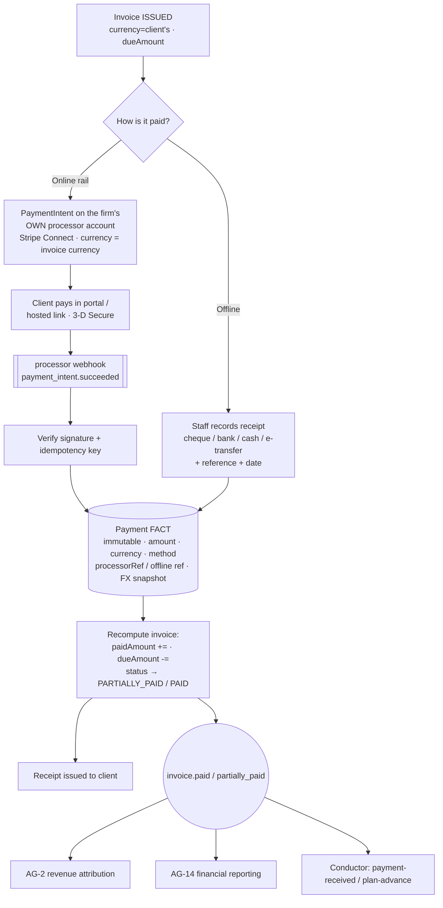
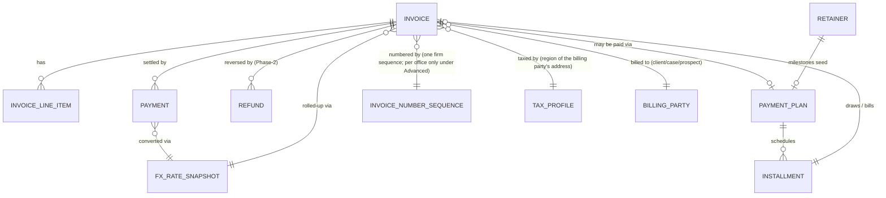

> **Document control** · Version **1.10** · **2026-10-17** · Status: **Second pass AG16-55, AG16-68, AG16-69, AG16-82 applied (an amount-only match is a candidate, never pre-selected; "Record all" covers invoice-number matches only; the "Interac message: INV-0042 [Copy]" line; samples-before-build note; one rule for a broken payment account; open questions 14, 16–21 closed, 15 and the French wording stay open); previously: AG-16 review round 2 applied (the product owner, 15–17 Oct: AG16-30 payment notices become suggested payment records, AG16-42(5) bulk confirm; pointer AG16-40 home screen); previously: AG-16 review applied (AG16-13 "Getting paid" invoicing rules, AG16-17 payment account down; single home of invoicing rules); SA-06 v3.0 closing decisions applied (payment-terms key added; legacy retainer keys retired); Permission keys renamed to the SA-06 v3.0 canonical catalogue (SA6-D10); default starter roles added (SA6-D5) — Baseline — corporate decisions applied (government fee line, Bill to, no invoice on an unsigned retainer, payments on behalf); AG7-D10 (no masking or reveal) applied**\
> Part of: *Agent (RCIC/Lawyer) Console — Functional Requirements* · Split from `FINAL-Agent-FR.md` lines 3805–4485 on 2026-09-16 · Previous version: `_archive/AG-06-billing-and-payments_v1.9_2026-10-17.md`\
>
> | Version | Date | Change | Decisions |
> |---|---|---|---|
> | 1.10 (18 Oct, later) | 2026-10-18 | *18 Oct (later): consistency fixes after expert review — X-2.* One-line X-2 pointer where the reminder template variant was keyed by `Contact.language` (now the person's language on `PartyProfile`) and an X-2 row in the decisions table. No requirement added, removed or renumbered. *18 Oct (later): AG01-29 / AG16-105 and gap-check fixes applied — AG16-105(2): AG-6-36 now says the billing notifications are the **Payments** group of AG-16 §3.3, shown only to billing holders, with email on by default for payment failed and invoice overdue only and in-app only for payment received, invoice sent, refund and instalment due; open question 23 added (dunning escalation is not named in the decision). Gap check #13: the description of `agent/billing-config:currency` no longer says reporting currency or FX (withdrawn, R18) and says the firm's default currency for new cases is `agent/settings:edit` (AG-16 §10). No requirement added, removed or renumbered.* *18 Oct (later): AG01-30(2) applied — dunning escalation is in the Payments group, in-app only (AG-6-36); open question 23 closed; the `agent/billing-config:currency` row is marked for withdrawal unless a rule is named.* *18 Oct (last): AG16-106 — `agent/billing-config:currency` withdrawn.* | X-2 · AG16-105(2) · AG01-30 · AG16-106 |
> | 1.10 | 2026-10-17 | **Second pass (AG16-54 – AG16-82, the product owner, 17 Oct) applied to AG-06.** (1) **Amount-only match (AG16-68):** step 4 of AG-6-51 gives a **candidate, never pre-selected** ("Amount matches INV-0060 (Client A Shah) — check the payer"); the person picks it, then records. (2) **"Record all" (AG16-68):** covers **invoice-number matches only** (invoice number in the message and amount equals the balance); payer-name, remembered-payer and amount-only rows are recorded one by one. AG-6-51, AG-6-52, AG-6-54, card rules 6, 7, 10, PN-04, tests, §3.4 text and edge cases changed. (3) **Evidence before build (AG16-69):** `PaymentNoticeFormat` entries are written only from de-identified real samples, never from memory; the one-off go-live replay test is in DEV-TASKS. (4) **Interac line (AG16-69, closes item 21 in part):** when the firm accepts e-Transfer, every invoice, payment reminder and the portal Pay screen show "Interac message: INV-0042 [Copy]"; AG-6-55 changed. (5) **Broken payment account (AG16-82):** AG-6-49 (e) points to the one rule for every broken connection (AG-16-16); the client-side behaviour stays here. (6) **AG16-55:** items 14, 17, 18, 19, 20 closed with the defaults already stated; 16 by AG16-68; 21 by AG16-69; **15 stays open** (no default). **Added:** none. **Changed:** AG-6-49, AG-6-51, AG-6-52, AG-6-54, AG-6-55, card AG-6-50 – AG-6-56. **Open questions added:** 22. *Same-day fixes (18 Oct): AG16-90 — payment-account test: only the Owner is emailed once when the account breaks (AG16-83 #19; AG-16-16).* *Same-day fixes (18 Oct): AG16-92 — AG-6-15 states the hosted pay link needs no login (rule in AG-10-85); "portal (AG-12)" corrected to AG-15 in AG-6-15 and the online-payment paragraph (M4).* *18 Oct: new section 'Decisions that change this epic' (index of AG16 decisions; no requirement changed).* | AG16-55 · AG16-60 · AG16-68 · AG16-69 · AG16-76 · AG16-82 · AG16-90 · AG16-92 |
> | 1.9 | 2026-10-17 | **AG-16 review round 2 (AG16-24 – AG16-53, the product owner, 15–17 Oct) applied to AG-06.** **Payment notices become suggested payment records (AG16-30):** Interac e-Transfer and bank-deposit notice emails are recognised; ExpatReady suggests an invoice in this order — invoice number in the message, payer name, remembered payer, exact amount; a **"Payments to record"** list on the home screen shows each suggestion with [Record] [Pick another invoice] [Not a client payment]; **nothing is recorded without a click** (AG16-31); after a confirmation the payer can be remembered on the client (`rememberedPayer`); **bulk confirm** "Record all N exact matches" (AG16-42(5)); **Stripe notice emails are not brought in** because the firm's own webhook already records those payments (AG-6-16, AG-6-17); invoices and payment instructions say "Put INV-0042 in your e-Transfer message". New: AG-6-50 – AG-6-57, BR-20, BR-21, US-18, §7 `PaymentNotice`, `ClientRememberedPayer`, `PaymentNoticeFormat`, §13 items 14–21. **Build card** (new section at the end of §4): AG-6-50 – AG-6-56. **Pointer:** the home screen section is owned by AG-11 (AG16-40; AG-6-57). **Standing rules cited:** AG16-31, AG16-33, AG16-42. **Unchanged:** all AG-6-1 – AG-6-49. **Open questions closed: none** (§13 items 9–13 are not answered by AG16-24 – AG16-53). | AG16-30 · AG16-31 · AG16-33 · AG16-40 (pointer) · AG16-42 · AG16-44 |
> | 1.8 | 2026-10-14 | AG-16 review (the product owner, 14 Oct). **AG-06 is the single home of the invoicing rules; AG-16 only places the Getting paid screen.** **Changed:** AG-6-4 (tax now from the billing party's address, fallback the firm's province; government fees never taxed; one firm tax number); **AG-6-5** (one numbering sequence for the whole firm, default `INV-0001`; a per-office sequence only under Advanced with a different prefix — replaces the mandatory per-office sequence); BR-3, BR-4, §3.1 numbering and tax text, §3.2 overdue reminders (the "Invoice overdue" row of the Automatic messages page, AG-12), §3.3 (payment account down), §7 `InvoiceNumberSequence` and `Invoice`, §9 edge cases, §10 numbering key text, §12 wording (the existing numbering is the previous system, not built in ERv2), §13. **Added:** AG-6-44 (16 numbering rules), AG-6-45 (tax), AG-6-46 (due date, currency), AG-6-47 (invoice language), AG-6-48 (cancel and credit note), AG-6-49 (payment account down: no fallback to ExpatReady processing), BR-18, BR-19, US-16, US-17. **Withdrawn:** the fallback of online payment to ExpatReady processing (never in this file; stated here so no later edit adds it); the Phase-2 deferral of credit notes (credit notes CN-0001 are Release 1, rule 13). **Open questions added (not resolved):** refunds Phase 2 conflict first, trust / unearned retainer, milestone billing by case event, small-balance write-off (§13 items 9–12), plus whether the firm may edit provincial tax rates (item 13). *Same-day audit corrections (14 Oct): AG-6-12, §3.2 and §13 Q7 hand the overdue reminder and its timing to the AG-12 "Invoice overdue" row; `reportingCurrency` removed from the firm-config line (AG01-9); change-log quote prefix fixed.* | AG16-13, AG16-17 (AG16-1, AG16-11 and AG01-9 cited) |
> | 1.7 | 2026-10-07 | SA-06 v3.0 closing decisions (the product owner, 7 Oct; owned by SA-06 v3.0). **Added:** `agent/billing-config:terms` — set the firm's payment-terms defaults; Owner and Admin (§10). **Retired:** the legacy `agent/accounting/retainer:{list,create,edit}` keys — ERv2 has no screen for them (retainers are AG-05), so they are not mapped and no longer "unmapped"; the §10 honesty note is reworded. Requirement IDs unchanged. | SA-06 v3.0 closing decisions |
> | 1.6 | 2026-10-07 | Applied from SA-06 v3.0 (RBAC, 7 Oct). **Changed:** §10 — all 18 live permission keys renamed to the single-segment canonical form (`agent/billing/invoice:*` → `agent/invoice:*`; `agent/billing/expense:*` → `agent/expense:*`; `agent/billing/payment:*` → `agent/payment:*`; `agent/billing/refund` → `agent/refund:create`; `agent/billing/plan:manage` → `agent/payment-plan:manage`; `agent/billing/config:*` → `agent/billing-config:*`; `agent/billing/report:view` → `agent/billing-report:view`; `agent/billing/export` → `agent/billing:export`); a "Default roles" column added from SA-06 §10b; the Honesty note (legacy `agent/accounting/*` keys now mapped per SA-06 Appendix B), AG-6-23, §3 Refunds, US-7 and US-11 permission wording, the §11 separation-of-duties line, §12 mentions and persona/user-story role names aligned (Manager → Case Manager; Accounts / Billing → Billing / Finance). `agent/billing/reveal-financial` stays marked withdrawn (AG7-D10). No requirement meaning changed. | SA6-D10, SA6-D5 |
> | 1.5 | 2026-10-05 | Applied AG7-D10 (the product owner, 5 Oct: no masking and no reveal of personal data anywhere). **Withdrawn:** the permission `agent/billing/reveal-financial` (row kept), the "Financial-PII reveal" edge case, and every reveal/masking mention. **Changed:** AG-6-38 (audit list no longer has "PII/financial reveal"); `agent/billing/export` (no masked/unmasked split — governed by this key only, audited); §11 Financial-PII handling (never masked; never written to system logs or traces; passport and financial numbers never in the content of emails, WhatsApp messages or notifications); §10 enforcement list, §12 and §13 wording. Requirement IDs unchanged. | AG7-D10 |
> | 1.4 | 2026-10-03 | Consistency review fixes (3 Oct). **No invoice of any kind without a signed retainer — government fees passed through to the client included (AG17-D79):** a refused government fee line stays recorded on the case as "not yet invoiced" (AG-07 GovernmentFee status `NOT_YET_INVOICED`, AG-7-51), not "to be invoiced". Wording aligned in §3.1 (government fee line), AG-6-42 and §9; AG-6-42 also says "neither executed nor signed offline". References to the unsigned-retainer warning corrected to AG-5-51 (the AG-7 hand-off paragraph, AG-6-42, BR-17). BR-16 and BR-17 put back in order. Status line updated. New "Applied from AG-17" table added. Requirement IDs unchanged. | AG17-D79 · AG17-D4, D13, D20, D43, D62, D66 |
> | 1.3 | 2026-10-02 | Founder decisions from the corporate-cases (AG-17) review applied (2026-10-02). A case's **Government fees** section can create a non-taxable `GOVERNMENT_FEE` invoice line (the fee is usually paid after submission, when the government's request arrives, so it is billed then). New optional **Bill to** on a case: invoices go to the case's own client by default, or to any other client of the firm (the linked employer is a quick pick); AG-06 gains a third-party payer. **No invoice against an unsigned retainer** stays, and case work never waits for billing. Staff record payments a client made outside the portal as an **offline payment** (how "done on behalf" works for payments). No new permissions. Changed: §3.0, §3.1, §3.4, §3.8, AG-6-2, AG-6-19, BR-14, §7 (`Invoice`, `Payment`), §9, §10, §12. Added: AG-6-40 – AG-6-43, BR-17, US-12 – US-15. | AG17-D13, AG17-D20, AG17-D43, AG17-D62, AG17-D66 |
> | 1.2 | 2026-10-02 | Applied AG17 terminology/consistency changes (safe set): billing party loses separate corporate case / corporate prospect (client stays). | AG17-D4 |
> | 1.1 | 2026-08-28 | Baseline — complete document v1.1 | — |

## Decisions that change this epic (14–18 Oct) *(new 18 Oct)*

Product-wide rules (apply here as everywhere; home: Agent `00-Overview` → "Product rules every epic follows"): AG16-11, AG16-31, AG16-33, AG16-42, AG16-44, AG16-60, AG16-76, AG16-92.

The "AG16" prefix is historical: these decisions began in the AG-16 review and apply across the product. Full text: `TEMPLATE-MAP-working_2026-10-10.md`.

| Decision | What was decided (one line) | What it changes in this epic | Where (requirement / card / section) |
|---|---|---|---|
| AG16-1 | Settings structure | Referenced only (no change here) (cited in the 14 Oct audit note of the change log) | Change log, row 1.8 |
| AG16-11 | One Automatic messages page, documented in one place only | The overdue reminder and its timing move to the AG-12 "Invoice overdue" row; the dunning-sequence config is withdrawn here | AG-6-12 · §3.2 · §13 item 7 |
| AG16-12 | Where timings live | Overdue-reminder timing and wording are set on the AG-12 row, not in AG-06; AG-06 sets no cadence | AG-6-12 · §3.2 · §13 item 7 |
| AG16-13 | "Getting paid" defaults and scenarios | AG-06 is the single home of the invoicing rules: tax from the billing party's address, government fees never taxed, one firm-wide numbering sequence (default INV-0001), due date, language, cancel | §3.1 · AG-6-4 · AG-6-5 · AG-6-44 – AG-6-48 · BR-3 · BR-4 · BR-18 · §7 · §9 · §12 · §13 items 9–13 |
| AG16-15 | Mailboxes: firm and personal, nothing required | Referenced only (no change here) (states that email and other connections keep their own fallback; payment does not) | §3.3 (payment account down) |
| AG16-17 | Payment account down: money never falls back | No fallback to ExpatReady processing; the payment page shows "Online payment is temporarily unavailable" with the firm's offline instructions; overdue reminders still send with the Pay link replaced | §3.3 · AG-6-49 · BR-19 · US-17 · §9 |
| AG16-24 | Own mailbox and own calendar on every plan | Referenced only (no change here) (named only in the round-2 range in the change log) | Change log, row 1.9 |
| AG16-30 | Payment emails become a suggested payment record | Interac and bank-deposit notice emails are recognised and suggested against an invoice; "Payments to record" list; nothing recorded without a click; remembered payer; Stripe notices not brought in; "Put INV-0042 in your e-Transfer message" | §3.4 · AG-6-50 – AG-6-56 · BR-20 · BR-21 · US-18 · §7 (PaymentNotice, ClientRememberedPayer, PaymentNoticeFormat) · §13 items 14–21 · build card |
| AG16-31 | Standing rule: ExpatReady suggests, the firm decides | The screen says "Suggested" until a person confirms, never "Payment recorded" | AG-6-52 · BR-20 · build card |
| AG16-33 | Standing rule: AI reads, rules check, a person confirms | Rules recognition is the floor on every plan; a person confirms every suggested payment | AG-6-52 · BR-20 · build card |
| AG16-34 | AI is included in higher plans, not sold as an add-on | The AI (Sorter) part of payment-notice recognition is plan-gated; rules recognition is not | Build card AG-6-50 – AG-6-56 (items 4, 8) · §13 item 14 |
| AG16-40 | The home screen is the one place to start | "Payments to record" is section 4 of the home screen, shown only to holders of the payment-recording permission and hidden when empty (section owned by AG-11) | AG-6-57 |
| AG16-42 | "Quiet by default", plus telling the client | A new suggestion raises no alert, email or banner; bulk confirm "Record all N exact matches" | AG-6-54 · build card |
| AG16-44 | ExpatReady never quietly judges for the firm | "Not a client payment" is a person's choice; Stripe notice senders are listed so the choice can be reversed | AG-6-56 · build card |
| AG16-53 | Video links are per person; no firm video account | Referenced only (no change here) (named only in the round-2 range in the change log) | Change log, row 1.9 |
| AG16-54 | 25 consistency fixes after the 17 Oct write | Referenced only (no change here) (named only in the second-pass range in the change log) | Change log, row 1.10 |
| AG16-55 | Writers' recommended defaults accepted for the detail questions | Open questions 14, 17, 18, 19, 20 closed with the defaults already stated; 15 stays open (no default) | §13 items 14 – 20 |
| AG16-68 | Payment notices: amount-only is a candidate; "Record all" covers invoice-number matches only | An amount-only match is a candidate, never pre-selected; "Record all" covers invoice-number matches only; payer-name, remembered-payer and amount-only rows are recorded one by one | AG-6-51 · AG-6-52 · AG-6-54 · card rules 6, 7, 10 · PN-04 · §3.4 · §13 item 16 |
| AG16-69 | Evidence before build for payment notices | Notice formats are written only from de-identified real samples; every invoice, reminder and the portal Pay screen show "Interac message: INV-0042 [Copy]" when e-Transfer is accepted | AG-6-55 · card rule 1 and fixtures · §13 item 21 |
| AG16-82 | One rule for every broken connection | The firm is told by the one rule (one email when it breaks, one home-screen item until reconnected); client-side behaviour stays in AG-06 | AG-6-49 (e) |
| AG16-83 | 26 follow-through fixes after the second pass | Cited as the source of item 19 (only the Owner can reconnect the payment account); the change itself is recorded under AG16-90 | US-17 payment-account test |
| AG16-90 | Batch C: consistency fixes from the 17 Oct audit | Payment-account test: only the Owner is emailed once when the account breaks | US-17 payment-account test |
| AG16-92 | Email-first: the portal is optional | The hosted pay link needs no login; "portal (AG-12)" corrected to AG-15 | AG-6-15 · §3.3 online-payment paragraph |
| X-2 | One person record per real person; AG-02 is the home | The client's language for overdue reminders is read from the person's `PartyProfile`, not `Contact.language` (retired); no requirement added or renumbered | §3.2 overdue reminders (template variant) |
| AG16-105(2) | Notification groups: a fixed list of eight (the product owner, 18 Oct). Home: AG-16 §3.3. | Billing notifications fall in group 7, **Payments**, shown only to billing holders. Email on by default: payment failed, invoice overdue. In-app only: payment received, invoice sent, refund, instalment due. Security emails stay always on. | AG-6-36 *(changed 18 Oct — AG16-105(2))* · §13 item 23 (closed by AG01-30(2)) |
| AG01-30(2) | Dunning escalation (the product owner, 18 Oct: "A, B, apply fixes"). Home: AG-16 §3.3. | Dunning escalation is in the Payments group (7), in-app only; the "invoice overdue" email for the same invoice has already gone (AG16-42). Closes open question 23. | AG-6-36 *(changed 18 Oct — AG01-30(2))* · §13 item 23 (closed) |
| Gap check (18 Oct) | AG-16 gap audit #13 (verified): two keys claimed the firm's default currency. | `agent/settings:edit` holds the default currency for new cases; `agent/billing-config:currency` is for invoice currency rules only. | §10 *(withdrawn 18 Oct — AG16-106: the key no longer exists.)* |
| AG16-106 | `agent/billing-config:currency` withdrawn (the product owner, 18 Oct: "ok"). Home: SA-06. | Not built. An invoice's currency comes from the billing party, else the firm default (AG-6-46). The §10 row is marked withdrawn. | §10 |


## Module AG-6: Billing & Payments (the Biller)

**Applied from SA-06 v3.0 (2026-10-07)** (decisions owned by `SA-06-rbac` v3.0 §0; key map in its Appendix B):

| ID | Decision | Applied here |
|---|---|---|
| **SA6-D10** | Naming rule: one kebab-case resource and one action per key, grammar `^(system\|agent\|portal)/[a-z0-9-]+:[a-z0-9.-]+$`; old → new map in SA-06 Appendix B | §10 — `agent/billing/invoice:list` → `agent/invoice:list`, `agent/billing/invoice:show` → `agent/invoice:show`, `agent/billing/invoice:create` → `agent/invoice:create`, `agent/billing/invoice:edit` → `agent/invoice:edit`, `agent/billing/invoice:issue` → `agent/invoice:issue`, `agent/billing/invoice:void` → `agent/invoice:void`, `agent/billing/payment:record` → `agent/payment:record`, `agent/billing/payment:online` → `agent/payment:online`, `agent/billing/refund` → `agent/refund:create`, `agent/billing/plan:manage` → `agent/payment-plan:manage`, `agent/billing/expense:list` → `agent/expense:list`, `agent/billing/expense:create` → `agent/expense:create`, `agent/billing/expense:edit` → `agent/expense:edit`, `agent/billing/config:numbering` → `agent/billing-config:numbering`, `agent/billing/config:tax` → `agent/billing-config:tax`, `agent/billing/config:currency` → `agent/billing-config:currency`, `agent/billing/report:view` → `agent/billing-report:view`, `agent/billing/export` → `agent/billing:export` · Honesty note (legacy `agent/accounting/invoice:*` / `expense:*` → `agent/invoice:*` / `agent/expense:*`; `agent/accounting/retainer:*` UNMAPPED, SA-06 N8) · §3 Refunds · AG-6-23 · US-7 · US-11 · §11 (separation of duties) · §12 Reference Note |
| **SA6-D5** | Six starter roles: Owner, Admin, Case Manager, Case Officer, Billing / Finance, Read-only; defaults per SA-06 §10b | §10 "Default roles" column · persona and user-story role names |
| **SA-06 v3.0 closing decisions (v1.7)** | Add `agent/billing-config:terms` (payment-terms defaults; Owner + Admin). Legacy `agent/accounting/retainer:*` retired (no ERv2 screen). | §10 — new row after `agent/billing-config:currency`; honesty note reworded |
| **AG7-D10** | (unchanged) Withdrawn reveal key stays withdrawn | §10 row `agent/billing/reveal-financial` (SA-06: WITHDRAWN) |

**Applied from AG-16 review (the product owner, 14 Oct 2026)** (decisions owned by the decision log, `TEMPLATE-MAP-working_2026-10-10.md`):

| ID | Decision | Applied here |
|---|---|---|
| **AG16-13** | "Getting paid" defaults and scenarios; AG-06 is the single home of the invoicing rules (AG16-11 single-home rule) | §3.1 · AG-6-4 · AG-6-5 · AG-6-44 – AG-6-48 · BR-3 · BR-4 · BR-18 · §7 · §9 · §12 · §13 items 9–13 |
| **AG16-17** | Payment account down: money never falls back to ExpatReady processing | §3.3 · AG-6-49 · BR-19 · US-17 · §9 |

*Pending knock-ons owned elsewhere (not decided here):* AG-16 (places Settings section 4 "Getting paid" and owns the payment-connection health and alert, AG16-17; its line 229 "exists today" and lines 271 and 281 are corrected in AG-16's own review), AG-12 (the "Invoice overdue" row on the Automatic messages page, AG16-11), AG-18 (imported old invoices keep their numbers, AG18-D3), AG-04 (paid consults use these rules), AG-01 (default currency CAD and the firm's province from its address, AG01-9).

**Applied from AG-16 review round 2 (the product owner, 15–17 Oct 2026)** (decisions recorded in the Super Admin template map, section "AG-16 review — decisions"):

| ID | Decision | Applied here |
|---|---|---|
| **AG16-30** | Payment emails → suggested payment record: recognise Interac and bank notices; suggestion order; "Payments to record" list; nothing recorded without a click; remember the payer; Stripe emails not brought in; "Put INV-0042 in your e-Transfer message" | §3.4 · AG-6-50 – AG-6-56 · BR-20 · US-18 · §7 · card |
| **AG16-42 (5)** · **AG16-68** | Bulk confirm for repetitive suggestions: "Record all N exact matches" (deadlines stay one by one); **AG16-68:** exact = invoice-number matches only | AG-6-54 · card |
| **AG16-68** | Amount-only match is a candidate, never pre-selected | AG-6-51 · AG-6-52 · card rules 6, 7 · PN-04 · item 16 |
| **AG16-69** | Samples before build; the "Interac message: INV-0042 [Copy]" line | AG-6-55 · card rule 1 and fixtures · item 21 |
| **AG16-82** | One rule for every broken connection | AG-6-49 (e) |
| **AG16-31** · **AG16-33** | Standing rules: ExpatReady suggests, the firm decides; AI reads, rules check, a person confirms. The screen says "Suggested" until a person confirms, never "Payment recorded" | AG-6-52 · BR-20 · card |
| **AG16-40** | The home screen is the one place to start; "Payments to record" is section 4, shown only to holders of the payment-recording permission, hidden when empty (home AG-11) | AG-6-57 (pointer) |

*Pending knock-ons owned elsewhere (v1.9, not decided here):* AG-10 (recognising the notice email and filing it; the "Not brought in" list shows Stripe notice senders, AG16-44), AG-11 (the home screen section), AG-07 (the client's Billing panel, AG-7-81, lists remembered payers with Remove; AG-07 adds no rule), SA-01 or another pack-content home for the payment notice format list (§13 item 15), AG-12 and SA-05 (the "Interac message: INV-0042 [Copy]" line, AG16-69, where it appears in a payment reminder).

**Applied from AG-17 v0.1 (corporate decisions, 2026-10-02/03)** (decisions owned by `AG-17-corporate-cases-and-lmia` §0):

| ID | Decision | Applied here |
|---|---|---|---|
| **AG17-D4** | One shared case core; billing party loses the separate corporate case / corporate prospect (client stays) | §3.0 · AG-6-2 · BR-14 |
| **AG17-D13** | No separate corporate billing; a case's Government fees section creates a non-taxable `GOVERNMENT_FEE` line | §3.1 · AG-6-40 · US-12 |
| **AG17-D20** | Optional "Bill to" on a case: invoices go to the case's client by default or to any other client of the firm | §3.1 · AG-6-2 · AG-6-41 · BR-14 · US-13 |
| **AG17-D43** | Government fees are billed after submission, when the government's request arrives | §3.1 · AG-6-40 · US-12 |
| **AG17-D62** | Unsigned retainer is a warning on the case, never a block; no invoice against an unsigned retainer | §3.8 · AG-6-42 · BR-17 · US-14 |
| **AG17-D66** | "Done on behalf": staff record an offline payment for a client who paid outside the portal | §3.4 · AG-6-19 · AG-6-43 · US-15 |
| **AG17-D79** | No invoice of any kind without a signed retainer, government fees included; the fee stays "not yet invoiced" on the case | §3.1 · AG-6-42 · BR-17 · §9 |

### Module Index

Scan the whole module in ~30 seconds; jump to any part.

1. **Purpose & Goal**
2. **Users & Jobs-to-be-Done**
3. **Functional Design — How It Works** (core)
   - 3.0 The money model (Invoice as the source of truth; Payment as a fact) · 3.1 Invoices — line items, taxes, numbering, statuses · 3.2 Payment plans / installments + overdue + dunning · 3.3 Online payments (the firm's own processor rail) · 3.4 Offline payments, partial payments, receipts, refunds · 3.5 Trust-adjacent records (precisely scoped) · 3.6 Multi-currency (per-invoice currency + reporting currency + FX snapshot) · 3.7 Financial reports (per client + firm-wide) · 3.8 Hand-offs (retainer → invoice; revenue → AG-2/AG-14; paid consults → AG-4)
4. **Detailed Functional Requirements** (AG-6-x)
5. **Business Rules & Logic**
6. **States & Lifecycle**
7. **Key Entities & Fields**
8. **User Stories + Acceptance Criteria**
9. **Edge Cases & Validations**
10. **Permissions** (LOCAL `agent/*`, honest NEW vs existing)
11. **Scalability · Security · Performance**
12. **Reference Note** (exists / NEW / changed)
13. **Open Questions / Founder Decisions**

### Visual Overview

**A. Invoice lifecycle** (status is the behavioural state; the money facts — payments, refunds — drive the transitions; `DRAFT` is the only editable state):

```mermaid
stateDiagram-v2
    [*] --> DRAFT : create (editable)
    DRAFT --> ISSUED : issue / send (number locked, immutable lines)
    DRAFT --> VOID : discard draft
    ISSUED --> PARTIALLY_PAID : payment recorded (due > 0)
    ISSUED --> PAID : payment recorded (due = 0)
    ISSUED --> OVERDUE : dueDate passed, due > 0 (Conductor sweep)
    OVERDUE --> PARTIALLY_PAID : payment recorded (due > 0)
    OVERDUE --> PAID : payment recorded (due = 0)
    PARTIALLY_PAID --> PAID : final payment (due = 0)
    PARTIALLY_PAID --> OVERDUE : dueDate passed, due > 0
    ISSUED --> CANCELLED : cancel (no payments)
    PARTIALLY_PAID --> CANCELLED : cancel (credit/refund first)
    PAID --> REFUNDED : full refund (Phase-2)
    PAID --> PARTIALLY_REFUNDED : partial refund (Phase-2)
    note right of DRAFT : only DRAFT is editable (BR-2)
    note right of ISSUED : number assigned + locked (BR-3); lines immutable
    note right of REFUNDED : Phase-2; refunds are reversing facts, never edits (BR-9)
```

**B. Payment flow — one invoice, two rails** (online via the firm's own processor; offline recorded by staff; both converge on one immutable `Payment` fact that recomputes the invoice):



**C. Core data model** (Invoice is the source of truth; Payment/Refund are immutable facts; everything attaches polymorphically and is FX-snapshotted):



> `Note · Task · Reminder · Document · AuditLog · Notification · TimelineEvent` attach to an `INVOICE`, `PAYMENT`, or `PAYMENT_PLAN` via the polymorphic `(entityType, entityId)` pattern — defined once (Part 2), reused here, never redefined. **`BILLING_PARTY` is itself polymorphic** (a client, a case, or a prospect (a corporate case or prospect is a case or prospect whose client type is Corporate — AG17-D4)) — the current `accounting` module models this via `(case | corporate-case | prospect | corporate-prospect)`, which the rebuild collapses.

---

### 1. Purpose & Goal

**What it is.** AG-6 is the firm's **money system of record** — the **in-house Biller Doer** that issues invoices, schedules installments, collects payments (online and offline), records every cent received against the right client, and reports what was billed, what was collected, and what is outstanding. It is the financial spine that turns a *signed retainer* (AG-5) into *collected revenue* (AG-2 / AG-14). In the Doers model it is the verb **"bill"** — the in-house replacement for bolting a firm onto QuickBooks for day-to-day client billing.

**The business outcome it must produce.** Immigration firms bleed money in three places: (1) **work that was done but never invoiced** (a milestone reached, a disbursement paid to the government, a billable hour logged — and no invoice cut); (2) **invoices that were sent but never chased** (an installment that lapsed, an overdue balance nobody dunned); and (3) **payments that landed but were never reconciled to the right client** (an e-transfer in the firm's bank account that nobody tied to an invoice). AG-6 exists to make **"every dollar earned is invoiced, every invoice is collected or chased, and every payment is reconciled to a client"** structurally true — by design, not by an accounts clerk's memory: milestone/retainer draws that flow straight from the signed agreement, installment schedules with **overdue tracking and automated dunning** (via Mailer/Messenger), a one-click **online pay link** on the firm's own processor, and a fast **record-offline-payment** path for the cheque/cash/bank world that immigration clients still live in.

**Why it matters / world-class positioning.** A generic invoicing tool is a PDF generator and a Stripe button. Expat Ready's Biller is **billing specialised for an immigration practice**: it understands **government/disbursement fees as a distinct, often-non-taxable line type** (an IRCC fee is a pass-through, not a taxable service); it draws **milestone payments from the retainer** the client actually signed (no re-keying the fee schedule); it is **multi-currency-native** because a Canadian firm invoices an Indian applicant in CAD and may quote a US-resident applicant in USD — currency varies inside a firm even though country does not (FD-68); it is **trust-aware** (it records the transaction and labels money correctly without pretending to be the firm's regulated trust-accounting system); and it is **compliance-native** — money integrity (immutable payment facts, append-only ledger), strict who-can-invoice/refund authority, signed/idempotent webhooks, and financial-PII handling under PIPEDA/Law-25. A generic tool cannot bill a regulated immigration practice safely across currencies and tax regimes; ours is built for it.

**How it ties to the revenue journey.** Retainer signed in the Signer → **AG-5 emits `envelope.signed`** → the Biller cuts the deposit invoice (or activates the milestone payment plan) → the client pays online on the firm's rail **or** the firm records the cheque → the Biller marks the invoice paid → **revenue is attributed back to AG-2** (the rep, the campaign) and **rolled up in AG-14** (firm-wide financials). Paid consults from **AG-4** (Scheduler) also land here as invoices/payments. AG-6 is the **money seam** of the product: the place where "the deal is won" becomes "the firm got paid."

**Global ambition (founder's core point).** The same module serves a solo RCIC provisioned for Canada invoicing in CAD and a multi-office firm invoicing in several currencies across several tax regions of its **one** country — **with no code change**, and it serves a firm provisioned for Australia on the same engine (the platform is multi-country, a firm is not — FD-68). Single-currency / single-tax is the degenerate case. The **invoice currency** is the client's; the **firm reporting currency** is what the owner sees totals in; **FX snapshots** make every roll-up stable and auditable; **tax is a `TaxProfile` per region of the firm's country** resolved from its Country Pack, not a Canada-hardcoded GST/HST constant. This global-by-construction posture is visible in every section below, not appended as an afterthought.

---

### 2. Users & Jobs-to-be-Done

The "Agent" persona is an umbrella; AG-6 is used very differently by each sub-role. The **Billing / Finance** person is the protagonist here — the mirror image of AG-2, where they only touch the money edge.

| Role | Primary job in AG-6 | Jobs-to-be-done (representative) |
|---|---|---|---|
| **Billing / Finance / Bookkeeper** (heaviest user) | Bill accurately, collect fully, reconcile every payment. | "When a retainer is signed, I want the deposit invoice cut automatically from the fee schedule, so I never forget to bill the first milestone." · "When a client e-transfers us, I want to record it against their invoice in seconds with a reference, so the books reconcile and the client sees a receipt." · "When an installment lapses, I want the system to chase it for me — politely, in the client's language — so I'm not manually emailing late payers." · "When the owner asks 'what's outstanding,' I want an aged-receivables report in our reporting currency in one click." |
| **RCIC / Case Officer** | Get the right work billed; keep the client's file financially clean. | "When I reach a milestone or pay a government fee on the client's behalf, I want to raise the draw/disbursement invoice from the case without leaving it." · "When I open a case, I want to see at a glance what's been invoiced, paid, and outstanding so I don't do more work for a client who hasn't paid." |
| **Sales / Intake Rep** | Hand a clean fee to billing; get credited for collected revenue. | "When my prospect agrees to a fee, I want the proposal/retainer fee schedule to *become* the invoice/plan with no re-typing, in the right currency." · "When they pay, I want my revenue attribution to reflect *collected* money, not just pipeline." (Consumes AG-6; owns AG-2.) |
| **Case Manager** *(changed v1.6 — SA6-D5)* | Keep cash flowing and the firm's receivables healthy. | "When I review the month, I want billed vs collected vs outstanding, aged receivables, and collection rate — filterable by office and rep, in one currency." · "When an invoice goes overdue, I want it flagged and dunned before it ages further." |
| **Owner / Principal RCIC** | Own the firm's money integrity and compliance posture. | "When I look at revenue, I want to trust every payment is reconciled, no invoice number is reused or skipped, refunds are controlled, and our tax is correct in every region we bill from." · "When an auditor or regulator asks, I want an immutable record of who invoiced, who took payment, and who refunded — with the signed retainer behind it." |
| **Client** (portal, AG-12) | Understand and pay what they owe. | "When I get an invoice, I want to see the line items in my currency and pay it securely online — or know exactly how to pay offline." (Consumes AG-6 through the portal; pays on the firm's rail.) |

**Design implication.** The **Billing / Finance** person is the protagonist of the AG-6 UI — the invoice list, the record-payment flow, the dunning/overdue queue, the aged-receivables report are designed for them. The **RCIC/Case Officer** gets the *bill-from-the-case* surface and the per-client financial summary. The **Owner/Case Manager** get firm-wide reports and the controls (who-can-invoice/refund, numbering config, tax config). The **Client** gets the clean, multi-currency, pay-online surface in AG-12. Permissions (§10) cleanly separate "can issue an invoice" from "can take a payment" from "can refund."

---

### 3. Functional Design — How It Works (core)

This is the heart of the spec. Each sub-function is designed in depth: **how it works**, the **smart / world-class behaviour** that beats a generic tool, the **key screens & interactions** (functional, not pixel-level), and the **data flow**.

#### 3.0 The money model (the foundation everything else sits on)

**Design decision: an Invoice is the *source of truth* for what is owed; a Payment is an *immutable fact* of money received; a Refund is a *reversing fact*, never an edit.** This is the accounting-correct model and it matters because money must be **auditable and never silently mutated**. If you "edit" a paid invoice or overwrite a payment, you destroy the financial record a regulated firm must keep.

- **Invoice** = the durable statement of what a billing party owes, in **one currency** (the client's), with immutable line items once issued, a locked invoice number, a tax computation, and a derived balance (`dueAmount`). It moves through a status lifecycle (§3.1, §6). Only a `DRAFT` invoice is editable; once **issued**, corrections happen via **credit notes / new invoices / refunds**, never by editing the issued document.
- **Payment** = an **append-only fact**: money received against an invoice, with an amount, currency, method (online rail / offline), a reference (processor id or cheque/transfer ref), a date, and an **FX snapshot** if its currency differs from the firm's reporting currency. Payments are never edited or deleted — a mistaken payment is reversed by a **refund/void payment fact**. Recording a payment **recomputes** the invoice's `paidAmount`/`dueAmount`/`status` deterministically.
- **Refund** *(Phase-2)* = a reversing fact against a payment (full or partial), with its own authority, reason, and processor/offline reference; it moves the invoice to `PARTIALLY_REFUNDED`/`REFUNDED` and adjusts collected-revenue roll-ups — it does **not** delete the original payment.
- **Billing party is polymorphic.** An invoice is raised against a **client**, a **case**, or a **prospect** — today's `accounting` module uses the `(case | corporate-case | prospect | corporate-prospect)` shape, which the rebuild collapses to case / prospect + client type (AG17-D4). This is what lets a *paid consult* (prospect-level, AG-4) and a *milestone draw* (case-level) both be first-class. **Bill to** *(changed v1.3 — AG17-D20)*: a case may carry an optional **Bill to** (AG-7-52). An invoice raised from the case is addressed to that party — by default the case's own client, otherwise any other client of the firm — and the invoice, its reminders and its receipts go to them. Today's code has no third-party payer (§12).

> **Reference-note callout:** today's `accounting` module already has this Invoice + `InvoicePayments` + `InvoiceItem` shape with the polymorphic billing party — a real, demo-active foundation. The model-level changes the rebuild introduces are: **issued-invoice immutability** (today a non-DRAFT block exists but the issue/number-lock seam is implicit), **payments as a truly immutable ledger with FX**, **currency as reference/config not a closed enum**, and **a unified `Payment` fact** (today there is *both* an `InvoicePayments` model *and* a separate legacy `Payment` model — fragmentation to consolidate). See §12.

#### 3.1 Invoices — line items, taxes, numbering, statuses — "bill exactly what was earned, correctly taxed, numbered for audit"

**How it works.** An invoice is composed of **typed line items**, each with a description, quantity, unit price, optional discount, and a tax treatment; the system computes per-line tax, the subtotal, total discount, total tax, and the grand total, in the invoice's currency. It is created in `DRAFT` (fully editable), then **issued** (number assigned and locked, lines frozen, sent to the client). Line item **kinds** make immigration billing correct:

| Line kind | Meaning | Tax default |
|---|---|---|---|
| **Service fee** | The firm's professional fee (consultation, representation, milestone of the retainer) | Taxable per `TaxProfile` |
| **Disbursement** | A cost the firm incurs on the client's behalf and passes through (courier, translation, medical) | Configurable (often taxable) |
| **Government fee** | A statutory fee paid to the authority (IRCC/embassy fees; for an LMIA, the processing fee) | **Never taxed** *(changed v1.8 — AG16-13)* |
| **Milestone / retainer draw** | A scheduled draw against the signed retainer's fee schedule | Per the retainer line's tax |
| **Time-based** | Billable hours rolled from logged Time & Activity | Taxable per `TaxProfile` |
| **Discount / credit** | A reduction (negative line or discount field) | Reduces taxable base |

**Taxes — a `TaxProfile` per region of the firm's country (NOT hardcoded).** Tax is **config, from the firm's Country Pack and the office's region**, never a Canada constant. A `TaxProfile` defines named tax components (e.g. Canada GST/HST/QST by province; Australia GST; UK VAT; or *none*), each with a rate, applied to taxable lines. A firm in Ontario applies 13% HST and its own Alberta office applies 5% GST — **region** is the axis that varies inside a firm; **country** is not (FD-68). A firm provisioned for Australia applies 10% GST on the same engine, from configuration. Government-fee lines are never taxed. *(changed v1.8 — AG16-13: the region now comes from the billing party's address, not the office; see AG-6-45.)* **Tax is computed at issue time and frozen on the issued invoice** (a later rate change does not retroactively alter an issued invoice — auditability). *(Exact rates, names, and which line kinds are taxable per jurisdiction → Immigration-SME / founder; AG-6 owns the engine, not the values.)*

**Invoice numbering — one firm sequence, gap-free.** *(changed v1.8 — AG16-13)* Invoice numbers come from **one `InvoiceNumberSequence` for the whole firm**, default `INV-0001`, which grows past 9999. A separate sequence per office exists only under Advanced, and only with a different prefix (`TOR-`, `VAN-`). The full rules are AG-6-44. The **number is assigned at issue, not at draft creation** (so abandoned drafts never burn numbers), is **locked and immutable** thereafter, and the sequence advance is **atomic** (concurrent issues never collide on or skip a number). A wrong issued invoice is **cancelled**, keeps its number and is shown "Cancelled" (AG-6-48). The previous system's per-office `InvoiceNumberConfiguration` is not carried over as a mandatory per-office set-up.

**Statuses.** `DRAFT → ISSUED → (PARTIALLY_PAID) → PAID`, with `OVERDUE` (a due-date state on an unpaid issued invoice), `CANCELLED` (an issued invoice nullified before/with credit), and `VOID` (a discarded draft), plus `PARTIALLY_REFUNDED`/`REFUNDED` (Phase-2). The status is **derived from facts** (balance + due date + payments/refunds), not hand-typed (BR-5). The current code's enum already carries `DRAFT/PENDING/PAID/PARTIALLY_PAID/OVERDUE/CANCELLED/VOID`; the rebuild renames `PENDING → ISSUED` for clarity (an issued, payable invoice) and makes the transitions fact-driven (§6).

**World-class behaviour.**
- **Bill straight from the work — zero re-keying.** A milestone draw is created from the **retainer's fee schedule**; a time-based invoice rolls from **billable Time & Activity** (already supported); a disbursement invoice is created from a logged **Expense** (already supported). The accounts person assembles, they don't re-type.
- **Government-fee correctness.** Pass-through statutory fees are a distinct, default-non-taxable line kind — so the firm never accidentally charges tax on an IRCC fee.
- **Immutable once issued.** Issued invoices can't be silently edited; corrections are credit notes / refunds — the audit trail a regulated practice needs, and a trust-builder in the demo.
- **Numbering you can defend.** Per-office sequences, atomic advance, number assigned at issue, gaps explainable — exactly what an auditor asks about.

**Key screens & interactions.** *Invoice builder* (billing party pre-filled from the case/prospect, currency shown and locked to the party's currency, add typed line items with live subtotal/tax/total, attach disbursement/expense, pull billable time, pull milestone from retainer, due date, notes), *Issue & send* action (assigns number, freezes lines, emails the client a pay link), *Invoice list* (per-entity and firm-wide, filterable by status/currency/office/date/overdue, totals shown per-currency and in reporting currency), *Invoice detail* (line items, tax breakdown, payments/receipts timeline, balance, status), *Numbering and tax set-up* (Settings → Getting paid; AG-16 places the screen, this section owns the rules), *Tax-profile config* (per region of the firm's country).

**From a case's Government fees section** *(changed v1.3 — AG17-D13, D43)*. When the firm paid a government fee on the client's behalf, the case's Government fees section (AG-7-51) can create the `GOVERNMENT_FEE` line in one action, so the fee is never keyed twice. The line is non-taxable, goes to the case's Bill to party (AG-7-52), keeps a link back to the case's fee record, and the same action records the fee as an `Expense` linked to the line (AG-17 §3.6). Government fees are passed through: they are paid after submission, when the government's request reaches the firm (days or weeks later), and are billed then — nothing in AG-06 expects or warns about the fee before submission. If the case's retainer is not yet signed, the line is refused (AG-6-42) and the fee stays recorded on the case as "not yet invoiced" (AG-07 `NOT_YET_INVOICED`, AG-7-51) until the retainer is signed — no invoice of any kind, government fees included, without a signed retainer *(changed v1.4 — AG17-D79)*.

**Data flow.** Create draft → resolve billing party + its currency + the `TaxProfile` of the billing party's address region (fallback the firm's province) + the firm numbering sequence (or the office sequence under Advanced) → compute lines/subtotal/discount/tax/total (in invoice currency) → persist `DRAFT` (no number) → **issue** → atomically assign next number from the firm sequence (or the office sequence under Advanced) + freeze lines + compute frozen tax + `status = ISSUED` → emit `invoice.issued` → Mailer sends invoice + pay link → AuditLog. (Today: `createInvoice` computes amounts and increments the sequence *at create*, status `DRAFT`; the rebuild moves number assignment to a distinct **issue** step — §12.)

#### 3.2 Payment plans / installments + overdue tracking + dunning — "schedule the money, then collect it on autopilot"

**Why this is NEW for client money.** There is **no client-facing installment engine today** — the only "payment plan" in the codebase (`src/payment-plan`) is the **SaaS subscription plan** the firm buys from Expat Ready (SA-4), which is *out of AG-6 scope*. Immigration fees are routinely paid in installments (deposit + milestones, or 3×monthly), so AG-6 needs a real client-money plan engine.

**How it works.** A **`PaymentPlan`** attaches to a billing party (and optionally seeds from a retainer's milestone schedule). It contains ordered **`Installment`** rows, each with an amount, a due date, and a status (`SCHEDULED → DUE → INVOICED → PAID`, or `OVERDUE`). Two operating modes (founder decision in §13):
- **Draw mode** — each installment, when due, **generates an invoice** (a milestone draw) that the client pays; the plan tracks which installments are invoiced/paid.
- **Single-invoice mode** — one invoice is issued with a schedule of expected payments; partial payments are applied against it as installments come due.

**Overdue tracking — Conductor sweep, timezone-aware.** A scheduled **Conductor** job sweeps installments/invoices whose due date has passed with a balance outstanding and marks them `OVERDUE`, raising a **Notification** to Billing / Finance and (optionally) the owner. "Past due" is computed in the **firm/office timezone** (BR-12 analogue), so a payment due "today" isn't flagged overdue at UTC midnight in the client's zone.

**Overdue reminders — consented, bilingual.** The overdue reminder is sent through the **Conductor + Doers**; its timing and wording are set on the "Invoice overdue" row of the Automatic messages page (AG-12, AG16-12), not here. Reminders are **transactional** (a payment reminder is a service message, not marketing — so it is allowed without marketing consent), are sent in the **client's language** (template variant by the person's language, stored on `PartyProfile` *(X-2 pointer, 18 Oct: the person record is the Party)*), and **stop the instant the balance is cleared** (two sides, one wire — no "you're overdue" email after they've paid). The accounts person can also send a manual reminder with one click. *(changed v1.8 — AG16-13)* The overdue reminder is the **"Invoice overdue" row on the Automatic messages page (AG-12)**; AG-06 owns when an invoice counts as overdue, AG-12 owns the page. While the firm's payment account is down, the reminder carries the offline payment instructions instead of the "Pay now" link (AG-6-49).

**World-class behaviour.**
- **Plans seed from the signed retainer.** The fee schedule the client agreed to *becomes* the installment plan — no re-keying, and the plan is provably the schedule they signed (audit link to the retainer).
- **Dunning runs itself, politely, in the right language.** Overdue chasing is the single biggest manual drain on an accounts clerk; AG-6 automates it within the law and stops on payment.
- **One queue for "who owes us."** An **overdue / collections queue** (like AG-2's work-queue, money-side) lists every overdue invoice/installment, aged, with one-click "send reminder" / "record payment."

**Key screens & interactions.** *Plan builder* (from-retainer or manual; installments with amounts/dates; mode), *Plan detail* (schedule with per-installment status, next due, link to generated invoices), *Overdue / collections queue* (aged, reason-annotated, one-click remind/record), *Dunning sequence config* — withdrawn v1.8 (AG16-11, AG16-13): the overdue reminder is the "Invoice overdue" row on the Automatic messages page (AG-12); AG-06 documents no control of its own for it.

**Data flow.** Create plan (seed from retainer milestones or manual) → installments scheduled → Conductor on each due date: (draw mode) generate invoice + `installment.due` event; sweep job marks overdue (firm tz) → Notification → dunning sequence steps fire via Mailer (transactional, locale variant) → on payment recorded, recompute plan + **auto-exit** remaining dunning for that balance → AuditLog.

#### 3.3 Online payments — the firm's own processor rail — "the firm collects on its OWN account; we never hold their money"

**Design principle (load-bearing).** Online collection rides the **firm's own payment-processor account**, not a platform pooled account. The reference rail is **Stripe Connect** (each firm connects/onboards its own Connect account; funds settle to *the firm*, the platform never custodies client money). The **rail is a rail, not a Doer** — the Biller orchestrates it but the money is the firm's, on the firm's processor, under the firm's processor agreement. This is a deliberate architectural and **trust** stance: the platform is not a money-services business holding immigration clients' fees.

**How it works.** When an issued invoice is to be paid online, the Biller creates a **`PaymentIntent`** on the **firm's connected processor account**, for the **invoice's amount and currency** (not a hardcoded `cad` — the current `payment.service` bug), with metadata linking it to `(firm_id, invoiceId)`. The client pays via the **portal (~~AG-12~~ AG-15)** or a **hosted payment link** *(changed 18 Oct — AG16-92)* (3-D Secure / SCA handled by the processor). On success the processor sends a **webhook** (`payment_intent.succeeded` / `checkout.session.completed`) which the Biller **verifies and processes idempotently** to write the immutable `Payment` fact and recompute the invoice.

**Webhook integrity (non-negotiable for money).**
- **Signature verification** — every webhook is verified against the firm's processor **webhook secret** (the current code *has* a `constructWebhookEvent` helper; the rebuild makes signed verification mandatory on the AG-6 path and per-firm).
- **Idempotency** — each event is processed **exactly once**, keyed on the processor **event id** (and the PaymentIntent id), so a redelivered or duplicated webhook **never double-credits** an invoice. The `Payment` fact carries the processor reference; a second event for the same reference is a no-op.
- **Reconciliation, not trust-the-redirect** — the invoice is marked paid by the **webhook fact**, not by the browser redirect to the success URL (a user can close the tab; a redirect can be spoofed). The success page is cosmetic; the webhook is the source of truth.
- **Connect-aware** — intents/charges are created **on behalf of the firm's connected account**; refunds (Phase-2) and payouts are the firm's; the platform's own fees (if any) are a separate, SA-4 concern.

**World-class behaviour.**
- **One-click pay, in the client's currency.** The portal/pay-link shows the invoice in the client's currency and collects in it; no currency surprise, no platform float.
- **Money is reconciled automatically.** A successful online payment becomes a `Payment` fact, recomputes the invoice, issues a receipt, and fires `invoice.paid` — no manual reconciliation for the online rail.
- **Resilient by construction.** Signed + idempotent webhooks, out-of-order tolerant, retried on transient failure — money correctness under real-world delivery semantics.

**When the firm's payment account is down** *(NEW v1.8 — AG16-17)*. There is **no fallback to ExpatReady processing**: client money never passes through ExpatReady, and "if the plan permits" is void (payment account on every plan, SA-Q1). If the account is paused, failed or disconnected, the payment page shows "Online payment is temporarily unavailable" with the firm's offline payment instructions (AG-6-49). Email and other connections keep their own fallback (AG16-15); payment does not.

**Key screens & interactions.** *Pay-online button / hosted link* (on invoice + portal), *Processor-connect status* (the connection health and the alert are owned by AG-16, Connect → Verify → Health), *Payment detail* (processor reference, status, 3-DS result), *Webhook health* (admin: recent events, signature failures, replays).

**Data flow.** Issue invoice → "collect online" → create `PaymentIntent` on the **firm's connected account** (amount+currency = invoice) with `(firm_id, invoiceId, idempotencyKey)` → client pays (portal/link, SCA) → processor webhook → **verify signature → idempotency check (event id + intent id) → write immutable `Payment` fact (+ FX snapshot if cross-currency) → recompute invoice → receipt → `invoice.paid`/`partially_paid` event → AuditLog**. Redelivered event ⇒ no-op.

#### 3.4 Offline payments, partial payments, receipts, refunds — "the cheque-and-bank world, recorded correctly"

**Why this matters.** Many immigration clients pay by **bank transfer, cheque, cash, or e-transfer** — especially overseas applicants. The Biller must record these as first-class payment facts so the books reconcile even when no processor is involved. The current code's `recordReceipt` is the seed of this; the rebuild hardens it.

**How it works (offline recording).** The accounts person records a payment against an issued invoice: **amount, currency, method** (`BANK_TRANSFER | CHEQUE | CASH | E_TRANSFER | CARD_TERMINAL | OTHER`), **payment date**, **reference** (cheque number, transfer id), payer name/email, and notes. The system validates it against the invoice's balance, writes the **immutable `Payment` fact**, and **recomputes** the invoice. The existing flow already does the core of this (validates payable status, rejects amount > due, creates an `InvoicePayments` row, recomputes `dueAmount`/`paidAmount`/status) — the rebuild adds **idempotency + transactional recompute + FX snapshot**.

**Client paid outside the portal — "done on behalf"** *(changed v1.3 — AG17-D66)*. Clients also pay by email transfer, phone card payment or cheque handed over. Staff with the payment permission record that as an offline payment, with the method, date, reference and payer name; the audit trail shows it was recorded by staff on the client's behalf. This is the only way a payment is "done on behalf" — the platform never takes a card payment for the client — and it needs no new permission (AG-6-43).

**Payment notices become suggested payment records** *(NEW v1.9 — AG16-30, AG16-31, AG16-33, AG16-42)*. In the sample firm's mailbox, 14 days brought 98 payment notices: 30 Interac e-Transfer, 22 bank deposit alerts and 46 Stripe payments and payouts, with no per-client label; payers are often a relative or an employer, so the payer's name is not always the client's (`research_notes/Mailbox connection design for ExpatReady/inbox_mix_snapshot.md`, section 2 and section 4 item 4). ExpatReady recognises Interac and bank-deposit notice emails and **suggests** which invoice the money belongs to: invoice number in the transfer message, then payer name, then a remembered payer, then an exact amount (which is shown as a candidate to check, never pre-selected — AG16-68). The suggestions wait in a **"Payments to record"** list on the home screen for holders of `agent/payment:record`. **Nothing is recorded without a click.** The screen says "Suggested" until a person confirms. **Stripe notice emails are not brought in:** the firm's own Stripe webhook already records those payments (§3.3), so there are no duplicates. A notice in an unknown bank format gets no suggestion and is recorded by hand as today. The Sorter, on plans that include AI, widens coverage (fuzzy payer names, new bank formats); the rules are the floor on every plan. Requirements AG-6-50 – AG-6-57; build card at the end of §4.

**Partial payments.** A payment less than the balance is fully supported: the invoice moves to `PARTIALLY_PAID`, `dueAmount` decreases, and the next payment continues until `dueAmount = 0 → PAID`. Multiple partial payments (deposit, then balance, then a top-up) are all immutable facts on the invoice's payment timeline. **Overpayment is rejected** (a payment may not exceed the outstanding balance — BR-7), preventing negative balances; genuine credit is handled deliberately (credit note), not by an accidental overpay.

**Receipts.** Every recorded payment (online or offline) issues a **receipt** to the client (PDF + portal), referencing the invoice, the amount, the method, and the running balance. Receipts are numbered/auditable.

**Refunds *(Phase-2)*.** A refund is a **reversing fact** against a payment, with its **own authority** (`agent/refund:create` — separate from taking a payment) *(changed v1.6 — SA6-D10)*, a **mandatory reason**, and a processor (online) or manual (offline) reference. It moves the invoice to `PARTIALLY_REFUNDED`/`REFUNDED`, adjusts collected-revenue roll-ups, and is fully audited. Refunds are **never edits** to the original payment and are gated behind a higher permission than recording a payment — money integrity. *(Refund execution on the processor is Phase-2; the model and authority are designed now.)*

**World-class behaviour.**
- **One reconciliation model for both rails.** Online and offline payments are the **same `Payment` fact**; the invoice doesn't care how it was paid. Reports, receipts, and roll-ups are uniform.
- **Immutable, auditable money.** No payment is edited or deleted; reversals are explicit refund facts — the regulated-practice requirement.
- **Separation of duties.** "Record a payment" and "refund a payment" are **different permissions** so a firm can let a clerk take money but only a principal move it back out.

**Key screens & interactions.** *Record payment modal* (method, amount ≤ balance, currency, reference, date, payer, notes), *Payment timeline* on the invoice (every fact, immutable), *Receipt* (generated, sent, in portal), *Refund modal (Phase-2)* (amount, reason, reference; higher permission), *Reconciliation view* (unmatched offline payments → invoices).

**Data flow.** Record payment → validate (issued/payable, amount ≤ due, currency) → **transaction:** write immutable `Payment` fact (+ FX snapshot if cross-currency) **and** recompute invoice `paidAmount`/`dueAmount`/`status` atomically → issue receipt → `invoice.paid`/`partially_paid` event → AuditLog. (Today the payment-write and the invoice-update are **two separate calls** — the rebuild makes them one transaction; §12.)

#### 3.5 Trust-adjacent records — "we record the transaction; we are not the firm's trust-accounting system" (stated precisely)

**Why this needs its own section.** Regulated immigration practices (e.g. RCICs under CICC, lawyers under a law society) often must hold client retainers in a **trust account** with strict, regulator-defined ledgers (separate trust ledger, no commingling, prescribed reconciliation, trust-to-general transfers only as fees are earned). It would be **dishonest and dangerous to claim AG-6 is a trust-accounting system.** This section draws the line precisely so the demo never over-promises.

**What AG-6 *does* (transaction-of-record).**
- Records **what was billed and what was received**, with method, date, reference, and an immutable audit trail.
- Lets a payment be **labelled** as to its nature where the firm needs it (e.g. a `fundsNature` tag such as *retainer/trust-intended* vs *earned/general*), and lets a firm **categorise** money for its own bookkeeping/export.
- Produces **records the firm's bookkeeper or trust accountant can rely on and export** (per-client statements, payment history, an export to the firm's accounting/trust system).

**What AG-6 explicitly does *NOT* do (Phase-1, and stated to the founder).**
- It is **not** a regulator-compliant **trust ledger**: no enforced trust/general separation, no prescribed three-way trust reconciliation, no automated trust-to-general fee-transfer controls, no jurisdiction-specific trust reporting.
- It does **not** custody client funds (the firm's own processor account holds online funds; offline funds go to the firm's own bank). The **platform never holds client money** (§3.3).

**World-class behaviour (honest).** AG-6 is **trust-*aware*** — it can tag funds nature and keep clean, exportable, immutable records so a firm's real trust-accounting process is *fed*, not *faked*. Full in-app trust accounting is a **named Phase-2/3 candidate** (a jurisdiction-specific compliance build, per the country an account is provisioned into), explicitly deferred. This precise scoping is itself a credibility asset with sophisticated firms: we say what we are and are not.

**Key screens & interactions.** *Optional funds-nature tag* on payment record, *Per-client statement* (billed/received/outstanding, exportable), *Accounting export* (CSV/Xero/QuickBooks-shaped for the firm's real ledger).

**Data flow.** Payment fact optionally carries `fundsNature`; statements/exports aggregate immutable facts per client; no trust-ledger enforcement in Phase-1 (flagged in §12/§13).

#### 3.6 Multi-currency — per-invoice currency + firm reporting currency + FX snapshot — "invoice in the client's money; report in the firm's; never sum mixed raw"

**Design principle (load-bearing).** Multi-currency is **first-class**, not a setting bolted on. Three concepts, kept distinct:
1. **Invoice currency** — the currency the firm **bills that client** in (the client's currency). Stored on the invoice; all its line items, tax, and balance are in it. A single firm can legitimately hold invoices in several currencies side by side — the applicant's currency varies even though the firm's country does not (FD-68).
2. **Firm reporting currency** — the **single currency the owner sees totals in** (e.g. CAD). Set once per firm (AG-1).
3. **FX rate snapshot** — an **`FxRateSnapshot`** (base→quote, rate, `asOf`, source) captured at the **economic moment** (payment captured → FX at payment date; an issued invoice for pipeline/AR roll-ups → FX at issue) and **stored on the payment/invoice** so the converted number is **stable and auditable** (a report doesn't silently change because today's FX moved).

**The cardinal rule (BR-8).** The system **never sums or compares raw amounts across differing currencies.** Any roll-up (collected revenue, outstanding AR, firm-wide totals) **converts each amount to the reporting currency via its stored FX snapshot** before summing. Summing CAD + AUD + GBP raw is a **correctness bug, blocked by design.** The original invoice currency is always shown alongside the converted figure on drill-down. A **missing FX rate** for a pair surfaces a clear "rate unavailable — excluded from total" note rather than summing raw or silently dropping.

**Why this is NEW.** Today `Currency` is a **closed Prisma enum** (USD/CAD/GBP/EUR/AUD/NZD/CHF/JPY/CNY), there is **no `reportingCurrency`, no FX snapshot, and no conversion in any roll-up** — so a multi-currency firm currently *cannot* get a correct firm-wide total. The rebuild: makes **`Currency` reference/config** (any ISO-4217), adds **firm `reportingCurrency`**, adds **`FxRateSnapshot`**, and routes **every money roll-up through conversion** (§3.7).

**World-class behaviour.**
- **No currency surprises for the client.** They see and pay in their currency; the firm reports in its currency; FX is explicit and dated.
- **Stable, auditable reports.** Historical totals don't drift because they're computed from snapshots, not live FX.
- **Any currency, no deploy.** Currency as reference/config means a firm transacting in a currency we didn't pre-list just works.

**Key screens & interactions.** *Currency picker* (per billing party / invoice; defaults from party), *Reporting-currency setting* (firm, AG-1), *FX-snapshot basis* shown on hover/detail of any converted total, *Reports* with a reporting-currency toggle and per-currency breakdown.

**Data flow.** Invoice stores its currency; payment stores its currency + FX snapshot at capture; roll-ups read snapshots and convert to `reportingCurrency` before any sum; original currency retained and disclosable. FX snapshots are **immutable once captured**.

#### 3.7 Financial reports — per client + firm-wide — "billed, collected, outstanding — trustworthy and in one currency"

**How it works.** Two audiences, two views, both **multi-currency-correct** (converted via snapshots, never raw-summed):
- **Per-client (per-case) financial summary:** total **billed**, total **collected**, **outstanding** (aged), payment history (every immutable fact), and the linked retainer/plan — the "money tab" on a client/case. Exportable as a client statement.
- **Firm-wide financials:** **billed vs collected vs outstanding**, **aged receivables** (current / 30 / 60 / 90+), **collection rate**, **revenue by office / by rep / by service line**, and **revenue over time** — filterable by date range, office, rep and currency, expressed in the **reporting currency** (with per-currency drill-down). Country is not a filter: every invoice in the firm carries the firm's one country (FD-68).

**Performance — DB-side aggregation, never in-memory.** These reports read from **DB-side aggregation / pre-computed rollups** (per-firm/office/currency/period aggregates refreshed incrementally on the queue) plus indexed `GROUP BY` on the read replica — **never** an O(n) scan of all invoices/payments in application memory. (This mirrors AG-2's explicit replacement of in-memory `salesPerformance()`; AG-6 must not repeat that scale-debt.)

**World-class behaviour.**
- **Aged receivables that drive action.** The AR report isn't just numbers — overdue buckets link to the collections queue and one-click dunning (§3.2).
- **Revenue attribution that feeds AG-2/AG-14.** Collected revenue is attributable to the rep/campaign (AG-2) and rolls into firm reporting (AG-14) from the **same immutable facts** — one source of truth, no double-counting.
- **Export to the firm's accounting world.** A clean CSV/accounting-shaped export (§3.5) so the firm's bookkeeper/trust accountant works from our records.

**Key screens & interactions.** *Client money tab* (billed/collected/outstanding + history + statement export), *Firm financials dashboard* (KPI tiles + AR aging + revenue-by-dimension + reporting-currency toggle + filters), *Aged-receivables report* (linked to collections), *Accounting export*.

**Data flow.** Incremental rollups (firm-scoped, office/currency/period-aware) built off invoices + payments + refunds on the queue; FX snapshots applied at the economic moment and stored; reports read rollups/cache (read replica); filters re-query the cache; every money KPI converts to `reportingCurrency` (BR-8). Reports are read-only and paginated/streamed.

#### 3.8 Hand-offs — retainer → invoice; revenue → AG-2/AG-14; paid consults from AG-4 — "one continuous money seam"

**From AG-5 (retainer execution) — `envelope.signed`.** When the Signer emits **`envelope.signed`** for a retainer, the Biller (via the Conductor, **idempotently**) **activates billing**: it either cuts the **deposit/first-milestone invoice** or **activates the milestone `PaymentPlan`** seeded from the retainer's fee schedule. The current `ESignCompletionListener` already consumes the completed-envelope event to mark the retainer `SIGNED`, file the signed PDF, and notify the RCIC — the rebuild **extends this same listener** (idempotently, keyed on the envelope id) to **trigger the deposit invoice / plan activation**, closing the "signed but never billed" gap. This is the canonical machine-driven entry into AG-6.

**From AG-7 (case) — government fees and Bill to** *(changed v1.3 — AG17-D13, D20, D62)*. The case core hands AG-06 two things: "create a government fee line" from its Government fees section, and the case's Bill to party, which becomes the invoice party. AG-06 owns the money; the case owns the fee record and the Bill to choice. **Unsigned retainer:** AG-06 raises no invoice against a case whose retainer is unsigned, because the fee comes from the signed agreement (AG-05 BR-14); this is a data dependency, not a policy, and case work itself never waits for billing — an unsigned retainer is only a CRITICAL warning on the case (AG-5-51).

**To AG-2 (revenue attribution).** When an invoice is paid (`invoice.paid`), AG-6 emits the fact that AG-2 consumes to attribute **collected revenue** to the prospect/converted case and the rep/campaign — the existing AG-2 attribution rule ("collected revenue from paid invoices linked to the prospect or its converted case") reads **these** facts. AG-6 owns the money; AG-2 owns the attribution view.

**To AG-14 (firm reporting).** The same immutable invoice/payment/refund facts (converted via FX snapshots) roll up into firm-wide reporting (AG-14) — **one source of truth**, so AG-2's per-rep revenue, AG-6's financials, and AG-14's firm reporting can never disagree.

**From AG-4 (paid consults).** A **paid consultation** booked in the Scheduler (AG-4) is billed as an **invoice against the prospect/contact** (billing party = prospect), paid online (rail) or offline, and recorded as the same `Payment` fact — so a paid consult is just an early, prospect-level invoice in the same money model.

**World-class behaviour.** AG-6 is the **clean money seam**: sign → bill → collect → attribute → report, with the client pre-billed from the schedule they signed, the rep credited on *collected* (not just promised) money, and the owner's firm-wide number sourced from the same facts. Every hand-off is an **idempotent event**, never a brittle synchronous call.

**Data flow.** `envelope.signed` (AG-5) → idempotency check (envelope id) → activate deposit invoice / plan → `invoice.issued`. `invoice.paid` (AG-6) → AG-2 attribution + AG-14 rollup + Conductor `payment-received`. Paid consult (AG-4) → invoice against prospect → same payment/receipt path.

---

### 4. Detailed Functional Requirements

Numbered `AG-6-x`, granular, covering every function in §3.

**Money model & invoices**
- **AG-6-1.** The system SHALL model **Invoice** (source of truth for amount owed, single currency, derived balance), **Payment** (immutable fact of money received), and **Refund** (reversing fact; Phase-2) as distinct entities; a Payment/Refund SHALL never be edited or hard-deleted.
- **AG-6-2.** An Invoice SHALL be raised against a **polymorphic billing party** — `client | case | prospect` — carrying the party's **currency** (ISO-4217), `invoiceDate`, `dueDate`, `feesMethod`, and typed **line items**; for an invoice raised from a case the party SHALL be the case's **Bill to** (AG-6-41). *(changed v1.2 — AG17-D4; v1.3 — AG17-D20)*
- **AG-6-3.** Each invoice **line item** SHALL carry a **kind** (`SERVICE_FEE | DISBURSEMENT | GOVERNMENT_FEE | MILESTONE_DRAW | TIME_BASED | DISCOUNT`), description, quantity, unit price, optional discount, and a tax treatment; the system SHALL compute per-line tax, subtotal, total discount, total tax, and grand total in the invoice currency.
- **AG-6-4.** **Tax** SHALL be computed from a **`TaxProfile` for the region of the billing party's address within the firm's one country** (resolved from that country's Country Pack, FD-68), falling back to the firm's province; never hardcoded; **government-fee lines SHALL never be taxed**; tax SHALL be **computed at issue and frozen** on the issued invoice (later rate changes do not alter issued invoices). *(changed v1.8 — AG16-13; the full tax rules are AG-6-45)*
- **AG-6-5.** Invoice numbers SHALL be generated from **one `InvoiceNumberSequence` for the firm** (default `INV-0001`; prefix, format, restart cycle, next number), **assigned at issue (not at draft)**, **locked/immutable** thereafter, with **atomic** advance (no collisions, no gaps; a cancelled invoice keeps its number). A **per-office sequence** SHALL exist only under Advanced and only with a different prefix per office. *(changed v1.8 — AG16-13: replaces the mandatory per-office sequence; the full rules are AG-6-44)*
- **AG-6-6.** Only a **`DRAFT`** invoice SHALL be editable; an **issued** invoice's line items, tax, currency, and number SHALL be immutable — corrections occur via credit note / new invoice / refund.
- **AG-6-7.** Invoice status SHALL be `DRAFT → ISSUED → PARTIALLY_PAID → PAID`, with `OVERDUE`, `CANCELLED`, `VOID`, and (Phase-2) `PARTIALLY_REFUNDED`/`REFUNDED`; status SHALL be **derived from facts** (balance + due date + payments/refunds), not hand-set (BR-5).
- **AG-6-8.** The system SHALL support **`get-next-invoice-number`** and **`calculate-amount`** preview endpoints (already present) and SHALL surface a draft preview before issue.

**Payment plans / installments / dunning**
- **AG-6-9.** The firm SHALL create a **`PaymentPlan`** against a billing party with ordered **`Installment`** rows (amount, due date, status); a plan MAY be **seeded from a retainer's milestone schedule** (no re-keying) and SHALL link to that retainer for audit.
- **AG-6-10.** A plan SHALL operate in **draw mode** (each due installment generates a milestone-draw invoice) or **single-invoice mode** (one invoice, scheduled partial payments) — the default mode is a founder decision (§13).
- **AG-6-11.** A **Conductor sweep** SHALL mark installments/invoices `OVERDUE` when the due date passes with a balance, computed in the **firm/office timezone**, and SHALL raise a **Notification** to Billing / Finance (and optionally the owner).
- **AG-6-12.** The overdue reminder SHALL be the **"Invoice overdue" row on the Automatic messages page (AG-12)**, which owns its wording and timing (AG16-12); it SHALL be **bilingual**, **transactional** consent class, sent in the **client's language**, and SHALL stop the instant the balance is cleared. AG-06 owns only what "overdue" means and the payment-link behaviour (AG-6-49). Staff SHALL also be able to send a manual reminder. SMS/WhatsApp reminders are designed but **email-only for the demo** (§13). *(changed same day v1.8 — AG16-12)*
- **AG-6-13.** An **overdue / collections queue** SHALL list every overdue invoice/installment, aged, with one-click **send reminder** and **record payment**.

**Online payments (firm's own rail)**
- **AG-6-14.** Online payment SHALL create a **`PaymentIntent` on the firm's own connected processor account** (e.g. Stripe Connect) for the **invoice's amount and currency** (never a hardcoded currency), with metadata `(firm_id, invoiceId)` and a generated idempotency key.
- **AG-6-15.** The client SHALL be able to pay via the **portal (~~AG-12~~ AG-15)** or a **hosted pay link**, with the processor handling **3-D Secure / SCA**. The hosted pay link needs no login (AG-10-85, AG16-92). *(changed 18 Oct — AG16-92)*
- **AG-6-16.** Every processor **webhook SHALL be signature-verified** against the firm's webhook secret, and SHALL be processed **idempotently** keyed on the processor **event id** (and PaymentIntent id) — a redelivered/duplicate webhook SHALL NOT double-credit.
- **AG-6-17.** The invoice SHALL be marked paid by the **webhook fact, not the browser redirect** (the success URL is cosmetic; reconciliation is server-side).
- **AG-6-18.** Online refunds (Phase-2) SHALL execute on the firm's connected account; the platform SHALL **never custody client funds**.

**Offline payments, partial, receipts, refunds**
- **AG-6-19.** Staff with the payment permission SHALL **record an offline payment** against an issued invoice: **method** (`BANK_TRANSFER | CHEQUE | CASH | E_TRANSFER | CARD_TERMINAL | OTHER`), amount, currency, date, reference, payer, notes. Staff SHALL also use this to record a payment the client made outside the portal (AG-6-43). *(changed v1.3 — AG17-D66)*
- **AG-6-20.** Recording a payment (online or offline) SHALL **write the immutable `Payment` fact and recompute the invoice `paidAmount`/`dueAmount`/`status` in a single atomic transaction** (no split write).
- **AG-6-21.** **Partial payments** SHALL be supported (→ `PARTIALLY_PAID` until `dueAmount = 0 → PAID`); a payment **SHALL NOT exceed the outstanding balance** (overpayment rejected, BR-7).
- **AG-6-22.** Every recorded payment SHALL issue a **receipt** to the client (PDF + portal) referencing the invoice number, amount, method, and running balance; the receipt has no number series of its own *(changed v1.8 — AG16-13 rule 14)*.
- **AG-6-23.** **Refunds (Phase-2)** SHALL be a **reversing fact** with a **mandatory reason**, a **separate higher permission** (`agent/refund:create`) *(changed v1.6 — SA6-D10)*, a processor/offline reference, status transition to `PARTIALLY_REFUNDED`/`REFUNDED`, roll-up adjustment, and full audit; a refund SHALL never edit the original payment.

**Trust-adjacent (precise scope)**
- **AG-6-24.** The platform SHALL record transactions and MAY tag a payment's **`fundsNature`** (e.g. retainer/trust-intended vs earned/general) and SHALL produce exportable per-client statements; it SHALL **NOT** present itself as a regulator-compliant trust-accounting ledger (no enforced trust/general separation, no three-way trust reconciliation) in Phase-1 (explicit deferral, §13).

**Multi-currency**
- **AG-6-25.** **`Currency` SHALL be reference/config (any ISO-4217)**, not a closed enum; the firm SHALL have a single **`reportingCurrency`** (AG-1).
- **AG-6-26.** An **`FxRateSnapshot`** (base, quote, rate, `asOf`, source) SHALL be captured at the **economic moment** (payment → at payment date; issued invoice for AR roll-up → at issue) and **stored on the payment/invoice**; snapshots SHALL be **immutable**.
- **AG-6-27.** Any money roll-up that sums/compares across differing currencies SHALL **convert each amount to `reportingCurrency` via its stored snapshot before summing**; the system SHALL **never sum raw mixed currencies** (BR-8); a **missing rate** SHALL surface a clear exclusion note, not a raw sum or silent drop; original currency SHALL be shown on drill-down.

**Financial reports**
- **AG-6-28.** A **per-client/per-case financial summary** SHALL show **billed / collected / outstanding (aged) + payment history + linked retainer/plan**, exportable as a statement.
- **AG-6-29.** A **firm-wide financials** view SHALL show **billed vs collected vs outstanding, aged receivables (current/30/60/90+), collection rate, revenue by office/rep/service line, and revenue over time** — filterable by date/office/rep/currency (not country — a firm-wide constant, FD-68), in `reportingCurrency` with per-currency drill-down.
- **AG-6-30.** All reports SHALL read **DB-side aggregated/cached rollups** (no in-memory per-row scans), be paginated/streamed, and be tenant-scoped.
- **AG-6-31.** AG-6 SHALL provide an **accounting export** (CSV / accounting-system-shaped) of invoices, payments, and refunds for the firm's bookkeeper/trust accountant; exports SHALL be tenant-scoped, FX-converted-with-original-shown, and audited.

**Hand-offs & events**
- **AG-6-32.** On **`envelope.signed`** (AG-5, retainer), the Biller SHALL **idempotently** cut the deposit/first-milestone invoice or **activate the seeded `PaymentPlan`** (extending the existing `ESignCompletionListener`), keyed on the envelope id.
- **AG-6-33.** On **`invoice.paid`/`partially_paid`**, AG-6 SHALL emit the fact consumed by **AG-2 (revenue attribution)** and **AG-14 (firm reporting)** and by the **Conductor** (`payment-received`); these consumers SHALL be idempotent.
- **AG-6-34.** A **paid consult** from AG-4 SHALL be billed as an invoice against the prospect/contact and settled via the same payment/receipt path.
- **AG-6-35.** All AG-6 events (`invoice.issued/paid/partially_paid/overdue/refunded`, `installment.due`) SHALL be delivered **at-least-once** with **idempotent** consumers.

**Cross-cutting (wired throughout)**
- **AG-6-36.** AG-6 SHALL raise **Notifications** (via the Notification module, per `NotificationPreference`) on: invoice issued/sent, payment received, **payment failed**, invoice overdue, dunning escalation, refund processed, and plan/installment due; tenant-scoped, never cross-firm. *(changed 18 Oct — AG16-105(2))* These notifications belong to the **Payments** group (AG-16 §3.3, group 7), which only billing holders see. **Email is on by default for payment failed and invoice overdue only**; payment received, invoice sent, refund and instalment due are **in-app only** (email off by default). Each person can change their own switches (AG-16-10). **Dunning escalation** is in the same group, **in-app only** (the "invoice overdue" email for the same invoice has already gone, AG16-42) *(changed 18 Oct — AG01-30(2))*.
- **AG-6-37.** Every read/list/report/export SHALL be **paginated/streamed** and tenant-scoped; no unbounded fetch.
- **AG-6-38.** **Sensitive money actions** (issue, void/cancel, record payment, refund, numbering/tax config change, accounting export) SHALL be **audited** with actor, target, and before/after. *(changed v1.5 — AG7-D10: "PII/financial reveal" removed)*

**Validation**
- **AG-6-39.** All input (invoice create/edit, line items, payment record, plan, config, report filters, export) SHALL be validated by **schema** (class-validator/Zod), reject early with clear localised messages, and never persist on failure.

**Case hand-offs: government fees, Bill to, unsigned retainer, payments on behalf** *(NEW v1.3)*
- **AG-6-40.** *(NEW v1.3 — AG17-D13, D43)* AG-06 SHALL accept a request from a case's Government fees section to create a **`GOVERNMENT_FEE`** line (non-taxable by default, AG-6-4) on the invoice for that case, when the firm paid the fee on the client's behalf. The line SHALL keep a reference to the case's fee record, and the same action SHALL record the fee as an `Expense` linked to the line, so it is never recorded twice. AG-06 SHALL NOT require or warn about the fee before submission: the fee is billed when staff record it as paid, usually after submission.
- **AG-6-41.** *(NEW v1.3 — AG17-D20)* An invoice raised from a case SHALL be addressed to the case's **Bill to** party: by default the case's own client; otherwise any other client of the same firm that staff chose on the case (the linked employer is offered as a quick pick — AG-7-52). Invoices, reminders (dunning) and receipts SHALL go to that party, in their language and currency. The Bill to party SHALL belong to the same firm (no cross-firm party).
- **AG-6-42.** *(NEW v1.3 — AG17-D62; changed v1.4 — AG17-D79)* AG-06 SHALL refuse to raise an invoice against a case whose retainer is neither executed nor signed offline, and SHALL say why ("the fee comes from the signed agreement" — AG-05 BR-14). This SHALL NOT block or delay case work: the case shows a CRITICAL warning only (AG-5-51), and a refused government fee stays recorded on the case as "not yet invoiced" (AG-07 GovernmentFee status `NOT_YET_INVOICED`, AG-7-51) until the retainer is signed. This covers every invoice, government fee lines included. Paid consults (AG-4) have no retainer and are not affected.
- **AG-6-43.** *(NEW v1.3 — AG17-D66)* Staff holding the payment permission SHALL be able to record a payment the client made outside the portal as an **offline payment** (AG-6-19) on the client's behalf; the Payment fact SHALL record that staff entered it on the client's behalf (who, when), and the client's portal SHALL show it as received like any other payment. No new permission.

**Getting paid: numbering, tax, due date, language, cancel, payment account down** *(NEW v1.8 — AG16-13, AG16-17)* — AG-06 is the single home; AG-16 places the Getting paid screen (Settings section 4) and documents no rule of its own.
- **AG-6-44.** *(NEW v1.8 — AG16-13)* **Numbering rules.** (1) The default number format SHALL be `INV-0001`, one sequence for the firm, growing past 9999. (2) The **"Next invoice number"** SHALL be editable so a firm moving from another system continues its count (e.g. 2418). (3) Under Advanced, **"Include year and restart each year"** SHALL give `INV-2026-0001`, `INV-2027-0001`. (4) A restart SHALL be offered **only with the year in the number**, so no number repeats. (5) Under Advanced, a **monthly restart** SHALL give `INV-2026-03-001`. (6) The year is the **invoice date's calendar year**; a firm on a non-calendar financial year changes the prefix itself. (7) A **deleted draft uses no number**. (8) A wrong issued invoice SHALL be **cancelled** (keeps its number, shown "Cancelled"), a credit note issued, and the corrected invoice takes the next number — an issued invoice is never deleted (AG-6-48). (9) A **prefix change applies to the next invoice only**. (10) A next number **lower than one already used SHALL be refused** ("INV-0042 already exists"). (11) **No hand-typed invoice numbers in Release 1.** (12) Under Advanced, a **separate sequence per office**, only with a different prefix (`TOR-`, `VAN-`). (13) **Credit notes** have their own series **`CN-0001`** with the same rules. (14) **Payment receipts** show the invoice number and have **no series of their own** *(this replaces "numbered receipts" in AG-6-22 — the receipt carries the invoice number)*. (15) **Imported old invoices** (Release 2, AG18-D3) keep their original numbers and do not affect the sequence. (16) Switching from a yearly restart to continuous numbering SHALL **continue from the current number**.
- **AG-6-45.** *(NEW v1.8 — AG16-13)* **Tax.** The tax SHALL be pre-filled from the **billing party's address** (the client, employer or payer the invoice is addressed to), falling back to the firm's province (e.g. ON HST 13%; QC GST 5% + QST 9.975% with both tax numbers printed). A **"Not registered for tax"** switch SHALL remove the tax lines and the number. If the billing party is **outside Canada**, the draft SHALL show the hint "Client is outside Canada — check whether tax applies"; **the firm decides and is never blocked** (rule 7). **Government-fee lines are never taxed** (AG17-D13). Tax is **added on top by default**; **"Prices include tax"** is under Advanced. ExpatReady keeps a small provincial rate table; a rate change never alters issued invoices (AG-6-4). Tax is changeable **per line on a draft**. The firm has **one tax number** (no per-office tax set-up).
- **AG-6-46.** *(NEW v1.8 — AG16-13)* **Due date and currency.** The default SHALL be **"Due in 14 days"**, changeable by the firm (`agent/billing-config:terms`). **"Due on receipt"** SHALL be one click per invoice (e.g. retainers). Payment-plan instalments carry their own dates. The invoice currency SHALL be the billing party's currency when set; otherwise the firm's default currency (CAD, AG01-9).
- **AG-6-47.** *(NEW v1.8 — AG16-13)* **Invoice language.** The invoice SHALL be produced in the **client's language (EN or FR)**. The invoice footer and the offline payment instructions SHALL be held in both languages. They are **empty by default**; a message that needs payment instructions waits until they are filled (Guard 1).
- **AG-6-48.** *(NEW v1.8 — AG16-13)* **Cancel and credit note.** Cancelling an issued invoice SHALL keep its number, show it as "Cancelled" and issue a credit note numbered from the `CN-` series (AG-6-44 rule 13); a corrected invoice takes the next invoice number. An issued invoice SHALL never be deleted. Refunding money already paid is a separate matter (open question, §13 item 9).
- **AG-6-49.** *(NEW v1.8 — AG16-17)* **Payment account down.** There SHALL be **no fallback to ExpatReady processing** (client money never passes through ExpatReady). When the firm's payment account is paused, failed or disconnected: (a) the client's payment page SHALL show **"Online payment is temporarily unavailable"** with the firm's offline payment instructions; (b) if no offline instructions are filled in, it SHALL show **"Please contact [firm name, phone, email] to arrange payment"**; (c) an **instalment due on a saved card SHALL wait**, shown "Waiting — payment account disconnected", and **run automatically once the account reconnects**, with the normal receipt and no new client consent (the client agreed to the plan); (d) **"Invoice overdue" reminders still send**, with the "Pay now" link replaced by the offline instructions (or the contact details); (e) the firm SHALL be told by the **one rule for every broken connection** (AG16-82; AG-16-16): one email at the moment it breaks to the Owner and Admins, never repeated, and one home-screen item "Payment account disconnected — Reconnect" until fixed, driven by the payment provider's account-status notice through the connection health that AG-16 owns *(changed v1.10 — AG16-82; replaces the in-app notice, email and banner)*.

**Payment notices: suggested payment records** *(NEW v1.9 — AG16-30, AG16-31, AG16-33, AG16-42; one build card for the decision, "AG-6-50 – AG-6-56", below)*
- **AG-6-50.** *(NEW v1.9 — AG16-30)* ExpatReady SHALL recognise **Interac e-Transfer** and **bank-deposit** notice emails brought in through a connected mailbox (AG-10), by sender and wording, from a small format list ExpatReady maintains, and SHALL read the amount, currency, payer name, the transfer message, the date and the reference by rule. A message that is not recognised SHALL be handled as ordinary mail.
- **AG-6-51.** *(NEW v1.9 — AG16-30)* For a recognised notice the system SHALL suggest an invoice, trying these steps in order: (1) an **invoice number** of the firm's open invoices found in the transfer message; (2) the **payer name** equals the client's or the billing party's name; (3) a **remembered payer** of a client (AG-6-53); (4) an **exact amount** equal to the balance of exactly one open invoice or instalment of the firm, in the same currency. When step 1, 2 or 3 finds exactly one open invoice, that is the suggestion. **When step 4 finds exactly one, it is a candidate, never pre-selected** *(changed v1.10 — AG16-68)*: the row reads "Amount matches INV-0060 (Client A Shah) — check the payer", the person picks it, and only then records (one extra click, only on these rows). When a step finds none, the next step is tried. When a step finds several, the notice SHALL be listed with those candidates and no pre-selected invoice, and later steps are not tried. When every step finds none, it is listed with no candidates. Every suggestion SHALL show its source (the sentence or value it matched on). Payer names are never matched approximately by rules.
- **AG-6-52.** *(NEW v1.9 — AG16-30, AG16-31)* A **"Payments to record"** list on the home screen (section owned by AG-11, AG-6-57) SHALL show, to holders of `agent/payment:record`, each recognised notice as "Record $1,500.00 on INV-0042 (Client B)?" with **[Record] [Pick another invoice] [Not a client payment]**. An amount-only match is shown instead as a candidate to pick ("Amount matches INV-0060 (Client A Shah) — check the payer"), with nothing pre-selected *(changed v1.10 — AG16-68)*. **No payment SHALL be recorded without a click.** The row SHALL read "Suggested" until recorded. [Record] writes the immutable `Payment` fact through AG-6-19 and AG-6-20 (method `E_TRANSFER` for Interac, `BANK_TRANSFER` for a bank deposit, date and reference from the notice, payer name from the notice, `recordedOnBehalf` true per AG-6-43) and issues the receipt (AG-6-22). The existing rules apply unchanged: an amount above the balance is refused (BR-7).
- **AG-6-53.** *(NEW v1.9 — AG16-30)* After a confirmation whose payer name is not the client's own name or an already remembered payer, the screen SHALL ask **"Remember Client AF as a payer for Client B?"**, pre-ticked. Confirming SHALL store the name as a **`rememberedPayer`** on the client; later notices from that name suggest that client's open invoice (AG-6-51 step 3). A remembered payer SHALL be removable by a holder of `agent/payment:record`, and removal SHALL be audited.
- **AG-6-54.** *(NEW v1.9 — AG16-42(5))* When the list holds two or more exact matches, the list SHALL offer **"Record all N exact matches"**: it shows the N rows, takes one confirmation, writes N separate `Payment` facts (each with its own receipt and audit entry) and reports any row that failed. **An "exact match" is a step-1 match only: the invoice number is found in the message and the amount equals the balance** *(changed v1.10 — AG16-68; closes question 16)*. Payer-name, remembered-payer and amount-only rows are recorded one by one. Only payments are bulk-confirmable.
- **AG-6-55.** *(NEW v1.9 — AG16-30(5))* When the firm accepts e-Transfer, every issued invoice, every payment reminder and the portal Pay screen SHALL show the line **"Interac message: INV-0042 [Copy]"** (the invoice's own number; [Copy] copies the number) *(changed v1.10 — AG16-69; was "Put INV-0042 in your e-Transfer message")*. How ExpatReady knows the firm accepts e-Transfer, and the French wording, are open question 22. Before build, `PaymentNoticeFormat` entries are written only from de-identified real samples of Interac notices and the design-partner firm's bank alerts, never from memory (AG16-69; owner: the product owner with the design-partner firm); the one-off go-live replay test is a DEV-TASKS item.
- **AG-6-56.** *(NEW v1.9 — AG16-30(5), AG16-44)* **Stripe notice emails (payments and payouts) SHALL NOT be brought in as payment notices:** the firm's own webhook records those payments (AG-6-16, AG-6-17). The sender SHALL be listed under the mailbox's "Not brought in" list (AG-10) so the firm can see and reverse the choice; what "Bring these in" does for such a sender is open question 17.
- **AG-6-57 (pointer — home screen).** *(NEW v1.9 — AG16-40)* "Payments to record" is section 4 of the home screen, shown only to holders of `agent/payment:record` and hidden when empty. The home screen is specified in AG-11; AG-06 owns the content and the actions in AG-6-52 – AG-6-54 and adds no other control.

### Build cards *(new v1.9 — BUILD-CARD-STANDARD_2026-10-17)*

Standing rules relied on: AG16-31 (ExpatReady suggests, the firm decides), AG16-33 (AI reads, rules check, a person confirms), AG16-42 (quiet by default), AG16-44 (never quietly judge). AG-6-57 is a pointer and has no card.

#### AG-6-50 – AG-6-56 — Payment notices → suggested payment record      Decision: AG16-30, AG16-42(5), AG16-44   Status: Not built

- **1. Outcome.** Billing / Finance (any holder of `agent/payment:record`) sees each Interac or bank-deposit notice as a ready-made suggestion on the home screen and records the payment in one click, instead of reconciling by eye.
- **2. Why.** 98 payment notices in 14 days (Interac 30, bank deposit alerts 22, Stripe 46), no per-client label, and payers who are often relatives or employers (`inbox_mix_snapshot.md`, section 2 line 34 and section 4 item 4). Payer-versus-client mismatch was not measured (section 5).
- **3. Where.** AG-10 brings the notice email in and files it; AG-06 §3.4 owns the suggestion, the list rows and the record action; AG-11 owns the home screen. NEW: `PaymentNoticeMatcher` service, `PaymentNotice`, `ClientRememberedPayer`, `PaymentNoticeFormat` (pack content). Existing code: none. `apps/api/prisma/models/` holds no `Invoice` or `Payment` model (checked 17 Oct); the only invoice model is `SaasInvoice` (`saas-billing.prisma:256`), ExpatReady's own subscription billing. The previous system's `recordReceipt` (§12) is not in ERv2. `Party` exists (`client-spine.prisma:20`) and carries the client.
- **4. Engine.** Rules + AI. Doers: Mailer (brings the notice in), Biller (records the payment); AI: Sorter, optional. The Sorter is plan-gated (AG16-34) and locked until the provider is recorded (AG11-D13). **AI OFF:** a notice in a format not on the list is not recognised and stays ordinary mail, recorded by hand (AG-6-19); payer names are matched only exactly (after the normalisation below); there is no fuzzy match. With AI on, the Sorter MAY read new bank formats and match near-miss payer names; its result is a suggestion with its source quoted and carries the label "Suggested by AI", and it is never recorded without a click.
- **5. Rules** (execution order; examples are synthetic and de-identified).
  1. **Recognise.** A message is a payment notice if its sender and wording match a `PaymentNoticeFormat` entry (Interac e-Transfer; a listed bank's deposit alert). Entries are pack content that ExpatReady maintains, written **only from de-identified real samples** (3 Interac and 3 bank samples supplied by the design-partner firm; none exist in `research_notes/` yet; the snapshot holds counts only) and never from memory (AG16-69). Not on the list → ordinary mail.
  2. **Read** amount, currency, payer name, transfer message, date and reference. Amount: `\$\s?\d{1,3}(?:,\d{3})*(?:\.\d{2})?` converted to integer cents (BR-16); `$` and `CAD` read as CAD. Example: `$1,500.00 (CAD)` → 150000 cents CAD.
  3. **Step 1 — invoice number.** Look for the number of each open invoice (ISSUED, PARTIALLY_PAID, OVERDUE) in the transfer message, ignoring case and allowing a space or no hyphen, with a non-letter, non-digit on both sides. `inv 0042 retainer` matches INV-0042; `INV-00421` does not. Credit notes (`CN-`) are never matched.
  4. **Step 2 — payer name.** Normalise (lower case, accents removed, punctuation removed, words sorted). If it equals the normalised name of exactly one client or Bill to party with an open invoice, suggest that party's invoice when it has exactly one open invoice, or the one whose balance equals the amount. `Client B (surname first)` = `Client B`. `Client AF` ≠ `Client B` (initials are not matched by rules).
  5. **Step 3 — remembered payer.** Same normalisation against `rememberedPayer` names. A name remembered for two clients → candidates, none pre-selected.
  6. **Step 4 — exact amount** *(changed v1.10 — AG16-68)*. The notice amount equals the balance of exactly one open invoice, or the amount of exactly one instalment of a single-invoice plan, of the firm, in the same currency. This is a **candidate, never pre-selected**: the row reads "Amount matches INV-0060 (Client A Shah) — check the payer". The person picks it, then records. Example: $1,500.00 from "Client AI", one open invoice at $1,500.00 → candidate INV-0060, nothing pre-selected.
  7. **Several at a step** → the row is listed with those candidates and no pre-selected invoice; later steps are not used to break the tie. **None at a step** → the next step is tried; **none at every step** → listed with no candidates.
  8. **Record.** [Record] calls AG-6-19/AG-6-20. If the same `offlineReference` is already on that invoice, warn "A payment with reference X is already recorded on this invoice. Record anyway?" (a warning, not a block).
  9. **Remember.** See AG-6-53.
  10. **Bulk** *(changed v1.10 — AG16-68)*. See AG-6-54: "Record all N exact matches" takes step-1 matches only (invoice number found in the message and amount equals the balance). Payer-name (step 2), remembered-payer (step 3) and amount-only (step 4) rows are recorded one by one. Example: five rows — two matched on invoice number, one on payer name, one remembered payer, one on amount → "Record all 2 exact matches".
  11. **Stripe.** Notice emails from Stripe are not brought in (AG-6-56); the webhook is the only source of those payments.
  12. **Interac line** *(AG16-69)*. When the firm accepts e-Transfer, invoices, payment reminders and the portal Pay screen show "Interac message: INV-0042 [Copy]" (AG-6-55).

  Worked examples (also the fixture set `fixtures/payment-notices/PN-01.eml` to `PN-09.eml`; synthetic now, to be replaced by de-identified real samples with no real names or unmasked numbers):

  | Fixture | Notice | Open invoices | Expected |
  |---|---|---|---|
  | PN-01 | Interac, $1,500.00 CAD, payer "Client B", message "INV-0042 retainer" | INV-0042, Client B, balance $1,500.00 | Suggest "Record $1,500.00 on INV-0042 (Client B)?", source "Invoice number found in the message" |
  | PN-02 | Interac, $750.00, payer "Client AG", message "for Client B" | Client B has one open invoice INV-0043 ($750.00); "Client AG" is a remembered payer of Client B | Suggest INV-0043, source "Remembered payer Client AG for Client B" |
  | PN-03 | Interac, $1,500.00, payer "Maple Foods Ltd", no message | INV-0051 for Client O, Bill to "Maple Foods Ltd", balance $1,500.00 | Suggest INV-0051, source "Payer name matches the billing party" |
  | PN-04 | Interac, $1,500.00, payer "Client AI", no message | exactly one open invoice with balance $1,500.00: INV-0060 (Client A Shah) | Listed with the candidate "Amount matches INV-0060 (Client A Shah) — check the payer"; not pre-selected; [Record] after the person picks it; not in "Record all" (AG16-68) |
  | PN-05 | same as PN-04 | two open invoices with balance $1,500.00 | Listed, no pre-selected invoice, both candidates shown |
  | PN-06 | Bank deposit alert in a format not on the list | any | Not recognised; ordinary mail; no list row (AI OFF). Recorded by hand |
  | PN-07 | Stripe "payment received" email | any | Not brought in; appears under "Not brought in"; no suggestion |
  | PN-08 | Interac, $2,000.00, message "INV-0042" | INV-0042 balance $1,500.00 | Suggested with the note "More than the balance $1,500.00"; [Record] refused (BR-7); staff may pick another invoice |
  | PN-09 | Notice "USD 1,500.00", message "INV-0042" | INV-0042 in CAD | No suggestion on INV-0042 (currency differs); listed with no pre-selected invoice |
- **6. States.** `PaymentNotice`: BROUGHT_IN → SUGGESTED (one match from step 1, 2 or 3) | LISTED (none, several, or one amount-only candidate) → RECORDED | DISMISSED ("Not a client payment"). A dismissed notice stays as a filed email; reversal is open question 20.
- **7. Data.** NEW `PaymentNotice { id, firm_id, messageId (AG-10), mailboxConnectionId, kind (INTERAC | BANK_DEPOSIT), amountMinor, currency, payerName, noticeDate, reference?, memoText, state, suggestedInvoiceId?, suggestionSource (INVOICE_NUMBER | PAYER_NAME | REMEMBERED_PAYER | AMOUNT | AI), recordedPaymentId?, decidedByUserId?, decidedAt? }`. NEW `ClientRememberedPayer { id, firm_id, partyId, payerName, payerNameNormalised, createdByUserId, createdAt }` (the `rememberedPayer` on the client; `partyId` → `Party`). NEW `PaymentNoticeFormat` (pack content: kind, sender patterns, wording patterns, field patterns). Amounts in integer minor units. Firm-scoped (`firm_id`). A `PaymentNotice` follows the retention of the email it came from. `Payment` is unchanged (AG-6 §7); the `Payment` row records `recordedOnBehalf` (AG-6-43).
- **8. Access.** See the list, Record, Pick another invoice, Not a client payment, Record all, Remember, Remove a remembered payer: `agent/payment:record`. No new key. The "Payments to record" section is hidden from everyone else (AG16-40, AG16-42). AI part: plan-gated (AG16-34).
- **9. Events.** Consumes `message.received` (AG-10). Emits the existing `invoice.paid` / `invoice.partially_paid` (AG-6-33) through the normal record path. Audit: "payment recorded from a notice (source: invoice number)" with the notice id and user; "payer remembered / removed"; "marked not a client payment"; one summary entry for a bulk confirm plus one entry per payment.
- **10. Safety.** ExpatReady suggests, the firm decides (AG16-31): the row says "Suggested", never "Payment recorded" before the click; the matched sentence or value is always shown. Quiet by default (AG16-42): a new suggestion raises no alert, email or banner; it appears only in the section for holders of the key, and the section is hidden when empty. Never quietly judge (AG16-44): "Not a client payment" is a person's choice, and Stripe senders are listed so the choice can be reversed. ExpatReady never holds client money (§3.3). Payer names, memo text and amounts are personal data: never written to logs or traces; passport and financial numbers never go into notification text (AG7-D10).
- **11. Tests.**
  - Given PN-01 and an open INV-0042 for $1,500.00, when the notice is brought in, then the home screen lists the suggestion with the source, and **no Payment fact exists** until [Record] is clicked; after the click one `Payment` (E_TRANSFER, 150000 CAD, recordedOnBehalf true) exists, INV-0042 is PAID and a receipt is issued.
  - Given PN-08, when staff click [Record] on INV-0042, then it is refused with "exceeds outstanding balance" and no fact is written.
  - Given a user without `agent/payment:record`, then the home screen shows no "Payments to record" section.
  - Given AI OFF and PN-06, then no row exists and the payment is recorded by hand through AG-6-19.
  - Given PN-07, then it is not brought in and appears under "Not brought in".
  - Given three rows matched on invoice number with the amount equal to the balance, when staff click "Record all 3", then three separate Payment facts and receipts exist; if one invoice was already paid, two are recorded and the third is reported as failed.
  - Given PN-04 (amount-only) and a PN-03-style payer-name row besides two invoice-number rows, then the list offers "Record all 2 exact matches"; PN-04 shows no pre-selected invoice; after the person picks INV-0060 and clicks [Record], one Payment fact exists (AG16-68).
  - Given AI OFF, PN-04 behaves the same (rules only).
  - Given PN-02 and no remembered payer, then no suggestion is made on step 3; after PN-01-style confirmation with the prompt ticked, a later "Client AG" notice suggests Client B's invoice.
- **12. Edge cases.** Only one invoice-number row in the list → no "Record all" button. The same notice forwarded by staff (a different email, same amount, date and reference) → listed again; the duplicate-reference warning on [Record] stops a double record. The same email in two mailboxes → one notice (message ID, AG-10-64). Payer pays two invoices in one transfer → record against one, "Pick another invoice" for the rest by hand (no split in this version). Notice dated before the invoice was issued → still suggested; staff decide. Instalment match → payment is recorded against the plan's invoice and the plan recomputes (AG-6-20). Notice in a currency other than the invoice's → no match (PN-09). Part-payment (amount below the balance) → recorded as PARTIALLY_PAID (AG-6-21).
- **13. Non-goals.** No automatic recording, ever. No "Record all" for payer-name, remembered-payer or amount-only rows. Clicks: added one on each amount-only row (pick, then record) and one per payer-name or remembered-payer row (no longer bulk); removed: reconciling every transfer by eye. Person decides: every payment, and whether the payer is right (AG16-31, AG16-68, AG16-76). No bank-feed or open-banking connection. No Stripe emails. No cheque, cash or card-terminal notices. No refund or credit-note matching. No splitting one transfer across invoices. No trust-account handling (§3.5). No QuickBooks or Xero sync.
- **14. Mode.** HARDEN (payment, PII, worker, money integrity).

---

### 5. Business Rules & Logic

- **BR-1 (Invoice is the source of truth; Payment/Refund are immutable facts).** What is owed lives on the Invoice; money received/returned lives on append-only Payment/Refund facts. Facts are never edited or deleted; corrections are reversing facts.
- **BR-2 (Only DRAFT is editable).** Line items, amounts, currency, and tax may be edited only while `DRAFT`. An issued invoice is immutable; changes are credit note / new invoice / refund.
- **BR-3 (Numbering integrity).** The invoice number is assigned **at issue** from the **firm's** sequence (the office's own sequence only under Advanced, with a different prefix), is **locked/immutable**, advances **atomically**, and has **no gaps**: a deleted draft never had a number, a cancelled invoice keeps its number (AG-6-48). Drafts never consume numbers. *(changed v1.8 — AG16-13)*
- **BR-4 (Tax is config, frozen at issue).** Tax comes from the `TaxProfile` for the region of the billing party's address (fallback the firm's province) within the firm's one country; government-fee lines are never taxed; the computed tax is **frozen on the issued invoice** (no retroactive change from later rate edits). *(changed v1.8 — AG16-13)*
- **BR-5 (Status derived from facts).** Invoice status is computed from balance + due date + payments/refunds, not hand-set. `PARTIALLY_PAID` iff `0 < dueAmount < total`; `PAID` iff `dueAmount = 0`; `OVERDUE` iff issued + past due + `dueAmount > 0`.
- **BR-6 (Two rails, one fact).** Online (firm's processor) and offline (cheque/bank/cash) payments are the **same immutable `Payment` fact**; the invoice recompute is identical regardless of rail.
- **BR-7 (No overpayment; partials allowed).** A single payment may not exceed the outstanding balance; multiple partial payments are allowed until the balance is zero. Genuine credit is a deliberate credit note, never an accidental overpay.
- **BR-8 (Multi-currency — never sum raw).** Each invoice carries its own currency; the firm has one `reportingCurrency`. Money is **never summed/compared across differing currencies in raw form**; every cross-currency roll-up converts each amount via its **stored `FxRateSnapshot`** (payment → at payment date; issued invoice → at issue). A missing rate excludes-with-note, never raw-sums. Original currency is always disclosable.
- **BR-9 (Refunds are reversing facts, separately authorised).** A refund never edits/deletes the original payment; it is a new reversing fact with a mandatory reason and a **higher permission** (`refund` ≠ `payment`).
- **BR-10 (Webhook integrity).** Processor webhooks are **signature-verified** and processed **idempotently** (keyed on processor event id + intent id); the invoice is marked paid by the **webhook fact, not the redirect**; redelivery is a no-op.
- **BR-11 (Separation of duties).** Issuing an invoice, recording a payment, and refunding are **distinct permissions**; a firm can grant "take money" without "give money back" and "do work" without "issue invoices."
- **BR-12 (Overdue/dunning timezone-aware, transactional, auto-exit).** "Past due" is computed in the firm/office timezone; dunning is **transactional** (allowed without marketing consent), sent in the **client's language**, and **stops the moment the balance clears**.
- **BR-13 (Platform never custodies client money).** Online funds settle to the **firm's own processor account**; offline funds go to the firm's own bank. The platform is not a money-services business and is **not** a regulator-compliant trust ledger (Phase-1).
- **BR-14 (Polymorphic billing party).** An invoice/plan/payment attaches to `client | case | prospect` via the existing entity-type pattern; cross-cutting notes/tasks/docs/audit/notifications attach via `(entityType, entityId)`. An invoice raised from a case is addressed to the case's **Bill to** party (default: the case's own client; any other client of the firm may be chosen). *(changed v1.2 — AG17-D4; v1.3 — AG17-D20)*
- **BR-15 (One source of truth for revenue).** AG-2 attribution, AG-6 financials, and AG-14 reporting all read the **same immutable invoice/payment facts** — they can never disagree or double-count.
- **BR-16 (Money in minor units).** Amounts are stored as **integer minor units** (cents) per currency to avoid float error (the current `Int` storage is correct); tax-rate precision is held with enough scale to represent real rates (e.g. 13% / 13.5%) — see §12 on the current `Int` tax-rate field.
- **BR-18 (Firm decides tax).** *(NEW v1.8 — AG16-13)* ExpatReady pre-fills and hints; it never blocks an invoice over tax. Rule 7: the firm owns its tax compliance.
- **BR-19 (Client money never falls back).** *(NEW v1.8 — AG16-17)* No path routes a firm client's payment through ExpatReady processing. With the payment account down, payment is offline or waits (AG-6-49).
- **BR-17 (No invoice against an unsigned retainer; case work never waits for billing).** *(NEW v1.3 — AG17-D62)* The fee comes from the signed agreement, so AG-06 raises no invoice against a case whose retainer is unsigned (AG-05 BR-14). This is a data dependency: it never blocks case work, which carries a CRITICAL warning instead (AG-5-51).
- **BR-20 (A payment notice never records money).** *(NEW v1.9 — AG16-30, AG16-31)* A recognised payment notice produces a suggestion only. A `Payment` fact is written only when a person with `agent/payment:record` clicks [Record] (or confirms "Record all N exact matches"). No timeout, rule, recipe or AI result records a payment. A suggestion shows its source and is labelled "Suggested" until confirmed.
- **BR-21 (One source per payment).** *(NEW v1.9 — AG16-30)* A card payment made through the firm's payment account is recorded only by the processor webhook (BR-10). Processor notice emails are not brought in, so the same payment is never recorded twice.

---

### 6. States & Lifecycle

**Invoice lifecycle** — status is the behavioural state; **facts (payments, refunds, due-date sweep) drive transitions**; only `DRAFT` is editable.

```
  create
  ────►  [DRAFT] ──issue (number locked, tax frozen)──► [ISSUED] ───record payment (due>0)──► [PARTIALLY_PAID]
            │                                              │  │                                      │
         discard                                     due passed                              final payment (due=0)
            ▼                                          (sweep)                                       ▼
         [VOID]                                          ▼                                        [PAID]
                                                     [OVERDUE] ──record payment (due=0)──► [PAID]    │
                                                          │                                          │ full/partial refund (Phase-2)
                                          record payment (due>0)                                     ▼
                                                          ▼                              [REFUNDED] / [PARTIALLY_REFUNDED]
                                                   [PARTIALLY_PAID]
        [ISSUED]/[PARTIALLY_PAID] ──cancel (credit/refund first)──► [CANCELLED]
```

**Transitions, guards, triggers (summary).**

| From | To | Guard | Trigger / side-effect |
|---|---|---|---|
| — | DRAFT | create | editable; no number assigned |
| DRAFT | ISSUED | valid lines + currency + numbering/tax config present | **assign number (atomic) + freeze lines + freeze tax**; `invoice.issued`; email + pay link |
| DRAFT | VOID | no payments | discarded; number never consumed |
| ISSUED / OVERDUE / PARTIALLY_PAID | PARTIALLY_PAID | payment recorded, `0 < due < total` | immutable Payment fact (+FX); recompute; receipt; `partially_paid` |
| ISSUED / OVERDUE / PARTIALLY_PAID | PAID | payment recorded, `due = 0` | immutable Payment fact (+FX); recompute; receipt; `invoice.paid` → AG-2/AG-14/Conductor |
| ISSUED / PARTIALLY_PAID | OVERDUE | past due + `due > 0` (firm tz sweep) | Notification; start/continue dunning |
| ISSUED / PARTIALLY_PAID | CANCELLED | credit/refund any paid amount first | reason required; reverses roll-up contribution; audited |
| PAID | REFUNDED / PARTIALLY_REFUNDED | **`refund` permission** + reason (Phase-2) | reversing Refund fact; roll-up adjust; audited |
| ISSUED+ | (edit lines) | **Blocked** (immutable) | human message: "Issued invoices can't be edited — use a credit note/refund" |

**Payment fact lifecycle (sub-state).** `PENDING → SUCCEEDED` (online, on verified webhook) or `RECORDED` (offline, immediately); `FAILED` (online, on failed intent); **never edited**; reversed only by a Refund fact.

**Installment lifecycle.** `SCHEDULED → DUE → INVOICED (draw mode) → PAID`, or `OVERDUE` (sweep) → back to `PAID` on payment.

**Payment notice lifecycle** *(NEW v1.9 — AG16-30)*. `BROUGHT_IN → SUGGESTED` (one candidate) or `LISTED` (none or several) `→ RECORDED` (a person clicked Record) or `DISMISSED` (a person clicked "Not a client payment"). Only `RECORDED` creates a `Payment` fact.

**Retainer status (consumed from AG-5).** `NONE → SENT → SIGNED`; `SIGNED` (via `envelope.signed`) is the canonical trigger that activates AG-6 billing (§3.8).

---

### 7. Key Entities & Fields

> Names follow the rebuild's conventions (`firm_id` tenant key, RLS, polymorphic cross-cutting). Where current code differs, the Reference Note (§12) maps it. **Amounts are integer minor units (cents).**

- **`Invoice`** — `id` (`invoiceId`), `firm_id`, **billing party** (polymorphic: `caseId? | prospectId?` → resolve to a `clientId`), `invoiceNumber` *(assigned at issue, NEW: not at draft)*, `invoiceDate`, `dueDate` *(default invoice date + 14 days, or on receipt — AG-6-46)*, `language` *(`EN | FR`, the client's — AG-6-47, NEW v1.8)*, `feesMethod` (`FLAT_FEES | MILESTONE_BASED | TIME_BASED | EXPENSE_BASED`), **`currency`** *(CHANGED → reference/config, ISO-4217)*, `status` (`DRAFT | ISSUED | PARTIALLY_PAID | PAID | OVERDUE | CANCELLED | VOID | PARTIALLY_REFUNDED | REFUNDED`), `subTotal`, `discountAmount`, `taxAmount`, `totalAmount`, `paidAmount`, `dueAmount` (derived), `email/phone/name` (billed-to snapshot — taken from the case's Bill to party when raised from a case, *changed v1.3 — AG17-D20*), `officeId` (→ numbering only, and only under Advanced; tax follows the billing party's address — changed v1.8, AG16-13), **`fxSnapshotId?`** *(NEW — for AR roll-up)*, `notes?`, `paymentPlanId?` *(NEW)*, `expenseId?`, `issuedAt?`/`issuedBy?` *(NEW)*, `createdAt/updatedAt`.
- **`InvoiceLineItem`** (today `InvoiceItem`) — `id`, `invoiceId`, **`kind`** *(NEW — SERVICE_FEE/DISBURSEMENT/GOVERNMENT_FEE/MILESTONE_DRAW/TIME_BASED/DISCOUNT)*, `itemDescription`, `itemQuantity`, `itemUnitPrice`, `discount`, **`taxRate`** *(CHANGED — sufficient precision for real rates; today `Int`)*, `taxComponentRef?` *(NEW — links to TaxProfile component)*, `itemAmount`, `itemTaxAmount`, `itemTotalAmount`, `sourceRef?` (retainer-milestone / time-activity / expense origin; for a `GOVERNMENT_FEE` line, the case's `GovernmentFee` record — AG-7 §7) *(changed v1.3 — AG17-D13)*.
- **`Payment`** *(unified immutable fact — consolidates today's `InvoicePayments` and legacy `Payment`)* — `id`, `firm_id`, `invoiceId`, `amount`, **`currency`** *(NEW explicit on the fact)*, `method` (`STRIPE_CONNECT | BANK_TRANSFER | CHEQUE | CASH | E_TRANSFER | CARD_TERMINAL | OTHER`), `status` (`PENDING | SUCCEEDED | RECORDED | FAILED`), `paymentDate`, `processorEventId?` *(NEW — webhook idempotency key)*, `processorPaymentIntentId?`, `processorChargeId?`, `offlineReference?` (cheque/transfer id), `payerName?`, `payerEmail?`, **`fxSnapshotId?`** *(NEW — if currency ≠ reportingCurrency)*, **`fundsNature?`** *(NEW — trust-intended/earned tag, §3.5)*, `notes?`, `recordedByUserId`, **`recordedOnBehalf`** *(NEW v1.3 — AG17-D66: staff entered a payment the client made outside the portal)*, `createdAt`. **Immutable.**
- **`Refund`** *(NEW, Phase-2)* — `id`, `firm_id`, `paymentId`, `invoiceId`, `amount`, `currency`, `reason` (mandatory), `method` (online/offline), `processorRefundId?`/`offlineReference?`, `fxSnapshotId?`, `refundedByUserId`, `createdAt`. **Immutable reversing fact.**
- **`PaymentPlan`** *(NEW — client money; NOT the SaaS plan)* — `id`, `firm_id`, billing party (polymorphic), `mode` (`DRAW | SINGLE_INVOICE`), `currency`, `totalAmount`, `seededFromRetainerId?`, `status` (`ACTIVE | COMPLETED | CANCELLED`), `createdAt`.
- **`Installment`** *(NEW)* — `id`, `planId`, `order`, `amount`, `dueDate`, `status` (`SCHEDULED | DUE | INVOICED | PAID | OVERDUE`), `invoiceId?` (draw mode), `paidAt?`.
- **`InvoiceNumberSequence`** *(changed v1.8 — AG16-13)* — `id`, `firm_id`, `kind` (`INVOICE | CREDIT_NOTE`; credit notes use the `CN-` series, AG-6-44 rule 13), `officeId?` (**null = the firm sequence, the default**; set only under Advanced, with a different `prefix` per office), `prefix` (default `INV-` / `CN-`), `restartCycle` (`NONE | YEARLY | MONTHLY`; a restart requires the year, or year and month, in the number), `format`, `nextNumber` (editable; refused if lower than one already used), `lastResetAt?`. Unique per `(firm_id, kind, officeId)`. **NEW in ERv2** — the previous system's `InvoiceNumberConfiguration` was one row per office (`officeId` unique); firm invoicing is not built in ERv2 (§12).
- **`TaxProfile`** *(NEW)* — `id`, `firm_id`, `region` *(a tax region inside the firm's one country — FD-68; chosen from the billing party's address, fallback the firm's province — changed v1.8, AG16-13)*, `name`, `components[]` (`{ name, rate, appliesToKinds[] }`), `isActive`. Pack-driven defaults; firm-editable. *(Rates/names → SME/founder.)*
- **`FxRateSnapshot`** *(NEW)* — `id`, `firm_id?` (or platform-shared), `baseCurrency`, `quoteCurrency`, `rate`, `asOf`, `source` (manual / provider). Captured at the economic moment; **immutable**; referenced by Payment/Invoice/Refund so historical conversions stay stable (BR-8).
- **`Receipt`** *(NEW, or derived)* — `id`, `firm_id`, `paymentId`, `receiptNumber`, `issuedAt`, `mediaId?` (PDF). Numbered/auditable.
- **`Currency`** — *(CHANGED)* reference/config table (ISO-4217 + minor-unit exponent), replacing the closed Prisma enum.
- **`PaymentNotice`** *(NEW v1.9 — AG16-30)* — `id`, `firm_id`, `messageId`, `mailboxConnectionId`, `kind` (`INTERAC | BANK_DEPOSIT`), `amountMinor`, `currency`, `payerName`, `noticeDate`, `reference?`, `memoText`, `state` (`BROUGHT_IN | SUGGESTED | LISTED | RECORDED | DISMISSED`), `suggestedInvoiceId?`, `suggestionSource` (`INVOICE_NUMBER | PAYER_NAME | REMEMBERED_PAYER | AMOUNT | AI`), `recordedPaymentId?`, `decidedByUserId?`, `decidedAt?`.
- **`ClientRememberedPayer`** *(NEW v1.9 — AG16-30; the `rememberedPayer` on the client)* — `id`, `firm_id`, `partyId` (→ `Party`), `payerName`, `payerNameNormalised`, `createdByUserId`, `createdAt`.
- **`PaymentNoticeFormat`** *(NEW v1.9 — pack content maintained by ExpatReady; home document open, §13 item 15)* — `kind`, sender patterns, wording patterns, field patterns, version.
- **Firm config (referenced, owned by AG-1):** default currency (CAD), office **timezone** (drives BR-12 sweep), the firm's province. **Firm invoicing settings (owned here, placed by AG-16 Settings section 4)** *(NEW v1.8 — AG16-13, AG16-17)*: default due days (14), tax registered yes/no, one firm tax number (plus the QST number for Quebec), "Prices include tax", invoice footer EN/FR, offline payment instructions EN/FR. An office's numbering sequence applies only under Advanced.
- **`Expense` (disbursement)** — `id`, `firm_id`, polymorphic party, `expenseType`, `expenseAmount`, `expenseDate`, `isVoided`, links to invoices/retainers. **(EXISTS.)**
- **`UnifiedRetainerAgreement` (consumed from AG-5)** — `retainerAgreementId`, polymorphic party, `status` (`DRAFT/NOT_SIGNED/SIGNED/VOIDED`), `feesMethod`, `signedDate`, Mongo side holds `paymentMilestone[]`, `isPaymentRequired`, `paymentAmount` (the **fee schedule that seeds the PaymentPlan**). **(EXISTS — AG-5 owns; AG-6 reads.)**
- **Cross-cutting (Part 2, attached via `(entityType = INVOICE | PAYMENT | PAYMENT_PLAN, entityId)`):** `Note`, `Task`, `Reminder`, `Document` (receipts/PDFs), `AuditLog`, **`Notification` + `NotificationPreference`**, `TimelineEvent`. Not redefined here — attached per the polymorphic doctrine.

---

### 8. User Stories + Acceptance Criteria

> Given/When/Then. These become the QA agent's test cases.

**US-1 — Billing / Finance: deposit invoice cut automatically on signature.**
*As Billing / Finance, I want the deposit invoice to be cut from the retainer fee schedule the moment it's signed, so I never forget to bill the first milestone.*
- **Given** a retainer for Client A with a milestone fee schedule (deposit + 2 draws) in CAD, **When** the Signer emits `envelope.signed`, **Then** the Biller (idempotently) cuts the **deposit invoice** (or activates the seeded `PaymentPlan`) in CAD, the retainer is marked `SIGNED`, and the RCIC is notified.
- **Given** the same `envelope.signed` is **redelivered**, **When** the listener reprocesses it, **Then** **no second deposit invoice** is created (idempotent on envelope id).

**US-2 — Billing / Finance: build a correct, taxed, government-fee-aware invoice.**
- **Given** I build an invoice with a service-fee line and a government-fee line for a billing party with an Ontario address, **When** I add the lines, **Then** the service fee is taxed at the Ontario `TaxProfile` (HST) and the **government fee is non-taxable**, and subtotal/tax/total compute in the invoice currency.
- **Given** the invoice is `DRAFT`, **When** I issue it, **Then** a number is assigned from the **firm sequence** (`INV-0001` by default), the lines and tax are **frozen**, and a later tax-rate change does **not** alter this invoice.
- **Given** an **issued** invoice, **When** I try to edit a line item, **Then** the edit is **blocked** with "Issued invoices can't be edited — use a credit note/refund."

**US-3 — Billing / Finance: record an offline payment, partial then full.**
*As Billing / Finance, I want to record a cheque against an invoice in seconds and have the books reconcile.*
- **Given** an issued CAD invoice for 3,000, **When** I record a cheque payment of 1,000 with a reference, **Then** an **immutable Payment fact** is written, the invoice becomes `PARTIALLY_PAID` with `dueAmount = 2,000`, a receipt is issued, and the payment + recompute happen in **one transaction**.
- **Given** the same invoice, **When** I record a final 2,000, **Then** it becomes `PAID`, `dueAmount = 0`, `invoice.paid` fires to AG-2/AG-14.
- **Given** an invoice with `dueAmount = 2,000`, **When** I try to record 2,500, **Then** it is **rejected** ("exceeds outstanding balance") and nothing is persisted.

**US-4 — Client: pay online on the firm's own rail.**
- **Given** an issued invoice and the firm's connected processor account, **When** the client pays via the portal link in the invoice currency, **Then** a `PaymentIntent` is created **on the firm's account**, the client completes 3-D Secure, and the platform never holds the funds.
- **Given** the processor sends `payment_intent.succeeded`, **When** the webhook is received, **Then** its **signature is verified**, it is processed **once** (idempotency key = event id), the immutable Payment fact is written, the invoice recomputes to `PAID`, and a receipt issues.
- **Given** the **same webhook is redelivered**, **When** reprocessed, **Then** it is a **no-op** (no double-credit).
- **Given** the client closes the tab before the redirect, **When** the webhook still arrives, **Then** the invoice is **still** marked paid (reconciliation is webhook-driven, not redirect-driven).

**US-5 — Billing / Finance: overdue is chased automatically, in the client's language, and stops on payment.**
- **Given** an installment due yesterday (firm timezone) with a balance, **When** the Conductor sweep runs, **Then** the invoice is `OVERDUE`, Billing / Finance is notified, and the dunning sequence starts.
- **Given** the client's `language = fr-CA`, **When** the dunning step fires, **Then** the reminder is sent **in French** and **without** requiring marketing consent (transactional).
- **Given** the client pays the balance, **When** the payment is recorded, **Then** the remaining dunning steps **auto-exit** (no "you're overdue" after payment).

**US-6 — Owner: multi-currency firm-wide report that never sums raw.**
*As an Owner, I want billed/collected/outstanding across CAD, AUD, and GBP in one currency I can trust.*
- **Given** paid invoices in CAD, AUD, and GBP and `reportingCurrency = CAD`, **When** I open firm financials, **Then** collected revenue is shown in CAD with **each payment converted via its stored FX snapshot**, **no raw cross-currency sum** is performed, and the per-currency breakdown + FX basis are disclosable.
- **Given** an FX rate is **missing** for one pair, **When** the total renders, **Then** that amount is **excluded with a clear note**, not raw-summed or silently dropped.

**US-7 — Separation of duties on refunds.**
- **Given** I hold `agent/payment:record` but **not** `agent/refund:create` *(changed v1.6 — SA6-D10)*, **When** I open a paid invoice, **Then** I can record payments but the **refund action is unavailable**.
- **Given** I hold `agent/refund:create`, **When** I refund part of a payment with a reason (Phase-2), **Then** a **reversing Refund fact** is written (the original payment untouched), the invoice → `PARTIALLY_REFUNDED`, roll-ups adjust, and it is audited.

**US-8 — RCIC: bill a milestone draw from the case without leaving it.**
- **Given** a case at a milestone, **When** I raise the milestone-draw invoice, **Then** it is created against the **case** in the case currency, pulling the milestone amount from the **signed retainer** (no re-typing), ready to issue.

**US-9 — Numbering integrity.**
- **Given** two invoices are issued **concurrently** from the same sequence, **When** both complete, **Then** they receive **distinct, contiguous** numbers (atomic advance — no collision, no skip).
- **Given** a draft is discarded, **When** it is voided, **Then** **no invoice number was consumed** (numbers are assigned at issue).

**US-10 — Aged receivables drives collection.**
- **Given** outstanding invoices across aging buckets, **When** I open aged receivables, **Then** I see current/30/60/90+ in `reportingCurrency`, each bucket links to the **collections queue**, and one click sends a reminder or records a payment.

**US-11 — Accounting export for the firm's bookkeeper.**
- **Given** I hold `agent/billing:export`, **When** I export the period's invoices/payments, **Then** I get a **tenant-scoped** file with money **converted (original shown)**, suitable for the firm's accounting/trust system, and the export is **audited** (actor, scope, row count).

**US-12 — RCIC: bill a government fee from the case.** *(NEW v1.3 — AG17-D13, D43)*
- **Given** Client O's work-permit case was submitted and the government's fee request has now arrived, and the firm paid the fee, **When** I record it as paid in the case's Government fees section and click to invoice it, **Then** a non-taxable `GOVERNMENT_FEE` line is created on the case's invoice, an `Expense` is linked to it, and the fee is not recorded a second time.
- **Given** the case was submitted but no fee request has arrived yet, **When** I open the case, **Then** AG-06 shows no warning about the fee.

**US-13 — Billing / Finance: bill someone other than the client.** *(NEW v1.3 — AG17-D20)*
- **Given** Client O's work-permit case, **When** I leave Bill to empty, **Then** the invoice goes to Client O; **When** I pick the linked employer Maple Foods as Bill to, **Then** the invoice, its reminders and its receipts go to Maple Foods.
- **Given** a client of another firm, **When** I try to set it as Bill to, **Then** it is rejected.

**US-14 — Unsigned retainer: no invoice, work continues.** *(NEW v1.3 — AG17-D62)*
- **Given** a case whose retainer is unsigned, **When** anyone tries to raise an invoice or a government fee line, **Then** it is refused with "the fee comes from the signed agreement"; **And** the case work continues, with the CRITICAL warning on the case.

**US-15 — Billing / Finance: client paid outside the portal.** *(NEW v1.3 — AG17-D66)*
- **Given** a client e-transferred part of an invoice, **When** I record an offline payment with the reference and date, **Then** the immutable Payment fact is written marked "recorded by staff on the client's behalf", the invoice recomputes, a receipt issues, and the portal shows the payment as received.

**US-16 — Numbering and cancel.** *(NEW v1.8 — AG16-13)*
- **Given** a firm moving from another system, **When** it sets "Next invoice number" to 2418, **Then** the next invoice issued is `INV-2418`; **When** it sets a number lower than one already used, **Then** it is refused ("INV-0042 already exists").
- **Given** an issued invoice `INV-0007` with a wrong amount, **When** I cancel it, **Then** it keeps the number 0007 and shows "Cancelled", a credit note `CN-0001` is issued, and the corrected invoice takes the next number (`INV-0008` if that is next); **And** no invoice is ever deleted.
- **Given** the firm turns on "Include year and restart each year", **When** the year changes, **Then** the next number is `INV-2027-0001` — a restart is never offered without the year in the number.

**US-17 — Payment account down.** *(NEW v1.8 — AG16-17)*
- **Given** the firm's payment account is disconnected, **When** a client opens the payment page, **Then** it shows "Online payment is temporarily unavailable" with the firm's offline instructions (or "Please contact [firm name, phone, email] to arrange payment" if none are filled), and no payment goes through ExpatReady.
- **Given** an instalment is due on a client's saved card during the outage, **When** the due date passes, **Then** it shows "Waiting — payment account disconnected"; **When** the account reconnects, **Then** it runs automatically and the client gets the normal receipt.
- **Given** an invoice is overdue during the outage, **When** the reminder sends, **Then** the "Pay now" link is replaced by the offline instructions; **And** ~~the Owner and Admins were emailed once when it broke~~ the Owner was emailed once when it broke *(changed 18 Oct — AG16-90; AG16-83 #19: only the Owner can reconnect the payment account)* and the home screen shows "Payment account disconnected — Reconnect" until fixed (AG16-82).

**US-18 — Payment notice becomes a suggestion; one click records it.** *(NEW v1.9 — AG16-30, AG16-31)*
- **Given** Client B's invoice INV-0042 for $1,500.00 is open and an Interac notice for $1,500.00 with "INV-0042" in the message arrives, **When** it is brought in, **Then** "Payments to record" shows "Record $1,500.00 on INV-0042 (Client B)?" with the source, and **no payment exists** yet; **When** I click Record, **Then** one Payment fact is written marked as recorded by staff, INV-0042 is PAID and the receipt is issued.
- **Given** the notice is a Stripe email, **When** it arrives, **Then** it is not brought in and the webhook remains the only source of that payment.
- **Given** three notices each match an open invoice by number and amount (invoice-number matches only, AG16-68), **When** I click "Record all 3", **Then** three separate payments are recorded, each with its receipt.

---

### 9. Edge Cases & Validations

- **Webhook redelivery / duplicate** → idempotent on processor event id + intent id; second event is a no-op; never double-credits (BR-10).
- **Webhook out-of-order** → a `succeeded` for an already-paid invoice is a no-op; a late `failed` after a manual offline payment does not reverse a recorded payment (facts are immutable; only refunds reverse).
- **Redirect without webhook** → invoice is **not** marked paid on the redirect alone; a reconciliation job polls the processor for intents that succeeded but whose webhook was missed.
- **Webhook with bad/missing signature** → rejected, logged, alerted; nothing persisted (money cannot be created by an unsigned call).
- **Concurrent payments on one invoice** (online webhook + offline record at once) → recompute is transactional and serialised on the invoice; combined payments never exceed balance; the second is rejected if it would overpay (BR-7).
- **Overpayment** → rejected with "exceeds outstanding balance"; no negative `dueAmount`.
- **Editing an issued invoice** → blocked (BR-2); correction path is credit note / new invoice / refund.
- **Numbering collision / gap** → atomic sequence advance prevents collisions; a deleted draft never had a number and a cancelled invoice keeps its number, so there is no gap and no reuse (BR-3). A next number lower than one already used is refused. *(changed v1.8 — AG16-13)*
- **Tax-rate change after issue** → does not alter issued invoices (tax frozen at issue, BR-4); only future invoices use the new rate.
- **Government fee accidentally taxed** → a government-fee line is never taxed (AG-6-45); there is no override. *(changed v1.8 — AG16-13)*
- **Mixed-currency roll-up** → each amount FX-converted to `reportingCurrency` before any sum; raw cross-currency sum is blocked by design (BR-8).
- **Missing FX rate for a pair** → amount excluded with a clear "rate unavailable" note; never raw-summed, never silently dropped.
- **Currency not in the legacy enum** → supported (currency is reference/config); no deploy needed (§12 change).
- **Float/rounding** → amounts in integer minor units; tax rounded per a documented rule (per-line, then summed) to avoid penny drift; the rounding rule is consistent across compute and display (BR-16).
- **Refund exceeding the payment / refund without permission / refund without reason** → all blocked (BR-9/BR-11); refund never edits the original payment.
- **Plan installment due in client's far timezone** → "past due" computed in firm/office timezone; not flagged overdue by UTC midnight (BR-12).
- **Dunning after payment** → auto-exit on balance clear; no late "overdue" message (BR-12).
- **Dunning to bounced/invalid email** → step halts, bounce logged, Notification raised; no infinite retry.
- **Cancel an invoice with payments** → must credit/refund the paid amount first; cancel reverses only the unpaid contribution; audited.
- **Voiding a draft vs cancelling an issued invoice** → distinct: VOID is for drafts (no number consumed); CANCELLED is for issued invoices (number retained, reversal recorded).
- **Connected processor account not onboarded / disconnected / paused / failed** → online pay is disabled with a clear "connect your payment account" affordance for the firm; the client sees the offline instructions or the firm's contact details, never a fallback to ExpatReady processing; saved-card instalments wait and resume on reconnect (AG-6-49); offline recording still works (firm isn't blocked from billing). *(changed v1.8 — AG16-17)*
- **Invoice or government fee line requested on an unsigned retainer** → refused with a clear reason; case work is untouched; the fee stays recorded on the case as "not yet invoiced" (AG-6-42). *(NEW v1.3 — AG17-D62; changed v1.4 — AG17-D79)*
- **Government fee line requested twice (double click / retry)** → the case's fee record carries the invoice line reference, so a second request is a no-op; one line, one `Expense`. *(NEW v1.3 — AG17-D13)*
- **Bill to changed after an invoice was issued** → the issued invoice keeps its party (immutable, BR-2); only invoices raised afterwards use the new Bill to. *(NEW v1.3 — AG17-D20)*
- **Billing party outside Canada** → one-line hint "Client is outside Canada — check whether tax applies"; the firm decides, never blocked (AG-6-45). *(NEW v1.8 — AG16-13)*
- **Message needs offline payment instructions and they are empty** → the message waits until they are filled (Guard 1, AG-6-47). *(NEW v1.8 — AG16-13)*
- **Payment notice recognised but no single invoice fits** → listed in "Payments to record" with the candidates and no pre-selected invoice (AG-6-51). *(NEW v1.9 — AG16-30)*
- **Same transfer notice seen twice (forwarded copy)** → both are listed; recording the second warns when the `offlineReference` is already on the invoice (AG-6-52). Identical copies of one email in several mailboxes are stored once (AG-10-64). *(NEW v1.9 — AG16-30)*
- **Notice amount above the balance** → [Record] is refused (BR-7); staff pick another invoice or record by hand. *(NEW v1.9 — AG16-30)*
- **Stripe payment email** → not brought in; the webhook is the only source (AG-6-56, BR-21). *(NEW v1.9 — AG16-30)*
- **Retainer signed but no fee schedule** → no auto-invoice; Billing / Finance is prompted to bill manually (never fabricate an amount).
- **`envelope.signed` redelivery** → idempotent activation (one deposit invoice / one plan), keyed on envelope id (AG-6-32).
- **Cross-firm access** → an invoice/payment/refund/plan is only ever visible and mutable within its `firm_id`; no IDOR; billing party must belong to the same firm.
- **Export of a huge period** → streamed/async, never built unbounded in memory; FX-converted-with-original; audited.
- **Financial-PII reveal** *(withdrawn v1.5 — AG7-D10)*.

**Validation doctrine.** All input (invoice, line items, payment, plan, config, report filters, export) is validated by **schema** (class-validator/Zod), not ad-hoc `if/else`. Reject early with a clear, localised message; never persist on validation failure.

---

### 10. Permissions (LOCAL `agent/*`)

Default-deny; additive; always evaluated within the caller's `firm_id`.

> **Honesty note.** Today the codebase defines, on this surface, **only** the legacy keys `agent/accounting/invoice:{list,show,create,edit}` (now `agent/invoice:{list,show,create,edit}`), `agent/accounting/expense:{list,create,edit}` (now `agent/expense:{list,create,edit}`) and `agent/accounting/retainer:{list,create,edit}` *(changed v1.6 — SA6-D10; changed v1.7 — closing decision: these three are **retired**, not unmapped — ERv2 has no screen for them, retainers are specified in AG-05, and no canonical key replaces them)*. There is **no separate permission for taking a payment, refunding, issuing/voiding, configuring numbering/tax, viewing financial reports, or exporting** — today **record-receipt and change-status both ride on `invoice:edit`**, which is a **separation-of-duties gap** (anyone who can edit an invoice can take money against it). The keys below marked **NEW** do not exist yet and must be added; payment/refund/issue/void/config/report/export must **move off `invoice:edit`** onto their own keys. *(changed v1.6 — SA6-D10)* The keys follow the SA-06 naming rule (one kebab-case resource, one action): `agent/invoice:*`, `agent/expense:*`, `agent/payment:*`, `agent/refund:create`, `agent/payment-plan:manage`, `agent/billing-config:*` (numbering, tax, currency, terms), `agent/billing-report:view`, `agent/billing:export` — written `agent/billing/*` before v1.6 — with the existing legacy `agent/accounting/invoice:*` and `agent/accounting/expense:*` keys mapped per SA-06 Appendix B during migration and the legacy `agent/accounting/retainer:*` keys retired *(changed v1.7)*.

| Permission Key | Status | Description | Default roles |
|---|---|---|---|
| `agent/invoice:list` *(changed v1.6 — SA6-D10)* | exists (legacy `agent/accounting/invoice:list`) | List invoices (paginated) (was `agent/billing/invoice:list`) | Owner, Admin, Case Manager, Billing / Finance |
| `agent/invoice:show` *(changed v1.6 — SA6-D10)* | exists | Open an invoice detail (was `agent/billing/invoice:show`) | Owner, Admin, Case Manager, Billing / Finance |
| `agent/invoice:create` *(changed v1.6 — SA6-D10)* | exists | Create/edit a **DRAFT** invoice (was `agent/billing/invoice:create`) | Owner, Admin, Billing / Finance |
| `agent/invoice:edit` *(changed v1.6 — SA6-D10)* | exists | Edit a DRAFT invoice (scope narrowed: DRAFT only) (was `agent/billing/invoice:edit`) | Owner, Admin, Billing / Finance |
| `agent/invoice:issue` *(changed v1.6 — SA6-D10)* | **NEW** | Issue a draft (assign number, freeze, send) — today rides on `:edit` (was `agent/billing/invoice:issue`) | Owner, Admin, Billing / Finance |
| `agent/invoice:void` *(changed v1.6 — SA6-D10)* | **NEW** | Void a draft / cancel an issued invoice — today rides on `:edit` (was `agent/billing/invoice:void`) | Owner, Admin, Billing / Finance |
| `agent/payment:record` *(changed v1.6 — SA6-D10)* | **NEW** | Record an offline payment / take money — **today rides on `invoice:edit`** (was `agent/billing/payment:record`) | Owner, Admin, Billing / Finance |
| `agent/payment:online` *(changed v1.6 — SA6-D10)* | **NEW** | Initiate an online PaymentIntent on the firm's rail (was `agent/billing/payment:online`) | Owner, Admin, Billing / Finance |
| `agent/refund:create` *(changed v1.6 — SA6-D10)* | **NEW** | Refund a payment (Phase-2) — higher authority, separate from `payment:record` (was `agent/billing/refund`) | Owner, Admin, Billing / Finance |
| `agent/payment-plan:manage` *(changed v1.6 — SA6-D10)* | **NEW** | Create/manage payment plans + installments + dunning (was `agent/billing/plan:manage`) | Owner, Admin, Billing / Finance |
| `agent/expense:list` *(changed v1.6 — SA6-D10)* | exists (legacy `agent/accounting/expense:list`) | List disbursements/expenses (was `agent/billing/expense:list`) | Owner, Admin, Billing / Finance |
| `agent/expense:create` *(changed v1.6 — SA6-D10)* | exists | Create a disbursement/expense (was `agent/billing/expense:create`) | Owner, Admin, Billing / Finance |
| `agent/expense:edit` *(changed v1.6 — SA6-D10)* | exists | Edit/void an expense (was `agent/billing/expense:edit`) | Owner, Admin, Billing / Finance |
| `agent/billing-config:numbering` *(changed v1.6 — SA6-D10)* | **NEW** | Configure invoice numbering: the firm sequence, next number, restart, and per-office sequences under Advanced (was `agent/billing/config:numbering`) | Owner, Admin |
| `agent/billing-config:tax` *(changed v1.6 — SA6-D10)* | **NEW** | Configure tax: registered or not, the firm tax number, "Prices include tax" (was `agent/billing/config:tax`) | Owner, Admin |
| `agent/billing-config:currency` | **WITHDRAWN 18 Oct — AG16-106** | ~~Set the invoice currency rules~~ Not built; no requirement names an "invoice currency rule". An invoice's currency comes from the billing party, else the firm default (AG-6-46); the firm default for new cases is `agent/settings:edit` (AG-16 §10). Row kept, ID stable; on no role (SA-06 §10b) | - |
| `agent/billing-config:terms` *(new v1.7 — closing decision)* | **NEW** | Set the firm's payment-terms defaults ("Due in N days", offline payment instructions, invoice footer) | Owner, Admin |
| `agent/billing-report:view` *(changed v1.6 — SA6-D10)* | **NEW** | View per-client + firm-wide financial reports (was `agent/billing/report:view`) | Owner, Admin, Billing / Finance |
| `agent/billing:export` *(changed v1.6 — SA6-D10)* | **NEW** | Export accounting data in full — governed by this key only; every export is audited *(changed v1.5 — AG7-D10)* (was `agent/billing/export`) | Owner, Admin, Billing / Finance |
| `agent/billing/reveal-financial` | **withdrawn — AG7-D10** | *(was NEW; no masking and no reveal of personal data, so no reveal permission)* | withdrawn — held by no role |

**No new permissions (v1.3 — AG17-D13, D20, D66).** Creating a government fee line from a case uses the existing invoice-create key; choosing Bill to is a case edit (AG-7-52); recording a payment on a client's behalf uses `agent/payment:record` *(changed v1.6 — SA6-D10)*. Separation of duties is unchanged.

**No new permissions (v1.9 — AG16-30).** Seeing "Payments to record", recording from a notice, "Record all N exact matches", remembering and removing a payer all use `agent/payment:record`.

**Enforcement.** Route-level (`@RequirePermissions`) **and** object-level (`firm_id` ownership; billing party same-firm). **Separation of duties is the headline:** `invoice:issue`, `payment:record`, and `refund:create` are **distinct keys** *(changed v1.6 — SA6-D10)* so a firm can split "do work / issue invoices / take money / give money back" across roles (BR-11). Entitlement gating (plan/feature, §11) layers on top.

---

### 11. Scalability · Security · Performance

**Scalability / Expandability.**
- **Config-driven, not code-driven:** **tax profiles, currencies (reference/config), numbering sequences, payment-plan templates, dunning sequences** are **data** — a firm reshapes its billing without a deploy. New payment methods are thin adapters onto the one `Payment` fact.
- **Country-aware & pack-driven:** tax from the firm's Country Pack + office region; **multi-currency first-class**; single-currency is the degenerate case (single-country is not a case at all — it is the only shape a firm has, FD-68).
- **Polymorphic billing party + cross-cutting:** invoices/plans/payments attach to `client | case | prospect`; notes/docs/audit/notifications attach via `(entityType, entityId)` — extending is configuration, not migration.
- **Stateless services + queue-backed work:** overdue sweeps, dunning sends, report rollups, and exports run on the **Bull queue**; workers scale independently; read-replica-friendly reports. Target: a large tenant at **100k–1M invoices/payments** with lists/reports still fast.

**Security (security-by-design — money is the crown jewel).**
- **Separation of duties per action:** issue / record-payment / refund / configure are **distinct keys** (`agent/invoice:issue`, `agent/payment:record`, `agent/refund:create`, `agent/billing-config:*`; §10) *(changed v1.6 — SA6-D10)*; a single `:edit` must never grant "take money."
- **Money integrity:** payments/refunds are **append-only immutable facts**; invoice recompute is **transactional**; no endpoint mutates a paid invoice's amounts. The ledger is reconstructable for audit.
- **Webhook integrity (NEW/critical):** **signature verification** against the firm's webhook secret + **idempotency** keyed on processor event id + intent id; invoice marked paid by the **webhook fact, not the redirect**; replay/duplicate is a no-op (BR-10). A missed-webhook **reconciliation poll** backstops delivery.
- **Platform never custodies funds (NEW principle):** online funds settle to the **firm's own connected processor account**; the platform is not an MSB and is **not** a trust ledger (BR-13).
- **Tenant isolation — honest TARGET state.** Today isolation is **application-discipline `clientId` filtering** (the tenant key is `clientId`, not `firm_id`), with **no database-enforced RLS**. **TARGET/NEW:** rename to **`firm_id`** and add **PostgreSQL RLS (enabled + forced)** so money rows can't leak even on a query bug; object-level checks back up RLS (no IDOR, no client-supplied tenant id, no cross-firm billing party). Until RLS lands, app-side scoping is the only backstop — explicitly flagged.
- **Financial-PII handling — TARGET/NEW.** Payer names, bank/cheque references, and processor identifiers are Confidential. Financial personal data is **never masked**: anyone allowed to see an invoice or payment sees it in full, and there is no reveal action *(changed v1.5 — AG7-D10)*. **Personal data is never written to system logs or traces**, and **passport and financial numbers are never put into the content of emails, WhatsApp messages or notifications**; CASL/PIPEDA/Law-25 honoured; receipts/statements are access-controlled.
- **Idempotency keys on all money mutations:** create-intent, record-payment, refund, and webhook processing all carry idempotency keys so retries are safe.
- **Audit of sensitive actions:** issue, void/cancel, record-payment, refund, numbering/tax/currency config, export write **immutable audit entries** (actor, target, before/after).

**Performance (highest priority).**
- **DB-side aggregation, not in-memory (explicit).** Financial reports and AR aging read **pre-computed rollups + indexed `GROUP BY`** on the read replica — **never** an O(n) in-memory scan of invoices/payments (AG-2's `salesPerformance()` mistake must not recur here).
- **Cache-invalidation contract (NEW).**
  - **Cached:** billed/collected/outstanding tiles, AR aging buckets, revenue-by-dimension, collection rate (and their reporting-currency conversions). In **Redis**, keyed by `(firm_id, filter-hash)`.
  - **Invalidated by:** `invoice.issued`, `invoice.paid`/`partially_paid`, `invoice.overdue`, `invoice.cancelled`, refund, plan change — **targeted eviction** of the affected firm's report keys (not a global flush).
  - **Staleness tolerance:** reports may lag real-time by a **short TTL (≤ 60s)** as a safety net; the **invoice detail, payment record, and collections queue are always live** (never served stale). FX snapshots are immutable (no invalidation).
- **Indexed + paginated, always:** indexes on `(firm_id, status)`, `(firm_id, dueDate)`, `(firm_id, officeId, invoiceNumber)`, `(invoiceId)` on payments, `(firm_id, paymentDate)`, `(planId, dueDate)`, `(processorEventId)` and `(processorPaymentIntentId)` for webhook idempotency, and `(entityType, entityId)` on cross-cutting. **No unbounded fetches** (the current per-entity invoice list is already paginated via the query builder — keep that).
- **Async for heavy work:** overdue sweeps, dunning sends, report rollups, and exports run on **Bull** (never blocking); UI shows progress.
- **Event delivery — at-least-once + idempotent (NEW):** AG-6 events and the inbound `envelope.signed` are at-least-once; every consumer (deposit-invoice-on-sign, payment recompute, AG-2/AG-14 rollup) is **idempotent** so redelivery never double-bills or double-counts.
- **Plan / entitlement feature-gating (NEW):** advanced features (online rail / Connect, multi-currency reporting, payment plans + dunning, accounting export) may be entitlement-tiered; when lacking, the feature is **hidden or shown disabled with an upgrade affordance** (never a hard error mid-flow), and the **server enforces** the gate (UI hiding alone is not security).
- **Budgets:** read p95 ≤ 300 ms, write p95 ≤ 600 ms; reports/lists/exports paginated/streamed; webhook processing ack-fast then process async.

---

### 12. Reference Note — what exists today vs NEW vs CHANGED

> Kept **scrupulously honest** — no "already enforced" claim that isn't true today. Audited read-only from `src/accounting`, `src/payment`, `src/payment-plan`, `src/billing`, and `prisma/sql/schema.prisma`.
>
> **Which code this note describes** *(clarified v1.8 — AG16-13)*. "Exists" in this section means the **previous system** (`src/accounting`). **Firm invoicing is not built in ERv2**: `apps/api/src/billing` is ExpatReady's own subscription billing, and the frontend invoice-numbering dialog is a mock (`invoice-configuration-dialog.tsx:31-53`). The previous system's per-office numbering is therefore not an ERv2 baseline, and AG-6-5 now defaults to one firm sequence.

**What this version adds is NEW, not existing.** *(v1.3)* Today the billing party is `case | corporate-case | prospect | corporate-prospect` with no third-party payer, so **Bill to** (an invoice addressed to a client other than the case's own) does not exist. There is no "create a government fee line from a case" action; the `GOVERNMENT_FEE` line kind is part of the target model. This audit did not record any check that refuses an invoice against an unsigned retainer, so AG-6-42 is treated as NEW. Offline payment recording exists (`recordReceipt`); the "recorded on the client's behalf" mark is NEW. The code checks in this section were not re-run for v1.3 and are as of the v1.2 audit.

**Checked 17 Oct 2026 (v1.9).** `ERv2-sanitized/apps/api/prisma/models/` holds no `Invoice`, `InvoicePayments`, `Payment` or payer model; the only invoice model there is `SaasInvoice` (`saas-billing.prisma:256`) and `SaasInvoiceDocument` (`saas-billing.prisma:322`), ExpatReady's own subscription billing. `Party` and `PartyProfile` exist (`client-spine.prisma:20`, `:100`). So everything in AG-6-50 – AG-6-56 is NEW, including `PaymentNotice`, `ClientRememberedPayer` and `PaymentNoticeFormat`. No code was read for the webhook path (AG-6-16) in this pass.

**EXISTING (current codebase — a real, demo-active foundation in `src/accounting`).**
- A substantial **Invoice** model + service: typed **`InvoiceItem`** lines with per-line discount/tax compute (`calculateInvoiceAmounts`), subtotal/discount/tax/total, `dueAmount`/`paidAmount`, statuses `DRAFT/PENDING/PAID/PARTIALLY_PAID/OVERDUE/CANCELLED/VOID`, and a **`DRAFT`-only edit guard**.
- **`recordReceipt`** (offline payment recording): validates payable status, **rejects amount > due**, writes an **`InvoicePayments`** row (with `paymentMode`, `paymentDate`, `paymentNotes`), and recomputes `dueAmount`/`paidAmount`/status (`PAID`/`PARTIALLY_PAID`). The **`InvoicePayments` model already has** `stripeCheckoutSessionId`/`stripePaymentIntentId`/`paymentReferenceId`/`PaymentStatus` columns — the *shape* for online payments exists.
- **Per-office invoice numbering in the previous system** (`InvoiceNumberConfiguration`: prefix, date prefix, format, reset cycle, start/current) with `generateInvoiceNumber` + `incrementInvoiceNumber`, plus **`get-next-invoice-number`** and **`calculate-amount`** endpoints. *(ERv2 uses one firm sequence by default — AG-6-5, AG16-13.)*
- **Polymorphic billing party** across `case | corporate-case | prospect | corporate-prospect` (the `EntityType` switch) — exactly the model AG-6 needs.
- **Disbursements** as `Expense` (create/update/void), and **TIME_BASED**/**EXPENSE_BASED** invoice generation (roll billable Time & Activity / an Expense into an invoice).
- **Retainer billing coupling**: `UnifiedRetainerAgreement` (SQL + Mongo) with a **milestone fee schedule** (`paymentMilestone[]`, `isPaymentRequired`, `paymentAmount`), and an **`ESignCompletionListener`** that on `esign.envelope.completed` (RETAINER) marks the retainer `SIGNED`, files the signed PDF, advances the prospect's `retainerStatus`, notifies the RCIC, and creates the `UnifiedDocument`.
- **Per-entity currency** (`updateEntityCurrency`) and a `Currency` value carried on the invoice; **`WorkflowTriggerService`** hooks on invoice/retainer create/update/status-change; **AuditLog** decorators on the accounting controller.
- **Raw Stripe primitives** in `src/payment`: `createPaymentIntent`, `createCheckoutSession`, `constructWebhookEvent` (signature helper exists).

**CORRECTIONS to likely over-claims (now stated honestly).**
- **`src/billing` + `src/payment-plan` are the SaaS subscription (SA-4), NOT AG-6.** They manage the *firm's* plan/subscription to Expat Ready (Stripe subscriptions, plan permissions, client provisioning) — **out of AG-6 scope.** AG-6's client-money plan engine is **NEW** and must not be confused with these.
- **`src/payment` is not wired to invoices.** `createPaymentIntent` **hardcodes `currency: 'cad'`**, takes a `secretKey` passed in (not Connect-per-firm), **does not persist an `InvoicePayments` row**, and the **`PaymentController` is empty** (no routes). There is **no webhook→payment→invoice reconciliation** on the AG-6 path today. The online rail is effectively **NEW** for client money.
- **No multi-currency roll-up exists.** `Currency` is a **closed Prisma enum** (USD/CAD/GBP/EUR/AUD/NZD/CHF/JPY/CNY); there is **no `reportingCurrency`, no `FxRateSnapshot`, and no conversion in any total** — a multi-currency firm **cannot** get a correct firm-wide number today.
- **No installment/dunning/overdue engine for client money.** Despite the `OVERDUE` enum value, `changeInvoiceStatus` only guards `DRAFT → PENDING`; **nothing auto-marks overdue and nothing dunns.**
- **No refunds** anywhere on the client-money path.
- **`recordReceipt` is not atomic and not idempotent.** The payment-write and the invoice-update are **two separate calls** (not one transaction), and there is no idempotency key — concurrent/retried receipts can double-apply. **CHANGE: make it one transaction + idempotent.**
- **Permissions are coarse.** **Record-payment and change-status ride on `agent/invoice:edit`** (legacy `agent/accounting/invoice:edit`); **currency-update rides on `agent/expense:edit`** (legacy `agent/accounting/expense:edit`) *(changed v1.6 — SA6-D10)*. There is **no separate payment/refund/issue/void/config/report/export key** — a separation-of-duties gap (§10).
- **Number is assigned at draft creation** (`createInvoice` calls `incrementInvoiceNumber` immediately, status `DRAFT`) — so **abandoned drafts burn numbers**. **CHANGE: assign the number at a distinct issue step**, not at draft.
- **Two payment models exist.** Both **`InvoicePayments`** (invoice-linked) and a separate legacy **`Payment`** (caseId-scoped) — **fragmentation to consolidate** into one immutable `Payment` fact.
- **Tenant isolation is `clientId` application-filtering** — **`firm_id` + RLS (enabled+forced) are NEW**, not current.
- **No trust accounting** — and we **explicitly do not claim it** (§3.5); a `fundsNature` tag is the honest extent for Phase-1.

**NEW (requires build).**
- **The online rail on the firm's OWN processor account (Stripe Connect):** per-firm connected accounts, PaymentIntent in the **invoice's currency**, portal/hosted pay link, **signed + idempotent webhooks** writing the immutable Payment fact, **missed-webhook reconciliation poll**. (Replaces the hardcoded-`cad`, unwired `src/payment`.)
- **Unified immutable `Payment` fact** (consolidating `InvoicePayments` + legacy `Payment`) with explicit currency, method, processor refs, FX snapshot, funds-nature; **atomic + idempotent** record-and-recompute.
- **`Refund`** reversing fact (Phase-2) with separate authority + reason.
- **Client-money `PaymentPlan` + `Installment`** (draw / single-invoice modes), **overdue sweep** (firm tz), and **dunning sequences** (library-first, transactional, bilingual, auto-exit) via Conductor + Doers; **collections/overdue queue**.
- **Multi-currency:** `Currency` → **reference/config**, firm **`reportingCurrency`**, **`FxRateSnapshot`**, and **conversion in every roll-up** (never-sum-raw).
- **`TaxProfile`** per region of the firm's country (pack-driven, FD-68), with line **`kind`** (incl. non-taxable **government fee**), tax **frozen at issue**.
- **Issue step** (number assigned at issue, atomic; drafts never burn numbers) + **issued-invoice immutability** seam.
- **Financial reports** (per-client + firm-wide, aged receivables, collection rate, revenue-by-dimension) on a **DB-side-aggregated, cached** backbone with the **cache-invalidation contract**; **accounting export**.
- **Extend `ESignCompletionListener`** to **idempotently cut the deposit invoice / activate the plan** on `envelope.signed` (closing "signed but not billed").
- **`agent/invoice:*` / `agent/payment:*` / `agent/refund:create` / `agent/billing-config:*` permission set** *(changed v1.6 — SA6-D10)* with **separation of duties** (issue / payment / refund / config / report / export).
- **Notification + NotificationPreference wiring** (issued, paid, overdue, dunning, refund, installment due); **plan/entitlement feature-gating**; **idempotency keys on all money mutations**.

**CHANGED (deliberate corrections, summarised).**
- Tenant key **`clientId` → `firm_id`** with **RLS enabled+forced**.
- `Currency` enum → **reference/config**; add firm `reportingCurrency` + FX snapshots; **all money roll-ups convert** (BR-8).
- **Third-party payer (v1.3):** a case's **Bill to** becomes the invoice party; **government fee line** accepted from a case; **no invoice against an unsigned retainer**; payments recorded **on the client's behalf**.
- Invoice numbering **moves from draft-create to issue** (atomic, no burned numbers) and **from mandatory per-office to one firm sequence** (per office only under Advanced, with a different prefix) *(changed v1.8 — AG16-13)*.
- `recordReceipt` → **atomic + idempotent**; **two payment models → one immutable `Payment` fact**.
- Status model: rename `PENDING → ISSUED`, make transitions **fact-driven**, add automatic **OVERDUE sweep** and (Phase-2) refund states.
- Permissions: payment/refund/issue/void/config/report/export **move off `invoice:edit`/`expense:edit`** onto their own keys (separation of duties).
- Online payments: from hardcoded-`cad`, unwired `src/payment` → **Connect-per-firm, invoice-currency, signed/idempotent, reconciled**.
- `InvoiceItem.taxRate` (currently `Int`) → **sufficient precision** for real rates; line gains **`kind`**.

---

### 13. Open Questions / Founder Decisions

**Genuinely open (need a founder decision):**

*Raised by the AG-06 review list in AG16-13 (the product owner, 14 Oct) — listed in the order the decision gave; not resolved here:*
9. **Refunds are Phase 2 in this file** (the invoice lifecycle diagram, §3.0, §3.4, AG-6-18, AG-6-23, the `REFUNDED` states, the §13 deferrals) *(AG16-13 (a))*. This conflicts with the Release 1 principle (a refund on withdrawal or refusal is day-to-day work) and with the cancel-and-credit-note rule (AG-6-48 / AG16-13 rule 8). Decide: bring refunds into Release 1, or name exactly which part stays later. Until decided, the Phase-2 text above stands.
10. **Retainer paid before the work is done — client or trust account handling for unearned fees** *(AG16-13 (b))*. AG-06 has only an optional funds-nature tag (§3.5, AG-6-24). Rule 7 applies: the firm owns its trust compliance; ExpatReady warns and never blocks.
11. **Milestone billing triggered by a case event** (e.g. "submitted"), not only by a date *(AG16-13 (c))*. Today a milestone draw is date-driven (§3.2) or seeded from the retainer schedule (AG-6-9).
12. **Small-balance write-off** (e.g. $25 lost to wire fees) *(AG16-13 (d))*. No write-off exists; an invoice left with a small balance stays overdue and keeps reminding.
13. **May the firm edit provincial tax rates?** AG16-13 says ExpatReady keeps a small provincial rate table and a rate change never alters issued invoices, and lets the firm change tax per line on a draft; it does not say whether the firm can edit the rates themselves. `TaxProfile` (§7) still says "firm-editable". Not resolved.

*Raised by the payment-notice decision (AG16-30, 17 Oct) — for the product owner; none is resolved here:*
14. ~~**How a notice is brought in on each plan.**~~ **CLOSED by AG16-55 (v1.10), the question's stated recommendation:** rules recognition is the floor on every plan; "Payments to record" is not itself plan-gated; only the Sorter part follows the AI plan gate. Original text: Rules recognition is the floor on every plan (AG16-33); confirm that "Payments to record" is not itself a plan-gated feature. Owner: the product owner.
15. **STILL OPEN — no default stated (AG16-55 exception). Home of the payment notice format list.** AG16-30(1) says "a small list ExpatReady maintains"; the writer brief names SA-01 only for the letter library and holiday list. Which document specifies `PaymentNoticeFormat`, and who maintains it (the Immigration-SME or the payments owner)? Owner: the product owner.
16. ~~**What is an "exact match" for "Record all N exact matches"?**~~ **CLOSED by AG16-68 (v1.10; AG16-55 defers to it):** step-1 (invoice number) matches only; amount-only is a candidate, never pre-selected. Original text: Card default: a suggestion made on step 1 (invoice number) where the amount equals the invoice balance. Does a payer-name or amount-only match count? Owner: the product owner.
17. ~~**"Bring these in" for a Stripe sender.**~~ **CLOSED by AG16-55 (v1.10), the card default:** the emails become ordinary mail with no payment suggestion. Original text: AG16-44 lists machine senders under "Not brought in" with [Bring these in]. If the firm clicks it for Stripe, do the emails become ordinary mail with no payment suggestion (card default) or payment notices (double-record risk, BR-21)? Owner: the product owner.
18. ~~**"Remember the payer" when the payer is the client.**~~ **CLOSED by AG16-55 (v1.10), the card default:** the prompt appears only when the payer name differs from the client's name and from an already remembered payer. Original text: The card asks only when the payer name differs from the client's name; AG16-30(4) says "after confirming" without that condition. Confirm. Owner: the product owner.
19. ~~**A transfer that pays several invoices.**~~ **CLOSED by AG16-55 (v1.10), the card default:** record against one invoice, the rest by hand. Original text: Not covered by AG16-30. Card default: record against one invoice, the rest by hand. Owner: the product owner.
20. ~~**Undo "Not a client payment".**~~ **CLOSED by AG16-55 (v1.10), the card default:** no undo; the email stays filed and the payment can be recorded by hand. Original text: AG16-44 says the firm can reverse what ExpatReady treats as unimportant; here a person decides, and AG16-30 has no undo. Card default: the email stays filed and the payment can be recorded by hand. Add an undo? Owner: the product owner.
21. ~~**"Put INV-0042 in your e-Transfer message" (AG-6-55).**~~ **CLOSED by AG16-69 (v1.10; AG16-55 defers to it) for "always or only when":** shown when the firm accepts e-Transfer, as "Interac message: INV-0042 [Copy]" on every invoice, payment reminder and the portal Pay screen. The French wording and how the firm's e-Transfer acceptance is known move to item 22. Original text: Always shown, or only when the firm's instructions mention e-Transfer? French wording (copy owner). Owner: the product owner.

22. **How the firm "accepts e-Transfer", and the French wording of the Interac line (AG-6-55)** *(new v1.10 — AG16-69)*. AG16-69 says the line shows "when the firm accepts e-Transfer" but not where the firm says so (for example a tick in the offline payment instructions, `agent/billing-config:terms`). The French wording has no copy owner named. Not decided; owner: the product owner.

23. ~~**Dunning escalation: which notification group and email default?**~~ — **Decided (the product owner, 18 Oct, AG01-30(2)):** Payments group, in-app only; the "invoice overdue" email for the same invoice has already gone (AG16-42). Applied in AG-6-36 and AG-16 §3.3.

*Earlier open questions:*
1. **Payment-processor rail.** Confirm **Stripe Connect** (firm-owned connected accounts) as the online rail, and the onboarding model (Standard vs Express vs Custom). Does the platform charge an application fee on client payments, or is that strictly SA-4? *(Architectural + commercial.)*
2. **Reporting currency & FX source.** Each firm's default `reportingCurrency`, and what feeds `FxRateSnapshot` — **manual firm-entered rate** vs an **external FX provider** (and snapshot timing policy: payment-date vs issue-date vs period-close). Demo can use a seeded static snapshot; production source is a decision.
3. **Payment-plan default mode.** **Draw mode** (each installment cuts an invoice) vs **single-invoice mode** (one invoice, scheduled partials) as the firm default — affects the demo's "Client A pays in installments" flow.
4. **Refund scope for the demo.** Is any refund capability in the one-week demo, or is it strictly **designed-Phase-2**? (The authority/model are specced; execution is the question.)
5. **Trust-accounting posture.** Confirm AG-6 is **transaction-of-record only** for Phase-1 (a `fundsNature` tag, no enforced trust ledger). When (if) is full **trust accounting for the firm's jurisdiction** a roadmap item? *(Compliance-sensitive — see deferrals.)*
6. **Tax engine values.** Which jurisdictions' tax profiles ship seeded (Canada GST/HST/QST by province?), and **which line kinds are taxable** per jurisdiction. *(Routed to Immigration-SME; founder is final authority.)*
7. **Overdue reminder wording.** The timing lives on the "Invoice overdue" row of the AG-12 Automatic messages page (AG16-12); AG-06 does not set a cadence. Open here: only the regulator-safe, bilingual wording. *(Copy → the content writer/SME; the numbers for the row → AG-12 Q10.)*
8. **Entitlement tiers.** Which AG-6 features sit behind which plan (online rail, multi-currency reporting, payment plans + dunning, accounting export)? Needed to wire the feature-gates.

**Named deferrals (explicitly Phase-2 / Phase-3, not in the demo):**
- **Refund execution on the processor** (Phase-2) — authority + model designed now; execution deferred.
- **Full jurisdiction-specific trust accounting** (Phase-2/3, compliance build) — `fundsNature` tag + clean exportable records ship now; enforced trust ledger deferred. *(Per-country still means "per the country a given account is provisioned into", not several inside one firm — FD-68.)*
- **Live SMS / WhatsApp dunning** (Phase-2) — email-only dunning now; channels designed.
- ~~**Credit notes as a first-class document** (Phase-2)~~ — *withdrawn v1.8 (AG16-13): credit notes with their own `CN-0001` series are Release 1; cancelling an invoice issues one (AG-6-44 rule 13, AG-6-48).*
- **Native accounting-system integrations** (QuickBooks/Xero API sync) (Phase-2/3) — CSV/accounting-shaped **export** ships now.
- **External FX-provider integration** (Phase-2) — seeded/manual snapshots now; live provider deferred.
- **Advanced revenue analytics** (cohorts, deferred-revenue recognition) (Phase-3) — core billed/collected/outstanding + AR aging ship now.

> **Domain-correctness items routed to the Immigration-SME; founder is final authority:** the exact tax treatment per jurisdiction and per line kind (especially government-fee non-taxability and disbursement tax); the regulator-safe phrasing on invoices/receipts/dunning (and FR-CA variants); whether and how trust-intended funds must be labelled per regulator (CICC/law society) before any Phase-2 trust build; and the correct receipt/invoice statutory fields for each country the platform packs. This BA spec defines structure and behaviour; the immigration/tax *values* are confirmed there.
