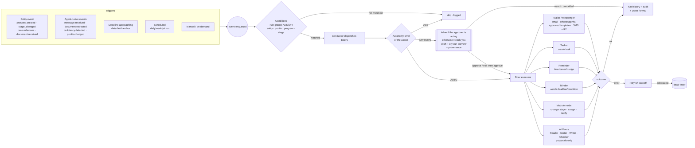
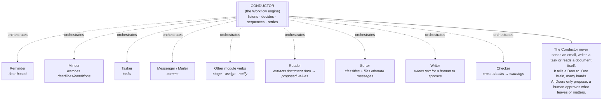
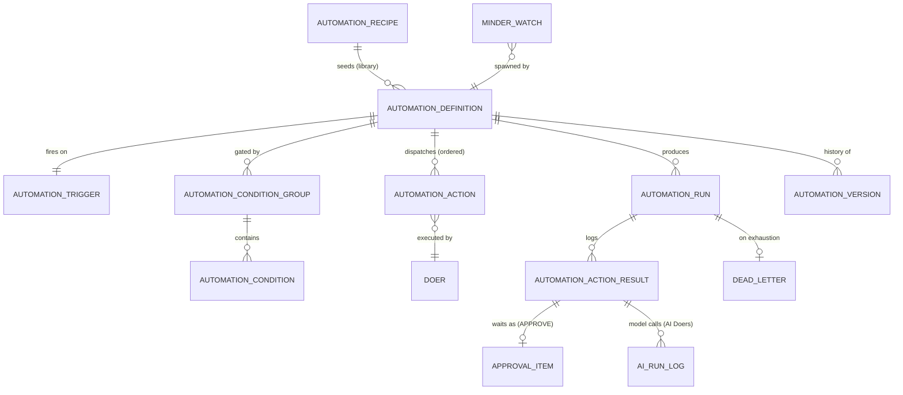

> **Document control** · Version **1.17** · **2026-10-18** · Status: **AG-07 review applied (the product owner, 18 Oct: AG07-D11 reminders read confirmed dates, a pre-filled due date is confirmed on save; AG07-D16 Q36 changing a case's office recalculates reminders not yet sent, government dates never move; AG07-D6 referenced only); previously: AG-16 review second pass applied (AG16-54 to AG16-82; the product owner, 17 Oct) — home screen counts and letter tasks, one rule for every broken connection, closed days added every year, sending engine by what a timer counts, client deadline reminders by formula, deadline on the government step, Owner-only AI switch, with build cards; previously: AG-16 review round 2 applied (AG16-24 to AG16-53; the product owner, 15–17 Oct) — home screen, standing rules, AI in higher plans, quiet by default, office clocks, sending window, Owner fallback for deadline reminders, Doer inputs, with build cards — for the product owner's review; previously: AG-16 review decisions applied (the product owner, 14 Oct) — engine only: the Automatic messages page moved to AG-12; one escalation rule; Team safeguards, backup approver, four-eyes, supervised messages and licence-based approval removed; AI Doers pause/resume; Writer rename; closed-days rules — for the product owner's review**\
> Part of: *Agent (RCIC/Lawyer) Console — Functional Requirements* · Split from `FINAL-Agent-FR.md` lines 7149–7825 on 2026-09-16 · Previous version: `_archive/AG-11-automation_v1.16_2026-10-17.md`\
>
> | Version | Date | Change | Decisions |
> |---|---|---|---|
> | 1.17 | 2026-10-18 | **AG-07 review (the product owner, 18 Oct), reminders and clocks only.** **Confirmed dates (AG07-D11, AG16-31):** reminders read **confirmed** dates only; a government step recorded by hand with a due date pre-filled by the system counts as confirmed **when the person saves it** (the save is their click), so its watch is armed on save and no separate confirm step is added (AG-11-125 rule 1, card test). A date that is only suggested still starts no watch. **Changing a case's office (AG07-D16 Q36):** changing a case's office needs `agent/case:edit` and is shown only once a second office exists (AG-01, AG-7-102); **reminders not yet sent are recalculated for the new office** (time zone and closed days); reminders already sent stay as sent; **government dates never move** (AG-7-94, AG-11-110); a contact whose cases sit in two offices sees each case's times in that case's office time (AG-11-119 rules 7 and 8, edge case, tests). **Referenced only (AG07-D6):** staff notifications are limited to being handed work (assigned to me, review requested from me, my review sent back, approval waiting); AG-11 pushes no case event beyond the pushed alerts already listed in AG-11-116 rule 5, and a pointer line says so; the personal choices are AG-07-39 and AG-16. **Changed:** AG-11-119 (requirement and card), AG-11-125 (card), AG-11-116 (rule 5 pointer). No requirement IDs added or withdrawn. | *18 Oct (later): consistency fixes after expert review — X-2 (5), AG16-89(8), AG07-D11, ID typo AG-7-39.* AG07-D11 · AG07-D16 (Q36) · AG07-D6 (referenced only) · *18 Oct (final): AG07-D17 – D21 applied — AG07-D20(f) (approval notifications; new AG-11-55 card), AG07-D19 (Unassigned pointer in the AG-11-115 card).* · AG07-D26 · AG07-D27 · X-3 · *18 Oct (later): AG07-D27 applied — AG-11-126: reminders go to the lead representative when the case has no case officer, and the target date counts calendar days (a reminder on a closed day moves to the open day before); AG-11-125: undoing "Step done" restarts only reminders still to come; the internal-clocks lists (§3.11, AG-11-119) no longer include target filing dates.* *18 Oct (later): AG07-D26 / X-3 applied — the Minder reminds the case officer 2 days before and on the day of a case's target filing date (new AG-11-126; no escalation), "Step done" and "Not a deadline" stop a step's reminders and a changed date moves them (AG-11-125), the client expiry recipe gets its open/closed defaults, 30 and 7 days and an unsubscribe link, and a placeholder section "Expiry watch (X-3)" holds the staff expiry rules until the AG-11 review.* *18 Oct (later): AG01-29 / AG16-105 and gap-check fixes applied — AG01-29(3): a suspended person is treated like a deactivated one for new work (AG-11-45, AG-11-46, BR-18, edge case); their open work and seat stay.* *18 Oct (later): AG01-30 applied — AG01-30(1): a standard deadline on a suspended person's file alerts the holders of `agent/case:assign` (AG-11-47, AG-11-45, BR-18, edge case, test); round-robin clause removed from AG-11-45 and "suspended" added to its role-target and escalation clauses.* · AG01-30 |
> | 1.16 | 2026-10-17 | *Same-day fixes (17 Oct): AG16-83 – AG16-88 — `agent/automation:configure-ai` withdrawn (Q57 closed); "biometrics countdown" recipe withdrawn, the Government deadline reminder row stays (Q56 closed); client deadline reminders: gap counts the previous reminder of the same deadline, a changed deadline recalculates, staff lead times unchanged (Q54 closed); windows of 3 days or less get no automatic client reminder (Q53 closed); AG-11-115 and AG-11-120 reduced to pointers to AG-10 where they restated its rules.* **AG-16 review, second pass applied (the product owner, 17 Oct): AG16-54 to AG16-82, engine and home-screen parts only.** (1) **Home screen:** the Unmatched count includes the person's own "Only you" items (AG16-57); a government-letter task shows in My Tasks from the day it is created until it is done (AG16-61); "Waiting on us · No reply" covers every filed client conversation — firm mailbox, personal mailbox and WhatsApp (AG16-67); no "Past chat" count rule is needed (AG16-78: v1.15 held none). (2) **One rule for every broken connection** — mailbox, WhatsApp, payment account, calendar: one email when it breaks, one home-screen item until fixed (AG16-82; AG-11-118 rewritten; Q42 closed). (3) **Closed days:** no December item and no per-day tick; one "Add these every year" choice, asked once; the yearly add shows in Done for you (AG16-79; AG-11-117 withdrawn; new AG-11-124; AG-11-110 changed); holiday wording "ExpatReady seeds no closed days; it offers a suggested list" (AG16-54 #2). (4) **Sending engine:** what a message's timer counts decides when it sends — days at 09:00 client time, booked times and payment holds at the exact time, anything else inside 08:00–20:00 (AG16-56; AG-11-120 rewritten); client time zone from the phone code only for single-zone countries (AG16-72). (5) **Client deadline reminders by formula** — 50% and 90% of the window, plus 25% when the window is over 15 days (AG16-77, AG16-75, AG16-76; new AG-11-123). (6) **The deadline lives on the government step** (AG16-73; AG-11-47, AG-11-108 changed; new AG-11-125). (7) **AI switch: Owner only**, on and off, new key `agent/ai:switch`; AI per plan is on or off only (AG16-80; AG11-D13, AG-11-93, AG-11-114, BR-37, §6, §7, §10 changed). (8) **Translate and Summarise** in the staff member's language, saved with the email (AG16-74; AG-11-122). (9) **Letter task** due 2 working days after filing, never later than the government deadline (AG16-61; AG-11-122; Q46 closed). (10) **Quiet by default:** "Remind me if no reply" is a home-screen item, not a pushed alert (AG16-54 #14; AG-11-116; Q50 closed). (11) Standing rules AG16-60, AG16-63 and AG16-76 cited; every changed card has a "Clicks:" and a "Person decides:" line. **New:** AG-11-123, AG-11-124, AG-11-125; Q53 to Q57 (open). **Changed:** AG11-D13, AG-11-47, AG-11-65, AG-11-93, AG-11-107, AG-11-108, AG-11-110, AG-11-114, AG-11-115, AG-11-116, AG-11-118, AG-11-120, AG-11-122, BR-37, §3.11, §3.13, §6, §7, §10, §12, §13. **Withdrawn:** AG-11-117 (December item). **Closed (AG16-55):** Q38, Q39, Q40, Q43, Q44, Q47, Q48, Q50, Q51; by later decisions: Q41 (AG16-79), Q42 (AG16-82), Q44 (AG16-72), Q46 (AG16-61). **Left open, no stated default:** Q36, Q37, Q45, Q49, Q52. *Same-day fixes (18 Oct): AG16-89 — AG-11-116 rule 3: a filed client email alerts its owner only if it arrived in a mailbox that is not the owner's own ("reads" = the owner's own connected mailbox only; in a one-user firm every mailbox is the user's); rule 5: each person's own notification choices (AG-16 §3.3) sit outside the pushed-alerts list; home-screen Unmatched count = firm items for holders of `agent/communication:resolve-unmatched`, the "Only you" parts are removed; Sorter reads only mail already brought in (unknown senders in a personal mailbox are not brought in); Q40 confirmed.* *Same-day fixes (18 Oct): AG16-90 — AG-11-118 reduced to the home-screen item plus a pointer to AG-16-16 (the only broken-connection card; Degraded shows on the card with no alert); BR-12 sending-window line becomes a pointer to AG-10-8 / BR-9; AG-11-123 marked as the home of the client-reminder formula; audited-actions list `configure-ai` replaced by `agent/ai:switch`; decision-table rows for AG16-20, AG16-46 and AG16-48 marked "changed by"; Clicks / Person decides lines added to AG-11-113, AG-11-119 and AG-11-121.* *18 Oct: new section 'Decisions that change this epic' (index of AG16 decisions; no requirement changed).* *Same-day fixes (18 Oct): AG16-102 — when the firm switches AI off, proposals already waiting in Needs you stay, labelled "Made by AI before AI was switched off"; staff approve or dismiss each; nothing runs by itself — the same rule as the ExpatReady pause (AG-11-111, the AI switch lifecycle, the AI-off text in §3.10 and the AI-off edge case; AG-16 Q9 closed there).* | AG16-54 · AG16-55 · AG16-56 · AG16-57 · AG16-60 · AG16-61 · AG16-63 · AG16-67 · AG16-72 · AG16-73 · AG16-74 · AG16-75 · AG16-76 · AG16-77 · AG16-78 · AG16-79 · AG16-80 · AG16-82 · AG16-90 · AG16-102 |
> | 1.15 | 2026-10-17 | **AG-16 review round 2 applied (the product owner, 15–17 Oct): AG16-24 to AG16-53.** (1) **Home screen (AG16-40):** six sections in order — Needs you · My Tasks (due today or overdue) · Waiting on us / No reply · Payments to record · Unmatched · Done for you; empty sections hidden; one place to start; "My work" reads "home screen" (AG17-D61). New AG-11-115. AG-11-64 and AG11-D7 changed. (2) **Standing rules (AG16-31, AG16-33, AG16-44):** *ExpatReady suggests, the firm decides*; *AI reads, rules check, a person confirms*; never quietly judge — stated once in §3.0 (AG-11-113). (3) **AI in higher plans (AG16-34):** AI is a plan feature, not an add-on; locked until the provider is recorded; Owner-only switch (AG-11-114; AG11-D4, AG11-D13, AG-11-39, AG-11-93 changed). (4) **Quiet by default (AG16-42):** one test for every alert or home-screen item; filing is silent; no duplicate alerts (AG-11-116). **A Sorter match made only by AI, or below the confidence threshold, now goes to Unmatched as a suggestion, no longer also to Needs you** (AG16-26, AG16-42; AG-11-60, AG-11-67, AG-11-94, AG11-D13, §3.0, §3.10, §3.13, US-27, edge cases changed). (5) **Office clocks (AG16-45, AG16-51):** the case's office time zone and closed days drive the clocks; escalation stays with everyone holding `agent/case:assign`, not by office (AG-11-119; AG-11-40, AG-11-49, AG-11-110, BR-12 changed). (6) **Closed-days list (AG16-46):** AG-11-110 now says ExpatReady does not seed the firm's list; December home-screen item for the Owner (AG-11-117). (7) **WhatsApp (AG16-48):** home-screen item "WhatsApp disconnected — Reconnect" for the Owner (AG-11-118). (8) **Sending window (AG16-49, AG16-51):** automatic non-urgent client messages go only 08:00–20:00 client time; fixed (AG-11-120). (9) **Deadline reminder with no one assigned goes to the Owner (AG16-50):** AG-11-121; §13 Q34 closed. (10) **Doer inputs (AG16-26, AG16-27, AG16-39):** Reader, Sorter, Writer (Translate, Summarise), Tasker (AG-11-122; AG-11-108 changed). **New:** AG-11-113 to AG-11-122 with build cards; §13 Q36 to Q52 (open). **Changed:** AG11-D4, AG11-D7, AG11-D13, AG-11-39, AG-11-40, AG-11-49, AG-11-60, AG-11-64, AG-11-67, AG-11-93, AG-11-94, AG-11-108, AG-11-110, BR-12, US-18, US-27, §3.0, §3.10, §3.11, §3.13, §6, §7, §12, §13 Phasing. **Closed:** Q34. **Withdrawn:** none. | AG16-26 · AG16-27 · AG16-29 · AG16-30 · AG16-31 · AG16-33 · AG16-34 · AG16-36 · AG16-39 · AG16-40 · AG16-42 · AG16-44 · AG16-45 · AG16-46 · AG16-48 · AG16-49 · AG16-50 · AG16-51 |
> | 1.14 | 2026-10-14 | **AG-16 review (the product owner, 14 Oct) applied — engine only.** (1) **The page where a firm picks Send automatically · Ask me first · Off for each automatic client message now lives only in AG-12** (the Automatic messages page, AG16-11, AG16-12). AG-11 keeps the engine meaning of `AUTO` / `APPROVE` / `OFF`, what "Ask me first" does in Needs you, and the floors list. Removed here: the separate recipe on/off for recipes that send client messages and the per-recipe autonomy table as a setting (AG11-D3, AG11-D12 rewritten, AG-11-52, AG-11-75, AG-11-106, AG-11-109, BR-20, BR-42, US-12, US-15, US-28, US-32, US-33, §10 `set-autonomy`). Chase timings sit on the Missing-document chase row of that page; the two Needs you timings stay under AG-16 Advanced → Waiting times (AG11-D17, AG-11-99 changed). (2) **One escalation rule (AG16-22):** one Escalation switch, on by default; alerts everyone who can reassign cases (`agent/case:assign`) for government deadlines (2 days before and on the day) and for Needs you items overdue after 2 working days; no task-escalation push; no alert to the person who is themselves responsible; at-risk marks stay a separate switch, on by default. Both are changed by Owner or Admin through `agent/firm-capability:manage`, no reason, logged (AG16-8). Changed: AG-11-19, 49, 55, 59, BR-7, BR-19, §3.4, §3.13, §6, US-2. (3) **Working days and closed days (AG16-6, AG16-7):** working days use the firm's own closed-days list (empty at the start; hours Monday to Friday 9:00–17:00 by default); government dates are calendar dates and never move; a reminder or approval due date that lands on a closed day moves earlier. The §3.11 line "handled per the firm's calendar" is fixed; new AG-11-110; §13 Q10 closed. (4) **Withdrawn:** Team safeguards and its parts — AG11-D9, AG-11-80, 82, 83, 84, BR-30, BR-32, the §6 lifecycle and `FirmTeamSafeguards` (SR-Q1c); the backup approver (AG16-9); four-eyes on forms — AG-11-81 and BR-31 rewritten, the "Self-approved" record stays (SR-Q1b); supervised client messages, licence-based approval and the licensed-approver default (R5) — AG11-D11, AG-11-88 to 90, BR-35 rewritten, AG-11-102 withdrawn; the "preferred" licensed mark and the missing-credential note (SA-Q3). AI-written client text is approved by anyone holding the sending key (SR-Q10). A template whose body AI edited is approved once, when published, and is no longer a per-send floor (R7, knock-on A19). (5) **AI Doers (AG16-3, AG16-20):** stay Release 1; only the Owner turns AI on (with an acknowledgement); the Owner or an Admin turns it off; ExpatReady pause with banner and automatic resume for firms that had it on; provider-change email to the Owner before the change. New AG-11-111, AG-11-112. (6) **Writer (AG16-4):** the AI writer, formerly "Drafter", is renamed Writer; the `draft_message` action name is unchanged. (7) **WhatsApp (AG16-19):** only through the firm's own connected account; no shared ExpatReady number; otherwise by email (AG11-D6, AG11-D18, AG-11-103, AG-11-105). **New:** AG-11-110, AG-11-111, AG-11-112; §13 Q33 to Q35 (open). **Withdrawn:** AG11-D9, AG-11-80, 82, 83, 84, 102, BR-30, BR-32. *Same-day audit corrections (14 Oct): escalation rule restated in §3.4 and AG-11-19 replaced by a reference to AG-16 (§3.8, AG-16-32); firm-designed-cascade clause deleted (AG16-22); persona no longer "tunes escalations".* | AG16-3 · AG16-4 · AG16-6 · AG16-7 · AG16-8 · AG16-9 · AG16-11 · AG16-12 · AG16-19 · AG16-20 · AG16-22 · SR-Q1b · SR-Q1c · R5 · R7 · SR-Q10 · SA-Q3 |
> | 1.13 | 2026-10-12 | **SA05-R9a (the product owner, 12 Oct): automatic messages run from day one.** Nothing is held for a review any more. Every automatic client message of the seeded recipes and of the five more Release 1 recipes runs from provisioning with ExpatReady's neutral wording, at its default `AUTO`, unless the recipe is off by default (no-show recovery, going-cold, post-consult stay off). "Review your automatic messages" (older name "Review your standard messages") becomes an **optional page** — an on/off list, no confirm step, no gate, no "paused until you review" banner; it is owned by AG-12 (AG12-D23, AG-12-52). Two guards, owned by AG-12: a message missing a firm detail it needs is not sent and the firm sees a short note (AG-12-109); a one-time dashboard notice "Your automatic messages are on. See or switch them off." (AG-12-110). **Unchanged:** the 7-day update notice, switch-off rules, class 1 and class 2, import quiet mode (AG18-D9/D10), WhatsApp opt-in, autonomy levels and the AI floors. Changed: Document control, §0 AG11-D12 (rewritten), AG11-D1 / D3 / D18 references, §0.2 AG-12 and AG-16 rows, new "Applied from SA-05" row (SA5-X46), §3.3 template-message text and table row, §3.5 seeds / more recipes / data flow, §3.13, AG-11-21, 43, 60, 75, 106, BR-36 (withdrawn), US-15, US-20, US-26 (hold lines withdrawn), US-32, §9 edge case, §10 row, §12, §13 phasing. **Withdrawn:** AG-11-91, BR-36, US-26 hold lines, the §9 "seed template not yet reviewed" edge case. **New:** AG-11-109, BR-42, US-33, §9 edge case (Guard 1), open questions 28 to 32 (not decided). Permanent IDs kept. Same-day closing (SA05-R9b): open questions 28, 29 and 31 are closed — each message needs the firm details it uses (blank means not sent, the firm is told), skipped messages are not sent late, a missing client detail keeps the `APPROVE` rule (AG-11-97), the on/off permission is `agent/template:configure`; questions 30 and 32 stay open. *(revised same day — SA05-R9b)* | SA05-R9a, SA5-X46 (AG12-D23) · SA05-R9b |
| 1.12 | 2026-10-10 | Applied from SA-03 v2.16 (SA3-X12; the product owner, 10 Oct): **Automations** (firm-designed workflows and reminder chains) is one sellable module feature of SA-3's feature catalogue; the four **AI Doers** are one extra with one firm switch (AG-16-35); standard deadline reminders stay always on (AG-11-48). Per SA3-D10, capabilities inside Automations (SMS actions, custom schedules, recipe authoring) follow the Automations feature and are not gated separately; **volumes and rate caps are not plan limits** — SA-3 has four limits only (SA3-D14). §0.2 SA-03 row, §3 gating bullet, AG-11-39 note and §13 Q8 updated (Q8 closed). | SA3-D10, SA3-D14 (SA3-X12) |
> | 1.11 | 2026-10-07 | **SA-06 v3.0 closing decision F4 follow-up (the product owner, 7 Oct).** Wording fix in the autonomy-level table (§3.13): `form-approve` is "seeded on the Owner and Case Manager starter roles; the firm may grant it to any role (SA6-D2)" — it still said "seeded on licensed roles", a leftover that v1.9 missed. A search for other "licensed role" / "licensed role template" seeding wording found only the version-history rows (1.8 and 1.9), which are history and are left as written. No rule changes: F4 routing of v1.10 (AG-11-55, 58, 81, 82, 88 to 90, 102, BR-22, BR-35) and AG11-D11(a) (firm setting, on by default) are unchanged. Requirement IDs unchanged. Changed: Document control, SA6-D9 row note, §3.13 government-form row of the autonomy table. | SA6-D2, SA6-D9 |
> | 1.10 | 2026-10-07 | **SA-06 v3.0 closing decisions (the product owner, 7 Oct) — F4: who sees an item awaiting professional approval.** Items awaiting a professional approval (government-form approval, AI-written client text approval, supervised client messages, and the waive / sign-off / countersign items of AG-07 and AG-05 that reach Needs you) are **shown at once in the Needs you of every active holder of the relevant approval permission**; **active licensed holders are marked "preferred"**; **if no one holds the permission, the Owner approves**, recorded. This replaces "route to licensed users first, then others" (the lead RCIC / any-licensed-user routing of AG-11-82 and AG-11-88, and the "no licensed user active → Owner" route for permissions). One item, one decision: the first holder to decide closes it for all; the others see who decided. **Unchanged:** the informational "not linked to a licence" note when approval rights are granted to someone without a licence (AG-11-89); **AG11-D11(a)** — AI-written client text needs approval by a licensed user by default, a firm setting that is **on by default** (the Owner may allow other roles); four-eyes (AG-11-81); inline approval; the Owner route when no active licensed user exists for an item that requires a licensed approver. Requirement IDs unchanged. Changed: Document control, §0 AG11-D11 (a), (b), (d), new SA6-D9 row in "Applied from SA-06 v3.0", §3.13 (Whose queue, same-permission bullet, four-eyes part 1, licence-aware bullets), AG-11-55, AG-11-58, AG-11-81, AG-11-82, AG-11-88, **AG-11-89**, AG-11-90, AG-11-102, BR-22, BR-35, §7 lifecycle note and `ApprovalItem`, §9 state-change row, US-22, US-23, US-24, edge cases, §10 rows, §12 and §13 summary lines. | SA6-D2, SA6-D9 |
> | 1.9 | 2026-10-07 | Role clean-up from SA-06 v3.0 (the product owner, 7 Oct): there is no licensed-representative role template and no licence check on permissions. `agent/case:form-approve` is seeded on the **Owner and Case Manager** starter roles (was "licensed role templates only"); `agent/sqr:verify` on Owner, Case Manager and Case Officer (was "licensed roles and case officers"); the firm may grant either to any role and every use is audited. Role names follow the six starter roles (Firm Admin → Admin, Manager → Case Manager, RCIC / Case Officer / Paralegal → Case Manager / Case Officer). The licensed **user** (a person linked to a regulator credential, AG11-D11) is unchanged. Requirement IDs unchanged. Changed: AG-11-89, §10, §0 AG11-D11(b)(e), personas. | SA6-D2, SA6-D5, SA6-D3 |
> | 1.8 | 2026-10-04 | Agent-native decisions (the product owner, 4 Oct) — AG-11 owns AG11-D1 to D7. New §0 decision log + §0.2 pending knock-ons. Every action carries an **autonomy level** (`AUTO` / `APPROVE` / `OFF`) with defaults and a hard floor at `APPROVE`; ExpatReady never submits to a government authority (§3.3). New §3.13 **Needs you** approval inbox (preview = the dry-run rendering, §3.7) and **Done for you** feed as the staff home screen. **Reader, Sorter, Drafter, Checker** join the Doer catalogue (§3.0) with AI rules in §3.10 (never fabricate, provenance, model-call audit, no training, AI optional with manual fallback). New triggers `message.received`, `document.extracted`, `deficiency.detected`, `profile.changed` (§3.1). A **minimal Conductor ships in Release 1** with seeded recipes enabled at provisioning, including a new missing-document chase (§3.5, §13 Phasing rewritten). WhatsApp inbound in Release 1, outbound stays Release 2. Imports never fire client-facing recipes (AG18-D7). Changed: AG-11-2, 4, 13, 16, 21, 22, 29, 39, 43; BR-1, BR-13. New: AG-11-51 to AG-11-77, BR-20 to BR-28, US-12 to US-19; ten new open questions (11–20). Permissions: `agent/automation:set-autonomy`, `agent/automation:configure-ai`; approving reuses the manual-action key. Today's-code descriptions unchanged; new items marked NEW in §12. Same day: **AG11-D8** — single approval for government forms (approving in Needs you is AG-07's consultant approval); AG-11-58, BR-22, §13 Q15 updated; AG-07 permission knock-on added to §0.2. Same day (simplify): "easy for solo, safe for teams" (the product owner, 4 Oct). **AG11-D1 revised** — a template message (active firm template, merge fields only) defaults to `AUTO`; "reads as advice" is no longer a floor; the floor covers AI-written text to a client, a template body edited by AI, any government form, and any verified-profile value whose source no human has looked at; seeded recipes' client messages now go out on their own. **AG11-D2 revised** — the person acting approves inline, with no Needs you item; Needs you holds only work prepared with no human present and work waiting on a different person. New **AG11-D9 Team safeguards** — one switch (four-eyes on government forms, supervised client messages for unlicensed staff, escalation, at-risk marks, routing to supervisors), on automatically at 5 or more active staff, switched off only by the Owner with a recorded reason. New **AG11-D10** — approving a Reader value in its review view is the verification. Revised same day: AG-11-29, 43, 51 to 53, 55, 58, 60, 66, 75, 76; BR-20, BR-22, BR-23; US-12, US-13, US-15, US-16; §13 Q4, Q17. Changed v1.8: AG-11-19, AG-11-49; BR-7, BR-19. New: AG-11-78 to AG-11-86, BR-29 to BR-33, US-20 to US-22; open question 14 removed; new open questions 21–25. §0.2 adds AG-17 and AG-01 (pending). Same day (fix): **AG11-D9 part 1 revised** — four-eyes on government forms applies only while the firm has 2 or more active users who hold `agent/case:form-approve`; with exactly one, that person may approve a form they prepared, recorded and shown as **self-approved**, never blocked; the preparer is the person who created the draft or edited it before sending it for approval, so an approver's review corrections do not make them the preparer (every correction is still an override, AG-7-23) and the Filler counts as no person; the "Another approver is needed" block and the "approver who edits becomes last editor" rule are removed; new edge cases for the firm dropping to or rising from one approver. **AG18-D9 applied** — imported clients, leads and cases are quiet for client-facing automation until the firm switches them on ("Start client automations", with a preview that reuses §3.7); applies to every later trigger and scheduled scan, not only the import itself. Revised same day: AG-11-77, 81, 58, 55 wording; BR-22, BR-27, BR-31; US-19, US-21; §13 Q17 and Q24 marked decided. New: AG-11-87. **Same day (closing decisions):** **AG11-D9 part 2 revised** — when Team safeguards routes a client message that unlicensed staff wrote or edited and the firm has **no active licensed user** (AG1-D6), the item goes to the **Owner's** Needs you instead of sitting unassigned; it still never sends on its own. Revised same day: AG-11-82; BR-32; §9 edge cases (unlicensed file owner, no licensed user active); §13 Q25 marked decided. **Same day (review fixes):** overriding principle **"We work for the firm, not the regulator"** — ExpatReady ships safe defaults and keeps a record; the firm decides; it never reports to a regulator, never declares a firm non-compliant and never blocks the firm's licensed judgement; four product floors stay fixed (§0, BR-34). New **AG11-D11** licence-aware defaults — licensed user = AG-01 §3.5 (replaces the AG1-D6 citations); AI-written client text approved by a licensed user by default, the Owner may widen it; `form-approve` seeded on licensed roles, grantable to anyone with a recorded note, approvers counted as active non-suspended holders; supervised client messages become a standalone setting, on by default once the firm has an active unlicensed user who can message clients; with no licensed user active the Owner may approve, recorded, nothing blocked; verifying Reader values needs `agent/sqr:verify`. New **AG11-D12** — template message = firm-scope PUBLISHED version; seeds' client messages wait as `APPROVE` until one "Review your standard messages" confirm; publishing shows its reach. New **AG11-D13** — AI Doers off until the Super Admin records provider, region and a no-training/no-retention agreement; one firm switch, turned on by the Owner with an audited acknowledgement; injection safeguards. **AG11-D9 revised** — supervised messages move to D11(c); Team safeguards keeps four parts, adjusted by the Owner only with a reason; switched on by the Owner or `agent/settings:edit`; 7-day grace on reaching 5; no re-enable after an Owner switch-off; backup approver; owner entity AG-16 `FirmTeamSafeguards`. **AG18-D10 applied** — quiet precedence and inheritance, `origin` audit-only, quiet-set simulation (owned here), imports never escalate or mark at-risk, imported documents reviewed per document, imported correspondence bypasses the Sorter. Approval mechanics, privacy, defaults and UX fixes (action-level idempotency key; rendering-version check; due time 2 business days capped by linked deadline; overdue/unassigned escalation; chase per checklist item 5/7/4; acknowledgement and merge-field rules; encrypted previews, hashed Restricted audit values, interim retention, RLS commitment; "Review document" task; collapsed Done for you; empty states; batched fallback task; labels "Send automatically / Ask me first / Off"). §6 garbled approval row split in two. Revised same day: AG-11-43, 49, 51, 55, 57 to 61, 64, 66, 67, 71 to 73, 75 to 77, 79 to 87; BR-20, 23, 24, 27, 28, 30 to 33; US-15, US-19, US-20, US-22; §13 Q11, Q12, Q16 defaulted; Q21, Q22, Q23 decided; Q25 updated. Changed v1.8: AG-11-14, AG-11-25; BR-4. New: AG-11-88 to AG-11-98, BR-34 to BR-37, US-23 to US-27, open questions 26 and 27. §0.2 adds AG-12 and AG-16, updates AG-01, SA-08, SA-11. Same day (final alignment): AG11-D8 row, AG-11-58, AG-11-81, AG-11-90, BR-22, BR-35, §3.13, §6 and §10 state the one exception — with no licensed user active the Owner may approve a government form without `form-approve` (AG-7-68); "compliance event" renamed "at-risk event" in body text; AG-11-86 and §3.13 settings placement aligned with AG-16 (main screen = AI Doers, Team safeguards, and Supervised client messages where an active unlicensed messaging user exists; who approves AI-written client text, per-recipe autonomy and parts under Advanced); an unverified sender's client-facing action drops to `APPROVE` in Needs you, never skipped (AG11-D13 row, AG-11-94, §3.10, BR-37, US, §9); backup approver scope decided (AG11-D9 row, AG-11-83, §3.13, §9, `routingReason` BACKUP_APPROVER; Q26 closed); supervised messages after an Owner switch-off — one notice with a one-click "switch supervision on", never re-enabled automatically (AG11-D11 row, AG-11-82, §6; Q27 closed); Team safeguards `source` values aligned with AG-16 (`AUTO` / `OWNER` / `ADMIN`); `ApprovalItem.preparedBy` null only when an automation ran the Filler; SME note reworded. Same day (5 Oct): AG1-D19 — no licence monitoring; licensed user = linked by the firm. 5 Oct (open questions closed): new decisions **AG11-D14 to AG11-D17** recorded in §0 — core in-house with Super Admin-approved outside providers (D14), AI processing in Canada only (D15), inbound email split Gmail/Microsoft 365 in Release 1 and IMAP in Release 2 (D16), and waiting times the firm can change in Release 1 with the 2-working-days-before-a-government-deadline rule (D17); AG18-D11 (b), (e), (g) applied. Changed: AG-11-3, AG-11-59, AG-11-73, AG-11-76, AG-11-93, AG-11-94; BR-37; §3.5 and §3.10 text; §3.13 due-time wording ("2 business days" is now "2 working days" and "never after a linked deadline" is replaced); AG11-D4 and AG11-D13 rows; §0.2 SA-08 and SA-11 rows (Pending: Canada-only region); the verified-sender definition is stated in AG11-D13, §3.10 and AG-11-94. New: AG-11-99 to AG-11-102, BR-38, BR-39, US-28 to US-30. §13 Q12, Q16 and Q19 decided. **5 Oct (Release 1 scope review):** new decision **AG11-D18** moves five things into Release 1 — (a) proactive outbound WhatsApp with provider-approved templates (preferred channel per client, email fallback; SMS stays Release 2), (b) an unknown WhatsApp number becomes a lead only when a person clicks "Create lead", (c) IMAP mailbox connection alongside Gmail and Microsoft 365 (revises AG11-D16), (d) five more ready-made recipes — no-show recovery, going-cold follow-up, post-consult follow-up, biometrics countdown, PR card / status expiry watch — and (e) the Reader also reads IRCC/government letters, language test results and ECA reports. AG11-D3, D4, D6, D12, D14 and D16 rows annotated. Changed: AG-11-16, AG-11-22, AG-11-66, AG-11-75, AG-11-91. New: AG-11-103 to AG-11-108, BR-40, BR-41, US-31, US-32. §3.0, §3.3, §3.5, §3.10 rails text, §9 edge cases, §13 Q3, Q13, Q18 and Phasing / named deferrals updated. Still Release 2: the visual builder, firm-authored recipes, firm-designed reminder chains, custom cron, manual enrolment into a sequence, SMS. 5 Oct (final check fixes): §10 permission table — `agent/sqr:verify` and `agent/case:form-approve` labelled NEW (defined in AG-08 and AG-07); contents line now reads AG11-D1 to D18; AG-11-88 grammar ("never check"). No requirement changed. | AG11-D1 to AG11-D13, AG18-D3, AG18-D6, AG18-D7, AG18-D9, AG18-D10 · AG1-D19 · AG11-D14 to AG11-D17 · AG18-D11 · AG11-D18 |
> | 1.7 | 2026-10-03 | Consistency review fixes (3 Oct): escalation and at-risk marks are now **two separate firm settings** (AG-16-32) — manager/owner alerts depend only on escalation, the at-risk mark and compliance event only on at-risk marks (AG-11-19, AG-11-49, BR-7, BR-19, §3.4 text, lifecycle, US-2, edge case); when escalation is on, the firm's users who can reassign cases are alerted 2 days before a standard deadline and on the day, with no further settings (AG17-D81); AG-11-47 reminders stop when the deadline is met — not when the case closes — and reminders on recorded dates (e.g. permit expiry) continue after closing; orphaned standard deadlines (file owner deactivated) added to AG-11-47; `change_stage` limited to prospects — cases move only by computed position, staff forward placement before submission, or recorded events (AG-11-2, AG-11-16); US-10 notes standard reminders continue; breach-at-arm-time edge case follows the settings; Phase/MVP/demo wording moved to Release terms. "Applied from AG-17" table extended. | AG17-D51, AG17-D55, AG17-D56, AG17-D60, AG17-D63, AG17-D64, AG17-D70, AG17-D81 |
> | 1.6 | 2026-10-02 | Minder decisions from AG-17 applied. The Minder is in **ExpatReady Release 1** (firm-designed automations stay later); standard deadlines are registered directly by any module, always on, with no firm set-up (AG-11-17, AG-11-47); standard deadline reminders work on every plan and never stop when a firm switches automations off (AG-11-32, AG-11-39, BR-13, AG-11-48); escalation chains and at-risk marks are **off by default**, switched on once by the firm in settings, default = remind the file owner only (§3.4, AG-11-19, AG-11-49, BR-7, US-2); reminders never pause when a feature flag covering client records is off (AG-11-50); the Minder developer builds the Minder core. New: AG-11-47 to AG-11-50, BR-19. Today's-code descriptions unchanged. | AG17-D38, AG17-D55, AG17-D69, AG17-D70 |
> | 1.5 | 2026-10-02 | Applied AG17 terminology/consistency changes (safe set): target-model entity list notes that corporate is a client type, not separate CORPORATE_* entity types (today's-code descriptions unchanged). | AG17-D4 |
> | 1.4 | 2026-10-01 | Label tidy: the staff-leaving section heading now cites AG-01 v1.4 (was v1.2). Requirements unchanged. | — |
> | 1.3 | 2026-10-01 | Knock-on from AG-01 v1.3 (decisions revised by the product owner, 1 Oct): the AG-11-46 "once the handover ships" qualifier removed (nothing in staff leaving is deferred); AG1-D13 row added to the applied table. | AG1-D1, AG1-D13 |
> | 1.2 | 2026-10-01 | Knock-on from AG-01 v1.2 (staff leaving): §3.3 recipient scoping extended; AG-11-45 and AG-11-46 added; BR-18 added; two edge cases added; "Not doing" noted in §13 | AG1-D4, AG1-D14 |
> | 1.1 | 2026-08-28 | Baseline — complete document v1.1 | — |

## Decisions that change this epic (14–18 Oct) *(new 18 Oct)*

Product-wide rules (apply here as everywhere; home: Agent `00-Overview` → "Product rules every epic follows"): AG16-11, AG16-31, AG16-33, AG16-42, AG16-44, AG16-60, AG16-63, AG16-76, AG16-89, X-3.

The "AG16" prefix is historical: these decisions began in the AG-16 review and apply across the product. Full text: `TEMPLATE-MAP-working_2026-10-10.md`.

| Decision | What was decided (one line) | What it changes in this epic | Where (requirement / card / section) |
|---|---|---|---|
| AG16-1 | Settings structure (approved) | The AI switch sits in Settings section 6; Settings section 6 → Automatic messages is the entry point to the page | AG-11-86, §13 Q32 (closed) |
| AG16-3 | AI Doers stay in Release 1 | All four AI Doers stay in Release 1: built, off for every firm until the provider terms are recorded; one firm switch for all four | AG11-D4, AG11-D13, AG-11-86, AG-11-93 |
| AG16-4 | Doer family and the "Drafter" name clash | The AI writer is renamed "Writer"; the code's `drafter` stays the non-AI document generator; `draft_message` action name unchanged | "Applied from the AG-16 review (14 Oct)" table (Doer wording throughout) |
| AG16-6 | Business hours and closed days | Default hours Monday to Friday 9:00–17:00; closed days are the firm's own list, starting empty; used for internal clocks only; government dates stay calendar dates | AG-11-110, AG-11-59, AG-11-100, §3.11, §13 Q10 |
| AG16-7 | A due date on a closed day moves earlier, never later | A reminder or approval due date counted back in working days lands on the last open day on or before it; the government deadline itself never moves | AG-11-110, AG-11-100, BR-12, §3.11, §9 |
| AG16-8 | Who changes Escalation and At-risk marks | Owner and Admin change the two switches through `agent/firm-capability:manage`; no reason asked; every change logged | §3.4, AG-11-19, AG-11-49, US-22, §10 |
| AG16-9 | Backup approver: removed | Backup approver removed; unassigned items go to the users who can reassign cases | AG11-D9 (withdrawn), AG-11-55, AG-11-83 (withdrawn), §9 |
| AG16-11 | One "Automatic messages" page, documented in one place only | The page is specified only in AG-12; AG-11 keeps the engine meaning of the three choices and the floors | AG11-D3, AG11-D12, AG-11-52, AG-11-75, AG-11-86, AG-11-106, AG-11-109, BR-20, BR-42, US-12, US-15, US-32, US-33, §10 |
| AG16-12 | Where timings live | Timing sits on the message's row on the Automatic messages page; the two Needs you timings stay under Advanced → Waiting times | AG11-D17, AG-11-99, AG-11-107, US-28 |
| AG16-14 | Staff notifications: personal settings only | Stated as non-goals: no daily summary email on the home screen, no quiet hours | AG-11-115 and AG-11-116 cards (13. Non-goals) |
| AG16-19 | No shared ExpatReady WhatsApp number | No shared ExpatReady number; email is used when the firm has no WhatsApp account or approved template | AG11-D6, AG11-D18, AG-11-103, AG-11-105, AG-11-118 card, §9 |
| AG16-20 | AI switch details | Owner switches AI on with an acknowledgement; ExpatReady pause with automatic resume; provider-change email. The "Owner or Admin switches off" part is superseded here by AG16-80 | AG11-D13, AG-11-93, AG-11-111, AG-11-112, BR-37, §6 |
| AG16-22 | One escalation rule: push the high-stakes, show the routine | One Escalation switch; an overdue item alerts the users who can reassign cases and the Owner, never the person it waits on; firm-designed cascades removed | §3.4, AG-11-19, AG-11-49, AG-11-55, AG-11-121 card, BR-7, BR-19, US-2, §6, §9 |
| AG16-24 | Own mailbox and own calendar on every plan | Referenced only (no change here): cited only as the start of the range "AG16-24 to AG16-53" for round 2 | "Applied from the AG-16 review, round 2" heading; change-log row 1.15 |
| AG16-26 | Email filing order | The Reader, Sorter, Writer and Tasker inputs for mail and letters; an AI-only match goes to Unmatched | AG-11-122, AG-11-67, AG-11-94, AG-11-108, §13 Q47 |
| AG16-27 | Government mail: recognise, match, identify the letter, sort, deadline | A deadline taken from the letter library's rule shows as "Suggested" until the officer confirms; rules read text-layer PDFs, the Reader is used for scans and unseen letters; filing is silent | AG-11-108, AG-11-122, AG-11-115, AG-11-116 card (rule 1), §13 Q46, Q47, Q51 |
| AG16-29 | Who's handling a firm-mailbox email | "Waiting on us" appears on the home screen | AG-11-115 |
| AG16-30 | Payment emails → suggested payment record | "Payments to record" appears on the home screen; payment notices are an input to the Reader and Sorter | AG-11-115, AG-11-122 |
| AG16-31 | Standing rule: ExpatReady suggests, the firm decides | ExpatReady files (undoable) and suggests; a person decides; a deadline from the letter library stays "Suggested" until confirmed | AG-11-113, AG-11-108 |
| AG16-32 | Lead notification emails become leads | Form-notification emails are an input to the Sorter and Tasker; lead rules are AG-02's | AG-11-122 card |
| AG16-33 | Standing rule: AI reads, rules check, a person confirms; core works without AI | Written as a standing rule for every suggestion; applied to the four Doers' inputs and outputs | AG-11-113, AG-11-122 card |
| AG16-34 | AI is included in higher plans, not sold as an add-on | The AI switch works only on a plan that includes AI; otherwise it is locked | AG11-D4, AG11-D13, AG-11-39, AG-11-93, AG-11-114 |
| AG16-36 | "Make task" and "Remind me if no reply" | "No reply" appears on the home screen; "Remind me if no reply" is a home-screen item, never a pushed alert | AG-11-115, AG-11-116 card, AG-11-122 |
| AG16-37 | Mailbox go-live essentials | Referenced only (no change here): cited in two edge-case lines about a connection ending, one struck out and withdrawn by AG16-89 | AG-11-115 card (§9, struck), AG-11-118 card (§12, struck) |
| AG16-38 | Lower-volume email items | Cited — see AG-11-122 card (listed in the card's decision line; the text does not say what changed) | AG-11-122 card |
| AG16-39 | "Translate" and "Summarise thread" in Release 1 on plans that include AI | Writer inputs for Translate and Summarise thread | AG-11-122, AG-11-67, AG-11-94, AG-11-108 |
| AG16-40 | The home screen is the one place to start | Home screen with six sections in order, replacing the "Needs you, then Done for you" landing | AG11-D7, AG-11-64, AG-11-115, US-18 |
| AG16-41 | Letters downloaded from the IRCC portal | Stated as a non-goal: no IRCC portal login or scraping | AG-11-122 card (13. Non-goals) |
| AG16-42 | "Quiet by default", plus telling the client | One test for every alert and home-screen item; filing is silent; no duplicate alerts; no automatic client message on a decision or refusal | AG-11-116 card, AG-11-118, AG-11-122 card (13. Non-goals), §3.13 |
| AG16-44 | ExpatReady never quietly judges for the firm | The person can reverse any "same" or "unimportant" judgement the screen shows | AG-11-113, AG-11-116 card |
| AG16-45 | Office time zones and escalation by office | Once a second office exists, the case's office decides the time zone and closed days; escalation recipients are not narrowed by office | AG-11-119, AG-11-40, AG-11-49, AG-11-110, BR-12 |
| AG16-46 | Closed days: suggested holidays, firm adds | "Add holidays for [province] [year]" with a suggested, ticked list; nothing saved until the firm clicks Add. The December item is superseded here by AG16-79 | AG-11-110, AG-11-117 (withdrawn) |
| AG16-48 | WhatsApp: keep the firm's existing number and app | The disconnected-WhatsApp home-screen item for the Owner is superseded here by AG16-82 (one rule for every broken connection) | AG-11-118 |
| AG16-49 | Client quiet hours in the client's own time zone | Sending window 08:00–20:00 in the client's time zone; now a pointer to AG-10 | AG-11-120 |
| AG16-50 | Government-deadline reminder with no one assigned goes to the Owner | The reminder goes to the Owner; no "No one assigned" home-screen section; staff reminders (2 days before and on the day) unchanged | AG-11-121 card, AG-11-115 card (13. Non-goals), §13 Q34 (closed) |
| AG16-51 | Three trims to avoid over-building | Sending window fixed (no setting); escalation not narrowed by office | AG-11-119, AG-11-120, AG-11-116 card |
| AG16-53 | Video links are per person; no firm video account | Referenced only (no change here): cited only as the end of the range "AG16-24 to AG16-53" for round 2 | "Applied from the AG-16 review, round 2" heading; change-log row 1.15 |
| AG16-54 | 25 consistency fixes after the 17 Oct write | #2 holiday wording ("ExpatReady seeds no closed days; it offers a suggested list"); #13 build-card example aligned with rules reading text PDFs; #14 "Remind me if no reply" is a home-screen item, not a pushed alert | AG-11-110, AG-11-116 card, AG-11-122, §13 Q47 |
| AG16-55 | Writers' recommended defaults accepted for the detail questions | Open detail questions closed with the writers' defaults | §13 Q38, Q39, Q40, Q43, Q44, Q47, Q48, Q50, Q51 |
| AG16-56 | When automatic messages send, by what their timer counts | Days at 09:00 client time, booked times and payment holds at the exact time, anything else inside 08:00–20:00; AG-11-120 rewritten (now a pointer) | AG-11-120, AG-11-123 |
| AG16-57 | Two places for unfiled messages: Unmatched and "Not brought in" | Unknown-sender mail in a personal mailbox is not brought in; the Unmatched count on the home screen follows who holds `agent/communication:resolve-unmatched` (the "Only you" part was later withdrawn by AG16-89) | AG-11-115, AG-11-122 card (rule 4) |
| AG16-59 | A government letter records its case step; one event, one client message | The client's reminder window starts from the day the client was told (the letter note) | AG-11-123 card (rule 2) |
| AG16-60 | Standing rule: a duplicate beats a miss | Applied to what staff see on the home screen and to alerts; the staff safety-net reminders stay separate | AG-11-115, AG-11-116, AG-11-118, AG-11-125 cards |
| AG16-61 | Due date and visibility of the task made from a government letter | Letter task due 2 working days after filing, never later than the government deadline; shown in My Tasks from the day it is created | AG-11-115, AG-11-122, §13 Q46 (closed) |
| AG16-63 | Design checks every requirement must pass | Every card changed in v1.16 carries a "Clicks:" line and a "Person decides:" line | Every changed card (v1.16) |
| AG16-66 | Limited roles and their own mailbox | Cited — see "Applied from the AG-16 review, second pass" table (listed with AG16-57 and AG16-78 for the Unmatched section; the text does not say what changed separately) | AG-11-115 |
| AG16-67 | "No reply" signals kept as layers; "Waiting on us" covers every client conversation | "Waiting on us · No reply" covers every filed client conversation: firm mailbox, personal mailbox and WhatsApp | AG-11-115 |
| AG16-72 | Client time zone from the phone code only for single-zone countries | The client's time zone comes from the phone code only for single-zone countries | AG-11-120, §13 Q44 |
| AG16-73 | One record per government step with its deadline | The Minder reads the due date from the government step record (`CaseMilestone.dueDate`); a confirmed letter date is written to the step; marking the step done stops reminders | AG-11-47, AG-11-108, AG-11-123, AG-11-125 |
| AG16-74 | Translate and Summarise in the staff member's language, saved | Translate and Summarise are produced in the staff member's language and saved with the email | AG-11-122 |
| AG16-75 | "Remind [client] until they confirm" dropped | No "remind until they confirm"; no automatic client reminder for a letter note | AG-11-123 card, AG-11-122 card (13. Non-goals) |
| AG16-76 | Standing rule: help people, don't replace them; do, don't overdo | Fewer client reminders by formula; "biometrics countdown" recipe withdrawn; the standing rule is cited on the new cards | AG-11-122, AG-11-123, AG-11-124, AG-11-106 |
| AG16-77 | Client deadline reminders by formula: 50% and 90% of the window | Two reminders at 50% and 90% of the window, plus one at 25% when the window is over 15 days; staff lead times unchanged | AG-11-123 (new), AG-11-107 |
| AG16-78 | Past WhatsApp chats: one default and an opt-out | No "Past chat" count rule is needed on the home screen | AG-11-115 |
| AG16-79 | Closed days: one "Add these every year" tick, asked once; no December alert | One pre-ticked "Add these every year" choice; each December ExpatReady adds next year's days and shows a Done for you line; the December item is withdrawn | AG-11-110, AG-11-117 (withdrawn), AG-11-124 (new) |
| AG16-80 | AI switch and plans | Only the Owner switches AI on and off (new key `agent/ai:switch`); AI per plan is on or off only | AG11-D13, AG-11-93, AG-11-114, BR-37, §6, §7, §10 |
| AG16-81 | "New letter patterns" review in Super Admin | Referenced only (no change here): the closed-days reference list is SA-01 pack content published by 15 November (AG16-81(5)); what the yearly add does if it is missing is open | AG-11-124 card, §13 Q55 |
| AG16-82 | One rule for every broken connection | One email when a mailbox, WhatsApp, payment account or calendar breaks, and one home-screen item until it is fixed; the card is now a pointer to AG-16-16 | AG-11-118, AG-11-116 card, §13 Q42 (closed) |
| AG16-83 | 26 follow-through fixes after the second pass | Biometrics countdown recipe withdrawn (#26); `agent/automation:configure-ai` withdrawn (#6); reminder gap counts the same deadline and a changed deadline recalculates (#13); AG-11-115 and AG-11-120 cut to pointers to AG-10 (#9) | AG-11-106, AG-11-107, AG-11-115, AG-11-120, AG-11-123, §10, §13 Q54, Q56, Q57 |
| AG16-84 | Very short deadlines: the letter note is the client message | A window of 3 days or less gets no automatic client reminder | AG-11-123 card, §13 Q53 (closed) |
| AG16-88 | Release 1 is English-first; French later | Referenced only (no change here): cited only in the v1.16 change-log range "AG16-83 – AG16-88" | Change-log row 1.16 |
| AG16-89 | Simplified mailbox model: assign and file, the firm manages its own queue | No "Only you" items; the Unmatched section shows firm items for holders of `agent/communication:resolve-unmatched`; a filed client email alerts its owner only if it arrived in a mailbox that is not the owner's own; unknown-sender mail in a personal mailbox is not brought in | AG-11-115, AG-11-116 (rule 3), AG-11-122 (rule 4), §13 Q40 |
| AG16-90 | Batch C: consistency fixes from the 17 Oct audit | Wording only: "Clicks" and "Person decides" lines revised on cards; AG-11-118 reduced to a pointer; BR-12 sending-window text points to AG-10; audit list names `agent/ai:switch` | AG-11-113, AG-11-118, AG-11-119, AG-11-121 and AG-11-123 cards, BR-12, §10 |
| AG16-102 | Firm switches AI off: waiting AI proposals stay for review | Same rule as the ExpatReady pause: proposals already in Needs you stay, labelled "Made by AI before AI was switched off"; staff approve or dismiss each; nothing runs by itself (AG11-D2). AG-11-111 is the one rule for both cases. | AG-11-111 · §3.10 AI-off paragraph · AI switch lifecycle (§6) · edge cases (AI switched off) |
| AG07-D11 | A pre-filled due date on a hand-recorded government step is confirmed when the person saves it | Reminders read confirmed dates only; a hand-recorded step with a pre-filled due date arms its watch on save (the save is the click, AG16-31). A suggested date from a letter still waits for its Confirm | AG-11-125 (rule 1, card tests) |
| AG07-D16 (Q36) | Changing a case's office recalculates reminders not yet sent; government dates never move | When a case's office changes, unsent reminders are recalculated for the new office; sent ones stay; government dates stay calendar dates; a contact with cases in two offices sees each case in that case's office time | AG-11-119 (rules 7 and 8, edge case, tests) |
| AG07-D6 | Staff notifications only when someone is handed work | Referenced only (no change to the pushed-alert list): AG-11 pushes no case event beyond AG-11-116 rule 5; the four personal case notifications are AG-7-39 and AG-16 *(fixed 18 Oct — ID typo)* | AG-11-116 (rule 5 pointer) |
| AG07-D19 | A case is Unassigned only when it has no case officer; "Take it" makes the person the case officer (anyone with `agent/case:edit` for themselves); a case with no lead representative shows under "Needs a lead representative"; a missing reviewer is not "unassigned". | One pointer line in the AG-11-115 card where the unassigned-work badge is described. No change to Needs you items, which have their own meaning of "unassigned" (AG-11-55). | AG-11-115 (card, rule 5 last line) |
| AG07-D20(f) | Approval notifications: only the named person is notified; with nobody named, the item shows in Needs you to holders without a notification; one notification per person per item. | AG-11-55 gains the notification rule; new card AG-11-55 (14 fields); BR and the AG-11-116 pushed-alert list are unchanged. | AG-11-55 (requirement and card) |
| AG07-D27 (1), (3), (7) | Target filing date reminders with no case officer; undo of "Step done"; calendar days | A case with no case officer sends its target-date reminders to the lead representative. Undoing "Step done" restarts only the reminders still to come. The target filing date counts calendar days, and a reminder on a closed day moves to the open day before (AG16-7); it is not a business-hours clock. | AG-11-126 · AG-11-125 (rule 3, tests) · AG-11-119 (rule 2) · §3.11 and AG-11-110 clock lists |
| AG07-D26 (5), (6) | Target filing date (renames the target date); "Step done"; reminders follow a changed date, "Not a deadline" cancels them | The case officer is reminded 2 days before and on the day of a case's target filing date; after the date the case is red and Needs you shows "Past target filing date" (AG-07's item); no escalation (AG16-22 unchanged); everything stops once the filing is submitted. "Step done" stops a government step's reminders. A changed date moves the reminders; "Not a deadline" cancels them. | AG-11-126 (new) · AG-11-125 (rules 2 and 3, tests) · AG-11-119 (rule 2) |
| X-3 | Expiry watch (placeholder; full specification in the AG-11 review) | Staff reminders 30, 15, 7 and 2 days before a person's status expires, plus 90 days before once the case is closed; they keep running after the case closes and stop by themselves or with "Stop watching". Client reminders: 30 and 7 days, on for an open case, off for a closed case, with an unsubscribe link. | §3.4a (new placeholder) · §3.5 recipe row · AG-11-106 · BR-41 · open question in §3.4a |
| AG01-30(1) | A standard deadline whose reminder would go to a suspended person *(the product owner, 18 Oct: "A, B, apply fixes")* | Treated as "a deadline nobody is watching": holders of `agent/case:assign` are alerted, as for a deactivated file owner; the suspended person gets nothing; no work moves | AG-11-47, AG-11-45, BR-18, §3.3 edge cases, test below |
| AG01-29(3) | Suspended staff get no new work *(the product owner, 18 Oct)* | A suspended person is treated like a deactivated one for new work only: a task an automation would give them is created unassigned, they get no notification, their open work and seat stay, nothing moves automatically | AG-11-45, AG-11-46, BR-18, §3.3 edge cases |

## Module AG-11: Automation — Conductor & Doers

### 0. Decision log — agent-native (2026-10-04)

Decided by the product owner (product owner), 4 Oct 2026. Principle: **one record per client; Doers do the work around it; a person approves what matters — AI-written client text, government forms, values nobody has checked; firm-approved templates send on their own; who approves follows the permission to do the same thing by hand.** *(Reworded same day — review fixes.)* Same-day principle (simplify): **easy for solo — a solo user never approves their own work twice.** *(Changed v1.14 — SR-Q1c: "safe for teams — controls switch on as the team grows" is withdrawn with Team safeguards.)*

**Overriding principle (the product owner, same day — review fixes): we work for the firm, not the regulator.** ExpatReady represents the firms; it must not become the regulator, or a regulator product. It ships safe defaults and keeps a record of what happened; **the firm decides**. ExpatReady never reports to a regulator, never declares a firm non-compliant and never blocks the firm's own licensed judgement — it assists firms; it does not monitor them (§3.4). Product copy talks about protecting the practice; it never cites a regulator's code section as a rule and never calls anything a "violation", a "breach of regulation" or "non-compliant". Four **product floors** stay fixed because they protect ExpatReady's own product, not regulation: a human approves AI-written text before it reaches a client; nothing is ever fabricated (AG-07 BR-7); ExpatReady submits nothing to an authority; AI processing waits until the provider terms are recorded, because ExpatReady is the data processor (AG11-D13). Everything else is a default the firm may change, and the change is recorded (BR-34).

These decisions are owned here; other modules apply them by ID.

| ID | Decision | Where applied |
|---|---|---|
| **AG11-D1** *(revised same day; template definition revised again same day — AG11-D12)* | **Autonomy level on every automated action.** Each action an automation (or any Doer) takes is `AUTO` (runs), `APPROVE` (a person approves it first — inline if they are the one acting, otherwise in Needs you, AG11-D2) or `OFF`. Defaults: internal actions (create task, reminder, internal notification, assign, file/match a message or document to a record) = `AUTO`. A **template message** — sent from a firm-scope **PUBLISHED** template version (AG-12) with only its merge fields filled *(review fixes — AG11-D12)* — = `AUTO`: the firm approved the template once, so it does not approve every send. *(Changed v1.14 — AG16-11: the firm sets the level for each message on the Automatic messages page, AG-12; AG-11 keeps the meaning of the levels.)* **Hard floor — never below `APPROVE`:** AI-written text to a client; any government form; any value written into the verified profile without a human having looked at its source. *(Changed v1.14 — R7: "a template whose body was edited by AI" is no longer a per-send floor. The firm approves it once, when it publishes it ("This wording was edited with AI. Publishing confirms you've reviewed it."), and its sends then go normally; the version keeps its "AI-edited" mark for the record. One-off AI-written messages still need approval each time.)* "Anything that reads as advice" is **not** a floor (it cannot be detected); it is covered by firm-approved templates and the AI floor. A human writing and sending their own message is a normal manual send, not an approval item. AI-written client text is approved by anyone holding the sending permission (AG11-D11(a)). Seeded recipes' client messages are template messages, so they default to `AUTO`. Lowering an AI-text floor is impossible. ExpatReady never submits anything to a government authority on its own. | §3.3 · §3.5 · AG-11-13, AG-11-51 to 54, AG-11-75, 76, 79, 88, 91 (withdrawn), 109 · BR-20, BR-26 · §7 · US-12, US-15, US-20 |
| **AG11-D2** *(revised same day)* | **Approve inline; Needs you holds only what is waiting.** When the person who would approve is the person acting at that moment (the RCIC runs the Filler and reviews it; the RCIC asks the Writer for a draft and sends it), the approval happens **inline** on the screen where they are working and no Needs you item is created. **Needs you** — one queue per user — holds only (a) work a Doer prepared with no human present (automations, inbound messages, Reader results on client uploads) and (b) work waiting on a different person (an item shown to the holders of an approval permission, AG11-D11) *(changed v1.14 — SR-Q1c, R5)*. Approve · edit then approve · reject (reason optional). Each item shows what will happen (the dry-run rendering, §3.7), why (recipe/trigger) and where every value came from. Unchanged: approving needs the same permission as doing the action by hand; for a government form this approval **is** AG-07's consultant approval — one act, not two (AG11-D8); pending items **never** auto-execute on timeout (age is shown, overdue items are reminded through the Minder); every decision, inline or queued, is audited; rejected/edited items are recorded so recipes can be tuned. | §3.13 · AG-11-55 to 63, AG-11-78 · BR-21, BR-22, BR-28, BR-29 · §6 · §7 · US-13, US-14, US-20 · §9 · §10 |
| **AG11-D3** | **A minimal Conductor ships in Release 1** — engine (triggers, conditions, Doer dispatch, idempotency, retry/dead-letter, guardrails incl. CASL gate and rate caps, run-history, dry-run) with a **seeded recipe set enabled at firm provisioning**: speed-to-lead; document-received acknowledgement + "Review document" task; missing-document chase; e-sign → onboarding (plus the Minder, already Release 1). ~~Client-facing actions default to `APPROVE`, so nothing reaches a client without a human until the firm lowers it.~~ *(Superseded same day by revised AG11-D1: the seeds' client messages are template messages and go out on their own; the firm may raise any of them to `APPROVE`.)* *(Changed v1.14 — AG16-11: the firm chooses Send automatically · Ask me first · Off for each client message on the Automatic messages page, AG-12; there is no separate recipe on/off for recipes that send client messages.)* Release 2 keeps: visual builder, firm-authored recipes, firm-designed Minder cascades, custom cron. *(Changed 5 Oct — AG11-D18(d): five more ready-made recipes are Release 1 — no-show recovery, going-cold follow-up, post-consult follow-up, biometrics countdown, PR card / status expiry watch; the countdown and the expiry watch are on from provisioning, the other three off until the firm ticks them on. "Further recipes" is no longer a Release 2 item.)* Supersedes "status = DISABLED until reviewed" for these Release 1 seeds only. ~~*(Same day — AG11-D12: the seeds' client messages wait as `APPROVE` until the firm confirms the one "Review your standard messages" screen; internal actions run from provisioning.)*~~ withdrawn v1.13 — SA05-R9a: the seeds' client messages run from day one; nothing waits for a review (AG11-D12). | §3.5 · AG-11-21, 22, 75, 76, 91 (withdrawn), 109, AG-11-106, 107 · §13 Phasing · US-15, US-26 (hold lines withdrawn), US-32, US-33 |
| **AG11-D4** *(changed 5 Oct — AG11-D15: processing in Canada only; AG11-D18(e): more Reader document types)* | **Four AI Doers join the catalogue (Release 1 — AG16-3):** **Reader** (extracts document data into proposed profile values with provenance and confidence; Release 1 = identity documents incl. passport MRZ, **IRCC/government letters, language test results (IELTS, CELPIP, TEF and others) and ECA reports** *(changed 5 Oct — AG11-D18(e))*, plus document-type classification; the final list is pack content confirmed by the SME), **Sorter** (classifies inbound email / portal / WhatsApp messages, matches them to the right file, files attachments to AG-9 with a document type; low confidence → Unmatched inbox and Needs you), **Writer** *(renamed v1.14 — AG16-4; was "Drafter". The code's `drafter` is the non-AI document generator and keeps that name)* (AG-10's AI-assist writer, callable by any recipe; never promises an outcome), **Checker** (cross-checks name, date of birth, document numbers, dates across documents, profile and forms; findings feed the Deficiency Library as warnings, never a lock). All four: output is a proposal with provenance + confidence; never fabricate (AG-07 BR-7); AI off until the processing terms are recorded, then one firm switch the Owner turns on (AG11-D13, *review fixes*), with a manual fallback; every model call logged with model and prompt version; client data never used to train models. Provider, hosting region (Canada only, AG11-D15) and data-processing terms are a Super Admin decision; AI stays off until they are recorded (AG11-D13). *(Changed v1.15 — AG16-34: the four AI Doers are a plan feature included in upgraded plans, not an add-on; entry plans, most solo firms, run on the rules floor (AG16-33). Which plans include AI is set in the SA-03 plan builder. AG-11-114.)* | §3.0 · §3.3 · §3.10 · AG-11-2, AG-11-66 to 73 · BR-1, BR-23 to 25 · §7 · US-16, US-17 · §9 |
| **AG11-D5** | **New triggers:** `message.received` (carries the Sorter's classification), `document.extracted` (Reader finished), `deficiency.detected` (Checker / Reviewer found an issue), `profile.changed`. Same envelope, idempotency and pack-awareness as existing triggers. | §3.1 · AG-11-4, AG-11-74 |
| **AG11-D6** *(changed 5 Oct — AG11-D18(a), (b))* | **WhatsApp inbound in Release 1.** Inbound WhatsApp messages and attachments land on the client's file (via the Sorter) and the firm can reply within the provider's customer-service window. ~~Proactive outbound WhatsApp (templates, chases) and SMS stay Release 2.~~ *(Revised 5 Oct — AG11-D18: proactive outbound WhatsApp with provider-approved templates is Release 1; **SMS stays Release 2**. An inbound message from an unknown number lands in the Unmatched inbox, where a person can click "Create lead".)* *(Changed v1.14 — AG16-19: WhatsApp works only through the firm's own connected WhatsApp Business account; there is no shared ExpatReady number. Without a connection, without an approved template, or when a template is Paused or Rejected, the message goes by email.)* Provider → SA-08. Owned in detail by AG-10. | §3.3 · AG-11-16, AG-11-103 to 105 · §13 |
| **AG11-D7** | **Staff home screen = "Needs you" + "Done for you".** The default landing screen for firm staff is the Needs you queue, followed by a Done for you feed of what the Doers did (last 24 h, per user and firm-wide for managers). AG-14 dashboards sit below/behind it. *(Changed v1.15 — AG16-40: the home screen has six sections — Needs you · My Tasks · Waiting on us / No reply · Payments to record · Unmatched · Done for you; empty sections hidden. Specified in AG-11-115.)* | §3.13 · AG-11-64, AG-11-65, AG-11-115 · US-18 |
| **AG11-D8** *(4 Oct, same day)* | **Single approval for government forms.** Approving a Filler form draft in Needs you **is** AG-07's consultant approval — one act, not two. Only a user who holds AG-07's form-approval permission (`agent/case:form-approve`) may approve it; others see the item read-only. **One exception** *(changed v1.14 — R5)*: when no active user holds `form-approve`, the **Owner** may approve a form draft, recorded as "approved by Owner — no active holder of the approval permission" (AG11-D11(d), AG-7-68). Overrides made in edit-then-approve are recorded as AG-7-23 records them. Closes former open question 15. | §3.3 floor table · §3.13 · AG-11-58 · BR-22 · §6 · §10 · §13 Q15 · §0.2 AG-07 row |
| **AG11-D9** *(withdrawn v1.14 — SR-Q1c, SR-Q1b, R5, AG16-9, AG16-22)* | ~~**Team safeguards — one switch.**~~ **Withdrawn.** No single switch, no automatic turn-on at 5 active staff, no grace, banner, quarterly reminder or Owner switch-off reason (SR-Q1c). What remains is two independent firm settings under Advanced, **both on by default for every firm**: **Escalation** (one switch, one rule — AG16-22, §3.4) and **At-risk marks**. Owner or Admin change them through `agent/firm-capability:manage`; no reason is required; every change goes to the activity log (AG16-8). **Part 1, four-eyes on government forms:** removed — any holder of `agent/case:form-approve` may approve a form, including one they prepared; the **"Self-approved"** record stays on the form's history and audit (SR-Q1b; AG-11-81 changed). **Part 4, routing to supervisors:** removed (R5). **Backup approver:** removed (AG16-9) — a deactivated file owner's items become unassigned and visible to users with `agent/case:assign`; overdue items alert those users (AG16-22). The firm-level record `FirmTeamSafeguards` goes (AG-16). | §3.4 · §3.13 · AG-11-19, 49, 55, 81 (changed) · AG-11-80, 82, 83, 84 (withdrawn) · BR-7, BR-19 · BR-30, BR-32 (withdrawn) · §6 · §7 |
| **AG11-D10** *(4 Oct, same day — new)* | **Reader approve = verify.** Approving a Reader-proposed value in its review view — which shows the document region beside the value — **is** the verification: the value becomes verified and the verifier is the approver. One act, not two. Imported values (AG-18) stay unverified until someone checks them against a source; their source is not shown, so nothing changes for them. Replaces AG-08 v1.4's "approving writes unverified; verification is a separate act". *(Review fixes, same day — AG18-D10(e), AG11-D11(e): values from a spreadsheet import stay unverified until verified through "Verify imported values" (AG-08); Reader values from an imported **document** are verified on approval like any upload; verifying needs `agent/sqr:verify`.)* | §3.3 floor table · §3.13 · AG-11-66, AG-11-85 · BR-23, BR-33 · §7 · US-16, US-23 |
| **AG11-D11** *(4 Oct, same day — new; review fixes; **rewritten v1.14 — R5, SA-Q3, SR-Q10, AG16-9**)* | **Who approves — no licence-based routing; the firm decides.** ExpatReady does not decide who must check whose work (rule 7). **(a) AI-written text to a client:** a person always approves it (product floor). Approval uses the sending permission — `agent/communication:send-email` for email, `agent/communication:send-message` for WhatsApp and portal chat (SR-Q10, AG-10 §10): anyone who may write to that client may approve AI text to that client. There is no licensed-approver default and no "who may approve AI-written client text" setting. **(b) `agent/case:form-approve`** is seeded on the Owner and Case Manager starter roles (SA6-D2); the firm may grant it to any role, with no note; every use is audited. A form draft waiting on an approver is shown at once to every active holder of the permission; the first to decide closes it for all, the others seeing who decided. **(c)** ~~Supervised client messages.~~ **Withdrawn (R5).** **(d) Nobody can approve:** if no active user holds the relevant approval permission, the Owner approves, recorded "approved by Owner — no active holder of the approval permission"; nothing is blocked. **(e) Verifying Reader values** needs `agent/sqr:verify` (seeded on the Owner, Case Manager and Case Officer starter roles, SA6-D2). The "preferred" licensed mark and the "not linked to a licence" note are removed (SA-Q3). AG-11 no longer uses the licence-based "licensed user" for approval; the two licence rules that remain (a retainer needs an active licensed person; the lead representative is licensed) belong to AG-05 and AG-01. | §3.3 · §3.13 · AG-11-58, 81, 88 to 90 · BR-20, BR-22, BR-35 · §6 · §7 · US-22, US-23 · §9 · §10 · §13 |
| **AG11-D12** *(4 Oct, same day — new; review fixes; changed 5 Oct — AG11-D18(d); rewritten v1.13 — SA05-R9a; **rewritten v1.14 — AG16-11**)* | **Template messages run from day one; the Automatic messages page is owned by AG-12.** A **template message** is one sent from a firm-scope **PUBLISHED** template version (AG-12 states DRAFT / PUBLISHED); the publisher and version are recorded on each send. **Nothing is held for a review.** At provisioning every automatic client message of the seeded recipes and of the five more Release 1 recipes runs from day one with ExpatReady's neutral wording at its default `AUTO`, through every send-time rail — except messages that are off by default (no-show recovery, going-cold, post-consult). **The firm's choice for each message — Send automatically · Ask me first · Off — is made on the Automatic messages page, which is specified only in AG-12 (AG16-11, AG12-D3):** one row per automatic client or lead message, with when it sends, a preview, the ExpatReady default and the permission `agent/template:configure`. **AG-11 keeps only the engine meaning:** `AUTO` runs the message; `APPROVE` (shown "Ask me first") prepares it and holds it in Needs you, or inline for the person acting, until a person approves it (§3.13); `OFF` sends nothing and the run records "off"; the floors list (§3.3). **Removed from AG-11 (AG16-11):** the separate recipe on/off for recipes that send client messages, and the per-recipe autonomy table as a setting. **Guard 1** (a message missing a firm detail is not sent; the firm is told) and **Guard 2** (one-time dashboard notice) are unchanged and owned by AG-12 (AG-12-109, AG-12-110). Publishing a new version of a template used by an automatic recipe still shows how many sends it will affect, and is audited (AG-11-92); a template whose body was edited with AI is approved once, when it is published (R7). Unchanged: the 7-day update notice, class 1 and class 2, import quiet mode (AG18-D9/D10), WhatsApp opt-in, the AI floors. ~~Former rule (4 Oct): the seeds' client messages waited as `APPROVE` until one "Review your standard messages" confirm.~~ withdrawn v1.13 — SA05-R9a. | §3.3 · §3.5 · AG-11-75, 79, AG-11-91 (withdrawn), 92, 109 · BR-20, BR-36 (withdrawn), BR-42 · §7 · US-15, US-20, US-26 (hold lines withdrawn), US-33 · §0.2 AG-12 · §13 Q28 to Q32 |
| **AG11-D13** *(4 Oct, same day — new; review fixes; changed 5 Oct — AG11-D15, AG18-D11(g))* | **AI Doers: Release 1, built but off until processing terms are recorded; injection safeguards** *(changed v1.14 — AG16-3, AG16-20)*. All four AI Doers (Reader, Sorter, Writer, Checker) stay in Release 1 (AG16-3). They are **off for every firm** until the Super Admin records the provider, the processing region (Canada only, AG11-D15) and a no-training/no-retention agreement (SA-08 / SA-11). After that **only the Owner turns AI on**, once, with an audited acknowledgement ("Client documents and messages will be processed by our AI provider in Canada. Nothing is used for training."); **only the Owner turns it off**, at any time, with the key `agent/ai:switch` *(changed v1.16 — AG16-80; was Owner or Admin, AG16-20)*. AI per plan is on or off only: no tiers, no usage meter (AG16-80). The product supplies optional client-notice wording the firm *may* add to its privacy notice or retainer — never forced (rule 7). ExpatReady pause and resume, and the provider-change email: AG-11-111, AG-11-112. **The AI switch is one firm switch for all four Doers** — not one per Doer — placed in Settings section 6 (AG-16, AG16-3). *(Changed v1.15 — AG16-34: the switch works only on a plan that includes AI; otherwise it is locked, AG-11-114.)* Injection safeguards: client-supplied content is passed to models as delimited data, never as instructions, and models get no tool access; the Sorter picks only from a firm-scoped candidate list; **a match made only by the AI, with no deterministic signal (reply token, header chain, known sender address or WhatsApp number), is never filed automatically** — it goes to Unmatched as a suggestion *(changed v1.15 — AG16-26, AG16-42)*; a classification of a message from an unverified sender never triggers client-facing `AUTO` actions — the action drops to `APPROVE` and waits in Needs you; it is not skipped *(final alignment)*. **Verified sender *(5 Oct — AG18-D11(g))*:** a sender tied to a known contact by a reply token, the email header chain, or a known email address or WhatsApp number; any other sender is unverified. **AI and OCR processing of client data happens only in Canada (AG11-D15).** | §3.0 · §3.10 · §3.13 · AG-11-67, 71, 86, AG-11-93, 94 · BR-24, BR-37 · §6 · §7 · US-27 · §9 · §10 · §0.2 SA-08, SA-11 |
| **AG11-D14** *(5 Oct — open questions closed; changed 5 Oct — AG11-D18(c): IMAP is Release 1)* | **Doctrine: core in-house, approved providers.** The client record and all Doer logic (the Conductor, the Minder and the rules every Doer follows) are built and owned by ExpatReady. Outside providers are allowed only for three things: **AI and OCR processing, WhatsApp, and connecting a firm's own mailbox** (Gmail, Microsoft 365 and IMAP — all Release 1, AG11-D18(c)). Each provider must be approved by Super Admin (SA-08) before any firm uses it. The infrastructure rails (payment processor, email relay, SMS/WhatsApp gateway, cloud storage) and a firm connecting its own accounts are unchanged. Replaces the "no third-party product integrations" wording of 00-Overview and AG-11-3. Closes §13 Q19. | AG-11-3 · §13 Q19 · 00-Overview ("In-House by Design", Document Summary) · AG-16 §3.4 · AG-18 §0.1 · §0.2 SA-08 |
| **AG11-D15** *(5 Oct — open questions closed)* | **AI processing in Canada only.** AI and OCR processing of client data (all four AI Doers, including the Reader's OCR) happens only in Canada. Super Admin may record only a provider and region that process in Canada (SA-08 / SA-11); AI stays off for every firm until they are recorded (AG11-D13). | AG-11-73, AG-11-93 · BR-37 · §3.10 · §6 AI switch · §0.2 SA-08, SA-11 · AG-16 §3.9 · 99-Phasing release gate |
| **AG11-D16** *(5 Oct — open questions closed; revised 5 Oct — AG11-D18(c))* | **Inbound email: three options, all Release 1.** A firm connects its own **Gmail or Microsoft 365** mailbox (OAuth) or, for any other provider, a **plain IMAP** mailbox, and the Sorter files the inbound mail. ~~Release 2: plain IMAP for other providers; a firm on another provider is treated like a firm that has not connected a mailbox until Release 2.~~ *(Revised 5 Oct — AG11-D18(c).)* Owned in detail by AG-10 (AG-10-4). | §13 Phasing · AG-10 §3.0, §3.2, AG-10-4 · AG-16-12 · 99-Phasing |
| **AG11-D17** *(5 Oct — open questions closed)* | **Timings: defaults the firm can change in Release 1.** Defaults: the missing-document chase first goes after **5 days**, then every **7 days**, at most **4 reminders**; an approval waiting in Needs you becomes **overdue after 2 working days**; anything linked to a government deadline must be approved **no later than 2 working days before that deadline** — if less than that remains, it is due immediately and marked **urgent**. *(Changed v1.14 — AG16-12, AG16-6.)* A firm can change all of these in Release 1, per firm, within reasonable limits (1 to 30 days; 1 to 10 reminders). **The chase timings sit on the Missing-document chase row of the Automatic messages page (AG-12)**, shown as one plain sentence with editable numbers — "First reminder **5** days after we ask, then every **7** days, up to **4** times."; every other timed message shows its timing the same way on its own row. **The two Needs you timings** (overdue after 2 working days; government-deadline approvals 2 working days before) stay under **AG-16 Advanced → Waiting times**. Per-client exceptions use the existing per-client pause ("Client paused"), not firm settings. "Working days" follow the firm's own closed-days list (AG-11-110). Replaces "never after a linked deadline" everywhere. Low-confidence AI results continue to go to review until thresholds are set (unchanged, §13 Q11). Closes §13 Q12 and Q16. | §3.5 · §3.13 · AG-11-59, AG-11-76, AG-11-99, AG-11-100 · BR-38 · §7 `ApprovalItem` · US-28, US-29 · §9 · §13 Q12, Q16 |
| **AG11-D18** *(5 Oct — Release 1 scope review; owned here, AG-10 owns the channel detail)* | **Release 1 scope additions** (the product owner: most of the product is Release 1; only AG-17 deliberately kept a few things in Release 2). **(a) Proactive outbound WhatsApp is Release 1:** firm-initiated messages, chases and reminders using templates the WhatsApp provider has pre-approved (needed outside the customer-service window). Each client has a **preferred channel** (email or WhatsApp); the firm can send the same message to both; recipes send on the preferred channel. Consent per recipient at send time, the quiet state, autonomy, rate caps and quiet hours apply exactly as for email. A WhatsApp message must map to a provider-approved template; **if none exists, the template is Paused or Rejected, or the firm has no connected WhatsApp account, the message goes by email** *(changed v1.14 — AG16-19)*. WhatsApp works only through the firm's own connected WhatsApp Business account; there is no shared ExpatReady number. Same provider as inbound (SA-08, pending). **SMS stays Release 2.** **(b) Unknown WhatsApp number → new lead is Release 1:** an inbound message from an unknown number lands in the Unmatched inbox with a **"Create lead"** action that creates a lead with source WhatsApp, links the conversation and starts speed-to-lead. Never automatic — a person clicks it (changes AG-2-9, AG-2-60, AG-10). **(c) IMAP** mailbox connection for other email providers is Release 1, alongside Gmail and Microsoft 365 (revises AG11-D16). **(d) More ready-made recipes are Release 1:** no-show recovery, going-cold follow-up, post-consult follow-up, biometrics countdown (a client-facing reminder on top of the Minder's staff reminders) and PR card / status expiry watch — all in the library and on the Automatic messages page (AG-12, AG16-11). **Biometrics countdown and expiry watch are on by default** (service reminders); **no-show recovery, going-cold and post-consult are off** until the firm ticks them on (closer to marketing; the consent gate applies). Timings are firm-editable in Release 1 (AG11-D17); lead times and wording come from the Country Pack via the Immigration-SME. **Still Release 2:** the visual builder, firm-authored recipes, firm-designed reminder chains, custom cron, and manually enrolling a lead into a sequence. **(e) The Reader reads more document types in Release 1:** identity documents (passport MRZ), **IRCC/government letters** (picking up deadlines such as biometrics, requests and dates), **language test results** (IELTS, CELPIP, TEF and others) and **ECA reports**; the immigration expert confirms the final list as pack content. A deadline date read from a letter is proposed to staff, approved, then registered with the Minder. All existing Reader rules apply: proposals with provenance, approve = verify, never fabricate, AI off until a provider is recorded. Existing decisions are unchanged: template messages `AUTO` (AG11-D1), quiet / "Not started" (AG18-D9/D10), AI off until a Canada-hosted provider is recorded (AG11-D13/D15), the CASL consent gate, and "we work for the firm, not the regulator". | §3.0 · §3.3 · §3.5 · §3.10 · AG-11-16, 22, 66, 75, 91 (withdrawn), AG-11-103 to 108 · BR-40, BR-41 · US-31, US-32 · §9 · §13 Q3, Q13, Q18 · §0.2 SA-08, AG-12 |

### 0.2 Pending knock-ons

| Module | What it must decide or apply | Status |
|---|---|---|
| **SA-08** | AI model and OCR provider (processing in Canada only — AG11-D15); WhatsApp provider *(5 Oct — AG11-D18(a): one provider for inbound and proactive outbound, including its template approval; changed v1.14 — AG16-19: the firm connects its own WhatsApp Business account, no shared ExpatReady number)*; mailbox-connection providers (Gmail, Microsoft 365, and IMAP — AG11-D18(c)) and any other outside provider, each approved by Super Admin (AG11-D14); *(review fixes)* recording the provider, processing region (Canada only, AG11-D15) and no-training/no-retention agreement that unlocks the firm AI switch (AG11-D13) | Pending: Canada-only region (AG11-D15) |
| **SA-11** | AI processing in data governance; the no-training rule; retention of the model-call audit log (interim 1 year) and of approval items (interim 2 years after decision) — AG-11-98; *(review fixes)* the processing-terms record that gates AI (AG11-D13), which must show a Canadian region (AG11-D15) | Pending |
| **SA-12** | Platform pause for the AI Doers (kill switch, or provider terms withdrawn): AI helpers stop, banner "AI helpers are paused by ExpatReady. Everything else works as normal.", proposals already made stay for review, automatic resume only for firms that had AI on (AG16-20; AG-11-111) | **Decided AG16-20** — SA-12 to apply; closes the "platform kill switch" item |
| **SA-03** | Which AI Doers / volumes are plan-gated (standard deadline reminders stay never-gated, AG-11-48) | **Settled by SA-03 v2.16:** volumes are not plan limits (SA3-D14). *(Changed v1.15 — AG16-34: the AI Doers are included in upgraded plans, not sold as an extra; SA-03 #30 kind and note, and SA-3-66(c), to change in SA-03.)* |
| **AG-14** | Home screen order — Needs you, then Done for you, then dashboards (AG11-D7) | Pending |
| **AG-15** | Client portal shows nothing new from these decisions — confirm | Pending |
| **AG-07** | Name the permission that approves a government form (AG11-D8) | **Applied** — AG-07 v2.2 adds `agent/case:form-approve` (Owner and Case Manager by default *(changed v1.9 — SA6-D2)*), separate from `agent/case:form-prepare` *(withdrawn 18 Oct — AG07-D4: now `agent/form:create`; history row)* |
| **AG-17** | AG17-D70 / AG17-D81 / AG17-D57 said escalation and at-risk marks are "off by default" and added task escalation. Now (SR-Q1c, AG16-22): escalation and at-risk marks are two independent switches, **both on by default for every firm**; one escalation rule alerts the people who can reassign cases for government deadlines and overdue Needs you items; no task-escalation push (AG17-D57 superseded) | **Applied here v1.14**; AG-17 own review pending |
| **AG-01** | *(Changed v1.14 — SR-Q1c, R5)* The active-staff count and the Owner/admin notice for Team safeguards are **no longer needed** (withdrawn). The licensed-user definition (AG-01 §3.5) is **no longer used by AG-11** for approval or routing. Still pending: adopting the party / client quiet fields `automationState`, `activatedBy`, `activatedAt`, owned by AG-18 until then (AG18-D10(a)) | Team safeguards count: **withdrawn**; quiet fields: Pending |
| **AG-12** | *(Changed v1.14 — AG16-11)* AG-12 v2.3 is the single home of the **Automatic messages page** (AG12-D3, AG-12-52: one row per automatic message, Send automatically · Ask me first · Off, ExpatReady defaults, timing sentence, `agent/template:configure`) and of Guard 1 and Guard 2 (AG-12-109, AG-12-110). Also from AG-12: a firm-scope **PUBLISHED** template version as the definition of a template message with publisher and version recorded; the publish reach count (AG-12-67); a template's WhatsApp variant and approval status (AG-12-83); the AI-edited mark with approval once at publishing (R7). Seed adoption as firm drafts is withdrawn | **Applied** in AG-12 v2.3; publisher recorded for the seeded neutral-wording templates still open (§13 Q30) |
| **AG-16** | *(Changed v1.14)* `FirmTeamSafeguards`, the backup approver, the standalone supervised-messages setting and "Who may approve AI-written client text" are **withdrawn** (SR-Q1c, AG16-9, R5). AG-16 holds: the AI switch in Settings section 6 (Owner only, on and off, `agent/ai:switch`, AG16-3, AG16-80); the **Escalation** and **At-risk marks** switches under Advanced with `agent/firm-capability:manage` (AG16-8, AG16-22); **Advanced → Waiting times** (Needs you overdue and government-deadline lead, AG16-12); business hours and the closed-days list (AG16-6). The Automatic messages page is **not** in AG-16 (AG16-11): Settings section 6 only links to it | AG-16 own write-up pending; timings **Applied** earlier (AG-16-51, AG-16-52) but chase timings moved to the AG-12 row |

**Applied from SA-06 v3.0 (roles, 2026-10-07)** — decisions owned by SA-06 (decided by the product owner, 7 Oct 2026):

| ID | Decision | Applied here |
|---|---|---|
| **SA6-D2** | No licensed-representative role template and no licence check on permissions; professional-approval permissions are seeded on Owner and Case Manager, grantable to any role, every use audited | AG11-D11(b)(e) · AG-11-89 · §10 `agent/case:form-approve`, `agent/sqr:verify` |
| **SA6-D5** | Six starter roles; older names mapped (Firm Admin → Admin, Manager → Case Manager, Paralegal → Case Officer) | Personas · §10 defaults · edge cases |
| **SA6-D9** *(closing decision F4, 7 Oct — new v1.10; changed v1.14 — SA-Q3, R5)* | The licensed user is a person, not a role; the system never blocks on licence. An item awaiting a professional approval is shown at once to every active holder of the relevant approval permission; if no one holds the permission, the Owner approves, recorded. ~~Active licensed holders marked "preferred"; the informational "not linked to a licence" note; AG11-D11(a) as a licensed-approver firm setting.~~ **Removed v1.14** (SA-Q3, R5) | AG11-D11 (b), (d) · §3.13 · AG-11-55, 58, 81, 89, 90 · BR-22 · US-24 · §10 |

*Changed v1.14 — R5, SA-Q3:* AG-11 no longer uses "licensed user", "lead RCIC" or "preferred" for approval or routing — licence plays no part in who approves. The two licence rules that remain (a retainer needs an active licensed person; the lead representative is licensed) belong to AG-05 and AG-01. Examples such as "the RCIC runs the Filler" describe the person acting and are unchanged.

**Applied from AG-18 (Agent-native decisions, 2026-10-04)** — decisions owned by AG-18 (Data Import & Migration):

| ID | Decision | Applied here |
|---|---|---|
| **AG18-D3** | Imported case key dates (e.g. permit expiry) are registered with the Minder so imported files are watched from day one; imported documents are classified and filed by the Reader | §3.4 · AG-11-47 (registration route unchanged) · AG-11-66 |
| **AG18-D6** | Imported profile values are unverified until a human verifies them — the same rule as Reader values | AG-11-66 · BR-23 *(same day: Reader values are now verified by approval in their review view, AG11-D10; imported values still need a check against a source, so the two no longer follow the identical rule; review fixes — AG18-D10(e): Reader values from an imported **document** are verified on approval like any upload; spreadsheet values through "Verify imported values")* |
| **AG18-D7** | Records created by an import never fire client-facing recipes; internal actions (Minder deadlines, tasks) do fire | §3.10 · AG-11-77 · BR-27 · §9 |
| **AG18-D9** *(same day)* | Clients, leads and cases created by an import start **quiet for client-facing automation** — for the import itself **and every later trigger or scheduled scan** — until the firm switches them on per batch or per client ("Start client automations": preview of what would be sent, reusing the dry-run blast-radius count §3.7, then confirm; `agent/import:run` or the client's file owner; audited — the earlier wait for a licensed user's approval is removed, R5, v1.14). Internal work (Minder deadlines and reminders to staff, tasks, Done for you) runs normally. A manual message to a quiet client does not switch them on. Owned by AG-18 | §3.10 · AG-11-77, AG-11-87 · BR-27 · US-19 · §9 · §13 Q17 |
| **AG18-D10** *(same day — review fixes)* | Imports usable and safe. (a) **Quiet carries over:** a case or lead created on a quiet client, and a client created by converting or linking a quiet lead, inherit QUIET; a client-facing action is skipped if **any** record it concerns, **or the recipient party**, is QUIET; the record state is authoritative and `origin = IMPORT` is for audit only; party / client `automationState`, `activatedBy`, `activatedAt` are AG-18's until AG-01 adopts them. (b) **Pause and start:** the switch-on preview shows counts by recipe and action type after the consent gate and rate caps, with a checkbox to skip any action type and an open-cases-only filter; confirm releases the messages through the normal scan with rate caps, never as a burst — **AG-11 owns the quiet-set simulation that produces these counts**. (d) **Past key dates:** only dates on OPEN cases that are expired or due within the pack's lead time remind; an import never triggers escalation or at-risk marks. (e) Reader values from an imported document are verified on approval like any upload. (f) Reader results on imported documents stay PROPOSED on the document and are reviewed one document at a time in the document view — no Needs you item per value. (j) Imported correspondence never passes through the Sorter and never emits `message.received`. (q) The quiet state is shown as **"Not started"**. Owned by AG-18 | §3.1 · §3.4 · §3.7 · §3.10 · §3.13 · AG-11-60, 66, 67, 77, 87, AG-11-95 · BR-27 · US-19 · §9 |
| **AG18-D11** *(5 Oct — open questions closed)* | (b) **Switching on one imported client:** the file owner, or a user with `agent/import:run`, may switch on a single client. *(Changed v1.14 — R5: the earlier rule that an unlicensed file owner's switch-on waits for a licensed user's approval is removed; AG-18 withdraws AG-18-86 and AG18-D11(b) in its own review.)* (e) **Pausing a client:** drafts and items already waiting for approval stay, marked "client paused", and cannot be sent until the client is started again or the item is deleted. (g) **Verified sender:** a sender tied to a known contact by a reply token, the email header chain, or a known email address or WhatsApp number (stated in AG11-D13 and AG-11-94). (Other parts of AG18-D11 are owned by AG-18.) | §3.13 · AG-11-94, AG-11-101, AG-11-102 (withdrawn) · BR-39 · US-30 · §9 |

**Applied from SA-05 (decision SA05-R9a, 2026-10-12)** — decision owned by SA-05 / the template map (the product owner, 12 Oct):

| ID | Decision | Applied here |
|---|---|---|
| **SA5-X46** (SA-05) | SA05-R9a automatic messages run from day one. **Note:** SA5-X46 is not yet listed in SA-05 v3.3 §0.2 (next free row); its text is not restated here beyond the decision. | Applied v1.13 · AG11-D12 · AG-11-75, 91 (withdrawn), 109 · BR-36 (withdrawn), BR-42 · US-26, US-33 |

**Applied from the AG-16 review (the product owner, 14 Oct 2026)** — decisions in the template map, section "AG-16 review — decisions"; AG-11 applies the engine parts only:

| ID | Decision | Applied here |
|---|---|---|
| **AG16-3** | AI Doers stay Release 1; built, locked off until the Canadian provider is recorded; one Owner switch in Settings section 6 | AG11-D4, D13 · AG-11-93 |
| **AG16-4** | The AI writer is renamed **Writer**; the code's `drafter` stays the non-AI document generator | Every place "Drafter" meant the AI writer; the `draft_message` action name is unchanged |
| **AG16-6** | Default hours Monday to Friday 9:00–17:00; closed days are the firm's own list; used only for internal clocks; government dates are calendar dates | §3.11 · AG-11-110 · AG-11-59, 100 · §13 Q10 |
| **AG16-7** | A reminder or approval due date on a closed day moves earlier, never later | §3.11 · AG-11-110 · AG-11-100 · BR-12 |
| **AG16-8** | Escalation and At-risk marks changed by Owner and Admin through `agent/firm-capability:manage`; no reason; logged | §3.4 · AG-11-49 · §10 |
| **AG16-9** | Backup approver removed; unassigned items go to `agent/case:assign` holders | AG11-D9 (withdrawn) · AG-11-55, 83 (withdrawn) · §9 |
| **AG16-11** | The Automatic messages page is specified only in AG-12; AG-11 keeps the engine meaning and the floors | AG11-D3, D12 · AG-11-52, 75, 106, 109 · BR-20, BR-42 · US-12, 15, 32, 33 · §10 |
| **AG16-12** | Timings sit on the message's row; the two Needs you timings stay under Advanced → Waiting times | AG11-D17 · AG-11-99, 107 · US-28 |
| **AG16-19** | No shared ExpatReady WhatsApp number; email when no firm account or approved template | AG11-D6, D18 · AG-11-103, 105 · §9 |
| **AG16-20** | AI switch: Owner on, ~~Owner or Admin off~~ *(changed by AG16-80: only the Owner switches AI on and off, `agent/ai:switch`)*; ExpatReady pause and automatic resume; provider-change email | AG11-D13 · AG-11-93, 111, 112 · BR-37 · §6 |
| **AG16-22** | One Escalation switch; push the high-stakes, show the routine | §3.4 · AG-11-19, 49, 55 · BR-7, BR-19 · US-2 · §6 · §9 |
| **SR-Q1b, SR-Q1c, R5, SA-Q3, SR-Q10, R7** (earlier map decisions, left unapplied in v1.13) | Four-eyes, Team safeguards, supervised messages and licence routing removed; "preferred" mark removed; AI text approved with the sending key; AI-edited template approved once at publishing | AG11-D1, D8, D9, D11 · §3.3 · §3.13 · AG-11-58, 79, 81 to 90 · BR-20, 22, 30 to 32, 35 · §6 · §7 · §9 · §10 |

**Applied from the AG-16 review, round 2 (the product owner, 15–17 Oct 2026)** — decisions AG16-24 to AG16-53 in the template map; AG-11 applies the engine and home-screen parts only:

| ID | Decision | Applied here |
|---|---|---|
| **AG16-26, AG16-27, AG16-39** | Reader, Sorter, Writer (Translate, Summarise) and Tasker inputs for mail and letters; AI-only match goes to Unmatched | AG-11-122 · AG-11-67, 94, 108 |
| **AG16-29, AG16-30, AG16-36** | Waiting on us, Payments to record, No reply appear on the home screen | AG-11-115 |
| **AG16-31, AG16-33, AG16-44** | Standing rules: suggests / firm decides; AI reads, rules check, person confirms; never quietly judge | AG-11-113 |
| **AG16-34** | AI is included in higher plans | AG11-D4, D13 · AG-11-39, 93, 114 |
| **AG16-40** | The home screen, six sections | AG11-D7 · AG-11-64, 115 · US-18 |
| **AG16-42** | Quiet by default; Done for you; no duplicate alerts | AG-11-116 · §3.13 |
| **AG16-45, AG16-51** | Office time zone and closed days drive the case's clocks; escalation not by office | AG-11-119 · AG-11-40, 49, 110 · BR-12 |
| **AG16-46** | Closed days: suggested holidays, firm adds; ~~December item for the Owner~~ *(changed by AG16-79: no December item; a quiet Done for you line)* | AG-11-110, 117 |
| **AG16-48** | ~~WhatsApp disconnected item for the Owner~~ *(changed by AG16-82: one home-screen item for every broken connection)* | AG-11-118 |
| **AG16-49, AG16-51** | Sending window 08:00–20:00 client time, fixed | AG-11-120 |
| **AG16-50** | Deadline reminder on a case with no one assigned goes to the Owner | AG-11-121 · §13 Q34 closed |

**Applied from the AG-16 review, second pass (the product owner, 17 Oct 2026)** — decisions AG16-54 to AG16-82; AG-11 applies the engine and home-screen parts only:

| ID | Decision | Applied here |
|---|---|---|
| **AG16-54** (#2, #12, #14) | Holiday wording; AI-only match to Unmatched only (already in v1.15); "Remind me if no reply" is a home-screen item, not a pushed alert | AG-11-110 · AG-11-116 |
| **AG16-55** | Writers' defaults close the detail questions | §13 Q38–Q52 |
| **AG16-56** | What a message's timer counts decides when it sends | AG-11-120 |
| **AG16-57, AG16-66, AG16-78** | Unmatched is one list with ~~the person's own "Only you" items counted~~ (withdrawn 18 Oct — AG16-89: the count is firm items for holders of `agent/communication:resolve-unmatched`); no "Past chat" count rule | AG-11-115 |
| **AG16-60, AG16-63, AG16-76** | Standing rules: a duplicate beats a miss (for what staff see); design checks; help people, don't replace them | AG-11-115, 116 and every changed card |
| **AG16-61** | Letter task due in 2 working days, visible at once | AG-11-115 · AG-11-122 · §13 Q46 closed |
| **AG16-67** | "Waiting on us" covers every filed client conversation | AG-11-115 |
| **AG16-72** | Client time zone from the phone code only for single-zone countries | AG-11-120 |
| **AG16-73** | One record per government step with its deadline | AG-11-47 · AG-11-108 · AG-11-125 |
| **AG16-74** | Translate and Summarise in the staff member's language, saved | AG-11-122 |
| **AG16-75, AG16-77** | No "remind until they confirm"; client deadline reminders by formula | AG-11-123 |
| **AG16-79** | Closed days: "Add these every year", no December item | AG-11-110 · AG-11-117 withdrawn · AG-11-124 |
| **AG16-80** | AI switch: Owner only; AI per plan on or off | AG11-D13 · AG-11-93 · AG-11-114 · BR-37 · §6 · §7 · §10 |
| **AG16-82** | One rule for every broken connection | AG-11-118 |

**Applied from AG-01 v1.3 (staff leaving, 2026-10-01)** — decisions owned by AG-01 (Firm Setup & Onboarding) v1.3 §0:

| ID | Decision | Applied here |
|---|---|---|
| **AG1-D4** | No new work to a deactivated person: automations never assign to or notify them; a task they would have received is created unassigned | §3.3 · AG-11-45, AG-11-46 · BR-18 · edge cases |
| **AG1-D13** | Nothing in staff leaving is deferred: every item ships in the MVP, same release | AG-11-46 |
| **AG1-D14** | Not doing: a screen listing/replacing the person inside every automation | §13 |

**Applied from AG-17 (Corporate Cases & LMIA, 2026-10-02; extended 2026-10-03)** — decisions owned by AG-17 / the Corporate LMIA decision log:

| ID | Decision | Applied here |
|---|---|---|
| **AG17-D38** | One reminder service (the Minder) sits on top of the whole application; any module registers the dates that matter. Its core is in ExpatReady Release 1; firm-designed automations stay later. **The Minder developer builds the Minder core** (AG17-D71), ready before the reminder-heavy after-approval block of AG-17 | §3.4 · AG-11-47 · §13 deferrals |
| **AG17-D55** | The Minder is part of ExpatReady Release 1. Standard deadlines are registered directly by any module, are never plan-gated and never cancelled when automations are switched off; escalation and at-risk marks are opt-in per firm *(superseded v1.14 — SR-Q1c: on by default for every firm)* | §3.4 · AG-11-17, 19, 32, 39, 47–49 · BR-7, BR-13, BR-19 |
| **AG17-D69** | A feature flag that covers client records, when off, makes them read-only, never hidden — and reminders never pause (general rule written once in SA-12) | AG-11-50 |
| **AG17-D70** | Modules register standard deadlines directly, always on; standard reminders work on every plan and never stop when automations are off; escalation chains and at-risk marks are **off by default**, switched on once by the firm; default = remind the file owner only | §3.4 · AG-11-47 to AG-11-49 · US-2 *(default changed same day by AG11-D9; **superseded v1.14 — SR-Q1c, AG16-22:** both switches are on by default for every firm)* |
| **AG17-D56** | A standard deadline on a file whose owner was deactivated becomes an unassigned task, and the firm's users who can reassign cases are notified (standard deadlines only) | AG-11-47 · AG-13-66 |
| **AG17-D63** | The case closing does not end reminders on recorded dates (e.g. permit expiry) | AG-11-47 |
| **AG17-D64** | Board position is computed; staff may place a card forward before submission; after submission only recorded events move it | AG-11-2 · AG-11-16 · `change_stage` |
| **AG17-D81** | When escalation is on there are no further settings: the firm's users who can reassign cases are alerted 2 days before a standard deadline and on the day; at-risk marks are a separate switch | §3.4 · AG-11-19 · AG-11-49 · BR-7 · US-2 |

### Module Index

Scan the whole module in ~30 seconds; jump to any part.

0. **Decision log — agent-native (2026-10-04)** (AG11-D1 to D18; overriding principle: we work for the firm, not the regulator) · 0.2 Pending knock-ons · Applied from AG-18 / AG-01 / AG-17
1. **Purpose & Goal**
2. **Users & Jobs-to-be-Done**
3. **Functional Design — How It Works** (core)
   - 3.0 The Conductor↔Doers model (the foundation; incl. the AI Doers Reader · Sorter · Writer · Checker) · 3.1 Triggers (entity events · scheduled · manual · message/extraction/deficiency/profile) · 3.2 Conditions (the rule engine) · 3.3 Actions via Doers (with autonomy level AUTO / APPROVE / OFF) · 3.4 The Minder (deadline & compliance cascades — never miss a government deadline) · 3.5 Playbooks / recipes library (config-as-data, visual no-code builder) · 3.6 Execution semantics (idempotent · at-least-once · retry/dead-letter) · 3.7 Dry-run / simulation (incl. the quiet-set simulation) · 3.8 Enable/disable, versioning & change control · 3.9 Run-history, observability & audit · 3.10 Guardrails (loops · CASL · rate caps · AI rules, the processing-terms gate and injection safeguards · imports and quiet records) · 3.11 Timezone & business-hours awareness · 3.12 Pack/country-aware triggers · 3.13 Needs you — approval inbox, and Done for you (incl. inline approval)
4. **Detailed Functional Requirements** (AG-11-x)
5. **Business Rules & Logic**
6. **States & Lifecycle**
7. **Key Entities & Fields**
8. **User Stories + Acceptance Criteria**
9. **Edge Cases & Validations**
10. **Permissions** (LOCAL `agent/*`)
11. **Scalability · Security · Performance** (per function)
12. **Reference Note** (exists / NEW / changed)
13. **Open Questions / Founder Decisions**

### Visual Overview

**A. The automation pipeline — trigger → condition → action-via-Doer** (one engine; every automation is this shape):



**B. The Conductor orchestrates the Doers — it is NOT itself a Doer** (the load-bearing distinction):



**C. Core data model** (definition vs run; cross-cutting attaches polymorphically):



> `AuditLog · Notification · Task · Reminder · Communication` are the cross-cutting Part-2 modules; the Conductor **drives** them via the `(entityType, entityId)` polymorphic pattern — defined once, reused here, never redefined.

---

### 1. Purpose & Goal

**What it is.** AG-11 is the firm's **nervous system** — the always-on engine that watches everything happening across the product (a lead is captured, a stage changes, a document arrives, a government deadline approaches, a date rolls over) and makes the right thing happen automatically: a reminder fires, a task is created, a client is emailed in their language, a case advances, a manager is alerted. It is the single home for "when X happens, do Y" across **every** module — sales, cases, documents, compliance, billing, portal.

**The business outcome it must produce.** Immigration firms do not fail because they lack process — they fail because **process depends on human memory under load**, and humans forget. A biometrics deadline missed by a day, a PR card expiry nobody watched, a study-permit extension filed late, a hot lead un-followed over a weekend — each is a malpractice exposure, a lost client, or a complaint to the regulator. AG-11 makes **"nothing important is ever forgotten"** structurally true: the firm encodes its playbook once, and the Conductor runs it forever — idempotently, in the client's timezone, within the law, retried on failure, and **never missing a government deadline** (the Minder's whole job, §3.4). Secondary outcomes: every routine touch (welcome email, document-received acknowledgement, status nudge) runs without staff effort; consistency across consultants (every client gets the *firm's* standard of care, not the individual's); and an audit-grade record that every required action fired and when.

**Why it matters / world-class positioning.** A generic automation tool (Zapier, GoHighLevel workflows) is a blank canvas: powerful, but the firm must *build* every automation, maintain it, and hope it is compliant. Expat Ready's Conductor is **library-first and immigration-native**: it ships with **prebuilt, immigration-validated playbooks** (speed-to-lead, biometrics-deadline cascade, PR-card-expiry watch, document-received acknowledgement, no-show recovery) the firm toggles on — *not* a canvas the firm must populate from zero. The moat is three-fold: (a) **the Minder** — a deadline-and-compliance watcher purpose-built so a regulated firm never misses a statutory date, with escalation cascades a generic tool has no concept of; (b) **compliance-native dispatch** — every comms action is CASL/Law-25-gated *at send time in the recipient's language*, and no automation can promise an immigration outcome; (c) **pack/country awareness** — triggers and deadline rules come from the firm's Country Pack, so the same engine runs a Canada biometrics cascade for a firm provisioned there and (later) an Australia visa-expiry cascade for a firm provisioned there, with no code change.

**How it ties to the journey.** The Conductor is the connective tissue *between* every other module. AG-2 emits `prospect.created` → Conductor runs speed-to-lead. AG-5 emits `envelope.signed` → Conductor moves the deal to WON and starts onboarding. AG-7/8 emit `case.milestone`/`document.received` → Conductor advances the case, acknowledges the client, and arms the Minder on the next deadline. It does not own those entities; it **listens to them and acts**.

**Global ambition.** The same engine serves a solo RCIC provisioned for Canada and a firm provisioned for Australia — the platform is multi-country, a firm is not (FD-68); single-timezone/single-locale is the degenerate case within a firm. The country and its deadline rules come from the firm's **Country Pack**; time is the **firm/office timezone with business hours**; comms copy and consent are **per-locale**. This is visible in every section, not appended.

---

### 2. Users & Jobs-to-be-Done

The Conductor is mostly **invisible** — it works *for* every role without being operated by most of them. But it is *authored and governed* by a small set, and its effects are felt by all.

| Role | Relationship to AG-11 | Jobs-to-be-done (representative) |
|---|---|---|
| **Owner / Principal RCIC** (primary author/governor) | Encodes the firm's standard of care; owns compliance posture. | "When I onboard the firm, I want to switch on proven playbooks (speed-to-lead, biometrics cascade) rather than build automation from scratch." · "When I change how we work, I want to edit a playbook once and have every consultant follow it." · "I must be certain nothing we automate breaches CASL or promises an outcome." |
| **Manager / Operations Lead** (author/tuner) | Tunes triggers and thresholds; watches that automation is healthy. | "When a deadline approaches with no action, I want the case officer reminded, then *me* escalated if it's still untouched." · "When an automation starts failing (bad template, bounce), I want to know — not discover it from a missed deadline." · "I want to *simulate* a new playbook against real cases before it goes live." |
| **Case Manager / Case Officer** *(changed v1.9 — SA6-D5; was RCIC / Case Officer / Paralegal)* (beneficiary) | Receives the tasks/reminders the Conductor creates; trusts deadlines are watched. | "When biometrics are due in 14 days, I want a task on my list automatically — I shouldn't have to remember." · "When I complete the step, the chasing should stop instantly." |
| **Intake / Sales Rep** (beneficiary) | Speed-to-lead and follow-up sequences run for them. | "When a lead lands, I want a 'call now' task and an auto-acknowledgement to fire without me." |
| **Client** (indirect recipient) | Receives Conductor-driven comms (in their language, with consent). | "I want timely, relevant updates and reminders — never spam, never in the wrong language, never after I've unsubscribed." |
| **Super Admin** (platform, *not* this plane) | Ships/maintains the Country Pack deadline rules and the seed recipe catalog. | (Cross-plane — sets the pack-driven deadline definitions the Minder consumes; see §12 boundary note.) |

**Design implication.** The authoring surface (recipe library, builder, simulation, run-history) is designed for the **Owner / Admin / Case Manager** *(changed v1.9 — SA6-D5)* and is firm-configurable, no-code, library-first. The **beneficiary roles** never "use" the module — they receive its outputs in their own modules (their task list, their inbox). The one place every staff member does meet it is the home screen (*added v1.8 — AG11-D2, AG11-D7*): **Needs you** lists the drafts waiting for their approval, and **Done for you** shows what the Doers did for them (§3.13). Permissions (§10) cleanly separate *authoring/governing* from *being affected*.

---

### 3. Functional Design — How It Works (core)

This is the heart of the spec. Each sub-function is designed in depth: **how it works**, the **smart / world-class behaviour**, the **key screens & interactions** (functional, not pixel-level), and the **data flow**.

#### 3.0 The Conductor↔Doers model (the foundation everything else sits on)

**Design decision: the Conductor is the brain; the Doers are the hands.** This is the single most important conceptual choice in the module and it is grounded in what exists today.

- **The Conductor** = the in-house automation engine (today's **Workflow** module). It **listens** for triggers, **evaluates** conditions, **sequences and schedules** actions, **retries** on failure, and **records** everything. It is *orchestration logic*. It **never** sends an email, writes a task, or files a reminder itself — those are not its job.
- **The Doers** = the in-house tools that actually perform a unit of work, each addressable by the Conductor: **Reminder** (time-based nudge), **Minder** (watches a deadline/condition and reminds as it nears/breaches — §3.4; part of ExpatReady Release 1 and usable by any module without an automation), **Tasker** (creates/assigns tasks), **Messenger/Mailer** (sends email and WhatsApp; SMS is Release 2 — AG11-D18), plus the **verbs of other modules** the Conductor may invoke (change a prospect's stage, assign an owner, raise a Notification), and the four **AI Doers** — Reader, Sorter, Writer, Checker — below. A Doer is a thin, testable, retryable executor with one responsibility.
- **Why this separation matters.** (a) *Testability* — orchestration and execution are tested independently. (b) *Reuse* — the same Mailer Doer serves a sequence step, a deadline reminder, and a manual send. (c) *Honesty about today's code* — the existing `WorkflowActionExecutorService` already dispatches to `send_mail`, `send_notification`, `create_reminder`, `send_reminder`, `create_task`. **That dispatcher is the Conductor→Doer seam already.** We are *naming* and *extending* it, not inventing it.
- **The Minder is the one new non-AI Doer.** Reminder/Tasker/Mailer/Notification exist. The **Minder** — a *watcher* that continuously evaluates "is a deadline/condition approaching or breached?" and drives an **escalation cascade** — is the new capability that turns a reactive reminder system into a proactive compliance guardian (§3.4).
- **The AI Doers (*added v1.8 — AG11-D4*).** Four Doers understand content rather than just moving it. Each is a Doer like any other — the Conductor tells it to act, it does one job, it is retryable and logged — and each **only proposes**:
  - **Reader** — reads an uploaded document and proposes profile values (with where each value came from and how confident it is) plus the document's type. Release 1 covers **identity documents, including the passport machine-readable zone, IRCC/government letters (picking up deadlines such as biometrics, requests and dates), language test results (IELTS, CELPIP, TEF and others) and ECA reports, plus document-type classification** *(changed 5 Oct — AG11-D18(e))*. The Immigration-SME confirms the final list as pack content; the Reader is not hardcoded to any list. A deadline date it reads from a letter is proposed to staff, approved, then registered with the Minder.
  - **Sorter** — classifies inbound email, portal and WhatsApp messages, matches each to the right file (beyond the header/reply-token matching AG-10 does today) and files attachments to AG-9 with a document type. A low-confidence match goes to AG-10's Unmatched inbox as a suggestion *(changed v1.15 — AG16-26, AG16-42; was Unmatched and Needs you)*; it is never filed on a guess. *(Review fixes — AG11-D13.)* It picks only from a firm-scoped candidate list, and a match made only by the AI, with no deterministic signal (reply token, header chain, known sender address or WhatsApp number), is never filed automatically — it goes to Unmatched as a suggestion *(changed v1.15 — AG16-26, AG16-42)*. Imported correspondence never passes through it (AG18-D10(j)).
  - **Writer** *(renamed v1.14 — AG16-4; was "Drafter")* — AG-10's AI-assist writer, now a Doer any recipe can call to prepare a message. It never promises an immigration outcome (BR-9).
  - **Checker** — cross-checks name, date of birth, document numbers and dates across documents, the profile and forms. Its findings feed AG-07's Deficiency Library as **warnings — never a lock**.
  - **Rules for all four:** output is always a proposal with provenance and confidence; they **never fabricate** — unreadable or missing is flagged, not guessed (AG-07 BR-7 applies); AI is **off for every firm until the Super Admin records the processing terms**, and is then one firm switch the Owner turns on (AG11-D13, *review fixes*); every AI path has a **manual fallback**; every model call is logged with model and prompt version; client data is never used to train models (§3.10). Which provider runs them, and where, is a Super Admin decision (pending SA-08 / SA-11).
- **Standing rules for every Doer (*added v1.15 — AG16-31, AG16-33, AG16-44*; stated once here, cited elsewhere).** (1) **ExpatReady suggests, the firm decides.** A Doer may file (undoable) and suggest; a person confirms anything that records money, sets a government deadline or takes a legal step; the source is always shown; screens say "Suggested" until a person confirms. (2) **AI reads, rules check, a person confirms; the core works without AI.** Rules are the floor on every plan; the Sorter and Reader widen coverage where the plan includes AI and AI is on; an AI-only match never files on its own. (3) **ExpatReady never quietly judges for the firm:** wherever it treats two things as the same or decides something is unimportant, it shows that and the firm can reverse it (identical technical copies excepted). (4) **Quiet by default** (AG-11-116). Build card: AG-11-113.
- **Autonomy sits on the action, not the Doer (*added v1.8 — AG11-D1*).** The same Mailer can send a templated chase on its own (`AUTO`) and wait for approval on an AI-written client message (`APPROVE`) *(example revised same day — AG11-D1)*. The Conductor checks the action's autonomy level before it dispatches (§3.3, §3.13).

> **Reference-note callout:** there is **no parallel reminder system to build.** The Reminder module exists and the Workflow engine already drives it (`create_reminder`/`send_reminder`). This spec **extends the one engine**; proposing a second scheduler/reminder stack would be a rebuild trap (see §12).

#### 3.1 Triggers — "anything that happens can start an automation"

**How it works.** A trigger is the event that wakes the Conductor. Three kinds, all already partly present:

1. **Entity events (the workhorse).** A change to a business object emits a typed event the Conductor consumes. Today the engine fires on module *actions* — `CREATED, UPDATED, EDITED, DELETED, STATUS_CHANGED, ASSIGNED, ARCHIVED, RESTORED` — across `PROSPECT, CASE, CLIENT, CORPORATE_*, INVOICE, DOCUMENT_CHECKLIST`. **The rebuild extends this to a richer, polymorphic event vocabulary** so automations read naturally (in the rebuild the entity list is `PROSPECT, CASE, CLIENT, INVOICE, DOCUMENT_CHECKLIST` — no separate `CORPORATE_*` types (a corporate case or prospect is a case or prospect whose client type is Corporate — AG17-D4)): `prospect.created`, `prospect.stage_changed`, `case.milestone_reached`, `document.received`, `document.verified`, `invoice.paid`, `envelope.signed`, `deadline.approaching`. (Today a stage change is mapped onto `STATUS_CHANGED` with `stageChange:{from,to}` embedded in entityData — correct, but the rebuild surfaces it as a first-class `stage_changed` trigger with `from`/`to` selectable in the builder.)
2. **Scheduled (time-driven).** A workflow runs on a cadence (daily, every-N-days, weekly, monthly, yearly, custom cron) and **scans matching entities**, queuing a run per match. This exists today (`WorkflowSchedulerService`, a per-minute cron with an **atomic claim** so two workers never double-run the same schedule — a genuinely good pattern to keep). The rebuild makes the scan **timezone-aware** (§3.11) and **keyset-paginated** (it already batches via `fetchEntitiesByModule`).
3. **Date-field anchored (the deadline primitive).** A workflow anchored to a **date field on an entity** with a relative offset ("14 days *before* `biometricsDueDate`", "on `prCardExpiry`", "30 days *after* `submissionDate`"). This exists today as `DATE_TIME_FIELD` with a Zoho-style `DateTimeExecutionOffset` (`on`/`custom` ± amount/unit) handed to a reminder planner. This primitive is the **foundation of the Minder** (§3.4) and is extended to be the canonical `deadline.approaching` source.
4. **Manual / on-demand.** A user (or another module's button) **explicitly runs** an automation against a chosen entity — for testing, for one-offs, or as a "do this playbook now" action. Today a `test` endpoint exists; the rebuild promotes manual-run to a first-class, permissioned, audited trigger.
5. **Agent-native events (*added v1.8 — AG11-D5*).** Four further entity events let automations react to what the AI Doers and the Reviewer find, not only to record changes and time:
   - `message.received` — an inbound email, portal message or WhatsApp message landed. It carries the **Sorter's classification** (which file, what kind of message, confidence), so a recipe can act on "client sent a document" differently from "client asked a question". Imported correspondence never emits it (AG18-D10(j), *review fixes*).
   - `document.extracted` — the **Reader** finished with a document; carries the document type and the proposed values (not yet verified).
   - `deficiency.detected` — the **Checker** or AG-07's Reviewer found an issue; carries the deficiency and its severity.
   - `profile.changed` — a value on the client's profile changed; carries which fields and whether the new value is verified.
   These use the **same envelope, idempotency key and pack-awareness** as every other trigger — nothing about the engine changes. *(NEW — none of these events exists today.)*

**World-class behaviour.**
- **One event vocabulary, many producers.** Every module emits into the *same* trigger bus via a single thin util (today's `WorkflowTriggerUtil.trigger(module, action, …)`), so adding a new triggerable event is a thin call, not engine surgery.
- **Pack-aware triggers (§3.12).** Which date fields and milestones exist (and thus which deadline triggers are offerable) comes from the firm's Country Pack — `biometricsDueDate` for a Canadian firm, an analogous field for a firm in another country — so the trigger picker is country-correct, never a hardcoded Canada list.
- **Compound entity context.** When a trigger fires, the Conductor loads the entity **with rich includes** (today `WorkflowEntityFetcherService.*_INCLUDE`) so conditions and templates can read related data (the prospect's contact, the case's pathway) without N+1 fetches.

**Key screens & interactions.** *Trigger picker* in the builder (choose: entity event | scheduled | date-anchored | manual; then the specific event/date-field/cadence — all pack-filtered), *event-source documentation panel* (what data each trigger exposes to conditions/templates).

**Data flow.** Producer module calls the trigger util → event `{module, eventType, entityId, entityData, firm_id, userId, ts, origin}` enqueued (`origin = IMPORT` marks events raised by an import job, for audit only; each record's `automationState` is what holds client-facing actions back — §3.10, AG18-D7, AG18-D9, AG18-D10(a)) → Conductor finds **active** definitions matching `(module, eventType)` within `firm_id` → enqueues a **run** per definition (Bull). Scheduled/date-anchored: cron tick → claim atomically → paginate matching entities → enqueue a run per match.

#### 3.2 Conditions — "act only when the rule is truly met"

**How it works.** Between trigger and action sits a **condition gate**: nested rule groups combined with `AND`/`OR`, each condition a `(fieldPath, operator, value)` over the entity (and its related data). This is **fully built today** and is strong: the existing `RuleCondition`/`RuleGroup`/`WorkflowRule` model supports a rich operator set — `equals/not_equals`, `contains`, `greater_than`/`less_than` (+ `_or_equal`), `in`/`not_in`, `between`, `is_empty`/`is_not_empty`, `is_null`/`is_not_null`, and crucially the **date operators** `expires_in_days`, `expired_since_days`, `is_within_days`, `is_before_n_days`, `is_after_n_days` — exactly what deadline logic needs. Conditions can reference a **related module field** (`relatedModuleField`), enabling cross-entity rules.

**World-class behaviour.**
- **Conditions over the whole graph, not just the row.** Rules can test the entity's **profile, stage, pathway, program, assigned owner, and related records** — e.g. "case.pathway = Express Entry AND biometricsDueDate is_within_days 14 AND biometricsStatus != COMPLETED".
- **Program/stage/profile-aware by construction (§3.12).** Because pack-driven program and stage fields are first-class, a condition can scope an automation to a single program desk or stage without code. *(Scoping by country is a no-op inside a firm — every record shares the firm's one country, FD-68.)*
- **Human-readable rule preview.** The builder renders the rule groups as a plain-English sentence so an Owner can verify intent ("Run when … and …") — not just a JSON blob.

**Key screens & interactions.** *Condition builder* (add group, add condition, pick field from the **pack-aware field catalog** — today `getModuleFields(module)`/`ModuleFieldDefinition` already powers this — choose operator, enter value; AND/OR toggles), *rule-preview sentence*, *test-against-entity* (evaluate this rule against a real record and see matched/not-matched with the per-condition log — the evaluator already emits a `ruleLog`).

**Data flow.** On a run, the **rule evaluator** (today `WorkflowRuleEvaluatorService.evaluateRule(rule, entityData, module)`) walks the groups, resolves each `fieldPath` against the loaded entity graph, and returns `{matched, log}`. Not matched → run recorded as **SKIPPED** with the reason (already implemented). Matched → proceed to actions.

#### 3.3 Actions via Doers — "the Conductor dispatches; the Doers do"

**How it works.** A matched automation runs an **ordered list of actions**; each action names a **Doer** and carries its config. Today's executor already dispatches five action types — `send_mail` (Mailer), `send_notification` (Notification), `create_reminder` + `send_reminder` (Reminder), `create_task` (Tasker) — resolving template variables, recipients, due-date offsets, and recurrence. **The rebuild keeps these and adds the missing immigration verbs:**

- **`change_stage`** (prospect verb) — advance a **prospect** to a target pipeline stage (driving the AG-2 stage service, with its guards). It does **not** move cases: a case's board position is computed, moved forward by staff before submission (AG-7-48), or set by recorded events (AG17-D64). *(NEW — today there is no stage-change action.)*
- **`assign`** (ownership verb) — set the owner to a fixed assignee only (no round-robin or routing; AG16-89(8)), validating same-`firm_id`. *(fixed 18 Oct — AG16-89(8))*  *(NEW.)*
- **`arm_minder`** (deadline verb) — register a Minder watch on a date/condition (§3.4). *(NEW — the Minder's entry point.)*
- **`send_message`** (Messenger — WhatsApp, SMS) — the WhatsApp and SMS sibling of `send_mail` *(changed 5 Oct — AG11-D18(a))*. **Proactive outbound WhatsApp is Release 1**: it sends only a provider-approved template, on the client's preferred channel (AG-11-103 to 105); **SMS stays Release 2**. Inbound WhatsApp is Release 1 and reaches the Conductor as `message.received`; the firm's replies within the provider's customer-service window are sent from AG-10, which owns the channel detail.
- **AI Doer actions** *(NEW v1.8 — AG11-D4)*: **`read_document`** (Reader — extract values + classify type), **`sort_message`** (Sorter — classify, match to a file, file attachments), **`draft_message`** (Writer — action name unchanged, AG16-4; prepare a message; always followed by a send action whose autonomy is at least `APPROVE`), **`check_consistency`** (Checker — cross-check and raise warnings). Each returns a **proposal**; anything it proposes that would write to the verified profile, reach a client or file a form goes through Needs you.

**Autonomy level on every action (*added v1.8 — AG11-D1; revised same day — AG11-D1, AG11-D2*).** Every action carries an **autonomy level**:
- **`AUTO`** — the Doer runs.
- **`APPROVE`** — the Doer prepares a draft (rendered exactly as dry-run renders it, §3.7) and nothing happens until a person approves it. If the person who would approve is the person acting at that moment, they approve **inline** on the screen where they are working and no Needs you item is created; otherwise the draft waits in **Needs you** (§3.13).
- **`OFF`** — the action does not run; the run records it as skipped with the reason "off".

A **template message** is a message sent from a firm-scope **PUBLISHED** template version (AG-12) with only its merge fields filled; the publisher and version are recorded on the send *(revised same day — AG11-D12)*. The firm approved the template once, so it does not approve every send. Its merge fields come from the pack, the profile or the system — never staff free text (AG-11-79); a merge field marked immigration-significant renders only from a verified value, and a missing variable drops the send to `APPROVE` — a placeholder is never sent (AG-11-97). ~~The seeds' templates send only after the firm confirms "Review your standard messages" (AG11-D12, §3.5).~~ withdrawn v1.13 — SA05-R9a: the seeded recipes' template messages run from day one with ExpatReady's neutral wording; a message missing a firm detail is not sent and the firm is told (AG-12-109). The "missing variable drops the send to `APPROVE`" rule above is unchanged; a missing **firm** detail follows Guard 1 and a missing **client** detail keeps this rule unchanged (SA05-R9b; §13 Q28 closed). *(revised same day — SA05-R9b)* On screen the three levels read **Send automatically / Ask me first / Off**; the enum names stay internal *(review fixes)*. *(Changed v1.14 — AG16-11.)* This section says what each level does. The firm's choice for each client message is made on the **Automatic messages page, specified only in AG-12**; there is no recipe on/off and no per-recipe autonomy table in AG-11.

| Kind of action | Default | Firm may change to | Floor |
|---|---|---|---|
| Internal: create task, reminder, internal notification, assign, file or match a message or document to a record | `AUTO` | `APPROVE` or `OFF` | none |
| Template message to a client (firm-scope PUBLISHED template version, merge fields only) — incl. every seeded recipe's client messages from day one *(changed v1.13 — SA05-R9a; was "once ... is confirmed")* (AG11-D12) | `AUTO` | `APPROVE` or `OFF`, per message, on the Automatic messages page (AG-12) *(changed v1.14 — AG16-11; was "per recipe")* | none |
| AI-written text sent to a client (Writer output, edited or sent unedited) | `APPROVE` | `OFF` | **`APPROVE`** — approved by anyone holding the sending permission (AG11-D11(a), SR-Q10); one-off AI-written messages need approval each time |
| A template whose body was edited by AI | approved once, when the firm publishes it (AG-12); after that it is a normal template message | — | none per send *(changed v1.14 — R7, knock-on A19; was a floor)* — the version keeps its "AI-edited" mark |
| A government form (Filler draft) | `APPROVE` | `OFF` | **`APPROVE`** — approving it (inline or in Needs you) **is** AG-07's consultant approval (AG11-D8). Any holder of `form-approve` may approve it, including the person who prepared it; **"Self-approved"** is recorded (SR-Q1b). `form-approve` is seeded on the Owner and Case Manager starter roles; the firm may grant it to any role (SA6-D2; AG11-D11(b)) |
| A value written into the client's verified profile without a human having looked at its source (Reader / import proposals) | `APPROVE` | `OFF` | **`APPROVE`** — approving a Reader value in its review view, with the document region beside it, **is** the verification (AG11-D10); verifying needs `agent/sqr:verify` (AG11-D11(e), §10) |

The floor cannot be lowered by anyone — the builder and the settings screen refuse it, and the engine re-checks it at run time. "Anything that reads as advice" is **not** a floor, because it cannot be detected mechanically; it is covered by firm-approved templates and the AI-text floor. The floors protect ExpatReady's own product; they are not a regulator's rule, and nothing beyond them blocks the firm's licensed judgement (§0, BR-34). **ExpatReady never submits anything to a government authority on its own**: there is no Doer action that submits, at any autonomy level.

**A person's own message is not an approval item.** A user writing and sending their own client message by hand is a normal manual send (AG-10) — no autonomy level, no Needs you. A firm template sent unchanged is never routed.

Each action supports **per-action repeat** (today's `ActionRepeatConfig`: interval + `maxRepeatCount` + **stop-conditions** `RULE_NOT_MATCHED | ENTITY_DELETED | WORKFLOW_DEACTIVATED | MAX_REPEATS`) — already implemented, with the repeat re-fetching the entity and **re-evaluating the rule before each repeat** (so a chase stops the instant the condition clears). This is excellent and is the backbone of the Minder's escalation loop.

**World-class behaviour.**
- **Template-driven, variable-resolved, locale-selected.** Comms actions render a template with entity variables (today's `TemplateRendererService` + `TemplateVariableMapperService`); the rebuild selects the **locale variant** from the recipient's `language` (mirrors AG-2-31a) so a Quebec client is emailed in French.
- **Recipient scoping is explicit.** Actions target client-only, agent(s), or both (today's `recipientScope`, `assigneeUserIds`, `agentUserIds`) — never an implicit broadcast.
- **Never to someone who has left.** An action never assigns work to, or notifies, a deactivated or **suspended** user (AG1-D4; AG01-29(3)). A task an automation would have given them is created **unassigned**. A suspended person keeps their open work and their seat; nothing moves automatically. **One exception (AG01-30(1)):** a standard deadline whose file owner is suspended alerts the people who can reassign cases (`agent/case:assign`) as "a deadline nobody is watching" (AG-11-47); the suspended person still gets nothing. Role-based targets ("Owner", "case officer of the case") keep working because they resolve to whoever holds the role at the moment the action runs.
- **Actions are non-fatal to each other.** One action failing does not abort the run; each result is recorded and (per §3.6) retried/dead-lettered independently. (Today the executor already continues past a failed action and records `FAILED` per action.)

**Key screens & interactions.** *Action builder* (add ordered actions, pick Doer, configure template/recipients/offsets, set repeat + stop-conditions), *per-action template picker* (with locale-variant management), *action reorder* (drag).

**Data flow.** Matched run → actions sorted by `order` → for each: check the action's **autonomy level** (`OFF` → skip and log; `APPROVE` → Doer renders in dry mode → inline when the approver is acting; otherwise an `ApprovalItem`, carrying the action's idempotency key, in the Needs you of the file owner or the routed person (§3.13) *(revised same day — review fixes)* → the action waits, and the next action proceeds; `AUTO` → continue) → `Conductor.dispatch(action)` → the named **Doer executor** runs (Mailer renders+sends via Message module; Tasker writes a Task; Reminder enqueues via the Reminder queue; `change_stage` (prospects) and `assign` call the owning module's service) → per-action result logged → if `repeat.enabled`, schedule the next occurrence (re-fetch + re-evaluate) → run finalised SUCCESS/FAILED with a per-action summary (all of this exists today and is extended).

#### 3.4 The Minder — deadline & compliance cascades ("never miss a government deadline")

**This is the module's flagship and the clearest place to be world-class vs. a generic automation tool.**

**Why it is NEW (and why it is the moat).** Today the engine can fire a **one-shot** date-anchored reminder ("14 days before X, remind"). What it cannot do is **watch a deadline as a living thing** and run an **escalating cascade** that intensifies as the date nears and **breaches**, stopping the instant the obligation is met, and **alerting up the chain** if it is not. For a regulated immigration firm, a missed statutory deadline (biometrics, medicals, PR-card expiry, status maintenance, ITA-to-AOR windows) is the single highest-consequence failure. The **Minder** exists so that **no government deadline is ever missed** — by design, not diligence.

**What the Minder does by default, and what is the firm's choice.** ExpatReady assists firms; it does not monitor them — it works for the firm, not the regulator (§0, BR-34). The Minder is part of **ExpatReady Release 1** (AG17-D38, AG17-D55) and is built to a simple split:
- **Standard deadlines — always on, no set-up.** Any module (AG-07 cases, AG-17 corporate cases, and others) registers the dates that matter directly with the Minder. The Minder reminds the **file owner** (the person responsible for the case) as the date nears, with no automation to switch on and no plan upgrade needed. These reminders keep running even if the firm switches all its automations off, and even if a feature flag covering client records is off (AG17-D69, AG17-D70). Key dates on **imported** cases (e.g. permit expiry) are registered the same way by the import, so imported files are watched from day one (AG18-D3); these are internal reminders and fire normally (AG18-D7). *(Review fixes — AG18-D10(d).)* Only dates on OPEN cases that are expired or due within the pack's lead time remind; **an import never triggers escalation or at-risk marks**; AG-18 sends the Owner one "N past dates found — review" summary.
- **Escalation and at-risk marks — two independent switches, both on by default** *(changed v1.14 — SR-Q1c, AG16-22, AG16-8; was parts of Team safeguards, v1.8)*. Alerting people above the file owner (**escalation**) and marking a case at-risk with an at-risk event (**at-risk marks**) are two separate firm switches under Advanced in Settings (AG-16, AG-16-32), **on for every firm from the start**. The Owner or an Admin changes either through `agent/firm-capability:manage`; no reason is required and every change goes to the activity log. There is no Team safeguards switch, no turn-on at 5 staff, no grace and no banner. **The escalation rule** — who is alerted, for what, and when — is owned by AG-16 (§3.8, AG-16-32; AG16-22, AG17-D81). The Minder's part: it reminds the person responsible for the file 2 days before a standard deadline and on the day, and it applies the two switches (escalation off: only that person is reminded; at-risk marks off: no case is marked, AG17-D70).
- **Firm-designed reminder chains** (the cascade designer below) belong to the automation tools, which stay a later release and may be plan-gated.

**How it works.** An automation can `arm_minder` a **watch** on an entity's deadline (a date field, optionally with a satisfaction condition — "satisfied when `biometricsStatus = COMPLETED`"). The Minder then runs a **cascade** relative to that date, e.g. (firm-configurable, pack-seeded; the manager and owner steps apply only where the firm has switched escalation on, and the at-risk mark and at-risk event only where it has switched at-risk marks on — two separate switches, on by default, AG16-22; otherwise every step goes to the file owner):
- **T-14 days:** create a Tasker task for the case officer + notify them.
- **T-7 days:** reminder to the case officer; client nudge (CASL-gated, in their language) if a client action is required.
- **T-2 days:** *(escalation on)* alert the firm's users who can reassign cases (`agent/case:assign`) — the assigned officer hasn't satisfied it (AG17-D81) — except the person who is themselves responsible for the file, who already gets their own reminder (AG16-22). With escalation off, the file owner is reminded again.
- **T-0 / breach:** *(escalation on)* alert the same users again on the day, again not the person who is themselves responsible. *(at-risk marks on)* flag the case **at-risk** and record an at-risk event. With both off, the file owner gets the breach reminder and nothing else happens.
- **Stops immediately** when the satisfaction condition is met (the repeat engine's `RULE_NOT_MATCHED` stop-condition already does exactly this — re-evaluate before each step, halt when satisfied).

**World-class behaviour.**
- **It watches, it doesn't just remind.** The Minder re-evaluates the live entity before every cascade step (reusing the existing repeat→re-fetch→re-evaluate loop), so it never chases a deadline that's already been met and never goes quiet on one that hasn't.
- **Escalation up the chain *(a firm switch, on by default — AG16-22; was a Team safeguards part)*.** When it is on, the cascade targets *different recipients at different severities* — the file owner first, then the firm's users who can reassign cases (`agent/case:assign`) 2 days before and on the day (AG17-D81), never the person who is themselves responsible — which a flat reminder cannot express. (Mirrors the RNA escalation pattern already in the product's design language.)
- **Pack-driven deadline definitions (§3.12).** *Which* deadlines exist and their default lead-times come from the firm's Country Pack — the Canada pack seeds biometrics/medical/PR-card/PGWP watches; another country's pack seeds its own — so the Minder is correct for the firm's jurisdiction with **no code change**. (Domain specifics → Immigration-SME.)
- **At-risk surfacing *(a firm switch, on by default — SR-Q1c; was a Team safeguards part)*.** Where it is on, a breached or near-breach Minder marks the case **at-risk** so it surfaces on the manager's dashboard and the case header — the deadline becomes *visible*, not just an email that may be missed.

**Key screens & interactions.** *Minder cascade designer* (the deadline anchor + the T-minus steps + per-step recipient/severity + the satisfaction condition), *Active watches view* (every armed Minder, its next step, its at-risk status — per case and firm-wide for the manager), *At-risk deadlines dashboard tile* (manager; shown only where the firm has switched at-risk marks on), *Escalation switches* — two firm switches (escalation; at-risk marks), under Advanced in the firm's settings (AG-16), not a separate Minder screen.

**Data flow.** `arm_minder` → create a `MinderWatch {entityRef, deadlineField, satisfactionCondition, cascadeSteps, status}` → the watch is realised as a date-anchored repeating automation (reusing the existing date-planner + repeat loop) → each step: re-fetch entity → re-evaluate satisfaction → if unmet, dispatch the step's Doer(s) at the step's severity/recipient; if met, **disarm** (stop) → breach → remind the file owner; *(only where escalation is on)* alert the users who can reassign cases; *(only where at-risk marks are on)* mark the case at-risk + record an at-risk event → all steps recorded in run-history.

#### 3.4a Expiry watch (X-3) — to be specified in the AG-11 review

*Placeholder (X-3, the product owner, 18 Oct: "status is something very critical"). The rules below are decided and stay as written. The full specification is written in the AG-11 review. Product rule: Agent `00-Overview` → "Product rules every epic follows".*

1. **Staff reminders** run before a person's status expires (work permit, study permit, visitor record, PR card; the full list is set in the AG-11 review): **30, 15, 7 and 2 days before**. When the case is closed, one earlier reminder **90 days before** is added, to the lead representative of the last case; if that person has left, it is an unassigned task (AG-11-47). Government deadlines keep 2 days before and on the day (§3.4).
2. **They keep running after the case closes** (AG17-D63).
3. **They stop by themselves** when a new expiry is recorded for the same status, or a renewal or extension for that person is submitted. Staff may also click **"Stop watching"** with a reason (client left Canada, now with another firm, became PR or citizen, other); it is audited and reversible. Each reminder fires once; Snooze applies (AG-13). The firm cannot switch staff reminders off (AG-11-48).
4. **Client reminders** are the "PR card / status expiry watch" row on the Automatic messages page (§3.5): 30 and 7 days before; on by default for an open case, off by default for a closed case; every expiry email carries an unsubscribe link, and an unsubscribe stops them.
5. **Placeholders in other epics:** AG-08 (which status dates each person has, and their keys; with AG-07 D9 Q109), SA-01B (document expiry yes or no, and validity), AG-07 (what the case shows, including restoration and maintained status after an extension is submitted).

*To be specified in the AG-11 review (open):* which status dates are watched; restoration (a deadline 90 days after status is lost, suggested and confirmed by staff); maintained status after an extension is submitted. Owner: immigration expert, with AG-11.

#### 3.5 Playbooks / Recipes Library — "switch on proven automation; don't build it from scratch"

**How it works.** A **Recipe** is a prebuilt, immigration-validated automation template (trigger + conditions + actions, as **config-as-data**). The firm browses a **library**, previews what a recipe does, and **enables** it — which **instantiates a firm-owned `AutomationDefinition`** (editable). Recipes are **library-first**: the front door is "turn on the speed-to-lead playbook," not "open a blank canvas." Seeded recipes (grounded in the product's known journeys):

**Release 1 seeds — enabled at firm provisioning (*changed v1.8 — AG11-D3*).** These four are switched **on** when the firm is provisioned, not left disabled for review. *(Revised same day — AG11-D1.)* Their client messages are **template messages** (firm-scope PUBLISHED template versions, merge fields only), so they default to `AUTO` and go out on their own: a solo RCIC's new lead is acknowledged with no click. ~~*(Revised same day — AG11-D12.)* At provisioning the seeds' templates are adopted as firm **drafts**; their client messages wait in Needs you as `APPROVE` until the firm confirms the one **"Review your standard messages"** screen ... "Looks good — start sending" ...~~ withdrawn v1.13 — SA05-R9a. *(Changed v1.13 — SA05-R9a.)* Nothing is held for a review: the seeds' client messages run from day one with ExpatReady's neutral wording, at `AUTO`, and internal actions run from provisioning. The **Automatic messages page** (AG-12, AG-12-52) lets the firm see each message, preview it and choose Send automatically · Ask me first · Off *(changed v1.14 — AG16-11)*. A message that needs a firm detail that is not filled in is not sent and the firm is told (Guard 1, AG-12-109). They still pass every send-time rail (consent BR-8, rate caps BR-11, deactivated recipients BR-18). The firm may set any client message to Ask me first or Off on the Automatic messages page (AG-12, AG16-11); there is no separate recipe on/off for recipes that send client messages. A client message in a seed that is AI-written stays at `APPROVE` (floor); a template whose body was edited by AI is approved once, when published (R7).
- **Speed-to-lead** (`prospect.created` → acknowledgement to the lead [`AUTO`, template] + "call now" task [`AUTO`]) — the AG-2 flagship.
- **Document-received acknowledgement + "Review document" task** *(renamed same day — review fixes)* (`document.received` → thank-you to client [`AUTO`, template] + "Review document" task [`AUTO`]). The acknowledgement sends `AUTO` only for a client upload against a request; an attachment the Sorter filed is acknowledged only after its filing is approved, and an acknowledgement template never lists document names from an inferred filing (AG-11-96). Approving the document's Reader values completes the "Review document" task.
- **Missing-document chase** *(NEW v1.8)* — a requested document is still outstanding after the firm's wait time → a chase message to the client listing what is still needed [`AUTO`, template — the list is a merge field] + an internal reminder to the file owner [`AUTO`]; it repeats on the firm's cadence and stops for each requested item only when **that specific checklist item is Received** — through a portal upload against it, or a link a person confirmed (the existing `RULE_NOT_MATCHED` stop-condition) *(revised same day — review fixes)*. It chases only documents that were actually requested on the file; it never decides which documents a program needs (that is the AG-07/AG-09 checklist, pack-driven). Default timing: the first chase **5 days** after the request, then every **7 days**, **at most 4** chase reminders; **a firm can change all three in Release 1, on the Missing-document chase row of the Automatic messages page** (AG-12, AG16-12; limits: 1 to 30 days, 1 to 10 reminders) *(changed 5 Oct — AG11-D17; closes §13 Q16)*.
- **E-sign → onboarding** (`envelope.signed` → change_stage to WON [`AUTO`] + welcome email [`AUTO`, template] + portal invite [`AUTO`, template] + first document request [`AUTO`, template]).
- *(The **Minder** is also Release 1 and needs no recipe — standard deadlines are registered directly, §3.4.)*

**More Release 1 recipes** *(changed 5 Oct — AG11-D18(d); were Release 2)*. Four more ready-made recipes (fix 17 Oct — AG16-83 item 26: biometrics countdown withdrawn) are in the Release 1 library and on the Automatic messages page (AG-12) *(changed v1.14 — AG16-11)*. Their client messages are template messages and pass every send-time rail like the four seeds (consent, quiet state, autonomy, rate caps, quiet hours). A message goes on the client's preferred channel; a WhatsApp message needs a provider-approved template, otherwise it falls back to email (AG-11-103 to 105). Each recipe's timings are firm-editable in Release 1 (AG11-D17), shown on the message's row of the Automatic messages page (AG16-12); lead times and wording come from the Country Pack via the Immigration-SME.
- **On by default — service reminders:**
  - ~~**Biometrics countdown** — a client-facing reminder before the biometrics date, on top of the Minder's staff reminders (the Minder is unchanged, §3.4).~~ **Withdrawn (fix 17 Oct — AG16-83 item 26, AG16-76):** the "Government deadline reminder" row (AG-11-123) is the one client reminder before a government deadline.
  - **PR card / status expiry watch** — client-facing reminders ahead of a registered expiry date: **30 and 7 days before**. **On by default for an open case; off by default for a closed case**, which, when the firm switches it on, passes the consent check as a marketing message (AG-11-37). Every expiry email carries an **unsubscribe link**, and an unsubscribe stops them. *(changed 18 Oct — X-3; staff reminders are separate, §3.4a)*
- **Off by default — closer to marketing, so the firm ticks them on and the consent gate applies:**
  - **No-show recovery** (mirrors AG-2's seeded sequence, AG-2-31).
  - **Going-cold follow-up** (mirrors AG-2).
  - **Post-consult follow-up** (mirrors AG-2).

**Still Release 2:** the visual builder, firm-authored recipes, firm-designed reminder chains (including a firm-designed biometrics cascade), custom cron, and manually enrolling a lead into a sequence.

**World-class behaviour.**
- **Config-as-data, not code.** Every recipe and every firm automation is **data** — a firm reshapes its automation without a deploy. A new recipe is a seed row, not a release.
- **Visual no-code builder for the long tail.** Beyond the library, an Owner, Admin or Case Manager can author from scratch in a **visual builder** (trigger picker → condition builder → ordered action list → simulate → enable). The builder is *advanced mode*; the library is the front door. (This is the GHL-grade authoring surface, specialised for immigration via the pack-aware field/trigger catalog.)
- **Recipe versioning & "what changed".** Enabling a recipe records which library version it came from; when the platform improves a recipe, the firm is offered the update (never silently overwritten — the firm may have edited it).

**Key screens & interactions.** *Recipe library* (cards by category: Sales, Cases, Compliance/Deadlines, Documents, Client comms; each with a plain-English "what it does"; in Release 1 a recipe that sends client messages has no separate on/off — the firm chooses per message on the Automatic messages page, AG-12, AG16-11), *Recipe preview* (the trigger/conditions/actions rendered readably + which Doers it uses + which permissions/entitlements it needs), *Visual builder* (the from-scratch authoring flow), *My automations* (all enabled definitions, on/off, last-run, health).

**Data flow.** Enable recipe → clone the recipe's config-as-data into a firm-scoped `AutomationDefinition` (status = DISABLED, i.e. off, until the firm switches it on *(changed v1.13 — SA05-R9a: no message-review step)*) → firm edits if it wishes → enable → it joins the live trigger-matching set. Build-from-scratch → same `AutomationDefinition` shape, no recipe origin. **Release 1 seeds (*changed v1.8 — AG11-D3*):** at firm provisioning the four seeds are cloned straight to status ENABLED, with their default autonomy levels, and the provisioning is audited; ~~their templates are adopted as firm drafts and their client messages wait as `APPROVE` until "Review your standard messages" is confirmed (AG11-D12)~~ withdrawn v1.13 — SA05-R9a (the seeds' client messages run from day one); every other recipe is cloned DISABLED (off) until the firm switches it on. *(Changed 5 Oct — AG11-D18(d): the biometrics countdown and the expiry watch are cloned enabled at provisioning as well; no-show recovery, going-cold and post-consult are cloned DISABLED (off by default) and the firm ticks them on. Their messages are rows on the Automatic messages page (AG-12) like the seeds' — changed v1.14, AG16-11.)* In Release 1 the firm sets the level of each client message of a seed on the Automatic messages page (AG-12, AG16-11) — there is no separate recipe on/off and no per-recipe autonomy table in AG-16; changing its triggers, conditions or actions needs the Release 2 builder (this applies to the five more Release 1 recipes too) *(changed 5 Oct — AG11-D17; AG16-12: the firm can also change a seed's wait times and cadence on the message's row of that page; this does not change its triggers, conditions or actions)*.

#### 3.6 Execution Semantics — "idempotent · at-least-once · retry → dead-letter"

**This is the correctness spine and the most important honesty in the spec.**

**How it works (target).** Every automation run is processed with **at-least-once delivery** (Bull-backed — already true), which means a run **can be redelivered** (a duplicate event, a worker retry, an out-of-order signal). Therefore **every action must be idempotent**:
- **Idempotency key** per action: `(definitionId, triggerEventId, entityId, actionId, repeatIndex)` *(changed v1.8 — review fixes: action-level, so each action and each repeat has its own key)* (and for inbound external events like `envelope.signed`, include the external event id). An `ApprovalItem` carries its action's key. A redelivered run that has already produced its effects is a **no-op** — no duplicate email, no duplicate WON move, no duplicate task. *(NEW — today there is no idempotency key; redelivery could double-fire. This is the headline gap to close, mirroring AG-2-28b/BR-17.)*
- **Retry with backoff** on transient failure: a failed action is retried with exponential backoff (the repeat path already uses `attempts: 3, backoff: exponential`; the rebuild applies the same to *first-run* action failures, not only repeats).
- **Dead-letter on exhaustion:** an action that fails past its retry budget is moved to a **dead-letter** store with full context (which definition, entity, action, error, attempts) and raises a Notification to the Manager — **never silently lost, never infinitely retried**. *(NEW — today action failures are recorded as `FAILED` in the execution log but there is no dead-letter queue or operator alert.)*
- **Non-fatal action isolation:** one action's failure never rolls back the others or the triggering business transaction (today's executor already continues past a failed action — keep and formalise).

**World-class behaviour.**
- **Exactly-once *effects* on at-least-once *delivery*.** The user-visible guarantee is "each effect happens once," achieved via idempotency keys on top of at-least-once transport — the industrially correct posture.
- **Poison-message containment.** A permanently-failing automation (bad template, deleted dependency) dead-letters and **alerts**, so one broken recipe cannot wedge the queue or flood a client.
- **Ordered within a run, independent across runs.** Actions in one definition run in `order`; separate definitions/runs are independent and parallelisable.

**Key screens & interactions.** *Dead-letter queue view* (Manager — failed runs with context + retry/dismiss), *run-health indicator* per definition (success/failed/dead-lettered counts).

**Data flow.** Run enqueued (at-least-once) → idempotency check (skip if already applied) → conditions → actions, each with retry/backoff → on exhaustion: write `DeadLetter` + Notify manager → run finalised with per-action status (extends today's `AutomationRun`/`WorkflowExecution` record).

#### 3.7 Dry-run / Simulation — "see what it would do before it does it"

**How it works.** Before enabling an automation, the author can **simulate** it: pick a real entity (or a date window for scheduled/Minder), and the Conductor evaluates the trigger + conditions and **renders the actions it *would* take — without executing them** (no email sent, no task created, no stage changed). The output is a readable plan: "Rule matched. Would send template *Welcome (FR)* to client-a@…; would create task *Verify passport* for officer Client L; would arm Minder on biometricsDueDate (cascade T-14/-7/-2/0)."

**World-class behaviour.**
- **Real data, zero side-effects.** Simulation uses the live entity graph and the real rule evaluator (today's `ruleLog`), so it is faithful — but every Doer runs in **dry mode** (render, don't send/write).
- **Batch simulation for scheduled/Minder.** "If I enable this today, it would match **37** open cases and create 37 tasks" — the author sees blast radius before going live (prevents the classic "I just emailed 500 clients by accident").
- **Promote to live in one click** once the simulation looks right.
- **The same rendering is the Needs you preview (*added v1.8 — AG11-D2*).** When an action's autonomy is `APPROVE`, the Doer runs in dry mode exactly as it does here, and that rendering — the message as the client would receive it, the value as it would be written, the form as it would be filled — is what the approver sees in Needs you (§3.13), and what the person acting sees when they approve inline (AG11-D2, revised same day). One renderer, so what is approved is what is sent.
- **Quiet-set simulation (*new same day — AG18-D10(b), owned here*).** For "Start client automations" (AG-18), the Conductor simulates every enabled recipe against the quiet set — one client or an import batch — and returns counts **by recipe and action type, after the consent gate and rate caps** (e.g. "214 missing-document chases, 3 acknowledgements"). The firm may untick any action type and filter to open cases only. Confirm releases the messages through the normal scan with rate caps, never as a burst (AG-11-95).

**Key screens & interactions.** *Simulate panel* in the builder (pick entity / window → run → see the matched/not-matched + the would-do action plan + the batch blast-radius count), *diff vs. last simulation*.

**Data flow.** Simulate request → load entity(ies) → evaluate rule (real evaluator) → for each action, call the Doer in **dry-run mode** (returns the rendered intent, performs no write/send) → return the plan + counts → nothing persisted except an optional audited "simulation run" marker.

#### 3.8 Enable/Disable, Versioning & Change Control

**How it works.** Every automation has a lifecycle: **Draft → Enabled → Disabled → Archived** (today: `WorkflowStatus` ACTIVE/inactive + `isActive`). Enabling/disabling is **instant and permissioned**; disabling **stops future triggers and cancels pending repeats/Minder steps** of that automation (today's `cancelRepeatJobsForWorkflow` already does the cancellation — keep); standard deadline reminders registered directly by modules are not affected (AG-11-48). Editing a live automation creates a **new version** (immutable history) so "who changed this and what did it used to do" is answerable.

**World-class behaviour.**
- **Safe edits.** A change to a live automation is versioned; in-flight runs complete on the version they started under; new runs use the new version (no mid-run definition swaps).
- **One switch, whole firm.** Disable a recipe and every consultant stops getting its effects immediately — central control of the firm's behaviour.
- **Change is audited** (actor, before/after) — a regulated-firm requirement.

**Key screens & interactions.** *Enable/disable toggle* (with "this will cancel N pending steps" confirmation), *version history* (diff between versions, who/when), *bulk enable/disable* for recipe sets.

**Data flow.** Toggle → update status + cancel pending queued steps for that definition (existing) → AuditLog. Edit → snapshot prior version → write new version → AuditLog.

#### 3.9 Run-history, Observability & Audit — "prove every automation fired, when, and to whom"

**How it works.** Every run is recorded (today's `WorkflowExecution` is already rich: status, ruleMatched, ruleLog, per-action logs with timings, errors, trigger/context data, repeat lineage). The rebuild surfaces this as a first-class **run-history** UI and adds **observability** (failure rates, dead-letter counts) and an **audit-grade** view (for compliance: "show me every deadline reminder this case received").

**World-class behaviour.**
- **Per-entity automation timeline.** On a case/prospect, see *every* automation that touched it (deadline reminders sent, tasks auto-created, stage auto-advanced) — the audit-grade "what did the system do for this client" record.
- **Firm-wide health.** Success/failed/skipped/dead-lettered counts per definition, trending — so a degrading recipe is caught early.
- **Searchable, paginated, retained.** Run-history is keyset-paginated and retained per policy; never an unbounded fetch.

**Key screens & interactions.** *Run-history list* (per definition + firm-wide; filter by status/date/entity), *run detail* (the rule log + per-action results + retries + dead-letter link), *per-entity automation timeline* (embedded in the case/prospect detail), *health dashboard*.

**Data flow.** Each run writes an `AutomationRun` + `AutomationActionResult` rows (extends `WorkflowExecution`) → UI reads paginated, firm-scoped → per-entity timeline filters runs by `entityId` → health tiles read aggregated counts (cached, §11).

#### 3.10 Guardrails — "powerful, but it cannot run wild"

**How it works.** Automation is dangerous without rails. The Conductor enforces:
- **Loop prevention.** An automation whose action re-triggers its own trigger (e.g. `stage_changed` → `change_stage`) is detected and **broken** — a per-entity-per-definition **run-depth/cycle guard** (max chain depth + "this definition already ran for this entity+event") prevents infinite cascades. *(NEW — today the only bound is `maxRepeatCount` on explicit repeats; there is no cross-definition cycle guard.)*
- **CASL/Law-25 gating on comms (BR — mirrors AG-2 BR-9).** Every **marketing** comms action checks the recipient's **express consent at send time, per recipient**; transactional messages (deadline reminders, document acknowledgements) are exempt; unsubscribe halts marketing automation. *(NEW in this engine — today's `send_mail` does not check consent.)*
- **Rate caps.** Per-firm and per-recipient **send caps** (e.g. no more than N automated messages to one client per day) prevent a misconfigured recipe from spamming a client or tripping the email provider. *(NEW.)* *(5 Oct — AG11-D18(a): the consent check, rate caps, quiet hours and the quiet state apply to a proactive WhatsApp message exactly as to email, per recipient at send time.)*
- **Entitlement/permission gating.** A recipe that uses a plan-gated capability (e.g. SMS, or a firm-designed reminder chain) is hidden/disabled if the firm lacks the entitlement — standard deadline reminders are never plan-gated (AG-11-48); authoring requires the right `agent/*` key (§10). *(v1.12 — SA-03 v2.16: Automations is one module feature; the AI Doers are one extra; volumes are not plan limits.)*
- **Autonomy floor (*added v1.8 — AG11-D1*).** The engine re-checks every action's autonomy level at run time against the floor (§3.3) — a definition that somehow carries `AUTO` on a floored action is treated as `APPROVE` and the run records why. No action submits anything to a government authority.
- **AI rules (*added v1.8 — AG11-D4*).** For the Reader, Sorter, Writer and Checker:
  - **Never fabricate.** An AI Doer proposes only what it actually found. A value it cannot read, or that is missing, is flagged for a person, not guessed or defaulted (AG-07 BR-7 applies to AI output as it does to the Filler).
  - **Provenance and confidence on everything.** Every proposed value or classification carries where it came from (document, page/region, message) and a confidence. Proposed profile values are **unverified** until a person approves them; approving a Reader value in its review view, with the document region beside it, **is** the verification (AG11-D10). Spreadsheet-imported values stay unverified until verified through "Verify imported values" (AG18-D10(e)). *(Until a firm sets confidence thresholds, every Reader value and Sorter match goes to review / Needs you — defaulted same day, §13 Q11.)*
  - **Model-call audit.** Every model call is logged: which Doer, which model, which prompt version, which firm and record, when, and the outcome — so any AI proposal can be traced. *(Retention: interim 1 year, pending SA-11 — AG-11-98.)*
  - **Injection safeguards (*new same day — AG11-D13*).** Client-supplied content (documents, messages, attachments) is passed to a model as delimited data, never as instructions, and models get no tool access. The Sorter picks a file only from a firm-scoped candidate list. A match made only by the AI, with no deterministic signal (reply token, header chain, known sender address or WhatsApp number), is never filed automatically — it goes to Unmatched as a suggestion *(changed v1.15 — AG16-26, AG16-42)*. A classification of a message from an unverified sender never triggers a client-facing `AUTO` action — the action drops to `APPROVE` and waits in Needs you; it is not skipped *(final alignment)*. A **verified sender** is a sender tied to a known contact by a reply token, the email header chain, or a known email address or WhatsApp number (AG18-D11(g), 5 Oct); any other sender is unverified.
  - **No training.** Client data is never used to train models — ExpatReady's or a provider's. *(Contract terms pending SA-08 / SA-11.)*
  - **AI off until the terms are recorded; manual always possible (*revised same day — AG11-D13*).** AI Doers are **off for every firm** until the Super Admin records the provider, the processing region (Canada only, AG11-D15) and a no-training/no-retention agreement (SA-08 / SA-11); client data is processed only in Canada. After that **only the Owner** turns AI on, once — **one firm switch for all four Doers** — with an audited acknowledgement; the product supplies optional client-notice wording the firm may use. **Only the Owner** can switch AI off again at any time *(changed v1.16 — AG16-80; was Owner or Admin)*. ExpatReady can pause AI for every firm (AG-11-111) and emails the Owner before a provider change (AG-11-112). With AI off — or the provider down — every path still works by hand: documents are typed in, messages are filed from the Unmatched inbox, messages are written by the user, checks are done by the Reviewer and the person (same pattern as AG-10-15). A recipe step that needs an AI Doer that is off or unavailable records that and, where the step exists to prepare work for a person, adds it to **one batched task per day per file owner** — not one task per upload *(revised same day — review fixes)*. *(The ExpatReady pause is AG-11-111; SA-12 applies it.)* *(changed 18 Oct — AG16-102)* **Switching AI off, by the firm or by ExpatReady, is one rule (AG-11-111):** waiting AI proposals stay in Needs you labelled "Made by AI before AI was switched off"; staff approve or dismiss each; nothing runs by itself.
  - **No outcome promises.** Writer output is bound by BR-9 like every other message.
- **Imports never fire client-facing recipes; imported clients stay quiet until switched on (*added v1.8 — AG18-D7; revised same day — AG18-D9, AG18-D10(a), applied from AG-18*).** Clients, leads and cases an import creates start with `automationState = QUIET` (field owned by AG-18 until AG-01 adopts it). A case or lead created on a quiet client, and a client created by converting or linking a quiet lead, **inherit QUIET**. The record state is authoritative; events raised by an import job carry `origin = IMPORT` for audit only. For every trigger or scheduled scan, a client-facing action (recipe message, chase, acknowledgement, portal invitation, questionnaire link) is **skipped if any record it concerns, or the recipient party, is QUIET**, recording "quiet record"; internal actions (Minder deadlines and reminders to staff, tasks, Done for you) run normally — no welcome blast to 500 imported clients, and no chase to hundreds of them on day one. An import never triggers escalation or at-risk marks (AG18-D10(d)). The firm switches records on per import batch or per client with **Start client automations**: the quiet-set simulation first (§3.7, AG-11-95), then confirm; after that the client behaves like any other. "Pause client automations" returns a record to QUIET (AG-18). A message the firm sends by hand to a quiet client is allowed and does not switch them on. On screen the quiet state reads **"Not started"** ("client automations not started").

**World-class behaviour.**
- **Safe-by-default.** The dangerous combinations are blocked structurally, not by author discipline — a firm cannot accidentally build an email bomb or an infinite loop.
- **Compliance is automatic.** The same consent gate that protects AG-2 sequences protects *every* automated send, firm-wide.

**Key screens & interactions.** *Guardrail settings* (firm rate caps, default consent class per action type), *blocked-action explanations* (when a build would break a rail, the builder says why).

**Data flow.** Before each comms send: consent check (live, per recipient) + rate-cap check → send or skip-and-log. Before each run: cycle/depth guard → proceed or break-and-log. Before each action: quiet check (client-facing + any record concerned, or the recipient party, `automationState = QUIET` → skip-and-log) → autonomy floor check. Each AI Doer call: processing terms recorded and firm AI switch on? → client content wrapped as delimited data → call the model (no tool access) → write an `AiRunLog` row → return a proposal (never a direct write to the verified profile).

#### 3.11 Timezone & Business-hours Awareness — "fire at the right local moment"

**How it works.** Time-based behaviour respects the **firm/office timezone and business hours** (mirrors AG-2 BR-12). A scheduled "9am daily" runs at 9am *in the firm's zone*; a Minder "T-2 days" is computed in the firm's calendar; a client nudge can be held to business hours. **Honest gap:** today the scheduler uses server-local `setHours` and naive date math — it is **not** timezone-aware. This is a **NEW** capability to add (the `ScheduleConfig.timezone` and `executionTime.timezone` fields already exist in the type model — they are carried but not honoured; the rebuild honours them).

**World-class behaviour.** DST-correct (compute in the named zone, not a fixed offset); per-office zones for multi-office firms. *(Changed v1.14 — AG16-6, AG16-7: the earlier wording "a deadline that lands on a weekend is handled per the firm's calendar" is replaced by the three rules below.)*
- **Business hours and closed days (AG16-6).** Default hours Monday to Friday, 9:00–17:00, in the firm's timezone; the firm can change them (Settings → Your firm; per-office hours under Advanced with offices — AG-16). **Closed days are the firm's own list** — ExpatReady does not maintain or seed a provincial holiday list. The list starts empty; until the firm adds days, every weekday counts as open. These are used **only for the firm's internal clocks**: Needs you overdue (AG11-D17), the government-deadline approval lead time, lead response time (AG-02) and bookable slots (AG-04) *(changed 18 Oct — AG07-D27(7): case target filing dates count calendar days and are not a business-hours clock.)* "Working days" in this module means days that are open under this list.
- **Office clocks and the client window *(added v1.15 — AG16-45, AG16-49, AG16-51)*.** Once a second office exists, each case's clocks use its office's time zone and closed days (AG-11-119). Each automatic client message sends by what its timer counts: days at 09:00 client time on the due day; a booked time or payment hold at the exact time; anything else inside 08:00–20:00 client time. No setting (AG-11-120, AG16-56) *(changed v1.16)*.
- **Government and legal dates are calendar dates (AG16-6).** Permit expiry, an IRCC request or procedural-fairness deadline, a biometrics deadline: they are never moved by the firm's hours or closed days.
- **A reminder or approval due date that falls on a closed day moves earlier, never later (AG16-7).** Reminders and approval due dates counted in working days back from a government date land on the last open day on or before the computed day. Example: a permit expires Sun 7 Mar; "2 working days before" gives Thu 4 Mar. The file shows the date with its weekday ("Expires Sun 7 Mar (weekend)"). This applies to every government date: the Minder, the deadline lead of AG11-D17, AG-07 and AG-13.

**Data flow.** Scheduler/Minder compute the next fire moment in the firm/office IANA zone (e.g. via a tz library) → enqueue at that instant (UTC) → business-hours-bounded actions defer to the next business window.

#### 3.12 Pack/Country-aware Triggers — "the right automations for each jurisdiction"

**How it works.** The **available triggers, date fields, milestones, and deadline definitions** come from the **firm's Country Pack**, not a hardcoded Canada list. The Canada pack exposes `biometricsDueDate`, `medicalExpiry`, `prCardExpiry`, Express-Entry/PNP milestones; a future Australia pack exposes its own. The builder's trigger/condition/field pickers and the Minder's seed cascades are scoped to **the pack for the firm's one country** (FD-68).

**World-class behaviour.** The same engine runs jurisdiction-correct automation everywhere — every firm is single-country (FD-68) and the platform adding a country is shipping a pack, not changing the engine. *(Which deadlines/milestones exist per country and their default lead-times → Immigration-SME / Country Pack owner; this BA spec defines the mechanism.)*

**Data flow.** Builder loads the trigger/field catalog **scoped to the firm's one Country Pack** (extends today's `getModuleFields(module)`); Minder seed recipes are pack-provided. A trigger retired in a newer pack version keeps working on automations already bound to it, and is simply not offered for new ones.

#### 3.13 Needs you — approval inbox, and Done for you — "the Doers prepare; the practitioner decides" *(NEW v1.8 — AG11-D2, AG11-D7; revised same day — AG11-D2, AG11-D9, AG11-D10; review fixes — AG11-D11, AG11-D12, AG11-D13)*

**How it works.** Whenever an action's autonomy level is `APPROVE` (§3.3), the Doer does all the preparation but stops short of the effect, and a person approves it — **inline** if they are the one acting, otherwise from their **Needs you** queue.

- **Inline approval (*revised same day — AG11-D2*).** When the person who would approve is the person acting at that moment, the approval happens on the screen where they are working, and **no Needs you item is created**. Examples: the RCIC runs the Filler and reviews the form; the RCIC asks the Writer for a draft and sends it; a staff member uploads a document and reviews the Reader's values. The inline review shows the same rendering, provenance and confidence as a Needs you item and needs the same permission; the decision is audited the same way. A solo user therefore never approves their own work twice.
- **What Needs you holds — only what is waiting (*revised same day — AG11-D2*).** (a) Work a Doer prepared **with no human present**: client messages from recipes at `APPROVE` *(changed v1.13 — SA05-R9a: seed messages no longer wait here for a review)*, AI drafts from recipes, Reader results on **client** uploads, Filler drafts prepared by an automation *(changed v1.15 — AG16-26, AG16-42: Sorter matches below the threshold or made only by AI no longer queue here; they go to Unmatched as suggestions, AG-11-122)*. Reader results on **imported** documents are not queued: they stay PROPOSED on the document and are reviewed one document at a time in the document view (AG18-D10(f)). (b) Work **waiting on a different person**: an item the acting user may not approve because they do not hold the permission it needs — for example AI-written client text where they lack the sending permission, or a form draft where they lack `form-approve` (AG11-D11) *(changed v1.14 — SR-Q1b, SR-Q1c, R5: four-eyes, Team safeguards routing and supervision are removed)*.
- **Whose queue.** An item goes to the **file owner** of the record it concerns (the person responsible for the case or prospect), resolved when the item is created — except an item awaiting a **professional approval** (a government-form draft, AI-written client text), which is **shown at once in the Needs you of every active holder of the relevant approval permission**, with no licence marking; it is one item and the first holder to decide closes it for all, the others seeing who decided; if no one holds the permission it is shown to the Owner, who may approve it (below; AG-11-89, AG-11-90) *(changed v1.14 — SA-Q3, R5; was "active licensed holders marked preferred")*. For every other item: if there is no file owner, or the file owner is deactivated, the item is created **unassigned** and is visible to the firm's users who can reassign cases (`agent/case:assign`) — the same pattern as unassigned tasks (AG-11-46, AG1-D4); AG-01's one-click handover moves a leaver's work. A user who can reassign may move an item to another person. An unassigned item is visible to those users at once. **An overdue item** is alerted to the users who can reassign cases and to the Owner under the one Escalation switch (AG-11-49), and never to the person it is waiting on (AG16-22) *(changed v1.14 — AG16-9, AG16-22; the backup approver is removed)*.
- **What each item shows.** (1) **What will happen** — the dry-run rendering (§3.7): the exact message with recipient and channel, the exact value and the field it will be written to, or the filled form. (2) **Why** — the recipe, the trigger and the run it came from, with a link to the record. (3) **Where every value came from** — provenance for each merged or proposed value (profile field, document and region, message), and the confidence for AI output. (4) **Age** and **due time**.
- **Actions.** **Approve** · **Edit then approve** (the user changes the draft; the edited version is what runs) · **Reject** (reason optional). Approving runs the action once, under the run's idempotency key, and passes through every send-time rail as if it had run on its own — consent (BR-8), rate caps (BR-11), deactivated recipients (BR-18). A rejected item does nothing further.
- **Same permission as doing it by hand.** Approving needs the same permission the owning module requires for the same action done manually (send this message, edit this profile field, prepare this form). A **Filler form draft** is approved **once** (AG11-D8): approving it in Needs you **is** AG-07's consultant approval, not a step before it. Only a user who holds the permission AG-07 requires to approve a form may approve it — or the Owner when no active user holds that permission (AG-11-90); anyone else sees the item read-only. Edit-then-approve records each override exactly as AG-7-23 does in the form review view. Any holder of `form-approve` may approve a draft they prepared; **Self-approved** is recorded whenever the approver is the preparer *(changed v1.14 — SR-Q1b; was four-eyes)*. **AI-written client text** is approved by anyone holding the sending permission for that channel — no licence rule (AG11-D11(a), SR-Q10, R5). A **Reader value** approved in its review view becomes **verified**, with the approver as verifier — one act, not two (AG11-D10); this needs `agent/sqr:verify` (AG11-D11(e), §10).
- **Never on a timer.** A pending item **never** executes because time passed. Its age is shown; once it is older than its **due time**, the Minder reminds its owner (an internal reminder) and the item escalates as above. The due time defaults to **2 working days** after the item is created (counted on the firm's own closed-days list, §3.11, AG16-6); the item is then **overdue**. An item linked to a government deadline must be approved **no later than 2 working days before that deadline**; if less than that remains, it is due immediately and shown as **urgent**. The firm can change both values in Release 1 under Advanced → Waiting times (AG-16, AG16-12) *(changed 5 Oct — AG11-D17; replaces "never falls after a deadline the item is linked to"; closes §13 Q12)*. A due date that would land on a closed day moves earlier, to the last open day on or before it (AG16-7); the government deadline itself never moves.
- **Stale drafts.** If the record changes while an item is pending, the item is **re-rendered** when opened and flagged **stale** with what changed, so the approver sees the current version, not the one prepared earlier. If the reason for the item has gone away (the chased document arrived; the recipe was switched off; the record was deleted), the item is **cancelled** with the reason and leaves the queue. An approve request carries the rendering version the approver saw; the server refuses it if the record or the rendering changed since, and an edited item shows the diff between the rendering and the edit *(review fixes)*.
- **Audit and tuning.** Every decision is audited — who, when, the draft before and after an edit, and the rejection reason if given. Approved / edited / rejected counts are kept per recipe and per action, so a firm can see that, for example, a chase template is edited nine times out of ten and fix the template. Previews and proposed values are stored encrypted or by reference; for a Restricted field the audit records the field key and a hash, not the value (AG-11-98).

**Team safeguards — withdrawn (*v1.14 — SR-Q1c, SR-Q1b, R5, AG16-9, AG16-22*).** The single switch, the automatic turn-on at 5 active staff, the 7-day grace, the banner, the quarterly reminder, the Owner switch-off reason, four-eyes on government forms, routing to supervisors and the backup approver are removed. What stays: **Escalation** and **At-risk marks**, two independent firm switches, on by default, under Advanced (AG-16), changed by the Owner or an Admin through `agent/firm-capability:manage` (§3.4, AG16-8, AG16-22). The "Self-approved" record on a form draft the preparer approved stays (AG-11-81). **Where settings live (AG-11-86):** the AI switch is in Settings section 6; the Automatic messages page is specified only in AG-12; Escalation, At-risk marks and Waiting times are under Advanced — all placed by AG-16.

**Who may approve — no licence-based routing (*rewritten v1.14 — AG11-D11, R5, SA-Q3, SR-Q10; was "Licence-aware approval", new same day*).** ExpatReady sets safe defaults and records every change; it never blocks the firm's own judgement (§0). Rule 7: ExpatReady does not decide who must check whose work.
- ~~**Licensed user.**~~ *(withdrawn v1.14 — R5)* AG-11 no longer uses the licence for approval or routing. The two licence rules that remain (retainer; lead representative) belong to AG-05 and AG-01.
- **AI-written text to a client** (AG11-D11(a)). A human always approves it (product floor). Approval needs the sending permission for the channel; anyone who may write to that client may approve AI text to that client (SR-Q10). Writer output sent unedited counts as AI-written. When the acting user lacks the sending permission, the draft is shown at once in the Needs you of every active user who holds it *(changed v1.14 — R5; was "licensed user by default")*.
- **Government forms** (AG11-D11(b)). `agent/case:form-approve` is seeded on the Owner and Case Manager starter roles *(changed v1.9 — SA6-D2)*. The firm may grant it to any role, with no note. Form approvers are counted as active, non-suspended holders. A draft waiting on an approver is shown to **all** of them at once, with no licence marking *(changed v1.14 — SA-Q3)*.
- ~~**Supervised client messages**~~ *(withdrawn v1.14 — R5)* A message an unlicensed staff member writes or edits is an ordinary manual send.
- **Nobody can approve** (AG11-D11(d); *changed v1.10 — F4; changed v1.14 — R5*). If no active user holds the relevant approval permission, the item goes to the **Owner**, who may approve it, recorded "approved by Owner — no active holder of the approval permission". Nothing is blocked.
- **Verifying Reader values** (AG11-D11(e)). Needs `agent/sqr:verify` — the single rule (§10). Which roles hold it is the firm's choice; it is seeded on the Owner, Case Manager and Case Officer starter roles *(changed v1.9 — SA6-D2)*.

**Done for you.** Below Needs you, a feed of what the Doers did **without** needing anyone — tasks created, documents filed, messages matched, reminders sent, values proposed — for the **last 24 hours**. Each entry links to the record and to the run. Staff see their own; users who can view run-history firm-wide see the whole firm. It is **collapsed by default** to one line ("N handled, N failed") and expands on click *(review fixes)*.

**Empty states (*new same day — review fixes*).** Needs you with nothing waiting shows "Nothing needs you — <next step>". Done for you with nothing in the last 24 hours shows a plain line saying so. *(Changed v1.15 — AG16-40: an empty section is hidden; when every section is empty one line "Nothing needs you — <next step>" shows, §13 Q39 closed v1.16.)*

**Home screen *(rewritten v1.15 — AG16-40, AG16-42)*.** The home screen is the default landing screen for firm staff and **the one place to start** (AG11-D7). Sections, in order: (1) **Needs you** (approvals); (2) **My Tasks — due today or overdue**, plus every government-letter task from the day it is created until it is done, shown with its due day *(changed v1.16 — AG16-61)*; (3) **Waiting on us · No reply**; (4) **Payments to record**, only for holders of the payment-recording permission; (5) **Unmatched** — firm items only for holders of `agent/communication:resolve-unmatched`; ~~every person also sees and counts their own "Only you" items from a personal mailbox, whatever their role~~ Withdrawn 18 Oct — AG16-89 *(changed v1.16 — AG16-57)*; (6) **Done for you** (last 24 hours). Empty sections are hidden. Within a section the most urgent comes first and anything tied to a government deadline sits at the top. Each count opens its full list; the full lists stay where they are. A home-screen item always means real work for that person (AG16-42). A broken connection adds one item for whoever can fix it, until it is fixed (AG-11-118, AG16-82) *(changed v1.16)*. AG-14's module dashboards sit below or behind it *(placement pending AG-14)*. Specified in AG-11-115; the lists are owned by AG-13 (My Tasks), AG-10 (Waiting on us, Unmatched) and AG-06 (Payments to record).

**World-class behaviour.**
- **One queue for everything that needs a human.** A practitioner does not hunt across the inbox, the document list and the case to find what is waiting on them.
- **What is approved is what runs.** The preview is the same renderer that produces the real effect; there is no "approved one version, sent another".
- **The practitioner stays the licensed decision-maker** — the Doers save the typing, not the judgement.
- **No double approval for one person.** The person acting approves inline; only work that is genuinely waiting reaches a queue. *(Changed v1.14 — SR-Q1b: "a second pair of eyes for teams" is withdrawn.)*

**Key screens & interactions.** *Needs you queue* (grouped by type and record; oldest and overdue first; counts in the navigation), *approval item view* (preview · why · provenance · approve / edit / reject; stale banner), *inline approval* (on the Filler, Writer and Reader review screens — same preview, provenance and actions), *Done for you feed* (24 h, own / firm), *per-recipe approval stats* (in the recipe's health view, §3.9), *Escalation and At-risk switches* (under Advanced, AG-16), and the *Automatic messages page* (specified only in AG-12, AG16-11; Settings section 6 links to it). Autonomy shows as **Send automatically / Ask me first / Off**.

**Data flow.** Person acting is the approver → inline review (same renderer) → approve / edit-approve / reject → action dispatched or not → audited; no `ApprovalItem`. Routing check first: if the acting user does not hold the approval permission the action needs (the sending permission for AI-written client text, `form-approve` for a form) → the work becomes an `ApprovalItem` for the holders of that permission instead; with no holder it goes to the Owner (AG11-D11(d)). No human present → action with `APPROVE` → Doer renders in dry mode → `ApprovalItem {PENDING}` written with rendering, provenance, owner, due time → Minder registers the due time → on open: re-render, compare, flag stale if different → approve / edit-approve (the request carries the rendering version seen; refused if it changed) → action dispatched under the action's idempotency key with send-time rails → result recorded on the run → item APPROVED / EDITED_APPROVED; reject → REJECTED; reason gone → CANCELLED → every transition audited → Done for you reads the last 24 h of `AUTO` action results.

---

### 4. Detailed Functional Requirements

Numbered `AG-11-x`, granular, covering every function in §3.

**Conductor↔Doers model**
- **AG-11-1.** The system SHALL provide a single **Conductor** (the in-house automation engine) that **orchestrates Doers** and SHALL NOT itself perform a Doer's unit of work (no direct send/write in orchestration logic).
- **AG-11-2 *(changed v1.7 — AG17-D64: `change_stage` for prospects only; changed v1.8 — AG11-D4: AI Doers)*.** The Conductor SHALL dispatch to in-house **Doers**: Mailer (`send_mail`), Messenger (`send_message`), Notification (`send_notification`), Reminder (`create_reminder`/`send_reminder`), Tasker (`create_task`), and module verbs (`change_stage` for prospects only, `assign`), plus the **Minder** (`arm_minder`) and the AI Doers **Reader** (`read_document`), **Sorter** (`sort_message`), **Writer** (`draft_message`; renamed v1.14 — AG16-4) and **Checker** (`check_consistency`) (AG-11-66 to AG-11-69). Only `send_message`, `change_stage`, `assign`, `arm_minder` and the four AI Doer actions are NEW; the rest exist.
- **AG-11-3 *(changed 5 Oct — AG11-D14)*.** The Conductor, the Minder and the rules of every Doer SHALL be built and owned by ExpatReady, with no third-party automation/iPaaS dependency for the engine itself. Outside providers SHALL be used only for AI/OCR processing, WhatsApp and the connection of a firm's own mailbox (Gmail, Microsoft 365, IMAP), and each SHALL be approved by Super Admin (SA-08) before any firm uses it.

**Triggers**
- **AG-11-4.** The Conductor SHALL support **entity-event** triggers across all business modules, with the vocabulary extended to first-class events: `prospect.created`, `prospect.stage_changed` (with `from`/`to`), `case.milestone_reached`, `document.received`, `document.verified`, `invoice.paid`, `envelope.signed`, `deadline.approaching` — in addition to today's `CREATED/UPDATED/EDITED/DELETED/STATUS_CHANGED/ASSIGNED/ARCHIVED/RESTORED`. *(changed v1.8 — AG11-D5)* The vocabulary SHALL also include `message.received`, `document.extracted`, `deficiency.detected` and `profile.changed` (AG-11-74).
- **AG-11-5.** The Conductor SHALL support **scheduled** triggers (daily / every-N-days / weekly / monthly / yearly / custom cron) that scan matching entities and enqueue a run per match, **keyset-paginated** and with an **atomic claim** so concurrent workers never double-run a schedule (claim exists today).
- **AG-11-6.** The Conductor SHALL support **date-field-anchored** triggers (a date field + relative offset before/on/after) as the deadline primitive (exists today as `DATE_TIME_FIELD`).
- **AG-11-7.** The Conductor SHALL support **manual / on-demand** runs of an automation against a chosen entity, permissioned and audited.
- **AG-11-8.** Every triggerable event SHALL be emitted via **one trigger bus/util** so adding a new event is a thin call, not engine surgery (`WorkflowTriggerUtil` exists).
- **AG-11-9.** The trigger/field catalog offered in the builder SHALL be **scoped to the Country Pack for the firm's one country** (pack-aware, FD-68), never a hardcoded list.

**Conditions**
- **AG-11-10.** The Conductor SHALL gate actions behind **nested rule groups** (`AND`/`OR`) of `(fieldPath, operator, value)` conditions over the entity **and related records** (`relatedModuleField`), with the operator set including the **date operators** `expires_in_days`, `expired_since_days`, `is_within_days`, `is_before_n_days`, `is_after_n_days` (all exist today).
- **AG-11-11.** A non-matching run SHALL be recorded as **SKIPPED** with the per-condition evaluation log (exists today as `ruleLog`).
- **AG-11-12.** The builder SHALL render rule groups as a **plain-English preview** and SHALL allow **evaluate-against-a-real-entity** (NEW UI over the existing evaluator).

**Actions via Doers**
- **AG-11-13 *(changed v1.8 — AG11-D1)*.** Each automation SHALL run an **ordered** action list; each action SHALL name a Doer, carry typed config (exists for the five current types) and carry an **autonomy level** (AG-11-51).
- **AG-11-14.** Comms actions SHALL render a template with entity variables and SHALL select the **locale variant** from the recipient's `language`, falling back to firm default (variable rendering exists; locale selection is NEW, mirrors AG-2-31a). *(changed v1.8 — review fixes)* Merge fields SHALL follow AG-11-79 (source) and AG-11-97 (verified values; no placeholder).
- **AG-11-15.** Actions SHALL support **per-action repeat** with interval, `maxRepeatCount`, and **stop-conditions** (`RULE_NOT_MATCHED`/`ENTITY_DELETED`/`WORKFLOW_DEACTIVATED`/`MAX_REPEATS`), **re-fetching the entity and re-evaluating the rule before each repeat** (all exist today).
- **AG-11-16 (NEW actions) *(changed v1.7 — AG17-D64)*.** The Conductor SHALL provide `change_stage` (prospects only — driving the AG-2 guarded stage service; cases are never moved by automation, AG17-D64), `assign` (validating same-`firm_id`), and `arm_minder` (§3.4). `send_message` (WhatsApp, SMS) SHALL be provided. *(changed v1.8 — AG11-D6)* Inbound WhatsApp is Release 1, reaches the Conductor as `message.received` through the Sorter, and replies within the provider's customer-service window are sent from AG-10. *(changed 5 Oct — AG11-D18(a))* Proactive outbound WhatsApp (provider-approved templates only) is Release 1 (AG-11-103 to 105); **SMS stays Release 2**.

**The Minder**
- **AG-11-17 *(changed v1.6 — AG17-D55, AG17-D70)*.** `arm_minder` (the firm-designed route) SHALL register a **MinderWatch** on an entity's deadline (date field) with an optional **satisfaction condition** and an **ordered cascade** of T-minus steps, each with its own recipient(s) and severity. This is **not** the only way to register a deadline: modules register standard deadlines directly (AG-11-47).
- **AG-11-18.** The Minder SHALL **re-evaluate the live entity before every cascade step** and **disarm immediately** when the satisfaction condition is met (reusing the repeat→re-fetch→re-evaluate loop).
- **AG-11-19 *(changed v1.7 — AG17-D55, AG17-D70, AG17-D81; changed v1.8 — AG11-D9; changed v1.14 — SR-Q1c, AG16-22, AG16-8)*.** Where the firm's **Escalation** switch is on (on by default, AG-11-49), the Minder SHALL alert the firm's users who can reassign cases (`agent/case:assign`) 2 days before a standard deadline and on the day (AG17-D81) — except the person who is themselves responsible for the file, who already gets their own reminders (AG16-22). The escalation rule itself lives in AG-16 (§3.8, AG-16-32). Where the firm's **At-risk marks** switch is on (a separate switch, on by default), on breach the Minder SHALL mark the case **at-risk** and record an **at-risk event**. Where a switch is off, the Minder SHALL NOT do what it covers; with both off it reminds the file owner only.
- **AG-11-20.** Minder deadline definitions and default lead-times SHALL be **pack-driven** (seeded per Country Pack), not hardcoded.

**Standard deadlines and firm choices (added v1.6)**
- **AG-11-47 *(new v1.6; changed v1.7 — AG17-D38, AG17-D56, AG17-D63, AG17-D70)*.** Any module (e.g. AG-07, AG-17) SHALL be able to **register a standard deadline directly with the Minder** — entity, date, and the file owner to remind — without any automation existing, with no firm set-up and no entitlement. The Minder SHALL recalculate when the date changes and stop when the deadline is met; reminders on recorded dates (e.g. permit expiry) continue after the case closes (AG-7-34, AG17-D63). If the file owner is deactivated, a task is created unassigned and the firm's users who can reassign cases are notified (AG-13-66, AG17-D56). *(Changed 18 Oct — AG01-30(1):* if the file owner is **suspended**, the deadline is treated as one nobody is watching: the people who can reassign cases (holders of `agent/case:assign`) are alerted, exactly as for a deactivated owner; the suspended person gets nothing; no task is created and nothing moves — the case stays with the suspended person.*)* *(Changed v1.16 — AG16-73: for a government deadline the date the Minder reads is the due date on the government step record (`CaseMilestone.dueDate`, owned by AG-07), the one record for a step and its deadline; a deadline with no pack step is a step of type "Other government deadline". Marking the step done stops the reminders. AG-11-125.)* *(Today the Minder does not exist; the nearest thing is a date-anchored automation armed through the Conductor, so this is NEW.)*
- **AG-11-48 *(new v1.6 — AG17-D55, AG17-D70)*.** Standard deadline reminders SHALL work on **every plan** and SHALL **never stop** because a firm disables automations, switches recipes off or lacks an entitlement. Only firm-designed reminder chains MAY be plan-gated or cancelled by disabling.
- **AG-11-49 *(new v1.6; changed v1.7 — AG17-D55, AG17-D70, AG17-D81; changed v1.8 — AG11-D9; rewritten v1.14 — SR-Q1c, AG16-22, AG16-8)*.** **Escalation** and **at-risk marks / at-risk events** SHALL be **two independent firm switches** under Advanced (AG-16-32), **both on by default for every firm**. The Owner or an Admin changes them through `agent/firm-capability:manage`; no reason is required; every change SHALL go to the activity log. **Escalation is one rule (AG16-22):** when on, the system SHALL alert everyone who holds `agent/case:assign` for (1) a government deadline, 2 days before and on the day, and (2) a Needs you item overdue after 2 working days (AG11-D17). It SHALL NOT push overdue tasks to anyone other than the assignee (AG-13 holds the "Overdue by person" list); a task linked to a government deadline SHALL be covered by the deadline alert only — one alert, not two; and it SHALL NOT alert the person who is themselves responsible for the file or item, whether or not they are the only person who can reassign cases. With escalation off, only the responsible person SHALL be reminded. With both switches off, the Minder reminds the **file owner only**. There are no further escalation settings (AG17-D81). *(Changed v1.15 — AG16-51: escalation is not narrowed by office; it alerts everyone with `agent/case:assign`, in any office. A government-deadline reminder on a case with no one assigned goes to the Owner when Escalation is off — AG-11-121.)* The platform SHALL NOT escalate, mark or report on a firm's staff beyond these switches.
- **AG-11-50 *(new v1.6 — AG17-D69)*.** Standard deadline reminders SHALL **never pause** because a feature flag covering client records is off (per the general SA-12 rule: such records become read-only, never hidden). A reminder due while a flag is off is still sent.

**Playbooks / recipes**
- **AG-11-21 *(changed v1.8 — AG11-D3)*.** The system SHALL ship a **library of prebuilt, immigration-validated recipes** (config-as-data) the firm can preview and **enable**, which instantiates a firm-owned, editable `AutomationDefinition`. The Release 1 seeds (AG-11-75) are instantiated **enabled** at firm provisioning; every other recipe starts disabled (off) until the firm switches it on. *(changed v1.13 — SA05-R9a)* *(Changed v1.14 — AG16-11: for a recipe's client messages the firm's switch is the message's row on the Automatic messages page, AG-12; see §13 Q33 for internal actions.)*
- **AG-11-22 *(changed v1.8 — AG11-D3)*.** Seeded recipes SHALL include at minimum: speed-to-lead, e-sign→onboarding, document-received acknowledgement + "Review document" task *(renamed same day — review fixes)*, **missing-document chase** (AG-11-76) — the Release 1 seeds — and, *(changed 5 Oct — AG11-D18(d))* also in Release 1, the five more recipes of AG-11-106: no-show recovery, going-cold follow-up, post-consult follow-up, biometrics countdown and PR card / status expiry watch. Firm-designed reminder chains (including a firm-designed biometrics cascade) stay Release 2.
- **AG-11-23.** Authors SHALL be able to build automations **from scratch in a visual, no-code builder** (trigger → conditions → ordered actions → simulate → enable).
- **AG-11-24.** Enabling a recipe SHALL record its **library version**; a later platform improvement SHALL be **offered** (not silently overwritten).

**Execution semantics**
- **AG-11-25 (NEW) *(changed v1.8 — review fixes)*.** Runs SHALL be processed **at-least-once** (Bull, exists) and every action SHALL be **idempotent**, keyed per action on `(definitionId, triggerEventId, entityId, actionId, repeatIndex[, externalEventId])`, so redelivery never double-fires an effect. An approval item SHALL carry its action's key.
- **AG-11-26 (NEW).** First-run action failures SHALL be **retried with exponential backoff** (the repeat path already does; extend to first runs).
- **AG-11-27 (NEW).** An action that exhausts its retry budget SHALL be moved to a **dead-letter** store with full context and SHALL raise a Manager Notification — never silently dropped, never infinitely retried.
- **AG-11-28.** A failing action SHALL be **non-fatal** to other actions and to the triggering business transaction (continue-past-failure exists today).

**Simulation**
- **AG-11-29 *(changed v1.8 — AG11-D2; revised same day — AG11-D2)*.** Authors SHALL be able to **simulate** an automation against a real entity (or window) producing a readable **would-do action plan with zero side-effects**, and a **batch blast-radius count** for scheduled/Minder automations. The same dry-run rendering SHALL be the preview shown on every Needs you approval item (AG-11-56) and in every inline approval (AG-11-78).
- **AG-11-30.** Simulation SHALL use the **real rule evaluator** and run every Doer in **dry-run mode** (render, no send/write).

**Lifecycle & change control**
- **AG-11-31.** Each automation SHALL have a **Draft → Enabled → Disabled → Archived** lifecycle; enable/disable SHALL be instant, permissioned, and audited.
- **AG-11-32 *(changed v1.6 — AG17-D55, AG17-D70)*.** Disabling SHALL **cancel pending repeats/Minder steps** for that definition (cancellation exists today) — this covers the firm's own automations and firm-designed chains only. It SHALL NOT cancel or silence any standard deadline reminder registered directly by a module (AG-11-48).
- **AG-11-33.** Editing a live automation SHALL create an **immutable new version**; in-flight runs complete on their starting version.

**Run-history, observability, audit**
- **AG-11-34.** Every run SHALL be recorded with status, rule log, per-action results + timings, errors, and repeat lineage (exists today as `WorkflowExecution`).
- **AG-11-35.** The system SHALL provide a **per-entity automation timeline** (every automation that touched a case/prospect) and a **firm-wide health view** (success/failed/skipped/dead-lettered counts), both **paginated** and **firm-scoped**.

**Guardrails**
- **AG-11-36 (NEW).** The Conductor SHALL enforce a **loop/cycle guard** (max chain depth + per-entity-per-event de-dup) preventing infinite re-trigger cascades.
- **AG-11-37 (NEW).** Every **marketing** comms action SHALL verify the recipient's **express consent at send time, per recipient** (transactional exempt; unsubscribe halts) — the same CASL/Law-25 gate as AG-2.
- **AG-11-38 (NEW).** The Conductor SHALL enforce **per-firm and per-recipient rate caps** on automated comms.
- **AG-11-39 *(changed v1.6 — AG17-D70)*.** Recipes/actions using plan-gated capabilities SHALL be hidden/disabled absent the entitlement; authoring SHALL require the correct `agent/*` key. Only **firm-designed reminder chains** may be plan-gated; standard deadline reminders SHALL NOT be (AG-11-48). *(changed v1.8 — AG11-D4; changed v1.15 — AG16-34)* The AI Doers are included in upgraded plans and are not sold as an add-on; which plans include them is set in SA-03 (AG-11-114). A Doer on a plan without AI SHALL fall back to the manual path (AG-11-71), never a mid-run error. AI volumes are not plan limits (SA3-D14).

**Timezone & pack-awareness**
- **AG-11-40 (NEW) *(changed v1.15 — AG16-45)*.** Scheduled and Minder timing SHALL respect the **firm/office IANA timezone and business hours** (DST-correct); once a second office exists, a case's clocks use that case's office (AG-11-119); the `timezone`/`executionTime` fields exist in the model but are **not honoured today** and SHALL be.
- **AG-11-41. WITHDRAWN by FD-68.** *(Was: a deactivated country's existing automations remain readable while its triggers stop being selectable. A firm's country is immutable, so no country is ever deactivated under it. The surviving analogue — a trigger retired in a newer pack version — is covered by BR-2. Retained, tombstoned, for numbering continuity.)*

**Security & isolation (functional)**
- **AG-11-42.** Trigger matching, condition evaluation, and action dispatch SHALL be **strictly `firm_id`-scoped**; an automation SHALL **never** read or act on another tenant's entity, recipient, or template.
- **AG-11-43 *(changed v1.8 — AG11-D1, AG11-D2; revised same day — AG11-D2, AG11-D9, AG11-D11, AG11-D12, AG11-D13)*.** Authoring, enabling, simulating, manual-run, dead-letter retry, configuration changes, **autonomy-level changes and every Needs you decision** SHALL be **audited** (actor, target, before/after). *(Revised same day — AG11-D2)* So SHALL every **inline approval**. *(Changed v1.14)* So SHALL every change of the Escalation and At-risk switches (AG16-8), every `form-approve` grant, every "approved by Owner — no active holder of the approval permission", the AI switch-on acknowledgement and every AI switch-off, every choice change on the Automatic messages page (AG-12) and every template publish that affects an automatic recipe.
- **AG-11-44.** Every list/history/health/dead-letter read SHALL be **paginated/keyset** and tenant-scoped; no unbounded fetch.

**Staff leaving (from AG-01 v1.4)**
- **AG-11-45 (never assign to or notify a deactivated or suspended user) *(changed 18 Oct — AG01-29(3))*.** No action SHALL assign work to, or send a notification, reminder or email to, a **deactivated or suspended** user (AG1-D4; AG01-29(3)); a suspended person is treated like a deactivated one for new work only, and their open work and seat stay. A fixed recipient or assignee who is deactivated or suspended is skipped and the run records why (the action is not treated as a failure). **Role-based targets** (e.g. "Owner", "case officer of the case") SHALL resolve to the **current holder** when the action runs, so they keep working after a handover; if that holder is itself deactivated or suspended and the case has not been handed over yet, the target is skipped as above. Escalation cascades (§3.4) skip the deactivated or suspended step and continue to the next recipient. *(Changed 18 Oct — gap check #15: the round-robin clause is removed, round robin is withdrawn, AG16-89(8). One exception: a standard deadline on a suspended person's file, AG-11-47, AG01-30(1).)*
- **AG-11-46 (unassigned task).** A `create_task` action whose assignee is deactivated or suspended *(changed 18 Oct — AG01-29(3))* SHALL still create the task, **unassigned**, so the work is not lost; it appears in the **Unassigned task list** and in the home-screen badge for anyone who can reassign (AG-13-62; AG1-D7). No alert email is sent.

**Autonomy levels (added v1.8 — AG11-D1)**
- **AG-11-51 *(new v1.8; revised same day — AG11-D1, AG11-D2, review fixes)*.** Every action an automation or any Doer takes SHALL carry an **autonomy level**: `AUTO` (the Doer runs), `APPROVE` (the Doer prepares a draft that a person approves before it takes effect — inline if that person is the one acting, AG-11-78, otherwise in Needs you) or `OFF` (the action does not run; the run records it as skipped with the reason "off"). On screen the levels SHALL read **Send automatically**, **Ask me first** and **Off**; the enum names stay internal.
- **AG-11-52 *(new v1.8; revised same day — AG11-D1)*.** Defaults SHALL be: internal actions (create task, reminder, internal notification, assign, file or match a message or document to a record) = `AUTO`; **template messages** to a client (AG-11-79) = `AUTO`; every other client-facing message = `APPROVE`. The firm MAY set a template message to `APPROVE` or `OFF`, per message, on the Automatic messages page (AG-12, AG16-11); the change is audited (AG-11-43).
- **AG-11-53 *(new v1.8; revised same day — AG11-D1)*.** The system SHALL NOT allow an autonomy level below `APPROVE` for: AI-written text sent to a client; any government form; any value written into the client's verified profile without a human having looked at its source. "Anything that reads as advice" is not a floor. The builder and settings SHALL refuse a lower level, and the engine SHALL re-check at run time and treat a floored action as `APPROVE`, recording why. No one SHALL be able to lower an AI-text floor. *(Changed v1.14 — R7: a template whose body was edited by AI is approved once, when the firm publishes it, and is then a normal template message; the AI-edited mark stays on the version.)*
- **AG-11-54 *(new v1.8)*.** No Doer action SHALL submit anything to a government authority, at any autonomy level.

**Needs you — approval inbox (added v1.8 — AG11-D2)**
- **AG-11-55 *(new v1.8; revised same day — AG11-D2, AG11-D9, AG11-D11, review fixes; changed v1.10 — F4; changed v1.14 — SA-Q3, AG16-9, AG16-22)*.** An action at `APPROVE` that is not approved inline (AG-11-78) SHALL create an **approval item** in the Needs you queue of the record's file owner instead of executing — or, for an item awaiting a professional approval (AG-11-81, AG-11-88, AG-11-89), in the Needs you of every active holder of the relevant approval permission at once, with no licence marking, and the Owner when no one holds it (AG-11-90); for any other item, with no file owner, or a deactivated one, the item SHALL be created unassigned and be visible to users who can reassign cases (AG-01's handover moves a leaver's work). Other actions in the same run SHALL proceed (BR-6). Users who can reassign cases MAY move an item to another person. An unassigned item SHALL be visible to users who hold `agent/case:assign` at once; an overdue item SHALL be alerted to those users and to the Owner under the Escalation switch (AG-11-49), never to the person it is waiting on. There is no backup approver. *(changed 18 Oct — AG07-D20(f))* **Who is notified:** only the named person (the file owner, or each holder of the approval permission for a professional approval) is notified, once per person per item; when nobody is named, the item shows in Needs you to the users who hold `agent/case:assign` (and to the Owner under AG-11-90) with no notification, so the item is seen without an alert. → card AG-11-55.
- **AG-11-56 *(new v1.8)*.** Each approval item SHALL show what will happen (the dry-run rendering of §3.7), why (recipe, trigger, run, record), the provenance of every value and the confidence of any AI output, its age and its due time.
- **AG-11-57 *(new v1.8; revised same day — review fixes)*.** The approver SHALL be able to **approve**, **edit then approve**, or **reject** (reason optional). Approve and edit-then-approve SHALL execute the action once, under the action's idempotency key (AG-11-25), which the item carries, applying every send-time rail (consent, rate caps, deactivated recipients). The edited version is what runs.
- **AG-11-58 *(new v1.8; revised same day — AG11-D2, AG11-D9, AG11-D10, AG11-D11; changed v1.14 — SR-Q1b, R5)*.** Approving SHALL require the same permission the owning module requires for the same action done by hand. A Filler form draft SHALL be approved once: approval in Needs you SHALL be AG-07's consultant approval and SHALL be available only to a user who holds the permission AG-07 requires to approve a form, or to the Owner when no active user holds that permission (AG-11-90); no second approval step SHALL be required *(changed same day — AG11-D8)*. The same SHALL hold for inline approval. Any holder of `form-approve` MAY approve a draft they prepared; the approval SHALL be recorded as **self-approved** (AG-11-81). Approving a Reader value SHALL verify it (AG-11-85) and SHALL need `agent/sqr:verify` (§10). AI-written client text SHALL be approved by a user holding the sending permission for that channel (AG-11-88); no licence rule applies.
- **AG-11-59 *(new v1.8; revised same day — review fixes; changed 5 Oct — AG11-D17)*.** A pending item SHALL **never** execute because time passed. Its age SHALL be shown, and once it is older than its due time the Minder SHALL remind its owner and the item SHALL escalate (AG-11-55). The due time SHALL default to **2 working days** from creation, counted on the firm's own closed-days list (AG-11-110), and the firm MAY change it (AG-11-99). An item linked to a government deadline SHALL be due no later than **2 working days before that deadline**; where less than that remains, it SHALL be due immediately and marked urgent (AG-11-100).
- **AG-11-60 *(new v1.8; revised same day — AG11-D2, AG11-D11, AG11-D13, AG18-D10(f))*.** Needs you SHALL hold only (a) work a Doer prepared with no human present — client messages from recipes at `APPROVE` *(changed v1.13 — SA05-R9a: seed messages no longer wait for a review)*, Writer drafts from recipes, Reader-extracted values on client uploads, Filler form drafts prepared by an automation *(changed v1.15 — AG16-26, AG16-42: Sorter matches go to Unmatched as suggestions, not Needs you)* — and (b) work waiting on the holders of a different approval permission (AG-11-88, AG-11-89, AG-11-90). Reader values on imported documents SHALL NOT create Needs you items; they are reviewed per document (AG-11-66). Work the approver is doing at that moment SHALL be approved inline and SHALL NOT create an item.
- **AG-11-61 *(new v1.8; revised same day — review fixes)*.** When the record changes while an item is pending, the item SHALL be re-rendered on open and flagged **stale**, showing what changed. When the reason for the item no longer holds (the condition stopped matching, the recipe was disabled, the record was deleted), the item SHALL be **cancelled** with the reason. An approve request SHALL carry the rendering version the approver saw, and the server SHALL refuse it if the record or the rendering changed since. An edited item SHALL show the diff between the rendering and the edit.
- **AG-11-62 *(new v1.8)*.** Every decision SHALL be audited: who, when, the draft before and after any edit, and the rejection reason if given.
- **AG-11-63 *(new v1.8)*.** Approved / edited / rejected counts SHALL be kept per recipe and per action and shown in the recipe's health view, so recipes can be tuned.

**Done for you and the home screen (added v1.8 — AG11-D7)**
- **AG-11-64 *(new v1.8; revised same day — review fixes; changed v1.15 — AG16-40)*.** The default landing screen for firm staff SHALL be the **home screen** of AG-11-115 (six sections, empty ones hidden); Needs you is its first section and Done for you its last; AG-14 dashboards sit below or behind it. Done for you SHALL be collapsed by default to one line ("N handled, N failed") and expand on click. With nothing waiting in any section, the home screen SHALL show one line "Nothing needs you — <next step>" *(changed v1.15 — AG16-40; §13 Q39)*; an empty section is hidden.
- **AG-11-65 *(new v1.8)*.** Done for you SHALL list what the Doers did at `AUTO` in the last 24 hours, including items filed silently *(changed v1.15 — AG16-42, AG-11-116)*, each entry linked to the record and the run — the user's own by default, firm-wide for users who can view run-history (`agent/automation:view-history`). Paginated and firm-scoped. *(Changed v1.16 — AG16-79: includes the yearly line "Closed days for 2027 added — see list", AG-11-124.)*

**AI Doers (added v1.8 — AG11-D4)**
- **AG-11-66 *(new v1.8; revised same day — AG11-D2, AG11-D10, AG18-D10(e)(f))*.** The **Reader** SHALL extract data from an uploaded document into **proposed** profile values, each with provenance (document, page/region) and confidence, and SHALL classify the document's type. Release 1 SHALL cover identity documents, including the passport machine-readable zone, IRCC/government letters, language test results (IELTS, CELPIP, TEF and others) and ECA reports, plus document-type classification *(changed 5 Oct — AG11-D18(e))*. The final list SHALL be confirmed by the Immigration-SME as pack content; further document types SHALL be added as pack content, not code. A deadline date read from a letter SHALL be proposed to staff, approved, then registered with the Minder (AG-11-108). Proposed values are unverified until a person approves them in the review view, which **is** the verification (AG-11-85, AG11-D10); writing them into the verified profile is approved inline when a staff member uploaded the document and reviews it, and goes through Needs you for client uploads (AG-11-53, AG-11-60). Spreadsheet-imported values stay unverified until verified through "Verify imported values" (AG18-D10(e), AG-08). The Reader SHALL also classify and file documents uploaded by an import (AG18-D3), unmatched files going to the import's review list. *(Review fixes)* Its values on an imported document SHALL stay PROPOSED on the document and be reviewed one document at a time in the document view, with "approve all shown values" while the regions are visible — never one Needs you item per value; approving them SHALL verify them as for any upload. Approving a document's Reader values SHALL complete the recipe's "Review document" task.
- **AG-11-67 *(new v1.8; revised same day — AG11-D13, AG18-D10(j))*.** The **Sorter** SHALL classify inbound email, portal and WhatsApp messages, match each to the right file beyond header/reply-token matching, and file attachments to AG-9 with a document type. A match below the confidence threshold SHALL go to AG-10's Unmatched inbox as a suggestion *(changed v1.15 — AG16-26, AG16-42)*, never filed on a guess. Its classification SHALL be carried on `message.received`. It SHALL pick only from a firm-scoped candidate list, and a match with no deterministic signal SHALL NOT be filed automatically (AG-11-94). It SHALL NOT process imported correspondence (AG18-D10(j)).
- **AG-11-68 *(new v1.8)*.** The **Writer** (AG-10's AI-assist writer; renamed v1.14 — AG16-4) SHALL be callable by any recipe to prepare a message. It SHALL NOT promise an immigration outcome (BR-9), and any client send of its text SHALL be at `APPROVE` (AG-11-53).
- **AG-11-69 *(new v1.8)*.** The **Checker** SHALL cross-check name, date of birth, document numbers and dates across documents, the profile and forms, and SHALL raise each mismatch as a **warning** into AG-07's Deficiency Library — never a lock — emitting `deficiency.detected`.
- **AG-11-70 *(new v1.8)*.** Every AI Doer output SHALL be a proposal with provenance and confidence. An AI Doer SHALL NOT fabricate: a value it cannot read or that is missing SHALL be flagged for a person, never guessed or defaulted (AG-07 BR-7).
- **AG-11-71 *(new v1.8; revised same day — AG11-D13, review fixes)*.** AI SHALL be **off** until AG-11-93's conditions are met, and **optional per firm** after that. With AI off, gated, or the provider unavailable, every path SHALL still work by hand (typing values in, filing from the Unmatched inbox, writing messages, checking by the Reviewer); a recipe step that needs an unavailable AI Doer SHALL record why and, where the step prepares work for a person, add it to **one batched task per day per file owner**, not one task per upload.
- **AG-11-72 *(new v1.8)*.** Every model call SHALL be logged with the Doer, model, prompt version, firm, record, time and outcome, so any AI proposal can be traced (retention interim 1 year, pending SA-11 — AG-11-98).
- **AG-11-73 *(new v1.8; changed 5 Oct — AG11-D15)*.** Client data SHALL NOT be used to train models. Provider, hosting region and data-processing terms are set by the Super Admin (pending SA-08 / SA-11); AI and OCR processing of client data SHALL happen only in Canada, and the Super Admin SHALL be able to record only a provider and region that process in Canada; AI processing SHALL wait until they are recorded (AG-11-93).

**Agent-native triggers (added v1.8 — AG11-D5)**
- **AG-11-74 *(new v1.8)*.** The Conductor SHALL support the triggers `message.received` (with the Sorter's classification), `document.extracted` (Reader finished), `deficiency.detected` (Checker or Reviewer found an issue) and `profile.changed` (which fields, verified or not), with the same envelope, idempotency key and pack-awareness as every other trigger.

**Release 1 seeds (added v1.8 — AG11-D3)**
- **AG-11-75 *(new v1.8; revised same day — AG11-D1, AG11-D12; changed v1.13 — SA05-R9a)*.** At firm provisioning the system SHALL enable the Release 1 seeded recipes — speed-to-lead; document-received acknowledgement + "Review document" task; missing-document chase; e-sign → onboarding — with their default autonomy levels, and audit the provisioning *(changed 5 Oct — AG11-D18(d): the biometrics countdown and the expiry watch are enabled at provisioning too (AG-11-106); no-show recovery, going-cold and post-consult are not)*. Their client messages are template messages and SHALL default to `AUTO` (AG-11-52), so the speed-to-lead acknowledgement, the document-received acknowledgement, the missing-document chase and the onboarding messages go out without a click, through every send-time rail. The firm SHALL be able to set any of them to Ask me first or Off on the Automatic messages page (AG-12, AG16-11); there is no separate recipe on/off for recipes that send client messages. *(Revised same day — AG11-D12)* ~~The seeds' templates SHALL be adopted as firm drafts at provisioning, and their client messages SHALL wait as `APPROVE` until the firm confirms "Review your standard messages" (AG-11-91); internal actions SHALL run from provisioning.~~ withdrawn v1.13 — SA05-R9a. *(Changed v1.13 — SA05-R9a.)* The seeds' client messages SHALL run from provisioning with ExpatReady's neutral wording at `AUTO`, and internal actions SHALL run from provisioning; nothing SHALL wait for a review (AG-11-109).
- **AG-11-76 *(new v1.8; revised same day — AG11-D1, review fixes; changed 5 Oct — AG11-D17)*.** The **missing-document chase** recipe SHALL send a template chase to the client listing the requested documents still outstanding after the firm's wait time (`AUTO` by default) and an internal reminder to the file owner (`AUTO`), repeat on the firm's cadence, and stop for each requested item only when that specific checklist item is Received — through a portal upload against it, or a link a person confirmed. Default timing SHALL be: first chase 5 days after the request, then every 7 days, at most 4 chase reminders. The firm MAY change all three in Release 1 on the Missing-document chase row of the Automatic messages page (AG-12, AG16-12), within 1 to 30 days and 1 to 10 reminders; a change applies to requests made after it (AG-11-99). It SHALL chase only documents actually requested on the file and SHALL NOT decide which documents a program needs.

**Imports (added v1.8 — AG18-D7, applied from AG-18)**
- **AG-11-77 *(new v1.8; revised same day — AG18-D9, AG18-D10(a)(d))*.** Events raised by an import job SHALL carry `origin = IMPORT`, for audit only; the record's `automationState` decides. The Conductor SHALL run internal actions (Minder deadlines, tasks) normally and SHALL skip every client-facing action concerning a `QUIET` record, recording "quiet record" — for the import and for **every later trigger or scheduled scan**, until the firm switches that record on (AG-11-87). An import SHALL NOT trigger escalation or at-risk marks, and only imported key dates on OPEN cases that are expired or due within the pack's lead time SHALL remind (AG18-D10(d)).

- **AG-11-87 *(new v1.8, same day — AG18-D9; revised same day — AG18-D10(a)(b)(q))*.** Every client-facing recipe action (message, chase, acknowledgement, portal invitation, questionnaire link) SHALL be skipped when **any** client, lead or case it concerns, **or the recipient party**, has `automationState = QUIET`, whatever the trigger (record event or scheduled scan), and the skip SHALL be logged with the reason "quiet record" (status `SKIPPED_QUIET`). A case or lead created on a quiet client, and a client created by converting or linking a quiet lead, SHALL inherit QUIET. Internal actions SHALL run normally. The **Start client automations** preview (per import batch or per client) SHALL be the quiet-set simulation (AG-11-95); switching on, "Pause client automations", permission, audit, the badge and the reminders are owned by AG-18 (AG18-D9, AG18-D10). A manual message to a quiet client SHALL NOT switch it on. On screen the quiet state SHALL read "Not started".

**Inline approval and template messages (added same day — AG11-D1, AG11-D2 revised)**
- **AG-11-78 *(new v1.8, same day)*.** When the person who would approve an action is the person acting at that moment (e.g. the RCIC runs the Filler and reviews the form; the RCIC asks the Writer for a draft and sends it; a staff member uploads a document and reviews the Reader's values), the system SHALL let them approve, edit then approve, or reject **inline** on the screen where they are working, with the same rendering, provenance, permission check and audit as a Needs you item, and SHALL NOT create an approval item. If the acting user does not hold the approval permission the action needs, the work SHALL be routed to the holders of that permission instead (AG-11-88, AG-11-89).
- **AG-11-79 *(new v1.8, same day; revised same day — AG11-D12, review fixes)*.** A **template message** — a message sent from a firm-scope **PUBLISHED** template version (AG-12) with only its merge fields filled, the publisher and version recorded on the send — SHALL be treated as approved by the firm's approval of the template and SHALL default to `AUTO`. A template whose body was edited by AI counts as a template message once the firm has published it — the publish is the human approval (R7); the version keeps its AI-edited mark. A template merge field SHALL be sourced from the pack, the profile or the system — never staff free text. A user writing and sending their own client message by hand SHALL be a normal manual send, with no approval item.

**Team safeguards (added same day — AG11-D9) — withdrawn v1.14 (SR-Q1c); AG-11-81 is kept in changed form**
- ~~**AG-11-80**~~ *(withdrawn v1.14 — SR-Q1c)* The Team safeguards switch, its automatic turn-on at 5 active staff, the one-time grace and the notice to the Owner and admins.
- **AG-11-81 *(new v1.8, same day; revised same day — AG11-D9; rewritten v1.14 — SR-Q1b)*.** **Self-approved record (four-eyes removed).** Any holder of `agent/case:form-approve` SHALL be able to approve a government form draft, **including a draft they prepared**. Whenever the approver is the preparer, the approval SHALL be recorded and shown in the audit and on the form's history as **self-approved**. The **preparer** SHALL be the person who created the draft or edited it before sending it for approval; an approver who corrects fields while reviewing SHALL NOT become its preparer, and every corrected field SHALL still be recorded as an override (AG-7-23). The Filler SHALL count as no person. Only a holder of `form-approve` SHALL be able to approve a form (AG11-D8), except the Owner under AG-11-90. Enforced server-side at decision time. No second approver is ever required.
- ~~**AG-11-82**~~ *(withdrawn v1.14 — R5)* Supervised client messages: removed entirely. Rule 7: ExpatReady does not decide who must check whose work. A client message an unlicensed staff member writes or edits is an ordinary manual send.
- ~~**AG-11-83**~~ *(withdrawn v1.14 — SR-Q1c, R5, AG16-9)* The four Team safeguards parts, their Owner-only adjustment with a reason, and the backup approver. Escalation and at-risk marks remain as two independent switches (AG-11-49).
- ~~**AG-11-84**~~ *(withdrawn v1.14 — SR-Q1c)* Owner-only switch-off with a reason, the banner and the quarterly reminder.

**Reader approve = verify (added same day — AG11-D10)**
- **AG-11-85 *(new v1.8, same day; revised same day — AG11-D11(e), AG18-D10(e))*.** Approving a Reader-proposed value in its review view — which SHALL show the document region beside the value — SHALL make the value **verified**, with the approver recorded as verifier, in one act. The approver SHALL hold `agent/sqr:verify` (§10); without it the approval SHALL be refused and the value stays proposed. Reader values on an imported **document** SHALL be verified on approval like any upload. Values imported from a **spreadsheet**, whose source is not shown, SHALL stay unverified until verified through "Verify imported values" (AG-08). Approving a document's values SHALL complete its "Review document" task.

**Settings placement (added same day — AG11-D9)**
- **AG-11-86 *(new v1.8, same day; revised same day — AG11-D11, AG11-D13; changed v1.14 — AG16-1, AG16-3, AG16-11, SR-Q1c, R5)*.** Settings placement is owned by AG-16 (AG16-1). In Settings section 6 (Client messages & AI) the firm SHALL see the **AI switch** — one switch for the four AI Doers, off and locked until AG-11-93's conditions are met — and a link to the **Automatic messages page**, which is specified only in AG-12. The **Escalation** and **At-risk marks** switches and **Waiting times** SHALL live under **Advanced**. There SHALL be no Team safeguards switch, no Supervised client messages setting, no "Who may approve AI-written client text" setting and no per-recipe autonomy table.

**Licence-aware defaults (added same day — AG11-D11, review fixes)**
- **AG-11-88 *(new v1.8, same day — AG11-D11(a); rewritten v1.14 — R5, SR-Q10, SA-Q3)*.** AI-written text to a client SHALL always be approved by a person before it is sent (product floor). The approver SHALL be any user who holds the sending permission for that channel — `agent/communication:send-email` for email, `agent/communication:send-message` for WhatsApp and portal chat — and no licence rule SHALL apply. Writer output sent unedited SHALL count as AI-written text. When the acting user lacks the sending permission, the draft SHALL be shown at once in the Needs you of every active user who holds it (AG-11-89), and of the Owner when no one does (AG-11-90). There SHALL be no "who may approve AI-written client text" setting and no licensed-approver default.
- **AG-11-89 *(new v1.8, same day — AG11-D11(b); changed v1.10 — F4; changed v1.14 — SA-Q3, SR-Q1b)*.** `agent/case:form-approve` (owned by AG-07) SHALL be seeded on the Owner and Case Manager starter roles *(changed v1.9 — SA6-D2)*; every use SHALL be audited. The firm MAY grant it to any role, and a grant SHALL NOT show any licence note (SA-Q3). A form draft (or any other item awaiting a professional approval of AG-07 or AG-05, such as a waive, a review sign-off or a countersign, which reach Needs you only where those modules say so) that is waiting on an approver SHALL be **shown at once in the Needs you of every active, non-suspended holder of the relevant approval permission**, with no licence marking; the item is one item and the first holder to decide closes it for all, the others seeing who decided and when. The preparer MAY decide (AG-11-81).
- **AG-11-90 *(new v1.8, same day — AG11-D11(d); changed v1.10 — F4; changed v1.14 — R5)*.** When **no active user holds the relevant approval permission** (for a government form draft, `agent/case:form-approve`; for AI-written client text, the sending permission), the item SHALL go to the **Owner**, who MAY approve it even without the permission; the approval SHALL be recorded as "approved by Owner — no active holder of the approval permission" (AG-7-68). Nothing SHALL be blocked.

**Automatic messages run from day one; optional review page (added same day — AG11-D12, review fixes; changed v1.13 — SA05-R9a)**
- ~~**AG-11-91** *(new v1.8, same day — AG11-D12)*. At provisioning the seeded recipes' templates SHALL be adopted as firm DRAFT templates; the seeds' client messages SHALL NOT send until the firm confirms one "Review your standard messages" screen with "Looks good — start sending"; until then they SHALL wait in Needs you as `APPROVE`.~~ withdrawn v1.13 — SA05-R9a: the confirm step and the hold are removed; replaced by AG-11-109.
- **AG-11-92 *(new v1.8, same day — AG11-D12)*.** Publishing a new version of a template that an automatic (`AUTO`) recipe action uses SHALL show, before confirm, how many sends it will affect, and SHALL be audited with the publisher and version.
- **AG-11-109 *(new v1.13 — SA05-R9a; AG11-D12)*.** Every automatic client message of the seeded recipes and of the five more Release 1 recipes (AG-11-106) SHALL run from firm provisioning with ExpatReady's neutral wording, at its default autonomy level (template messages `AUTO`, AG-11-79), through every send-time rail; recipes that are off by default (no-show recovery, going-cold, post-consult) SHALL stay off. Nothing SHALL be held for a review, and no screen, banner or confirm SHALL gate sending. The Automatic messages page (AG-12, AG16-11) is where the firm chooses Send automatically · Ask me first · Off for each message; AG-11 defines only what each level does. A message missing a firm detail it needs SHALL NOT be sent and the firm SHALL see a note naming the detail (Guard 1, AG-12-109); the one-time dashboard notice is AG-12-110 (Guard 2). Unchanged: the 7-day update notice, switch-off rules, import quiet mode (AG18-D9/D10), WhatsApp opt-in, the AI floors. Each message needs the firm details it uses; if one is blank it is not sent and a message skipped meanwhile is not sent late; the permission for the page is `agent/template:configure`; a missing client detail keeps the `APPROVE` route (AG-11-97) (SA05-R9b; §13 Q28, Q29, Q31 closed). *(revised same day — SA05-R9b)*

**AI processing gate and injection safeguards (added same day — AG11-D13, review fixes)**
- **AG-11-93 *(new v1.8, same day — AG11-D13; changed 5 Oct — AG11-D15)*.** AI Doers SHALL be **off for every firm**, with the switch locked, until the Super Admin has recorded the provider, the processing region (Canada only, AG11-D15) and a no-training/no-retention agreement (SA-08 / SA-11); AI and OCR processing of client data SHALL happen only in Canada. After that **only the Owner** MAY switch AI on, once, with an audited acknowledgement ("Client documents and messages will be processed by our AI provider in Canada. Nothing is used for training."); only the **Owner** MAY switch it off at any time, with `agent/ai:switch` *(changed v1.16 — AG16-80; was Owner or Admin)*. The product SHALL supply optional client-notice wording the firm may add to its privacy notice or retainer, never forced. AI SHALL be **one firm switch for all four Doers**, not a switch per Doer, in Settings section 6 (AG16-3), and SHALL work only on a plan that includes AI *(changed v1.15 — AG16-34; AG-11-114)*. ExpatReady pause and provider change: AG-11-111, AG-11-112.
- **AG-11-94 *(new v1.8, same day — AG11-D13; changed 5 Oct — AG18-D11(g))*.** Client-supplied content SHALL be passed to a model as delimited data, never as instructions, and models SHALL have no tool access. The Sorter SHALL choose a file only from a firm-scoped candidate list. A match made only by the AI, with no deterministic signal (reply token, header chain, known sender address or WhatsApp number), SHALL NOT be filed automatically and SHALL go to Unmatched as a suggestion *(changed v1.15 — AG16-26, AG16-42)*. A classification of a message from an unverified sender SHALL NOT trigger any client-facing `AUTO` action; such an action SHALL drop to `APPROVE` and wait in Needs you, and SHALL NOT be skipped *(final alignment)*. A sender SHALL be **verified** only when a reply token, the email header chain, or a known email address or WhatsApp number ties it to a known contact; every other sender SHALL be treated as unverified.

**Quiet-set simulation (added same day — AG18-D10(b), owned here)**
- **AG-11-95 *(new v1.8, same day — AG18-D10(b))*.** For "Start client automations" (AG-18), the system SHALL simulate every enabled recipe against the quiet set (one client or an import batch) in dry-run mode (§3.7) and show counts **by recipe and action type, after the consent gate and rate caps**. The firm SHALL be able to skip any action type (checkbox) and filter to open cases only. Confirm SHALL release the messages through the normal scan with rate caps, never as a burst.

**Acknowledgements and merge fields (added same day — review fixes)**
- **AG-11-96 *(new v1.8, same day)*.** A document acknowledgement SHALL send at `AUTO` only for a client upload made against a request. An attachment the Sorter filed SHALL be acknowledged only after its filing is approved, and an acknowledgement template SHALL NOT list document names taken from an inferred filing.
- **AG-11-97 *(new v1.8, same day)*.** A merge field marked **immigration-significant** (dates, status, numbers, program) SHALL render only from a verified value; otherwise the send SHALL drop to `APPROVE` with the field flagged. A missing merge variable SHALL drop the send to `APPROVE`; a placeholder SHALL never be sent. *(Which fields are marked immigration-significant is pack content — Immigration-SME, founder final.)*

**Privacy and data (added same day — review fixes)**
- **AG-11-98 *(new v1.8, same day)*.** `ApprovalItem` previews and proposed values SHALL be stored encrypted or by reference. For a Restricted field, audit before/after SHALL record the field key and a hash, not the value. Interim retention, pending SA-11: `ApprovalItem` 2 years after its decision; `AiRunLog` 1 year. `ApprovalItem`, `AiRunLog` and the firm AI settings SHALL live in Postgres with row-level security enabled and forced, whatever §13 Q9 decides for automation definitions.

**Waiting times, deadline-linked approvals and paused clients *(new 5 Oct — AG11-D17, AG18-D11)***
- **AG-11-99 *(new 5 Oct — AG11-D17; changed v1.14 — AG16-12, AG16-6)*.** The waiting times in this module SHALL be per-firm values with defaults, and a firm SHALL be able to change them in Release 1: the **missing-document chase** (first chase after 5 days, then every 7 days, at most 4 reminders) on the **Missing-document chase row of the Automatic messages page** (AG-12), as one plain sentence with editable numbers; the time after which an approval waiting in Needs you is overdue (2 working days) and the lead time before a government deadline by which a linked approval must be done (2 working days) under **AG-16 Advanced → Waiting times**. Limits: 1 to 30 days (working days where stated) and 1 to 10 reminders. Working days SHALL follow the firm's closed-days list (AG-11-110). The Conductor and the Minder SHALL read the firm's values when they create the chase step or the item; a change SHALL apply to requests and items created after it. Nothing here makes an item run on a timer (AG-11-59). Per-client exceptions use "Client paused" (AG-11-101), not firm settings.
- **AG-11-100 *(new 5 Oct — AG11-D17)*.** An item linked to a government deadline SHALL be due no later than 2 working days before that deadline (or the firm's value), or at the overdue time if that is earlier. Where less than that remains, or the deadline has passed, the item SHALL be due immediately and SHALL be marked **urgent** in Needs you and in the Minder reminder to its owner. Overdue handling is as AG-11-55 and AG-11-59. A due date that would land on a closed day SHALL move earlier (AG-11-110); the government deadline itself SHALL never move.
- **AG-11-101 *(new 5 Oct — AG18-D11(e))*.** When a client is paused (AG-18 "Pause client automations"), every draft or item already waiting in Needs you for that client SHALL stay in Needs you, SHALL be marked **"client paused"** and SHALL NOT be sendable — approving it, inline or from the queue, SHALL be refused with that reason — until the client is started again or the item is deleted. Pausing SHALL NOT send, cancel or delete any item. Deleting an item SHALL be recorded in the audit as a rejection and SHALL send nothing.
- ~~**AG-11-102**~~ *(withdrawn v1.14 — R5)* The licensed-user approval step for an unlicensed file owner switching on one imported client: removed. The file owner or a user with `agent/import:run` switches on a single imported client with no wait (AG-18 withdraws AG-18-86 and AG18-D11(b) in its own review).
- **AG-11-103 *(new 5 Oct — AG11-D18(a))*.** The Messenger SHALL send **proactive outbound WhatsApp** in Release 1 — firm-initiated messages, chases and reminders — using only templates the WhatsApp provider has pre-approved, which are needed outside the customer-service window. The provider is the same as for inbound (SA-08, pending). SMS SHALL stay Release 2. WhatsApp SHALL work only through the firm's own connected WhatsApp Business account; there SHALL be no shared ExpatReady number (AG16-19). AG-10 owns the channel detail.
- **AG-11-104 *(new 5 Oct — AG11-D18(a))*.** Each client SHALL have a **preferred channel** (email or WhatsApp). A recipe SHALL send on the client's preferred channel; a person MAY send the same message to both. Every proactive WhatsApp message SHALL pass the same send-time rails as email: consent per recipient at send time (AG-11-37), the quiet state (AG-11-77), the action's autonomy level, rate caps (AG-11-38) and quiet hours.
- **AG-11-105 *(new 5 Oct — AG11-D18(a))*.** A WhatsApp message SHALL map to a provider-approved template. Where no approved template exists for that message, the template is Paused or Rejected, or the firm has no connected WhatsApp account, the recipe SHALL **fall back to email** (AG16-19), record the fallback in run-history, and SHALL NOT send free text over WhatsApp outside the customer-service window.
- **AG-11-106 *(new 5 Oct — AG11-D18(d))*.** The Release 1 library SHALL include four more recipes (fix 17 Oct — AG16-83 item 26: ~~biometrics countdown~~ withdrawn; the "Government deadline reminder" row, AG-11-123, covers it): **no-show recovery, going-cold follow-up, post-consult follow-up and PR card / status expiry watch**. All four SHALL appear on the Automatic messages page (AG-12) *(changed v1.14 — AG16-11)*. **The expiry watch SHALL be on by default for an open case and off by default for a closed case** (service reminder; *changed 18 Oct — X-3*, §3.5); **no-show recovery, going-cold and post-consult SHALL be off by default** and switched on by the firm, because they are closer to marketing and the consent gate applies (AG-11-37).
- **AG-11-107 *(new 5 Oct — AG11-D18(d))*.** Each of the four recipes' timings SHALL be firm-editable in Release 1 (AG11-D17), within the limits in AG-11-99 (staff lead times are unchanged by AG16-77; it applies to client deadline reminders only (fix 17 Oct — AG16-83 item 13), shown on the message's row of the Automatic messages page (AG16-12). The lead times and wording SHALL come from the Country Pack through the Immigration-SME, not from code. *(Changed v1.16 — AG16-77(6): for the client reminder before a government deadline the reminder points are fixed percentages of the window (AG-11-123), not a firm-editable lead time; Q54 closed 17 Oct — AG16-83.)* Manually enrolling a lead into a sequence, the visual builder, firm-authored recipes, firm-designed reminder chains and custom cron SHALL stay Release 2.
- **AG-11-108 *(new 5 Oct — AG11-D18(e))*.** A deadline date the Reader reads from an IRCC/government letter (such as biometrics, a request, or a response date) SHALL be proposed to staff as a value with its source region, SHALL become a deadline only when a person approves it, and SHALL then be registered with the Minder (AG-11-47). The Reader SHALL NOT register a deadline on its own. *(Changed v1.16 — AG16-73: the confirmed date is written to the matching government step as `dueDate` with `dueStatus = CONFIRMED` (a suggestion is `SUGGESTED` and starts no reminder), not to a separate deadline record; AG-11-125.)* *(Changed v1.15 — AG16-27(5), AG16-31: the same holds for a deadline taken from the letter library's rule ("within N days of the date of this letter"); it shows as "Suggested" until the officer confirms; AG-11-113, AG-11-122.)*

**AG-16 review (added v1.14 — AG16-6, AG16-7, AG16-20)**
- **AG-11-110 *(new v1.14 — AG16-6, AG16-7)*.** **Working days and closed days.** (a) "Working days" in this module (the Needs you overdue time, the government-deadline approval lead time, and any cadence stated in working days) SHALL be counted on the firm's own closed-days list. The list starts empty; ExpatReady SHALL seed no closed days and SHALL only offer a suggested list *(changed v1.16 — AG16-54 #2)*; until the firm adds days every weekday SHALL count as open. *(Changed v1.15 — AG16-46: the firm may click "Add holidays for [province] [year]" on the closed-days screen (AG-16); the suggested days come from a reference list kept as pack content (SA-01), are ticked, labelled "Suggested — check before adding", and nothing is saved until the firm clicks Add; the saved list is never changed when the reference list changes. A closed day the firm adds may be ticked "Same date every year" *(withdrawn v1.16 — AG16-79)*.)* *(Changed v1.16 — AG16-79: the Add dialog has one tick, pre-ticked, "Add these every year", asked once. If ticked, each December ExpatReady adds next year's holidays from the province's reference list and repeats the firm's own added days on the same date, and shows "Closed days for 2027 added — see list" in Done for you (AG-11-124). The firm may remove any day. There is no December home-screen item.)* The firm's hours default to Monday to Friday, 9:00–17:00 in its timezone. (b) A government or legal date (permit expiry, IRCC request or procedural-fairness deadline, biometrics deadline) is a **calendar date** and SHALL NOT be moved by the firm's hours or closed days. (c) A reminder, or an approval due date, counted back in working days from a government date that would land on a closed day SHALL move **earlier**, to the last open day on or before the computed day, never later; the file SHALL show the government date with its weekday (for example "Expires Sun 7 Mar (weekend)"). Example: expires Sun 7 Mar, "2 working days before" gives Thu 4 Mar. (d) Closed days and hours SHALL be used only for the firm's internal clocks (AG16-6). (e) *(New v1.15 — AG16-45)* Once a second office exists, a case's hours, closed days and clocks SHALL be those of the case's office (AG-11-119).
- **AG-11-111 *(new v1.14 — AG16-20(3))*.** **ExpatReady pause.** When ExpatReady pauses AI (a kill switch, or the provider's terms are withdrawn — SA-12), the AI Doers SHALL stop for every firm; the firm SHALL see the banner "AI helpers are paused by ExpatReady. Everything else works as normal."; proposals already made SHALL stay available for review; staff SHALL work by hand (AG-11-71). When the pause ends, AI SHALL **resume automatically only for firms that had it on**; a firm that switched AI off in the meantime SHALL stay off; no new acknowledgement SHALL be asked. *(changed 18 Oct — AG16-102)* **The firm's own switch-off follows the same rule:** when the Owner switches AI off, no new AI work starts; proposals already waiting in Needs you SHALL stay, each labelled "Made by AI before AI was switched off"; staff SHALL approve or dismiss each one; none SHALL run by itself (AG11-D2).
- **AG-11-112 *(new v1.14 — AG16-20(4))*.** **Provider change.** When Super Admin records a different AI provider (still Canada only, no training, no retention — Super Admin cannot record otherwise, AG11-D15), the Owner SHALL be emailed **before the change takes effect**, naming the new provider, so they can turn AI off if they object. No re-acknowledgement SHALL be asked.

**AG-16 review, round 2 (added v1.15 — AG16-26 to AG16-51).** Each requirement below points to its build card in "Build cards (v1.15)" at the end of §4. Rules and screens that belong to other epics are named in one line and not repeated (single home, AG16-11).
- **AG-11-113 *(new v1.15 — AG16-31, AG16-33, AG16-44)*.** **Standing rules for every suggestion.** ExpatReady files (undoable) and suggests; a person confirms anything that records money, sets a government deadline or takes a legal step. AI reads, rules check, a person confirms; the core works without AI. Stated once here; every other epic cites it. Card: AG-11-113.
- **AG-11-114 *(new v1.15 — AG16-34)*.** **AI is included in higher plans, not sold as an add-on.** The AI Doers run only when the firm's plan includes AI, the provider is recorded (AG11-D13) and the Owner has switched AI on (AG-11-93). Which plans include it is set in SA-03, not here. Card: AG-11-114.
- **AG-11-115 *(new v1.15 — AG16-40)*.** **The home screen: six sections, one place to start.** Needs you · My Tasks · Waiting on us / No reply · Payments to record · Unmatched · Done for you; empty sections hidden. Replaces the "Needs you, then Done for you" landing of AG-11-64. Rules for Waiting on us and Unmatched are AG-10's (AG-10-76, AG-10-65) (fix 17 Oct — AG16-83 item 9). Card: AG-11-115.
- **AG-11-116 *(new v1.15 — AG16-42)*.** **Quiet by default.** One test for every alert and home-screen item; filing is silent; no duplicate alerts. Card: AG-11-116.
- ~~**AG-11-117 *(new v1.15 — AG16-46)*.** December item "Add next year's closed days" for the Owner.~~ **Withdrawn v1.16 — AG16-79.** Replaced by the yearly add and one quiet Done for you line (AG-11-124); the closed-days screen, the "Add these every year" tick and the yearly job are AG-16's (§3.14). Card: AG-11-117 (withdrawal note).
- **AG-11-118 *(new v1.15 — AG16-48; rewritten v1.16 — AG16-82)*.** **One rule for every broken connection.** When a mailbox, the WhatsApp account, the payment account or a calendar connection breaks, whoever can fix it gets one email at that moment and sees one home-screen item "[name] disconnected — Reconnect" until it is fixed; no "fixed" email. The Connect screens are AG-16's; mailbox health is AG-10's. Card: AG-11-118.
- **AG-11-119 *(new v1.15 — AG16-45, AG16-51)*.** **Clocks use the case's office time zone and closed days** once a second office exists. Escalation recipients are not narrowed by office. `Office.timezone` is AG-01's. *(changed 18 Oct — AG07-D16 Q36)* When a case's office changes, reminders not yet sent are recalculated for the new office; government dates never move. Card: AG-11-119.
- **AG-11-120 *(new v1.15 — AG16-49, AG16-51; rewritten v1.16 — AG16-56, AG16-72; reduced to a pointer (fix 17 Oct — AG16-83 item 9))*.** **Pointer:** when each automatic client message sends (the three timer kinds, the 08:00–20:00 window, the client time zone order) is specified once, in AG-10-8 and BR-9 (AG-10). The client's time zone is the person's time zone (`PartyProfile.timezone`; field AG-02, fill rule AG-07 AG-7-98) *(fixed 18 Oct — X-2 (5))*. The sending engine reads those rules and adds none.
- **AG-11-121 *(new v1.15 — AG16-50)*.** **A government-deadline reminder on a case with no one assigned goes to the Owner.** Closes §13 Q34. Card: AG-11-121.
- **AG-11-122 *(new v1.15 — AG16-26, AG16-27, AG16-39 and the items they feed)*.** **What the Reader, Sorter, Writer and Tasker receive and return** for mail, letters, payment notices, form notifications and thread aids. The matching rules are AG-10's, payment suggestions AG-06's, form-lead rules AG-02's. Card: AG-11-122.
- **AG-11-123 *(new v1.16 — AG16-77, AG16-75, AG16-76, AG16-56)*.** **Client reminders before a government deadline, by formula.** Two reminders at 50% and 90% of the window, three at 25%, 50% and 90% when the window is over 15 days, each rounded down, at 09:00 client time, at least 2 days after the previous client message, stopping when the step is done. The percentages are fixed. No "remind until they confirm". The row's wording and its Send automatically · Ask me first · Off choice are AG-12's and SA-05's. Card: AG-11-123.
- **AG-11-124 *(new v1.16 — AG16-79)*.** **Done for you line "Closed days for [year] added — see list".** The only trace of the yearly closed-days add: no home-screen item, no email. The tick and the yearly job are AG-16's. Card: AG-11-124.
- **AG-11-125 *(new v1.16 — AG16-73)*.** **The Minder reads the government step.** The deadline for reminders, the home screen and the client countdown is the due date on the government step record (AG-07); one record, one date. *(Changed 18 Oct — AG07-D26(6): a changed date moves the reminders; "Not a deadline" cancels them; "Step done", owned by AG-07, stops them. Changed 18 Oct — AG07-D27(3): if "Step done" is undone, only the reminders still to come start again; a reminder whose time has passed does not fire late.)* Card: AG-11-125.
- **AG-11-126 *(new 18 Oct — AG07-D26(5))*.** **Reminders for a target filing date.** For a case with a target filing date (the date, its colours and the "Past target filing date" item in Needs you are AG-07's, AG-7-91), the Minder reminds the case officer **2 days before and on the day**, counted in **calendar days** *(changed 18 Oct — AG07-D27(7))*. If a reminder falls on a day the firm is closed, it moves to the open day before (AG16-7). *(changed 18 Oct — AG07-D27(1))* A case with **no case officer** sends its reminders to the case's **lead representative**; such a case also shows in the Unassigned queue to holders of `agent/case:assign` (AG07-D19). After the date the case is red and Needs you shows "Past target filing date". There is **no escalation** (AG16-22 unchanged). Reminders and colours stop when every filing that is not `WITHDRAWN` is `SUBMITTED` or later. A case with no target filing date has no reminder (the date is optional). Changing the date recalculates the reminders not yet sent, and clearing it cancels them (the Minder's general rule, AG-11-47).

#### Build cards (v1.15; changed and added v1.16)

Cards follow `BUILD-CARD-STANDARD_2026-10-17.md`. No code exists for any card below (AG-11 §12): status is "Not built" unless stated. Each card changed in v1.16 carries a "Clicks:" line (AG16-63) and a "Person decides:" line (AG16-76).

### AG-11-55 — Who is notified of an approval item      Decision: AG11-D2, AG16-9, AG16-22, AG07-D20(f)   Status: Not built *(new card 18 Oct — AG07-D20(f))*

1. Outcome      Each approval item alerts only the person it is waiting on, once, and an item with nobody named is seen in Needs you without an alert.
2. Why          Quiet by default (AG-11-116): a firm should not be pinged twice or all at once for one item. The product owner, 18 Oct.
3. Where        The Needs you queue and the Notification Doer path of the Conductor (AG-11-55, AG-11-116). Case-event notifications are AG-7-39.
4. Engine       Rules (no AI). Doer: Notification. AI-OFF: no difference.
5. Rules        1) An approval item names a person: the record's file owner, or each active holder of the approval permission for a professional approval (AG-11-81, AG-11-88, AG-11-89).
                2) Only the named person is notified. e.g. Client H owns the file; the Mailer's draft waits on her; only Client H is notified.
                3) One notification per person per item, however many times the item changes or is re-opened; a holder who is named for the same item twice is notified once.
                4) When nobody is named (no file owner, or a deactivated one), the item is created unassigned and shows in Needs you to the users who hold `agent/case:assign` and, where AG-11-90 applies, to the Owner. These users get no notification for it.
                5) An overdue item is alerted to the users who can reassign cases and the Owner only under the Escalation switch (AG-11-49), never to the person it waits on.
6. States       Item states are unchanged. Notification: not sent, sent once.
7. Data         No new table. Read of `ApprovalItem.ownerUserId?` (null = nobody named); one notified-at mark per person per item.
8. Access       Own queue; unassigned items for `agent/case:assign` holders and the Owner (AG-11-90). No new key.
9. Events       Existing "approval item created" audit entry; the notification is logged once per person per item.
10. Safety      Warn, never block: nothing is lost if a notification fails; the item stays in Needs you. Person decides: the named person approves, edits or rejects; the system never approves for them.
                Duplicate beats a miss (AG16-60): the unassigned item is visible at once to everyone who can reassign it.
11. Tests       Given an item for Client H as file owner, when it is created, then Client H is notified once and nobody else is. Given the item changes twice, then Client H is not notified again. Given a file with no owner, when an item is created, then it shows in Needs you for `agent/case:assign` holders and no one is notified. Given a user without `agent/case:assign` and not named, then the item is not in their Needs you and they get nothing (failure state). Given a failed send, then the item still shows in Needs you.
12. Edge cases  Approver deactivated while the item waits → the item becomes unassigned (§9 edge cases) with no notification. Solo Owner who is both named and the only `agent/case:assign` holder → one notification.
13. Non-goals   No notification to people who merely can see the item. No daily digest. No backup approver (AG16-9).
                Clicks: none added.
14. Mode        HARDEN (permissions, notifications).

### AG-11-113 — Standing rules for every suggestion      Decision: AG16-31, AG16-33, AG16-44   Status: Not built

1. Outcome      Every staff member sees ExpatReady file and suggest, and decides themselves what records money, sets a government deadline or takes a legal step.
2. Why          A sample firm's mailbox held 98 payment notices and 58% government mail in 14 days (`research_notes/Mailbox connection design for ExpatReady/inbox_mix_snapshot.md`); a silent wrong match on money or a deadline is the failure to prevent. The product owner, 15 and 17 Oct.
3. Where        AG-11 §3.0 (Doers) and the Conductor's Doer contract. NEW shared check `SuggestionPolicy` called by the matchers in AG-10, AG-06, AG-02. The related autonomy floor (AG-11-53) is also not built.
4. Engine       Rules + AI. Doers: Mailer, Tasker, Messenger, Minder (rules); Reader, Sorter (AI). AI is plan-gated (AG16-34) and locked until the provider is recorded (AG11-D13). AI OFF: every rule step runs exactly as with AI on; nothing in the rules depends on AI.
5. Rules        1) Rule steps use hard identifiers only: thread, file number, application number, invoice number, exact address, government domain, known letter type, standard form layout.  e.g. subject "Documents needed – MAP-0142" → case MAP-0142.
                2) AI output is a suggestion with its source shown (the sentence in the letter, the payment notice).  e.g. Reader finds "W30•••••" on page 1 → "Suggested: Client B's case — number found on page 1".
                3) Without a click ExpatReady may only file (undoable) and suggest. A person's click is needed to record a payment, set a government deadline or take a legal step.  e.g. letter dated 14 Oct says "within 30 days" → screen shows "Suggested deadline: 13 Nov"; no Minder watch exists until a person clicks Confirm.
                4) A match made only by AI is never filed (BR-22, AG-11-94); it goes to Unmatched as a suggestion.
                5) Screens say "Suggested" until confirmed; never "Deadline set" or "Payment recorded".
                6) Wherever two things are treated as the same, or something is judged unimportant, the screen says so and the firm can reverse it (AG16-44). Only identical technical copies (same message ID) are exempt.
                7) An unrecognised item is still filed, with no guess.
                8) Client messages follow the firm's choice on the Automatic messages page (AG-12). ExpatReady never holds client money (AG-06 §3.3).
                9) The "suggestions are aids" disclaimer lives in the terms of service, not on screens; no regulator or statute names in product text (Rule 7).
6. States       Suggested → Confirmed | Dismissed. A dismissed suggestion does not return for the same source.
7. Data         No new table. Each owning epic's suggestion record carries `status`, `producedBy` (RULE | AI) and `sourceRef` (a reference, not a copy of the text). `firm_id` on every row.
8. Access       Confirming needs the key the owning module requires for the same action by hand (BR-22), e.g. `agent/payment:record` for a payment.
9. Events       Audit "suggestion confirmed" / "dismissed" with kind, `producedBy`, actor. No letter, email or notice text in the audit.
10. Safety      Confirm-before-commit is this card. Subjects, bodies, file names and notice text are personal data and are never written to logs. Warn, never block (Rule 7).
                Person decides: whether to Confirm or Dismiss each suggestion; what records a payment, sets a government deadline or takes a legal step; and whether to reverse any "same" or "unimportant" judgement the screen shows (rules 3 and 6) *(changed 18 Oct — AG16-90)*.
11. Tests       Given a letter dated 14 Oct with "within 30 days of the date of this letter" and AI OFF, when it is filed, then a task exists, the deadline shows "Suggested: 13 Nov" and no Minder watch exists; when the officer clicks Confirm, then the watch is registered.
                Given an email whose only link to a case is an AI guess, when sync runs, then it is in Unmatched with the suggestion and is not filed.
                Given AI OFF and an email whose subject holds a case's file number, then it is filed to that case, as with AI on.  Fixture: `fixtures/government-mail/*.eml` (de-identified, AG-10).
12. Edge cases  Person edits a suggested date, then confirms → the edited date is used. Two suggestions for one source → the later replaces the earlier, one confirm.
13. Non-goals   No confidence-score screen. No on-screen legal disclaimer. No rules editor for the firm.
                Clicks: none added for filing and suggesting; one Confirm or Dismiss click per suggestion (rule 3) *(changed 18 Oct — AG16-90)*.
14. Mode        HARDEN (money, legal dates, AI).

### AG-11-114 — AI included in higher plans      Decision: AG16-34, AG16-80, AG16-20, AG11-D4, AG11-D13   Status: Not built

1. Outcome      The Owner of a firm whose plan includes AI can switch the four AI Doers on once; a firm on another plan runs on the rules floor.
2. Why          the product owner, 15 Oct: AI is good to have, not a must; entry plans, most solo firms, run on rules. Supersedes "AI = one sellable extra" (SA-03 #30, v1.12 of this document).
3. Where        AG-11-93 (changed); Firm AI settings (AG-11 §7); the switch is placed by AG-16 (Settings section 6); NEW server check `aiAllowedForFirm(firm)` called before every AI call; plan data from SA-03.
4. Engine       Rules (gating). Doers: Reader, Sorter, Writer, Checker. AI is plan-gated; locked until the provider is recorded (AG11-D13). AI OFF: every path works by hand (AG-11-71).
5. Rules        1) An AI call is allowed only when all three are true: the plan includes AI (SA-03); the Super Admin has recorded provider, Canadian region and no-training terms; the Owner has switched AI on.  e.g. entry plan + provider recorded → no AI call; higher plan + provider recorded + Owner on → calls allowed.
                2) Provider not recorded locks the switch for every plan (AG11-D13). A plan without AI also locks it. A small locked hint such as "Letter type not recognised — included on higher plans" may be shown (AG16-33).
                3) Only the Owner switches on, once, with the acknowledgement, and only the Owner switches off (AG16-80; was Owner or Admin, AG16-20).
                5) AI per plan is on or off only: no tiers, no usage meter. Which plans include AI is a pricing item owned by the product owner (SA-04), not needed to build (AG16-80).
                4) The check runs on the server at each call, not only in the screen.
6. States       LOCKED (no provider, or plan without AI) → OFF → ON ⇄ OFF; ON → PAUSED by ExpatReady (AG-11-111). Adds the reason "plan" to LOCKED.
7. Data         `FirmAiSettings` unchanged. `planIncludesAi` is read from SA-03 at call time and not stored in AG-11.
8. Access       `agent/ai:switch` (Owner only, on and off; AG16-80). Plan entitlement: set in the SA-03 plan builder (`system/plan:manage-features`, AG16-80).
9. Events       Audit: AI switched on (acknowledgement version), switched off, AI call refused because the plan lacks AI (counted, no content).
10. Safety      No client data reaches the provider when any of the three conditions is false (BR-37). Quiet by default: no alert to the Owner when a plan lacks AI.
                Person decides: the Owner decides whether AI is on; every AI output is a suggestion a person confirms (AG16-33, AG16-76).
11. Tests       Given a plan that includes AI, a recorded provider and the Owner clicks On and acknowledges, then AI is ON and the switch-on is audited.
                Given an entry plan, when a client uploads a passport, then no Reader call is made, the document is filed for manual entry and no error shows.
                Given an Admin, when they try to switch AI on or off, then it is refused (AG16-80).
12. Edge cases  Plan downgrade while ON → AI stops at once; proposals already made stay for review. The switch value and acknowledgement are kept; what happens on a later upgrade is §13 Q36.
13. Non-goals   No per-Doer switch. No AI volume limits (SA3-D14). No add-on purchase flow. No AI tiers or usage meter (AG16-80).
                Clicks: none added; the Admin's off switch is removed.
14. Mode        HARDEN (PII, entitlement).

### AG-11-115 — The home screen      Decision: AG16-40, AG16-29, AG16-30, AG16-36, AG16-27, AG16-57, AG16-61, AG16-67, AG16-78, AG16-60, AG16-63, AG11-D7, AG17-D61   Status: Not built (AG-11-64 describes the earlier two-part landing)

1. Outcome      Each staff member starts on one home screen that lists only what needs them, most urgent first.
2. Why          Work is scattered over inbox, document list and case today (§3.13 "hunt across"); 44 manual forwards of government mail in 14 days (`inbox_mix_snapshot.md`). The product owner, 16 Oct.
3. Where        AG-11 §3.13 "Home screen" (changed). NEW `HomeScreenService` reading six existing sources: `ApprovalItem` (AG-11), `Task` (AG-13), Waiting-on-us threads and Unmatched (AG-10), payment suggestions (AG-06), Done for you results (AG-11). The landing route replaces the Needs-you-first landing. The names in the UI are "home screen" and "My Tasks", never "My Work" or "My Day" (AG17-D61).
4. Engine       Rules (a read model). No Doer runs. AI: none. With AI OFF all six sections work; AI only adds suggestions inside Unmatched and Payments to record.
5. Rules        Sections, in this order. A section with no items is not shown.
                1) **Needs you** — approval items in my queue (AG-11-55, AG-11-89).
                2) **My Tasks** — tasks assigned to me, status Open or In Progress, that are (a) due on or before the end of today in my office time zone, or (b) a government-letter task, from the day it is created until it is done, shown with its due day (AG16-61, AG16-60).  e.g. task due 14 Oct, today 15 Oct → shown; a Monday-filed biometrics letter task "due Wed" → shown from Monday; a task due 16 Oct that is not a letter task → not shown on 15 Oct.
                3) **Waiting on us · No reply** — the rules (owner, "more than 2 working days", what counts as a reply) are AG-10-76; my due "Remind me if no reply" items are AG-13-72 (fix 17 Oct — AG16-83 item 9). The label counts calendar days. Counting: §13 Q48, closed v1.16.
                4) **Payments to record** — suggestions from AG-06, shown only to holders of `agent/payment:record`.
                5) **Unmatched** — the list and who sees which item are AG-10-65 and AG-10-77 (fix 17 Oct — AG16-83 item 9; "Only you" items withdrawn 18 Oct — AG16-89). Count shown here: firm items for holders of `agent/communication:resolve-unmatched`; a user without the key sees no Unmatched section *(changed 18 Oct — AG16-89)*.
                6) **Done for you** — what the Doers did in the last 24 hours, collapsed to one line (AG-11-65, AG-11-116).
                Counting "more than 2 working days": counts the days after the day received, up to and including today (§13 Q48, closed v1.16). Order inside a section: anything tied to a government deadline first (nearest deadline first), then urgent or overdue (oldest due first), then the rest by due time (§13 Q38, closed v1.16).
                Each section header shows its count and opens the full list. The full lists stay where they are (Needs you queue, My Tasks in AG-13, thread list and Unmatched in AG-10, the payments list in AG-06, run history).
                The unassigned-work badge for people who can reassign cases (AG1-D7, AG-13-62) stays a badge. It is not a section. *(changed 18 Oct — AG07-D19)* "Unassigned" on a case means it has no case officer; a missing lead representative or reviewer is not "unassigned" (a case with no lead representative shows under "Needs a lead representative", AG01-21); "Take it" needs `agent/case:edit` (AG-7-36, AG-7-106).
                Broken-connection items (AG-11-118): placement §13 Q37.
6. States       None. Each item keeps the state of its own record.
7. Data         No new table. Read model per user: `{section, recordRef, title, dueAt?, governmentDeadlineAt?, urgent, onlyYou?}`; counts cached per user. `firm_id` on every read.
8. Access       Section 1: own queue. 2: `agent/task:view.own`. 3: owner of the thread or setter of the reminder. 4: `agent/payment:record`. 5: `agent/communication:resolve-unmatched` for firm items; no "Only you" items exist *(changed 18 Oct — AG16-89)*. 6: own items; firm-wide with `agent/automation:view-history`. Every item still passes the record's visibility check (AG-13-67, AG-7-88). No plan entitlement.
9. Events       Viewing is not audited. No domain event.
10. Safety      Quiet by default: every item passes the AG-11-116 test. A duplicate beats a miss for what staff can see (AG16-60): a letter task is visible at once, not only when due. Item titles show names, and application numbers masked as in "W30•••••"; passport and financial numbers never appear.
                Person decides: what to open, file, record or approve; the home screen only lists and never acts.
11. Tests       Given a solo Owner with one approval waiting, one overdue task and nothing else, when they open the home screen, then Needs you (1), My Tasks (1) and a collapsed Done for you show, and no other section.
                Given a user without `agent/communication:resolve-unmatched` and 5 firm Unmatched items, then no Unmatched section shows and nothing is counted *(changed 18 Oct — AG16-89)*.
                Given a letter task created Monday for a deadline 30 days away, then it shows in the officer's My Tasks on Monday as "due Wed".
                Given a client WhatsApp message unanswered for 3 working days on a file I own, then it shows in Waiting on us.
                Given AI OFF, then the same six sections work and Unmatched items carry no AI suggestion.
12. Edge cases  Every section empty → one line "Nothing needs you — <next step>" (§13 Q39, closed v1.16). A record the user can no longer see → its item disappears at the next read. Task due today with no time → counts as due today. ~~A person's connection ends → their "Only you" items are removed (AG16-37, AG16-57(6)).~~ Withdrawn 18 Oct — AG16-89.
13. Non-goals   No AG-14 dashboards on the home screen (placement pending AG-14). No widgets or custom order. No daily summary email (AG16-14). No "No one assigned" section (AG16-50). No separate list of unknown senders from a personal mailbox (AG16-57, AG16-89).
                Clicks: removed — one place to start replaces hunting across inbox, document list and case; none added.
14. Mode        HARDEN (permissions, PII).

### AG-11-116 — Quiet by default      Decision: AG16-42, AG16-44, AG16-51, AG16-54 #14, AG16-60, AG16-82, AG16-89   Status: Not built

1. Outcome      A staff member gets an alert or home-screen item only for real work they would otherwise miss.
2. Why          12.6% of incoming mail was tool, ad or e-sign notifications (`inbox_mix_snapshot.md`); a solo firm must get less without a setting. The product owner, 17 Oct.
3. Where        NEW `AlertGate` in the Notification Doer path of the Conductor; Done for you (AG-11 §3.13); filtering of machine mail is AG-10's ("Not brought in").
4. Engine       Rules. Doers: Notification, Tasker. AI: none.
5. Rules        Test for every alert or home-screen item: is there real work for this person that they would otherwise miss? Facts used: (a) who owns the item (case officer, file owner, lead owner); (b) which mailbox it arrived in and whether it is the owner's own; (c) permissions (`agent/payment:record`, `agent/communication:resolve-unmatched`, `agent/case:assign`).
                1) Filing is silent: a filed item appears in Done for you and on the record, never as an alert.  e.g. IRCC "status updated" email filed to a case → no alert; one line in the case officer's Done for you (changes AG16-27(4)).
                2) A home-screen item always means real work. Nothing is created only to inform.
                3) No duplicate alert: a filed client email alerts its owner only if it arrived in a mailbox that is not the owner's own.  e.g. client writes to info@, owner Client G → Client G is alerted; client writes to client-g@ (Client G's own connected mailbox) → no alert.  "Reads" = the owner's own connected mailbox only; in a one-user firm every mailbox is the user's.  How "reads" is decided: AG16-89(2), §13 Q40. *(changed 18 Oct — AG16-89)*
                4) Bulk confirm for repeated suggestions: "Record all N exact matches" (payments, AG-06). Deadlines are confirmed one by one.
                5) The only pushed alerts: government-deadline reminders to staff, Escalation (when on), and the one email when a connection breaks (AG-11-118, AG16-82). "Remind me if no reply" is a home-screen item only, never pushed (AG16-54 #14); the December closed-days item is withdrawn (AG16-79). Each person's own notification choices (AG-16 §3.3, e.g. "assigned to me") sit outside this list (AG16-89(5)). Everything else is a list or a Done for you line. *(changed 18 Oct — AG16-89)* *(AG07-D6 — pointer only)* Case events are not pushed: a person is notified only when handed work (assigned to me, review requested from me, my review sent back, approval waiting); the rule is AG-7-39 and the choices are in AG-16, and AG-11 adds no control.
                6) A duplicate beats a miss (AG16-60) applies to what staff can see; it never adds automatic client messages (AG16-76).
6. States       None.
7. Data         Done for you entries gain `kind = FILED` for filing events. No other change.
8. Access       Done for you: own; firm-wide with `agent/automation:view-history` (unchanged).
9. Events       None new. Filing events already audited by AG-10.
10. Safety      Subjects, bodies and file names never appear in Done for you text beyond the record name and letter type.
                Person decides: whether to act on an alert or a home-screen item; nothing acts for the person.
11. Tests       Given an FYI government email is filed to a case, when sync ends, then no notification is sent and Done for you shows one line.
                Given a client email arrives in info@ and info@ is not its owner's own mailbox, then the owner gets one alert. *(changed 18 Oct — AG16-89)*
                Given AI OFF, then the same results (no AI involved).
12. Edge cases  Solo firm: every mailbox is the one user's, so no email alert is created for their own mail (AG16-89).
13. Non-goals   No per-person "quiet" setting. No quiet hours (AG16-14). No digest. No push for "Remind me if no reply".
                Clicks: none added; fewer alerts to read.
14. Mode        THIN SLICE.

### AG-11-117 — ~~December item "Add next year's closed days"~~      Decision: AG16-46 (replaced by AG16-79)   Status: **Withdrawn v1.16 — AG16-79**

Withdrawn. The December home-screen item, `ClosedDaysNudge` and the per-day "Same date every year" tick are removed. Without a yearly add the clocks would count holidays as working days; a yearly nudge can be dismissed and nags (AG16-76, AG16-42), so the firm decides once (AG16-31). Replacement: the "Add these every year" tick and the yearly job in AG-16 §3.14; the only trace in AG-11 is the Done for you line of AG-11-124.

### AG-11-118 — Home-screen item for every broken connection      Decision: AG16-82, AG16-60, AG16-42, AG16-48, AG16-19   Status: Not built (rewritten v1.16; was "WhatsApp disconnected — Reconnect")

**Pointer (changed 18 Oct — AG16-90).** Home-screen item: "[info@ / WhatsApp / Payment account / Your calendar] disconnected — Reconnect", shown until the connection is fixed; it clears on reconnect. Clicks: one, to reconnect. When a connection counts as broken (Failed or Disconnected; Degraded shows on the card only), who gets the one email and who sees the item (payment account: Owner only), and all tests: **AG-16-16**, the only card (AG16-82, AG16-83 #19). Position of the item on the home screen: §13 Q37.

*Withdrawn here as duplicated by AG-16-16 (fix 18 Oct — AG16-90):*

~~1. Outcome      Whoever can fix a broken connection (mailbox, WhatsApp, payment account, calendar) gets one email when it breaks, sees one home-screen item until it is fixed, and reconnects in one click.~~
~~2. Why          A silently broken mailbox stops filing and blinds "Waiting on us" for days; a small-firm Owner may not open ExpatReady daily; one pattern replaces the WhatsApp-only rule (AG16-82, AG16-60).~~
~~3. Where        AG-11 home screen and the Minder health check (this card); connection health, the Connect screens and `FirmConnection` are AG-16 (AG-16-16, AG-16-38); mailbox health is AG-10 (`MailboxConnection`); payment-account client-side behaviour stays in AG-6-49; provider status comes from SA-08.~~
~~4. Engine       Rules. Doers: Minder (health check), Mailer (the email). Messenger sends recipe messages by email while WhatsApp is down (AG-11-105). AI: none.~~
~~5. Rules        1) When a connection's health changes to broken, send one email to whoever can fix it: the Owner and Admins for a firm connection (firm mailbox, WhatsApp, payment account); only that person for their own mailbox or calendar.  e.g. info@ loses access → email to Owner and Admins; Client G's calendar loses access → email to Client G only.~~
                ~~2) At the same moment show one home-screen item to the same people: "[info@ / WhatsApp / Payment account / Your calendar] disconnected — Reconnect". Reconnect opens that connection's screen (AG-16).~~
                ~~3) Never repeated: no second email while the connection stays down; a connection that breaks twice in an hour is one item, not two.~~
                ~~4) The item clears when the connection is healthy again. No "fixed" email.~~
~~6. States       Connected → Broken (email sent, item shown) → Connected (item cleared).~~
~~7. Data         No new table; item derived from `FirmConnection.status` (AG-16) and mailbox health (AG-10); the break event records `emailSentAt` so the email goes once.~~
~~8. Access       Firm connections: Owner and Admin. Own mailbox or calendar: that person only. No plan entitlement.~~
~~9. Events       Audit "connection lost" and "restored" (AG-16's connection log); the email sent is recorded on the break event.~~
~~10. Safety      Quiet by default: one email and one item per break, never repeated (AG16-42). A duplicate beats a miss: a break must never be silent (AG16-60). Email text names the connection only, no message content.~~
                ~~Person decides: whether and when to reconnect; nothing reconnects by itself.~~
~~11. Tests       Given a connected WhatsApp account whose token is revoked, when the health check fails, then the Owner and each Admin get one email and see the item, and a recipe message goes by email.~~
                ~~Given Client G's own calendar breaks, then only Client G gets the email and the item.~~
                ~~Given the connection stays down for two days, then no second email is sent.~~
                ~~Given the Owner reconnects, then the item disappears and no email is sent.  Given AI OFF, the same.~~
~~12. Edge cases  Firm never connected WhatsApp → no item. Staff member leaves → their own-connection items go with the connection (AG16-37). The Owner is also the only Admin → one email.~~
~~13. Non-goals   No repeat reminders, no "fixed" email, no push or SMS. Position of the item on the home screen: §13 Q37.~~
                ~~Clicks: one to reconnect; none added otherwise.~~
~~14. Mode        HARDEN (worker, external providers).~~

### AG-11-119 — Clocks use the case's office time zone and closed days      Decision: AG16-45, AG16-51, AG16-6, AG07-D16 (Q36)   Status: Not built

1. Outcome      In a firm with two or more offices, each case's internal clocks run on that case's office time zone and closed days.
2. Why          A Calgary case on a Toronto clock goes overdue at the wrong hour. Applies only once a second office exists; offices stay hidden until then (AG01-10), so solo and one-office firms are unchanged.
3. Where        AG-11 §3.11, BR-12, AG-11-40, AG-11-110; `Office.timezone` is NEW in AG-01 (AG-01:663 has none today); hours per office AG-16 §3.14 (`AG-16:507, :778`).
4. Engine       Rules. Doers: Minder, Reminder, Tasker. AI: none.
5. Rules        1) Each case's office (`officeId`) decides the time zone and closed days for that case.  e.g. case in the Calgary office → America/Edmonton.
                2) The four internal clocks (AG16-6) use them: Needs you overdue, the government-deadline approval lead time, lead response time (AG-02) and bookable slots (AG-04). *(changed 18 Oct — AG07-D27(7))* Target filing dates are not among them: they are calendar dates (AG-07 BR-12; reminders AG-11-126).
                3) Times shown on screen use the viewer's office time zone, and name the zone when it differs from the case's.  e.g. "10:00 (Calgary)".
                4) Government dates stay calendar dates and never move (AG-11-110).
                5) Escalation is not narrowed by office: it alerts everyone who holds `agent/case:assign` (AG16-51, AG16-22). It never alerts the person who is themselves responsible.
                6) A Needs you item that concerns no case uses the firm time zone and firm closed days (§13 Q43).
                7) *(changed 18 Oct — AG07-D16 Q36)* **Changing a case's office** needs `agent/case:edit` and is shown only once a second office exists (AG01-10, AG-7-102). Reminders **not yet sent** are recalculated for the new office's time zone and closed days. Reminders already sent stay as sent. **Government dates never move** (calendar dates, AG-7-94, AG-11-110): only the lead time counted back from them is recomputed.  e.g. a case moves from Toronto to Calgary with a biometrics date of 13 Nov and an unsent reminder at 09:00 Toronto time → the reminder is re-timed to 09:00 Calgary time; the 13 Nov date does not change.
                8) A contact whose cases sit in two offices sees each case's times in that case's office time, not one time for all.  e.g. a client with a Toronto case and a Calgary case sees "10:00 (Toronto)" on the first and "10:00 (Calgary)" on the second.
6. States       None.
7. Data         `Office.timezone` (IANA, pre-filled from the office address province, editable) — AG-01 owns it. No AG-11 field.
8. Access       None new.
9. Events       None new.
10. Safety      Warn-never-block unchanged. DST-correct (BR-12). Duplicate beats a miss (AG16-60): an office change never drops a reminder; if the recalculation cannot finish, the old times stay. Quiet: recalculating sends nothing to the client.
                Person decides: nothing new here; the Owner or Admin sets each office's time zone and closed days on the Offices screen (AG-16-75) *(changed 18 Oct — AG16-90)*.
11. Tests       Given a case in the Calgary office and an approval item created Mon 09:00 Calgary with default hours, then it is overdue after 2 working days counted on Calgary closed days, at Calgary time.
                Given a one-office firm, then behaviour equals the firm time zone (no change).
                Given Escalation on and a Calgary case, when a deadline is 2 days away, then every `agent/case:assign` holder, in any office, is alerted.
                Given a Toronto case with an unsent reminder at 09:00 Toronto time, when a user with `agent/case:edit` changes the case's office to Calgary, then the reminder is re-timed to 09:00 Calgary time and the government date is unchanged; a reminder already sent is not sent again. *(changed 18 Oct — AG07-D16 Q36)*
                Given a user without `agent/case:edit` or a firm with one office, then no office change is offered. Given the recalculation fails, then the old reminder times stay and the user is told "Could not update reminders; nothing changed" (failure state).
                Given a client with cases in two offices, then each case's times show in that case's office time.
12. Edge cases  Case moves to another office → clocks recompute from the next evaluation; reminders not yet sent are recalculated for the new office, reminders already sent stay, items already created keep their due time, and government dates never move *(changed 18 Oct — AG07-D16 Q36)*.
13. Non-goals   No escalation by office. No per-user time zone.
                Clicks: none added; the clocks follow the office settings already made (AG-16-75); changing a case's office is one existing edit and recalculates by itself (removes re-setting reminders by hand) *(changed 18 Oct — AG16-90, AG07-D16 Q36)*.
14. Mode        HARDEN (time, multi-tenant data).

### AG-11-120 — Sending engine: when automatic client messages go *(pointer, v1.16 (fix 17 Oct — AG16-83 item 9); no card here)*

The card is **AG-10-8** (with BR-9): the three timer kinds, the 08:00–20:00 client-time window, never-held messages, the client time zone order (AG16-72) and the tests. The client's time zone is the person's time zone (`PartyProfile.timezone`; field AG-02, fill rule AG-07 AG-7-98) *(fixed 18 Oct — X-2 (5))*. The engine adds no rule of its own. Decisions: AG16-56, AG16-72, AG16-49, AG16-51.

### AG-11-121 — Government-deadline reminder on a case with no one assigned      Decision: AG16-50, AG16-22   Status: Not built

1. Outcome      The Owner gets the government-deadline reminder for a case that has no one assigned, even when Escalation is off.
2. Why          With Escalation off a reminder on a case with no owner reached no one (AG16-22 "only the responsible person"). Cases may have no owner (AG7-D6).
3. Where        Minder recipient resolution (AG-11 §3.4, AG-11-19, AG-11-47). Closes AG-11 §13 Q34 and AG-16 §13 Q19. Handover (AG1-D5) and the Unassigned lists with badge (AG1-D7) are unchanged.
4. Engine       Rules. Doer: Minder. AI: none.
5. Rules        1) The case has no file owner and Escalation is off → the reminder goes to the Owner, 2 days before and on the day.  e.g. permit expires 20 Nov, no owner, Escalation off → Owner reminded 18 Nov and 20 Nov.
                2) Escalation is on → no change: everyone with `agent/case:assign` is alerted; the Owner is not alerted twice.
                3) The case has a file owner → no change.
6. States       None.
7. Data         None.
8. Access       None new.
9. Events       Audit "reminder sent to Owner — no one assigned".
10. Safety      Pushed alert allowed by AG16-51 (government-deadline reminder). No duplicate to the Owner (AG-11-116).
                Person decides: what the Owner does about the deadline; ExpatReady only reminds *(changed 18 Oct — AG16-90)*.
11. Tests       Given a case with no owner, a deadline in 2 days and Escalation off, then the Owner receives one reminder.
                Given Escalation on and the Owner holds `agent/case:assign`, then the Owner receives one alert, not two.
12. Edge cases  Owner is also the only `case:assign` holder and Escalation is on → one alert. File owner deactivated → AG-13-66 applies (not this card; §13 Q45).
13. Non-goals   No "No one assigned" home item, no "Take it", no fallback for leads, tasks or other Needs you items, no fallback-person setting (AG16-50).
                Clicks: none added; no setting to turn on (the Owner receives the reminder by default) *(changed 18 Oct — AG16-90)*.
14. Mode        THIN SLICE.

### AG-11-122 — What the Reader, Sorter, Writer and Tasker receive and return      Decision: AG16-26, AG16-27, AG16-39, AG16-30, AG16-32, AG16-33, AG16-36, AG16-38, AG16-57, AG16-61, AG16-74, AG16-75, AG16-76   Status: Not built

1. Outcome      The four Doers give AG-10, AG-06, AG-02 and AG-13 suggestions with a source, and the Tasker makes the task for an action letter.
2. Why          Rules cover hard identifiers; AI widens coverage without a new Doer (AG16-33). 14% of the sample firm's client contact was non-English (AG16-39).
3. Where        AG-11 §3.0 and §3.3 (Doer actions `read_document`, `sort_message`, `create_task`); the matching rules, letter library and Unmatched list stay in AG-10; payment suggestions AG-06; form-lead rules AG-02.
4. Engine       Rules + AI. Doers: Tasker (rules); Reader, Sorter, Writer (AI). Plan-gated (AG-11-114); locked until the provider is recorded. AI OFF: stated per input below.
5. Rules        Reader (input: PDF or scan; output: `{applicationNumber?, uci?, letterType?, deadlines[]}`, each with the source sentence or page region and a confidence):
                  1) Reads text-layer PDFs by rule (AG16-27(2)). The Reader is used for scans, unseen letter types and deadlines in any wording (§13 Q47).  e.g. scanned page "Application number W302••••••" → suggestion "number found on page 1".
                  2) A deadline is a suggestion until a person confirms (AG-11-113, AG-11-108).
                  AI OFF: a scan with no readable number goes to Unmatched marked "Government mail"; an unknown letter shows "Letter — type not recognised"; the date shows "Deadline rule found — add the [date]".
                Sorter (input: a message already brought in, the firm-scoped candidate list; output: ranked case suggestions, document-type proposals, tags urgent / enquiry / action, field values from form notifications, payer-name matches, a clearer task title):
                  3) Ranks suggestions in Unmatched by content.  e.g. "job offer for Client B" → Client B's case first (AG16-26).
                  4) Reads only mail already brought in. Unknown-sender mail in a personal mailbox is not brought in (AG16-89); it stays in the person's own Gmail or Outlook. *(changed 18 Oct — AG16-89)*
                  5) An AI-only match is never filed; it appears in Unmatched as a suggestion (AG-11-67, AG-11-94).
                  AI OFF: Unmatched shows the candidate cases by rule, unranked; staff pick the document type; the form fields are read by rule ("Name:", "Email:", "Phone:", "Message:"); the task title is the email subject.
                Writer: "Translate" and "Summarise thread" (AG16-39):
                  6) Shown only where the plan includes AI and AI is on. Translate and Summarise use the **staff member's interface language** (no setting): a Montréal officer using French reads a Spanish email in French (AG16-74). Translate puts the translation under the original email, for staff only; it is never sent; the button is hidden when the email is already in that language; the original stays visible and the text is marked "Translated by AI". Summarise puts 3 to 5 lines at the top of the thread (what the client asked, what was promised, what is pending), for staff only, with the source thread beside it. Each result is saved with the email the first time it is asked for, per target language, so the next colleague sees it at once with no second AI call; it is deleted with the email; a summary is regenerated only when a new message arrives in the thread.
                  7) Neither is a client message, so neither goes to Needs you. Replies in the client's language are unchanged: the Writer drafts and a person approves (AG11-D1).
                  AI OFF: the two actions are not shown.
                Tasker (input: a letter-library result, the case, the officer):
                  8) An Action letter makes one internal task named after the letter for the case officer, e.g. "Biometrics instruction letter — Client B (W30•••••): tell the client, deadline 13 Nov", with one click to share it to the portal or message the client. An FYI letter makes no task (AG-11-116). Due date: **2 working days after the letter is filed, never later than the government deadline** (suggested or confirmed); working days skip weekends and the firm's closed days; the task date does not move if the deadline later changes; the task shows in My Tasks from creation until done (AG16-61, AG-11-115).  e.g. filed Monday, deadline in 30 days → due Wednesday; filed Friday → Tuesday; uploaded late with deadline tomorrow → tomorrow; no deadline → 2 working days. "Tell the client" opens a normal message whose "Remind me if no reply" is off by default; ExpatReady sends no automatic client reminder for a letter note (AG16-75).
6. States       Suggested → Confirmed | Dismissed (AG-11-113). Task: AG-13 states.
7. Data         Model calls are logged in `AiRunLog` (AG-11-72). A translation or summary is saved with the email per target language (AG16-74), is staff-only, is never part of what the client receives, and is deleted with the email. Task: `Task.sourceItemRef` points to the letter (AG-13).
8. Access       Reader and Sorter run as the system. Translate and Summarise need permission to view the thread. The task is created as the system, assigned to the case officer.
9. Events       Audit "task created from letter (type)". `AiRunLog` rows per AI call, references only.
10. Safety      Confirm-before-commit for deadlines (AG-11-113). Email bodies, subjects and file names are never logged. Client text goes to the model as delimited data (AG-11-94).
11. Tests       Given AI is on and a scanned letter whose number only a scan shows, when the Reader finishes, then Unmatched shows "Suggested: Client B's case — number found on page 1" and the item is not filed.
                Given AI OFF and the same scan, then it is in Unmatched marked "Government mail" and no AI call is logged.
                Given an Action letter filed to a case with an officer, then one task exists for the officer; given an FYI letter, then none.
                Given AI on, a French email and an English-speaking officer who clicks Translate, then the English text shows under the original and nothing is sent; given a second officer opens the same email, then the saved translation shows at once with no new AI call.  Fixtures: `fixtures/government-mail/*.eml`, `fixtures/payment-notices/*.eml` (de-identified).
12. Edge cases  Case has no officer → task created unassigned (AG-13-62) and due 2 working days after filing like any letter task. Translate on an email already in the staff member's language → the button is not shown (AG16-74).
13. Non-goals   No new Doer. No IRCC portal login or scraping (AG16-41). No automatic client message on a decision or refusal (AG16-42). No automatic client reminder for a letter note (AG16-75).
                Clicks: none added; "Tell the client" stays one click, and a saved translation saves the second officer a click.
                Person decides: the officer confirms every suggested deadline, decides whether and what to tell the client, and decides whether to translate.
14. Mode        HARDEN (PII, AI, worker).

### AG-11-123 — Client reminders before a government deadline, by formula      Decision: AG16-77, AG16-75, AG16-76, AG16-56, AG16-59, AG16-73   Status: Not built

**Home of the formula; AG-12 and SA-05 point here.** *(changed 18 Oct — AG16-90)*

1. Outcome      A client with a confirmed government deadline gets two or three well-spaced reminders that fit the length of their window, without anyone setting them up.
2. Why          Fixed points (30 / 14 / 7 / 3 / 1 days) sent five messages per deadline and do not fit windows of 7, 10, 14, 21, 28, 30, 60 or 90 days (the product owner, 17 Oct); more than five client messages is spam (AG16-76).
3. Where        AG-11 engine (Reminder Doer, Conductor); the "Government deadline reminder" row, its wording and its choice are AG-12 and SA-05 (A.5 #15); the deadline and "done" state are read from the government step (AG-11-125). The biometrics countdown recipe is withdrawn; this row is the one client reminder (AG16-83 item 26). NEW formula.
4. Engine       Rules. Doers: Reminder, Mailer, Messenger, Scheduler. AI: none (nothing to switch off).
5. Rules        1) Starts only when the step's deadline is confirmed (`dueStatus = CONFIRMED`, AG-11-125). A suggested deadline starts nothing (AG-11-113).
                2) **Window** = from the day the client was told (the letter note, AG16-59; otherwise the day the deadline was confirmed) to the deadline date.
                3) Window of **15 days or less** → reminder 1 at 50% and reminder 2 at 90% of the window. Window **over 15 days** → three reminders at 25%, 50% and 90%. Each point is rounded down to a whole day, so never on the deadline day.
                   **A window of 3 days or less gets no automatic client reminder** (fix 17 Oct — AG16-84, option A): the client has the letter note; the staff deadline reminders (AG16-50) prompt the officer, who may phone or tick "Remind me if no reply" (AG16-75). No special case in the formula.
                   e.g. 7 days → days 3, 6 · 10 → 5, 9 · 14 → 7, 12 · 15 → 7, 13 · 16 → 4, 8, 14 · 21 → 5, 10, 18 · 28 → 7, 14, 25 · 30 → 7, 15, 27 · 60 → 15, 30, 54 · 90 → 22, 45, 81.
                4) **Minimum gap 2 days** after the previous reminder **of the same deadline**; a reminder that cannot meet it is skipped. Other client messages do not count (fix 17 Oct — AG16-83 item 13).
                5) **Stops** when the step is marked done (for example "Biometrics completed").
                6) Sends at 09:00 in the client's time zone on its day (AG-11-120, AG16-56).
                7) The percentages are fixed; they are not settings (Rule 9). The firm's control is the row's choice: Send automatically · Ask me first · Off (AG-12).
                8) Unchanged and separate: the staff reminders 2 days before and on the day (AG16-50). Staff lead times (AG-11-99, AG-11-107) are unchanged: the formula is for client deadline reminders only (fix 17 Oct — AG16-83 item 13).
                9) **A changed deadline recalculates** the reminders not yet sent, on the new date, with the same rules; reminders already sent stay sent (fix 17 Oct — AG16-83 item 13).
6. States       Planned → Sent | Skipped (gap) | Cancelled (step done, row Off, or deadline unconfirmed).
7. Data         No new table: each reminder is a scheduled action with an idempotency key `stepId + reminderIndex` (AG-11-25), planned when the deadline is confirmed.
8. Access       None new. Row choice: `agent/template:configure` (AG-12).
9. Events       Run-history: planned points, sent, skipped with reason, cancelled with reason.
10. Safety      Consent and rate caps at send time (AG-11-37, AG-11-38). No "Remind until they confirm", no "Got it" link, no extra chain (AG16-75, AG16-76). Quiet by default: no staff alert for a skipped reminder.
                Person decides: the firm chooses Send automatically, Ask me first or Off for the row; the officer decides what to tell the client in the letter note.
11. Tests       Given a deadline confirmed with a 30-day window, then reminders are planned for days 7, 15 and 27 at 09:00 client time.
                Given the step is marked done on day 10, then the day-15 and day-27 reminders are cancelled.
                Given the row is Off, then nothing is planned. Given the row is "Ask me first", then each reminder waits in Needs you.
                Given a 10-day window and a letter note sent on day 0, then reminders go on days 5 and 9 (4 days apart, gap respected).
                Given a 3-day window, then no client reminder is planned. Given the deadline moves from day 30 to day 40 after the day-7 reminder was sent, then the day-15 and day-27 reminders are replaced by points for the new date.
12. Edge cases  Window of 3 days or less → no automatic client reminder; the letter note and the staff reminders cover it (§13 Q53, closed AG16-84). Deadline changed later → rule 9 (§13 Q54, closed AG16-83). Several people in a family case → one reminder plan per person's step (AG16-73).
13. Non-goals   No firm-set percentages. No per-client reminder setting. No reminder on the deadline day. No SMS (Release 2). Pre-build check with the design-partner firm on how they remind clients today (owner: the product owner; structure unchanged).
                Clicks: none added; removes the five-message chain.
14. Mode        HARDEN (client messages, worker, consent).


### AG-11-124 — Done for you line "Closed days for [year] added"      Decision: AG16-79, AG16-42, AG16-76   Status: Not built

1. Outcome      The firm sees, quietly, that next year's closed days were added, and can review them.
2. Why          Without next year's list the clocks count holidays as working days and clients can book on holidays; a December nudge can be dismissed and nags (AG16-79).
3. Where        AG-11 Done for you (this card); the "Add these every year" tick, the yearly job and the closed-days list are AG-16 §3.14; the province reference list is SA-01 pack content (published by 15 November, AG16-81(5)).
4. Engine       Rules. Doer: Reminder (yearly job, in AG-16). AI: none.
5. Rules        1) When the yearly job adds next year's days for a firm that ticked "Add these every year", Done for you gets one entry: "Closed days for 2027 added — see list".
                2) The entry links to the closed-days list; the firm may remove any day.
                3) No home-screen item, no email, no alert.
6. States       None (a Done for you entry).
7. Data         One Done for you entry with `kind = SYSTEM` and the year; no new table.
8. Access       Shown as other Done for you entries: own; firm-wide with `agent/automation:view-history`.
9. Events       Audit "closed days added for [year]" (written by the AG-16 job).
10. Safety      Quiet by default (AG16-42). Nothing is saved unless the firm ticked the choice (AG16-79).
                Person decides: the firm decided once, at the first Add; each day can be removed.
11. Tests       Given a firm that ticked "Add these every year" and it is 1 Dec 2026, when the job runs, then Done for you shows "Closed days for 2027 added — see list" and no home-screen item or email exists.
                Given a firm that did not tick it, then no line and no days are added.
12. Edge cases  Reference list for the new year not published → §13 Q55. Firm created in December → the same.
13. Non-goals   No December item, no email, no dismiss step.
                Clicks: removed — the yearly click and dismiss are gone.
14. Mode        THIN SLICE.


### AG-11-125 — The Minder reads the government step      Decision: AG16-73, AG16-60, AG07-D11, AG07-D26(6)   Status: Not built (the merge of deadline into step is AG-07's)

1. Outcome      Staff reminders, the home screen and the client reminders read one record for a government step and its deadline, so they cannot disagree.
2. Why          Two copies of one fact can disagree (a deadline extended in one place while reminders read the other), a miss risk under AG16-60.
3. Where        AG-07 owns the merged step record (`CaseMilestone` gains `dueDate`, `dueStatus`, source letter, rule text, source sentence, confirmed by and when; `GovernmentDeadline` merged into it). AG-11 Minder (AG-11-47) and AG-11-123 read it. NEW read, no new table.
4. Engine       Rules. Doer: Minder. AI: none; the Reader only proposes a date, a person confirms (AG-11-108).
5. Rules        1) A Minder watch's date field is the step's `dueDate`; a watch exists only when `dueStatus = CONFIRMED`.  e.g. biometrics requested 2 Nov, due 13 Nov, confirmed → one watch on 13 Nov. *(changed 18 Oct — AG07-D11)* A step **recorded by hand** whose due date the system pre-filled (for example from the pack) is **confirmed when the person saves it**: the save is their click (AG16-31), so the watch is armed on save and there is no second confirm step. A date that is only **suggested** (from a letter) still starts no watch until Confirm.  e.g. officer records "Medical requested", the due date field shows the pack's 30 days, clicks Save → `dueStatus = CONFIRMED`, one watch armed.
                2) The step's `dueDate` changes → the Minder recalculates from the new date (AG-11-47).  e.g. extended to 20 Nov → reminders re-based to 20 Nov. *(changed 18 Oct — AG07-D26(6) Q108)* **"Not a deadline"** on the deadline cancels its reminders.  e.g. staff click "Not a deadline" on a confirmed 13 Nov date → the watch is disarmed and no reminder is sent.
                3) *(changed 18 Oct — AG07-D26(6) Q101)* **"Step done"** on the step (AG-07's control, AG-7-101; needs `agent/case:edit`) disarms the watch, so its reminders stop, and client reminders stop (AG-11-123).  e.g. the officer clicks "Step done" with the date 12 Nov → no reminder is sent on 13 Nov. *(changed 18 Oct — AG07-D27(3))* If AG-07 undoes "Step done", the watch is armed again and **only reminders still to come** restart; passed reminders do not fire late.  e.g. undone on 12 Nov for a 13 Nov date with a reminder 2 days before → that one has passed and is not sent; the one on 13 Nov is.
                4) A deadline with no pack step is a step of type "Other government deadline" with a name.
                5) Family case → one step, one watch per person.
6. States       Suggested → Confirmed → Done | Dismissed (a suggestion not confirmed starts no watch).
7. Data         No AG-11 field; `MinderWatch.entityRef` points to the step id.
8. Access       None new.
9. Events       Audit "deadline watch armed / re-based / disarmed" with the step id.
10. Safety      Confirm-before-commit: nothing is armed from a suggestion (AG16-31, AG-11-113). Person decides: the officer confirms the date and marks the step done.
11. Tests       Given a confirmed deadline on a step, when the date is edited, then the reminder dates move and no second watch exists.
                Given a suggested deadline, then no reminder is created.
                Given a confirmed deadline, when the date is changed, then the reminders move to the new date. *(new 18 Oct — AG07-D26(6) Q108)*
                Given a confirmed deadline, when staff click "Not a deadline", then its reminders are cancelled and none is sent. *(new 18 Oct — AG07-D26(6) Q108)*
                Given a government step, when staff click "Step done", then its watch is disarmed and no reminder is sent. *(new 18 Oct — AG07-D26(6) Q101)*
                Given a step marked done whose 2-days-before reminder time has passed, when "Step done" is undone, then only the reminders still to come restart and the passed one is not sent. *(new 18 Oct — AG07-D27(3))*
                Given a step recorded by hand with a pre-filled due date, when the officer clicks Save, then the date is confirmed and one watch is armed; (the due date is required on a hand-recorded step, AG-7-32 rule 3, so it cannot be saved cleared; "no date yet" belongs to the letter path, AG-7-96 rule 6, AG07-D16 Q34). *(changed 18 Oct — AG07-D11; fixed 18 Oct — AG07-D11, home AG-07)*
                Given AI OFF, the officer types the date and the same watch is armed.
12. Edge cases  Step type with no deadline → no watch. Step deleted → watch disarmed.
13. Non-goals   No separate deadline table. No reminder from a suggestion.
                Clicks: none added.
14. Mode        HARDEN (deadlines, data model).

---

### 5. Business Rules & Logic

- **BR-1 *(changed v1.8 — AG11-D4)* (Conductor ≠ Doer).** Orchestration logic never performs a Doer's work directly; all sends/writes/stage-changes — and all reading, sorting, drafting and checking of content — go through a Doer. This boundary is invariant.
- **BR-2 (Pack/country constraint).** Triggers/date-fields/deadline definitions MUST come from the Country Pack for the firm's **one entitled country** (FD-68); nothing outside it is selectable. A trigger retired in a newer pack version keeps working on automations already bound to it and is not offered for new ones (don't orphan).
- **BR-3 (Tenant isolation).** Trigger matching, conditions, recipients, and templates are **always within `firm_id`** — a cross-tenant match or send is itself an isolation breach and is blocked.
- **BR-4 *(changed v1.8 — review fixes)* (Idempotent effects on at-least-once delivery).** Every action is idempotent keyed per action on `(definitionId, triggerEventId, entityId, actionId, repeatIndex[, externalEventId])`, and an approval item carries its action's key; a redelivered/duplicate run is a no-op for already-applied effects (no duplicate email/task/stage move). Mirrors AG-2-28b/BR-17.
- **BR-5 (Retry then dead-letter, never silent, never infinite).** Transient action failures retry with exponential backoff; on exhaustion they dead-letter with context and alert a manager. No failure is silently dropped; no failure retries forever.
- **BR-6 (Non-fatal isolation).** One action failing never aborts sibling actions or rolls back the triggering business transaction.
- **BR-7 *(changed v1.7 — AG17-D70, AG17-D81; changed v1.8 — AG11-D9; changed v1.14 — SR-Q1c, AG16-22)* (Minder stops when satisfied).** A Minder cascade re-evaluates the live entity before each step and **disarms the instant** the satisfaction condition is met — it never chases a met deadline and never goes silent on an unmet one. On breach the file owner is reminded; where the Escalation switch is on (AG-11-49) the other users who can reassign cases are alerted (never the person who is themselves responsible); where the At-risk marks switch is on the case is marked at-risk and an at-risk event recorded; otherwise nothing else happens.
- **BR-8 (CASL/Law-25 consent gate — per recipient, at send time).** Marketing/nurture automated sends require **each recipient's** recorded express consent evaluated **at the moment of each send**; transactional sends (deadline reminders, acknowledgements) are exempt; unsubscribe halts marketing automation immediately and permanently until re-consent. Identical to AG-2 BR-9.
- **BR-9 (No-guarantee rule).** No automated message or action may render an immigration outcome as a promise; any eligibility/status content carries the indicative-not-guaranteed disclaimer and pack-version provenance. Mirrors AG-2 BR-10.
- **BR-10 (Loop/cycle guard).** An automation chain is bounded by a max depth and a per-entity-per-event de-dup; a definition cannot infinitely re-trigger itself or a cycle of peers.
- **BR-11 (Rate caps).** Per-firm and per-recipient automated-comms caps are enforced; exceeding a cap skips-and-logs (never silently drops without a record).
- **BR-12 (Timezone/business-hours).** Scheduled and Minder timing is computed in the firm/office IANA zone (DST-correct); business-hours-bounded actions defer to the next business window; working days follow the firm's closed-days list, government dates never move, and a due date on a closed day moves earlier (AG-11-110, AG16-6, AG16-7); once a second office exists the case's office decides the zone and closed days (AG-11-119, AG16-45); ~~automatic non-urgent client messages go only 08:00–20:00 in the client's time zone (AG-11-120, AG16-49)~~ when automatic client messages go: AG-10-8 / BR-9 (AG-11-120) *(changed 18 Oct — AG16-90)*. Today's server-local math is the gap to close (§12).
- **BR-13 *(changed v1.6 — AG17-D55)* (Disable cancels pending work).** Disabling an automation cancels its pending queued repeats/Minder steps and stops future triggers; in-flight runs finish on their starting version. **Exception:** standard deadline reminders registered directly by a module are not part of any automation and are never cancelled by disabling (AG-11-48). *(changed v1.8 — AG11-D2)* Disabling also **cancels** that automation's pending Needs you items, with the reason recorded; it never executes them.
- **BR-14 (Versioned change).** Editing a live automation creates an immutable version; analytics/audit read the version a run executed under.
- **BR-15 (Simulation has zero side-effects).** A simulated run renders intent only — no Doer performs a real send/write; nothing but an optional audited simulation marker is persisted.
- **BR-16 (Author/governance separation).** Authoring/enabling/configuring automations is a privileged action gated on dedicated `agent/*` keys (§10); being *affected* by automation requires no automation permission.
- **BR-17 (Manual run is permissioned + audited).** An on-demand run is a deliberate, permissioned, audited action and is itself idempotent against accidental double-click.
- **BR-18 (Deactivated and suspended people are never targets) *(changed 18 Oct — AG01-29(3))*.** Automations never assign work to, or notify, a deactivated or suspended user; the work they would have received is created unassigned (tasks) or left to the existing Unassigned queues, and role-based targets resolve to the current holder (AG-11-45, AG-11-46; AG1-D4). Exception: a standard deadline on a suspended person's file alerts the holders of `agent/case:assign`, never the suspended person (AG-11-47; AG01-30(1)).
- **BR-19 *(new v1.6 — AG17-D70, AG17-D69; changed v1.8 — AG11-D9)* (Assist, don't monitor).** Standard deadline reminders go to the file owner, always, on every plan, with or without automations and with or without a client-records feature flag. Anything that reaches further up happens only if it is on: manager/owner alerts need the escalation setting; at-risk marks and at-risk events need the separate at-risk-marks setting (AG-16-32). *(Changed v1.14 — SR-Q1c, AG16-22)* Both are independent firm switches, on by default for every firm; there is no Team safeguards switch and no staff-count rule. The firm can switch either off.
- **BR-20 *(new v1.8 — AG11-D1; revised same day — AG11-D1, AG11-D11, AG11-D12)* (Autonomy level and its floor).** Every action is `AUTO`, `APPROVE` or `OFF` (shown as Send automatically / Ask me first / Off). Internal actions and template messages to clients — sent from a firm-scope PUBLISHED template version — default to `AUTO` (the firm approved the template once); other client-facing messages default to `APPROVE`; the firm may change the template defaults per message on the Automatic messages page (AG-12, AG16-11). AI-written text to a client, any government form and any value written into the verified profile without a human having looked at its source can never be below `APPROVE` — checked when configured and again at run time. "Reads as advice" is not a floor. AI-written client text is approved by anyone holding the sending permission (BR-35). A template whose body was edited by AI is approved once, when published (R7) — not a per-send floor.
- **BR-21 *(new v1.8 — AG11-D2)* (Approval items never run on a timer).** A pending approval item runs only when a person approves it. Age and due time remind its owner through the Minder; time never executes it.
- **BR-22 *(new v1.8 — AG11-D2; revised same day — AG11-D2, AG11-D9; changed v1.14 — SR-Q1b, R5)* (Approving = doing it by hand).** Approving — inline or in Needs you — needs exactly the permission the owning module requires for the same action done manually; for a form draft that permission is AG-07's form-approval permission, and the approval **is** the consultant approval — one act, never two (AG11-D8); the one exception is the Owner when no active user holds the permission (BR-35). Any holder may approve a form they prepared; self-approval is recorded whenever approver = preparer (BR-31). AI-written client text needs the sending permission for that channel (BR-35). An approved action passes every send-time rail (BR-8, BR-11, BR-18) as if it had run on its own, under its original idempotency key.
- **BR-23 *(new v1.8 — AG11-D4, AG18-D6; revised same day — AG11-D10)* (AI proposes, never fabricates).** Every AI Doer output is a proposal with provenance and confidence. Nothing unreadable or missing is guessed or defaulted (AG-07 BR-7). Proposed profile values are unverified until a person approves them in the review view, which verifies them (BR-33); spreadsheet-imported values stay unverified until verified through "Verify imported values" (AG18-D10(e)). *(Revised same day — review fixes.)*
- **BR-24 *(new v1.8 — AG11-D4; revised same day — AG11-D13)* (AI waits for terms, manual always works).** AI Doers are off until the processing terms are recorded and the Owner switches them on (BR-37), and optional per firm after that. With AI off, gated or unavailable, every path still works by hand; nothing in the firm's work depends on AI being on.
- **BR-25 *(new v1.8 — AG11-D4)* (Model calls audited; no training).** Every model call is logged with Doer, model and prompt version; client data is never used to train models.
- **BR-26 *(new v1.8 — AG11-D1)* (No government submission).** ExpatReady never submits anything to a government authority on its own; no Doer action submits.
- **BR-27 *(new v1.8 — AG18-D7; revised same day — AG18-D9, AG18-D10(a)(d))* (Imports never reach clients through automation).** Every trigger or scan on an imported record fires internal actions only until the firm switches that record on (`automationState`, AG18-D9). A client-facing action is skipped and logged if any record it concerns, or the recipient party, is QUIET; quiet carries over to cases and leads created on a quiet client and to a client converted from or linked to a quiet lead. The record state is authoritative; `origin = IMPORT` is for audit only. An import never triggers escalation or at-risk marks. A manual message does not switch a record on.
- **BR-28 *(new v1.8 — AG11-D2; revised same day — review fixes)* (Approve the current version).** A pending item whose record changed is re-rendered and flagged stale before it can be approved; one whose reason has gone is cancelled, never executed. An approve request carries the rendering version seen and is refused if the record or the rendering changed since; an edited item shows the diff.
- **BR-29 *(new v1.8, same day — AG11-D2)* (One person never approves twice).** When the approver is the person acting, approval is inline and no Needs you item exists. Needs you holds only work prepared with no human present and work waiting on a different person.
- ~~**BR-30**~~ *(withdrawn v1.14 — SR-Q1c)* Team safeguards grows with the firm. Replaced by two independent switches, on for every firm (BR-7, BR-19).
- **BR-31 *(new v1.8, same day — AG11-D9; revised same day — AG11-D9, AG11-D11(b); rewritten v1.14 — SR-Q1b)* (Self-approved is recorded; no four-eyes).** Any holder of `agent/case:form-approve` may approve a form draft, including one they prepared. **Self-approved** is recorded whenever the approver is the preparer. Review corrections do not make an approver the preparer; the Filler counts as no person.
- ~~**BR-32**~~ *(withdrawn v1.14 — R5)* Unlicensed staff are supervised on client messages: removed. A client message an unlicensed staff member writes or edits is an ordinary manual send.
- **BR-33 *(new v1.8, same day — AG11-D10; revised same day — AG11-D11(e), AG18-D10(e))* (Approve = verify for Reader values).** Approving a Reader value in its review view, with the document region beside it, verifies it; the approver is the verifier and holds `agent/sqr:verify`. Reader values on an imported document are verified the same way. Spreadsheet-imported values are verified only through "Verify imported values", never by an approval that does not show their source.
- **BR-34 *(new v1.8, same day — review fixes)* (We work for the firm, not the regulator).** ExpatReady ships safe defaults and keeps a record; the firm decides. It never reports to a regulator, never declares a firm non-compliant and never blocks the firm's own licensed judgement. Only the four product floors are fixed: human approval of AI-written client text, no fabrication (AG-07 BR-7), no submission to an authority (BR-26), and AI processing only after the provider terms are recorded (BR-37). Product copy speaks of protecting the practice; it never cites a regulator's code section as a rule and never says "violation", "breach of regulation" or "non-compliant".
- **BR-35 *(new v1.8, same day — AG11-D11(a)(d); rewritten v1.14 — R5, SA-Q3, SR-Q10)* (Whoever holds the permission approves; the Owner when no one does).** AI-written client text, including Writer output sent unedited, is approved by anyone holding the sending permission for that channel; no licence rule applies. An item awaiting a professional approval is shown at once to every active holder of the relevant approval permission, with no licence marking. With no active user holding the permission, the Owner approves, recorded "approved by Owner — no active holder of the approval permission" (AG-7-68). Nothing is blocked. This includes a government form draft: the Owner may approve it without `agent/case:form-approve`.
- ~~**BR-36** *(new v1.8, same day — AG11-D12)* (Standard messages reviewed once). Seeded client messages wait as `APPROVE` until the firm confirms "Review your standard messages" once.~~ withdrawn v1.13 — SA05-R9a: no review hold; replaced by BR-42. (The first sentence — a template message is sent from a firm-scope PUBLISHED template version, publisher and version recorded — and the publish reach count are kept in AG-11-79, AG-11-92.)
- **BR-37 *(new v1.8, same day — AG11-D13; changed 5 Oct — AG11-D15)* (AI waits for processing terms; client content is data).** AI Doers stay off, locked, until the Super Admin records provider, region (Canada only, AG11-D15) and a no-training/no-retention agreement; client data is processed only in Canada; then only the Owner switches all four on, with one audited acknowledgement (only the Owner switches them off, `agent/ai:switch`, AG16-80; ExpatReady may pause them, AG-11-111). Client content reaches a model only as delimited data, with no tool access; an AI-only match is never filed automatically; an unverified sender's message never triggers client-facing `AUTO` actions — they drop to `APPROVE` and wait in Needs you, never skipped *(final alignment)*.
- **BR-38 *(new 5 Oct — AG11-D17)* (Deadline-linked approvals are early).** An approval linked to a government deadline is due no later than 2 working days before it; if less remains, it is due immediately and marked urgent. The waiting times (chase, overdue, deadline lead) are the firm's own values with the stated defaults (AG-11-99, AG-11-100).
- **BR-39 *(new 5 Oct — AG18-D11(e))* (A paused client's waiting items cannot send).** Drafts and items already waiting for a paused client stay in Needs you marked "client paused" and cannot be sent until the client is started again or the item is deleted (AG-11-101).
- **BR-40 *(new 5 Oct — AG11-D18(a))* (WhatsApp follows the email rules).** A proactive WhatsApp message is sent only from a provider-approved template, on the client's preferred channel, and passes the same rails as email (consent at send time, quiet state, autonomy, rate caps, quiet hours). It goes only through the firm's own connected WhatsApp account; with no account or no approved template it goes by email (AG16-19; AG-11-103 to 105).
- **BR-41 *(new 5 Oct — AG11-D18(d))* (Service reminders on, marketing-like recipes off).** PR card / status expiry watch is on by default for an open case and off by default for a closed case *(changed 18 Oct — X-3)* (biometrics countdown withdrawn (fix 17 Oct — AG16-83 item 26); no-show recovery, going-cold and post-consult are off until the firm ticks them on, and the consent gate applies to them (AG-11-106).
- **BR-42 *(new v1.13 — SA05-R9a; AG11-D12)* (Automatic messages run from day one).** Nothing is held for a review. Every automatic message runs from provisioning with ExpatReady's neutral wording unless its recipe is off by default. A message missing a firm detail it needs is not sent and the firm is told (AG-12-109). Switching messages off stays the firm's choice; the 7-day update notice, switch-off rules, import quiet mode (BR-27) and the AI floors (BR-20) are unchanged. The firm's choice for each message is made on the Automatic messages page, specified only in AG-12 (AG16-11).

---

### 6. States & Lifecycle

**Automation definition lifecycle.**

```
  author / enable-recipe
  ──────►  [DRAFT] ──enable──► [ENABLED] ──disable──► [DISABLED] ──archive──► [ARCHIVED]
               │                   │  ▲                    │
               │  simulate         │  └────enable──────────┘
               └───(no state change, zero side-effects)
   edit-while-enabled ⇒ new immutable VERSION (in-flight runs finish on prior version)
```

**Run lifecycle.**

```
  trigger ─► [QUEUED] ─► idempotency-check ─► [EVALUATING]
                                   │ already-applied ─► [NO-OP]
                                   ▼ conditions
                          matched? ──no──► [SKIPPED] (rule log retained)
                              │ yes
                              ▼ actions (ordered, each retryable; OFF ⇒ skipped; QUIET ⇒ skipped; APPROVE ⇒ inline, or item in Needs you)
                    any item pending ─► [AWAITING_APPROVAL] ─► (all decided) ─► finalised as below
                    all-ok ─► [SUCCESS]    any-failed ─► [PARTIAL/FAILED]
                                                  │ retries exhausted
                                                  ▼
                                          [DEAD-LETTERED] (+ manager alert)
```

**Minder watch lifecycle.** `ARMED → (re-evaluate each step) → ESCALATING (T-minus cascade) → SATISFIED (disarm)` **or** `→ BREACHED (file owner reminded; other users who can reassign cases alerted only where escalation is on (AG16-22); case at-risk + at-risk event only where at-risk marks are on) → (then SATISFIED-LATE or remains BREACHED)`.

**Approval item lifecycle (*new v1.8 — AG11-D2*).** An action at `APPROVE` is recorded on its run as **AWAITING_APPROVAL**; the run stays open (status AWAITING_APPROVAL) until every item it created is decided, then is finalised as usual.

```
  action at APPROVE ─► Doer renders (dry mode) ─► [PENDING] ── shown in Needs you of the owner or the routed person
                                                    │   record changed ⇒ re-render on open + "stale" flag (stays PENDING)
                                                    │   older than due time ⇒ Minder reminds owner, item escalates (stays PENDING)
          ┌──────────────────┬──────────────────────┼─────────────────────────┐
       approve        edit then approve           reject            reason gone (condition no longer
          ▼                  ▼                      ▼                matches · recipe disabled · record deleted)
     [APPROVED]       [EDITED_APPROVED]        [REJECTED]                     ▼
          └────────┬─────────┘                (nothing runs)            [CANCELLED] (nothing runs)
                   ▼
      action dispatched once (action's idempotency key, send-time rails)
      ─► SUCCESS · or retry → dead-letter as any action (BR-5)
```
**PENDING never moves to any state by itself because time passed — there is no timeout transition** (BR-21). An approve request whose rendering version no longer matches is refused and the item stays PENDING, re-rendered with the diff (BR-28).

**Inline approval (*revised same day — AG11-D2*).** When the approver is the person acting, there is **no `ApprovalItem`** and no PENDING state: the draft is shown inline, and approve / edit-approve / reject happens there, audited with the same fields. If routing applies (the acting user lacks the approval permission the action needs), the work enters the lifecycle above as PENDING for the holders of that permission — one item that the first decision closes for all (AG-11-89) *(changed v1.14 — SR-Q1b, R5)*.

**Escalation and At-risk marks switches (*rewritten v1.14 — SR-Q1c, AG16-8, AG16-22*).** Each switch is `ON` from the start for every firm and stays `ON` until the Owner or an Admin turns it off (`agent/firm-capability:manage`; no reason; every change in the activity log); either can be turned back on at any time. There is no Team safeguards lifecycle, no 5-staff trigger, no grace, banner or quarterly reminder, and no supervised-messages setting (withdrawn: SR-Q1c, R5).

**AI switch lifecycle (*new same day — AG11-D13; changed v1.14 — AG16-20*).** `LOCKED_OFF` (every firm, until the Super Admin records provider, region (Canada only, AG11-D15) and the no-training/no-retention agreement; also locked on a plan that does not include AI — AG16-34) → `OFF` (terms recorded) → `ON` (only the Owner switches it on, once, with an audited acknowledgement; one switch for all four Doers) ⇄ `OFF` (only the Owner switches it off, audited — AG16-80). `ON` → `PAUSED` (ExpatReady pause, AG-11-111: banner, AI stops, proposals already made stay for review) → `ON` again automatically for firms that were `ON` when paused; a firm that switched `OFF` meanwhile stays `OFF`. *(changed 18 Oct — AG16-102)* `ON` → `OFF` by the firm: same rule as the pause for work already made — proposals waiting in Needs you stay, labelled "Made by AI before AI was switched off", and are approved or dismissed by staff; none runs by itself.

**Transitions, guards, triggers (summary).**

| From | To | Guard | Trigger / side-effect |
|---|---|---|---|
| DRAFT | ENABLED | author holds `automation:enable` | joins live trigger-matching set; AuditLog |
| ENABLED | DISABLED | permissioned | **cancels pending repeats/Minder steps of that automation (not standard deadline reminders)**; stops future triggers; AuditLog |
| ENABLED | ENABLED (edit) | permissioned | **new immutable version**; in-flight runs unaffected |
| QUEUED | NO-OP | idempotency key already applied | redelivery safe (BR-4) |
| EVALUATING | SKIPPED | rule not matched | rule log retained |
| actions | FAILED→DEAD-LETTERED | retries exhausted (BR-5) | dead-letter + manager alert |
| MinderWatch | SATISFIED | satisfaction condition met | **disarm** (stop cascade) |
| MinderWatch | BREACHED | deadline passed unmet | file owner reminded; reassigning users alerted only if escalation is on; at-risk + at-risk event only if at-risk marks are on (AG-11-49) |
| ApprovalItem | PENDING | action's autonomy = `APPROVE` (or floored to it) | dry-run rendering stored, encrypted or by reference, with the action's idempotency key; Minder registers the due time (default 2 working days, firm-changeable; no later than 2 working days before a linked government deadline, otherwise due immediately and urgent — AG11-D17) *(new v1.8; revised same day — review fixes)* |
| ApprovalItem (form draft) | APPROVED / EDITED_APPROVED | approver holds AG-07's form-approval permission, or is the Owner when no active user holds it (AG-11-90) *(final alignment; changed v1.10 — F4)* — this approval is the consultant approval (AG11-D8); the preparer may approve (SR-Q1b); the request carries the rendering version seen | action dispatched once; before/after audited; **self-approved** recorded whenever approver = preparer *(new v1.8; revised same day; split into two rows same day — review fixes)* |
| ApprovalItem (client message, AI draft, profile value, Sorter match) | APPROVED / EDITED_APPROVED | approver holds the manual-action permission; AI-written client text needs the sending permission for the channel, or the Owner when no active user holds it (AG11-D11); a Reader value needs `agent/sqr:verify`; the request carries the rendering version seen | action dispatched once; before/after audited; a Reader value becomes verified with the approver as verifier (AG11-D10); an Owner approval when no active user holds the permission is recorded as such *(new v1.8; revised same day; split into two rows same day — review fixes)* |
| ApprovalItem | REJECTED | approver holds the manual-action permission | nothing runs; reason (optional) audited and counted for tuning *(new v1.8)* |
| ApprovalItem | CANCELLED | condition no longer matches · recipe disabled · record deleted | nothing runs; reason recorded *(new v1.8)* |

---

### 7. Key Entities & Fields

> Names follow the rebuild's conventions (`firm_id` tenant key, RLS *target*, polymorphic cross-cutting). Where current code differs, the Reference Note (§12) maps it (today the engine is Mongo-stored with `clientId`).

- **`AutomationDefinition`** *(= today's `Workflow`)* — `id`, `firm_id`, `name`, `description?`, `status` (DRAFT/ENABLED/DISABLED/ARCHIVED), `triggerType` (ENTITY_EVENT/SCHEDULED/DATE_FIELD/MANUAL), `module` (entity type), `eventType` (e.g. `prospect.created`, `stage_changed`, `document.received`), `recipeId?` + `recipeVersion?` (library origin), `currentVersion`, `createdBy/updatedBy`, `createdAt/updatedAt`, `isActive`. **NEW vs today:** first-class `eventType` vocabulary, `recipeId/recipeVersion`, `currentVersion`, `firm_id` (today `clientId`).
- **`AutomationTrigger`** *(embedded in definition today)* — `kind` (entity-event | scheduled | date-field | manual); for scheduled: `ScheduleConfig` (`frequency`, `intervalValue?`, `cronExpression?`, **`timezone`**, `executionTime`, `startDate?`, `endDate?` — all exist; `timezone` carried-but-unhonoured today); for date-field: `DateTimeTriggerConfig` (`dateFieldPath`, `executionDate` offset, `executionTime` — exists).
- **`AutomationConditionGroup` / `AutomationCondition`** *(= today's `RuleGroup`/`RuleCondition`)* — group: `logicalOperator` (AND/OR), `conditions[]`; condition: `fieldPath`, `fieldType`, `operator` (full set incl. date operators), `value`, `relatedModuleField?`. **Exists, strong, keep.**
- **`AutomationAction`** *(= today's `WorkflowAction`)* — `id`, `type` (Doer: `send_mail`/`send_message`*/`send_notification`/`create_reminder`/`send_reminder`/`create_task`/`change_stage`*/`assign`*/`arm_minder`*), `config` (per-Doer typed config — Mailer/Messenger/Notification/Reminder/Task configs exist), `order`, `repeat?` (`ActionRepeatConfig`: interval, `maxRepeatCount`, stop-conditions — exists), `consentClass` (transactional/marketing — **NEW**), **`autonomyLevel`** (AUTO/APPROVE/OFF — **NEW v1.8**, AG11-D1; shown as Send automatically / Ask me first / Off), **`clientFacing`** (bool — **NEW v1.8**), **`floorReason?`** (AI_TEXT_TO_CLIENT/GOVERNMENT_FORM/VERIFIED_PROFILE_WRITE — **NEW v1.8**, ADVICE removed same day by revised AG11-D1, AI_EDITED_TEMPLATE removed v1.14 by R7; set ⇒ `autonomyLevel` cannot be below APPROVE), **`messageOrigin?`** (TEMPLATE_UNCHANGED/TEMPLATE_AI_EDITED/AI_WRITTEN — **NEW v1.8, same day**; TEMPLATE_UNCHANGED — a firm-scope PUBLISHED version — defaults to `AUTO`, AG11-D1, AG11-D12; Writer output sent unedited is AI_WRITTEN, AG11-D11(a); TEMPLATE_AI_EDITED marks a published version the firm confirmed once at publishing and is no longer a floor, R7). (* = NEW Doer types; v1.8 adds `read_document`*/`sort_message`*/`draft_message`*/`check_consistency`*.)
- **`AutomationRun`** *(= today's `WorkflowExecution`)* — `id`, `definitionId`, `definitionVersion`, `firm_id`, `module`, `eventType`, `entityId`, `triggerEventId` (**NEW — idempotency**), `externalEventId?` (**NEW**), `status` (QUEUED/SKIPPED/SUCCESS/PARTIAL/FAILED/DEAD_LETTERED/NO_OP/AWAITING_APPROVAL — the last **NEW v1.8**), `origin` (NORMAL/IMPORT — **NEW v1.8**, AG18-D7; audit only — the record's `automationState` decides, AG18-D10(a)) + `importBatchId?`, `ruleMatched`, `ruleLog`, `actionResults[]`, `executionType` (STANDARD/SCHEDULED/REPEAT), `repeatSeriesId?`, `repeatIndex?`, `parentRunId?`, `startedAt/executedAt`, `duration`. **Exists and rich; add `triggerEventId`, `externalEventId`, NO_OP/DEAD_LETTERED statuses, `definitionVersion`, `firm_id`.**
- **`AutomationActionResult`** *(embedded in run today)* — `actionId`, `type`, `success`, `error?`, `result?`, `startedAt/completedAt`, `duration`, `attempts` (**NEW**), `status` adds SKIPPED_OFF / SKIPPED_QUIET (**NEW same day** — quiet record, AG18-D9; the former SKIPPED_IMPORT_ORIGIN is folded into it, AG18-D10(a)) / AWAITING_APPROVAL (**NEW v1.8**), `approvalItemId?` (**NEW v1.8**), `idempotencyKey` (action-level, **NEW same day — review fixes**), `templateVersionId?` + `templatePublishedBy?` (**NEW same day** — AG11-D12). Exists as `detailedLogs`.
- **`DeadLetter`** *(NEW)* — `id`, `firm_id`, `runId`, `definitionId`, `actionId`, `entityRef`, `error`, `attempts`, `payload`, `status` (open/retried/dismissed), `createdAt`. Drives the dead-letter UI + manager alert (BR-5).
- **`AutomationVersion`** *(NEW)* — `id`, `definitionId`, `version`, `snapshotJson` (trigger+conditions+actions at that version), `changedBy`, `changedAt`. Immutable history (BR-14).
- **`AutomationRecipe`** *(NEW — library)* — `id`, `key`, `category` (Sales/Cases/Compliance/Documents/Comms), `name`, `description`, `configJson` (config-as-data template), `requiredEntitlements[]`, `requiredPermissions[]`, `countryPackScope?`, `version`. Platform-seeded; enabling clones into an `AutomationDefinition`.
- **`MinderWatch`** *(NEW — the Minder Doer's state)* — `id`, `firm_id`, `definitionId`, `entityRef` (`entityType`,`entityId`), `deadlineField`, `deadlineValue`, `satisfactionCondition` (a condition group), `cascadeSteps[]` (`tMinus`, `recipientScope`, `severity`, `doerActions[]`), `status` (ARMED/ESCALATING/SATISFIED/BREACHED), `nextStepAt`, `lastEvaluatedAt`, `atRisk` (bool). Realised via the existing date-planner + repeat loop.
- **`ApprovalItem`** *(NEW v1.8 — AG11-D2)* — `id`, `firm_id`, `ownerUserId?` (null = unassigned), `entityRef` (`entityType`,`entityId`), `sourceDoer` (Mailer/Writer/Reader/Sorter/Filler/…), `itemType` (CLIENT_MESSAGE/AI_DRAFT/PROFILE_VALUE/SORTER_MATCH/FORM_DRAFT), `runId?` + `actionId?` + `definitionId?` + `definitionVersion?` (null when the item did not come from an automation, e.g. a Filler draft), `idempotencyKey` (the action's key: `definitionId, triggerEventId, entityId, actionId, repeatIndex` — *review fixes*), `renderedPreview` (the dry-run rendering; stored encrypted or by reference — *review fixes*), `renderingVersion` (the approve request must match it — *review fixes*), `renderedAt`, `provenance[]` (`field`, `value`, `source`, `confidence?`), `stale` (bool) + `staleDiff?`, `status` (PENDING/APPROVED/EDITED_APPROVED/REJECTED/CANCELLED), `dueAt` (default 2 working days, firm-changeable; no later than 2 working days before `linkedDeadlineAt?`, otherwise now — *changed 5 Oct, AG11-D17*), `urgent` (bool — set when less than 2 working days remain before `linkedDeadlineAt?`), `clientPaused` (bool — derived from the client's state, AG11-D17 / AG18-D11(e)), `escalatedAt?`, `decidedBy?`, `decidedAt?`, `editedPreview?` (the version that ran, if edited), `rejectReason?`, `cancelReason?`, `createdAt`. *(Same day — AG11-D2, AG11-D9, AG11-D10)* `routingReason` (NO_HUMAN_PRESENT / APPROVER_PERMISSION_HOLDERS / OWNER_NO_HOLDER — *rewritten v1.14*; FOUR_EYES, SUPERVISED_MESSAGE, LICENSED_APPROVER_REQUIRED, OWNER_NO_LICENSED_USER and BACKUP_APPROVER are removed), `preparedBy?` (the person who created the draft or edited it before sending it for approval; used only for the self-approved record; null only when an automation ran the Filler, AG-7-66) + `selfApproved` (bool — recorded whenever the approver is the preparer), `approvedByOwnerNoHolder` (bool — Owner approval when no active user holds the permission, AG11-D11(d)), `verifiesValue` (bool — a Reader value whose approval verifies it). Every transition writes an AuditLog entry; for a Restricted field the audit holds the field key and a hash. Interim retention 2 years after the decision (pending SA-11). *(v1.10 — F4)* An item awaiting a professional approval carries `approverPermission` (the key whose active, non-suspended holders see it, in place of a single `ownerUserId`); there is no licence marking (SA-Q3); the first `decidedBy` closes the item for all holders; with no holder the item is shown to the Owner (`routingReason` `OWNER_NO_HOLDER`). Inline approvals create **no** `ApprovalItem`; they write an AuditLog entry with the same decision fields (actor, rendering before/after, outcome).
- **`AiRunLog`** *(NEW v1.8 — AG11-D4)* — `id`, `firm_id`, `doer` (READER/SORTER/WRITER/CHECKER — WRITER was DRAFTER, AG16-4), `model`, `promptVersion`, `entityRef`, `runId?`, `actionId?`, `inputRef` (reference to the document/message, not a copy), `outputRef`, `confidence?`, `outcome` (OK/UNREADABLE/PROVIDER_ERROR/DISABLED), `latencyMs`, `createdAt`. Append-only; PII held by reference, not copied into the log; retention interim 1 year, pending SA-11.
- **Firm capability switches** *(referenced — owned by AG-16; rewritten v1.14 — SR-Q1c, AG16-8)* — AG-11 reads two flags, `escalation` and `atRiskMarks`, both on by default for every firm; changed by the Owner or an Admin through `agent/firm-capability:manage`; every change in the activity log. `FirmTeamSafeguards` and its parts, switch history, grace, banner and backup approver are withdrawn.
- **Firm AI settings** *(NEW v1.8 — referenced, firm-level; revised same day — AG11-D13, review fixes)* — `aiEnabled` — **one** firm switch for all four Doers, locked off until the Super Admin's processing-terms record (provider, region (Canada only, AG11-D15), no-training/no-retention agreement) exists; `aiEnabledBy` + `aiAcknowledgedAt` (the Owner's audited acknowledgement; only the Owner turns AI on or off, key `agent/ai:switch` — AG16-80); `aiPausedByExpatReady` (bool — AG-11-111); plan inclusion read from SA-03 at call time (AG16-34, AG-11-114); confidence thresholds (until set, everything routes to review / Needs you); Needs-you due time (default 2 working days, firm-changeable — AG11-D17).
- ~~**Firm approval settings**~~ *(withdrawn v1.14 — R5)* `supervisedClientMessages` and `aiClientTextApprovers` are removed.
- **Quiet fields** *(referenced — owned by AG-18 until AG-01 adopts them, AG18-D10(a))* — `automationState` (QUIET/ACTIVE), `activatedBy`, `activatedAt` on the party / client, lead and case; read before every client-facing action.
- **Storage commitment** *(review fixes)* — `ApprovalItem`, `AiRunLog` and the firm AI settings live in Postgres with row-level security enabled and forced, whatever §13 Q9 decides for definitions (AG-11-98).
- **Pack-driven (consumed from Country Pack / Super Admin):** the **trigger/date-field/milestone catalog** and **deadline definitions + default lead-times** from the firm's country pack (e.g. `biometricsDueDate`, `prCardExpiry`). The Minder seeds cascades from these; the builder filters pickers by them. *(Owned cross-plane; this module consumes.)*
- **Firm config (referenced, owned by AG-1):** firm/office **IANA timezone** + **business-hours** profile and the firm's **closed-days list** (drives BR-12, AG-11-110); **entitlements** (drives feature-gating); per-firm **rate caps** (BR-11).
- **Cross-cutting (Part 2, driven via `(entityType, entityId)`):** `Task`, `Reminder`, `Communication` (Mailer/Messenger), `Notification` + `NotificationPreference`, `AuditLog`. The Conductor **drives** these; they are not redefined here.

> **The one explicit model pick this brief requires:** the **trigger event bus** is **in-process domain events** (a thin emitter that producer modules call — today's `WorkflowTriggerUtil`) feeding the **Bull queue** for execution; it is **not** an external message broker for Release 1. Rationale: the engine already runs this way (synchronous emit → Bull enqueue), it is sufficient for Release 1 volumes and keeps at-least-once + retry semantics in one place. If cross-service event fan-out grows, the same `(module, eventType, entityId, payload)` envelope is promoted to a real broker behind the identical producer contract — a swap, not a redesign (mirrors AG-2's ActivityEvent reasoning).

---

### 8. User Stories + Acceptance Criteria

> Given/When/Then. These become the QA agent's test cases.

**US-1 — Owner: switch on a proven playbook, not build from scratch.**
*As an Owner, I want to enable a prebuilt speed-to-lead playbook so my firm responds to leads instantly without me wiring anything.*
- **Given** the recipe library, **When** I open "Speed-to-lead," **Then** I see a plain-English description, the Doers it uses, and the permissions/entitlements it needs.
- **Given** I enable it, **When** a `prospect.created` event fires for a Canada lead, **Then** an auto-acknowledgement (in the lead's language) and a "call now" Tasker task are produced, and the run is recorded.

**US-2 — Manager: never miss a biometrics deadline (the Minder).**
*As a Manager (someone who can reassign cases) at a firm with escalation on — the default — I want a deadline cascade that reminds the officer, then alerts me, and stops when it's done. (A firm that has switched escalation off still gets the officer's standard reminders; no one above them is alerted.)* *(Changed v1.14 — SR-Q1c, AG16-22.)*
- **Given** the biometrics recipe is enabled and a case has `biometricsDueDate` in 14 days with `biometricsStatus != COMPLETED`, **When** T-14 arrives (in the firm's timezone), **Then** a task is created for the case officer and they are notified.
- **Given** escalation is on (the default) and the officer still hasn't completed it, **When** T-2 arrives, **Then** I (a user who can reassign cases, e.g. the Case Manager, and not the person responsible for the file) am alerted, and again on the day (AG17-D81); **and** with at-risk marks on (also the default), at breach the case is marked **at-risk** with an at-risk event.
- **Given** the solo Owner is the person responsible for the file and the only person who can reassign cases, **When** T-2 arrives, **Then** they get their own reminder and no second alert (AG16-22).
- **Given** the officer marks biometrics COMPLETED at T-5, **When** the next cascade step is due, **Then** the Minder **disarms** and no further reminders fire.

**US-3 — Compliance: idempotent e-sign onboarding.**
*As an Owner, I want a redelivered e-sign event to not double-onboard a client.*
- **Given** the e-sign→onboarding recipe, **When** `envelope.signed` fires, **Then** the prospect moves to WON, a welcome email + portal invite + first document request are produced once.
- **Given** the same `envelope.signed` is **redelivered**, **When** the Conductor reprocesses it, **Then** the run is a **NO-OP** (no second email, no second stage move) — idempotent on each action's key (AG-11-25), which includes the external event id.

**US-4 — Author: simulate before going live.**
*As a Manager, I want to dry-run a new automation against real cases so I don't accidentally email everyone.*
- **Given** a draft automation, **When** I simulate it, **Then** I see the matched/not-matched result and the exact actions it *would* take — with **no email sent and no task created**.
- **Given** a scheduled automation, **When** I simulate, **Then** I see the **blast-radius count** ("would match 37 cases") before I enable it.

**US-5 — Manager: a broken automation surfaces, it doesn't fail silently.**
- **Given** an action whose template was deleted, **When** the action fails past its retry budget, **Then** the run is **dead-lettered** with context and I receive a Notification — and the queue is not wedged and the client is not spammed with retries.

**US-6 — Compliance: automated marketing respects per-recipient consent.**
- **Given** a marketing automation targeting 50 clients where 30 have express consent and 20 do not, **When** the comms action runs, **Then** the 30 consented receive it, the 20 non-consented are **skipped and logged**, and a client who unsubscribed after enrolment is **not** sent the next step. Transactional deadline reminders are unaffected.

**US-7 — Timezone correctness.**
- **Given** a "9:00 daily digest" scheduled automation in a firm whose timezone is `America/Toronto`, **When** it runs, **Then** it fires at 09:00 Toronto time (DST-correct), not 09:00 server-UTC.

**US-8 — Loop guard.**
- **Given** an automation on `prospect.stage_changed` whose action is `change_stage`, **When** it would re-trigger itself, **Then** the cycle guard breaks the chain after the bounded depth and records why — no infinite cascade.

**US-9 — Tenant isolation.**
- **Given** firm A's automation, **When** it evaluates and dispatches, **Then** it only ever matches firm A's entities and sends to firm A's recipients using firm A's templates — never another firm's data (object-level + RLS-backed).

**US-10 — Disable cancels pending work.**
- **Given** an enabled Minder with pending cascade steps, **When** I disable the automation, **Then** the pending steps are cancelled and no further reminders fire (standard deadline reminders continue — AG-11-48); in-flight runs finish on their version.

**US-10a — Target filing date reminders and expiry watch.** *(new 18 Oct — AG07-D26(5), X-3)*
- **Given** a case with the target filing date Fri 20 Nov 2026, **When** it is Wed 18 Nov and Fri 20 Nov, **Then** the case officer is reminded on each day; no manager is alerted (AG16-22).
- **Given** that case with a filing not submitted, **When** Sat 21 Nov arrives, **Then** the case is red and Needs you shows "Past target filing date", and no escalation is sent.
- **Given** a case with no target filing date, **Then** no reminder exists for it.
- **Given** every filing that is not `WITHDRAWN` is `SUBMITTED`, **When** the next reminder date arrives, **Then** nothing is sent.
- **Given** a person's work permit expires on Fri 1 Jan 2027, **When** it is Wed 2 Dec 2026, **Then** the staff reminder "30 days before" is sent once; after the case is closed an extra reminder is sent 90 days before to the lead representative of the last case.
- **Given** an expiry watch, **When** a renewal for that person is submitted or staff click "Stop watching" with a reason, **Then** no further reminder is sent for that status; the stop is audited and can be reversed.

**US-11 — Audit & per-entity timeline.**
- **Given** a case, **When** I open its automation timeline, **Then** I see every automation that touched it (which reminders, which tasks, which stage moves) with timestamps — an audit-grade record.

**US-12 — Owner: template messages go on their own; I choose which ones wait (*new v1.8 — AG11-D1; revised same day — AG11-D1*).**
*As an Owner, I want messages from my approved templates to go out without a click, AI-written text always to wait for a person, and to choose which template messages wait.*
- **Given** I choose Ask me first for speed-to-lead's acknowledgement on the Automatic messages page (AG-12), **When** the next lead is created, **Then** the "call now" task is created at once (`AUTO`), the acknowledgement waits in the file owner's Needs you, nothing is sent to the lead, and the change is in the audit log.
- **Given** I publish a template whose body the Writer edited, **When** I click Publish, **Then** I am asked to confirm "This wording was edited with AI. Publishing confirms you've reviewed it."; after that its sends go at the level I chose, and the version keeps its "AI-edited" mark *(changed v1.14 — R7; was "refused: AI-edited text to a client always needs approval")*.
- **Given** a recipe step that sends Writer-written text to a client, **When** I try to set it to `AUTO`, **Then** the setting is refused with the reason "AI-written text to a client always needs approval".

**US-13 — Case officer: approve, edit or reject from one place (*new v1.8 — AG11-D2; revised same day — AG11-D2*).**
*As a case officer, I want everything waiting on me in one queue, with the exact draft and where each value came from.*
- **Given** a pending AI-drafted chase that a recipe prepared in my Needs you, **When** I open it, **Then** I see the message exactly as the client will receive it, the recipe and trigger that produced it, and the source of each merged value.
- **Given** I edit the wording and approve, **When** it sends, **Then** the edited version is what the client receives, once, and the audit holds both versions.
- **Given** I reject it with no reason, **When** I confirm, **Then** nothing is sent and the item is counted as rejected on the recipe's stats.
- **Given** I do not hold the permission to send that message by hand, **When** I try to approve it, **Then** I am refused.

**US-14 — Case officer: nothing goes out because I was away (*new v1.8 — AG11-D2*).**
- **Given** an item pending past its due time, **When** further time passes, **Then** it is still PENDING, its age is shown, I receive a Minder reminder, and nothing is sent.
- **Given** the client changed their email address after the draft was prepared, **When** I open the item, **Then** it is re-rendered to the new address and flagged stale with what changed.
- **Given** the chased document arrives before I act, **When** the item is next evaluated, **Then** it is CANCELLED with the reason "document received" and leaves my queue.

**US-15 — Owner: a new firm is covered from day one (*new v1.8 — AG11-D3; revised same day — AG11-D1*).**
- **Given** a firm has just been provisioned, **When** I open My automations, **Then** speed-to-lead, document-received acknowledgement + "Review document" task, missing-document chase and e-sign → onboarding are enabled, their internal actions running and their client messages running from day one with ExpatReady's neutral wording, each template client message at `AUTO`, and I can set any client message to Ask me first or Off on the Automatic messages page (AG-12) *(changed v1.14 — AG16-11)* *(revised same day — AG11-D12; changed v1.13 — SA05-R9a: no message waits for a review)*.
- **Given** a requested document is still outstanding after the firm's wait time, **When** the chase step is due, **Then** a chase listing only the outstanding requested documents is sent to the client (consent and rate caps applied) and the file owner gets an internal reminder; **When** each requested item is Received (portal upload against it, or a link a person confirmed), **Then** the chase stops for that item.

**US-16 — Case officer: the Reader proposes, my approval verifies (*new v1.8 — AG11-D4; revised same day — AG11-D2, AG11-D10*).**
- **Given** AI is on and a client uploads a passport, **When** the Reader finishes, **Then** the document is classified as a passport, proposed values (name, date of birth, passport number, expiry) appear in Needs you each with its source region beside it and its confidence, and none is written to the verified profile until I approve; **When** I approve a value, **Then** it is written as **verified** with me as verifier — no second verification step.
- **Given** I upload the passport myself, **When** the Reader finishes, **Then** I review and approve the values inline on the upload screen and no Needs you item is created.
- **Given** the machine-readable zone is unreadable, **When** the Reader finishes, **Then** the unreadable fields are flagged for me to type in — no value is guessed.
- **Given** the Checker finds the passport's date of birth differs from the profile, **When** it finishes, **Then** a warning appears in the case's deficiencies and does not block any action.

**US-17 — Firm without AI: everything still works (*new v1.8 — AG11-D4*).**
- **Given** the firm has AI switched off (or the provider is down), **When** a client uploads a passport or emails the firm, **Then** the document is filed for manual entry and the email is matched by the existing header/reply-token rules or goes to the Unmatched inbox; no step fails, and the run records that the AI Doer was not used.

**US-18 — Staff: my home screen shows what needs me and what was done (*new v1.8 — AG11-D7*).**
- **Given** I sign in, **When** the home screen loads, **Then** I see only the sections that have items, in the order Needs you, My Tasks, Waiting on us / No reply, Payments to record, Unmatched, Done for you (the last 24 h of what the Doers did on my files) *(changed v1.15 — AG16-40; AG-11-115)*.
- **Given** I can view run-history firm-wide, **When** I switch Done for you to firm, **Then** I see the whole firm's entries, paginated.

**US-19 — Owner: importing clients does not email them (*new v1.8 — AG18-D7*).**
- **Given** 500 clients and cases are imported, **When** the import creates them, **Then** no client-facing message is sent or queued for them by any recipe, while imported key dates are registered with the Minder and internal tasks are created.
- **Given** those imported clients are still quiet a week later, **When** a scheduled missing-document scan matches an imported case, **Then** no chase is sent (skipped, logged "quiet record") until the firm uses **Start client automations**, whose preview first shows e.g. "This will send 214 missing-document chases and 3 acknowledgements now" (*revised same day — AG18-D9*).
- **Given** a quiet imported lead, **When** it is converted to a client (create new or link to an existing quiet client), **Then** the client is quiet, shown as "Not started", and no client-facing recipe fires for it until the firm switches it on (*new same day — AG18-D10(a)*).
- **Given** the firm opens Start client automations for a batch, **When** the preview loads, **Then** it shows counts by recipe and action type after the consent gate and rate caps, lets the firm untick an action type and filter to open cases, and on confirm the messages go out through the normal scan with rate caps, never as a burst (*new same day — AG18-D10(b), AG-11-95*).

**US-20 — Solo RCIC: speed-to-lead goes out with no click (*new v1.8, same day — AG11-D1, AG11-D2; revised same day — AG11-D12; changed v1.13 — SA05-R9a*).**
*As a solo RCIC, I want routine messages to go out on their own and to approve my own work once, where I am working.*
- **Given** a one-person firm with the seeded speed-to-lead recipe running from day one *(changed v1.13 — SA05-R9a: no review confirm needed)*, **When** a lead is created, **Then** the acknowledgement is sent from the firm template without anyone clicking (consent and rate caps applied), the "call now" task is created, and both appear in Done for you; nothing is added to Needs you.
- **Given** I run the Filler on a case and review the form, **When** I approve it on the form review screen, **Then** that is AG-07's consultant approval, no Needs you item is created, and I am not asked to approve it again.
- **Given** I ask the Writer for a draft and edit it, **When** I send it, **Then** it is sent once, with my inline approval audited, and no Needs you item is created.

**US-21 — Any form approver may approve their own draft; it is recorded as self-approved (*rewritten v1.14 — SR-Q1b; was four-eyes in a 6-person firm*).**
- **Given** case officer A holds `agent/case:form-approve` and prepared a form draft, **When** A approves it, **Then** it is allowed, that is the consultant approval, and the audit and the form's history show it as **self-approved**.
- **Given** RCIC B (a different holder) approves A's draft, **When** B corrects fields while reviewing, **Then** B is not the preparer, each correction is recorded as an override (AG-7-23), and the approval stands (AG-11-81).
- **Given** a user without `form-approve` opens the draft, **Then** they see it read-only.

**US-22 — Escalation and At-risk marks: on from the start; Owner or Admin may change them (*rewritten v1.14 — SR-Q1c, AG16-8; was "Firm reaching 5 staff: safeguards switch on"*).**
- **Given** a newly created firm, **When** its settings are opened under Advanced, **Then** Escalation and At-risk marks are both on, with no Team safeguards switch, no 5-staff rule, no notice and no banner.
- **Given** an Admin turns Escalation off, **When** they confirm, **Then** it is allowed with no reason asked and the change is in the activity log; **Given** a Case Officer without `agent/firm-capability:manage`, **When** they try, **Then** they are refused.
- **Given** an unlicensed assistant who can message clients edits a client message and sends it, **Then** it goes out as an ordinary manual send; no supervision applies (R5).

**US-23 — Whoever holds the permission approves; nothing is blocked (*rewritten v1.14 — R5, SR-Q10, SA-Q3*).**
- **Given** no active user holds `agent/case:form-approve` and a form draft waits, **When** the Owner opens it, **Then** the Owner may approve it, recorded "approved by Owner — no active holder of the approval permission".
- **Given** a user without `agent/sqr:verify` opens a Reader value, **When** they approve it, **Then** the approval is refused and the value stays proposed.
- **Given** an assistant who holds the email sending permission asks the Writer for a draft and does not edit it, **When** they send it, **Then** they approve it inline as the sender — no licence is checked; Writer output counts as AI-written, so a person always approves it.
- **Given** an assistant who lacks the sending permission opens a Writer draft, **Then** the draft is shown at once in the Needs you of every user who holds it.
- **Given** the firm grants `agent/case:form-approve` to any user, **When** the grant is saved, **Then** it is recorded and no licence note is shown (SA-Q3).

**US-24 — Form approval as approvers come and go (*new v1.8, same day — AG11-D9, AG11-D11(b)*).**
- **Given** two form approvers exist and an automation ran the Filler (no preparer), **When** either approver approves the draft, **Then** it is allowed.
- **Given** the firm has three active holders of `agent/case:form-approve` and a draft waits for approval, **When** it is created, **Then** all three see it in their Needs you at once with no licence marking, any one of them may approve it, and the others then see who did *(changed v1.14 — SA-Q3; was "the licensed holder is marked preferred")*.
- **Given** no active user holds `agent/case:form-approve`, **When** a form draft waits, **Then** the Owner sees it and may approve it, recorded "approved by Owner — no active holder of the approval permission" *(new v1.10 — F4)*.
- **Given** Client C is suspended and owns the Client E case, which has a standard deadline in 2 days, **When** the reminder is due, **Then** Client C gets nothing, the holders of `agent/case:assign` are alerted "Client E — permit expiry — no active owner. Reassign?", no task is created and the case stays with Client C. *(added 18 Oct — AG01-30(1))*
- **Given** A prepared a draft that is waiting and the firm has two form approvers, A and B, **When** B is suspended, **Then** A may approve the draft, recorded as self-approved (as it would be with B active, SR-Q1b).

~~**US-25 — Team safeguards thresholds**~~ *(withdrawn v1.14 — SR-Q1c)* Team safeguards, its 5-staff threshold and its parts are removed. Escalation and At-risk marks are on for every firm (US-22).

**US-26 — ~~Standard messages are reviewed once~~ (*new v1.8, same day — AG11-D12; hold lines withdrawn v1.13 — SA05-R9a; replaced by US-33. The consent bullets below are unchanged.*)**
- ~~**Given** a newly provisioned firm that has not confirmed "Review your standard messages", **When** a lead is created, **Then** the "call now" task is created and the acknowledgement waits in Needs you as `APPROVE`.~~ withdrawn v1.13 — SA05-R9a.
- ~~**Given** the Owner opens the screen and confirms "Looks good — start sending", **Then** the seed templates are published, audited, and later seed messages send at `AUTO`.~~ withdrawn v1.13 — SA05-R9a: there is no confirm step.
- **Given** a recipe's template message is a marketing message and the recipient has no express consent, **When** the action runs at `AUTO`, **Then** nothing is sent, the skip is logged and no Needs you item is created.
- **Given** a template used by an automatic recipe, **When** someone publishes a new version, **Then** they first see how many sends it will affect, and the publish is audited with publisher and version.

**US-27 — AI waits for the processing terms; the Sorter never files on AI alone (*new v1.8, same day — AG11-D13*).**
- **Given** the Super Admin has not recorded the provider, region (Canada only, AG11-D15) and no-training/no-retention agreement, **When** the Owner opens settings, **Then** the AI switch is off and locked, no AI Doer runs and uploads follow the manual path.
- **Given** the terms are recorded, **When** the Owner switches AI on, **Then** an acknowledgement is required and audited, and all four Doers switch on together.
- **Given** an inbound email with no reply token, no header chain and an unknown sender, **When** the Sorter proposes a file, **Then** it is not filed automatically; it goes to Unmatched as a suggestion *(changed v1.15 — AG16-26, AG16-42)*.
- **Given** a message from an unverified sender classified as "client sent a document", **When** the recipe runs, **Then** no client-facing `AUTO` action fires; the acknowledgement waits in Needs you as `APPROVE` *(final alignment)*.

**US-28 — The firm changes its waiting times (*new 5 Oct — AG11-D17*).**
- **Given** the Owner opens the Missing-document chase row of the Automatic messages page (AG-12) and changes the first reminder to 3 days and saves, **Then** the value is audited and chases for requests made afterwards start after 3 days; **Given** they enter 45 days or 11 reminders, **Then** the save is refused with the allowed range (1 to 30 days; 1 to 10 reminders). **Given** the Owner opens Advanced → Waiting times (AG-16) and changes "overdue after" to 3 working days, **Then** items created afterwards are overdue after 3 working days *(changed v1.14 — AG16-12)*.

**US-29 — An approval close to a government deadline is urgent (*new 5 Oct — AG11-D17*).**
- **Given** a form draft linked to a deadline that is 6 working days away, **When** it is created, **Then** it is due in 2 working days (the standard overdue time).
- **Given** a draft linked to a deadline that is 1 working day away, **When** it is created, **Then** it is due immediately, shown as urgent, and the owner gets the Minder reminder at once; it still sends nothing until a person approves.
- **Given** a government deadline on Sunday 7 March and a lead time of 2 working days, **When** the item is created, **Then** it is due Thursday 4 March and the file shows the deadline with its weekday; the deadline itself does not move (AG16-7, AG-11-110) *(new v1.14)*.

**US-30 — A paused client's waiting items (*new 5 Oct — AG18-D11(b), (e)*).**
- **Given** a draft is waiting in Needs you for a client, **When** the firm pauses that client, **Then** the draft stays, shows "client paused" and cannot be approved or sent; **When** the client is started again, **Then** it can be approved as before; **When** the owner deletes it instead, **Then** nothing is sent and the deletion is audited.
- ~~**Given** an unlicensed file owner switches on one imported client, **Then** a Needs you item with the preview goes to a licensed user and the client stays "Not started" until it is approved.~~ *(withdrawn v1.14 — R5: the file owner switches on one imported client with no licensed approval.)*

**US-31 — WhatsApp with an email fallback (*new 5 Oct — AG11-D18(a)*).**
- **Given** a client whose preferred channel is WhatsApp and a recipe whose message has a provider-approved WhatsApp template, **When** the recipe runs and the client has given consent, **Then** the message goes by WhatsApp and the run-history shows the template and channel.
- **Given** the same client and a recipe whose message has no approved WhatsApp template, **When** the recipe runs, **Then** it falls back to email and records why; nothing is sent as free-text WhatsApp.
- **Given** the client is not started (imported, "Not started") or has not given consent for a marketing-like message, **When** the recipe runs, **Then** nothing is sent on either channel and the skip is logged.

**US-32 — Ready-made recipes: what is on and what is off (*new 5 Oct — AG11-D18(d)*).**
- **Given** a newly provisioned firm, **When** it opens the recipe library, **Then** the expiry watch is on for open cases (off for a closed case, X-3), and no-show recovery, going-cold and post-consult are off (their rows show Off); all four messages are rows on the Automatic messages page (AG-12) *(changed v1.14 — AG16-11)*. (fix 17 Oct — AG16-83 item 26)
- **Given** the firm ticks on going-cold follow-up, **When** a lead has not given express consent, **Then** no message is sent and the skip is logged.
- ~~**Given** the firm changes the biometrics countdown lead time within the allowed range, **Then** the change is audited and applies to reminders created afterwards.~~ Withdrawn (fix 17 Oct — AG16-83 item 26): the recipe is withdrawn; the Government deadline reminder row has fixed percentages (AG-11-123).

**US-33 — Automatic messages run from day one; the Automatic messages page is optional to open (*new v1.13 — SA05-R9a; AG11-D12*).**
- **Given** a newly provisioned firm, **When** a lead is created, **Then** the "call now" task is created and the speed-to-lead acknowledgement is sent from ExpatReady's neutral wording at `AUTO` (consent and rate caps applied), with nothing waiting in Needs you and no banner saying messages are paused.
- **Given** the firm opens the Automatic messages page (AG-12), **When** it chooses Off for one message, **Then** that message stops, the change is audited, and there is no confirm step to complete before other messages keep running.
- **Given** the firm never opens that page, **Then** every message that is on by default keeps running.
- **Given** a message needs a firm detail that is not filled in (for example payment instructions), **When** it would send, **Then** it is not sent and the firm sees a note naming the detail (AG-12-109).
- **Given** an imported client who is still quiet, **When** a recipe matches, **Then** nothing is sent (unchanged, AG18-D9/D10).

---

### 9. Edge Cases & Validations

- **Duplicate / redelivered trigger** → idempotency key makes the second run a NO-OP; no duplicate effect (BR-4).
- **Out-of-order events** (e.g. `envelope.signed` for an already-WON case) → idempotent no-op; the engine never regresses or re-fires.
- **Entity deleted mid-cascade** → repeat/Minder step detects the missing entity and stops (today's `STOPPED_ENTITY_DELETED` path), recording the reason.
- **Satisfaction met between steps** → Minder disarms before the next step (re-evaluate-before-step); no late reminder.
- **Deadline already in the past at arm time** → Minder fires the breach branch immediately, per the AG-11-49 settings (file owner only unless escalation / at-risk marks are on — both on by default, AG16-22), not a meaningless future cascade.
- **Permanently-failing action (poison message)** → retries then dead-letters + alerts; never infinite-loops or wedges the queue (BR-5).
- **Marketing send to non-consented / unsubscribed recipient** → skipped + logged, never sent (BR-8); transactional sends still allowed.
- **Rate cap exceeded** → further automated sends to that recipient/firm are skipped-and-logged for the window (BR-11), not silently dropped.
- **Loop / self-re-trigger** → cycle/depth guard breaks the chain and records it (BR-10).
- **Timezone boundary / DST** → next-fire computed in the named IANA zone; a step near a DST change fires at the correct wall-clock local time (BR-12).
- **Scheduled scan on a huge tenant** → keyset-paginated entity scan + atomic claim; two workers never double-run the same schedule.
- **Concurrent enable/disable/edit** → versioning + atomic status update; in-flight runs finish on their starting version; disable cancels pending steps deterministically.
- **Trigger retired in a newer pack version** → automations already bound to it keep running on their bound version; it is simply not offered for new ones (BR-2). *(The former "country deactivated after automations exist" edge is WITHDRAWN by FD-68 — a firm's country never goes away.)*
- **Recipe updated upstream after a firm edited it** → the platform **offers** the update; the firm's edits are never silently overwritten (AG-11-24).
- **Simulation must not leak** → every Doer runs dry; absolutely no send/write/stage-change occurs (BR-15).
- **Manual run double-click** → idempotent against accidental repeat (BR-17).
- **Action references a missing template/recipient/owner** → validated at author/enable time where possible; at run time it fails that action only (non-fatal), retried, then dead-lettered.
- **Automation's named assignee or recipient is deactivated or suspended** *(changed 18 Oct — AG01-29(3))* → a `create_task` creates the task unassigned (AG-11-46); a notification, reminder or email to them is skipped and logged; the run still completes and other actions are unaffected (AG-11-45, BR-18). Nothing is edited in the automation itself. A standard deadline whose file owner is suspended is not an automation action: it alerts the people who can reassign cases (AG-11-47; AG01-30(1)).
- **Role-based target after a handover** (e.g. "case officer of the case" when the officer left and the case was reassigned) → resolves to the new holder at run time; before reassignment it resolves to the deactivated person and is skipped (AG-11-45).
- **Cross-tenant reference attempt** (template/recipient/entity from another firm) → rejected; RLS + object-level check (BR-3).
- **Run-history at scale** → keyset-paginated, firm-scoped, retained per policy; never an unbounded fetch.

**Agent-native edge cases (*new v1.8 — AG11-D1, D2, D4, AG18-D7*).**
- **Approver deactivated (or suspended) while items are pending** → the items become **unassigned** and visible to users who can reassign cases; none executes and none is lost (AG-11-55, AG1-D4); AG-01's one-click handover moves a leaver's work. There is no backup approver (AG16-9).
- **Approver loses the permission between creation and decision** → the approval is refused at decision time; the item stays PENDING for someone who holds it.
- **Record changed while an item is pending** → re-rendered on open and flagged **stale** with what changed; the approver approves the current version, never the old one (BR-28).
- **Reason for the item gone** (condition no longer matches, document arrived, recipe disabled, record deleted) → item **CANCELLED** with the reason; nothing runs.
- **Two people act on the same item at once** → the first decision wins; the second sees the item already decided. The action runs once (idempotency key).
- **Repeat step due while the previous step's item is still pending** (e.g. chase step 2 while step 1 waits) → no second item is created for the same action and record; the run records "waiting on approval".
- **Approved item fails to send** (provider error, consent withdrawn since drafting, rate cap) → the send-time rail applies: consent withdrawn or cap hit → skipped and logged; provider error → retry then dead-letter (BR-5). The item stays APPROVED; the outcome is on the run.
- **Firm tries to set a floored action to `AUTO`** → refused at configuration; an imported or legacy definition carrying it is treated as `APPROVE` at run time and the run records why (AG-11-53).
- **AI switched off for the firm** *(changed 18 Oct — AG16-102: proposals already waiting in Needs you stay, labelled "Made by AI before AI was switched off"; staff approve or dismiss each; none runs by itself)* → AI Doer steps are not called; the manual path applies (documents filed for manual entry, messages to header matching or the Unmatched inbox, drafts written by the user); where a step prepared work for a person, a task goes to the file owner (AG-11-71).
- **AI provider down or timing out** → treated as unavailable for that call: logged in `AiRunLog` as PROVIDER_ERROR, the manual path applies, and the work is not blocked; the call is not retried into a client-facing effect without approval.
- **Reader cannot read a field** → the field is flagged for a person; no value is proposed (BR-23).
- **Reader and an existing verified value disagree** → the Reader's value is a proposal only; the verified value stays until a person approves the change, and the Checker raises the mismatch as a warning.
- **Sorter below threshold, or two plausible files** → Unmatched inbox as a suggestion *(changed v1.15 — AG16-26, AG16-42)*; never filed on a guess (AG-11-67).
- **Import creates records** → client-facing actions concerning QUIET records are skipped and logged; Minder deadlines and tasks fire (AG-11-77). *(Revised same day — AG18-D9, AG18-D10)* A later scheduled scan that matches a record still `QUIET` is skipped and logged the same way, until the firm switches the record on (AG-11-87); a manual message to the quiet client works and does not switch it on. An action concerning an ACTIVE case but a QUIET recipient party is skipped. Imported past dates remind only on OPEN cases that are expired or due within the pack's lead time, and never escalate or mark at-risk.

**Easy for solo — edge cases (*new same day — AG11-D1, D2, D9, D10; rewritten v1.14 — SR-Q1b, SR-Q1c, R5*).**
- **A form approver prepared the draft** *(rewritten v1.14 — SR-Q1b)* → they may approve it; it is recorded and shown as **self-approved** in the audit and on the form's history, never blocked (AG-11-81).
- **Approver corrects fields while reviewing** *(revised same day — AG11-D9)* → they do not become the preparer; every corrected field is recorded as an override (AG-7-23) and the approval stands (AG-11-81).
- **The Filler prepared the draft on its own** → the Filler counts as no person, so any form approver may approve it (AG-11-81).
- **A file owner without the sending permission** *(rewritten v1.14 — R5; was "unlicensed user is the file owner")* → automation items still go to their Needs you; an AI-written client draft they cannot send waits for a holder of the sending permission (AG-11-88); a firm template sent unchanged goes out normally. They cannot approve a form unless they hold `agent/case:form-approve`.
- **No active holder of the approval permission** *(rewritten v1.14 — R5)* → the item goes to the **Owner's** Needs you; the Owner may approve it, recorded "approved by Owner — no active holder of the approval permission". Nothing is blocked; nothing sends on its own (BR-21).
- **No active user holds `agent/case:form-approve`** → a waiting form draft goes to the Owner, who may approve it, recorded "approved by Owner — no active holder of the approval permission" (AG-11-90). *(new v1.10 — F4)*
- **Two holders decide at the same moment** → the first decision wins and closes the item; the second sees who decided and nothing runs twice (idempotency key, AG-11-61). *(new v1.10 — F4)*
- **Solo user acts and approves** → inline; no Needs you item; never asked twice (BR-29).
- **Template edited by AI** *(rewritten v1.14 — R7)* → the firm confirms it when publishing ("This wording was edited with AI. Publishing confirms you've reviewed it."); after that it is a normal template message and its sends go at the level the firm chose (AG-11-79). A one-off AI-written message is approved each time (AG-11-53).
- **Reader value approved in the review view** → verified, approver as verifier, if they hold `agent/sqr:verify`; otherwise refused (AG-11-85). **Spreadsheet-imported value** → stays unverified until verified through "Verify imported values" (AG18-D10(e)). **Reader value on an imported document** → reviewed in the document view, verified on approval (AG-11-66).

**Review fixes — edge cases (*new same day — AG11-D11, D12, D13, AG18-D10*).**
- **Approve after the record or rendering changed** → refused; the item is re-rendered with the diff and stays PENDING (AG-11-61).
- **Item linked to a government deadline closer than 2 working days** → due immediately and marked urgent (AG-11-59, AG-11-100); overdue → reminder and escalation to `case:assign` holders and the Owner. *(changed 5 Oct — AG11-D17)*
- **Merge variable missing** → the send drops to `APPROVE`; no placeholder is ever sent. **Immigration-significant field unverified** → `APPROVE` with the field flagged (AG-11-97).
- **Sorter-filed attachment matches a chased item** → no `AUTO` acknowledgement until the filing is approved; the chase stops for that item only once a person confirms the link (AG-11-76, AG-11-96).
- ~~**Seed template not yet reviewed** → its client messages wait as `APPROVE`; internal actions run (AG-11-91).~~ withdrawn v1.13 — SA05-R9a.
- **Message needs a firm detail that is not filled in** *(new v1.13 — SA05-R9a)* → not sent; the firm sees a note naming the detail (AG-12-109); internal actions run. It is not sent late once the detail is added; later messages go out (SA05-R9b; §13 Q31 closed). *(revised same day — SA05-R9b)*
- **WhatsApp template missing, Paused, Rejected or not yet approved by the provider, or no connected WhatsApp account** (AG16-19) *(5 Oct — AG11-D18(a))* → the recipe falls back to email and records the reason; if the client has no email address either, the item is skipped, logged and a task goes to the file owner.
- **Client prefers WhatsApp but has not consented or has no WhatsApp number** *(5 Oct — AG11-D18(a))* → the consent and quiet rails decide; with a valid email address the message goes by email, otherwise it is skipped and logged.
- **A default-off recipe is switched on later** *(5 Oct — AG11-D18(d))* → it acts only on events after the switch-on; it does not back-fill past no-shows or cold leads.
- **AI-only Sorter match, or unverified sender** → not filed automatically / no client-facing `AUTO` action — it drops to `APPROVE` in Needs you, not skipped (AG-11-94) *(final alignment)*.
- **AI Doers before the processing terms are recorded** → switch locked off; manual path; one batched task per day per file owner (AG-11-71, AG-11-93).
- **Imported correspondence** → never through the Sorter, never `message.received` (AG18-D10(j)).
- **Client paused while items wait** → the items stay in Needs you marked "client paused" and cannot be sent until the client is started again or the item is deleted (AG-11-101).
- **Firm changes a waiting time** → applies to chases requested and items created after the change; nothing already sent or waiting is changed (AG-11-99).
- **Government date falls on a closed day** *(new v1.14 — AG16-6, AG16-7)* → the date itself does not move; a reminder or approval due date counted back in working days lands on the last open day on or before it, never later (AG-11-110). With no closed days set, every weekday counts as open.
- **ExpatReady pauses AI while a firm has proposals waiting** *(new v1.14 — AG16-20)* → the proposals stay for review; no new AI work starts; staff work by hand; when the pause ends AI resumes by itself for firms that had it on (AG-11-111).
- **The Owner is the only person responsible and the only person who can reassign cases** *(new v1.14 — AG16-22)* → they get their own reminders 2 days before and on the day, and no second escalation alert.

**Validation doctrine.** All input (recipe config, builder definitions, trigger/condition/action config, simulation/manual-run requests) is validated by **schema** (Zod/class-validator), not ad-hoc `if/else`. Reject early with a clear, localised message; never persist on validation failure.

---

### 10. Permissions (LOCAL `agent/*`)

Default-deny; additive; always evaluated within the caller's `firm_id`.

> **Honesty note.** Today the controller defines **only** `agent/workflow:list | show | create | edit` (see `workflow.controller.ts`). There is **no delete, no enable/disable-specific, no simulate, no manual-run, no dead-letter, no recipe key** — enabling/disabling and simulating currently ride on `:create`/`:edit` (the `test` endpoint is gated on `:create`). The keys below marked **NEW** do not exist yet and must be added; the module is renamed `automation` to reflect the Conductor framing (keep `workflow` as an alias during migration).

| Permission Key | Status | Description |
|---|---|---|
| `agent/automation:list` | exists (as `workflow:list`) | List automations / run-history / health (paginated) |
| `agent/automation:show` | exists (as `workflow:show`) | Open an automation / run detail |
| `agent/automation:create` | exists (as `workflow:create`) | Author a new automation |
| `agent/automation:edit` | exists (as `workflow:edit`) | Edit an automation (creates a version) |
| `agent/automation:delete` | **NEW** | Archive/delete an automation |
| `agent/automation:enable` | **NEW** | Enable/disable an automation (today rides on `:edit`) |
| `agent/automation:simulate` | **NEW** | Dry-run / simulate (today rides on `:create` via `test`) |
| `agent/automation:run` | **NEW** | Manually run an automation on an entity |
| `agent/automation:use-recipe` | **NEW** | Browse/enable library recipes |
| `agent/automation:manage-minder` | **NEW** | Arm/configure Minder deadline cascades |
| `agent/automation:view-deadletter` | **NEW** | View the dead-letter queue + run health |
| `agent/automation:retry-deadletter` | **NEW** | Retry/dismiss dead-lettered runs |
| `agent/automation:configure` | **NEW** | Set firm guardrails (rate caps, default consent classes, timezone/business-hours linkage) |
| `agent/automation:view-history` | **NEW** | View run-history / per-entity automation timeline; firm-wide Done for you *(v1.8)* |
| `agent/automation:set-autonomy` | **NEW v1.8** | Change an action's autonomy level in the engine (internal actions; the Release 2 builder) — default Owner/Admin *(example revised same day — AG11-D1)*. *(Changed v1.14 — AG16-11)* The firm's choice for a client message (Send automatically · Ask me first · Off) is made on the Automatic messages page with `agent/template:configure` (AG-12). Whether this key keeps a use in Release 1 is open (§13 Q33). Never below the floor, AG-11-53 |
| ~~`agent/automation:configure-ai`~~ | **Withdrawn (fix 17 Oct — AG16-83 item 6)** | The AI switch, on and off, is `agent/ai:switch`, Owner only, non-delegable (AG16-80); this key overlaps it and is withdrawn (SA-06 follows). Earlier text: switch the firm's AI Doers off, default Owner/Admin. |
| `agent/ai:switch` | **NEW v1.16 — AG16-80** | Switch the firm's AI Doers on (once, with the audited acknowledgement) and off. **Owner only**; one switch for all four Doers; works only on a plan that includes AI and once the provider is recorded (AG-11-114). The sixth Owner-only action (SA-06) |
| *(NEW — defined in AG-08)* `agent/sqr:verify` | **v1.8 use (review fixes — AG11-D11(e))** | **The single rule for verifying a Reader value:** approving it in the review view (AG-11-85) needs this key; also used by "Verify imported values" (AG18-D10(e)). Which roles hold it is the firm's choice; seeded on the Owner, Case Manager and Case Officer starter roles *(changed v1.9 — SA6-D2)*. Every other section cites this row |
| *(NEW — defined in AG-07)* `agent/case:form-approve` | **v1.8 use (review fixes — AG11-D11(b))** | Seeded on the Owner and Case Manager starter roles *(changed v1.9 — SA6-D2)*; the firm may grant it to any role with no note; every use is recorded (AG-11-89). Form approvers are counted as active, non-suspended holders. A waiting draft is shown to all of them at once, with no licence marking; with no active holder the Owner may approve (AG-11-89, AG-11-90) *(changed v1.14 — SA-Q3)* |
| *(no new key)* — approving a Needs you item | **v1.8** | Requires the **same key the owning module requires for the same action done by hand** (send that message, edit that profile field, prepare that form); for a form draft that is AG-07's form-approval permission, and approving it here is the consultant approval (AG-11-58, BR-22, AG11-D8). Every user sees their own Needs you queue; no automation key is needed to approve. The same key applies to inline approval. *(Changed v1.14 — SR-Q1b, R5, SR-Q10, SA-Q3)* A form's preparer may approve it (recorded as self-approved, AG-11-81); AI-written client text is approved with the sending key for the channel (`agent/communication:send-email`, `agent/communication:send-message`), with no licence rule (AG-11-88); such items are shown at once to every eligible approver (AG-11-89); with no active holder of the key, the Owner may approve (AG-11-90). |
| *(existing)* `agent/case:assign` — reassigning a Needs you item | **v1.8 use** | Users who can reassign cases see unassigned items and may move an item to another person (AG-11-55); they are the people the Escalation switch alerts (AG-11-49) |
| `agent/firm-capability:manage` *(existing, built — AG16-8)* | **v1.14 use** | Owner and Admin change the **Escalation** and **At-risk marks** switches (held by firm-owner and firm-admin). No reason is required; every change goes to the activity log (AG-11-49). Replaces the withdrawn Owner-only Team safeguards rows. The settings screen is AG-16's. |
| `agent/communication:send-email` / `agent/communication:send-message` *(existing — AG-10 §10)* | **v1.14 use — SR-Q10** | Approving AI-written client text uses the sending key for the channel; anyone who may write to that client may approve AI text to that client (AG-11-88). No licence rule. |
| *(AG-12 / AG-16)* — publishing a template version; choosing Send automatically · Ask me first · Off on the Automatic messages page (AG-12) *(changed v1.14 — AG16-11; was "switching on or off on the optional page", v1.13)* | **v1.8 use (AG11-D12)** | Uses the keys AG-12 and AG-16 define; AG-11 requires the reach count (AG-11-92) and the audit (AG-11-43). The key is `agent/template:configure` (SA05-R9b; §13 Q29 closed). *(revised same day — SA05-R9b)* |

**Enforcement.** Route-level (`@RequirePermissions`) **and** object-level (`firm_id` ownership). Authoring/governing keys are separate from being *affected* (BR-16): a case officer needs **no** automation permission to receive a Conductor-created task. Entitlement gating (plan/feature, §11) layers on top. Sensitive actions (enable, manual-run, simulate, dead-letter retry, configure, set-autonomy, ~~configure-ai~~ `agent/ai:switch` *(changed 18 Oct — AG16-90)*, Escalation / At-risk switch changes) and every Needs you or inline approval decision are audited (AG-11-43). Approval-permission and `sqr:verify` checks are enforced server-side at decision time, not by hiding buttons.

---

### 11. Scalability · Security · Performance (per function)

**Scalability / Expandability.**
- **Config-as-data, not code:** every automation, recipe, condition, and action is **data**; a firm reshapes its automation without a deploy, and a new recipe is a seed row. A new triggerable event is a thin call on the trigger bus; a new Doer is a thin executor registered with the dispatcher.
- **Pack-/country-aware:** triggers, date-fields, and deadline definitions come from the firm's Country Pack — every firm is single-country (FD-68), and the platform adding a jurisdiction ships a pack, not engine changes (§3.12).
- **Queue-backed, horizontally scalable:** trigger matching → Bull queue → stateless workers (already the architecture). Scheduled scans are **keyset-paginated** with an **atomic claim** so they scale to large tenants and multiple workers without double-running (exists). Target: a large tenant at **100k → 1M entities** with scheduled scans and the builder/history still fast.
- **Minder scales as date-anchored repeats:** watches are realised on the existing date-planner + repeat loop, not a bespoke poller per case.
- **Needs you / Done for you (*new v1.8*):** approval items are rows indexed by `(firm_id, ownerUserId, status, dueAt)`; the queue and the feed are keyset-paginated and the navigation count is a cached aggregate. Due-time reminders reuse the Minder rather than a separate poller. A firm-wide burst (e.g. a seeded chase matching many cases) adds rows, not load on the send path, because nothing sends until approved.
- **AI Doers (*new v1.8*):** each AI call runs as its own queued, retryable Doer job off the request path, with per-firm concurrency caps so one firm's bulk upload or import cannot starve others. New document types for the Reader are pack content, not code. Provider is swappable behind the Doer contract (provider choice pending SA-08).

**Security (security-by-design) — per function.**
- **Tenant isolation — honest target.** **Today the engine scopes by `clientId` in application code** (`workflow.findMany({ where: { clientId } })`) on **MongoDB**, with **no RLS**. **TARGET/NEW:** rename the tenant key to **`firm_id`** and enforce isolation at the data layer (Postgres RLS where the rebuild moves definitions to SQL, or strict scoped repositories + object-level checks for Mongo-resident config) so a query bug cannot leak cross-tenant; **trigger matching, recipients, and templates are all `firm_id`-scoped** (BR-3, AG-11-42). *(Review fixes)* Whatever §13 Q9 decides for definitions, `ApprovalItem`, `AiRunLog` and the AI settings live in Postgres with RLS enabled and forced (AG-11-98).
- **CASL/Law-25 + no-guarantee (comms actions):** per-recipient consent at send time (BR-8); no automated message renders an outcome as a promise (BR-9). PII in templates is rendered from the tenant's own data only; **no PII in logs/traces** (today's logs include `entityData` in execution records — the rebuild must redact PII from persisted run logs).
- **Authoring is privileged + audited (lifecycle/builder/recipes):** enable/simulate/manual-run/configure/dead-letter-retry require dedicated keys (§10) and write immutable audit entries (AG-11-43); being affected requires none (BR-16).
- **Guardrails are security (guardrails function):** loop/cycle guard (BR-10) and rate caps (BR-11) prevent a misconfigured/abused recipe from becoming a self-DoS or a client email-bomb.
- **Input validation everywhere:** schema validation on recipe config, builder definitions, and run/simulate requests — no manual chains.
- **Needs you (*new v1.8*):** approval re-checks the approver's permission and `firm_id` at decision time (not when the item was created); the action runs under its action-level idempotency key so a double approve cannot double-send; edits are schema-validated and re-run through the same renderer and send-time rails; every decision is in the immutable audit log. An item preview shows only what the approver may see on that record. *(Review fixes)* Previews and proposed values are stored encrypted or by reference; Restricted-field audit entries hold the field key and a hash; an approve request is refused if its rendering version is stale.
- **Autonomy floor (*new v1.8*):** enforced server-side at configuration and again at run time — UI hiding alone is not the control.
- **AI Doers (*new v1.8*):** client data sent to a model only for the firm's own record and only after the processing terms are recorded and the Owner switched AI on (AG11-D13); client content is delimited data, never instructions, and models get no tool access (AG-11-94); never used for training (BR-25); provider, region (Canada only, AG11-D15) and data-processing terms set by the Super Admin (pending SA-08 / SA-11); `AiRunLog` holds references, not copies, of PII; AI output is untrusted input — schema-validated, never executed, never written to the verified profile without approval; prompts are versioned and logged so a change in behaviour is traceable.
- **Imports (*new v1.8*):** `origin = IMPORT` is set by the import job server-side and cannot be set or cleared by a caller, and `automationState` changes only through the audited **Start client automations** and **Pause client automations** actions (AG-18), so the client-facing suppression cannot be bypassed.

**Performance (highest priority) — per function.**
- **At-least-once + idempotent + dead-letter (execution semantics):** the correctness-and-resilience spine (BR-4/5). Idempotency keys add an indexed lookup per run (cheap); dead-lettering bounds retry cost; non-fatal isolation keeps one bad action from stalling a run.
- **Scheduled/Minder scans:** keyset-paginated entity batches (exists via `fetchEntitiesByModule` batch size), atomic claim (exists), per-minute cron — bounded and replica-friendly. **Honest gap:** the scheduler's `setHours` math is **server-local and not timezone-correct** — fixing this (BR-12) is a NEW performance/correctness item, not a claim of today's behaviour.
- **Run-history/health (observability):** **paginated/keyset**, firm-scoped; health tiles read **cached aggregate counts** (Redis, keyed by `firm_id`), evicted on run completion — never a live full scan of the run log. Run logs are retained per policy and **PII-redacted**.
- **Builder/simulation:** simulation uses the real evaluator but **bounded** (single entity, or a capped blast-radius scan with a count, not a full materialise) so authoring a risky scheduled automation can't itself become an expensive operation.
- **Plan/entitlement gating (NEW):** advanced capabilities (SMS Doer, firm-designed Minder cascades, custom-cron schedules, high rate caps) may be entitlement-tiered; standard deadline reminders are never tiered (AG-11-48); the server enforces the gate (UI hiding alone is not security), and a missing entitlement shows a disabled affordance, never a hard mid-run error.
- **Needs you / Done for you (*new v1.8*):** home-screen load reads the first page of the queue and the feed plus a cached count; re-render on open renders one item, not the queue; stale detection compares a stored version marker of the record before re-rendering.
- **AI Doers (*new v1.8*):** asynchronous — an upload or inbound message is accepted immediately and the Reader/Sorter result arrives as `document.extracted` / `message.received`; a slow or failed model call never blocks the user or the triggering transaction; per-call timeouts with fall-back to the manual path.
- **Budgets:** trigger-to-enqueue p95 ≤ 200 ms; builder/history reads p95 ≤ 300 ms; all lists/history paginated; scheduled scans bounded per tick. *(v1.8)* Needs you first page p95 ≤ 300 ms, same as other reads; AI Doer latency budgets are set once the provider is chosen (SA-08).

---

### 12. Reference Note — what exists today vs NEW vs CHANGED

> Kept **scrupulously honest** — no "already enforced" claim that isn't true today. The engine is real and live in today's code; the gaps below are real too.

**Honesty note (v1.6).** Nothing in the current code lets a module register a deadline directly or keeps reminders running when automations are off: today the only way to get a deadline reminder is a date-anchored automation, and disabling it cancels the reminder. There is also no escalation setting. AG-11-47 to AG-11-49 are all NEW.

**EXISTING (current codebase — audited read-only; a genuine ~55–60% foundation).**
- A real automation engine in **`src/workflow`**: definitions stored in **MongoDB** (`Workflow`), executed via a **Bull queue** (`WorkflowExecutionService` → `workflow.processor`), with rich **per-run logging** (`WorkflowExecution`: status, `ruleMatched`, `ruleLog`, per-action `detailedLogs` with timings/errors, repeat lineage).
- **Three trigger kinds already present:** module-action (`MODULE_ACTION` over `CREATED/UPDATED/EDITED/DELETED/STATUS_CHANGED/ASSIGNED/ARCHIVED/RESTORED` across `PROSPECT/CASE/CLIENT/CORPORATE_*/INVOICE/DOCUMENT_CHECKLIST`), **scheduled** (`WorkflowSchedulerService`, per-minute cron, **atomic claim** via optimistic `updateMany` cursor, keyset entity batching), and **date-field-anchored** (`DATE_TIME_FIELD` with a Zoho-style `DateTimeExecutionOffset` → reminder planner).
- A strong **rule/condition engine** (`WorkflowRuleEvaluatorService`): nested `RuleGroup`s with AND/OR, a full operator set **including date operators** (`expires_in_days`, `expired_since_days`, `is_within_days`, `is_before_n_days`, `is_after_n_days`), and related-field references.
- A **Doer dispatcher already exists** (`WorkflowActionExecutorService`) for `send_mail` (Mailer), `send_notification`, `create_reminder`/`send_reminder` (Reminder), `create_task` (Tasker) — with **template variable resolution** (`TemplateRendererService`/`TemplateVariableMapperService`), recipient scoping, due-date offsets, and recurrence. **This is the Conductor→Doer seam already.**
- **Per-action repeat** with interval, `maxRepeatCount`, and **stop-conditions** (`RULE_NOT_MATCHED/ENTITY_DELETED/WORKFLOW_DEACTIVATED/MAX_REPEATS`), **re-fetching + re-evaluating before each repeat**, with **3 attempts + exponential backoff** on the repeat job, and **cancellation** of pending repeats on workflow deactivation/entity change (`cancelRepeatJobsForWorkflow`/`ForEntity`). This is the backbone the Minder reuses.
- A **prospect stage-change hook** (`triggerProspectStageChangedWorkflow`, mapped to `STATUS_CHANGED` with `stageChange:{from,to}` in entityData), a generic **trigger util** (`WorkflowTriggerUtil`), a **module-field catalog** (`getModuleFields`/`ModuleFieldDefinition`), and a **`test`** endpoint.
- A **separate but engine-driven Reminder module** (`src/reminder`) the Workflow engine already orchestrates (`scheduleOccurrenceFromWorkflow`, reminder queue) — **there is no need for a second reminder system.**

**CORRECTIONS to avoid over-claiming (stated honestly).**
- **No idempotency / no dead-letter today.** Runs are at-least-once (Bull) but there is **no idempotency key** — a redelivered event/job could **double-fire effects**; failed actions are logged `FAILED` but there is **no dead-letter queue and no operator alert**. (Headline NEW work — BR-4/5.)
- **Scheduler is NOT timezone-aware.** `computeNextExecution` uses server-local `setHours` and naive date math; `ScheduleConfig.timezone`/`executionTime.timezone` exist in the type model but are **carried, not honoured**. (NEW — BR-12.)
- **No Minder (deadline cascade/escalation) today.** Only one-shot date-anchored reminders + generic repeats exist; the **watch-with-escalation-up-the-chain + at-risk + at-risk event** is NEW (§3.4).
- **No recipe/playbook library and no visual no-code builder described today.** Each workflow is hand-built via the API; there is **no prebuilt catalog** and no library-first enable flow. (NEW — §3.5.)
- **No CASL consent gate, no rate caps, no cross-definition loop guard.** `send_mail` does not check consent; the only bound is `maxRepeatCount` (default 100) on explicit repeats. (NEW — BR-8/10/11.)
- **Action set lacks immigration verbs:** no `change_stage`, no `assign`, no `arm_minder`, no `send_message` (SMS). (NEW — AG-11-16.)
- **No real simulation:** the `test` endpoint executes; there is **no zero-side-effect dry-run with a blast-radius count**. (NEW — §3.7.)
- **No definition versioning** and **no first-class enable/simulate/run/delete permissions** (only `list/show/create/edit`; enable/test ride on create/edit). (NEW — §3.8, §10.)
- **Tenant key is `clientId` (Mongo, app-filtered), not `firm_id`, and there is no RLS.** (CHANGED/NEW — §11.)
- **Run logs persist `entityData` (PII risk).** Redaction of PII from persisted run logs is NEW.

**NEW (requires build).**
- **Idempotency keys** (`triggerEventId`/`externalEventId`) for exactly-once effects; **retry-on-first-run-failure** + **dead-letter store + manager alert** (`DeadLetter`); **loop/cycle guard**; **rate caps**; **CASL/Law-25 per-recipient consent gate** on automated comms.
- **The Minder** (`MinderWatch` + escalation cascade + at-risk + at-risk event), pack-driven deadline definitions.
- **Recipe library** (`AutomationRecipe`, config-as-data, seeded catalog, enable-instantiates-definition, version-offer) and a **visual no-code builder** + **rule-preview** + **evaluate-against-entity**.
- **Zero-side-effect simulation** with **blast-radius counts**; **manual on-demand run** as a first-class trigger.
- **Definition lifecycle + immutable versioning** (`AutomationVersion`); **timezone/business-hours-correct** scheduling/Minder timing.
- **New Doer actions:** `change_stage`, `assign`, `arm_minder`, `send_message` (channel deferred); **locale-variant selection** on comms.
- **Richer first-class event vocabulary** (`prospect.created`/`stage_changed`/`document.received`/`envelope.signed`/`deadline.approaching`, …) over the trigger bus.
- **Run-history UI + per-entity automation timeline + health/dead-letter dashboards** (cached aggregates, paginated); **PII-redacted** run logs.
- **Full `agent/automation:*` permission set**; **`firm_id` + isolation hardening**; **entitlement feature-gating**.
- *(v1.8, NEW — the following are new requirements; none is claimed as built)* **Autonomy level** on every action with defaults and a hard floor (`autonomyLevel`, `clientFacing`, `floorReason`); no government-submission action (AG11-D1).
- *(v1.8, NEW)* **Needs you** approval inbox (`ApprovalItem`, dry-run rendering as preview, stale re-render, cancel-on-reason-gone, per-recipe approval stats) and the **Done for you** feed as the staff home screen (AG11-D2, AG11-D7).
- *(v1.8, NEW)* **AI Doers** — Reader, Sorter, Writer (AG-10 specifies the AI-assist writer; making it a Doer any recipe can call is NEW; renamed from "Drafter", AG16-4), Checker — plus `AiRunLog`, the firm AI switch and the manual fallback (AG11-D4).
- *(v1.8, NEW)* Triggers `message.received`, `document.extracted`, `deficiency.detected`, `profile.changed` (AG11-D5).
- *(v1.8, NEW)* Release 1 seeded recipes enabled at provisioning, including the **missing-document chase** (AG11-D3). *(5 Oct — AG11-D18, NEW)* proactive outbound WhatsApp; five more ready-made recipes; Reader document types for letters, language tests and ECA reports.
- *(v1.8, NEW)* `origin = IMPORT` on events and the client-facing suppression for imports (AG18-D7); *(same day)* `automationState` QUIET skip (AG18-D9).
- *(v1.8 same day, NEW)* Template messages at `AUTO` and the revised floor (`messageOrigin`); inline approval with no Needs you item; ~~the Team safeguards switch~~ *(withdrawn v1.14 — SR-Q1c, SR-Q1b, R5; replaced by the Escalation and At-risk marks switches)*; Reader approve = verify (AG11-D1, D2 revised; AG11-D9, AG11-D10).
- *(v1.8 same day, NEW — review fixes; none is built)* ~~Licence-aware approval settings~~ *(withdrawn v1.14 — R5)* and the Owner fallback (AG11-D11); the Automatic messages page, specified in AG-12 *(changed v1.14 — AG16-11)*, and the publish reach count (AG11-D12); the AI processing-terms gate and injection safeguards (AG11-D13); the quiet-set simulation (AG18-D10(b)); action-level idempotency key; rendering-version check on approve; encrypted / by-reference previews; Restricted-field audit hashing.
- *(v1.16, NEW — none is built)* Client deadline reminders by formula (AG-11-123); the yearly closed-days Done for you line (AG-11-124); the Minder reading the government step (AG-11-125); the Owner-only AI key `agent/ai:switch` (AG16-80); the sending engine by timer kind (AG-11-120).
- *(v1.15, NEW — none is built)* The home screen with six sections (AG-11-115); quiet-by-default alert gate (AG-11-116); the broken-connection item (AG-11-118; the December item AG-11-117 is withdrawn, v1.16 — AG16-79); case-office clocks (AG-11-119); the client sending window (AG-11-120); Owner fallback for deadline reminders (AG-11-121); Doer inputs and the plan check for AI (AG-11-114, AG-11-122).
- *(v1.14, NEW — none is built)* One Escalation rule and the two firm switches (the key `agent/firm-capability:manage` is built, AG16-8, AG16-22); the closed-days list and working-day counting (AG16-6, AG16-7); ExpatReady's AI pause and resume and the provider-change email (AG16-20); the Automatic messages page (AG-12, AG16-11).

**CHANGED (deliberate corrections, summarised).**
- Tenant key **`clientId` → `firm_id`** + isolation hardening (RLS where SQL-resident).
- Module **renamed `workflow` → `automation`** (the Conductor framing), `workflow` kept as a migration alias.
- Stage change surfaced as a **first-class `stage_changed` trigger** (today mapped onto `STATUS_CHANGED`).
- Scheduler/Minder timing **made timezone/business-hours-correct** (today server-local).
- Engine remains **one engine extended** — explicitly **not** a parallel reminder/scheduler stack.

---

### 13. Open Questions / Founder Decisions

**Locked-style defaults proposed (confirm):**
1. **One engine, extended — not rebuilt.** The Conductor = the existing Workflow module; the Minder is the one new Doer; Reminder/Tasker/Mailer/Notification are reused. *(Proposed locked; matches the RNA audit memory.)*
2. **Library-first.** The front door is the recipe library; the visual builder is advanced mode. *(Proposed locked.)*
3. **Automated client comms = email and WhatsApp in Release 1; SMS is Release 2.** *(Changed 5 Oct — AG11-D18(a): proactive outbound WhatsApp with provider-approved templates is Release 1, on the client's preferred channel, with email as the fallback.)* *(changed v1.8 — AG11-D6: inbound WhatsApp is Release 1, landing on the file through the Sorter; the firm replies from AG-10 within the provider's customer-service window.)*
4. **Minder seed cascade default** = T-14 / T-7 / T-2 / breach, reminding the **file owner**; escalation (alerting the other users who can reassign cases, AG17-D81, AG16-22) and at-risk marks are two firm switches, **both on by default for every firm** (*changed v1.14 — SR-Q1c; was "off by default", AG17-D70, and later "on at 5 or more staff", AG11-D9*). *(Exact lead-times per deadline → Immigration-SME.)*

**Still genuinely open (need a founder decision):**
5. **Idempotency window & event-id source.** For external events (`envelope.signed`, payment webhooks), what is the authoritative external event id, and how long do we retain idempotency keys (e.g. 30/90 days)?
6. **Dead-letter policy.** Auto-retry cadence and max attempts before dead-letter; who is alerted (manager vs owner); auto-dismiss after N days?
7. **Rate caps.** Default per-recipient/day and per-firm/hour automated-comms caps (Release 1 can seed conservative values).
8. ~~**Entitlement tiers.** Which capabilities are plan-gated?~~ **Closed v1.12 (SA-03 v2.16):** Automations (including firm-designed Minder cascades, SMS actions, custom schedules and recipe authoring) is one module feature; the AI Doers are one extra; rate caps and AI volumes are not plan limits (SA3-D14). Original question: Which capabilities are plan-gated (SMS Doer, firm-designed Minder cascades, custom-cron, high rate caps, recipe authoring vs recipe-enable-only)? Standard deadline reminders are not on this list: never gated (AG17-D70). *(v1.8)* Which AI Doers and AI volumes are plan-gated is pending SA-03.
9. **Storage of definitions.** Keep automation definitions in **Mongo** (as today) or migrate to **SQL** with the rest of the rebuild's `firm_id`/RLS model? (Affects how isolation is enforced — RLS vs scoped repositories.) *(Review fixes: whatever is decided, `ApprovalItem`, `AiRunLog` and the AI settings live in Postgres with RLS enabled and forced — AG-11-98.)*
10. ~~**Business-hours mode default** (on/off) and the firm/office timezone source of truth (firm-level vs per-office).~~ **Decided 14 Oct (AG16-6):** default hours Monday to Friday, 9:00–17:00 in the firm's timezone; the firm can change them; per-office hours under Advanced with offices; closed days are the firm's own list, empty at the start (AG-11-110).

**Open from the agent-native decisions (added v1.8 — not decided; do not build on an assumption):**
11. **Reader confidence thresholds** — what confidence counts as "low" for the Reader's values and the Sorter's matches (below it → Needs you / Unmatched inbox). Platform default, firm-adjustable, or both? **Defaulted (review fixes, same day):** until thresholds are set, every Reader value and Sorter match routes to review / Needs you. The threshold values remain to confirm.
12. ~~**Needs you due times per item type** — when an item becomes overdue and the Minder reminds its owner (client message vs profile value vs form draft vs Sorter match). Per-type values remain to confirm.~~ **Decided (the product owner, 5 Oct):** an item in Needs you becomes overdue after **2 working days**; anything linked to a government deadline must be approved no later than **2 working days before that deadline** (if less remains, it is due immediately and marked urgent). The firm can change both in Release 1 (AG11-D17; AG-11-59, AG-11-99, AG-11-100).
13. **Reader document types** — *(changed 5 Oct — AG11-D18(e))* Release 1 now covers identity documents, IRCC/government letters, language test results (IELTS, CELPIP, TEF and others) and ECA reports. **Still open:** the final list, the fields extracted from each and the order. **Immigration-SME; founder final.**
14. ~~**What "reads as advice" means in practice**~~ — **Removed (AG11-D1 revised, the product owner 4 Oct):** "reads as advice" is no longer a floor, so there is nothing to define. It is covered by firm-approved templates, the AI-text floor and supervision of unlicensed staff's client messages (AG11-D11(c), moved out of Team safeguards same day — review fixes; *supervision withdrawn v1.14 — R5*).
15. ~~**Needs you approval of a form draft vs AG-07's consultant approval**~~ — **Decided (AG11-D8, the product owner 4 Oct):** one approval; approving in Needs you is the consultant approval, restricted to holders of AG-07's form-approval permission.
16. ~~**Release 1 seed adjustments** — may a firm change a seed's wait times and cadence (e.g. the missing-document chase) in Release 1, or only switch it on/off and set autonomy until the Release 2 builder? And the default wait time and cadence of the missing-document chase. **Defaulted (review fixes, same day):** first chase 5 days after the request, then every 7 days, at most 4 (AG-11-76). Whether a firm may change them in Release 1 stays open.~~ **Decided (the product owner, 5 Oct):** yes — a firm can change the chase timings in its settings in Release 1. Defaults: first chase after 5 days, then every 7 days, at most 4 reminders; limits 1 to 30 days and at most 10 reminders (AG11-D17; AG-11-76, AG-11-99, AG-16-51).
17. ~~**Imported records and later scheduled matches**~~ — **Decided (AG18-D9, the product owner 4 Oct, same day):** imported clients, leads and cases are quiet for client-facing automation — for the import and every later trigger or scan — until the firm switches them on per batch or per client (AG-11-77, AG-11-87).
18. **Approved replies on WhatsApp** — in Release 1 can a recipe's approved draft be sent as a WhatsApp reply inside the customer-service window, or are WhatsApp replies manual-only in AG-10? *(5 Oct — AG11-D18(a): proactive template messages are Release 1; whether an AI-approved draft may be sent as a free-text reply inside the window is still AG-10's to confirm.)* (Owner: AG-10.)
19. ~~**"In-house, no third-party integrations" doctrine** (00-Overview; AG-11-3) — AI Doers and OCR depend on an external model provider (pending SA-08). Revising the doctrine is a separate decision, not taken here.~~ **Decided (the product owner, 5 Oct):** the core (the client record and all Doer logic) stays in-house; outside providers are allowed only for AI/OCR, WhatsApp and mailbox connections, each approved by Super Admin (SA-08) (AG11-D14, AG-11-3). AI processing is in Canada only (AG11-D15).
20. **Pricing model** (per-seat vs per-case) — affects how AI volumes are gated (SA-03). Not decided.

**From Team safeguards and inline approval (added same day — AG11-D9, AG11-D2; all decided by the final alignment; *superseded v1.14: Q21 to Q27 are moot — Team safeguards, the backup approver, licence routing and supervised messages are withdrawn (SR-Q1c, AG16-9, R5); Q24's self-approved record survives as AG-11-81*):**
21. ~~**Re-crossing 5 after the Owner switched it off**~~ — **Decided (review fixes, the product owner 4 Oct, same day):** re-crossing 5 never re-enables Team safeguards after an Owner switch-off; it shows a banner and the quarterly reminder continues (AG-11-80).
22. ~~**Who may switch Team safeguards on, and adjust individual parts under Advanced**~~ — **Decided (review fixes, the product owner 4 Oct, same day):** the Owner or a holder of `agent/settings:edit` may switch it on; parts are adjustable only by the Owner, with a reason (AG-11-80, AG-11-83).
23. ~~**Unlicensed file owner and AI drafts**~~ — **Decided (AG11-D11(a), the product owner 4 Oct, same day):** AI-written client text, including unedited Drafter output (now "Writer", AG16-4), is approved by a licensed user by default; the Owner may allow other roles (AG-11-88).
24. ~~**Four-eyes and edit-then-approve**~~ — **Decided (AG11-D9 part 1 revised, the product owner 4 Oct, same day):** "preparer" means the person who created the draft or edited it before sending it for approval; an approver's review corrections do not make them the preparer (each is still an override, AG-7-23). Four-eyes applies only while the firm has 2 or more form approvers; with one, self-approval is allowed and recorded as self-approved.
25. ~~**Supervised message with no licensed user active** — who is notified, and is the Owner told the firm cannot send supervised messages?~~ **Decided (the product owner, 4 Oct):** when the firm has no active licensed user (AG-01 §3.5, AG11-D11), a supervised client message goes to the **Owner's** Needs you. It still never sends on its own (AG11-D9 part 2, AG-11-82, BR-32). *(Extended same day — AG11-D11(d): the Owner may approve it, recorded as "approved by Owner without a licensed user"; nothing is blocked — AG-11-90.)*
26. ~~**Backup approver scope**~~ — **Decided (the product owner, 4 Oct, same day — final alignment):** the Owner may nominate one backup approver; the backup receives items whose approver is suspended or deactivated, and items overdue past their due time (AG-11-83, AG-16-49).
27. ~~**Supervised messages after an Owner switch-off**~~ — **Decided (the product owner, 4 Oct, same day — final alignment):** it stays off; when a new unlicensed user who can message clients becomes active, the Owner gets one notice with a one-click "switch supervision on" (AG-11-82, AG-16-47).

**Open from SA05-R9a (added v1.13 — not decided; do not build on an assumption):**
28. **Which firm details each message needs (Guard 1).** Owned by AG-12 (AG-12-109). **Closed same day — SA05-R9b:** each message needs the firm details it uses (for example payment instructions for invoice reminders, office address); a missing firm detail follows Guard 1, a missing client detail keeps the `APPROVE` rule (§3.3, AG-11-97) unchanged. *(revised same day — SA05-R9b)*
29. **Who may switch automatic messages on or off** on the optional page — which permission key (or the Owner only). **Closed same day — SA05-R9b:** `agent/template:configure` (Owner and Admin; no new key). The page is owned by AG-12-52. *(revised same day — SA05-R9b)*
30. **Publisher and version of the seeded neutral-wording templates.** A template message needs a firm-scope PUBLISHED version with the publisher recorded; with no review confirm, who is recorded as publisher at provisioning (AG-12). Not decided.
31. **A message blocked by Guard 1** — is it sent later once the firm adds the detail, or dropped for that occurrence (matters for chases and reminders with a date)? **Closed same day — SA05-R9b:** skipped messages are not sent late; messages that fall due after the detail is added go out. *(revised same day — SA05-R9b)*
32. ~~**Entry point to the optional page** — whether AG-16 settings still links to it.~~ **Closed 14 Oct (AG16-1, AG16-11):** Settings section 6 → Automatic messages is the entry point; the page is specified in AG-12.
33. **Internal actions of a seeded recipe, and `set-autonomy`** *(new v1.14 — AG16-11)*. The Automatic messages page lists client and lead messages only; internal actions (tasks, staff alerts, filing) are not on it. Can the firm switch off an internal action of a seeded recipe (for example the "call now" task, or the file-owner reminder in the chase) in Release 1, and how does a recipe's engine status follow its message rows (for example no-show recovery with its message at Off)? Does `agent/automation:set-autonomy` keep any use in Release 1 now that the page uses `agent/template:configure`? Not decided; do not build on an assumption.
34. ~~**Unassigned Needs you items and the Escalation switch**~~ *(new v1.14 — AG16-9, AG16-22)*. **Closed v1.15 — AG16-50 (the product owner, 17 Oct):** unassigned items are visible at once to everyone with `agent/case:assign` (no switch needed); overdue items are alerted under the Escalation switch; the only added fallback is that a government-deadline reminder on a case with no one assigned goes to the Owner (AG-11-121). No fallback for other Needs you items, leads or tasks was added. Original wording: **Unassigned Needs you items and the Escalation switch** *(new v1.14 — AG16-9, AG16-22)*. AG16-9 says overdue and unassigned items escalate to the users who can reassign cases and the Owner; AG16-22 says Escalation alerts for overdue Needs you items only. AG-11 shows an unassigned item to those users at once (no switch needed) and alerts overdue items under the switch (AG-11-55). Confirm that is the intent. Not decided.
35. **Name of the `draft_message` action** *(new v1.14 — AG16-4)*. The AI writer is now "Writer"; the action id `draft_message` is unchanged here. Rename it (for example `write_message`) or keep it? Not decided; nothing is built.

**Open from the AG-16 review, round 2 (added v1.15 — not decided; do not build on an assumption):**
36. **AI plan downgrade and re-upgrade** *(AG16-34)*. When a plan that includes AI is downgraded, AI stops. Not decided: on a later upgrade, does AI resume by itself for a firm whose switch was ON (as after an ExpatReady pause, AG16-20), or does the Owner switch it on again with a new acknowledgement?
37. **Where the Owner-only home items sit** *(AG16-40, AG16-46, AG16-48)*. AG16-40 lists six sections; "Add next year's closed days" and "WhatsApp disconnected — Reconnect" are home-screen items but belong to none of them. Not decided: which section or position. *(v1.16: the December item is withdrawn, AG16-79; the broken-connection items of AG-11-118 remain. No writer default stated; stays open.)*
38. ~~**"Most urgent first" inside a section**~~ **Closed v1.16 — AG16-55 (default accepted):** AG-11-115 order stands: government-deadline items first, then overdue or urgent, then by due time. *(AG16-40)*. AG-11-115 uses: government-deadline items first, then overdue or urgent, then by due time. Confirm.
39. ~~**All sections empty**~~ **Closed v1.16 — AG16-55:** when every section is empty one line "Nothing needs you — <next step>" shows. *(AG16-40 vs AG-11-64)*. Empty sections are hidden, but AG-11-64 had an empty-state line. AG-11-115 shows one line when every section is empty. Confirm.
40. ~~**"A mailbox the owner does not read"**~~ **Confirmed 18 Oct — AG16-89:** alert only if the email arrived in a mailbox that is not the owner's own; "reads" = the owner's own connected mailbox only; in a one-user firm every mailbox is the user's; no permission check. *(Earlier closing, replaced:)* **Closed v1.16 — AG16-55:** a personal mailbox is read by its person; in a one-user firm the firm mailbox is read by that user; otherwise a firm mailbox is read by no one in particular (AG-11-116). *(AG16-42(4))*. How does the system know who reads a shared firm mailbox? AG-11-116 treats a personal mailbox as read by its person and, in a one-user firm, the firm mailbox as read by that user; otherwise a firm mailbox is read by no one in particular. Confirm.
41. ~~**December item when next year's days are already added**~~ **Closed v1.16 — AG16-79:** the December item is withdrawn, so the question no longer applies. *(AG16-46(3))*. Shown until clicked or dismissed, or hidden when the list already holds the coming year's days? AG16-42's test (real work, otherwise missed) favours hiding.
42. ~~**Who sees "WhatsApp disconnected"**~~ **Closed v1.16 — AG16-82:** a broken connection goes to the Owner and Admins for firm connections, and only to the person for their own mailbox or calendar (AG-11-118). *(AG16-48(5))*. The map says the Owner. Admins hold `agent/integration-whatsapp:manage` too. Owner only, or Owner and Admin?
43. ~~**Clocks for an item with no case**~~ **Closed v1.16 — AG16-55:** an item that concerns no case uses the firm time zone and firm closed days. *(AG16-45)*. AG-11-119 uses the firm time zone and firm closed days. Confirm.
44. ~~**A client with no address, phone or office time zone**~~ **Closed v1.16 — AG16-72 (overrides the AG16-55 default):** address, then the phone country code for single-zone countries only, then the case's office time zone (AG-11-120). *(AG16-49(3))*. AG16-49 gives three sources and no fourth. Fall back to the firm time zone?
45. **Government-deadline reminder when the file owner is deactivated and Escalation is off** *(AG16-50)*. AG-13-66 notifies the people who can reassign cases at that moment; AG-11-121 covers only "no owner". Is a deactivated owner "no one assigned" for the Owner reminder too?
46. ~~**Due date of the task made from a letter**~~ **Closed v1.16 — AG16-61 (option A+):** due 2 working days after the letter is filed, never later than the government deadline; visible in My Tasks from creation (AG-11-122, AG-11-115). *(AG16-27(4))*. The map gives the title and the deadline, not the task's due date. A task with no due date never reaches the home screen's My Tasks section (due today or overdue). Options: the letter's suggested deadline; 2 days after filing (like "Make task", AG16-36); no date.
47. ~~**Reader versus rules on PDF text**~~ **Closed v1.16 — AG16-55:** rules read text-layer PDFs; the Reader is used for scans, unseen letter types and deadlines in any wording (AG-11-122); the build-card worked example was aligned by AG16-54 #13. *(AG16-26 vs AG16-27(2))*. AG16-26 has the Reader find the application number inside a PDF; AG16-27(2), later, searches PDF text by rule. AG-11-122 lets rules read text-layer PDFs and uses the Reader for scans. The build-card standard's worked example (number only inside the PDF, AI OFF, goes to Unmatched) reads differently. Confirm and align the example.
48. ~~**Counting "more than 2 working days"**~~ **Closed v1.16 — AG16-55:** count the days after the day received, up to and including today; the same count fixes Needs you "overdue after 2 working days". *(AG16-29(5), AG11-D17)*. AG-11-115 counts the days after the day received, up to and including today. Confirm; it also fixes Needs you "overdue after 2 working days".
49. **Approving a recipe message that waits in Needs you** *(AG16-49(2))*. The window exempts "any message a staff member writes and sends". Is a template or Writer message that staff approve from Needs you held to 08:00–20:00 client time, or sent at once?
50. ~~**"Remind me if no reply" as a pushed alert**~~ **Closed v1.16 — AG16-55, AG16-54 #14:** "Remind me if no reply" is a home-screen item only; no in-app push and no email (AG-11-116). *(AG16-51 vs AG16-36)*. AG16-51 lists it among pushed alerts; AG16-36 says only the home screen shows it. AG-13-72 shows it on the home screen only. Confirm no in-app or email notification as well.
51. ~~**Letter task for an FYI letter**~~ **Closed v1.16 — AG16-55:** an FYI letter makes no task (AG-11-122). *(AG16-27(4) vs AG16-42(1))*. AG-11-122 makes no task for FYI letters. Confirm.
52. **Reminders of earlier Minder steps on a case with no owner** *(AG16-50)*. The Owner gets 2 days before and the day itself. Pack-seeded earlier steps (for example 14 and 7 days) still reach no one on such a case. Intended?
53. ~~**Client deadline reminders on a very short window**~~ **Closed 17 Oct — AG16-84:** a window of 3 days or less gets no automatic client reminder; the letter note and staff reminders cover it (AG-11-123). *(new v1.16 — AG16-77 with AG-11-123)*. With a window of 1 or 2 days both formula points fall on day 0 or 1, and the 2-day minimum gap skips them, so the client gets only the letter note. Intended, or should a short window get one reminder? Not decided. Owner: the product owner.
54. ~~**Meaning of the 2-day gap, and a deadline that changes**~~ **Closed 17 Oct — AG16-83 item 13:** (a) the gap counts the previous reminder of the same deadline; (b) a changed deadline recalculates the reminders not yet sent; (c) staff lead times unchanged, the formula is for client deadline reminders only. *(new v1.16 — AG16-77 with AG-11-123, AG-11-107)*. (a) "After the previous client message": any message to the client, or only a message about this deadline? (b) When the deadline date is edited later, are the reminder points recomputed from the original window start or the new one? (c) AG16-77(6) says the percentages are fixed, while AG-11-107, AG-11-99 and US lines let the firm edit lead times of the five recipes. Not decided; (c) is applied as AG16-77 states it for the deadline reminder only. Owner: the product owner.
55. **Yearly closed-days add when the reference list is missing** *(new v1.16 — AG16-79 with AG-11-124)*. AG16-81(5) publishes the list by 15 November. If it is not published by 1 December, does the job add only the firm's own days, wait, or add nothing? Not decided. Owner: the product owner.
56. ~~**Biometrics countdown recipe and the "Government deadline reminder" row**~~ **Closed 17 Oct — AG16-83 item 26:** one message: the "Government deadline reminder" row stays; the "biometrics countdown" recipe is withdrawn. *(new v1.16 — AG16-77)*. AG-11-106 lists a "biometrics countdown" recipe; SA-05 A.5 #15 and AG-12 name a "Government deadline reminder" row. Are they one message (formula applies to both) or two (a biometrics message plus a general deadline message)? Not decided. Owner: the product owner.
57. ~~**`agent/automation:configure-ai` after `agent/ai:switch`**~~ **Closed 17 Oct — AG16-83 item 6:** `agent/automation:configure-ai` is withdrawn; `agent/ai:switch` replaces it. *(new v1.16 — AG16-80)*. The map adds one key, Owner only, for the AI switch. Does `agent/automation:configure-ai` (v1.8, default Owner/Admin) stay for anything, or is it withdrawn in SA-06? Not decided. Owner: the product owner.

**Not doing (decided 2026-10-01, AG1-D14):** a screen that lists or replaces a departed person inside every automation. Automations keep working through role-based targets and the unassigned-task rule (AG-11-45, AG-11-46); nothing needs bulk-editing when someone leaves.

**Phasing (rewritten v1.8 — AG11-D3, AG11-D4, AG11-D6, AG11-D7; supersedes the v1.6/v1.7 phasing).**

**Release 1:**
- **The Minder** (AG17-D55): standard deadline registration (AG-11-47), always-on file-owner reminders (AG-11-48), escalation and at-risk marks — two firm switches, on by default (AG-11-49, AG-16-32, SR-Q1c, AG16-22). **The Minder developer builds the Minder core** (AG17-D71).
- ~~**Team safeguards**~~ *(withdrawn v1.14 — SR-Q1c, R5, AG16-9)* The switch, the 5-staff turn-on, four-eyes, supervisor routing and the backup approver are removed; the settings main screen no longer shows them (AG-11-86).
- **Approval defaults** (AG11-D11, rewritten v1.14 — R5, SA-Q3, SR-Q10): AI-written client text approved with the sending key; `form-approve` seeding; items shown to every holder; Owner fallback when no one holds the permission; `sqr:verify` for Reader values (AG-11-88 to 90).
- **The Automatic messages page** *(specified in AG-12 — no confirm, no gate: SA05-R9a; single home: AG16-11)* and the publish reach count (AG11-D12, AG-11-109, AG-11-92).
- **Inline approval and template messages at `AUTO`** (AG11-D1, D2 revised same day); **Reader approve = verify** (AG11-D10).
- **A minimal Conductor** (AG11-D3): triggers (entity events incl. the four agent-native ones, scheduled at the seeds' standard cadences, date-anchored, manual), conditions, Doer dispatch, idempotency keys (§3.6), retry/dead-letter, guardrails incl. CASL gate, rate caps and loop guard (§3.10), run-history (§3.9), dry-run (§3.7).
- **Autonomy levels** with defaults and the hard floor (AG11-D1).
- **The home screen** — Needs you, My Tasks, Waiting on us / No reply, Payments to record, Unmatched, Done for you — as the staff landing screen (AG11-D2, AG11-D7, AG16-40; AG-11-115) *(changed v1.15)*.
- **Seeded recipes enabled at provisioning:** speed-to-lead; document-received acknowledgement + "Review document" task; missing-document chase; e-sign → onboarding — their template client messages go out at `AUTO` from day one *(changed v1.13 — SA05-R9a; was "once ... is confirmed")*; the firm chooses the level of each client message on the Automatic messages page (AG-12), changes the chase timings on that page's chase row, and changes the Needs you waiting times under Advanced → Waiting times (AG11-D17, AG16-12).
- **Four more ready-made recipes** *(5 Oct — AG11-D18(d))*: PR card / status expiry watch (on by default); biometrics countdown withdrawn (fix 17 Oct — AG16-83 item 26); no-show recovery, going-cold follow-up and post-consult follow-up (off until the firm ticks them on). All four are rows on the Automatic messages page (AG-12); timings firm-editable; lead times and wording from the Country Pack via the Immigration-SME.
- **Proactive outbound WhatsApp** *(5 Oct — AG11-D18(a))*: provider-approved templates only, on the client's preferred channel, through the firm's own connected WhatsApp account only — no shared number (AG16-19) — email fallback, same send-time rails as email; ships built but switched off until SA-08 records the provider (AG11-D13). **Unknown WhatsApp number → "Create lead"** (person-clicked, never automatic; AG11-D18(b); AG-10, AG-2).
- **AI Doers** (AG11-D4): Reader (identity documents incl. passport MRZ, IRCC/government letters, language test results and ECA reports + document-type classification; final list confirmed by the SME as pack content — AG11-D18(e)), Sorter, Writer, Checker — with a manual fallback. **Release gate (AG11-D13):** they ship built but switched off until SA-08 / SA-11 record a provider, region (Canada only, AG11-D15) and no-training/no-retention agreement; then one firm switch that only the Owner turns on (the Owner or an Admin turns it off; ExpatReady pause and resume, AG-11-111, AG-11-112).
- **Inbound WhatsApp** through the Sorter (AG11-D6; detail in AG-10) — ships built but switched off until SA-08 records a provider (release gate, AG11-D13).
- **Inbound email through the firm's own Gmail, Microsoft 365 or IMAP mailbox**, filed by the Sorter (AG11-D16, AG11-D18(c); detail in AG-10).
- **Import suppression** of client-facing actions (AG18-D7), extended same day to quiet-until-switched-on records (AG18-D9, AG-11-87), with quiet precedence and the quiet-set simulation (AG18-D10, AG-11-95).

**Release 2:**
- Visual no-code builder; firm-authored recipes; firm-designed reminder chains and Minder cascades (the expiry watch recipe and the Government deadline reminder row are Release 1); custom cron; manually enrolling a lead into a sequence.
- Outbound SMS (`send_message`). *(Proactive outbound WhatsApp and IMAP moved to Release 1 — AG11-D18.)*
- Further Reader document types as the SME adds them to the pack beyond the Release 1 list (not tied to a release — pack content).

**Named deferrals (explicitly Release 2 or later):**
- **Outbound SMS** (Release 2) — automated client comms are email and WhatsApp in Release 1 (AG11-D18(a)); SMS stays Release 2.
- **External message broker** for cross-service events (Release 2 or later) — in-process emit → Bull now, behind the same envelope contract.
- **Materialized run-history/analytics store** (Release 2 if read cost grows) — paginated reads + cached counts now.
- **Recipe packs for countries beyond Canada** (later release) — Canada seed catalog now; pack mechanism designed, each account drawing on the pack for its one country (FD-68).
- **Cross-module "automation marketplace" / shareable recipes between firms** (later release).

> **Domain-correctness items routed to the Immigration-SME; founder is final authority:** the exact set of **statutory deadlines** per country and their **default lead-times** (biometrics, medicals, PR-card, status-maintenance, ITA→AOR, PGWP, etc.) that seed the Minder cascades; which case **milestones** are automation-worthy triggers; the **no-guarantee wording that protects the firm's practice** for any automated status/eligibility message; and the correct **bilingual (FR-CA)** phrasing of automated client comms and consent; *(v1.8)* which **document types the Reader handles beyond identity documents** and which fields it extracts from each; which **cross-checks the Checker** runs beyond name, date of birth, document numbers and dates. This BA spec defines the engine's structure and behaviour; the immigration *values* are confirmed there.
