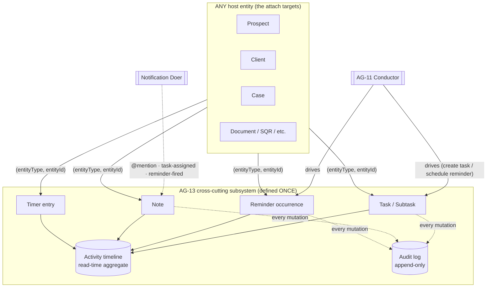
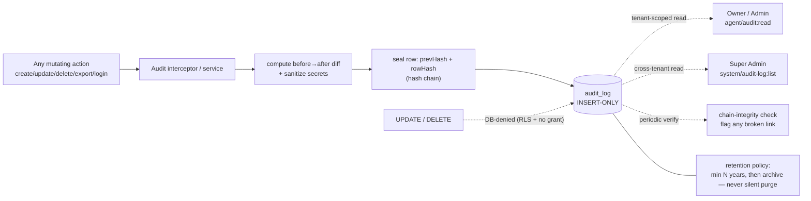

> **Document control** · Version **1.16** · **2026-10-18** · Status: **AG-07 review applied (the product owner, 18 Oct: AG07-D6 staff are notified only when handed work — pointer, with the task-assigned wiring named as "assigned to me"; AG07-D12 no Watcher role, Paralegal folded into Case Officer); previously: AG-16 review second pass applied (AG16-55, AG16-61, AG16-67, AG16-76; the product owner, 17 Oct) — Make task due in 2 working days, "Overdue by person" covers personal-mailbox and WhatsApp threads, with build cards; previously: AG-16 review round 2 applied (AG16-29, AG16-36, AG16-40, AG16-45, AG16-51; the product owner, 15–17 Oct) — task from an email, "Remind me if no reply", "Overdue by person" also lists Waiting-on-us threads, with build cards — for the product owner's review; previously: AG-16 review decisions applied (the product owner, 14 Oct: AG16-7, AG16-14, AG16-21, AG16-22); previously: SA-06 v3.0 closing decisions applied (time-entry, activity-type and note-sharing keys; `agent/note:view.all` retired); SA-06 v3.0 review decision applied (SA6-D6): assignee of a task on a restricted client or case sees the task, parent shows "restricted"; Permission keys renamed and visibility decisions closed (SA-06 v3.0: SA6-D6, SA6-D10, SA6-D11): task visibility keys are `agent/task:view.own` and `agent/task:view.all`; the audit log is read with `agent/audit:read` (firm-wide for its holders, Owner and Admin by default); unassigned tasks are visible to holders of `agent/task:view.all` and `agent/task:assign`; previously (v1.9): Visibility applied (SA6-D6(a), (c): notes, tasks, reminders and time entries on a client or case follow that parent's visibility); before that: Updated — masking and reveal removed (AG7-D10, replaces AG7-D7): personal data is never masked; no reveal or unmask permissions; exports audited as ordinary export events; §13 Q7 closed**\
> Part of: *Agent (RCIC/Lawyer) Console — Functional Requirements* · Split from `FINAL-Agent-FR.md` lines 8421–9051 on 2026-09-16 · Previous version: `_archive/AG-13-tasks-reminders-notes-and-activity-audit_v1.15_2026-10-17.md`\
>
> | Version | Date | Change | Decisions |
> |---|---|---|---|
> | 1.16 | 2026-10-18 | **AG-07 review (the product owner, 18 Oct), wording and pointers only.** **Notifications (AG07-D6):** a case sends a staff notification only when someone is handed work: assigned to me, review requested from me, my review sent back, approval waiting (Needs you). Everything else shows on the case, its timeline and the queue. AG-13 keeps its task wiring: **task assigned** is the "assigned to me" case; AG-13 adds no case-event notification and no control (AG-13-61 pointer to AG-7-39 and AG-16). **Team roles (AG07-D12):** there is no Watcher role and no Paralegal role on a case team; Paralegal is folded into Case Officer, so the persona "Case Officer / Paralegal" is now "Case Officer" (§2). **Left as written, flagged (AG07-D6):** `note-mention`, `reminder-fired` and the orphaned-deadline notice (AG-13-66) are not on the four-item list; they are a person's own @mention, their own reminder, and a notice to people who can reassign cases; the product owner to confirm (open question 17). **Changed:** AG-13-61, §2 persona. No requirement IDs added or withdrawn. *18 Oct (final): AG07-D17 – D21 applied — AG07-D20(g): open question 17 closed; @mentions, self-set reminders and the "deadline nobody is watching" notice are kept.* *18 Oct (later): AG07-D26 / X-3 applied — expiry-watch reminders (X-3) are added to the skip rule: they keep running after the case closes, stop by themselves or with "Stop watching", and can be snoozed; no text in this epic names the target date, so AG07-D26 is a pointer only.* *18 Oct (later): AG01-29 / AG16-105 and gap-check fixes applied — AG01-29(3): suspended staff are treated like deactivated people for new work (AG-13-2, AG-13-64, BR-19, Unassigned tasks, edge case); open tasks stay with a "Suspended" tag.* *18 Oct (later): AG01-30(1) applied — the AG-13-66 alert also goes out when the file owner is suspended (no task, nothing moves); US-14 added with the suspended-assignee test.* | AG07-D6 · AG07-D12 · AG07-D20(g) · AG07-D26 · X-3 · AG01-30 |
> | 1.15 | 2026-10-17 | *Same-day fixes (17 Oct): AG16-83 – AG16-88 — AG-13-68: subject shown only to users who can see the record, "never logged" refers to logs, not screens (item 12).* **AG-16 review, second pass applied (the product owner, 17 Oct): AG16-55, AG16-61, AG16-67, AG16-76 (and AG16-54 #14, AG16-75).** (1) **"Make task" is due in 2 working days** (AG16-61(5)): weekends and the firm's closed days are skipped, on the case's office closed days (AG-13-71 changed; Q15 closed). (2) **"Overdue by person" covers every filed client conversation** — firm mailbox, personal mailbox and WhatsApp — under the record's owner, with subject and age for a personal-mailbox thread (AG16-67; AG-13-68 changed; Q16 closed). (3) **Government-letter tasks:** due 2 working days after the letter is filed, never later than the deadline, shown in My Tasks from creation until done; the rule is AG-10-71 and AG-11-122, one line here (AG16-61; AG-13-5). (4) "Remind me if no reply" is a home-screen item only, never pushed (AG16-54 #14; AG-13-72 wording); it reminds the person and sends nothing to the client (AG16-75, AG16-76). (5) Cards AG-13-68, AG-13-71, AG-13-72 carry "Clicks:" and "Person decides:" lines (AG16-63, AG16-76). **New:** none. **Changed:** AG-13-5, AG-13-68, AG-13-71, AG-13-72, §13. **Closed (AG16-55):** Q16 (with AG16-67); Q15 by AG16-61. **Left open, no stated default:** Q13, Q14. **Withdrawn:** none. *Same-day fixes (18 Oct): AG16-89 — line 467 pointer: threads are assigned one at a time in AG-10 (Assign to…, Take it); AG-13-68 card rule 2: the owner of a Waiting on us thread is the thread owner (the assignee).* *18 Oct: new section 'Decisions that change this epic' (index of AG16 decisions; no requirement changed).* | AG16-54 · AG16-55 · AG16-61 · AG16-63 · AG16-67 · AG16-75 · AG16-76 · AG16-89 |
> | 1.14 | 2026-10-17 | **AG-16 review round 2 applied (the product owner, 15–17 Oct).** (1) **Task from an email (AG16-36):** "Make task" on any email — title from the subject, assigned to the email's owner (AG16-29), due in 2 days, linked to the email (new AG-13-71). (2) **"Remind me if no reply" (AG16-36):** 3 days (default), 7 days or a date; if no reply, the home screen shows "No reply from [client] · N days" and clears itself on reply (new AG-13-72). (3) **"Overdue by person" (AG16-29, AG16-22):** also lists Waiting-on-us threads waiting more than 2 working days; still a list, no alert (AG-13-68 changed). (4) **Pointers (one line each, no new control):** the My Tasks section on the home screen is specified in AG-11-115 (AG-13-5); a case's office time zone and closed days drive the clocks once a second office exists, AG-11-119 (AG-13-69, BR-3). **New:** AG-13-71, AG-13-72 with build cards; open questions 13 to 16. **Changed:** AG-13-5, AG-13-68, AG-13-69, BR-3, §7 `Task` and `Reminder`, §12. **Closed:** none (no open question of this document is answered by AG16-24 to AG16-53). **Withdrawn:** none. | AG16-22 · AG16-29 · AG16-36 · AG16-40 · AG16-45 · AG16-51 |
> | 1.13 | 2026-10-14 | **AG-16 review decisions applied (the product owner, 14 Oct).** (1) **Overdue-task escalation to a manager is withdrawn (AG16-22):** AG-13-7, BR-20, the opt-in rule builder and the "manager" concept are gone. The assignee is reminded; a new **"Overdue by person"** list on the team view lets the Owner check anytime (new AG-13-68). Push alerts to others are for government deadlines and overdue Needs-you items only (owned by AG-16 / AG-11); a task linked to a government deadline is covered by the deadline alert (one alert, not two). AG17-D57 is superseded. (2) **Notifications follow each person's own settings (AG16-14):** no firm notification matrix; AG-13-61 adjusted. (3) **Deleting notes and tasks (AG16-21):** Undo, then 30 days in Recently deleted; the deleter, Owner and Admin restore; a deleted client-visible note leaves the portal at once; the activity log is never deletable (new AG-13-70). (4) **Due dates counted in working days use the firm's closed days and move earlier, never later (AG16-7);** government dates never move (new AG-13-69). Changed: §2 persona, §3.1 world-class bullet, AG-13-7 (withdrawn), AG-13-24, AG-13-61, BR-3, BR-10, BR-14, BR-20 (withdrawn), §6 Note lifecycle, §7 cross-cutting line, §9 (two escalation edge cases), §12 (two lines), §13 Q9 (superseded). New: AG-13-68, AG-13-69, AG-13-70; open questions 10–12. | AG16-7 · AG16-14 · AG16-21 · AG16-22 |
> | 1.12 | 2026-10-07 | SA-06 v3.0 closing decisions (the product owner, 7 Oct; owned by SA-06 v3.0). **Time entries:** `agent/time-and-activity:*` is replaced by five keys, `agent/time-entry:view.own`, `:view.all`, `:create`, `:edit`, `:delete`; defaults: `view.own`, `create` and `edit` on all six starter roles except Read-only, which gets `view.own` only; `view.all` on Owner, Admin, Case Manager and Billing / Finance; `delete` on Owner, Admin and Case Manager. A time entry attached to a client or case still follows that parent's visibility. **Activity types:** `agent/time-and-activity/type:*` is replaced by `agent/activity-type:manage` (Owner and Admin). **Notes:** `agent/note:reveal-client` is renamed `agent/note:share-with-client`; the code `agent/note:view.all` is retired (notes follow their parent's visibility). Changed: §10 (honesty note and key rows) and the notes bullet that names the `client-visible` permission. Requirement IDs unchanged. | SA6-D10 |
> | 1.11 | 2026-10-07 | SA-06 v3.0 review decision SA6-D6 (the product owner, 7 Oct; owned by SA-06 v3.0). **Closed the open item in AG-13-67:** a user assigned a task attached to a client or case they cannot open sees the task and its title; the parent shows "restricted"; the assignee can complete the task; nothing else of the parent is shown. Changed: AG-13-67, AG-13-5, BR-21, §10 `agent/task:view.own`, edge cases (one new bullet). Requirement IDs unchanged. | SA6-D6 |
> | 1.10 | 2026-10-07 | Permission renames and visibility resolutions from SA-06 v3.0 (the product owner, 7 Oct; SA6-D6, SA6-D10, SA6-D11, Appendix B; decisions owned by SA-06). **Renamed (each "was" is in §10):** `agent/task:list` is now `agent/task:view.own`; `agent/task-all:list` is now `agent/task:view.all` (seeded on all six starter roles); `agent/audit-log:list` is now `agent/audit:read` (merged with AG-16's `agent/settings/audit:list`); the code key `agent/note:write` is replaced by `agent/note:create`, `agent/note:edit` and `agent/note:delete`, which this module already lists. `agent/audit-log:reveal-pii` stays withdrawn. `system/audit-log:list` (Super Admin) is not in Appendix B and is unchanged. Text that named `agent/prospect:view-all` and `agent/case:view-all` now uses the dotted keys (`agent/prospect:view.all`, `agent/case:view.all`). **Resolved (no longer open):** (1) the audit log is firm-wide for holders of `agent/audit:read`, seeded on Owner and Admin (SA6-D11); an audit row about a record the viewer cannot otherwise see stays visible to holders; the v1.9 "flagged" wording and the Applied-from open item are removed; (2) an unassigned task is visible to holders of `agent/task:view.all` and of `agent/task:assign` (AG-13-62, AG-13-67, BR-21), and the "unassigned task attached to nothing" open item is closed; (3) a note or task on a prospect follows the prospect's visibility (SA6-D6). **Names:** "Manager" (role) is now "Case Manager"; "firm admin" is now "Admin" / "holder of `agent/audit:read`" (SA6-D5). Requirement IDs unchanged. One v1.9 item stays open and is not decided by SA-06: what an assignee sees of a task whose parent record they cannot see (AG-13-67). | SA6-D6 · SA6-D10 · SA6-D11 · SA6-D5 |
> | 1.9 | 2026-10-07 | Founder decisions on record visibility (7 Oct, the product owner; owned by SA-06 v3.0). **Attached records follow their parent:** a note, task, reminder or time entry attached to a client or case is visible exactly to the users who can see that client or case (AG-07 shared-core visibility check, AG-7-88); one attached to a prospect follows the prospect (AG-2-64). **Tasks not attached to a client or case** keep the existing pair: `agent/task:list` shows the user's own, `agent/task-all:list` shows every firm task, and `agent/task-all:list` is seeded on all six starter roles. "My Tasks" still shows the user's own items. The timeline and Unassigned list apply the same rule. New: AG-13-67, BR-21. Changed: AG-13-5, AG-13-30, AG-13-62, §3.1 (My Tasks and Unassigned paragraphs), §10 (`agent/task:list`, `agent/task-all:list`, `agent/note:list`, `agent/reminder:list`, `agent/timeline:list`, Enforcement). (Audit visibility: closed in v1.10 — SA6-D11.) | SA6-D1, SA6-D6 |
> | 1.8 | 2026-10-05 | Knock-on from AG7-D7 (the product owner, 5 Oct, owned by AG-07 v2.3). Restricted fields (passport, financial and others) show **in full on screens** to users who may see the record, and are **masked** in lists, search, exports, notifications/emails, reports and logs; an **unmasked export** needs the platform-wide `agent/pii:export-unmasked` (owned by SA-06's catalogue) and is audited. The audited "PII reveal" event becomes an **"unmasked export"** event. The audit viewer shows masked values; an unmasked audit export needs `agent/pii:export-unmasked`. Changed: §1 text, §3.0 diagram label and design implication, §3.5 text and module-status row, AG-13-43, BR-12, `AuditLog` category and action, US-10, §9 edge case, `agent/audit-log:reveal-pii` **withdrawn** (row kept), §10 enforcement, §11 PII and audit bullets, §12 audit lines, §13 Q7 (**decided**, struck through). Added: row `agent/pii:export-unmasked`. Same day (AG7-D10, the product owner, 5 Oct; replaces AG7-D7): masking and reveal removed. Personal data is never masked on screens, lists, search, exports, reports or the audit viewer; there are no reveal actions. `agent/audit-log:reveal-pii` and `agent/pii:export-unmasked` are marked **withdrawn — AG7-D10** (rows kept). The `UNMASKED_EXPORT` category and `EXPORT_UNMASKED` action are removed from `AuditLog`; exports are audited as ordinary export events. Changed: §1 text, §3.0 diagram label and design implication, §3.5 text and module-status row, AG-13-43, BR-12, `AuditLog` enums, US-10, §9 edge case (withdrawn), §10 enforcement, §11 PII and audit bullets, §12 audit line, §13 Q7. Kept: personal data never in system logs or traces; passport and financial numbers never in email, WhatsApp or notification content; secrets sanitised in audit payloads; internal-note client wall (`note:reveal-client`). | AG7-D7, AG7-D10 |
> | 1.7 | 2026-10-03 | Consistency review fixes (3 Oct): §3.2 states that standard deadlines are registered directly with the Minder by any module, always on, with no firm set-up, and the Conductor drives only firm-designed reminders (AG-11-47, AG17-D70); the "skip if the case is closed" rule now excepts reminders on recorded dates such as permit expiry (AG-7-34, AG17-D63); AG-13-65 cites AG17-D55 and AG17-D70 (was AG17-D38); AG-13-66 notifies users holding `agent/case:assign` (was `agent/task:assign`); BR-20 no longer mentions an at-risk mark from overdue tasks; "My-Work" renamed "My Tasks" throughout (AG17-D61); open question 9 closed by AG17-D81 (target = users who can reassign cases; 2 days before and on the day; no further settings); named deferrals and demo wording moved to Release terms (AG17-D60); "Applied from AG-17" table added. | AG17-D55, AG17-D56, AG17-D60, AG17-D61, AG17-D63, AG17-D70, AG17-D81 |
> | 1.6 | 2026-10-02 | AG-17 decisions applied: "My Tasks" is never filtered by the Individual / Corporate view and each task shows a type label (individual / corporate); tasks can be created from dated case items (owner + due date + link to the file), including standard deadlines registered with the Minder, and completing in either place completes both; when a standard deadline's owner is deactivated the task is created unassigned and the firm's reassign-capable users are notified; manager escalation of overdue tasks is now opt-in per firm, off by default. Changed: AG-13-5, AG-13-7, AG-13-62. New: AG-13-65, AG-13-66, BR-20. | AG17-D6, AG17-D10, AG17-D56, AG17-D57, AG17-D70 |
> | 1.5 | 2026-10-02 | Applied AG17 terminology/consistency changes (safe set): separate corporate prospect / corporate case host types collapsed to prospect / case + client type; personal work list named "My Tasks"; AG-13-63 handover text corrected (only owned, dated LMIA work lives in tasks; checklist items move with the case). | AG17-D4, AG17-D61, AG17-D10 |
> | 1.4 | 2026-10-01 | Label tidy: the staff-leaving section heading now cites AG-01 v1.4 (was v1.2). Requirements unchanged. | — |
> | 1.3 | 2026-10-01 | Knock-on from AG-01 v1.3 (decisions revised by the product owner, 1 Oct): deleted users shown "(Deleted) Name" on past task assignments (AG-13-64, BR-19, edge case); all staff-leaving deferral markers and interim wording removed from AG-13-62, AG-13-63, §3.1, edge cases and the applied table. | AG1-D1, AG1-D13 |
> | 1.2 | 2026-10-01 | Knock-on from AG-01 v1.2 (staff leaving): §3.1 and AG-13-1, AG-13-2 changed (assignee optional); AG-13-62 to AG-13-64 added; BR-15 changed; BR-19 added; entity and edge cases updated | AG1-D1, AG1-D4, AG1-D5, AG1-D6, AG1-D7, AG1-D13 |
> | 1.1 | 2026-08-28 | Baseline — complete document v1.1 | — |

## Decisions that change this epic (14–18 Oct) *(new 18 Oct)*

Product-wide rules (apply here as everywhere; home: Agent `00-Overview` → "Product rules every epic follows"): AG16-33, AG16-42, AG16-60, AG16-63, AG16-76, AG16-89.

The "AG16" prefix is historical: these decisions began in the AG-16 review and apply across the product. Full text: `TEMPLATE-MAP-working_2026-10-10.md`.

| Decision | What was decided (one line) | What it changes in this epic | Where (requirement / card / section) |
|---|---|---|---|
| **AG16-6** | Business hours and closed days | Working-day due dates counted back from a government date use the firm's business hours and closed days | AG-13-69 |
| **AG16-7** | A reminder or approval due date on a closed day moves earlier, never later | New: a due date counted in working days back from a government date lands on the last open day on or before; the government date never moves; template due dates in working days raise question 11 | AG-13-69 (new), BR-3, §13 Q11 |
| **AG16-14** | Staff notifications: personal settings only | Each person's own settings decide the channel; no firm-wide notification matrix | AG-13-61, §7, §12 |
| **AG16-21** | Undoing deletes | A deleted note or task shows Undo and sits 30 days in Recently deleted; the deleter, Owner and Admin restore; the activity log is never deletable; question 10 asks which key restores | AG-13-24, AG-13-70 (new), BR-10, BR-14, §6, §13 Q10 |
| **AG16-22** | One escalation rule: push the high-stakes, show the routine | Opt-in overdue-task escalation to managers withdrawn (AG-13-7, BR-20; AG17-D57 superseded); an "Overdue by person" list on the team view shows the rest | AG-13-7 (withdrawn), AG-13-68 (new, card), BR-20 (withdrawn), §2, §3.1, §9, §13 Q9 |
| **AG16-24** | Own mailbox and own calendar on every plan | Cited — see change-log row 1.14 (named only as the start of the range "AG16-24 – AG16-53"); the row records that no open question of this document is answered by that range | Change log row 1.14 |
| **AG16-26** | Email filing order | Referenced only (no change here): "Remind me if no reply" counts any inbound email on the same thread as a reply | AG-13-72 (card rule 3) |
| **AG16-29** | Who's handling a firm-mailbox email (D6, option B) | Threads waiting on us more than 2 working days show on the owner's home screen and on the Owner's "Overdue by person" view, with no extra alerts; a task made from an email is assigned to the email's owner | AG-13-68, AG-13-71, §13 |
| **AG16-33** | Standing rule: AI reads, rules check, a person confirms; core works without AI | Cited in the Decision line of AG-13-71; no separate change stated — Cited, see AG-13-71 | AG-13-71 (card) |
| **AG16-36** | "Make task" and "Remind me if no reply" | New: "Make task" on an email (title pre-filled, assigned to the email's owner, linked to the email) and "Remind me if no reply" | AG-13-71 (new, card), AG-13-72 (new, card), §13 |
| **AG16-40** | The home screen is the one place to start | My Tasks is a section of the home screen (specified in AG-11-115); the full list stays here | AG-13-5 |
| **AG16-42** | "Quiet by default", plus telling the client | "Overdue by person" pushes nothing; "Remind me if no reply" is a home-screen item only, no email or in-app notification | AG-13-68, AG-13-72 (cards: Safety) |
| **AG16-45** | Office time zones and escalation by office | Once a second office exists, the case's office time zone and closed days drive the due-date clocks | AG-13-69, BR-3 |
| **AG16-51** | Three trims to avoid over-building | No escalation by office; "Overdue by person" is a list, not an alert | AG-13-68 (card rule 6), AG-13-72 (card), AG-13-69 |
| **AG16-53** | Video links are per person; no firm video account | Cited — see change-log row 1.14 (named only as the end of the range "AG16-24 – AG16-53"); no AG-13 requirement text names it | Change log row 1.14 |
| **AG16-54** | 25 consistency fixes after the 17 Oct write | #14: "Remind me if no reply" is a home-screen item only, never pushed | AG-13-72 (card), §13 |
| **AG16-55** | Writers' recommended defaults accepted for the detail questions | Questions 15 and 16 closed; questions 13 and 14 stay open with no stated default | §13 Q13–Q16 |
| **AG16-60** | Standing rule: a duplicate beats a miss | "Overdue by person" lists a client message in a personal mailbox rather than risk missing it | AG-13-68 (card rule 10) |
| **AG16-61** | Due date and visibility of the task made from a government letter | "Make task" is due in 2 working days (weekends and the case office's closed days skipped); letter tasks are due 2 working days after filing, never later than the deadline, and show in My Tasks until done (rule lives in AG-10-71 and AG-11-122); question 15 closed | AG-13-5, AG-13-71, §13 Q15 |
| **AG16-63** | Design checks every requirement must pass | Cards changed in v1.15 carry a "Clicks:" line | AG-13-68, AG-13-71, AG-13-72 (cards) |
| **AG16-67** | "No reply" signals kept as layers; "Waiting on us" covers every client conversation | "Overdue by person" covers every filed client conversation (firm mailbox, personal mailbox, WhatsApp) under the record's owner; a personal-mailbox thread shows subject and age; question 16 closed | AG-13-68 (card), §13 Q16 |
| **AG16-75** | "Remind [client] until they confirm" dropped; the officer decides | "Remind me if no reply" reminds the person only and sends nothing to the client | AG-13-72 (card) |
| **AG16-76** | Standing rule: help people, don't replace them | Cards carry a "Person decides:" line; ExpatReady never makes a task by itself | AG-13-68, AG-13-71, AG-13-72 (cards) |
| **AG16-82** | One rule for every broken connection | Cited — see §"Applied from the AG-16 review, second pass" (named only as the end of the range "AG16-54 to AG16-82"); no AG-13 requirement text names it | Existing decisions table (second pass) |
| **AG16-83** | 26 follow-through fixes after the second pass | Item 12: in "Overdue by person" the subject is shown only to users who can see the record; "never logged" means not written to logs, not hidden from screens | AG-13-68 (card) |
| **AG16-88** | Release 1 is English-first; French later | Cited — see change-log row 1.15 (named only as the end of the range "AG16-83 – AG16-88"); no AG-13 requirement text names it | Change log row 1.15 |
| **AG16-89** | Simplified mailbox model: assign and file, the firm manages its own queue | The owner of a "Waiting on us" thread is the thread's assignee (else the record's owner); threads are assigned one at a time in AG-10 ("Assign to…", "Take it") | AG-13-68 (card rule 2, line on bulk reassignment) |
| **AG07-D6** | Staff notifications only when someone is handed work (assigned to me, review requested from me, my review sent back, approval waiting) | Pointer only: AG-13 adds no case-event notification; task assigned is the "assigned to me" notification; the rule is AG-7-39 and personal choices are AG-16 | AG-13-61 (pointer), §13 Q17 |
| **AG07-D20(g)** | Notifications kept beyond AG07-D6: @mentions, reminders a person set for themselves, "client messaged me" (AG-10), "a deadline nobody is watching". | `note-mention`, `reminder-fired` and the orphaned-deadline notice (AG-13-66) are kept as written; open question 17 closed. No requirement text changes beyond the AG-13-61 wording. | AG-13-61, §13 Q17 |
| **AG07-D12** | Team roles: Watcher dropped, Paralegal folded into Officer | The persona "Case Officer / Paralegal" becomes "Case Officer"; no Watcher or Paralegal role is referred to in tasks, reminders or notes | §2 personas |
| **AG07-D26** | Target filing date (renames the target date); "Step done"; reminders follow a changed date | Pointer only: no text in this epic names the target date. Its reminders (2 days before, on the day; "Past target filing date" in Needs you) are specified in AG-11-126 and AG-07; a government step's "Step done" stops its reminders (AG-11-125) | None (pointer; AG-11-126, AG-11-125) |
| **X-3** | Expiry watch (placeholder; rules in AG-11 §3.4a) | The skip rule exempts expiry-watch reminders (they run after the case closes and stop by themselves or with "Stop watching"); Snooze applies to them | §3.2 skip-if-no-longer-relevant paragraph |
| **AG01-30(1)** | Deadline on a suspended person's case *(the product owner, 18 Oct)* | A standard deadline whose reminder would go to a suspended person alerts the holders of `agent/case:assign` (as AG-13-66 does for a deactivated owner); the suspended person gets nothing; no work moves | AG-13-66, §3.1 Unassigned tasks, edge cases, US-14 |
| **AG01-29(3)** | Suspended staff get no new work *(the product owner, 18 Oct)* | A suspended person is treated like a deactivated one for new work only: not offered as an assignee, automation tasks for them are created unassigned, no notifications; their open tasks stay with them with a "Suspended" tag beside their name | AG-13-2, AG-13-64, BR-19, §3.1 Unassigned tasks, edge cases |

## Module AG-13: Tasks, Reminders, Notes & Activity / Audit

**Applied from SA-06 v3.0 (record visibility, naming and audit, 2026-10-07)** (decisions owned by `SA-06` v3.0):

| ID | Decision | Applied here |
|---|---|---|
| **SA6-D1** | Visibility is open by default; a firm makes a role own-only by removing the "see all" keys, which are seeded on all six firm starter roles (Owner, Admin, Case Manager, Case Officer, Billing / Finance, Read-only) | AG-13-67 · §10 |
| **SA6-D6(a)** | Notes, tasks, reminders and time entries attached to a client or case are visible exactly to those who can see that client or case (AG-07 shared-core visibility check, AG-7-88; AG-07 adds `agent/case:view.all` in v2.4) | AG-13-67 · BR-21 · AG-13-30 · AG-13-62 · §10 |
| **SA6-D6(b)** | Notes and tasks on a prospect follow the prospect's visibility (`agent/prospect:view.all` / `agent/prospect:view.own`, AG-2-64) | AG-13-67 · BR-21 |
| **SA6-D6(c)** | Tasks not attached to a client or case: `agent/task:view.own` (own; was `agent/task:list`) and `agent/task:view.all` (all firm tasks; was `agent/task-all:list`, seeded on all six starter roles). **Unassigned tasks are visible to holders of `agent/task:view.all` and of `agent/task:assign`** *(closed v1.10)* | AG-13-5 · AG-13-62 · AG-13-67 · BR-21 · §10 |
| **SA6-D10** *(v1.10)* | Naming rule: one kebab-case resource, one action, `view.own` / `view.all` qualifiers; old-to-new map in SA-06 Appendix B. Applied: `agent/task:list` to `agent/task:view.own`; `agent/task-all:list` to `agent/task:view.all`; `agent/audit-log:list` to `agent/audit:read`; code key `agent/note:write` to `agent/note:create` + `agent/note:edit` + `agent/note:delete` | §10 · AG-13-5 · AG-13-44 · AG-13-67 · BR-21 |
| **SA6-D11** *(v1.10)* | The audit log is firm-wide for holders of `agent/audit:read`, seeded on Owner and Admin | §3.5 · AG-13-44 · §10 · US audit scenario |
| **SA6-D10** *(v1.12)* | Closing decisions: `agent/time-and-activity:*` becomes `agent/time-entry:view.own`, `:view.all`, `:create`, `:edit`, `:delete`; `agent/time-and-activity/type:*` becomes `agent/activity-type:manage`; `agent/note:reveal-client` becomes `agent/note:share-with-client`; `agent/note:view.all` is retired (notes follow parent visibility). Time-entry defaults are in §10 | §10 |
| **SA6-D5** *(v1.10)* | Six starter roles: Owner, Admin, Case Manager, Case Officer, Billing / Finance, Read-only; "Manager" (role) is "Case Manager"; "Firm Admin" is "Admin" | §2 personas · §3.5 · US-7 |
| **SA6-D6 (assignee)** *(v1.11)* | A user assigned a task attached to a client or case they cannot open sees the task and its title; the parent shows "restricted"; they can complete it; nothing else of the parent shows | AG-13-67 · AG-13-5 · BR-21 · §10 · edge cases |

**Applied from AG-16 review (the product owner, 14 Oct 2026)** (decisions recorded in the Super Admin template map, section "AG-16 review — decisions"):

| ID | Decision | Applied here |
|---|---|---|
| **AG16-22** | One escalation rule, owned by AG-16 / AG-11. Overdue tasks are not pushed to others: the assignee is reminded and an "Overdue by person" list on the team view shows the rest. A task linked to a government deadline is covered by the deadline alert. AG-13-7 (opt-in task escalation to the manager) is withdrawn; AG17-D57 is superseded. | AG-13-7 (withdrawn) · AG-13-68 · BR-20 (withdrawn) · §2 · §3.1 · §9 · §13 Q9 |
| **AG16-14** | Staff notifications follow personal settings only; no firm matrix. | AG-13-61 · §7 |
| **AG16-21** | Undo + 30-day Recently deleted for notes and tasks; the deleter, Owner and Admin restore; the activity log is never deletable. | AG-13-24 · AG-13-70 · BR-10 · BR-14 · §6 |
| **AG16-7** | A due date counted in working days back from a government date lands on the last open day on or before the computed day; the government date never moves. | AG-13-69 · BR-3 |

**Applied from the AG-16 review, round 2 (the product owner, 15–17 Oct 2026)** (decisions in the Super Admin template map, section "AG-16 review — decisions"):

| ID | Decision | Applied here |
|---|---|---|
| **AG16-29** | Waiting on us: threads waiting more than 2 working days show on the owner's home screen and on the Owner's "Overdue by person" view; no extra alerts | AG-13-68 |
| **AG16-36** | "Make task" and "Remind me if no reply" | AG-13-71 · AG-13-72 |
| **AG16-40** | My Tasks is a section of the home screen (specified in AG-11) | AG-13-5 |
| **AG16-45, AG16-51** | Case's office time zone and closed days drive the clocks; no escalation by office | AG-13-69 · BR-3 |

**Applied from the AG-16 review, second pass (the product owner, 17 Oct 2026)** — decisions AG16-54 to AG16-82; AG-13 applies the parts that touch tasks and the team view:

| ID | Decision | Applied here |
|---|---|---|
| **AG16-55** | Writers' defaults close detail questions | §13 Q15, Q16 |
| **AG16-61** | Letter task and "Make task" due in 2 working days; letter task visible at once | AG-13-5 · AG-13-71 |
| **AG16-67** | "Waiting on us" covers firm mailbox, personal mailbox and WhatsApp | AG-13-68 |
| **AG16-54 #14, AG16-75, AG16-76** | "Remind me if no reply" is home-screen only; help people, don't replace them | AG-13-72 |

**Applied from AG-17 (Corporate Cases & LMIA, 2026-10-02; table added 2026-10-03)** — decisions owned by AG-17 / the Corporate LMIA decision log:

| ID | Decision | Applied here |
|---|---|---|
| **AG17-D6** | "My Tasks" is never filtered by the Individual / Corporate view; each task shows a type label | AG-13-5 |
| **AG17-D10** | Tasks are created from dated case items that have an owner and a due date; completing either completes both | AG-13-65 |
| **AG17-D55 / D70** | Standard deadlines are registered directly with the Minder by any module, always on; the Conductor drives only firm-designed reminders; ~~escalation is opt-in~~ *(escalation part superseded v1.13 — AG16-22)* | §3.2 · AG-13-7 · AG-13-65 · BR-20 |
| **AG17-D56** | A standard deadline on a file whose owner is deactivated: unassigned task, plus the firm's users who can reassign cases are notified | §3.1 · AG-13-66 |
| **AG17-D57** | ~~Overdue-task escalation to managers is opt-in per firm, off by default~~ *(superseded v1.13 — AG16-22)* | AG-13-7 · BR-20 |
| **AG17-D61** | The personal work list is named "My Tasks" everywhere | whole module |
| **AG17-D63** | Reminders on recorded dates (e.g. permit expiry) keep working after the case closes | §3.2 skip rule |
| **AG17-D81** | When escalation is on there are no further settings: users who can reassign cases are alerted 2 days before a standard deadline and on the day *(the escalation rule now lives in AG-16 / AG-11 — AG16-22)* | §13 open question 9 |

**Applied from AG-01 v1.3 (staff leaving, 2026-10-01)** — decisions owned by AG-01 (Firm Setup & Onboarding) v1.3 §0:

| ID | Decision | Applied here |
|---|---|---|
| **AG1-D1** | A firm may delete a staff member only once deactivated; history stays, shown "(Inactive) Name", or "(Deleted) Name" once the firm deletes the deactivated user | AG-13-64 · BR-19 |
| **AG1-D4** | No new work to a deactivated person; automation tasks for them are created unassigned | §3.1 · AG-13-1, AG-13-2 changed · AG-13-64 · BR-15 changed · BR-19 · edge cases |
| **AG1-D5** | Handover lists open tasks (incl. LMIA checklist work), one new owner | AG-13-63 |
| **AG1-D6** | Handover offers only eligible staff by permission; everyday assignment (AG-13-2) unchanged | AG-13-63 |
| **AG1-D7** | Skipped work goes to the Unassigned list and home-screen badge | §3.1 · AG-13-62 |
| **AG1-D13** | Nothing is deferred: the handover prompt, eligible-owner filter, Unassigned list and badge all ship in the MVP; bulk reassign (AG-13-6, US-7) stays for other cases | AG-13-62, AG-13-63 |

### Module Index

Scan the whole module in ~30 seconds; jump to any part.

1. **Purpose & Goal**
2. **Users & Jobs-to-be-Done**
3. **Functional Design — How It Works** (core)
   - 3.0 The polymorphic attach model (the foundation: one pattern, every entity) · 3.1 **Tasks (Tasker)** — create/assign, due/priority/status, checklists & subtasks, templates, My Tasks · 3.2 **Reminders (Reminder/Minder)** — time-based nudges, snooze, recurring, timezone-aware · 3.3 **Notes** — rich text, @mention, pin, internal-only vs client-visible · 3.4 **Activity / Timeline** — the unified per-entity feed (read-time aggregation, cursor, event sources) · 3.5 **Audit Log** — immutable, append-only, tamper-evident compliance log · 3.6 **Timer (billable time)** — related-but-distinct Doer (brief) · 3.7 **Consolidating the four redundant activity modules** (the honest cleanup) · 3.8 The Conductor ↔ AG-13 interface (who owns what)
4. **Detailed Functional Requirements** (AG-13-x)
5. **Business Rules & Logic**
6. **States & Lifecycle**
7. **Key Entities & Fields**
8. **User Stories + Acceptance Criteria**
9. **Edge Cases & Validations**
10. **Permissions** (LOCAL `agent/*`)
11. **Scalability · Security · Performance** (per function)
12. **Reference Note** (exists / NEW / changed)
13. **Open Questions / Founder Decisions**

### Visual Overview

**A. The cross-cutting subsystem — defined once, attached to ANY entity.** Tasks, Reminders, Notes, Activity and Audit are not five features bolted onto five modules; they are **one subsystem** every other module reuses through a single polymorphic key `(entityType, entityId)`:



**B. Task lifecycle** (the behavioural state machine; labels are firm-configurable, *kind* is the invariant):

```mermaid
stateDiagram-v2
    [*] --> Open : create (manual / template / Conductor)
    Open --> InProgress : start work
    InProgress --> Open : reopen / unstart
    Open --> Completed : complete (all required subtasks done)
    InProgress --> Completed : complete
    Open --> Cancelled : cancel (reason)
    InProgress --> Cancelled : cancel (reason)
    Completed --> Open : reopen (audited)
    Cancelled --> [*]
    Completed --> [*]
    note right of Completed : completedAt + completedBy stamped;<br/>may advance a Conductor sequence (two sides, one wire)
    note right of Open : dueDate evaluated in firm/office timezone;<br/>overdue is a derived flag, not a stored state
```



**C. Audit — the append-only, tamper-evident model** (no UPDATE, no DELETE; integrity by hash-chain — TARGET):



> `Task · Reminder · Note · Timer · Activity · Audit` attach to a host (`Prospect / Client / Case / Document / …`) (a corporate case or prospect is a case or prospect whose client type is Corporate — AG17-D4) via the polymorphic `(entityType, entityId)` pattern — **defined here (this is the module that defines it)** and reused by every other module. Where today's code uses four named FK columns instead, §12 maps the change.

---

### 1. Purpose & Goal

**What it is.** AG-13 is the **connective tissue of the whole product** — the place where *work to be done*, *things to remember*, *what was said*, *what happened*, and *who did what* live. It is not a destination module a user navigates to and "uses" the way they use the CRM or the case workspace; it is the **subsystem that makes every other module feel alive and accountable**. Open a prospect, a client, a case, a document checklist — the tasks, the reminders, the notes, the timeline, and (for admins) the audit trail you see there are all AG-13, rendered in context.

**The business outcome it must produce.** Immigration firms are **deadline-and-accountability businesses**. A missed biometrics deadline, a forgotten medical-exam expiry, an unanswered client question, a "who changed this client's date of birth and when" with no answer in a regulator audit — these are not annoyances, they are **liability, lost cases, and lost licences**. AG-13 exists to make four things structurally true:
1. **Nothing that must be done is forgotten** — every obligation is a Task with an owner and a due date, surfaced in a *My Tasks* queue, and (when it matters) backed by a Reminder that nudges before the cliff.
2. **Nothing that must be remembered is lost** — reminders are timezone-correct, recurring where needed, and survive staff turnover because they live on the *entity*, not in someone's head.
3. **The full story of a relationship or a case is reconstructable in seconds** — one unified, filterable timeline per entity (the "golden thread").
4. **Every consequential action is provable** — an immutable, tamper-evident audit log answers "who did what to which record, when, and what changed," including who exported client data *(changed v1.8 — AG7-D10)*.

**Why it matters / world-class positioning.** A generic CRM gives you a notes box and a tasks list per record, and an "activity feed" that is really just a log of CRM events. Expat Ready's AG-13 is built to a **regulated-profession, multi-tenant, global** bar: notes that distinguish **internal-only from client-visible** (so a candid case note never leaks to the portal), reminders that respect **the office's timezone and the country's deadline semantics**, a timeline that **aggregates across every Doer** (calls, emails, documents, payments, e-sign), and an audit log engineered for **PIPEDA/Law-25 evidentiary value** — append-only, tamper-evident, with **every export itself logged** *(changed v1.8 — AG7-D10)*. This is the difference between a tool a solo RCIC tolerates and a system of record a 50-seat firm can defend in front of the regulator.

**How it ties to the journeys.** In Client A's **revenue journey**, AG-13 is the call task that satisfies speed-to-lead, the "follow up in 3 days" reminder, the consult note, the timeline that lets any rep pick up where another left off. In her **case-delivery journey**, it is the document-request task, the biometrics-deadline reminder, the case-officer's internal note, the client-visible status note, the billable Timer entry on her file, and the audit row proving the RCIC — not an unlicensed staffer — gave the advice. **Every other module composes AG-13; AG-13 composes none of them.**

**Global ambition (founder's core point).** The same subsystem serves a solo RCIC provisioned for Canada and a firm provisioned for Australia or the UK with **no code change per country** (FD-68 — the platform is multi-country, a firm is not): task due-dates and reminder fire-times are evaluated in the **firm/office timezone with business-hours awareness**; note and reminder copy is **per-locale**; "deadline" semantics (what a date *means*) come from the firm's **Country Pack** (immigration values → SME), never hardcoded. Single-timezone is the degenerate case.

---

### 2. Users & Jobs-to-be-Done

AG-13 is used by **every** firm role, because every role does work, remembers things, writes notes, and is audited. JTBD framing keeps it honest.

| Role | Primary job in AG-13 | Jobs-to-be-done (representative) |
|---|---|---|
| **Intake / Sales Rep** | Never drop a follow-up; keep the lead's story complete. | "When I finish a call, I want to log a note and set a 'call back Thursday' reminder in two keystrokes, so the next touch isn't lost." · "When I start my day, I want one queue of every task due across all my leads, in my timezone." |
| **Case Officer** *(changed 18 Oct — AG07-D12: Paralegal folded into Officer)* (heaviest task/note user) | Drive a case to filing without missing a deadline; keep candid and client-safe notes apart. | "When a case opens, I want a checklist of tasks auto-created from a template with due dates anchored to the file-open date." · "When I jot a risk on the file, I want it **internal-only** so it never shows in the client portal." · "When biometrics are due in 30 days, I want a reminder I can snooze if the client asks for time." |
| **RCIC / Consultant** | Own advice and accountability; supervise. | "When I give advice, I want it on the timeline and in the audit trail attributed to me (the licensed person), not a staffer." · "When I review a junior's file, I want to see every action taken and reassign overdue tasks." |
| **Case Manager / Team Lead** *(changed v1.10 — SA6-D5; was Manager / Team Lead)* | Keep the team on top of work; spot slippage. | "When I review the team, I want to see overdue tasks by person and reassign in bulk." · ~~"If my firm has switched escalation on, I want overdue work to escalate to me automatically."~~ *(withdrawn v1.13 — AG16-22; the Owner checks the "Overdue by person" list on the team view, AG-13-68)* |
| **Owner / Principal RCIC** | Own the firm's compliance posture. | "When the regulator or a client disputes something, I want an immutable audit trail proving who did what and when — including who viewed sensitive data." · "When staff leave, I want their reminders and tasks to survive on the records." |
| **Accounts / Billing** | Capture billable effort; touch the audit edge. | "When I or a consultant spend time on a file, I want a Timer entry that flows to the invoice." (Owns billing; consumes AG-13's Timer + audit.) |
| **Client** (portal — read-restricted) | See only what's meant for them. | "When I log in, I want to see the status notes and tasks my firm shared with me — and *never* their internal notes." (Client-visibility flag is the guardrail.) |
| **Super Admin** (CONTROL plane — out of LOCAL scope, consumes audit) | Platform oversight & incident forensics. | "When investigating an incident, I want a cross-tenant audit read." (Separate `system/*` permission; never a firm user.) |

**Design implication.** There is **no single "AG-13 screen."** The subsystem manifests as **contextual panels** on every host entity (Tasks tab, Notes tab, Activity/Timeline tab, Reminders inline) **plus** two cross-entity surfaces: the rep/officer **"My Tasks" queue** (all my tasks + reminders, ranked, timezone-aware) and the admin **Audit Log viewer**. Permissions (§10) cleanly separate "do work" from "see all firm work" from "read the audit" *(changed v1.8 — AG7-D10)*.

---

### 3. Functional Design — How It Works (core)

This is the heart of the spec. Each sub-function is designed in depth: **how it works**, the **world-class behaviour**, the **key screens & interactions**, and the **data flow**.

#### 3.0 The polymorphic attach model — the foundation everything else sits on

**Design decision: one polymorphic key `(entityType, entityId)` for every cross-cutting record.** A Note, Task, Reminder, Timer entry, Activity event, or Audit row is attached to its host by a **type discriminator + an id** — not by a dedicated column per host type. This is the single most important structural decision in the module, and it is the **explicit rebuild change** (§12): today the code uses **four nullable FK columns** (`caseId`, `corporateCaseId`, `prospectId`, `corporateProspectId`) on every cross-cutting table, which means **every new attachable entity (Client, Document, SQR, Invoice…) requires a schema migration on five tables and edits to five services**. That does not scale and it is why these modules are riddled with four-branch `switch` statements.

- **`entityType`** is a controlled, extensible reference value (`prospect | client | case | document | …`) — adding a new attachable host is **configuration**, not a migration.
- **`entityId`** is the host's id (string UUIDs; the model normalises legacy integer ids to string at the boundary so the column is uniform).
- **Indexed** as `(firm_id, entityType, entityId, occurredAt)` so "all tasks/notes/activity for this entity, newest first" is a single covering index scan.
- **Tenant-stamped:** every cross-cutting row carries `firm_id` (RLS-enforced — TARGET) so isolation never depends on the host join. *(Honest gap: today `timeAndActivity` has **no** `clientId` column and isolates only via the entity FK — a fragile pattern the rebuild fixes by stamping the tenant key on every cross-cutting row.)*

> **Why this matters for the demo and beyond.** Client A is a Prospect, then a Client, then has a Case. Today, carrying her notes/tasks/timeline across that conversion means moving rows between FK columns; with the polymorphic key it is a single `updateMany` re-point of `(entityType, entityId)` — the exact mechanism AG-2 §3.11 relies on for "zero re-keying" conversion. **AG-13 is where that mechanism is defined.**

#### 3.1 Tasks (the **Tasker** Doer's record) — "every obligation has an owner, a due date, and a place it can't hide"

**How it works.** A **Task** is a unit of work attached to any entity (or standalone, attached to nothing but the firm). It has a title, optional rich description, **assignee** (optional — an active user of the firm, or none: a task can be **unassigned**), **due date** (evaluated in the firm/office timezone), **priority** (`Low | Medium | High | Urgent`), **status** (`Open | In&nbsp;Progress | Completed | Cancelled`), an optional **category/type**, **subtasks/checklist items**, and an optional **template origin**. Creating or reassigning a task fires a **`task-assigned` Notification** to the assignee, if there is one (in-app + email per their preferences). Completing a task stamps `completedAt`/`completedBy` and can **advance a Conductor sequence** (two sides, one wire — §3.8).

**Checklists & subtasks (NEW — designed properly).** Today "checklists" exist only as **task templates that expand into a flat list of independent tasks** (the template JSON lives in Mongo; `applyTemplate` creates N sibling `Task` rows). That is useful but it is *not* a checklist — there is no parent task with progress, no "3 of 7 done." The rebuild adds a **first-class subtask model**: a Task may own ordered **Subtasks** (each with its own done/not-done, optional assignee, optional due date), and the parent shows **derived progress** (`completedSubtasks / totalSubtasks`). A subtask can be marked **required** (parent can't complete until all required subtasks are done) or optional. This is what case officers actually need ("Documents collected: passport ✓, ECA ✓, IELTS ☐").

**Task templates (immigration-grade, anchored).** A **Task Template** is a reusable, ordered set of task+subtask definitions with **relative due dates anchored to an event** (`relativeDueDays` from an `anchorEvent` such as *case-opened*, *biometrics-requested*, *decision-received*). Applying a template to an entity (e.g. "Express Entry post-ITA checklist" onto a new case) **materialises real tasks with computed due dates**, assigns them to the entity's officer (or an explicit assignee), and is **idempotent per (template, entity)** so the same checklist can't be double-applied. Templates are **firm-scoped or system-seeded**, and the *content* (which tasks, what timing) is an **immigration value → SME** decision per country pack.

**My Tasks view (the operational home).** A cross-entity queue of **everything assigned to me**, plus **everything I assigned to others** (for follow-up), filterable by status/priority/due-window/entity-type and **sorted by urgency** (overdue → due today → due this week). "Overdue" is a **derived flag computed in the firm/office timezone** (never a stored state, so it's always correct regardless of when you look). This is the lead/case-officer's personal work list, task-side. **It is never filtered by the Individual / Corporate view** (AG17-D6): every task assigned to me appears, and each shows a **type label** (individual / corporate) taken from its file's client type. *(changed v1.6 — AG17-D6)*

**Tasks from dated case items (AG17-D10).** Only work that has **an owner and a due date** reaches My Tasks; small checklist ticks stay inside the file. A dated case item (for example an LMIA step) can create a task carrying the owner, the due date and a **link back to the file**; this includes **standard deadlines registered with the Minder** (AG-11-47). Completing the task in My Tasks completes the item on the file, and completing the item on the file completes the task. *(new v1.6 — AG17-D10; depends on the Minder, which is not built today)*
**Unassigned tasks (AG1-D4, AG1-D7).** A task may have no assignee. Tasks end up unassigned when an automation would have given the work to a deactivated or suspended person (AG-11-46; AG01-29(3)) or when a manager skips a task in the staff-leaving handover. They appear in an **Unassigned** list (a filter alongside My Tasks) that holders of `agent/task:assign` and of `agent/task:view.all` can open and work through *(changed v1.10 — SA6-D6)*; a home-screen badge counts all unassigned work until cleared. There are no alert emails and no repeat reminders. **One narrow exception (AG17-D56; AG01-30(1)):** if a *standard deadline* fires on a file whose owner has been deactivated (or is suspended: alert only, no task), the task is created unassigned **and** the firm's users who can reassign cases are notified (AG-13-66). *(changed v1.6 — AG17-D56)*

**World-class behaviour.**
- **Tasks are created *for* people by the system, not just by people.** The Conductor (speed-to-lead, post-consult, case-stage-entry, document-overdue) **auto-creates** the right task with the right due date — the human doesn't have to remember to create the call task; the system does (§3.8). This is the anti-dropped-work engine.
- **Bulk triage.** Multi-select in My Tasks or an entity's task tab → reassign, reprioritise, reschedule, complete, or **soft-archive**. *(Honest fix: today's bulk endpoint hard-`deleteMany`s — the rebuild makes bulk delete a soft-archive with audit, never an irreversible purge.)*
- ~~**Overdue escalation (opt-in).** Where the firm has switched it on, a configurable rule escalates overdue/high-priority tasks to the assignee's manager via Notification.~~ *(Withdrawn v1.13 — AG16-22.)* **Overdue tasks remind the assignee; they are not pushed to others.** An **"Overdue by person"** list on the team view lets the Owner check anytime (AG-13-68). Push alerts to others are only for government deadlines and overdue Needs-you items (AG-16 / AG-11).
- **Completion can drive the workflow.** Completing "Send retainer" can advance the prospect's sequence or fire a Conductor rule — work and automation are two sides of one wire.

**Key screens & interactions.** *Task panel* on every entity (list + inline create, subtask checklist with progress bar, drag-to-reorder subtasks); *Quick-add* (⌘K "add task on this record", minimal fields, due-date natural-language picker in firm TZ); *My Tasks queue* (ranked, filterable, bulk bar); *Unassigned list* (filter; assign or bulk-assign); *Template picker* ("Apply checklist" → choose template + anchor date → preview computed due dates → confirm); *Template manager* (Owner/Case Manager — define task/subtask sets and anchors).

**Data flow.** Create/assign (manual / template / Conductor) → validate (schema) → write Task(+Subtasks) with `(entityType, entityId)` + `firm_id` → emit `task.created`/`task.assigned` → Notification to assignee → Audit row → appears on entity timeline (§3.4) and My Tasks. Complete → stamp `completedAt/By` → `task.completed` → (optional) Conductor sequence-advance → Audit → timeline.

#### 3.2 Reminders (the **Reminder / Minder** Doer's record) — "the nudge that fires at the right moment, in the right timezone"

**How it works.** A **Reminder** is a time-based nudge attached to any entity, delivered on a **channel** (`In-App | Email | Both`) to a **recipient scope** (the assigned user, the client, or both), at a **scheduled moment**, optionally **recurring**. Reminders are **execution records** backed by the **Bull queue**: each pending reminder is enqueued with a delay; the worker fires it (Notification + optional email via Mailer), marks it `SENT`, and — for recurring series — schedules the next occurrence. A reminder can be **cancelled/disabled** (it leaves the queue and is marked terminal).

> **Honest grounding — and the big rebuild gap.** Today the `Reminder` table is **almost entirely Conductor-owned**: reminders are created *only* by the Workflow action executor and the date-field planner (the `CancelReminderDto` comment states it plainly: *"Reminder configuration is owned by Mongo Workflow… SQL Reminder rows are execution records only"*). A user **cannot create an ad-hoc reminder** — there is only *list* and *cancel*. **Standard deadlines are registered directly with the Minder by any module, always on, with no firm set-up (AG-11-47, AG17-D70); the Conductor drives only firm-designed reminders.** The rebuild keeps the Conductor as the engine for **rule-driven** reminders (firm-designed deadline rules, recurring policy nudges) but **adds first-class user-created ad-hoc reminders** ("remind me about this lead Thursday 9am"), which the firm actually needs day-to-day. Both paths write the **same** `Reminder` execution rows and ride the **same** queue — one record type, two creators (human + Conductor), per §3.8.

**Snooze (NEW).** A fired or pending reminder can be **snoozed** (15 min / 1 hr / tomorrow / custom). Snooze creates the next occurrence at the new time and marks the current one snoozed (audited) — the case-officer's "the client asked for a week" button. *(No snooze exists today.)*

**Recurring (exists, hardened).** Recurrence supports `Once | Every&nbsp;Month | Every&nbsp;Year | Repeat&nbsp;After&nbsp;N&nbsp;Days` with an optional **max-repeat cap**, and the worker schedules the next occurrence after each send. **Timezone correctness is the rebuild fix:** today the next-occurrence math uses naive `Date.setMonth/setDate` (server-clock, no zone) — **a reminder set for "9am monthly" drifts across DST and across offices.** The rebuild computes fire-times in the **firm/office timezone** (zone-aware, DST-safe), so "9am on the 1st" is 9am *local* every month.

**Skip-if-no-longer-relevant (exists — keep).** Before firing, the worker checks whether the reminder still applies (e.g. the **case is closed/inactive**, or the Conductor rule that spawned it no longer matches) and **skips** stale reminders rather than nagging — except reminders on recorded dates (e.g. permit expiry), which continue after the case closes (AG-7-34, AG17-D63) — a genuinely good behaviour already in the code (`shouldSkipReminder`). *(Changed 18 Oct — X-3)* The expiry-watch reminders before a person's status expires (rules: AG-11 §3.4a) are also exempt from this skip: they keep running after the case closes, stop by themselves when a new expiry is recorded or a renewal or extension is submitted, and staff can click "Stop watching" (with a reason; audited, reversible). Each fires once, and Snooze applies to it. The rebuild generalises this to ad-hoc reminders (skip if the host entity is archived/converted).

**World-class behaviour.**
- **Deadline-native, not generic.** Reminders anchor to **immigration deadlines** (biometrics due, medical expiry, PR-card expiry, document-request deadline) via the Conductor's date-field triggers for firm-designed reminders (standard deadlines go straight to the Minder, AG-11-47, AG17-D70) — the firm sets the policy once ("nudge 14 days before any document deadline") and every relevant entity gets it. Deadline *semantics* are pack-driven (SME).
- **Timezone- and business-hours-aware.** Fire-times respect the office's zone; "business-hours only" reminders don't ping at 3am.
- **De-duplicated delivery.** The worker won't deliver the *same* reminder to the *same* recipient twice in a day (existing `hasDuplicateRecipientDeliveryToday` guard) — idempotent under redelivery.
- **Survives staff turnover.** Because reminders live on the entity (not in a person's calendar), reassigning an owner re-targets future nudges; nothing is lost when someone leaves.

**Key screens & interactions.** *Reminder inline* on any entity ("Remind me…" → date/time in firm TZ, channel, recipient scope, optional recurrence); *Snooze control* on a fired reminder (in My Tasks and in the Notification); *My Tasks reminders lane* (upcoming + overdue nudges alongside tasks); *Reminder policy* (Owner/Conductor side — "remind N days before X deadline," recurring policy nudges). Ad-hoc creation is new UI; list/cancel exist.

**Data flow.** Create (user ad-hoc **or** Conductor rule) → validate → write `Reminder` (status `Pending`, `scheduledAt` in UTC computed from firm-TZ intent) with `(entityType, entityId)` + `firm_id` → enqueue on Bull with delay → **worker at fire time:** re-check relevance (skip if stale) + per-recipient daily-dedup → deliver (Notification + Mailer) → mark `Sent` → if recurring, compute next occurrence **in firm TZ** + enqueue → timeline + Audit. Snooze → mark snoozed + schedule next at new time. Cancel → dequeue + mark `Cancelled`.

#### 3.3 Notes — "the record of what was said and thought — with a hard wall between internal and client-visible"

**How it works.** A **Note** is a timestamped, authored, rich-text entry attached to any entity, optionally with **attachments** (S3-backed media). Notes appear on the entity's Notes tab and on its timeline, attributed to the author. The composer supports **rich text** (bold/lists/links — not just a plain string), **@mention** of firm users, **pin** (keep an important note at the top), and the single most important field in this sub-function: a **visibility flag — `internal-only` vs `client-visible`.**

> **Honest grounding — what's missing today.** Today a Note (`unifiedNote`) is a **plain `note`/`subject`/`date`/`fileUrl`/`mediaId`** row with **no rich text, no @mention, no pin, and — critically — no visibility flag.** There is *also* a separate `case/note/app` and `corporate-case/note/app` controller pair (legacy duplication). And `updateNote`/`deleteNote` **resolve the user but then update/delete by `noteId` alone, without `clientId`/`firm_id` scoping** — a **tenant-isolation/IDOR gap** (§11/§12) the rebuild must fix. The rebuild **unifies** all note surfaces on the polymorphic model and adds the four behaviours below.

**Internal-only vs client-visible (the compliance guardrail — NEW).** This is non-negotiable for a regulated firm. Every note carries `visibility`:
- **`internal-only` (default):** visible only to firm staff with note access on that entity. A candid risk assessment ("client's work history looks weak, refusal risk") **must never** reach the client portal.
- **`client-visible`:** surfaced to the client in their portal as a status/update note. Marking a note client-visible is a **deliberate action**, **audited**, and shows a clear badge in the composer ("This will be visible to the client").
- **The wall is enforced server-side**, on every read path, by the portal's role — never by hiding in the UI alone. The portal note endpoint returns **only** `client-visible` notes for that entity; internal notes are filtered at the query, not the component.

**@mention → Notification (NEW).** Typing `@` in a note offers firm users; mentioning a colleague fires a **`note-mention` Notification** (in-app + email) linking straight to the note in context. This is how a case officer loops in the RCIC ("@Client A's-RCIC please review the LMIA note before I file"). Mentions are tenant-scoped (you can only mention same-firm users).

**Pin (NEW).** A note can be **pinned** to keep critical context at the top of the entity (allergy-to-a-deadline, key client instruction). Pin state is per-note, audited, and shown distinctly.

**World-class behaviour.**
- **The internal/client wall is the headline.** No generic CRM ships this; a regulated immigration firm cannot operate without it. It is the difference between candid file-keeping and a portal leak.
- **Rich, attributed, immutable-in-spirit.** Notes are edited only by their author (or an admin), every edit is audited (who/when/before-after), and the timeline shows the note as a first-class event.
- **Mentions turn notes into collaboration**, not just a logbook — the firm's internal conversation lives on the record, not in side-channels.

**Key screens & interactions.** *Notes tab* on every entity (rich composer, **visibility toggle with a clear client-visible warning badge**, @mention autocomplete, attach file, pin); *pinned-notes strip* at the top of the entity; *client portal* shows the client-visible subset only.

**Data flow.** Create → validate (sanitise rich-text HTML server-side; resolve @mentions to same-firm user ids) → write Note with `(entityType, entityId)` + `firm_id` + `visibility` + author → fire `note-mention` Notifications → Audit → timeline. Edit/delete → **firm-scoped** resolve (fix the IDOR) → author/admin check → update + Audit (before/after). Portal read → **server-side filter to `visibility = client-visible`** for that entity.

#### 3.4 Activity / Timeline — "one filterable feed that reconstructs the whole story of any entity"

**How it works.** The **Activity Timeline** is a unified, reverse-chronological, **typed and filterable** feed of *everything that happened* to an entity: notes added, tasks created/completed, reminders set/fired, **calls logged** (Dialer), **emails/messages** sent/received (Mailer/Messenger), **documents** requested/uploaded/approved, **stage changes**, **assessments** run, **appointments**, **payments/e-sign** events, **Timer** entries, and **field changes** (from the audit stream). It is the "golden thread" — the single most valuable read surface for a case officer picking up a colleague's file or a manager reviewing what happened.

**Chosen model: read-time aggregation with a cross-source keyset cursor (NEW — explicit pick).** The timeline is **assembled at read time** from the typed cross-cutting sources (`Note`, `Task`, `Reminder`, `Call`, `Communication`, `Document`, `Timer`, plus stage-change/audit events), each ordered by `occurredAt`. A **composite cursor `{occurredAt, sourceType, sourceId}`** gives stable **keyset pagination** across sources (tie-break by `sourceType` then `sourceId` so equal timestamps never skip or duplicate). **Rationale:** for the demo's and a typical firm's volumes this avoids a write-amplifying fan-out table and the dual-write drift that plagues materialised feeds; the typed sources are already indexed by `(firm_id, entityType, entityId, occurredAt)`. **Escape hatch:** if cross-source read cost grows at very large scale, the *same* `ActivityEvent` shape is promoted to a **materialised append-only table behind the identical cursor contract** — a swap, not a redesign. *(This mirrors and is consistent with the AG-2 §7 timeline decision.)*

> **Honest grounding.** No unified timeline exists today. What exists is: `case-activity-logger` (reads two **legacy** tables `caseActivityLog`/`corporateCaseActivityLog` via a Prisma middleware that watches a hardcoded set of models — **case-only, not prospect/client**), the **dead** `activity-log` module (its `log()` body is **entirely commented out** — a no-op that writes nothing), and the **audit-log** (a compliance log, not a user-facing story feed). The rebuild **replaces all three** user-facing-feed pretenders with one read-time-aggregated timeline (§3.7).

**What generates events (the source registry).** The timeline does not invent events; it **reads** the typed records each Doer/module already writes. The registry of sources is **config-extensible** — a new Doer that writes a typed record with `(entityType, entityId, occurredAt)` appears on the timeline automatically (no timeline code change). Event *rendering* (icon, verb, summary line, deep-link) is a per-source presenter; per-locale labels make the feed bilingual.

**World-class behaviour.**
- **Typed + filterable, not a wall of text.** Filter by source type (notes / tasks / comms / documents / system), by author, by date — so "show me only what the client saw" or "only document events this month" is one click.
- **Audit-grade *and* great UX.** A regulated profession needs every touch reconstructable; the timeline doubles as that record without forcing anyone into the raw audit viewer.
- **Visibility-aware.** The client portal's timeline shows only client-visible items (client-visible notes, shared documents, appointments) — the same internal/client wall as notes, applied to the whole feed.

**Key screens & interactions.** *Activity/Timeline tab* on every entity (typed filter chips, author filter, date range, infinite scroll via the composite cursor); *portal timeline* (client-visible subset). Never a "load everything" fetch — always cursor-paginated.

**Data flow.** Timeline read → fan-out **read** across the registered typed sources for `(firm_id, entityType, entityId)`, each bounded by the cursor window → merge-sort by `{occurredAt, sourceType, sourceId}` → return a page + next-cursor → presenters render per-source, per-locale. (No writes; the timeline is a pure read projection.)

#### 3.5 Audit Log — "immutable, append-only, tamper-evident proof of who did what"

**How it works.** The **Audit Log** records **every consequential action** in the firm: create/update/delete of records (with a **before→after diff**), security-significant events (login, permission change, export) *(changed v1.8 — AG7-D10)*, and the actor, target entity, timestamp, IP, user-agent, and HTTP context. It is written **automatically** by an interceptor on annotated endpoints (`@AuditLog(...)`) and by explicit service calls for non-HTTP events. It is **read** in two modes: **tenant-scoped** for holders of `agent/audit:read` (Owner and Admin by default; firm-wide, their firm only) *(changed v1.10 — SA6-D11)* and **cross-tenant** for Super Admin (CONTROL plane, separate permission). It is the firm's evidentiary record for **PIPEDA / Law-25 / regulator** scrutiny.

> **Honest grounding — the gold standard, with one real gap.** The `audit-log` module is genuinely the **best of the four activity-like modules** and the right foundation: a clean `@AuditLog` decorator + interceptor that computes a **before/after diff** on UPDATE, **sanitises secrets** (`password`, `hashedRt`, `hash`), records actor/IP/UA/method/path, scopes to a parent entity, resolves `clientId` from the user, and **logs failed attempts** too. Tenant read is firm-scoped; admin read is `global:true` gated by `system/audit-log:list`. **The gap:** it is **append-only by *convention*, not by *enforcement*** — there is no DB-level block on UPDATE/DELETE and **no tamper-evidence** (no hash chain, no signature). For a compliance log that is the whole point, this must be hardened (below).

**Immutability & tamper-evidence (NEW — the hardening).**
- **Append-only at the database, not just in app code.** No UPDATE/DELETE grant on `audit_log` for the application role; **RLS forced**; corrections are *new* rows (a reversing/annotating entry), never edits. The app literally cannot mutate history.
- **Tamper-evident hash chain (TARGET).** Each row stores `rowHash = H(payload ‖ prevHash)`, chaining to the previous row (per firm, or globally with a per-firm partition). A **periodic integrity verifier** walks the chain and **flags any broken link** (an out-of-band tamper or a missing row), surfaced to the Owner/Super Admin. This turns "trust us, it's append-only" into "provably unaltered."
- **Every export is itself a logged event (NEW).** *(changed v1.8 — AG7-D10; was "PII-reveal")* Personal data is never masked: anyone allowed to see a record or the audit log sees it in full. Exports are governed only by the existing export permissions, and **every export is audited** (who exported which data, from which entity or list, when) as an ordinary export event. Personal data is never written to system logs or traces.

**Retention (NEW — explicit).** Audit rows are retained for a **configurable minimum (policy-driven, multi-year for a regulated firm)**, then **archived to cold storage — never silently purged**. Retention is per-tenant configurable within a platform-enforced floor (so a firm can't set it below its legal obligation). Archival preserves the hash chain.

**World-class behaviour.**
- **Compliance-native.** Append-only + tamper-evident + export logging *(changed v1.8 — AG7-D10)* + retention floors make this defensible in front of a regulator — not a debug log, an evidentiary record.
- **Diff-rich and human-readable.** "Officer X changed client DOB from A to B on date" — the before/after diff (already computed today) makes audits readable, not raw JSON dumps.
- **Two clean read planes.** Holders of `agent/audit:read` (Owner and Admin by default) see *their firm's* whole history — firm-wide, including rows about records they could not otherwise open *(changed v1.10 — SA6-D11)*; Super Admin sees cross-tenant for incident forensics — with the boundary enforced by `firm_id`-scoping vs the explicit `system/*` permission, never blurred.

**Key screens & interactions.** *Entity audit panel* (holders of `agent/audit:read` — "history" on a record, diff-rendered, filterable by action/actor/date); *Firm audit viewer* (`agent/audit:read` — firm-wide, searchable; was `agent/audit-log:list`); *Super Admin audit viewer* (`system/audit-log:list` — cross-tenant); *integrity status* (chain-verified badge + last-verified timestamp). Audit is **read-only everywhere** — there is intentionally no edit/delete UI.

**Data flow.** Action → interceptor/service captures actor + target + before-state (for UPDATE/DELETE) → compute diff + **sanitise secrets** → **seal** (`prevHash`→`rowHash`) → **INSERT-only** into `audit_log` with `firm_id` → (async) integrity verifier walks the chain periodically → reads are `firm_id`-scoped (tenant) or `global` (Super Admin), paginated, diff-rendered. Export → audited as an ordinary export event *(changed v1.8 — AG7-D10)*. UPDATE/DELETE on the table → **DB-denied**.

#### 3.6 Timer (billable time) — a related-but-distinct Doer (brief)

**How it works.** The **Timer** captures **billable/non-billable effort** on an entity: a `Timer entry` (a.k.a. time-and-activity) records `date`, `timeSpent` (minutes), `description`, an **activity type**, an `isBillable` flag, a `billingRatePerHour`, and a derived `billingAmount`. It attaches to any entity via the polymorphic key and **flows to billing/invoicing** (AG-6). It is **deliberately separate** from Tasks (work *to do*) and from the Activity timeline (what *happened*): a Timer entry is *effort accounting*, a different concern with a money dimension.

> **Honest grounding & the consolidation note.** This is the existing `time-and-activity` module, and it is **correct to keep as its own thing** — it is the one of the "four activity-ish modules" that is genuinely *different* (billable time, not an event log). Two honest fixes the rebuild applies: (1) it currently has **no `clientId` column** and isolates only via the entity FK — the rebuild stamps `firm_id` on it like every other cross-cutting row; (2) it moves onto the polymorphic key with the rest. Its **billing math, billable flag, and activity-type config stay as-is** (sound today). Timer entries also **appear on the timeline** as effort events. Deeper billing behaviour (rate cards, invoice roll-up, write-offs) belongs to **AG-6**, not here.

**World-class behaviour (brief).** One-click **start/stop timer** from any entity (live elapsed) *or* manual entry; type + billable defaults per firm; entries roll into the case's billable total and the invoice without re-keying. Edits are audited.

**Data flow.** Start/stop or manual → compute `timeSpent` + `billingAmount` (if billable) → write Timer entry with `(entityType, entityId)` + `firm_id` → timeline event → consumed by AG-6 billing. Edit/delete → firm-scoped → Audit.

#### 3.7 Consolidating the four redundant activity modules — the honest cleanup

There are **four activity-log-like modules** in the codebase today; this is real, deliberate-to-call-out redundancy, and the rebuild rationalises it into **two clear concerns** (a user-facing *Timeline* and a compliance *Audit Log*) plus the distinct *Timer*:

| Today's module | What it actually is | Verdict |
|---|---|---|
| **`audit-log`** | The compliance log: `@AuditLog` interceptor, before/after diff, secret-sanitising, actor/IP/UA, tenant + admin read. | **KEEP — it is the gold standard.** Harden it (append-only at DB, hash-chain, export logging *(changed v1.8 — AG7-D10)*, retention) → becomes **§3.5 Audit Log**. |
| **`activity-log`** | A **dead no-op** — the service's `log()` body is **entirely commented out**; it writes nothing. There is a controller, a middleware, decorators — all wired to a method that does nothing. | **DELETE.** It is misleading dead code that *looks* like it captures activity but doesn't. Removing it prevents a developer from "using" a logger that silently drops everything. |
| **`case-activity-logger`** | Reads two **legacy** tables (`caseActivityLog` / `corporateCaseActivityLog`) populated by a Prisma middleware watching a **hardcoded** model set — **case-only**, no prospect/client, separate from audit. | **SUPERSEDE.** Its job (a per-entity event feed) is exactly what the **read-time-aggregated §3.4 Timeline** does, for *all* entities, without a parallel write-path. Migrate any still-valuable historical rows in as timeline sources; retire the middleware. |
| **`time-and-activity`** | **Billable time** (effort + money). A genuinely different concern. | **KEEP, distinct** (§3.6 Timer). Fix isolation (`firm_id`) + move to the polymorphic key. |

**Why this matters.** Four overlapping modules mean four code-paths to maintain, ambiguous "where do I log this?" decisions, and a false sense of coverage (the dead `activity-log`). The rebuild's clean mental model: **Timeline = "what happened" (read-time aggregate, user-facing) · Audit = "who did what, provably" (append-only, compliance) · Timer = "effort/money" (distinct).** One of each, not four.

#### 3.8 The Conductor ↔ AG-13 interface — who owns what (no duplication)

The **AG-11 Conductor** (Workflow engine) and AG-13 have a **clean, explicit division** — this is the single most important "don't rebuild what exists" boundary in the module:

- **AG-13 owns the *records, lifecycle, surfaces, and APIs*** of Tasks, Reminders, Notes, Timeline, Audit, Timer.
- **The Conductor owns the *automation*** — the *when* and *why* a task gets created or a reminder gets scheduled (rules, triggers, date-field planners, sequences).
- **The interface is a thin, documented contract:** the Conductor calls AG-13's **task-create** and **reminder-schedule** services (the same services a human calls) to materialise work; AG-13 emits **events** (`task.completed`, `note.added`, etc.) the Conductor can subscribe to (e.g. completing a task advances a sequence). **Neither re-implements the other.** Tasker and Reminder are "Doers," but the *Doer* is the **action the Conductor invokes**; the **subsystem it acts on is this module.** Today's reminder code already demonstrates the right shape (the Workflow action executor calls `scheduleOccurrenceFromWorkflow`); the rebuild formalises the symmetric task path and adds the human-initiated path alongside it.

> **Concretely:** "remind 14 days before every document deadline" is a **Conductor rule** that calls AG-13 to create reminder occurrences. "Remind *me* about *this* lead Thursday" is a **human** calling the *same* AG-13 reminder service directly. Both produce identical `Reminder` rows on the same queue. One record type, two creators, zero duplication.

---

### 4. Detailed Functional Requirements (AG-13-x)

> Grouped by sub-function. **Status:** *exists* / *NEW* / *changed* relative to today's code (§12 is the authority).

**Tasks (Tasker) — AG-13-1…**
- **AG-13-1** *(exists, changed)* Create a Task on any entity via the polymorphic `(entityType, entityId)` key (today: four FK columns). Fields: title, rich description, assignee (**optional** — a task can be unassigned), due date (firm-TZ), priority, status, category. Schema-validated.
- **AG-13-2** *(exists, changed)* *(changed 18 Oct — AG01-29(3))* Assign/reassign a Task to a same-firm **active** user (a deactivated or suspended user is never offered); fire `task-assigned` Notification on assign/reassign. A task with no assignee fires no assignment notification.
- **AG-13-3** *(NEW)* **Subtasks/checklist**: a Task owns ordered Subtasks (each done/not-done, optional assignee/due, `required` flag); parent shows derived progress; parent cannot reach `Completed` while a required subtask is open.
- **AG-13-4** *(exists, changed)* **Task templates** with event-anchored relative due dates; **materialise** real tasks(+subtasks) onto an entity; **idempotent per (template, entity)** (today: flat task expansion from Mongo JSON — generalise to include subtasks).
- **AG-13-5** *(exists, changed)* **My Tasks** queue: tasks assigned-to-me and assigned-by-me; filter by status/priority/due-window/entity; sort by urgency; **overdue is a derived flag in firm TZ**. **Never filtered by the Individual / Corporate view; each task shows a type label (individual / corporate)** (AG17-D6). *(changed v1.5 — AG17-D61: renamed "My Tasks"; changed v1.6 — AG17-D6)* *(changed v1.9 — SA6-D6(c): "My Tasks" shows the user's own items (assigned to me and assigned by me); a task attached to a client or case the user cannot open still appears for its assignee, with the parent shown as "restricted" (AG-13-67; changed v1.11 — SA6-D6). Seeing other people's tasks is a separate list that needs `agent/task:view.all` (was `agent/task-all:list`).)* *(Changed v1.14 — AG16-40: tasks assigned to me and due today or overdue also show as the "My Tasks" section of the home screen, specified only in AG-11-115; the full list stays here.)* *(Changed v1.15 — AG16-61: a task made from a government letter shows in My Tasks from the day it is created until it is done, due 2 working days after the letter is filed and never later than the government deadline; the rule is AG-10-71 and AG-11-122, not repeated here.)*
- **AG-13-6** *(exists, changed)* **Bulk actions** (reassign/reprioritise/reschedule/complete/**soft-archive**) with tenant validation; **bulk delete is soft-archive + audit** (today: hard `deleteMany`).
- **AG-13-7** *(Withdrawn v1.13 — AG16-22)* ~~**Overdue escalation** rule → Notification to assignee's manager (RNA escalation pattern). **Opt-in per firm and OFF by default**: the firm switches it on once in its settings (AG-16) and can switch it off again. While off, no manager is notified of overdue tasks; the assignee is simply reminded as usual. The platform SHALL NOT escalate on a firm's staff unless the firm has chosen it.~~ **Replaced by:** an overdue task SHALL remind its assignee; no task escalation to a "manager" and no firm rule builder exist. A task linked to a government deadline is covered by the deadline alert (AG-16 / AG-11, AG16-22), so the same overdue task never raises two alerts.
- **AG-13-8** *(exists, changed)* Complete a Task → stamp `completedAt/By`; emit `task.completed`; may advance a Conductor sequence. Reopen is allowed and **audited**.

**Reminders (Reminder/Minder) — AG-13-10…**
- **AG-13-10** *(NEW)* **User-created ad-hoc reminders** on any entity (date/time in firm TZ, channel, recipient scope, optional recurrence). Today only Conductor-created reminders exist (list+cancel only).
- **AG-13-11** *(exists)* **Conductor-driven reminders** (rule/date-field triggers) write the same `Reminder` rows on the same Bull queue (the documented engine boundary, §3.8).
- **AG-13-12** *(exists, changed)* **Recurrence** (`Once | Monthly | Yearly | Repeat-after-N-days` + max-cap); **next-occurrence computed in firm TZ / DST-safe** (today: naive server-clock `setMonth/setDate`).
- **AG-13-13** *(NEW)* **Snooze** (15m / 1h / tomorrow / custom) → schedules next occurrence, marks current snoozed, audited.
- **AG-13-14** *(exists)* **Skip-if-stale** at fire time (host case closed / Conductor rule no longer matches / host archived) — generalised to ad-hoc reminders.
- **AG-13-15** *(exists)* **Per-recipient daily delivery dedup**; idempotent under queue redelivery.
- **AG-13-16** *(exists, changed)* **Cancel/disable** a reminder (dequeue + terminal) — **firm-scoped** (already scoped today; keep).

**Notes — AG-13-20…**
- **AG-13-20** *(exists, changed)* Create a Note on any entity (polymorphic key); **rich text** (server-sanitised HTML) — today plain string.
- **AG-13-21** *(NEW, critical)* **Visibility flag `internal-only` (default) vs `client-visible`**; client portal reads return **only** client-visible notes (server-side filter); marking client-visible is audited and badged.
- **AG-13-22** *(NEW)* **@mention** same-firm users → `note-mention` Notification linking to the note.
- **AG-13-23** *(NEW)* **Pin/unpin** a note; pinned notes surface at the top; audited.
- **AG-13-24** *(exists, changed — security fix)* Edit/delete a Note is **firm-scoped** and author/admin-gated (today `updateNote`/`deleteNote` lack tenant scoping — **IDOR fix**); every edit/delete audited (before/after). *(changed v1.13 — AG16-21: a deleted note shows "Undo" for a few seconds, then sits in Recently deleted for 30 days; see AG-13-70.)*
- **AG-13-25** *(NEW)* **Unify** the legacy `case/note/app` + `corporate-case/note/app` controllers onto the single polymorphic notes service.

**Activity / Timeline — AG-13-30…**
- **AG-13-30** *(NEW)* **Unified per-entity timeline** via **read-time aggregation** across typed sources (notes/tasks/reminders/calls/comms/documents/timer/stage-changes/audit-derived). *(changed v1.9 — SA6-D6(a): the aggregation returns an item only if the viewer may see the entity the timeline belongs to, and each typed source also applies the visibility of its own record (AG-13-67); a timeline on a case the user cannot see is not found.)*
- **AG-13-31** *(NEW)* **Composite keyset cursor `{occurredAt, sourceType, sourceId}`** for stable cross-source pagination (no skip/dup on equal timestamps); never a full-history fetch.
- **AG-13-32** *(NEW)* **Typed filtering** (source type, author, date range) + per-locale presenters (bilingual verbs/labels).
- **AG-13-33** *(NEW)* **Visibility-aware portal timeline** (client-visible subset only).
- **AG-13-34** *(NEW)* **Config-extensible source registry** — a new Doer writing `(entityType, entityId, occurredAt)` appears automatically (no timeline code change).

**Audit Log — AG-13-40…**
- **AG-13-40** *(exists)* **Auto-capture** via `@AuditLog` interceptor: actor/IP/UA/method/path, **before→after diff** on UPDATE, secret-sanitising, failed-attempt logging, parent-entity scope, `clientId` resolution.
- **AG-13-41** *(NEW)* **Append-only at the database** (no UPDATE/DELETE grant; RLS forced) — corrections are new reversing rows.
- **AG-13-42** *(NEW)* **Tamper-evident hash chain** (`rowHash = H(payload ‖ prevHash)`) + **periodic integrity verifier** flagging broken links.
- **AG-13-43** *(NEW; changed v1.8 — AG7-D10)* **Export logged** as an audit event (who/which data/which entity or list/when). Personal data is shown in full in the audit viewer and in audit exports to anyone holding the existing audit-log and export permissions; there is no masked or unmasked variant.
- **AG-13-44** *(exists, changed)* **Two read planes**: tenant-scoped (`agent/audit:read`; was `agent/audit-log:list`) and cross-tenant Super Admin (`system/audit-log:list`); diff-rendered, paginated. *(changed v1.10 — SA6-D11)* The tenant read is **firm-wide for every holder of `agent/audit:read`** (seeded on Owner and Admin): an audit row about a client or case the viewer cannot otherwise see stays visible to them. The record-visibility check of AG-13-67 does not apply to the audit viewer.
- **AG-13-45** *(NEW)* **Retention policy** (per-tenant configurable above a platform floor) → archive to cold storage, never silent purge; archival preserves the chain.

**Timer — AG-13-50…**
- **AG-13-50** *(exists, changed)* Capture billable/non-billable effort (date, minutes, type, description, billable, rate → derived amount) on any entity (polymorphic key); **stamp `firm_id`** (today: no tenant column).
- **AG-13-51** *(NEW)* One-click **start/stop live timer** from any entity (in addition to manual entry).
- **AG-13-52** *(exists)* **Flow to AG-6 billing** (roll-up, invoice) — deeper billing stays in AG-6; edits audited; appears on timeline.

**Cross-cutting / Conductor — AG-13-60…**
- **AG-13-60** *(exists, changed)* **Conductor interface**: Conductor calls AG-13 task-create/reminder-schedule services; AG-13 emits `task.*`/`note.*`/`reminder.*` events the Conductor subscribes to. No re-implementation either side.
- **AG-13-61** *(NEW)* **Notification wiring** throughout (task-assigned, note-mention, reminder-fired, orphaned-deadline) via the Notification Doer. *(changed v1.13 — AG16-14, AG16-22: each person's own settings decide the channel (My account → Notifications); there is no firm notification matrix. Push alerts to others are only for government deadlines and overdue Needs-you items, owned by AG-16 / AG-11; overdue-task escalation is withdrawn.)* *(AG07-D6 — pointer only)* A case event raises no staff notification from this module; staff are notified only when handed work (assigned to me, review requested from me, my review sent back, approval waiting). **Task assigned** is the "assigned to me" notification; the case rule is AG-7-39 and each person's choices are in AG-16, and AG-13 adds no control. `note-mention`, `reminder-fired` and the orphaned-deadline notice ("a deadline nobody is watching") are kept as written *(changed 18 Oct — AG07-D20(g); open question 17 closed)*.

**Staff leaving & unassigned work (from AG-01 v1.4) — AG-13-62…**
- **AG-13-62** *(NEW)* **Unassigned task list / filter.** The system SHALL provide an **Unassigned** filter/list of open tasks with no assignee, visible to holders of `agent/task:view.all` and to holders of `agent/task:assign` *(changed v1.10 — SA6-D6)*, with single and bulk assignment. Tasks arrive there from the staff-leaving handover (AG1-D7) and from automations whose assignee is deactivated (AG-11-46; AG1-D4). A **home-screen badge** counts all unassigned work for anyone who can reassign, until cleared (AG1-D7); there are no alert emails and no repeat reminders. No overdue reminder is sent for an unassigned task, because there is no assignee; it stays visible in the list *(changed v1.13 — AG16-22; AG-13-7 withdrawn)*. **Exception — orphaned standard deadlines:** see AG-13-66 (AG17-D56). *(changed v1.6 — AG17-D56)* *(changed v1.9 — SA6-D6(a): the list shows an unassigned task attached to a client or case only to a user who can also see that client or case; the badge count follows the same rule. Resolved v1.10 — SA6-D6: an unassigned task attached to nothing, or to a prospect, is visible to holders of `agent/task:view.all` and of `agent/task:assign`; one attached to a client or case still needs the viewer to be able to see that parent, as `agent/task:view.all` itself does.)*
- **AG-13-63** *(NEW)* **Task handover.** The AG-01 deactivation prompt (AG1-D5) SHALL list the person's **open tasks** (only owned, dated LMIA work lives in tasks (AG17-D10); in-file checklist items move with the case when the case is reassigned (AG-07)) with **one new owner** and "Reassign now" or "Skip". Only open tasks move; completed and cancelled tasks keep the departed owner. Offered owners are active same-firm staff whose role grants the task permission (AG1-D6). Skipped tasks become unassigned (AG-13-62). Managers can also find any person's open tasks with the existing assignee filter and use bulk reassign (AG-13-6, US-7). *(changed v1.5 — AG17-D10)*
- **AG-13-64** *(NEW; changed 18 Oct — AG01-29(3))* **Deactivated users.** A suspended person is treated the same way for new work only (AG01-29(3)): never offered as a new assignee, no new task, reminder or mention notification; their open tasks stay with them and show a "Suspended" tag beside their name, and nothing moves automatically. A deactivated user SHALL never be offered as an assignee or an @mention (BR-15), SHALL receive no task, reminder or mention notification, and SHALL appear on past tasks, notes and the audit trail as "(Inactive) Name", or "(Deleted) Name" once the firm has deleted the deactivated user (AG1-D1, AG1-D4).

**Case-linked work (from AG-17) — AG-13-65…**
- **AG-13-65** *(NEW v1.6; changed v1.7 — AG17-D10, AG17-D55, AG17-D70)* **Tasks from dated case items.** AG-13 SHALL accept tasks created from dated case items — only items with an **owner and a due date** — each carrying the owner, the due date and a **link to the file**. This includes standard deadlines registered with the Minder (AG-11-47, AG17-D55, AG17-D70). Small checklist ticks without an owner and date SHALL NOT create tasks. **Completing in either place completes both:** completing the task completes the case item, and completing the item completes the task. The task appears in My Tasks with its type label (AG-13-5). *(Today no case item creates a task; this depends on the Minder (AG-11-47), which does not exist yet.)*
- **AG-13-66** *(NEW v1.6; changed v1.7 — AG17-D56)* **Orphaned standard deadlines.** When a standard deadline fires on a file whose owner has been deactivated, the task SHALL be created **unassigned** (AG-13-62, AG-13-64) **and** the firm's users who can reassign cases (users holding `agent/case:assign`) SHALL be notified *(changed 18 Oct — AG01-30(1): the same alert goes out when the file owner is **suspended**, with no task created and nothing moved; the suspended person gets nothing)*: "<file> — <deadline> — no active owner. Reassign?" This applies to **standard deadlines only**, not to other automation tasks, which keep the quiet Unassigned-list behaviour (AG-11-46).
- **AG-13-67** *(NEW v1.9 — SA6-D1, SA6-D6(a), (b), (c); AG-7-88)* **Visibility of tasks, reminders, notes and time entries.** (a) A **note, task, reminder or time entry attached to a client or case** SHALL be visible exactly to the users who can see that client or case, decided by the **AG-07 shared-core visibility check** (AG-7-88). One attached to a **prospect** SHALL be visible exactly to the users who can see that prospect (AG-2-64). The check SHALL be applied by the server on every read path: the entity's Tasks, Notes and Reminders tabs, My Tasks, the Unassigned list, the timeline, search, counts and badges, notifications, @mention pickers (a user is not offered a record they cannot see), and export. (b) A **task not attached to a client or case** SHALL be listed with `agent/task:view.own` (was `agent/task:list`) for its own assignee or creator, and with `agent/task:view.all` (was `agent/task-all:list`) for every firm task. `agent/task:view.all` is **seeded on all six firm starter roles** (Owner, Admin, Case Manager, Case Officer, Billing / Finance, Read-only); a firm removes it from a role to make that role own-only. An **unassigned** task is visible to holders of `agent/task:view.all` and of `agent/task:assign` (SA6-D6; AG-13-62), and a note or task on a prospect follows the prospect's visibility (`agent/prospect:view.all` / `agent/prospect:view.own`). (c) **My Tasks** SHALL still show the user's own items. Visibility is evaluated at read time against the user's current role and the parent's current owner, so a reassignment takes effect on the next read. Being assigned an item attached to a record the user cannot see SHALL NOT, by itself, reveal the record: a user who is **assigned** a task attached to a client or case they cannot open SHALL see the task and its title in My Tasks and on the task itself; the parent record is shown as **"restricted"** (no name, number, status or link); and the assignee SHALL be able to **complete** the task. Nothing else of the parent is shown through the task: not the client or case name, its other tasks, notes, documents or timeline. Search, counts, notifications and @mention pickers follow the same rule: they may carry the task title, never the parent's details. *(decided v1.11 — SA6-D6; closes the v1.10 open item)*

---

- **AG-13-68** *(new v1.13 — AG16-22; changed v1.14 — AG16-29)* **"Overdue by person".** The team view SHALL list overdue tasks grouped by assignee, for users who can see those tasks (AG-13-67), with bulk reassign (AG-13-6). *(Changed v1.14 — AG16-29)* It SHALL also list, under the thread's owner, each email thread that AG-10 marks **Waiting on us** for more than 2 working days (counted on the closed days of the thread's case's office, AG-11-110, AG-11-119). It is a list the Owner checks anytime; it sends no alert to anyone. *(Changed v1.15 — AG16-67: this covers every filed conversation with a client or lead — firm mailbox, personal mailbox and WhatsApp — listed under the record's owner; a personal-mailbox thread shows subject and age.)* Card: AG-13-68.
- **AG-13-69** *(new v1.13 — AG16-7)* **Due dates in working days.** A task or reminder due date counted in working days back from a government date SHALL use the firm's business hours and closed days (Settings → Your firm; AG16-6) and SHALL move **earlier, never later**: it lands on the last open day on or before the computed day. The government date itself never moves. *(Changed v1.14 — AG16-45: once a second office exists, the case's office decides the time zone and closed days; the rule is AG-11-119, one line here.)* The file shows the date with its weekday, for example "Expires Sun 7 Mar (weekend)"; with "2 working days before", the due date is Thu 4 Mar.
- **AG-13-70** *(new v1.13 — AG16-21)* **Deleting notes and tasks.** (1) After a delete, "Undo" SHALL show for a few seconds. (2) The note or task SHALL move to Recently deleted (Settings → Security & your data; screen owned by AG-16) for **30 days**, then be removed permanently; the deleter, Owner and Admin can restore it, back to where it was. (3) A deleted client-visible note SHALL leave the client portal at once; the bin is staff-only. (4) The **activity log is never deletable** (BR-10); sent messages are not deletable. (5) An approved "delete my data" request skips Recently deleted (its own 7-day grace and Cancel), and an item on legal hold cannot be deleted (AG16-21(7)). No bin settings, no per-item retention, no approval step.

- **AG-13-71** *(new v1.14 — AG16-36, AG16-29)* **Task from an email.** "Make task" on any email SHALL open a task with the title pre-filled from the subject, assigned to the email's owner (AG16-29), due in **2 working days** *(changed v1.15 — AG16-61(5); was 2 days)* and linked to the email; one click saves it. With AI on, the Sorter suggests a clearer title. The button is placed by AG-10 (thread actions). Card: AG-13-71.
- **AG-13-72** *(new v1.14 — AG16-36)* **"Remind me if no reply".** On sending an email, the person MAY ask to be reminded in 3 days (default), 7 days or on a date. If no reply arrives by then, the home screen (AG-11-115, section "Waiting on us / No reply") SHALL show "No reply from [client] · N days"; it clears itself when a reply arrives. The composer option is placed by AG-10. Card: AG-13-72.

#### Build cards (v1.14; changed v1.15)

Cards follow `BUILD-CARD-STANDARD_2026-10-17.md`. No code exists for any card below (§12). Each card changed in v1.15 carries a "Clicks:" line (AG16-63) and a "Person decides:" line (AG16-76).

### AG-13-68 — "Overdue by person" also lists Waiting-on-us threads      Decision: AG16-22, AG16-29, AG16-51, AG16-67, AG16-60   Status: Not built

1. Outcome      The Owner (or anyone who may see the items) checks in one list which person has overdue tasks or client emails waiting for an answer, with no alert sent.
2. Why          Clients re-asked after 1 to 4 days in 4 threads in 14 days, and only about 4 human replies left info@ in that time (`research_notes/Mailbox connection design for ExpatReady/inbox_mix_snapshot.md` §3). The product owner chose lists over alerts, 15 and 17 Oct.
3. Where        AG-13 team view (this card); thread data and the "Waiting on us" mark are AG-10's; clocks AG-11-110 and AG-11-119. NEW read model; the overdue-task part follows AG-13-68 of v1.13 (also not built).
4. Engine       Rules (a list). No Doer. AI: none; works with AI OFF.
5. Rules        1) Overdue tasks grouped by assignee, as in v1.13.
                2) Each filed conversation with a client or lead that AG-10 marks Waiting on us for more than 2 working days is listed under its owner — whether it is in a firm mailbox, a personal mailbox or WhatsApp (AG16-67, AG-10-76). The owner is the thread owner: the record's owner (case officer, file owner, lead owner) unless the thread was assigned to someone else in AG-10 (AG-10-76, AG16-89). *(changed 18 Oct — AG16-89)* A reply sent outside ExpatReady (for example from Gmail) is synced and resets it. The label counts calendar days; the threshold counts working days on the closed days of the thread's case's office.  e.g. client writes Mon 6 Oct, today Thu 9 Oct, no closed days → listed as "Waiting on us · 3 days"; on Wed 8 Oct → not listed (same counting as AG-11-115).
                3) A person's row reads "Client L — 2 overdue tasks · 1 waiting on us". A person with neither is not listed. Rows are ordered by name.
                4) A thread with no owner is listed under "Unassigned" (Q16, closed v1.16). A personal-mailbox thread shows its subject and age; the email is already filed and follows normal case visibility (AG16-67(4)).
                5) Tasks can be reassigned in bulk (AG-13-6). Threads are assigned one at a time in AG-10 (Assign to…, Take it — AG16-89). *(changed 18 Oct — AG16-89)*
                6) No alert goes to anyone (AG16-51: a list, not an alert).
6. States       None.
7. Data         None new. `firm_id` on every read.
8. Access       Tasks: visibility of AG-13-67. Threads: the visibility of the record the thread is filed to (SA6-D1). The team view itself: users who can see those items.
9. Events       None.
10. Safety      Quiet by default (AG16-42): nothing is pushed. A duplicate beats a miss for what staff can see (AG16-60): a client message in a personal mailbox or WhatsApp is no longer invisible here. The subject is shown on screen only to users who can see the record the thread is filed to (AG16-67(4)); anyone else sees only the client's name and the record. "Never logged" means the subject is never written to logs; it does not hide it from screens (fix 17 Oct — AG16-83 item 12).
                Person decides: the Owner decides whether to ask the person, reassign or do nothing; nothing is sent by this list.
11. Tests       Given Client L has 2 overdue tasks and 1 thread waiting 3 working days, when the Owner opens Overdue by person, then Client L's row shows both counts and nothing is sent to anyone.
                Given a thread waiting exactly 2 working days, then it is not listed.
                Given a viewer who cannot see Client L's client, then that client's items are not listed.
                Given a client WhatsApp message unanswered for 3 working days on Client L's file, then it is listed under Client L; given Client L replies from Gmail, then it disappears at the next read.
12. Edge cases  Thread answered while the list is open → disappears at the next read. A thread on a case whose office has a closed day inside the period → that day is not counted.
13. Non-goals   No alert, no email, no ticket numbers, no statuses, no SLA settings, no "someone is replying" marker (AG16-29).
                Clicks: none added; the Owner sees the full picture in one list instead of three places.
14. Mode        THIN SLICE.

### AG-13-71 — Task from an email ("Make task")      Decision: AG16-36, AG16-29, AG16-33, AG16-61, AG16-76   Status: Not built

1. Outcome      Staff turn an email into a task in one click, assigned to the right person.
2. Why          About 65% of the human email threads in 14 days asked for an action (`inbox_mix_snapshot.md` §3).
3. Where        AG-13 task service (create); the "Make task" button on a thread is AG-10's. `Task` gains `sourceMessageId` (§7). Tasker; existing task create exists in code, the link and the button are NEW.
4. Engine       Rules + AI. Doer: Tasker. AI (Sorter, plan-gated, locked until the provider is recorded): suggests a clearer title. AI OFF: the title is the email subject.
5. Rules        1) Click "Make task" → a task form with: title = email subject; assignee = the email's owner (case officer for a case, file owner for a client, lead owner for a lead); due = **2 working days** after today (weekends and the case office's closed days skipped, AG-11-110, AG-11-119; AG16-61(5)); linked to the email; attached to the record the email is filed to.
                2) One click on Save creates it.
                3) AI on: the Sorter's suggested title is shown for the person to accept or ignore.  e.g. subject "Re: Re: Documents", from Client B, case MAP-0142, owner Client L, today Mon 5 Oct → title "Re: Re: Documents", assignee Client L, due Wed 7 Oct; on Fri 9 Oct → due Tue 13 Oct; AI suggestion "Send Client B the missing ECA".
                4) The task appears in the assignee's My Tasks and, when due today or overdue, on their home screen (AG-11-115).
6. States       Task states (AG-13 §6).
7. Data         `Task.sourceMessageId?` (id of the stored email, AG-10); `entityType/entityId` = the record the email is filed to. `firm_id`.
8. Access       `agent/task:create`. Changing the assignee needs `agent/task:assign` (§13 Q13). Visibility follows the record (AG-13-67).
9. Events       `task.created`; audit; the timeline shows "Task from email".
10. Safety      The subject is personal data: not written to logs. The title is sent to the model only as delimited data (AG-11-94). Suggestion only; the person decides (AG-11-113).
                Person decides: the person chooses to make the task, accepts or ignores the suggested title, and may change the assignee and date; ExpatReady never makes a task by itself (AG16-36, AG16-76).
11. Tests       Given an email filed to Client B's case whose owner is Client L, when Client A clicks Make task and Save, then a task exists for Client L, due in 2 working days, linked to the email.
                Given Client A clicks Make task on a Friday, then the due date is the following Tuesday; given the Monday is a closed day, then it is Wednesday.
                Given Client A cannot see Client B's case, then she has no Make task button for that email.
                Given AI OFF, then the title equals the subject and no model call is logged.
12. Edge cases  Email not filed to any record (Unmatched) → the task is attached to nothing and assigned to the person who clicked. Email later moved to another record → the task stays where it is. Owner deactivated → task created unassigned (AG-13-62).
13. Non-goals   No automatic tasks from every email, no email-triggered task templates, no rules engine (AG16-36). No two-way completion with the email.
                Clicks: one click on Make task and one on Save, as in v1.14; none added.
14. Mode        THIN SLICE.

### AG-13-72 — "Remind me if no reply"      Decision: AG16-36, AG16-40, AG16-51, AG16-54 #14, AG16-75, AG16-76   Status: Not built

1. Outcome      A person who sends an email can be reminded on the home screen if the client has not replied.
2. Why          Clients are chased by hand today; the reminder follows the person's own send (Front, HubSpot and Gmail nudge pattern, AG16-36).
3. Where        Reminder record (AG-13 §3.2) — one record type, new kind; composer option placed by AG-10; shown in the home screen section "Waiting on us / No reply" (AG-11-115). NEW.
4. Engine       Rules. Doer: Reminder. AI: none; works with AI OFF.
5. Rules        1) In the composer, "Remind me if no reply" is off until the person turns it on; choices: 3 days (default), 7 days, or a date.
                2) Due date = the send date + N calendar days, or the chosen date. From the start of the due date in the sender's office time zone the item shows if no reply has arrived.
                3) A reply = any inbound email on the same thread (AG16-26 step 1) received after the send.
                4) The item reads "No reply from Client B · 3 days", N = days since the send. It clears itself when a reply arrives.
                5) No other alert is sent.  e.g. send Mon 5 Oct, 3 days → shows from Thu 8 Oct "No reply from Client B · 3 days"; a reply on Wed 7 Oct → never shows; a reply on Thu → disappears.
6. States       Waiting → Due (shown) → Cleared (reply). Waiting → Cleared (reply before due).
7. Data         `Reminder.kind = NO_REPLY_WATCH`, `watchThreadId`, `watchSentAt`, `watchDueAt`, `clearedAt?`, `clearedBy` (REPLY). Existing reminder fields: recipient = the sender; entity = the record the thread is filed to. `firm_id`.
8. Access       `agent/reminder:create` (NEW, §10). Shown only to the person who set it.
9. Events       Audit "no-reply reminder set" and "cleared by reply". Timeline line on the record.
10. Safety      Quiet by default (AG16-42): a home-screen item only, no email or in-app notification (AG-11 §13 Q50, closed v1.16 — AG16-54 #14). It reminds the person only and sends nothing to the client (AG16-75).
                Person decides: whether to turn it on (off by default, also on the message opened by "Tell the client", AG-10-73), and what to do when it shows. A deactivated sender's reminder is dropped (BR-15).
11. Tests       Given an email sent Mon with 3 days and no reply, when Thursday starts, then the sender's home screen shows "No reply from Client B · 3 days".
                Given a reply on Wednesday, then no item ever shows.
                Given a sender without `agent/reminder:create`, then the option is not offered.
12. Edge cases  Chosen date in the past → refused with "Pick a future date". Thread deleted or un-filed → the reminder stays on the thread. Out-of-office replies count as a reply (§13 Q14).
13. Non-goals   No automatic follow-up email. No repeat reminders. No firm setting.
                Clicks: one optional tick when sending, off by default; none added otherwise.
14. Mode        THIN SLICE.

### 5. Business Rules & Logic

- **BR-1 (Polymorphic attach).** Every cross-cutting record (Task, Subtask, Reminder, Note, Timer, Activity, Audit) is keyed by `(entityType, entityId)` **and** stamped with `firm_id`. Isolation never depends on the host join. `entityType` is controlled/extensible config.
- **BR-2 (Tenant isolation — every row, every path).** All reads/writes/edits/deletes are scoped to the caller's `firm_id` (RLS-enforced — TARGET). **Edit/delete by id alone is forbidden** (closes the current notes IDOR). Cross-tenant read is Super-Admin-only via `system/*`.
- **BR-3 (Timezone correctness).** Task due dates, "overdue," reminder fire-times, recurrence math, and business-hours gating are computed in the **firm/office timezone** (DST-safe), not server wall-clock. "Overdue" is **derived at read time**, never a stored state. *(changed v1.13 — AG16-7: working-day due dates use the firm's closed days and move earlier, never later — AG-13-69.)* *(changed v1.14 — AG16-45: once a second office exists, the case's office time zone and closed days apply — AG-11-119.)*
- **BR-4 (Note visibility wall).** `internal-only` is the **default**. `client-visible` is a deliberate, audited, badged action. Portal/client reads return **only** `client-visible` notes/timeline items, filtered **server-side**. An internal note can never be exposed by a client-facing path.
- **BR-5 (Task completion gating).** A Task with **required** open subtasks cannot reach `Completed`. Completion stamps `completedAt/By` and may emit an event the Conductor consumes. Reopen is allowed and audited.
- **BR-6 (Template idempotency).** Applying a task template to an entity is **idempotent per (template, entity)** — the same checklist cannot be double-materialised. Due dates are computed from `anchorEvent + relativeDueDays` in firm TZ.
- **BR-7 (Reminder single-record, dual-creator).** User-created and Conductor-created reminders are the **same** record type on the **same** queue. The Conductor owns *when/why*; AG-13 owns the *record/lifecycle* (§3.8).
- **BR-8 (Reminder relevance & dedup).** Before firing, skip if the host is closed/archived or the originating rule no longer matches; never deliver the same reminder to the same recipient twice in a day (idempotent under redelivery).
- **BR-9 (Snooze).** Snooze creates the next occurrence and marks the current snoozed (audited); it never silently drops the obligation.
- **BR-10 (Audit append-only).** `audit_log` is **INSERT-only at the database** (no UPDATE/DELETE grant; RLS forced). Corrections are new reversing rows. **No audit-edit/delete API exists, and the activity log is never deletable (AG16-21).**
- **BR-11 (Audit integrity).** Each audit row is sealed into a **hash chain**; a periodic verifier flags any broken link. Secrets (`password`, tokens, hashes) are **never** stored in audit payloads (sanitised).
- **BR-12 (An export is auditable).** *(changed v1.8 — AG7-D10)* Personal data is never masked. An export is governed by the existing export permissions and **writes an audit event** (actor/data/entity or list/time).
- **BR-13 (Audit retention floor).** Retention is per-tenant configurable **above a platform-enforced minimum**; expired rows are **archived**, never silently purged; archival preserves the chain.
- **BR-14 (Bulk safety).** Bulk task delete is **soft-archive + audit**, never an irreversible `deleteMany`; deleted tasks are restorable from Recently deleted for 30 days (AG-13-70). Bulk actions validate every id belongs to the caller's firm before acting; partial-tenant-mismatch is rejected.
- **BR-15 (Mention scope).** `@mention` resolves only to **same-firm** users; a cross-tenant mention is impossible. Deactivated users are never offered, mentioned or notified (AG-13-64).
- **BR-16 (Timeline is a read projection).** The timeline writes nothing; it aggregates typed sources at read time behind the composite cursor. Promotion to a materialised table (if ever) preserves the identical cursor contract.
- **BR-17 (Timer is distinct).** Timer entries are effort/money records, separate from Tasks and from the Activity feed; billing semantics live in AG-6. Timer entries are tenant-stamped and appear on the timeline as effort events.
- **BR-18 (Conductor boundary).** AG-13 never embeds workflow rule logic; the Conductor never embeds task/reminder persistence. The contract is service-calls one way, events the other.
- **BR-19 (Assignee is optional; never a deactivated or suspended user) *(changed 18 Oct — AG01-29(3))*.** A task may exist with no assignee and is then listed as Unassigned (AG-13-62). A deactivated or suspended user is never chosen as a new assignee, by a person or by the Conductor; past assignments stay as history, shown "(Inactive) Name", or "(Deleted) Name" once the user is deleted (AG1-D1, AG1-D4).
- **BR-20 (Withdrawn v1.13 — AG16-22).** ~~Escalation is opt-in. Overdue-task escalation to managers (AG-13-7) is off unless the firm switches it on in settings.~~ No overdue-task escalation to a manager exists; an overdue task reminds its assignee only (AG-13-7 replacement, AG-13-68).
- **BR-21 (Attached records follow their parent).** *(NEW v1.9 — SA6-D6(a), (b), (c))* A cross-cutting record attached to a client or case is visible only to users who can see that client or case (AG-7-88), **except** that the assignee of a task sees that task and its title, with the parent shown as "restricted", and can complete it (AG-13-67; changed v1.11 — SA6-D6); one attached to a prospect only to users who can see the prospect (AG-2-64); an unattached task by `agent/task:view.own` (own) or `agent/task:view.all` (all); an unassigned task by `agent/task:view.all` or `agent/task:assign`. This is enforced server-side on every path in AG-13-67 and never by hiding rows in the client.

---

### 6. States & Lifecycle

**Task** — *kind* is the behavioural state; labels firm-configurable.

```
 create ──► [Open] ⇄ [In Progress] ──► [Completed] ──reopen(audited)──► [Open]
              │            │
              └──cancel────┴──► [Cancelled] (reason)        (overdue = derived flag in firm TZ, not a state)
```

| From | To | Guard | Side-effect |
|---|---|---|---|
| Open | In Progress | free | timeline + `task.updated` |
| In Progress | Completed | **all required subtasks done** (BR-5) | stamp completedAt/By; `task.completed`; may advance Conductor sequence; Audit |
| Open / In Progress | Cancelled | reason required | Audit; timeline |
| Completed | Open | permissioned | reopen audited; clears completion stamps |

**Reminder occurrence** — execution lifecycle.

```
 create (user/Conductor) ──► [Pending] ──fire──► [Sent] ──recurring?──► next [Pending]
                                 │                  ▲
                       cancel/disable          (skip-if-stale → not delivered, marked skipped)
                                 ▼
                            [Cancelled]      snooze ──► next [Pending] (current marked Snoozed)
```

**Note** — `Draft (composer)` → `Saved (internal-only | client-visible)` → `Edited (audited)` → `Deleted (soft, audited; Undo, then 30 days in Recently deleted — AG-13-70)`. Visibility can be changed (audited); a client-visible note made internal stops appearing in the portal going forward (history of exposure remains in the audit trail).

**Audit row** — `Sealed (INSERT)` → *(immutable)*. No further transitions; corrections are *new* rows. Periodic `Verified` / `Integrity-flagged` is a chain status, not a row mutation.

**Timer entry** — `Running (live)` → `Stopped/Saved` → `Edited (audited)` → `Invoiced (consumed by AG-6)` / `Written-off (AG-6)`.

---

### 7. Key Entities & Fields

> Names follow rebuild conventions (`firm_id` tenant key, RLS, polymorphic cross-cutting). Where current code differs (four FK columns), §12 maps it.

- **`Task`** — `id`, `firm_id`, **`entityType`**, **`entityId`** *(polymorphic — replaces today's `caseId/corporateCaseId/prospectId/corporateProspectId`)*, `title`, `description` *(rich text)*, `assigneeUserId?` (empty = Unassigned; never a deactivated user for a new assignment), `assignedByUserId`, `dueDate?` *(stored UTC, intent in firm TZ)*, `priority` (Low/Medium/High/Urgent), `status` (Open/InProgress/Completed/Cancelled), `category?`, `templateId?`, `sortOrder`, `completedAt?`, `completedByUserId?`, `cancelReason?`, `archivedAt?`, `createdAt`, `createdBy`; **`sourceItemRef?`** *(NEW v1.6 — link to the dated case item or Minder deadline that created the task; drives two-way completion, AG-13-65)*, **`sourceMessageId?`** *(NEW v1.14 — the email a task was made from, AG-13-71)*. The **type label** (individual / corporate) is derived at read time from the host file's client type, not stored.
- **`Subtask`** *(NEW)* — `id`, `taskId` → Task, `firm_id`, `title`, `isDone`, `required` (bool), `assigneeUserId?`, `dueDate?`, `sortOrder`, `doneAt?`, `doneByUserId?`.
- **`TaskTemplate`** *(exists as Mongo JSON; formalise)* — `id`, `firm_id?` (null = system), `name`, `scope` (SYSTEM/FIRM), `countryPackRef?`, `items[]` (each: `title`, `description?`, `priority`, `relativeDueDays`, `anchorEvent`, `sortOrder`, `subtasks[]`). Content = immigration value → SME.
- **`Reminder`** *(exists; re-key + harden)* — `id`, `firm_id`, **`entityType`/`entityId`** *(polymorphic — replaces the four FK columns)*, `title`, `channel` (InApp/Email/Both), `recipientScope` (Client/Agent/Both), `assignedUserIds?`, `scheduledAt` *(UTC; computed from firm-TZ intent)*, `status` (Pending/Sent/Cancelled/Snoozed/Skipped/Failed), `recurrence` (Once/Monthly/Yearly/RepeatAfterDays + `maxRepeatCount?`), `seriesId`, `occurrenceIndex`, `snoozedFromId?` *(NEW)*, `createdBy` *(human or Conductor)*, `workflowId?`/`workflowActionId?` *(Conductor-origin)*, `sentAt?`, `cancelledAt?`, `failureReason?`, `isDisabled`; *(NEW v1.14 — AG-13-72)* `kind` (STANDARD / NO_REPLY_WATCH), `watchThreadId?`, `watchSentAt?`, `watchDueAt?`, `clearedAt?`, `clearedBy?` (REPLY).
- **`Note`** *(exists; re-key + extend)* — `id`, `firm_id`, **`entityType`/`entityId`** *(polymorphic)*, `subject?`, `body` *(rich text/HTML, server-sanitised — today plain `note`)*, **`visibility`** *(NEW — `internal-only` (default) / `client-visible`)*, **`isPinned`** *(NEW)*, **`mentions[]`** *(NEW — same-firm user ids)*, `mediaId?`/`attachments[]`, `authorUserId`, `createdAt`, `editedAt?`, `archivedAt?`.
- **`TimerEntry` (time-and-activity)** *(exists; add tenant key + re-key)* — `id`, **`firm_id`** *(NEW — today absent)*, **`entityType`/`entityId`** *(polymorphic)*, `activityTypeId`, `date`, `timeSpentMinutes`, `description`, `isBillable`, `billingRatePerHour?`, `billingAmount?` (derived), `createdByUserId`, `createdAt`. **`TimerActivityType`** — `id`, `firm_id?` (null = system), `name`, `description?`.
- **`AuditLog`** *(exists; harden)* — `id`, `firm_id` *(today `clientId`)*, `category` (DATA_CHANGE/API_CALL/AUTH_EVENT/EXPORT *(changed v1.8 — AG7-D10: no PII_REVEAL or UNMASKED_EXPORT category)*), `action` (CREATE/UPDATE/DELETE/VIEW/EXPORT/… *(no REVEAL or EXPORT_UNMASKED action — AG7-D10)*), `entityType`, `entityId`, `entityName?`, `actorUserId`, `method?`, `path?`, `ipAddress?`, `userAgent?`, `changes` (before/after diff, secrets sanitised), parent-scope keys *(→ polymorphic `entityType/entityId` in rebuild)*, **`prevHash`/`rowHash`** *(NEW — tamper-evidence)*, `occurredAt` *(immutable; INSERT-only)*.
- **`ActivityEvent`** *(NEW — read-projection shape, not necessarily a table)* — `occurredAt`, `sourceType` (note/task/reminder/call/comm/document/timer/stage/audit), `sourceId`, `firm_id`, `entityType`, `entityId`, `actorUserId?`, `summary` (per-locale presenter), `visibility` (drives portal filter), `deepLink`. **Chosen impl:** read-time aggregation behind the composite cursor `{occurredAt, sourceType, sourceId}`; promotable to a materialised append-only table behind the same contract.
- **Cross-cutting consumed (defined elsewhere):** **`Notification` + `NotificationPreference`** (wired for task-assigned, note-mention, reminder-fired, orphaned-deadline *(AG-13-66)*; each person's own settings decide the channel, no firm matrix — AG16-14); **Conductor** `Workflow`/`WorkflowAction` (drives reminders/tasks); **`Call`/`Communication`/`Document`** (timeline sources). **Firm config (AG-1):** office **timezone** + **business-hours** profile + **closed-days list** (drives BR-3, AG-13-69); **audit retention** floor/override; **Country Pack** (deadline semantics).

---

### 8. User Stories + Acceptance Criteria

> Given/When/Then. These become the QA agent's test cases.

**US-1 — Case officer: a checklist materialises with correct due dates.**
*As a case officer, I want to apply a template checklist to a new case so that all the required tasks exist with deadlines anchored to the file-open date.*
- **Given** a new case opened today and the "EE post-ITA" template (anchor = case-opened), **When** I apply it, **Then** real Tasks(+subtasks) are created, each `dueDate = today + relativeDueDays` in the **firm timezone**, assigned to the case officer, and visible in My Tasks.
- **Given** the template was already applied to this case, **When** I apply it again, **Then** it is **blocked** ("already applied to this entity") — no duplicate checklist.

**US-2 — Officer: a parent task gates on its required subtasks.**
- **Given** a Task with three required subtasks (passport / ECA / IELTS), two done, **When** I mark the parent Completed, **Then** it is **blocked** until the third required subtask is done; the parent shows "2 of 3."
- **Given** all required subtasks are done, **When** I complete the parent, **Then** `completedAt/By` is stamped, the timeline shows it, and the linked Conductor sequence advances.

**US-3 — Rep: an ad-hoc reminder fires at the right local time.**
*As a rep in a Toronto office, I want to set "remind me about this lead at 9am next Monday" so the next touch isn't lost.*
- **Given** I create a reminder for 09:00 next Monday (firm TZ = America/Toronto), **When** Monday 09:00 Toronto arrives, **Then** I receive an in-app + email nudge linking to the lead, and the reminder is marked Sent — regardless of server wall-clock/DST.
- **Given** a monthly recurring reminder for "the 1st at 9am," **When** a DST boundary passes, **Then** the next occurrence is still 09:00 **local** on the 1st (no drift).

**US-4 — Officer: snooze a deadline reminder.**
- **Given** a fired "biometrics due in 14 days" reminder, **When** I snooze it to "tomorrow," **Then** a new occurrence is scheduled for tomorrow (firm TZ), the current one is marked Snoozed, and the action is audited — the obligation is not dropped.

**US-5 — Officer: internal note never leaks to the client.**
*As a case officer, I want a candid risk note kept internal so it never appears in the client portal.*
- **Given** I add a note with `visibility = internal-only`, **When** the client views their portal timeline/notes, **Then** that note is **absent** (server-side filtered), and any attempt to fetch it via a client path returns nothing.
- **Given** I deliberately mark a status note `client-visible` (with the warning badge), **When** the client opens the portal, **Then** they see exactly that note, and the visibility change is audited.

**US-6 — Officer: @mention loops in the RCIC.**
- **Given** I type `@` and select the file's RCIC in a note, **When** I save, **Then** the RCIC gets a `note-mention` Notification linking to the note, and I can only mention **same-firm** users.

**US-7 — Case Manager: reassign overdue work in bulk.**
- **Given** an officer with 12 overdue tasks is on leave, **When** I multi-select and bulk-reassign to another officer, **Then** all 12 re-point (tenant-validated), each new assignee is notified, the action is audited, and **nothing is hard-deleted**.

**US-8 — Anyone: the timeline reconstructs the whole story, paginated.**
- **Given** an entity with hundreds of mixed events (notes/tasks/calls/docs/timer), **When** I open its timeline, **Then** I see a typed, reverse-chronological feed paginated by `{occurredAt, sourceType, sourceId}`; **two events with the same timestamp never skip or duplicate** across pages; the first load does **not** fetch full history.
- **Given** I filter to "documents only," **When** applied, **Then** only document-source events show.

**US-9 — Owner: the audit log is provably unaltered.**
*As the principal RCIC, I want an immutable, tamper-evident audit trail I can defend to the regulator.*
- **Given** any attempt (even a DB-level one by the app role) to UPDATE or DELETE an `audit_log` row, **When** executed, **Then** it is **denied** — corrections are new rows only.
- **Given** the periodic integrity verifier runs, **When** a row's `rowHash`/`prevHash` chain is broken, **Then** it is **flagged** to the Owner/Super Admin with the affected row.

**US-10 — Compliance: an export is itself logged.** *(changed v1.8 — AG7-D10)*
- **Given** I hold the export permission, **When** I export data, **Then** an audit event records who exported which data, from which entity or list, and when. The exported data is shown in full; there is no masked variant.

**US-11 — Admin vs Super Admin read planes.**
- **Given** I hold `agent/audit:read` (Owner or Admin by default), **When** I open the audit viewer, **Then** I see **only my firm's** rows.
- **Given** I am a Super Admin with `system/audit-log:list`, **When** I open the platform viewer, **Then** I see **cross-tenant** rows — and no firm user can reach this.

**US-12 — Billing: a timer entry flows to the invoice.**
- **Given** I log a billable Timer entry (90 min @ rate) on a case, **When** saved, **Then** `billingAmount` is derived, the entry is tenant-stamped (`firm_id`), appears on the case timeline, and is available to AG-6 for invoicing; edits are audited.

**US-13 — Conductor drives, AG-13 records (no duplication).**
- **Given** a Conductor rule "create a call task on every new lead," **When** a lead is created, **Then** the Conductor calls AG-13's task-create service, producing a normal Task (same as a human-created one); **Given** I complete it, **Then** AG-13 emits `task.completed` and the Conductor's sequence advances — neither side re-implements the other.

**US-14 — Case Manager: a suspended owner's deadline still reaches someone.** *(added 18 Oct — AG01-30(1), AG01-29(3); gap check #10)*
- **Given** Client C is suspended and owns a case with a standard deadline in 2 days, **When** the reminder is due, **Then** Client C gets nothing and the holders of `agent/case:assign` are alerted "<file> — <deadline> — no active owner. Reassign?", with no task created and the case still Client C's.
- **Given** Client C is suspended, **When** I assign or reassign a task by hand, **Then** Client C is not offered in the assignee picker (AG-13-2).

---

### 9. Edge Cases & Validations

- **Attach to a non-existent / cross-tenant host** → rejected; `(entityType, entityId)` must resolve within the caller's `firm_id`.
- **Host converted/re-parented** (prospect → client) → cross-cutting rows re-point via a single `(entityType, entityId)` `updateMany` (the AG-2 §3.11 mechanism); nothing orphaned, all-or-nothing, audited.
- **Edit/delete a note/task by id from another firm** → **denied** (firm-scoped resolve) — this is the explicit fix for today's note IDOR.
- **Complete a parent task with an open *required* subtask** → blocked with a clear message; optional subtasks don't block.
- **Apply a template twice** → blocked (idempotent per template+entity). **Apply a template referencing an unknown anchor event** → rejected at validation.
- **Reminder set for a past time** → either rejected or fired immediately per policy (no silent loss); **reminder on an already-closed/archived host** → skip-if-stale at fire time, marked Skipped.
- **Recurrence across DST / month-end** (e.g. "31st monthly" in a 30-day month) → resolved deterministically in firm TZ (clamp to month-end), no drift, no double-fire.
- **Queue redelivery / duplicate fire** → per-recipient daily dedup makes delivery idempotent; a redelivered occurrence does not double-notify.
- **Snooze an already-Sent vs Pending reminder** → both supported; snooze always schedules a fresh occurrence and marks the source state correctly.
- **@mention a deactivated or cross-tenant user** → cross-tenant impossible; a deactivated user is never offered as an @mention or as an assignee, and is not notified (BR-15, AG-13-64).
- **Task whose assignee is deactivated** → stays with them, shown "(Inactive) Name", until reassigned: via the handover (AG-13-63) or bulk reassign (AG-13-6). A skipped task becomes unassigned and appears in the Unassigned list (AG-13-62).
- **Task whose past assignee has been deleted** → the firm deleted the deactivated user; past task assignments show "(Deleted) Name" and the tasks themselves are unchanged (AG1-D1; AG-13-64, BR-19).
- **Automation tries to assign a task to a deactivated or suspended user** *(changed 18 Oct — AG01-29(3))* → the task is created unassigned, not lost, and appears in the Unassigned list; the assignee is never notified (AG-11-46).
- **Task assigned to a user who cannot open its client or case** *(new v1.11 — SA6-D6)* → the assignee sees the task and title in My Tasks, the parent shows "restricted" with no name, number, status or link, and the assignee can complete the task; nothing else of the parent is shown, and the task does not appear on the parent's own tabs or timeline for this user (AG-13-67).
- **Overdue task with no assignee** → no one is reminded (there is no assignee); it remains visible in the Unassigned list (AG-13-62) and under "Overdue by person" *(changed v1.13 — AG16-22)*.
- **Overdue task** *(changed v1.13 — AG16-22)* → the assignee is reminded as usual; no one else is alerted, except through the government-deadline alert when the task is linked to one.
- **Standard deadline fires on a file whose owner is deactivated** *(v1.6)* → task created unassigned and the firm's reassign-capable users are notified (AG-13-66); **owner suspended** *(AG01-30(1))* → the same reassign-capable users are alerted, no task is created, the suspended person gets nothing and the case stays with them; if the case is later reassigned, the task can be assigned from the Unassigned list.
- **Task completed in My Tasks that came from a case item, or the item completed on the file** *(v1.6)* → both are completed; reopening one reopens the other (AG-13-65).
- **Corporate-file task viewed while in the Individual view** *(v1.6)* → still shown in My Tasks with its type label; the view never hides it (AG-13-5).
- **Client-visible note containing internal-only attachments** → attachments inherit the note's visibility; a client-visible note cannot surface an internal-only file.
- **Rich-text note with malicious HTML/script** → server-side sanitisation strips scripts/handlers; nothing executable is stored or rendered.
- **Bulk action over a mix of own-firm and other-firm ids** → entire batch rejected (no partial cross-tenant action); bulk delete is soft-archive.
- **Timeline equal-timestamp boundary** → composite cursor tie-breaks by `sourceType` then `sourceId`; no skip/dup across page edges. **Timeline at scale** → always cursor-paginated; never full-history fetch.
- **A new Doer adds a source** → appears on the timeline via the registry without timeline code change; an unregistered source simply doesn't appear (fail-safe, not fail-noisy).
- **Audit write fails mid-action** → the action's audit failure is itself logged (today's interceptor already logs failed attempts); the business action's success/failure is unaffected (audit is non-blocking but best-effort-durable).
- **Attempt to mutate/delete an audit row, or set retention below the floor** → denied (BR-10/BR-13).
- **Unmasked export without permission** *(withdrawn v1.8 — AG7-D10)*
- **Timer entry without `firm_id` (legacy row)** → migration backfills the tenant key from the host; new writes always stamp it.
- **Reminder created by Conductor for an entity later deleted** → skip-if-stale; no orphaned nag.

**Validation doctrine.** All input (every create/edit, template apply, reminder schedule, bulk action, audit-read filter) is validated by **schema** (Zod/class-validator), never ad-hoc `if/else`. Reject early with a clear, localised message; never persist on validation failure.

---

### 10. Permissions (LOCAL `agent/*`)

Default-deny; additive; always evaluated within the caller's `firm_id`.

> **Honesty note.** Today the codebase defines: `agent/task:list | create | edit | delete` (the list key is now `agent/task:view.own`), `agent/task-all:list` (now `agent/task:view.all`); `agent/note:list | create | edit | delete` (the code catalogue carries a single `agent/note:write`, replaced by `create`, `edit` and `delete`) (**but** `edit`/`delete` code paths don't firm-scope — a gap, not a permission); `agent/reminder:list | delete` (**no create** — reminders are Conductor-only today); `agent/audit-log:list` (tenant; now `agent/audit:read`) + `system/audit-log:list` (Super Admin); `agent/time-and-activity:list | show | create | edit | delete` + `agent/time-and-activity/type:list | create | edit | delete` (now `agent/time-entry:*` and `agent/activity-type:manage`, v1.12). Keys marked **NEW** below do not exist yet.

| Permission Key | Status | Description |
|---|---|---|
| `agent/task:view.own` | exists (renamed v1.10 — SA6-D10; was `agent/task:list`) | List the user's own tasks, and tasks attached to a client, case or prospect the user can see ("My Tasks", AG-13-67); a task assigned to the user on a record they cannot open is listed with the parent shown as "restricted" *(changed v1.11 — SA6-D6)*. Seeded on all six starter roles |
| `agent/task:create` / `:edit` / `:delete` | exists | Per-entity task create / edit / delete |
| `agent/task:view.all` | exists (renamed v1.10 — SA6-D10; was `agent/task-all:list`) | View all firm tasks, including **unassigned** tasks (SA6-D6). Seeded on all six starter roles; a task attached to a client or case still needs the user to be able to see that parent. "My Tasks" does not need it |
| `agent/task:assign` | **NEW** | Assign/reassign a task to another user; also opens the **Unassigned** list (SA6-D6) |
| `agent/task:bulk` | **NEW** | Bulk task actions (reassign/reschedule/**soft-archive**); today rides on `:edit`/`:delete` |
| `agent/task:template` | **NEW** | Define/apply task templates |
| `agent/reminder:list` / `:delete` | exists | List / cancel reminders. *(changed v1.9 — SA6-D6(a))* Only reminders whose parent the user can see, or the user's own unattached reminders |
| `agent/reminder:create` | **NEW** | Create **ad-hoc** reminders (today Conductor-only) |
| `agent/reminder:snooze` | **NEW** | Snooze a reminder |
| `agent/note:list` / `:create` / `:edit` / `:delete` | exists | Note list / create / edit / delete *(edit/delete must become firm-scoped — security fix; `create`, `edit` and `delete` replace the single code key `agent/note:write` — SA6-D10)*. *(changed v1.9 — SA6-D6(a))* Only notes whose client, case or prospect the user can see |
| `agent/note:share-with-client` | **NEW** *(renamed v1.12 — SA6-D10; was `agent/note:reveal-client`)* | Mark a note `client-visible` (separate from creating an internal note). The code `agent/note:view.all` is **retired**: notes follow their parent's visibility, with no separate see-all key |
| `agent/timeline:list` | **NEW** | Read an entity's unified activity timeline. *(changed v1.9 — SA6-D6(a))* Only for an entity the user can see (AG-13-67) |
| `agent/audit:read` | exists *(renamed v1.10 — SA6-D10; was `agent/audit-log:list`; also replaces AG-16's `agent/settings/audit:list`)* | Read the **firm-scoped** audit log, read-only. **Firm-wide for every holder** — an audit row about a record the viewer cannot otherwise see stays visible to them. Seeded on **Owner and Admin** by default; the firm may grant it to any role *(SA6-D11)* |
| `agent/audit-log:reveal-pii` | ~~NEW~~ **withdrawn — AG7-D10** | No reveal step anywhere; personal data is never masked |
| `agent/pii:export-unmasked` | ~~NEW v1.8 (AG7-D7)~~ **withdrawn — AG7-D10** | No masked or unmasked export variants; exports are governed by the existing export permissions and audited |
| `agent/time-entry:view.own` | exists *(renamed v1.12 — SA6-D10; was `agent/time-and-activity:list` / `:show`)* | See the user's own timer entries. *(changed v1.9 — SA6-D6(a))* An entry attached to a client or case is visible only to users who can see that parent. Seeded on all six starter roles, including Read-only |
| `agent/time-entry:view.all` | **NEW** *(v1.12 — SA6-D10)* | See every firm user's timer entries (still limited by parent visibility). Seeded on Owner, Admin, Case Manager and Billing / Finance |
| `agent/time-entry:create` | exists *(renamed v1.12; was `agent/time-and-activity:create`)* | Create a timer entry. Seeded on Owner, Admin, Case Manager, Case Officer and Billing / Finance (not Read-only) |
| `agent/time-entry:edit` | exists *(renamed v1.12; was `agent/time-and-activity:edit`)* | Edit a timer entry. Seeded on Owner, Admin, Case Manager, Case Officer and Billing / Finance (not Read-only) |
| `agent/time-entry:delete` | exists *(renamed v1.12; was `agent/time-and-activity:delete`)* | Delete a timer entry. Seeded on Owner, Admin and Case Manager |
| `agent/activity-type:manage` | exists *(renamed v1.12 — SA6-D10; was `agent/time-and-activity/type:list` / `:create` / `:edit` / `:delete`)* | Create, edit and delete activity types for timer entries. Seeded on Owner and Admin |
| `system/audit-log:list` | exists | **Super Admin** cross-tenant audit read (CONTROL plane) |

**Enforcement.** Route-level (`@RequirePermissions`) **and** object-level (`firm_id` ownership on every read/write/edit/delete). *(changed v1.9 — SA6-D6)* Reads also pass the parent's visibility check (AG-07 shared-core, AG-7-88; AG-2-64 for prospects) — see AG-13-67 and BR-21. The **note edit/delete IDOR** is closed by firm-scoping the resolve (not by a new permission). `client-visible` marking, export, and bulk delete are checked against their **own** keys, not piggy-backed on `:edit`/`:delete`. Super-Admin cross-tenant read is the **only** path that bypasses `firm_id` scoping, gated by `system/*`.

---

### 11. Scalability · Security · Performance (per function)

**Scalability / Expandability.**
- **Polymorphic, config-driven attach (all functions):** new attachable hosts and new timeline sources are **configuration**, not migrations — the opposite of today's four-FK-columns + four-branch-switch pattern. One pattern scales to Client/Document/SQR/Invoice without touching cross-cutting schemas.
- **Tasks/Reminders:** queue-backed (Bull) reminder execution and template materialisation scale horizontally; workers scale independently of the API.
- **Timeline:** read-time aggregation avoids a write-amplifying fan-out table; promotable to a materialised table behind the same cursor contract if a tenant grows past read-cost limits (a swap, not a redesign).
- **Audit:** append-only table partitioned by `firm_id`/time; archival to cold storage keeps the hot table bounded.
- **Country/timezone/locale-aware everywhere:** deadline semantics from the Country Pack, fire-times in office TZ, copy per-locale — the country is the firm's one (FD-68); timezone and locale are the axes that vary inside a firm, and a single-office, single-locale firm is the degenerate case.

**Security (security-by-design).**
- **Tenant isolation — corrected to honest TARGET.** Today isolation is **application-discipline filtering on `clientId`** (no DB RLS), and **`time-and-activity` has no tenant column at all** (isolates only via the entity FK), while **note edit/delete don't scope by tenant** (IDOR). **TARGET/NEW:** rename to **`firm_id`**, stamp it on **every** cross-cutting row, add **PostgreSQL RLS (enabled + forced)**, and firm-scope **every** resolve including edit/delete. Until RLS lands, app-side scoping + the IDOR fixes are the backstop — explicitly flagged.
- **Note visibility wall (per §3.3):** internal-vs-client enforced **server-side** on every read path; client paths can only ever return `client-visible` items; attachments inherit note visibility.
- **Audit immutability & integrity (per §3.5):** append-only at the DB (no UPDATE/DELETE grant), **hash-chain tamper-evidence** + periodic verifier, **secret sanitisation** (already present), **export logged**, **retention floor** (no silent purge). This is the function with the highest security bar — it is the firm's evidentiary record.
- **PII handling:** *(changed v1.8 — AG7-D10)* personal data is never masked and never revealed through a separate action; exports are governed by the existing export permissions and **audited**. Personal data is **never written to system logs or traces**, and passport and financial numbers are **never put into the content of emails, WhatsApp messages or notifications**. Audit `changes` diffs are sanitised so a diff never leaks a secret (write-only API keys and tokens stay write-only).
- **Input validation everywhere:** schema validation on every path; rich-text notes server-sanitised against XSS; @mentions resolved to same-firm ids only.

**Performance (highest priority).**
- **Indexed + paginated, always.** Composite index `(firm_id, entityType, entityId, occurredAt)` on every cross-cutting table makes "this entity's tasks/notes/timeline, newest first" a single covering scan. **No unbounded fetches** — My Tasks, entity panels, and the timeline are all paginated (timeline via the composite keyset cursor).
- **Reminders on the queue, not in the request.** Scheduling, firing, recurrence, and snooze run on Bull; the API never blocks on delivery. Fire-time relevance/dedup checks are cheap indexed lookups.
- **Timeline read budget.** Read-time aggregation is bounded per source by the cursor window (default page ≤ 50); merge-sort is over a small, bounded set; presenters are pure. Target read p95 ≤ 300 ms even on large entities; promote to a materialised table only if a tenant exceeds that.
- **Audit write is non-blocking, durable best-effort.** The interceptor writes after the response in a `tap` (today's pattern) so it never adds latency to the business action; failures are themselves logged. Integrity verification runs **async/scheduled**, never on the write path.
- **Templates materialise in a transaction** (all tasks+subtasks or none) and are idempotent — no partial checklists.
- **Budgets:** read p95 ≤ 300 ms, write p95 ≤ 600 ms; all lists/feeds paginated; reminder delivery and template materialisation are queue/transaction-bounded.

---

### 12. Reference Note — what exists today vs NEW vs CHANGED

> Kept scrupulously honest — no "already enforced" claim that isn't true today.

**EXISTING (current codebase — audited read-only).**
- **Tasks (`task-management`):** create/edit/delete/list, **My-Tasks** (assigned-to-me) and **assigned-by-me** views, per-entity task endpoints, **bulk update/delete**, **template apply** (flat tasks expanded from a **Mongo** template JSON, idempotent per template+entity), entity-officer auto-assign, **`task-assigned` Notification**, a per-task audit-log read. Scoped to `clientId`. *(Solid foundation.)*
- **Reminders (`reminder`):** a **Conductor-owned** execution subsystem — reminders created **only** by the Workflow action executor + date-field planner; **Bull queue** delivery; **recurrence** (Once/Monthly/Yearly/Repeat-after-N-days + max cap); **skip-if-stale** (`shouldSkipReminder`); **per-recipient daily dedup**; channel + recipient-scope resolution (client emails / in-app users / agents); **cancel** (firm-scoped). Only **list + cancel** are user-facing (`CancelReminderDto` confirms: *"SQL Reminder rows are execution records only"*).
- **Notes (`notes` / `unifiedNote`):** per-entity create/edit/delete/list with S3 media; **plain** `note`/`subject`/`date`/`fileUrl`/`mediaId`. *Plus* legacy `case/note/app` + `corporate-case/note/app` controllers (duplication).
- **Audit (`audit-log`):** the **gold standard** — `@AuditLog` decorator + interceptor, **before/after diff** on UPDATE, **secret sanitisation**, actor/IP/UA/method/path, parent-entity scope, `clientId` resolution, **failed-attempt logging**; tenant read (`agent/audit:read`; was `agent/audit-log:list`) + Super Admin cross-tenant read (`system/audit-log:list`, `global:true`).
- **Timer (`time-and-activity`):** billable/non-billable effort with type config, `isBillable`, rate → derived `billingAmount`, per-entity CRUD.

**CORRECTIONS to over-claims (stated honestly).**
- **Notes are NOT rich-text, have NO @mention, NO pin, and — critically — NO internal/client-visibility flag today.** All four are **NEW**. A regulated firm currently has **no wall** between candid internal notes and client-visible ones.
- **Note `updateNote`/`deleteNote` do NOT firm-scope** — they resolve the user then mutate by `noteId` alone: a **tenant-isolation / IDOR bug** to FIX (AG-13-24/BR-2).
- **Reminders are NOT user-creatable today** — only Conductor-created; **ad-hoc user reminders + snooze are NEW.**
- **Reminder recurrence math is NOT timezone-aware** — naive server-clock `setMonth/setDate`; **firm-TZ/DST-safe math is a CHANGE** (drifts today).
- **Tasks have NO first-class subtask/checklist model** — "checklists" are flat sibling tasks from a template; **parent+subtask with progress and required-gating is NEW.**
- **Task `bulkUpdate` hard-`deleteMany`s** — **CHANGE to soft-archive + audit.**
- **There is NO unified activity timeline** — `case-activity-logger` is **case-only** off two **legacy** tables via a hardcoded-model Prisma middleware; **`activity-log` is a dead no-op** (its `log()` is entirely commented out, writes nothing). The unified, all-entity, read-time-aggregated **Timeline is NEW**.
- **Audit is append-only by *convention*, not enforcement** — no DB-level UPDATE/DELETE block and **no tamper-evidence**; **append-only-at-DB + hash-chain + export logging + retention floor are NEW.**
- **Cross-cutting tables use FOUR named FK columns**, not a polymorphic key — **CHANGE to `(entityType, entityId)`.**
- **`time-and-activity` has NO tenant column** — isolates only via the entity FK; **stamping `firm_id` is a CHANGE.**
- **Tenant key is `clientId` with application-discipline filtering** — **`firm_id` + RLS (enabled+forced) is NEW.**

**NEW (requires build).**
- **Polymorphic `(entityType, entityId)`** across all cross-cutting tables, with `firm_id` stamped on every row.
- **Task subtasks/checklist** (parent progress, required-gating); **task templates with subtasks**; **task:assign/bulk(soft-archive)/template** permissions; ~~overdue escalation (opt-in, off by default)~~ *(withdrawn v1.13 — AG16-22)*; **tasks from dated case items with two-way completion** and the **orphaned-deadline notification** (AG-13-65, AG-13-66; the Minder they rely on does not exist today).
- **User-created ad-hoc reminders + snooze**; **timezone/DST-safe** recurrence and fire-times; `reminder:create`/`:snooze` permissions.
- **Notes: rich text + @mention(→Notification) + pin + internal/client-visibility wall**; firm-scoped edit/delete (IDOR fix); unify legacy note controllers; `agent/note:share-with-client` permission *(was `note:reveal-client`, renamed v1.12)*.
- **Unified read-time-aggregated Timeline** (composite cursor, typed filters, per-locale presenters, config-extensible source registry, visibility-aware portal feed); `timeline:list` permission.
- **Audit hardening:** append-only-at-DB, **hash-chain tamper-evidence** + integrity verifier, **export as a logged event**, **retention floor + archival**; `audit-log:reveal-pii` and `agent/pii:export-unmasked` **withdrawn — AG7-D10**.
- **Timer:** `firm_id` tenant column; live start/stop; polymorphic key.
- **Notification wiring** for task-assigned, note-mention, reminder-fired, ~~overdue-escalation (opt-in)~~ *(withdrawn v1.13 — AG16-22)* (+ per-user preferences, no firm matrix — AG16-14).
- *(v1.15, changed)* "Make task" due in 2 working days (AG-13-71); "Overdue by person" covers personal-mailbox and WhatsApp threads (AG-13-68).
- *(v1.14, NEW)* **Task from an email** and **"Remind me if no reply"** (AG-13-71, AG-13-72); "Overdue by person" with Waiting-on-us threads (AG-13-68).
- **Formalised Conductor ↔ AG-13 contract** (Conductor calls task-create/reminder-schedule; AG-13 emits `task.*`/`note.*`/`reminder.*` events).
- **Consolidation:** delete the dead `activity-log`; supersede `case-activity-logger` with the Timeline; keep `audit-log` (hardened) and `time-and-activity` (distinct).

**CHANGED (deliberate corrections, summarised).**
- Tenant key **`clientId` → `firm_id`** + **RLS enabled+forced**, stamped on every cross-cutting row.
- Cross-cutting scoping **four FK columns → polymorphic `(entityType, entityId)`**.
- Reminder recurrence **server-clock → firm-TZ/DST-safe**.
- Task bulk delete **hard-delete → soft-archive + audit**.
- Audit **convention-append-only → DB-enforced append-only + tamper-evident**.
- Note model **plain string → rich text + visibility + mentions + pin**, edit/delete **un-scoped → firm-scoped**.
- Activity **(dead `activity-log` + case-only logger) → one unified read-time Timeline**.

---

### 13. Open Questions / Founder Decisions

**Locked (assumptions to confirm):**
1. **Cross-cutting model = polymorphic `(entityType, entityId)` + `firm_id` on every row.** *Proposed locked:* yes — this is the structural backbone that lets conversion/re-parenting and new-host extension work. (Migration off the four FK columns is the main lift.)
2. **Four activity modules → keep `audit-log` (hardened) + `time-and-activity` (distinct), delete `activity-log`, supersede `case-activity-logger` with the Timeline.** *Proposed locked:* yes.
3. **Timeline = read-time aggregation** (materialised table deferred until a tenant exceeds the read budget). *Proposed locked:* yes (mirrors AG-2 §7).
4. **Note default visibility = `internal-only`.** *Proposed locked:* yes — safer default for a regulated firm; client-visible is the deliberate, audited exception.
5. **Reminders: one record type, two creators (human ad-hoc + Conductor).** *Proposed locked:* yes — the Conductor stays the engine; AG-13 adds the human path on the same rows/queue.

**Genuinely open (need a founder decision):**
6. **Audit tamper-evidence mechanism & cost.** Hash-chain (lightweight, in-DB) vs signed/append-only external store (stronger, heavier). Demo can ship the hash-chain; production-grade evidentiary standard is a decision. Also: the **retention floor** (how many years) and archival target.
7. ~~**PII-reveal granularity.** Is `reveal-pii` a single firm-wide gate, or per-field-class (e.g. reveal contact vs reveal identity-document numbers)? Affects how granular the audit reveal-events are.~~ **Decided (AG7-D10): no masking or reveal; the question no longer applies.**
8. **Reminder/Timer live-channel scope for Release 1.** Email + in-app reminders ship; do we want a live **start/stop Timer** widget in Release 1, or manual-entry only? And which email transport for reminder delivery in the demo environment.
9. ~~**Overdue-escalation policy.**~~ **Superseded v1.13 — AG16-22:** overdue-task escalation is withdrawn; one Escalation switch, owned by AG-16 / AG-11, alerts users who can reassign cases for government deadlines and overdue Needs-you items only. *(Earlier text, kept as history:)* Escalation is **opt-in per firm, off by default** (AG17-D57, AG17-D70) — decided. **Closed by AG17-D81:** once a firm switches escalation on there are no further settings — the target is the firm's users who can reassign cases (`agent/case:assign`), alerted 2 days before a standard deadline and on the day (AG-16-32).

**Open questions added in v1.13 (AG-16 review, 14 Oct 2026):**
10. **Who restores, and with which key** *(AG16-21)*. AG16-21 says the deleter, Owner and Admin restore notes and tasks. The note and task delete keys (§10) do not say who may restore someone else's deleted item, and no restore key exists. Not decided: reuse the delete key or add a restore key.
11. **Template due dates in working days** *(AG16-7)*. Task templates use `relativeDueDays` from an anchor event (AG-13-4). Not decided: whether these count calendar days (as today) or working days; AG-13-69 applies only where a due date is counted in working days back from a government date.
12. **Client-visible note: delete versus make internal** *(AG16-21(3))*. A deleted client-visible note leaves the portal at once. Not decided: whether the portal shows the client anything (for example "removed"), or nothing.

**Open questions added in v1.14 (AG-16 review round 2, 17 Oct 2026); status at v1.15: Q13 and Q14 stay open, no writer default stated (AG16-55); Q15 and Q16 closed:**
13. **Who may assign a task made from an email** *(AG16-36)*. The default assignee is the email's owner, who may be someone other than the person clicking. Assigning to another user needs `agent/task:assign` (§10). Not decided: is the default assignment exempt from that key, so a Case Officer without it can still use Make task?
14. **Clearing "Remind me if no reply" by hand, and auto-replies** *(AG16-36)*. The item clears only on a reply. Not decided: how a person clears it when no reply will come (for example a "Thanks" email), and whether an out-of-office auto-reply counts as a reply. AG-13-72 counts any inbound email on the thread.
15. ~~**"Due in 2 days" for Make task**~~ **Closed v1.15 — AG16-61(5):** "Make task" is due in 2 working days on the closed days (AG-13-71). *(AG16-36)*. AG-13-71 counts 2 calendar days. Not decided: working days on the firm's closed days instead?
16. ~~**"Waiting on us" threads with no owner and personal-mailbox threads**~~ **Closed v1.15 — AG16-55, AG16-67:** AG-13-68 lists whatever AG-10 marks Waiting on us, ownerless threads under "Unassigned"; AG16-67 extends it to personal-mailbox and WhatsApp threads. *(AG16-29)*. AG16-29 applies to firm-mailbox threads. AG-13-68 lists whatever AG-10 marks Waiting on us, and puts ownerless threads under "Unassigned". Confirm with AG-10.
17. ~~**Which AG-13 notifications stay under "notify only when handed work"?** *(new 18 Oct — AG07-D6)* AG07-D6 lists four staff notifications: assigned to me, review requested from me, my review sent back, approval waiting. AG-13-61 also wires `note-mention` (someone @mentions me), `reminder-fired` (my own reminder) and the orphaned-deadline notice to people who can reassign cases (AG-13-66). The map does not say whether these are exceptions. Left as written. Simpler option: keep `reminder-fired` (the person set it) and the orphaned-deadline notice (a deadline would otherwise be missed), and show @mentions in the note and in My Tasks without a push. Owner: the product owner.~~ **Closed 18 Oct — AG07-D20(g):** kept — @mentions (`note-mention`), reminders a person set for themselves (`reminder-fired`), and the notice that "a deadline nobody is watching" (the orphaned-deadline notice, AG-13-66); "client messaged me" is kept in AG-10. Nothing in AG-13 changes.

**Named deferrals (explicitly Release 2 or later):**
- **Materialised `ActivityEvent` table** (Release 2, only if read cost grows) — read-time aggregation ships now behind the same cursor contract.
- **External signed audit store / WORM storage** (Release 2 or later) — in-DB hash-chain ships now.
- **Cross-entity saved task views / advanced My Tasks analytics** (Release 2) — ranked My Tasks ships now.
- **Live SMS/WhatsApp reminder channels** (Release 2, via Messenger) — email + in-app ship now.

> **Domain-correctness items routed to the Immigration-SME; founder is final authority:** the **content of seeded task templates per country pack** (which tasks, what anchors, what `relativeDueDays` for biometrics/medical/PR-card/document deadlines); the **deadline semantics** a reminder anchors to (what a given date legally *means* and how far ahead to nudge); which note/timeline items are appropriate to expose as **client-visible** by convention; and the **bilingual (FR-CA) phrasing** of task/reminder/note system copy. This BA spec defines structure and behaviour; the immigration *values* are confirmed there.
