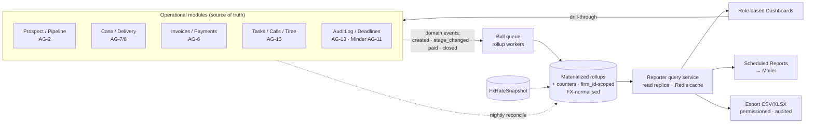
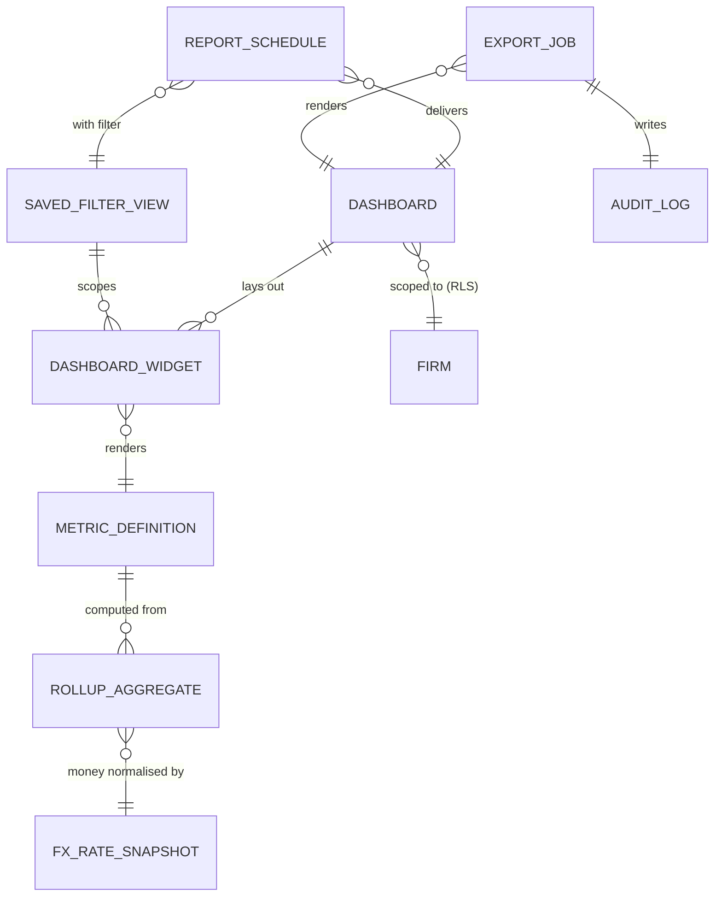

> **Document control** · Version **1.11** · **2026-10-10** · Status: **SA-03 v2.16 applied — Reports is a left-menu module; standard reports in every plan, Advanced reports a sellable extra (SA3-X9);** SA-06 v3.0 closing decisions applied: plain `agent/report:view` retired, access to reports is `report:view.own` and/or `report:view.all`; SA-06 v3.0 review decision applied (SA6-D1): report defaults — own for all six starter roles, firm-wide for Owner, Admin and Case Manager, firm-wide financial for Billing / Finance; Updated — SA-06 v3.0 permission renames applied; report data follows the viewer's client / case / prospect visibility (SA6-D10, SA6-D1, SA6-D6); masking and reveal removed (AG7-D10, replaces AG7-D7): personal data is never masked in reports, scheduled reports or exports; `agent/report:reveal-pii` and `agent/pii:export-unmasked` withdrawn**\
> Part of: *Agent (RCIC/Lawyer) Console — Functional Requirements* · Split from `FINAL-Agent-FR.md` lines 9052–9647 on 2026-09-16 · Previous version: `_archive/AG-14-reporting-and-analytics_v1.10_2026-10-07.md`\
>
> | Version | Date | Change | Decisions |
> |---|---|---|---|
> | 1.11 | 2026-10-10 | Applied from SA-03 v2.16 (SA3-X9; the product owner, 10 Oct): **Reports is a left-menu module** of the firm app (feature `reports`, every plan, intended). **Advanced reports** is a sellable extra covering **saved views (§3.7), scheduled reports (§3.9) and export (§3.10)**; everything else in this module is standard. New §3.12; §13 Q5 partly closed — forecasting and multi-currency reporting are standard (decided the same day); compliance-report export has no exception (revisit if the immigration expert confirms a regulatory need). Q5 closed. No requirement IDs changed. *18 Oct (later): AG07-D26 applied — case colours on lists and boards read `Case.targetFilingDate` (AG-7-91, AG-7-36); one sentence added to the delivery dashboard's key screens; no metric, requirement ID or permission changed.* | SA3-D19, SA3-D10, AG07-D26 |
> | 1.10 | 2026-10-07 | SA-06 v3.0 closing decisions (the product owner, 7 Oct; owned by SA-06 v3.0). **Plain `agent/report:view` is retired.** Access to reports means holding `agent/report:view.own` and/or `agent/report:view.all`. The earlier merge of `agent/dashboard:list` into `agent/report:view` now points to `agent/report:view.own` (the firm-summary endpoint is gated by the same two keys). Changed: honesty note, §10 key rows, the two code-mapping bullets in §11/§12 that named `agent/report:view`. Requirement IDs unchanged. | SA6-D10 |
> | 1.9 | 2026-10-07 | SA-06 v3.0 review decision SA6-D1 (the product owner, 7 Oct; owned by SA-06 v3.0): "see all" is about opening records, not firm-wide reporting. Report defaults are now `agent/report:view.own` on all six starter roles, `agent/report:view.all` on Owner, Admin and Case Manager only, and firm-wide financial reports for Billing / Finance through `agent/report:view-financial`; firms may widen. Changed: §2 design implication and Billing / Finance persona, §3.6 "Whose records count", AG-14-19, BR-2, §10 key rows, §13 item 2. No open item about Case Officer report scope existed in this document. Requirement IDs unchanged. | SA6-D1 |
> | 1.8 | 2026-10-07 | Permission renames and visibility rule from SA-06 v3.0 (the product owner, 7 Oct). `agent/dashboard:list` becomes `agent/report:view` and the borrowed `agent/prospect:list` becomes `agent/prospect:view.own` (Appendix B); the withdrawn `agent/report:reveal-pii` and `agent/pii:export-unmasked` rows stay as withdrawn. **Report visibility:** every figure, list and drill-through is computed only over records the viewer may see under the client, case, prospect and task visibility keys (`view.own` / `view.all`, seeded `view.all` on all six starter roles — SA6-D1; attached records follow their client or case — SA6-D6); `agent/report:view.own` / `view.all` can only narrow that, never widen it. Role names follow the six starter roles (Manager → Case Manager, Accounts / Billing → Billing / Finance, Officer → Case Officer). Changed: §2 personas, §3.6 text, AG-14-18, AG-14-19, BR-2, US-3/US-4, §10, §12. Requirement IDs unchanged. | SA6-D10, SA6-D1, SA6-D6, SA6-D5 |
> | 1.7 | 2026-10-05 | Knock-on from AG7-D7 (the product owner, 5 Oct, owned by AG-07 v2.3). Restricted fields (passport, financial and others) are **masked** in reports, dashboards' lists, scheduled reports, exports, search, notifications/emails and logs; they show in full only on the record's own screens (AG-07), not here. An **unmasked export** needs the platform-wide `agent/pii:export-unmasked` (owned by SA-06's catalogue) and is audited; "PII reveal in export" becomes **"unmasked export"**. Scheduled reports stay masked. Changed: §3.9 audited-egress bullet, AG-14-24, §3.10 masked-by-default bullet, key screens and data flow, AG-14-26, AG-14-29, BR-9, `ExportJob.masked`, §7 cross-cutting line, US-7, §9 huge-export edge case, `agent/report:export` row, `agent/report:reveal-pii` **withdrawn** (row kept), §10 enforcement, §11 PII and audit bullets, §12 permission and export lines. Added: row `agent/pii:export-unmasked`. Same day (AG7-D10, the product owner, 5 Oct; replaces AG7-D7): masking and reveal removed. Personal data is never masked in reports, dashboards, scheduled reports or exports; anyone allowed to see a report sees it in full. `agent/report:reveal-pii` and `agent/pii:export-unmasked` are marked **withdrawn — AG7-D10** (rows kept). Exports and scheduled reports are governed only by `agent/report:export` / `agent/report:schedule`, and every export is audited (actor, scope, filter, row count, time). The `ExportJob.masked` field is removed. Changed: §3.9 audited-egress bullet, AG-14-24, §3.10 heading, bullets, key screens and data flow, AG-14-26, AG-14-29, BR-9, `ExportJob`, §7 cross-cutting line, US-7, §9 huge-export edge case, §10 permission rows and enforcement, §11 PII and audit bullets, §12 permission and export lines. Kept: personal data never in system logs or traces; passport and financial numbers never in email content. | AG7-D7, AG7-D10 |
> | 1.6 | 2026-10-03 | Consistency review fixes (3 Oct): source references corrected from AG-12 (Templates) to AG-13 (audit, reminders) and AG-11 (Minder deadlines); at-risk deadline lists and tiles (§3.5 text, key screens, AG-14-17, US, compliance bullet) now show at-risk items only where the firm has switched at-risk marks on (AG-16-32; AG17-D70); the drill-through for an at-risk deadline now points to the case in AG-7 (was AG-12); change-log row 1.4 repaired (it had lost its table marker); named-deferrals heading moved to Release terms (AG17-D60). | AG17-D60, AG17-D70 |
> | 1.5 | 2026-10-02 | Applied from AG-17: dashboards follow the Individual / Corporate **view**, plus an **All** view for owners and managers (§3.6, AG-14-32); a **client-type segmenter** (§3.7, AG-14-20 changed, AG-14-33); the corporate dashboard is **Release 2** — its tiles are listed as Release 2 `MetricDefinition`s (AG-14-34); no waived-warning, refusal or staff-monitoring metrics (BR-15). §3.6/§3.7 text, US-11/US-12, edge cases, §12 and §13 updated; "Applied from AG-17" table added. | AG17-D6, AG17-D23a, AG17-D38, AG17-D51, AG17-D61 |
> | 1.4 | 2026-10-01 | Label tidy: the staff-leaving section heading now cites AG-01 v1.4 (was v1.2). Requirements unchanged. | — |
> | 1.3 | 2026-10-01 | Knock-on from AG-01 v1.3 (decisions revised by the product owner, 1 Oct): reports show deleted staff as "(Deleted) Name" for periods in which they had activity, totals still adding up (§3.1, AG-14-7, AG-14-31, BR-14, edge case; applied-table rows D1 and D11). | AG1-D1, AG1-D13 |
> | 1.2 | 2026-10-01 | Knock-on from AG-01 v1.2 (staff leaving): AG-14-7 and AG-14-16 changed; AG-14-31 and BR-14 added; two edge cases added | AG1-D1, AG1-D11 |
> | 1.1 | 2026-08-28 | Baseline — complete document v1.1 | — |

## Module AG-14: Reporting & Analytics

**Applied from AG-07 v3.0 (the product owner, 18 Oct 2026)** — decisions owned by AG-07:

| ID | Decision | Applied here |
|---|---|---|
| **AG07-D26 (5)** | Target filing date (renames the target date): optional, set by staff; amber in the last 20 % of the window from case creation to the date, red after it; queue ranking is nearest government deadline, then target filing date, then oldest (AG-7-36) | Case colours and the order of a case list or board that a report opens by drill-through read `Case.targetFilingDate`; AG-14 adds no colour, metric or permission of its own | §3.2 key screens (*My caseload*) |

**Applied from SA-03 v2.16 (feature catalogue, 2026-10-10)** — decisions owned by SA-03:

| ID | Decision | Applied here |
|---|---|---|
| **SA3-D19** | Reports is a left-menu module; standard reports in every plan; **Advanced reports** is a sellable extra | §3.12 · §13 Q5 |
| **SA3-D10** | Plans switch features from SA-3's feature catalogue, not screens; an excluded feature is shown locked with an upgrade prompt | §3.12 |

**Applied from AG-17 (Corporate Cases & LMIA, 2026-10-02)** — decisions owned by AG-17; decision IDs as in AG-17 §0 and `Corporate LMIA/DECISION-LOG.md`:

| ID | Decision | Applied here |
|---|---|---|
| **AG17-D6** | The Individual / Corporate switch is a **view**; it changes the dashboard (among other things) and never filters notifications, "My Tasks" or links. Owners and Case Managers get an **All** view on the dashboard and reports. | §3.6 · AG-14-32 |
| **AG17-D23a** | Each user's last view is remembered; first use starts in Individual. | §3.6 · AG-14-32 |
| **AG17-D38** | Release 1 uses the LMIA board and saved filters (AG-17) instead of a corporate dashboard; the corporate dashboard comes with AG-14 later. | §3.6 · AG-14-34 |
| **AG17-D51** | Release split: the corporate dashboard is **Release 2**. | §3.6 · AG-14-34 · §13 |
| **AG17-D61** | The switch is a "view"; "workspace" keeps its meaning of the firm's whole account. | throughout |

**Applied from AG-01 v1.3 (staff leaving, 2026-10-01)** — decisions owned by AG-01 (Firm Setup & Onboarding) v1.3 §0:

| ID | Decision | Applied here |
|---|---|---|
| **AG1-D1** | A firm may delete a staff member only once deactivated; history stays, shown "(Inactive) Name", or "(Deleted) Name" once deleted | AG-14-31 |
| **AG1-D11** | Reports for any period show everyone with activity, departed staff marked "(Inactive)" or "(Deleted)", totals add up; credit to whoever closes, no split | §3.1, §3.4 · AG-14-7, AG-14-16 changed · AG-14-31 · BR-14 · edge cases |

**Applied from SA-06 v3.0 (roles, 2026-10-07)** — decisions owned by SA-06 (decided by the product owner, 7 Oct 2026):

| ID | Decision | Applied here |
|---|---|---|
| **SA6-D10** | Key naming: one kebab-case resource, one action, duplicates merged; old → new in SA-06 Appendix B. `agent/dashboard:list` → `agent/report:view` (now `agent/report:view.own`, v1.10); `agent/prospect:list` → `agent/prospect:view.own`; `agent/report:reveal-pii` and `agent/pii:export-unmasked` stay withdrawn | §10 · §12 |
| **SA6-D1** | Visibility is open by default: `view.all` for clients, cases, prospects and tasks is seeded on all six starter roles; a firm makes a role own-only by removing the key | §3.6 · AG-14-19 · BR-2 · §10 |
| **SA6-D6** | Records attached to a client or case follow that client's or case's visibility; prospects have their own own/all pair | §3.6 · AG-14-19 · BR-2 |
| **SA6-D5** | Six starter roles; older names mapped (Manager → Case Manager; Accounts / Billing → Billing / Finance; Officer → Case Officer) | §2 personas · §3.6 · AG-14-18 · US-3, US-4 |
| **SA6-D10** *(v1.10)* | Plain `agent/report:view` is retired; `agent/dashboard:list` now maps to `agent/report:view.own`; access to reports = holding `agent/report:view.own` and/or `agent/report:view.all` | §10 · §11 · §12 |
| **SA6-D1 (reports)** | "See all" is about opening records, not firm-wide reporting. `agent/report:view.own` on all six starter roles; `agent/report:view.all` only Owner, Admin, Case Manager; Billing / Finance firm-wide financial reports via `agent/report:view-financial`; firms may widen | §2 · §3.6 · AG-14-19 · BR-2 · §10 · §13 |

### Module Index

Scan the whole module in ~30 seconds; jump to any part.

1. **Purpose & Goal**
2. **Users & Jobs-to-be-Done**
3. **Functional Design — How It Works** (core)
   - 3.0 The reporting architecture (source → aggregation → presentation; the read/write split) · 3.1 Sales / pipeline analytics · 3.2 Case / delivery analytics · 3.3 Financial analytics (multi-currency) · 3.4 Productivity analytics · 3.5 Compliance & audit-adherence analytics · 3.6 Dashboards (role-based) · 3.7 Filters, segmentation & saved views · 3.8 Drill-through to records · 3.9 Scheduled reports (email via Mailer) · 3.10 Export (CSV/XLSX, permissioned, audited) · 3.11 The aggregation engine, rollups & FX · 3.12 Where Reports lives and what the plan controls *(new v1.11)*
4. **Detailed Functional Requirements** (AG-14-x)
5. **Business Rules & Logic**
6. **States & Lifecycle**
7. **Key Entities & Fields**
8. **User Stories + Acceptance Criteria**
9. **Edge Cases & Validations**
10. **Permissions** (LOCAL `agent/*`)
11. **Scalability · Security · Performance** (per function)
12. **Reference Note** (exists / NEW / changed)
13. **Open Questions / Founder Decisions**

### Visual Overview

**A. Report data-flow — source → aggregation → presentation** (the Reporter never queries raw operational tables on the hot read path; it reads pre-computed, firm-scoped, FX-normalised aggregates):



**B. Report / widget model** (a dashboard is a layout of widgets; a widget binds a metric + visual + filter scope; a scheduled report and an export are just a widget/dashboard rendered to a delivery channel):



> The Reporter **owns** the read/aggregation layer (rollups, metric definitions, dashboards, schedules, exports). It **reads from**, and never writes to, the operational modules. `AuditLog · Notification` attach via the polymorphic `(entityType, entityId)` pattern (Part 2) — reused, never redefined.

---

### 1. Purpose & Goal

**What it is.** AG-14 is the firm's **single, trustworthy lens on its own business** — the one place an owner, manager, or rep goes to answer "how are we actually doing?" across the entire operating system: the sales funnel, case delivery, money, people's workload, and compliance. Every other module *produces* data; the Reporter *makes sense of it*. It turns the operational exhaust of AG-2 (leads), AG-6 (invoices), AG-7/8 (cases) and AG-13 (tasks/calls/time) into decisions.

**The business outcome it must produce.** Immigration firms fly blind in characteristic ways: the owner cannot say which marketing channel actually produced *paying* clients (only which produced leads); the manager cannot see *where cases stall* until a client complains; nobody knows the firm's true **AR / overdue** position until cash is tight; workload is distributed by gut, so one officer drowns while another idles; and a missed regulatory deadline is discovered after the fact, not before. AG-14 exists to make **"the firm runs on numbers, not vibes"** structurally true — a **revenue + delivery + cash + people + compliance** picture that is **always current, always tenant-isolated, always in one reporting currency, and always drill-throughable** down to the underlying record so a number is never a dead-end.

**Why it matters / world-class positioning.** A generic BI add-on gives a firm a blank canvas and a CSV connector — and then the firm never builds the reports. Expat Ready's Reporter is **specialised, opinionated, and built-in**: the metrics that matter to an immigration firm (consult-to-retainer conversion, source/campaign ROI to *retained* clients, case stage-duration and on-time %, deficiency/SLA adherence, AR by service line and program, deadline adherence) ship **pre-defined and pre-wired** to the operational modules — no setup, no connector, no data-engineering. The moat versus a bolt-on BI tool is three-fold: (a) **domain-native metrics** (conversion, deficiency, processing-time, deadline-adherence are immigration concepts, not generic rows); (b) **compliance-and-tenant-native** (every report is `firm_id`-scoped under RLS, respects record-level permissions so a rep's dashboard shows only what the rep may see, and audits every egress); and (c) **global-by-construction** (**multi-currency roll-ups via FX snapshots** are designed in — a generic single-currency dashboard cannot honestly total a firm that quotes in more than one currency, which a single-country firm routinely does).

**How it ties to the journey.** The Reporter sits *across* the whole journey rather than at one step: lead → assessment → consult → retainer → payment (the **Revenue** picture, fed by AG-2/5/6) and SQR → documents → workflow → compliance (the **Delivery** picture, fed by AG-7/8/12). It is the surface the founder demos *last* — "and here is how a firm owner sees all of it at a glance, in one currency, drillable to the record."

**Global ambition (founder's core point).** The same module serves a solo RCIC provisioned for Canada and a large firm provisioned for Australia, with **no code change per country** — the platform is multi-country, a firm is not (FD-68), so a firm's dashboards are single-country by construction and the cross-country view lives at the platform (Super Admin SA-9). **Money is reported in the firm's `reportingCurrency` via FX snapshots, never summed raw across currencies**; time buckets honour the firm/office **timezone**; labels and scheduled-report copy are **per-locale**. This global posture is visible in every function below, not appended at the end.

---

### 2. Users & Jobs-to-be-Done

The "Agent" persona is an umbrella; AG-14 is consumed very differently by each sub-role, and the **record-level permission of the viewer changes what the same dashboard shows** (a rep sees their slice; an owner sees the firm). JTBD framing keeps the design honest.

| Role | Primary job in AG-14 | Jobs-to-be-done (representative) |
|---|---|---|
| **Owner / Principal RCIC** (headline audience) | Own the whole number — revenue, delivery health, cash, compliance posture. | "When I open the firm dashboard, I want revenue, pipeline, AR/overdue, case load, and any compliance risk in **one currency**, segmentable by program, office and rep, so I can run the business in five minutes." · "When I review a quarter, I want to know which **source/campaign produced paying clients**, not just leads, so I stop wasting ad spend." · "When a number looks wrong, I want to **click straight through to the records** behind it." |
| **Case Manager / Team Lead** *(changed v1.8 — SA6-D5; was Manager)* | Keep the funnel and the delivery floor healthy and the team productive. | "When I review the week, I want **conversion by rep**, where cases **stall** (stage durations, on-time %), **deficiency/SLA** breaches, and **who is over/under-loaded**, so I can coach and rebalance." · "When I leave for the week, I want a **scheduled Monday report** in my inbox automatically." |
| **Intake / Sales Rep** | See *their own* performance and pipeline health. | "When I open my dashboard, I want **my** conversion rate, **my** pipeline value and forecast vs quota, and **my** call/activity volume — only my data — so I know where I stand." |
| **Case Officer / RCIC (delivery)** | See *their own* caseload and risk. | "When I start my day, I want **my** active cases, which are **near or past SLA**, stage durations, and upcoming **deadlines**, so nothing slips." |
| **Billing / Finance** *(changed v1.8 — SA6-D5; was Accounts / Billing)* | Own the cash picture. | "When I run collections, I want **AR aging**, **overdue by client**, revenue **by service/program/office**, and collected-vs-billed — in one currency with the original on drill-down — so I chase the right invoices." *(changed v1.9 — SA6-D1: firm-wide financial reports come from `agent/report:view-financial`, not from `view.all`)* |
| **Compliance Officer / Principal** | Prove the firm is in control. | "When an audit looms, I want **deadline-adherence**, **audit-event volume**, and **SLA breach** trends, exportable and audited, so I can demonstrate the firm's compliance posture." |

**Design implication.** The **Owner / Case Manager** are the protagonists of the rich, cross-domain dashboards and the scheduling/export surfaces. The **Rep/Officer** get a **scoped "my performance / my caseload" view** that is the *same* dashboard rendered through their record-level permission (`agent/report:view.own`), never a separate, leaky build *(changed v1.9 — SA6-D1: all six starter roles hold `view.own`; only Owner, Admin and Case Manager hold `view.all`; §3.6, §10)*. **Billing / Finance** get the financial surface; **Compliance** the adherence surface. Permissions (§10) and record-level scoping (§5, §11) cleanly separate these, and the *viewer's permission is part of the query*, not a UI filter.

---

### 3. Functional Design — How It Works (core)

This is the heart of the spec. Each sub-function is designed in depth: **how it works**, the **world-class behaviour** that beats a bolt-on BI tool, the **key screens & interactions** (functional, not pixel-level), and the **data flow**.

#### 3.0 The Reporting Architecture — the read/write split everything else sits on

**Design decision: the Reporter is a read-and-aggregate layer, strictly separated from the operational write path.** This is the single most important architectural choice in the module and the reason it can be both fast and correct at scale.

- **Source of truth stays in the operational modules.** Leads live in AG-2, invoices in AG-6, cases in AG-7/8, tasks/calls/time in AG-13, audit/reminders in AG-13, deadlines in the Minder (AG-11). The Reporter **never duplicates** these as a second write-path and **never writes back** to them.
- **Aggregates are the read surface.** Between the operational tables and every dashboard sits a layer of **materialized rollups and counters** — firm-scoped, time-bucketed, FX-normalised — that are **maintained incrementally off domain events** (on the Bull queue) and **reconciled nightly** against the source (so a dropped event self-heals). Dashboards, scheduled reports, and exports read **these aggregates** (off the read replica, through a Redis cache), **not** the raw tables on the hot path.
- **Metric definitions are data, not code.** A `MetricDefinition` declares *what* a metric is (its source rollup, its aggregation, its money/FX treatment, its drill-through target). Dashboards bind widgets to metric definitions. Adding a metric or a dashboard tile is **configuration**, not a new query hand-written in a controller.
- **The viewer's permission is part of the query.** Every aggregate read is scoped by `firm_id` (RLS) **and** by the caller's record-level permission — a `view.own` rep's pipeline number is computed over *their* leads only; a `view.all` owner's over the firm. The dashboard never trusts the client to scope, and never serves a rep a firm-wide number through a shared cache key (cache keys include the permission scope — §11).

> **Reference-note callout:** today there is **no aggregation/rollup layer**. `DashboardService.firmSummary()` issues live `count/aggregate/groupBy` per request (acceptable for a single scalar summary at small scale, but not a reporting layer), and `ProspectSalesPerformanceService.salesPerformance()` does **O(all-rows) in-memory aggregation** — the explicit scale-debt this spec **replaces** (§12). The rollup architecture above is NEW.

#### 3.1 Sales / Pipeline Analytics — "where revenue comes from, where it leaks, and what's coming"

**How it works.** The Reporter surfaces the firm's revenue funnel from the AG-2 pipeline aggregates:
- **Funnel & conversion** — stage counts (leads in each stage), **stage-to-stage conversion rates**, overall **lead → retained conversion**, **average days-to-convert**, and **time-in-stage** (the bottleneck callout — *which* stage leaks).
- **Source & campaign ROI** — leads, retained clients, and **collected revenue attributed by `source` and by campaign (UTM)** — the headline immigration metric: *which channel and campaign produced paying clients*, not just inquiries. (Built on the attribution AG-2 captures at lead creation.)
- **Rep performance** — per-rep leads, conversion rate, **pipeline value**, **attributed collected revenue** (from paid invoices linked to the prospect or its converted case — this *attribution rule* is correct in today's code and is **kept**), and **activity volume** (calls logged/connected). A leaderboard for coaching. For any period, the per-rep view and the leaderboard include **everyone who had activity in that period**, with departed staff marked "(Inactive)", or "(Deleted) Name" once the firm has deleted the deactivated user, so the totals add up (AG-14-31).
- **Forecast** — **weighted pipeline = Σ(dealValue × stage win-probability)**, bucketed by `expectedCloseDate`, shown as commit / best-case against **quota** — all in the **reporting currency**.

**World-class behaviour.**
- **ROI to *retained, paying* clients** is the differentiator — joined from UTM/click-IDs through conversion to paid invoices, so the owner sees true channel value, not vanity lead counts.
- **Funnel bottleneck callouts** highlight the leaky stage by time-in-stage, turning a chart into an action.
- **Forecast vs quota** gives a forward number, not a rear-view.
- **Single-currency reporting** — every money figure FX-normalised to the firm's one reporting currency (§3.11). *(Country segmentation is WITHDRAWN by FD-68 — every metric in a firm's dashboard already shares one destination country.)*
- **Replaces the in-memory backbone.** This surface reads **DB-side rollups**, not the legacy per-row loop (§12).

**Key screens.** *Sales dashboard* (funnel + KPI tiles + forecast + source/campaign-ROI + lost-by-reason, with the filter bar and reporting-currency disclosure), *Rep performance / leaderboard* (incl. call activity + forecast vs quota), all drill-through (§3.8).

**Data flow.** AG-2 events (`prospect.created/stage_changed/converted`, paid-invoice link) → pipeline rollups (per firm/rep/stage/currency, FX-normalised; the firm's one country is stamped on each row for SA-9's cross-firm view, never a segment inside the firm — FD-68) → Reporter reads rollups + cache → dashboard; forecast = Σ(value × winProbability) bucketed by `expectedCloseDate`, converted to `reportingCurrency`.

#### 3.2 Case / Delivery Analytics — "see where cases stall before a client tells you"

**How it works.** From the AG-7/8 case aggregates, the Reporter surfaces delivery health:
- **Case load** — open/active cases by **status, stage, service/program, office, and assigned officer**; new-vs-closed this period; backlog trend.
- **Stage durations** — average and median time a case spends in each delivery stage (SQR → documents → form mapping → workflow → submission), with the slowest stage flagged.
- **On-time %** — share of cases (or stage milestones) completed **within their SLA / target**, and the **breach list**.
- **Deficiency / SLA** — count and rate of **document deficiencies** raised, time-to-cure, and **SLA breaches** by stage and officer.
- **Processing times** — end-to-end (case opened → submitted → decision) and per-segment, with cohort comparison over time.

**World-class behaviour.**
- **Stall detection, not just counting** — stage-duration outliers and SLA-breach lists are *actionable* (drill to the case), the delivery-floor analogue of the sales bottleneck callout.
- **Deficiency analytics close the loop** with AG-8 — recurring deficiency types surface process problems (e.g. a form field consistently mis-collected), not just one-off case noise.
- **Officer, team and program segmentable** — a firm sees Express Entry vs study-permit delivery health side by side. *(Country is not a segmenter inside a firm, FD-68; the platform compares countries across firms in SA-9.)*

**Key screens.** *Delivery dashboard* (case-load tiles + stage-duration chart + on-time % + deficiency/SLA + processing-time cohort), *My caseload* (officer-scoped via `view.own`), all drill-through to the case. *(Changed 18 Oct — AG07-D26(5))* A case list reached by drill-through shows the same amber and red colours as the case queue, read from `Case.targetFilingDate` (AG-7-91); a case with no target filing date has none, and its position follows AG-7-36.

**Data flow.** AG-7/8 case events (stage entered/exited, deficiency raised/cured, submitted, closed) → case-delivery rollups (per firm/officer/stage/service; country stamped, not an axis — BR-5) → Reporter reads → dashboard; durations computed from stage-enter/exit timestamps (UTC, bucketed in firm timezone).

#### 3.3 Financial Analytics (multi-currency) — "the cash picture, in one currency, drillable to the invoice"

**How it works.** From AG-6 invoice/payment aggregates:
- **Revenue** — billed vs **collected** by period, by **service / program / office**, and trended.
- **AR / overdue** — **accounts-receivable aging buckets** (current / 1–30 / 31–60 / 61–90 / 90+), **overdue total**, and **overdue by client** for collections.
- **Mix** — revenue and AR sliced by service line and immigration program.
- **Multi-currency** — every money figure is converted to the firm's **`reportingCurrency`** via an **`FxRateSnapshot`** captured at the economic moment (billed → FX at invoice; collected → FX at payment), with the **original currency shown on drill-down**. The system **never sums raw amounts of differing currencies** (BR-4).

**World-class behaviour.**
- **One reporting currency, honest provenance** — a firm that has invoiced in more than one currency sees total AR in its reporting currency with each invoice's original currency shown on drill-through, and the conversion basis disclosed. A report does not silently change because today's FX moved (snapshots are immutable).
- **AR aging that drives collections** — overdue-by-client is a worklist, not a chart: click a client → their open invoices (drill-through to AG-6).
- **Revenue by program** answers "which service line and which desk actually makes money," an immigration-specific cut a generic P&L can't. *(Country is not one of these cuts inside a firm — FD-68.)*

**Key screens.** *Financial dashboard* (revenue billed/collected + AR aging + overdue-by-client + revenue-by-service/program/office, reporting-currency toggle with disclosure), drill-through to invoices.

**Data flow.** AG-6 events (`invoice.issued/paid/partially_paid/voided`) → financial rollups (per firm/service/program/currency; country stamped, not an axis — BR-5) → **FX-normalise each amount to reportingCurrency via FxRateSnapshot at the economic moment** → Reporter reads → dashboard; aging computed from `dueDate` vs report "as-of" date in firm timezone.

> **Honesty note:** today invoice amounts are stored in the **smallest currency unit (cents/paise)** and the firm is effectively **single-currency** (a closed `Currency` enum). The multi-currency roll-up, `FxRateSnapshot`, and `reportingCurrency` are **NEW** (§12); the Reporter must present money in major units with explicit currency, never raw integer minor units.

#### 3.4 Productivity Analytics — "who is over- or under-loaded, and is work getting done"

**How it works.** From AG-13 (tasks, calls, time) and assignment data:
- **Workload per rep/officer** — open/active items assigned (leads, cases, tasks), so a manager sees the distribution at a glance. This is a view of *current* open work, so it lists **active users only**, plus one **"Unassigned"** row for open work with no owner (AG-14-16).
- **Tasks** — created vs completed, **overdue count**, on-time completion %, by person and team.
- **Calls / outreach** — calls logged/connected per rep (sales-side), feeding the leaderboard.
- **Time** — where time-tracking exists (AG-13), time logged per person/case/activity, billable vs non-billable.

**World-class behaviour.**
- **Rebalancing signal, not surveillance** — the headline is *load distribution* (who can take more, who is drowning), framed for fair workload management.
- **Over/under-load flags** — counts against a configurable target surface imbalance.
- **Feeds coaching** — task on-time % and call volume contextualise the conversion numbers in §3.1 (effort vs outcome).

**Key screens.** *Productivity dashboard* (workload-by-person table + task throughput + call activity + time, with over/under-load flags), drill-through to a person's queue.

**Data flow.** AG-13 task/call/time events + assignment counts → productivity rollups (per firm/user) → Reporter reads → dashboard; overdue/on-time evaluated in firm timezone.

#### 3.5 Compliance & Audit-Adherence Analytics — "prove the firm is in control"

**How it works.** From AG-13 (audit log, reminders) and the Minder (AG-11, deadlines):
- **Deadline adherence** — share of regulatory/case deadlines met on time, the **upcoming-deadline** horizon, and the **missed** list, plus the **at-risk** list (at-risk items only where the firm has switched at-risk marks on, AG-16-32).
- **SLA adherence** — first-response and stage SLA breach rates (sales and delivery), trended.
- **Audit-event volume** — activity volume by type/actor as a control-health signal (not a forensic log — that stays in AG-13; this is the *analytics* over it).

**World-class behaviour.**
- **Forward-looking, not post-mortem** — the upcoming-deadline horizon and the at-risk list (where the firm has switched at-risk marks on, AG-16-32) let the firm act *before* a breach, which is the entire point for a regulated profession.
- **Audit-grade & exportable** — adherence reports are exportable (audited) to demonstrate the firm's compliance posture to a regulator or in a CPD/quality review.
- **Tenant-isolated by construction** — compliance data is among the most sensitive; it is `firm_id`-scoped under RLS and respects record-level permission like every other surface.

**Key screens.** *Compliance dashboard* (deadline-adherence % + upcoming deadline list, plus at-risk items only where the firm has switched at-risk marks on (AG-16-32) + SLA-breach trend + audit-event volume), drill-through to the case/record.

**Data flow.** Minder deadline (AG-11) / AG-13 reminder + AuditLog events → compliance rollups (per firm/type) → Reporter reads → dashboard; "on-time" computed against the deadline date in firm timezone.

#### 3.6 Dashboards (role-based) — "the same truth, scoped to who is looking"

**How it works.** A **dashboard** is a saved **layout of widgets**; each widget binds a `MetricDefinition` (the metric), a visual (tile / funnel / line / bar / table / aging-bucket), and a filter scope. The firm ships with **seeded, role-targeted default dashboards** — Owner (firm-wide cross-domain), Case Manager (funnel + delivery + team), Rep (my sales), Case Officer (my caseload), Billing / Finance (financial), Compliance (adherence) *(role names changed v1.8 — SA6-D5)* — and the **viewer's record-level permission scopes the data automatically**:
- A `view.all` user sees firm-wide figures; a `view.own` user sees the identical dashboard computed over **only their own** records (the same widgets, a different scope — not a separate, leaky build).
- **Whose records count *(new v1.8 — SA6-D6; changed v1.9 — SA6-D1)*.** "See all" is about opening records, not about firm-wide reporting *(SA6-D1)*. The scope of a report's figures is set by the **report keys**: `agent/report:view.own` (own records only) is on all six starter roles; `agent/report:view.all` (firm-wide) is on **Owner, Admin and Case Manager** only; **Billing / Finance** gets firm-wide **financial** reports through `agent/report:view-financial`. A firm may widen a role by adding a key. List rows and drill-through never show, count or link to a record the viewer could not open from its own module: they follow the viewer's `agent/client`, `agent/case`, `agent/prospect` and `agent/task` `view.own` / `view.all`. "Own" is the record owner or case team for clients and cases, and assigned-to-me for prospects and tasks. Records attached to a client or case (documents, notes, tasks, reminders, time entries) follow that client's or case's visibility. A Case Officer therefore sees their own figures by default, even though the Case Officer role holds the see-all keys for opening records.
- Money is shown in the firm **`reportingCurrency`** with the conversion disclosed; time buckets honour the firm timezone; labels render in the viewer's locale.

**Dashboards follow the Individual / Corporate view** *(AG17-D6, D23a, D61)*. The **view** is the Individual / Corporate switch (not the firm's "workspace", which means the whole account). A dashboard shows the figures of the selected view: in the Individual view, individual clients, prospects and cases; in the Corporate view, corporate ones. **Owners and managers also get an "All" view** that combines both. The view only chooses what is shown; it never widens what the viewer's permission allows (a `view.own` user in the All view still sees only their own records, BR-2). Each user's last view is remembered and first use starts in the Individual view.
- **Release 1 (AG17-D38, D51):** the Corporate view has **no corporate dashboard**. Corporate work is seen through the LMIA board and its saved filters (AG-17). The corporate dashboard tiles are defined in AG-14-34 and built in **Release 2**.

**World-class behaviour.**
- **Zero-setup, opinionated defaults** — the firm gets useful dashboards on day one, not a blank canvas; "build your own" is a later, additive capability, not the front door.
- **Role-right by construction** — a rep cannot accidentally see the firm's revenue because the *server* scopes by their permission; the manager doesn't have to maintain two versions.
- **Cross-domain Owner view** — revenue + delivery + cash + compliance on one screen, in one currency, is the demo's closing moment.
- **Cached & fast** (§11) — dashboards read pre-aggregated rollups, never scan raw tables live.

**Key screens.** *Dashboard surface* (widget grid, filter bar, reporting-currency disclosure, date-range, program/rep/office segmenters), *dashboard picker* (role defaults), *(later)* a *widget/dashboard configurator*.

**Data flow.** Dashboard load → resolve viewer permission scope + firm_id → for each widget, read its metric's rollup (cache keyed by `firm_id` + permission-scope + filter-hash) → render; drill-through links carry the widget's filter into the operational module.

#### 3.7 Filters, Segmentation & Saved Views — "slice it the way the firm thinks"

**How it works.** A shared **filter bar** spans every dashboard: **date range** (with presets — this week / month / quarter / custom, all in firm timezone), **rep / officer / team**, **service / program**, **source / campaign**, **status / stage**, a **client type** segmenter (Individual / Corporate, AG17-D6), and money **reporting-currency** disclosure. There is no country facet — a firm has exactly one destination country (FD-68). Filters re-query the **aggregates/cache**, never the raw rows. A user can **save a named view** (filter + dashboard + segmentation) for one-click recall, and a manager can publish a **firm-shared** view.

**World-class behaviour.**
- **Country-stamped, not country-segmented** — destination country is stamped on every rollup row (it is what the *platform* aggregates on across firms, Super Admin SA-9), but it is never a segmenter inside a firm's own dashboard, because every row shares one value (FD-68). The segmenters that earn their place within a firm are program, service line, office, rep, source and client type.
- **Client type is a segmenter, the view is the default.** Selecting the Individual or Corporate view pre-sets the client-type segmenter; in the All view a user can still split any metric by client type. Like every filter it only narrows within the viewer's permission.
- **Saved views power scheduling** — a saved view *is* the unit a scheduled report delivers (§3.9), so "email me my Monday Canada-funnel" is one configuration.
- **Filters are scope-safe** — a filter can only ever *narrow* within what the viewer's permission already allows; it can never widen a `view.own` user to firm-wide.

**Key screens.** *Filter bar* (sticky, all dashboards), *saved-views manager* (mine / firm-shared).

**Data flow.** Filter change → filter-hash → cache lookup keyed by `(firm_id, permission-scope, filter-hash)` → miss falls to read-replica aggregate query → render; save view → persist `SavedFilterView` (firm-scoped).

#### 3.8 Drill-Through to Records — "a number is never a dead-end"

**How it works.** Every metric tile, funnel segment, chart point, and table row is **clickable to the underlying records**: a funnel stage → that filtered list of leads in AG-2; an AR-aging bucket → those overdue invoices in AG-6; a stage-duration outlier → those cases in AG-7; an at-risk deadline → that case in AG-7. The drill carries the **exact filter + segment** behind the number, so the list the user lands on **reconciles to the figure they clicked**.

**World-class behaviour.**
- **Reconciliation guarantee** — the drilled list count equals the reported number (within the cache's stated staleness window, §11), so the firm *trusts* the dashboard.
- **Permission-honest** — drill-through lands in the operational module, which **re-applies its own record-level permission** — a user can never reach, via a drill link, a record they couldn't open directly (no privilege escalation through a chart).
- **Round-trip** — from a number to the record to action (call, chase, fix) in two clicks.

**Key screens.** Every widget is a drill source; the destination is the operational module's filtered list/detail (AG-2/6/7/12), not a Reporter-owned screen.

**Data flow.** Click → resolve metric's `drillTarget` + the widget's filter → navigate to the operational list with that filter applied → **target module re-enforces permission + firm_id** → list renders (reconciles to the metric).

#### 3.9 Scheduled Reports (email via Mailer) — "the report comes to you"

**How it works.** A user configures a **`ReportSchedule`**: pick a dashboard or saved view, a **cadence** (daily / weekly / monthly, with day/time **in the firm timezone**), **recipients** (self, named users, or a role), a **format** (in-email summary + attached PDF/XLSX), and a **locale**. The **Scheduler** (cron) enqueues the run; a worker renders the report **as the schedule's owner** (so it carries the owner's permission scope — a rep's scheduled report contains only the rep's data), FX-normalises money to the reporting currency, and **Mailer** delivers it.

**World-class behaviour.**
- **Rendered with the owner's scope, not the recipient's** — the report's data scope is fixed to whoever created the schedule (and is permission-checked at *each* run, so a later-revoked permission stops including data) — preventing a low-privilege recipient from receiving high-privilege data, and preventing data leaking if roles change.
- **Timezone- and locale-correct** — "every Monday 8am" means the *firm's* Monday 8am; the email and attachment render in the configured locale.
- **Async & resilient** — runs on the queue; a failed render/send is retried and surfaces a Notification, never silently lost; idempotent per (schedule, run-date) so a redelivery doesn't double-send.
- **Audited egress** — every scheduled send is audited (PII leaves the system by email), and money obeys the never-sum-raw rule. *(changed v1.7 — AG7-D10)* Personal data is never masked in a scheduled report; it is governed by the schedule owner's permission scope. Passport and financial numbers are never put into the content of the email.

**Key screens.** *Schedule manager* (create/edit/pause, recipients, cadence, format, locale, next-run-in-firm-timezone), *schedule history* (last runs + status).

**Data flow.** Scheduler cron → enqueue run → worker renders dashboard/view **as schedule owner** (permission re-checked, FX-normalised, locale-applied) → PDF/XLSX built async → Mailer sends → AuditLog (actor=owner, recipients, scope) → Notification on failure.

#### 3.10 Export (CSV/XLSX, permissioned, audited) — "get the numbers out, safely"

**How it works.** Any dashboard, widget, or drilled list exports to **CSV and Excel (XLSX)**:
- **What you see is what you export** — the export honours the *exact* current filter, segmentation, and reporting currency; a dashboard export emits a **sheet per table/widget**.
- **Permission-scoped** — a `view.own` user exports only their own slice; export can **never widen** what the viewer may see.
- **No masking** *(changed v1.7 — AG7-D10)* — Personal data is never masked in reports or exports; whoever may see a report sees the data in full. Export is governed only by `agent/report:export` and is audited.
- **Money obeys the multi-currency rule** — figures are FX-normalised to the reporting currency with original currency on the detail sheet; an export **never emits a mixed-currency raw total** (BR-4).
- **Async for large sets** — built on the queue and delivered as a downloadable artifact; never an unbounded in-memory build.

**World-class behaviour.**
- **Audited data-egress** — every export writes an audit entry (actor, scope, filter, row count, timestamp), because a bulk export is a PII-egress event a regulated firm must be able to account for.
- **Locale-aware headers** — column labels render in the firm/user locale.
- **No silent truncation** — a too-large export is chunked/streamed, not capped without notice.

**Key screens.** *Export control* on every dashboard/widget/list (format CSV/XLSX, "current filter" confirmation, async progress + download), *export history* (audit, manager).

**Data flow.** Export request → resolve permission + firm_id + filter scope (never widens) → async job builds CSV/XLSX (money FX-normalised; personal data in full) → downloadable artifact → **AuditLog** (actor, scope, row count).

#### 3.11 The Aggregation Engine, Rollups & FX — "fast and correct at a million rows"

**How it works (the performance heart of the module).**
- **Materialized rollups + counters.** For each analytics domain (sales, delivery, financial, productivity, compliance) the engine maintains firm-scoped, **time-bucketed** aggregate tables (e.g. per `firm_id` × day × stage × country × currency — the `country` key is a constant within a firm and is carried so the platform can compare countries *across* firms in SA-9, never to segment inside one, FD-68) plus fast **counters** for headline tiles. These are **maintained incrementally** on the Bull queue as domain events arrive, and **reconciled nightly** against the source so a missed event self-corrects within a day.
- **Read off aggregates + cache + replica.** Dashboards/exports/schedules read the **rollups** (off the **read replica**), fronted by a **Redis cache** keyed by `(firm_id, permission-scope, metric, filter-hash)`. The hot read path **never scans raw operational tables** and **never aggregates per-row in app memory** (the explicit replacement for `salesPerformance()`).
- **FX snapshots.** Money rollups store amounts **already converted to `reportingCurrency`** using an **`FxRateSnapshot`** captured at the economic moment (billed→invoice date, collected→payment date, deal value→set/last-update). Snapshots are **immutable** (a historical report stays stable). The engine **never sums or compares raw amounts across currencies** (BR-4); a missing rate surfaces a clear "rate unavailable — excluded" note rather than summing raw or silently dropping.
- **Cache-invalidation contract.** Domain events (`prospect.*`, `case.*`, `invoice.*`, `task.*`, deadline events) **evict the affected firm's** rollup-cache keys (targeted eviction, not a global flush); a short TTL (≤ 60s) is a safety net even absent an event; FX snapshots need no invalidation (immutable). Dashboards may lag real-time by the TTL; **drill-through lists are always live** (served from the operational module, never the stale aggregate).

**World-class behaviour.**
- **Scales to a 100k → 1M-record tenant** with sub-second dashboards because reads hit aggregates, not raw tables.
- **Correct money by construction** — no report can ever emit a mixed-currency raw sum.
- **Self-healing** — nightly reconciliation means a dropped event degrades a number for hours, not forever.

**Key screens.** None user-facing (this is the engine); its health surfaces to platform ops (rollup freshness, reconciliation status).

**Data flow.** Domain event → rollup worker updates the affected aggregate (FX-normalising money via snapshot) → evicts affected cache keys → nightly job reconciles aggregates vs source. Read: dashboard → cache → (miss) read-replica aggregate query → render.


#### 3.12 Where Reports lives and what the plan controls *(new v1.11 — SA3-D19, SA3-D10)*

**Reports is a left-menu module** of the firm app (SA-03 §3.3 feature #19, `reports`). Today the only reports route sits under Prospects (`pipeline/prospects/:segment/reports` in the frontend); it moves under the Reports module.

| Plan feature | Covers | Intended placement |
|---|---|---|
| **Reports** (module feature) | Sales / pipeline, case / delivery, financial, productivity and compliance analytics (§3.1 – §3.5), role dashboards (§3.6), filters and segmentation (§3.7, without saving), drill-through (§3.8) | Every plan |
| **Advanced reports** (extra) | Saved views (§3.7), scheduled reports (§3.9), export to CSV/XLSX (§3.10) | Sellable |

With Advanced reports off, the save, schedule and export controls are shown **locked** with an upgrade prompt (SA3-D16), and the server refuses them with `403 FEATURE_NOT_ENTITLED`. Permissions are unchanged: a user still needs `agent/report:view.own` / `view.all`, and `agent/report:export` to export. The firm's full data download (SA3-E1) is separate and always available.

---

### 4. Detailed Functional Requirements

Numbered `AG-14-x`, granular, covering every function in §3.

**Architecture & engine**
- **AG-14-1.** The Reporter SHALL read from operational-module **aggregates** and SHALL NOT write to operational tables; reporting is a strict read/aggregate layer.
- **AG-14-2.** The system SHALL maintain firm-scoped, time-bucketed **materialized rollups + counters** per analytics domain (sales, delivery, financial, productivity, compliance), updated **incrementally** off domain events on the queue and **reconciled** against the source on a nightly job.
- **AG-14-3.** Every dashboard/report/export read SHALL be served from rollups/cache off the **read replica** and SHALL NOT perform a full-table scan of, or per-row in-memory aggregation over, raw operational tables (explicitly replacing `salesPerformance()`).
- **AG-14-4.** Metrics SHALL be declared as **`MetricDefinition`** data (source rollup, aggregation, money/FX treatment, drill target); adding a metric/dashboard tile is configuration, not bespoke controller code.

**Sales / pipeline (§3.1)**
- **AG-14-5.** The Reporter SHALL provide **funnel** (stage counts), **stage-to-stage and overall conversion rate**, **average days-to-convert**, and **time-in-stage** (bottleneck) metrics.
- **AG-14-6.** The Reporter SHALL provide **source/campaign ROI** — leads, retained clients, and **collected revenue attributed by `source` and UTM campaign** (keeping the existing prospect/case→paid-invoice attribution rule).
- **AG-14-7.** The Reporter SHALL provide **per-rep performance** (leads, conversion, pipeline value, attributed collected revenue, calls logged/connected) and a leaderboard, including inactive and deleted users who had activity in the period (AG-14-31).
- **AG-14-8.** The Reporter SHALL provide a **weighted forecast** = Σ(`dealValue` × stage `winProbability`) bucketed by `expectedCloseDate`, as commit/best-case vs **quota**, in the reporting currency; leads without `expectedCloseDate` are reported separately ("unscheduled"), never folded in.

**Case / delivery (§3.2)**
- **AG-14-9.** The Reporter SHALL provide **case load** by status/stage/service/program/office/officer, and new-vs-closed trend (country is a firm-wide constant, FD-68).
- **AG-14-10.** The Reporter SHALL provide **stage durations** (avg/median per delivery stage) with the slowest stage flagged.
- **AG-14-11.** The Reporter SHALL provide **on-time %** (cases/milestones within SLA) and the **breach list**.
- **AG-14-12.** The Reporter SHALL provide **deficiency** (count, rate, time-to-cure) and **SLA-breach** metrics by stage/officer, and **processing-time** (end-to-end and per-segment) with cohort comparison.

**Financial (§3.3)**
- **AG-14-13.** The Reporter SHALL provide **revenue billed vs collected** by period and by **service/program/office**, trended.
- **AG-14-14.** The Reporter SHALL provide **AR aging** (current/1–30/31–60/61–90/90+), **overdue total**, and **overdue-by-client**.
- **AG-14-15.** All financial figures SHALL be **FX-normalised to the firm `reportingCurrency`** via an `FxRateSnapshot` captured at the economic moment (billed→invoice, collected→payment), with original currency shown on drill-down; the system SHALL **never sum raw amounts across differing currencies** (BR-4). Amounts SHALL be presented in **major units with explicit currency** (never raw minor-unit integers).

**Productivity (§3.4)**
- **AG-14-16.** The Reporter SHALL provide **workload per rep/officer** (open leads/cases/tasks), **task throughput** (created/completed/overdue/on-time %), **call volume**, and **time logged** (where tracked), with over/under-load flags against a configurable target. Workload shows **active users only plus an "Unassigned" row**; inactive users are not listed there (AG-14-31; AG1-D11).

**Compliance (§3.5)**
- **AG-14-17.** The Reporter SHALL provide **deadline adherence %**, the **upcoming deadline** horizon and list — with at-risk items only where the firm has switched at-risk marks on (AG-16-32) — **SLA-breach** trends, and **audit-event volume** — `firm_id`-scoped, drill-through to the case/record.

**Dashboards, filters, drill-through (§3.6–3.8)**
- **AG-14-18.** The system SHALL ship **seeded role-default dashboards** (Owner, Case Manager, Rep, Case Officer, Billing / Finance, Compliance) *(role names changed v1.8 — SA6-D5)* as widget layouts bound to metric definitions.
- **AG-14-19.** Each dashboard SHALL be scoped by the **viewer's record-level permission** server-side (`view.own` → own records only; `view.all` → firm), rendering the *same* widgets at a different scope; the client SHALL NOT be trusted to scope. *(changed v1.8 — SA6-D1, SA6-D6)* The scope SHALL be the viewer's client / case / prospect / task visibility (§3.6): the figures' scope SHALL be set by `agent/report:view.own` / `view.all` / `view-financial` (SA6-D1 defaults: `view.own` on all six starter roles; `view.all` on Owner, Admin and Case Manager only; Billing / Finance firm-wide financial via `view-financial`), and no list row or drill-through may include a record the viewer cannot open from its own module. *(changed v1.9 — SA6-D1)*
- **AG-14-20.** A shared **filter bar** (date range, rep/officer/team, office, service/program, source/campaign, status/stage, **client type (Individual / Corporate)** — no country facet, FD-68) SHALL re-query aggregates/cache, never raw rows, and SHALL only ever **narrow within** the viewer's permitted scope (never widen). *(changed v1.5 — AG17-D6)*
- **AG-14-21.** Users SHALL **save named views** (filter + dashboard + segmentation); managers MAY publish **firm-shared** views.
- **AG-14-22.** Every metric/segment/row SHALL be **drill-through** to the underlying operational list/detail, carrying the exact filter; the target module SHALL **re-enforce its own permission + firm_id** (no escalation via drill); the drilled list SHALL reconcile to the metric within the cache staleness window.

**Scheduled reports (§3.9)**
- **AG-14-23.** Users SHALL configure **`ReportSchedule`** (dashboard/view, cadence daily/weekly/monthly at a day/time **in firm timezone**, recipients self/users/role, format in-email + PDF/XLSX, locale).
- **AG-14-24.** A scheduled report SHALL be rendered **with the schedule owner's permission scope** (re-checked at each run; a revoked permission stops including that data) and FX-normalised to the reporting currency, delivered via **Mailer**, **audited** (actor=owner, recipients, scope), and **idempotent** per (schedule, run-date); failures retry and raise a Notification (never silently lost). *(changed v1.7 — AG7-D10)* A scheduled report SHALL NOT be masked; it carries the owner's permission scope in full, but passport and financial numbers SHALL NOT be put into the content of the email.

**Export (§3.10)**
- **AG-14-25.** Any dashboard/widget/list SHALL export to **CSV and XLSX**, honouring the exact current filter/segmentation/reporting currency (a dashboard export = a sheet per table).
- **AG-14-26.** Export SHALL be **permission-scoped** (`view.own` exports only own slice; never widens), **not masked** (governed only by `agent/report:export`) *(changed v1.7 — AG7-D10)*, **money FX-normalised** (never mixed-currency raw total), **async** for large sets (no unbounded in-memory build), and **audited** (actor, scope, filter, row count).

**Multi-currency / FX (cross-cutting)**
- **AG-14-27.** The firm SHALL have one **`reportingCurrency`**; money rollups SHALL store amounts already converted to it via immutable `FxRateSnapshot`s; a missing rate SHALL surface "rate unavailable — excluded from total," never a raw sum or silent drop (BR-4). The conversion basis SHALL be disclosable (hover/detail).

**Cross-cutting discipline**
- **AG-14-28.** Every read/list/dashboard/export SHALL be **paginated/streamed** and **`firm_id`-scoped under RLS**; no endpoint SHALL return an unbounded set.
- **AG-14-29.** Sensitive actions (**export**, **scheduled-report send**, **schedule create/edit**, **shared-view publish**) SHALL be **audited** (actor, target, scope, before/after where applicable).
- **AG-14-30.** All input (filters, schedule config, export params, view definitions) SHALL be validated by **schema** (Zod/class-validator), rejecting early with a localised message; never persist/act on validation failure.

**Individual / Corporate view (from AG-17, v1.5)**
- **AG-14-32.** Dashboards and reports SHALL follow the user's **Individual / Corporate view**: each shows the figures of the selected view. Users who are **Owners or Case Managers** SHALL also be able to select an **All** view combining both; the view SHALL NOT widen the viewer's record-level permission (AG-14-19). The user's last view is remembered; first use starts in Individual. *(new v1.5 — AG17-D6, AG17-D23a)*
- **AG-14-33.** Every dashboard and report SHALL offer a **client-type segmenter** (Individual / Corporate) alongside rep, program, office and source; each rollup carries the file's client type so the split needs no raw-table scan (AG-14-3). *(new v1.5 — AG17-D6)*
- **AG-14-34.** **Release 2 — not in Release 1** (AG17-D38, AG17-D51). The **corporate dashboard** SHALL be built from the `MetricDefinition`s below, each bound to a dashboard widget, not a bespoke query; AG-17-56 is the source. In Release 1 corporate work is seen through the LMIA board and its saved filters (AG-17). *(new v1.5 — AG17-D38, AG17-D51)*
  - Files per step · overdue items · advertising periods ending · files ready for sign-off · decisions awaited · validity running out · permits expiring.
  - Metric keys, rollups and drill targets (the LMIA board or a filtered file list) are set when it is built; no keys are reserved now.

**Staff leaving (from AG-01 v1.4)**
- **AG-14-31.** For any selected period, per-rep reports, the leaderboard and rep filters SHALL include **every user who had activity in that period**, with deactivated users labelled "(Inactive) Name" and deleted users "(Deleted) Name", so that per-person figures add up to the firm total (AG1-D11, AG1-D1). Credit stays with whoever owned or closed the item at the time it closed; **there is no split credit** (BR-7 unchanged; BR-14). A user with no activity in the period is not listed. "Workload per rep/officer" (AG-14-16) is the exception: it shows current open work for **active users only**, plus an **"Unassigned"** row.

---

### 5. Business Rules & Logic

- **BR-1 (Tenant isolation absolute — reports never cross tenants).** Every aggregate, dashboard, schedule, and export is scoped to the caller's **`firm_id`** and enforced by **RLS**; a cross-tenant figure is a correctness *and* security defect, blocked by design. Cache keys include `firm_id` so one firm's cached number can never be served to another.
- **BR-2 (Viewer permission scopes the data, server-side).** *(changed v1.8 — SA6-D6; changed v1.9 — SA6-D1: the scope of figures is set by the report keys, `view.own` on all six starter roles and `view.all` on Owner, Admin and Case Manager only; list rows and drill-through follow the viewer's client / case / prospect / task visibility.)* The same dashboard renders firm-wide for `view.all` and own-only for `view.own`; the scope is computed on the server from the caller's permission, never from a client-supplied flag. A filter can narrow within that scope but **never widen** it.
- **BR-3 (Read/write separation).** The Reporter reads aggregates and never writes operational data; numbers come from rollups (incrementally maintained + nightly-reconciled), never from per-row in-memory aggregation on the request (the `salesPerformance()` anti-pattern).
- **BR-4 (Multi-currency — never sum raw).** Each amount carries its own currency; the firm has one `reportingCurrency`. Any money KPI that sums/compares across deals/invoices SHALL convert each amount to reportingCurrency via an `FxRateSnapshot` at the economic moment; **raw cross-currency sums are forbidden**. A missing rate excludes the amount with a clear note (never a silent drop or a raw sum). Snapshots are immutable so historical reports are stable. `Currency` is reference/config (not a closed enum).
- **BR-5 (Country scoping).** Every dashboard is scoped to the firm's **one** destination country (FD-68); there is no country filter or segmenter to offer, because there is nothing to choose between. Country is still **stamped** on every rollup row so the platform can compare countries *across* firms (Super Admin SA-9).
- **BR-6 (Timezone-correct buckets).** Date ranges, "this month," aging "as-of," on-time/SLA, and overdue are computed in the **firm/office timezone** (DST-aware via the zone, not a fixed offset), not wall-clock UTC.
- **BR-7 (Attribution rule kept).** Collected-revenue attribution to a rep/source = paid invoices linked to the prospect **or its converted case** (today's correct logic); the *mechanism* moves to DB-side rollups but the *rule* is unchanged.
- **BR-8 (Drill-through is permission-honest).** A drill link lands in the operational module which re-applies its own record-level permission + firm_id; a user can never reach via a chart a record they couldn't open directly.
- **BR-9 (Export = audited egress).** Every export writes an immutable audit entry; export is permission-scoped (never widens) and personal data is never masked; money obeys BR-4. *(changed v1.7 — AG7-D10)*
- **BR-10 (Scheduled report scope = owner's, re-checked).** A scheduled report carries the **schedule owner's** permission scope, re-evaluated at each run (a revoked permission stops including that data), so a low-privilege recipient never receives high-privilege data.
- **BR-11 (Staleness contract).** Dashboard/aggregate figures may lag real-time by ≤ the cache TTL (≤ 60s) or until the invalidating event lands; **drill-through lists are always live**. The reconciliation guarantee (drilled count = reported number) holds within this window.
- **BR-12 (No fabricated numbers).** A metric with no underlying data renders an explicit **empty/zero state with context** ("no leads in range"), never a guessed or interpolated value; a metric whose source is unavailable shows "unavailable," not 0.
- **BR-13 (Source-of-truth fidelity).** The Reporter mirrors the operational modules' own truth (e.g. AG-2's BR-8 status/stage asymmetry — converted via `status`, lost/nurture via `stage.kind`); it does not re-derive business state differently from the source.
- **BR-14 (Credit follows the closer; no split; inactive staff stay visible).** Credit for a closed item goes to whoever owned or closed it at close, exactly as BR-7 attributes it, and is never split between people. A later reassignment or departure never re-credits closed items. Reports for a period list everyone with activity in it, departed staff marked "(Inactive)" or "(Deleted)" (AG-14-31; AG1-D11).
- **BR-15 (Corporate metrics — what is deliberately left out).** The corporate dashboard and any corporate metric SHALL NOT include a **waived-warning** metric, **refusal analytics** (refusal counts or root causes), or **staff-monitoring** metrics (per-person activity or checking-up measures). These are lean cuts already decided in AG-17 (waived warnings stay inside the file, AG17-D46; no monitoring of people, AG17-D44, D46). Existing workload and productivity analytics (§3.4) are unchanged. *(new v1.5)*
- **BR-16 (View is a display scope, not a permission).** The Individual / Corporate view and the All view choose which client types are shown; BR-2 (viewer permission, server-side) still decides which records. The view is part of the cache key. *(new v1.5 — AG17-D6)*

---

### 6. States & Lifecycle

The Reporter has few *entity* lifecycles (it is mostly read), but three artifacts have meaningful states.

**Rollup aggregate state.**
```
  STALE ──event/worker──► FRESH ──(>TTL or new event)──► STALE ──nightly reconcile──► RECONCILED(FRESH)
```
- A rollup is `FRESH` after its worker applies an event; it becomes `STALE` after the TTL or a new event; the nightly job moves any drifted rollup to `RECONCILED`. Reads tolerate `STALE` within the TTL (BR-11); drill-through bypasses rollups (always live).

**ReportSchedule lifecycle.**
```
  DRAFT ─activate─► ACTIVE ─run(success)─► ACTIVE(lastRun=ok)
                      │  └─run(fail)─► ACTIVE(lastRun=failed → retry + Notification)
                      ├─pause─► PAUSED ─resume─► ACTIVE
                      └─delete─► ARCHIVED
```
Each run is **idempotent per (schedule, run-date)**; a paused schedule does not run; an archived schedule is retained for audit.

**ExportJob lifecycle.**
```
  QUEUED ─worker─► RUNNING ─► COMPLETED(artifact + audit)
                              └─► FAILED(reason + Notification)
```
A completed artifact has a retention TTL; the audit entry is permanent.

---

### 7. Key Entities & Fields

> Names follow the rebuild's conventions (`firm_id` tenant key, RLS, polymorphic cross-cutting). Where current code differs, §12 maps it. The Reporter **owns** the entities below and **references** (read-only) the operational entities.

- **`MetricDefinition`** *(NEW)* — `id`, `firm_id?` (null = platform-seeded default, overridable per firm), `key` (e.g. `sales.conversion_rate`), `label` (bilingual), `domain` (SALES/DELIVERY/FINANCIAL/PRODUCTIVITY/COMPLIANCE), `sourceRollup`, `aggregation` (SUM/COUNT/AVG/MEDIAN/RATIO), `moneyTreatment` (NONE / FX_TO_REPORTING), `drillTarget` (module + filter template), `format` (NUMBER/PERCENT/MONEY/DURATION). Declares a metric as data. *(v1.5: the seven corporate dashboard tiles of AG-14-34 are Release 2 definitions; each file's `clientType` is a rollup dimension for the segmenter, AG-14-33.)*
- **`Dashboard`** *(NEW)* — `id`, `firm_id`, `name`, `roleTarget?` (OWNER/MANAGER/REP/OFFICER/ACCOUNTS/COMPLIANCE), `isDefault`, `layoutJson`, `ownerUserId?` (null = firm), `locale?`.
- **`DashboardWidget`** *(NEW)* — `id`, `dashboardId`, `metricKey` → MetricDefinition, `visual` (TILE/FUNNEL/LINE/BAR/TABLE/AGING), `position`, `filterScopeJson?`, `segmentBy?` (rep/program/office/source — FD-68 removed the country segmenter).
- **`RollupAggregate`** *(NEW — the read surface)* — `id`, `firm_id`, `domain`, `dimensionsJson` (e.g. `{day, stage, country, currency, ownerUserId, clientType}` — `country` is the firm's one country, stamped for the platform's cross-firm rollups, not a within-firm segmenter; FD-68), `measuresJson` (counts/sums **already FX-normalised to reportingCurrency**), `bucketDate`, `freshAt`, `reconciledAt`. Indexed on `(firm_id, domain, bucketDate)` + dimension keys.
- **`FxRateSnapshot`** *(NEW — multi-currency)* — `id`, `firm_id?` (or platform-shared), `baseCurrency`, `quoteCurrency`, `rate`, `asOf`, `source` (manual / provider). Captured at the economic moment; **immutable**; referenced by money rollups so historical conversions stay stable (BR-4).
- **`SavedFilterView`** *(shared with AG-2 pattern)* — `id`, `firm_id`, `ownerUserId?` (null = firm-shared), `name`, `dashboardId?`, `filterJson`, `segmentJson`.
- **`ReportSchedule`** *(NEW)* — `id`, `firm_id`, `ownerUserId` (scope source — BR-10), `dashboardId?`/`savedViewId?`, `cadence` (DAILY/WEEKLY/MONTHLY), `runAtLocal` (time-of-day in firm timezone + day-of-week/month), `recipientsJson` (self/users/role), `format` (PDF/XLSX/in-email), `locale`, `status` (DRAFT/ACTIVE/PAUSED/ARCHIVED), `lastRunAt`, `lastRunStatus`.
- **`ExportJob`** *(NEW)* — `id`, `firm_id`, `requestedByUserId`, `target` (dashboard/widget/list), `filterJson`, `format` (CSV/XLSX), `reportingCurrency`, `status` (QUEUED/RUNNING/COMPLETED/FAILED), `artifactRef?`, `rowCount?`, `createdAt`. *(`masked` field removed — AG7-D10.)* An `AUDIT_LOG` row is written on every export (BR-9).
- **Firm config (referenced, owned by AG-1):** **`reportingCurrency`** *(NEW)*, firm/office **timezone** + **business-hours** profile (drives BR-6), the firm's **one entitled country** (drives BR-5, FD-68).
- **Read-only operational references (source of truth, NOT redefined here):** `Prospect`/`PipelineStage` (AG-2), `Case`/case stages + deficiencies + SLA (AG-7/8), `Invoice`/`Payment` (AG-6), `Task`/`Call`/`TimeEntry` (AG-13), `Deadline` (Minder, AG-11) / `Reminder` (AG-13). The Reporter reads aggregates derived from these via events.
- **Cross-cutting (Part 2, attached via `(entityType, entityId)`):** `AuditLog` (export/schedule — BR-9; changed v1.7 — AG7-D10), **`Notification` + `NotificationPreference`** (schedule/export failure). Not redefined — attached per the polymorphic doctrine.

---

### 8. User Stories + Acceptance Criteria

> Given/When/Then. These become the QA agent's test cases.

**US-1 — Owner: one cross-domain dashboard in one currency.**
*As an Owner, I want revenue, pipeline, AR, case load, and compliance risk on one screen in one currency so I can run the firm fast.*
- **Given** the firm has CAD and AUD invoices and `reportingCurrency = CAD`, **When** I open the Owner dashboard, **Then** every money tile is shown in CAD (each amount FX-normalised via its `FxRateSnapshot`), **no raw cross-currency sum** is performed, and the conversion basis is disclosed on hover.
- **Given** I change the program filter to "Study Permit," **When** the dashboard refreshes, **Then** all tiles re-scope to that program from the cached aggregates (no raw-table scan) and the figures reconcile to a drill-through. *(The former country-filter acceptance test is WITHDRAWN by FD-68 — there is no second country to filter to.)*

**US-2 — Rep: my dashboard shows only my data.**
*As a Sales Rep with `view.own`, I want my conversion, pipeline, forecast, and call volume — only mine.*
- **Given** I hold `view.own` (not `view.all`), **When** I open the sales dashboard, **Then** every metric is computed **server-side over my leads only**, and no firm-wide figure is reachable (the cache key is permission-scoped).
- **Given** I apply a date filter, **When** it re-queries, **Then** the filter narrows within my own scope and cannot widen me to firm-wide.

**US-3 — Case Manager: find where cases stall.** *(role name changed v1.8 — SA6-D5)*
- **Given** the delivery dashboard, **When** it loads, **Then** I see stage durations with the slowest stage flagged, on-time %, and the SLA-breach list — each drill-through to the affected cases.
- **Given** I click a stage-duration outlier, **When** the drill opens, **Then** I land on the AG-7 case list filtered to exactly those cases, the count reconciles to the metric, and the case list **re-applies its own permission** (I cannot see a case I couldn't open directly).

**US-4 — Billing / Finance: AR aging that drives collections.** *(role name changed v1.8 — SA6-D5)*
- **Given** open invoices in CAD and AUD, **When** I open the financial dashboard with `reportingCurrency = CAD`, **Then** AR aging buckets and overdue-by-client are shown in CAD with each invoice's **original currency on drill-down**, and aging is computed against `dueDate` in the firm timezone.
- **Given** an invoice's currency has no `FxRateSnapshot`, **When** the total renders, **Then** that amount is **excluded with a "rate unavailable" note**, never summed raw and never silently dropped.

**US-5 — Compliance: prove deadline adherence.**
- **Given** the compliance dashboard, **When** it loads, **Then** I see deadline-adherence %, the upcoming deadline list (at-risk items only where the firm has switched at-risk marks on, AG-16-32), and SLA-breach trend, all `firm_id`-scoped, drill-through to the case.
- **Given** I export the adherence report, **When** it completes, **Then** an audit entry records actor/scope/row-count and the export is tenant-scoped.

**US-6 — Scheduled report arrives with the right scope.**
*As a Case Manager, I want a weekly Monday report emailed automatically.*
- **Given** I create a `ReportSchedule` (weekly, Monday 08:00 firm-timezone, recipients = me + a rep, PDF, locale fr-CA), **When** Monday 08:00 firm-time arrives, **Then** the report renders **with my (owner) permission scope**, money in the reporting currency, in French, and Mailer delivers it; the send is audited.
- **Given** my `view.all` permission is revoked before the next run, **When** the schedule runs, **Then** it re-checks permission and the report no longer includes firm-wide data (it degrades to my then-current scope), and a redelivered run does not double-send (idempotent per run-date).

**US-7 — Export is permission-scoped and audited.** *(changed v1.7 — AG7-D10)*
- **Given** I hold `report:export`, **When** I export a leads-based widget, **Then** I receive a tenant-scoped file with personal data in full, the job runs async for a large set, money is FX-normalised (no mixed-currency raw total), and an audit entry records actor/filter/row-count.
- *(withdrawn v1.7 — AG7-D10)* Unmasked-export scenario.

**US-8 — The dashboard never scans raw tables (performance).**
- **Given** a tenant with ~1M leads/invoices, **When** I open any dashboard, **Then** it is served from **rollups/cache off the read replica** (p95 ≤ 300 ms), and **no full-table scan or per-row in-memory aggregation** runs on the request (replacing the legacy `salesPerformance()` path).

**US-9 — A number is never a dead-end.**
- **Given** any metric tile/funnel segment/table row, **When** I click it, **Then** I drill to the underlying operational list carrying the exact filter, and the list count **reconciles** to the number I clicked (within the staleness window).

**US-10 — Source/campaign ROI to paying clients.**
- **Given** leads captured with UTM campaigns that converted and paid, **When** I open source/campaign ROI, **Then** each channel/campaign shows leads, retained clients, and **collected revenue** (attributed via prospect/case→paid-invoice), in the reporting currency.

**US-11 — Dashboards follow the view; owners can see All.** *(AG17-D6)*
- **Given** I am in the Individual view, **When** I open the dashboard, **Then** every tile counts individual clients, prospects and cases only; **When** I switch to the Corporate view in Release 1, **Then** there is no corporate dashboard until Release 2; corporate work is seen on the LMIA board and its saved filters (AG-17).
- **Given** I am an Owner or Case Manager, **When** I pick the All view, **Then** the tiles combine both client types; **Given** I hold `view.own`, **Then** the All view still shows only my own records.

**US-12 — Split any metric by client type.** *(AG17-D6)*
- **Given** I am in the All view, **When** I segment the sales funnel by client type, **Then** the funnel splits into Individual and Corporate, the two parts add up to the All figure, and each part drills through to its list.

---

### 9. Edge Cases & Validations

- **Cross-tenant attempt** → any read/export/schedule scoped by `firm_id` under RLS; a forged firm id or a cache-key collision can never surface another firm's number (BR-1). Cache keys include `firm_id` + permission-scope.
- **`view.own` user requesting a firm-wide figure** → server computes over own records regardless of any client flag; a filter cannot widen scope (BR-2).
- **Mixed-currency total** → each amount FX-normalised before any sum; a missing `FxRateSnapshot` excludes that amount with a clear note (never raw sum, never silent drop) (BR-4).
- **Money stored in minor units (current code)** → the Reporter presents major units with explicit currency; it never emits raw integer cents/paise.
- **Timezone / DST boundary** → "this month," aging "as-of," on-time, and overdue computed in the firm zone (DST-aware); a report run at a DST transition uses the zone, not a fixed offset (BR-6).
- **Stale aggregate vs live drill** → dashboard may lag ≤ TTL; the drilled list is live; reconciliation holds within the window (BR-11). A user drilling immediately after a change sees the live record even if the tile hasn't re-aggregated yet.
- **Dropped/duplicated domain event** → incremental rollup may drift; nightly reconciliation corrects it; duplicate events are idempotent on the rollup (keyed by source event id).
- **Empty / no-data metric** → explicit zero/empty state with context ("no leads in range"); a metric whose source is unavailable shows "unavailable," not 0 (BR-12).
- **Huge export** → streamed/async, never built unbounded in memory; audited; no silent truncation (chunked). *(changed v1.7 — AG7-D10)*
- **Scheduled report to a now-revoked-permission owner** → re-checked at run; data degrades to the owner's current scope; never leaks; failure (Mailer down) retries + Notification, never silently lost; idempotent per run-date.
- **Drill-through to a record the viewer can't open** → blocked by the target module's own permission re-check; no escalation via chart (BR-8).
- **Country deactivated after data exists — WITHDRAWN by FD-68.** *(A firm's country is immutable after provisioning, so no such event exists; every historical and current row shares the one stamped country.)*
- **FX rate revised after a report ran** → historical reports stay stable (snapshots immutable); only new economic events use the new snapshot.
- **Two users sharing a dashboard with different permissions** → each gets their own permission-scoped render and cache key; one's cache never serves the other.
- **Rep left the firm mid-period** → they still appear in that period's per-rep report and leaderboard, marked "(Inactive)" (or "(Deleted) Name" if the firm has since deleted them), with the credit for items they closed; the rows still add up to the firm total. A later period in which they had no activity does not list them (AG-14-31).
- **Open items still owned by an inactive user before reassignment** → the item is not on any row of the workload view (active users only, plus "Unassigned"), so the person rows can total less than all open work until an admin reassigns or skips it; the owner filters in the operational lists still find it (AG-14-16).
- **User with no corporate records opens the Corporate view** → tiles show the explicit empty state (BR-12), not zero-guessed values and not an error.
- **View switched while a scheduled report or export is built** → a scheduled report or export uses the view/segment saved with it, never the viewer's current view at run time; view never widens scope (BR-16).
- **Concurrent rollup update under load** → atomic increment / event-id-idempotent upsert; no lost or double-counted updates.

**Validation doctrine.** All input (filters, schedule config, export params, view/metric definitions) is validated by **schema** (Zod/class-validator), not ad-hoc `if/else`. Reject early with a clear, localised message; never persist/act on validation failure.

---

### 10. Permissions (LOCAL `agent/*`)

Default-deny; additive; always evaluated within the caller's `firm_id`.

> **Honesty note.** Today the codebase exposes reporting through **two** endpoints with **borrowed** keys: `agent/dashboard:list` (the firm summary; renamed `agent/report:view.own`, was `agent/report:view` before v1.10) and `agent/prospect:list` (the sales-performance endpoint rides on the prospect-list key; renamed `agent/prospect:view.own`) — SA-06 Appendix B *(changed v1.8 — SA6-D10)*. There is **no `agent/report:*` namespace**, no export/schedule/own-vs-all split for reporting, and no record-level scoping of dashboards. The keys below marked **NEW** do not exist yet; sales-performance and the firm summary must **move onto** the dedicated `agent/report:*` keys.

| Permission Key | Status | Description |
|---|---|---|
| ~~`agent/report:view`~~ | **retired v1.10 — SA6-D10** | No plain view key. Access to reports is holding `agent/report:view.own` and/or `agent/report:view.all`; what either shows is limited by the viewer's visibility (§3.6). Legacy `agent/dashboard:list` (the firm summary endpoint) maps to `agent/report:view.own` |
| `agent/report:view.own` | **NEW** *(also the target of legacy `agent/dashboard:list`, v1.10)* | See only the viewer's own records' metrics. **Default: on all six starter roles** *(changed v1.9 — SA6-D1)* |
| `agent/report:view.all` | **NEW** | See firm-wide metrics across all reps/officers. **Default: Owner, Admin and Case Manager only**; a firm may add it to other roles. List rows and drill-through still follow the viewer's record visibility (SA6-D6) *(changed v1.9 — SA6-D1)* |
| `agent/report:view-financial` | **NEW** | View firm-wide financial analytics (revenue/AR) — separable from operational dashboards. **Default: Billing / Finance** (Owner and Admin also see financials through `view.all`) *(changed v1.9 — SA6-D1)* |
| `agent/report:view-compliance` | **NEW** | View compliance/adherence analytics |
| `agent/report:export` | **NEW** | Export dashboards/widgets/lists; personal data in full; audited *(changed v1.7 — AG7-D10)* |
| `agent/report:reveal-pii` | ~~NEW~~ **withdrawn — AG7-D10** (WITHDRAWN in SA-06 Appendix B) | No reveal step; personal data is never masked |
| `agent/pii:export-unmasked` | ~~NEW v1.7 (AG7-D7)~~ **withdrawn — AG7-D10** | No masked or unmasked export variants; exports are governed by `agent/report:export` and audited |
| `agent/report:schedule` | **NEW** | Create/edit/pause scheduled reports |
| `agent/report:configure` | **NEW** | Configure dashboards/widgets/metric definitions; publish firm-shared views |

**Enforcement.** Route-level (`@RequirePermissions`) **and** object-level (`firm_id` + RLS) **and** the viewer's client / case / prospect / task visibility (SA6-D1, SA6-D6). **`view.own` vs `view.all` is enforced server-side and is part of the aggregate query and the cache key** — the dashboard never trusts the client to scope, and a `view.own` cache entry can never be served to a `view.all` request or another user. `export`/`schedule`/`configure` are checked against their **own** keys (not borrowed from `prospect`/`dashboard`). Financial and compliance views are **separately gateable** (a Billing / Finance user may have financial but not the sales dashboard). Entitlement/plan gating (§11) layers on top.

---

### 11. Scalability · Security · Performance (per function)

**Scalability / Expandability.**
- **Config-driven, not code-driven:** metrics (`MetricDefinition`), dashboards, widgets, saved views, schedules, and **currencies (reference/config)** are **data** — a firm reshapes its reporting without a deploy; a new metric is a definition, not a hand-written controller query.
- **Country-aware & pack-driven:** every domain rollup still **carries** a country dimension — stamped, constant within a firm, and the axis the platform aggregates on across firms (SA-9). Inside a firm it is not a segmenter (FD-68); program, service line, rep and office are (§3.1–3.5).
- **Read/write separation scales independently:** rollup workers (write side) scale on the queue; dashboard reads scale on the read replica + cache; the two never contend.
- **Aggregate model extends, not migrates:** a new analytics domain is a new `RollupAggregate` domain + event subscription, not a schema rework of the read path.
- **Target: a large tenant at 100k → 1M records** with sub-second dashboards (reads never touch raw tables).

**Security (security-by-design).**
- **Tenant isolation — reports NEVER cross tenants (BR-1).** Every aggregate/dashboard/schedule/export is `firm_id`-scoped under **PostgreSQL RLS (enabled + forced)**; cache keys include `firm_id`; object-level checks back up RLS. *(Honest target: today isolation is application `clientId` filtering with no RLS — RLS + the `firm_id` rename are NEW, §12.)*
- **Record-level permission is part of the query (BR-2, BR-8).** `view.own`/`view.all` scoping is server-side and in the cache key; drill-through re-enforces the target module's own permission so no record is reachable via a chart that the viewer couldn't open directly.
- **PII in exports.** *(changed v1.7 — AG7-D10)* Personal data is never masked in reports, scheduled reports or exports; exports are governed by `agent/report:export`, never include another tenant's data, and **every export is an audited egress event** (actor, scope, filter, row count) (BR-9). Personal data is never written to system logs or traces; passport and financial numbers are never put into the content of emails.
- **Scheduled-report leakage prevented (BR-10).** A schedule renders with the **owner's** scope, re-checked each run; a low-privilege recipient never receives high-privilege data; every send is audited.
- **Input validation everywhere:** schema validation on every filter, schedule, export, and definition — no manual chains.
- **Audit of sensitive actions:** export, schedule create/edit, shared-view publish (BR-9 / AG-14-29).

**Performance (highest priority — this module's whole point).**
- **Replace the unscalable `salesPerformance()` (scale-debt).** Today per-rep performance is computed **in memory over all fetched rows** (`findMany` → JS `Map` loop) — it will not scale. **NEW:** move to **DB-side aggregation / pre-computed rollups** (grouped queries + incrementally maintained rollup tables) off the read replica; the Reporter reads rollups, **never per-row in app memory** (§3.0, §3.11, AG-14-3). *(Note: `DashboardService.firmSummary()` already pushes its arithmetic to DB `count/aggregate/groupBy` — good, but it is single-firm-scalar, single-currency, no FX, and still live-per-request; it folds into the rollup/cache model with multi-currency + record-level scoping added.)*
- **Materialized rollups + counters (NEW):** firm-scoped, time-bucketed, **FX-normalised** aggregates maintained incrementally off domain events on **Bull**, reconciled nightly; headline tiles read fast counters.
- **Cache-invalidation contract (NEW).** **Cached:** rollup reads, dashboard tiles, funnel/aging/forecast (and the reportingCurrency conversions), in **Redis**, keyed by `(firm_id, permission-scope, metric, filter-hash)`. **Invalidated by:** `prospect.*`, `case.*`, `invoice.*`, `task.*`, deadline events (targeted per-firm eviction, not global flush). **Staleness:** dashboards may lag ≤ **60s** TTL even absent an event; **drill-through lists are always live**; **FX snapshots are immutable** (no invalidation) (BR-11).
- **Indexed + paginated, always:** indexes on `(firm_id, domain, bucketDate)` + rollup dimension keys; no unbounded fetches; dashboards/lists/exports paginated/streamed.
- **Async for heavy work:** **exports** and **scheduled-report renders** run on the queue (never blocking the request); UI shows progress; large exports stream/chunk.
- **Plan / entitlement feature-gating (NEW).** Advanced analytics (e.g. forecasting, multi-currency reporting, scheduled reports, custom dashboards) MAY be entitlement-tiered; when a firm lacks an entitlement the feature is **hidden or shown disabled with an upgrade affordance** (never a hard mid-flow error), and the **server enforces** the gate (UI hiding alone is not security).
- **Budgets:** dashboard read p95 ≤ 300 ms (from cache/rollup); export/schedule async; no synchronous full-table scans.

---

### 12. Reference Note — what exists today vs NEW vs CHANGED

> Kept scrupulously honest — no "already enforced" claim that isn't true today.

**EXISTING (current codebase — audited read-only).**
- **`DashboardService.firmSummary()`** (legacy `agent/dashboard:list`, renamed `agent/report:view.own` — SA6-D10, v1.10) — a single firm-wide scalar summary (active cases, cases-closed-this-month, cases-by-status, active prospects, pipeline value, won-this-month, conversion rate, revenue-collected-this-month, retainers-signed, tasks-overdue, upcoming-deadlines). **Good news:** it already pushes arithmetic to the DB (`count`, `aggregate`, `groupBy`) rather than looping in memory — a sound pattern to build on. **Limits:** single-firm scalar (no dashboards/widgets), **single-currency** (sums `dealValue`/`totalAmount` with no FX), **no record-level scoping** (firm-wide only, no `view.own`), live-per-request (no rollup/cache), money in raw minor units.
- **`ProspectSalesPerformanceService.salesPerformance()`** (rides on legacy `agent/prospect:list`, renamed `agent/prospect:view.own` — SA6-D10) — per-rep leads/converted/conversion-rate/pipeline-value + attributed collected revenue from paid invoices linked to the prospect **or its converted case**. **The attribution *rule* is correct and is KEPT (BR-7).** **The *mechanism* is scale-debt to REPLACE:** it does `prospect.findMany({ where:{clientId} })` over **all rows**, builds JS `Map`s, and loops — **O(all-rows) in-memory aggregation** that will not scale to a large tenant.
- Tenant scoping is **application-level `clientId` filtering**; cross-cutting **AuditLog / Notification** modules exist.

**CORRECTIONS to any prior over-claim (stated honestly).**
- **There is no aggregation/rollup/cache layer today** — the rollup engine, materialized aggregates, counters, and the cache-invalidation contract are all **NEW**.
- **`salesPerformance()` is NOT to be kept "as the backbone."** Keep its *attribution rule*; **replace** its in-memory mechanism with DB-side rollups (AG-14-3, §11).
- **Reporting permissions are mostly NEW.** Only `agent/dashboard:list` (now `agent/report:view.own`) and the borrowed `agent/prospect:list` (now `agent/prospect:view.own`) exist under their legacy names; the entire **`agent/report:*` namespace** (view / view.own / view.all / view-financial / view-compliance / export / schedule / configure; `reveal-pii` withdrawn — AG7-D10) is NEW, and the two existing endpoints must move onto it.
- **Tenant isolation is `clientId` application-filtering today** — **`firm_id` + RLS (enabled+forced)** for reporting is NEW; "reports never cross tenants" is the *target*, currently backed only by app-side filtering.
- **Money is single-currency, stored in minor units, no FX** — multi-currency roll-ups, `FxRateSnapshot`, `reportingCurrency`, and major-unit presentation are NEW (BR-4).
- **No record-level dashboard scoping today** — `view.own` vs `view.all` for analytics (and permission-scoped cache keys) is NEW.

- **No Individual / Corporate view, client-type segmentation or corporate dashboard exists in the reporting described above.** The firm summary and sales-performance reads listed under EXISTING are single, firm-wide figures; the view, the All view, the client-type segmenter and the Release 2 corporate dashboard are all **NEW**. *(Not re-checked against a newer `dev` commit; §12 is as of v1.4.)*

**NEW (requires build).**
- **The read/aggregate architecture** (§3.0): rollups + counters maintained incrementally off events + nightly reconciliation; `MetricDefinition`-as-data; Reporter reads aggregates, never raw tables on the hot path.
- **Sales/pipeline analytics beyond the scalar summary**: funnel + stage-to-stage conversion + time-in-stage bottleneck, **source/campaign ROI to paying clients**, rep leaderboard, **weighted forecast vs quota**.
- **Case/delivery analytics**: case load, **stage durations**, on-time %, **deficiency/SLA**, processing-time cohorts.
- **Financial analytics**: revenue billed/collected by service/program/office, **AR aging + overdue-by-client**, **multi-currency roll-ups via `FxRateSnapshot`** to `reportingCurrency` (never sum raw).
- **Productivity analytics**: workload per rep/officer, task throughput, call volume, time, over/under-load flags.
- **Compliance analytics**: deadline adherence, upcoming horizon (at-risk items only where the firm has switched at-risk marks on, AG-16-32), SLA-breach trends, audit-event volume.
- **Role-based dashboards** (seeded defaults) with **server-side record-level scoping**; **filters/segmentation + saved views**; **drill-through** (reconciling, permission-honest).
- **Scheduled reports** (`ReportSchedule`) via **Scheduler + Mailer**, rendered with the owner's scope, idempotent, audited, locale/timezone-correct.
- **Export** (CSV/XLSX) — permission-scoped, not masked *(changed v1.7 — AG7-D10)*, FX-normalised, async, **audited egress**.
- **View and client-type scoping (AG-14-32/33):** the view-following dashboards, the **All** view, and the client-type segmenter on every rollup. **Release 2:** the corporate dashboard (AG-14-34).
- **`agent/report:*` permission namespace**; **`firm_id` + RLS**; **plan/entitlement feature-gating**.

**CHANGED (deliberate corrections, summarised).**
- Tenant key **`clientId` → `firm_id`** with **RLS enabled+forced** for all reporting reads.
- `salesPerformance()` **mechanism replaced** with DB-side rollups/aggregation (attribution rule kept).
- `firmSummary()` **folded into** the rollup/cache + dashboard model, gaining multi-currency, record-level scoping, and widgets.
- Reporting endpoints **re-mapped** off `dashboard:list`/`prospect:list` onto the dedicated `agent/report:*` keys (`dashboard:list` → `agent/report:view.own`; `prospect:list` → `agent/prospect:view.own` for the sales view).
- `Currency` enum → **reference/config**; money presented in **major units** with FX normalisation.

---

### 13. Open Questions / Founder Decisions

**Locked / proposed defaults (confirm):**
1. **Seeded role dashboards.** Ship six seeded defaults (Owner / Case Manager / Rep / Case Officer / Billing / Finance / Compliance). *Proposed: yes for the demo; custom-dashboard builder is a fast-follow.*
2. **Own-vs-all scoping model.** *(decided v1.9 — SA6-D1)* `agent/report:view.own` is on all six starter roles (reps and officers see only their own records' metrics); `agent/report:view.all` is on Owner, Admin and Case Manager only; Billing / Finance sees firm-wide financial reports through `agent/report:view-financial`; firms may widen a role. Server-enforced, in the cache key.
3. **Cache staleness tolerance.** Dashboards may lag ≤ 60s; drill-through always live. *Proposed locked; confirm the 60s TTL.*

**Still genuinely open (need a founder decision):**
4. **`reportingCurrency` & FX source.** Each firm's default reporting currency, and what feeds `FxRateSnapshot` — a manual firm-entered rate vs an external rate provider? The demo can use a seeded static snapshot; the production source is a decision (shared with AG-2/AG-6).
5. **Entitlement tiers.** *(decided v1.11 — SA3-D19; closed 10 Oct)* Saved views, scheduled reports and export are **Advanced reports** (sellable); the rest is standard (§3.12). Custom dashboards are already deferred (below). (a) ~~are forecasting and multi-currency reporting standard or Advanced?~~ **Decided 10 Oct (the product owner): both standard, every plan** — no gating needed. (b) ~~should exporting compliance and audit-adherence reports stay available on every plan?~~ **Decided 10 Oct (the product owner): no exception** — export is part of Advanced reports on every report; the firm's full data download (SA3-E1) stays available on every plan. *Revisit only if the Immigration SME confirms the regulator requires these reports as files.*
6. **Scheduled-report delivery scope.** Confirm the rule that a schedule renders with the **owner's** permission scope (not the recipient's) — and whether a role-recipient is allowed at all (vs named users only) given the leakage surface.
7. **Export retention.** How long are generated export artifacts retained before purge (PII-egress retention policy)?

**Named deferrals (explicitly Release 2 or later):**
- **Corporate dashboard — Release 2** (AG17-D38, AG17-D51): tiles listed in AG-14-34; Release 1 uses the LMIA board and saved filters (AG-17).
- **Custom dashboard / widget builder** (drag-build your own) — seeded role defaults ship now.
- **Custom `MetricDefinition` authoring by firms** — platform-seeded metrics ship now.
- **Anomaly detection / alerting on metrics** (e.g. "conversion dropped 20% WoW") — manual review ships now.
- **Cross-firm benchmarking** (a firm vs anonymised peers) — explicitly out for the LOCAL plane; would be a separate, privacy-reviewed platform capability, never a tenant-crossing report.
- **Materialized-view DB engine vs application-maintained rollups** — start with application-maintained rollups + nightly reconcile behind the same read contract; promote to DB materialized views if read cost demands (a swap, not a redesign).

> **Domain-correctness items routed to the Immigration-SME; founder is final authority:** the exact SLA/on-time definitions per case stage and per program; which deadlines count toward "adherence" and their regulatory basis; the canonical deficiency taxonomy for deficiency analytics; the correct processing-time milestones (opened → submitted → decision) per program; and the bilingual (FR-CA) phrasing of report labels and disclaimers. This BA spec defines structure and behaviour; the immigration *values* are confirmed there.
