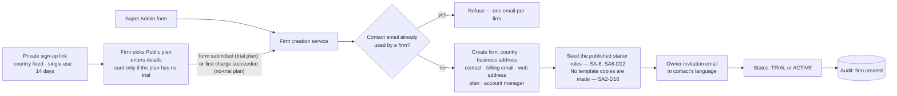
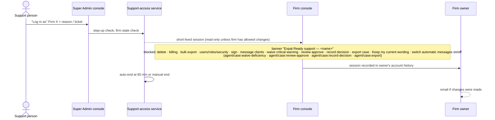

> **Document control** · Version **2.24** · **2026-10-12** · Status: **Applies the 12 Oct session-2 decisions (ExpatReady staff role names, one publisher for ExpatReady emails, legal holds, support-window default, Rule 9 defaults and placement, saved views kept, tax numbers at trial end); Reviewed — SA-04 v2.17 trials applied (SA4-X14)**\
> Part of: *Super Admin Console — Functional Requirements* · Split from `FINAL-SuperAdmin-FR.md` lines 946–1558 on 2026-09-16 · Previous version: `_archive/SA-02-tenant-firm-management_v2.23_2026-10-12.md`\
> Reviewed by: the co-product owner and the product owner (product owners) · Code state verified 2026-09-18 against GitHub `dev`: backend `ERv2-sanitized` @ `36db7f2f`, frontend `ERv2-frontend` @ `36a53b5`
>
> | Version | Date | Change | Decisions |
> |---|---|---|---|
> | 2.24 | 2026-10-12 | **Applies the template-map session-2 decisions (12 Oct): SR-Q2, SR-Q3, SR-Q4, SA05-R9b(1), G-Q5, G-Q6, R9-pass rulings 2 and 3, and the Rule 9 passes for SA-01/01B/02 and SA-03/04.** (1) **One publisher for ExpatReady emails (SR-Q2):** the Platform Owner publishes every ExpatReady email; Content publisher drafts and previews only; the "contains legal terms" flag and its Owner check are parked (SA2-D24, SA-2-42, SA2-D15, SA2-X16, §13 row 6, §0.1). (2) **Staff role names (SR-Q3, SR-Q4(1), (9)):** "Firm onboarding / Account manager" becomes Admin (the account manager is an Admin or the Platform Owner); "Security & audit" becomes Auditor; "Support Agent" becomes Support; **closing a firm account is Platform Owner only**. "Platform Engineer" is not one of the six names and is left as written (§13 row 12); whether Auditor may start a session on a locked firm is not settled (§13 row 13). (3) **Switching automatic messages on or off** uses the existing `agent/template:configure` (SA05-R9b(1)); a support session never exercises it (SA2-X13, SA-2-17, §3.7). (4) **Legal holds are placed by the Platform Owner only; the 90-day deletion refuses while any hold exists** (G-Q5; SA2-D25, SA-2-21, §3.9, §9). (5) **Export:** G-Q6 developer notes added as a check on the firm and supervised exports (SA2-X18 (g)); no client portal download in Release 1 is an SA-02 non-change. (6) **Support "make changes" window (R9-pass ruling 2):** one toggle "Allow support to make changes for 7 days" (default 7); 1 and 30 days under Advanced; R22.6 "fixed 7 days" superseded (SA2-D7, SA2-D21, SA-2-28, §3.7, SA2-X4, SA2-X18). (7) **Rule 9:** new §3.10 "Settings — defaults and placement"; cancellation reasons listed (R9-5, SA-2-31, US-7); failed-payment reminders corrected to day 0 / 7 / 12 (R9-6, §3.4, SA2-X1); shared team inbox is deploy configuration, not an SA-12 setting (R9-7; SA2-D6, SA-2-26, SA2-X3); account-manager handover is one "Move all N firms to ___" choice (R9-23); **saved views are built and stay** — §0.1 deferral removed, §13 row 8 closed (R9-9); **tax numbers are asked at trial end, before the first invoice** (R9-19; SA-2-25, §3.0, §9); activity-log keep period 7 years (ruling 3; SA-2-19). **IDs changed:** SA-2-17, SA-2-19, SA-2-21, SA-2-25, SA-2-26, SA-2-28, SA-2-30, SA-2-31, SA-2-34, SA-2-42, SA2-D6, SA2-D7, SA2-D7b, SA2-D11, SA2-D15, SA2-D21, SA2-D24, SA2-X1, SA2-X3, SA2-X4, SA2-X5, SA2-X9, SA2-X13, SA2-X15, SA2-X16, SA2-X18. **Added:** SA2-D25, SA2-D26, SA2-D27, §3.10. **Withdrawn:** none (the saved-views deferral row of §0.1 is removed). **Same-day revision (W-1 – W-3, the product owner, 12 Oct):** W-3(1) replaces the Platform Engineer persona with Admin (and Owner) for stalled set-ups (§13 row 12 closed); W-3(3) tax numbers not given by trial end are asked at the card step, and staff-created firms get the same step unless staff entered them (§3.0, §3.10, SA-2-25, edge case); `system/firm:investigate` stays Platform Owner only per SA-07 Appendix A, so "Platform Owner or Auditor" is corrected in SA2-D7b, SA2-D11, SA-2-30, §3.7, §3.9, §10 and the tests (§13 row 13 closed). **Same-day revision (W-4 – W-10, the product owner, 12 Oct):** W-4 the deletion warnings (days 30, 60, 97) go to the billing email, the Owner and the Admins, like every other billing notice (§3.8, §3.9, SA2-D23, SA-2-38). **Same-day revision (W-11 – W-21, the product owner, 12 Oct):** W-18 the staff "New firm" route requires the plan with no pre-selection and the Owner may switch to any public plan during a trial at no charge (SA2-D28, §3.10, SA-2-23), W-19 "Extend trial" is pre-filled with 7 days and editable, and W-21 audit fixes apply — security lock apply and lift are Platform Owner only (W-13), the Platform Owner and Auditor personas are split, SA2-X3 and SA2-X15 are marked applied or closed, retired role names and the superseded billing-email recipients are annotated, and open row 11 is narrowed to the runbook author. | SR-Q2, SR-Q3, SR-Q4, SA05-R9b(1), G-Q5, G-Q6; R9-pass rulings 2, 3; R9-5, R9-6, R9-7, R9-9, R9-19, R9-23 |
> | 2.23 | 2026-10-12 | **Applies the template map (rules 7, 8; decisions 3a, 11 Oct; Q1, Q3, Q5, Q21; O15, O24, O25) and the complexity review (R22.5 – R22.8, R27, R30, R33; code-check outcomes; "Spec follows code"; only-Owner defect).** (1) **Departure notices state only ExpatReady's facts** — the deletion date and a download link, plus "keep your own copy for as long as your professional rules require"; no regulator name, number of years or section citation (map §16; rule 7): SA2-D13 and SA-2-38 changed, SA2-D11 "Why" citation dropped, §3.9 notice, US-8, §0.3 slice SA-02.09, §13 row 5, the regulator go-live check and source link removed. (2) **No template copies at firm creation** (option C; full-read 3a; Q1, Q3, Q5): SA-2-2 and §3.1 changed, diagram B. (3) **Emails:** "Account security-locked" (Must, neutral) added to SA-2-34; "Owner contact changed" now **Must** (O24) in SA-2-20; **SA-2-42 added** (the SA-2 emails are ExpatReady-owned kind-1 emails, English required / French optional — O15, R27; security incident notice to affected firms — Q21; legal-terms flag — R33); billing-email recipients become two sets (R30; refines SA4-D8). (4) **Support:** a support session can never click "Keep my current wording" or switch automatic messages on or off (O25): SA-2-17 changed. *(revised same day — SA05-R9a)* (There is no "Review your automatic messages" confirmation any more — SA05-R9a.) **Spec follows code:** session length fixed at 60 minutes (SA-2-18 changed); supervised export = built backend + engineer runbook, no screen (SA-2-37 changed). **Kept as decided (built):** support window 1 / 7 / 30 days (R22.6 — SA-2-28; firm grant screen not built), web-address change as a Super Admin action (R22.7 — SA-2-27), handover prompt (R22.5 — SA-2-26), nine filters and sign-up link tracking (R22.8 — SA-2-3). (5) **Card-first leftovers fixed to "no card for trial plans"** (register contradictions): diagram A, diagram B, §6 first row, SA-2-22, plus SA2-D2, SA2-D2a, SA-2-2a, US-2 and §9 wording. (6) SA5-X14 (a) – (d) applied; §0 decisions SA2-D15 – SA2-D24 added; §0.2 rows SA2-X12 – SA2-X18 added (Pending); §12 code-state update; §13 reopened with six undecided items. **IDs changed:** SA-2-2, SA-2-3, SA-2-17, SA-2-18, SA-2-20, SA-2-22, SA-2-26, SA-2-27, SA-2-28, SA-2-33, SA-2-34, SA-2-37, SA-2-38, SA-2-2a, SA2-D11, SA2-D13. **Added:** SA-2-42, SA2-D15 – SA2-D24, SA2-X12 – SA2-X18. **Withdrawn:** none. | Map rules 7, 8; decisions 3a, 11; Q1, Q3, Q5, Q21; O15, O24, O25; R22.5 – R22.8, R27, R30, R33; code-check outcomes; Spec follows code · SA5-X14 |
> | 2.22 | 2026-10-11 | **Consistency fixes (the product owner, 11 Oct — found in the template review's full read).** No rule changed: §3.5 billing email — trial notices also go to the firm's Admins (SA-4-53); §6 trial extension notifies the Owner, billing email and Admins (SA-4-80); SA-2-38 — the notices themselves follow the template rule (French optional, decided 10 Oct), while the terms and billing documents stay bilingual, French first (SA4-D19); the owner invitation is noted as the same email SA-04 calls the welcome / set-password email. | SA4-D29 · SA4-D19 (consistency) |
> | 2.21 | 2026-10-10 | Applied from SA-04 v2.17 (SA4-X14; the product owner, 10 Oct — trials review): **no card to start a trial** — a sign-up-link firm on a plan with trial days is created when the form is submitted (card added later on the billing screen); a plan with 0 trial days still takes the card first. **A trial that ends with no card goes straight to payment hold** (no 14-day grace). **Super Admin can extend a trial** from the firm record (reason; whole trial ≤ 90 days). SA2-D3, SA2-D3a annotated; §3.2, §3.3 actions, §3.5, §6 and US changed; SA-2-23 changed. | SA4-D29 (SA4-X14) |
> | 2.20 | 2026-10-10 | Firm creation seeds the **published starter roles** from Super Admin (six at launch), not a fixed set in code (SA-06 v3.2 SA6-D12). Wording only in the SA6-D7 row, the creation flow, the creation steps, SA-2-2 and the creation acceptance criterion. | SA6-D12 |
> | 2.19 | 2026-10-08 | Code-state note: the built session-timeout setting covers Expat Ready staff sessions only by decision (SA7-D67, SA-07 v2.10); code to be narrowed (specs/002 Phase 7). No requirement changed. | SA7-D67 |
> | 2.18 | 2026-10-07 | Permission rename from SA-06 v3.0 (SA6-D10, Appendix B): `agent/case-management:review-approve` → `agent/case:review-approve` in SA2-D14, the support-session diagram, §3.7, SA-2-17 and its acceptance criterion. Meaning unchanged. | SA6-D10 |
> | 2.17 | 2026-10-07 | Applied from SA-06 v3.0 (the product owner, 7 Oct): every plan now seeds the same six standard firm starter roles — Owner, Admin, Case Manager, Case Officer, Billing / Finance, Read-only (SA-6) — instead of a role set chosen by the plan (the per-plan role set is withdrawn; SA-3-15 withdrawn in SA-03 v2.14, SA3-A6). Firm creation, SA-2-2 and the creation acceptance criterion changed. | SA6-D7 (SA3-A6) |
> | 2.16 | 2026-10-03 | Consistency review fixes (3 Oct): the support-session diagram (§3.7) and the support-session acceptance criterion now list the four always-blocked professional actions of SA-2-17 (`agent/case:waive-deficiency`, `agent/case-management:review-approve`, `agent/case:record-decision`, `agent/case:export`); SA3-X4 marked applied (SA-12 v2.5 settles it: per-firm emergency off only). No requirement IDs added or changed. | AG17-D9, AG17-D17, AG17-D35, AG17-D37 |
> | 2.15 | 2026-10-02 | Applied from AG-17 (the product owner, 2 Oct): the always-blocked list in a support session (SA-2-17) now also covers four firm-professional actions — waiving a critical warning (`agent/case:waive-deficiency`), approving a review (`agent/case-management:review-approve`), recording a decision (`agent/case:record-decision`) and exporting a case (`agent/case:export`); these are professional judgements and evidence exports that support staff never make for a firm, even while the firm allows changes. Corporate positions, advertising channels, candidates and inspection packs are part of the firm-data export SA-2-33 already covers (SA-2-33 clarified). SA-2-17, SA-2-33 changed; SA2-D14 added; §3.7 wording matched. | AG17-D9, AG17-D17 (AG-17 §0.2, SA-02 row) |
> | 2.14 | 2026-10-01 | Applied from SA-07 v2.6 (the product owner, 1 Oct): SA-2-40 added (Demo firm marker: staff-set, audited, badge, Internal ($0) plan only; §3.3, §7, §9) and SA-2-41 added (a support session ends with the staff member's own session; the owner's history shows the end time; §3.7, §9); SA-2-18, SA-2-29 changed; "security-role user" is now the Security & audit role (SA-2-30, SA-2-37, SA2-D7b, SA2-D11, §3.7, §3.9, §10); SA-7 role names "Firm onboarding / Account manager" and "Billing" used throughout (§2, §3.1, §3.8); live plan and price changes are approved by an Owner (SA7-D51). | SA7-X2 (b)–(d), SA7-X10 · SA7-D19, SA7-D63, SA7-D51 |
> | 2.13 | 2026-10-01 | Merged with SA-07 v2.5 (the co-product owner): SA7-X2 (a) and (e) applied — SA-2-26 uses the SA-7 role name "Firm onboarding / Account manager", a firm without an active account manager shows "account manager inactive" to staff only, and the handover offers only holders of that role; §9 edge case updated; AG1-D12 row points to SA-07 v2.5. SA7-X2 (b) demo firm, (c) Security & audit role name, (d) support session ends with the staff session stay pending for the SA-2 review. | SA7-X2 (a), (e) · SA7-D64 |
> | 2.12 | 2026-10-01 | Knock-on from AG-01 v1.3 (decisions revised by the product owner, 1 Oct): nothing in staff leaving is deferred, so the account-manager handover prompt in SA-2-26 and the §9 edge case "Account manager deactivated" is in scope now (firms handed to a new account manager, or if skipped fall back to the shared team inbox); AG1-D12 and AG1-D13 rows updated. | AG1-D1, AG1-D13 |
> | 2.11 | 2026-10-01 | Knock-on from AG-01 v1.2 (staff leaving, decided by the product owner 1 Oct): SA-2-26 changed (an account manager can be deactivated at once; the "cannot be deactivated until firms are reassigned" block is removed; firms go to a new account manager in the deferred handover prompt, or fall back to the shared team inbox); §9 edge case "Account manager deactivated" changed. SA-07 counterpart pending with its owner. | AG1-D2, AG1-D12, AG1-D13, AG1-D14 |
> | 2.10 | 2026-09-18 | Knock-on from the SA-1 review (SA-1 v2.1): SA2-X11 applied (no Quebec immigration programs in Release 1); SA-2-13a says "suspended" (SA1-D1: existing firms continue unchanged); the firm's one country (SA-2-9) is what SA-1's pack read uses. Requirements otherwise unchanged. | SA1-X2 · SA1-D1 |
> | 2.9 | 2026-09-18 | §12 re-checked against GitHub `dev` after today's frontend merge of `feat/SA-02` (frontend `36a53b5`; backend unchanged `36db7f2f`): the merge touched pack-authoring screens, routes and docs only; no SA-2 finding or cited line changed. Requirements unchanged. | — |
> | 2.8 | 2026-09-18 | Remaining open questions closed by the product owners (18 Sep): same support rules for every firm with a data-processing clause in the subscription terms (Quebec Law 25); supervised data export for a closed security-locked firm; backups purged within 35 days; departing firms told the CICC 6-year file rule. Noted: Release 1 launches no Quebec immigration programs. SA-2-21, SA-2-33 changed; SA-2-37 – SA-2-39 added; §13 closed. | SA2-D10 – SA2-D13 · SA2-X10, SA2-X11 |
> | 2.7 | 2026-09-18 | §0.2 SA2-X5 updated: retention of Expat Ready's own billing records set at 6 years after fiscal year-end (SA-4 v2.3, SA4-D18); the SA-11 part stays pending. Requirements unchanged. | SA4-D18 |
> | 2.6 | 2026-09-18 | Knock-on from SA-4 v2.2 (accountant's tax answer): a firm with a Canadian business address must record its GST/HST number (and QST number in Quebec) or declare it is not registered; format checked; firms outside Canada are not asked (SA-2-1, SA-2-25 changed; §3.0, §7, §9). Replaces the "optional tax number" of SA2-D4. §13 Q1 answered. | SA4-X10 · SA4-D11, SA4-D12 |
> | 2.5 | 2026-09-18 | Knock-on from the SA-4 review (SA-4 v2.1): the creation form and sign-up links may carry one approved discount (SA-2-1, SA-2-22 changed); a first-year refund ends the paid period and starts payment hold (§3.4, §6); billing emails follow SA4-D8 (§3.8). §0.2: SA2-X1 applied in SA-4 v2.1; SA2-X4 billing part applied in SA-4 v2.1. SA3-E3 and SA3-S1 marked fully applied. §13 Q1 moved to SA-4 §13. | SA4-X1 · SA4-D1, SA4-D6, SA4-D8 |
> | 2.4 | 2026-09-18 | SA2-R1 wording corrected (product owners, 18 Sep): the team builds only from the module files the product owners share — not from Confluence, which the team maintains as a mirror (DOCS-7). Requirements unchanged. | SA2-R1 |
> | 2.3 | 2026-09-18 | Two decisions recorded (18 Sep): SA2-R1 — reviewed masters are the only requirements source (DOCS-7); SA2-R2 — the 17 Sep support-access decisions (SA2-D7/D7a/D7b) stand over the 16 Sep policy recorded in specs/002. §13 items 6 and 7 closed; SA2-X9 updated. | SA2-R1, SA2-R2 |
> | 2.2 | 2026-09-18 | §12 re-verified against same-day GitHub `dev` (DOCS-6): backend `36db7f2f`, frontend `5ad194e`. The SA-2 build on dev follows an older requirements source (specs/002, Doc-2); conflicts listed. Support-access policy conflict and requirement-source question added to §13; developer re-base added to §0.2 (SA2-X9). Requirements unchanged. | — |
> | 2.1 | 2026-09-17 | Product review applied. One country per firm, chosen at creation and locked (country grant/revoke withdrawn). Two ways in: Super Admin creation and private sign-up links (country fixed, firm picks a Public plan, pays). Per-plan free trials. One email per firm account. Business address, owner contact, optional billing email, optional account manager (shared-inbox fallback), editable web address. Lifecycle redesigned: Setting up → Trial / Active → Payment hold → Deleted, plus Security lock and Abandoned; offboarding stages replaced by owner cancellation, self-service data download and deletion 90 days after hold. Support access: look anytime; change only with the firm's permission; firm told; suspended firms read-only. Single-firm lookup added. Release 1 priorities recorded (§0.3). §12 replaced with verified code state. SA-2-10 – SA-2-13 and SA-2-15 withdrawn; SA-2-22 – SA-2-36 added. | SA2-D1 – SA2-D9 · applies SA3-X1, SA3-E1, SA3-E1b, SA3-E3, SA3-S1, SA3-S2, SA3-X4 |
> | 2.0 | 2026-06-20 | Baseline — golden per-module rebuild | — |

## Module SA-2: Tenant / Firm Management

> **What this document is.** The build specification for Super Admin module SA-2. Version 2.1 applies the product review of 17 Sep 2026. **§0** records each decision and the Release 1 priorities; every later section has been edited in place to match. Where an earlier version says something different, this version wins; earlier wording is kept only in `_archive/`.
>
> **Plane:** Super Admin / Global (Expat Ready's internal console — never tenant-facing). **Subject:** the **Firm** = the tenant (the model is already named `Firm` in ERv2). **Tenant key:** `firm_id`, row-level-security enforced. **Country:** every firm has **exactly one** destination country, chosen at creation and never changed (FD-68). **Sits between** SA-3 (plans), SA-4 (prices, payment, subscription state), SA-11 (audit, retention, legal hold) and the Agent plane (the firm's own console).
>
> **Requirement IDs are permanent.** A changed requirement keeps its number. A withdrawn requirement stays as a one-line entry. New requirements continue from SA-2-22. Numbers are never reused.

---

### 0. Decision log (review of 2026-09-17)

| ID | Decision | Where applied |
|---|---|---|
| **SA2-D1** | **One email per firm account.** A firm's contact email cannot be the contact email of any other firm. A practice working a second country uses a different email for that account. | SA-2-24 (confirms existing behaviour) |
| **SA2-D2** | **Two ways in for Release 1:** (1) Super Admin creates the firm; (2) Super Admin sends a **private sign-up link** and the firm chooses its plan and pays itself. No open public sign-up page. Route 2 depends on SA-4 prices; a card is taken at sign-up only for a plan with no trial days *(changed v2.23 — SA4-D29 consistency)*. | §3.1 · SA-2-1a, SA-2-22 |
| **SA2-D2a** | A sign-up link **fixes the country**; the firm chooses any **Active, Public** plan (Internal plans are never offered). The link is **single-use**, **tied to one email**, and **expires after 14 days**. ~~The firm is created **only after payment succeeds**.~~ *(changed v2.23 — SA4-D29)* On a plan with trial days the firm is created when the form is submitted (no card); on a plan with no trial days it is created **only after the first charge succeeds**. | SA-2-22 |
| **SA2-D3** | **Free trials, set per plan** (trial days on the plan; 0 = no trial). When a trial ends without a successful payment, the 14-day rule applies, then payment hold. A **Trial** firm state is added. *(changed v2.21 — SA4-D29: a trial that ends with **no card** goes straight to payment hold; the 14-day rule applies only when a card's charge fails; Super Admin can extend a trial, ≤ 90 days in total.)* | §3.4 · SA-2-23 · SA-3 v2.2 (trial days) |
| **SA2-D3a** | Sign-up-link firms also get the plan's trial: ~~**card taken at sign-up**~~ **no card at sign-up** *(changed v2.21 — SA4-D29a)*, first charge when the trial ends once a card is added; the firm can cancel before then at no cost. Firms created by Super Admin add a card during their trial. | SA-2-23 · §0.2 SA2-X1 |
| **SA2-D4** | **Business address is required at creation** by either route: country, province/state, city, postal code, plus optional tax registration number. Used by SA-4 for sales tax. The firm can update it later; changes are audited. *(Tax-number part superseded 18 Sep by SA4-D12 — see SA4-X10 below.)* | SA-2-25 · §0.2 SA2-X1 |
| **SA2-D5** | **Owner contact + optional billing email.** Contact name, email, phone and preferred language at creation; the contact is the firm's owner account. Super Admin can switch the contact to another active staff member of the same firm (reason required, audited, both people notified). An optional billing email receives invoices and payment notices *(recipients superseded by R30's two sets — SA2-D23; revised same day — W-21)*. | SA-2-20 |
| **SA2-D6** | **Account manager is optional.** A firm may be assigned one Super Admin user as account manager — a person with the **Admin** or **Platform Owner** role *(changed v2.24 — SR-Q3, SR-Q4(9))* (reassignable, audited). Firms without one send their alerts to a **shared team inbox** (deploy configuration set once at go-live, not a console setting *(changed v2.24 — R9-7)*). | SA-2-26 · §0.2 SA2-X3, SA2-X4 |
| **SA2-D7** | **Support can always look; changes need the firm's permission.** Support can open any firm read-only, with a reason. To make changes, the firm owner allows Expat Ready support to make changes with one toggle — **7 days by default**, with the **1- and 30-day** choices under Advanced (revocable anytime) *(changed v2.24 — R9-pass ruling 2)*. Even then these stay blocked: deleting clients/cases/documents, billing and payment, bulk export, users/roles/security settings, signing, and sending messages to clients. Every change is marked "Expat Ready support — <name>". *Basis:* Salesforce "Grant Login Access" (customer-granted, time-limited, fully audited). | §3.7 · SA-2-16, SA-2-17, SA-2-28 |
| **SA2-D7a** | **The firm is told.** Every support session appears in the owner's account history (who, when, how long, reason or ticket, what changed). The owner is **emailed when changes were made**. | SA-2-29 |
| **SA2-D7b** | **Suspended firms: look only.** Payment hold — any support person can look (read-only, with reason); no changes even if previously allowed. Security lock — only the Platform Owner can look, read-only *(changed v2.24 — SR-Q3)* *(revised same day — SA-07 Appendix A)*, and each session is flagged as an investigation. | SA-2-30 |
| **SA2-D8** | **Web address** (`maple.expatready.com`): suggested from the firm name and editable at creation, with an availability check; afterwards **only Super Admin** can change it (reason required, audited) and the old address **redirects for 90 days**. Custom domains are an AG-15 plan feature. | SA-2-27 |
| **SA2-D9** | **The owner cancels in the billing screen** (reason from a short list). Access continues to the end of the paid period; the owner can undo until then; the account manager (or shared inbox) is alerted immediately. | §3.9 · SA-2-31 |
| **SA2-R1** *(2026-09-18)* | **Developers build only from the reviewed module files** that the product owners share with them (DOCS-7); Confluence is a mirror the team maintains, never a source. For SA-2, `Docs/SuperAdmin-Console-Modules/02-Tenant-Firm-Management.md`, `Docs/SuperAdmin-Console-Modules/build-specs/SA-2-BUILD-SPEC.md` and "Doc-2" are superseded. | §0.2 SA2-X9 · §12 |
| **SA2-R2** *(2026-09-18)* | **SA2-D7, SA2-D7a and SA2-D7b stand.** They replace the support-access policy recorded on 2026-09-16 in `specs/002-sa2-module-contracts/spec.md:143, 178` (prior firm consent for every session; read-only only; supervisor approval for Support; sessions end on suspension). | §3.7 · §0.2 SA2-X9 |
| **SA2-D10** *(2026-09-18)* | **Same support rules for every firm, plus a data-processing clause.** SA2-D7/D7a/D7b apply to every firm wherever it is based — no province-specific screens. The bilingual subscription terms (SA-4-65) include a data-processing clause: Expat Ready uses firm data only to run the service and support it, keeps it confidential, logs every support session (shown to the owner), and deletes it under the 90-day rule. This is the written contract Quebec's Law 25 (s. 18.3) requires for service providers, and serves PIPEDA elsewhere. *Context:* Release 1 launches no Quebec immigration programs, but Quebec-based firms may use the platform for federal programs; the platform is English and French. | §3.7 · SA-2-39 · §0.2 SA2-X10, SA2-X11 |
| **SA2-D11** *(2026-09-18)* | **Closed security-locked firm: supervised export on request.** When a locked account is closed, the owner is told they may request a full data export within the 90 days before deletion. The Platform Owner only *(revised same day — SA-07 Appendix A)* verifies the requester's identity and sends a secure, expiring download link; staff still cannot log in. No export while a legal hold or an authority's request forbids it. Every step audited. *Why:* the files belong largely to the firm's clients, who are not at fault. *(changed v2.23 — map §16, rule 7: the regulator citation is dropped; it is not product text.)* | §3.4, §3.9 · SA-2-37 |
| **SA2-D12** *(2026-09-18)* | **Backup copies are purged within 35 days** of deletion from live systems (the longest automatic backup window of managed databases such as Amazon RDS); no long-term archive of firm data. If a backup is ever restored, firms deleted since that backup are deleted again before the system goes live. The deletion record shows when the last backup copy expires. | §3.9 · SA-2-21 changed · SA-3 §13 Q1 |
| **SA2-D13** *(2026-09-18; changed v2.23 — map §16 "Departure notices revised 11 Oct", rule 7)* | **Departing firms are told ExpatReady's own facts.** The cancellation confirmation, payment-hold notice, deletion warnings and data-download screen state only when the data will be permanently deleted and how to download it, e.g. *"Your data will be permanently deleted on 14 Jan 2027. Download it now and keep your own copy for as long as your professional rules require."* No regulator name, number of years or section citation, and no law-society line. The export lists each client file with its closed date. ExpatReady's **own** billing-record retention (6 years, SA4-D18) is its tax duty and stays. | §3.9 · SA-2-33 changed · SA-2-38 · SA-3 §13 Q2 |
| **SA2-D14** *(2026-10-02 — AG17-D9, AG17-D17)* | **Professional judgements are never made in a support session.** Four firm permissions are never exercised in any support session, even while the firm allows changes: `agent/case:waive-deficiency` (passing a critical warning), `agent/case:review-approve` (senior review), `agent/case:record-decision` and `agent/case:export` (case and evidence exports). Support staff do not make these calls for a firm. Corporate positions, advertising channels, candidates and inspection packs are part of the firm-data export (SA-2-33). | SA-2-17 · SA-2-33 · §3.7 |
| **SA2-D15** *(2026-10-12 — map §16, rule 7)* | **Departure notices: facts only.** Applies the map's "Departure notices revised 11 Oct" to SA2-D11 ("Why"), SA2-D13, SA-2-38, the §3.9 notice, US-8 and §13 row 5. The "contains legal terms" flag (R33) is parked, and the Platform Owner publishes every ExpatReady email, so no notice needs a separate flag *(changed v2.24 — SR-Q2; §13 row 6 closed)*. | SA2-D11 · SA2-D13 · SA-2-38 · §3.9 · US-8 · §13 |
| **SA2-D16** *(2026-10-12 — option C; full-read 3a; Q1, Q3, Q5)* | **No template copies at firm creation.** The firm uses ExpatReady's live defaults. Nothing is held for a review: every automatic message, self-firing ones (timers and rules) included, runs from day one with ExpatReady's neutral wording unless it is off by default (e.g. Going-cold). A message missing a needed firm detail is not sent and the firm sees a note naming the detail; the dashboard shows a one-time notice. The optional on/off page belongs to AG-12 / AG-11. *(revised same day — SA05-R9a)* | SA-2-2 · §3.1 · diagram B |
| **SA2-D17** *(2026-10-12 — map §16; O24)* | **Two account emails are Must.** "Account security-locked" (neutral, no details of the reason) goes to the Owner when a lock is applied; "Owner contact changed" (**upgraded from Good to have to Must, O24**) goes to the old and new contacts. Both are ExpatReady-owned. | SA-2-34 · SA-2-20 · SA-2-42 |
| **SA2-D18** *(2026-10-12 — O25)* | **A support session cannot release or change client messages in bulk:** it can never click "Keep my current wording" or switch automatic messages on or off. Added to the always-blocked list. *(revised same day — SA05-R9a)* (The "confirm Review your automatic messages" action no longer exists — nothing is held; SA05-R9a.) | SA-2-17 · §3.7 · US-6 · §9 |
| **SA2-D19** *(2026-10-12 — Q21)* | **Security incident notice goes to the affected firms** (Owner and Admins), as an ExpatReady-owned email. It replaces the earlier "Data breach notice to affected people". The firm decides whether and how to tell its own clients; ExpatReady notifies people directly only for its own users (firm staff accounts). The process sits in SA-11. | SA-2-42 |
| **SA2-D20** *(2026-10-12 — "Spec follows code")* | **The spec describes what is built.** Support session length is a fixed 60 minutes set by configuration (SA-2-18). The supervised export for a closed security-locked firm is a built backend plus an engineer runbook, with no screen (SA-2-37). | SA-2-18 · SA-2-37 · §0.3 · §12 |
| **SA2-D21** *(2026-10-12 — R22.5 – R22.8, code-check outcomes)* | **Kept as decided, built or partly built:** account-manager handover prompt (R22.5, SA-2-26); support "make changes" window built for **1, 7 or 30 days** (backend built; firm-side grant screen not built; the earlier R22.6 "fixed 7 days" is superseded by R9-pass ruling 2 — firm screen is one 7-day toggle, 1 and 30 under Advanced; SA-2-28) *(changed v2.24 — R9-pass ruling 2)*; web-address change **as a Super Admin action** with the 90-day redirect record (R22.7 — built; SA-2-27 is not parked); firm list with nine filters and sign-up link "opened" tracking (R22.8, SA-2-3, SA-2-22). | SA-2-3 · SA-2-22 · SA-2-26 · SA-2-27 · SA-2-28 |
| **SA2-D22** *(2026-10-12 — consistency, SA4-D29)* | **Card-first leftovers removed.** A sign-up-link firm on a plan with trial days is created when the form is submitted; only a plan with no trial days takes a card first. Diagram A, diagram B, §6 first row, SA-2-22, SA2-D2, SA2-D2a, SA-2-2a, US-2 and §9 now say so. | as listed |
| **SA2-D23** *(2026-10-12 — R30)* | **Billing email recipients: two sets.** (1) Documents (invoices, receipts, refunds, credit notes) go to the billing email, or the Owner if none is set. (2) Every other billing notice goes to the billing email, the Owner and the firm's Admins — the deletion warnings (days 30, 60, 97) included *(revised same day — W-4)*. Replaces the risk-based sets of SA4-D8 / SA-4-53 in this document; SA-04 applies it to SA-4-53. | §3.8 |
| **SA2-D24** *(2026-10-12 — O15, R27, R33)* | **ExpatReady's own emails to firms: English required, French optional**, falling back to English when a French version is missing. Billing documents (terms, invoices) stay French first (SA4-D19). **The Platform Owner publishes every ExpatReady email**; Content publisher drafts and previews only (as built) *(changed v2.24 — SR-Q2)*. The "contains legal terms" flag and its Owner check are parked (§0.1). | SA-2-42 · SA-2-38 |
| **SA2-D25** *(2026-10-12 — G-Q5)* | **Legal holds are placed by the Platform Owner only**, from the Super Admin legal-hold list (platform key `system/compliance:legal-hold`, owned by SA-11). The firm-side hold route stays built with no firm screen. The 90-day deletion of SA-2-21 refuses while any active hold exists on the firm, so a firm-placed hold cannot block it indefinitely. | SA-2-21 · §3.9 · §9 · §0.2 SA2-X5 |
| **SA2-D26** *(2026-10-12 — Rule 9 passes SA-01/01B/02, SA-03/04)* | **Defaults and placement are stated for every kept setting** (new §3.10). Timings stay code constants. The shared team inbox is deploy configuration (R9-7). Cancellation reasons are a fixed list (R9-5). Failed-payment reminders are day 0, 7 and 12 (R9-6). **Saved views in the firm list are built and stay** (R9-9; §0.1 deferral removed). **Tax numbers are asked at trial end, before the first invoice**, not at sign-up (R9-19; plans with no trial ask before the card step as today). The account-manager handover is one "Move all N firms to ___" choice with a per-firm override and "skip" (R9-23). | §3.10 · SA-2-25 · SA-2-26 · SA-2-31 · §3.2 · §3.4 |
| **SA2-D27** *(2026-10-12 — SR-Q3, SR-Q4)* | **ExpatReady staff role names:** Platform Owner · Admin · Support · Billing · Content publisher · Auditor. The account manager is an Admin (or the Platform Owner). **Closing a firm account is Platform Owner only** (`system/firm:close` removed from Admin). *(revised same day — W-13)* **Applying and lifting a security lock are also Platform Owner only** (SA7-D53): `system/firm:suspend` and `system/firm:reinstate` leave Admin. | §2 · §3.1 · §3.7 – §3.9 · SA-2-26 · SA-2-30 · SA-2-34 · §10 |
| **SA2-D28** *(2026-10-12 — W-18, W-19)* | **Plan on firm creation; trial plan switch; trial extension.** The staff "New firm" route **requires the plan, with no pre-selection** (sign-up links unchanged: the firm picks on the sign-up page). **During a trial the Owner may switch to any public plan** — no charge, trial end date unchanged; after the trial the normal upgrade / downgrade rules apply (SA-4 §3.7, SA4-D28). **"Extend trial"** is pre-filled with **7 days**, editable; reason required; the whole trial stays ≤ 90 days (SA4-D29). | §3.1 · §3.3 · §3.10 · SA-2-23 · §6 · SA2-X19 |

**Applied from the SA-3 review** (SA-3 §0.2):

| ID | Decision | Applied here |
|---|---|---|
| **SA3-X1** | One firm, one country, enforced at the data layer | §3.5 · SA-2-9, SA-2-13a · SA-2-10 – SA-2-13 withdrawn |
| **SA3-E1** | Departed firm's data: hand back, then delete | §3.9 · SA-2-21, SA-2-33 (SA-11 part still pending) |
| **SA3-E1b** | 90-day window before deletion | §3.9 · SA-2-21 (SA-11 part still pending) |
| **SA3-E3** | Countdown starts at payment hold | §3.4 · SA-2-8a (SA-4 part applied in SA-4 v2.1) |
| **SA3-S1** | Two kinds of suspension | §3.4 · SA-2-6, SA-2-34 (SA-4 part applied in SA-4 v2.1) |
| **SA3-S2** | Client portal during suspension: view and download only | SA-2-35 (AG-15 part still pending) |
| **SA3-X4** | No firm-level commercial grants | §3.0 · SA-2-12 withdrawn (SA-12 part applied — SA-12 v2.5 settles it: per-firm emergency off only, AG17-D35, AG17-D37) |

**Applied from SA-04 v2.17 (trials, 2026-10-10)**

| ID | Decision | Applied here |
|---|---|---|
| **SA4-X14** (SA4-D29) | No card to start a trial; firm created on form submission for trial plans; no card at trial end → payment hold that day; Super Admin can extend a trial (reason, ≤ 90 days total) | SA2-D3, SA2-D3a · §3.2 · §3.3 actions · §3.5 · §6 · SA-2-23 · US |

**Applied from SA-05 v3.1 (SA5-X14, 2026-10-12)**

| ID | Decision | Applied here |
|---|---|---|
| **SA5-X14 (a)** — **applied** | Departure notices state only ExpatReady's facts; no regulator name, number of years or section citation; SA2-D11's "Why" citation dropped | SA2-D11 · SA2-D13 · SA2-D15 · SA-2-38 · §3.9 · US-8 · §13 row 5 |
| **SA5-X14 (b)** — **applied** | "Account security-locked" email (Must; neutral) in SA-2-34; "Owner contact changed" email (Must, O24) in SA-2-20 | SA2-D17 · SA-2-34 · SA-2-20 · US-4 · US-11 |
| **SA5-X14 (c)** — **applied** | SA-2 emails are kind 1: owned and edited in SA-05 (Appendix B) | SA-2-42 · §3.8 · cross-cutting doctrine |
| **SA5-X14 (d)** — **applied** | A support session cannot click "Keep my current wording" or switch automatic messages on or off (O25) *(revised same day — SA05-R9a)* | SA2-D18 · SA-2-17 · §3.7 · US-6 |

**Applied from the SA-4 review** (SA-4 v2.1 §0.2):

| ID | Decision | Applied here |
|---|---|---|
| **SA4-X1** | Creation form and sign-up links may carry one approved discount (SA4-D1); a first-year refund ends the paid period and starts payment hold (SA4-D6); firm status follows SA-4's billing events (SA-4-59) | §3.1, §3.4, §6, §7 · SA-2-1, SA-2-22 changed |
| **SA4-D8** | Billing emails split by risk — refines SA2-D5's "billing email receives invoices and payment notices" *(recipient sets superseded v2.23 by R30 — SA2-D23)* | §3.8 |
| **SA4-X10** | Tax numbers (SA4-D11, SA4-D12): Canadian address → GST/HST number (+ QST number in Quebec) or "not registered"; format checked; not asked outside Canada. Replaces SA2-D4's "optional tax registration number" | §3.0, §7, §9 · SA-2-1, SA-2-25 changed |
| **SA1-X2** | SA-1 review: no Quebec immigration programs in Release 1 (SA-1-65); a suspended country stops new firms only (SA1-D1); SA-1's pack read uses the firm's one country (SA-2-9, SA-1-57) | §0.2 SA2-X11 · SA-2-13a changed |

**Applied from AG-01 v1.3 (staff leaving, 2026-10-01)**:

| ID | Decision | Applied here |
|---|---|---|
| **AG1-D2** | Deactivate and Suspend both revoke all sessions at once; the lock-out never waits for a handover | SA-2-26 (no block on deactivation) |
| **AG1-D12** | A Super Admin user who is a firm's account manager can be deactivated at once (the old block is removed). Their firms are handed to a new account manager in a handover prompt or, if skipped, fall back to the shared team inbox. Their open support tickets return to the unassigned queue (SA-10). Applied in SA-07 v2.5 (SA7-D64, SA-7-46, SA-7-47) | SA-2-26 changed · §9 edge case "Account manager deactivated" changed |
| **AG1-D13** | Nothing in staff leaving is deferred: the rules (instant lock-out, no block) and the account-manager handover prompt, with the shared-inbox fallback, all ship in the MVP, same release | SA-2-26 |
| **AG1-D14** | Nothing more for the Super Admin side (small team; the support lead watches the queue daily) | — |

**Applied from SA-06 v3.0 (2026-10-07)**

| ID | Decision | Applied here |
|---|---|---|
| **SA6-D7** | Every plan seeds the same six firm starter roles — Owner, Admin, Case Manager, Case Officer, Billing / Finance, Read-only (code keys `firm-owner`, `firm-admin`, `firm-case-manager`, `firm-case-officer`, `firm-billing-finance`, `firm-read-only`). The per-plan starter role set is withdrawn (SA-3-15 withdrawn in SA-03 v2.14, SA3-A6). Starter roles are fixed; firms copy and edit them (SA6-D3) | §3.1 creation steps and flow diagram · SA-2-2 changed · creation acceptance criterion |

**Applied from SA-07 v2.6 (2026-10-01)**

| ID | Decision | Applied here |
|---|---|---|
| **SA7-X2 (a), (e)** | Deactivating an account manager is never blocked; their firms show "account manager inactive" to staff only; the deactivation screen offers "choose a new manager or skip" (only Firm onboarding / Account manager holders *(role name superseded — SA2-D27: now Admin and Owner; revised same day — W-21)*); skipped firms use the shared inbox | SA-2-26 · §9 edge case |
| **SA7-X2 (b)** | Firm record gains a **Demo firm** marker — set only by Expat Ready staff, audited, shown as a badge, allowed only on an Internal ($0) plan (SA7-D19, SA7-D63) | SA-2-40 · §3.3 · §7 Firm · §9 edge cases |
| **SA7-X2 (c)** | The "security-role user" is the **Security & audit** role *(role name superseded — SA2-D27: investigate = Platform Owner only; revised same day — W-21)* | SA2-D7b · SA2-D11 · SA-2-30 · SA-2-37 · §3.7 · §3.9 · §10 · §8 US-6 · §9 |
| **SA7-X2 (d)** | A support session ends when the staff member's own session ends (sign-out, auto-logout, deactivation); the firm owner's history shows the end time (SA7-D63) | SA-2-41 · SA-2-18 · SA-2-29 · §3.7 · §9 |
| **SA7-X10** | SA-7 role names: "Firm onboarding / Account manager", "Billing", "Security & audit"; the person who approves live plan and price changes is an Owner (SA7-D51). *(Names replaced in v2.24 — SR-Q3: see SA2-D27.)* | §2 persona table · §3.1 · §3.8 · SA-2-30 · SA-2-37 (SA-2 has no "second Super Admin" wording; plan and price approval stays in SA-3 / SA-4) |

#### 0.1 Deferred (carry to the deferral register)

*(v2.24 — R9-9: the "Saved views in the firm list" deferral is removed; saved views are built and stay.)*

| Item | Why deferred | Reopen when |
|---|---|---|
| Open public sign-up page (no invitation) | SA2-D2 — sign-up by private link only in Release 1 | Demand outgrows the sales team |
| Two-lane publishing of ExpatReady emails (Content publisher publishes routine emails; emails flagged "contains legal terms" need the Owner) *(new v2.24 — SR-Q2)* | Parked by SR-Q2 — the Platform Owner publishes every ExpatReady email | Content team grows or the Owner becomes a bottleneck (cost later: one key on Content publisher, one yes/no field, one check; no data risk) |
| Revenue columns and revenue bands in the firm list | Revenue reporting belongs to SA-9 | SA-9 review |
| Support "make changes" without the firm's permission | SA2-D7 — rejected for Release 1 | Only if support volume proves the permission step unworkable |

#### 0.2 Decisions taken in this review that other modules must apply

| ID | Owner | Requirement text to apply | Status |
|---|---|---|---|
| **SA2-X1** | SA-4 | Sign-up-link checkout (plan choice from Active Public plans; card capture and firm created only on success — for plans with no trial days only *(revised same day — W-21)*); trial billing (~~card at sign-up~~ no card for plans with trial days — SA4-D29, v2.23; first charge at trial end, cancel before then at no cost; Super-Admin-created firms add a card during trial); owner cancellation in the billing screen with undo until period end; sales tax from the firm's business address (accountant to confirm rules); invoices and payment notices to the billing email when set; the 14-day overdue period with reminders on day 0 (payment failed), day 7 and day 12 (SA3-E2; changed v2.24 — R9-6). | **Applied in SA-4 v2.1** |
| **SA2-X2** | SA-3 | Plans carry **trial days** (0 = no trial). Over-limit alerts go to the account manager **or the shared inbox** if none. | **Applied in SA-3 v2.2** |
| **SA2-X3** | SA-12 | ~~Platform setting: shared team inbox address for firm alerts.~~ *(changed v2.24 — R9-7)* The shared team inbox address is **deploy configuration, set once at go-live** (R14), not an SA-12 setting; SA-12 drops it. Plus SA3-X4 (firm-level commercial grants withdrawn). | **Applied in SA-12 v2.9** *(revised same day — W-21)* |
| **SA2-X4** | AG-16 (firm settings) / SA-4 (firm billing screen) | Firm side of: one toggle "Allow support to make changes for 7 days" (default 7, revocable any time) with the 1- and 30-day choices under Advanced *(changed v2.24 — R9-pass ruling 2)*; support-session history in the owner's account history; business address, tax number and billing email editable by the owner (audited); "Cancel subscription" with reason list and undo. | **Billing part applied in SA-4 v2.1** (§3.13 firm billing screen) · AG-16 part (support toggle, session history) pending |
| **SA2-X5** | SA-11 | Firm deletion record contents and legal-hold interplay (SA3-E1, SA3-E1b); retention of Expat Ready's own billing records — set: 6 years after the end of the fiscal year they relate to (SA4-D18, SA-4-64); backup purge within 35 days and the deletion record's backup-expiry date (SA2-D12); legal holds placed by the Platform Owner only, with the deletion refusing while a hold exists (SA2-D25, G-Q5) *(changed v2.24)*. | Pending (SA-11) |
| **SA2-X6** | AG-15 | Client portal during payment hold and security lock: view and download only, neutral firm-branded message (SA3-S2). | Pending |
| **SA2-X7** | Developers — `specs/001-firm-provisioning-lifecycle` | Reconcile the built feature with v2.1: FR-003 (seed plan countries) withdrawn; FR-008 status set changes (§3.4); FR-012 full staff lockout becomes **Security lock**; FR-015 confirmed for both suspension kinds; FR-002 email-only duplicate check confirmed (SA2-D1); FR-001 contact shape extended (SA2-D5). | Pending |
| **SA2-X9** | Developers — `specs/002-sa2-module-contracts`, `Docs/SuperAdmin-Console-Modules/02-Tenant-Firm-Management.md`, `Docs/SuperAdmin-Console-Modules/build-specs/SA-2-BUILD-SPEC.md` | Re-base `specs/002` on this document (SA2-R1): one locked country, Payment hold and Security lock statuses, no offboarding stages, business address and billing email, sign-up links and trials, saved views kept (built — R9-9), and support access per SA2-D7/D7a/D7b (SA2-R2) — replacing FR-015 and the 2026-09-16 note at `spec.md:178`. Mark the two `Docs/SuperAdmin-Console-Modules/` files superseded for SA-2. | Pending |
| **SA2-X8** | Operations (SA-8) | Switch on the real email sender: the worker defaults to logging mail only (`MAILER_ADAPTER=log`), so invitation emails reach nobody until it is set to `smtp` or `ses` and the worker runtime is enabled. | Pending |
| **SA2-X10** | SA-4 | The subscription terms include the data-processing clause of SA2-D10. | **Applied in SA-4 v2.4** (SA-4-65) |
| **SA2-X11** | SA-1 | Release 1 launches **no Quebec immigration programs**; the Canada pack covers federal programs only. Confirm and record in the SA-1 review. | **Applied in SA-1 v2.1** (SA-1-65) |
| **SA2-X12** | AG-01 / SA-06 | **Only-Owner protection (defect).** The backend does not stop an Admin deactivating or suspending the only firm Owner (`deactivate-lifecycle.service.test.ts:189-200`; the frontend has a mock "last owner" rule only). Whether AG-01 / SA-06 or SA-02 governs it is not decided (§13 row 10). | Pending |
| **SA2-X13** | SA-06 · SA-05 / AG-12 | Name the actions a support session may never take under SA2-D18 ("Keep my current wording", switch automatic messages on or off *(revised same day — SA05-R9a)*) so the always-blocked list in SA-2-17 can be enforced. *(changed v2.24 — SA05-R9b(1))* Switching automatic messages on or off uses the existing `agent/template:configure` (Owner and Admin; no new key), which a support session never exercises; SA05-R9b(1) names no key for "Keep my current wording", so none is named yet for it. | Pending |
| **SA2-X14** | SA-04 | Billing-email recipients: two sets (SA2-D23, R30) replace the four risk-based sets in SA-4-53 / SA4-D8. Code today has one rule (`firm-billing-contacts.ts:27-52`). | Pending |
| **SA2-X15** | SA-07 | R8 revised: ExpatReady staff roles are the six in code (owner, admin, support, billing-ops, content-publisher, auditor — `role-template.platform.ts`). SA-2 used the SA-7 v2.13 names (Firm onboarding / Account manager, Security & audit, Platform Owner, Support Agent, Billing); update after the SA-07 rewrite (§13 row 7). *(changed v2.24 — SR-Q3, SR-Q4)* Names applied here: Platform Owner · Admin · Support · Billing · Content publisher · Auditor; account manager = Admin (and Owner); close a firm account = Owner only. Two points were closed: §13 rows 12 and 13 *(revised same day — W-21)*. | **Applied in SA-02 v2.24** (SA-07 counterpart in SA-07) |
| **SA2-X16** | SA-05 | Departure notices (cancellation confirmation, payment-hold, deletion warnings, data-download screen) carry facts only (SA2-D13); Appendix B wording must match; the Platform Owner publishes every ExpatReady email and the R33 flag is parked (SR-Q2; §13 row 6 closed) *(changed v2.24)*. Add "Trial extended", "Data export ready" and "Security incident notice" to the SA-2 email set (SA-2-42). | Pending |
| **SA2-X17** | AG-11 · AG-12 | No template copies at firm creation (SA2-D16): AG-11's "copies adopted as firm drafts at provisioning" is replaced by ExpatReady's live defaults, with every automatic message running from day one and an optional on/off page (SA05-R9a; SA-05 row SA5-X46); AG-12 owns the page. *(revised same day — SA05-R9a)* (Map §9 knock-on.) | Pending |
| **SA2-X18** | Developers | (a) Firm-side screen to grant the support window: one 7-day toggle, 1 and 30 days under Advanced (R9-pass ruling 2; built backend `firm-support-access.controller.ts:90,98`; SA2-X4 AG-16 part). (b) Engineer runbook for the supervised export (SA-2-37). (c) Remove the French publish gate on ExpatReady's own emails (`system-mail-template-admin.service.ts:370-379`, R27). (d) Billing recipients rule (SA2-X14). (e) Confirm the old-to-new web-address redirect resolver exists (§13 row 9). (f) Only-Owner guard (SA2-X12). (g) *(added v2.24 — G-Q6)* Check that the firm-data export (SA-2-33) and the supervised export (SA-2-37) are complete (never masked) and are not gated by the withdrawn `agent/pii:reveal`; G-Q6 found both mismatches on the client data-download export, where `agent/data-export:request` is the staff key. (h) *(added v2.24 — SR-Q4(1))* Remove `system/firm:close` from Admin (`role-template.platform.ts:203`). (i) *(added v2.24 — R9-7)* Set the shared team inbox address in deploy configuration at go-live. (j) *(added same day — W-13)* Remove `system/firm:suspend` and `system/firm:reinstate` from Admin (`role-template.platform.ts:189-190`) and the seed. | Pending |
| **SA2-X19** *(new — W-18, W-19)* | SA-4 · Developers | SA-4 (SA4-D29): during a trial the Owner may switch to any public plan, no charge, trial end date unchanged (SA2-D28); "Extend trial" pre-filled 7 days. Developers: the trial plan switch is a small build; the staff "New firm" route stays as built (plan required, `firm-provisioning.ts:378`). | Pending |

#### 0.3 Release 1 priorities

| Slice | Priority | Notes |
|---|---|---|
| SA-02.00 Firm record | **Must now** | Add country, business address, contact details, billing email, account manager, trial and hold dates |
| SA-02.01 Creation | **Must now** | Super Admin route now; **sign-up links + trials: Must now, live once SA-4 has prices and card payments** |
| SA-02.02 Firm list | **Must now** | Server-side name search; filters per SA-2-3. Saved views: built, kept (R9-9). Revenue columns deferred |
| SA-02.03 Firm detail | **Must now** | Single-firm lookup (SA-2-32). Billing tab follows SA-4 |
| SA-02.04 Lifecycle | **Must now** | Trial, payment hold, security lock, deleted |
| SA-02.05 Country | **Must now** | Fix: one country at creation, locked |
| SA-02.06 Health & usage | **Must now** | Usage vs limits, over-limit list, last staff login, payment and trial state. Trends: Should now |
| SA-02.07 Support access | **Must now** for read-only "log in as" screen + session history · **Should now** for firm permission to make changes + change emails *(code state 12 Oct: backend for the 1 / 7 / 30-day permission built, firm grant screen not built — SA2-D21)* |
| SA-02.08 Contact, manager, emails | **Must now** | Contact details, billing email, optional account manager, shared-inbox alerts |
| SA-02.09 Leaving | **Must now** for cancellation, the data download and the departure notices (deletion date and download — SA2-D13) · **Should now** for the automatic deletion job, the 35-day backup purge and the supervised export of closed locked firms (all live before any firm can reach deletion). Supervised export: backend built, engineer runbook, no screen (SA2-D20) |

---

### Module Index

1. **Purpose & Goal**
2. **Users & Jobs-to-be-Done**
3. **Functional Design — How It Works** (core)
   - 3.0 Firm-as-tenant model · 3.1 Creating a firm — Super Admin and sign-up links · 3.2 Firm directory · 3.3 Firm detail · 3.4 Firm lifecycle · 3.5 The firm's one country · 3.6 Health & usage · 3.7 Support access ("log in as") · 3.8 Contact, account manager, key dates & emails · 3.9 Cancelling, data download & deletion · 3.10 Settings — defaults and placement
4. **Detailed Functional Requirements** (SA-2-n)
5. **Business Rules & Logic**
6. **States & Lifecycle**
7. **Key Entities & Fields**
8. **User Stories + Acceptance Criteria** (GWT)
9. **Edge Cases & Validations**
10. **Permissions** (GLOBAL `system/*`)
11. **Scalability · Security · Performance**
12. **Reference Note** — verified code state
13. **Open Questions**

### Visual Overview

**A. Firm lifecycle** (firm status; SA-4 owns the underlying subscription and payment events):

```mermaid
stateDiagram-v2
    [*] --> PROVISIONING : create (Super Admin) / sign-up form submitted (trial plan) or first charge succeeded (no-trial plan)
    PROVISIONING --> TRIAL : set-up complete, plan has trial days
    PROVISIONING --> ACTIVE : set-up complete, no trial
    PROVISIONING --> ABANDONED : Super Admin, reason (set-up never completed)
    TRIAL --> ACTIVE : first charge succeeds at trial end
    TRIAL --> PAYMENT_HOLD : trial ends with no card (same day), or 14 days after a failed trial-end charge
    ACTIVE --> PAYMENT_HOLD : 14 days after failed payment / paid period ends after cancellation / first-year refund
    PAYMENT_HOLD --> ACTIVE : payment succeeds
    PAYMENT_HOLD --> DELETED : 90 days in payment hold
    TRIAL --> SECURITY_LOCK : Platform Owner, reason
    ACTIVE --> SECURITY_LOCK : Platform Owner, reason
    PAYMENT_HOLD --> SECURITY_LOCK : Platform Owner, reason
    SECURITY_LOCK --> ACTIVE : lifted by Platform Owner, reason (returns to prior state)
    SECURITY_LOCK --> DELETED : closed by Super Admin + 90 days, unless legal hold
    note right of TRIAL : full access; "payment overdue" flag during the 14 days
    note right of PAYMENT_HOLD : staff: pay + download only; clients: view + download only
    note right of SECURITY_LOCK : no staff login; clients: view + download only; no countdown until closed
    note right of DELETED : tenant data purged; deletion record kept
```

**B. Two ways in, one creation service:**



**C. Support access:**



> **Cross-cutting doctrine.** `AuditLog` and `Notification` are platform modules reused here. Country definitions belong to **SA-1**; plans and entitlement resolution to **SA-3**; prices, card payments and subscription state to **SA-4**; retention and legal hold to **SA-11**; the shared team inbox is deploy configuration, not an SA-12 setting *(changed v2.24 — R9-7)*. ExpatReady's emails to firms are ExpatReady-owned templates in the SA-05 catalogue (kind 1, Appendix B); only ExpatReady edits them, and the Platform Owner publishes each one *(v2.23 — SA5-X14 (c); changed v2.24 — SR-Q2)*.

---

### 1. Purpose & Goal

**What it is.** SA-2 is the **control plane for the firms that are the business**: every immigration firm on Expat Ready is created, configured, watched, supported and, when it leaves, closed and deleted here. It is the customer ledger and operations cockpit of the platform.

**The business outcome it must produce.**
1. **A new firm goes from "agreed" to "logged in and working" with no developer involvement** — by Super Admin creation or a private sign-up link.
2. **A firm's blast radius is contained** — no firm sees another's data, and Expat Ready's own access to a firm is visible to that firm.
3. **The team sees a firm's health before the firm complains** — limits, trial end, payment problems, last activity.

**How it ties to the platform.** SA-2 creates the firm with its **one country** (FD-68), assigns an SA-3 plan, relies on SA-4 for payment and subscription events that move the firm between Trial, Active and Payment hold, and is the only module through which Expat Ready staff may enter a firm's console (§3.7).

**Country.** The platform is multi-country; a firm is not. A practice working two countries holds two firm accounts, each with its own contact email (SA2-D1).

---

### 2. Users & Jobs-to-be-Done

| Role | Primary job in SA-2 | Jobs-to-be-done (representative) |
|---|---|---|
| **Admin (account manager)** *(changed v2.24 — SR-Q3, SR-Q4(9))* (heaviest user) | Bring firms on and keep them healthy. | "After a demo, I want to create the firm — or send a sign-up link — so they're working the same day." · "I want to see my firms that are over a limit, near trial end, or behind on payment." |
| **Support** *(changed v2.24 — SR-Q3)* | Resolve firm issues. | "When a firm reports a problem, I want to open their console read-only with a reason; if they've allowed it, fix it for them." |
| **Billing** | Money edge of the lifecycle. | "Payment problems should move firms to payment hold and back automatically, without me flipping switches." |
| **Platform Owner** *(changed v2.24 — SR-Q3; split *(revised same day — W-21)*)* | Portfolio, compliance, investigations: lock, lift, close and investigate. | "I want to lock a firm immediately on suspected fraud, look inside read-only, and either lift the lock or close the account." |
| **Auditor** *(split *(revised same day — W-21)*)* | Read-only oversight, including all support sessions. | "I want to see every support session across all firms, read-only." |
| **Admin (and Owner)** — stalled set-ups *(revised same day — W-3(1))* | Rare structural fixes. Replaces the Platform Engineer persona; Admin and Owner take this job (SA-07 Appendix A). | "When a firm set-up stalls, I want to see it and either complete it or mark it abandoned." |
| **Firm Owner** (Agent plane) | Experiences SA-2 decisions. | "I want to control whether support can change things in my account, and see when they've been in." · "I want to cancel myself and download my data." |

---

### 3. Functional Design — How It Works (core)

#### 3.0 The firm-as-tenant model

- The **Firm** is the tenant boundary: every tenant-owned table carries `firm_id` and is isolated by row-level security. SA-2 is the only module that works across firms, and support access (§3.7) is the only sanctioned way into one.
- A firm holds: operating name, legal name, **one destination country**, **business address** (+ GST/HST and QST numbers or "not registered" for a Canadian address — SA-4-60; asked at trial end — if not given by then, at the step where the firm adds its card to continue *(revised same day — W-3(3))* — SA-2-25, R9-19), **owner contact** (name, email, phone, language), optional **billing email**, **web address**, plan (SA-3), optional **account manager**, status, and key dates (created, trial end, cancellation effective date, payment-hold start, deletion due, deleted).
- A firm's entitlements come **only from its plan** (SA3-D6); there are no per-firm grants.

#### 3.1 Creating a firm — Super Admin and sign-up links

**Two routes, one creation service** (SA2-D2):

1. **Super Admin creation.** An Admin (or the Platform Owner) completes the "New firm" form *(changed v2.24 — SR-Q3, SR-Q4(9))*: operating name, legal name, country (Active countries only), business address, owner contact, optional billing email, plan (Active; Public or Internal; **required — no plan is pre-selected** *(revised same day — W-18)*), optional account manager, optional approved discount (SA-4-43), web address (suggested from the name, editable, availability-checked). The firm is created at once; if the plan has trial days the firm starts in **Trial**, otherwise **Active**; the Owner or an Admin adds a card in the firm's billing screen *(revised same day — W-21)*.
2. **Private sign-up link.** Super Admin creates a link for **one email** and **one country** (SA2-D2a), optionally carrying one approved discount (SA-4-43). The link is single-use and expires after 14 days. The recipient enters firm and owner details and business address, chooses any **Active, Public** plan, chooses the web address. *(changed v2.21 — SA4-D29)* **If the plan has trial days, no card is asked and the firm is created when the form is submitted**; the card is added later on the billing screen and the first charge happens when the trial ends. If the plan has no trial, the person enters a card (SA-4) and **the firm is created only after the first charge succeeds**.

**The creation service**, for either route:
- **Duplicate check:** the contact email (trimmed, lower-cased) must not be the contact email of any existing firm (SA2-D1). A match on a firm still setting up resumes that set-up instead of creating a second firm.
- Create the firm with its one country, address, contact, billing email, web address, plan and account manager.
- Seed the published starter roles (SA-6 §3.9; six at launch) *(changed v2.17 — SA6-D7; changed v2.20 — SA6-D12)*. Every firm gets the same published starter roles; the plan never chooses the roles.
- Send the **owner invitation email** — an ExpatReady-owned email, in the contact's language when a French version exists, otherwise English (O15) (requires the real email sender to be switched on — §0.2 SA2-X8).
- **No template copies are made** *(v2.23 — SA2-D16)*. The firm uses ExpatReady's live defaults. Every automatic message, self-firing ones included, runs from day one unless it is off by default; nothing waits for a confirmation. *(revised same day — SA05-R9a)* A message missing a needed firm detail is not sent (the firm sees a note naming it), and the dashboard shows a one-time notice (SA05-R9a). The optional on/off page is specified in AG-12.
- Set status to **Trial** or **Active**; audit the creation (route, operator or link, inputs).

**Stalled set-up.** A firm stuck in Setting up can be resumed, or marked **Abandoned** by Super Admin with a reason. Abandoned is final; the record and audit remain.

**Key screens.** *New firm* form (with live duplicate and web-address checks) · *Create sign-up link* (email, country, optional account manager; shows expiry; can be revoked before use; the platform emails the link with the ExpatReady-owned **Sign-up link email**) · *Sign-up page* (firm-facing, Expat Ready-branded) · *Sign-up links* list (sent, opened, used, expired, revoked).

#### 3.2 Firm directory

A paginated list of every firm: operating name, status (with hold reason), plan, country, account manager, trial end or next payment date, over-limit indicator, payment-overdue indicator, created date, last staff login.

**Search and filters (Release 1):** server-side name search; status (incl. hold reason); plan; country; account manager (including "mine" and "unassigned"); over-limit; payment overdue; trial ending within N days; created date range. **Saved views are built and stay** *(changed v2.24 — R9-9)*; revenue columns are deferred (§0.1).

**Key screens.** *Firm directory* with filter bar and per-row actions (open; log in as, if permitted).

#### 3.3 Firm detail

One screen for the whole account, loaded by a **direct single-firm lookup** (SA-2-32) so bookmarks and links always work.

- **Identity & commercial:** names, status, country, business address, web address, plan and plan history (SA-3), trial end, cancellation date, account manager, owner contact, billing email, and a **Demo firm** badge when the marker is on (SA-2-40).
- **Health:** usage vs limits per metric with over-limit state (SA-3 §3.7), last staff login, payment state (SA-4).
- **Activity:** audit trail; support-session history.
- **Actions** (permission-gated, reason where stated): change contact · change account manager · change web address (Super Admin action, kept — SA2-D21) · resend owner invitation · security lock / lift / close (all three Platform Owner only — SR-Q4(1), SA7-D53, W-13 *(revised same day — W-21)*) · mark set-up abandoned · log in as · change plan (SA-3/SA-4) · **extend trial** (Trial firms only; pre-filled 7 days, editable; reason required; whole trial ≤ 90 days — SA-4-80, v2.21 *(revised same day — W-19)*) · set / clear the Demo firm marker (SA-2-40).

#### 3.4 Firm lifecycle

**States** (see Visual A and §6): `PROVISIONING` (setting up) · `TRIAL` · `ACTIVE` · `PAYMENT_HOLD` · `SECURITY_LOCK` · `ABANDONED` · `DELETED`.

- **Payment overdue** is shown as an indicator on Trial and Active firms during the 14 days after a failed or missing payment (SA-4 drives it, with reminders on day 0 — the day the payment failed — then day 7 and day 12 *(changed v2.24 — R9-6)*). Access is unchanged during those 14 days.
- **Payment hold** starts automatically: 14 days after a failed payment; **the day a trial ends with no card on file** (v2.21 — SA-4-79); 14 days after a trial-end charge fails; at the end of the paid period after the owner cancels; or when a first-year refund is issued (SA-4-50). Staff can log in only to the payment screens and the data download; clients can view and download only. Payment at any time restores **Active** with all data intact (what the firm pays to return: SA-4-47). **After 90 days in payment hold the firm's data is deleted** (warnings on days 16, 46 and 83 of the hold — i.e. days 30, 60 and 97 of the failed-payment timeline), sent to the billing email, the Owner and the Admins *(revised same day — W-4)*.
- **Security lock** is applied by the Platform Owner only *(revised same day — W-21)* with a written reason (fraud, abuse, breach). No firm staff can log in and live sessions are ended at once; clients can view and download only. The Owner receives the neutral **Account security-locked** email (no details of the reason — SA2-D17). No deletion countdown runs. The Platform Owner can **lift** it (reason required; the firm returns to its prior state) or **close** the account (reason required; **Platform Owner only** — SR-Q4(1)), after which deletion follows 90 days later unless the data is under a legal hold (placed by the Platform Owner only — SA2-D25). On closure the owner may request a **supervised data export** within those 90 days (SA2-D11).
- **Every status change** is audited with actor (or system), prior and new status, reason, and time. Operator changes require a reason; illegal transitions are refused with a clear message.

#### 3.5 The firm's one country

A firm's destination country is chosen at creation (Super Admin form, or fixed by the sign-up link) from Active countries (SA-1) and **never changes**. There is no grant, revoke or second country. Every country-specific surface in the firm's console is scoped to that country. A practice needing another country opens another firm account with a different contact email.

#### 3.6 Health & usage

Per firm: status, plan, trial end, payment state, **usage vs limit** for each SA-3 metric (users incl. pending invitations, clients, cases, storage used, etc.), over-limit state and date it turns hard, **last staff login**. Across firms: the **over-limit list** (SA-3-20) and directory filters. Alerts (over-limit, trial ending in 3 days, payment overdue, cancellation) go to the **account manager, or the shared inbox** if none. Usage is read from maintained counters and rollups, never by scanning a firm's data on page load. Trends are Should now.

#### 3.7 Support access ("log in as")

- **Who and how:** users with `system/firm:impersonate` start a session from the firm detail screen with a **reason or ticket reference** and pass a **step-up identity check**.
- **Read-only by default, always available** (SA2-D7).
- **Changes only with the firm's permission:** the firm owner turns on one toggle, "Allow support to make changes for 7 days" (**default 7 days**; the 1- and 30-day choices sit under **Advanced**), and can revoke it anytime *(changed v2.24 — R9-pass ruling 2)*. While it is on, support sessions can make changes. **Always blocked in every session:** deleting clients, cases or documents; billing and payment; bulk export; users, roles and security settings; signing; sending messages to clients; starting another support session; waiving a critical warning, approving a review, recording a decision and exporting a case (`agent/case:waive-deficiency`, `agent/case:review-approve`, `agent/case:record-decision`, `agent/case:export`) — professional judgements and evidence exports that support staff never make for a firm *(v2.15 — SA2-D14)*. Also never allowed: clicking "Keep my current wording" and switching automatic messages on or off (`agent/template:configure`, SA05-R9b(1)) — they release or change what clients receive *(v2.23 — O25, SA2-D18)*. *(revised same day — SA05-R9a)*
- **Suspended firms** (SA2-D7b): payment hold — read-only only, even if changes were allowed; security lock — read-only, Platform Owner only *(revised same day — SA-07 Appendix A)*, each session flagged as an investigation.
- **Session limits:** a fixed 60 minutes (a configuration value set by engineers, not a console setting — spec follows code, SA2-D20), non-refreshable, persistent banner "Expat Ready support — <name>", manual end. **A session also ends the moment the staff member's own session ends** — sign-out, auto-logout or deactivation (SA7-D63, SA-2-41).
- **Transparency** (SA2-D7a): every session is recorded in the owner's account history (who, when, how long, end time, reason or ticket, changes made); the owner is emailed when changes were made. The window the owner can grant is 7 days by default, with 1 and 30 days under Advanced (backend built for 1, 7 and 30; the firm-side grant screen is not yet built; R22.6 "fixed 7 days" superseded — R9-pass ruling 2). Every action is tagged with the support person and session in the firm's audit trail.
- **Oversight:** the Platform Owner and the Auditor (read-only) review all sessions across firms *(revised same day — W-21)*.
- **Same rules everywhere** (SA2-D10): these rules apply to every firm, wherever it is based; the subscription terms include the data-processing clause (SA-4-65).

#### 3.8 Contact, account manager, key dates & emails

- **Owner contact** (SA2-D5): name, email, phone, preferred language. Super Admin can switch the contact to another **active staff member of the same firm**; reason required; audited; old and new contacts receive the ExpatReady-owned **Owner contact changed** email (**Must**, O24). The new contact's email must not be another firm's contact email.
- **Billing email** (optional) *(changed v2.23 — R30, SA2-D23)*: receives the billing **documents** (invoices, receipts, refunds, credit notes); if none is set, the Owner receives them. Every **other** billing notice (payment failed, reminders, payment hold, card expiring, trial reminders, price change, plan changes, discount ending, cancellation, and the deletion warnings *(revised same day — W-4)*) goes to the billing email, the Owner and the firm's Admins. ~~Four risk-based sets (SA4-D8, SA-4-53).~~ Editable by Super Admin and by the firm owner; audited.
- **Account manager** (SA2-D6, optional): one Super Admin user with the Admin or Platform Owner role *(changed v2.24 — SR-Q3, SR-Q4(9))*; reassignable (audited). A sign-up link can name one in advance.
- **Key dates:** created, trial end, cancellation effective date, payment-hold start, deletion due, deleted.
- **Emails** *(changed v2.23 — SA-2-42)*: all are **ExpatReady-owned**; only ExpatReady edits them (SA-05 catalogue) and the Platform Owner publishes each one (SR-Q2); English required, French optional. Owner invitation (resendable by Super Admin, audited; the same email SA-04 calls the welcome / set-password email); **Sign-up link email**; trial ending and **Trial extended**; payment reminders and hold notices (SA-4); **Account security-locked**; **Owner contact changed**; support-change notices; **Data export ready**; departure notices and deletion warnings; **Security incident notice** to affected firms. Recipients follow SA-4-53 / SA2-D23.

#### 3.9 Cancelling, data download & deletion

- **Cancelling** (SA2-D9): the owner clicks "Cancel subscription" in the billing screen and picks a reason from the list in SA-2-31 *(R9-5)*. Access continues to the end of the paid period (or trial); the owner can undo until then; the account manager or shared inbox is alerted immediately. At period end the firm enters payment hold.
- **Data download** (SA3-E1): the owner can download the firm's full data — clients, cases, documents and invoices, in open, non-proprietary formats — at any time, including during payment hold. Each download is recorded. Expat Ready does not keep a departed firm's data for any professional record-keeping period; the firm keeps its own copy.
- **Deletion** (SA3-E1b): 90 days into payment hold, or 90 days after a security-locked account is closed (unless under legal hold — placed by the Platform Owner only; the deletion refuses while any hold exists, SA2-D25), the firm's tenant data is permanently deleted from live systems and a **deletion record** is kept (firm, country, dates, reason, retention applied, job, date the last backup copy expires). Backup copies are purged within **35 days**; if a backup is ever restored, firms deleted since that backup are deleted again before the system goes live (SA2-D12).
- **Departure notices** (SA2-D13, changed v2.23): the cancellation confirmation, payment-hold notice, deletion warnings and data-download screen state only ExpatReady's own facts — the deletion date and how to download — e.g. "Your data will be permanently deleted on 14 Jan 2027. Download it now and keep your own copy for as long as your professional rules require." They name no regulator, number of years or section. The export lists each client file with its closed date.
- **Closed security-locked firm** (SA2-D11): the owner may request a full export within the 90 days; the Platform Owner only *(revised same day — SA-07 Appendix A)* verifies identity and sends a secure, expiring link; no export while a legal hold or authority request forbids it; every step audited. *(v2.23 — spec follows code: backend built, an engineer runbook, no screen — SA-2-37.)*

#### 3.10 Settings — defaults and placement *(new v2.24 — Rule 9; R9 passes SA-01/01B/02, SA-03/04, SA-07/08)*

A new firm runs from day one on these defaults without opening any setting. "Main" = on the normal screen; "Advanced" = collapsed section.

| Setting | Default | Placement |
|---|---|---|
| Country (firm creation) | Canada, picked from the Active countries list (never a typed code) | Main |
| Web address | Suggested from the firm name; editable; availability-checked | Main |
| Owner contact language | English | Main |
| Billing email | Empty — invoices and receipts go to the Owner | Main (optional) |
| Plan (staff "New firm" route) *(revised same day — W-18)* | None — staff must choose; no plan is pre-selected | Main (required) |
| Account manager | None — alerts go to the shared team inbox | Main (optional) |
| Approved discount (SA-4-43) | None | Main (optional) |
| Demo firm marker | Off | Main (firm detail, staff only) |
| Support "make changes" window (firm Owner) | Toggle "Allow support to make changes for 7 days", off until the Owner turns it on; revocable any time | Main toggle; 1- and 30-day choices under **Advanced** |
| Cancellation reason (firm Owner) | Chosen from: Too expensive · Missing something I need · Too hard to use · Moving to another product · Closing or pausing my practice · Other | Main (firm billing screen) |
| Tax numbers (Canadian address) | Not given by trial end: asked at the same step where the firm adds its card to continue; a firm created by ExpatReady staff gets the same step unless staff entered the numbers at creation *(revised same day — W-3(3))*. Plans with no trial ask before the card step | Main (SA-4 owns the prompt) |
| Extend trial (days) *(revised same day — W-19)* | 7, editable; whole trial ≤ 90 days | Main |
| Reason on trial extension, security lock, lift, close | Required | Main |

**Code constants — not settings:** web-address redirect 90 days · sign-up link 14 days · backup purge 35 days · "trial ending in 3 days" alert · overdue 14 days and hold 90 days timings · failed-payment reminders day 0, 7 and 12 (SA-4) · support session 60 minutes · step-up check 5 minutes. **Deploy configuration:** the shared team inbox address, set once at go-live (R9-7).

---

### 4. Detailed Functional Requirements (SA-2-n)

**Creating a firm**
- **SA-2-1** *(changed v2.1 — SA3-X1, SA2-D4, SA2-D5, SA2-D6, SA2-D8; changed v2.5 — SA4-X1; changed v2.6 — SA4-X10)* Super Admin can create a firm with: operating name, legal name, **one destination country** (Active countries only), business address (country, province/state, city, postal code) with tax numbers per SA-2-25, owner contact (name, email, phone, language), optional billing email, plan (Active), optional account manager, optional approved discount (SA-4-43), and web address.
- **SA-2-1a** *(changed v2.1 — SA2-D2)* Super Admin creation and private sign-up links use **one creation service**; a firm created either way is structurally identical.
- **SA-2-2** *(changed v2.1; changed v2.17 — SA6-D7; changed v2.23 — option C, SA2-D16)* Creation, in one unit of work: assign the web address; set the firm's one country; store address, contact, billing email and account manager; seed the published starter roles (SA-6, SA6-D12; six at launch); send the owner invitation in the contact's language (English if no French version exists); set status Trial or Active; emit `firm.provisioned`; write the audit entry. **No template copies are created** — the firm uses ExpatReady's live defaults (§3.1). **Seeding countries from the plan is withdrawn (SA3-D1).**
- **SA-2-2a** *(changed v2.1)* Creation from a sign-up link is idempotent on the link: a link can create at most one firm, and a repeated submission never creates a second firm or a second charge (where a card is taken, i.e. a plan with no trial days).
- **SA-2-3** *(changed v2.1)* The firm directory supports server-side name search and filters for status (incl. hold reason), plan, country, account manager (incl. mine / unassigned), over-limit, payment overdue, trial ending within N days, and created date range. *(Nine filters kept as decided — R22.8, SA2-D21.)*

**Lifecycle**
- **SA-2-4** *(changed v2.1 — SA2-D3, SA3-S1)* Firm status is one of `PROVISIONING`, `TRIAL`, `ACTIVE`, `PAYMENT_HOLD`, `SECURITY_LOCK`, `ABANDONED`, `DELETED`, with only the transitions in §6.
- **SA-2-5** Every operator status change requires a reason and is audited (actor, prior and new status, reason, UTC time); illegal transitions are refused with a clear message. System transitions are audited with their cause.
- **SA-2-6** *(changed v2.1 — SA3-S1)* **Payment hold:** staff can log in but only the payment screens and the data download work; all other staff requests are refused. **Security lock:** no staff login and live sessions ended immediately.
- **SA-2-7** *(changed v2.1 — SA3-E1, SA3-E1b)* A firm leaves through cancellation or non-payment → payment hold → deletion after 90 days; there are no separate offboarding stages.
- **SA-2-8** *(changed v2.1)* Payment hold ends automatically when payment succeeds (→ Active). Security lock is lifted only by the Platform Owner with a reason (→ prior state) *(revised same day — W-21)*.
- **SA-2-8a** *(changed v2.1 — SA3-E2, SA3-E3)* On SA-4 events: failed or missing payment → "payment overdue" indicator for 14 days → Payment hold; successful payment → Active. Automatic and audited.

**The firm's country**
- **SA-2-9** *(changed v2.1 — SA3-X1)* Each firm has exactly one destination country, set at creation and never changed by any actor; at most one country per firm is enforced in the database; attempts to change or add a country are refused with a machine-readable error and audited.
- **SA-2-10** *Withdrawn in v2.1 (SA3-X1).* Formerly: grant or revoke countries on a firm at any time.
- **SA-2-11** *Withdrawn in v2.1 (SA3-X1).* Formerly: countries are additive.
- **SA-2-12** *Withdrawn in v2.1 (SA3-X1, SA3-X4).* Formerly: plan default countries plus per-firm override.
- **SA-2-13** *Withdrawn in v2.1 (SA3-X1).* Formerly: revoking a country hides new creation.
- **SA-2-13a** *(changed v2.1; changed v2.10 — SA1-D1)* Only Active countries (SA-1) can be chosen at creation. If a country is later suspended, no new firms can be created for it and its existing firms continue unchanged (SA-1-5).

**Health & usage**
- **SA-2-14** *(changed v2.1)* Per firm: status, plan, trial end, payment state, usage vs limit for each SA-3 metric, over-limit state, and last staff login.
- **SA-2-14a** *(changed v2.1 — SA2-D6)* Storage used is computed. Alerts — over-limit, trial ending in 3 days, payment overdue, cancellation — go to the account manager, or to the shared inbox if none.
- **SA-2-15** *Withdrawn in v2.1 (SA3-X1).* Formerly: per-country activity per firm.

**Support access**
- **SA-2-16** *(changed v2.1 — SA2-D7)* A user with `system/firm:impersonate` can start a support session on a firm after a step-up check, with a mandatory reason or ticket reference. Sessions are read-only unless SA-2-28 applies.
- **SA-2-17** *(changed v2.1 — SA2-D7; changed v2.15 — SA2-D14; changed v2.23 — O25; changed v2.24 — SA05-R9b(1))* During a session a persistent banner shows "Expat Ready support — <name>". Always blocked: deleting clients/cases/documents; billing and payment; bulk export; users, roles and security settings; signing; sending messages to clients; starting another session; and the four professional actions `agent/case:waive-deficiency`, `agent/case:review-approve`, `agent/case:record-decision` and `agent/case:export`, which are never exercised in a support session; and, *(changed v2.23 — O25, SA2-D18)* clicking "Keep my current wording" and switching automatic messages on or off (the existing `agent/template:configure` key, never exercised in a support session). Every action is tagged with the support person and session. *(revised same day — SA05-R9a)*
- **SA-2-18** *(changed v2.14 — SA7-X2 (d); changed v2.23 — Spec follows code)* Sessions are time-limited (**fixed at 60 minutes** by configuration — `IMPERSONATION_SESSION_TTL_MINUTES`, default 60, B `config/env.schema.ts:501-508`; not a console setting — *changed v2.23, spec follows code, SA2-D20*), end automatically, and cannot be refreshed. A session also ends at once when the staff member's own session ends (SA-2-41).
- **SA-2-19** *(changed v2.24 — R9-pass ruling 3)* The Platform Owner and the Auditor (read-only) *(revised same day — SR-Q4(4))* can view all support sessions across firms (support person, firm, reason, mode, start, end, actions), for the audit retention period — one number, 7 years, for the whole activity log including ExpatReady staff actions *(changed v2.24 — R9-pass ruling 3)*.

**Contact**
- **SA-2-20** *(changed v2.1 — SA2-D5; changed v2.23 — O24)* Super Admin can switch a firm's owner contact to another active staff member of that firm (reason required; audited; both contacts receive the ExpatReady-owned **Owner contact changed** email — **Must**), edit the billing email, and resend the owner invitation (audited).

**Leaving**
- **SA-2-21** *(changed v2.1 — SA3-E1, SA3-E1b; changed v2.8 — SA2-D12; changed v2.24 — G-Q5)* After 90 days in payment hold — or 90 days after a security-locked account is closed, unless under legal hold — the firm's tenant data is permanently deleted from live systems and a deletion record is kept, including the date the last backup copy expires. Backup copies are purged within 35 days of that deletion. If a backup is restored, firms deleted since that backup are deleted again before the system goes live. *(changed v2.24 — G-Q5)* The deletion refuses while any active legal hold exists on the firm; holds are placed by the Platform Owner only (SA2-D25).

**Added in v2.1**
- **SA-2-22** *(SA2-D2, SA2-D2a; changed v2.5 — SA4-X1; changed v2.23 — SA4-D29 consistency, R22.8)* Super Admin can create a **private sign-up link** for one email and one country, optionally naming an account manager and optionally carrying one approved discount (SA-4-43); the platform emails the link with the Sign-up link email. The link is single-use, expires after 14 days, and can be revoked before use. The sign-up page offers only Active, Public plans. **On a plan with trial days the firm is created when the form is submitted and no card is asked; on a plan with no trial days the firm is created only after SA-4 accepts the payment method and the first charge succeeds.** Super Admin sees each link's state (sent, opened, used, expired, revoked) — "opened" tracking kept as decided (R22.8).
- **SA-2-23** *(SA2-D3, SA2-D3a)* If the plan has trial days, a new firm starts in **Trial** for that many days with full plan access. *(changed v2.21 — SA4-D29)* No card is needed to start; the Owner or an Admin adds one during the trial, and the first charge is taken at trial end. Firms can cancel before then at no cost. **If no card is on file at trial end, the firm goes to payment hold that day**; if a card is on file and the charge fails, the payment-overdue indicator runs for 14 days, then payment hold. Super Admin can extend a trial with a reason, provided the whole trial does not exceed 90 days (SA-4-80); "Extend trial" is pre-filled with 7 days and editable *(revised same day — W-19)*. During a trial the Owner may switch to any public plan — no charge, the trial end date unchanged; after the trial the normal upgrade and downgrade rules apply (SA2-D28, SA-4 §3.7) *(revised same day — W-18)*.
- **SA-2-24** *(SA2-D1)* A firm's contact email (trimmed, lower-cased) must not be the contact email of any other firm; creation or contact change that would break this is refused. A match on a firm still setting up resumes that set-up.
- **SA-2-25** *(SA2-D4; changed v2.6 — SA4-X10; changed v2.24 — R9-19)* Business address (country, province/state, city, postal code) is required at creation by both routes. For a Canadian address, the firm's GST/HST number (9 digits + `RT` + 4 digits) — and, for a Quebec address, also its QST number (10 digits + `TQ` + 4 digits) — is required unless the firm declares it is not registered for GST/HST; wrong formats are refused. *(changed v2.24 — R9-19)* **The numbers are asked at trial end, not at sign-up: if not given by then, they are asked at the same step where the firm adds its card to continue; a firm created by ExpatReady staff gets the same step unless staff entered the numbers at creation** *(revised same day — W-3(3))*; on a plan with no trial days they are asked before the card step, as today. Firms with an address outside Canada are not asked. The owner and Super Admin can update the address, numbers and declaration later; every change is audited (tax effect: SA-4-51, SA-4-60).
- **SA-2-26** *(SA2-D6; handover prompt kept v2.23 — R22.5; changed v2.24 — SR-Q3, SR-Q4(9), R9-7, R9-23)* A firm may have one account manager (a Super Admin user with the Admin or Platform Owner role — SR-Q3, SR-Q4(9)), assignable at creation, via a sign-up link, or later; reassignment is audited. Firms without one route alerts to the shared team inbox (deploy configuration set once at go-live, not a console setting — R9-7). *(changed v2.11 — AG1-D12)* A Super Admin user who is an account manager can be deactivated at once; deactivation is never blocked. Their firms are handed to a new account manager in the handover prompt; if the prompt is skipped, the firms fall back to the shared team inbox. Every reassignment or fallback is audited. *(changed v2.13 — SA7-X2 (a), (e))* While a firm has no active account manager, its record shows "account manager inactive" to Expat Ready staff only, never to the firm; the handover prompt offers only staff holding the Admin or Platform Owner role (SA-7-47), as one choice "Move all N firms to ___" with a per-firm override and "skip" (R9-23).
- **SA-2-27** *(SA2-D8; kept v2.23 — R22.7, code-check outcome)* The web address is suggested from the firm name, editable at creation, DNS-safe, unique and availability-checked. Afterwards only Super Admin can change it (reason required, audited); the previous address redirects to the new one for 90 days and cannot be taken by another firm during that time. *Built as a Super Admin action only:* `POST firms/:firmId/slug` (B `apps/api/src/firm/firm.controller.ts:366`, `system/firm:edit`), the redirect record (`firm-slug-change.ts:160`, `FIRM_SLUG_REDIRECT_DAYS`, `tenancy-core.prisma:807-813`), the availability check (`firm.controller.ts:247`) and the screen `firm-web-address-api.ts`. There is no firm self-service screen, and none is specified.
- **SA-2-28** *(SA2-D7; kept v2.23 — R22.6, code-check outcome; changed v2.24 — R9-pass ruling 2)* The firm owner can allow Expat Ready support to make changes with one toggle, "Allow support to make changes for 7 days" (**default 7 days**; the 1- and 30-day choices sit under **Advanced**), and revoke it at any time. R22.6 "fixed 7 days" is superseded. While allowed and the firm is Trial or Active, support sessions may make changes other than the always-blocked actions of SA-2-17. Granting and revoking are audited. *Build state:* backend built — `durationDays` limited to 1, 7 or 30 (`packages/contracts/src/schemas/firm-support-access.ts:93-110`), `firm-support-access.controller.ts:90,98`; **the firm-side grant screen is not built** (SA2-X18).
- **SA-2-29** *(SA2-D7a; changed v2.14 — SA7-X2 (d))* Every support session is shown in the firm owner's account history (support person, start and end time, duration, reason or ticket, changes made). The owner is emailed after any session that made changes.
- **SA-2-30** *(SA2-D7b; changed v2.14 — SA7-X2 (c); changed v2.24 — SR-Q3)* In payment hold, support sessions are read-only regardless of SA-2-28. In security lock, only the Platform Owner can start a session *(revised same day — SA-07 Appendix A)*, read-only, and the session is flagged as an investigation in the audit trail.
- **SA-2-31** *(SA2-D9; changed v2.24 — R9-5)* The firm owner can cancel the subscription from the billing screen, choosing a reason from this list: Too expensive · Missing something I need · Too hard to use · Moving to another product · Closing or pausing my practice · Other. Access continues to the end of the paid period or trial; the owner can undo until then; the account manager or shared inbox is alerted immediately; at period end the firm enters payment hold.
- **SA-2-32** *(review finding)* There is a direct single-firm read (by firm id) returning the firm detail of §3.3, permission-gated and audited like the directory read.
- **SA-2-33** *(SA3-E1; changed v2.8 — SA2-D13; changed v2.15 — SA2-D14; wording v2.23 — SA2-D15)* The firm owner can download the firm's full data (clients, cases, documents, invoices, and — for corporate files — positions, advertising channels, candidates and inspection packs; open, non-proprietary formats) in Trial, Active and Payment hold. The export lists each client file with its closed date. Each download is recorded.
- **SA-2-34** *(SA3-S1; changed v2.23 — map §16, SA2-D17; changed v2.24 — SR-Q4(1))* The **Platform Owner only** *(revised same day — W-21)* can apply a security lock (reason required), lift it (reason required; firm returns to its prior state) or close the account (reason required; deletion after 90 days unless under legal hold). When a lock is applied the Owner receives the ExpatReady-owned **Account security-locked** email (**Must**; neutral — it gives no details of the reason). No deletion countdown runs while a firm is locked and not closed.
- **SA-2-35** *(SA3-S2)* In payment hold and security lock, the firm's clients can log in to the portal, view their case status and download their own documents; uploads, signing, messaging and payments are refused with a neutral, firm-branded message that never states the reason.
- **SA-2-36** *(existing behaviour)* Super Admin can mark a firm stuck in Setting up as **Abandoned** (reason required). Abandoned is final; the firm record and audit remain; its contact email can be used for a new firm.
- **SA-2-37** *(SA2-D11 — added v2.8; changed v2.14 — SA7-X2 (c); changed v2.23 — Spec follows code)* When a security-locked account is closed, the owner is told they may request a full data export within the 90 days before deletion. A user with `system/firm:investigate` verifies the requester's identity and releases the export through a secure, expiring link; firm staff still cannot log in. The export is refused while a legal hold or an authority's request forbids it. Request, verification, release and download are audited. *Build state:* the backend is built — `POST /firms/:firmId/supervised-exports`, `.../:id/verify-release`, `POST download` (B `apps/api/src/firm/offboarding/supervised-export.controller.ts:45,60`, `supervised-export-download.controller.ts:45`; gate `status === 'SECURITY_LOCK' && security_lock_closed_at`, `supervised-export-archive.service.ts:159`). **There is no screen:** an engineer runs the steps from a written runbook (SA2-X18). The runbook is not yet written (§13 row 11).
- **SA-2-38** *(SA2-D13 — added v2.8)* The cancellation confirmation, the payment-hold notice, each deletion warning and the data-download screen state only ExpatReady's own facts: the deletion date and how to download the data, e.g. "Your data will be permanently deleted on 14 Jan 2027. Download it now and keep your own copy for as long as your professional rules require." ~~Bilingual, like all firm-facing text.~~ *(changed v2.22 — decided 10 Oct: these notices follow the template rule, French optional; the subscription terms and billing documents stay bilingual, French first — SA4-D19.)* *(changed v2.23 — SA2-D15, map §16, rule 7: facts only; no regulator name, number of years or section citation; falls back to English when no French version exists — O15.)* The three deletion warnings (days 30, 60, 97) go to the billing email, the Owner and the firm's Admins, like every other billing notice (SA-4-53) *(revised same day — W-4)*.
- **SA-2-39** *(SA2-D10 — added v2.8)* Support-access rules (SA-2-16 – SA-2-19, SA-2-28 – SA-2-30) apply identically to every firm, wherever it is based; there is no province-specific support behaviour. The subscription terms carry the data-processing clause (SA-4-65).
- **SA-2-40** *(new v2.14 — SA7-X2 (b); SA7-D19, SA7-D63)* A firm record carries a **Demo firm** marker, shown as a badge on the firm detail and in the directory. Only Expat Ready staff with `system/firm:edit` can set or clear it; the firm owner and firm users never can. Every change is audited (who, when, reason). The marker is allowed only while the firm is on an **Internal ($0) plan**: setting it on a firm with a paid plan is refused, and moving a firm that carries the marker to a paid plan is refused until the marker is cleared, so a demo firm never takes real payments. Demo firms are excluded from firm counts and revenue metrics (SA-9-23).
- **SA-2-41** *(new v2.14 — SA7-X2 (d); SA7-D63)* A support session ends at the same moment the staff member's own session ends, for any reason: sign-out, auto-logout or deactivation. The session record stores the end time and end reason, and the firm owner's support-session history shows the end time.
- **SA-2-42** *(new v2.23 — map §16; O15, O24, Q21, R27, R33; SA5-X14 (c); changed v2.24 — SR-Q2)* The emails this module sends to firms are **ExpatReady-owned** templates in the SA-05 catalogue (kind 1); only ExpatReady edits them; English is required and French is optional, falling back to English when a French version is missing. The set: Owner invitation / set your password; **Sign-up link email**; trial reminders and **Trial extended**; billing emails (SA-4); **Account security-locked** (Must, neutral — SA-2-34); **Owner contact changed** (Must — SA-2-20); support-change notice (SA-2-29); **Data export ready** (SA-2-33, SA-2-37); departure notices and deletion warnings (SA-2-38); and the **Security incident notice** to the affected firms' Owner and Admins (Q21 — replaces "Data breach notice to affected people"; the firm decides what to tell its own clients; ExpatReady notifies people directly only for its own users). *(changed v2.24 — SR-Q2)* **The Platform Owner publishes every one of these emails**; Content publisher drafts and previews only. The "contains legal terms" flag and its Owner check are parked (§0.1). Recipients follow SA-4-53 / SA2-D23.

---

### 5. Business Rules & Logic

- **BR-1 (Firm = tenant boundary).** Every tenant-owned row is `firm_id`-scoped and isolated; the only sanctioned way for Expat Ready staff into a firm is a support session (§3.7).
- **BR-2 (One creation service).** Both routes use one service; divergent creation paths are a defect.
- **BR-3 (Idempotent creation).** A sign-up link creates at most one firm; a stalled set-up resumes rather than duplicates.
- **BR-4 (One email per firm).** A contact email belongs to one firm only (SA2-D1).
- **BR-5 (Governed status changes).** Only the transitions in §6; operator changes need a reason; all are audited.
- **BR-6 (Two kinds of suspension).** Payment hold is automatic and lets staff pay and download; security lock is manual and admits no staff.
- **BR-7 (One country, locked).** Set at creation, never changed, enforced in the database (SA3-X1).
- **BR-8** *Withdrawn in v2.1 (SA3-X1).* Formerly: revoking a country preserves history.
- **BR-9** *Withdrawn in v2.1 (SA3-X1, SA3-X4).* Formerly: plan default countries are a floor.
- **BR-10 (Only Active countries at creation).**
- **BR-11 (Support access least-privilege).** Read-only unless the firm has allowed changes; the blocked list applies in every session; blank reason refused; step-up required.
- **BR-12 (Support access is time-boxed and visible).** Sessions end automatically; every action tagged; every session shown to the firm owner.
- **BR-13 (No direct hard delete).** A firm's data is deleted only by the 90-day rule (§3.9); nothing else deletes a firm.
- **BR-14 (Deletion record survives).** Deletion leaves a record of who, what, when and why.
- **BR-15** *Withdrawn in v2.1 (SA3-D2b).* Formerly: multi-currency revenue conversion — all prices are CAD in Release 1.
- **BR-16 (Audit everything stateful).** Creation, sign-up links, status changes, plan changes, contact / billing email / address / web address / account manager changes, support sessions and permissions, downloads, deletion.
- **BR-17 (Alerts always have a recipient).** Account manager if assigned, otherwise the shared inbox.

---

### 6. States & Lifecycle

| From → To | Trigger | Guard / requirement | Effects |
|---|---|---|---|
| `[*]` → **PROVISIONING** | Super Admin creation, or sign-up link: form submitted (plan with trial days — no card), or first charge succeeded (plan with no trial days) | Duplicate check passes; country Active | Firm record, web address |
| PROVISIONING → **TRIAL** | Set-up complete (system) | Plan has trial days | Trial end date set |
| PROVISIONING → **ACTIVE** | Set-up complete (system) | Plan has no trial | — |
| PROVISIONING → **ABANDONED** | Super Admin | Reason required | Final; record kept; email reusable |
| TRIAL → **ACTIVE** | First charge succeeds at trial end, or the Owner starts the subscription early (SA-4-81) | — | Trial end recorded |
| TRIAL → **TRIAL** *(new v2.21)* | Super Admin extends the trial (pre-filled 7 days, editable *(revised same day — W-19)*) | Reason; whole trial ≤ 90 days | New trial end; Owner, billing email and Admins notified (SA-4-80 — corrected v2.22); audited |
| TRIAL → **PAYMENT_HOLD** | Trial ends with no card on file (same day — v2.21), 14 days after a failed trial-end charge, or trial cancelled and ended (system) | — | Hold start recorded; deletion due = +90 days |
| ACTIVE → **PAYMENT_HOLD** | 14 days after failed payment, paid period ends after cancellation, or first-year refund issued (SA-4-50) (system) | — | Same |
| PAYMENT_HOLD → **ACTIVE** | Payment succeeds (SA-4-47: overdue invoice + new period, or a new subscription after cancellation) | Before deletion | Deletion due cleared |
| PAYMENT_HOLD → **DELETED** | 90 days in hold (system) | No legal hold | Tenant data purged; deletion record |
| TRIAL / ACTIVE / PAYMENT_HOLD → **SECURITY_LOCK** | Platform Owner *(revised same day — W-21)* | Reason required | Sessions ended; countdown paused |
| SECURITY_LOCK → prior state | Platform Owner lifts *(revised same day — W-21)* | Reason required | Access restored; a paused hold countdown resumes |
| SECURITY_LOCK (closed) → **DELETED** | 90 days after closure (system) | Reason at closure; no legal hold | Tenant data purged; deletion record |

**Indicators (not states):** *payment overdue* (Trial/Active, 14 days) · *cancellation scheduled* (Trial/Active, until period end) · *over limit* (SA-3).

**Support session lifecycle:** `STARTED → ENDED` (auto or manual). Ended sessions are immutable. Mode is `READ_ONLY` or `WITH_CHANGES` (only when SA-2-28 applies at start and the firm is Trial or Active).

**Firm support permission:** `OFF → ON (until expiry) → OFF` (expiry or owner revoke), audited.

---

### 7. Key Entities & Fields

> Illustrative; developers choose final names. `AuditLog` and `Notification` are reused.

- **Firm** — `id`, `slug` (web address), `operatingName`, `legalName`, `destinationCountryCode` (**one**, immutable), `region` (data residency), `locale`, `status`, business address (`addressCountry`, `addressRegion`, `addressCity`, `addressPostalCode`), tax numbers for a Canadian address (`gstHstNumber?`, `qstNumber?` for Quebec, `gstHstNotRegistered` — SA-2-25), `ownerContactUserId` (after the owner accepts), contact snapshot (`contactName`, `contactEmailNormalized` — unique across firms, `contactPhone`, `contactLocale`), `billingEmail?`, `accountManagerUserId?`, `subscriptionPlanId`, `isDemoFirm` (bool, default false — staff-set, audited; true only on an Internal ($0) plan — SA-2-40), dates (`createdAt`, `trialEndsAt?`, `cancellationEffectiveAt?`, `paymentHoldStartedAt?`, `deletionDueAt?`, `securityLockClosedAt?`, `deletedAt?`), `priorStatus?` (for lifting a lock).
- **FirmSignupLink** — `id`, token (hashed), `email`, `countryCode`, `accountManagerUserId?`, `discountId?` (SA-4-43), `createdBy`, `createdAt`, `expiresAt` (+14 days), `status` (`SENT | OPENED | USED | EXPIRED | REVOKED`), `firmId?` (once used).
- **FirmSlugRedirect** — `oldSlug`, `firmId`, `expiresAt` (+90 days).
- **FirmSupportPermission** — `firmId`, `grantedBy` (owner), `grantedAt`, `expiresAt`, `revokedAt?`.
- **SupportSession** *(exists as the impersonation session)* — `id`, `operatorId`, `firmId`, `reason`, `mode` (`READ_ONLY | WITH_CHANGES`), `investigation` (bool), `startedAt`, `expiresAt`, `endedAt?`, `endReason`, `actionCount`, `changesMade` (bool).
- **FirmStatusChange** *(or audit entries)* — `firmId`, `from`, `to`, `reason`, `actor` (operator or system cause), `at`.
- **FirmDeletionRecord** — `firmId`, `operatingName`, `countryCode`, `createdAt`, `holdStartedAt` or `closedAt`, `deletedAt`, reason, retention applied, job id, `backupPurgeBy` (+35 days).
- **FirmDataExport** — `firmId`, `kind` (`SELF_SERVICE | SUPERVISED`), `requestedBy`, `requestedAt`, `identityVerifiedBy?`, `completedAt`, `linkExpiresAt`, `downloadedAt`, contents (each client file with its closed date).

**Withdrawn in v2.1:** `FirmCountryEntitlement` as a grant/revoke record (replaced by `Firm.destinationCountryCode`); offboarding stages; per-firm feature overrides (SA3-X4).

---

### 8. User Stories + Acceptance Criteria (GWT)

**US-1 — Create a firm (Super Admin).**
- **Given** I create "Maple Immigration" for Canada on Growth (30-day trial) with a complete address and owner contact, **When** I save, **Then** the firm is in Trial with trial end set, has country Canada, the web address I confirmed, the published starter roles (six at launch) seeded (Owner, Admin, Case Manager, Case Officer, Billing / Finance, Read-only), an owner invitation queued in the contact's language, no template copies, and an audit entry.
- **Given** client-a@maple.com is already the contact of another firm, **When** I create a firm with that email, **Then** creation is refused with "this email is already used by a firm".
- **Given** the address postal code is missing, **When** I save, **Then** creation is refused and the field is highlighted.

**US-2 — Private sign-up link.**
- **Given** I send a Canada link to client-a@maple.com, **When** Client A opens it within 14 days, **Then** she sees only Active Public plans, and the country is fixed to Canada.
- **Given** Client A chooses a plan with no trial days and her card is declined, **Then** no firm is created and she can retry.
- **Given** Client A submits the sign-up form on a plan with a 14-day trial, **Then** no card is asked, the firm is created in Trial and no charge is made; **given** she never adds a card, **then** on the trial end date the firm goes to payment hold. *(changed v2.21 — SA4-D29)*
- **Given** the link was used, expired or revoked, **When** anyone opens it, **Then** sign-up is refused.

**US-3 — Payment hold and return.**
- **Given** Maple's payment fails on 1 March, **Then** Maple shows "payment overdue" and keeps full access until 15 March, then enters Payment hold; its staff can log in only to pay or download; its clients can view and download only.
- **Given** Maple pays on 1 May, **Then** Maple is Active immediately with all data intact.
- **Given** Maple never pays, **Then** warnings are sent and on 13 June Maple's data is deleted and a deletion record kept.

**US-4 — Security lock.**
- **Given** suspected fraud at Northstar, **When** a Platform Owner applies a security lock with a reason, **Then** all Northstar staff sessions end at once, no staff can log in, clients can view and download only, and no deletion countdown runs; the Owner receives the neutral "Account security-locked" email with no details of the reason.
- **Given** the investigation clears Northstar, **When** the lock is lifted with a reason, **Then** Northstar returns to its prior state.
- **Given** the investigation confirms fraud, **When** the account is closed with a reason, **Then** deletion is due 90 days later unless a legal hold is placed.
- **Given** Northstar's account is closed, **When** its owner requests the data within the 90 days, **Then** a Platform Owner verifies the owner's identity and sends a secure, expiring download link; no staff login is restored; each step is audited. **Given** a legal hold, **Then** the export is refused while the hold stands.

**US-5 — Health.**
- **Given** Maple has 5 of 5 seats and 55 of 50 cases, **When** I open Maple, **Then** seats show at limit and cases show over limit with the date the limit turns hard; Maple appears in the over-limit list; its account manager (or the shared inbox) was alerted on the first day over.

**US-6 — Support access.**
- **Given** Maple has not allowed support changes, **When** a support person starts a session with reason "ticket #412", **Then** the session is read-only, a banner shows their name, and Maple's owner sees the session in the account history; no email is sent.
- **Given** Maple's owner turns on "Allow support to make changes for 7 days", **When** support edits Maple's retainer template, **Then** the change is tagged with the support person's name, and Maple's owner is emailed after the session.
- **Given** support tries to delete a client, change billing, export all data, change a user's role, sign a document, message a client, waive a critical warning, approve a review, record a decision or export a case (`agent/case:waive-deficiency`, `agent/case:review-approve`, `agent/case:record-decision`, `agent/case:export`), **Then** each is refused in every session.
- **Given** a support session on any firm, **When** support tries to click "Keep my current wording" or switch an automatic message on or off, **Then** each is refused. *(O25)* *(revised same day — SA05-R9a)*
- **Given** a session reaches 60 minutes, **Then** it ends automatically.
- **Given** Maple is in Payment hold and had allowed changes, **When** support starts a session, **Then** it is read-only.
- **Given** Northstar is under security lock, **When** anyone other than the Platform Owner tries to start a session, **Then** it is refused *(revised same day — SA-07 Appendix A)*; a Platform Owner's read-only session is flagged as an investigation.

**US-7 — Owner cancels.**
- **Given** Maple's yearly plan is paid to 31 December, **When** the owner cancels on 10 June with reason "Moving to another product", **Then** access continues to 31 December, the owner can undo until then, and the account manager or shared inbox is alerted on 10 June; on 1 January Maple enters Payment hold.

**US-8 — Data download.**
- **Given** Maple is in Payment hold, **When** the owner requests the full data download, **Then** the export contains clients, cases, documents and invoices in open formats, lists each client file with its closed date, and the download is recorded.
- **Given** Maple cancels, **Then** the cancellation confirmation states the deletion date and "keep your own copy for as long as your professional rules require", with a link to download the data, and names no regulator, number of years or section.

**US-9 — Direct firm link.**
- **Given** a bookmarked firm detail link, **When** I open it, **Then** the firm loads directly, however many firms exist.

**US-10 — Web address change.**
- **Given** Maple rebrands, **When** Super Admin changes `maple` to `northwind` with a reason, **Then** `northwind.expatready.com` works, `maple.expatready.com` redirects to it for 90 days, and no other firm can take `maple` during that time.

**US-11 — Owner contact changed.** *(new v2.23 — O24)*
- **Given** Maple's owner contact is Client A, **When** Super Admin switches the contact to Client AA (an active staff member of Maple) with a reason, **Then** the change is audited and both Client A and Client AA receive the "Owner contact changed" email.

---

### 9. Edge Cases & Validations

- **Duplicate contact email** → refused (SA-2-24); a firm still setting up with that email is resumed instead.
- **Canadian address without a GST/HST number (or QST number in Quebec) and no "not registered" declaration, or a number in the wrong format** → refused at the point they are asked: the step where the firm adds its card to continue at trial end *(revised same day — W-3(3))*, or before the card step on a plan with no trial (SA-2-25, R9-19).
- **Stalled set-up** → resume, or mark Abandoned; an abandoned firm's email becomes reusable.
- **Sign-up link opened after 14 days / reused / revoked** → refused.
- **Sign-up link email differs from the owner email entered** → refused; the link is tied to one email.
- **Two submissions of the same link** → at most one firm and, on a plan with no trial days, one payment method (SA-2-2a).
- **Sign-up link on a plan with trial days, never adds a card** → the firm is created at once; on the trial end date it goes to payment hold (SA-2-23).
- **Plan retired between link sent and sign-up** → not offered; if no Public Active plan remains, the page says so.
- **Country deprecated after creation** → firm continues unchanged.
- **Attempt to change or add a country** → refused, audited.
- **Account manager deactivated** → allowed at once (AG1-D12). Their firms are handed to a new account manager in the handover prompt or, if skipped, fall back to the shared team inbox (BR-17); each change is audited. The user's open support tickets return to the unassigned queue (SA-10-26). Until reassigned, the firm shows "account manager inactive" on the staff side only (SA7-X2).
- **Demo firm marker set on a firm with a paid plan** → refused; audited (SA-2-40).
- **Firm with the Demo firm marker moved to a paid plan** → refused while the marker is on; the marker must be cleared first, or the firm stays on its Internal plan (SA-2-40).
- **Staff member signs out, is logged out automatically, or is deactivated while a support session is open** → the support session ends at once; the end time appears in the owner's history (SA-2-41).
- **Contact switched to a user who is not an active staff member of the firm** → refused.
- **Support session tries to keep wording or switch messages** → refused (SA-2-17, O25) *(revised same day — W-21)*.
- **Web address taken, reserved by a 90-day redirect, or not DNS-safe** → refused with a suggestion.
- **Support permission expires mid-session** → the session becomes read-only immediately.
- **Firm enters payment hold or security lock mid-session** → the session becomes read-only; under security lock, sessions of anyone other than the Platform Owner end *(revised same day — SA-07 Appendix A)*.
- **Support session on a firm that is Abandoned or Deleted** → refused.
- **Payment arrives on day 90 of hold, during the deletion job** → payment wins if recorded before the job starts; the job re-checks status immediately before deleting.
- **Legal hold on a firm due for deletion** → deletion refuses and waits until the hold is released (SA-11); holds are placed by the Platform Owner only (SA2-D25, G-Q5).
- **Export requested for a closed locked firm under legal hold** → refused while the hold stands; audited (SA-2-37).
- **Backup restored after firms were deleted** → those firms are deleted again before the system goes live (SA-2-21).
- **Security lock placed during payment hold** → the hold countdown pauses; lifting resumes it with the remaining days.
- **Owner cancels during trial** → access to trial end, then payment hold.
- **Owner undoes cancellation after period end** → not possible; paying from payment hold restores Active.
- **Concurrent status changes** → resolved deterministically (compare-and-set); the loser gets a clear conflict error; both attempts audited.

**Validation doctrine.** All input is schema-validated; reject early with machine-readable codes; never persist on validation failure.

---

### 10. Permissions (GLOBAL `system/*`)

Keys below are the keys **in ERv2 code today**, plus the changes this version needs.

| Permission key | Status | Description |
|---|---|---|
| `system/firm:list` | exists | Firm directory |
| `system/firm:read` | exists → **use for** the single-firm read (SA-2-32) | Firm detail |
| `system/firm:provision` | exists | Create a firm; also create and revoke sign-up links |
| `system/firm:suspend` | exists → **becomes** apply security lock | Apply security lock — **Platform Owner only**; removed from Admin (SA7-D53, W-13) *(revised same day — W-21)* |
| `system/firm:reinstate` | exists → **becomes** lift security lock | Lift security lock — **Platform Owner only**; removed from Admin (SA7-D53, W-13) *(revised same day — W-21)* |
| `system/firm:close` | **new** | Close a security-locked account (starts deletion countdown) — **Platform Owner only**; not held by Admin *(changed v2.24 — SR-Q4(1))* |
| `system/firm:abandon` | exists | Mark a stalled set-up Abandoned |
| `system/firm:edit` | **new** | Change contact, billing email, address, account manager, web address; resend invitation |
| `system/firm:impersonate` | exists | Start a support session |
| `system/firm:investigate` | **new** | Start a support session on a security-locked firm; verify identity and release the supervised export of a closed locked firm (Platform Owner only — SA-07 Appendix A; §13 row 13) |
| `system/firm:view-support-sessions` | **new** | Review all support sessions across firms |
| `system/firm:view-entitlement` | exists | Firm plan, usage and entitlement panel |
| `system/plan:manage-countries` | exists → **remove** (SA3-D1) | — |

Payment hold and payment-driven transitions are system actions, not operator permissions.

---

### 11. Scalability · Security · Performance

**Scalability.** One creation service for both routes; indexed, cursor-paginated directory with server-side search; usage from maintained counters and rollups; export and deletion as background jobs.

**Security.** Row-level security per firm; support sessions are the only way in, with reason, step-up, time limit, blocked-action list, firm permission for changes, and full visibility to the firm; security lock ends sessions immediately; one country enforced in the database; sign-up links are single-use, email-bound, hashed and expiring; every stateful action audited; schema validation on all input.

**Performance.** Single-firm read by id (no list scanning); directory filters on indexed columns and rollups; alerts raised by background jobs, not page loads; exports streamed; deletion off-peak.

---

### 12. Reference Note — verified code state

Verified **2026-09-18 against GitHub `dev`** (DOCS-6): backend `ERv2-sanitized` `origin/dev` @ `36db7f2f` (2026-09-17) and frontend `ERv2-frontend` `origin/dev` @ `36a53b5` (2026-09-18, merge of `feat/SA-02`; re-checked, no finding changed; earlier check the same day @ `5ad194e`). Previous check: backend `ed16bc38`, frontend `786b6a9`. Paths below are on `origin/dev` of the named repository.

**⚠ The SA-2 build on `dev` follows an older requirements source, not this document.** The developers' Spec Kit feature `specs/002-sa2-module-contracts` (backend commit `e873737f`, 16 Sep) takes its requirements from `Docs/SuperAdmin-Console-Modules/02-Tenant-Firm-Management.md` and `Docs/SuperAdmin-Console-Modules/build-specs/SA-2-BUILD-SPEC.md` (`spec.md` header). The build spec names its own source of truth as `04-Doc-2-SuperAdmin-Console.md`, lines 627–1152 — a document that is not in the repository. That source predates v2.1: several countries per firm with grant/revoke and plan-default floor, one Suspended status, offboarding stages, saved views; no business address, billing email, sign-up links or trials. Backend commit `d3f00ea0` ("implement tenant backend through phase 4", 16 Sep) implements phases 1–4 of that plan; phases 5–9 are not started.

**Resolved 2026-09-18 (SA2-R2) — was a decision conflict.** `specs/002-sa2-module-contracts/spec.md:178` records: *"Owner confirmed prior firm consent, READ_ONLY only, and immediate termination of active impersonation on suspension on 2026-09-16. Limited write is excluded."* with supervisor approval for Support (`spec.md:143`, FR-015). SA2-D7, SA2-D7a and SA2-D7b stand; `specs/002` must be updated (§0.2 SA2-X9).

**⚠ On `dev` today and in conflict with this version — stop or reverse**
- **Country grant/revoke kept and extended (SA-2-9; SA-2-10 – SA-2-13 withdrawn).** `FirmCountryEntitlement` is a grant/revoke model with history (`apps/api/prisma/models/entitlements-platform.prisma:217-238`); `PUT /plan-admin/firms/{firmId}/country-entitlements` enforces a plan-default floor and a zero-country policy (`apps/api/src/entitlements/firm-entitlement-write.service.ts:240, 364, 373`); a **new** permission `system/firm:entitle` was added for it (breaking change in `d3f00ea0`) alongside `system/plan:manage-countries`. The frontend keeps it unwired behind a Canada-only build setting (`ERv2-frontend docs/api-routes.md:124-131`) — the backend does not enforce one country.
- **Per-firm feature overrides (SA3-X4):** now wired in the frontend (commit `4d0d758`); see SA-03 v2.3 §12.
- **Saved views built** (`apps/api/src/firm/firm-saved-views.service.ts`; `FirmSavedView`, `tenancy-core.prisma:676`) — *(changed v2.24 — R9-9: no longer in conflict; built stays and the §0.1 deferral is removed)*; the required filters of SA-2-3 are still missing.
- **Planned lifecycle (not yet built):** `specs/002-sa2-module-contracts/data-model.md` and `contracts/lifecycle-and-events.md:5-19` plan one `SUSPENDED` status with MANUAL / BILLING / TRIAL_EXPIRED causes plus `OFFBOARDING → OFFBOARDED → DELETED`. This version has Payment hold and Security lock as separate statuses and no offboarding stages (SA-2-4, SA-2-6, SA-2-7). Correct before phase 5.
- **Planned support access (not yet built):** `specs/002` FR-015, `contracts/impersonation.md`, tasks T037 – T043 — conflicts with SA2-D7 (SA2-R2) — re-base before phase 7.

**Built and usable**
- **Firm record (new since last check):** `legalName`, `registrationCountryCode` (country of registration — not the firm's destination country), `accountManagerPlatformUserId`, `firmCode`, version fields (`apps/api/prisma/models/tenancy-core.prisma:9-118`); `FirmContact` with name, email, phone, locale, primary flag (`tenancy-core.prisma:460-493`).
- **Account changes (new):** profile update; change primary contact (`POST /system/firms/{firmId}/primary-contact`); change account manager (`POST /system/firms/{firmId}/account-manager`) — reason required, audited (`apps/api/src/firm/firm-account.service.ts`); `PATCH /system/firms/{firmId}` (`apps/api/route-inventory.json:12684`). The frontend wires contact and manager changes by pasted id — there is no staff-roster read (`4d0d758`; `docs/api-routes.md:281-282`).
- **Creation by Super Admin** (`POST /system/firms`) with the email-only duplicate check and resume (`apps/api/src/firm/firm-provisioning.service.ts:216-225`) — matches SA-2-24.
- **Directory** `GET /system/firms` (cursor + status), live in the frontend.
- **Lifecycle** `PROVISIONING | ACTIVE | SUSPENDED | ABANDONED` with reasons, audit, session revocation and client-portal read-only on suspension (`apps/api/src/firm/firm-lifecycle.service.ts:53-57`; unchanged).
- **Support-access backend** (`apps/api/src/auth/impersonation/`; unchanged except one test file).
- **Global session-timeout policy (new, `ab5e8f9a`):** inactivity and maximum-duration logout setting (`GET`/`PUT /platform/session-timeout-policy`) — compatible with this version. *(v2.19 — SA7-D67: by decision it covers Expat Ready staff sessions only; the built code still applies it to firm and client sessions and is to be narrowed — `specs/002-session-timeout-policy` Phase 7.)*
- **Invitation email:** real template; the worker still defaults to logging mail only — `MAILER_ADAPTER` default `log` (`apps/worker/src/config/env.ts:600`) — see §0.2 SA2-X8.

**Gaps against this version**
- **Record (SA-2-1, SA-2-25):** no destination country on the firm; no business address or tax number; no billing email; no trial, hold or deletion dates.
- **Creation inputs (SA-2-1):** only operating name, plan and contact email (`packages/contracts/src/schemas/firm.ts:30-48`).
- **Sign-up links and trials (SA-2-22, SA-2-23):** not built; no `TRIAL` status.
- **Single-firm read (SA-2-32):** no `GET /system/firms/{firmId}` (planned as task T030); the frontend still pages the list (`src/features/admin/firm-detail/components/hooks/use-firm-summary.ts:14-30`).
- **Directory (SA-2-3):** status filter only (`packages/contracts/src/schemas/firm.ts:164-170`).
- **Health & usage (SA-2-14):** not built (planned tasks T054 – T060).
- **Support access (SA-2-16 – SA-2-19, SA-2-28 – SA-2-30):** the operator can still choose `LIMITED_WRITE` (`apps/api/src/auth/impersonation/impersonation.service.ts:82, 379`); no firm permission, firm-status check, firm-visible history or screen.
- **Web address (SA-2-27):** no edit or redirect.
- **Contact (SA-2-20):** switch does not yet check "active staff member of the same firm" beyond ownership; no billing email.
- **Leaving (SA-2-21, SA-2-31, SA-2-33):** no cancellation, data download or deletion (planned as offboarding stages, tasks T044 – T053).
- **Permissions (§10):** `system/firm:close`, `system/firm:investigate`, `system/firm:view-support-sessions` absent; `system/firm:entitle` added for country grants (to be withdrawn with the country lock); `system/plan:manage-countries` still active.
- **Open developer items** from `specs/001` (FPL-006 – FPL-008, D-11.1, D-11.2): not re-checked in this pass.

**Code-state update, 2026-10-12** *(from the code-build checks in `COMPLEXITY-REGISTER_2026-10-12.md`; targeted at the items below, not a re-verification of this section; the register does not record commit ids. B = `ERv2-sanitized`, F = `ERv2-frontend`)*
- **Support "make changes" window (SA-2-28):** built backend — `FirmSupportGrant` (`tenancy-core.prisma:792`), `durationDays` of 1, 7 or 30 (`packages/contracts/src/schemas/firm-support-access.ts:93-110`), expiry (`firm-support-access.service.ts:245`), routes (`firm-support-access.controller.ts:90,98`, revoke controller `:55`), modes READ_ONLY / WITH_CHANGES (`firm-support-access.ts:60`). The Super Admin session screen is real (`F src/features/admin/support-access/*`). **The firm-side grant screen is not found.** This updates the 18 Sep gap line "no firm permission".
- **Web address (SA-2-27):** built as a Super Admin action — `POST firms/:firmId/slug` (`firm.controller.ts:366`), `FirmSlugRedirect` created (`firm-slug-change.ts:160`, `tenancy-core.prisma:807-813`), availability check (`firm.controller.ts:247`), screen `firm-web-address-api.ts`. The register found only the reservation and claim check, **no live old-to-new redirect resolver** (§13 row 9). This updates the 18 Sep gap line "no edit or redirect".
- **Support session length (SA-2-18):** configuration only — `IMPERSONATION_SESSION_TTL_MINUTES`, default 60 (`config/env.schema.ts:501-508`); no console setting; the front end only shows a countdown.
- **Supervised export (SA-2-37):** backend built (`supervised-export.controller.ts:45,60`, `supervised-export-download.controller.ts:45`, gate at `supervised-export-archive.service.ts:159`, archive worker and capability mail); no screen.
- **Billing recipients (SA2-D23):** one rule today — primary contact plus billing email (`apps/api/src/firm/firm-billing-contacts.ts:27-52`); to be changed to the two sets.
- **French on ExpatReady's own emails (SA-2-42):** the publish check requires fr-CA for every key (`system-mail-template-admin.service.ts:370-379`); to be removed (R27).
- **Only-Owner defect:** nothing stops deactivating or suspending the only firm Owner (`deactivate-lifecycle.service.test.ts:189-200`); the front end has a mock rule only (SA2-X12).
- **Saved views** are built (`firm-saved-views.service.ts`, `FirmSavedView`, `firm-saved-views-bar.tsx`) and stay; the §0.1 deferral is removed (R9-9; §13 row 8 closed).

---

### 13. Open Questions

**Rows 1–5 were closed by the product owners on 18 Sep 2026; rows 6–8 were closed on 12 Oct (v2.24); rows 12 and 13 were closed on 12 Oct (W-3(1), SA-07 Appendix A). Rows 9–11 are open and not decided; each carries a recommendation only.**

| # | Question | Closed by |
|---|---|---|
| 1 | Sales-tax rules for subscription invoices by firm location | Accountant's answer — SA-4 v2.2 (SA4-D11, SA4-D12) |
| 2 | Is support-session history plus change emails enough under Quebec Law 25? | SA2-D10 — same rules for every firm, plus a data-processing clause in the subscription terms |
| 3 | Must a closed security-locked firm be offered its data? | SA2-D11 — supervised export on request |
| 4 | Maximum time before backup copies are purged | SA2-D12 — 35 days |
| 5 | Record-keeping guidance for departing firms | ~~SA2-D13 — 6 years after closing, stated in departure notices~~ **Superseded 11 Oct (rule 7): not stated in product text.** Notices give the deletion date and a download link only (SA2-D13 changed v2.23) |
| 6 | Which departure notices carry the R33 "contains legal terms" flag (Owner must publish)? | SR-Q2 (12 Oct) — the flag is parked; the Platform Owner publishes every ExpatReady email |
| 7 | ExpatReady staff role names | SR-Q3, SR-Q4(9) (12 Oct) — applied in v2.24 (SA2-D27); two points closed by W-3(1) and SA-07 Appendix A, rows 12 and 13 |
| 8 | Saved views built but deferred in §0.1 | R9-9 (12 Oct) — built stays; deferral removed |
| 12 | Platform Engineer persona: which role takes the stalled set-up job? | W-3(1) *(revised same day)* — Admin (and Owner), per SA-07 Appendix A; the persona is replaced |
| 13 | Who may start a support session on a security-locked firm and verify the supervised export (`system/firm:investigate`)? | SA-07 Appendix A, SA7-X14 *(revised same day)* — `system/firm:investigate` stays **Platform Owner only**; Auditor keeps read keys only |

**Open — not decided**

| # | Question | Recommendation (not decided) |
|---|---|---|
| 9 | Web-address redirect (SA-2-27, US-10): no live old-to-new resolver was found in code, only the reservation record. | An engineer confirms; if missing it is a build gap against a kept requirement, not a parked item (SA2-X18). |
| 10 | Only-Owner protection: which document governs — AG-01 / SA-06 (firm staff deactivation and the Owner role) or SA-02 (firm account and contact switch)? | AG-01 / SA-06 governs it (it is about firm staff); SA-02 keeps only the Super Admin contact switch (SA-2-20, which already requires an active staff member). Row SA2-X12 is raised either way. |
| 11 | Supervised export without a screen (SA-2-37): who writes the engineer runbook? *(narrowed *(revised same day — W-21)*: the identity check stays with `system/firm:investigate`, Platform Owner only — row 13 closed)* | The Platform Owner (SA-07 Appendix A) verifies identity; the engineer runs the built endpoints and records each step in the audit log; runbook written before go-live. |

**Actions before go-live** (tasks, not open requirements): counsel drafts the data-processing clause with the subscription terms (SA-4); the shared team inbox address is set in deploy configuration (R9-7). *(v2.23 — the go-live check of a regulator rule before finalising the notice text is removed; rule 7: no citation remains in notice text.)*

*Sources:* Law 25 service-provider contracts — [McCarthy Tétrault](https://www.mccarthy.ca/en/insights/blogs/techlex/key-operational-considerations-ahead-major-law-25-entry-force-phase), [BLG](https://www.blg.com/en/insights/2022/12/cross-border-transfers-of-personal-information-outside-quebec); [Amazon RDS backup retention](https://docs.aws.amazon.com/AmazonRDS/latest/UserGuide/USER_WorkingWithAutomatedBackups.BackupRetention.html).
