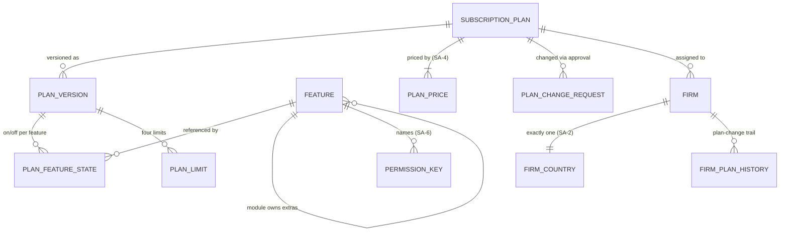
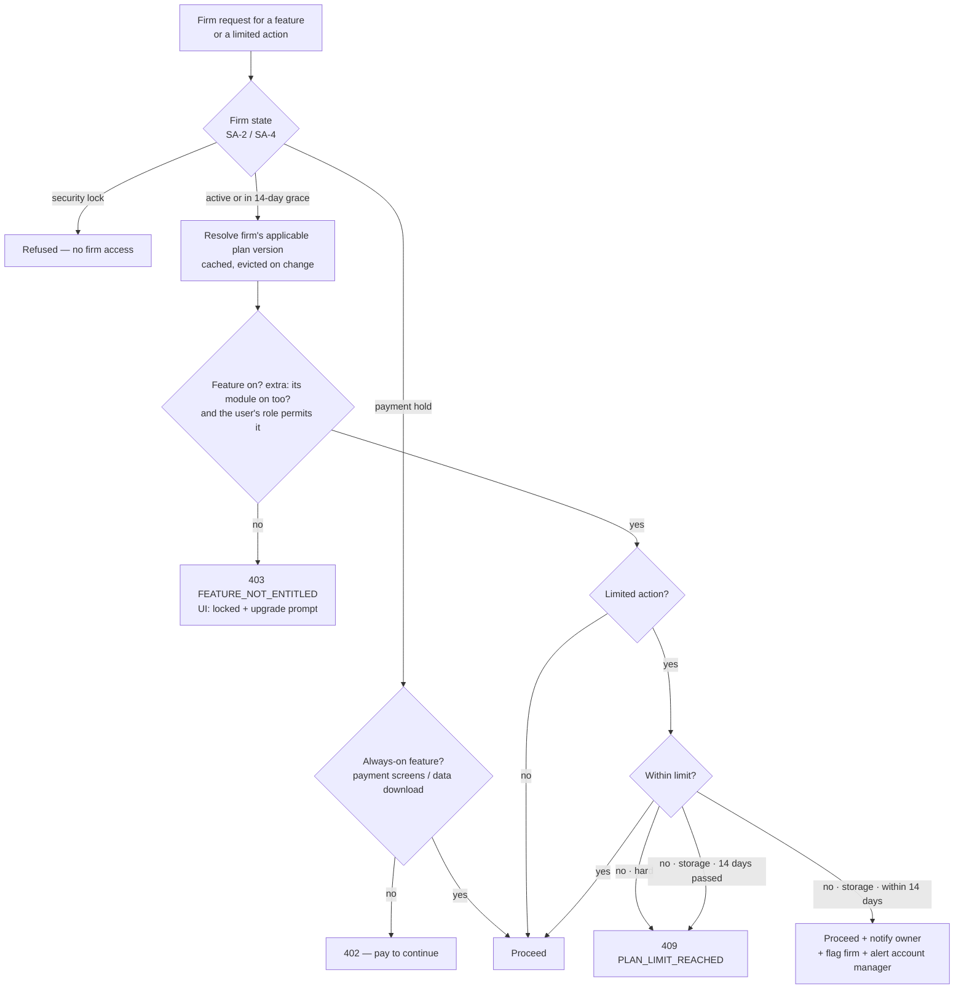

> **Document control** · Version **2.24** · **2026-10-18** · Status: **v2.24 (18 Oct): AG07-D16 Q9 applied (the Filler and the deficiency checks are on every plan; only the AI helpers stay plan-gated). Earlier: v2.23 (17 Oct): AG16-80 applied (only the Owner switches AI on and off; key `agent/ai:switch`; AI per plan is on or off; which plans include AI is a pricing item for the product owner) and SA3-X12 set back to Pending (AG16-54 #6). Earlier: AG16-24 and AG16-34 applied (17 Oct): own mailbox and calendar on every plan, "Inbox sync" retired, #26 is WhatsApp only, AI included in higher plans and set in the plan builder. Earlier status: v2.21 (14 Oct) AG-16 decisions applied - two catalogue lines only; before that: 12 Oct (session 2) decisions applied — payment account on every plan (SA-Q1), staff roles and starter-role approver (SR-Q1, SR-Q3, SR-Q4), Rule 9 pass (defaults, placement, launch plans, Unlimited tick box, ladder-check order, feature rename, extras without a separate price) — for the product owner's review**\
> Part of: *Super Admin Console — Functional Requirements* · Split from `FINAL-SuperAdmin-FR.md` lines 1559–2123 on 2026-09-16 · Previous version: `_archive/SA-03-subscription-plans-and-entitlements_v2.23_2026-10-17.md`\
> Reviewed by: the co-product owner and the product owner (product owners) · Code state verified 2026-09-18 against GitHub `dev`: backend `ERv2-sanitized` @ `36db7f2f`, frontend `ERv2-frontend` @ `36a53b5` · Firm left menu re-read 2026-10-10 on local frontend `dev` @ `eae1b1b6` (`src/zones/firm/firm-nav-config.tsx`) for the feature catalogue
>
> | Version | Date | Change | Decisions |
> |---|---|---|---|
> | 2.24 | 2026-10-18 | **AG-07 review decision applied (AG07-D16 Q9).** The **Filler** (automatic form filling) and the **deficiency checks** are part of case management on **every plan**: they are not catalogue features and are never plan-gated. Only the AI helpers stay plan-gated (AG16-34): the Checker, which compares values across documents, is one of the four AI Doers in row #30. Row #9 and the "Not features, ever" paragraph say so; new decision SA3-D32; card SA-3-70 non-goals. **Added:** SA3-D32. **Changed:** none of the plan limits (SA3-D14 already removed the "auto-prefilled forms" metric). **Withdrawn:** none. *18 Oct (final): AG07-D23 applied — employer portal seats are Release 1 and stay a separate plan extra (SA3-D20, SA3-X8, "deferred" row); "when built" dropped; no price or other plan logic changed.* | AG07-D16, AG07-D23 |
> | 2.23 | 2026-10-17 | **Second-pass decisions applied (AG16-54, AG16-55, AG16-80).** (1) **Only the Owner switches AI on and off** in the firm (AG16-80(1), changes AG16-20): one key **`agent/ai:switch`**, Owner only. SA-3-66 (rule 5, States, Access) and SA-3-70 (Access line) no longer say "Owner or Admin switches off"; ExpatReady's platform-wide pause (AG16-20(3)) is unchanged. (2) **AI per plan is on or off only** (AG16-80(2)): no tiers, no usage meter (card SA-3-70 non-goal). (3) **`system/plan:manage-features`** is added to the SA-06 catalogue (AG16-80(3)); no behaviour change here. (4) **Which plans include AI at launch is an open pricing item owned by the product owner**, settled when plans and prices are set (SA-4); not needed to build, because the per-plan flag exists (AG16-80(4)). (5) **SA3-X12 set back to Pending** until the fix pass is closed (AG16-54 #6). (6) **Open questions Q9, Q10, Q11 closed** (AG16-55, decided by AG16-80). Cards SA-3-66 and SA-3-70 gain the "Person decides" and "Clicks" lines (AG16-63, AG16-76). **Added:** none. **Withdrawn:** none. *Same-day fixes (17 Oct): AG16-83 – AG16-88 — catalogue #25 (portal auto-nudge playbooks) retired as a sellable extra and keeps its number; SA3-D10, SA3-X8, SA3-D24, SA3-D26(d), SA-3-65, SA-3-66(d) updated; portal nudging is on every plan, the Invitation reminder is Must on every plan (AG16-86). No change from AG16-83 (other items), AG16-84, AG16-87 or AG16-88.* *Same-day fixes (18 Oct): AG16-90 — SA-3-66 Where cites the current SA-05 v3.6 row (line 1459) and drops "SA-05 to follow"; SA-3-69 gained "Clicks:" and "Person decides:"; SA-3-70 Where cites the plan editor code (`plan-admin.controller.ts:246-258`, `plan-crud.service.ts:182-193`); §12 firm-state line corrected (`subscription-state.source.ts:29-46` maps trial/active/overdue to ACTIVE and payment hold/ended to INACTIVE; it is not a stub).* *18 Oct: new section 'Decisions that change this epic' (index of AG16 decisions; no requirement changed).* *Same-day fixes (18 Oct): AG16-101 — which plans include Developer (API and webhooks), catalogue #21, is a pricing open item for the product owner, listed next to "which plans include AI" (#30, AG16-80); not needed to build (the per-plan feature switch exists). AG-16 Q4 closes with a pointer here.* | AG16-54, AG16-55, AG16-80, AG16-101 |
> | 2.22 | 2026-10-17 | **Applied AG16-24 and AG16-34 (the product owner).** (1) **Own mailbox and own calendar are on every plan** (AG16-24): catalogue #27 "Inbox sync" is merged into this and **retired** (keeps its number; no longer sellable); #26 is now **"Own WhatsApp account"** only and stays a sellable extra. New SA-3-69; SA-3-66(b) reworded; SA3-D27, SA3-X12 and §13 Q8 annotated. (2) **AI is included in higher plans, not sold as an add-on** (AG16-34): catalogue #30 is no longer "Sellable"; it is a plan feature, and which plans include it is set in the plan builder (new SA-3-70). Entry plans run on the rules floor (AG16-33). SA-3-66(c) "AI notice" Must now applies to firms whose plan includes AI **and** whose Owner has switched it on. AI stays locked until the provider terms are recorded (AG11-D13); the Owner switches it on once with an acknowledgement (AG16-20). Added SA3-D30, SA3-D31; US-19, US-20; §9 edge cases; build cards for SA-3-66, SA-3-69, SA-3-70; open questions Q9 – Q11. **Withdrawn:** none (#27 retired, not deleted). | AG16-24, AG16-34 |
> | 2.21 | 2026-10-14 | AG-16 review (the product owner, 14 Oct), two catalogue lines only: #30 "AI Doers (Reader, Sorter, Drafter, Checker...)" renamed to Writer (the AI writer; "Drafter" now means only the non-AI document generator); #21 Developer (API and webhooks) unchanged, with a note that the firm screen is AG-16 Advanced → Developer API. Nothing else changed. | AG16-4, AG16-10 |
> | 2.20 | 2026-10-12 | **Applied the 12 Oct (session 2) decisions (the product owner, approved 12 Oct).** (1) **Payment account on every plan (SA-Q1):** connecting the firm's own payment account is on every plan; catalogue #26 keeps own email, calendar and WhatsApp only; paid consultations work on every plan (SA3-D25 reworded; note on #15 fixed); no payment-plan extra in Release 1; §13 Q8 (a) and (b) closed. (2) **Staff roles (SR-Q1, SR-Q3, SR-Q4(9)):** a starter-role change is approved by a second person — the Platform Owner or the Admin, never the requester (§3.5); role names are Platform Owner, Admin, Support, Billing, Content publisher, Auditor (persona table renamed; the account manager is an Admin); §13 Q4 and Q6 closed. (3) **Rule 9 pass (SA-03 part):** new §3.12 *Settings — defaults and placement* (code constants, Main defaults); launch plans are pre-seeded from the §3.3 intent column (R9-10); an explicit **Unlimited** tick box replaces a blank limit (R9-11); a change request covers one plan, the ladder check reads saved state plus the request being saved, and the refusal names the order — §13 Q5 closed (R9-12); the Platform Owner renames a feature's display name on the plan screens without approval, key never changes (R9-13); the per-firm plan panel opens with a plain sentence, raw fields under Advanced (R9-15); extras are plan features switched on per plan with no separate price in Release 1, "sold separately" reworded (R9-20); a plan cannot be activated until all four limits are set. (4) Failed-payment wording in SA3-E2 corrected to a failure notice on day 0 and reminders on days 7 and 12 (R9-6). **Changed:** SA-3-2, SA-3-4, SA-3-20, SA-3-23, SA-3-45, SA-3-50, SA-3-54, SA-3-55, SA-3-63; BR-6; US-17; SA3-D10, SA3-D21, SA3-D23, SA3-D25 (annotated); SA3-E2; SA3-X14 and the role names in §2; §3.2, §3.3 (rows #15, #26, the Extra and "Sellable" wording), §3.5, §3.7, §3.9, §3.10, §10 (`system/firm:view-entitlement`). **Added:** SA-3-67, SA-3-68; SA3-D27 – SA3-D29; §0.2 rows SA3-X16, SA3-X17; §3.12; §0.1 row (per-payment application fee). **Withdrawn:** none. §13 Q4, Q5, Q6, Q8 closed; Q7 unchanged (not decided). **Same-day revision (W-1 – W-3, the product owner, 12 Oct):** W-3(4) names `system/product-map:manage-display` (Owner only) as the feature rename key (§10, SA3-D29(d), SA3-X17(b) closed, §3.12); W-2 confirms the one-Owner edge case stands (live plan and price changes wait for a second Owner; Admin does not approve). **Same-day revision (W-4 – W-10, the product owner, 12 Oct):** W-7 closes §13 Q7 — the "New — needs a decision" list with reminders (SA-3-38), the side-by-side plan comparison (SA-3-33) and the built `system/plan:*` keys stay as specified. **Same-day revision (W-11 – W-21, the product owner, 12 Oct):** W-21 audit fixes — SA3-D8b states the system floor as one active Owner (W-12) with go-live creating two Owners and live-plan and price requests waiting while only one Owner exists (W-2), the feature-catalogue keeper persona is Platform Owner only, and the parts of SA3-X14 and SA3-X17 already applied in SA-07 v2.15 are marked. | SA3-D27 – SA3-D29 · SA-Q1, SR-Q1, SR-Q3, SR-Q4(9) · Rule 9 pass (R9-6, R9-10 – R9-13, R9-15, R9-20) |
> | 2.19 | 2026-10-12 | **Applied the 10–12 Oct template-map and complexity-review decisions (the product owner, approved 12 Oct).** (1) **Templates and plans (Q7; SA5-X36(a), (e)):** the Templates area and the ready-made recipes are on every plan and are not features; catalogue #20 Automations covers only a firm designing its own automations and reminder chains; dunning is part of Biller (#17) on every plan; when an extra is switched off its templates stay visible read-only, dependent sends stop or fall back (WhatsApp to email), nothing is deleted; notes added on catalogue rows #2, #17, #20, #25, #26, #28, #30; a feature that moves to a later release takes its templates with it (rule 5). (2) **Extras and templates (Q11, Q12 / R25, map §11, §17 #3):** bulk campaigns (#28) are always marketing; WhatsApp connected gives the opener Must and all about 40 short-message WhatsApp versions (#26); the AI extra (#30) makes the AI notice Must; the portal auto-nudge extra (#25) makes the invitation reminder Must. (3) **Paid consultations (Q23; SA5-X36(b)):** a per-appointment-type setting for firms with a connected payment account — no new extra (note on #15). (4) **R9 and R10 reversed to kept (code-check outcomes, 12 Oct; rule 8 "built stays"):** second-Owner approval of live plan and price changes and per-firm plan versions with removal at renewal are built and are specified as built (§12 rewritten for these two, `file:line` cited); the earlier park is reversed; SA3-D8 and SA3-D8b stand unchanged. (5) **Plan ladder (R35):** a ladder position plus a **consistency check on save**; **auto-propagation of additions and renumbering on retire are parked** (SA3-D12 amended; §3.10, SA-3-53, SA-3-54, SA-3-55, SA-3-43, BR-18, US-17 and edge cases changed); undecided-feature handling in plan versions is built and stays. (6) **Emails (SA5-X36(d)):** the live-plan removal notice (SA-3-43) and storage over limit (SA-3-5, SA-3-40) emails are ExpatReady-owned emails in SA-05 Appendix B.4. (7) **Rule 7 / stale text:** SA3-E1 and §13 Q2 no longer cite a regulator or a retention period; the starter-role approval sentence in §3.5 now defers to SA-06 (§13 Q4 open); the "dependency computation" budget line removed (graph withdrawn v2.16). **Changed:** SA-3-5, SA-3-11, SA-3-43, SA-3-53, SA-3-54, SA-3-55; BR-18; US-17; SA3-D12 (amended), SA3-E1. **Withdrawn:** none. **New:** SA3-D22 – SA3-D26; SA-3-64 – SA-3-66; BR-22 (BR-21 was the last used); §0.2 rows SA3-X13 – SA3-X15; §0.2 table "Applied from SA-05 v3.1" (SA5-X36 applied). Open questions §13 Q4 – Q8 added (not decided). | SA3-D22 – SA3-D26 · map Q7, Q11, Q12, Q23, R9, R10, R25, R35, rule 5, rule 7, rule 8 · SA5-X36 |
> | 2.18 | 2026-10-10 | **Stable feature keys (the product owner, 10 Oct — SA3-D21).** A feature's key is a permanent ID: renaming a menu entry or a feature's name never changes the key; merging or splitting modules needs an explicit, Owner-approved mapping of plan states; retired keys are never reused. New SA-3-63; §3.3 rule, §7 `Feature`, §9 edge cases and BR-21 added. | SA3-D21 |
> | 2.17 | 2026-10-10 | Applied from SA-04 v2.17 (SA4-X15; the product owner, 10 Oct — trials review): trial days default to **14** on a new plan, and **90 days** is the maximum for a whole trial, including any extension Super Admin grants (SA-4-80). SA-3-46 changed. *Same day:* §3.3 catalogue rows #26 (now includes WhatsApp, AG-16-38) and #30 (now all four AI Doers under one switch, AG-16-35) corrected against the AG documents; SA3-X11 and SA3-X12 applied. | SA4-D29 (SA4-X15) |
> | 2.16 | 2026-10-10 | **Simplification review (the product owner, 10 Oct).** (1) The **product map is replaced by a feature catalogue** — one feature per left-menu module plus a short list of named extras (about 30), decoupled from screen layout; module / sub-module / tab / sub-tab / action become documentation vocabulary only. (2) **Plan ladder** — the plans we sell form one line and each includes everything in the plan below; additions flow up; prices rise with the tiers. (3) **Four limits** (seats, active individual cases, active corporate cases, storage) with **modes fixed platform-wide** — seats and cases hard, storage warn. (4) Excluded features are always shown locked; "hide completely" withdrawn. (5) **A move to a lower plan is accepted only when current usage fits it**; the lower limits apply from booking and its features at renewal. (6) MFA and custom firm roles are never plan features; a Reports module is added (basic every plan, advanced sellable); extra corporate portal seats deferred. **Withdrawn:** SA-3-29 (replaced by SA-3-50), SA-3-30, SA-3-36, SA-3-37. **Changed:** SA-3-3, SA-3-4, SA-3-5, SA-3-10, SA-3-11, SA-3-17, SA-3-19, SA-3-20, SA-3-31 – SA-3-35, SA-3-38 – SA-3-40, SA-3-42 – SA-3-44, SA-3-48, SA-3-49; BR-2, BR-4, BR-5, BR-9, BR-15 – BR-17; US-1, US-3, US-6, US-12, US-14, US-16 (US-13 withdrawn); new BR-18 – BR-20, US-17, US-18, §3.10, §3.11. **New:** SA-3-50 – SA-3-62. Superseded decisions kept in §0 with strike-through notes: SA3-D3 (granularity), SA3-D3b, SA3-D3c, SA3-D4, SA3-D5 (now storage only), SA3-U1 (hide option). New knock-on rows SA3-X6 – SA3-X12. | SA3-D10 – SA3-D20 |
> | 2.15 | 2026-10-10 | Applied from SA-06 v3.1 (the product owner, 10 Oct): SA6-D12 — starter roles configured in Super Admin. Wherever this module said every plan seeds "the same six" starter roles, it now says every firm sees the same published starter roles (six at launch), published by Expat Ready in Super Admin (SA-06 §3.9). Plans still never choose roles (SA3-A6 stands). SA3-A6, SA-03.05, §1, §2, §3.5, SA-3-15 note and §12 wording changed. | SA6-D12 |
> | 2.14 | 2026-10-07 | Applied from SA-6 v3.0 (the product owner, 7 Oct): every plan seeds the same six firm starter roles, so the per-plan starter role set is withdrawn — SA-3-15 withdrawn, the plan editor's Roles tab withdrawn, the `PlanRoleTemplate` entity and the permission `system/plan-role-set:manage` withdrawn; §1 and §3 no longer say a plan references a role set; §3.5 rewritten. Plans still decide what works (product map, limits); roles never decide what a firm may use. The six starter roles are named (Owner, Admin, Case Manager, Case Officer, Billing / Finance, Read-only); starter roles are fixed, firms copy them to make their own and may give a person several roles. New amendment row SA3-A6 in §0. SA-3-16 and SA-3-3, SA-3-44 changed. | SA6-D7, SA6-D5, SA6-D3 |
> | 2.13 | 2026-10-03 | Consistency review fixes (3 Oct): the always-on list now says the one exception — Super Admin's emergency off-switch for a firm (SA-12 `feature.corporate`) makes corporate records read-only, never hidden, with reminders running (SA3-D3a, SA-3-35, BR-17, §3.3); standard deadline and expiry reminders registered with the Minder (AG-11-47, AG-11-48) added to the always-on list; Change stream is allowed at the active-corporate-case limit and the count is unchanged (§0.3, SA-3-47, SA-3-49); SA3-X4 marked applied (SA-12 v2.5 settles it: per-firm emergency off only); new "Applied from AG-17" table in §0.2. No requirement IDs added. | AG17-D35, AG17-D37, AG17-D47, AG17-D68, AG17-D70 |
> | 2.12 | 2026-10-02 | Applied from the corporate-case (AG-17) decisions (the product owner, 2 Oct): default limit modes are now user seats **and active corporate cases = hard**, every other metric = warn (SA3-D4, §3.2, SA-3-5, SA-3-39, BR-5, §0.3 changed); corporate is in every plan and plans differ by their limit on active corporate cases, no add-on in Release 1; **active case** defined — from creation until decision or withdrawal (new SA-3-47); counting rule for linked worker cases (new SA-3-48); corporate product-map items are always on and the hard limit applies to all firms at once on approval (SA3-D3a, SA3-D3d, SA-3-35, SA-3-38 changed; new SA-3-49). For Canada, corporate cases are LMIA files; the product uses the neutral name "active corporate cases". | AG17-D22, AG17-D30, AG17-D35, AG17-D36, AG17-D59, AG17-D68 |
> | 2.11 | 2026-10-01 | Applied from SA-07 v2.6 (the product owner, 1 Oct): SA-7 role names used; live plan / price changes are approved by an Owner. SA3-D8b, SA3-A4, SA-3-44, BR-10, US-15 changed; persona names updated. | SA7-X10, SA7-D51 |
> | 2.10 | 2026-10-01 | Knock-on from AG-01 v1.3 (decisions revised by the product owner, 1 Oct): deleted users never count toward seats (SA3-U2, SA-3-41, §3.2 seat paragraph, §7 UsageCounter, seat edge case; AG1-D3 row). | AG1-D1, AG1-D13 |
> | 2.9 | 2026-10-01 | Knock-on from AG-01 v1.2 (staff leaving, decided by the product owner 1 Oct): seat counting now says suspended users keep their seat and deactivated users do not (SA3-U2, SA-3-41 changed; §3.2 seat paragraph, §7 UsageCounter, edge cases updated); §0.2 SA3-X5 marked applied in AG-01 v1.2. SA-07 counterpart pending with its owner. | AG1-D3 |
> | 2.8 | 2026-09-18 | Knock-on from the SA-1 review (SA-1 v2.1): case and client groups for limits are Individual and Corporate only; a case's group comes from its program's client type; family cases count as Individual (§3.2, SA-3-4 changed). | SA3-A5 (from SA1-D5 / SA1-X1) |
> | 2.7 | 2026-09-18 | §12 re-checked against GitHub `dev` after today's frontend merge of `feat/SA-02` (frontend `36a53b5`; backend unchanged `36db7f2f`): no SA-3 finding or cited line changed. Requirements unchanged. | — |
> | 2.6 | 2026-09-18 | §13 closed: backup copies purged within 35 days (SA2-D12); departing firms told the CICC 6-year client-file rule (SA2-D13). SA3-E1b's backup maximum recorded. The plan-differentiation note is reclassified as launch plan configuration, not an open requirement. Requirements unchanged. | SA2-D12, SA2-D13 |
> | 2.5 | 2026-09-18 | §13 Q3 closed: Expat Ready's own billing records are kept 6 years after the end of the fiscal year they relate to (SA-4 v2.3, SA4-D18). Requirements unchanged. | SA4-D18 |
> | 2.4 | 2026-09-18 | Knock-on from the SA-4 review (SA-4 v2.1): approved price discounts are not per-firm exceptions (SA-3-42 changed); SA-4 price-change requests use this module's approval queue and second-approver rule (SA-3-44 changed); the deferred price sync is taken up by SA-4 (§0.1, §3.8, SA-3-21, SA-3-22); `system/plan:sync-rail` to be withdrawn. §0.2: SA3-X2, SA3-E2 applied; SA3-E3, SA3-S1 fully applied. | SA3-A3, SA3-A4 (from SA4-X2) |
> | 2.3 | 2026-09-18 | §12 re-verified against same-day GitHub `dev` (DOCS-6): backend `36db7f2f`, frontend `5ad194e`. Added a "conflicts on dev" list: per-firm feature overrides now wired in the frontend; plan-level countries still live in the backend; contracts v0.8.0 encode withdrawn behaviour; limit modes and plan statuses still the old sets. Requirements unchanged. | — |
> | 2.2 | 2026-09-17 | Knock-on from the SA-2 review: plans carry trial days (SA-3-46); limit alerts go to the account manager or the shared inbox (SA-3-40 changed). §0.2 statuses updated for items applied in SA-2 v2.1. Release 1 priorities recorded (§0.3). | SA3-A1, SA3-A2 (from SA2-D3, SA2-D6) |
> | 2.1 | 2026-09-17 | Product review applied. One country per firm — plans no longer grant countries. Prices moved to SA-4 (monthly + yearly, CAD). Flat feature catalogue replaced by the **product map** (module → tab → action) with cascade, dependencies, new-items-off and locked/hidden display. Limit defaults and 14-day escalation. No per-firm exceptions. Plan stages Draft → Active → Retired. Removals on live plans wait for renewal; every live-plan change needs a second approver. Clean go-live. §12 replaced with verified code state. SA-3-8, SA-3-9 replaced; SA-3-12, SA-3-13 withdrawn; SA-3-21, SA-3-22 moved to SA-4; SA-3-27 to SA-3-45 added. | SA3-D1 – SA3-U2 |
> | 2.0 | 2026-06-20 | Baseline — golden per-module rebuild | — |

## Decisions that change this epic (14–18 Oct) *(new 18 Oct)*

Product-wide rules (apply here as everywhere; home: Agent `00-Overview` → "Product rules every epic follows"): AG16-11, AG16-31, AG16-33, AG16-63, AG16-76.

The "AG16" prefix is historical: these decisions began in the AG-16 review and apply across the product. Full text: `TEMPLATE-MAP-working_2026-10-10.md`.

| Decision | What was decided (one line) | What it changes in this epic | Where (requirement / card / section) |
|---|---|---|---|
| AG16-4 | Doer family and the "Drafter" name clash. | The AI Doer formerly called Drafter is now called Writer in the feature catalogue (v2.21). Nothing else changed. | §3.3 catalogue row #30 |
| AG16-10 | Developer API: spec follows code. | Catalogue row #21 (Developer API and webhooks) unchanged; a note says the firm screen is AG-16 Advanced → Developer API. | §3.3 catalogue row #21 |
| AG16-15 | Mailboxes: firm and personal, nothing required. | Referenced only (no change here). The firm mailbox and personal mailboxes with automatic filing are included on every plan (set by AG16-24); shared sending stays the day-one default until a mailbox is connected. | SA3-D30, SA-3-69 |
| AG16-18 | Calendars: personal only, with "choose which calendars". | Referenced only (no change here). Personal calendar connections are included on every plan (set by AG16-24). | SA3-D30, SA-3-69 |
| AG16-20 | AI switch details (Owner-only on, as recommended). | The Owner switches AI on once with an acknowledgement; AI stays locked until the provider terms are recorded. ExpatReady's platform-wide pause is unchanged. The "Owner or Admin switches off" wording was changed by AG16-80. | SA3-D31, SA-3-66, SA-3-70, §3.3 row #30 |
| AG16-24 | Own mailbox and own calendar on every plan. | Own mailbox and own calendar are on every plan, not paid extras. Catalogue #27 "Inbox sync" is merged in and retired (keeps its number). #26 becomes "Own WhatsApp account" only and stays a sellable extra. New card SA-3-69. | SA3-D30, §3.3 rows #26 and #27, SA-3-69 |
| AG16-25 | Mailbox roles, solo setup, and how email data separates. | Referenced only (no change here). Safety note: included on every plan does not mean shared; personal mail stays private to the person. | SA-3-69 rule 10 |
| AG16-34 | AI is included in higher plans, not sold as an add-on. | Catalogue #30 is no longer "Sellable"; it is a plan feature and the plan builder sets which plans include it. Entry plans run on the rules floor. A new plan starts with AI off. The AI notice template is Must only when the plan includes AI and the Owner has switched it on. New card SA-3-70; SA-3-66 part (c) reworded. | SA3-D31, §3.3 row #30, SA-3-66(c), SA-3-70 |
| AG16-52 | Connecting one's own mailbox or calendar needs no permission. | Card SA-3-69 states that no permission key is needed to connect one's own mailbox or calendar. | SA-3-69 (Access) |
| AG16-54 | 25 consistency fixes after the 17 Oct write (batch). | SA3-X12 (plan-gated capabilities map to catalogue features) set back to Pending until the fix pass is closed (#6). | SA3-X12 (§0.2) |
| AG16-55 | Writers' recommended defaults accepted for the detail questions. | Open questions Q9, Q10 and Q11 (AI switch key, AI tiers, where manage-features is listed and which plans include AI) closed, decided by AG16-80. | §13 Q9, Q10, Q11 |
| AG16-63 | Design checks every requirement must pass. | Cards SA-3-66 and SA-3-70 gain the "Clicks" line. | SA-3-66, SA-3-70 |
| AG16-76 | Standing rule: help people, don't replace them; do, don't overdo. | Cards SA-3-66 and SA-3-70 gain the "Person decides" line. The separate portal "playbook" engine is withdrawn because it duplicated the document chase. | SA-3-66, SA-3-70, §3.3 row #25 |
| AG16-80 | AI switch and plans. | Only the Owner switches AI on and off (key agent/ai:switch). AI per plan is on or off only (no tiers, no usage meter). system/plan:manage-features added to the SA-06 catalogue. Which plans include AI at launch is a pricing item owned by the product owner. SA3-X12 set back to Pending. | SA-3-66 (rule 5, States, Access), SA-3-70 (Access, non-goal), SA3-D31, §13 Q9-Q11 |
| AG16-83 | 26 follow-through fixes after the second pass (batch A). | Referenced only (no change here). The change log says no change from AG16-83 (other items). | Document control (v2.23) |
| AG16-84 | Very short deadlines: the letter note is the client message. | Referenced only (no change here). The change log says no change from AG16-84. | Document control (v2.23) |
| AG16-86 | Portal nudging is a feature on every plan, not a sold extra. | Catalogue #25 (portal auto-nudge playbooks) retired as a sellable extra and keeps its number. The "Invitation reminder" template is Must on every plan. Portal nudging is not a named extra. | §3.3 row #25, SA3-D10, SA3-X8, SA3-D24, SA3-D26(d), SA-3-65, SA-3-66(d) |
| AG16-87 | "New letter patterns" stays a plain list. | Referenced only (no change here). The change log says no change from AG16-87. | Document control (v2.23) |
| AG16-88 | Release 1 is English-first; French later. | Referenced only (no change here). The change log says no change from AG16-88. | Document control (v2.23) |
| AG16-90 | Batch C: consistency fixes from the 17 Oct audit. | SA-3-66 "Where" cites the current SA-05 v3.6 row and drops "SA-05 to follow"; SA-3-69 gained "Clicks:" and "Person decides:"; SA-3-70 "Where" cites the plan editor code; the §12 subscription-state note corrected (it is not a stub). | SA-3-66, SA-3-69, SA-3-70, §12 (marked "changed 18 Oct") |
| AG16-101 | Developer API plans move to SA-03 pricing. | Which plans include Developer (API and webhooks), catalogue #21, is a pricing decision for the product owner, listed with "which plans include AI" (AG16-80). No build change. | §3.3 row #21 · SA-3-70 non-goals · §13 launch-plan note |
| AG07-D23 (2) | Employer portal seats are Release 1 and stay a separate plan extra the owner switches on. The words "when built" are dropped. | SA3-D20 and SA3-X8 say seats are Release 1, one separate on/off extra, not a fifth limit; the "deferred" row for seats is struck. No price or other plan logic changes. *(changed 18 Oct — AG07-D23)* | SA3-D20 · SA3-X8 · §0.2 deferred list |
| AG07-D16 (Q9) | The Filler and the deficiency checks are on every plan; only AI helpers stay plan-gated. | Row #9 and "Not features, ever" say the Filler and the deficiency checks are part of case management on every plan. The AI Checker stays under row #30. New decision SA3-D32; SA-3-70 non-goals. | §3.3 rows #9, #30 · SA3-D32 · SA-3-70 |

## Module SA-3: Subscription Plans & Entitlements

> **What this document is.** The build specification for Super Admin module SA-3. Version 2.1 applies the product review of 17 Sep 2026. **§0** records each decision; every later section has been edited in place to match it. Where an earlier version says something different, this version wins; earlier wording is kept only in `_archive/`.
>
> **Plane:** GLOBAL (Super Admin owned). Plans, limits and the feature catalogue *(changed v2.16)* are platform-wide configuration that firms *consume* but cannot modify. **Tools:** in-house only; prices and payment belong to SA-4. **Sits between** SA-1 (Country & Pack Management), SA-2 (Tenant & Firm Management — where a firm is created, given its one country, and assigned a plan) and SA-4 (SaaS Billing — prices, payment, payment hold).
>
> **Requirement IDs are permanent.** A changed requirement keeps its number. A withdrawn requirement stays as a one-line entry. New requirements continue from SA-3-27. Numbers are never reused.

---

### 0. Decision log (review of 2026-09-17)

Decision IDs are prefixed with the module (`SA3-`) so they never collide with other modules or with the programme-level decisions in `BUILD-ORDER.md`.

| ID | Decision | Where applied |
|---|---|---|
| **SA3-D1** | A firm has **exactly one country**, set at provisioning and never changed or added to — enforced by the system, not by staff policy. A practice working a second country opens a second account (a second subscription). **Plans do not grant countries.** | §3.4 rewritten · SA-3-12, SA-3-13 withdrawn · SA-3-14 changed · SA-3-28 added · US-2, US-7 withdrawn · enforcement itself → SA-2 (§0.2 SA3-X1) |
| **SA3-D2** | Each plan has a **monthly and a yearly price**, and every plan uses **one platform currency**. **SA-4 owns the price records**; SA-3 owns what a plan includes. Switching a firm between monthly and yearly is a billing change, not a plan change. | §3.1, §3.8 changed · SA-3-1 changed · SA-3-21, SA-3-22 moved to SA-4 · SA-3-27 added · §0.2 SA3-X2 |
| **SA3-D2b** | The platform currency is **CAD** for Release 1. The currency for a second country is deferred. | SA-3-27 · §0.1 |
| **SA3-D3** | Nothing is hardcoded as "always included" (except SA3-D3a). Super Admin switches ~~**every module, tab and action** of the firm app~~ **every feature in the feature catalogue** *(changed v2.16 — SA3-D10)* on or off **per plan** ~~, and has a **full map of the firm app**~~. FD-19 ("Solo must be complete") is honoured through plan configuration, not code. | §3.3 rewritten as the product map · SA-3-8, SA-3-9 replaced · SA-3-29 – SA-3-33 added · closes the "entitlement tiers" open question in AG-2, AG-3, AG-5, AG-6, AG-7, AG-9, AG-10, AG-11, AG-12, AG-14 (§0.2 SA3-X3) |
| **SA3-D3a** | **Always on**, on every plan: the security floor (sign-in and MFA **including a firm-wide MFA requirement** *(changed v2.16 — SA3-D18)*, tenant isolation, audit, authorisation, encryption, personal-data protection), the firm's own **subscription and payment screens**, the **corporate-case feature** *(changed v2.12 — AG17-D59; v2.16 — feature, not product-map items)*, **data import including assisted migration** (AG18-D11(a)) *(added v2.16)*, and the **standard deadline and expiry reminders registered with the Minder** (AG-11-47, AG-11-48; AG17-D35, AG17-D70) *(changed v2.13)*. None of these can be switched off by any plan or flag, except Super Admin's emergency off-switch for a single firm (SA-12 `feature.corporate`), which makes corporate records read-only, never hidden, with reminders still running (SA-12-30) *(changed v2.13 — AG17-D37)*. The firm's **data download** is available while suspended and during the 90-day window (SA3-E1). | SA-3-35 changed · SA-3-49 |
| **SA3-D3b** | ~~**Parent controls children.** Module off ⇒ all its tabs and actions off. Module on ⇒ its children on, unless individually switched off. A child is never on while its parent is off.~~ **Superseded v2.16 (SA3-D10):** the only parent rule left is that an **extra** is off whenever the **module feature** it belongs to is off. | SA-3-36 withdrawn · SA-3-51 |
| **SA3-D3c** | ~~Switching an item off shows **every dependent item** (in any module) that will also go off; on confirmation they all go off together. Developers declare dependencies in the product map.~~ **Withdrawn v2.16 (SA3-D10):** no dependency graph. Each feature has one owning module; a tab shown inside another module (e.g. a case's Tasks tab, owned by Tasker) follows its owning module's feature. | SA-3-37 withdrawn |
| **SA3-D3d** | ~~Map items~~ **Features** *(changed v2.16)* **newly released** by developers start **off on every plan** and appear in a "New — needs a decision" list, **except the corporate-case feature, which is always on** (SA3-D3a) *(changed v2.12 — AG17-D59)*. *Basis:* LaunchDarkly creates every new flag Off by default. | SA-3-38 |
| **SA3-D4** | ~~Each limit is **hard** or **warn**, set per plan. **Default: user seats and active corporate cases hard; every other limit warn.** *(changed v2.12 — AG17-D68, AG17-D36)*~~ **Superseded v2.16 by SA3-D15:** modes are fixed per limit for the whole platform, not set per plan. | SA-3-5 changed · SA-3-39 changed · SA-3-47 – SA-3-49 |
| **SA3-D5** | A firm still over a **warn** limit **14 days** after first exceeding it is hard-stopped on that limit until it is back under the limit or on a plan with a higher one. Existing items keep working. The account manager is alerted on the first day. *(changed v2.16 — SA3-D15: storage is the only warn limit, so this applies to storage only.)* | SA-3-40 |
| **SA3-D6** | A firm gets **exactly what its plan includes**. No per-firm exceptions and no custom plans per deal. Per-firm exceptions are deferred. | §3.0 changed · BR-3 withdrawn · SA-3-42 added · §0.2 SA3-X4 |
| **SA3-D7** | Plan stages **Draft → Active → Retired**, with rules. The code's `FINAL` status is dropped. A plan that has ever been assigned to a firm can never be deleted. | §3.9, §6 changed · SA-3-23 changed |
| **SA3-D8** | Changes to a **live plan** (a plan with at least one firm): **additions** take effect immediately; **removals** take effect at each firm's first renewal at least **30 days** after approval, and affected firms are notified when the removal is approved. | SA-3-18, SA-3-26 changed · SA-3-43 added |
| **SA3-D8b** | **Every change to a live plan needs approval by an Owner (Platform Owner role)** — Billing requests but never approves, and nobody approves their own request. Draft plans and plans with no firms need no approval. ~~At least two people must hold the Owner role.~~ The system floor is **one active Owner** (SR-Q1 correction, W-12); go-live creates **two** Owners (SA-7-39); with only one Owner, live-plan and price requests wait until a second Owner is invited (W-2) *(revised same day — W-21)*. *(changed v2.11 — SA7-X10, SA7-D51)* *Basis:* LaunchDarkly approvals. | SA-3-44 · §10 |
| **SA3-D9** | Release 1 has **no existing firms**: nothing is migrated, and seeded placeholder plans are removed before go-live. | SA-3-45 · former §13 Q7 closed |
| **SA3-U1** | A feature not on a firm's plan is shown **locked with an upgrade prompt** ~~by default. Super Admin can mark individual items **hide completely**~~ — always; the "hide completely" option is withdrawn *(changed v2.16 — SA3-D16)*. | SA-3-34 |
| **SA3-U2** | **Pending invitations count** toward the seat limit; cancelled or expired invitations free the seat; **suspended users keep their seat (they count — they are expected back)**; deactivated users do not count, and **deleted users never count** *(AG1-D3, v2.9; deletion added v2.10)*. | SA-3-41 · §0.2 SA3-X5 |
| **SA3-A1** | *Amendment from SA2-D3:* plans carry **trial days** (0 = no trial). | §3.1 · SA-3-46 added · §7 |
| **SA3-A2** | *Amendment from SA2-D6:* over-limit alerts go to the firm's account manager, **or to the shared team inbox** if the firm has none. | §3.2, §3.7 · SA-3-40 changed |
| **SA3-A3** | *Amendment from SA4-D1 (SA4-X2):* an **approved price discount** (SA-4) changes only what a firm pays, never what it gets; it is not a per-firm exception under SA3-D6. | SA-3-42 changed |
| **SA3-A4** | *Amendment from SA4-D5 (SA4-X2):* **price-change requests** on plans with firms (SA-4-48) are held in this module's approval queue under the same Owner-approval rule as live-plan changes *(changed v2.11 — SA7-X10)*. | §3.8, §3.9 · SA-3-44 changed · §10 |
| **SA3-A5** | *Amendment from SA1-D5 (SA1-X1):* limits count cases and clients in two groups, **Individual** and **Corporate**; a case's group comes from its program's client type (SA-1-60); family cases count as Individual. | §3.2 · SA-3-4 changed |
| **SA3-A6** | *Amendment from SA-6 v3.0 (SA6-D7, SA6-D5, SA6-D3, SA6-D12):* **every firm sees the same published starter roles *(changed v2.15 — SA6-D12)*** — six at launch: Owner, Admin, Case Manager, Case Officer, Billing / Finance, Read-only (`firm-owner`, `firm-admin`, `firm-case-manager`, `firm-case-officer`, `firm-billing-finance`, `firm-read-only`). **The per-plan starter role set is withdrawn.** Plans still decide what works (product map, limits); roles never decide what a firm may use. Starter roles are published by Expat Ready in Super Admin (SA-06 §3.9), not fixed in code *(changed v2.15 — SA6-D12)*; a firm uses a starter role as is or copies it to make its own and may give a person several roles; the firm's Owner and Admin edit firm roles. | §3.5 rewritten · SA-3-15 withdrawn · SA-3-16, SA-3-3, SA-3-44 changed · §1, §3, §5 text, §7 `PlanRoleTemplate` withdrawn · §10 `system/plan-role-set:manage` withdrawn · plan editor Roles tab withdrawn |

**Simplification review (the product owner, 10 Oct 2026)** *(new v2.16)*

| ID | Decision | Where applied |
|---|---|---|
| **SA3-D10** | **A feature catalogue replaces the product map.** Plans switch **features**, not screens: **one feature per left-menu module**, plus a short list of **named extras** (capabilities switched on per plan, with no separate price in Release 1 — SA-4-44; e.g. custom portal domain, API access; (fix 17 Oct — AG16-86): portal nudging is not an extra) *(reworded v2.20 — R9-20)*. About 30 features in Release 1. The catalogue is not tied to screen layout — redesigning a screen never changes what a plan includes. Each feature has one owning module; every `agent/*` permission key names the feature it belongs to. Adding a sellable capability that is not yet a feature is a small developer change (a new feature key). *Basis:* industry entitlement model — Stripe Entitlements, Stigg, Schematic and LaunchDarkly all model plans as features (on/off or metered), not as UI trees. | §3.3 rewritten · SA-3-29 replaced by SA-3-50 · SA-3-30, SA-3-36, SA-3-37 withdrawn · SA-3-31 – SA-3-33, SA-3-35, SA-3-38 changed · SA-3-51, SA-3-52 · §7 · SA3-X3 changed |
| **SA3-D11** | **Standard words for parts of the firm app** (documentation only — plans never attach to them): **menu group** (a left-menu heading), **module** (a left-menu entry that opens something), **sub-module** (an entry nested under a module), **tab** (a choice on a page's tab bar, with its own browser address), **sub-tab** (a tab bar inside a tab, one level at most), **action** (a button that saves, sends, deletes or downloads; one action = one SA-6 permission key). Panels, dialogs, filters and background jobs are not separate items. AG documents describe behaviour; a module is what the user sees — one AG document may cover several modules. | §3.3 · SA3-X10 (glossary) |
| **SA3-D12** | **Plan ladder.** The plans we sell (**Active, Public**) form **one straight line** — each has a position (1, 2, 3 …). A higher plan includes **every feature** of the plan below and a **limit at least as high** for every metric (unlimited counts as highest). ~~Adding a feature or raising a limit on a lower plan adds or raises it on every higher plan in the same change.~~ *Parked v2.19 (SA3-D23, R35): additions do not flow up automatically.* A **consistency check runs whenever a ladder plan is saved** and refuses, with a clear message, any result in which a higher plan lacks something a lower plan has. Removing a feature from a lower plan leaves higher plans unchanged. Removing a feature from, or lowering a limit on, a higher plan below what a lower plan has is refused. Internal ($0) plans and Retired plans are not on the ladder and never change automatically. | §3.10 new · SA-3-53 – SA-3-56 · amended v2.19 (SA3-D23) |
| **SA3-D13** | **A higher plan always costs more** — its monthly and its yearly price are each higher than the plan below. Applied by SA-4 when prices are set or changed. | SA-3-57 · §0.2 SA3-X6 |
| **SA3-D14** | **Four limits only:** staff seats, active individual cases, active corporate cases, document storage. Client counts, prefilled forms, retainer agreements, tasks, messages and time entries are no longer limited. | §3.2 · SA-3-4 changed |
| **SA3-D15** | **Limit modes are fixed for the whole platform**, not chosen per plan: **seats, active individual cases and active corporate cases are hard** (refused at the limit); **storage is warn** (allowed, then hard after 14 days — SA3-D5) so a client's upload never fails mid-flow. Supersedes SA3-D4. | §3.2 · SA-3-5, SA-3-39, SA-3-40 changed |
| **SA3-D16** | A feature not on a firm's plan is **always shown locked** with an upgrade prompt naming the lowest plan on the ladder that includes it. "Hide completely" is withdrawn. | SA-3-34 changed · §10 `system/product-map:manage-display` withdrawn |
| **SA3-D17** | **Moving to a lower plan** (Owner or Super Admin) is **accepted only when the firm's current usage already fits every limit of the lower plan**; the screen lists what to reduce (e.g. "you have 7 users; Starter allows 5"). **From booking, the lower plan's limits apply**; the lower plan's **features switch at the next renewal**, monthly or yearly; data from features that go off stays read-only (SA-3-11). The same check applies to Super Admin, with no override. A move to a lower plan **combined with a monthly → yearly switch waits for the renewal**. **During a trial** the move is immediate once usage fits. Moves made by Expat Ready to a live plan (SA3-D8) are not downgrades and keep their own rule. | §3.11 new · SA-3-58 – SA-3-62 · §9 · §0.2 SA3-X6 |
| **SA3-D18** | **MFA** (including requiring it for every staff member) and **custom firm roles** (copying a starter role — SA6-D3) are in **every plan** and are never plan features. | SA3-D3a · §3.3 · §0.2 SA3-X7 |
| **SA3-D19** | **Reports becomes a left-menu module** (AG-14): **Reports** with standard reports is in every plan; **Advanced reports** is a sellable extra. | §3.3 · §0.2 SA3-X9 |
| **SA3-D21** *(the product owner, 10 Oct)* | **Stable feature keys.** Each feature has a **key** (a permanent ID the system stores plan settings against, e.g. `mailer`) and a **name** (the label firms see, e.g. "Mailer"). The name can change at any time; **the key never changes**. *(R9-13, v2.20)* The **Platform Owner** renames a feature from the plan screens; a rename is not a plan change and needs no approval. Merging or splitting modules (e.g. Mailer + Messenger → "Inbox") is done only through an explicit mapping of each plan's settings (e.g. "Inbox is on wherever Mailer was on"), submitted and approved like any live-plan change — never as a side effect of a code change. A retired key is never reused. *Basis:* the same rule as this document's requirement IDs. | §3.3 · SA-3-63 · §7 · §9 · BR-21 |
| **SA3-D20** | **Extra corporate portal seats** (more employer contacts with portal access — AG-15-12) are **in Release 1** (AG07-D23) and stay a separate plan extra the owner switches on: one on/off extra, not a fifth limit *(changed 18 Oct — AG07-D23)*. *(Before: "not in Release 1 (AG17-D38); when built".)* | §3.3 · §0.2 SA3-X8 |

**Template-map and complexity-review decisions (the product owner, 10–12 Oct 2026)** *(new v2.19)*

| ID | Decision | Where applied |
|---|---|---|
| **SA3-D22** | **Live-plan approvals and per-firm plan versions are kept as built — the earlier "park" (R9, R10) is reversed** (code-check outcomes, 12 Oct; rule 8 "built stays"). (a) Every change to a live plan, and every price change on a plan with firms, stays a change request approved by an Owner other than the requester; Billing requests but never approves (SA3-D8b, SA-3-44; SA4-D5 approval part). Built: `PlanChangeRequest` (`entitlements-platform.prisma:260`), self-approval refused in `plan-change.service.ts:412-413` (`SELF_APPROVAL`), approve / reject / get / list routes in `plan-change-admin.controller.ts:70,86,108,136` under `system/plan:approve-change`, price-change requests in `plan-price-change.controller.ts:44`, and a real approval-queue screen (`plan-approval-queue-panel.tsx:60`). (b) Taking something away from a live plan stays "removals at each firm's first renewal at least 30 days after approval, with notice" (SA3-D8, SA-3-43); the per-firm applicable plan version stays. Built: `FirmPlanHistory.pinnedVersionId` (`entitlements-platform.prisma:319`), `applicableVersionId` (`entitlements.service.ts:340`), `renewal-repin.service.ts` (called from `lifecycle-convergence.service.ts:137` and `saas-billing.lane.ts:167`), the firm notice `entitlement-reduction-notice.service.ts`, and the screens `scheduled-reductions-panel.tsx` and `plan-entitlements-tab.tsx:56`. (c) The 30-day notice before a price increase reaches existing firms stays (SA-4-48). | §12 rewritten for these items · SA3-D8, SA3-D8b, SA-3-43, SA-3-44, BR-10 stand unchanged · map R9, R10, code-check outcomes |
| **SA3-D23** | **Plan ladder, simplified (R35).** Each plan sold has a **ladder position**; **saving a plan runs a consistency check** that refuses, with a clear message, when a higher plan lacks something a lower plan has (e.g. "Professional must include Client portal, because Starter does"), for features and for limits. *(R9-12, v2.20)* The message also names the order ("Add it to Professional first, then Starter"); a change request covers **one plan**, as built (`plan-change.service.ts`); the check reads the saved state of the ladder plus the request being saved. **Parked (one line each, so they can be found later):** (1) *auto-propagation* — a feature switched on or a limit raised on a lower plan being applied to every higher plan in the same change; parked because launch has two or three plans and the check protects the same rule; (2) *renumbering on retire* — positions above a retired plan moving down by one; parked for the same reason. The "Everything in X, plus…" display is unchanged. The undecided-feature handling in plan versions is built and stays (`plan-authoring.rules.ts`). The ladder itself is not built. | SA3-D12 amended · §3.10 · SA-3-53, SA-3-54, SA-3-55 changed · SA-3-43 · BR-18 · US-17 · §9 · §0.1 · map R35 |
| **SA3-D24** | **Templates and plans (Q7).** The **Templates area** (automatic messages, template library, document templates) is on **every plan** and is **not a feature** in the catalogue. The **ready-made recipes** are on **every plan** and are switched on or off by the firm. Catalogue #20 **Automations** (sellable) means only a firm **designing its own** automations and reminder chains. **Dunning** (3 days before, on the due date, 3 days after, 7 days after) is part of Biller (#17) on every plan. When an **extra is switched off** (WhatsApp, AI, …), its templates **stay visible, read-only**; sends that depend on it **stop or fall back** (WhatsApp falls back to email); **nothing is deleted**. A feature that moves to a later release takes its templates with it (rule 5; scope-triage note). | §3.3 notes on rows #2, #17, #20 · SA-3-11 changed · SA-3-64, SA-3-65 · BR-22 · SA5-X36(a), (e) |
| **SA3-D25** | **Paid consultations are not a plan extra (Q23).** Charging for a consultation is a **per-appointment-type setting** ("Charge $150 to book") for a firm that has connected its own payment account — which every plan allows *(changed v2.20 — SA-Q1, SA3-D27)*. No new feature and no new extra. | §3.3 note on row #15 · SA5-X36(b) |
| **SA3-D26** | **Extras that make a template Must, and how bulk and WhatsApp behave (Q11, Q12 / R25; map §11 #2, §17 #3, "Missing templates").** (a) **Bulk email campaigns (#28) are always treated as marketing**, whatever the template's purpose says. (b) A firm with **WhatsApp connected (#26)**: the WhatsApp conversation opener is **Must**; ExpatReady submits every starter WhatsApp version (about 40 short client messages) to the firm's account, with approval status per firm per template; until a version is approved the message goes by email. (c) A firm with the **AI extra (#30)**: the "AI notice" library template is **Must** *(changed v2.22 — AG16-34: #30 is a plan feature, not an add-on; Must when the firm's plan includes AI and its Owner has switched it on — SA-3-66(c))*. (d) **Every plan** (fix 17 Oct — AG16-86): the "Invitation reminder" template is **Must** (#25 is retired as an extra). The manual Nudge and "Things waiting in your portal" are in every plan (Client portal, #18). | §3.3 notes on rows #25, #26, #28, #30 · SA-3-66 · SA5-X36(c) |

**Staff-role, payment-account and Rule 9 decisions (the product owner, 12 Oct 2026, session 2)** *(new v2.20)*

| ID | Decision | Where applied |
|---|---|---|
| **SA3-D27** | **Payment account on every plan (SA-Q1, the product owner 12 Oct).** (a) Connecting the firm's own payment account is **on every plan**; catalogue #26 keeps own email, calendar and WhatsApp only *(changed v2.22 — AG16-24: #26 is now WhatsApp only; own email and calendar are on every plan, SA3-D30)*. Paid consultations (SA3-D25) and pay-by-card invoices (AG-6-14; the "Invoice sent" pay-online link) work on every plan. Not built in code (only ExpatReady's own `stripe-billing.adapter.ts`). A per-payment application fee through Stripe Connect is a possible later decision — **not taken** (§0.1). (b) **No payment-plan extra** in Release 1 (R18: an invoice per instalment). | §3.3 rows #15, #26 · SA3-D25 reworded · §13 Q8 closed · §0.2 SA3-X16 |
| **SA3-D28** | **Staff roles in SA-3 (SR-Q1, SR-Q3, SR-Q4(9), the product owner 12 Oct).** (a) A starter-role change is approved by a **second person: the Platform Owner or the Admin** (both hold `system/starter-role:manage`), never the requester; SA-06 §3.9 states the flow. Plan and price changes stay as built — a second Owner (SA3-D8b). (b) ExpatReady staff role names are **Platform Owner, Admin, Support, Billing, Content publisher, Auditor** (code keys unchanged). (c) The **account manager is an Admin** (and the Owner). | §2 personas · §3.5 · §13 Q4, Q6 closed · §0.2 SA3-X14, SA3-X17 |
| **SA3-D29** | **Rule 9 pass — SA-3 (the product owner 12 Oct).** Every kept setting has a default and a placement (§3.12). (a) **R9-10:** the launch plans are pre-seeded from the "Release 1 intent" column of §3.3 (SA-3-67). (b) **R9-11:** an explicit **Unlimited** tick box replaces "blank = unlimited" (SA-3-4). (c) **R9-12 (closes §13 Q5):** one plan per change request, as built; the ladder check reads saved state plus the request being saved; the refusal names the order (SA-3-54). (d) **R9-13:** the Platform Owner renames a feature's display name on the plan screens without approval, under the permission key `system/product-map:manage-display` (Owner only) *(revised same day — W-3(4))*; the feature key never changes (SA3-D21, SA-3-63). (e) **R9-15:** the per-firm plan panel opens with a plain sentence; raw fields sit under Advanced (SA-3-20). (f) **R9-20:** extras are plan features switched on per plan, with no separate price in Release 1 (SA-4-44 holds); SA3-D10 "sold separately" reworded. (g) Plan visibility is Internal until the plan is activated, new plans are Draft, limits are required before activation (SA-3-68). | §3.2 · §3.3 · §3.7 · §3.10 · §3.12 · SA-3-4, SA-3-20, SA-3-23, SA-3-50, SA-3-54, SA-3-55, SA-3-63, SA-3-67, SA-3-68 |
| **SA3-D30** *(the product owner, 14 Oct; AG16-24)* | **Own mailbox and own calendar are on every plan.** The firm mailbox, personal mailboxes with automatic filing (AG16-15) and personal calendar connections (AG16-18) are **included on every plan**, not paid extras. Catalogue **#27 "Inbox sync" is merged into this and retired**: it keeps its number, is marked retired, and is no longer sellable. **#26 becomes "Own WhatsApp account" only** and stays a sellable extra. Shared sending stays the day-one default until a mailbox is connected (AG16-15). Reason: a solo firm on the entry plan must not get double bookings, emails sent from the shared address, or client replies that are not filed (FD-19 "Solo must be complete"; Release 1 principle). | §3.3 rows #26, #27 · SA-3-66(b) · SA-3-69 · SA3-D27 annotated · build card SA-3-69 |
| **SA3-D31** *(the product owner, 15 Oct; AG16-34)* | **AI is included in higher plans, not sold as an add-on.** Supersedes catalogue #30 "extra - Sellable" and the AG16-20 note "AI plan inclusion is already set by SA-03 #30". The four AI Doers (Reader, Sorter, Writer, Checker; one switch) are a **plan feature included in upgraded plans**; **which plans include it is set in the plan builder** (SA-3-70). Entry plans, including most solo firms, run on the rules floor (AG16-33); this is acceptable because AI is good to have, not a must. Unchanged: AI stays locked until the provider terms are recorded (AG11-D13), and the Owner switches it on once with an acknowledgement (AG16-20). *(v2.23, AG16-80)* Only the Owner switches AI on and off (key `agent/ai:switch`); per plan AI is on or off only; which plans include it at launch is a pricing item owned by the product owner (SA-4). The "AI notice" Must template (SA-3-66(c)) now applies to firms whose plan includes AI and whose Owner has switched it on. | §3.3 row #30 · SA-3-66(c) · SA-3-70 · build cards SA-3-66, SA-3-70 |
| **SA3-D32** *(new v2.24 — AG07-D16 Q9, the product owner 18 Oct)* | **The Filler and the deficiency checks are on every plan; only AI helpers stay plan-gated.** Both are day-to-day delivery work (the AG16-86 pattern), so no plan switches them off and neither is a catalogue feature. The AI Doers, including the Checker, stay a plan feature (SA3-D31). The Filler needs no usage limit (SA3-D14). | §3.3 row #9 · "Not features, ever" · SA-3-70 non-goals |

#### 0.1 Deferred (carry to the deferral register)

| Item | Why deferred | Reopen when |
|---|---|---|
| Payment-processor synchronisation of plan prices (former SA-3-21, SA-3-22) | Owned by SA-4 | **Closed 2026-09-18** — taken up by SA-4 v2.1 (SA4-D5: SA-4-2, SA-4-48) |
| Per-firm exceptions (extra features or higher limits for one firm) | SA3-D6 — plan-only entitlements | A deal is lost because no standard plan fits. Reference practice: Stigg promotional entitlements, Chargebee subscription overrides |
| Currency for a second country | SA3-D2b — CAD for Release 1 | A second country is approved |
| Full usage dashboard (trends, charts) | The over-limit list and alerts are enough for Release 1 (SA-3-20) | After Release 1 |
| ~~Extra corporate portal seats as a plan extra *(added v2.16)*~~ | ~~SA3-D20 — not in Release 1 (AG17-D38)~~ | ~~AG-15-12 is built~~ **No longer deferred: seats are Release 1 and a separate plan extra *(changed 18 Oct — AG07-D23)*.** |
| Limits on clients, forms, retainers, tasks, messages, time entries *(added v2.16)* | SA3-D14 — four limits are enough to price Release 1 | A pricing review shows a need |
| **Parked v2.19 (R35, SA3-D23):** automatic propagation of additions up the plan ladder | Launch has two or three plans; the consistency check on save protects the same rule | The plan count makes manual editing error-prone |
| **Parked v2.19 (R35, SA3-D23):** renumbering ladder positions when a plan is retired | Same reason; positions stay as set and only need to stay in order | The plan count grows |
| Per-payment application fee on a firm's own payment account (Stripe Connect) *(added v2.20)* | SA3-D27 — possible later decision, not taken | A decision to earn a fee on firms' client payments |

#### 0.2 Decisions taken in this review that other modules must apply

Each row stays **Pending** until the owning module's review applies it and records its own IDs.

| ID | Decision | Owner | Requirement text to apply | Status |
|---|---|---|---|---|
| **SA3-X1** | One firm, one country (from SA3-D1) | SA-2 — supersedes SA-2 §3.5 "a firm may hold Canada *and* Australia" and independent grant/revoke | A firm MUST have exactly one destination country, set at provisioning; provisioning without one MUST be rejected. The country MUST be immutable for every actor, including Super Admin; any attempt to change it or add a second MUST be rejected with a machine-readable error and audited. At most one country row per firm, enforced in the database. | Applied in SA-2 v2.1 |
| **SA3-X2** | Plan prices (from SA3-D2, SA3-D2b) | SA-4 — constrains SA-4 §3.1 `PlanPrice` | Each plan MUST have exactly one monthly and one yearly price in the platform currency (a single platform setting; CAD for Release 1). A third price or another currency MUST be rejected. | **Applied in SA-4 v2.1** (SA-4-1) |
| **SA3-E1** | Departed firm's data: hand back, then delete | SA-2 §3.9, SA-11 | The firm's full data download (clients, cases, documents, invoices; open, non-proprietary formats; delivery recorded) MUST be available while suspended and during the 90-day window. Expat Ready does not hold a departed firm's data beyond the 90-day window below; the firm keeps its own copy for as long as its own professional rules require. *(changed v2.19 — rule 7)* | SA-2 part applied (v2.1) · SA-11 pending |
| **SA3-E1b** | 90-day safety window | SA-2, SA-11 | Tenant data MUST be permanently deleted from live systems 90 days after suspension (or after the end of the last paid period on voluntary cancellation), keeping a deletion record (firm, date, retention applied, actor or job). Backup copies MUST be purged within a stated maximum — **set 18 Sep: 35 days** (SA2-D12). *Basis:* Clio (90-day export after cancellation); Microsoft 365 (90-day admin-only period); Salesforce uses 30 days. | SA-2 part applied (v2.1) · SA-11 pending |
| **SA3-E2** | 14-day payment grace | SA-4 | After a failed payment the firm MUST keep full access for 14 days, with a failure notice on day 0 and reminders on days 7 and 12 *(wording corrected v2.20 — R9-6)*; on day 14 it enters **payment hold**. | **Applied in SA-4 v2.1** (SA-4-20 – SA-4-23; "day 1" = the failure notice) |
| **SA3-E3** | Deletion countdown starts at suspension | SA-2, SA-4 | Timeline from the failed payment: day 14 payment hold; warnings on days 30, 60 and 97; day 104 deletion. Payment at any time before deletion MUST restore full access with all data intact. Voluntary cancellation: full access to the end of the paid period, then payment hold and the same 90 days. | SA-2 part applied (v2.1) · **SA-4 part applied (SA-4 v2.1)** |
| **SA3-S1** | Two kinds of suspension | SA-2, SA-4 | **Payment hold** — automatic; staff can log in only to pay and download; countdown runs. **Security lock** — applied and lifted only by the Platform Owner *(revised same day — W-13)* with a written reason (fraud, abuse, breach); no staff login; no countdown; ends by lifting or by the Platform Owner closing the account *(revised same day — SR-Q4(1))*, after which the 90-day deletion applies unless the data is under a legal hold. All transitions audited. Reconciles `specs/001-firm-provisioning-lifecycle/spec.md:39` (full staff lockout = security lock). | SA-2 part applied (v2.1) · **SA-4 part applied (SA-4 v2.1)** |
| **SA3-S2** | Client portal during suspension | AG-15, SA-2 | During either kind, clients can log in, view their case status and download their own documents. Uploads, signing, messaging and payments MUST be rejected with a neutral, firm-branded message that never states the reason. Matches `specs/001-firm-provisioning-lifecycle/spec.md:66`. | SA-2 part applied (v2.1) · AG-15 pending |
| **SA3-X3** | ~~Product map entries (from SA3-D3)~~ **Feature catalogue entries** *(changed v2.16 — SA3-D10)* | Every AG module | ~~Each AG module review MUST list its tabs, actions and dependencies for the product map.~~ Each AG module review MUST list the **features it owns** (the module feature of each left-menu module it covers, plus any named extras) and **name the feature for each of its `agent/*` permission keys**. Its "entitlement tiers" open question is closed — it is now Super Admin configuration. | Pending |
| **SA3-X4** | Firm-level commercial grants withdrawn (from SA3-D6) | SA-2, SA-12 | Firm-level grants of features or limits are withdrawn (SA-2 override screens; SA-12 firm override used as a commercial trial). SA-12 v2.5 settles it: SA-12 keeps a per-firm off-switch for emergency or operational use only, never as a commercial grant (AG17-D35, AG17-D37). | SA-2 part applied (v2.1) · SA-12 applied (v2.5) |
| **SA3-X5** | Seat counting (from SA3-U2) | AG-1 — BR-6, AG-1-13 | Pending invitations MUST count toward the seat limit. | Applied in AG-01 v1.2 (AG-1-13, BR-6) |
| **SA3-X6** *(new v2.16)* | Plan ladder prices and moving to a lower plan (from SA3-D13, SA3-D17) | SA-4 — §3.7, SA-4-28, SA-4-29, SA-4-48, SA-4-69, SA-4-70, §9 | (a) A monthly or yearly price that would make a plan cost the same as or less than the plan below it on the ladder MUST be refused, including at activation, before it reaches the approval queue. (b) A move to a lower plan, by the Owner or by Super Admin, MUST be accepted only when SA-3's downgrade check (SA-3-58) passes; there is no override. (c) A move to a lower plan combined with monthly → yearly takes effect at the next renewal (an exception to SA-4-70). (d) During a trial the move is immediate once the check passes. (e) "At a downgrade nothing is deleted and the firm may be over limit" is replaced: the firm cannot book the move until it fits. | **Applied in SA-4 v2.16** (SA4-D28; SA-4-75 – SA-4-77) |
| **SA3-X7** *(new v2.16)* | MFA and custom roles are never plan-gated (from SA3-D18) | AG-01 — plan / entitlement feature-gating bullet | "AG-1 features (advanced roles, MFA enforcement tier) are plan-gated" MUST be replaced: MFA, including requiring it firm-wide, and custom firm roles are in every plan. | **Applied in AG-01 v1.18** |
| **SA3-X8** *(new v2.16)* | Portal extras (from SA3-D10, SA3-D20) | AG-15 — plan / entitlement bullet and BR-17 | Custom portal domain and advanced portal branding are named extras; portal auto-nudge playbooks (#25) are **retired as a sellable extra (fix 17 Oct — AG16-86)** — portal nudging is on every plan (invitation reminder, chases, manual Nudge, stall flag) in the feature catalogue. Extra corporate seats are in Release 1 and are one separate on/off extra *(changed 18 Oct — AG07-D23)*. *(Before: "not in Release 1; when built".)* | **Applied in AG-15 v1.7**; seats wording in AG-15 v1.11 |
| **SA3-X9** *(new v2.16)* | Reports module (from SA3-D19) | AG-14; frontend left menu | Reports MUST be a left-menu module. AG-14 MUST define which reports are standard (every plan) and which make up **Advanced reports** (a sellable extra). | **Applied in AG-14 v1.11** (§3.12) · frontend left menu pending (Reports entry not yet in `firm-nav-config.tsx`) · AG-14 §13 Q5 keeps two placement questions open |
| **SA3-X10** *(new v2.16)* | Vocabulary and catalogue terms (from SA3-D10, SA3-D11) | 99-Glossary; 00-Overview (SA and Agent) | "Product Map" MUST be replaced by "Feature Catalogue"; the terms menu group, module, sub-module, tab, sub-tab and action MUST be defined as in SA3-D11; the SA-3 scope summary MUST say feature catalogue, plan ladder, four limits with fixed modes and the downgrade check. | **Applied in 99-Glossary v2.16 and SA 00-Overview v3.8** (Agent overview v1.12 already consistent) |
| **SA3-X11** *(new v2.16)* | Permission keys name a feature (from SA3-D10) | SA-6 (SA-3-32 wording, catalogue), SA-7, AG-17 (product-map wording) | Each `agent/*` permission key MUST name the feature it belongs to; an action runs only if that feature is on for the firm's plan **and** the user's role permits it. "Product map" wording MUST be replaced by "feature catalogue". | **Applied** — SA-6 v3.3, SA-7 v2.12, AG-17 v0.6 |
| **SA3-X12** *(new v2.16)* | Plan-gated capabilities map to catalogue features (from SA3-D10) | AG-10, AG-11, AG-16 | AG-10's plan-gated items (inbox sync *(retired v2.22 — AG16-24: on every plan)*, bulk campaigns, communication analytics, AI assist *(plan feature, not an add-on — v2.22, AG16-34)*), AG-11's firm-designed automations and AG-16's own-account integrations MUST be named as the catalogue features in §3.3. AG-18 already matches (import and assisted migration are never plan-gated — SA3-D3a). | **Pending** *(v2.23 — AG16-54 #6: closed after the fix pass; earlier applied in AG-10 v1.10, AG-11 v1.12, AG-16 v1.13)* |
| **SA3-X13** *(new v2.19)* | Ladder check and approvals kept (from SA3-D22, SA3-D23) | SA-4 — SA-4-48, SA-4-75 – SA-4-77, SA-4-88, §9 | (a) The approval part of SA4-D5 / SA-4-48 (price-change requests held in SA-3's queue, approved by an Owner other than the requester) stands: the earlier "park" is reversed (R9). (b) Any SA-4 text that assumes additions flow up the ladder automatically MUST say instead that saving a plan runs the consistency check and refuses an inconsistent result; "Everything in X, plus…" (SA-4-88) is unchanged. (c) SA-4-77 (downgrade combined with monthly → yearly waits for the renewal) is unchanged (R22.1–R22.5 kept). | Pending |
| **SA3-X14** *(new v2.19)* | Staff role names and starter-role approval (from SA3-D22, map R8 revised) | SA-7 (Appendix A), SA-6 §3.9 | (a) *(changed v2.20 — SR-Q3, SR-Q4(9))* SA-3 now uses the final names — Platform Owner, Admin, Support, Billing, Content publisher, Auditor — and the account manager is an Admin. SA-7 still has to carry the same names in its own text (it says "Billing operations" until its next update) — **applied in SA-07 v2.15** *(revised same day — W-21)*. (b) `system/plan:approve-change` stays held by the Owner-level role only and never on one's own request. (c) *(changed v2.20 — SR-Q1)* A starter-role change is approved by a second person, the Platform Owner or the Admin, never the requester; SA-06 §3.9 owns the flow (§13 Q4 closed). | Pending |
| **SA3-X15** *(new v2.19)* | Plans and templates (from SA3-D24 – SA3-D26) | AG-04, AG-06, AG-10, AG-11, AG-15, AG-16 | Each AG module that names a plan-gated capability MUST match §3.3: the Templates area and ready-made recipes are on every plan and are not features; Automations (#20) is only firm-designed automations and reminder chains; dunning is part of Biller; paid consultations are an appointment-type setting; bulk campaigns are always marketing; when an extra is off its templates are read-only and dependent sends stop or fall back. The owning rows already exist in SA-05 §0.2 (SA5-X20 – X32); this row only records that SA-3 is the source of the plan wording. | Pending |
| **SA3-X16** *(new v2.20)* | Payment account on every plan (from SA3-D27) | AG-04, AG-06, AG-16; SA-05 (SA5-X24) | (a) AG-16: connecting the firm's own payment account is not a plan extra and has no plan gate. (b) AG-04: paid consultations work on every plan (appointment-type setting). (c) AG-06: pay-by-card invoices ("Invoice sent" pay-online link, AG-6-14) work on every plan. (d) No payment-plan extra in Release 1 — SA-05 SA5-X24's "payment plans may still be sold separately" is dropped (R18: an invoice per instalment). | Pending |
| **SA3-X17** *(new v2.20)* | Staff roles and feature rename (from SA3-D28, SA3-D29) | SA-06, SA-07 | (a) SA-06 §3.9 and SA-07 Appendix A: starter-role changes are approved by the Platform Owner or the Admin, not the requester (SR-Q1) — Appendix A currently lists the Owner only on that row — **applied in SA-07 v2.15** *(revised same day — W-21)*. (b) SA-06 / SA-07: the permission that lets the Platform Owner rename a feature on the plan screens (R9-13) is `system/product-map:manage-display`, Owner only (`role-template.platform.ts:98`) — **closed** *(revised same day — W-3(4))*. (c) SA-07: use the SR-Q3 names (it still says "Billing operations") — **applied in SA-07 v2.15** *(revised same day — W-21)*. | Pending |

**Applied from SA-05 v3.1 (Templates — ExpatReady side, 2026-10-11)** *(new v2.19)*

| ID | Decision | Applied here |
|---|---|---|
| **SA5-X36** | SA-3: (a) Q7 — Templates area and ready-made recipes on every plan, Automations (#20) = firm-designed only, dunning in Biller on every plan, extras off → templates read-only, notes on rows #2 / #17 / #20; (b) Q23 — paid consultations are an appointment-type setting, no extra; (c) Q11 — bulk campaigns always marketing; (d) live-plan removal notice (SA-3-43) and storage over limit (SA-3-5) emails are ExpatReady-owned emails in SA-05 Appendix B.4; (e) templates move with a feature that moves release | **Applied in SA-3 v2.19**: (a) SA3-D24, §3.3 notes, SA-3-64, SA-3-65, SA-3-11 · (b) SA3-D25, note on #15 · (c) SA3-D26, note on #28, SA-3-66 · (d) SA-3-5, SA-3-40, SA-3-43 · (e) §3.3 rule |

**Applied from AG-01 v1.3 (staff leaving, 2026-10-01)**:

| ID | Decision | Applied here |
|---|---|---|
| **AG1-D3** | Seats: deactivated firm staff do not count toward the seat limit, and a deleted user (a firm may delete a staff member only once deactivated) never counts; **suspended** staff keep their seat; active users and pending invitations count | SA3-U2 · SA-3-41 changed · §3.2 seat counting · §7 UsageCounter · §9 edge cases. |

**Applied from SA-07 v2.6 (2026-10-01)**

| ID | Decision | Applied here |
|---|---|---|
| **SA7-X10** | SA-3 · SA-4: use the SA-7 role names (Billing, Firm onboarding / Account manager, Security & audit, Platform Owner) *(role names superseded v2.20 — SR-Q3: Platform Owner, Admin, Support, Billing, Content publisher, Auditor)* | Persona table (§2), US-1, US-8, §3.9 and §10 role names; "Tenant Account Manager" now "Firm onboarding / Account manager"; "Billing Admin" now "Billing" |
| **SA7-D51** | Only Owners approve live plan and price changes; Billing requests but never approves; nobody approves their own request (SA7-D4) | SA3-D8b, SA3-A4, SA-3-44 changed · BR-10 · US-15 · §3.9 · §10 `system/plan:approve-change` · §11 |

**Applied from AG-17 (corporate case, 2026-10-02 / 2026-10-03)**

| ID | Decision | Applied here |
|---|---|---|
| **AG17-D22** | Limits count what exists; a corporate case = 1 corporate case, each linked worker's work-permit case = 1 individual case | §3.2 · SA-3-48 |
| **AG17-D30** | Active case = from creation until decision or withdrawal | §3.2 · SA-3-47 |
| **AG17-D35** | Corporate is in every plan; plans differ by capacity; per-firm switch is emergency off only; reminders never depend on the plan | SA3-D3a · SA-3-35 · BR-17 · SA3-X4 · §3.2 |
| **AG17-D36** | Hard limit on active corporate cases, applied to all firms at once | SA3-D4 · SA-3-39 · SA-3-49 |
| **AG17-D37** | Emergency switch-off = read-only, reminders keep running | SA3-D3a · SA-3-35 · BR-17 · SA3-X4 |
| **AG17-D47** | Change stream: old file closes as "Stream changed", linked new file opens; allowed at the limit; count unchanged | §3.2 · SA-3-47 · SA-3-49 |
| **AG17-D59** | Corporate product-map items always on; rollout through an Owner's approval | SA3-D3a · SA3-D3d · SA-3-35 · SA-3-38 · SA-3-49 |
| **AG17-D68** | Default limit modes: seats and active corporate cases hard, others warn | SA3-D4 · SA-3-5 · SA-3-39 · BR-5 |
| **AG17-D70** | Standard deadline reminders are always on, every plan | SA3-D3a · SA-3-35 · BR-17 |

#### 0.3 Release 1 priorities

| Slice | Priority | Notes |
|---|---|---|
| SA-03.00 Plan → firm model | **Must now** | Plan-only entitlements; no plan countries; versioned limits |
| SA-03.01 Plan definition | **Must now** | Draft/Active/Retired; trial days; prices in SA-4 |
| SA-03.02 Usage limits | **Must now** | Enforcement required; four limits (SA3-D14); seats and active cases hard, storage warn → hard after 14 days (SA3-D15) *(changed v2.16)* |
| SA-03.03 ~~Product map~~ Feature catalogue | **Must now** | *(changed v2.16 — SA3-D10)* About 30 features (one per left-menu module plus named extras); build before the Agent modules |
| SA-03.04 Country | **Must now** | Fix: remove plan-level countries (one-country enforcement is SA-2's) |
| SA-03.05 Role seeding | **Should now** | Changed v2.14 (SA6-D7), v2.15 (SA6-D12): every firm sees the same published starter roles (six at launch), whatever its plan; no per-plan role set, no Roles tab |
| SA-03.06 Live resolution | **Must now** | Reopen: per-firm plan version, scheduled removals, payment hold / security lock |
| SA-03.07 Usage visibility | **Must now** for over-limit list + alerts · **Should now** for a full usage dashboard |
| SA-03.08 Price sync | **Moved** | Now part of SA-04.01 (SA-4 v2.1, Must now). Tracker shows it "PARTIAL, API-wired" — not built (SA-4 §12) |
| SA-03.09 Lifecycle & approvals | **Must now** | Stage rules, approvals on live plans, removals at renewal. *(note v2.19 — SA3-D22)* Built and kept: second-Owner approval and per-firm plan versions (§12) |
| SA-03.10 Plan ladder *(new v2.16)* | **Must now** | Ladder position and a consistency check on save (SA3-D12, SA3-D23); *(changed v2.19 — R35)* additions no longer flow up automatically (parked) |
| SA-03.11 Downgrade check *(new v2.16)* | **Must now** | Usage-fits check used by SA-4 before a move to a lower plan is booked; lower limits from booking (SA3-D17) |

---

### Module Index

1. **Purpose & Goal**
2. **Users & Jobs-to-be-Done**
3. **Functional Design — How It Works** (core)
   - 3.0 The plan → firm model · 3.1 Plan definition · 3.2 Usage limits (four, fixed modes) · 3.3 The feature catalogue *(changed v2.16)* · 3.4 Country — not a plan concern · 3.5 Starter roles for every firm *(changed v2.14 — SA6-D7)* · 3.6 Live entitlement resolution · 3.7 Usage-vs-limits visibility · 3.8 Prices (owned by SA-4) · 3.9 Plan lifecycle, live-plan changes, approvals & audit · 3.10 The plan ladder *(new v2.16)* · 3.11 Moving to a lower plan *(new v2.16)* · 3.12 Settings — defaults and placement *(new v2.20)*
4. **Detailed Functional Requirements** (SA-3-n)
5. **Business Rules & Logic**
6. **States & Lifecycle**
7. **Key Entities & Fields**
8. **User Stories + Acceptance Criteria** (GWT)
9. **Edge Cases & Validations**
10. **Permissions** (GLOBAL `system/*`)
11. **Scalability · Security · Performance**
12. **Reference Note** — verified code state
13. **Open Questions**

### Visual Overview

**A. Plan → firm model** (a plan is a versioned bundle of feature states and limits *(changed v2.16)*, with a ladder position if it is sold *(checked for consistency on save — v2.19)*; every firm sees the same published starter roles (six at launch) whatever its plan *(changed v2.14 — SA6-D7; changed v2.15 — SA6-D12)*; prices belong to SA-4; a firm points at one plan and has exactly one country, set by SA-2):

**B. Request-time resolution** (every firm request is checked against the firm's state and its applicable plan version; the server decides, the UI only reflects it):

> **Cross-cutting doctrine.** `AuditLog`, `Notification` and `Permission`/`PermissionGroup` are platform modules defined once and reused here. The Country entity is owned by **SA-1**; the Firm entity and the firm's one country by **SA-2**; prices, payment and subscription state by **SA-4**; starter roles and firm roles by **SA-6**. SA-3 defines the **plan**, the **plan ladder**, the **feature catalogue** *(changed v2.16)*, the **limits**, the **downgrade check**, and the **entitlement-resolution layer** the rest of the platform reads.

---

### 1. Purpose & Goal

**What it is.** SA-3 is the **commercial control plane** of Expat Ready: the single place where the platform team decides *what a paying firm can do*. A plan is a bundle of capability: which features of the firm app are switched on (the feature catalogue *(changed v2.16)*), how much a firm may use (limits on seats, active cases and storage *(changed v2.16 — SA3-D14)*), *(changed v2.14 — SA6-D7: the plan no longer chooses starter roles; every firm gets the same six; changed v2.15 — SA6-D12: every firm sees the same published starter roles, six at launch)*. SA-3 turns "what does the Growth plan include?" from tribal knowledge into enforceable, auditable configuration.

**The business outcome it must produce.** A SaaS lives or dies on whether **the thing you sold is the thing the customer gets, and not more without paying**. Three failures SA-3 exists to prevent: **revenue leakage** (firms exceed limits silently), **upgrade friction** (an upgrade doesn't unlock anything until someone intervenes) and **support load** (no one can answer "why can this firm do X?"). SA-3 makes "entitlement is live, authoritative and matches the plan being paid for" structurally true.

**Full business control, no hardcoding (SA3-D3, SA3-D10).** Every capability a firm can buy is a **feature** in the **feature catalogue** — one per left-menu module plus a short list of named extras — and Super Admin decides per plan whether it is on *(changed v2.16)*. The plans we sell form a **ladder**: each includes everything in the plan below (SA3-D12). Nothing is built into the code as "always included" except the always-on safety and payment items (SA3-D3a). The business can therefore design, compare and change plans without a release, and always see exactly what each plan contains.

**Country is not a plan dimension (SA3-D1, FD-68).** The platform is multi-country; a firm is not. A firm's one country is set by SA-2 at provisioning and never changes. Plans are country-neutral: the same plan structure serves a Canada firm and a future Australia firm. Prices use one platform currency, CAD for Release 1 (SA3-D2b).

**How it ties to the platform.** SA-3 builds **plans** → SA-4 prices them and takes payment → SA-2 creates the firm, sets its one country and assigns a plan → every **Agent-plane module** asks the entitlement layer, on every request, whether this firm may use this feature and whether a limit allows the action.

---

### 2. Users & Jobs-to-be-Done

| Role | Primary job in SA-3 | Jobs-to-be-done (representative) |
|---|---|---|
| **Billing** (heaviest user) | Define what the platform sells. | "When we launch a new tier, I want to build it as a Draft — switch features on or off, set limits and give it its place on the ladder *(changed v2.16)* — and activate it once SA-4 has its monthly and yearly prices." · "When I retire an old plan, I want new sign-ups stopped while existing firms carry on." |
| **Platform Owner** | Own the commercial model and approve live changes. | "When anyone changes a plan that has firms on it, I want to approve it before it takes effect." · "When I review plans, I want a side-by-side view of what each includes." |
| **Admin — as account manager** (consumer) *(renamed v2.20 — SR-Q3, SR-Q4(9))* | Put firms on the right plan and sell upgrades. | "When I onboard a firm, I want to pick a plan and trust that its items and limits apply automatically, and that the firm sees the same published starter roles as every other firm *(changed v2.14 — SA6-D7; changed v2.15 — SA6-D12)*." · "When a firm goes over a limit, I want to be alerted the same day so I can talk to them." |
| **Platform Owner — as feature-catalogue keeper** *(was Platform Engineer; renamed v2.20 — SR-Q3; Admin removed, registering features is Platform Owner only; revised same day — W-21)* | Keep the feature catalogue complete *(changed v2.16)*. | "When I release a new module or a capability the business wants to sell, I want to add it to the feature catalogue and name it on its permission keys; it starts off everywhere until the business decides." |
| **Support** (read-only) *(renamed v2.20 — SR-Q3)* | Explain entitlement questions. | "When a firm says 'I can't use Automation', I want to see at a glance whether it is off on their plan, blocked by a limit, or blocked by a payment hold." |
| **Firm Owner** (indirect, Agent plane) | Experience the plan. | "When something isn't on my plan, I want to see it locked with a clear upgrade path." · "When I'm near a limit, I want a warning, not a failure in front of a client." · "When I move to a cheaper plan, I want to see exactly what I must reduce first and what I will lose at renewal." *(added v2.16)* |

**Design implication.** Billing is the protagonist of the SA-3 UI (plan editor, feature list, limits grid, ladder). The Platform Owner gets the approval queue and the audit trail. Everyone else consumes the resolved entitlement.

---

### 3. Functional Design — How It Works (core)

#### 3.0 The plan → firm model

- A **SubscriptionPlan** is the durable definition of a commercial tier. It is **versioned**; each version holds the **on/off state of every feature** (3.3) and the **limits** (3.2) *(changed v2.16)*. A plan we sell also has a **position on the plan ladder** (3.10). It does not reference any starter role set — every firm sees the same published starter roles, whatever its plan (3.5) *(changed v2.14 — SA6-D7; changed v2.15 — SA6-D12)*. Its **prices** are held by SA-4 (3.8). It has a lifecycle status (3.9).
- A **Firm** (SA-2) points at exactly one plan, and at the **plan version that currently applies to it** (which can lag the plan's latest version while a removal waits for the firm's renewal — 3.9).
- **No per-firm exceptions (SA3-D6).** A firm's entitlement comes only from its plan. A deal that needs more moves the firm to a higher standard plan.
- **Effective entitlement is resolved, not stored**: the applicable plan version, gated by the firm's state (active, 14-day grace, payment hold, security lock — SA-2/SA-4). This is the job of the entitlement-resolution layer (3.6).
- **Roles never decide what a firm may use.** Starter roles give a new firm an internal permission layout; what the firm may use is always decided live from the plan *(changed v2.14 — SA6-D7)*.

#### 3.1 Plan definition

**How it works.** A plan carries: `name`, `description`, **trial days** (0 = no trial — SA3-A1), **status** (`DRAFT | ACTIVE | RETIRED` — 3.9), **visibility** (`PUBLIC` = offered in self-serve sign-up; `INTERNAL` = assignable only by Super Admin) and its versioned contents (3.2, 3.3, 3.5). **A plan has no price fields**: its monthly and yearly prices are SA-4 records in the single platform currency (SA3-D2, SA-3-27); the plan editor shows them read-only.

**World-class behaviour.**
- **One editor.** Overview, features and limits are tabs of one plan editor; prices appear read-only with a link to SA-4 *(changed v2.16)*.
- **Draft means safe.** A Draft is invisible to firms and sales, cannot be assigned, and can be edited or deleted freely — so a plan can be built over days without risk.
- **Clone to start.** A new plan can be created by cloning an existing one (feature states and limits copied; name and ladder position cleared; always created as Draft) *(changed v2.16)*.

**Key screens.** *Plan list* (name, status, visibility, **ladder position** *(added v2.16)*, monthly and yearly price from SA-4, number of firms, placeholder badge). *Plan editor* (Roles tab withdrawn v2.14 — SA6-D7; tabs: Overview · Features · Limits · Prices (read-only) · History *(changed v2.16)*). *Create / clone* dialog.

**Data flow.** Save → schema validation → persist (Draft edits apply directly; live-plan edits become a change request — 3.9) → audit.

#### 3.2 Usage limits — four limits, fixed modes *(changed v2.16 — SA3-D14, SA3-D15)*

**How it works.** Each plan version defines **four limits**, each a `(metric, limit)` entry:

| Metric | Mode (fixed, every plan) | Notes |
|---|---|---|
| Staff seats | **Hard** | Counting in SA3-U2 |
| Active individual cases | **Hard** | Family cases count as individual; a case's group comes from its program's client type (SA-1-60); "active" is defined in SA-3-47 |
| Active corporate cases | **Hard** | For Canada these are LMIA files |
| Document storage | **Warn** (hard after 14 days) | Value + MB/GB/TB; warn so a client's upload never fails mid-flow |

Unlimited is chosen with an explicit **Unlimited** tick box, never by leaving a field blank *(changed v2.20 — R9-11)*; it is stored as `null`. `0` means none allowed. ~~Individual clients; corporate clients; auto-prefilled forms and retainer agreements; tasks; messages; time-and-activity entries~~ are no longer limited *(withdrawn v2.16 — SA3-D14; deferred, §0.1)*. Corporate is part of every plan; plans differ only by their limit on **active corporate cases** (the existing corporate case metric; for Canada these are LMIA files). There is no corporate add-on in Release 1 *(AG17-D35)*.

**Modes (SA3-D15 — fixed per metric, not set per plan; supersedes SA3-D4).**
- **Hard** (`BLOCK`): the action is refused with `409 PLAN_LIMIT_REACHED`, stating the metric, the limit and an upgrade path. Nothing is created.
- **Warn** (`GRACE`) — **storage only**: the action succeeds; the firm owner is notified (by the ExpatReady-owned "Storage over limit" email — SA-05 Appendix B.4) and shown an upgrade prompt; the firm is flagged over-limit; the account manager — or the shared team inbox if the firm has none — is alerted; a **14-day window** starts. If the firm is still over when the window ends, that limit behaves as **hard** for that firm until usage is back under the limit or the firm moves to a plan with a higher limit (SA3-D5). Existing items always keep working — nothing is deleted or locked.
- ~~**Defaults:** seats = hard; active corporate cases = hard; every other metric = warn. Super Admin can change the mode per metric per plan.~~ *Withdrawn v2.16 (SA3-D15): there is no mode setting on a plan.*
- **Active case and counting (AG17-D30, AG17-D22).** An active case counts from creation until its decision or withdrawal (SA-3-47). A corporate case counts as one active corporate case; each linked worker's work-permit case counts as one active individual case once that case exists — a person who is only listed on a position does not count (SA-3-48; client counts are no longer limited — v2.16). At the hard limit, opening another case (including a re-application) is refused with an upgrade prompt; the upgrade applies at once; existing cases are never affected. Change stream (the old file closes, a linked new file opens) is allowed at the limit; the count is unchanged (AG17-D47).

**Seat counting (SA3-U2).** Active users, **suspended users** (they are expected back, AG1-D3) and **pending invitations** count; deactivated users do not, and deleted users never do. Sending an invitation that would exceed the seat limit is refused; a cancelled or expired invitation frees its seat.

**Enforcement contract.** Every limited action is checked on the server at the moment of the action against an accurate, maintained count (`UsageCounterService` + `assertWithinLimit(firm, metric, delta)`, reconciled periodically). No limit may be stored but unenforced.

**Key screens.** *Limits tab* in the plan editor (metric · limit · unit, with an "Unlimited" tick box and the fixed mode shown read-only; all four must be set before the plan can be activated) *(changed v2.16)*. *Over-limit firms* list and per-firm usage panel (3.7).

#### 3.3 The feature catalogue *(rewritten v2.16 — SA3-D10, SA3-D11; replaces the product map)*

**How it works.** The **feature catalogue** is the single list of everything a plan can include. A **feature** is a capability the business can sell, not a screen. There are two types:
- **Module feature** — one for each **left-menu module** of the firm app (and one for the client portal, which is its own app). Everything inside the module — its sub-modules, tabs, sub-tabs and actions — works when the module feature is on, subject to the user's role.
- **Extra** — a named capability inside a module that is switched on per plan and has no separate price in Release 1 (SA-4-44; R9-20) (e.g. *Custom portal domain* inside the client portal). An extra is off whenever its module feature is off; that is the only parent rule.

Each feature has a **key**, a **name** (the wording shown on the pricing page and in the upgrade prompt), a description, its **owning module**, its type, and an **always-on** flag. Each plan version holds an **on/off state for every feature**, edited by Super Admin without a code release.

**How screens relate to features.** The words menu group, module, sub-module, tab, sub-tab and action (SA3-D11, glossary) describe the screen; plans never attach to them. Every `agent/*` permission key (SA-6) names **the feature it belongs to** — its module's feature, or an extra. An action runs only if that feature is on for the firm's plan **and** the user's role permits it (SA-3-32). A tab shown inside another module follows its **owning** module: a case's *Tasks* tab belongs to Tasker, so it is off wherever Tasker is off. Redesigning a screen never changes what a plan includes.

**Release 1 catalogue** (from the firm left menu on `dev` @ `eae1b1b6` and the capabilities the AG documents mark as plan-gated). "Always on" is a rule (SA3-D3a). "Every plan" and "Sellable" (switched on for some plans and not others — never priced separately; R9-20) are the intended **launch configuration** — the product owners place features on each plan when the launch plans are configured (§13 note), within FD-19 ("Solo must be complete"). *(R9-10, v2.20)* The launch plans are **pre-seeded** from the "Release 1 intent" column (SA-3-67).

| # | Feature | Type · owning module | Release 1 intent | Source |
|---|---|---|---|---|
| 1 | Cases › Corporate | module (sub-module of Cases) | **Always on** — plans differ by the active-corporate-case limit; because it is always on, the Cases module can never be switched off | AG17-D59, AG-17 |
| 2 | Minder (standard deadline and expiry reminders) | module | **Always on.** *(note v2.19 — O18, Q7)* The Minder reminds **staff** and never messages clients. The ready-made recipes that message clients (speed-to-lead, missing-document chase, government deadline countdown, status-expiry watch, and the others) are **not** part of this feature: they are on every plan (SA3-D24) | AG-11-47, AG-11-48, AG17-D70 |
| 3 | Billing (the firm's own subscription screen) | module | **Always on** | SA3-D3a, SA-4 §3.13 |
| 4 | Audit log | module | **Always on** (security floor) | SA3-D3a, SA6-D11 |
| 5 | Import (including assisted migration) | module | **Always on** | AG18-D11(a) |
| 6 | Dashboard | module | Every plan | — |
| 7 | Prospects | module | Every plan | AG-02 |
| 8 | Clients | module | Every plan | AG-07 |
| 9 | Cases › Individual · Case management | module | Every plan. *(note v2.24 — AG07-D16 Q9)* The **Filler** (automatic form filling) and the **deficiency checks** are part of this module on every plan; they are not features of their own and no plan switches them off. Only the AI Checker is plan-gated, under row #30 | AG-07, AG-08, AG-09 |
| 10 | Tasker | module | Every plan | AG-13 |
| 11 | Finder (search) | module | Every plan | — |
| 12 | Company settings · Getting set up (includes custom firm roles — SA3-D18) | module | Every plan | AG-16, AG-01, SA6-D3 |
| 13 | Mailer | module | Every plan | AG-10 |
| 14 | Messenger | module | Every plan | AG-10 |
| 15 | Scheduler | module | Every plan. *(note v2.19 — Q23)* **Paid consultations** are a per-appointment-type setting, not an extra (SA3-D25); connecting the firm's own payment account is on every plan, so paid consultations work on every plan *(SA3-D27, SA-Q1)* | AG-04 |
| 16 | Signer (e-signature) | module | Every plan | AG-05 |
| 17 | Biller (client invoices) | module | Every plan. *(note v2.19 — Q7)* **Dunning** (before the due date, on it, and after it, including the final notice) is part of Biller on every plan | AG-06 |
| 18 | Client portal | module (own app) | Every plan | AG-15 |
| 19 | Reports (standard reports) | module | Every plan | AG-14, SA3-D19 |
| 20 | Automations (firm-designed workflows and reminder chains) | module | Sellable. *(note v2.19 — Q7)* Means **only** a firm designing its own automations and reminder chains. The ready-made recipes, and switching them on or off, are on every plan and do not need this feature | AG-11 |
| 21 | Developer (API and webhooks) | module | Sellable *(note v2.21: firm screen: AG-16 Advanced → Developer API — AG16-10)* *(added 18 Oct — AG16-101: which plans include it is a pricing open item for the product owner, next to #30)* | AG-16 |
| 22 | Advanced reports | extra · Reports | Sellable | SA3-D19 |
| 23 | Custom portal domain | extra · Client portal | Sellable | AG-15, SA2-D8 |
| 24 | Advanced portal branding | extra · Client portal | Sellable | AG-15 |
| 25 | ~~Portal auto-nudge playbooks~~ | ~~extra · Client portal~~ | **Retired as a sellable extra (fix 17 Oct — AG16-86); the number 25 stays.** Portal nudging is on every plan: the portal-invitation reminder (template **Must** on every plan; firm-controlled Send automatically · Ask me first · Off), the missing-document and questionnaire chases, the manual Nudge, "Things waiting in your portal" (row 18) and the staff-side stall flag (AG-15). The separate "playbook" engine is withdrawn (it duplicated the document chase, AG16-76) | AG-15 |
| 26 | Own WhatsApp account *(changed v2.22 — AG16-24: own email and calendar removed, now on every plan; formerly "Own email, calendar or WhatsApp account"; WhatsApp added — AG-16-38; payment account removed v2.20 — SA-Q1)* | extra · Company settings | Sellable. *(note v2.22 — AG16-24)* Own **email and calendar** are **not** part of this extra: they are on every plan (SA-3-69). *(note v2.20 — SA-Q1)* Connecting the firm's own **payment** account is **not** part of this extra: it is on every plan (SA3-D27). *(note v2.19 — Q12, R25)* With WhatsApp connected, the WhatsApp conversation opener is **Must** and every short client message gets a WhatsApp version submitted automatically (SA3-D26) | AG-16 |
| 27 | ~~Inbox sync~~ **Retired v2.22 — AG16-24** | ~~extra · Mailer~~ retired extra *(number and key never reused — SA-3-63)* | **Retired — no longer sellable.** Merged into the own mailbox and calendar that are on every plan (SA-3-69). Hidden from plan screens | AG-10 |
| 28 | Bulk email campaigns | extra · Mailer | Sellable. *(note v2.19 — Q11)* Always treated as **marketing**, whatever the template's purpose says | AG-10 |
| 29 | Communication analytics | extra · Mailer | Sellable | AG-10 |
| 30 | AI Doers (Reader, Sorter, Writer *(changed v2.21 — AG16-4; formerly Drafter)*, Checker — one switch, AG-16-35) | extra · Company settings *(corrected: one firm switch for all four)* | **Included in higher plans — not sold as an add-on** *(changed v2.22 — AG16-34; formerly "Sellable")*. Which plans include it is set in the plan builder (SA-3-70). Entry plans run on the rules floor (AG16-33). Locked off until the provider terms are recorded (AG11-D13); the Owner switches it on once with an acknowledgement (AG16-20). *(note v2.22 — AG16-34, replaces the v2.19 note)* A firm whose plan includes AI **and** whose Owner has switched it on has the "AI notice" library template as **Must** | AG-10, AG-11, AG-16 |

**Templates are not in the catalogue (SA3-D24, Q7).** The Templates area — automatic messages, the template library and document templates — is the foundation every firm uses, so it is on every plan and cannot be switched off. The ready-made recipes are on every plan; the firm switches each on or off. **When an extra is switched off** (WhatsApp, AI, …) its templates stay visible but read-only, dependent sends stop or fall back (WhatsApp falls back to email), and nothing is deleted (SA-3-65). **If a feature moves to a later release, its templates move with it** (rule 5; the scope triage of 5 Oct is a review file only — nothing is moved by it).

Not features, ever: sign-in and **MFA, including requiring MFA for all staff** (security floor — SA3-D18), the firm's **data download** (SA3-E1), and **custom firm roles** (part of Company settings — SA3-D18), and *(added v2.24 — AG07-D16 Q9)* the **Filler** and the **deficiency checks** (day-to-day delivery work, part of case management). Extra corporate portal seats are not in Release 1 (SA3-D20). Which AG document owns which features is confirmed by each AG review (§0.2 SA3-X3).

**Rules.**
- **Always on (SA3-D3a).** Always-on features are shown locked on in the editor and cannot be switched off by any plan or flag. The only exception is Super Admin's emergency off-switch for one firm (SA-12 `feature.corporate`): corporate records become read-only, never hidden, and reminders keep running (SA-12-30).
- **Extras follow their module (SA-3-51).** An extra is off whenever its module feature is off; an extra cannot be switched on while its module is off.
- **New features start off (SA3-D3d).** Except the corporate-case feature, which is always on (SA3-D3a; AG17-D59), a feature newly added to the catalogue is off on every existing plan and appears in a **"New — needs a decision"** list with a reminder until each plan has a decision. A release never changes the state of an existing feature. New tabs, sub-tabs and actions inside an existing module are covered by that module's feature and need no decision.
- **How firms see excluded features (SA3-D16).** An excluded feature is always shown **locked** with an upgrade prompt naming the **lowest plan on the ladder** that includes it. "Hide completely" is withdrawn.
- **Plan ladder (SA3-D12, SA3-D23).** Saving a plan we sell is refused if a higher plan would lack a feature a lower plan has (3.10). *(changed v2.19 — automatic propagation parked, R35)*
- **Stable keys (SA3-D21).** Plans store settings against a feature's **key**, never its name. Renaming a menu entry or a feature's name never changes the key; merging or splitting modules needs an explicit, approved mapping of plan settings; a retired key is never reused (SA-3-63).

**Enforcement is server-authoritative.** Every request is checked on the server against the feature its permission key names; an excluded feature returns **`403 FEATURE_NOT_ENTITLED`** however the UI was bypassed. The locked display is a complement, never the control, and the frontend handles this error explicitly.

**Key screens.** *Features tab* in the plan editor (features grouped by module, on/off, always-on locks). *Plan comparison* (features and limits × the plans on the ladder). *New — needs a decision* list.

*Withdrawn v2.16 (SA3-D10):* the module → tab → action product map, switching individual tabs and actions per plan, the cross-module dependency graph and its knock-on dialog (SA-3-37), the build gate on every firm route (SA-3-30), and "hide completely" (SA3-U1).

#### 3.4 Country — not a plan concern

A firm's one country is set by SA-2 at provisioning and never changes (SA3-D1, FD-68); SA-2 owns its enforcement (§0.2 SA3-X1). **Plans do not include, grant or filter countries.** The entitlement layer does not read country from the plan; country-specific surfaces (programs, eligibility, forms, checklists, workflows) are scoped by the firm's one country, not by its plan. A practice needing a second country opens a second account on its own plan.

#### 3.5 Starter roles for every firm *(changed v2.14 — SA6-D7, SA6-D5, SA6-D3; changed v2.15 — SA6-D12)*

**Every firm sees the same published starter roles *(changed v2.15 — SA6-D12)*.** At provisioning (SA-2) every firm receives the starter roles Expat Ready has published in Super Admin (SA-06 §3.9) — six at launch: Owner, Admin, Case Manager, Case Officer, Billing / Finance and Read-only (code `firm-owner`, `firm-admin`, `firm-case-manager`, `firm-case-officer`, `firm-billing-finance`, `firm-read-only`). A plan does **not** choose, add or remove starter roles, and the plan editor has no Roles tab. The starter roles are **data managed by Expat Ready in Super Admin, not hard-coded**: Expat Ready can add, edit, rename and retire them; a change is approved by a second person — the Platform Owner or the Admin, never the requester — and then published; SA-06 §3.9 states the flow *(changed v2.20 — SR-Q1, SA3-D28; closes §13 Q4)*; the code only seeds the first version. A firm uses a starter role as is, or copies it and edits the copy; a firm's copy does not change when the starter role changes. A person may hold several roles; the firm's Owner and Admin edit firm roles. SA-6 owns the roles; this module only states that the plan has no say in them.

Roles never decide what a firm may use. What a firm may use is resolved live from the plan (3.6): an action runs only if the feature its permission key names is on for the firm's plan and the user's role permits it (SA-3-32) *(changed v2.16)*. A plan change never touches a firm's roles.

*Withdrawn v2.14 (SA6-D7):* the per-plan starter role set, the plan editor's Roles tab (SA-3-15), and the earlier wording that seeded roles as "firm-owned, editable copies" chosen by the plan.

#### 3.6 Live entitlement resolution

**How it works.** One service exposes the resolved entitlement of a firm and a small API every gate uses:
- `resolve(firm) → EffectiveEntitlement { featureStates, limits, firmState, planVersion, pendingDowngrade }` *(changed v2.16)*
- `isIncluded(firm, featureKey) → boolean` (feature on; for an extra, its module feature on too) *(changed v2.16)*
- `assertWithinLimit(firm, metric, delta) → void | throws PLAN_LIMIT_REACHED` — while a move to a lower plan is booked, the lower of the two plans' limits applies (3.11) *(changed v2.16)*
- `checkDowngrade(firm, targetPlan) → { fits, conflicts[], featuresLost[] }` *(new v2.16 — 3.11)*

**Resolution.**
1. Load the firm → its plan → the **plan version that applies to that firm** (3.9).
2. **Gate by firm state** (SA-2 / SA-4): *active* or *in 14-day grace* → full resolution; *payment hold* → only the Billing feature and the data download, everything else `402`; *security lock* → no firm access at all.
3. **Cache** the result per firm with a short TTL (≤ 60 s) as a safety net; **evict** on: plan assignment change, an approved change to the plan, a firm reaching its renewal with a scheduled removal, a move to a lower plan being booked, withdrawn or taking effect *(added v2.16)*, and any firm-state transition.
4. **Limit checks always read live counts**, so a stale cache can never let an over-limit slip through.

**World-class behaviour.** One source of truth for every gate; approved additions light up on the next request; removals apply exactly when scheduled; entitlement (what the plan includes) and payment state (whether the firm is paid up) are layered, not conflated.

#### 3.7 Usage-vs-limits visibility

- **Over-limit firms list** (Release 1): every firm currently over a limit — over storage (the only warn limit), or over a hard limit because Expat Ready lowered a live plan (SA3-D8) *(changed v2.16)* — with metric, usage, limit, first-exceeded date and the date the limit turns hard; the account manager (or the shared team inbox) is alerted on the first day.
- **Per-firm entitlement & usage panel** (used by SA-2 firm health and Support): each metric's usage vs limit and mode; the firm's plan, applicable version, any scheduled removals and any booked move to a lower plan; the resolved feature states; the firm's state *(changed v2.16)*. *(changed v2.20 — R9-15)* The panel opens with a plain sentence for anything the firm cannot use (e.g. "Maple can't use Client portal: not on their plan"); the raw fields (such as the applicable version and the resolved feature states) sit under **Advanced**.
- Both read the same resolution and counts the enforcement uses, so what is shown and what is enforced cannot drift.
- A full usage dashboard (trends, charts) is deferred (§0.1).

#### 3.8 Prices — owned by SA-4

Plan prices are **SA-4 records**: exactly one monthly and one yearly price per plan, in the single platform currency, CAD for Release 1 (SA3-D2, SA3-D2b). SA-3's plan editor shows them read-only, and a plan cannot be activated until both exist (SA-3-23). Switching a firm between monthly and yearly billing on the same plan changes neither its entitlements nor its plan history. SA-4 pushes prices to the payment processor automatically; a price change on a plan with firms is a request held in this module's approval queue (SA3-A4) and reaches existing firms at their first renewal at least 30 days after approval (SA-4-48). Approved price discounts (SA-4) change only what a firm pays (SA3-A3).

#### 3.9 Plan lifecycle, live-plan changes, approvals & audit

**Stages (SA3-D7).**
- **Draft** — invisible to firms and sales; not assignable; freely editable; deletable.
- **Active** — assignable (and offered in sign-up if `PUBLIC`). Draft → Active requires both SA-4 prices and all four limits set *(changed v2.20 — R9 pass, SA-3-68)*.
- **Retired** — not assignable to new firms; firms already on it carry on unchanged. Retiring shows how many firms are on the plan. Retired → Active requires a written reason.
- Any other transition is refused. A plan that has ever been assigned to a firm can never be deleted.

**Changes to a live plan (SA3-D8, SA3-D8b).** A *live plan* is a plan with at least one firm.
- Every change — switching features on or off, raising or lowering limits, changing the ladder position, retiring *(changed v2.16)* — is submitted as a **change request**. It shows the requester, the exact change and the number of firms affected, and waits for approval by an **Owner** other than the requester (Billing requests but never approves) *(changed v2.11 — SA7-X10)*. Changes to Draft plans, or to Active plans with no firms, apply directly. SA-4 price-change requests on plans with firms appear in the same queue under the same rule (SA3-A4, SA-4-48).
- On approval, **additions** (features on, limits raised) apply to all firms on the plan immediately. ~~On a plan we sell, an addition also adds the feature or raises the limit on every higher plan in the same request.~~ *Parked v2.19 (R35, SA3-D23): nothing is added to other plans automatically; on a plan we sell, the ladder check (3.10) refuses a result in which a higher plan lacks what a lower plan has.* **Built (code check, 12 Oct):** the change-request and approval flow is real — see §12 *(SA3-D22)*.
- **Removals** (features off, limits lowered) take effect for each firm at its **first renewal at least 30 days after approval**; until then the firm stays on its current plan version. Affected firms are notified at approval with what changes and when, by the ExpatReady-owned **"Live-plan removal notice"** email (SA-05 Appendix B.4) *(v2.19 — SA5-X36(d))*. **Built (code check, 12 Oct):** per-firm plan version, move at the renewal boundary and the firm notice — §12 *(SA3-D22)*.

**Audit.** Every plan mutation, change request, approval, rejection and status change writes an immutable audit entry (actor, UTC time, action, reason where required, before/after). A firm's **plan history** (plan, applicable version, effective date, changed by) is visible on the firm record (SA-2). A billing-interval switch is not a plan change and writes no plan-history row.

**Key screens.** *Status control* with guards; *approval queue* (pending requests, affected-firm count, approve/reject with reason); *plan history* per plan; *firm plan history* per firm (SA-2).

#### 3.10 The plan ladder *(new v2.16 — SA3-D12, SA3-D13; simplified v2.19 — SA3-D23, R35)*

**How it works.** The plans we sell — **Active and Public** — form **one straight line**. Each has a **ladder position** (1 = lowest). A higher plan includes everything in the plan below it:
- every feature that is on for the lower plan is on for the higher plan;
- every limit is at least as high (unlimited counts as highest);
- its monthly and its yearly price are each higher (SA-4 enforces this when prices are set or changed — §0.2 SA3-X6).

**The consistency check (v2.19).** Saving a ladder plan runs a check on the result. If a higher plan would lack a feature a lower plan has, or have a lower limit, the save is **refused with a clear message** naming both plans and the item (e.g. "Professional must include Client portal, because Starter does"). *(R9-12, v2.20)* When the refusal is for something being added to a lower plan, the message also names the order: "Add it to Professional first, then Starter". A change request covers **one plan** (as built, `plan-change.service.ts`), and the check reads the saved state of the ladder plus the request being saved. Nothing is added to other plans automatically; Billing makes each change itself.

**Example.** Starter (position 1) and Pro (position 2).
- Billing wants **Bulk email campaigns** on for Starter while Pro lacks it → the save is refused ("Pro must include Bulk email campaigns, because Starter does — add it to Pro first, then Starter"); Billing switches it on for Pro first (one request), then for Starter (a second request).
- Billing switches **Signer** off for Starter → Pro keeps Signer; Pro still includes everything Starter has.
- Billing tries to switch **Signer** off for Pro while Starter still has it → refused, naming Starter.
- Billing raises Starter's seats from 3 to 8 while Pro has 5 → refused until Pro is raised to at least 8.

**Parked (R35, SA3-D23):** automatic propagation of additions to higher plans, and renumbering of positions when a plan is retired. Both can be added later without changing the data (`ladderPosition` stays).

**Which plans are on the ladder.** Only Active Public plans. **Internal ($0) plans** (demo, partner — SA4-D10f, SA-2-40) are set freely by Super Admin. **Retired plans** leave the ladder and are frozen: a change to a lower plan never changes a retired plan, so firms on an old plan keep exactly what they bought (they change only through an approved live-plan change, SA3-D8).

**When the check runs.** When a Public plan is activated or reactivated (it must name a position that fits), when its position changes, and on every save of a plan on the ladder. A Draft is not checked until it is activated. A retired plan leaves the ladder; the remaining positions keep their numbers and must stay in order.

**What "upgrade" and "downgrade" mean.** Between plans on the ladder, a move to a higher position is an upgrade and a move to a lower position is a downgrade (3.11). Because prices rise with position, an upgrade always costs more, so SA-4 applies it at once (SA4-D24).

#### 3.11 Moving to a lower plan *(new v2.16 — SA3-D17)*

**How it works.** SA-4 owns the move itself (the billing screen, timing and payment — SA-4 §3.7). SA-3 owns the **downgrade check** SA-4 calls before booking it: `checkDowngrade(firm, targetPlan)` compares the firm's current usage and features with the target plan and returns:
- **conflicts** — every limit the firm is over on the target plan, with usage, the target limit and how much to reduce (e.g. "Users: 7 — Starter allows 5 — deactivate 2 or cancel 2 pending invitations");
- **features lost** — every feature on now that the target plan does not include, shown so the Owner knows what goes read-only at renewal.

**Rules.**
1. **The move is accepted only when there are no conflicts** — usage is at or under every limit of the target plan, hard or warn. The Owner reduces usage first (for example deactivates staff — AG-01; waits until cases are decided or withdrawn). There is no override, for the Owner or for Super Admin (SA3-D17).
2. **From booking, the lower plan's limits apply.** Until the move takes effect, `assertWithinLimit` uses the lower of the current plan's and the target plan's limit for each metric, so the firm cannot grow back over the target plan while it waits.
3. **Features switch at the next renewal** — monthly or yearly — as SA-4 schedules it. Until then the firm keeps the features it has paid for. When the move takes effect, data from features that go off is kept **read-only** (SA-3-11).
4. **A move to a lower plan combined with monthly → yearly** also waits for the renewal; the new yearly period starts then (exception to SA-4-70 — §0.2 SA3-X6).
5. **During a trial** the move is immediate once the check passes; the trial end date is unchanged (SA4-D10d).
6. **Withdrawing a booked move** (allowed until one hour before it takes effect — SA-4-69) ends rule 2 at once.
7. **Not a downgrade:** removals or lower limits approved by Expat Ready on a live plan (SA3-D8) and retiring a plan. The firm did not choose these, so no check runs; a firm left over a hard limit by such a change keeps everything it has, and new items on that metric are refused until it is back under.

**Example.** Maple is on Pro monthly (renews 1 July) with 7 users and 42 active individual cases. Starter allows 5 users and 40 active individual cases. On 10 June the Owner chooses Starter: the screen lists *Users 7 → 5* and *Active individual cases 42 → 40*, and "Automations goes read-only on 1 July". The Owner deactivates 2 users; on 18 June two cases are decided; the check passes and the move is booked. From 18 June Maple cannot invite a 6th user or open a 41st active case; on 1 July Starter applies and Maple's automations become read-only.

#### 3.12 Settings — defaults and placement *(new v2.20 — Rule 9 pass, SA3-D29)*

Every kept setting has a default and a place. **Main** = on the normal plan screens; **Advanced** = a collapsed section; **Code constant** = fixed in the product, not a setting.

| Setting | Default | Placement |
|---|---|---|
| Plan status | A new plan is **Draft** | Main (staff) |
| Plan visibility | **Internal** until the plan is activated (SA-3-2) | Main (staff) |
| Trial days | **14** (0 = no trial; 90 days is the cap for a whole trial) (SA-3-46) | Main (staff) |
| Ladder position | **Suggested by the system**; Billing can change it; checked on save (SA-3-53, SA-3-54) | Main (staff) |
| Limits | None preset; **all four must be set before activation** — each a number or the **Unlimited** tick box (SA-3-4, SA-3-68) | Main (staff) |
| Feature on / off | A new feature is **off** on every plan; always-on features are locked on; the launch plans are pre-seeded (SA-3-67) | Main (staff) |
| Feature display name | The name given when the feature was added; the **Platform Owner** can rename it on the plan screens, no approval, key `system/product-map:manage-display` *(revised same day — W-3(4))* (SA-3-63) | Main (staff) |
| Prices | Held by SA-4 and shown read-only here | Main (staff, read-only) |
| Per-firm plan panel — raw fields | Plain sentence first (SA-3-20) | Advanced (staff) |

**Code constants (not settings):** limit modes (staff seats, active individual cases and active corporate cases are hard; storage is warn, then hard) · the 14-day storage window · removals take effect at each firm's first renewal at least 30 days after approval · a booked move to a lower plan can be withdrawn until 1 hour before it takes effect · the 90-day cap on a whole trial.

Firm-side settings do not exist in this module: a firm gets exactly what its plan includes (SA3-D6).

---

### 4. Detailed Functional Requirements (SA-3-n)

**Plan definition**
- **SA-3-1** *(changed v2.1 — SA3-D2, SA3-D7)* Super Admin can create and edit plans with name, description, status (`DRAFT | ACTIVE | RETIRED`) and visibility. Plans carry **no price fields** (see SA-3-27).
- **SA-3-2** *(changed v2.20 — R9 pass)* A plan is `PUBLIC` (offered in self-serve sign-up) or `INTERNAL` (assignable only by Super Admin). A new plan is `INTERNAL` until it is activated.
- **SA-3-3** *(changed v2.1; changed v2.14 — SA6-D7; changed v2.16)* A plan can be created by cloning an existing plan: feature states, limits and trial days are copied; the name and ladder position are cleared; the clone is always a Draft.

**Usage limits**
- **SA-3-4** *(changed v2.8 — SA3-A5; changed v2.16 — SA3-D14; changed v2.20 — R9-11)* Each plan version carries exactly four limits as `(metric, limit, unit?)` entries: staff seats; active individual cases; active corporate cases (a case's group comes from its program's client type, SA-1-60; family cases count as individual); document storage (value + MB/GB/TB). *(changed v2.20 — R9-11)* Each limit has an explicit **Unlimited** tick box and cannot be left blank; stored as `null` = unlimited; `0` = none allowed. ~~Individual clients; corporate clients; auto-prefilled forms and retainer agreements by group; tasks; messages; time-and-activity entries~~ are withdrawn as limits.
- **SA-3-5** *(changed v2.1 — SA3-D4; v2.12 — AG17-D68; changed v2.16 — SA3-D15; changed v2.19 — SA5-X36)* Each metric has a fixed mode (SA-3-39): **hard** (`BLOCK` — refuse with `409 PLAN_LIMIT_REACHED`, stating metric, limit and upgrade path; nothing created) or **warn** (`GRACE` — allow, notify the firm owner with an upgrade prompt, flag the firm, alert the account manager, start the 14-day window of SA-3-40). *(changed v2.19 — SA5-X36(d))* The owner's notice is the ExpatReady-owned "Storage over limit" email (SA-05 Appendix B.4).
- **SA-3-6** Every limited action is checked on the server at the moment of the action by a single `assertWithinLimit(firm, metric, delta)` backed by the firm's resolved limit and an accurate count. No limit may be stored but unenforced.
- **SA-3-7** A `UsageCounterService` maintains per-(firm, metric) counts, updated on create and delete/deactivate, with a periodic reconciliation job; the request path never counts whole tables.

**Feature catalogue** *(v2.1 replaced the flat feature catalogue with a product map — SA3-D3; v2.16 returns to a flat feature catalogue — SA3-D10)*
- **SA-3-8** *Replaced in v2.1 by SA-3-29 (SA3-D3).* Formerly: a flat, code-maintained feature-flag catalogue.
- **SA-3-9** *Replaced in v2.1 by SA-3-31 (SA3-D3).* Formerly: a per-plan set of feature keys.
- **SA-3-10** *(changed v2.1; changed v2.16 — SA3-D10)* Inclusion is enforced on the server for every feature: a request whose permission key names a feature that is off (or an extra whose module feature is off) returns `403 FEATURE_NOT_ENTITLED`, regardless of UI state.
- **SA-3-11** *(changed v2.1 — SA3-D8; changed v2.16; changed v2.19 — Q7)* When a removal or a move to a lower plan takes effect for a firm, the features that go off become unavailable and the firm's existing data from them is **retained, read-only**, never deleted, until the feature is available to the firm again. This includes the templates of an extra that goes off (SA-3-65).

**Country**
- **SA-3-12** *Withdrawn in v2.1 (SA3-D1).* Formerly: a plan carries a set of countries.
- **SA-3-13** *Withdrawn in v2.1 (SA3-D1).* Formerly: a firm's countries are the plan's countries plus firm grants.
- **SA-3-14** *(changed v2.1 — SA3-D1)* Country-specific surfaces are scoped by the firm's one country set at provisioning (SA-2), never by its plan.

**Starter roles** *(section changed v2.14 — SA6-D7)*
- **SA-3-15** ~~A plan designates a starter role set (SA-6 role templates) seeded into a newly provisioned firm as editable local roles.~~ **Withdrawn v2.14 (SA6-D7).** Every firm sees the same published starter roles (SA6-D5, SA6-D12); the plan has no role set.
- **SA-3-16** *(changed v2.14 — SA6-D7)* Starter roles are a convenience for initial setup, not the entitlement authority; roles never decide what a firm may use. Plan changes never touch a firm's roles.

**Live entitlement resolution**
- **SA-3-17** *(changed v2.1 — SA3-D6, SA3-D8; changed v2.16)* A single entitlement service resolves a firm's effective entitlement from the **plan version that applies to that firm**, gated by the firm's state, with no per-firm overrides, and exposes `resolve / isIncluded / assertWithinLimit / checkDowngrade`.
- **SA-3-18** *(changed v2.1 — SA3-D8)* Resolution is live: an approved addition applies on the next request; a removal applies exactly at its scheduled per-firm date; resolution cache is evicted on every such change (TTL ≤ 60 s as a safety net).
- **SA-3-19** *(changed v2.1 — SA3-S1; changed v2.16)* Entitlement composes with firm state: *payment hold* ⇒ only the Billing feature and the data download are available and everything else returns `402`; *security lock* ⇒ no firm access.

**Usage visibility**
- **SA-3-20** *(changed v2.1 — SA3-D5; changed v2.16; changed v2.20 — R9-15)* Super Admin can see (a) an **over-limit firms list** — every firm over a limit (storage, or a hard limit after a live-plan reduction): metric, usage, limit, first-exceeded date and, for storage, the date the limit turns hard — and (b) per firm: usage vs limit and mode per metric, plan, applicable version, scheduled removals, any booked move to a lower plan, resolved feature states and firm state; both read the same resolution and counts as enforcement. *(changed v2.20 — R9-15)* The per-firm panel opens with a plain sentence for anything the firm cannot use (e.g. "Maple can't use Client portal: not on their plan"); the raw fields sit under Advanced.

**Prices**
- **SA-3-21** *Moved to SA-4 in v2.1 (SA3-D2); now SA-4-2 (SA-4 v2.1).* Formerly: explicit, idempotent Stripe synchronisation of the plan's price.
- **SA-3-22** *Moved to SA-4 in v2.1 (SA3-D2); now SA-4-2 and SA-4-48 (SA-4 v2.1).* Formerly: one-directional Stripe synchronisation; checkout readiness.

**Lifecycle & audit**
- **SA-3-23** *(changed v2.1 — SA3-D7; changed v2.20 — R9 pass)* Plan status is `DRAFT → ACTIVE → RETIRED`, with `RETIRED → ACTIVE` allowed only with a written reason; all other transitions are refused. `DRAFT → ACTIVE` requires both SA-4 prices and all four limits set (SA-3-68). `ACTIVE → RETIRED` shows the number of firms on the plan before confirming. Retired plans are not assignable; firms on them continue unchanged. A Draft that has never been assigned can be deleted; a plan that has ever been assigned cannot.
- **SA-3-24** *(changed v2.1)* Every plan mutation, change request, approval, rejection and status change writes an immutable audit entry (actor, UTC time, action, reason where required, before/after).
- **SA-3-25** *(changed v2.1 — SA3-D2)* A firm's plan history (plan, applicable version, effective date, changed by) is recorded and visible on the firm record (SA-2). A billing-interval switch is not a plan change and writes no history row.
- **SA-3-26** *(changed v2.1 — SA3-D8b)* Every change request on a live plan shows the number of firms affected; resolution caches are evicted only when an approved change takes effect.

**Added in v2.1**
- **SA-3-27** *(SA3-D2, SA3-D2b)* A plan's prices are not part of the plan definition. Each plan has exactly one monthly and one yearly price, held by SA-4, in the single platform currency (CAD for Release 1). The plan editor shows them read-only. Switching a firm between monthly and yearly on the same plan does not change its entitlements.
- **SA-3-28** *(SA3-D1)* Plans MUST NOT include, grant or filter countries. Any plan-level country setting is removed.
- **SA-3-29** ~~*(SA3-D3)* There is a single product map: a hierarchy of every firm-app module → tab → action, each with key, label, description, parent and declared dependencies.~~ **Replaced v2.16 by SA-3-50 (SA3-D10).**
- **SA-3-30** ~~*(SA3-D3)* Every firm-facing screen, tab and user action is registered in the product map; a firm-facing route or action with no map entry fails the build (CI gate).~~ **Withdrawn v2.16 (SA3-D10).** Replaced by the lighter check in SA-3-52.
- **SA-3-31** *(SA3-D3; changed v2.16 — SA3-D10)* Each plan version holds an on/off state for every feature in the catalogue, editable by Super Admin without a code release. No feature is hardcoded as included, except the always-on features of SA-3-35.
- **SA-3-32** *(SA3-D3; changed v2.16 — SA3-D10)* Every `agent/*` permission key (SA-6) names the feature it belongs to; an action runs only if that feature is on for the firm's plan **and** the user's role permits it. A tab or action shown inside another module follows the feature of its owning module.
- **SA-3-33** *(SA3-D3; changed v2.16)* Super Admin has a full catalogue view showing each feature's state and each limit per plan, including a side-by-side comparison of the plans on the ladder.
- **SA-3-34** *(SA3-U1; changed v2.16 — SA3-D16)* An excluded feature is always shown to the firm **locked**, with an upgrade prompt naming the lowest plan on the ladder that includes it. ~~Super Admin can mark individual items **hide completely**.~~ *(withdrawn v2.16)* The frontend handles `FEATURE_NOT_ENTITLED` explicitly, not as a generic error.
- **SA-3-35** *(SA3-D3a; changed v2.13; changed v2.16)* These are always on and cannot be switched off by any plan or flag, **except Super Admin's emergency off-switch for a single firm (SA-12 `feature.corporate`), which makes corporate records read-only, never hidden, with reminders running (SA-12-30; AG17-D37)**: the security floor (sign-in and MFA **including requiring MFA for all staff** *(v2.16 — SA3-D18)*, tenant isolation, audit and the firm's Audit log, authorisation, encryption, personal-data protection — today enforced by `apps/api/tools/check-flag-security-floor.ts`), the Billing feature (the firm's own subscription and payment screen), the firm's data download, the corporate-case feature *(AG17-D59)*, the Minder's standard deadline and expiry reminders (AG-11-47, AG-11-48; AG17-D35, AG17-D70), and Import including assisted migration (AG18-D11(a)) *(added v2.16)*. The editor shows them locked.
- **SA-3-36** ~~*(SA3-D3b)* Parent off ⇒ all descendants resolve off regardless of their own setting. Parent on ⇒ descendants on by default; Super Admin may switch individual descendants off. A descendant cannot be set on while its parent is off.~~ **Withdrawn v2.16 (SA3-D10).** The only remaining parent rule is SA-3-51.
- **SA-3-37** ~~*(SA3-D3c)* Before switching an item off, the system computes every item that depends on it (transitively, across modules) and shows that list; on confirmation the item and all dependents are switched off in one atomic change.~~ **Withdrawn v2.16 (SA3-D10).** No dependency graph; tabs shown in another module follow their owning module (SA-3-32).
- **SA-3-38** *(SA3-D3d; changed v2.12 — AG17-D59; changed v2.16)* Except the corporate-case feature, which is always on (SA-3-35), a feature newly added to the catalogue is off on every existing plan and is listed under "New — needs a decision" with reminders until decided on every plan. A release never changes the state of an existing feature on any plan. New tabs and actions inside an existing module need no decision.
- **SA-3-39** *(SA3-D4; changed v2.12 — AG17-D68, AG17-D36; changed v2.16 — SA3-D15)* Limit modes are fixed for the whole platform: staff seats, active individual cases and active corporate cases = hard; document storage = warn. A plan has no mode setting.
- **SA-3-40** *(changed v2.2 — SA3-D5, SA3-A2; changed v2.16 — storage only; changed v2.19 — SA5-X36)* If a firm is still over its storage limit 14 days after first exceeding it, that limit behaves as hard for that firm until usage is back under the limit or the firm moves to a plan with a higher limit. Existing documents keep working; nothing is deleted or locked. The account manager — or the shared team inbox if the firm has none — is alerted on the first day over. The owner's notice is the ExpatReady-owned "Storage over limit" email (SA-05 Appendix B.4; SA5-X36(d)).
- **SA-3-41** *(SA3-U2; changed v2.9 — AG1-D3)* Seats count active users, suspended users and pending invitations; deactivated and deleted users do not count. A suspended user keeps the seat until reactivated or deactivated; deactivating frees it, and deleting a deactivated user never takes a seat back. Sending an invitation that would exceed the seat limit is refused; a cancelled or expired invitation frees its seat.
- **SA-3-42** *(SA3-D6; changed v2.4 — SA3-A3)* A firm's entitlements come only from its plan. There is no mechanism to grant a single firm a feature or a higher limit than its plan provides. Whole-plan trials during sign-up and approved price discounts (SA-4-42, SA-4-43) are unaffected: they change what a firm pays, never what it gets.
- **SA-3-46** *(SA3-A1)* Each plan has **trial days** (whole number, 0 = no trial), edited like any plan setting (approval rules of SA-3-44 apply to live plans). New firms on the plan start in Trial for that many days (SA-2-23). Changing trial days never alters the trial of a firm already in one. Clones copy trial days. *(changed v2.17 — SA4-X15)* A new plan defaults to **14** trial days; trial days are 0–90, and **90 days is also the maximum for a whole trial including extensions** granted by Super Admin (SA-4-80). A trial needs no card to start (SA-4-78).
- **SA-3-47** *(new v2.12 — AG17-D30; changed v2.13 — AG17-D47)* An **active case** (for every plan limit on cases) counts from its creation until its decision, its withdrawal, or when it closes as "Stream changed"; a case stops counting at that point. Work that continues after a decision (for example validity and compliance tracking for an approved corporate case) never counts against the limit. Withdrawal is allowed at any time before the decision.
- **SA-3-48** *(new v2.12 — AG17-D22; changed v2.16 — SA3-D14)* Limits count what exists, with no counting exceptions. A corporate case counts as 1 active corporate case. Each linked worker's work-permit case counts as 1 active individual case once the case exists; a person who is only listed on a position of a corporate case does not count. Better terms for firms with many corporate cases are a pricing choice (a higher active-corporate-case limit in a plan), not a counting exception. ~~Employer and worker client counts~~ are no longer limited (v2.16).
- **SA-3-49** *(new v2.12 — AG17-D59, AG17-D36; changed v2.16 — wording)* Rollout of corporate cases to existing firms: the corporate-case feature is always on (SA-3-35) and is released through an Owner's approval of the change to live plans (SA-3-44). On approval, the hard active-corporate-case limit applies to **all firms at once**, existing subscribers included. It is treated as an addition (SA-3-43), not a removal deferred to renewal. Cases already open are never affected; the next corporate case beyond the limit needs an upgrade, which applies at once. Change stream (old file closes, linked new file opens) is allowed at the limit; the count is unchanged (AG17-D47).
- **SA-3-43** *(SA3-D8; changed v2.16; changed v2.19 — SA3-D22, SA3-D23, SA5-X36(d))* On a live plan, approved additions apply to all its firms immediately (~~on a plan on the ladder, also to every higher plan — SA-3-54~~ *parked v2.19, R35*). Approved removals apply to each firm at its first renewal at least 30 days after approval; until then the firm keeps its current plan version. Affected firms are notified at approval of what changes and when, by the ExpatReady-owned "Live-plan removal notice" email (SA-05 Appendix B.4). Limits follow the same rule, so limits are versioned with the plan. **Built and kept (R10, code check 12 Oct):** per-firm pinned version, move at the renewal boundary and the firm notice — see §12.
- **SA-3-44** *(SA3-D8b; changed v2.4 — SA3-A4; changed v2.16)* Every change to a live plan — features, limits, ladder position, status — is held as a pending change request until an Owner approves it. Billing requests but never approves, and nobody approves their own request *(changed v2.11 — SA7-X10, SA7-D51; changed v2.14 — SA6-D7: role set removed from the list)*. Changes to Draft plans, and to Active plans with no firms, need no approval. Requests show requester, exact change and affected-firm count; approval and rejection are audited. SA-4 price-change requests on plans with firms (SA-4-48) are held and approved in the same queue under the same rule. *(note v2.19 — R9 reversed, SA3-D22)* **Built and kept:** see §12.
- **SA-3-45** *(SA3-D9; changed v2.20 — R9-10)* Release 1 has no existing firms to migrate: no plan-history backfill or role reconciliation is needed. Seeded placeholder plans (including `legacy-placeholder`) are never assignable to a real firm and are removed, or never loaded, in production before go-live. *(v2.20)* The pre-seeded launch plans (SA-3-67) are not placeholders and stay.

**Added in v2.16 — feature catalogue (SA3-D10, SA3-D11)**
- **SA-3-50** *(SA3-D10; replaces SA-3-29; changed v2.20 — R9-20)* There is a single **feature catalogue**. Each feature has a key, the name shown on the pricing page and in upgrade prompts, a description, its owning module, a type (`MODULE` — one per left-menu module, plus the client portal; or `EXTRA` — a named capability inside a module, switched on per plan with no separate price in Release 1 — SA-4-44, R9-20), an always-on flag and the release that added it. The Release 1 catalogue is §3.3.
- **SA-3-51** *(SA3-D10)* An extra resolves off whenever its module feature is off, and cannot be set on while its module feature is off.
- **SA-3-52** *(SA3-D10; replaces SA-3-30)* Every left-menu module of the firm app and every `agent/*` permission key names a feature in the catalogue; a module or key without one fails the build (CI check).

**Added in v2.16 — plan ladder (SA3-D12, SA3-D13)**
- **SA-3-53** *(SA3-D12; changed v2.19 — SA3-D23)* Every Active Public plan has a unique ladder position (1 = lowest); Internal and Retired plans have none. A plan cannot become Active and Public without a position that passes SA-3-54. Retiring a plan removes it from the ladder. ~~Retiring a plan moves the positions above it down by one.~~ *Parked v2.19 (R35): positions keep their numbers and must stay in order.*
- **SA-3-54** *(SA3-D12; changed v2.19 — SA3-D23, R35; changed v2.20 — R9-12)* **Consistency check on save.** Saving a plan on the ladder MUST be refused, with a clear message naming the plans and the item (e.g. "Professional must include Client portal, because Starter does"), if the result leaves a higher plan without a feature a lower plan has, or with a limit lower than the lower plan's (`null` = unlimited = highest). *(changed v2.20 — R9-12)* A change request changes **one plan**; the check reads the saved state of the other plans plus the request being saved. When something is being added to a lower plan, the message also names the order ("Add it to Professional first, then Starter"). ~~A change that switches a feature on for, or raises a limit on, a ladder plan MUST apply the same addition to every higher plan in the same change request.~~ *Parked v2.19 (R35): no automatic propagation.*
- **SA-3-55** *(SA3-D12; changed v2.19 — SA3-D23; changed v2.20 — R9-12)* The refusal of SA-3-54 is a machine-readable error naming the lower plan, the higher plan and the item (and, when something is being added, the order to change them in). Switching a feature off for a lower plan never changes a higher plan.
- **SA-3-56** *(SA3-D12)* Changes to a ladder plan never change an Internal or a Retired plan.
- **SA-3-57** *(SA3-D13)* A higher plan on the ladder costs more: its monthly and its yearly price are each higher than those of the plan below. SA-4 enforces this when prices are set or changed and at activation (§0.2 SA3-X6).

**Added in v2.16 — moving to a lower plan (SA3-D17)**
- **SA-3-58** *(SA3-D17)* `checkDowngrade(firm, targetPlan)` returns every limit on which the firm's current usage is over the target plan's limit (usage, target limit, amount to reduce) and every feature on now that the target plan does not include. SA-4 MUST NOT book a move to a lower plan, for the Owner or for Super Admin, while any conflict remains; there is no override.
- **SA-3-59** *(SA3-D17)* From the moment a move to a lower plan is booked until it takes effect or is withdrawn, every limit check for the firm uses the lower of the current and the target plan's limit for each metric.
- **SA-3-60** *(SA3-D17)* When the move takes effect at the next renewal (monthly or yearly), the target plan's features apply; data from features that go off is kept read-only (SA-3-11). A move to a lower plan combined with a monthly → yearly switch also takes effect at the next renewal.
- **SA-3-61** *(SA3-D17)* During a trial, a move to a lower plan takes effect immediately once SA-3-58 passes; the trial end date is unchanged.
- **SA-3-62** *(SA3-D17)* Removals and lower limits approved by Expat Ready on a live plan (SA-3-43) and retiring a plan are not moves to a lower plan: no downgrade check runs, nothing is deleted, and a firm left over a hard limit keeps what it has while new items on that metric are refused until it is back under.

**Added in v2.18 — stable feature keys (SA3-D21)**
- **SA-3-63** *(SA3-D21; changed v2.20 — R9-13)* A feature's key is permanent. Changing a feature's name, or the label of the left-menu entry it belongs to, MUST NOT change its key or any plan's setting for it. A change that would remove a key in use, rename it, or replace it with another key MUST fail the CI check of SA-3-52 unless it is accompanied by an explicit mapping of every plan's setting from the old key to the new one(s); that mapping is applied only through a change request approved like any live-plan change (SA-3-44) and is audited. A retired key stays retired and is never given to a different feature. *(v2.20 — R9-13)* The Platform Owner can change a feature's display name from the plan screens without an approval request; a rename is not a plan change, and the key and every plan's setting stay as they are.

**Added in v2.19 — templates and plans (SA3-D24 – SA3-D26)**
- **SA-3-64** *(SA3-D24; Q7)* The Templates area (automatic messages, template library, document templates) and the ready-made recipes are on every plan and are **not** features in the catalogue; no plan setting can switch them off. The firm switches each recipe on or off. Catalogue #20 Automations covers only a firm designing its own automations and reminder chains. Dunning is part of Biller (#17) on every plan.
- **SA-3-65** *(SA3-D24; Q7)* When an extra is switched off for a firm (WhatsApp, AI, …), the templates that belong to it stay visible and read-only; any send that depends on the extra stops, or falls back where a fallback exists (WhatsApp falls back to email); nothing is deleted. If the extra is switched on again, the templates are editable again.
- **SA-3-66** *(SA3-D26; Q11, Q12 / R25; changed v2.22 — AG16-24, AG16-34)* (a) Bulk email campaigns (#28) are always treated as marketing. (b) With WhatsApp connected (#26, own WhatsApp account only *(changed v2.22 — AG16-24)*) the WhatsApp conversation opener is Must and every short client message has a WhatsApp version submitted automatically, with approval status per firm per template. (c) *(changed v2.22 — AG16-34)* For a firm whose plan includes AI (#30) **and** whose Owner has switched AI on, the "AI notice" template is Must. *(Build card: SA-3-66.)* (d) The "Invitation reminder" template is Must on every plan (fix 17 Oct — AG16-86); #25 is retired as an extra. The templates themselves are owned by SA-05 and AG-12; this requirement only fixes which plan state makes them Must.

**Added in v2.20 — Rule 9 pass (SA3-D29)**
- **SA-3-67** *(SA3-D29(a); R9-10)* The launch plans are **pre-seeded** from the "Release 1 intent" column of §3.3, so a new installation does not start from an empty plan list. The plan names, the placement of Sellable features and the limits are the product owners' launch configuration (§13 note) and are not fixed by this requirement.
- **SA-3-68** *(SA3-D29(g); R9 pass)* A new plan is created as `DRAFT` and `INTERNAL`, with 14 trial days (SA-3-46) and a ladder position suggested by the system. It cannot be activated until all four limits are set, each as a number or with the **Unlimited** tick box (SA-3-4); activation is refused with a clear reason otherwise.

**Added in v2.22 — own mailbox and calendar on every plan; AI included in higher plans (SA3-D30, SA3-D31)**
- **SA-3-69** *(new v2.22 — SA3-D30; AG16-24)* The firm mailbox, personal mailboxes with automatic filing and personal calendar connections are **included on every plan**; no plan setting can switch them off and they are not sold. Catalogue **#27 "Inbox sync" is retired** (status `RETIRED`; its key is never reused — SA-3-63) and is not shown on plan screens or the pricing page. **#26 is "Own WhatsApp account" only** and stays a sellable extra. Release 1 has no live firms (SA-3-45), so no firm loses anything by the retirement. *(Build card: SA-3-69.)*
- **SA-3-70** *(new v2.22; changed v2.23 — SA3-D31; AG16-34, AG16-80)* The plan builder carries an **AI inclusion flag** per plan: the on/off state of catalogue #30 "AI Doers" in the Features tab, set with `system/plan:manage-features`. AI is **not sold as an add-on**: no separate price, no per-firm purchase. A new plan starts with AI **off** (SA3-D3d). Where a plan lacks AI, the firm runs on the rules floor (AG16-33) and sees AI as locked with an upgrade prompt naming the lowest ladder plan that includes it (SA3-D16). The flag is only the plan's side: AI stays locked for every firm until the provider terms are recorded (AG11-D13), and works for a firm only after its Owner switches it on once with the acknowledgement (AG16-20). The ladder rule (SA-3-54) applies: a higher plan cannot lack AI if a lower plan has it. *(v2.23, AG16-80)* **Access:** `system/plan:manage-features` sets the flag; in the firm only the **Owner** switches AI on and off (`agent/ai:switch`, Owner only). The flag is **on or off only**; which plans include AI at launch is a pricing item owned by the product owner (SA-4), settled when plans and prices are set; the build does not wait for it. *(Build card: SA-3-70.)*

#### Build cards *(new v2.22 — BUILD-CARD-STANDARD_2026-10-17.md; ordered by requirement ID)*

### SA-3-66 — Plan state that makes a template Must (AI notice, part (c))      Decision: AG16-34, AG16-20, AG16-80, AG16-63, AG16-76      Status: Partly built

1. Outcome      A firm whose plan includes AI and whose Owner has switched AI on gets the "AI notice" library template as **Must**; every other firm gets it as Good to have or not at all.
2. Why          AG16-34 moved AI from a sold extra to a plan feature. The old rule ("with the AI extra") no longer says who is meant. The notice tells clients that AI is used, so it must follow real use, not just the plan.
3. Where        SA-3 entitlement resolution (§3.6) feeds the template-priority rule owned by SA-05 / AG-12; SA-05 Appendix A row 3 "AI notice" (`SA-05-global-templates_v3.6_2026-10-17.md:1459`, which already says "Must for firms whose plan includes AI and whose Owner has switched it on") *(changed 18 Oct — AG16-90)*. Parts (a), (b), (d) of SA-3-66 are unchanged. Template priority code: NEW (not located in code).
4. Engine       Rules (no AI). Doer: none (a setting rule). AI OFF behaviour: this card is about the switch itself; when AI is off (plan lacks it, provider not recorded, or Owner has not switched it on) the notice is not Must and no AI step runs.
5. Rules        1) `aiIncluded` = plan version's state for #30 is on. e.g. Pro: on → true; Starter: off → false.
                2) `aiProviderRecorded` = Super Admin has recorded the provider terms (AG11-D13). e.g. not recorded → false.
                3) `aiSwitchedOn` = the firm's Owner has switched AI on with the acknowledgement (AG16-20), and has not switched it off, and ExpatReady has not paused AI.
                4) "AI notice" is **Must** only when 1, 2 and 3 are all true. Pro firm, provider recorded, Owner switched on → Must. Pro firm, Owner has not switched on → not Must. Starter firm → not Must.
                5) If the Owner later switches AI off (only the Owner can, AG16-80), or the plan loses AI, the template stays visible and read-only and is no longer Must (SA-3-65). Nothing is deleted.
6. States       AI for a firm: Not in plan → In plan, locked (provider not recorded) → In plan, available → On (Owner) → Off (Owner only) | Paused (ExpatReady). "AI notice" is Must only in state On.
7. Data         No new fields. Reads: PlanFeatureState(#30), provider-recorded flag (SA-08), firm AI switch (AG-16). Firm-scoped by `firm_id`; plan data is platform-level.
8. Access       No new key here. Reading entitlement: `system/firm:view-entitlement` (SA-3 §10, exists). The firm's AI switch is `agent/ai:switch`, Owner only (AG16-80(1); catalogued in SA-06).
9. Events       Audit on every change of the plan's #30 state (plan audit, SA-3-44). The firm's own switch-on and switch-off are audited by AG-16 (AG16-20).
10. Safety      ExpatReady suggests, the firm decides (AG16-31): the notice wording is optional client-notice text the firm may add to its privacy notice (AG16-20(2)); never forced. No regulator or statute names in the wording (Rule 7). No client data used by this rule. Person decides: the Owner switches AI on or off; nothing turns it on for them.
11. Tests       Given Pro includes AI, the provider is recorded and the Owner of Maple has switched AI on, when the template priority is resolved for Maple, then "AI notice" is Must.
                Given Starter does not include AI, when the priority is resolved for a Starter firm, then "AI notice" is not Must.
                Given Maple's Owner has not switched AI on, then "AI notice" is not Must even though Pro includes AI.
                AI-OFF: given Maple switches AI off, then the template stays visible, read-only, and is not Must.
12. Edge cases  Provider terms withdrawn (ExpatReady pause) → not Must while paused; Must again when AI resumes for that firm (AG16-20(3)). Plan loses AI at renewal (SA-3-43) → not Must from that date. Clicks: added 0; removed 0 (this card is a rule; the Owner's switch is one click, built in AG-16).
13. Non-goals   No change to parts (a), (b), (d). No per-firm override (SA3-D6). No new template.
14. Mode        THIN SLICE.

### SA-3-69 — Own mailbox and own calendar on every plan; Inbox sync retired      Decision: AG16-24      Status: Not built

1. Outcome      Every firm, on any plan, can connect its firm mailbox, personal mailboxes and personal calendars; "Inbox sync" is no longer sold.
2. Why          A solo firm on the entry plan must not get double bookings, emails sent from the shared address, or client replies that are not filed (AG16-24; FD-19 "Solo must be complete").
3. Where        SA-3 §3.3 catalogue rows #26, #27; entitlement resolution (§3.6). The connect screens belong to AG-10 / AG-16 / AG-04 (single home, AG16-11); this card only fixes plan entitlement. Mailbox and calendar code: none (AG16-15, AG16-18).
4. Engine       Rules (no AI). Doer: none (entitlement rule). AI OFF: not applicable; no AI step.
5. Rules        1) No feature switch gates mailbox or calendar connection. Mailer (#13) and Scheduler (#15) are already "Every plan". e.g. any plan → "Connect your email" is available.
                2) #27 is set to `RETIRED`. Its key stays reserved (SA-3-63). e.g. a new feature can never take #27's key.
                3) #27 is removed from the Features tab, the plan comparison and the pricing page; an existing plan setting for #27 is ignored. e.g. a plan that had #27 off still lets its firms connect a mailbox.
                4) #26 is "Own WhatsApp account" only. e.g. Starter has #26 off: WhatsApp shows locked; mailbox and calendar still connect.
                5) Shared sending stays the day-one default until a mailbox is connected (AG16-15).
6. States       Feature #27: ACTIVE → RETIRED (one way).
7. Data         Feature.status = RETIRED for #27 (existing field, v2.18). No new fields. Platform-level.
8. Access       No permission key for connecting one's own mailbox or calendar (AG16-52). WhatsApp connect: `agent/integration-whatsapp:manage` (SA-06 v3.7, Owner and Admin). Plan edits: `system/plan:manage-features`.
9. Events       Audit: "feature #27 retired" with the decision ID (platform audit).
10. Safety      Included on every plan does not mean shared: personal mail stays private to the person (AG16-25, owned by AG-10). No regulator names in plan wording (Rule 7).
                Person decides: each staff member decides whether to connect their own mailbox and calendar; the Owner or Admin decides whether to connect the firm's WhatsApp account (#26 stays plan-gated); Billing decides which plans carry #26. *(changed 18 Oct — AG16-90)*
11. Tests       Given a firm on the lowest plan, when its Owner opens Connections, then "Connect your email" is available and no upgrade prompt shows.
                Given #26 is off on Starter, when a Starter Owner opens the WhatsApp card, then it is locked with "Available on [lowest plan with it]", and email and calendar still connect.
                Given a plan version from before v2.22 holds #27 = off, when its firm connects a mailbox, then it succeeds.
12. Edge cases  A firm that used #27 under an older plan keeps its mailbox; nothing is deleted (SA-3-11). A pricing page that still lists "Inbox sync" fails the SA-3-52 check until updated.
                Clicks: removed for firm staff on the lowest plan (no upgrade prompt before connecting email or calendar); added 0. For Billing, one switch (#27) is removed from the Features tab. *(changed 18 Oct — AG16-90)*
13. Non-goals   No new mailbox features. No usage limit on mailboxes. No per-firm exception (SA3-D6).
14. Mode        THIN SLICE.

### SA-3-70 — AI inclusion flag per plan in the plan builder      Decision: AG16-34, AG16-33, AG16-20, AG16-80, AG16-63, AG16-76      Status: Partly built (feature switches and the Features tab exist in SA-3; the #30 row and its rules are new)

1. Outcome      Billing can set, per plan, whether AI Doers (Reader, Sorter, Writer, Checker) are included; firms on plans without it run on the rules floor.
2. Why          AG16-34: AI is good to have, not a must; it is a reason to move to a higher plan, not a separate purchase.
3. Where        SA-3 plan editor → Features tab (§3.3, §3.10 ladder check); entitlement resolution (§3.6); upgrade prompt (SA3-D16). Firm-side switch lives in AG-16 section 6 (AG16-20); AI engine behaviour in AG-11. Code: NEW for the #30 row; plan editor feature states as built: `PUT plans/:planId/features` (`system/plan:manage-features`) at `apps/api/src/entitlements/plan-admin.controller.ts:246-258`, which calls `updatePlanEntitlements` (`apps/api/src/entitlements/plan-crud.service.ts:182-193`) and submits a change request of kind `FEATURES` *(changed 18 Oct — AG16-90)*.
4. Engine       Rules (no AI). Doer: none (a plan setting) — it gates the AI Doers Reader, Sorter, Writer, Checker. AI-OFF behaviour: the rules floor (AG16-33) runs on every plan: thread, file / application / invoice number, exact address, government domain, known letter types, standard form layouts. Where AI would widen coverage the screen may show a small locked hint, e.g. "Letter type not recognised — included on higher plans".
5. Rules        1) #30 has one flag per plan version: on or off. A new plan starts off. e.g. new plan "Growth 2027" → AI off.
                2) Changing the flag follows the normal plan rules: Draft edits apply at once; a live plan needs an Owner's approval (SA-3-44); removal takes effect at each firm's next renewal at least 30 days after approval (SA-3-43).
                3) Ladder: saving is refused if a higher plan would lack AI that a lower plan has. e.g. AI on for Starter, off for Pro → "Pro must include AI Doers, because Starter does — add it to Pro first, then Starter".
                4) A firm on a plan without AI sees AI locked with "Available on Pro — upgrade to use" naming the lowest ladder plan that includes it.
                5) The flag never turns AI on for a firm: the provider must be recorded (AG11-D13) and the Owner must switch it on once with the acknowledgement (AG16-20).
6. States       Per plan version: AI off ↔ AI on. Per firm: see card SA-3-66.
7. Data         PlanFeatureState(planVersionId, featureKey = #30, on, decided). No new table. No price field (SA-4-44, R9-20).
8. Access       Plan builder: `system/plan:manage-features` (exists in SA-3 §10; added to the SA-06 catalogue by AG16-80(3)); approval `system/plan:approve-change`. Firm side: only the Owner switches AI on and off, with `agent/ai:switch` (Owner only; AG16-80(1)).
9. Events       Plan audit on every flag change (before/after, requester, approver). Firm-side switch audit: AG-16.
10. Safety      AI output is always a suggestion with its source; a person confirms (AG16-33, AG16-31). Nothing here sends client text. No regulator names in the upgrade prompt (Rule 7). Person decides: Billing sets the flag per plan; an Owner approves a live-plan change; the firm Owner switches AI on or off.
11. Tests       Given Pro has AI on and Starter has AI off, when a Starter firm opens an AI feature, then it is locked with "Available on Pro — upgrade to use".
                Given AI is on for Starter and off for Pro, when Billing saves, then the save is refused naming both plans.
                Given a live plan has AI on and Billing requests it off, then nothing changes until an Owner approves; firms keep AI until their first renewal at least 30 days after approval.
                AI-OFF: given a Starter firm, when mail from IRCC arrives with the application number in the subject, then it is filed by rule with no AI step.
12. Edge cases  Plan has AI on but provider not recorded → firm sees AI locked, "not yet available". ExpatReady pause → banner per AG16-20(3); the plan flag is unchanged. Firm moves to a lower plan without AI → AI switched off for the firm at the move; its AI-written drafts stay for review (AG16-20(3)). Clicks: added 0 for firms; for Billing, one existing on/off switch in the Features tab.
13. Non-goals   No add-on purchase, no AI price, no usage meter, no per-firm AI grant (SA3-D6), no AI tiers beyond on or off (AG16-80(2)); which plans include AI at launch is a pricing item for the product owner, not part of this build. *(added 18 Oct — AG07-D16 Q9)* This card does not gate the Filler or the deficiency checks; they are on every plan (SA3-D32). *(added 18 Oct — AG16-101)* The same holds for which plans include Developer (API and webhooks), #21.
14. Mode        HARDEN (plan entitlement, live-plan change approvals).

---

### 5. Business Rules & Logic

- **BR-1 (entitlement is resolved, never snapshotted).** A firm's effective entitlement is computed live from its applicable plan version, gated by firm state — never read from roles baked at provisioning.
- **BR-2 (default-deny).** A feature is available only if it is on (and, for an extra, its module feature is on); there is no deny-list. *(changed v2.16)*
- **BR-3** *Withdrawn in v2.1 (SA3-D6).* Formerly: additive per-firm overrides.
- **BR-4 (the server is the authority).** Inclusion and limits are enforced on the server; the locked UI is presentation only. *(changed v2.16)*
- **BR-5 (hard vs warn).** *(changed v2.1; v2.12 — AG17-D68; changed v2.16 — SA3-D15)* Seats, active individual cases and active corporate cases are always hard; storage is always warn and turns hard for a firm still over it after 14 days. Modes are never set per plan.
- **BR-6 (null = unlimited).** A `null` limit is unlimited; `0` is a real zero. *(changed v2.20 — R9-11)* Unlimited is set with the tick box, never by leaving a field blank.
- **BR-7 (country is not a plan matter).** *(changed v2.1 — SA3-D1)* A firm's one country comes from provisioning (SA-2); plans never grant or filter countries.
- **BR-8 (removal retains history).** A removal hides new use and keeps existing data read-only; nothing is deleted.
- **BR-9 (entitlement composes with firm state).** *(changed v2.1 — SA3-S1)* Payment hold ⇒ only Billing and the data download; security lock ⇒ no firm access; regardless of plan.
- **BR-10 (live-plan changes are approved and timed).** *(changed v2.1 — SA3-D8, SA3-D8b)* Every change to a live plan needs approval by an Owner *(changed v2.11 — SA7-X10)*; additions apply on approval; removals apply at each firm's renewal, at least 30 days after approval, with notice.
- **BR-11 (retire, don't delete).** *(changed v2.1 — SA3-D7)* A plan that has ever been assigned is never deleted; Retired blocks new assignment and leaves existing firms unchanged.
- **BR-12** *Moved to SA-4 in v2.1 (SA3-D2).* Formerly: Stripe is downstream of the plan.
- **BR-13 (counts are authoritative at the boundary).** Limit checks read live counts; a stale resolution cache can never let an over-limit through.
- **BR-14 (everything is audited).** Plan mutations, change requests, approvals, rejections, status changes and firm plan changes are written to the immutable audit log.
- **BR-15 (extras follow their module).** *(new v2.1 — SA3-D3b; changed v2.16 — SA3-D10)* An extra is never available while its module feature is off.
- **BR-16 (new features start off).** *(new v2.1 — SA3-D3d; changed v2.16)* A release never turns a feature on for an existing plan.
- **BR-17 (always-on items).** *(new v2.1 — SA3-D3a; changed v2.13; changed v2.16)* Security floor (including MFA and requiring it for all staff), Billing, data download, the corporate-case feature, standard deadline and expiry reminders, and Import cannot be switched off by any plan or flag; the one exception is the emergency off-switch for a single firm (SA-12 `feature.corporate`), which makes corporate records read-only, never hidden, with reminders running (SA-12-30).
- **BR-18 (the ladder only climbs).** *(new v2.16 — SA3-D12, SA3-D13; changed v2.19 — SA3-D23)* On the plans we sell, a higher plan has every feature of the plan below, limits at least as high and higher prices. A save that breaks this is refused. ~~Additions flow up~~ *(parked v2.19)*; removals never flow up.
- **BR-19 (fit before you move down).** *(new v2.16 — SA3-D17)* A firm moves to a lower plan only when its usage already fits it; from booking it is held to the lower limits; features change at renewal. Nobody overrides the check.
- **BR-20 (screens are not plans).** *(new v2.16 — SA3-D10, SA3-D11)* Plans attach to features, never to screens; a redesign never changes what a plan includes.
- **BR-21 (keys are forever).** *(new v2.18 — SA3-D21)* Names change freely; a feature key never changes and is never reused; merging or splitting features moves plan settings only by an approved mapping.
- **BR-22 (templates are not plan features).** *(new v2.19 — SA3-D24)* A plan never switches the Templates area or the ready-made recipes on or off; an extra that is off makes its templates read-only and never deletes them.

---

### 6. States & Lifecycle

**Plan status** (SA3-D7):

```mermaid
stateDiagram-v2
    [*] --> DRAFT : create or clone
    DRAFT --> [*] : delete (never assigned)
    DRAFT --> ACTIVE : activate (both SA-4 prices and all four limits required)
    ACTIVE --> RETIRED : retire (shows firm count; approval if live)
    RETIRED --> ACTIVE : reactivate (reason required; approval if live)
    note right of DRAFT : invisible; not assignable; editable without approval
    note right of ACTIVE : assignable; changes need approval once it has firms
    note right of RETIRED : no new firms; existing firms unchanged
```

**Change request** (live plans, SA3-D8b): `PENDING → APPROVED | REJECTED`. An approved request's additions are `APPLIED` immediately; its removals are `SCHEDULED` per firm and become `APPLIED` at each firm's renewal date.

**Firm entitlement state** (derived, never stored as a flag): `ENTITLED` (active or within the 14-day payment grace) · `PAYMENT_HOLD` (Billing and data download only) · `SECURITY_LOCK` (no access). Transitions are owned by SA-2/SA-4 (§0.2 SA3-S1).

**Limit state per firm and metric** (derived): `WITHIN` · `AT` · `OVER_WARN` (storage exceeded, within 14 days) · `OVER_HARD` (storage exceeded for 14+ days, or a hard limit exceeded after Expat Ready lowered a live plan — new items refused). A hard limit is never exceeded by the firm's own actions. *(changed v2.16)*

**Move to a lower plan** *(new v2.16 — SA3-D17)*: `NONE → BOOKED` (only when `checkDowngrade` finds no conflict; lower limits apply from here) `→ APPLIED` (at the next renewal; immediately during a trial) or `BOOKED → WITHDRAWN` (until one hour before — SA-4-69). Moving to any other plan while `BOOKED` withdraws it.

---

### 7. Key Entities & Fields

> Illustrative; developers choose final names. Cross-cutting `AuditLog`, `Notification`, `Permission` are reused. `Country` is SA-1's; `Firm` and the firm's one country are SA-2's; `PlanPrice` and subscription state are SA-4's; starter roles and firm roles are SA-6's.

- **SubscriptionPlan** — id, key, name, description, `status` (`DRAFT | ACTIVE | RETIRED`), `visibility` (`PUBLIC | INTERNAL`), `ladderPosition` (int, unique among Active Public plans; null otherwise — *new v2.16*), `trialDays` (int, 0 = none), `isPlaceholder`, `currentVersionId`, timestamps. No price or currency fields.
- **PlanVersion** — id, planId, version number, created at/by. Holds the feature states and limits below.
- **Feature** *(new v2.16 — replaces `ProductMapItem`)* — `key` (e.g. `signer`, `client-portal.custom-domain`; **permanent, never renamed or reused** — SA3-D21, v2.18), `status` (`ACTIVE | RETIRED` — v2.18), `type` (`MODULE | EXTRA`), `moduleKey` (the module an extra belongs to), name (pricing-page wording), description, `alwaysOn`, `addedAt` (release that introduced it).
- ~~**ProductMapItem**~~ · ~~**ProductMapDependency**~~ — **withdrawn v2.16 (SA3-D10)**.
- **PlanFeatureState** *(new v2.16 — replaces `PlanItemState`)* — planVersionId, featureKey, `on`, `decided` (false for new features awaiting a decision). Unique (planVersionId, featureKey). No display field (SA3-D16).
- **PlanLimit** — planVersionId, `metric` (`SEATS | ACTIVE_INDIVIDUAL_CASES | ACTIVE_CORPORATE_CASES | STORAGE`), `limitValue` (`null` = unlimited), `unit` (storage). Unique (planVersionId, metric). The mode is a fixed property of the metric, not a column *(changed v2.16 — SA3-D14, SA3-D15)*.
- ~~**PlanRoleTemplate** — planId, roleTemplateId (SA-6).~~ **Withdrawn v2.14 (SA6-D7).**
- **PlanChangeRequest** — id, planId, requestedBy, change payload (before/after), affectedFirmCount, `status` (`PENDING | APPROVED | REJECTED`), reviewedBy, reviewedAt, reason.
- **FirmPlanAssignment / FirmPlanHistory** — firmId, planId, `applicableVersionId`, effective date, changed by; scheduled removals with per-firm effective date; `pendingDowngrade` (target plan, booked at, effective date — *new v2.16*; the move itself is scheduled by SA-4).
- **FirmLimitState** — firmId, metric, firstExceededAt, hardFrom (firstExceededAt + 14 days; storage only — *changed v2.16*).
- **UsageCounter** — firmId, metric, currentValue, updatedAt. Unique (firmId, metric). Counts active users, suspended users and pending invitations for seats; deactivated and deleted users are not counted.
- **EffectiveEntitlement** *(computed, cached per firm)* — feature states, limits (the lower of current and target while a move to a lower plan is booked), firm state, applicable version *(changed v2.16)*.

**Withdrawn in v2.16:** `ProductMapItem`, `ProductMapDependency`, `PlanItemState.display`, `PlanLimit.mode` (SA3-D10, SA3-D15, SA3-D16).

**Withdrawn in v2.1:** `PlanCountryEntitlement` as a grant (SA3-D1); `FirmFeatureOverride` and per-firm limit adjustments as grants (SA3-D6); the flat feature catalogue (replaced by `ProductMapItem`); plan price/currency/Stripe fields (moved to SA-4).

---

### 8. User Stories + Acceptance Criteria (GWT)

**US-1 — Billing: build a plan safely.**
- **Given** I create "Growth 2027" as a Draft and switch features and limits over several days, **When** a sales rep assigns firms, **Then** "Growth 2027" is not offered.
- **Given** "Growth 2027" has no yearly price in SA-4, **When** I activate it, **Then** activation is refused with a clear reason.

**US-2** — *Withdrawn in v2.1 (SA3-D1).* Formerly: adding a country to a plan unlocks it for all firms on that plan.

**US-3 — Firm Owner: additions now, removals at renewal.**
- **Given** Growth has 40 firms and an approved change adds "Bulk email campaigns", **When** any Growth firm makes its next request, **Then** Bulk email campaigns is available. *(example changed v2.16)*
- **Given** Maple renewed yearly Growth in January and a removal of "Advanced reports" is approved in March, **Then** all 40 firms are notified in March, Maple keeps Advanced reports until its January renewal, and a monthly firm renewing in 10 days keeps it until its first renewal at least 30 days away. After the removal applies, Maple's existing reports remain readable.

**US-4 — Server enforces inclusion even if the UI is bypassed.**
- **Given** Automation is off on a firm's plan, **When** a request hits the Automation API directly, **Then** the server returns `403 FEATURE_NOT_ENTITLED`.

**US-5 — Seats are a hard limit, including invitations.**
- **Given** Growth allows 5 seats and Maple has 4 active users and no pending invitations, **When** the owner sends 3 invitations, **Then** the first is sent and the other two are refused with the limit and an upgrade path; **when** that invitation expires, **then** a new one can be sent.

**US-6 — Cases are a hard stop; storage warns, then stops after 14 days.** *(changed v2.16 — SA3-D15)*
- **Given** Solo allows 50 active individual cases, **When** Maple opens its 51st, **Then** it is refused with the limit and an upgrade path; the 50 existing cases still work; **when** one of them is decided, **then** Maple can open a case again.
- **Given** Solo allows 10 GB, **When** a client's upload takes usage to 10.2 GB on 1 April, **Then** the upload succeeds, the owner is notified, Maple appears in the over-limit list and its account manager (or the shared team inbox) is alerted.
- **Given** Maple is still over 10 GB on 15 April, **When** a staff member uploads a document, **Then** it is refused; existing documents still work; **when** Maple is back under 10 GB, **then** uploads work again.

**US-7** — *Withdrawn in v2.1 (SA3-D1).* Country scoping is SA-2's (one country per firm).

**US-8 — Billing: retire a plan.**
- **Given** "Legacy Starter" has 12 firms, **When** I retire it and the change is approved, **Then** I was shown "12 firms", it can no longer be assigned or chosen in sign-up, and the 12 firms continue unchanged.

**US-9 — Payment hold.**
- **Given** Maple is on payment hold, **When** a Maple staff member logs in, **Then** only the payment and data-download screens are available and other requests return `402`; **when** Maple pays, **then** full access returns immediately.

**US-10 — Support: explain at a glance.**
- **Given** a firm reports "can't access Automation", **When** I open its entitlement & usage panel, **Then** I can see whether Automation is off on its plan, scheduled for removal, blocked by a limit, or blocked by a payment hold.

**US-11 — Auditor: trace plan history.**
- **Given** a firm moved Starter → Growth → Enterprise, **When** I open its record, **Then** I see each plan, applicable version, effective date and who changed it; and each plan's history shows every change request with requester, approver and outcome.

**US-12 — Extras follow their module.** *(new v2.1; rewritten v2.16 — SA3-D10)*
- **Given** Client portal and "Custom portal domain" are on for Pro, **When** Client portal is switched off for Pro, **Then** Custom portal domain resolves off too; **when** I try to switch Custom portal domain on while Client portal is off, **then** it is refused.
- **Given** Tasker is off for a plan, **When** a staff member opens a case, **Then** the case's Tasks tab is shown locked, because it belongs to Tasker.

**US-13** — *Withdrawn v2.16 (SA3-D3c).* Formerly: dependency knock-on across modules.

**US-14 — New features start off.** *(new v2.1; changed v2.16)*
- **Given** a release adds the extra "Bulk SMS" under Messenger, which is on for every plan, **Then** Bulk SMS is off on every plan and listed under "New — needs a decision" until decided for each plan.
- **Given** a release adds a new tab inside Messenger, **Then** it works wherever Messenger is on and needs no decision.

**US-15 — Owner approves.** *(new v2.1; changed v2.11 — SA7-X10)*
- **Given** Growth has 40 firms, **When** a Billing user requests any change to Growth, **Then** nothing changes until an Owner approves; Billing has no approve action, and an Owner who made the request cannot approve it either.
- **Given** "Growth 2027" is a Draft, **When** it is edited, **Then** the change applies without approval.

**US-16 — Always locked.** *(new v2.1; changed v2.16 — SA3-D16)*
- **Given** Advanced reports is off on Solo and on from Growth upwards, **When** a Solo owner opens Reports, **Then** Advanced reports is shown locked with "Available on Growth — upgrade to use".

**US-17 — The ladder only climbs.** *(new v2.16 — SA3-D12; changed v2.19 — SA3-D23; changed v2.20 — R9-12)*
- **Given** Starter (position 1) and Pro (position 2) and Pro lacks "Bulk email campaigns", **When** Billing switches it on for Starter, **Then** the save is refused with "Pro must include Bulk email campaigns, because Starter does — add it to Pro first, then Starter"; **when** Billing switches it on for Pro and then for Starter (one request each), **then** both saves pass.
- **Given** both plans have Signer, **When** Billing switches Signer off for Starter, **Then** Pro keeps Signer; **when** Billing tries to switch Signer off for Pro while Starter has it, **then** it is refused naming Starter.
- **Given** Pro allows 5 seats, **When** Billing raises Starter to 8 seats, **Then** the save is refused until Pro allows at least 8.
- **Given** "Partner Free" is an Internal $0 plan, **When** Starter changes, **Then** Partner Free does not change.

**US-18 — Fit before you move down.** *(new v2.16 — SA3-D17)*
- **Given** Maple is on Pro monthly renewing 1 July with 7 users, and Starter allows 5, **When** the Owner chooses Starter on 10 June, **Then** the move is not booked and the screen says "Users: 7 — Starter allows 5 — reduce by 2", and lists the Pro features that go read-only on 1 July.
- **Given** the Owner deactivates 2 users, **When** they choose Starter again, **Then** the move is booked for 1 July; **when** the Owner then tries to invite a 6th user, **then** it is refused; on 1 July Starter applies.
- **Given** a Super Admin tries the same move for Maple with 7 users, **Then** it is refused in the same way.
- **Given** Maple is on day 5 of a Pro trial with 4 users, **When** the Owner chooses Starter, **Then** Maple is on Starter at once and the trial end date is unchanged.

**US-19 — Own mailbox and calendar on every plan.** *(new v2.22 — SA3-D30; AG16-24)*
- **Given** a firm on the lowest plan, **When** its Owner opens Connections, **Then** "Connect your email" is available with no upgrade prompt, and "Inbox sync" is not listed anywhere.
- **Given** WhatsApp (#26) is off on Starter, **When** a Starter Owner opens the WhatsApp card, **Then** it is locked with the plan that includes it, and email and calendar still connect.

**US-20 — AI is a plan feature, set in the plan builder.** *(new v2.22 — SA3-D31; AG16-34)*
- **Given** Billing edits the Draft plan "Pro 2027", **When** it switches "AI Doers" on in the Features tab and saves, **Then** the plan includes AI and no price field changed.
- **Given** a Starter firm whose plan lacks AI, **When** the Owner looks for the AI switch, **Then** it is locked with "Available on Pro — upgrade to use".
- **Given** Pro includes AI but the provider terms are not recorded, **Then** Pro firms see AI locked as not yet available.

---

### 9. Edge Cases & Validations

- **Change to a live plan** → held for an Owner's approval; nothing changes before approval (SA-3-44).
- **Plan includes AI, provider terms not recorded** → AI stays locked for its firms; the plan flag does not unlock it (SA-3-70, AG11-D13). *(v2.22)*
- **Plan includes AI, Owner has not switched it on** → AI is off; "AI notice" is not Must (SA-3-66(c)). *(v2.22)*
- **A plan setting for retired #27 is found** → ignored; mailbox connection is never blocked by it (SA-3-69). *(v2.22)*
- **Requester tries to approve own change** → refused.
- **Only one person holds the Owner role** → live plans cannot be changed (the requester cannot approve their own request — built, `plan-change.service.ts:412-413`); operational requirement: at least two Owners. **Accepted as stands** — such requests wait until a second Owner is invited; Admin does not approve them; go-live creates two Owners *(revised same day — W-2; SA-7-39)*.
- **Activate without both prices, or with a limit not set** → refused (SA-3-23, SA-3-68).
- **Retire a plan with firms** → allowed after approval; firm count shown; new assignment and sign-up blocked; existing firms unchanged. Delete such a plan → refused.
- **Removal approved, firm renews in fewer than 30 days** → removal applies at the following renewal (SA-3-43).
- **Firm moves to another plan while a removal is scheduled** → the scheduled removal is dropped; the new plan applies.
- **Move to a lower plan below current usage** (e.g. 8 users, new plan allows 5) → not booked; the screen lists what to reduce; no override for the Owner or Super Admin (SA-3-58). *(changed v2.16 — was: booked and left over-limit)*
- **Booked move to a lower plan, firm tries to grow** → refused at the lower plan's limits until the move applies or is withdrawn (SA-3-59).
- **Booked move withdrawn** → the current plan's limits apply again at once.
- **Booked move, then an upgrade** → the booked move is withdrawn and the upgrade applies.
- **Move to a lower plan + monthly → yearly** → waits for the renewal (SA-3-60).
- **Move to a lower plan during a trial** → immediate once usage fits (SA-3-61).
- **Firm's active cases above the lower plan's limit** → the firm waits until enough cases are decided or withdrawn; cases are never closed to make a move fit.
- **Live-plan reduction leaves a firm over a hard limit** → not a downgrade; nothing is removed; new items on that metric are refused until back under (SA-3-62).
- **Switch on an extra while its module is off** → refused (SA-3-51).
- **Switch a feature on for a lower ladder plan while a higher plan lacks it** → refused, naming the higher plan and the order ("Add it to the higher plan first"); a request covers one plan (SA-3-54, R9-12). *(changed v2.19 — was: also switched on for every higher plan; parked, R35)*
- **Switch a feature off for, or lower a limit on, a higher plan below a lower plan** → refused, naming the lower plan (SA-3-55).
- **Activate a Public plan without a ladder position, or with one that breaks the ladder** → refused (SA-3-53).
- **Retire a middle plan** → leaves the ladder; the other positions keep their numbers and stay in order; its firms are unchanged. *(changed v2.19 — renumbering parked, R35)*
- **New feature in a release** → off everywhere, listed for decision (SA-3-38). **New tab or action in an existing module** → follows the module; no decision.
- **Left-menu module or permission key with no feature** → build fails (SA-3-52).
- **Menu entry or feature renamed** (e.g. "Mailer" → "Inbox") → key unchanged; every plan and firm keeps its setting (SA-3-63). *(v2.18)*
- **Feature key renamed or removed in code without a mapping** → build fails (SA-3-63). *(v2.18)*
- **Two modules merged** (Mailer + Messenger → Inbox) → an approved mapping states each plan's new setting; until approved, nothing changes for firms (SA-3-63). *(v2.18)*
- **Attempt to switch off an always-on feature** → refused (SA-3-35).
- **Storage exceeded, then back under within 14 days** → flag cleared; the window resets on the next excess.
- **Invitation expires or is cancelled** → seat freed (SA-3-41).
- **Staff member suspended** → keeps the seat (counts) while suspended (AG1-D3). **Staff member deactivated** → seat freed at once. **Suspended user deactivated** → seat freed. **Deactivated user deleted** → no seat is counted before or after the deletion; email release for reuse (AG-01) does not by itself take a seat. **Reactivating a deactivated user** → needs a free seat; refused if the firm is at its hard limit (SA-3-41).
- **Stale entitlement cache vs live count** → counts are live; an over-limit cannot slip through (BR-13).
- **Missed cache eviction** → TTL ≤ 60 s self-heals; counters reconciled periodically.
- **Extra switched off while templates or sends depend on it** → templates stay visible, read-only; the sends stop or fall back (WhatsApp to email); nothing is deleted (SA-3-65). *(v2.19)*
- **Payment hold** → only Billing and the data download; `402` elsewhere. **Security lock** → no firm access.
- **Billing interval switch** → no entitlement change, no plan-history row.
- **Concurrent change requests on the same plan** → each approved request is applied in approval order against the latest version; each is audited with before/after.
- **`null` vs `0` limit** → `null` unlimited; `0` a real zero. A blank limit is refused; Unlimited is the tick box (SA-3-4).
- **Counter drift after a crash** → reconciliation recomputes from source; the limit check is in the same transaction as the action.

**Validation doctrine.** All input — plan fields, feature states, limits, ladder positions, change requests, approvals, downgrade checks — is validated by schema. Reject early with machine-readable codes; never persist on validation failure.

---

### 10. Permissions (GLOBAL `system/*`)

Default-deny; additive; Super Admin identity context only. Keys below are the keys **in ERv2 code today** (`system/plan:*`), plus the changes this version needs.

| Permission key | Status | Description |
|---|---|---|
| `system/plan:list` · `system/plan:show` | exists | List and view plans |
| `system/plan:create` · `system/plan:edit` | exists | Create plans; edit plan metadata, including the ladder position *(v2.16)* |
| `system/plan:deprecate` | exists → **rename to `system/plan:retire`** | Retire / reactivate a plan |
| `system/plan:manage-features` | exists | Edit a plan's feature on/off states *(changed v2.16 — features, no display option)* |
| `system/plan:manage-caps` | exists | Edit a plan's four limits (modes are fixed — v2.16) |
| `system/plan:manage-countries` | exists → **remove** (SA3-D1) | — |
| `system/plan:sync-rail` | exists → **withdraw** (SA-4 v2.1 pushes prices automatically — SA-4-2) | — |
| `system/plan:manage` | exists | Umbrella key used in code; to be reconciled with the fine-grained keys |
| ~~`system/plan-role-set:manage`~~ | **withdrawn v2.14 (SA6-D7)** | ~~Edit a plan's starter role set~~ — no per-plan role set exists |
| `system/plan:approve-change` | **new** (SA3-D8b, SA3-A4) | Approve or reject change requests on live plans, including SA-4 price-change requests; **held by the Platform Owner role only** (SA7-D51, Appendix A of SA-7); never on one's own request |
| `system/product-map:manage-display` | **exists — key reused as the feature rename permission** *(revised same day — W-3(4))* (`role-template.platform.ts:98`); **Platform Owner only** | Rename a feature's display name on the plan screens (SA3-D29(d)). ~~Mark items "hide completely"~~ stays withdrawn v2.16 (SA3-D16) |
| `system/firm:view-entitlement` | exists | View a firm's resolved entitlement and usage. *(v2.20)* Read access in SA-07 Appendix A: Platform Owner, Admin, Support, Billing, Auditor (Billing and Auditor reads added by SR-Q4) |

**Enforcement.** Route-level permission checks guard the Super Admin console. The entitlement a plan grants is enforced separately on the Agent plane by the entitlement service. Two layers: who may edit plans, and what firms may use.

---

### 11. Scalability · Security · Performance

**Scalability / Expandability.**
- **Feature catalogue as data:** new features are registered, not hardcoded; plans absorb them through the "needs a decision" flow without schema change; new tabs and actions inside a module need nothing *(changed v2.16)*.
- **Limits as rows:** a new metered metric is a new row and a fixed mode, not a plan schema change.
- **Country-neutral plans:** a new destination country needs no plan changes (SA3-D1).
- **One chokepoint:** every gate funnels through the entitlement service, a cacheable, stateless service.
- **Small plan catalogue:** no per-firm exceptions, no per-deal plans (SA3-D6), one ladder and about 30 features keep plans, the pricing page and the "needs a decision" work small *(changed v2.16)*.

**Security.**
- **Server-authoritative:** inclusion and limits are enforced on the server; UI state is never trusted.
- **Composes with firm state:** payment hold and security lock withdraw access regardless of plan.
- **Always-on safety floor:** no plan or flag can switch off security controls (existing CI gate `check-flag-security-floor.ts`).
- **Four-eyes on live changes:** an Owner other than the requester approves every change to a live plan; Billing requests but never approves (built — SA3-D22, §12).
- **Tenant isolation:** plans are GLOBAL; firm assignments, counters and limit states are tenant-scoped and protected by the platform's row-level security; the service never trusts a client-supplied firm id.
- **Audit:** every mutation, request, approval and status change is written to the immutable audit log.
- **Schema validation** on every input.

**Performance.**
- **Cached resolution** per firm (event eviction + TTL ≤ 60 s); an inclusion check is a cache read.
- **Counters, not table scans** for limit checks.
- **Targeted eviction:** an approved change evicts only firms on that plan; a scheduled removal evicts only the firm reaching renewal.
- **Budgets:** inclusion check p95 ≤ 50 ms (cache hit) / ≤ 300 ms (cold); plan and catalogue screens paginated. *(changed v2.19 — the dependency computation was withdrawn with the dependency graph in v2.16)*

---

### 12. Reference Note — verified code state

Verified **2026-09-18 against GitHub `dev`** (DOCS-6): backend `ERv2-sanitized` `origin/dev` @ `36db7f2f` (2026-09-17, contracts v0.8.0) and frontend `ERv2-frontend` `origin/dev` @ `36a53b5` (2026-09-18, merge of `feat/SA-02`; re-checked, no finding changed; earlier check the same day @ `5ad194e`). Previous check: backend `ed16bc38`, frontend `f83ef91`. Paths below are on `origin/dev` of the named repository.

> **v2.16 note.** The code was **not** re-verified for v2.16. The findings below are the 18 Sep findings, re-read against the v2.16 requirements; only the firm left menu was re-read (local frontend `dev` @ `eae1b1b6`, `src/zones/firm/firm-nav-config.tsx`) to build the feature catalogue (§3.3). Re-verify before the build starts.

> **v2.19 note — code check of 12 Oct (rule 8: "built stays").** Only the items marked *(12 Oct)* below were re-checked, by the complexity review (`COMPLEXITY-REGISTER_2026-10-12.md`, code-check section, rows R9 and R10, backend `ERv2-sanitized`, frontend `ERv2-frontend`). They **replace** the 18 Sep findings on live-plan approvals and scheduled removals, which said these were not built. Everything else is as of 18 Sep.

**⚠ On `dev` today and in conflict with this version — stop or reverse**
- **Per-firm feature overrides (SA-3-42, SA3-D6).** Backend write path `apps/api/src/entitlements/firm-entitlement-write.service.ts:144-238`, unioned into resolution (`entitlements.service.ts`, `FirmFeatureOverride` ALLOW/DENY). **New since the last check:** a working frontend panel wired to `PUT /plan-admin/firms/:firmId/feature-overrides` — `src/features/admin/firm-detail/firm-entitlements/firm-feature-override-panel.tsx`, `.../hooks/use-firm-feature-override-mutation.ts` (frontend commit `4d0d758`, 17 Sep). Both must be removed.
- **Plan-level countries (SA-3-28, SA3-D1).** The backend route and schema are still live (`packages/contracts/src/api/routes/plan-admin-shared.ts:96-104`, up to 250 codes) and resolution still unions plan and firm countries (`apps/api/src/entitlements/entitlements.service.ts:114-116`). The frontend has already removed its countries screen (`src/features/admin/plan-admin-catalogue/components/plan-overview-panel.tsx:34-35`); the backend must follow.
- **New contracts v0.8.0 encode withdrawn behaviour** (`packages/contracts/src/schemas/sa3-plan-entitlement.ts`, backend commit `69729134`; not yet used by any route): `FINAL` status (`:16`); plan `countryCodes` in the entitlement snapshot; `FirmFeatureGrantRequestSchema`, `FirmCountryGrantRequestSchema`, `FirmCapAdjustmentRequestSchema`; plan price-rail sync (belongs to SA-4). *(v2.16: the flat `feature.*` keys are no longer a conflict — a flat feature list is the v2.16 model; the keys must be aligned to the §3.3 catalogue.)* Correct these before any route uses them. *Aligned already:* no price, currency or interval fields on plans (the contract test rejects them); `trialDays` present as an optional field.
- **Limit modes** are `BLOCK | WARN | SOFT` and set per plan (`plan-admin-shared.ts`, `SetPlanCapsInputSchema`; frontend `plan-caps-dialog.tsx:28`). This version: no mode on a plan; the mode is fixed per metric — seats and active cases hard (`BLOCK`), storage warn (`GRACE`) *(changed v2.16)*.
- **Plan statuses** are still `ACTIVE | FINAL | DEPRECATED` in the live contract, database and frontend (`plan-admin-shared.ts:62`, `apps/api/prisma/models/entitlements-platform.prisma:1-4`, `plan-status-dialog.tsx:25`). This version: `DRAFT | ACTIVE | RETIRED`.
- **Stripe tab on the plan screen** (frontend stub `plan-stripe-tab.tsx`): prices belong to SA-4 and appear read-only in SA-3.

**Built and kept (12 Oct) — SA3-D22**
- **Second-Owner approval of live plan and price changes (R9).** `PlanChangeRequest` model with `requestedBy` / `reviewedBy` (`apps/api/prisma/models/entitlements-platform.prisma:260`); a requester cannot approve their own request — `SELF_APPROVAL`, `apps/api/src/entitlements/plan-change.service.ts:412-413`; approve / reject / get / list routes `plan-change-admin.controller.ts:70,86,108,136`, permission `system/plan:approve-change`; price-change requests `plan-price-change.controller.ts:44`. Frontend: the approval queue is wired to the real `GET /plan-admin/change-requests` (`src/features/admin/plan-admin-catalogue/components/plan-approval-queue-panel.tsx:60`) and `request-price-change-dialog.tsx`.
- **Per-firm plan version and removal at renewal (R10).** `FirmPlanHistory.pinnedVersionId` (`entitlements-platform.prisma:319`); the resolver returns `applicableVersionId` (`entitlements.service.ts:340`); `renewal-repin.service.ts` moves the pin at the renewal boundary, called from `lifecycle-convergence.service.ts:137` and the worker `saas-billing.lane.ts:167`; the firm notice is `entitlement-reduction-notice.service.ts`. Frontend: Super Admin `src/features/admin/firm-detail/firm-entitlements/scheduled-reductions-panel.tsx` (real API) and the firm side `src/features/firm-billing/components/plan-entitlements-tab.tsx:56` (`pendingReduction`).
- **Undecided-feature handling in plan versions** is built and stays (`plan-authoring.rules.ts`, per the map's R35 entry).

**Built and usable** (unchanged since the last check)
- Plan model with versions and per-firm pinned version in plan history; admin API; Overview and Entitlements tabs wired to it (frontend `plan-detail-page.tsx:184-224`).
- Live entitlement resolution with cache, version-counter eviction and 60 s TTL (`apps/api/src/entitlements/entitlements.service.ts`, `entitlement-cache.ts`).
- Guard returning `403 FEATURE_NOT_ENTITLED` registered globally (`apps/api/src/gating/gating.module.ts:46`, `entitlement.interceptor.ts`).
- Audit on every plan mutation; "affects N firms" count (`apps/api/src/entitlements/plan-crud.service.ts:453-471`).
- Security-floor CI gate (`apps/api/tools/check-flag-security-floor.ts`).

**Frontend work in progress on `dev`** (placeholder screens on sample data, no API behind them yet): product map panel — module → tab → action with always-on locks and "New — needs a decision" (`plan-product-map-panel.tsx`, `STUB_PRODUCT_MAP`) — **superseded by v2.16**: replace with a flat Features tab (§3.3); ~~approval queue (`plan-approval-queue-panel.tsx`, approve/reject not wired)~~ *(now wired — 12 Oct, above)*; over-limit firms tab (`src/features/admin/firm-directory/components/firm-over-limit-panel.tsx`, `STUB_FIRMS_OVER_LIMIT`); roles, audit and plan-matrix tabs. The frontend team's own impact note `docs/sa03-v2.1-impact-on-admin-plans.md` cites **v2.1** — it predates v2.2's trial days and shared-inbox alerts.

**Gaps against this version**
- **Limits (SA-3-6/7, SA-3-39 – SA-3-41):** stored and editable but not enforced — "cap ENFORCEMENT is absent in this slice" (`plan-crud.service.ts:396-400`); no `UsageCounterService`; no production call of `assertWithinLimit`. Limits are keyed on the plan, not the plan version (`entitlements-platform.prisma:148-150`), so SA-3-43 needs them versioned. The only enforced quotas are unrelated API/webhook quotas (`packages/contracts/src/schemas/quota.ts:137-144`).
- **Feature catalogue (SA-3-31 – SA-3-38, SA-3-50 – SA-3-52):** backend has a flat catalogue (`packages/contracts/src/schemas/commercial-feature-catalog.ts`, metadata only) — the right shape for v2.16, but it lacks the §3.3 entries, the module/extra type, always-on marking, new-feature handling and the CI check that every left-menu module and permission key names a feature *(changed v2.16)*.
- **Plan ladder and downgrade check (SA-3-53 – SA-3-62):** not built *(new v2.16; the ladder is now a position plus a consistency check on save — v2.19, R35)*.
- **Guard use (SA-3-10):** applied to zero production routes (confirmed by `apps/api/src/spine/pack-read/pack-read.controller.ts:48-52`).
- **Stages (SA-3-23):** wrong status set (above); status change has no transition guard or firm check (`plan-crud.service.ts:228-266`).
- ~~**Live-plan changes (SA-3-43, SA-3-44):** no change-request model, no approval, no per-firm scheduled removals; every change applies immediately.~~ **Superseded 12 Oct:** the change-request model, approval and per-firm scheduled removals are built (above). Not re-checked: the 30-day minimum before a removal takes effect and the "affects N firms" count on the request.
- **Over-limit list (SA-3-20):** frontend placeholder only; no backend endpoint.
- **Firm state (SA-3-19):** ~~subscription state is a stub that always returns `ACTIVE` (`apps/api/src/entitlements/subscription-state.source.ts:19-21`, unchanged).~~ *(changed 18 Oct — AG16-90)* Corrected: it is not a stub. `subscriptionStateFromRow` (`apps/api/src/entitlements/subscription-state.source.ts:35-46`, described at `:29-33`) maps the firm's current subscription row: no row → `ACTIVE`; `TRIAL`, `ACTIVE`, `OVERDUE` → `ACTIVE`; `PAYMENT_HOLD`, `ENDED` → `INACTIVE`; an unknown status throws and the gate denies (never a silent `ACTIVE`). Lines 19-21 of that file are a type, not the stub.
- **Trial days (SA-3-46):** optional field in the unused v0.8.0 contract only; no route or database column.
- **Clone (SA-3-3):** `ClonePlanRequestSchema` exists in the unused v0.8.0 contract; no route.
- **Roles (SA-3-15, withdrawn v2.14):** seeded from a hardcoded registry giving every plan the same six templates; the seeded role-set table is never read. Code already matches SA6-D7 for plans; under SA6-D12 the registry becomes only the first-version seed of the Super Admin starter-role data (SA-06 §3.9); the unused table and permission can be removed.
- **Go-live (SA-3-45):** placeholder plans still seeded (`apps/api/infra/14-sa3-seed.sql`, unchanged).
- **Permissions (§10):** `system/plan:approve-change` **exists** *(12 Oct — `plan-change-admin.controller.ts:70,86,108,136`)*; `system/product-map:manage-display` is now the feature rename key, Owner only (W-3(4)); its old "hide completely" use stays withdrawn (v2.16); `system/plan:manage-countries` not removed; `system/plan:deprecate` not renamed; `system/plan:sync-rail` still listed under plans.

---

### 13. Open Questions

Q1 – Q3 were closed by the product owners on 18 Sep 2026. The v2.16 review (10 Oct) left nothing open; its knock-ons are tracked in §0.2 (SA3-X6 – SA3-X12). **Q4, Q5, Q6 and Q8 were closed on 12 Oct 2026 (session 2).** **Q7 was closed on 12 Oct (W-7)** — the specification is unchanged.

| # | Question | Needed from |
|---|---|---|
| 1 | ~~Maximum time before backup copies of deleted tenant data are purged (SA3-E1b)~~ — **closed 18 Sep**: 35 days (SA-2 v2.8, SA2-D12) | Product owners |
| 2 | ~~Retention period of the firm's own client files, for guidance to departing firms~~ — **withdrawn v2.19 (rule 7, 11 Oct)**: departure notices state only ExpatReady's own facts (deletion date, download), never a regulator, a number of years or a section; the firm keeps its own copy for as long as its own professional rules require (SA5-X14(a); SA-2 to apply) | Product owners |
| 3 | ~~Retention period for Expat Ready's own billing records about a departed firm~~ — **closed 18 Sep**: 6 years after the end of the fiscal year they relate to (SA-4 v2.3, SA4-D18, SA-4-64) | Product owners |
| 4 | ~~**Who approves a starter-role change?**~~ — **closed 12 Oct (SR-Q1, SA3-D28)**: a second person approves — the Platform Owner or the Admin, never the requester; SA-06 §3.9 owns the flow | The product owner |
| 5 | ~~**Ladder check mechanics (R35).**~~ — **closed 12 Oct (R9-12, SA3-D29)**: (a) the check reads the saved state plus the request being saved; (b) one change request covers one plan, as built (`plan-change.service.ts`) — a feature added to both Starter and Pro on a live ladder is two requests, in the order the refusal message names | The product owner |
| 6 | ~~**ExpatReady staff role names.**~~ — **closed 12 Oct (SR-Q3, SR-Q4(9), SA3-D28)**: Platform Owner, Admin, Support, Billing, Content publisher, Auditor; the approval rule (an Owner other than the requester) is unchanged; the account manager is an Admin | The product owner (via SA-07) |
| 7 | ~~**Register suggestions on this module that no R-decision covers:** reminders on the "New — needs a decision" list (SA-3-38), the Super Admin side-by-side plan comparison (SA-3-33), and a single "manage plans" capability in place of several `system/plan:*` keys (§10).~~ — **closed 12 Oct (W-7)** *(revised same day — W-7)*: keep as specified — the list with reminders (SA-3-38), the side-by-side comparison (SA-3-33) and the built `system/plan:*` keys (`role-template.platform.ts:83-98`; data-foundation rule). | The product owner |
| 8 | ~~**Paid consultations and payment plans (Q7, Q23).**~~ — **closed 12 Oct (SA-Q1, SA3-D27)**: (a) connecting the firm's own payment account is on every plan, so paid consultations need no extra and catalogue #26 drops "payment" *(and from v2.22 — AG16-24 — email and calendar too: #26 is WhatsApp only)*; (b) no payment-plan extra in Release 1 (R18: an invoice per instalment) | The product owner |
| 9 | ~~**Key for the firm's AI switch** *(v2.22 — AG16-20, AG16-34)*. The map says the Owner turns AI on once and the Owner or Admin turns it off, but names no permission key, and no AI key was found in `SA-06-rbac_v3.7_2026-10-14.md`. Which key (or existing key) carries it? Cards SA-3-66 and SA-3-70 cite none.~~ — **closed 17 Oct (AG16-80(1), AG16-55)**: only the Owner switches AI on and off; one key `agent/ai:switch`, Owner only (the Admin's switch-off right of AG16-20 is removed). | The product owner (via SA-06 / AG-16) |
| 10 | ~~**AI "tier" or simple on/off per plan** *(v2.22 — AG16-34 says "AI tier/inclusion flag")*. SA-3-70 is a plain on/off flag. Does any plan need a partial level (for example Reader and Sorter only)? Nothing in the map says so, so none is built.~~ — **closed 17 Oct (AG16-80(2), AG16-55)**: AI per plan is on or off only; no tiers, no usage meter. | The product owner |
| 11 | ~~**Launch placement and key home for AI** *(v2.22)*. (a) Which launch plans include AI is not decided anywhere in the map, and the "Release 1 intent" column no longer holds a basis for #30 (SA-3-67 pre-seed): AI is pre-seeded **off** everywhere until the product owners choose. (b) `system/plan:manage-features` is in SA-3 §10 (exists in code) but is not listed in SA-06 v3.7; SA-06 should list it or SA-3 §10 stays its home.~~ — **closed 17 Oct (AG16-80, AG16-55)**: (a) which plans include AI at launch is a **pricing item owned by the product owner**, settled when plans and prices are set in SA-4; not needed to build, because the per-plan flag exists; AI stays pre-seeded off until then; (b) `system/plan:manage-features` is added to the SA-06 catalogue (AG16-80(3)). | The product owner (pricing item, non-blocking) |

> **Not an open requirement — launch plan configuration:** which features and limits differentiate the plans on the ladder, within FD-19 ("Solo must be complete"), is decided by the product owners when the launch plans are configured from the feature catalogue (§3.3 gives the intended placement), with the Immigration SME's (the immigration expert's) input. Prices for each ladder position are set in SA-4 *(changed v2.16)*. **Pricing open items for the product owner (non-blocking, settled when plans and prices are set in SA-4):** which plans include AI (#30, AG16-80); *(added 18 Oct — AG16-101)* which plans include Developer (API and webhooks), #21 (code tier `enterprise` is marked FOUNDER-CONFIRM, `capability.ts:331-337`).
