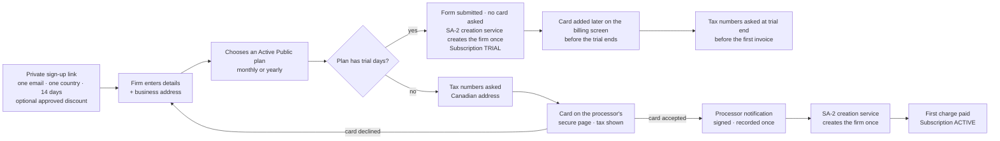

> **Document control** · Version **2.22** · **2026-10-17** · Status: **v2.22 (17 Oct): one pointer line added (which plans include AI at launch is an open pricing item owned by the product owner, AG16-80(4)); nothing else changed. Earlier: Applied the 12 Oct (session 2) decisions — the Platform Owner publishes every ExpatReady email (legal flag parked), staff role names, Rule 9 pass (defaults and placement, payment events log, discount presets, three-tab firm billing screen, plan-change options state date and charge, tax numbers asked at trial end, cancellation reasons) — for the product owner's review**\
> Part of: *Super Admin Console — Functional Requirements* · Split from `FINAL-SuperAdmin-FR.md` lines 2124–2817 on 2026-09-16 · Previous version: `_archive/SA-04-saas-billing_v2.21_2026-10-12.md`\
> Reviewed by: the co-product owner and the product owner (product owners) · Code state verified 2026-09-18 against GitHub `dev`: backend `ERv2-sanitized` @ `36db7f2f`, frontend `ERv2-frontend` @ `36a53b5`
>
> | Version | Date | Change | Decisions |
> |---|---|---|---|
> | 2.22 | 2026-10-17 | **Pointer only (AG16-80(4)).** Which plans include AI at launch is an open pricing item owned by the product owner, settled when plans and prices are set in this module; the plan feature itself is SA-03 (SA-3-70, flag on or off per plan). Nothing else changed; no requirement added, changed or withdrawn. *18 Oct: new section 'Decisions that change this epic' (index of AG16 decisions; no requirement changed).* | AG16-80 |
> | 2.21 | 2026-10-12 | **Applied the 12 Oct (session 2) decisions (the product owner, approved 12 Oct).** (1) **Who publishes ExpatReady emails (SR-Q2):** the **Platform Owner publishes every ExpatReady email**, billing emails included; the Content publisher drafts and previews only (as built); the email-level "contains legal terms" flag and its Owner check are **parked** — SA4-D32(d), SA-4-89(d), BR-24, SA4-X18, SA4-X21(b) corrected; §13 Q10 closed. (2) **Role names (SR-Q3, SR-Q4(5), SR-Q4(9)):** Platform Owner, Admin, Support, Billing, Content publisher, Auditor; the account manager is an Admin; persona table renamed; §13 Q11 closed. (3) **Rule 9 pass (SA-4 part):** new §3.14 *Settings — defaults and placement*; cancellation reasons listed (R9-5, §3.9, SA-4-31); the notification log becomes the **Payment events** screen under Advanced — Owner, Admin and Billing view and re-run, Support views only (R9-14, SA-4-36); discount editor presets, discount code and offer window under Advanced (R9-16, §3.1a); the firm billing screen has three tabs — Plan & payment, Invoices, Billing details — with Cancel under More, and Admin-blocked items say "Only the Owner can do this" (R9-17, §3.13, SA-4-54); **SA-4-72 reinstated as a requirement** — every plan-change option states its date and exact charge (R9-18); the price editor shows the saving live (SA-4-71); extras are plan features with no separate price (R9-20, SA-4-44); **tax numbers are asked at trial end, before the first invoice**, not at sign-up (R9-19 — changes SA4-D12, SA-4-52, SA-4-60, §3.2, §3.4a, Visual C). (4) Failed-payment wording corrected to a failure notice on day 0 and reminders on days 7 and 12 (R9-6). **Changed:** SA-4-31, SA-4-36, SA-4-44, SA-4-52, SA-4-54, SA-4-60, SA-4-71, SA-4-89, BR-24, US-8, US-10; **reinstated:** SA-4-72; SA4-D12, SA4-D32 annotated; SA4-X10, SA4-X18, SA4-X21, SA4-X22 updated. **Added:** SA4-D37 – SA4-D40; SA4-X23, SA4-X24; §3.14. **Withdrawn:** none. §13 Q10 and Q11 closed; Q7, Q8, Q9, Q12 unchanged (not decided). **Same-day revision (W-1 – W-3, the product owner, 12 Oct):** W-3(3) tax numbers not given by trial end are asked at the card step, and staff-created firms get the same step unless staff entered them (SA4-D40, SA4-X23, §3.4a, SA-4-52, SA-4-60); W-3(6) Support's read-only payment log and the one-built-key developer task (SA4-D38, SA-4-36 area, §10); W-2 pointer on one-Owner price-change approval (SA4-D36). **Same-day revision (W-4 – W-10, the product owner, 12 Oct):** W-4 the deletion warnings (days 30, 60, 97) go to set 2 — billing email, Owner and Admins (SA4-D33, SA-4-53, SA4-X18, §3.5 timeline; §13 Q9 closed); W-5 "Upgrade charge failed" and "Subscription started (early)" follow set 2, Appendix B aligned (SA4-X18; §13 Q12 closed); W-6 "Discount ending" is sent once, 7 days before the last discounted invoice, and not at a monthly ↔ yearly switch (SA-4-90, code constant; §13 Q7 closed). **Same-day revision (W-11 – W-22, the product owner, 12 Oct):** W-22 — the trial plan switch keeps the downgrade fit check (SA-4-56, SA-4-76). W-18 during a trial the Owner may switch freely to any public plan (no charge, trial end unchanged) and staff "New firm" requires a plan with no pre-selection (SA4-D29, §3.7, §3.8, SA-4-56, SA-4-78); W-19 "Extend trial" is pre-filled 7 days, editable (§3.14, SA-4-80); W-21 text fixes — staff-created firms' tax numbers (SA-4-60, SA4-X10, SA4-X23), overdue list = Platform Owner and Billing (§3.5, SA-4-24), the Admin persona, Payment events re-run key (SA-4-36), failure notice day 0 (§3.5 timeline, notices), US-2 recipients, US-8 trial declaration. | SA4-D37 – SA4-D40 · SR-Q2, SR-Q3, SR-Q4(5), SR-Q4(9) · Rule 9 pass (R9-5, R9-6, R9-14, R9-16 – R9-20) |
> | 2.20 | 2026-10-12 | **Applied the template-management and complexity-review decisions (the product owner, 10–12 Oct).** (1) **Billing emails are ExpatReady-owned** kind-1 emails in SA-05's catalogue; only ExpatReady edits them; **English required, French optional**, sent in the recipient's language when that version exists, otherwise English; French-first stays for billing **documents** only; must-keep fields adopted for the older billing emails and enforced with the existing `required` flag; an email-level **"contains legal terms"** flag needs the Owner role to publish; departure-type emails state only ExpatReady's facts (SA4-D32; template map §16, O15, O16, R27, R33; SA5-X15 applied). (2) **Two recipient sets** replace the four risk-based sets: documents → billing email (Owner if none); every other billing notice → billing email + Owner + Admins (SA4-D33; R30 — code today is one rule, needs changing). (3) **Missing invoice copy:** immediate alert + automatic retry, then an engineer alert on the SA-08 status page; the daily exception report is replaced (SA4-D34; R31). (4) **Subscription invoices and credit notes can be viewed and downloaded by the Owner, Admin and Billing / Finance**; cancel, downgrade, upgrade and billing details stay Owner-only (SA4-D35; R37, amends SA4-D23). (5) **Kept as decided, with build state:** second-Owner approval of live plan / price changes (built — R9), discounts as decided (R21), "Start my subscription now", the yearly → monthly credit tool, the combined downgrade + yearly rule and the in-console Stripe log (R22.1 – R22.4), the overdue list and the written-off report (built) (SA4-D36; code check 12 Oct, rule "built stays"). (6) **Stale text fixed:** §3.11 and SA4-D2 / SA4-D21 (pilots use a trial extension or a 100% monthly discount, not a long-trial Internal plan — SA4-D29c, SA4-D30e); Visual C, §0.3 SA-04.02, §1, SA-4-52 and the card-step edge case (a trial plan takes no card — SA4-D29a). (7) Rule 7 reviewed: no statute or regulator is used as product justification here; the 6-year records, CRA / Stripe Tax rules, bilingual terms and the data-processing clause are ExpatReady's own obligations and stay. **IDs:** added SA-4-89 – SA-4-91 (emails), SA4-D32 – SA4-D36, SA4-X18 – SA4-X22, BR-24, BR-25, US-15, US-16; changed SA-4-17, SA-4-20, SA-4-23, SA-4-24, SA-4-31, SA-4-36, SA-4-48, SA-4-52, SA-4-53, SA-4-54, SA-4-55, SA-4-57, SA-4-62, SA-4-63, SA-4-65, SA-4-66, SA-4-67, SA-4-70, SA-4-74, SA-4-76, SA-4-80, SA-4-81, SA-4-85, BR-17, US-9, US-14, §7 `BillingNotice`; SA4-D2, SA4-D5, SA4-D8 (superseded in part by SA4-D33), SA4-D19, SA4-D21, SA4-D23 annotated; none withdrawn. Open questions 7 – 12 added (not decided). | SA4-D32 – SA4-D36 · map §16, O15, O16, rule 7 · R9, R21, R22.1 – R22.4, R27, R30, R31, R33, R37 · SA5-X15 |
> | 2.19 | 2026-10-11 | **Consistency fixes (the product owner, 11 Oct — found in the template review's full read).** Wording left over from before SA4-D29 corrected; no rule changed: §0.3 SA-04.08 row (no card to start a trial; reminders 7, 3 and 1 day plus trial ended); §6 status diagram (trial starts when the sign-up form is submitted; a plan with no trial starts Active after the first charge; no card at trial end → Payment hold that day); US-9 (trial notices also go to the Admins, SA-4-53); SA-4-9 notes that the welcome / set-password email is the same email SA-02 calls the owner invitation. | SA4-D29 (consistency) |
> | 2.18 | 2026-10-10 | Applied from SA-08 v2.5 (merge of the co-product owner's SA-08 review, the product owner, 10 Oct): **invoice and credit-note copies stay in the locked billing area of the Canadian documents storage**, as built (SA8-D23) — SA4-X11's separate bucket is withdrawn; SA4-X13 (daily proration) marked applied in SA-8. Clarified that SA4-D19's French-first rule covers the terms, invoices, receipts and credit notes themselves; the emails that carry them follow the contact's language and the template rules (French optional — decided 10 Oct). | SA8-D23 · SA4-D19 |
> | 2.17 | 2026-10-10 | **Trials and discounts review (the product owner, 10 Oct).** **Trials (SA4-D29):** no card to start a trial (reverses the card-at-sign-up part of SA2-D3a); a trial that ends with no card goes **straight to payment hold** (no 14-day grace); Super Admin can **extend** a trial (reason, audited, total capped at 90 days) — replaces the long-trial Internal plan for pilots; the Owner can **start paying early**; staff cannot shorten a trial; trial length stays per plan, default 14; an in-app trial banner and reminders 7, 3 and 1 day before plus a trial-ended notice. **Discounts (SA4-D30):** optional **offer window** (available from / until; a sign-up link made inside it keeps the discount); each discount is **monthly-only or yearly-only** (yearly = first year); a **plan change keeps** the discount, a **monthly ↔ yearly switch ends** it with a warning; the list shows **how many firms use** each discount; **100% off is allowed** for free months — monthly discounts only, at most 3 months — and a card is still needed by the end of the trial. *(Refined the same day after six follow-up answers: card at trial end even if the next invoices are $0; 100% capped at 3 months; "Start my subscription now" uses the existing `agent/subscription:upgrade` key.)* **Plans display (SA4-D31):** plans side by side, each higher plan shown as "Everything in <lower plan>, plus …". §3.1a, §3.2, §3.8, §3.13, §6, §7, §9, §10 changed; SA-4-5, SA-4-6, SA-4-7, SA-4-30, SA-4-42, SA-4-43, SA-4-53, SA-4-54 changed; SA-4-78 – SA-4-88 added; SA4-D2, SA4-D10c annotated; §0.2 SA4-X14 – SA4-X17. | SA4-D29, SA4-D30, SA4-D31 |
> | 2.16 | 2026-10-10 | **Applied from SA-03 v2.16 (SA3-X6; the product owner, 10 Oct).** (a) **Prices rise with the plan ladder** — a monthly or yearly price that would make a plan we sell cost the same as or less than the plan below it is refused, including at activation (new SA-4-75). (b) **A move to a lower plan is booked only when SA-3's downgrade check passes** — usage must already fit the lower plan; same for Super Admin, no override; the lower plan's limits apply from booking (new SA-4-76). (c) **A move to a lower plan combined with monthly → yearly waits for the next renewal** — an exception to SA4-D24 / SA-4-70 (new SA-4-77). (d) During a trial the move is immediate once the check passes. (e) "At a downgrade nothing is deleted and the firm may be over limit" is replaced. New SA4-D28. §3.1, §3.7, §0.3, US-4, §9 and SA-4-1, SA-4-28, SA-4-29, SA-4-48, SA-4-56, SA-4-70 changed. | SA4-D28 · SA3-D12, SA3-D13, SA3-D17 |
> | 2.15 | 2026-10-10 | **Proration is calculated by day, not by the second** (SA4-D27, the product owner, 10 Oct), set in the processor's configuration — so every credit line is explainable to a firm, to support and to QA ("30 of 31 days unused") instead of a figure nobody can reproduce by hand. We still never calculate it ourselves. §3.7 and the SA4-D24 wording corrected; new SA4-X13 asks SA-8 to configure it on the payment rail. | SA4-D27 |
> | 2.14 | 2026-10-08 | Simplified to the processor's own patterns, at the founder's direction — "industry standard, development friendly, not over-complicated". SA-4-68 reduced to preview-then-charge (no staleness window, no re-confirm step); **SA-4-72 withdrawn** (the two-paths screen is design intent in §3.7, not a requirement); SA-4-70 and SA-4-74 trimmed; SA-4-71 and SA-4-73 kept. §3.7 now names the processor mechanisms: upgrades use `always_invoice` **with pending updates** so the plan only changes if payment succeeds, and period-end changes use a **subscription schedule**. | SA4-D24 |
> | 2.13 | 2026-10-08 | Approach finalised with the founder (the product owner, 8 Oct). **SA-4-68 reworded:** the 15-minute quote window is removed — the amount is recalculated at the moment the Owner confirms and re-shown if it has changed, and a stale quote is never patched onto the invoice with a correction line. No other requirement changed; SA4-D24 – SA4-D26 stand as written. | SA4-D24 |
> | 2.12 | 2026-10-08 | Challenge from a firm — "why can't we upgrade and move to monthly at the same time?" — which exposed that **nothing in this document said what the yearly price is commercially**. Recorded (SA4-D25): the **yearly price is discounted against monthly and is a 12-month commitment**, which is what makes "yearly → monthly waits for the anniversary" defensible; converting mid-term would return the discount for months already used and break the commitment, and the unused months would come back as credit, not cash. The upgrade itself was never blocked — a yearly firm upgrades immediately, co-termed — and the screen must now say so. SA-4-71 – SA-4-73 added; §3.7 extended. **Super Admin may convert a yearly firm to monthly mid-term as an audited exception** (SA4-D26), with the unused months held as non-refundable account credit; SA-4-74 added. | SA4-D25, SA4-D26 |
> | 2.11 | 2026-10-08 | Development team's questions on plan and billing-period changes, answered against the Stripe documentation (the product owner, 8 Oct). **One timing rule replaces the case list** (SA4-D24): a change that increases what we collect now takes effect now with the difference charged; one that keeps it the same or reduces it takes effect at the next renewal; monthly → yearly is always immediate and **starts a fresh year today** (Stripe resets the billing anniversary when the interval changes); yearly → monthly always waits for the anniversary. Closes the two cases SA-4-29 left open — monthly → a cheaper yearly plan (immediate) and an equal-price switch (at renewal). SA-4-29 changed; SA-4-68 – SA-4-70 added; §3.7 rewritten; new SA4-X12 for the developers. | SA4-D24 |
> | 2.10 | 2026-10-07 | Aligned to SA-06 v3.0 roles and permissions (the product owner, 7 Oct): persona row "Firm Admin" renamed "Admin", the starter-role name used in SA-06. Requirements unchanged. | SA6-D5 |
> | 2.9 | 2026-10-07 | Founder decision (the product owner, 7 Oct), closing review of the RBAC spec (SA-06 v3.0): **failed-payment, card-declined, overdue and payment-hold notices also go to the firm's Admins** — they can update the card and pay (SA4-D23) — in addition to the billing email and the Owner. SA4-D8 extended; SA4-D23 extended; failure-timeline table, §2 goal and Firm Admin persona, §3.5 notices, SA-4-20, SA-4-21, SA-4-23, SA-4-53, §10 (firm side), US-9 and the edge cases aligned. Not changed: card-expiring, trial-ending and price-change notices, invoices / receipts / refund notices, and SA-2's deletion warnings keep their recipients. | SA4-D8, SA4-D23, SA6-D5 |
> | 2.8 | 2026-10-07 | Founder decision (the product owner, 7 Oct), recorded in SA-06 v3.0 as SA6-D5 (extended 2026-10-07): **who can do what on the firm's own billing screen.** The firm's **Admin** may update the subscription card and pay an overdue bill ("pay now"); everything else on the screen is **Owner-only** — upgrades (plan or billing-period increases), invoices and credit notes, billing details (billing email, business address, tax info), downgrades, and cancellation with undo. §3.13 rewritten; new SA4-D23; SA4-X3 firm-side part decided; SA-4-54 changed, SA-4-67 added; SA-4-17, SA-4-28, SA-4-31 and the card, coming-back, plan-change, persona, edge-case and §10 wording aligned. Settles the code team's provisional ruling R10 (`ERv2-sanitized/Docs/DEFERRALS-REGISTER.md:261`, Q2 "owner confirmation pending") except that **upgrade is Owner-only** (R10 gave it to Admin). | SA4-D23, SA6-D5 |
> | 2.7 | 2026-10-01 | Applied from SA-07 v2.6 (the product owner, 1 Oct): SA-7 role names used; live plan / price changes are approved by an Owner. SA4-D5, SA4-X2, SA-4-48, BR-21 changed; persona names updated. | SA7-X10, SA7-D51 |
> | 2.6 | 2026-09-29 | Question from the development team: who calculates tax, and where are invoices stored. The tax answer was already settled (SA4-D7, SA4-D11, SA4-D20 — Stripe Tax calculates, Expat Ready holds no rates) and is unchanged. **Invoice storage corrected:** SA-4-16 kept only a *link* to the processor's PDF, which does not meet the CRA's rule that records be kept at a place of business in Canada unless the CRA gives written permission — records merely accessed from Canada while stored outside it are not records kept in Canada. Expat Ready now stores its own copy of every invoice and credit note in a Canadian region. SA-4-16 and SA-4-64 changed; SA-4-66 added; new SA4-X11 for SA-8. | SA4-D22 |
> | 2.5 | 2026-09-18 | §12 re-checked against GitHub `dev` after today's frontend merge of `feat/SA-02` (frontend `36a53b5`; backend unchanged `36db7f2f`): no finding changed; admin route and menu line references updated (`routes.tsx:304-305`, `admin-nav-config.tsx:112, 119`). Requirements unchanged. | — |
> | 2.4 | 2026-09-18 | Knock-on from SA-2 v2.8: the subscription terms include a data-processing clause (Quebec Law 25 s. 18.3; PIPEDA) — SA-4-65 changed. | SA2-X10 (from SA2-D10) |
> | 2.3 | 2026-09-18 | Remaining open questions closed by the product owners (18 Sep): neutral no-tax statement for firms outside Canada; full CRA invoice content on every invoice; refunds with credit notes reversing tax; unpaid invoices of deleted firms written off with a monthly report; tax numbers format-checked only; Expat Ready's own billing records kept 6 years after fiscal year-end; bilingual terms and invoices for every firm, French first; Stripe Billing + Stripe Tax confirmed; founder rule FD-28 retired. SA-4-51, SA-4-60 changed; SA-4-61 – SA-4-65 added; §13 closed. | SA4-D13 – SA4-D21 |
> | 2.2 | 2026-09-18 | Accountant's sales-tax answer applied (18 Sep): tax follows the firm's location — inside Canada by province, outside Canada none (exempt); collect the firm's GST/HST number and, for Quebec firms, its QST number. Canadian firms must give their number(s) or declare they are not registered. §3.4a rewritten; SA-4-51, SA-4-52 changed; SA-4-60 added; §13 Q1 answered. §12 re-checked: `dev` unchanged. | SA4-D11, SA4-D12 · §0.2 SA4-X10 |
> | 2.1 | 2026-09-18 | Product review applied. One monthly and one yearly price per plan, CAD only; price changes reach existing firms at renewal with 30 days' notice and a second approver; prices pushed to the payment processor automatically. Checkout only through private sign-up links (no public sign-up). Card only; $0 Internal plans for free firms; approved discounts; no add-ons. Failed payments follow the SA-2/SA-3 timeline (14 days, reminders on days 1, 7 and 12, then payment hold); coming back = overdue invoice plus a new period. Trials with a card at sign-up. Owner self-service plan changes (upgrades now, downgrades at renewal). No refunds, with three exceptions including a 30-day first-year refund. Sales tax calculated by the payment processor from the business address. Billing emails split by risk. The firm's own billing screen is specified here (new §3.13). Multi-currency, currency conversion, manual billing and the in-platform revenue dashboard deferred. §12 replaced with verified code state. SA-4-1, SA-4-2, SA-4-4 – SA-4-8, SA-4-11 – SA-4-17, SA-4-20 – SA-4-26, SA-4-28 – SA-4-31, SA-4-35, SA-4-37, SA-4-39 changed; SA-4-3, SA-4-32, SA-4-38 withdrawn; SA-4-42 – SA-4-59 added. | SA4-D1 – SA4-D10, SA4-P1 · applies SA3-X2, SA3-E2, SA3-E3, SA3-S1, SA2-X1, SA2-X4 (billing part) · takes up SA-3's deferred price sync |
> | 2.0 | 2026-06-20 | Baseline — golden per-module rebuild | — |

## Decisions that change this epic (14–18 Oct) *(new 18 Oct)*

Product-wide rules (apply here as everywhere; home: Agent `00-Overview` → "Product rules every epic follows"): none cited in this document.

The "AG16" prefix is historical: these decisions began in the AG-16 review and apply across the product. Full text: `TEMPLATE-MAP-working_2026-10-10.md`.

| Decision | What was decided (one line) | What it changes in this epic | Where (requirement / card / section) |
|---|---|---|---|
| AG16-80 | AI switch and plans. | Pointer only: which plans include AI at launch is an open pricing item owned by the product owner, settled when plans and prices are set here. The plan feature itself is SA-03 (SA-3-70, flag on or off per plan). No requirement added, changed or withdrawn. | Document control (v2.22), §13 Open Questions (pricing pointer) |

## Module SA-4: SaaS Billing (Firm → Expat Ready)

> **What this document is.** The build specification for Super Admin module SA-4. Version 2.1 applies the product review of 18 Sep 2026. **§0** records each decision; every later section has been edited in place to match it. Where an earlier version says something different, this version wins; earlier wording is kept only in `_archive/`.
>
> **Plane:** GLOBAL (Super Admin console), plus the firm's own **billing screen** in the firm console (§3.13). **The paying party is the firm**, paying Expat Ready a recurring subscription. This is **not** AG-6 (the firm's clients paying the firm), which uses separate payment accounts. **Payment processor:** an infrastructure rail configured in SA-8 (**Stripe Billing + Stripe Tax** — SA4-D20). It holds cards, charges and retries them, calculates tax and produces invoices; Expat Ready is the master of prices, discounts, subscription state and access. **Currency:** CAD only (SA3-D2b). **Sits between** SA-3 (plans, entitlements), SA-2 (firm creation, firm status, deletion), SA-8 (the payment rail), SA-9 (revenue reporting) and SA-11 (audit).
>
> **Requirement IDs are permanent.** A changed requirement keeps its number. A withdrawn requirement stays as a one-line entry. New requirements continue from the highest number (next: SA-4-92). Numbers are never reused.

---

### 0. Decision log (review of 2026-09-18)

Decision IDs are prefixed with the module (`SA4-`).

| ID | Decision | Where applied |
|---|---|---|
| **SA4-D1** | **Approved discounts; no add-ons.** Billing keeps a short list of approved discounts (percent or CAD amount off, for one invoice or a set number of months — never "forever"). Super Admin applies one to a firm with a reason: at creation, on its sign-up link, or later. A discount changes only the price; the firm still gets exactly its plan (SA3-D6). Audited and shown on invoices. **Add-ons are not sold** in Release 1 (SA3-D6). For SA-4 this supersedes the coupon rule coded in the frontend as "FD-28". | §3.1a · SA-4-42 – SA-4-44 · §0.2 SA4-X1, SA4-X2, SA4-X9 |
| **SA4-D2** | **Card only**, charged automatically by the payment processor. Free firms (demo, partners) go on an **Internal plan priced $0**: no card asked, no invoices. Pilots use a trial extension (up to 90 days in total — SA4-D29c) or a 100% monthly discount for at most 3 months (SA4-D30e); there is no long-trial Internal plan *(changed v2.17; stale wording corrected v2.20)*. No "paid offline" subscriptions in Release 1. | §3.11 · SA-4-3, SA-4-32 withdrawn · SA-4-45, SA-4-46 · §0.1 |
| **SA4-D3** | **Coming back from payment hold:** the firm pays the overdue invoice (it covered the grace weeks the firm used) and a **new billing period starts on the day it pays**. Nothing is charged for time on hold. Paying during the 14 days only clears the failed invoice; the billing date is unchanged. | §3.6 · SA-4-26 changed · SA-4-47 |
| **SA4-D4** | **The owner changes plan in the billing screen** (Active Public plans only). Upgrades and monthly → yearly apply at once, paying the difference for the rest of the current period; downgrades and yearly → monthly apply at the next renewal, with no refund. Super Admin can make the same changes (reason, audited). Firms on Internal plans change only through Super Admin. | §3.7 · SA-4-28, SA-4-29 changed |
| **SA4-D5** | **Price changes:** new firms pay a new price once it is approved; existing firms move to it at their **first renewal at least 30 days after approval** and are emailed at approval. A price change on a plan with firms needs **approval by an Owner** (as SA3-D8b); Billing requests but never approves *(changed v2.7 — SA7-X10, SA7-D51)*. Price cuts follow the same path. Prices are pushed to the payment processor automatically. *(kept as decided v2.20 — R9, SA4-D36: the second-Owner approval is built.)* | §3.1 · SA-4-2 changed · SA-4-48 · takes up SA-3's deferred price sync |
| **SA4-D6** | **Refunds:** none for cancelling or downgrading — access runs to the end of the paid period (SA2-D9). Exceptions: (a) Super Admin refunds all or part of a charge (double charge, billing error, goodwill), with a reason, audited; (b) a pro-rated refund of prepaid fees if Expat Ready permanently discontinues the service; (c) a **full refund of the firm's first-ever yearly payment** if the owner asks within 30 days of it (not renewals); access ends when refunded. *Basis:* Clio and 8am (MyCase, Docketwise) — fees are non-refundable, service runs to the end of the term, pro-rated refund only if the service is discontinued; Officio (Canadian RCIC software) — full refund within 30 days of the first annual subscription, not renewals. | §3.9 · SA-4-31 changed · SA-4-49, SA-4-50 |
| **SA4-D7** | **Sales tax:** prices are shown before tax ("$199 CAD + applicable taxes"). Tax on each invoice is calculated by the payment processor's tax service from the firm's **business address** (SA-2-25), using only the tax registrations the accountant confirms. Invoices show Expat Ready's tax numbers and the firm's tax number if given. | §3.4a · SA-4-51, SA-4-52 · §13 |
| **SA4-D8** *(superseded v2.20 — SA4-D33, R30: two recipient sets replace the four sets below; kept as history)* | **Billing emails split by risk:** invoices, receipts and refund notices go to the billing email (the owner if none). Anything that puts access at risk — failed payment and reminders, payment hold, card expiring, trial ending, price-change notice — goes to **both** the billing email and the owner. *(extended 2026-10-07 — founder, SA-06 closing review)* **Failed-payment (card-declined), overdue-reminder and payment-hold notices also go to the firm's Admins** — the people who can update the card and pay (SA4-D23) — in addition to the billing email and the Owner. Card-expiring, trial-ending and price-change notices are unchanged (billing email and Owner). | §3.5 · SA-4-20 · SA-4-21 · SA-4-23 · SA-4-53 |
| **SA4-D9** | **SA-4 specifies the firm's own billing screen:** plan and price, next charge, card (on the processor's secure page), invoices and receipts, plan and billing-period changes, cancel with reason and undo, billing email, business address and tax number. It is always on (SA-3-35). | §3.13 · SA-4-54 · applies SA2-X4 (billing part) |
| **SA4-D10** | **Operating defaults** (confirmed 18 Sep): (a) the 30-day first-year refund is requested in writing and issued by a Billing user — no self-service refund button; (b) the processor retries the card automatically within the 14 days, and immediately when the owner updates the card; (c) trial-ending reminders 7 and 3 days before the trial ends *(changed v2.17 — SA4-D29f: 7, 3 and 1 day, plus a trial-ended notice)*; card-expiring notice 30 days before expiry; (d) a plan change during a trial keeps the trial end date and the first charge is the new plan's price; a failed upgrade charge leaves the plan unchanged and the owner is told; (e) billing continues during a security lock; if the lock was Expat Ready's mistake the charge can be refunded (SA4-D6a); closing a locked account ends the subscription with no refund; (f) $0 Internal plans ask for no card, create no invoices and are never offered on a sign-up link; (g) a firm has at most one discount at a time; the approved list is managed by Billing and every change is audited. | SA-4-43, SA-4-46, SA-4-50, SA-4-55 – SA-4-58 |
| **SA4-D11** *(accountant, 18 Sep)* | **Sales-tax rules:** tax follows the firm's location (its business address). **Inside Canada:** the tax of the firm's province. **Outside Canada:** no tax (exempt). While charging tax, **collect the firm's GST/HST number**, and **its QST number** for Quebec firms. | §3.4a · SA-4-51, SA-4-52 changed · §13 Q1 answered |
| **SA4-D12** | **Tax numbers are required for Canadian firms, with a "not registered" option.** A firm with a Canadian business address must enter its GST/HST number (a Quebec firm also its QST number) **or** declare it is not registered for GST/HST (small practices under the $30,000 threshold need not register). The format is checked (GST/HST: 9 digits + `RT` + 4 digits; QST: 10 digits + `TQ` + 4 digits). The numbers appear on invoices. Tax is charged by province either way. Firms outside Canada are not asked. The owner can add or change the numbers later; audited. *(changed v2.21 — SA4-D40, R9-19)* The numbers are asked at the **end of the trial, before the first invoice** — not at sign-up; a plan with no trial asks before the card step, as before. | §3.2, §3.4a, §3.13 · SA-4-60 · §0.2 SA4-X10 |
| **SA4-D13** | **No-tax statement for firms outside Canada:** "No Canadian sales tax (GST/HST/QST) charged — customer located outside Canada." Neutral on purpose: the CRA generally treats services supplied to non-residents as *zero-rated*, while the accountant said *exempt*; the accountant approves this sentence once. | §3.4a · SA-4-51 changed |
| **SA4-D14** | **Every invoice carries the CRA's full list** (the $500-and-over tier, whatever the amount): Expat Ready's legal name and address, GST/HST and QST numbers, sequential invoice number, date, the firm's legal name and address, the firm's GST/HST and QST numbers when given, plan and period, price, discount, each tax separately, total, and payment terms. | §3.4 · SA-4-61 |
| **SA4-D15** | **Refunds go back to the card with a credit note** that reverses the matching tax (in proportion for a partial refund), sent to the billing email. | §3.9 · SA-4-62 |
| **SA4-D16** | **Unpaid invoices of deleted firms are written off** as uncollectible on deletion day and listed in a **monthly written-off report** for Billing and the accountant (who reclaims the tax already remitted). No collection agency. | §3.6 · SA-4-63 |
| **SA4-D17** | **Tax numbers are format-checked only** in Release 1; a Billing user may look a number up in the CRA or Revenu Québec registry if in doubt. | §3.4a · SA-4-60 changed · §0.1 |
| **SA4-D18** | **Expat Ready's own billing records** (invoices, credit notes, payments, billing address, tax numbers) are kept **6 years after the end of the fiscal year they relate to** — the CRA and Revenu Québec minimum — then deleted; longer only if a tax return is under objection or dispute or a tax authority asks. They are kept apart from tenant data, so they survive the firm's 90-day deletion. | §3.4 · SA-4-64 · §0.2 SA4-X6 |
| **SA4-D19** | **Bilingual subscription terms and invoices for every firm, French first** (Quebec Charter of the French Language: invoices available in French — s. 57; standard-form contracts presented in French first since 1 June 2023). Billing emails follow SA4-D32 (recipient's language when that version exists, otherwise English). *(v2.18: French-first applies to the documents themselves; the emails around them follow the template rules — French optional, decided 10 Oct with the SA-08 merge.)* | §3.2, §3.4 · SA-4-65 |
| **SA4-D20** | **Payment processor: Stripe Billing + Stripe Tax** (subscriptions, trials, proration, retries, discounts, refunds and credit notes, invoices, secure card page, Canadian GST/HST, QST and PST calculation). | Plane note · §0.2 SA4-X4 |
| **SA4-D21** | **Founder rule "FD-28" is retired** ("price differences via coupons, never separate plans" — cited only in frontend code). SA4-D1 (approved discounts) and SA4-D2 ($0 Internal plan for free firms; pilots use a trial extension or a 100% monthly discount — SA4-D29c, SA4-D30e) replace it. | §12 · §0.2 SA4-X9 |
| **SA4-D22** *(development team's question, 29 Sep)* | **Expat Ready keeps its own copy of every invoice.** The processor issues, numbers and renders the invoice (SA4-D20) and calculates the tax (SA4-D7, SA4-D11) — that is unchanged. But the **record** is ours: the PDF of every invoice and credit note is copied into Expat Ready's own storage **in a Canadian region**, alongside the structured lines, and kept for the six-year window of SA4-D18. Reason: the CRA requires records to be kept at a place of business in Canada unless it gives written permission to keep them elsewhere, and records merely *accessed* electronically from Canada while stored outside it are not records kept in Canada; a link to the processor is therefore not a record, and it also disappears if the processor account is migrated or closed. | §3.4 · SA-4-16, SA-4-64 changed · SA-4-66 added · §0.2 SA4-X11 |
| **SA4-D23** *(founder, 7 Oct — recorded in SA-06 v3.0 as SA6-D5 extended 2026-10-07)* | **Who can use the firm's own billing screen.** The **Admin** may **update the subscription card** and **pay an overdue bill ("pay now")** — the two things that keep the firm's access running. Everything else is **Owner-only**: **upgrades** (plan, or billing-period increases such as monthly → yearly), **invoices and credit notes** (view and download — *viewing changed v2.20, SA4-D35*), **billing details** (billing email, business address, GST/HST and QST numbers), **downgrades**, and **cancellation and undo**. Other firm roles have no access to the billing screen. *(extended 2026-10-07 — founder, SA-06 closing review)* Because the Admin can act on them, the Admin also **receives the failed-payment, overdue-reminder and payment-hold notices** (SA4-D8); this adds a recipient, not a permission. This replaces "only the firm owner can use the billing screen in Release 1" (SA4-X3) and the provisional ruling R10, except that upgrade moves from Admin to **Owner-only**. *(amended v2.20 — SA4-D35, R37: viewing and downloading invoices and credit notes is also held by the Admin and Billing / Finance starter roles; cancel, downgrade, upgrade and billing details stay Owner-only.)* | §3.13 · SA-4-54 · SA-4-67 · SA4-X3 · §10 (firm side) · SA-06 §10b keys |
| **SA4-D24** *(development team's question, 8 Oct)* | **One rule for when a plan or billing-period change takes effect: if it increases what we collect now, it happens now and the firm pays the difference; if it keeps it the same or reduces it, it happens at the next renewal.** Monthly → yearly is therefore always immediate *(v2.16 exception — SA4-D28: not when combined with a move to a lower plan, which waits for the renewal)* — a year's cash today is always more — and, because the processor resets the billing anniversary whenever the interval changes, **the firm's year starts on the day it switches**; the new renewal date is shown before the owner confirms. Yearly → monthly always waits for the anniversary. An **equal-price** switch waits for the renewal. No change of any kind is accepted while the firm is overdue, on payment hold, or has a cancellation pending. During a trial every change is immediate and free. The amount quoted to the owner is the amount charged, taken from the processor's own preview (proration is by day — SA4-D27). | §3.7 · SA-4-29 changed · SA-4-68 – SA-4-70 added · §0.2 SA4-X12 |
| **SA4-D25** *(firm challenge, 8 Oct)* | **The yearly price is a discount in exchange for a 12-month commitment.** It is set below twelve times the monthly price, and the firm commits to the year. This is why **yearly → monthly waits for the anniversary**: converting mid-term would hand back the discount for the months already used and break the commitment, and the unused months would return as account credit rather than cash. **The upgrade is never blocked** — a firm on a yearly plan moves to a higher plan at once, co-termed (SA-4-29) — and the billing screen should present the two paths side by side so an upgrade is not mistaken for being refused (§3.7). The subscription terms state the commitment. | §3.7 · SA-4-71 – SA-4-73 added · terms (SA-4-65) |
| **SA4-D26** *(firm challenge, 8 Oct)* | **Super Admin may convert a yearly firm to monthly before its anniversary, as an audited exception with a reason** — the pressure valve for a genuine case, so sales can say yes without the rule bending for everyone. The unused months are held as **non-refundable account credit** that is consumed by the monthly invoices; **no cash is refunded** (BR-19 is untouched). The firm is told in writing what the credit is and that it is not refundable. Owners cannot do this themselves. | §3.7 · SA-4-74 added |
| **SA4-D27** *(the product owner, 10 Oct)* | **Proration is calculated by day, not by the second.** The processor's default is per-second; its proration granularity is set to **daily** in configuration (SA4-X13), so an invoice reads "30 of 31 days unused" and a firm, a support agent or a tester can check it by hand. **We still never calculate proration ourselves** — the screen shows the processor's preview and the invoice matches it (SA-4-68). If daily granularity turns out not to be available on the account, the default per-second behaviour stands and this decision is revisited rather than re-implemented in our code. | §3.7 · SA4-D24 wording · §0.2 SA4-X13 |
| **SA4-D28** *(applied from SA-03 v2.16 — SA3-X6; the product owner, 10 Oct)* | **Plan ladder and moves to a lower plan.** (a) The plans we sell form a ladder (SA-3 §3.10); a higher plan's monthly and yearly prices are each higher than the plan below, so an upgrade always costs more and applies at once under SA4-D24. (b) A move to a lower plan, by the Owner or by Super Admin, is booked only when SA-3's downgrade check (SA-3-58) finds the firm's usage already fits the lower plan; there is no override. From booking, the lower plan's limits apply (SA-3-59); its features apply at the next renewal. (c) **Exception to SA4-D24:** a move to a lower plan combined with monthly → yearly does **not** happen at once — it waits for the next renewal, and the yearly term starts then. (d) During a trial the move is immediate once the check passes. | §3.1 · §3.7 · SA-4-1, SA-4-28, SA-4-29, SA-4-48, SA-4-56, SA-4-70 changed · SA-4-75 – SA-4-77 added |
| **SA4-D29** *(the product owner, 10 Oct — trials)* | (a) **No card is needed to start a trial.** A sign-up for a plan with trial days asks for no card; the card is added on the billing screen before the trial ends. A plan with 0 trial days still takes the card at sign-up (the first charge is due at once). Reverses the card-at-sign-up part of SA2-D3a. (b) **A trial that ends with no card goes straight to payment hold** that day — no 14-day grace; that grace stays for cards whose charge fails. (c) **Super Admin can extend a trial** any number of times, each with a reason, audited; the Owner, the billing email and the firm's Admins are told the new date and the reminders move; the **whole trial never exceeds 90 days** from its start. This replaces the long-trial Internal plan for pilots (SA4-D2). (d) **The Owner can start paying early** ("Start my subscription now"): a card is required, the trial ends that day and the remaining trial days are given up. **Staff cannot shorten a trial**; misuse is handled by security lock (SA-2). (g) **Plan during a trial** *(the product owner, 12 Oct — W-18)*: the Owner may **switch freely to any public plan** — no charge, trial end date unchanged; after the trial the normal upgrade / downgrade rules apply (SA4-D4, SA4-D28). Staff "New firm" requires a plan, with no pre-selection; sign-up links are unchanged (the firm picks on the sign-up page). Trial plan-switch is a small build (developer list). *(revised same day — W-18)* (e) Trial length stays a per-plan setting, **default 14 days** (SA-3-46). (f) **Visibility:** an in-app trial banner for the Owner and Admin, amber in the last 3 days; reminders **7, 3 and 1 day** before the end and a **trial-ended** notice on the end day. *Basis:* sales-led private links already qualify the firm, so a card at the start mainly adds friction; Stripe supports trials without a payment method and ending them when none was added. | §3.2 · §3.8 · §3.13 · SA-4-5 – SA-4-7, SA-4-30, SA-4-53 changed · SA-4-78 – SA-4-82 · §0.2 SA4-X14 – SA4-X16 |
| **SA4-D30** *(the product owner, 10 Oct — discounts)* | (a) **Offer window:** a discount may have an optional *available from* and *available until* date; outside it the discount cannot be given. A sign-up link created inside the window keeps its discount until the link expires. After *available until* the discount retires itself. (b) **Each discount is monthly-only or yearly-only.** A monthly discount lasts one invoice or 1–36 months; a yearly discount covers the first yearly invoice. It applies only to a subscription on its billing period; on a sign-up link both periods stay on offer and the page states which one the discount is for. (c) **A plan change keeps the discount** for its remaining time; **a monthly ↔ yearly switch ends it**, and the confirm screen warns first. (d) The discount list shows **how many firms hold each discount now and in total**. (e) **100% off is allowed** for a few free months: **monthly discounts only, at most 3 months**; a 100% yearly discount is not allowed. Longer free use goes on a $0 Internal plan. **A card is still needed by the end of the trial**, even if the next invoices are $0. (f) There is no "only for these plans" setting in Release 1. *Basis:* Stripe coupons (`percent_off` / `amount_off`, `duration`, `redeem_by`); the monthly/yearly split closes the case where an "N months" coupon on a yearly plan discounts a whole year. | §3.1a · SA-4-42, SA-4-43 changed · SA-4-83 – SA-4-87 |
| **SA4-D31** *(the product owner, 10 Oct — plans display)* | Wherever a firm chooses a plan (the sign-up page and the billing screen), plans are shown **side by side** with price and limits; each higher plan lists **"Everything in <the plan below>, plus …"** (the plan ladder, SA-3 §3.10), with **"See all features"** for the full list. On small screens plans stack. Replaces the four-box layout and the proposed one-plan-per-tab layout. | §3.2 · §3.13 · SA-4-88 |
| **SA4-D32** *(the product owner, 10–12 Oct — template map §16, O15, O16, R27, R33; SA5-X15)* | **Billing emails are ExpatReady-owned.** (a) Every billing email (SA-05 Appendix B.2 trial, B.3 billing, and the deletion warnings of B.4) is a kind-1 template in SA-05's catalogue: only ExpatReady edits it, firms see it read-only, and a change applies when published (no 7-day notice). (b) **Language:** English is required, French is optional; an email goes in the recipient's language when that version exists, otherwise in English. **French first (SA4-D19) stays for billing documents only** — the subscription terms, invoices, receipts and credit notes. The built publish check that requires French for every key (`system-mail-template-admin.service.ts:370-379`) is to be removed (R27; developers — SA5-X35). (c) **Must-keep fields** are those listed in SA-05 Appendix B, including invoice `{taxLines}`, payment failed `{amountOwed}` and `{holdDate}`, deletion warnings `{deletionDate}` (O16); enforced with the existing `required` flag (`system-mail-template.ts:168`) — today only the link argument is enforced. (d) **Who publishes** *(changed v2.21 — SR-Q2, SA4-D37)*: the **Platform Owner publishes every ExpatReady email**, billing emails included; the **Content publisher drafts and previews only** (as built: `role-template.platform.ts:297-300`). The email-level "contains legal terms" flag and its Owner check are **parked** (R33), not built; nothing is added to code for them. (e) **Departure-type emails** (cancellation confirmation, payment-hold notice, deletion warnings) state only ExpatReady's own facts — dates and where to download the data — with no regulator name, number of years or section citation (map §16). (f) Three emails had no source requirement and now have one: **Discount ending** (SA-4-90), **Yearly to monthly** notice (SA-4-91, O16) and **Subscription started (early)** (SA-4-81). | §3.4 · §3.5 · §3.9 · SA-4-53, SA-4-65, SA-4-89 – SA-4-91 · §7 `BillingNotice` · BR-17, BR-24 · §0.2 SA4-X18, SA4-X21 |
| **SA4-D33** *(the product owner, 12 Oct — R30)* | **Billing emails go to two recipient sets, replacing the four risk-based sets of SA4-D8.** **Set 1 — documents** (invoices, receipts, refunds, credit notes): the **billing email**, or the **Owner** if none is set. **Set 2 — every other billing notice** (payment failed and reminders, payment hold, trial reminders and trial ended / extended, card expiring, price change, plan-change emails, upgrade charge failed, discount ending, yearly to monthly, subscription started early, cancellation confirmation): the **billing email + the Owner + the firm's Admins**. Deletion warnings (days 30, 60, 97) also go to the billing email, the Owner and the Admins *(revised same day — W-4)*. The account manager or shared inbox alert (SA-2) is not an email to the firm and is unchanged. *Code today:* one rule for all mail — the firm's primary contact plus its billing email, deduplicated (`ERv2-sanitized` `apps/api/src/firm/firm-billing-contacts.ts:27-52`), plus an account-manager slot (`billing/notices/billing-notice.service.ts:40,160`); there is no recipient-set model, so the two sets are a code change (§0.2 SA4-X21). | §3.4 · §3.5 · SA-4-53 · BR-25 · US-9 |
| **SA4-D34** *(the product owner, 12 Oct — R31)* | **A missing invoice copy raises an immediate alert and is retried automatically.** If the copy of an invoice or credit note into the Canadian storage (SA4-D22) fails, the failure is alerted at once and the copy is retried; if it still fails, an engineer is alerted on the SA-08 status page. This **replaces the daily exception report** (SA-4-66 as written in v2.6 – v2.19); that report was never built, so nothing is removed in code. The 6-year retention in Canada is unchanged (SA4-D18). | §3.4 · SA-4-66 changed · §0.2 SA4-X20 |
| **SA4-D35** *(the product owner, 12 Oct — R37; amends SA4-D23 for viewing only)* | **Subscription invoices and credit notes can be viewed and downloaded by the Owner, the Admin and Billing / Finance** — `agent/subscription-invoice:view` is seeded on those three starter roles. **Cancel, downgrade, upgrade and billing details stay Owner-only**; the Admin still updates the card and pays an overdue bill. Billing / Finance gets no other billing-screen action. | §3.13 · SA-4-17, SA-4-54, SA-4-67 changed · §10 · §0.2 SA4-X19, SA4-X22 |
| **SA4-D36** *(the product owner, 12 Oct — complexity review, rule "built stays")* | **Kept as decided after the complexity review.** The register's suggestions are not decisions; only these are. **R9:** second-Owner approval of live plan and price changes stays *(revised same day — W-2)*: with one Platform Owner these requests wait until a second Owner is invited, and Admin does not approve them; go-live creates two Owners (SA-7-39) — built (`ERv2-sanitized` `apps/api/src/entitlements/plan-change.service.ts:412-413` `SELF_APPROVAL`; price-change requests `plan-price-change.controller.ts:44`; the approval-queue screen is wired to the real API, `ERv2-frontend` `src/features/admin/plan-admin-catalogue/components/plan-approval-queue-panel.tsx:60`); the 30-day notice to existing firms stays (SA-4-48). **R21:** the approved-discount rules stay as decided (SA4-D1, SA4-D30; SA-4-42, SA-4-43, SA-4-83 – SA-4-87). **R22.1 – R22.4:** "Start my subscription now" (SA4-D29d, SA-4-81), the Super Admin yearly → monthly credit tool (SA4-D26, SA-4-74), the combined downgrade + switch-to-yearly rule (SA-4-77 / SA-3-60) and the in-console Stripe notification log with safe re-run (SA-4-36) stay. **Built items stay as specified:** the overdue list with "send reminder now" and "send update-card link" (SA-4-24) and the monthly written-off report (SA-4-63) — file references in §12. | §3.1 · §3.5 · §3.6 · §3.7 · §3.8 · §3.10 · §12 v2.20 note |
| **SA4-P1** | **Release 1 priorities** as §0.3: the payment spine is Must now; approved discounts and the notification-log screen are Should now; manual billing, the in-platform revenue dashboard, a timeline settings screen and multi-currency are deferred. | §0.3 · §0.1 |

**Staff-role and Rule 9 decisions (the product owner, 12 Oct 2026, session 2)** *(new v2.21)*

| ID | Decision | Where applied |
|---|---|---|
| **SA4-D37** *(the product owner, 12 Oct — SR-Q2; amends SA4-D32(d))* | **The Platform Owner publishes every ExpatReady email**, the billing emails included; the **Content publisher drafts and previews only** (as built: `role-template.platform.ts:297-300`; earlier ruling O3, `SA05-SINGLE-PUBLISHER`). The "contains legal terms" flag and its Owner check are **parked, not deleted** (R33). *Parked for later — two-lane publishing:* the Content publisher publishes routine emails and flagged ones need the Owner; reopen when the content team grows or the Owner becomes a bottleneck. | SA4-D32(d) · SA-4-89(d) · BR-24 · SA4-X18, SA4-X21(b) · §13 Q10 closed · §0.2 SA4-X24 |
| **SA4-D38** *(the product owner, 12 Oct — SR-Q3, SR-Q4(5), SR-Q4(9))* | **Role names and the payment log.** ExpatReady staff roles are **Platform Owner, Admin, Support, Billing, Content publisher, Auditor** (code keys unchanged). The **account manager is an Admin** (and the Owner). The payment-processor notification log is viewed **and re-run** by the Owner, Admin and Billing; **Support views only**. Support gets a read-only view of the payment log; re-run stays Owner, Admin and Billing. **Developer task:** one built key (`system/billing:webhook-log`) covers both view and re-run today, so view-only needs a separate key or check *(revised same day — W-3(6))*. | §2 personas · §3.10 · §10 · §13 Q11 closed · §0.2 SA4-X24 |
| **SA4-D39** *(the product owner, 12 Oct — Rule 9 pass, SA-4)* | **Defaults and placement for every kept setting** (§3.14). (a) **R9-5:** cancellation reasons — Too expensive · Missing something I need · Too hard to use · Moving to another product · Closing or pausing my practice · Other. (b) **R9-14:** the notification log is the **Payment events** screen, under Advanced. (c) **R9-16:** the discount editor offers presets ("X% off for N months"); the rest, including the discount code and the offer window, is under Advanced. (d) **R9-17:** the firm billing screen has three tabs — Plan & payment · Invoices · Billing details; Cancel is under More; an item an Admin cannot use shows "Only the Owner can do this". (e) **R9-18:** SA-4-72 is reinstated — every plan or period option states its date and exact charge. (f) **R9-20:** extras are plan features with no separate price in Release 1 (SA-4-44 holds). (g) **R9-6:** failed-payment notices are day 0 (failure notice), 7 and 12 — wording corrected. | §3.1a · §3.7 · §3.9 · §3.10 · §3.13 · §3.14 · SA-4-31, SA-4-36, SA-4-44, SA-4-54, SA-4-71, SA-4-72 |
| **SA4-D40** *(the product owner, 12 Oct — R9-19; changes SA4-D12)* | **Tax numbers are asked at the end of the trial, before the first invoice**, not at sign-up. A plan with no trial asks before the card step, as before. The business address is still asked at sign-up. If the numbers are not given by the end of the trial, they are asked at the same step where the firm adds its card to continue; a firm created by ExpatReady staff gets the same step unless staff entered the numbers at creation. *(revised same day — W-3(3))* | §3.2 · §3.4a · Visual C · SA-4-52, SA-4-60 · §0.2 SA4-X23 |

**Applied from earlier reviews**

| ID | From | Applied here |
|---|---|---|
| **SA3-X2** | SA-3: one monthly and one yearly price per plan, one currency (CAD) | §3.1 · SA-4-1 changed · SA-4-38 withdrawn |
| **SA3-E2** | SA-3: 14 days' full access after a failed payment, a failure notice on day 0 and reminders on days 7 and 12 *(wording corrected v2.21 — R9-6)*, then payment hold | §3.5 · SA-4-20, SA-4-21, SA-4-23 changed |
| **SA3-E3** | SA-3: timeline to deletion; payment at any time before deletion restores full access | §3.5, §3.6 · SA-4-26 changed · SA-4-47 |
| **SA3-S1** | SA-3: payment hold (automatic) vs security lock (manual) | §3.6 · SA-4-25 changed · SA-4-58 |
| **SA2-X1** | SA-2: sign-up-link checkout, trial billing, owner cancellation with undo, sales tax from the business address, billing email, 14-day overdue period | §3.2, §3.4a, §3.5, §3.8, §3.9 |
| **SA2-X4** | SA-2: firm side of cancellation, billing email, business address and tax number — the billing-screen part | §3.13 (the support-access toggle and session history stay with AG-16) |
| **SA-3 §0.1** | Payment-processor synchronisation of plan prices, deferred from SA-3 | SA4-D5 · SA-4-2 changed |
| **SA2-X10** | SA-2 (SA2-D10): the subscription terms include a data-processing clause | SA-4-65 changed (v2.4) |
| **SA3-X6** *(v2.16)* | SA-3 v2.16: prices rise with the plan ladder; a move to a lower plan only when usage fits (no override); lower plan + monthly → yearly at renewal; immediate during a trial | SA4-D28 · §3.1 · §3.7 · SA-4-75 – SA-4-77 |

**Applied in v2.20 — from SA-05 v3.1 (§0.2) and the template map / complexity review (12 Oct)**

| ID | From | Applied here |
|---|---|---|
| **SA5-X15** | SA-5 v3.1: billing emails are kind 1 and edited in SA-05; must-keep fields (O16); source requirements for Discount ending, Subscription started (early) and a new Yearly to monthly notice; `BillingNotice.type` extended to every Appendix B billing email; English fallback; French-first for billing documents only (O15) | **Applied** — SA4-D32, SA4-D33 · SA-4-81, SA-4-89 – SA-4-91 · §7 `BillingNotice` · SA4-D19 annotated. (Recipients: SA5-X15 says "stay per SA-4-53"; SA-4-53 is itself changed by R30 — SA4-D33. SA-05 Appendix B is updated through SA4-X18.) |
| **Map §16 · R30, R31, R33, R37** | Template map and complexity review | SA4-D32 – SA4-D35 |
| **R9, R21, R22.1 – R22.4; built items** | Complexity review and code check, 12 Oct | SA4-D36 (kept as decided) |

**Applied from SA-07 v2.6 (2026-10-01)**

| ID | Decision | Applied here |
|---|---|---|
| **SA7-X10** | SA-3 · SA-4: use the SA-7 role names (Billing, Firm onboarding / Account manager, Security & audit, Platform Owner) *(role names superseded v2.21 — SR-Q3: Platform Owner, Admin, Support, Billing, Content publisher, Auditor)* | Persona table (§2), §0.3, §3.x refund / discount / overdue / write-off wording, acceptance criteria, edge cases and §10 role names; "Tenant Account Manager" now "Firm onboarding / Account manager"; "Billing Admin" now "Billing" |
| **SA7-D51** | Only Owners approve live plan and price changes; Billing requests but never approves; nobody approves their own request (SA7-D4) | SA4-D5, SA4-X2 · §3.1 · SA-4-48 · BR-21 · acceptance criterion and edge case · §10 |

**Clarification recorded in this review.** In SA3-E2, day numbers count from the failure date (day 0), and the "day 1" reminder is the failure notice, sent as soon as the failed charge is recorded *(R9-6, v2.21: SA-3, SA-2 and this document now say day 0 / 7 / 12)*. A charge failing on 1 March therefore gives notices on 1, 8 and 13 March, payment hold on 15 March, SA-2's deletion warnings on 31 March, 30 April and 6 June, and deletion on 13 June — matching SA-2 US-3.

#### 0.1 Deferred (carry to the deferral register)

| Item | Why deferred | Reopen when |
|---|---|---|
| Offline / manual billing (bank transfer, cheque, purchase order) — former SA-4-32, slice SA-04.11 | SA4-D2 — card only | A firm we want cannot pay by card |
| Canadian pre-authorised bank debit | SA4-D2 | Card fees or card failures become material |
| Add-ons (e.g. SMS, WhatsApp sold separately) | SA4-D1, SA3-D6 | A capability needs per-use pricing; review together with SA-3's deferred per-firm exceptions |
| In-platform revenue dashboard (MRR, ARR, churn) — slice SA-04.12 | The payment processor's reports cover Release 1; SA-4 records the data from day one | SA-9 review |
| Multi-currency prices and currency conversion — former SA-4-38 | SA3-D2b — CAD only | A second country is approved |
| Settings screen for the failed-payment timeline | Fixed rule (SA3-E2) | The rule needs to vary |
| Self-service refund button | SA4-D10a | Refund requests become frequent |
| Automatic handling of card disputes (chargebacks) | Record and alert is enough for Release 1 (SA-4-35) | Disputes become frequent |
| Registry check of GST/HST and QST numbers (e.g. Revenu Québec's QST validation service) | SA4-D17 — format check only | Invalid numbers become a problem |

#### 0.2 Decisions taken in this review that other modules must apply

Each row stays **Pending** until the owning module's review applies it and records its own IDs.

| ID | Owner | Requirement text to apply | Status |
|---|---|---|---|
| **SA4-X1** | SA-2 | The Super Admin creation form and sign-up links may carry **one approved discount** (SA4-D1). A first-year refund (SA4-D6c) ends the paid period at once and the firm enters payment hold. SA-2's firm status follows SA-4's billing events: overdue started / cleared, payment hold, restored, cancellation scheduled / undone, subscription ended. | **Applied in SA-2 v2.5** |
| **SA4-X2** | SA-3 | Price discounts do not change entitlements and are not per-firm exceptions (SA-3-42). Price-change requests (SA4-D5) appear in the same approval queue as live-plan changes, under the same Owner-approval rule *(changed v2.7 — SA7-X10)*. SA-3's deferred price sync is taken up by SA-4. | **Applied in SA-3 v2.4** |
| **SA4-X3** | SA-6 | Add the `system/billing:*` keys of §10; withdraw `system/plan:sync-rail` (prices are pushed automatically). Firm side: **decided** (SA4-D23, 7 Oct) — the Admin updates the card and pays an overdue bill; all else on the billing screen is Owner-only. SA-06 v3.0 §10b carries the keys. The `system/billing:*` part is still pending. | Firm side decided; platform part pending |
| **SA4-X4** | SA-8 | Payment-processor rail: a real adapter behind the payment port — card capture on the processor's secure page, subscriptions with trials, plan and billing-period changes with proration, discounts, refunds, invoices and receipts, tax service — plus signed inbound notifications and a confirmed, audited test → live switch. Processor: **Stripe Billing + Stripe Tax** (SA4-D20). | Pending |
| **SA4-X5** | SA-9 | Revenue figures (MRR, ARR, new and churned firms, trial conversion, overdue amounts) are computed from SA-4's subscriptions and invoices, in CAD only. SA-9 defines how trials, overdue firms and discounts count. | Pending |
| **SA4-X6** | SA-11 | Expat Ready's own billing records (invoices, refunds, tax) are not tenant data: they are kept after a firm is deleted for **6 years after the end of the fiscal year they relate to**, then deleted; longer only under a tax objection or dispute or at a tax authority's request (SA4-D18; with SA2-X5). | Pending |
| **SA4-X7** | SA-12 | Remove the placeholder setting `platform.billing.dunning_grace_days` (30 days, then "suspended"); the timeline is a fixed rule (SA3-E2). | Pending |
| **SA4-X8** | AG-16 | Firm settings link to the SA-4 billing screen; billing email, business address and tax number are edited there. The support-access toggle and session history of SA2-X4 stay with AG-16. | Pending |
| **SA4-X10** | SA-2 | Tax numbers on the firm record (SA4-D12): for a Canadian business address, GST/HST number (and QST number for a Quebec address) required unless "not registered for GST/HST" is declared; format checked; firms outside Canada not asked; collected on the sign-up page and on the Super Admin creation form, where the numbers are optional — if staff leave them out they are asked at the trial-end card step (W-3(3), SA4-X23) *(revised same day — W-21)*; editable by the owner and Super Admin, audited. Supersedes the "optional tax number" of SA2-D4 / SA-2-25. *(sign-up timing changed v2.21 — SA4-D40; see SA4-X23)* | **Applied in SA-2 v2.6**; timing change Pending (SA4-X23) |
| **SA4-X9** | Developers | Re-base on this version (§12): coupons become approved discounts (no "forever", CAD only, one per firm, reason); remove add-on prices; price screen holds exactly one monthly and one yearly CAD price; mark the SA-4 section of `Docs/DOC2-COMPLETION-AUDIT-2026-08-27.md` superseded; tracker — SA-03.08 is not built, add slices SA-04.13 (firm billing screen) and SA-04.14 (sales tax); remove the "FD-28" comment (`coupon-catalogue-page.tsx:41`) — FD-28 is retired (SA4-D21). | Pending |
| **SA4-X11** | SA-8 | ~~Object storage for the billing archive: a separate bucket in a Canadian region, write-once for billing artefacts~~ *(changed v2.18 — SA8-D23)*: the billing archive is the **locked billing area of the Canadian documents storage** (access limited to billing, write-once billing prefixes, SA-4-64 retention and holds, audited deletion record), as built. | **Applied in SA-8 v2.5** (SA-8-44) |
| **SA4-X12** | Developers | Plan-change behaviour must be proven against the processor's **test mode with test clocks**, not against a local fake: the fake used so far keeps the billing anniversary across an interval change, while the real API resets it. Cover monthly → yearly (anniversary moves), yearly → yearly dearer (co-termed), equal-price switch (waits), and a change attempted while overdue (refused). | Pending |
| **SA4-X13** | SA-8 | On the payment rail: confirm proration customizations are available on the account and **set proration granularity to daily** (SA4-D27). Until it is set, live behaviour is per-second and any proration test will disagree with the day-based expectation. Record the setting with the rail's configuration so it survives a rebuild. | **Applied in SA-8 v2.4 / v2.5** (SA-8-48) |
| **SA4-X14** *(v2.17)* | SA-2 | SA2-D3a and SA-2-22 / SA-2-23: a sign-up for a plan with trial days takes **no card** and the firm is created when the sign-up form is submitted (exactly once per link); a plan with 0 trial days still takes the card first. A trial ending with no card goes **straight to payment hold** and starts the deletion countdown. Super Admin can **extend** a trial (SA-4-80) from the firm record. | **Applied in SA-2 v2.21** |
| **SA4-X15** *(v2.17)* | SA-3 | SA-3-46: trial days default to **14** on a new plan; the maximum (90) is the cap on a whole trial including extensions (SA-4-80). | **Applied in SA-3 v2.17** |
| **SA4-X16** *(v2.17)* | SA-6 | No new key: **"Start my subscription now"** uses `agent/subscription:upgrade` (Owner by default — SA4-D23); `system/billing:manage` also covers **extending a trial**. SA-06's descriptions of those two keys should mention this. | **Applied in SA-6 v3.3** |
| **SA4-X17** *(v2.17)* | Firm app (frontend shell) | The **trial banner** (SA-4-82) is shown on every page of the firm app to the Owner and Admin, not only on the billing screen. | Pending |
| **SA4-X18** *(v2.20)* | SA-5 | Update Appendix B to match SA4-D33: B.2 and B.3 recipient columns follow the two sets (Subscription started (early), Upgrade charge failed, Card expiring, Price change notice and Cancellation confirmation now go to billing email + Owner + Admins; Invoice and receipt and Refund and credit note stay billing email, Owner if none); source cells point to SA-4-90 (Discount ending), SA-4-91 (Yearly to monthly), SA-4-81 (Subscription started (early)) and SA-4-89; Appendix B.4 deletion warnings go to billing email + Owner + Admins (W-4); the "contains legal terms" flag is parked (SR-Q2) — SA-05 states that the Platform Owner publishes every ExpatReady email *(changed v2.21)*; SA5-X15 can be marked applied. | Pending |
| **SA4-X19** *(v2.20)* | SA-6 | `agent/subscription-invoice:view` seeded on **Owner, Admin and Billing / Finance** (R37, SA4-D35); update the key's description ("Owner by default", §10b), the Admin note that lists four Owner-held billing-screen keys (now three), and the Billing / Finance row. Cancel, downgrade, upgrade and edit-billing-details keys stay Owner-only. | Pending |
| **SA4-X20** *(v2.20)* | SA-8 | The status page shows the missing-invoice-copy alert (R31, SA4-D34): the failed copy is retried automatically and, if it still fails, raises an engineer alert; this extends SA-8-44 (billing area of the Canadian documents storage). | Pending |
| **SA4-X21** *(v2.20)* | Developers | (a) Replace the single recipient rule (`firm-billing-contacts.ts:27-52`) with the two sets of SA4-D33. (b) Enforce must-keep fields with the existing `required` flag (`system-mail-template.ts:168`); the "contains legal terms" flag and its Owner check are parked, so nothing is added to the single publish step *(changed v2.21 — SR-Q2: the Platform Owner publishes every ExpatReady email, as built)*; remove the French publish gate (`system-mail-template-admin.service.ts:370-379`, R27 — also SA5-X35). (c) Extend `BillingNotice.type` (§7). (d) Build the invoice-copy retry and alert (SA-4-66); no report is built. (e) Seed `agent/subscription-invoice:view` per SA4-X19. | Pending |
| **SA4-X22** *(v2.20)* | AG-16 · AG-01 | The firm billing screen (SA4-X8) shows invoices and credit notes to the Owner, Admin and Billing / Finance (view and download only); the firm's starter-role seeds and role screens carry `agent/subscription-invoice:view` on Admin and Billing / Finance. *(v2.21 — R9-17)* The screen has three tabs — Plan & payment, Invoices, Billing details — with Cancel under More; an Admin sees Owner-only items marked "Only the Owner can do this". | Pending |
| **SA4-X23** *(v2.21)* | SA-2 | SA4-D40 (R9-19): on the sign-up page a plan with trial days no longer asks for the GST/HST and QST numbers; they are asked at the end of the trial, before the first invoice (billing screen). A plan with no trial still asks before the card step. If the numbers are not given by the end of the trial, they are asked at the same step where the firm adds its card to continue; a firm created by ExpatReady staff gets the same step unless staff entered the numbers at creation. *(revised same day — W-3(3))* On the Super Admin creation form the tax numbers are optional; if staff do not enter them they are asked at the trial-end card step (W-3(3)) *(revised same day — W-21)*. SA4-X10 / SA-2-22 / SA-2-25 wording to follow. | Pending |
| **SA4-X24** *(v2.21)* | SA-5 · SA-7 | SR-Q2 (SA4-D37): the Platform Owner publishes every ExpatReady email; the Content publisher drafts and previews only; the "contains legal terms" flag is parked. SA-05: SA5-D24, SA5-D53, the Q13 row and §10. SA-07: Appendix A (the "publish except flagged" and "flagged" rows), OQ-8 (closed as moot) and SA7-D70. SR-Q3 role names in both. | Pending |

#### 0.3 Release 1 priorities

| Slice | Priority | Notes |
|---|---|---|
| SA-04.00 Two money rails | **Must now** | A rule; no screen |
| SA-04.01 Prices & sign-up | **Must now** | Two CAD prices per plan; price changes with approval; checkout through sign-up links. Approved discounts: **Should now** |
| SA-04.02 Checkout → firm created | **Must now** | Exactly once; a trial plan takes no card and the firm is created when the sign-up form is submitted; a plan with no trial creates the firm only when the first charge is paid *(corrected v2.20 — SA4-D29a)* |
| SA-04.03 Subscription record | **Must now** | Statuses aligned with SA-2 |
| SA-04.04 Charges, invoices & card | **Must now** | Full CRA invoice content, bilingual (French first); invoices to the billing email; card held only by the processor; own records kept 6 years |
| SA-04.05 Failed payments | **Must now** | Fixed 14-day timeline; overdue list. Timeline settings screen: **Defer** |
| SA-04.06 Payment hold & coming back | **Must now** | Overdue invoice + new period |
| SA-04.07 Plan & billing-period changes | **Must now** | Owner self-service and Super Admin. One timing rule (SA4-D24): money up = now, same or down = next renewal; monthly → yearly immediate and the year starts that day (SA-4-70); the quoted amount is the charged amount (SA-4-68); nothing changes while overdue, on hold or with a cancellation pending (SA-4-69). Proven with processor test clocks, not a fake (SA4-X12) · *v2.16 (SA4-D28):* a move to a lower plan is booked only when SA-3's downgrade check passes; lower plan + monthly → yearly waits for the renewal; prices rise with the ladder |
| SA-04.08 Trials | **Must now** | No card to start a trial; reminders 7, 3 and 1 day before, plus the trial-ended notice; trial extension; start early *(corrected v2.19 — SA4-D29)* |
| SA-04.09 Cancellation & refunds | **Must now** | Cancel to period end with undo; refunds by Billing with credit notes; write-off report |
| SA-04.10 Processor notifications | **Must now** for signature check and no duplicates · **Should now** for the log screen with re-run |
| SA-04.11 Manual / offline billing | **Defer** | SA4-D2 |
| SA-04.12 Revenue figures | **Defer** (dashboard) | Data recorded from day one; SA-9 |
| SA-04.13 Firm billing screen *(new)* | **Must now** | SA4-D9 |
| SA-04.14 Sales tax *(new)* | **Must now** | Rules confirmed by the accountant 18 Sep (SA4-D11); tax numbers per SA4-D12, asked at trial end (SA4-D40) |

---

### Module Index

1. **Purpose & Goal**
2. **Users & Jobs-to-be-Done**
3. **Functional Design — How It Works** (core)
   - 3.0 The two money rails · 3.1 Plan prices and price changes · 3.1a Approved discounts · 3.2 Sign-up-link checkout → firm created · 3.3 The subscription record · 3.4 Charges, invoices and the card · 3.4a Sales tax · 3.5 Failed payments — the 14-day timeline · 3.6 Payment hold and coming back · 3.7 Plan and billing-period changes · 3.8 Trials · 3.9 Cancellation and refunds · 3.10 Payment-processor notifications · 3.11 Manual / offline billing (deferred) · 3.12 Revenue figures · 3.13 The firm's billing screen · 3.14 Settings — defaults and placement *(new v2.21)*
4. **Detailed Functional Requirements** (SA-4-n)
5. **Business Rules & Logic**
6. **States & Lifecycle**
7. **Key Entities & Fields**
8. **User Stories + Acceptance Criteria** (GWT)
9. **Edge Cases & Validations**
10. **Permissions** (GLOBAL `system/*`)
11. **Scalability · Security · Performance**
12. **Reference Note** — verified code state
13. **Open Questions**

### Visual Overview

**A. Subscription lifecycle** (the payment processor reports charges; SA-4 owns the status; SA-2's firm status follows it — §6):

```mermaid
stateDiagram-v2
    [*] --> TRIAL : sign-up form submitted, plan has trial days (no card)
    [*] --> ACTIVE : first charge paid (plan with no trial)
    [*] --> ACTIVE : $0 Internal plan (no card)
    TRIAL --> ACTIVE : first charge succeeds at trial end
    TRIAL --> OVERDUE : first charge fails at trial end (card on file)
    TRIAL --> PAYMENT_HOLD : no card at trial end (same day — SA-4-79)
    ACTIVE --> OVERDUE : renewal charge fails
    OVERDUE --> ACTIVE : overdue invoice paid within 14 days (billing date unchanged)
    OVERDUE --> PAYMENT_HOLD : day 14, still unpaid
    PAYMENT_HOLD --> ACTIVE : overdue invoice + new period paid (SA4-D3)
    TRIAL --> ENDED : cancelled, trial ends
    ACTIVE --> ENDED : cancelled and paid period over · first-year refund · locked account closed
    PAYMENT_HOLD --> ENDED : firm deleted (SA-2, day 104)
    note right of OVERDUE : full access; firm shows "payment overdue"
    note right of PAYMENT_HOLD : staff: billing screen + data download only
    note right of ENDED : firm enters payment hold (SA-2); returning = a new subscription
```

**B. The failed-payment timeline** (example: Maple's charge fails on 1 March — SA3-E2, SA3-E3):

| Day | Date | What happens | Who is told |
|---|---|---|---|
| 0 | 1 Mar | Charge fails → **Overdue**; full access continues; processor retries within the 14 days | Failure notice (day 0) to billing email, owner **and** Admins; account manager or shared inbox alerted *(revised same day — W-21)* |
| 7 | 8 Mar | Reminder | Billing email, owner and Admins |
| 12 | 13 Mar | Final reminder ("payment hold in 2 days") | Billing email, owner and Admins |
| 14 | 15 Mar | **Payment hold**: staff can use only the billing screen and data download; clients view and download only | Billing email, owner and Admins; account manager or shared inbox |
| 30 · 60 · 97 | 31 Mar · 30 Apr · 6 Jun | Deletion warnings (SA-2) | Billing email, Owner and Admins *(revised same day — W-4)* |
| 104 | 13 Jun | Firm data deleted (SA-2) | Deletion record kept |

Paying at any time before day 104 restores full access with all data (SA4-D3).

**C. Sign-up-link checkout** (a plan with trial days takes no card and the firm is created when the form is submitted; a plan with no trial creates the firm only after the first charge is paid — SA-2-22, SA4-D29a; redrawn v2.20; tax numbers moved v2.21 — SA4-D40):



> **Cross-cutting doctrine.** `AuditLog` and `Notification` are platform modules reused here. Plans, trial days and entitlements are **SA-3**'s; firm creation, firm status, data download and deletion are **SA-2**'s; the payment rail's credentials and health are **SA-8**'s; revenue dashboards are **SA-9**'s; audit retention is **SA-11**'s.

---

### 1. Purpose & Goal

**What it is.** SA-4 is **how Expat Ready gets paid**. It turns each plan (SA-3) into two prices, takes a new firm through a private sign-up link (with its card when the plan has no trial), charges monthly or yearly, sends invoices with the right sales tax, handles failed payments on a fixed 14-day timeline, puts non-paying firms on payment hold and lets them back the moment they pay, and lets owners change plan or cancel themselves. The payment processor holds the cards and does the charging; SA-4 decides prices, discounts, status and access.

**The business outcome it must produce.**
1. **Every paying firm has exactly the access it paid for** — no firm keeps working indefinitely without paying, and no paying firm is locked out by a processing error.
2. **Recoverable payments are recovered** — most failures are expired cards; clear reminders to the billing contact, the owner and the Admins get them fixed within 14 days.
3. **The books are clean** — every charge has an invoice with the correct tax; refunds follow a written rule.

**How it ties to the platform.** SA-3 defines the plan → SA-4 prices it → a firm signs up through an SA-2 link and pays through SA-4 → SA-2 creates the firm → SA-4 charges, reminds, holds and restores, and SA-2's firm status and SA-3's entitlement resolution follow → SA-9 later reports revenue from SA-4's records → every money action is audited (SA-11).

---

### 2. Users & Jobs-to-be-Done

| Role | Primary job in SA-4 | Jobs-to-be-done (representative) |
|---|---|---|
| **Billing** (heaviest user) | Keep money flowing and correct. | "When a firm's payment fails, I want to see it on the overdue list with the day of its timeline, so I can call before payment hold." · "When a firm is double-charged, I want to refund it with a reason." · "When we agree a launch offer, I want to add it to the approved-discount list once." |
| **Platform Owner** | Own prices and approve price changes. | "When anyone changes a price on a plan with firms, I want to approve it before it takes effect." |
| **Admin — as account manager** *(renamed v2.21 — SR-Q3, SR-Q4(9))* | Win and keep firms. | "When I send Maple a sign-up link, I want to attach our launch discount." · "When I set up a new firm myself, I want to pick its plan and add the discount." Admin creates firms and sign-up links with a discount; it does not change a firm's plan — that is Billing or the firm's Owner. *(revised same day — W-21)* |
| **Support** (read-only) *(renamed v2.21 — SR-Q3)* | Explain billing questions. | "When a firm says 'we paid but can't get in', I want to see its subscription status, invoices and the processor's notifications (view only — R9-14)." |
| **Admin — payment rail** *(was Platform Engineer; renamed v2.21 — SR-Q3, per SA-07 Appendix A)* | Keep the payment rail healthy. | "When a processor notification fails, I want to see why and re-run it safely." (Rail credentials are SA-8's.) |
| **Admin** (firm console) | Keep the firm's access running: update the card and pay an overdue bill (SA4-D23). | "When the card fails and the owner is away, I want to fix the card and pay without waiting for them." They receive the failure, overdue and payment-hold notices too (SA4-D33) and can view and download the firm's subscription invoices (SA4-D35). |
| **Owner** (firm console) | Pay and manage the subscription. | "When my card fails, I want a clear email and one place to fix it." · "I want to upgrade myself, download invoices and cancel if I leave." |
| **Billing / Finance** (firm console) | See what the firm has been charged (SA4-D35). | "When the accountant asks for last year's subscription invoices, I want to download them myself without asking the Owner." View and download only. |

---

### 3. Functional Design — How It Works (core)

#### 3.0 The two money rails

Firm → Expat Ready (this module) uses **Expat Ready's own payment-processor account**. Client → firm payments (AG-6) use the **firm's own** payment account, which every plan can connect *(v2.21 — SA-Q1)*. The two never share a subscription, an invoice, a status or an access consequence, and a processor notification is routed to one rail only, by the account it came from. SA-4 never touches client money.

#### 3.1 Plan prices and price changes

**How it works.** Each plan (SA-3) has **exactly one monthly and one yearly price**, in the platform currency (CAD for Release 1). A third price or another currency is refused. Prices are entered in SA-4's price editor and shown read-only in SA-3's plan editor; a plan cannot be activated until both exist (SA-3-23). Prices may be **$0 only on Internal plans** (§3.11).

**Prices rise with the plan ladder (SA4-D28, SA-3-57)** *(new v2.16)*. For the plans we sell (Active, Public — SA-3 §3.10), a higher plan's monthly price is higher than the monthly price of the plan below it, and likewise its yearly price. A price, a price-change request or an activation that would break this is refused with a machine-readable error naming the neighbouring plan, before it reaches the approval queue. Internal plans are not on the ladder.

**Pushing to the processor.** Expat Ready is the master of prices. When a price takes effect it is pushed to the payment processor automatically — no manual "sync" button. Processor prices are never edited by hand; a change creates a new processor price and existing subscriptions move to it on the schedule below. A failed push is shown on the price with an automatic retry.

**Price changes (SA4-D5).**
- On a **Draft** plan, or an Active plan with no firms, prices change directly.
- On a plan **with firms**, a price change is a **request** approved by an Owner, in the same approval queue as SA-3's live-plan changes (Billing requests but never approves, and nobody approves their own request) *(changed v2.7 — SA7-X10)*.
- Once approved: **new firms** pay the new price immediately; **existing firms** move to it at their **first renewal at least 30 days after approval**, and are sent the "Price change notice" at approval (billing email, Owner and Admins — SA4-D33; changed v2.20) with the new price and the date. Price cuts follow the same path.
- Each firm's price history (price, from-date, reason) is kept.

**Key screens.** *Price editor* (per plan: monthly and yearly CAD price, status of the push to the processor, pending change request) · *Price change request* (new prices, firms affected, first effective date per firm).

#### 3.1a Approved discounts (SA4-D1)

- **The list.** Billing maintains a short list of approved discounts: name, code, **percent (1–100%) or CAD amount off**, **billing period — monthly-only or yearly-only** *(v2.17)*, and duration — for a monthly discount **one invoice or 1–36 months**; for a yearly discount **the first yearly invoice** (never "forever"). An optional **offer window** — *available from* and *available until* — limits when it can be given; after *available until* it retires itself *(v2.17)*. Discounts can be retired; a retired discount stays on firms that already have it until it runs out. Each row shows **how many firms hold it now and in total** *(v2.17)*. Every change is audited.
- **Applying one.** Super Admin applies one approved discount to a firm, with a reason: in the SA-2 creation form, on a sign-up link, or later from the subscription detail — only inside its offer window, and only to a subscription on the discount's billing period *(v2.17)*. A sign-up link created inside the window keeps the discount until the link expires; the sign-up page still offers monthly and yearly and states which one the discount is for. **A firm has at most one discount at a time.** Removing one takes effect from the next invoice. The firm never types a code.
- **During a trial and after changes** *(v2.17)*. A discount given during a trial starts at the first paid invoice. On a **plan change** it continues for its remaining time; on a **monthly ↔ yearly switch** it ends, and the confirm screen warns the Owner first.
- **Free months** *(v2.17)*. A 100% discount makes invoices $0 for its duration — **monthly only, at most 3 months** (no 100% yearly discount). A card is still needed by the end of the trial, as for any firm (§3.8). Firms that are free for longer use a $0 Internal plan (§3.11).
- **Price only.** A discount changes what the firm pays, never what it gets: entitlements come only from the plan (SA3-D6, SA-3-42). Discounts appear on invoices and in the firm's billing screen.
- **The editor** *(R9-16, v2.21)*. The main form is a preset — "X% off for N months" — with the defaults percent, monthly, one invoice. The discount code (generated from the name; the firm never types it), the offer window and every other option sit under **Advanced**.
- **No add-ons.** Nothing is sold outside a plan in Release 1; extras in SA-3's catalogue are plan features with no separate price *(v2.21 — R9-20)*.

#### 3.2 Sign-up-link checkout → firm created (SA-2-22, SA2-D3a; changed v2.17 — SA4-D29)

1. The firm opens its **private sign-up link** (one email, one country, single-use, 14 days — SA-2), which may carry an approved discount.
2. It enters firm and owner details and the **business address**, chooses an **Active Public** plan and **monthly or yearly** — plans shown side by side, each higher plan as "Everything in <the plan below>, plus …" (SA4-D31) — and sees the price, the trial, any discount (and which billing period it is for — SA4-D30b) and the tax that will apply. *(changed v2.21 — SA4-D40, R9-19)* The GST/HST and QST numbers (or "not registered") are **not** asked here for a plan with trial days: they are asked at the end of the trial, before the first invoice.
3. It accepts the **subscription terms** (bilingual, French first — SA-4-65).
4. **Plan with trial days** *(changed v2.17 — SA4-D29a)*: **no card is asked.** Submitting the form triggers **SA-2's creation service** — the firm is created **exactly once** per link, even if the form is submitted twice — and the subscription starts in **Trial**. The card is added later on the billing screen, on the processor's secure page.
5. **Plan with 0 trial days**: the person first gives the GST/HST and QST numbers (or "not registered") if the address is Canadian (SA4-D12), then enters the card on the **processor's secure page** (the card never touches Expat Ready's screens or database); **when the first charge succeeds**, the processor's signed notification (§3.10) triggers SA-2's creation service, exactly once, and the subscription starts **Active**. If that charge fails, no firm is created and the person can retry (SA-2 US-2).

**Firms created by Super Admin** (SA-2 route) are created at once; the owner accepts the subscription terms at first sign-in and adds a card in the billing screen during the trial (or before the first charge on a no-trial plan). Firms on $0 Internal plans never need a card.

**No fabricated data.** The firm is built only from what was entered; nothing is defaulted to placeholder values.

#### 3.3 The subscription record

One **subscription** per firm at a time, owned by SA-4: plan, billing period (monthly / yearly), price, discount, status, trial end, current period end, "cancelling" flag, card reference, processor references. Statuses: **Trial · Active · Overdue · Payment hold · Ended** (§6). SA-2's firm status follows the subscription (Trial, Active with a "payment overdue" indicator, Payment hold); **security lock is SA-2's** and does not change the subscription (SA-4-58). Every status change is recorded as a subscription event and emitted to SA-2 and SA-3 (entitlement cache eviction).

**Key screens.** *Subscriptions list* (Billing): firm, plan, period, status, next charge date and amount, discount, card brand and last 4 digits, overdue day; filters by status, plan, account manager, trial ending. *Subscription detail*: timeline of events, invoices, price history, discount, and actions (change plan for the firm, cancel / undo for the firm, send update-card link, send reminder, apply or remove discount, refund).

#### 3.4 Charges, invoices and the card

- The processor charges the card at each renewal and produces the **invoice and receipt**; SA-4 records each invoice (number, date, period, plan, price, discount, tax lines, total, status, PDF link) so history is available without calling the processor.
- **What every invoice shows** (SA4-D14 — the CRA's full list, whatever the amount): Expat Ready's legal name and address; its GST/HST and QST numbers; a sequential invoice number; the date; the firm's legal name and address; the firm's GST/HST and QST numbers when given; plan and billing period; price; discount; each tax separately (or the no-tax statement of §3.4a); total; payment terms ("paid by card on <date>").
- **Bilingual, French first** (SA4-D19): invoices, receipts and credit notes are issued in French and English, French first, for every firm.
- **Invoices and receipts go to the billing email** (the owner if none — set 1, SA4-D33). The Owner, Admin and Billing / Finance see and download them in the billing screen (SA4-D35); Super Admin sees them on the subscription detail.
- **The emails are ExpatReady-owned templates** in SA-05's catalogue (SA4-D32, SA-4-89): only ExpatReady edits them; English is required, French optional; a recipient with no version in their language gets English.
- **Expat Ready's own billing records** (invoices, credit notes, payments, billing address, tax numbers) are kept apart from tenant data for **6 years after the end of the fiscal year they relate to**, then deleted — longer only under a tax objection or dispute or at a tax authority's request (SA4-D18).
- **The card lives only at the processor.** Expat Ready stores only brand, last 4 digits and expiry, for display and reminders. The Owner or an Admin updates the card on the processor's secure page from the billing screen (SA4-D23); Super Admin can send an "update your card" link but can never see or enter card details.

#### 3.4a Sales tax (SA4-D7, SA4-D11, SA4-D12)

- Prices are shown **before tax** ("$199 CAD + applicable taxes") on the sign-up page, in the billing screen and in price-change emails.
- **Where the firm is decides the tax** (accountant, 18 Sep): the firm's **business address** (SA-2-25).
  - **Inside Canada** — the sales tax of the firm's **province** (e.g. Ontario: HST; Quebec: GST + QST; Alberta: GST).
  - **Outside Canada** — **no tax**; the invoice states: *"No Canadian sales tax (GST/HST/QST) charged — customer located outside Canada."* (SA4-D13 — neutral wording; the CRA generally calls this *zero-rated*; the accountant approves the sentence once).
- Tax on each invoice is **calculated by the payment processor's tax service** from that address and Expat Ready's registrations. A change of business address applies from the next invoice.
- **Tax numbers (SA4-D12).** A firm with a Canadian address gives its **GST/HST number** — and, in Quebec, its **QST number** — or declares it is **not registered** for GST/HST. Formats are checked: GST/HST = 9 digits + `RT` + 4 digits (e.g. `123456789RT0001`); QST = 10 digits + `TQ` + 4 digits (e.g. `1234567890TQ0001`). Tax is charged by province whether or not the firm is registered. Firms outside Canada are not asked. *(changed v2.21 — SA4-D40, R9-19)* The numbers are asked at the **end of the trial, before the first invoice**, not at sign-up; a plan with no trial asks before the card step. If the numbers are not given by the end of the trial, they are asked at the same step where the firm adds its card to continue; a firm created by ExpatReady staff gets the same step unless staff entered the numbers at creation. *(revised same day — W-3(3))* Release 1 checks the format only; a Billing user may look a number up in the CRA or Revenu Québec registry if in doubt (SA4-D17).
- Invoices show Expat Ready's legal name, address and GST/HST and QST numbers; each tax separately; and the firm's GST/HST and QST numbers when given.
- No invoice is issued to a paying firm until the tax service is configured with these rules.

#### 3.5 Failed payments — the 14-day timeline (SA3-E2, SA3-E3)

When a charge fails (renewal, or the first charge at trial end), the subscription becomes **Overdue** and the firm keeps **full access for 14 days**:
- **Notices:** the failure notice on **day 0** *(revised same day — W-21)*, then reminders on **days 7 and 12**, each to the **billing email, the owner and the firm's Admins** (SA4-D33; first extended 2026-10-07 — SA4-D8), in the recipient's language when that version exists, otherwise English (SA4-D32), each with a link to update the card and pay. The account manager — or the shared inbox — is alerted on day 0 (SA-2).
- **Retries:** the processor retries the card automatically within the 14 days, and **immediately when the card is updated** (SA4-D10b).
- **Paid within 14 days:** the failed invoice is cleared, the subscription returns to **Active**, and the billing date is unchanged.
- **Day 14, still unpaid:** the subscription enters **Payment hold** (§3.6), and SA-2 starts its deletion countdown (warnings on days 30, 60 and 97; deletion on day 104).
- **No duplicates:** a repeated processor notification never sends a second reminder or opens a second timeline.

**Overdue list** (Platform Owner and Billing) *(revised same day — W-21)*: every firm Overdue or on Payment hold, with day of timeline, amount owed, last notice sent, account manager; sortable by amount; actions "send reminder now" and "send update-card link". *Built and stays as specified (v2.20 — SA4-D36; §12).*

#### 3.6 Payment hold and coming back (SA3-S1, SA4-D3)

- **Payment hold** (automatic): firm staff can log in, but only the **billing screen** and the **data download** work; every other request is refused with a payment-required response telling the user to go to billing. The firm's clients can view case status and download their own documents only (SA-2-35). Enforcement is on the server; the screen is a courtesy. The payment-hold email states only ExpatReady's facts — the hold date, how to pay, the permanent deletion date and where to download the data (SA4-D32e).
- **Coming back:** the Owner or an Admin pays in the billing screen (SA4-D23). The firm pays the **overdue invoice** and a **new billing period starts on the day it pays**, charged that day. Nothing is charged for time on hold. Access is restored on the next request with all data intact. *Example:* Maple's $199 charge failed on 1 March; Maple pays on 1 May → it pays the March invoice ($199 + tax) and a new month from 1 May ($199 + tax); its next charge is 1 June.
- **After cancellation:** a firm on hold because its cancelled period ended has no overdue invoice; to come back it starts a new subscription from the day it pays.
- **If the firm never pays:** on deletion day (SA-2, day 104) the overdue invoice is **written off** as uncollectible and appears in the **monthly written-off report** for Billing and the accountant, who reclaims the tax already remitted. No collection agency (SA4-D16). The monthly written-off report is built and stays (SA4-D36).
- **No free reinstatement.** Payment hold ends only when payment succeeds (SA-2-8). Goodwill is given through an approved discount or a refund, never by lifting a hold without payment.
- **Security lock** is separate and SA-2's: no staff access at all; billing continues as normal (SA-4-58).

#### 3.7 Plan and billing-period changes (SA4-D4, SA4-D24)

**The rule, in one line:** a change that **increases what we collect now** happens **now**; a change that keeps it the same or **reduces** it happens at the **next renewal**.

| The owner asks for | When it takes effect | What is charged |
|---|---|---|
| A dearer plan, same billing period | At once | The difference for the rest of the current period |
| Monthly → yearly on the same or a higher plan | At once; **the year starts that day** (SA-4-70) | The year, less credit for the unused part of the month |
| A lower plan (always cheaper — SA-3-57), same billing period | Next renewal — **booked only when usage already fits the lower plan** (SA-3-58) | Nothing now; no refund |
| A lower plan **and** monthly → yearly *(new v2.16)* | Next renewal — the yearly term starts then; booked only when usage fits | Nothing now; the year at renewal |
| An equal-price plan | Next renewal | Nothing *(v2.16: cannot happen between plans we sell, whose prices rise with the ladder; only for Super Admin moves involving an Internal plan)* |
| Yearly → monthly | Next anniversary | Nothing now; no refund |

**Why yearly → monthly waits (SA4-D25).** The yearly price is a discount against monthly in exchange for a 12-month commitment (SA-4-71). Converting mid-term would return that discount for the months already used, and the unused months would come back as account credit rather than cash. The **upgrade is not what waits**: a firm on a yearly plan moves to a higher plan the same day, co-termed to its existing renewal date. The screen shows both paths together — *Upgrade now* and *Switch to monthly from <renewal date>* — so neither reads as a refusal. **Exception:** Super Admin can convert a yearly firm to monthly mid-term with a reason, audited, with the unused months held as non-refundable credit (SA-4-74).

- **Who:** the **Owner only** (upgrades and downgrades alike — SA4-D23), in the billing screen, choosing among **Active Public** plans; or Super Admin for any firm, with a reason. Firms on Internal plans change only through Super Admin.
- **The quote is the price (SA-4-68).** Proration is by **day** (SA4-D27), so the figure is stable through the day and a firm can check it: "30 of 31 days unused". The amount is still taken from the processor's preview and matched by the invoice; we calculate nothing ourselves. The invoice the processor issues always matches what the Owner agreed.
- **How it is built (processor mechanisms).** An immediate change uses `proration_behavior = always_invoice` **combined with pending updates**, so the subscription only moves to the new plan if the payment succeeds — that is what delivers the line below, with no hand-rolled rollback. A change that takes effect at the period end uses a **subscription schedule**. Same-interval changes keep the billing dates; an interval change moves them, which is the processor's own behaviour and is not overridden.
- **Every option states its date and exact charge (SA-4-72, reinstated v2.21 — R9-18).** For a firm on a yearly plan the screen shows both paths together — upgrade now, co-termed; switch to monthly from the renewal date — so neither reads as a refusal. Wording and layout are design's.
- **If the immediate charge fails, the plan stays as it was** and the owner is told by the "Upgrade charge failed" email (SA4-D10d, SA-4-57).
- **Blocked states (SA-4-69):** nothing changes while the firm is overdue, on payment hold, or has a cancellation pending — the screen says why and offers Pay now. A change booked for the next renewal can be withdrawn until one hour before it takes effect.
- **Moving to a lower plan (SA4-D28; SA-3 §3.11)** *(new v2.16)*. Before booking, the screen calls SA-3's downgrade check and lists every limit the firm is over on the lower plan ("Users: 7 — Starter allows 5 — reduce by 2") and the features that go read-only at renewal. The move cannot be confirmed until nothing is over. The same applies when Super Admin makes the move; there is no override. Once booked, the lower plan's limits apply at once and its features at the next renewal; withdrawing the booking (SA-4-69) restores the current limits.
- **During a trial:** the Owner may switch freely to any public plan — no charge, the trial end date stays the same and the first charge is the new plan's price (SA4-D10d, SA4-D29g). After the trial the rules above apply. *(revised same day — W-18)*
- **Entitlements** follow on the next request once the change takes effect. ~~At a downgrade nothing is deleted and the firm may be over limit (SA-3).~~ *(replaced v2.16)* A firm reaches a lower plan only when its usage fits; nothing is deleted, and data from features that go off is read-only (SA-3-11).
- A billing-period switch on the same plan is not a plan change and writes no plan-history row (SA-3-25).

#### 3.8 Trials (SA2-D3, SA-3-46; rewritten v2.17 — SA4-D29)

- **Length.** The plan's **trial days** (SA-3), **default 14**; 0 = no trial.
- **No card to start.** A trial starts without a card, for sign-up-link firms and Super-Admin-created firms alike. The Owner or an Admin adds a card on the billing screen at any time before the trial ends.
- **What the firm sees.** A **trial banner** on every page of the firm app for the Owner and Admin — "10 days left in your trial — add a card" (or, once a card is on file, "Your trial ends on 24 Oct; first charge $99 + tax") — amber in the last 3 days.
- **Reminders** 7, 3 and 1 day before the end, to the billing email, the Owner and the firm's Admins: "you'll be charged $X on <date>" if a card is on file, otherwise "add a card to continue". The account manager or shared inbox is alerted 3 days before (SA-2).
- **Trial ends with a card:** the first charge is taken; success → **Active**; failure → **Overdue**, the usual 14-day timeline, then payment hold.
- **Trial ends with no card:** **payment hold** that day — no 14-day grace. A **trial-ended** notice goes to the billing email, the Owner and the Admins. Adding a card and paying restores full access at once with all data; the deletion countdown runs as for any hold (SA-2).
- **Free months do not change this:** a firm whose first invoices are $0 because of a 100% discount (§3.1a) still needs a card by the trial end.
- **Extending a trial (Super Admin).** From the firm record or subscription detail, with a reason; any number of times; the **whole trial can never exceed 90 days** from its start. The Owner, billing email and Admins are sent the "Trial extended" email with the new end date (SA-4-80); reminders and the banner move. Audited. Pilots use this instead of a special Internal plan.
- **Starting early (Owner).** "Start my subscription now" on the billing screen: a card is required; the first charge is taken at once, the paid period and renewal date start that day, any discount starts with that invoice, and the remaining trial days are given up; a "Subscription started (early)" email confirms it (SA-4-81). If the charge fails, the trial continues unchanged and the Owner is told (how: Open question 8). Kept as decided (R22.1, SA4-D36).
- **Not possible:** staff cannot shorten a trial (misuse → security lock, SA-2).
- **Cancelling during a trial** costs nothing: access continues to the trial end, then payment hold (SA-2). **A plan change during a trial** is free, immediate and keeps the trial end date (SA-4-56). *(revised same day — W-18)*

#### 3.9 Cancellation and refunds (SA2-D9, SA4-D6)

**Cancellation.** The Owner (only — SA4-D23) cancels in the billing screen, choosing a reason from a short list — Too expensive · Missing something I need · Too hard to use · Moving to another product · Closing or pausing my practice · Other *(R9-5, v2.21)*. The subscription is marked **cancelling**; access continues to the end of the paid period (or trial); the owner can **undo** until then; the account manager or shared inbox is alerted at once, and a "Cancellation confirmation" email goes out (SA-4-31). At period end the subscription **ends** and the firm enters **payment hold** (SA-2), with the 90-day deletion countdown. Super Admin can cancel or undo on a firm's behalf with a reason.

**Refunds.** There are **no refunds** for cancelling or downgrading. Exceptions:
1. **Super Admin refund** — all or part of a charge, for a double charge, billing error or goodwill; reason required; audited.
2. **Discontinued service** — a pro-rated refund of prepaid fees if Expat Ready permanently discontinues the service.
3. **First-year refund** — a full refund of the firm's **first-ever yearly payment** if the owner asks in writing within **30 days** of it; not for renewals and not for monthly payments. A Billing issues it (no self-service button — SA4-D10a). Access ends when it is refunded: the subscription ends and the firm enters payment hold.

Refunds go back to the original card through the processor, with a **credit note** that reverses the matching tax — in proportion for a partial refund — sent to the billing email (SA4-D15, SA4-D33).

#### 3.10 Payment-processor notifications

The processor tells Expat Ready about card acceptance, charges, failures, refunds and disputes through notifications to one public endpoint.
- **Signature check:** every notification is verified against Expat Ready's signing secret (held in SA-8) using the raw message; anything unverifiable is rejected and nothing is stored.
- **Recorded once:** every notification is recorded by its processor event id before anything happens; a repeat is ignored ("already processed"). Handlers are written so notifications arriving out of order still end in the correct state.
- **Fast reply, work in the background:** the endpoint answers quickly; firm creation, invoices and reminders run in the background.
- **Card disputes** (chargebacks) are recorded and alert Billing; automatic handling is deferred (§0.1).
- **Payment events screen** (Should now) *(renamed and placed v2.21 — R9-14, SA4-D38)*: under **Advanced**; every notification with type, time, outcome and error; a failed one can be re-run safely. The Owner, Admin and Billing can view and re-run; Support can view only.

#### 3.11 Manual / offline billing — deferred (SA4-D2)

Release 1 is **card only**. There are no subscriptions paid outside the processor. Free firms (Expat Ready's demo firm, partners) are put on an **Internal plan priced $0**: no card is asked, no invoices are created, no overdue timeline applies, and such plans are never offered on a sign-up link. Pilot firms use a trial extension (up to 90 days in total — SA4-D29c) or a 100% monthly discount for at most 3 months (SA4-D30e); there is no long-trial Internal plan. *(corrected v2.20)*

#### 3.12 Revenue figures — data now, dashboard later

SA-4 records every subscription, price, discount, invoice and refund from day one, in CAD, so revenue figures can be computed without guesswork. The **in-platform revenue dashboard is deferred** to the SA-9 review; until then the payment processor's own reports are used (SA4-P1, SA4-X5).

#### 3.13 The firm's billing screen (SA4-D9)

In the firm console, for the firm's **Owner and Admin**, split as below (SA4-D23, SA4-D35); **Billing / Finance** sees only the invoices and credit notes (view and download); other firm roles have no access to it. Always on, in every plan (SA-3-35), and available in Trial, Active, Overdue and Payment hold.

- **Who can do what (SA4-D23).** **Owner and Admin:** update the card; pay an overdue bill ("Pay now"); view and download invoices and credit notes (also **Billing / Finance** — SA4-D35, R37). **Owner only:** upgrade (plan, or billing-period increase); downgrade; edit billing details; cancel and undo. An item an Admin cannot use is shown with the note "Only the Owner can do this" *(decided v2.21 — R9-17; was a design choice)*; the server refuses them either way (SA-4-67). Keys: SA-06 v3.0 §10b (`agent/subscription:update-card`, `agent/subscription:pay`, `agent/subscription:upgrade`, `agent/subscription:downgrade`, `agent/subscription-invoice:view`, `agent/subscription:edit-billing-details`, `agent/subscription:cancel`). `agent/subscription-invoice:view` is seeded on the Owner, Admin and Billing / Finance starter roles (SA4-D35).
- **Layout** *(R9-17, v2.21)*: three tabs — **Plan & payment**, **Invoices**, **Billing details**. **Cancel subscription** sits under **More**. Billing / Finance sees only the Invoices tab.
- **Plan and price** *(Plan & payment tab)*: current plan, monthly or yearly, price, discount (and when it ends), tax shown separately.
- **Next charge** *(Plan & payment tab)*: date and amount; trial end date if in trial, and **Start my subscription now** *(Owner only, key `agent/subscription:upgrade` — v2.17, SA4-D29d)*.
- **Card** *(Plan & payment tab; Owner and Admin)*: brand, last 4 digits, expiry; **update card** on the processor's secure page (a pending failed charge is retried at once).
- **Invoices and receipts** *(Invoices tab; Owner, Admin and Billing / Finance — view and download; changed v2.20)*: list with download.
- **Change plan / billing period** *(Plan & payment tab; Owner only)* (§3.7), every option stating its date and exact charge (SA-4-72) and the price difference shown before confirming; plans side by side, each higher plan as "Everything in <the plan below>, plus …" (SA4-D31); a warning when a monthly ↔ yearly switch will end the firm's discount (SA4-D30c).
- **Cancel subscription** *(under More; Owner only)* with a reason from the list in §3.9, and **undo** until the period ends (§3.9).
- **Billing details** *(Billing details tab)*: billing email, business address, and GST/HST and QST numbers or "not registered" — editable by the Owner only, audited (SA-2-20, SA-2-25, SA-4-60).
- **Trial banner** *(v2.17 — SA-4-82)*: shown on every page of the firm app, not only here.
- **When overdue or on hold:** a banner with the amount owed and a **Pay now** button *(Owner and Admin)*; on hold, the screen shows exactly what paying will charge (§3.6) and a link to the data download.

#### 3.14 Settings — defaults and placement *(new v2.21 — Rule 9 pass, SA4-D39)*

Every kept setting has a default and a place. **Main** = the normal screen; **Advanced** = a collapsed section; **Code constant** = fixed in the product, not a setting.

| Who | Setting | Default | Placement |
|---|---|---|---|
| ExpatReady staff | New plan status (SA-3) | Draft | Main |
| ExpatReady staff | Trial days (SA-3-46) | 14 | Main |
| ExpatReady staff | Monthly and yearly price (SA-4-1, SA-4-71) | None; the implied yearly saving is shown live as the price is typed | Main |
| ExpatReady staff | Discount (§3.1a) | Percent, monthly, one invoice; preset "X% off for N months" | Main |
| ExpatReady staff | Discount code | Generated from the discount's name; the firm never types it | Advanced |
| ExpatReady staff | Discount offer window (SA-4-83) | None (always available) | Advanced |
| ExpatReady staff | Trial extension | Pre-filled 7 days, editable; a reason is required; whole trial at most 90 days (SA-4-80) *(revised same day — W-19)* | Main |
| ExpatReady staff | Refund | A reason is required (SA-4-49) | Main |
| ExpatReady staff | Payment events screen (§3.10) | — | Advanced |
| Firm Owner | Billing email | Empty — notices and documents go to the Owner (SA-4-53) | Main (Billing details tab) |
| Firm Owner | Business address and tax numbers | Address asked at sign-up; tax numbers asked at trial end, before the first invoice (SA4-D40) | Main (Billing details tab) |
| Firm Owner | Plan and billing period | As chosen at sign-up | Main (Plan & payment tab) |
| Firm Owner | Cancellation reason | Chosen from the list in §3.9 | Main (under More) |

**Code constants (not settings):** the 14-day overdue timeline and the deletion countdown · failed-payment notices on day 0, 7 and 12 · trial reminders 7, 3 and 1 day before the end · card-expiring notice 30 days before expiry · the 30-day first-year refund window · 6-year billing records · daily proration · the 90-day cap on a whole trial · the 36-month discount cap · the discount rules (one per firm, never "forever", 100% only monthly and at most 3 months) · the "Discount ending" email 7 days before the last discounted invoice *(revised same day — W-6)* · the recipient sets (R30, SA4-D33) · limit modes (SA-3).

---

### 4. Detailed Functional Requirements (SA-4-n)

**Prices and sign-up**
- **SA-4-1** *(changed v2.1 — SA3-X2, SA4-D2)* Each plan has **exactly one monthly and one yearly price**, in the platform currency (CAD for Release 1). A third price, or a price in another currency, is refused. Prices may be $0 only on Internal plans. *(changed v2.16)* On the plans we sell, prices rise with the ladder (SA-4-75).
- **SA-4-2** *(changed v2.1 — SA4-D5)* Prices are pushed to the payment processor automatically when they take effect; the push is one-way (Expat Ready is the master), idempotent, and shows its status with automatic retry on failure. There is no manual sync action.
- **SA-4-3** *Withdrawn in v2.1 (SA4-D2).* Formerly: a plan with no processor price is a manual-billing plan.
- **SA-4-4** *(changed v2.1 — SA2-D2, SA2-D2a)* Checkout is available only through a private sign-up link (SA-2-22) and offers only Active Public plans. There is no open public sign-up.
- **SA-4-5** *(changed v2.1 — SA2-D2a; changed v2.17 — SA4-D29a)* The sign-up page collects firm and owner details and the business address. For a plan with trial days there is no card step and the firm is created when the form is submitted; for a plan with 0 trial days the firm is created only after the processor accepts the first charge.
- **SA-4-6** *(changed v2.1 — SA2-D3a, SA4-D1)* Checkout creates a subscription on the chosen plan and billing period, with the link's approved discount if any, and a trial if the plan has trial days; a card is required at sign-up only for a plan with 0 trial days *(changed v2.17 — SA4-D29a)*; $0 Internal plans never need one.

**Checkout → firm created**
- **SA-4-7** *(changed v2.1 — SA3-D1, SA-2-1a; changed v2.17)* When the sign-up form is submitted (trial plans) or the first charge succeeds (plans with no trial), SA-2's creation service creates the firm with the link's one country (plans grant no countries), status Trial or Active.
- **SA-4-8** *(changed v2.1 — SA-2-2a)* Firm creation is exactly-once per sign-up link and per processor subscription: a repeated notification or submission never creates a second firm, owner, email or charge.
- **SA-4-9** Firm, subscription, roles and entitlements are created in one unit of work; the welcome / set-password email is a background side-effect that is retried, not rolled back. *(v2.19: this is the same email SA-02 calls the owner invitation.)*
- **SA-4-10** Firm creation uses only data actually entered; missing optional fields stay blank.

**Subscription record**
- **SA-4-11** *(changed v2.1)* Each firm has one current subscription with: plan, billing period, price, discount, status (`TRIAL | ACTIVE | OVERDUE | PAYMENT_HOLD | ENDED`), trial end, current period end, cancelling flag, card reference (brand, last 4, expiry) and processor references.
- **SA-4-12** *(changed v2.1 — SA3-S1)* Processor states are mapped to these statuses per §6; payment hold replaces the former "suspended".
- **SA-4-13** *(changed v2.1)* SA-2's firm status follows the subscription (§6): Trial, Active (with a "payment overdue" indicator while Overdue), Payment hold. Security lock is SA-2's and independent of billing.
- **SA-4-14** *(changed v2.1)* Every status change writes a subscription event and is emitted to SA-2 and SA-3. The subscriptions list shows firm, plan, period, status, next charge date and amount, discount, card brand and last 4, and overdue day, with filters by status, plan, account manager and trial ending.
- **SA-4-15** *(changed v2.1)* Super Admin can open a subscription detail showing the event timeline, invoices, price history, discount and the actions of §3.3.

**Charges, invoices and card**
- **SA-4-16** *(changed v2.1 — SA4-D7; changed v2.6 — SA4-D22)* Every invoice is recorded: number, date, period, plan, price, discount, each tax line, total, status (`OPEN | PAID | VOID | UNCOLLECTIBLE`), and **Expat Ready's own stored copy of the PDF** (not a link to the processor), with the processor's invoice identifier kept for reconciliation.
- **SA-4-17** *(changed v2.1 — SA4-D9; changed v2.20 — R37, SA4-D35)* Super Admin (subscription detail) and, in the billing screen, the firm's Owner, Admin and Billing / Finance (`agent/subscription-invoice:view`) can view and download every invoice, receipt and credit note.
- **SA-4-18** Only a card reference (brand, last 4, expiry, processor id) is stored; no card number or security code is ever stored or entered in any Expat Ready screen.
- **SA-4-19** Super Admin can send the firm an "update your card" link to the processor's secure page but can never see or enter card details.

**Failed payments**
- **SA-4-20** *(changed v2.1 — SA3-E2, SA4-D8; changed v2.20 — SA4-D32, SA4-D33)* A failed charge sets the subscription to Overdue and sends the failure notice at once to the billing email, the owner and the firm's Admins, in the recipient's language when that version exists and otherwise in English, with a link to update the card and pay; the account manager or shared inbox is alerted (SA-2-14a).
- **SA-4-21** *(changed v2.1 — SA3-E2, SA4-D10b)* The firm keeps full access for 14 days. Reminders go on days 7 and 12 to the billing email, the owner and the firm's Admins. The processor retries the card automatically within the 14 days and immediately after the owner updates the card. The timeline is a fixed rule in Release 1.
- **SA-4-22** *(changed v2.1)* A payment within the 14 days clears the failed invoice and returns the subscription to Active with the billing date unchanged; reminders stop.
- **SA-4-23** *(changed v2.1 — SA3-E2, SA3-E3)* On day 14, if still unpaid, the subscription enters Payment hold, the hold notice is sent to the billing email, the owner and the firm's Admins, and SA-2 starts its deletion countdown (SA-2-8a, SA-2-21). Audited. The hold notice states only ExpatReady's facts (SA-4-89). *(v2.20 — SA4-D32e)*
- **SA-4-24** *(changed v2.1)* The Platform Owner and Billing see an overdue list of every firm Overdue or on Payment hold — day of timeline, amount owed, last notice, account manager — sortable by amount, with "send reminder now" and "send update-card link". A repeated failure notification never opens a second timeline or sends a duplicate notice. *Built and stays as specified (v2.20 — SA4-D36; §12).* *(revised same day — W-21)*

**Payment hold**
- **SA-4-25** *(changed v2.1 — SA3-S1, SA3-S2)* On Payment hold, firm staff can use only the billing screen and the data download; every other staff request is refused on the server with a payment-required response pointing to billing. The firm's clients can view and download only (SA-2-35).
- **SA-4-26** *(changed v2.1 — SA4-D3)* Payment hold ends only when payment succeeds (per SA-4-47); access is restored on the next request with all data intact. Lifting a hold without payment is withdrawn.
- **SA-4-27** Access checks read a cached firm billing state that is evicted on every subscription event; screens that hide or lock items are a courtesy, never the control.

**Plan changes, trials, cancellation**
- **SA-4-28** *(changed v2.1 — SA4-D4; v2.8 — SA4-D23)* The Owner (not an Admin) can change plan in the billing screen among Active Public plans; Super Admin can change any firm's plan with a reason; firms on Internal plans change only through Super Admin. The processor computes the price difference; SA-3 entitlements are re-applied when the change takes effect. *(changed v2.16)* A move to a lower plan, by either, is booked only under SA-4-76.
- **SA-4-29** *(changed v2.1 — SA4-D4; changed v2.11 — SA4-D24)* A change that **increases what the firm pays now** takes effect at once, with the difference charged for the rest of the current period; a change that **keeps it the same or reduces it** takes effect at the next renewal, with no refund. Monthly → yearly always takes effect at once, whatever the two prices are, and starts a fresh year that day (SA-4-70) — **except** when combined with a move to a lower plan (SA-4-77) *(changed v2.16)*; yearly → monthly always takes effect at the next anniversary. Not configurable.
- **SA-4-30** *(changed v2.1 — SA2-D3, SA4-D10c; changed v2.17 — SA4-D29)* A plan's trial days start the firm in Trial with full access and no card. The card is added on the billing screen before the trial ends. Reminders go 7, 3 and 1 day before the trial ends. At trial end: with a card, the first charge is taken and a failed charge starts the 14-day timeline; **with no card, the subscription goes to Payment hold that day** (SA-4-79).
- **SA-4-31** *(changed v2.1 — SA2-D9, SA4-D6; v2.8 — SA4-D23; v2.20 — SA4-D32; v2.21 — R9-5)* The Owner (not an Admin) cancels from the billing screen with a reason from the list of §3.9 *(v2.21 — R9-5)*; access continues to the end of the paid period or trial; the Owner can undo until then; the account manager or shared inbox is alerted at once; at period end the subscription ends and the firm enters payment hold. No refund is given for cancelling, except per SA-4-49 and SA-4-50. A "Cancellation confirmation" email goes to the set-2 recipients (SA-4-53) at once; it states only ExpatReady's facts — when access ends, the permanent deletion date and where to download the data (SA4-D32e).
- **SA-4-32** *Withdrawn in v2.1 (SA4-D2); deferred (§0.1).* Formerly: manual / off-processor subscriptions.

**Processor notifications**
- **SA-4-33** Every notification is verified against Expat Ready's signing secret using the raw message; unsigned or invalid notifications are rejected and nothing is stored.
- **SA-4-34** Every notification is recorded by its unique processor event id before processing; a notification already processed is ignored.
- **SA-4-35** *(changed v2.1)* At minimum these are handled: card accepted / checkout completed; subscription created, updated and ended; invoice created, paid, failed and voided; refund issued; card updated; dispute opened (recorded and alerted to Billing). Handlers converge to the correct state whatever the arrival order.
- **SA-4-36** *(changed v2.21 — R9-14, SA4-D38)* Users with `system/billing:webhook-log` can view the notification log. Re-running failed notifications safely needs a separate key or check, held by the Owner, Admin and Billing; Support views only *(revised same day — W-21)*. The screen is called **Payment events** and sits under Advanced. The endpoint replies quickly and does heavy work in the background. *(kept as decided v2.20 — R22.4, SA4-D36.)*

**Revenue figures**
- **SA-4-37** *(changed v2.1 — SA4-P1; dashboard deferred)* SA-4 records subscriptions, prices, discounts, invoices and refunds from day one so that revenue figures can be computed by SA-9; the in-platform revenue dashboard is deferred.
- **SA-4-38** *Withdrawn in v2.1 (SA3-X2, SA3-D2b).* Formerly: multi-currency revenue converted through exchange-rate snapshots.

**Audit, validation, lists**
- **SA-4-39** *(changed v2.1)* Every money action is audited with actor, target, before and after, and reason where required: price changes and approvals, discount-list changes, discounts applied or removed, plan and billing-period changes, cancellations and undos, refunds, update-card links, notification re-runs.
- **SA-4-40** All input is validated by schema; nothing is saved on a validation failure.
- **SA-4-41** All lists and logs are paginated; no endpoint returns an unbounded set.

**Added in v2.1**
- **SA-4-42** *(SA4-D1, SA4-D10g)* Billing maintains a list of approved discounts: name, code, percent (1–100) or CAD amount off, billing period (monthly or yearly — SA-4-84), duration (monthly: one invoice or 1–36 months; yearly: the first yearly invoice; never unlimited), optional offer window (SA-4-83), active or retired *(changed v2.17)*. A retired discount stays on firms that already have it until it runs out. Every change is audited.
- **SA-4-43** *(SA4-D1, SA4-D10g)* Super Admin can apply one approved discount to a firm, with a reason — in the SA-2 creation form, on a sign-up link, or on the subscription detail — inside its offer window and only on its billing period *(changed v2.17)*. A firm has at most one discount at a time. Removal applies from the next invoice. Discounts appear on invoices and in the billing screen and never change entitlements.
- **SA-4-44** *(SA4-D1, SA3-D6)* Nothing is sold outside a plan: there are no add-on prices in Release 1. *(v2.21 — R9-20)* Extras in SA-3's catalogue are plan features switched on per plan, with no separate price.
- **SA-4-45** *(SA4-D2)* Firms pay by card only, through the payment processor.
- **SA-4-46** *(SA4-D2, SA4-D10f)* A plan with $0 prices must be Internal; a firm on it is never asked for a card, receives no invoices and has no overdue timeline; such plans are never offered on a sign-up link. Public plans have prices above $0.
- **SA-4-47** *(SA4-D3)* To leave payment hold after a failed payment, the firm pays the overdue invoice and a new billing period starting on the day it pays; nothing is charged for time on hold. A firm on hold after cancellation starts a new subscription from the day it pays. The billing screen shows the exact amount before payment.
- **SA-4-48** *(SA4-D5)* A price change on a plan with firms is a request approved by an Owner (never the requester, and never Billing), in SA-3's approval queue *(changed v2.7 — SA7-X10, SA7-D51)*. Once approved, new firms pay the new price at once; each existing firm moves to it at its first renewal at least 30 days after approval and is sent the "Price change notice" at approval (set-2 recipients, SA-4-53) with the new price and date. Price cuts follow the same path. Each firm's price history is kept. *(changed v2.16)* A request that would break the ladder rule (SA-4-75) is refused before it enters the queue. *(kept as decided v2.20 — R9, SA4-D36: the second-Owner approval is built.)*
- **SA-4-49** *(SA4-D6)* No refund is given for cancelling or downgrading. A user with `system/billing:refund` can refund all or part of a charge (double charge, billing error, goodwill) with a reason, audited. If Expat Ready permanently discontinues the service, prepaid fees are refunded pro rata.
- **SA-4-50** *(SA4-D6c, SA4-D10a)* If the owner asks in writing within 30 days of the firm's first-ever yearly payment, a Billing user refunds that payment in full; renewals and monthly payments are excluded. When refunded, the subscription ends and the firm enters payment hold.
- **SA-4-51** *(SA4-D7; changed v2.2 — SA4-D11; changed v2.3 — SA4-D13)* Prices are shown before tax. Tax on each invoice is calculated by the payment processor's tax service from the firm's business address: a Canadian address pays the sales tax of its province; an address outside Canada pays no tax and the invoice states: "No Canadian sales tax (GST/HST/QST) charged — customer located outside Canada." An address change applies from the next invoice. Invoices show Expat Ready's legal name, address and GST/HST and QST numbers, each tax separately, and the firm's GST/HST and QST numbers when given.
- **SA-4-52** *(SA4-D7; changed v2.2 — SA4-D11, SA4-D12; changed v2.20 — SA4-D29a; changed v2.21 — SA4-D40)* No invoice is issued to a paying firm until the tax service is configured with the rules of SA-4-51. A firm cannot submit the sign-up form (plan with trial days) without a complete business address, and cannot reach the card step (plan with no trial) without a complete business address and, for a Canadian address, the tax numbers or "not registered" declaration of SA-4-60. *(changed v2.21 — SA4-D40, R9-19)* For a plan with trial days the tax numbers are asked at the end of the trial, before the first invoice; if not given by then, at the card step (W-3(3)).
- **SA-4-53** *(SA4-D8; changed v2.20 — SA4-D33, R30)* Billing emails go to **two recipient sets**. **Set 1 — documents:** invoices, receipts, refunds and credit notes go to the billing email (the owner if none). **Set 2 — every other billing notice** goes to the billing email, the owner **and the firm's Admins**: failed-payment (card-declined) notices, overdue reminders and the payment-hold notice *(extended 2026-10-07 — founder)*; trial reminders, the trial-ended and trial-extended notices *(changed v2.17 — SA4-D29f; Admins can add the card)*; card-expiring and price-change notices; plan-change confirmation, upgrade charge failed, move to a lower plan booked, discount ending, yearly to monthly and subscription started (early); and the cancellation confirmation. Deletion warnings (days 30, 60, 97) also go to the billing email, the Owner and the Admins *(revised same day — W-4)*. All are transactional (sent regardless of marketing consent) and go in the recipient's language when that version exists, otherwise in English (SA-4-89). *Code today is one rule — primary contact plus billing email, `firm-billing-contacts.ts:27-52` — and needs changing (SA4-X21).*
- **SA-4-54** *(SA4-D9; changed v2.8 — SA4-D23)* The firm's Owner and Admin have a billing screen, always on and available in Trial, Active, Overdue and Payment hold, with the contents of §3.13; what each can do is fixed by SA-4-67. *(v2.17)* "Start my subscription now" is Owner only (`agent/subscription:upgrade`). *(v2.20 — SA4-D35)* Billing / Finance sees only the invoices and credit notes. *(v2.21 — R9-17)* The screen has three tabs — Plan & payment, Invoices, Billing details — with Cancel under More; an item an Admin cannot use shows "Only the Owner can do this".
- **SA-4-55** *(SA4-D10c)* A card-expiring notice is sent 30 days before the card on file expires. It is the "Card expiring" email, to the set-2 recipients (SA-4-53).
- **SA-4-56** *(SA4-D10d; changed v2.16; changed v2.21 — SA4-D29g)* During a trial the Owner may switch freely to any public plan: the change is immediate, nothing is charged and the trial end date stays; the first charge is the new plan's price. A switch to a lower plan still needs the firm's usage to fit it — SA-3's downgrade check, e.g. "You have 8 staff; Starter allows 3. Remove 5 staff or choose a larger plan." *(revised same day — W-22)* After the trial, SA-4-28, SA-4-29 and SA-4-76 apply. *(revised same day — W-18)*
- **SA-4-57** *(SA4-D10d)* If the charge for an upgrade or monthly → yearly switch fails, the change is not applied, the firm stays on its current plan and period, and the owner is told by the "Upgrade charge failed" email (set-2 recipients, SA-4-53); this does not start the overdue timeline.
- **SA-4-58** *(SA4-D10e, SA3-S1)* A security lock (SA-2) does not change billing: charges and the overdue timeline continue. A charge made during a lock that proves to be Expat Ready's mistake can be refunded (SA-4-49). Closing a locked account ends the subscription at once with no refund.
- **SA-4-59** *(SA4-X1)* SA-4 emits billing events that SA-2 consumes for firm status and indicators: trial started and ended, overdue started and cleared, payment hold started and ended, cancellation scheduled and undone, subscription ended, first-year refund issued.
- **SA-4-60** *(SA4-D11, SA4-D12 — added v2.2; changed v2.3 — SA4-D17; changed v2.21 — SA4-D40)* A firm with a Canadian business address must record its GST/HST number (format: 9 digits + `RT` + 4 digits) — and, for a Quebec address, also its QST number (10 digits + `TQ` + 4 digits) — or declare that it is not registered for GST/HST. A number in the wrong format is refused; Release 1 checks the format only (no registry check). Firms outside Canada are not asked. Tax is charged by province whether or not the firm is registered. The owner and Super Admin can add or change the numbers or the declaration later; every change is audited and applies from the next invoice. *(changed v2.21 — SA4-D40, R9-19)* Collected on the billing screen — for a plan with trial days, asked at the end of the trial, before the first invoice — and on the sign-up page before the card step for a plan with no trial. On the Super Admin creation form the tax numbers are optional; if staff do not enter them at creation, the firm is asked at the trial-end card step (SA4-X23) *(revised same day — W-3(3), W-21)*.
- **SA-4-61** *(SA4-D14 — added v2.3)* Every invoice shows, whatever its amount: Expat Ready's legal name and address; its GST/HST and QST registration numbers; a sequential invoice number; the invoice date; the firm's legal name and address; the firm's GST/HST and QST numbers when given; a description (plan and billing period); the price; any discount; each tax separately, or the no-tax statement of SA-4-51; the total; and the payment terms.
- **SA-4-62** *(SA4-D15 — added v2.3; changed v2.20 — SA4-D33)* Every refund goes back to the original card through the processor and issues a credit note that reverses the matching tax (in proportion for a partial refund), sent to the billing email (set 1, SA-4-53; the "Refund and credit note" email) and recorded against the invoice.
- **SA-4-63** *(SA4-D16 — added v2.3)* When a firm is deleted with an unpaid invoice (SA-2, day 104), the invoice is marked uncollectible. A monthly written-off report (firm, invoice, amount, tax, date) is available to users with `system/billing:view` for the accountant's tax adjustment. No invoice is sent to a collection agency. *The report is built and stays as specified (v2.20 — SA4-D36; §12).*
- **SA-4-64** *(SA4-D18 — added v2.3; changed v2.6 — SA4-D22)* Expat Ready's own billing records — invoices and credit notes **including the stored PDF of each**, payments, refunds, billing address and tax numbers — are held **in a Canadian region**, apart from tenant data, survive the firm's 90-day deletion, and are deleted 6 years after the end of the fiscal year they relate to, unless a tax objection or dispute is open or a tax authority has asked to keep them. Each deletion is recorded.
- **SA-4-65** *(SA4-D19 — added v2.3; changed v2.4 — SA2-X10; changed v2.20 — O15)* The subscription terms, invoices, receipts and credit notes are bilingual for every firm, with the French text first. A firm accepts the terms before its card is taken (sign-up link) or at the owner's first sign-in (Super-Admin-created firms); the acceptance is recorded (terms version, date, person). Billing emails follow SA-4-89 (recipient's language when that version exists, otherwise English); French-first applies to these documents only. The terms include a data-processing clause: Expat Ready uses firm data only to provide and support the service, keeps it confidential, logs every support session (shown to the owner — SA-2-29), and deletes it under the 90-day rule (SA-2-21) — the written service-provider contract Quebec's Law 25 (s. 18.3) requires, and the same protection under PIPEDA elsewhere.
- **SA-4-66** *(SA4-D22 — added v2.6; changed v2.20 — SA4-D34, R31)* When the processor issues an invoice or a credit note, the platform copies the document into its own Canadian-region storage and records the copy against the invoice, with the copy's hash. A copy that fails raises an **immediate alert** and is **retried automatically**; if it still fails, an engineer is alerted on the SA-8 status page (SA4-X20). There is no daily exception report (SA4-D34). The stored copy — not the processor — is what the firm's billing screen and any tax enquiry are served from.
- **SA-4-67** *(SA4-D23 — added v2.8; changed v2.20 — SA4-D35, R37)* **Billing-screen permissions.** The server allows the **Owner and Admin** to update the card and to pay an overdue bill, allows the **Owner, Admin and Billing / Finance** to view or download invoices and credit notes (`agent/subscription-invoice:view`, seeded on those three starter roles), and allows **only the Owner** to upgrade (plan or billing-period increase), downgrade, edit billing details, and cancel or undo cancellation. Every other firm role is refused on every billing-screen endpoint; Billing / Finance is refused on every endpoint except the invoice list and download. The Owner-only actions other than cancellation are held by the Owner by default and, unlike the five Owner-only actions of SA-06, are ordinary keys that an Owner may put on a custom role (SA-06 §10b); an Admin cannot hold them unless an Owner grants them through a role. Each refusal and each use is audited.
- **SA-4-68** *(SA4-D24 — added v2.11; changed v2.13, v2.14)* Before confirming a change the Owner is shown the processor's preview of what will be charged today; the charge is the processor's own calculation at the moment of confirmation, and the confirmation and the invoice show the final amount. No quote is locked and no correction line is ever added to an invoice.
- **SA-4-69** *(SA4-D24 — added v2.11)* No plan or billing-period change is accepted while the firm is **overdue**, on **payment hold**, or has a **cancellation pending**; the screen says why and offers Pay now. A change already booked for the next renewal can be withdrawn by the Owner until one hour before it takes effect.
- **SA-4-70** *(SA4-D24 — added v2.11; changed v2.14)* A switch from monthly to yearly **moves the renewal date**: the yearly term starts on the day of the switch, with credit for the unused part of the month. The new renewal date is shown before the Owner confirms, and carried in the "Plan change confirmation" email (SA-4-53). *(email named v2.20 — SA4-D32)* *(changed v2.16)* This does not apply to a switch combined with a move to a lower plan (SA-4-77).
- **SA-4-71** *(SA4-D25 — added v2.12)* A plan's yearly price is set **below twelve times its monthly price**. The price editor shows the implied saving **live, as the price is typed** *(v2.21 — R9 pass)*, both as an amount and as months saved, and warns before saving a yearly price that is not lower.
- **SA-4-72** *(withdrawn v2.14; **reinstated v2.21 — R9-18, SA4-D39**)* On the billing screen where the Owner changes plan or billing period, **every option states when it takes effect and the exact amount charged** (the processor's preview — SA-4-68). For a firm on a yearly plan the screen shows both paths together — *Upgrade now* (co-termed) and *Switch to monthly from <renewal date>* — so neither reads as a refusal. Wording and layout are design's.
- **SA-4-73** *(SA4-D25 — added v2.12)* The subscription terms state that a yearly plan is a 12-month commitment at a discounted rate, that it cannot be converted to monthly before its renewal date, and that cancellation runs to the end of the paid period with no refund (BR-19).
- **SA-4-74** *(SA4-D26 — added v2.12; changed v2.14)* Super Admin — and only Super Admin — can switch a firm from yearly to monthly before its anniversary, recording a reason; the action is audited. The unused part of the year becomes **non-refundable account credit** applied to the firm's next invoices, never a refund, and the firm is told so in writing by the "Yearly to monthly" notice email (SA-4-91). *(kept as decided v2.20 — R22.2, SA4-D36.)*
- **SA-4-75** *(SA4-D28, SA-3-57 — added v2.16)* For the plans we sell (Active, Public — SA-3 §3.10), each plan's monthly price MUST be higher than the monthly price of the plan below it on the ladder, and its yearly price higher than that plan's yearly price. Setting a price, requesting a price change or activating a plan that would break this MUST be refused with a machine-readable error naming the neighbouring plan, before any approval request is created. Internal plans are not checked.
- **SA-4-76** *(SA4-D28, SA-3-58, SA-3-59 — added v2.16)* A move to a lower plan, by the Owner or by Super Admin, MUST NOT be booked while SA-3's downgrade check reports any limit the firm is over on the lower plan; the screen lists each one with the amount to reduce and the features that go read-only at renewal. There is no override. Once booked, SA-3 applies the lower plan's limits at once; withdrawing the booking (SA-4-69) removes them. During a trial the Owner switches with no charge and no waiting (SA-4-56), but the same limit check applies to a lower plan *(revised same day — W-18, W-22)*. *(v2.20)* The firm is sent the "Move to a lower plan booked" email (set-2 recipients, SA-4-53) with `{newPlan}`, `{effectiveDate}` and `{featuresLost}` (SA-05 Appendix B.3).
- **SA-4-77** *(SA4-D28 — added v2.16)* A move to a lower plan combined with a switch from monthly to yearly takes effect at the next renewal, not at once: nothing is charged at booking, and the yearly term and its charge start on the renewal date. This is an exception to SA-4-29 and SA-4-70.

**Added in v2.17 — trials (SA4-D29)**
- **SA-4-78** *(SA4-D29a)* A sign-up for a plan with trial days MUST NOT ask for a card; the firm is created exactly once when the form is submitted (SA-4-8) and starts in Trial. A sign-up for a plan with 0 trial days takes the card and the first charge before the firm is created. Super-Admin-created firms on a plan with trial days likewise start without a card. Staff "New firm" requires a plan; nothing is pre-selected. *(revised same day — W-18)*
- **SA-4-79** *(SA4-D29b)* When a trial ends and no card is on file, the subscription goes to **Payment hold** that day (SA-4-25 applies); it does not enter Overdue. The trial-ended notice goes to the billing email, the Owner and the firm's Admins; SA-2 starts its deletion countdown. Adding a card and paying restores full access at once (SA-4-26). This applies even if the next invoices are $0 because of a 100% discount.
- **SA-4-80** *(SA4-D29c)* A user with `system/billing:manage` can **extend a trial** in Trial status by a number of days (pre-filled 7, editable *(revised same day — W-19)*), with a reason, any number of times, provided the whole trial (from its start to the new end) does not exceed **90 days**; a longer extension is refused with the maximum allowed date. The processor's trial end is updated, the "Trial extended" email (must-keep `{trialEndDate}`) goes to the Owner, billing email and Admins, reminders and the banner are rescheduled, and an audit entry records the old date, new date, actor and reason. A trial cannot be shortened by anyone.
- **SA-4-81** *(SA4-D29d)* The Owner can choose **Start my subscription now** during a trial; it is governed by the existing key `agent/subscription:upgrade` (Owner by default — SA4-D23), so no new key is added. A card on file is required; the first charge is taken at once at the plan's price, less any discount (which starts with this invoice); on success the subscription becomes Active, its paid period and renewal date start that day, and the remaining trial days are given up; on success a "Subscription started (early)" email (must-keep `{firstChargeAmount}`, `{renewalDate}`) goes to the set-2 recipients (SA-4-53); on failure the trial continues unchanged and the Owner is told (how: Open question 8). Audited. *(v2.20 — SA5-X15; kept as decided — R22.1, SA4-D36.)*
- **SA-4-82** *(SA4-D29f)* During a trial, the Owner and Admin see a **trial banner** on every page of the firm app showing the days left and, if no card is on file, an "add a card" action; amber in the last 3 days. Trial reminders go 7, 3 and 1 day before the end and a trial-ended notice on the end day (SA-4-53). An extension moves all of them.

**Added in v2.17 — discounts (SA4-D30)**
- **SA-4-83** *(SA4-D30a)* A discount may carry an optional **available from** and **available until** date. Outside that window it cannot be applied to a firm, put on a new sign-up link, or chosen in the creation form. A sign-up link created inside the window keeps the discount until the link expires or is used. After *available until* the discount is retired automatically; firms that hold it keep it until it runs out.
- **SA-4-84** *(SA4-D30b)* Every discount is **monthly-only or yearly-only**. A monthly discount lasts one invoice or 1–36 months; a yearly discount covers the first yearly invoice only. A discount can be applied only to a subscription on its billing period. On a sign-up link both periods remain on offer; the page states which period the discount is for, and it applies only if that period is chosen.
- **SA-4-85** *(SA4-D30c)* When a firm with a discount **changes plan** on the same billing period, the discount continues for its remaining time on the new price. When it **switches between monthly and yearly**, the discount ends at the switch; the confirm screen warns the Owner (or Super Admin) before the change is accepted. The "Discount ending" email is SA-4-90.
- **SA-4-86** *(SA4-D30d)* The discount list shows, for each discount, the number of firms holding it now and the number that have ever held it.
- **SA-4-87** *(SA4-D30e)* A percent discount may be 100% only if it is **monthly** and lasts **at most 3 months**; a 100% yearly discount, or a 100% discount longer than 3 months, is refused when the discount is created. A firm holding a 100% discount still needs a card by the end of its trial (SA-4-79).

**Added in v2.17 — plans display (SA4-D31)**
- **SA-4-88** *(SA4-D31)* Wherever a firm chooses a plan (sign-up page, billing screen), the plans on offer are shown side by side with price and limits; each higher plan lists what it adds as "Everything in <the plan below>, plus …", with a "See all features" view; on small screens the plans stack.

**Added in v2.20 — billing emails (SA4-D32, SA5-X15)**
- **SA-4-89** *(SA4-D32, SA4-D33; O15, O16, R27, R33)* Every billing email — the trial emails (trial reminders at 7, 3 and 1 day, trial ended, trial extended, subscription started early), the billing emails (invoice and receipt, refund and credit note, price change notice, payment failed, payment reminder, final reminder, payment hold, card expiring, plan change confirmation, upgrade charge failed, move to a lower plan booked, discount ending, yearly to monthly, cancellation confirmation) and the deletion warnings — is an **ExpatReady-owned kind-1 template** in SA-05's catalogue (Appendix B). (a) Only ExpatReady staff edit it; firms see it read-only; a change applies when published, with no 7-day notice. (b) English is required to publish; French is optional; the email goes in the recipient's language when that version exists, otherwise in English. (c) The must-keep fields listed in SA-05 Appendix B cannot be removed by an edit (enforced with the template variable's `required` flag). (d) *(changed v2.21 — SR-Q2, SA4-D37)* The **Platform Owner publishes every ExpatReady email**; the Content publisher drafts and previews only. The "contains legal terms" flag is parked (R33). (e) The cancellation confirmation, payment-hold notice and deletion warnings state only ExpatReady's own facts — dates and where to download the data — and name no regulator, number of years or section. (f) Each email is sent at most once per event and recorded in `BillingNotice` (§7).
- **SA-4-90** *(SA4-D32f, O16; SA5-X15)* A firm that holds a discount gets a **"Discount ending"** email, to the set-2 recipients (SA-4-53), naming the discount and its end date (must-keep `{discountName}`, `{endDate}`). It is sent **once, 7 days before the last discounted invoice** (a code constant), e.g. "Your 20% discount ends after your September invoice. From October you'll pay $149/month." **No email is sent at a monthly ↔ yearly switch** (SA-4-85): the confirm screen and the "Plan change confirmation" email cover it *(revised same day — W-6)*.
- **SA-4-91** *(SA4-D26, SA4-D32f, O16; SA5-X15)* When Super Admin switches a yearly firm to monthly under SA-4-74, the firm is sent a **"Yearly to monthly"** notice email, to the set-2 recipients (SA-4-53), stating the amount held as account credit, that it is not refundable, and that the monthly invoices consume it. No must-keep field is set (SA-05 Appendix B.3).

---

### 5. Business Rules & Logic

- **BR-1 (Two rails, never crossed).** SA-4 bills firm → Expat Ready on Expat Ready's own processor account only; client → firm payments (AG-6) never mix with it.
- **BR-2 (Expat Ready is the master of prices).** *(changed v2.1 — SA4-D5)* Prices, discounts and status are decided in SA-4; the processor executes. Prices are pushed one way; processor-side edits are never pulled back.
- **BR-3 (Firm created exactly once).** One sign-up link, one processor subscription → one firm; repeats are ignored.
- **BR-4 (No fabricated firm data).**
- **BR-5 (The subscription is the billing source).** *(changed v2.1)* SA-2's firm status follows the SA-4 subscription for Trial, Active, Overdue and Payment hold; security lock is SA-2's.
- **BR-6 (14 days of full access).** *(changed v2.1 — SA3-E2)* An Overdue firm keeps full access for 14 days, with notices on days 0, 7 and 12.
- **BR-7 (Payment hold gate).** *(changed v2.1 — SA3-S1)* On payment hold, staff reach only billing and the data download; enforced on the server.
- **BR-8 (Nothing deleted by billing).** *(changed v2.1)* Downgrades, cancellations and holds never delete data; deletion happens only through SA-2's 90-day rule.
- **BR-9 (No card data, ever).** Only card references are stored; card entry happens only on the processor's secure page.
- **BR-10 (Money actions audited).** Every price, discount, plan-change, cancellation, refund and re-run action is audited with actor, reason and before/after.
- **BR-11** *Withdrawn in v2.1 (SA3-D2b).* Formerly: multi-currency revenue must be converted, never summed raw. Release 1 is CAD only.
- **BR-12 (Notifications signed and recorded once).** Unverifiable notifications are rejected; each event id is processed once; handlers converge regardless of order.
- **BR-13 (No duplicate notices).** *(changed v2.1)* A repeated failure notification never sends a second notice or starts a second timeline.
- **BR-14 (Payment restores access).** *(changed v2.1 — SA4-D3)* Payment restores access automatically; nothing else lifts a payment hold.
- **BR-15 (Proration is the processor's; entitlement is Expat Ready's).**
- **BR-16** *Withdrawn in v2.1 (SA4-D2).* Formerly: manual subscriptions share the lifecycle.
- **BR-17 (Billing emails are transactional).** Sent regardless of marketing consent, in the recipient's language when that version exists, otherwise English *(changed v2.20 — SA4-D32)*.
- **BR-18 (Discounts change price only).** *(new v2.1 — SA4-D1)* A discount never changes entitlements; at most one per firm; never unlimited; nothing is sold outside a plan.
- **BR-19 (No refunds, three exceptions).** *(new v2.1 — SA4-D6)* Super Admin exception, discontinued service, first-year refund within 30 days.
- **BR-20 (Tax from the business address).** *(new v2.1 — SA4-D7; changed v2.2 — SA4-D11, SA4-D12)* Prices before tax; tax calculated by the processor's tax service — the province's tax inside Canada, none outside Canada. Canadian firms give their GST/HST (and Quebec QST) numbers or declare they are not registered.
- **BR-21 (Price changes with notice).** *(new v2.1 — SA4-D5)* Approved by an Owner *(changed v2.7 — SA7-X10)*; existing firms move at their first renewal at least 30 days after approval, with notice.
- **BR-22 (Complete, bilingual invoices).** *(new v2.3 — SA4-D14, SA4-D19)* Every invoice carries the CRA's full list and is bilingual, French first; refunds always issue a credit note reversing the tax.
- **BR-23 (Own billing records kept 6 years).** *(new v2.3 — SA4-D18)* Kept apart from tenant data for 6 years after fiscal year-end, then deleted; unpaid invoices of deleted firms are written off and reported, never sent to collections (SA4-D16).
- **BR-24 (Billing emails are ExpatReady's).** *(new v2.20 — SA4-D32)* Only ExpatReady edits them; English required, French optional, English when the recipient's version is missing; the Platform Owner publishes every one and the Content publisher drafts and previews only *(changed v2.21 — SR-Q2)*; must-keep fields stay.
- **BR-25 (Two recipient sets).** *(new v2.20 — SA4-D33)* Documents go to the billing email (the Owner if none); every other billing notice goes to the billing email, the Owner and the Admins.

---

### 6. States & Lifecycle

**Subscription status** (see Visual A):

| From → To | Trigger | Effects |
|---|---|---|
| `[*]` → **TRIAL** | Sign-up form submitted (or Super Admin creation) on a plan with trial days — no card needed *(changed v2.17)* | Firm Trial (SA-2); reminders scheduled 7, 3 and 1 day before trial end |
| `[*]` → **ACTIVE** | Card accepted and first charge paid; or $0 Internal plan | Firm Active |
| TRIAL → **ACTIVE** | First charge succeeds at trial end, or the Owner starts the subscription early (SA-4-81) | — |
| TRIAL → **PAYMENT_HOLD** *(new v2.17)* | Trial ends with no card on file (SA-4-79) | Firm Payment hold (SA-2); deletion countdown starts |
| TRIAL → **TRIAL** *(new v2.17)* | Super Admin extends the trial (SA-4-80) | New trial end; reminders rescheduled |
| TRIAL / ACTIVE → **OVERDUE** | Charge fails *(v2.17: a missing card at trial end goes to Payment hold instead — SA-4-79)* | Firm keeps its status with "payment overdue"; notices days 0, 7, 12 |
| OVERDUE → **ACTIVE** | Overdue invoice paid within 14 days | Billing date unchanged |
| OVERDUE → **PAYMENT_HOLD** | Day 14, still unpaid | Firm Payment hold; SA-2 countdown starts |
| PAYMENT_HOLD → **ACTIVE** | Overdue invoice + new period paid (SA4-D3) | Firm Active; SA-2 countdown cleared |
| TRIAL / ACTIVE → **ENDED** | Cancelled and trial or paid period over; first-year refund; locked account closed | Firm Payment hold (SA-2), unless closed after a security lock |
| PAYMENT_HOLD → **ENDED** | Firm deleted (SA-2, day 104) | Unpaid invoice written off; listed in the monthly written-off report (SA-4-63) |

**Flags (not statuses):** *cancelling* (Trial or Active, until period end; undo possible) · *downgrade scheduled* (until renewal) · *price change scheduled* (until the firm's effective date).

**Mapping to SA-2 firm status:** TRIAL → Trial · ACTIVE → Active · OVERDUE → Trial or Active with the "payment overdue" indicator · PAYMENT_HOLD → Payment hold · ENDED after cancellation or refund → Payment hold (until the firm pays or is deleted). **Security lock** (SA-2) sits on top of any subscription status and does not change it.

**Returning after cancellation:** a new subscription on the same firm; the ended one is kept for history.

---

### 7. Key Entities & Fields

> Illustrative; developers choose final names. `AuditLog` and `Notification` are reused. `SubscriptionPlan` and `trialDays` are SA-3's; `Firm`, business address and billing email are SA-2's.

- **PlanPrice** — `planId`, `interval` (`MONTHLY | YEARLY`), `amount` (CAD, minor units), `effectiveFrom`, `processorPriceRef`, `pushStatus`. Unique active (planId, interval).
- **PriceChangeRequest** — `planId`, new monthly and yearly amounts, `requestedBy`, `status` (`PENDING | APPROVED | REJECTED`), `approvedBy`, `approvedAt`, affected-firm count. (May share SA-3's change-request table.)
- **Discount** — `code`, `name`, `kind` (`PERCENT | AMOUNT`), `value` (percent 1–100), `billingPeriod` (`MONTHLY | YEARLY` — *v2.17*), duration (monthly: one invoice or 1–36 months; yearly: first year), `availableFrom?`, `availableUntil?` (*v2.17*), `status` (`ACTIVE | RETIRED`), `createdBy`; derived counts: firms holding now, firms ever (*v2.17*).
- **FirmDiscount** — `firmId`, `discountId`, `appliedBy`, `reason`, `startsAt`, `endsAt`, `removedAt?`. At most one active per firm.
- **Subscription** — `firmId`, `planId`, `interval`, `priceId`, `status` (`TRIAL | ACTIVE | OVERDUE | PAYMENT_HOLD | ENDED`), `trialEndsAt?`, `currentPeriodEnd`, `cancelling` (bool), `cancellationReason?`, `overdueSince?`, `holdSince?`, `endedAt?`, `endReason?`, processor customer and subscription refs, card reference (`brand`, `last4`, `expMonth`, `expYear`).
- **FirmPriceHistory** — `firmId`, `planId`, `interval`, `amount`, `from`, `reason` (sign-up, plan change, price change).
- **Invoice** — `firmId`, `subscriptionId`, `number`, `date`, `periodStart`, `periodEnd`, lines (plan, discount, each tax), billing-address and tax-number snapshot (firm's GST/HST and QST numbers or "not registered"; "outside Canada — no tax"), `total`, `status` (`OPEN | PAID | VOID | UNCOLLECTIBLE`), `pdfUrl`, `processorInvoiceRef`.
- **Refund** — `invoiceId`, `amount`, `kind` (`EXCEPTION | DISCONTINUED | FIRST_YEAR`), `reason`, `issuedBy`, `issuedAt`, `creditNoteId`.
- **CreditNote** — `invoiceId`, `number`, `date`, amount and tax reversed per tax line, `pdfUrl`, `processorRef`. Bilingual, French first.
- **TermsAcceptance** — `firmId`, `termsVersion`, `acceptedBy`, `acceptedAt`, `channel` (sign-up link / first sign-in).
- **WrittenOffInvoice** *(report view)* — invoice, firm, amount, tax, written-off date (monthly report).
- **BillingRecordRetention** — per record: `fiscalYearEnd`, `deleteAfter` (+6 years), `hold` (objection / dispute / authority request), `deletedAt`.
- **ProcessorEvent** — `processorEventId` (unique), `type`, `receivedAt`, `status` (`RECEIVED | PROCESSED | FAILED`), `error?`, `attempts`. (May reuse the platform's event ledger.)
- **SubscriptionEvent** — `subscriptionId`, `firmId`, `from`, `to`, `cause` (processor event or user), `actor`, `at`.
- **TrialExtension** *(new v2.17)* — `firmId`, `subscriptionId`, `oldEndsAt`, `newEndsAt`, `reason`, `actor`, `at`.
- **BillingNotice** — `firmId`, `type` (one per billing email of SA-05 Appendix B: trial-7, trial-3, trial-1, trial-ended, trial-extended, subscription-started-early, invoice-and-receipt, refund-and-credit-note, price-change, failure, reminder-7, reminder-12, hold, card-expiring, plan-change-confirmation, upgrade-charge-failed, lower-plan-booked, discount-ending, yearly-to-monthly, cancellation-confirmation, deletion-30, deletion-60, deletion-97 — *list extended v2.20, SA5-X15; v2.17 had added trial-1, trial-ended, trial-extended*), `recipients`, `sentAt` — prevents duplicates.

**Withdrawn in v2.1:** multi-currency `PlanPrice` rows; `FxRateSnapshot` for billing; `PlatformBillingConfig` (timeline is fixed); the `manual` subscription flag; add-on prices; "forever" coupons.

---

### 8. User Stories + Acceptance Criteria (GWT)

**US-1 — Sign-up link to working firm, once.**
- **Given** Client A opens Maple's Canada link and chooses Growth monthly with a 14-day trial, **When** she submits the form, **Then** no card is asked, Maple is created once in Trial and no charge is made; **when** she adds a card on day 5, **then** the first charge ($199 + tax) is scheduled for the trial end. *(changed v2.17)*
- **Given** Maple's trial ends on 24 Oct with no card, **Then** on 24 Oct Maple goes on payment hold and Client A, the billing email and Maple's Admins get the trial-ended notice; **when** Client A adds a card and pays on 26 Oct, **then** Maple is Active at once with all data. *(new v2.17)*
- **Given** Maple's 14-day trial ends 24 Oct, **When** a Super Admin extends it by 10 days with a reason, **Then** the trial ends 3 Nov, Client A is emailed and the reminders move; **when** someone tries to extend it to more than 90 days in total, **then** it is refused. *(new v2.17)*
- **Given** Maple is on day 6 of its trial with a card on file, **When** Client A chooses Start my subscription now, **Then** Maple is charged $199 + tax today, is Active, and renews on the same date next month. *(new v2.17)*
- **Given** the processor sends the "card accepted" notification twice, **Then** one firm, one owner and one welcome email exist.
- **Given** Client A's card is declined, **Then** no firm is created and she can retry.

**US-2 — Failed payment: 14 days, then payment hold.**
- **Given** Maple's renewal fails on 1 March, **Then** Maple keeps full access; accounts@maple.com, Client A (the Owner) and Maple's Admins receive the failure notice on 1 March and reminders on 8 and 13 March *(revised same day — W-21)*; Maple's account manager is alerted on 1 March; Maple appears on the overdue list.
- **Given** Client A updates the card on 5 March, **Then** the charge is retried at once; on success Maple is Active with its billing date unchanged and no further reminders are sent.
- **Given** Maple has not paid by 15 March, **Then** Maple is on Payment hold: staff can open only the billing screen and data download; other requests are refused with a payment-required response.

**US-3 — Coming back from payment hold.**
- **Given** Maple has been on hold since 15 March, **When** Client A pays on 1 May, **Then** she is shown and charged the March invoice plus a new month from 1 May (each $199 + tax), Maple is Active at once with all data, and its next charge is 1 June.

**US-4 — Owner upgrades and downgrades.**
- **Given** Maple is on Solo monthly ($99) renewing on the 1st, **When** Client A upgrades to Growth on 10 June, **Then** she sees and pays the difference for 10–30 June, and Growth features are available on her next request.
- **Given** the upgrade charge fails, **Then** Maple stays on Solo and Client A is told; no overdue timeline starts.
- **Given** Maple downgrades to Solo on 20 June and its usage already fits Solo, **Then** Growth continues until 1 July and Solo applies from 1 July; no refund; from 20 June Maple cannot go above Solo's limits. *(changed v2.16)*
- **Given** Maple has 7 users and Solo allows 5, **When** Client A chooses Solo, **Then** the move is not booked and she is told to reduce users by 2; **when** a Super Admin tries the same move, **then** it is refused too. *(new v2.16)*
- **Given** Maple is on Growth monthly ($199, renews 1 July), **When** Client A chooses Solo yearly ($990) on 10 June with usage that fits, **Then** nothing is charged on 10 June, Growth continues to 1 July, and Solo yearly starts and is charged on 1 July. *(new v2.16)*

**US-5 — Price rise with notice.**
- **Given** Growth has 40 firms and a Billing user requests $229, **When** an Owner approves on 1 March, **Then** new firms pay $229 from 1 March; all 40 firms are emailed on 1 March; a monthly firm renewing on 15 March moves on 15 April; Northwind (yearly, renewing in November) moves in November.

**US-6 — Refunds.**
- **Given** Northwind paid $1,990 + tax yearly on 1 January (its first yearly payment) and asks in writing on 20 January, **Then** a Billing user refunds it in full, the subscription ends and Northwind enters payment hold.
- **Given** Northwind cancels on 15 February instead, **Then** there is no refund and access continues to 31 December.
- **Given** Maple was charged twice for June, **Then** a Billing user refunds one charge with the reason "double charge", the refund is audited, and a credit note reversing $199 + $25.87 HST is sent to accounts@maple.com.

**US-13 — Written off, not chased.** *(new v2.3)*
- **Given** Maple never pays its March invoice and is deleted on 13 June, **Then** the March invoice is marked uncollectible, appears in June's written-off report, and is not sent to collections; Expat Ready's invoice records for Maple are kept until 6 years after the end of that fiscal year.

**US-14 — Bilingual, French first.** *(new v2.3)*
- **Given** a Calgary firm signs up, **Then** it accepts bilingual terms with the French text first, the acceptance is recorded, and its invoices are bilingual with French first; its billing emails are in its contact's language when that version exists, otherwise English.

**US-7 — Discount on a sign-up link.**
- **Given** "Launch 20" (monthly, 20% off for 12 months) is on the approved list, **When** an account manager sends Maple a link carrying it and Client A chooses monthly billing, **Then** Maple's first 12 paid invoices show the 20% discount and Maple's entitlements are exactly Growth's. *(changed v2.17)*
- **Given** the same link, **When** Client A chooses yearly billing, **Then** the page shows "Launch 20 applies to monthly billing only" before she confirms and the yearly price is undiscounted. *(new v2.17)*
- **Given** "Launch 20" is available until 31 Dec, **When** a link made on 20 Dec is used on 5 Jan, **Then** Maple still gets it; **when** someone tries to put it on a new link on 2 Jan, **then** it is refused. *(new v2.17)*
- **Given** Maple holds Launch 20 and switches from monthly to yearly, **Then** Client A is warned that Launch 20 will end, and it ends at the switch; **given** instead she upgrades to Pro on monthly, **then** the discount continues on Pro's price. *(new v2.17)*
- **Given** Maple already has a discount, **When** someone applies another, **Then** it is refused.

**US-8 — Sales tax by address.** *(changed v2.2)*
- **Given** Maple's business address is in Toronto and it entered GST/HST number `123456789RT0001`, **When** Maple is invoiced, **Then** the invoice shows the plan price, Ontario HST, Expat Ready's tax numbers and Maple's GST/HST number.
- **Given** a Montréal firm on a plan with a trial, **When** its trial ends, **Then** before its first invoice it must enter both its GST/HST and QST numbers or declare "not registered"; **given** a plan with no trial, **when** it reaches the card step, **then** the same applies before the card is taken; its invoices show GST and QST separately. *(changed v2.21 — R9-19)*
- **Given** a solo RCIC in Calgary on a plan with a trial, **Then** sign-up continues without tax numbers; at trial end, at the card step, it declares "not registered" and its invoices still carry GST. *(revised same day — W-21)*
- **Given** an RCIC firm with a business address in Dubai, **Then** it is not asked for tax numbers and its invoices show no tax, with the statement that no Canadian sales tax applies.
- **Given** Maple enters `12345RT01`, **Then** it is refused with the expected format.

**US-9 — Billing emails.**
- **Given** Maple's billing email is accounts@maple.com, **Then** invoices go only to accounts@maple.com, and failure and hold notices go to accounts@maple.com, Client A and Maple's Admins; trial-ending notices go to accounts@maple.com, Client A and Maple's Admins *(corrected v2.19 — SA-4-53)*.
- **Given** Maple's card is declined on renewal, **Then** the failure notice, the day-7 and day-12 reminders and the payment-hold notice reach accounts@maple.com, Client A and every Admin at Maple, each with a link to update the card and pay.
- **Given** Maple's card expires next month, **Then** the card-expiring email goes to accounts@maple.com, Client A and Maple's Admins; **given** Maple has no billing email, **then** invoices go to Client A. *(new v2.20 — R30)*
- **Given** the contact's language is French and the "Payment reminder" has no French version, **Then** the email is sent in English. *(new v2.20 — O15)*

**US-10 — Cancel and undo.**
- **Given** Maple is paid monthly to 30 June, **When** Client A cancels on 10 June with reason "Moving to another product", **Then** access continues to 30 June, Client A can undo until then, and the account manager is alerted on 10 June; on 1 July Maple is on payment hold.

**US-11 — Free demo firm.**
- **Given** Expat Ready's demo firm is on the Internal "Demo" plan priced $0, **Then** it is never asked for a card, receives no invoices and never becomes Overdue.

**US-12 — Notifications are safe.**
- **Given** a notification with an invalid signature, **Then** it is rejected and nothing changes. **Given** a failed notification is re-run from the log, **Then** it completes once with no duplicate effects.

**US-15 — Billing / Finance downloads invoices.** *(new v2.20 — R37)*
- **Given** Client AE holds Maple's Billing / Finance role, **When** she opens the billing invoices, **Then** she can view and download Maple's subscription invoices and credit notes; **when** she tries to upgrade, downgrade, edit billing details or cancel, **then** the server refuses; an Admin can do the same viewing and still cannot cancel or downgrade.

**US-16 — A missing invoice copy is raised at once.** *(new v2.20 — R31)*
- **Given** the processor issues Maple's invoice and the copy into Canadian storage fails, **Then** an alert is raised at once and the copy is retried; **when** it still fails, **then** an engineer is alerted on the SA-8 status page; there is no daily report.

---

### 9. Edge Cases & Validations

- **Third price, or a non-CAD price** → refused (SA-4-1).
- **$0 price on a Public plan** → refused (SA-4-46).
- **Activate a plan without both prices** → refused (SA-3-23).
- **Price change requested and approved by the same person** (an Owner who made the request) → refused; Billing cannot approve at all (SA-4-48).
- **Firm renews 10 days after a price change is approved** → it moves at the following renewal (first renewal at least 30 days away).
- **Second discount on a firm** → refused; **retired discount** → stays on firms that have it until it ends.
- **Discount code on a link for a plan the firm doesn't choose** → the discount applies to whichever Public plan is chosen (discounts are not plan-specific in Release 1).
- **Monthly discount on a link, firm chooses yearly** → no discount; shown before confirming (SA-4-84). *(v2.17)*
- **Discount outside its offer window** → cannot be given; a link made inside the window keeps it (SA-4-83). *(v2.17)*
- **100% discount, no card at trial end** → payment hold, as for any trial (SA-4-79). **100% discount for more than 3 months, or yearly** → refused at creation (SA-4-87). *(v2.17)*
- **Trial extended past 90 days in total** → refused (SA-4-80). **Attempt to shorten a trial** → not possible. *(v2.17)*
- **Start subscription now with no card** → refused until a card is added; **charge fails** → trial continues (SA-4-81). *(v2.17)*
- **Card declined at sign-up** → no firm; retry allowed (SA-2 US-2).
- **Sign-up notification arrives twice, or out of order** → one firm; state converges (SA-4-8, SA-4-35).
- **Firm has no Admin (or its Admins are deactivated)** → the failure, overdue and hold notices go to the billing email and the Owner only; nothing fails.
- **Owner or Admin updates the card on day 13** → immediate retry; success clears the timeline.
- **Payment arrives on day 14 while the hold job runs** → payment wins; the hold job re-checks before applying.
- **Payment arrives during SA-2's deletion job (day 104)** → per SA-2: payment wins only if recorded before the job starts.
- **Upgrade charge fails** → no change, owner told, no overdue timeline (SA-4-57).
- **Downgrade below current usage** → not booked until usage fits the lower plan (SA-4-76); no override for Super Admin; nothing is ever deleted. *(changed v2.16)*
- **Downgrade + monthly → yearly** → at the next renewal (SA-4-77). *(new v2.16)*
- **Price that would make a higher plan cost the same or less than the plan below** → refused (SA-4-75). *(new v2.16)*
- **Plan change during a trial** → trial end unchanged; first charge at the new price (SA-4-56).
- **Cancel during a trial** → no charge; payment hold at trial end.
- **Trial ends with no card** → payment hold that day, no 14-day grace (SA-4-79). *(v2.17)*
- **Undo after period end** → not possible; the firm starts a new subscription from payment hold.
- **First-year refund requested on day 31** → refused as a right; a Super Admin exception refund remains possible with a reason.
- **Business address changes mid-period** → tax changes from the next invoice.
- **Firm moves its business address from abroad into Canada** → it must give its tax numbers or declare "not registered" before the change is saved; tax applies from the next invoice.
- **Firm moves from Canada to abroad** → no tax from the next invoice; the stored numbers are kept for history.
- **"Not registered" firm later registers** → the owner adds the number in the billing screen; it appears from the next invoice (tax charged is unchanged).
- **Tax number in the wrong format** → refused with the expected format (SA-4-60).
- **Business address incomplete** → the sign-up form cannot be submitted (plan with trial days) or the card step is unavailable (plan with no trial). **Canadian address without numbers or declaration** → the card step is unavailable on a plan with no trial; on a plan with trial days the numbers are asked at the end of the trial, before the first invoice (SA-4-52, R9-19).
- **Firm under security lock renews** → charged as normal (SA-4-58).
- **Partial refund** → the credit note reverses tax in proportion (SA-4-62). **Refund to a firm outside Canada** → no tax to reverse.
- **Billing records after a firm is deleted** → kept 6 years after fiscal year-end, then deleted; an open tax objection or dispute holds them (SA-4-64).
- **Terms updated after a firm accepted them** → the firm accepts the new version at its next sign-in; acceptance recorded (SA-4-65).
- **Firm deleted with an unpaid invoice** → invoice marked uncollectible; tax treatment per the accountant (§13).
- **Card dispute (chargeback) opened** → recorded; Billing alerted; no automatic status change in Release 1.
- **Notification with invalid signature, oversized or flooded** → rejected fast; nothing stored.
- **Two notifications for the same firm processed at the same moment** → no lost update; the latest correct state wins.
- **Invoice copy cannot be stored** → immediate alert, automatic retry, then engineer alert on the status page (SA-4-66). *(v2.20)*
- **A billing email has no version in the recipient's language** → sent in English (SA-4-89). *(v2.20)*
- **Billing / Finance (or any role other than Owner and Admin) opens card, pay, upgrade, downgrade, billing-details or cancel endpoints** → refused and audited; invoice view and download allowed for Owner, Admin and Billing / Finance (SA-4-67). *(v2.20)*

**Validation doctrine.** All input — prices, discounts, sign-up, plan changes, refunds, notifications — is validated by schema. Reject early with machine-readable codes; never persist on validation failure.

---

### 10. Permissions (GLOBAL `system/*`)

Default-deny; Super Admin identity context only. **No `system/billing:*` key exists in code today** (§12); every key below is new unless marked.

| Permission key | Status | Description |
|---|---|---|
| `system/billing:view` | **new** | View subscriptions, invoices, credit notes, overdue list, written-off report, card brand and last 4, price history |
| `system/billing:manage` | **new** | For a firm: change plan or billing period, cancel or undo, send reminder, send update-card link, apply or remove an approved discount (reason required), **extend a trial** (reason required — v2.17) |
| `system/billing:price` | **new** | Edit prices on Draft plans; request price changes on plans with firms |
| `system/plan:approve-change` | new in SA-3 | Also approves price-change requests (SA4-X2); held by the Platform Owner role only (SA7-D51); never one's own |
| `system/billing:discounts` | **new** | Maintain the approved-discount list |
| `system/billing:refund` | **new** | Issue refunds (exception, discontinued service, first-year) |
| `system/billing:webhook-log` | **new** | View processor notifications and re-run failed ones. *(v2.21 — R9-14, SR-Q4(5))* Owner, Admin and Billing view and re-run; Support views only — SA-06 / SA-07 state how view-only maps to keys. One built key covers both today (developer task) *(revised same day — W-3(6))* |
| `system/plan:sync-rail` | exists (reserved, `pendingDelivery`) → **withdraw** | Prices are pushed automatically (SA-4-2) |
| `system/billing:configure`, `system/billing:view-dashboard` | *withdrawn / deferred in v2.1* | No configurable timeline; dashboard deferred |

**Firm side (SA4-D23, SA4-D35):** the Owner and Admin may update the card and pay an overdue bill; invoices and credit notes can be viewed and downloaded by the Owner, Admin and Billing / Finance; upgrade, downgrade, billing details, and cancel / undo are Owner-only. The keys are in SA-06 v3.0 §10b: `agent/subscription:update-card`, `agent/subscription:pay` (Owner + Admin); `agent/subscription-invoice:view` (Owner + Admin + Billing / Finance — changed v2.20, R37); `agent/subscription:upgrade`, `agent/subscription:downgrade`, `agent/subscription:edit-billing-details`, `agent/subscription:cancel` (Owner). Admins also receive every set-2 billing notice (SA4-D33) — a notice, not a permission. **Enforcement:** route-level checks on every console endpoint; the public notification endpoint has no permission key — its signature is its authentication.

---

### 11. Scalability · Security · Performance

**Scalability.** Prices, discounts and the timeline are data, not code; the notification endpoint replies fast and work runs in background queues; lists are paginated; one subscription per firm keeps queries simple. A second currency or a second payment method is an extension, not a redesign (§0.1).

**Security.**
- **Card data never touches Expat Ready** — card entry only on the processor's secure page; references only in the database; keeps Expat Ready in the lightest card-security compliance scope.
- **Signed notifications** — the public endpoint accepts only messages verified with the signing secret (held encrypted in SA-8, rotatable without a release); rate-limited and size-capped.
- **Money actions are permissioned and audited** — separate keys for prices, discounts, refunds, firm-level changes; price changes on live plans need a second person.
- **Payment hold enforced on the server**, never only in the screen.
- **Tenant isolation** — subscriptions, invoices and refunds are firm-scoped; a firm owner sees only their own.
- **Personal data** — billing contacts and addresses are confidential; no card data or personal data in logs.

**Performance.**
- Access checks read a cached billing state evicted on every subscription event (with SA-3's entitlement cache).
- Notification endpoint: verify + record + reply p95 ≤ 300 ms; heavy work in the background.
- Invoices and history are read from Expat Ready's records, not live processor calls.
- Indexes on firm and status, processor ids, invoice numbers, event ids; overdue list and subscriptions list paginated.

---

### 12. Reference Note — verified code state

Verified **2026-09-18 against GitHub `dev`** (DOCS-6): backend `ERv2-sanitized` `origin/dev` @ `36db7f2f` (2026-09-17) and frontend `ERv2-frontend` `origin/dev` @ `36a53b5` (2026-09-18, merge of `feat/SA-02`; re-checked, no finding changed; earlier check the same day @ `5ad194e`). First code check for SA-4; re-fetched for v2.2 the same day — `dev` unchanged. Paths below are on `origin/dev` of the named repository.

> **v2.17 note — code survey of 10 Oct (not a full re-verification).** Much of what §12 below calls missing has since been built: approved discounts end to end (backend `apps/api/src/billing/discounts/*`, tables `SaasDiscount` / `FirmDiscount`, migration `20261008120000_sa4_21_approved_discounts`; frontend `src/features/admin/billing-admin/discount-catalogue-panel.tsx`, firm creation and sign-up-link discount fields); trial days and `trialEndsAt` with a TRIAL status (`saas-billing.prisma`, `firm-provisioning.service.ts`); sign-up through the processor's hosted checkout (`ERv2-frontend/src/features/firm-signup/firm-signup-page.tsx:5,22-24`). **Gaps against v2.17:** no trial extension; card always taken at sign-up; no offer window or billing-period field on discounts (duration is one invoice or 1–36 months for any period); nothing ends a discount on a period switch; no usage counts; no trial banner, 1-day reminder or trial-ended notice; no "start now". Re-verify §12 in full before the build.

> **v2.20 note — code facts from the 12 Oct check** (register "Code-build check of remaining SA items" rows 7a – 7d, 9c, and the R9 row; backend `ERv2-sanitized` @ `db646bf7`, frontend `ERv2-frontend` @ `8511b27e`, local checkouts; read-only). **Built, stays as specified:** (a) the overdue list with "send reminder now" and "send update-card link" (SA-4-24) — `GET /billing/subscriptions?status=OVERDUE,PAYMENT_HOLD&sort=amountOwed` (contracts `api/routes/sa4-admin-subscriptions.ts:47,100`), `POST .../reminders` and `.../card-update-links` (`billing/admin/admin-subscriptions.controller.ts:104,118`); frontend on the real API, `billing-ops/overdue-list-panel.tsx:31`, `send-reminder-dialog.tsx`, `send-update-card-dialog.tsx`; (b) the monthly written-off report (SA-4-63) — `GET /billing/reports/written-off`, `billing/admin/written-off-report.controller.ts:33`, `written-off-report.service.ts:48-58`; frontend `billing-ops/written-off-report-panel.tsx`; (c) second-Owner approval of live plan and price changes (R9) — `plan-change.service.ts:412-413`, `plan-change-admin.controller.ts:70,86,108,136`, `plan-price-change.controller.ts:44`, `plan-approval-queue-panel.tsx:60`; (d) ExpatReady's system email templates (list, edit, publish, versions, rollback). **Not built:** the four risk-based recipient sets — and the two sets of SA4-D33 — (today one rule, `firm-billing-contacts.ts:27-52`; account-manager slot `billing-notice.service.ts:40,160`); the daily missing-invoice-copy report (replaced by SA4-D34 — no code to remove); must-keep fields beyond the link argument (the `required` flag exists, `system-mail-template.ts:168`, but no issue code checks it); the email-level legal flag and Owner publish check (publish is one `system/mail-template:publish` step); removal of the French publish gate (`system-mail-template-admin.service.ts:370-379`, R27). The v2.17 survey above is not re-verified: trial extension, "start now", the offer-window and billing-period fields on discounts, the trial banner and the new notices were still gaps on 10 Oct.

**Summary (18 Sep): no part of SA-4 works on `dev`.** The backend has a payment interface with a fake adapter, a subscription-state placeholder that always answers "Active", and event definitions with no sender. The frontend has admin price and coupon screens on sample data. There are no price, subscription, invoice, discount or refund records, no billing routes, no sign-up checkout, no failed-payment timeline, no firm billing screen and no sales tax. There is no SA-4 Spec Kit feature (`specs/` holds only `001-firm-provisioning-lifecycle`, `002-sa2-module-contracts`, `002-session-timeout-policy`).

**⚠ On `dev` today and in conflict with this version — stop or correct**
- **Coupons** (frontend `ee887bc`, `ed6109e`, 4 Sep; `05860aa`, 5 Sep): `src/features/admin/billing-admin/coupon-catalogue-page.tsx`, `components/create-coupon-dialog.tsx`. Durations include `FOREVER` (`create-coupon-dialog.tsx:23`); the fixed-amount currency is free text (`:200`); "a reusable discount an operator can attach to any firm's subscription" (`src/locales/en/billing.json:107`); the page cites "FD-28: price variance is handled by coupons and discounts, NEVER by parallel plan versions" (`coupon-catalogue-page.tsx:41`). → Approved discounts per SA-4-42, SA-4-43: never unlimited, CAD only, one per firm, reason. FD-28 is not in the requirement files and is retired (SA4-D21).
- **Add-on prices** (`components/set-addon-price-dialog.tsx:26-27` — free-typed capability key; "add-ons sell SINGLY (SMS and WhatsApp …)"). → Remove (SA-4-44).
- **Price screen built for several currencies per billing period** (`components/set-plan-price-dialog.tsx:32`; `billing.json:54`), although the currency list offers only CAD (`set-plan-price-dialog.tsx:24`). → Exactly one monthly and one yearly CAD price (SA-4-1).
- **Both screens appear in the admin menu as normal features** (`src/zones/admin/routes.tsx:304-305`; `src/zones/admin/admin-nav-config.tsx:112, 119`) while running on sample data with no backend — "`billing-admin` — no contract at all" (`docs/api-routes.md:384, 392`). → Mark as preview or hide until built.
- **Placeholder platform setting** `platform.billing.dunning_grace_days` = 30 days, then "suspended" (`src/features/admin/platform-settings/platform-settings-page.tsx:87-94`). → Remove (SA4-X7); the timeline is fixed at 14 days, then payment hold.
- **Contract vocabulary uses the old statuses**: `BillingSubscriptionStateSchema` = `TRIALING | ACTIVE | PAST_DUE | UNPAID | CANCELED | SUSPENDED` (`packages/contracts/src/schemas/billing-subscription-state.ts:3-5`); payment-required reasons `UNPAID | SUSPENDED | GRACE_EXPIRED | CANCELED` (`packages/contracts/src/schemas/sa3-plan-entitlement.ts:294-300`). → Replace with §6 (`TRIAL | ACTIVE | OVERDUE | PAYMENT_HOLD | ENDED`; payment hold).
- **Firm status has a single "Suspended", set only by staff** (`packages/contracts/src/schemas/firm.ts:17`; `apps/api/src/firm/firm-lifecycle.service.ts:126` — any caller whose `principal.scope !== 'PLATFORM'` is refused). An automatic payment hold is impossible until SA-2's status set (SA-2-4) is built. See SA-02 v2.5 §12.
- **Misleading developer document** — `Docs/DOC2-COMPLETION-AUDIT-2026-08-27.md:336` (backend commit `7ed458b9`) states SA-4 is "33%" built, with "prices, coupons, discounts, subscriptions and computed invoices" having "model + route + screen", citing `apps/api/src/subscription-billing/` and similar paths. None exist on `dev`, and a search of `dev`'s full history finds `subscription-billing` only in that document's own commit. It also uses the old Doc-2 numbering (SA-4-7a, SA-4-25a, SA-4-42). → Mark its SA-4 section superseded (DOCS-7). The team's newer SA-2 notes agree SA-4 is absent (`specs/002-sa2-module-contracts/tasks.md:200` — "both SA-4 gates are ABSENT, not merely unverified"; `research.md:50`).
- **Build tracker** (local `build-tracker.csv`): SA-03.08 "Stripe synchronization — PARTIAL, real, API-wired" is wrong — only the reserved permission `system/plan:sync-rail` (`packages/contracts/src/schemas/permission-catalog-rows.superadmin-spine.ts:91-101`, `pendingDelivery`) and unused contract shapes (`sa3-plan-entitlement.ts`, `PlanRailSync*`) exist. The SA-04 rows ("ABSENT") are correct; slices for the firm billing screen and sales tax are missing (SA4-X9).

**Foundations to reuse (not usable on their own)**
- **Payment port** (`apps/api/src/rails/payment-rail.port.ts:15-23`): create/confirm payment, refund, store payment method, create/cancel subscription, verify inbound notification. Missing: plan or period change, invoices, tax, update card. Only a fake adapter exists (`apps/api/src/rails/adapters/payment/fake/payment-fake.adapter.ts`) and the module is "NOT wired into `app.module.ts`" (`apps/api/src/rails/payment-rail.module.ts:21`). The backend's own deferral register lists the real adapter and notification verifier as OPEN (`Docs/DEFERRALS-REGISTER.md:119`), and price attachment + checkout as OPEN (`:118`).
- **Event outbox and processed-event ledger** (`apps/api/prisma/models/events-rails.prisma:19-56`) and a notification translator (`apps/api/src/rails/webhook/translate-webhook-to-event.ts`) — generic; not connected to any endpoint.
- **Entitlement gate seam**: a non-Active subscription state already denies everything (`apps/api/src/entitlements/entitlements.service.ts:180-182`), but the source always returns `ACTIVE` (`apps/api/src/entitlements/subscription-state.source.ts:20-21`). Note: payment hold must still allow the billing screen and data download (SA-3-19, SA-3-35) — "deny everything" is not enough.
- **Billing event definitions** — invoice issued / overdue / paid / voided, payment succeeded / refunded / failed — marked "no live emitter yet" (`packages/contracts/src/events/billing.events.ts:14`).
- **Plan model** deliberately has no price fields ("pricing is SA-4 PlanPrice, never stored here" — `apps/api/prisma/models/entitlements-platform.prisma:36-37`) — matches SA-3-27.

**Frontend placeholders** (sample data, no API): price and coupon catalogue pages (above); firm-detail Billing tab for four demo firms only, "not available" for real firms (`src/features/admin/firm-detail/firm-detail-page.tsx:63, 163, 246`); the owner's "Plan" tab with Change Plan / Upgrade buttons that do nothing (`src/features/settings/company-details/business-hours-tab.tsx:16-22`); a "Set billing identity" link to a page that does not exist (`src/features/admin/firm-detail/components/firm-identity-panel.tsx:144`); the plan's Stripe tab with a disabled sync button (`src/features/admin/plan-admin-catalogue/components/plan-stripe-tab.tsx`).

**Gaps against this version** — everything in §4: price records and price-change approval (SA-4-1, SA-4-2, SA-4-48); discounts (SA-4-42, SA-4-43); sign-up-link checkout and exactly-once creation (SA-4-4 – SA-4-8); subscription record and statuses (SA-4-11 – SA-4-15); invoices and card references (SA-4-16 – SA-4-19); failed-payment timeline, notices and overdue list (SA-4-20 – SA-4-24, SA-4-53, SA-4-55); payment hold and coming back (SA-4-25 – SA-4-27, SA-4-47); plan changes and trials (SA-4-28 – SA-4-30, SA-4-56, SA-4-57); cancellation and refunds (SA-4-31, SA-4-49, SA-4-50); notification endpoint, ledger use and log (SA-4-33 – SA-4-36); sales tax and tax numbers (SA-4-51, SA-4-52, SA-4-60 — no tax logic and no tax-number fields anywhere in the backend); firm billing screen (SA-4-54); permissions (§10 — no `system/billing:*` key exists).

---

### 13. Open Questions

**The 18 Sep questions are all closed (first table). Of the six items open since v2.20, Q10 and Q11 were closed on 12 Oct (session 2); Q7, Q9 and Q12 were closed the same day (W-6, W-4, W-5); Q8 remains open — not decided; it carries a recommendation (second table).**

| # | Question | Closed by |
|---|---|---|
| 1 | Which sales taxes to charge by firm location; firms outside Canada; the firm's tax number | Accountant's answer — SA4-D11, SA4-D12 |
| 2 | What invoices must show; the statement for firms outside Canada; tax on refunds and on unpaid invoices of deleted firms | SA4-D14, SA4-D13, SA4-D15, SA4-D16 |
| 2a | Registry check of tax numbers | SA4-D17 — format check only |
| 3 | How long Expat Ready keeps its own billing records after a firm is deleted (also SA-3 §13 Q3) | SA4-D18 — 6 years after fiscal year-end |
| 4 | Language of the subscription terms and invoices (Quebec) | SA4-D19 — bilingual for every firm, French first |
| 5 | Payment processor and tax service | SA4-D20 — Stripe Billing + Stripe Tax; the retry schedule is Stripe's automatic retries within the 14 days (SA4-D10b); status mapping follows §6 |
| 6 | Founder rule "FD-28" | SA4-D21 — retired |

**Open since v2.20 — not decided**

| # | Question | Recommendation (not decided) |
|---|---|---|
| 7 | ~~**When is the "Discount ending" email sent** (SA-4-90)?~~ | **Closed 12 Oct (W-6)** *(revised same day — W-6)*: once, 7 days before the last discounted invoice (code constant); no email at a monthly ↔ yearly switch. |
| 8 | **How is "the Owner told"** when "Start my subscription now" fails (SA-4-81) — on the screen, by email, or both? | On the screen at once (the Owner is on it when the charge fails). Email only for the upgrade-charge failure, which already has its own email. |
| 9 | ~~**Deletion warnings (days 30, 60, 97)** — do they join set 2 and also reach the Admins (SA4-D33)?~~ | **Closed 12 Oct (W-4)** *(revised same day — W-4)*: yes — billing email + Owner + Admins; SA-2 recipients changed (SA2-D23, SA-2-38). |
| 10 | ~~**Which billing emails carry the "contains legal terms" flag** (R33)?~~ | **Closed 12 Oct (SR-Q2, SA4-D37):** the flag is parked; the Platform Owner publishes every ExpatReady email. |
| 11 | ~~**Role names.**~~ | **Closed 12 Oct (SR-Q3, SA4-D38):** Platform Owner, Admin, Support, Billing, Content publisher, Auditor; the account manager is an Admin. |
| 12 | ~~**R30 read literally:** "Upgrade charge failed" and "Subscription started (early)" go to set 2, although only the Owner can upgrade or start early.~~ | **Closed 12 Oct (W-5)** *(revised same day — W-5)*: one rule (set 2); SA-05 Appendix B updated (SA4-X18). |

**Open pricing item (AG16-80(4), v2.22 pointer):** which plans include AI at launch is decided by the product owner when plans and prices are set here; the per-plan on/off flag is in SA-03 (SA-3-70). Not needed to build.

**Actions before go-live** (tasks, not open requirements):
- **Accountant** — approve the no-tax sentence of SA4-D13 and confirm the treatment of firms outside Canada (the CRA's term is generally *zero-rated*).
- **Counsel** — draft the bilingual subscription terms (French first), including the data-processing clause (SA2-D10), from the rules in this document: automatic renewal, no refunds and the three exceptions, price changes with 30 days' notice, payment hold, 90-day deletion.
- **Developers** — map Stripe's subscription states to §6 and configure Stripe Tax with Expat Ready's GST/HST and QST registrations.

*Sources used for SA4-D24:* Stripe — [set the subscription billing renewal date](https://docs.stripe.com/billing/subscriptions/billing-cycle) ("The `billing_cycle_anchor` resets to the current time when switching to a price with a different `recurring.interval`"; the anchor survives only under `billing_mode[type]=flexible`), [prorations](https://docs.stripe.com/billing/subscriptions/prorations) ("By default, Stripe calculates prorations down to the second"; a plan change made while an invoice is unpaid "might receive a credit for unused time on the higher-priced plan, even if they haven't paid for that time yet").

*Sources used for SA4-D22:* CRA — [where to keep your records](https://www.canada.ca/en/revenue-agency/services/tax/businesses/topics/keeping-records/where-keep-your-records-long-request-permission-destroy-them-early.html) ("at your place of business or your residence in Canada, unless the CRA gives you written permission to keep them elsewhere"; records accessed from Canada but kept outside it "are not considered to be records kept in Canada"; six years from the end of the last tax year they relate to).

*Sources used for SA4-D13 – SA4-D19:* CRA — [input tax credit invoice requirements](https://www.canada.ca/en/revenue-agency/services/tax/businesses/topics/gst-hst-businesses/complete-file-input-tax-credit.html), [exported services (zero-rating)](https://www.canada.ca/en/revenue-agency/services/forms-publications/publications/4-5-3/exports-services-intangible-personal-property.html), [record keeping](https://www.canada.ca/en/revenue-agency/services/tax/businesses/topics/keeping-records/where-keep-your-records-long-request-permission-destroy-them-early.html), [small suppliers](https://www.canada.ca/en/revenue-agency/services/forms-publications/publications/2-2/small-suppliers.html); Revenu Québec — [keeping registers](https://www.revenuquebec.ca/en/businesses/consumption-taxes/gsthst-and-qst/basic-rules-for-applying-the-gsthst-and-qst/keeping-registers-and-supporting-documents/), [QST number validation](https://www.revenuquebec.ca/en/online-services/tools/application-programming-interface-api-used-to-validate-a-qst-registration-number/); Quebec language rules — [Norton Rose Fulbright](https://www.nortonrosefulbright.com/en/knowledge/publications/38625c3d/doing-business-in-quebec-language-legislation), [Gowling WLG](https://gowlingwlg.com/en/insights-resources/articles/2023/bill-96-s-french-first-rule-takes-effect); [Stripe Tax — Canada](https://docs.stripe.com/tax/supported-countries/canada).

> **Superseded sources for SA-4 (rule 8, DOCS-7):** the SA-4 section of "Doc-2"; the SA-4 section of `Docs/DOC2-COMPLETION-AUDIT-2026-08-27.md`; the combined `FINAL-SuperAdmin-FR.md`; the coupon rule "FD-28" as coded in the frontend (retired — SA4-D21). No SA-4 Spec Kit feature or build spec exists yet — any new one must be built from this version.
