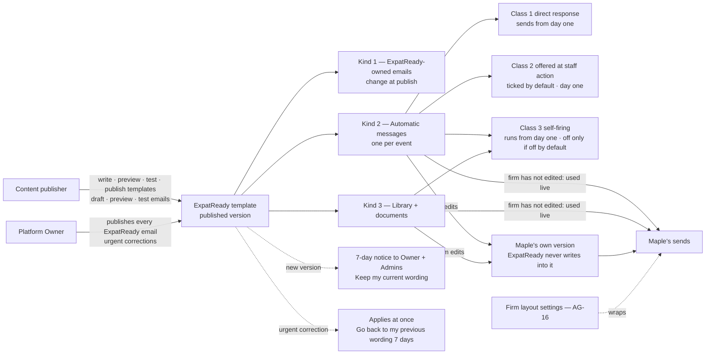

> **Document control** · Version **3.6** · **2026-10-17** · Status: **Final (12 Oct 2026; v3.6 applies the second-pass decisions AG16-54 – AG16-82 that touch templates; v3.5 applies the AG-16 review decisions of 17 Oct that touch templates), except the items explicitly deferred to the AG review (§13: the four firm-side suggestions still open, N1 and N4; N2, N3 and N5 – N9 closed)**\
> Part of: *Super Admin Console — Functional Requirements* · Split from `FINAL-SuperAdmin-FR.md` lines 2818–3392 on 2026-09-16 · Previous version: `_archive/SA-05-global-templates_v3.5_2026-10-17.md`\
> Decisions source: `TEMPLATE-MAP-working_2026-10-10.md` (the map), including its final section "Decisions after the SA-05 v3.0 / AG-12 v2.0 rewrite (11 Oct)" (Q1–Q24, scope-triage note, obvious defaults O1–O32) and its section "Complexity review (founder lens, rule 8) — decisions" (R1–R37, D1, code-check outcomes, "Spec follows code"), then its section "SA-05 v3.2 open questions — decisions (12 Oct)" (SA05-Q1a, Q1b, Q2 – Q14, which close every open question of v3.2 §13) and rules 8 and 9 at its top. **Version 3.4 adds** the map sections "ExpatReady staff roles — decisions (12 Oct, session 2)", "Governance code built against earlier 'park' decisions", "Remaining SA open questions", "Rule 9 pass — SA-07, SA-08" and "SA-09, SA-10, SA-11" and "SA-05 §13 N6 (c) / (d) — confirmed". Later decisions override earlier ones: R15 withdraws O26, R5 removes licence-based approvals, R6 withdraws O2 and O5, R7 replaces O31. Complexity evidence and build state: `COMPLEXITY-REGISTER_2026-10-12.md` (its suggestions are not decisions). Firm side: `FINAL-Agent-FR/AG-12-templates_v2.1_2026-10-11.md` (not edited in this version; waits for the AG review — §0.2 SA5-X41).
>
> **Hand-over scope (12 Oct)**\
> **Ready for development now:** ExpatReady's own emails (Appendix B; the Platform Owner publishes, SR-Q2); the ExpatReady starter catalogue and its publishing flow (Content publisher; 7-day notice; urgent correction; retirement); the automatic-message rules (SA05-R9a / R9b, firing classes, Guards 1 and 2, switch-off rules); consent, marketing and unsubscribe send rules; the template data foundations (version on every send, purpose, language fallback); and the `system/*` template keys.\
> **Waiting for the AG-12 review (do not build yet):** firm-side template management screens and behaviour — the still-open §13 items: row 3 (firm version history and restore — §3.3, SA5-D21, SA-5-30, SA-5-54); row 4 (reach count — §3.4, §3.6.8, SA-5-77); row 5 (missing-French monthly counts — §3.6.4, SA-5-70); row 6 ("ExpatReady updated an item you've hidden" note — SA5-X17, §3.12 row 17); N1 (owner of the data-incident notice — Appendix A.14); N4 (15-minute-test flags F2 – F5 — §3.12); N10 (default firm-editable timings — SA5-D54, SA-5-101, §3.6.15, §3.12 row 14, Appendix A.6, A.7, A.2). *(revised same day — hand-over scope)*
>
> | Version | Date | Change | Decisions |
> |---|---|---|---|
> | 3.6 | 2026-10-17 | **Second-pass decisions applied (AG16-54 – AG16-82; writer brief §1a).** **AG16-54 #1:** the stale "optional on/off page" wording is replaced by the one Automatic messages page of AG-12 (one choice per row: Send automatically · Ask me first · Off — AG16-11), in §3.2.2, SA-5-89 and the places that name it; "AI extra" (A.8 #3) now follows AG16-34 (plan feature) and "auto-nudge extra" (A.11 #2–3) is renamed to the SA-03 #25 feature (see §13 N19). **AG16-54 #24:** "SME" in the letter decisions means the Content publisher. **AG16-56:** timers are sent by what they count — days at 09:00 client time, booked times and payment holds at the exact time, anything else in the 08:00–20:00 window (A.2 #7, #8, A.5 #15, SA-5-113 pointer). **AG16-59:** a letter note is the client message for the case step the letter records; the class-2 box is not offered for such a step (A.5 #6, #7, #10, #11, #13; A.8a; card SA-5-111). **AG16-69:** the "Interac message: INV-0042 [Copy]" wording line (new SA-5-115, A.4 note). **AG16-75:** "Remind {client} until they confirm" removed from the letter note (card SA-5-111 rule 6, A.8a). **AG16-77:** SA5-D54's countdown points 30 / 14 / 7 / 3 / 1 are **replaced by a formula** (two reminders at 50% and 90% of the window, three at 25 / 50 / 90% above 15 days; A.5 #15, §3.6.15, SA-5-101; new card SA-5-101). **Open questions closed:** N11 – N17 (N12 by AG16-56; N15 by AG16-59; N17 by AG16-54 #1) per AG16-55. **Added:** SA-5-115, SA5-X50, N18, N19, two build cards (SA-5-101, SA-5-115). **Changed cards:** SA-5-111. **Withdrawn:** the countdown points 30 / 14 / 7 / 3 / 1 (SA5-D54); "Remind until they confirm" (SA-5-111 rule 6). *Same-day fixes (17 Oct): AG16-83 – AG16-88 — SA5-D22: deadline countdown moves from class 1 to the timed class (A.5 #15, §3.2 table rows; AG16-83 #7); A.5 #15 note: windows of 3 days or less get no automatic client reminder (AG16-84); portal nudging is on every plan (A.11 #2–3, SA5-X31, SA5-D46; N19 closed — AG16-86); N14 and SA5-D26 note: Release 1 is English only, French later, no French content task (AG16-88).* *Same-day fixes (18 Oct): AG16-90 — countdown points 30 / 14 / 7 / 3 / 1 struck from SA5-X29(c) and SA5-X41(d) (SA5-D54 is the decision row); old 08:00–20:00 lines in SA5-X48(a) and SA-5-113 replaced by a pointer to AG-10-8 / BR-9; the client deadline reminder formula removed from §3.6.15 and card SA-5-101 (now a pointer to the AG-11 card, AG16-77); card SA-5-110 gained "Clicks:" and "Person decides:".* *Same-day fixes (18 Oct): AG16-92 — email-first, the portal is optional. The Welcome (A.5 #3, SA5-D48, SA-5-88, the onboarding row of §A.17) now carries the no-login links for the first to-dos and "or reply to this email with the documents attached", with portal set-up as one optional line; Document request says "no-login link (AG-10-85)" instead of "portal link" (and the same in three examples); A.8 #1 becomes the delivery of the staff message itself (full text and attachments, client's preferred channel, reply token; the same for a message ask); A.11 #3 is the manual Nudge only, each item with its no-login link, retitled "Things we still need from you" (M1); A.13 #2 sends the assessment PDF to every client, or a no-login download link if too large; A.7 #5 "Document received" also follows a done-on-behalf upload (M5).* *18 Oct: new section 'Decisions that change this epic' (index of AG16 decisions; no requirement changed).* *18 Oct (final): AG07-D17 – D21 applied — AG07-D20(d) (A.7 #1 "Document request" becomes class 2, the "Ask the client now" box).* | AG07-D20(d), AG16-54, AG16-55, AG16-56, AG16-59, AG16-63, AG16-69, AG16-75, AG16-76, AG16-77, AG16-92 |
> | 3.5 | 2026-10-17 | **Applied the AG-16 review decisions that touch templates** (`TEMPLATE-MAP-working_2026-10-10.md`, "AG-16 review — decisions"; writer brief of 17 Oct). **AG16-47:** every Appendix A row of kind Auto (59) carries a **journey-stage tag** — Enquiries, Bookings, Retainer and signing, Invoices, Case updates, Documents and questionnaire, Portal, Employer (LMIA) — so the Automatic messages page (AG-12) can group them (SA-5-110). **AG16-42 F3:** the **"Tell the client" note wording per letter type** is a set of 14 library starters, English now, French and WhatsApp wording to follow, with "Case update (general)" as the fallback (SA-5-111, new Appendix A.8a); the letter types and their recognition live in SA-01 (SA-1-69). **Pointers only, no new rule here:** automatic messages carry the file number in the subject (AG16-26; AG-12 owns it — SA-5-112); class 1 messages are sent at once and class 3 / non-urgent automatic messages wait for the fixed 08:00–20:00 client-local window (AG16-49, AG16-51; AG-10 owns it — SA-5-113); the letter library, "New letter patterns" and the holiday reference list are SA-01 (AG16-43, AG16-46 — SA-5-114). A.15 lists the new pack content so it is not built as templates. **§0.2:** SA5-X47 – SA5-X49 added. **§13:** N11 – N17 added; **N10 is not answered by these decisions (they set no chase timings) and stays open.** **Changed:** §3.2.1, §7 (`SystemTemplate`), §12, §13, Appendix A (Key, Stage column in A.1 – A.8, A.11 – A.13), A.15. **Added:** SA5-D65, SA5-D66, SA-5-110 – SA-5-114, A.8a, SA5-X47 – SA5-X49, N11 – N17, two build cards. **Withdrawn:** none. | SA5-D65, SA5-D66 · AG16-26, AG16-42, AG16-43, AG16-46, AG16-47, AG16-49, AG16-51 |
> | 3.4 | 2026-10-12 | **Applied the ExpatReady staff-role decisions, the governance-code decisions and the later rulings of 12 Oct (map sections "ExpatReady staff roles — decisions (12 Oct, session 2)", "Governance code built against earlier 'park' decisions", "Remaining SA open questions", "Rule 9 pass — SA-07 … SA-12", "SA-05 §13 N6 (c) / (d) — confirmed"; the product owner).** **SR-Q2:** the **Platform Owner publishes every ExpatReady email** (Appendix B); the Content publisher drafts, previews and tests them only (as built). The **"contains legal terms" flag, its launch list and the Owner check on flagged emails are parked, not deleted**; the two-lane publishing model is added to the parked list (§0.1, §13). Firm starter templates, automatic messages and documents are unchanged — the Content publisher publishes them (Q16). **R9-26:** the default e-sign consent text is a firm-facing starter, not an ExpatReady email — the Content publisher publishes it, with the 7-day notice. **SR-Q3:** "Content author" is now "Content publisher" throughout; §13 N5 closed. **SR-Q1 / SR-Q5:** the second person for country packs is decided (Owner or another Content publisher); the "SA-07 open staff-roles question" wording is removed. **R9-pass ruling 3:** the activity log is kept 7 years, one number for firm entries and ExpatReady staff actions; §13 N3 closed. **N6 (c) / (d) confirmed:** a skipped message creates no "Needs you" item; the Guard 1 note is fixed wording, shown on the dashboard to the Owner and Admins and beside the message on the optional page, one note per missing detail; §13 N6 fully closed. **G-Q2:** consent is held per purpose; "WhatsApp opt-in" is its own purpose; the send-time check is aligned to the rules of §3.6.5 (code change, SA5-X35). **G-Q1, G-Q3, G-Q5, G-Q6:** context notes on the request templates and the incident starter (§3.11, A.14) — no new requirement. **SA-11 Q19:** a short ExpatReady-owned "Deletion outcome" email for requests made to ExpatReady is added to Appendix B.6. **§0.2:** X11, X12, X28, X34, X35, X37, X46 and both "Rows into SA-05" rows updated (all Pending unless stated). **Changed:** SA5-D24, D27, D37, D40, D53, D56, D59, D64; SA-5-24, SA-5-25, SA-5-35, SA-5-55, SA-5-56, SA-5-83, SA-5-98, SA-5-104, SA-5-106, SA-5-107; US-15, US-16; §2, §3.2.2, §3.4, §3.7, §3.9 (keep-period row), §3.11, §3.12 (row 24, staff-screen defaults), §3.6.5, §6, §7, §9, §10, §11, §12; §13 Q4, Q12, Q13, N3, N5, N6; Appendix A.14, A.15; Appendix B intro and B.6. **Withdrawn:** none (the flag, its launch list, the key `system/template:approve-legal` and the `containsLegalTerms` field are parked — SR-Q2). **Added:** Appendix B.6 "Deletion outcome" email; §0.1 parked row "Two-lane publishing"; §13 note on the parked model; "where applied" rows for SR-Q2, R9-26, SR-Q3, ruling 3, N6 (c)/(d), G-Q2, SA-11 Q19. No new requirement or decision IDs. **Same-day revision (W-1 – W-3, the product owner, 12 Oct):** W-3(14) removes the "Team safeguards turned on" firm notice from the §3.2 list of fixed-wording firm notices; W-3(15) confirms `system/template:approve-legal` is parked with the flag and not seeded in any role. **Same-day revision (W-4 – W-10, the product owner, 12 Oct):** W-4 / W-5 Appendix B recipients — the deletion warnings (B.4), "Subscription started (early)" and "Upgrade charge failed" go to billing email, Owner and Admins; W-6 "Discount ending" source states the trigger (once, 7 days before the last discounted invoice; none at a monthly ↔ yearly switch); W-10(1) the Deletion outcome email's recipient confirmed; W-10(3) certificate wording published by the Content publisher like the consent text, confirmed (SA5-D24, SA-5-55). **Same-day revision (W-17, W-23, W-24 and hand-over scope, the product owner, 12 Oct):** W-17 — firms see only the final questionnaire and the dynamic document checklist for the case; firm-added questions, hiding or reordering optional questions, the "who answers" switch (R26) and firm-wide extra checklist items are withdrawn; per-case "Request a document" additions, hiding standard items without a deadline (W-15) and renaming a step's client name stay (SA5-D39, SA5-D49, SA5-X18 (h), SA5-X26 (c), §3.9, §3.12 row 18, §13 parked row 2, §0 R26 row, §0.1 not-built note, A.15). W-24 — A.7 #2 "Document checklist" confirmed with both list sources. A "Hand-over scope (12 Oct)" block is added under the document-control line. W-23 is recorded in SA-08 only (e-sign wording keys; SA-05 A.15 unchanged). | SR-Q1, SR-Q2, SR-Q3, SR-Q5, R9-26, R9-pass ruling 3, N6 (c)/(d), G-Q1, G-Q2, G-Q3, G-Q5, G-Q6, SA-11 Q19 |
> | 3.3 | 2026-10-12 | **Applied the decisions on the SA-05 v3.2 open questions (map section "SA-05 v3.2 open questions — decisions (12 Oct)": SA05-Q1a, Q1b, Q2 – Q14; the product owner) and rule 9; status set to Final.** **All of §13 Q1 – Q14 are closed** (each row points to its decision). **SA05-Q1a / Q1b:** every † in Appendix A is resolved — Government fee requested, Officer contact, Your job ads are live, Change to your LMIA, Employer welcome and Employer questionnaire invitation are class 2 (Officer contact becomes an automatic message); LMIA expiring: unused positions is class 3; Your assessment is ready, Booking updated, Payment received and Document needs replacing are class 1; After-approval guidance and Government fees due are library templates; the remaining † rows follow the accepted pattern; "Please sign your forms" **can be switched off** (only Signing request and Portal invitation stay edit-only) (SA5-D57). **SA05-Q2:** the nine `system/template:*` keys are final; SA-06 v3.5 lists them. **SA05-Q3:** SA-05 owns two client-request templates — "Here is a copy of your file" (Must, library starter) and "Your request is complete" (Good to have, library starter, staff-chosen; a deletion fills from the built outcome report; never sent for a regulator enquiry); the "Client requests" list is AG-07's (SA5-D58; SA-5-103; BR-25; US-22; SA5-X42 – X45). **SA05-Q4:** the one keep-period setting also covers send records and lead-only records (counted from the day the lead is lost or closed); the activity log is the 7-year security minimum the firm cannot shorten (SA5-D59; SA-5-104; SA5-X32 (k), X37 (e), X43). **SA05-Q5 – Q9, Q14:** a must-keep field is added later by a release; no special rule for an urgent correction during a running notice; an automatic message is never retired while its event exists; the e-sign consent text and the portal consent-screen starter follow the 7-day notice; urgent-correction and retirement notices go as a templates-screen note plus one email; the 7 days is a code constant (SA5-D60; SA-5-57, -58, -94, -95, -101, -106). **SA05-Q10:** unsubscribe and STOP are per firm, hard bounces and spam complaints platform-wide, a hand-written one-to-one email is service and a send to a list is marketing (SA5-D61; SA-5-72, -98; BR-21, BR-24; SA5-X28 (h)). **SA05-Q11:** WhatsApp "Paused" is treated like Rejected; no automated in-window acknowledgement in Release 1 (SA5-D62; SA-5-73; US-23). **SA05-Q12:** Platform Owner = `owner`, Content author = `content-publisher`, the other four roles hold no template key (SA5-D40, D56; SA5-X12). **SA05-Q13:** launch list of "contains legal terms" emails (SA5-D53; SA-5-56; Appendix B). **R33 / SA6-X3:** SA-06 v3.5's row SA6-X3 (email-level flag, Owner publishes, "never the drafter" dropped) is recorded as **applied** — §10, SA-5-56 and SA5-D53 already follow it. **Rule 9 pass:** new §3.12 states the default and the placement (main screen or Advanced) of every firm-facing setting or choice this document defines, plus the defaults of ExpatReady-staff-only screens, and flags five firm screens that may fail the 15-minute test, each with a simplification suggestion marked "not decided" (SA5-D63; SA-5-105). **§0.2:** new rows X42 (AG-07), X43 (AG-02 · AG-04), X44 (SA-06), X45 (CP-01); X11, X12, X28, X32 and X37 updated (Pending); the status of X13, X14, X15, X17, X18 and X37 (a) – (d) refreshed from the target documents' own "applied" entries; a "Rows into SA-05" table added (SA6-X3, SA7-X15). **Unchanged:** the nine "Parked for later" suggestions table (deferred to the AG review). **New §13 items N1 – N5** (not decided; deferred to the AG review). **Changed:** SA5-D22, D23, D27, D28, D31, D40, D43, D44, D45, D53, D54, D55, D56; SA-5-56, SA-5-57, SA-5-58, SA-5-72, SA-5-73, SA-5-86, SA-5-87, SA-5-93, SA-5-94, SA-5-95, SA-5-98, SA-5-101; BR-21; US-11; Appendix A rows once marked †, A.14, A.15, A.17; Appendix B (flag marks, B.4 notice row, B.9). **Withdrawn:** none (the † legend ends; the deletion-specific template idea is recorded in A.17). **New:** SA5-D57 – SA5-D63; SA-5-103 – SA-5-106; BR-24, BR-25; US-22, US-23; SA5-X42 – SA5-X45; §3.11, §3.12; §13 N1 – N5. **Same-day revision of SA05-Q3 (12 Oct, the product owner):** the Client requests list is withdrawn; open items are AG-13 tasks on the client or lead with a category (Client request · Complaint · Regulator enquiry · Other), visible as the client is (AG-7-90), with no Owner-only rule; emails are only for Copy of my file and Delete my data tasks and none are automatic; the SA05-Q3 wording above and SA5-X42 – X44 are revised accordingly (SA5-D58; SA-5-103; BR-25; US-22; §3.11; N2 closed). *(revised same day — SA05-Q3)* **Same-day revision of decision 3a (12 Oct, the product owner — SA05-R9a):** nothing is held for a review any more — every automatic message, self-firing class 3 included, runs from day one with ExpatReady's neutral wording unless it is off by default; "Review your automatic messages" is an optional on/off page with no confirm step, gate or "paused" banner; Guard 1 (a message missing a needed firm detail is not sent and the firm sees a note naming it) and Guard 2 (a one-time informational dashboard notice) are added; rule 9 flag F1 is closed; the 7-day notice, switch-off rules, class 1 and 2, import quiet mode and WhatsApp opt-in are unchanged. **Changed:** SA5-D22; SA-5-29, SA-5-52, SA-5-87, SA-5-89, SA-5-90, SA-5-92; BR-20; §3.2.1, §3.2.2, §3.12 (row 2, F1), Appendix A key; §0.2 rows X11, X19, X20, X28, X29, X32, X41; edge case "Held sequence". **Withdrawn:** SA5-D42, SA-5-91. **New:** SA5-D64; SA-5-107, SA-5-108; SA5-X46; §3.12 rows 24 and 25; §13 N6 – N8. *(revised same day — SA05-R9a)* **Same-day closing of R9a's loose ends (12 Oct, the product owner — SA05-R9b):** §13 N6 – N8 are closed — Guard 1 and Guard 2 details are in SA-5-107 and SA-5-108, the on/off permission is `agent/template:configure` (SA-06 Open Question 20 closed, no new key), new automatic messages arrive switched on and start sending only after the normal 7-day notice (new SA-5-109; N9 closed). *(revised same day — SA05-R9b)* **Same-day revision (W-11 – W-21, the product owner, 12 Oct):** W-20 chase cadence, booking reminders and the five AG-16 timings are marked "defaults set in the AG review" (§3.12 row 14, §13 N10); W-21 text fixes — no payment-plan extra in Release 1 (SA5-D46, SA5-X24, SA5-X36), the "Pending → Confirmed" review state and entity note removed, new automatic messages always wait the 7 days, the optional automatic-messages page replaces "review" wording, per-case client requests are AG-13 tasks, staff roles holding no template key named correctly, SA5-X12 marked applied in SA-07 v2.15, Appendix B sources, `agent/template:configure` for the on/off permission, marketing-consent wording placed under "Manage legal settings". | SA5-D57 – SA5-D64 · map SA05-Q1a, Q1b, Q2 – Q14, SA05-R9a, rule 9, R33 (SA6-X3) |
> | 3.2 | 2026-10-12 | **Applied the complexity-review decisions of 11–12 Oct (map section "Complexity review … decisions"; the product owner).** **R5:** supervised client messages and licence-based approvals removed — a free-text-slot send is recorded as human-edited with no supervision step; AI-written client text is approved by any staff member holding the permission; the two kept licence checks stay (SA5-D51; SA-5-68, SA-5-102, BR-23). **R6:** the 7-day notice is kept but simplified — a second publish updates the notice text and the switch date stays (O2 withdrawn); a firm created mid-notice simply uses the current published version (O5 withdrawn); the urgent-correction route stays (SA5-D23; SA-5-32, SA-5-58). **R7:** an AI-edited template is approved once, at publishing, then sends normally; one-off AI-drafted messages still need approval each time; the mark stays on the version for the record; replaces SA-5-75's every-send rule and O31's clearing (SA5-D32, SA5-D52; SA-5-25, SA-5-75, BR-17). **R12:** the "Satisfaction survey" email is dropped from Appendix B. **R15:** firm-editable timings kept; **O26 withdrawn** (SA5-D41, SA5-D54; §3.6.15; SA-5-101; SA5-X38 withdrawn). **R25** (WhatsApp versions for every short client message) and **R26** ("who answers" switch) kept as decided; neither is built today. **R27:** English required, French optional for ExpatReady's own emails; the built fr-CA publish gate is to be removed (developer note, SA5-X35). **R33:** sentence-level legal markers replaced by an email-level "contains legal terms" flag; the Platform Owner publishes a flagged email; the Content author drafts; "never the drafter" dropped (SA5-D24, SA5-D53; SA-5-24, SA-5-25, SA-5-35, SA-5-56; §3.4, §3.7; US-16; SA5-X12). **R1 / R2:** custom roles kept; template keys appear inside plain-language capabilities with an Advanced toggle (SA5-D56; §10; SA5-X11). **R8 (revised):** ExpatReady staff roles are the six in code — mapping of this document's two template roles is for SA-07 (§13 Q12). **R30:** Appendix B billing recipients aligned to the two sets. **Developer notes and built state:** must-keep fields to use the existing `required` flag (only the link argument is enforced today); ExpatReady system-email templates core recorded as BUILT with `file:line` (SA5-D55; §12; SA-5-57). **The nine "Parked for later" suggestions:** status recorded in §13 — four decided (kept), five firm-side items left open and deferred to the AG-12 review. Q21 already applied in v3.1. **Changed:** SA-5-24, SA-5-25, SA-5-32, SA-5-35, SA-5-56, SA-5-57, SA-5-58, SA-5-68, SA-5-73, SA-5-75, SA-5-83, SA-5-101; BR-17; US-16; SA5-D19, D23, D24, D26, D32, D37, D40, D41, D47, D50. **Withdrawn:** SA5-X38 (O26); obvious defaults O2, O5, O26, O31; sentence-level legal markers; "Satisfaction survey" email. **New:** SA5-D51 – SA5-D56; SA-5-102; BR-23; US-20, US-21; SA5-X41; §13 Q12 – Q14. §0.2: X11, X12, X13, X15, X16, X17, X18, X22, X23, X24, X25, X26, X28, X29, X32, X34, X35, X39 updated and X38 withdrawn (all still Pending); X36 recorded as applied in SA-03 v2.19; X41 (AG-12) added. | SA5-D51 – SA5-D56 · map R1, R2, R5, R6, R7, R8 (revised), R12, R15, R25, R26, R27, R30, R33, developer notes, code-check outcomes |
> | 3.1 | 2026-10-11 | **Applied the follow-up decisions Q1–Q24 and O1–O32 and fixed the cross-check of SA-05 v3.0 / AG-12 v2.0 (A1–A18, B1–B12, D1–D5).** **Three firing classes** replace "self-firing / direct response" plus the "Staff-rec" and "Recipe (off)" labels: (1) direct response, (2) offered at the staff action, ticked by default, (3) self-firing, held until the review is confirmed; defined once here (§3.2.1) (Q2, Q3, Q5, Q6; A1, A2, B1, D2). Review confirmed by holders of the firm's template-publish permission, Owner and Admin by default, with an Owner notice (Q1; A3, B4); held messages are not generated, and on confirm one catch-up per sequence (Q4; B3). New: switching off (Q8), urgent correction (Q14), retiring a starter (Q15), plans and extras (Q7), "Manage legal settings" (Q13), marketing edge rules (Q9, Q11), WhatsApp approval **per firm per template** with automatic submission (Q12; A6), no second approver (Q16), default purposes (Q10), security incident notice (Q21). Firm versions keep Draft / Published / Superseded history and Reset keeps the firm version in history (A9, A10); starters are hidden, only firm-created templates are deleted (A8); delete block covers any reference, an off automation does not block (O13; A7, B2, B9). `TemplateUpdateNotice` and the send record reconciled with AG-12 (A11–A14). **SA-05 is now the only home** for the foundation, catalogue, special-types table and all knock-on rows: AG-12's rows AG12-X1 – X20 are merged into SA5-X11 – SA5-X40 (cross-check C). User-story IDs US-1 – US-7 restored to their v2.5 meaning and dispositioned; new stories start at US-14 (D1). Must-keep fields adopted (O16); notice email's priority and must-keep fields corrected (B6); feature-dependent availability corrected (B5); kind-1 language fallback separated from billing documents (O15; B12). §13 reduced to what is still open. New: SA5-D42 – SA5-D50, SA-5-87 – SA-5-101, SA5-X36 – SA5-X40, BR-20 – BR-22, US-14 – US-19. | SA5-D42 – SA5-D50 · map Q1–Q24, O1–O32 · cross-check A–D |
> | 3.0 | 2026-10-11 | **Rewritten from the template management review (map, 10–11 Oct).** Retitled **"Templates — ExpatReady side"**. SA-05 now defines: the **template catalogue** (Appendix A — every ExpatReady template, all kinds, by module) and **ExpatReady's own emails** (Appendix B); the **three kinds** of template and who may do what; **"use until you edit"** with no copies; **one publishing flow** for every template (no legal review step, no recorded expert check; Owner approval only for legal sentences in ExpatReady's own emails); the **7-day update notice** with "Keep my current wording" from ExpatReady's side; and the **shared foundation** AG-12 uses (fill-in fields and privacy, must-fill marks, free-text slot, conditional sections, languages, purpose, unsubscribe and STOP, channels and the WhatsApp variant, versions and the send record, preview and test, starter label, rendering safety). **Removed:** clone-to-firm, bulk-clone seeding, propagation and staleness notices, default-per-type pointers, legal review state, SME confirmation, mandated-clause markers, required-locale gate, workflow-blueprint type, adoption counts. **Rule 7 clean-up:** statute and regulator names used as justification in v2.5 are removed from product text. The co-product owner's v2.4 decisions SA5-D1 – D18 and rows SA5-X1 – X10 are dispositioned in §0; SA-5-1 – SA-5-36 dispositioned in §4; SA-5-37 – SA-5-47 stay reserved (the co-product owner's draft, not merged). New: SA5-D19 – SA5-D41, SA5-X11 – SA5-X35, SA-5-48 – SA-5-86. | SA5-D19 – SA5-D41 · map rules 1–7, §§1–17, decisions 1–17 |
> | 2.5 | 2026-10-10 | **Marked "being redesigned — do not build yet"** (the product owner, 10 Oct). The co-product owner's v2.3 (product review of 9 Oct) and v2.4, written outside the master, are kept in `_archive/` (v2.4) as the starting draft for the template management review; they are not merged. Version numbers continue after hers. No requirement changed in this version. | — |
> | 2.2 | 2026-10-02 | Applied AG17 terminology/consistency changes (safe set): TemplateType values CORPORATE_PROSPECT / CORPORATE_CLIENT / CORPORATE_CASE collapse to PROSPECT / CLIENT / CASE + client type. | AG17-D4, AG17-D5 |
> | 2.1 | 2026-10-02 | SA-7 role names used throughout (SA7-X10, SA7-D8): "Tenant Account Manager" → "Firm onboarding / Account manager", "Billing Admin" → "Billing". Requirements unchanged. | SA7-X10 |
> | 2.0 | 2026-06-20 | Baseline — golden per-module rebuild | — |

## Decisions that change this epic (14–18 Oct) *(new 18 Oct)*

Product-wide rules (apply here as everywhere; home: Agent `00-Overview` → "Product rules every epic follows"): AG16-11, AG16-31, AG16-42, AG16-44, AG16-63, AG16-76, AG16-92.

The "AG16" prefix is historical: these decisions began in the AG-16 review and apply across the product. Full text: `TEMPLATE-MAP-working_2026-10-10.md`.

| Decision | What was decided (one line) | What it changes in this epic | Where (requirement / card / section) |
|---|---|---|---|
| AG16-11 | One "Automatic messages" page (one choice per row: Send automatically, Ask me first, Off), documented in one place only (AG-12). | The old "optional on/off page" wording is replaced everywhere by the one Automatic messages page with three choices per row. AG-12 is its only home; this document points to it. | §3.2.2, SA-5-89, §13 N17 |
| AG16-26 | Email filing order. | Pointer only: automatic messages about a case carry the file number in the subject. AG-12 owns the rule; SA-05 adds the pointer SA-5-112 and the field case.fileNumber. What subject a message with no case gets is open (N16). | SA5-X47(b), SA-5-112, §3.2 Pointers added in v3.5, §13 N16 |
| AG16-27 | Government mail: recognise, match, identify the letter, sort, deadline. | The letter library, government domain list, "New letter patterns" list and holiday list are pack content in SA-01, not templates. The wording of the "Tell the client" notes is built here as library starters. | SA5-X49, SA5-D66, Appendix A.15, SA-5-111 |
| AG16-34 | AI is included in higher plans, not sold as an add-on. | Template A.8 #3 "AI notice" is Must for firms whose plan includes AI and whose Owner has switched it on (AI is a plan feature, not an extra). Mentions of an "AI extra" and "auto-nudge extra" updated. | Appendix A.8 #3, A.11 #2-3, §13 N19, SA-3-66(c) |
| AG16-36 | "Make task" and "Remind me if no reply". | Referenced only (no change here). "Tell the client" opens a normal message carrying "Remind me if no reply", off by default, reminding the officer only. | SA-5-111, Appendix A.8a |
| AG16-42 | "Quiet by default", plus telling the client (F3). | Wording of the "Tell the client" note per letter type is a set of 14 library starters, English only at launch, one per letter type and language. The officer reviews and clicks Send; nothing is sent automatically. Letter types without a starter fall back to "Case update (general)". | SA5-D66, SA5-X47(c), SA5-X48(b), SA-5-111, Appendix A.8a |
| AG16-43 | Keeping the letter library current. | Pointer only: the letter library and its "New letter patterns" review are SA-01 content, not templates. | SA5-X49, SA-5-114, Appendix A.15 |
| AG16-46 | Closed days: suggested holidays, the firm adds. | Pointer only: the holiday reference list is SA-01 content, not templates. | SA5-X49, SA-5-114, Appendix A.15 |
| AG16-47 | Automatic messages page: find and fix. | Every Auto row of Appendix A carries a journey-stage tag (eight values, from Enquiries to Employer (LMIA)) so the Automatic messages page can group them. The tag changes no sending rule. | SA5-D65, SA5-X47(a), SA-5-110, Appendix A Stage column |
| AG16-49 | Client quiet hours in the client's own time zone. | Pointer only: the sending window is owned by AG-10 (SA-05 states no window). Changed 18 Oct by AG16-90: the 08:00-20:00 lines are replaced by a pointer to AG-10-8 / BR-9. | SA5-X48(a), SA-5-113, §13 N11 |
| AG16-50 | Government-deadline reminder on a case with no one assigned goes to the Owner. | Referenced only (no change here). Staff deadline reminders are separate and unchanged from the client reminder. | §3.6.15 |
| AG16-51 | Three trims to avoid over-building. | Trimmed the client sending-window rule; pointers only (home AG-10). Superseded here by AG16-56 (send time by what the timer counts); the old lines were replaced by a pointer to AG-10-8 / BR-9 in the AG16-90 fix pass. | SA5-X48(a), SA-5-113, §3.2 Pointers added in v3.5 |
| AG16-54 | 25 consistency fixes after the 17 Oct write (batch). | #1: the stale "optional on/off page" wording replaced by the one Automatic messages page; "AI extra" and "auto-nudge extra" wording fixed. #24: "SME" in the letter decisions means the Content publisher. | §3.2.2, SA-5-89, Appendix A.8 #3, A.11 #2-3, §13 N17, N19 |
| AG16-55 | Writers' recommended defaults accepted for the detail questions. | Open questions N11 to N17 closed with the writers' defaults (for example class 2 sends at once; three stage tags kept as a judgement). | §13 N11 to N17 |
| AG16-56 | When automatic messages send, by what their timer counts. | Timers counted in days send at 09:00 client time; booked times and payment holds at the exact time; anything else in the sending window. The government-deadline reminder is a timed class 3 message at 09:00 client time. | §3.2 Pointers added in v3.5, SA-5-113, Appendix A.2 #7, #8, A.5 #15, SA-5-101, §13 N12 |
| AG16-59 | A government letter records its case step; one event, one client message. | A letter note is the client message for the case step the letter records. The class-2 "send message" box is not offered for such a step. Sending through "Tell the client" completes the letter task. | SA-5-111 rules 9 and 10, SA-5-101, Appendix A.5 #6, #7, #10, #11, #13, A.8a, §13 N15 |
| AG16-63 | Design checks every requirement must pass. | Cards SA-5-101, SA-5-110, SA-5-111 and SA-5-115 carry the "Clicks" line. | SA-5-101, SA-5-110, SA-5-111, SA-5-115 |
| AG16-68 | Payment notices: amount-only is a candidate; "Record all" covers invoice-number matches only. | Referenced only (no change here). Cited on the Interac line card: an amount-only match is a guess. | SA-5-115 |
| AG16-69 | Evidence before build for payment notices. | New "Interac message: INV-0042 [Copy]" wording line on invoice emails and payment reminders when the firm accepts e-Transfer. New card SA-5-115 and cross-module row for AG-06 and AG-15. | SA-5-115, SA5-X50, Appendix A.4 note, §13 N18 |
| AG16-75 | "Remind [client] until they confirm" dropped; the officer decides. | "Remind {client} until they confirm" removed from the letter note: no automatic client reminder, no "Got it" link, no separate timing. | SA-5-111 rule 6 and non-goals, Appendix A.8a |
| AG16-76 | Standing rule: help people, don't replace them; do, don't overdo. | Cards SA-5-101, SA-5-110, SA-5-111 and SA-5-115 carry the "Person decides" line (the officer reads, edits and clicks Send). | SA-5-101, SA-5-110, SA-5-111, SA-5-115 |
| AG16-77 | Client deadline reminders by formula: two reminders at 50% and 90% of the window. | The countdown points 30 / 14 / 7 / 3 / 1 are withdrawn and replaced by a fixed formula (two reminders at 50% and 90% of the window, three at 25 / 50 / 90% above 15 days). The formula now lives in the AG-11 card; SA-5-101 points to it. The countdown is not a firm-editable timing. | SA5-D54, SA5-X29(c), SA5-X41(d), §3.6.15, SA-5-101, Appendix A.5 #15 |
| AG16-82 | One rule for every broken connection. | Cited — see the change-log row 3.6 and Status line (cited only as part of the range AG16-54 to AG16-82); no requirement here names it. | Document control (v3.6) |
| AG16-83 | 26 follow-through fixes after the second pass (batch A). | The government-deadline countdown moves from class 1 to the timed class (fix #7). | SA5-D22 (§0), §3.9, Appendix A.5 #15, A.9 |
| AG16-84 | Very short deadlines: the letter note is the client message. | A.5 #15 note: windows of 3 days or less get no automatic client reminder; the letter note is the client message and staff reminders prompt the officer. | Appendix A.5 #15, §3.6.15, SA-5-101 |
| AG16-86 | Portal nudging is a feature on every plan, not a sold extra. | Portal nudging is on every plan; the "Invitation reminder" is Must on every plan. N19 closed. The wording "auto-nudge extra" is removed. The automatic "Things we still need from you" chase was later withdrawn by AG16-92 (manual Nudge only). | Appendix A.11 #2-3, SA5-X31, SA5-D46, §0 extras line, §13 N19 |
| AG16-88 | Release 1 is English-first; French later. | Release 1 screens and the 14 letter notes are English only; no French content task before launch; French is added later. Notes N14 and SA5-D26 updated. | SA5-D26 (§0), §13 N14 |
| AG16-90 | Batch C: consistency fixes from the 17 Oct audit. | Countdown points struck from SA5-X29(c) and SA5-X41(d). The old 08:00-20:00 lines in SA5-X48(a) and SA-5-113 replaced by a pointer to AG-10-8 / BR-9. Client deadline reminder formula removed from §3.6.15 and SA-5-101 (now a pointer to the AG-11 card). Card SA-5-110 gained "Clicks:" and "Person decides:". | SA5-X29(c), SA5-X41(d), SA5-X48(a), SA-5-113, §3.6.15, SA-5-101, SA-5-110 |
| AG16-91 | Firm language: English (Canada) only at launch. | Notes that the rule "firm's main language is French and the template has no French: sent in English" applies once French is switched on, because no firm can choose French as main language in Release 1. | §3.6 (language rule, O14), SA-5-70, §9 edge cases |
| AG16-92 | Email-first: the portal is optional. | The Welcome carries no-login links for the first to-dos and "or reply to this email with the documents attached", with portal set-up as one optional line. Document request uses the no-login link instead of the portal link. A.8 #1 becomes delivery of the staff message itself. "Things waiting in your portal" is retitled "Things we still need from you" and is the manual Nudge only. | Appendix A.5 #3, SA5-D48, SA-5-88, A.17 onboarding row, A.7 #5, A.8 #1, A.11 #3, A.13 #2 |
| AG07-D1 | One document status list, owned by AG-09: Needed → Received → Accepted / Needs replacing, plus Not needed. | Referenced only (wording already matches). The client emails already say "Document received" (A.7 #5, line 1488) and "Document needs replacing" (A.7 #4, line 1487). No template changes; no version bump. | A.7 #4, #5 |
| AG07-D20(d) | "Request a document" has one home, AG-09; "Ask the client now" is a class-2 box, ticked by default; the firm may set it unticked. | A.7 #1 "Document request" changes from class 1 to class 2: the message is offered in a box at the staff action, ticked by default; the firm may set it to start unticked (SA5-X25). Sends from day one when ticked. | A.7 #1, class-2 table row (§3.2), SA5-X25 (b) |

## Module SA-5: Templates — ExpatReady side

> **What this document is.** The build specification for how ExpatReady writes, publishes and updates every ready-made template, and the shared rules every template follows. **SA-05 defines; AG-12 uses.** SA-05 is the only home for the kinds, the firing classes, the shared foundation, the catalogue, the special-types table and every knock-on to other modules (§0.2). Everything a firm sees and does in its Templates area is in AG-12, which points here by section number. Where an earlier version says something different, this version wins.
>
> **In one paragraph.** ExpatReady ships a lean set of ready-made templates (Appendix A) and its own emails (Appendix B). Maple Immigration uses ExpatReady's wording live until it edits a template; editing creates Maple's own version, which ExpatReady never touches. Every automatic message goes from day one in ExpatReady's neutral wording, timed chases included, unless it is off by default; Client L (Maple's Owner) or an Admin can open the Automatic messages page (AG-12) and set any of them to Send automatically, Ask me first or Off *(changed v3.6 — AG16-11, AG16-54 #1)*, and a message that is missing a firm detail is not sent until it is added. *(revised same day — SA05-R9a)* When ExpatReady improves a template Maple has not edited, Client L and Maple's Admins get 7 days' notice and can keep the old wording. ExpatReady provides sensible defaults and warnings; the firm owns its legal and regulatory compliance (rule 7).
>
> **Plane:** Super Admin / GLOBAL. **Permissions:** `system/template:*` only (§10). **Tenant key:** none on ExpatReady templates; a firm's own version carries `firm_id` (AG-12 §7). **Country:** an ExpatReady template is global or tagged to one country; a firm has one country (SA3-D1).
>
> **IDs are permanent.** A changed item keeps its number and is marked "(changed v3.4 — <map item>)"; earlier "changed v3.3" and "changed v3.2" marks stay in the history of the item. The rename "Content author" → "Content publisher" (SR-Q3) is applied to every item that named the role and carries no mark on each item. A withdrawn item stays as one line with a reason. SA-5-37 – SA-5-47 are reserved (the co-product owner's unmerged v2.4 draft). Next free IDs after this version: requirement SA-5-116, decision SA5-D67, row SA5-X51, rule BR-26, story US-24 *(revised same day — SA05-R9a: SA5-D64, SA-5-107, SA-5-108 and SA5-X46 are now used; SA-5-109 is used same day — SA05-R9b)*.

---

### 0. Decision log

**Template management review, 10–11 Oct 2026, and the follow-up decisions of 11 Oct (the product owner)** — source: the map.

| ID | Decision | Source | Where applied |
|---|---|---|---|
| **SA5-D19** *(changed v3.2 — R5)* | **Rule 7 governs every template.** ExpatReady gives defaults and warnings; it never locks legal wording, never certifies content as legally correct, never cites or enforces a regulator's rule on the firm's behalf, and records no expert or SME check on template wording. ExpatReady still fixes only its own business: its emails to firms, client and staff security emails, unsubscribe and STOP handling, the factual e-sign certificate, facts about its own systems, and data accuracy. Kept exceptions (owned by AG-05 / AG-07): the retainer "No active licensed consultant" block (AG-5-49) and the licensed-only lead-representative picker. **Any representative type in the pack** (RCIC, Lawyer …) passes both checks; wording is neutral ("licence number"). **R5 keeps both checks** (data accuracy) and removes every other licence-based rule (SA5-D51). | map rule 7; decision 13; **Q24, R5** | §3.8 · SA-5-55 · SA5-X18, X23, X25, X40 |
| **SA5-D20** | **Three kinds of template.** (1) **ExpatReady-owned**, not editable by firms: ExpatReady's emails to firms, client security emails, firm staff account emails, unsubscribe and STOP confirmations. (2) **Automatic messages**: one per event, ExpatReady's default wording; the firm edits, resets or switches off, never deletes. (3) **Template library**: lean starter set plus unlimited firm-created templates, including **document templates**. Firm notices to the Owner and Admins and staff notifications are **fixed wording, outside template management**. | map rules 3, 6; §15A, §15B; §16; §17 #4 | §3.2 · SA-5-48 – SA-5-53 |
| **SA5-D21** *(changed v3.1)* | **"Use until you edit", no copies.** Nothing is copied into a firm at creation. An unedited ExpatReady template is used live. Editing creates a firm version that stops following ExpatReady; the firm keeps a **Draft / Published / Superseded history** of its versions. **"Reset to ExpatReady's wording"** stops using the firm version, which **stays in history**. An Owner lock or edit on an unedited retainer starter also creates a firm version. There is no Super Admin push of a template into one firm. | map §9 option C; decision 3; **O21**; cross-check A9, A10 | §3.3 · SA-5-1, SA-5-4, SA-5-29 – SA-5-32, SA-5-54 |
| **SA5-D22** *(changed v3.3 — SA05-Q1a; before: v3.1)* *(revised same day — SA05-R9a)* | **Three firing classes.** Every way an automatic message goes out is exactly one of: **(1) Direct response** — sends from day one: booking confirmation, invoice email after "Send", signing request, security emails, document received, **lead acknowledgement (Q5)**, and the other answers to someone's own action marked 1 in Appendix A (**SA05-Q1a**: Booking updated, Payment received, Document needs replacing, Your assessment is ready). **(2) Offered at the staff action, box ticked by default** — sends from day one: case-event messages staff record (**Q2**), the LMIA employer equivalents (**SA05-Q1a**: Government fee requested, Officer contact, Your job ads are live, Change to your LMIA, Employer welcome, Employer questionnaire invitation) and the **Welcome at case opening (Q6)**; staff may untick, preview or edit; the firm may set any of them to start unticked. **(3) Self-firing** — sends from day one and is **not held** *(revised same day — SA05-R9a; before: held until the review was confirmed)*, unless it is off by default (e.g. Going-cold): **government deadline countdown** *(fix 17 Oct — AG16-83 #7: moved here from class 1; timed class, sends at 09:00 client time on the due day — AG16-56)*, chases, follow-ups, going-cold, overdue-invoice reminders, booking reminders, signing reminders, questionnaire reminders, LMIA expiring: unused positions (**SA05-Q1a**) and other recipe steps. A send that staff choose themselves (After-approval guidance, Government fees due) is a library template with no class. The optional automatic-messages page lists all three classes and holds nothing (SA5-D64). Replaces v3.0's two classes and its "Staff-rec" and "Recipe (off)" labels, and AG-12 v2.0's two labels. | map decision 3a (hold replaced by SA05-R9a); **Q2, Q3, Q5, Q6**; cross-check A1, A2, B1, D2 | §3.2.1 · SA-5-87 – SA-5-89 · Appendix A |
| **SA5-D23** *(changed v3.3 — SA05-Q6, Q8, Q9, Q14; before: v3.2 — R6)* | **ExpatReady improving a template.** A firm using it unedited: the Owner and Admins get **7 days' notice** (templates screen plus one email, old and new wording side by side) with **"Keep my current wording"**, which freezes the old wording as a firm version, and **"Use the new wording now"**; otherwise the new wording starts 7 days after publishing. A second publish during a notice **updates the notice text and the switch date stays** (O2 withdrawn — R6); a switched-off or hidden template gets a screen notice only; a firm created during a notice simply uses the current published version, with no special handling (O5 withdrawn — R6); a rollback is a new version and triggers the notice. A firm with its own version: nothing changes; "ExpatReady updated this" with a comparison, which the firm may dismiss. The notice email is an **ExpatReady-owned email** (kind 1, Appendix B.4) because it goes from ExpatReady to the firm (map rule 3). ExpatReady's own emails change when published, with no notice. **The 7 days is a code constant, not a setting (SA05-Q14).** ExpatReady's default e-sign consent text and the portal consent-screen starter follow the same notice with "Keep my current wording" (SA05-Q8). Urgent-correction and retirement notices use the same channel — a templates-screen note plus one ExpatReady email to the Owner and Admins (SA05-Q9). | map decision 3b; rule 3; **O3, O8, O9, R6** (O2 and O5 withdrawn); **SA05-Q6, Q8, Q9, Q14**; cross-check A5 | §3.5.1 · SA-5-31, SA-5-58 – SA-5-61 |
| **SA5-D24** *(changed v3.4 — SR-Q2, R9-26; before: v3.2 — R33)* | **One publishing flow for every template, no second approver — except that the Platform Owner publishes every ExpatReady email.** For ExpatReady's templates (automatic messages, library starters, documents, the starter retainer, agreements, refusal messages, disclaimers) the Content publisher (or Platform Owner) writes, previews, sends a test and publishes; legal-type starters follow the same flow: **no Owner legal approval, no recorded expert check**; the 7-day notice is the safety net. **ExpatReady's default e-sign consent text** is a firm-facing starter, not an ExpatReady email: the Content publisher publishes it, with the 7-day notice (R9-26); the certificate wording follows the same flow *(confirmed — W-10(3): published by the Content publisher like the default consent text)*. **ExpatReady's own emails (Appendix B)** are drafted, previewed and tested by the Content publisher and **published only by the Platform Owner** (SR-Q2; as built — map SR-Q2: `role-template.platform.ts:297-300`; earlier ruling O3, `DEFERRALS-REGISTER.md:371`, `SA05-SINGLE-PUBLISHER`). The **"contains legal terms" flag and its Owner check are parked** (SA5-D53). Platform Owner also decides **urgent corrections** (SA5-D44). The admin, support, billing-ops and auditor hold no template key (Q16). *(revised same day — W-21)* | map rule 7 "Publishing"; §16; **Q16**; R33 (parked); **SR-Q2, R9-26** | §3.4 · SA-5-55, SA-5-56 |
| **SA5-D25** | **Issued and signed documents never change.** Issued invoices and signed agreements are frozen and never re-rendered with newer wording or layout. A wording change to anything used for signing applies to **new signing requests only** (the rule SA8-D22 cites as "same rule as SA5-D9"). | map §3; design inputs | SA-5-76 |
| **SA5-D26** *(changed v3.2 — R27)* | **Languages.** French is optional for every template; an ExpatReady template needs English to publish. Manual send with no version in the client's language: "…will be sent in [the firm's main language]. Send anyway?" Automatic send: goes on time in the firm's default language; the client record notes it; the templates screen shows a standing notice per template. A firm whose main language is French and a template with no French version: sent in **English**, noted on the client record. ExpatReady's own emails: **English required, French optional**, falling back to **English** (the built fr-CA publish gate is removed — SA5-X35); SA4-D19 (French first) stays for billing **documents** only. No block setting anywhere. *(fix 17 Oct — AG16-88: unchanged; Release 1 screens and the 14 letter notes are English only, French later; missing French always falls back to English.)* | map rule 7 "Client language"; decision 2; **O14, O15, R27** | §3.6.4 · SA-5-14 – SA-5-16, SA-5-70, SA-5-83 |
| **SA5-D27** *(changed v3.4 — G-Q2; before: v3.3 — SA05-Q10)* | **Purpose and sending rules.** Every template is "service" or "marketing"; ExpatReady sets the default (Appendix A, incl. **Q10**), and anyone who can edit templates may change it; **marketing → service** shows a warning and is recorded. On ExpatReady's shared email, marketing skips people without recorded marketing consent; from the firm's own mailbox, a warning on **manual** sends only. **Automatic** marketing skips people without recorded consent on **every** route, logged. People who **unsubscribed or replied STOP are blocked on every route** (ExpatReady's fixed function). The **route actually used** decides, and the firm is told who was not sent. **Bulk campaigns are always marketing.** On WhatsApp, **any** message the firm starts, including the opener, needs the client's WhatsApp opt-in, otherwise it goes by email. Portal consent is **not** marketing consent. Imported consent counts when the importer declares it; the declaration covers email marketing only, WhatsApp opt-in needs its own column and declaration. A **hand-written one-to-one email is service; a send to a list is marketing** (SA05-Q10). **Consent is held per purpose (G-Q2):** the built purposes stay and one is added, **"WhatsApp opt-in"** (covers service and marketing messages; without it the message goes by email — Meta rule, Q12; fed by the importer's declaration, Q20(4)); the send-time check is aligned to the rules above — a code change (SA5-X35). | map decisions 1, 14; **Q9, Q10, Q11, Q12, Q20(2), Q20(4)**; **SA05-Q10**; **G-Q2** | §3.6.5 · SA-5-71, SA-5-98 |
| **SA5-D28** *(changed v3.3 — SA05-Q10)* | **Unsubscribe link and STOP** are automatic and cannot be removed; fixed ExpatReady wording shown in the firm's branding. The reason is ExpatReady's shared sending reputation, not law. **Unsubscribe and STOP are per firm; hard bounces and spam complaints are platform-wide** because they protect the shared sending service (SA5-D61). | map §17 #4; **SA05-Q10** | §3.6.6 · SA-5-72 |
| **SA5-D29** *(changed v3.1)* | **Fill-in fields.** Values come only from records (client, case, firm, pack); the government body is filled in, never hard-coded. Passport and financial numbers are never put into email, WhatsApp or notification content. Fields the pack marks immigration-significant render only from verified values, otherwise the send drops to approval. A missing value sends to approval; a raw placeholder is never sent. Templates may mark fields "must be filled before sending" (starter retainer: client name and fee). List fields are supported. A free-text slot carries staff-written content inside a fixed frame, makes the send human-edited, and is **for manual sends only**. | map design inputs; §10; §12; **O11** | §3.6.1 – 3.6.2 · SA-5-8, SA-5-11, SA-5-62 – SA-5-68 |
| **SA5-D30** *(changed v3.1)* | **Conditional sections**, limited to: meeting type (video / phone / in-person); payment section in "Booking cancelled" for paid bookings; "please check and update" version of the employer questionnaire invitation when the organisation's profile holds any saved answers; returning-client "Your new case has started" version (returning client = any earlier case for the same client at the firm). **No firm-made conditional sections.** | map §2; missing templates; decision 6; **O10, O22** | §3.6.3 · SA-5-69 |
| **SA5-D31** *(changed v3.3 — SA05-Q11; before: v3.1)* | **Channels and WhatsApp.** Email; a WhatsApp version for **short client messages** (automatic and library), not documents or long letters; SMS in Release 2. **Approval status is held per firm per template** (Waiting for Meta / Approved / Rejected / Paused, with Meta's reason where Meta gives one), never on the ExpatReady body. **Paused is treated like Rejected** (SA05-Q11). When a firm connects WhatsApp, **ExpatReady submits all starter WhatsApp versions** to the firm's account; a firm edit is resubmitted on publish; while waiting, rejected or paused the message goes **by email**, and there is no automated acknowledgement inside the 24-hour window in Release 1. On an ExpatReady update to an unedited template, the new WhatsApp version is submitted at the **start** of the 7-day notice and the **old approved text keeps being used** until the new one is approved. The **WhatsApp conversation opener** is Must for firms with WhatsApp and needs the client's opt-in. | map §8; missing templates; Release 2 list; **Q12**; **SA05-Q11**; cross-check A6 | §3.6.7 · SA-5-7, SA-5-73, SA-5-99 |
| **SA5-D32** *(changed v3.2 — R7)* | **Versions.** Every send records the template version used; a running chase uses the **current published version at each send**, and an approval item keeps the version it showed. Publishing a template used by an automatic recipe shows the reach count, a **4-week weekly average**. The **AI-edited mark sits on the template version** for the record; the human approval happens **once, at publishing** (SA5-D52); sends from it then go normally. | map design inputs; **O1, O4, R7** (O31 replaced); cross-check A14 | §3.6.8 · SA-5-74, SA-5-75, SA-5-77, SA-5-100 |
| **SA5-D33** | **Preview and test.** Preview with sample data (ExpatReady side) or a real client (firm side, gated by that record's read permission); "Send me a test" goes only to the sender's own inbox. | map rule 3; brief §2 | §3.6.9 · SA-5-19, SA-5-78 |
| **SA5-D34** | **Starter-wording label**, firm staff only, never clients: "Starter wording from ExpatReady. Review it and make it your own before using it with clients." | map rule 7 | §3.6.10 · SA-5-79 |
| **SA5-D35** *(changed v3.1)* | **References, not copies.** Automation steps, appointment types and booking reminder rules point to a template; no wording is stored inside them. A template referenced by **any** automation, appointment type or booking reminder rule cannot be deleted; an automation that is **off** does not block deletion, so the decided remedy "Switch that automation off, or choose a different message for it, then delete" works. | map decisions 4, 10; **O13**; cross-check A7, B2, B9 | §3.6.13 · SA-5-80, SA-5-81 |
| **SA5-D36** *(changed v3.1)* | **The catalogue is lean and complete** (Appendix A): Must or Good to have only; a template used by a ready-made recipe is always Must, even if the recipe is off; a template arrives with its feature, and if a feature moves to a later release its templates move with it; nothing hard-coded; default timings changeable by the firm. Includes the 11 Oct changes (closing letter dropped; ADR deadline reminder merged into "Government deadline reminder"; employer portal invitation merged; final notice Must; WhatsApp opener Must; "Welcome — your case has started" with a returning-client version; "please check and update" employer questionnaire invitation; payment section in "Booking cancelled") and the follow-up changes ("Status expiring soon" given its own row; "Notice to clients about a data incident" starter added — Q21; firing classes per SA5-D22; purposes per Q10). | map rules 1, 2, 4, 5; §§1–17; scope-triage note; **Q10, Q21**; cross-check D7 | §3.1 · SA-5-48, SA-5-49 · Appendix A |
| **SA5-D37** *(changed v3.4 — SR-Q2; before: v3.2 — R27, R30)* | **ExpatReady's own emails** (Appendix B) are edited only by ExpatReady and published only by the Platform Owner (SR-Q2, SA5-D24), with must-keep fields where decided (the co-product owner's proposals for the older billing emails adopted; a "yearly to monthly" notice added), enforced through the existing `required` flag (SA5-D55). Billing-email recipients follow R30's two sets (SA-4-53 as amended). The "Satisfaction survey" email is dropped (R12). Client security emails and firm staff account emails are ExpatReady-owned, shown in the firm's branding (ExpatReady's neutral branding when the firm has no layout). Departure notices state only ExpatReady's own facts. "Owner contact changed" is **Must**. The data breach notice becomes an ExpatReady-owned **"Security incident notice"** to the affected firms' Owner and Admins; ExpatReady notifies people directly only for its own users (firm staff accounts). | map §11, §15A, §16; **O16, O24, O27, Q21, R12, R30** | §3.7 · SA-5-57, SA-5-83 – SA-5-85 · Appendix B |
| **SA5-D38** | **Firm layout settings wrap every template** and are settings, not templates: logo and colours, footer (address, phone, licence number), sender name, email signature, invoice footer, offline payment details (AG-16). The footer licence text is firm-written; documents tied to one person (retainer) use that case's lead representative's licence (Q24). | map §15C; §4; Q24 | §3.6.12 · SA-5-82 |
| **SA5-D39** *(changed v3.1)* | **Types with their own design are specified by their owning module**, listed once in §3.9. Firms see only the **final questionnaire** ExpatReady configures (no clones, no firm layer — Q18 withdrawn by W-17); *(revised same day — W-17)* keep-periods are one firm setting (Q19). There is no workflow-blueprint template type and no separate pack "automation template" (O30). | brief §2; map §§2–13; **Q18, Q19, O30** | §3.9 · SA-5-5 |
| **SA5-D40** *(changed v3.4 — SR-Q1, SR-Q2, SR-Q3, SR-Q5; before: v3.3 — SA05-Q2, Q12)* | **ExpatReady's template permission keys** are the nine `system/template:*` keys of §10, mapped to the SA-07 roles Platform Owner and Content publisher. The admin, support, billing-ops and auditor hold no template key (**Q16**). *(revised same day — W-21)* The urgent-correction key is Platform Owner only (**Q14**). **The nine key names are adopted as final (SA05-Q2);** SA-06 v3.6 lists them (§10a, SA-6-50). **Publishing an ExpatReady email needs the Platform Owner (SR-Q2, SA5-D24).** **Role mapping (SA05-Q12; names per SR-Q3):** Platform Owner = `owner`; Content publisher = `content-publisher`; the other four roles in code (admin, support, billing-ops, auditor) hold no template key. The second person for country packs is decided outside this module: the Owner or another Content publisher (SR-Q1, SR-Q5). How the keys are shown to firms: SA5-D56. | SA-06 v3.4 :728; SA-07 v2.13 Appendix A; map §16; Q14, Q16; **SA05-Q2, Q12**; cross-check B8 | §10 · SA-5-86 |
| **SA5-D41** *(changed v3.2 — R15)* | **Phasing:** everything Release 1, except where a template's feature is later (§0.3). If a feature moves to a later release, its templates move with it (scope-triage note). Default timings are **firm-editable** where the owning module says (R15); O26 ("fixed in code now") is withdrawn (SA5-D54). | map rule 5; scope-triage note; **R15** (O26 withdrawn) | §0.3 · SA-5-101 |
| **SA5-D42** *(withdrawn same day — SA05-R9a; replaced by SA5-D64)* | ~~Confirming the review and releasing held messages.~~ **Withdrawn:** nothing is held, so there is nothing to confirm, no preview and no catch-up. What survives is carried into SA5-D64: an ExpatReady support session cannot keep wording or switch messages, and a firm that existed before AG-12 v2.0 has nothing already sending paused (O7). | **Q1, Q4, O6, O7, O25**; cross-check A3, A15, B3, B4 (superseded by SA05-R9a) | §3.2.2 · SA5-D64 |
| **SA5-D43** *(new v3.1; changed v3.3 — SA05-Q1b)* | **Switching off.** Any automatic message may be switched off **except Signing request and Portal invitation / set-your-password** (edit only — they deliver the feature). **"Please sign your forms" is not an exception: it can be switched off like any other automatic message (SA05-Q1b).** Switching off a **Must** shows a warning ("Final notice is part of your overdue-invoice reminders… Switch off anyway?"). Recorded (who, when). Client security emails are ExpatReady-owned and never switchable. | **Q8**; **SA05-Q1b**; cross-check A17 | §3.2.3 · SA-5-93 |
| **SA5-D44** *(new v3.1; changed v3.3 — SA05-Q6, Q9)* | **Urgent correction.** Only the **Platform Owner** may mark a publish as an urgent correction, with a written reason, and only to fix errors (broken link, wrong fill-in field, factual mistake, meaning-changing typo — not tone or new content). It takes effect **immediately** for firms using the template unedited; those firms are told straight after (old vs new, **"Go back to my previous wording"** for 7 days). Firms with their own version get the usual "ExpatReady updated this" note. Every urgent correction is recorded with its reason. **No special rule applies if a 7-day notice is already running on the same template:** the correction fixes the wording in use now; a pending improvement keeps its date, and if it carries the same error the Content publisher fixes it as an ordinary second publish (SA05-Q6). The urgent-correction notice uses the same channel as the 7-day notice — a templates-screen note plus one ExpatReady email to the Owner and Admins (SA05-Q9). | **Q14**; **SA05-Q6, Q9**; cross-check A17 | §3.5.2 · SA-5-94 |
| **SA5-D45** *(new v3.1; changed v3.3 — SA05-Q7, Q9)* | **Retiring a starter firms still use.** Firms using it **unedited** get it as **their own firm version**, frozen at the last wording, still working (automations included) but no longer following ExpatReady; firms that edited it keep their version; all are told ("ExpatReady no longer provides '…'. Your copy is kept as your own template."); firms that never used it stop seeing it. No platform-wide "emergency stop" of a firm's message; an urgent correction covers errors. **An automatic message is never retired while its triggering event exists in the product;** otherwise this rule applies as for starters (SA05-Q7). The retirement notice uses the same channel as the 7-day notice (SA05-Q9). | **Q15**; **SA05-Q7, Q9**; cross-check A17 | §3.5.3 · SA-5-95 |
| **SA5-D46** *(new v3.1)* | **Plans and extras.** The **Templates area** (automatic messages, library, documents) and the **ready-made recipes** are on **every plan**; the sellable "Automations" feature is only the firm **designing its own** automations and reminder chains; **dunning** (−3 / 0 / +3 / +7) is part of invoicing on every plan (no payment-plan extra in Release 1 — SA-Q1(b)) *(revised same day — W-21)*. When an **extra is switched off** (WhatsApp, AI…) *(fix 17 Oct — AG16-86: portal nudging is on every plan, not an extra)*, its templates stay visible **read-only**, dependent sends stop or fall back (WhatsApp → email), nothing is deleted. | **Q7** | §3.10 · SA-5-96 |
| **SA5-D47** *(new v3.1; R1 noted v3.2)* | **Firm legal-type settings** (retainer clause locks, e-sign consent text, client consent screen text and switch-off, the keep-period, shareable document types) are changed only by holders of one new firm permission, **"Manage legal settings"**, held only by the **Owner** role at the start; the Owner may grant it to a custom role (custom roles kept — R1); every change recorded. Everyday template actions (edit, publish, Keep my current wording, reset, switch off) stay Owner and Admin *(revised same day — SA05-R9a: "confirm review" removed, no review to confirm)*. | **Q13** | SA5-X11, X23, X31, X32 · AG-12 §10 |
| **SA5-D48** *(new v3.1)* | **The class-2 offer box.** At the staff action (recording a case event, opening a case) a box appears: "☑ Also send 'Decision: refused' to Client A [Preview] [Edit]". Ticked by default; Edit changes this one send only; unticked sends nothing. For the Welcome: unticked means staff can send it later with "Send welcome" on the case; one welcome goes to the principal applicant of a family; with no email address the box is greyed ("No email address — add one to send the welcome"); no separate questionnaire invitation goes at the same moment (~~the welcome lists it~~ the welcome carries, for each first to-do, the same no-login link the stand-alone message would carry — the questionnaire secure link per person, the document-request link with the list — and the line "or reply to this email with the documents attached"; portal set-up is one optional line; rule in AG-10-85) *(changed 18 Oct — AG16-92)*; for imported cases with progress the welcome is unticked by default in the "Start client automations" preview. | **Q2, Q6, Q22(1)–(4)** | §3.2.1 · SA-5-88 · SA5-X25, X39 |
| **SA5-D49** *(new v3.1)* | **Decisions SA-05 carries only as knock-ons** (owned by other modules, applied through §0.2): hiding standard items (**Q17**); ~~questionnaire as a firm layer with the "who answers" switch (**Q18**)~~ — **withdrawn** (W-17: firms see only the final questionnaire and the dynamic checklist; per-case "Request a document" additions stay); *(revised same day — W-17)* one firm keep-period setting (**Q19**); consent loose ends (**Q20**); data requests and incidents (**Q21**, firm side); emailed portal set-up links valid 7 days (**Q22(5)**); paid consultations (**Q23**); licences (**Q24**). | Q17 – Q24 | §0.2 |
| **SA5-D50** *(new v3.1; changed v3.2 — R6, R7, R15)* | **Obvious defaults O1–O32** (approved by the product owner, 11 Oct) are adopted; each is applied where the table below says — **except O2, O5, O26 and O31, which later decisions withdraw or replace** (R6, R6, R15, R7). | map O1–O32 | Table below |
| **SA5-D51** *(new v3.2 — R5)* | **No supervised client messages and no licence-based approvals.** ExpatReady does not decide who must check whose work (rule 7 extended). A send that uses a free-text slot is recorded as human-edited and goes; nothing is held for supervision. **AI-written client text is approved by a human — any staff member holding the approval permission — before it sends:** ExpatReady's own product safety, not a regulatory step. There is no licensed-approver requirement for AI text, no "who may approve AI text" setting and no licensed approval for switching on an imported client. **Kept:** the retainer "No active licensed consultant" block and the licensed-only lead-representative picker (data accuracy — SA5-D19). | map R5; rule 7 | §3.6.2 · SA-5-68, SA-5-102 · BR-23 · SA5-X25, X28, X29, X32, X39 |
| **SA5-D52** *(new v3.2 — R7)* | **AI-edited templates are approved once, at publishing.** When a version written or changed with AI help is published, the publisher sees "This wording was edited with AI. Publishing confirms you've reviewed it."; that confirmation is the human approval, and sends from the published version then go normally. The "AI-edited" mark stays on the version and is copied to each send record, for the record only; it is carried to versions built from it and has no clearing rule. **One-off AI-drafted messages** (not from a published template) still need approval each time. Replaces the every-send rule of SA-5-75 and O31's clearing rule. | map R7; replaces **O31** | §3.6.8 · SA-5-25, SA-5-75 · BR-17 · US-20 |
| **SA5-D53** *(new v3.2 — R33; changed v3.3 — SA05-Q13; parked v3.4 — SR-Q2)* | **Legal wording in ExpatReady's own emails — the email-level flag is PARKED, not deleted** (SR-Q2). Every ExpatReady email is published by the **Platform Owner**, so no flag is needed to route one to the Owner (SA5-D24). Parked: the **"contains legal terms" flag**, its **launch list** (SA05-Q13: cancellation confirmation, refund and credit note, price-change notice, payment-hold notice, deletion warnings and the security incident notice — kept in Appendix B as ⚑ marks for the later model) and the **Owner check on flagged emails** (R33). The key `system/template:approve-legal` has nothing to guard until then (§10). None of it is built today (§12) and none of it is to be built now. **Parked for later — two-lane publishing** (global norm): the Content publisher publishes routine emails; emails flagged "contains legal terms" need the Owner. **Trigger:** the content team grows or the Owner becomes a bottleneck. **Cost later:** one key on Content publisher, one yes/no field and one check — no data risk (§0.1). | map **SR-Q2**; R33 and the SA05-Q13 flag list parked | §0.1, §3.4, §3.7 · SA-5-24, SA-5-25, SA-5-35, SA-5-56 · US-16 · SA5-X12 |
| **SA5-D54** *(new v3.2 — R15; changed v3.3 — SA05-Q14; changed v3.6 — AG16-77)* | **Firm-editable timings are kept; O26 is withdrawn.** In the owning module a firm edits: document and questionnaire chase cadence, the five timings of AG-16 §3.13 (AG11-D17), signing-reminder days (default 3 days, then every 4), overdue-invoice reminder days (default −3 / 0 / +3 / +7), booking-reminder timing per appointment type, and the paid-booking hold (default 30 minutes). *(v3.6, AG16-77)* The government-deadline countdown is **not** a firm-edited list of days: it is a formula (two reminders at 50% and 90% of the window from the day the client was told to the deadline, rounded down; three at 25 / 50 / 90% when the window is over 15 days; minimum gap 2 days; stops when the step is done; 09:00 client time). The percentages are fixed, not settings (Rule 9); the firm's control is the row's choice on the Automatic messages page (Send automatically · Ask me first · Off). The 7-day notice length is a **code constant**, not a setting and not a firm timing (SA05-Q14). | map R15 (O26 withdrawn) | §3.6.15 · SA-5-101 · SA5-X22, X23, X24, X29 |
| **SA5-D55** *(new v3.2 — spec follows code; developer note; changed v3.3 — SA05-Q5)* | **ExpatReady's system-email templates core is built and stays as specified:** list, read, versions, preview, draft, publish, revert and rollback (`system-mail-template.controller.ts`; frontend `version-history-panel.tsx`). **Must-keep fields** (Appendix B) are enforced through the existing `required` flag on each variable (`system-mail-template.ts:168`); today only the link argument is enforced (`system-mail-template-analysis.ts:23-37`). **Adding a must-keep field later:** the Content publisher requests it and a developer adds it in a release; there is no admin-screen toggle (SA05-Q5) — the variable list and the `required` flag are code-owned and read-only to editors (`system-mail-template.ts:156-169`). | map code-check outcomes; "Spec follows code"; developer note | §3.4, §12 · SA-5-57 · SA5-X35 |
| **SA5-D56** *(new v3.2 — R1, R2, R8 revised; changed v3.4 — SR-Q3; before: v3.3 — SA05-Q12)* | **Roles and how template keys are presented.** Firms' custom roles are kept (R1). In the custom-role editor the template keys appear inside plain-language capabilities (about 25–30 in all, defined by SA-06), with an **Advanced** toggle showing every individual `agent/template:*` key (R2); all keys stay in code, checked and audited as specified. ExpatReady staff roles are the **six in code** (owner, admin, support, billing-ops, content-publisher, auditor — `role-template.platform.ts`; the staff-role editor is parked — R8 revised); of them, only `owner` (Platform Owner) and `content-publisher` (Content publisher) hold template keys; admin, support, billing-ops and auditor hold none (SA05-Q12). Display names are set by SR-Q3 — Platform Owner · Admin · Support · Billing · Content publisher · Auditor; code keys unchanged; "Content author" is no longer used (§13 N5 closed). | map R1, R2, R8 (revised); **SA05-Q12** | §10 · SA5-X11, X12 |
| **SA5-D57** *(new v3.3 — SA05-Q1a, Q1b)* | **The unclassified messages are classified; no † remains.** Pattern accepted: a staff-recorded event → class 2 (offered, ticked); a timer → class 3; someone's own action → class 1; a staff-chosen send → library. Applied by name: class 2 — Government fee requested, Officer contact (now an automatic message), Your job ads are live, Change to your LMIA, Employer welcome, Employer questionnaire invitation; class 3 — LMIA expiring: unused positions; class 1 — Your assessment is ready, Booking updated, Payment received, Document needs replacing; library (no class) — After-approval guidance, Government fees due. The other rows that were marked † and are not named in the decision (Booking cancelled, Your signed agreement, Agreement withdrawn, Payment didn't go through, Invoice cancelled, Your payment schedule, Questionnaire invitation, Changes requested, Questionnaire received, Document request, All documents received, New message in your portal, Portal invitation, Portal access paused) stay class 1 by the same pattern (someone's own action). **"Please sign your forms" can be switched off** like any other automatic message, with the Must warning; only Signing request and Portal invitation / set-your-password stay edit-only (SA5-D43). | **SA05-Q1a, SA05-Q1b**; closes v3.2 §13 Q1 | §3.2.1 · §3.2.3 · SA-5-87, SA-5-93 · Appendix A |
| **SA5-D58** *(new v3.3 — SA05-Q3 (a), (c))* *(revised same day — SA05-Q3)* | **Client open items are AG-13 tasks; SA-05 owns two templates only.** An open item tracks anything to be acted on for a client outside case processing and government-step tracking; it is a tracker, not a reply mechanism. It is an **AG-13 task** on the client or lead with a category: Client request · Complaint · Regulator enquiry · Other (AG-13-1; AG-13 §3.1), shown on the client screen (AG-7-84) and in My Tasks; visibility follows the client (AG-7-90), with no Owner-only rule. **Copy of my file** and **Delete my data** are the same task plus the built engine action (`dsr.controller.ts`, `dsr-export.job.ts`); default due date 30 days. Emails are only for those two, and none is automatic: (a) **"Here is a copy of your file"** — **Must**, library starter, editable. (c) **"Your request is complete"** — **Good to have**, library starter, editable, staff-chosen, used for copy and deletion only; for a deletion it fills from the built outcome report (deleted / kept until {date} / blocked by a hold — `governance.ts:144`). Complaints, regulator enquiries and other items get no email. This replaces the deletion-specific template idea (v3.2 §13 Q3). Knock-ons are SA5-X42 – X45. | **SA05-Q3**; refines Q21 | §3.11 · SA-5-103 · BR-25 · Appendix A.14 · SA5-X42 – X45 |
| **SA5-D59** *(new v3.3 — SA05-Q4; changed v3.4 — R9-pass ruling 3)* | **What the one keep-period covers.** The firm's single setting "Keep closed client files for ___ years" (default not set) covers, besides the case contents of Q19: (1) **send records**, which follow the message inside a closed case; (2) **lead-only records** — a lost lead's messages and shared assessment — counted from the day the lead is marked lost or closed. Both appear in the same "N closed files are past your keep-period" list; no automatic deletion in Release 1; **no separate lead setting** (rule 9). (3) The **activity log** is kept **7 years — one number for the whole log, firm entries and ExpatReady staff actions** (R9-pass ruling 3, which supersedes decision 11's "e.g. 2 years"); the firm cannot shorten it and has no "keep longer" setting; product wording: "Your activity log is kept for 7 years for security." Build: these records use the built `standard` keep category (`data-classification.ts:46-52`). AG review knock-ons: the lead's closure date feeds the list (AG-02 / AG-04); the setting text names lost leads (AG-16). | **SA05-Q4**; refines Q19 | §3.11 · SA-5-104 · SA5-X32 (k), X37 (e), X43 |
| **SA5-D60** *(new v3.3 — SA05-Q5 – Q9, Q14)* | **Update-notice loose ends closed.** (Q5) A must-keep field is added later by the Content publisher requesting it and a developer adding it in a release — no admin-screen toggle. (Q6) **No special rule** for an urgent correction during a running 7-day notice (SA5-D44). (Q7) An automatic message is **never retired while its triggering event exists** in the product; otherwise SA5-D45. (Q8) ExpatReady's default e-sign consent text and the portal consent-screen starter follow the **same 7-day notice** with "Keep my current wording". (Q9) Urgent-correction and retirement notices use the **same channel** as the 7-day notice: a templates-screen note plus one ExpatReady email to the Owner and Admins. (Q14) The 7 days is a **code constant**, not a setting. | **SA05-Q5, Q6, Q7, Q8, Q9, Q14** | §3.5 · §3.7 · SA-5-57, SA-5-58, SA-5-94, SA-5-95, SA-5-101, SA-5-106 · Appendix B.4 |
| **SA5-D61** *(new v3.3 — SA05-Q10)* | **Unsubscribe and marketing edges.** Unsubscribe and STOP are **per firm** (the person leaves that firm's list only). **Hard bounces and spam complaints are platform-wide**, because they protect the shared sending service (ExpatReady's own duty). A **hand-written one-to-one email is service; a send to a list is marketing.** | **SA05-Q10** | §3.6.5 · §3.6.6 · SA-5-72, SA-5-98 · BR-21, BR-24 · SA5-X28 (h) |
| **SA5-D62** *(new v3.3 — SA05-Q11)* | **WhatsApp "Paused".** When Meta pauses an approved template it is treated like **Rejected**: the message goes by email and Meta's reason is shown. There is **no automated acknowledgement inside the 24-hour window** in Release 1. | **SA05-Q11** | §3.6.7 · SA-5-73 · §6 · §7 · US-23 |
| **SA5-D63** *(new v3.3 — rule 9)* | **Defaults and placement.** Every firm-facing setting or choice this document defines has a stated default and a placement — main screen or a collapsed "Advanced" section (§3.12). Firm screens use plain outcome wording; no permission keys and no internal terms ("class", "kind", "purpose") are shown to firms. ExpatReady-staff-only screens are exempt from placement but still have defaults. Screens that may fail the 15-minute test are flagged with a simplification suggestion marked "not decided". | map rule 9 | §3.12 · SA-5-105 |
| **SA5-D64** *(new same day — SA05-R9a; changed v3.4 — N6 (c)/(d))* | **Automatic messages run from day one; nothing is held for a review** (the product owner, 12 Oct; replaces decision 3a's hold; applies to every SA, AG and CP document). (1) Every automatic message — classes 1, 2 and the self-firing class 3 (booking, invoice, signing and document reminders; chases; lead follow-ups; onboarding series; countdowns) — runs from day one with ExpatReady's neutral wording, unless it is off by default (e.g. Going-cold). (2) "Review your automatic messages" becomes an **optional page**: a list of every automatic message with on/off switches. There is no confirm step, no gate and no "paused until you review" banner. (3) **Guard 1 — missing firm details:** a message that needs a firm detail that is not filled in (for example payment instructions or the office address) is **not sent**; the firm sees a short note naming the missing detail, for example "Invoice reminders are waiting for your payment instructions — add them". The note is fixed ExpatReady wording, shown on the dashboard to the Owner and Admins and beside that message on the optional page, one note per missing detail (not per client); a skipped message creates no "Needs you" item (N6 (c)/(d), confirmed 12 Oct). (4) **Guard 2 — one-time notice:** the dashboard shows once "Your automatic messages are on. See or switch them off."; it informs and does not block. (5) **Unchanged:** imported clients stay quiet until switched on (AG-18); the 7-day update notice (SA5-D23); the switch-off rules (Q8, SA5-D43); WhatsApp opt-in; class 2 (offered, ticked by default, at the staff action); class 1; an ExpatReady support session cannot keep wording or switch messages (carried from SA5-D42); a firm that existed before AG-12 v2.0 has nothing already sending paused (O7). (6) Class 3 now simply means "self-firing" and has no hold. Rule 9 flag F1 is closed. Why: working on day one is the value of a vertical SaaS; reminders on by default is the market norm; ExpatReady's wording is operational and neutral; the import quiet mode covers the risk for legacy clients. Details closed same day by SA05-R9b: §13 N6 – N8 (SA-5-107 – SA-5-109). *(revised same day — SA05-R9b)* | map SA05-R9a (the product owner, 12 Oct); replaces decision 3a (a) and SA5-D42 | §3.2.1 · §3.2.2 · §3.12 · SA-5-87 – SA-5-92 · SA-5-107, SA-5-108 · BR-20 · SA5-X46 |
| **SA5-D65** *(new v3.5 — AG16-47)* | **Every automatic message carries a journey-stage tag.** Eight values: Enquiries, Bookings, Retainer and signing, Invoices, Case updates, Documents and questionnaire, Portal, Employer (LMIA). The tag is catalogue data that only the Automatic messages page (AG-12) reads; it changes no sending rule. | AG16-47 | Appendix A (Stage column) · SA-5-110 · §7 |
| **SA5-D66** *(new v3.5 — AG16-42 F3)* | **"Tell the client" notes are library starters, one per letter type and language.** Wording lives here (rule 7: neutral, no regulator or statute name); the letter types and their recognition live in SA-01 (SA-1-69). A letter type without a starter falls back to "Case update (general)". The officer reviews and clicks Send; nothing is sent automatically. | AG16-42, AG16-27 | Appendix A.8a · SA-5-111 |

**Where each follow-up decision is applied.**

| Item | Applied in |
|---|---|
| Q1 confirm the review *(withdrawn same day — SA05-R9a; now who switches messages)* | SA5-D42 (withdrawn) · SA5-D64 · SA-5-90 · SA5-X32 · AG-12 §3.3 |
| Q2 case-event messages | SA5-D22, D48 · SA-5-87, -88 · A.5, A.12 · SA5-X25, X33 |
| Q3 government deadline countdown not held | SA5-D22 · SA-5-89 · A.5 #15, A.9 · SA5-X29 |
| Q4 release on confirm *(withdrawn same day — SA05-R9a; nothing is held)* | SA5-D42, SA-5-91 (withdrawn) · SA5-X29 |
| Q5 lead acknowledgement not held | SA5-D22 · A.1 #1 · SA5-X20, X29 |
| Q6 Welcome at case opening | SA5-D22, D48 · SA-5-88 · A.5 #3, A.9 · SA5-X25, X29 |
| Q7 plans | SA5-D46 · SA-5-96 · SA5-X24, X29, X36 |
| Q8 switching off | SA5-D43 · SA-5-93 · SA5-X23, X29, X31 |
| Q9 marketing edge cases | SA5-D27 · SA-5-98 · SA5-X20, X28 |
| Q10 default purposes | SA5-D27 · Appendix A |
| Q11 purpose change, bulk | SA5-D27 · SA-5-71, -98 · SA5-X28, X36 |
| Q12 WhatsApp approval | SA5-D31 · SA-5-73, -99 · SA5-X13, X28, X32 |
| Q13 Manage legal settings | SA5-D47 · SA5-X11, X23, X27, X31, X32 |
| Q14 urgent correction | SA5-D44 · SA-5-94 · §10 · SA5-X11, X12 |
| Q15 retiring a starter | SA5-D45 · SA-5-95 |
| Q16 no second approver | SA5-D24, D40 · SA-5-55 · SA5-X12, X13 |
| Q17 hiding standard items | SA5-D49 · SA5-X17, X25, X27 |
| Q18 questionnaire layer | SA5-D39, D49 · §3.9 · SA5-X18, X26 |
| Q19 keep-period | SA5-D39, D49 · SA5-X23, X27, X32, X33, X37 |
| Q20 consent loose ends | SA5-D27 · SA5-X26, X31, X39 |
| Q21 data requests, incidents | SA5-D37 · A.14 · B.6 · SA5-X37 |
| Q22 Welcome edge cases | SA5-D48 · SA5-X25, X31, X39 |
| Q23 paid consultations | SA5-D49 · A.2 · SA5-X22, X36 |
| Q24 licences | SA5-D19, D38 · SA5-X18, X23, X25, X40 |
| Scope triage | SA5-D36, D41 · SA-5-49 · SA5-X36 |
| O1 version at each send | SA-5-100 |
| ~~O2~~ *(withdrawn v3.2 — R6)*: a second publish updates the notice text; the switch date stays | SA-5-58 |
| O3 switched-off / hidden: screen notice only | SA-5-58 |
| O4 reach = 4-week average; counts only | SA-5-77, SA-5-97 |
| ~~O5~~ *(withdrawn v3.2 — R6)*: a firm created during a notice simply uses the current published version | SA-5-32 |
| O6 new message after the review *(changed same day — SA05-R9a)* | SA-5-92 |
| O7 firms existing before AG-12 v2.0 | SA-5-92 |
| O8 rollback triggers the notice | SA-5-24 |
| O9 "Use the new wording now", "Dismiss" | SA-5-58 · AG-12 §3.2, §3.4 |
| O10 no firm-made conditional sections | SA-5-69 |
| O11 free-text slot: manual sends only | SA-5-68 |
| O12 kind 1 read-only to firms | SA-5-50 · AG-12 §3.1 |
| O13 delete block scope | SA-5-80 · BR-18 |
| O14 French-main firm | SA-5-70 |
| O15 kind-1 fallback; SA4-D19 for documents | SA-5-83 · SA5-X15 |
| O16 must-keep fields; yearly-to-monthly notice | Appendix B · SA5-X15 |
| O17 firm keys | SA5-X11 · AG-12 §10 |
| O18 one sender for upload reminders | A.7, A.9 · SA5-X27, X29, X30 |
| O19 no-show / attended | SA5-X22, X29 |
| O20 dunning on every invoice; statement | SA5-X24 |
| O21 Owner lock creates a firm version | SA-5-1 · SA5-X23 |
| O22 returning client | §3.6.3 · SA5-X25 |
| O23 three-way check is a notice | SA5-X33 |
| O24 "Owner contact changed" Must | B.4 · SA5-X14 |
| O25 support sessions | SA-5-90 · SA5-X14 |
| ~~O26~~ *(withdrawn v3.2 — R15)*: timings are firm-editable | SA-5-101 · §3.6.15 · SA5-X38 withdrawn |
| O27 neutral branding | SA-5-82 |
| O28 assessment | A.13 · SA5-X21 |
| O29 "Document received" per session; infected-file line | A.7 · SA5-X27 |
| O30 no pack automation templates | SA5-D39 · SA5-X18 |
| ~~O31~~ *(replaced v3.2 — R7)*: the AI-edited mark stays on the version; approval once at publishing | SA-5-75 |
| O32 pack additions | SA5-X18 |
| R1, R2 custom roles; capability groups and Advanced view | SA5-D56 · §10 · SA5-X11 |
| R5 no supervised messages, no licence-based approvals | SA5-D51 · SA-5-68, SA-5-102 · BR-23 · SA5-X25, X28, X29, X32, X39 |
| R6 7-day notice simplified | SA5-D23 · SA-5-32, SA-5-58 · §3.5.1 · §6 · §9 |
| R7 AI-edited approved once at publishing | SA5-D52 · SA-5-25, SA-5-75 · BR-17 · US-20 |
| R12 satisfaction survey email dropped | SA5-D37 · Appendix B.5 · SA5-X16 |
| R15 firm-editable timings | SA5-D54 · §3.6.15 · SA-5-101 · SA5-X22, X23, X24, X29 |
| R25 WhatsApp versions for every short client message (kept; not built) | SA5-D31 · SA-5-73 · §12 |
| R26 "who answers" switch (**withdrawn — W-17**; was kept, not built) *(revised same day — W-17)* | SA5-D49 · SA5-X18 (h), SA5-X26 (c) |
| R27 English required, French optional for ExpatReady's emails; fr-CA gate removed | SA5-D26 · SA-5-83 · SA5-X35 |
| R30 billing-email recipients (two sets) | SA5-D37 · Appendix B.3 · SA5-X15 |
| R33 email-level "contains legal terms" flag *(parked v3.4 — SR-Q2)* | SA5-D53 · §0.1 · SA-5-56 · §3.7 · US-16 · SA5-X12, X35 |
| Developer note: must-keep fields use the `required` flag; system-email core built | SA5-D55 · SA-5-57 · §12 · SA5-X35 |
| SA05-Q1a classes of the unclassified messages | SA5-D22, D57 · §3.2.1 · SA-5-87 · Appendix A (no † remains) |
| SA05-Q1b "Please sign your forms" can be switched off | SA5-D43, D57 · §3.2.3 · SA-5-93 · A.5 #14 |
| SA05-Q2 the nine `system/template:*` keys are final | SA5-D40 · §10 · SA-5-86 |
| SA05-Q3 Client open items (AG-13 tasks): two templates *(revised same day — SA05-Q3)* | SA5-D58 · §3.11 · SA-5-103 · BR-25 · A.14 · US-22 · SA5-X42 – X45 |
| SA05-Q4 keep-period of message records, lead-only records, activity log | SA5-D59 · §3.11 · SA-5-104 · SA5-X32 (k), X37 (e), X43 |
| SA05-Q5 a must-keep field is added by a release | SA5-D55, D60 · SA-5-57 · §3.7 |
| SA05-Q6 urgent correction during a notice: no special rule | SA5-D44, D60 · SA-5-94 · §9 |
| SA05-Q7 an automatic message is not retired while its event exists | SA5-D45, D60 · SA-5-95 · §3.5.3 |
| SA05-Q8 consent texts follow the 7-day notice | SA5-D23, D60 · SA-5-106 · §3.5.1 · A.15 |
| SA05-Q9 notice channel for urgent correction and retirement | SA5-D23, D44, D45, D60 · SA-5-94, SA-5-95 · Appendix B.4 |
| SA05-Q10 unsubscribe per firm, bounces platform-wide, one-to-one email is service | SA5-D27, D28, D61 · §3.6.5, §3.6.6 · SA-5-72, SA-5-98 · BR-21, BR-24 · SA5-X28 (h) |
| SA05-Q11 WhatsApp Paused | SA5-D31, D62 · §3.6.7 · SA-5-73 · §6 · US-23 |
| SA05-Q12 template keys by ExpatReady staff role | SA5-D40, D56 · §2 · §10 · SA5-X12 |
| SA05-Q13 "contains legal terms" launch list *(parked v3.4 — SR-Q2)* | SA5-D53 · §3.7 · SA-5-56 · Appendix B (⚑ marks kept) |
| SA05-Q14 the 7 days is a code constant | SA5-D23, D54 · §3.5.1 · §3.6.15 · SA-5-58, SA-5-101 |
| Rule 9 defaults and placement | SA5-D63 · §3.12 · SA-5-105 |
| SA05-R9a automatic messages run from day one (replaces decision 3a's hold) | SA5-D64 · §3.2.1, §3.2.2 · SA-5-87 – SA-5-92, SA-5-107, SA-5-108 · BR-20 · §3.12 rows 2, 24, 25 · SA5-X46 |
| R33 / SA6-X3 recorded as applied *(parked v3.4 — SR-Q2)* | SA5-D53 · §0.2 "Rows into SA-05" · §10 |
| SR-Q2 Platform Owner publishes every ExpatReady email; flag parked; two-lane publishing parked | SA5-D24, D37, D53 · §0.1 · §3.4, §3.7 · SA-5-55, SA-5-56, SA-5-83 · §10 · SA5-X12, X35 |
| R9-26 default e-sign consent text is a firm-facing starter | SA5-D24 · SA-5-55, SA-5-106 · A.15 |
| SR-Q3 role name "Content publisher" | throughout · §2 · §13 N5 closed |
| R9-pass ruling 3 activity log 7 years | SA5-D59 · SA-5-104 · §3.9, §3.11 · SA5-X37 (e) · §13 N3 closed |
| N6 (c) / (d) Guard 1 details confirmed | SA5-D64 · SA-5-107 · §3.2.2 · §3.12 row 24 · SA5-X46 (b) · §13 N6 |
| G-Q2 consent per purpose; WhatsApp opt-in | SA5-D27 · §3.6.5 · SA-5-98 · SA5-X28 (j), X35 |
| SA-11 Q19 deletion-outcome email for requests to ExpatReady | Appendix B.6 · SA5-X37 (d) |

**The co-product owner's v2.4 decisions (unmerged draft) — status.** Other modules cite **SA5-D9** (SA-08 SA8-D22); its meaning is kept as stated below.

| ID | v2.4 decision (short) | Status |
|---|---|---|
| SA5-D1 | Full v2.2 scope, corrected (`system/*`, one country per firm) | **Superseded** by SA5-D20 / SA5-D36. The one-country part is carried (SA-5-2, SA-5-4). |
| SA5-D2 | A checklist template is the wording around the pack's list | **Carried forward** in SA5-D39 / §3.9. |
| SA5-D3 | Workflow-blueprint templates later | **Superseded** by SA5-D39 — no blueprint type. |
| SA5-D4 | SA-05 owns ExpatReady's own emails, all editable in the console | **Carried forward** in SA5-D37. |
| SA5-D5 | Must-keep fields; legal sentences published by the Owner | **Carried forward** in SA5-D37 and SA5-D24; legal sentences became an email-level "contains legal terms" flag (R33), now parked: the Platform Owner publishes every ExpatReady email (SR-Q2 — SA5-D53). |
| SA5-D6 | Required retainer clauses come from the pack, locked | **Superseded** by SA5-D19 / SA5-D24. |
| SA5-D7 | Use until you edit | **Carried forward** in SA5-D21. |
| SA5-D8 | "Updated on <date>" note on edited copies; no notifications | **Superseded** by SA5-D23. |
| SA5-D9 | Legal templates: Owner approval plus recorded SME check | **Superseded** by SA5-D24. Its rule cited by SA8-D22 — a wording change applies to new signatures only — is **carried forward** in SA5-D25. |
| SA5-D10 | English required, French optional | **Carried forward** in SA5-D26. |
| SA5-D11 | English fallback with a warning before sending | **Superseded** by SA5-D26. |
| SA5-D12 | Privacy marks; sensitive fields never offered | **Superseded** by SA5-D29. |
| SA5-D13 | "Send me a test" | **Carried forward** in SA5-D33. |
| SA5-D14 | Branded layouts | **Carried forward** in SA5-D38. |
| SA5-D15 | Canada launch set (incl. closing letter) | **Superseded** by SA5-D36 / Appendix A. |
| SA5-D16 | Phasing | **Superseded** by SA5-D41. |
| SA5-D17 | No push of a template into one firm | **Carried forward** in SA5-D21. |
| SA5-D18 | No staff view of which templates a firm has edited | **Carried forward.** The Content publisher sees counts only, never firm names (O4 — SA-5-97). |

#### 0.1 Deferred and removed

| Item | Why | Reopen when |
|---|---|---|
| Clone-to-firm, bulk-clone seeding, propagation log, staleness notifications | SA5-D21 — nothing is copied | Not planned |
| Legal review state, Owner legal approval of templates, SME / expert confirmation fields, mandated-clause markers, second approver | SA5-D19, SA5-D24 (Q16) | Not planned |
| ~~Sentence-level legal markers in ExpatReady's emails; the "never the drafter" rule~~ | Replaced by the email-level flag (R33), which is itself parked (SR-Q2 — SA5-D53) | Not planned |
| **Two-lane publishing** *(parked v3.4 — SR-Q2)*: the "contains legal terms" flag, its launch list (Appendix B ⚑ marks), the Owner check on flagged emails and the key `system/template:approve-legal`; the Content publisher would publish routine ExpatReady emails and only flagged ones would need the Owner | SA5-D53 — today the Platform Owner publishes every ExpatReady email (SR-Q2, as built). Cost later: one key on Content publisher, one yes/no field, one check; no data risk | The content team grows or the Owner becomes a bottleneck |
| ~~Supervised client messages; licence-based approval of AI text, of imported-client switch-on; the "who may approve AI text" setting~~ | R5 (SA5-D51) — ExpatReady does not decide who must check whose work | Not planned |
| ~~Approval of every send from an AI-edited template; clearing the AI-edited mark~~ | R7 (SA5-D52) — approval once at publishing | Not planned |
| ~~Restart of the 7 days on a second publish; special handling of a firm created mid-notice~~ | R6 (O2, O5 withdrawn) | Not planned |
| ~~"Satisfaction survey" email (SA-10-22)~~ | R12 — rule 5 (feature parked) | With the feature |
| Required-locale publish gate; "French required for Canada" | SA5-D26 | Not planned |
| Default-template pointer per type / country / locale; defaults matrix | One automatic message per event (SA5-D20) | Not planned |
| Workflow-blueprint template type; pack "automation templates" | SA5-D39; O30 | Not planned |
| Platform-wide emergency stop of one firm's message | SA5-D45 (Q15) — urgent correction covers errors | Not planned |
| Firm-made conditional sections | SA5-D30 (O10) | Not planned |
| ~~Admin-adjustable default timings; timings fixed in code (O26)~~ | O26 withdrawn by R15 — firm-editable timings are kept (SA5-D54); no ExpatReady-admin setting is specified | — |
| Automatic disposal of closed files past the keep-period | Q19 — Release 1 has the warning and the list only | Later release |
| SMS versions | SA5-D31 | Release 2 |
| Copy a country's template set to start a new country (SA-5-17) | One country today | With a second country |
| Machine-translation helper | The co-product owner v2.4 §0.1 | Not planned |
| Deletion-specific outcome template | Replaced by "Your request is complete" (SA05-Q3 (c), SA5-D58) | Not planned |
| Separate keep-period setting for leads | The one setting also covers lead-only records (SA05-Q4; rule 9) | Not planned |
| Admin-screen toggle to add a must-keep field | A release adds it (SA05-Q5) | Not planned |
| Special rule for an urgent correction during a running notice | None (SA05-Q6) | Not planned |
| Automated acknowledgement inside the WhatsApp 24-hour window | Not in Release 1 (SA05-Q11) | A later release — not decided |
| Client open items (AG-13 tasks) *(revised same day — SA05-Q3)* | AG-13 · AG-07, for the AG review (SA05-Q3 (b)); SA-05 owns only the two templates | AG-07 review |

#### 0.2 Decisions that other modules must apply

**One row per target module; each row is that module's complete instruction set.** AG-12 v2.0's rows AG12-X1 – X20 are merged into these rows (named in the Source column) and AG-12 v2.1 keeps only a pointer. A row is **Pending** until the owning module's own document records it as applied; v3.3 refreshed the status of the rows that the target documents already show as applied (X13, X14, X15, X17, X18, X37 (a) – (d)). v3.4 updates X11, X12, X28, X34, X35, X37, X46 and the "Rows into SA-05" table. The four Client-requests rows (X42 – X45) extend the rows of the same targets (X25, X20 / X22, X11, X31): a target applies both.

| ID | Owner | What changes | Source | Status |
|---|---|---|---|---|
| **SA5-X11** *(changed v3.4 — SR-Q2; before: v3.3 — SA05-Q2, Q12)* | SA-06 | (a) §10a ExpatReady keys: add `system/template:list`, `:read`, `:create`, `:edit`, `:test-send`, `:publish`, `:approve-legal`, `:retire`, and **`:urgent-correction` (Platform Owner only)** (§10). **SR-Q2:** `:approve-legal` stays in the list but is parked with the flag it guarded — nothing to guard while the Platform Owner publishes every ExpatReady email (§10). Withdraw `global/template:*`, `:clone-to-firm`, `:bulk-clone`, `:submit-review`, `:approve` (legal templates), `:set-default`, `:rollback` (folded into `:publish`), `global/merge-field:read`. ~~Rename the code keys `system/mail-template:read` / `:edit` / `:publish`.~~ *(revised same day — W-21)* **Keep** the built `system/mail-template:read` / `:edit` / `:publish` for ExpatReady's own emails — `:publish` separate and Platform Owner only, as built (SR-Q2); `system/template:*` covers firm starters. The admin, support, billing-ops and auditor hold no template key. *(revised same day — W-21)* (b) Firm template keys: **withdraw `agent/template:adopt`, `:resync`, `:archive`**; **fold `agent/communication:manage-templates` into `agent/template:*`**; keep `agent/retainer:configure-template` **narrowed** (no longer covers the legal settings of (c); AG-05 states what remains) and `agent/task:template`; meanings of the remaining `agent/template:*` keys per AG-12 §10; `agent/template:publish` no longer confirms a review *(revised same day — SA05-R9a; SA-6 Open Question 20)*; update the stale v3.4 descriptions ("SYSTEM template into CLIENT scope", "governance strictness"). (c) **New firm key "Manage legal settings"** (retainer clause locks, e-sign consent text, client consent screen text and switch-off, keep-period, shareable document types): seeded on the **Owner role only**, grantable to custom roles (kept — R1), every change recorded. (d) Hiding / showing ExpatReady's standard items is `agent/case:configure-pack` (Owner and Admin), not `agent/pack:extend`. (e) **How the keys are shown (R2):** in the custom-role editor the template keys sit inside plain-language capabilities (about 25–30 in all; SA-06 defines the groups and the mapping) with an **Advanced** toggle showing every individual `agent/template:*` key; all permissions stay in code, checked and audited as specified; starter roles unchanged. (f) Which staff roles hold the `system/template:*` keys: Platform Owner = `owner`, Content publisher = `content-publisher`, the other four hold none (SA05-Q12; stated in SA-07 — see X12). (g) The complaint / regulator-enquiry visibility key: see X44. Completes SA5-X2. | SA5-D40, D47; **O17, Q13, Q14, Q17(1), R1, R2, R8**; **SA05-Q2, Q12**; merges AG12-X17 | (a) – (d) **Applied in SA-06 v3.5** (§10a, §10b, SA-6-48 – SA-6-51, SA6-D17), closing the key-name question (SA05-Q2); (e) defined in SA-06 v3.5 (SA6-D13, Appendix D); (f) see X12; (g) see X44. SA6-X3 recorded as applied (below); the SR-Q2 parking of `:approve-legal` is carried in SA-06 v3.6 |
| **SA5-X12** *(changed v3.4 — SR-Q2, SR-Q3; before: v3.3 — SA05-Q12)* | SA-07 (Appendix A, "Templates and ExpatReady's own emails") | **Remove** "Send a legal template (retainer, agreements) for approval, with the expert check recorded". **Change** "Approve and publish a legal template or a legal sentence…" to "Publish any ExpatReady email" (Platform Owner only; SR-Q2). The "contains legal terms" flag and its Owner check are **parked** — no flag row. **Change** "Publish an ordinary email or letter" to "Publish a template (automatic message, library starter, document), including legal-type starters and the default e-sign consent text and certificate" (Platform Owner, Content publisher); the Content publisher drafts, previews and tests ExpatReady emails but does not publish them (SR-Q2). **Change** "Roll back… (legal templates: Owner only)" to "(an ExpatReady email: Owner only)". **Add** "Mark a publish as an urgent correction, with a written reason" (Platform Owner only). The admin, support, billing-ops and auditor roles get no template row; there is no second approver. *(revised same day — W-21)* **R8 (revised):** ExpatReady staff roles are the six in code (`role-template.platform.ts`); SA-07 states the **Q12 mapping** in Appendix A: Platform Owner = `owner`; Content publisher = `content-publisher`; admin, support, billing-ops and auditor hold no template key; the second person for country packs is decided — the Owner or another Content publisher (SR-Q1, SR-Q5; SA-07's own entry). Narrows SA5-X6. | SA5-D24, D44, D53, D56; **Q14, Q16, R33 (parked), R8, SA05-Q12, SR-Q2, SR-Q3**; map rule 7 "Publishing", §16 | **Applied in SA-07 v2.15** (the Q12 mapping sentence and the SR-Q2 changes above) *(revised same day — W-21)*. SA-07 OQ-8 is closed as moot by SR-Q2; SA7-X15 is in "Rows into SA-05" |
| **SA5-X13** *(changed v3.2 — R25)* | SA-08 | (a) E-sign: SA8-D22, SA-8-43, §3.8, BR-14, US-8, §7 "SME note" field and the §2 Content-publisher example — **no recorded SME / counsel check**; ExpatReady's **default consent text and certificate wording publish through the normal flow** (Content publisher, no Owner sign-off — Q16); the firm's replacement consent text is a firm setting under "Manage legal settings" (Q13), versioned, new signing requests only; the **certificate** is ExpatReady-owned, fixed and factual (signer, time, method, document fingerprint; no claim of legal effect). "Same rule as SA5-D9" → "SA5-D25". (b) WhatsApp provider rail: when a firm connects WhatsApp, ExpatReady **submits every starter WhatsApp version** to the firm's account; a firm's edited version is submitted on publish; approval status is stored **per firm per template** (Waiting for Meta / Approved / Rejected with Meta's reason); during a 7-day notice the new ExpatReady version is submitted at the start and the old approved text keeps being used until the new one is approved (SA-05 §3.6.7). Closes AG-10 Q18. **R25:** every short client message (about 40) gets a WhatsApp version — kept as decided; not built today. | SA5-D24, D31; **Q12, Q13, Q16**; map §3 "E-signature (revised 11 Oct)" | **Applied in SA-08 v2.6** (a), (b) *(status refreshed v3.3)* |
| **SA5-X14** *(changed v3.1)* | SA-02 | (a) SA2-D13, SA-2-38, §3.8 / §3.9 "Record-keeping notice", the US line on the record-keeping notice, §13 row 5: departure notices state only ExpatReady's facts — e.g. "Your data will be permanently deleted on 14 Jan 2027. Download it now and keep your own copy for as long as your professional rules require." No regulator name, number of years or section citation; SA2-D11's "Why" may keep a citation as rationale only. (b) Add the **Account security-locked** email (Must; neutral, no details) to SA-2-34 and the **Owner contact changed** email, now **Must**, to SA-2-20 ("both notified"). (c) SA-2 emails are kind 1, owned and edited in SA-05 (Appendix B). (d) An ExpatReady **support session** cannot click "Keep my current wording" or switch automatic messages on or off *(revised same day — SA05-R9a: there is no review to confirm)*. | map §16; **O24, O25** | **Applied in SA-02 v2.23** (a) – (d) *(status refreshed v3.3)* |
| **SA5-X15** *(changed v3.2 — R30)* | SA-04 | Billing emails are kind 1, owned and edited in SA-05 (Appendix B); recipients follow SA-4-53 as amended by **R30**: (1) documents (invoices, receipts, refunds, credit notes) → billing email, or the Owner if none set; (2) every other billing notice (payment failed, hold, trial reminders, card expiring, price change, plan changes, discount ending, cancellation) → billing email + Owner + Admins (today one rule: `firm-billing-contacts.ts:27-52`). **Must-keep fields decided** (O16): invoice `{taxLines}`; payment failed `{amountOwed}`, `{holdDate}`; deletion warnings `{deletionDate}`; plus those already decided in Appendix B. Add source requirements for the **discount ending** email, the **subscription started (early)** success email and a new **"yearly to monthly" notice** email (O16); extend `BillingNotice.type` (SA-04 §7) to cover every billing email in Appendix B. ExpatReady's own emails fall back to **English** when the recipient's language is missing; **SA4-D19 (French first) applies to billing documents only**, not billing emails (O15). | map §16; **O15, O16, R30** | **Applied in SA-04 v2.20** (SA4-D32, SA4-D33) *(status refreshed v3.3)* |
| **SA5-X16** *(changed v3.2 — R12)* | SA-10 | Support emails (SA-10-2, SA-10-12, SA-10-14) are kind 1, owned and edited in SA-05 (Appendix B.5). **R12:** the "Satisfaction survey" email (SA-10-22) is dropped with the survey feature (rule 5); SA-10 keeps no survey requirement. *(v3.0 also covered SA-03 and SA-11: moved to SA5-X36 and SA5-X37.)* | map §16; **R12** | Pending |
| **SA5-X17** *(changed v3.2 — deferral noted)* | SA-01 | SA1-D9, SA-1-34, BR-7: a firm may **hide** any of ExpatReady's standard checklist / "to collect" items and standard steps firm-wide (recorded who and when, reversible, never deleted); **Owner and Admin** hide and show (`agent/case:configure-pack`); **government steps with deadlines cannot be hidden** (the firm may switch off the countdown message, or mark the step "not applicable" on one case); hiding and showing apply to **newly opened cases only** — open cases keep the item and staff may mark it "not applicable" there; an ExpatReady update to a hidden item shows "ExpatReady updated '…', which you've hidden. Review?" *(open — firm-side, deferred to the AG review; §13)*; questions that feed scoring or government forms stay fixed (technical reason). The hide rule applies to document checklists and to-do steps, not questionnaire questions (SA5-X18). Remove "locked legal core", "required by law" and "regulator text" wording. | map rule 7 "Standard checklists"; decision 15; **Q17, Q18** | **Applied in SA-01 v2.3** (SA1-D9, SA1-D11) *(status refreshed v3.3)* |
| **SA5-X18** *(changed v3.2 — R26)* | SA-01B | (a) Each government step item (SA-1B-45) gains a **plain client name** per language beside its staff name; the firm may rename the client name. (b) SA-1-8 (now in SA-1B): "disclaimers" in the regulator setup become optional editable starter wording; **every representative type** it lists (RCIC, Lawyer …) passes the two kept licence checks, with neutral "licence number" wording (Q24). (c) SA-1B-48: the assessment disclaimer is an editable starter paragraph in the assessment template, not from the pack. (d) The pack no longer carries a required retainer clause set or retention horizons. (e) SA-1B-94 wording per the checklist decision. (f) Each canonical field carries a **privacy mark** and the **immigration-significant** flag used by the fill-in picker (carries SA5-X5). (g) Pack action lines are "ExpatReady's standard steps", hideable firm-wide (SA5-X17); steps with deadlines cannot be hidden. (h) **Questionnaire (Q18; revised by W-17):** firms see only the **final questionnaire** for the case's programme, category and family; SA-01B's configuration (conditions, field groups, scoring, form mapping) is ExpatReady's and is never shown to firms. **Withdrawn:** firm-added questions, hiding or reordering optional questions, and the "who answers" switch (R26 — never built; staff already fill answers for the client on the case). **No clones**; ExpatReady updates flow automatically; each case stays on the pack version it started with. *(revised same day — W-17)* (i) **Pack additions (O32):** a "standard step" (action line) kind, a "usual timeline" field (pre-fills deadline due dates), law-society licence formats. (j) **No separate pack "automation templates" (O30):** the pack supplies deadline data used by the Minder and the Government deadline countdown. | map decision 16; §3; §10; §13 #3; §17 #2; decisions 11, 15; **Q17(2), Q18, Q24, O30, O32** | **Applied in SA-01B v1.3** *(status refreshed v3.3)* |
| **SA5-X19** *(changed v3.1)* | AG-12 | Use SA-05's kinds, firing classes, catalogue, foundation and special-types table by section number without restating them; own the firm's Templates area and actions, the optional automatic-messages page and the one-time dashboard notice *(revised same day — SA05-R9a)*, the notice UI (7-day, urgent correction, retirement), the standing notices, the "start ticked" setting, firm permissions, firm versions and firm settings, firm-side stories and edge cases; keep no knock-on rows of its own. Supersedes SA5-X1. | brief; cross-check C | **Applied in AG-12 v2.1** |
| **SA5-X20** *(changed v3.1)* | AG-02 | (a) Templates per Appendix A.1. (b) A lead created by a **booking** gets no lead acknowledgement, only the booking confirmation (the staff call task still runs). (c) The **lead acknowledgement is class 1** — sends from day one, listed on the optional automatic-messages page (Q5). (d) Default follow-up steps and the going-cold recipe are **class 3** (self-firing; they run from day one, except the going-cold recipe, which is off by default — not held for a review). *(revised same day — SA05-R9a)* (e) Sequence steps **point to a template**; remove `SequenceStep.templateVariantsByLocale`. (f) Marketing consent by sending route and the automatic-marketing skip on every route (SA-05 §3.6.5) replace the consent block "under" a statute (AG-2-33, BR-9). (g) Imported consent counts with the importer's declaration (AG-2-59, BR-19). (h) Language at send per SA-05 §3.6.4 (AG-2-31a). (i) Purposes per Appendix A.1 (Q10). | map §1; decisions 1, 2, 10, 14; **Q5, Q9, Q10**; merges AG12-X1 | Pending |
| **SA5-X21** *(changed v3.1)* | AG-03 | "Assessment summary" document and "Your assessment is ready" (Appendix A.13); the "not a guarantee of approval" disclaimer is an editable starter paragraph, not locked, not from the pack. **O28:** a shared assessment is frozen at the template version used; no disclaimer on staff screens; full language fallback per SA-05 §3.6.4; the template is edited under `agent/template:*`. | map §13; §17 #2; **O28**; merges AG12-X19 | Pending |
| **SA5-X22** *(changed v3.2 — R15)* | AG-04 | (a) Each appointment type picks its template (default ExpatReady's); reminder timing per type (firm-editable — R15); reminder rules and appointment types **point to a template** (remove `ReminderRule.templateVariantsByLocale`). (b) The booking module sends only the booking lifecycle; "Missed appointment" and "Thank you / next steps" go only by their recipes (off by default); remove the timed `AFTER_MEETING` rule; an **automatic no-show counts as no-show**, "attended" means **completed**, and the recipe sends after a short delay (O19). (c) One booking template with a meeting-type conditional section; payment section in "Booking cancelled" for paid bookings. (d) **Paid consultations (Q23, closes AG-04 Q7):** a per-appointment-type setting ("Charge $150 to book") for firms with a **connected payment account** — no plan extra; an unpaid booking holds the slot **30 minutes** by default (firm-editable — R15 keeps it); "Complete your payment" at **10 minutes**; "Payment expired — time released" when the hold ends; per-type tick "Client must accept our pre-consultation agreement" (the firm's document template, written from an ExpatReady starter, not pack wording); the accepted version is recorded on the booking. (e) A template used by an appointment type or reminder rule cannot be deleted (O13). (f) Booking confirmation is class 1; booking reminders and the payment messages are class 3. | map §2; decisions 5, 10; **Q23, O13, O19**; merges AG12-X2 | Pending |
| **SA5-X23** *(changed v3.2 — R15)* | AG-05 | (a) Starter clauses are ordinary editable text: remove the pack's required clause set, "required" badges, locked required clauses and the refusal to send (AG-5-4, AG-5-5, AG-5-6, AG-5-16, AG-5-45, BR-3, persona line "lock the required clauses"). (b) **Clause locks, the e-sign consent text and the keep-period are "Manage legal settings"** (Owner by default, delegable — Q13), replacing "the Owner may lock". (c) An Owner lock or edit on an **unedited** retainer starter creates the firm's own version; signed agreements frozen (O21). (d) Must-fill client name and fee; retainer templates live in AG-12's Documents list. (e) **Automatic signing reminders** (class 3; default 3 days after sending, then every 4 days, until signed or expired; firm-editable — R15; manual "Remind" stays); "Agreement expired" message; the **signing request cannot be switched off** (Q8). (f) Keep-period: the firm's **one "Keep closed client files" setting** (Q19) replaces a per-agreement keep-period and the pack retention block (AG-5-43, §3.12); deleting inside it = warning + reason. (g) Missing French = notice, not block (AG-5-14, BR-6, §3.3). (h) **Licences (Q24):** any representative type in the pack passes the "No active licensed consultant" block (AG-5-49, kept); a retainer uses **that case's lead representative's** licence automatically; neutral "licence number". Supersedes SA5-X3. | map §3; §16; rule 7; **Q8, Q13, Q19, Q24, O21**; merges AG12-X3 | Pending |
| **SA5-X24** *(changed v3.2 — R15)* | AG-06 | Invoice and receipt are layout settings (AG-16), not editable templates; the invoice messages point to templates (Appendix A.4); "Invoice sent" is class 1, payment reminders, overdue and final notice are class 3; dunning defaults −3 / 0 / +3 / +7 (the reminder days are firm-editable — AG-06 §4, R15) with the final notice **Must** (switching it off shows the Must warning — Q8); **dunning is part of invoicing on every plan** (AG-06 :667 per map; no payment-plan extra in Release 1 — Q7, SA-Q1(b)) *(revised same day — W-21)*; −3 / 0 apply to **every invoice with a due date**; the client statement is a manual download (O20); issued invoices frozen (SA5-D25). | map §4; decision 17; **Q7, Q8, O20**; merges AG12-X4 | Pending |
| **SA5-X25** *(changed v3.2 — R5)* | AG-07 | (a) **Welcome (Q6):** tied to **case opened** only ("Add client" sends nothing unless "Save and invite to portal", AG-7-74); the class-2 box "☑ Send 'Welcome — your case has started' to Client A [Preview] [Edit]", ticked by default, firm may set it to start unticked; unticked → "Send welcome" on the case later; Edit changes this one email; returning client (any earlier case for the same client at the firm — O22) gets "Your new case has started"; one welcome to the **principal applicant** (CP-1-94); no email → greyed box with "No email address — add one to send the welcome"; no separate questionnaire invitation at the same moment (Q22(2)–(4)). Replaces the AG-11 onboarding recipe firing on its own. No automatic welcome on stream change, re-application or corrected decision. (b) **Case-event messages (Q2):** Application submitted, Biometrics required, Medical exam required, Additional document request, Passport request, Decision: approved / refused, Application update — offered when staff record the event, ticked by default ("☑ Also send 'Decision: refused' to Client A [Preview] [Edit]"), sends from day one, firm may set any to start unticked. *(changed 18 Oct — AG07-D20(d))* The class-2 box "Ask the client now" on "Request a document" (A.7 #1) is ticked by default; the firm may set it to start unticked. (c) Government body filled in, never "IRCC"; "Decision: refused" starter carries a neutral editable line; due date required and pre-filled for deadline steps (decision 7). (d) **Hiding standard items (Q17):** applies to newly opened cases only; open cases keep the item and staff may mark it "not applicable"; government steps with deadlines cannot be hidden. (e) Closing letter dropped; "Your new consultant" is a manual library template. (f) **Licences (Q24):** the lead-representative picker accepts any representative type in the pack; "Lead RCIC" / `LEAD_RCIC` → "Lead representative". (g) **R5:** the licensed-approver requirement for AI-written client text (AG-7 BR-23) is withdrawn — any staff member with the approval permission approves; the lead-representative licence check (f) stays. | map §5; decisions 6, 7, 8, 13; **Q2, Q6, Q17, Q22, Q24, O22, R5**; merges AG12-X5 | Pending |
| **SA5-X26** *(changed v3.2 — R26)* | AG-08 | (a) Templates per Appendix A.6; questionnaire reminder is class 3; re-send uses the invitation; no invitation is sent alongside the Welcome (Q22(4)). (b) "Employer questionnaire invitation" gets a "please check and update" version when the organisation's profile holds any saved answers (filled vs blank, "last confirmed" date; never across firms). (c) **Q18:** withdraw clone-and-customise (AG-8-9 – AG-8-11); the firm sees the live standard questionnaire as ExpatReady configures it (SA5-X18 (h)); firms see only the final questionnaire — **no** firm-added questions, **no** hiding or reordering of optional questions, **no** "who answers" switch (all withdrawn — W-17, R26). *(revised same day — W-17)* (d) **Consent (Q20(1)):** if the client has not accepted the portal consent screen, it appears **before the questionnaire opens** (the same one-time screen, wherever they enter first); the questionnaire does not ask again once accepted (AG-08 :648 per map). | map §6; missing templates; **Q18, Q20(1), Q22(4)**; merges AG12-X6 | Pending |
| **SA5-X27** *(changed v3.1)* | AG-09 | (a) Templates per Appendix A.7; document request and upload reminder use a list field (only what is missing). (b) No ExpatReady cover / submission letter — AG-09 :298 "cover letters" becomes "documents from the firm's own templates". (c) **Upload reminders are sent only by the AG-11 Missing-document chase** (O18). (d) "Document received" is class 1 and goes **once per upload session**; the infected-file reason line in "Document needs replacing" is fixed ExpatReady wording (O29). (e) Keep-period: the firm's **one "Keep closed client files" setting** (Q19) replaces the pack's retention ("as long as the law requires") — deletion inside it = warning + reason; Release 1 shows "N closed files are past your keep-period", no automatic deletion. (f) Financial and licence document types start not shareable; marking a type shareable is "Manage legal settings" (decision 12, Q13). (g) Hiding standard checklist items applies to newly opened cases only (Q17). | map §7; decisions 9, 11, 12; **Q13, Q17, Q19, O18, O29**; merges AG12-X7 | Pending |
| **SA5-X28** *(changed v3.4 — G-Q2; before: v3.3 — SA05-Q10, Q11)* | AG-10 | (a) **Template message, new definition:** a message sent from the template wording **in use for the firm** — ExpatReady's current published wording if the firm has not edited it, otherwise the firm's published version — with only its fill-in fields filled; the version and whose wording it was are recorded on the send; it stays `AUTO`; all three classes send from day one, unless off by default *(revised same day — SA05-R9a; before: class 3 once the review was confirmed)*. (b) The consent gate's "transactional vs marketing" becomes the template's **purpose** with the sending rules of SA-05 §3.6.5 (AG-10-22, BR-2/3): automatic marketing skips people without recorded consent on every route, logged ("15 skipped — no recorded consent"); unsubscribed / STOP people blocked on every route; the route actually used decides (fallback from own mailbox to shared email applies the shared rule) and the firm is told who was not sent; bulk campaigns always marketing; changing a purpose marketing → service warns and is recorded (Q9, Q11). (c) Language at send per SA-05 §3.6.4 (AG-10-30, BR-8, §3.1, §3.9); remove statute claims. (d) Free-text slot sends are recorded as human-edited; **no supervision step applies** — AG-10-49 and supervised client messages are withdrawn (R5); free-text-slot templates are manual sends only (O11). **AI-written client text** is approved by any staff member with the approval permission; the licensed-approver rule (AG-10-44) is withdrawn (R5); an AI-edited template is approved once at publishing (R7) and then sends normally. (e) **WhatsApp (Q12, closes AG-10 Q18):** status per firm per template from the integration; email while waiting or rejected; the opener is Must for firms with WhatsApp and needs the client's opt-in; the old approved text stays in use during a notice until the new one is approved. (f) `agent/communication:manage-templates` folds into `agent/template:*` (O17). (g) Email signature is a firm layout setting. (h) **Unsubscribe and STOP are per firm** (the person leaves that firm's list only); **hard bounces and spam complaints suppress the address platform-wide** (they protect the shared sending service); a **hand-written one-to-one email is service**, a send to a list is marketing (SA05-Q10). (i) **WhatsApp "Paused"** is treated like Rejected: email, Meta's reason shown, no automated in-window acknowledgement in Release 1 (SA05-Q11). (j) **G-Q2:** consent is held per purpose and "WhatsApp opt-in" is its own purpose (covers service and marketing); the send-time check blocks unsubscribed / STOP on every route, skips people with no recorded consent on shared email and on any automatic marketing send, and asks "Send anyway?" on a manual send from the firm's own mailbox (SA-05 §3.6.5; code change, SA5-X35). Supersedes SA5-X8 for AG-10. | map §8; decisions 1, 2; **Q9, Q11, Q12, O11, O17, R5, R7**; **SA05-Q10, Q11**; **G-Q2**; merges AG12-X8, AG12-X10 | Pending |
| **SA5-X29** *(changed v3.2 — R5, R15)* | AG-11 | (a) Replace "adopted as firm drafts at provisioning" and "Review your standard messages" (AG11-D12, AG-11-91, §3.5) with SA-05 §3.2: no drafts adopted; the optional page lists all three classes and holds nothing *(revised same day — SA05-R9a)*. (b) ~~Held messages are not generated while held; on confirm, a preview and one catch-up per sequence (Q4).~~ **Withdrawn same day (SA05-R9a):** nothing is held, so there is no preview and no catch-up; a message missing a needed firm detail is not sent and the firm sees a note naming it (SA-5-107). (c) ~~**Government deadline countdown** (widened from Biometrics): **not held** (Q3), on by default, any step the pack marks "has a deadline", 30 / 14 / 7 / 3 / 1 days from the recorded due date, skipping points before the request; template "Government deadline reminder".~~ *(changed 18 Oct — AG16-90)* Withdrawn: the countdown is a fixed formula, not firm-editable points; template "Government deadline reminder" stays. See SA5-D54 (AG16-77). (d) **Speed-to-lead's acknowledgement is not held** (Q5). (e) **The "Case opened → onboarding" recipe no longer fires on its own**: the Welcome is the class-2 box at case opening in AG-07 (Q6). (f) No-show recovery and Post-consultation recipes fire on no-show (including automatic no-show) / completed, after a short delay (O19). (g) **Missing-document chase is the only sender of upload reminders** (O18). (h) Delete-in-use block replaces the deleted-template dead-letter story (:919, :1067); an **off** automation does not block deletion — its step then shows "Message deleted — choose a message before switching on" (O13). (i) Switching off per SA-05 §3.2.3 (Q8). (j) **Plans (Q7):** ready-made recipes are on every plan; the sellable "Automations" feature is only the firm designing its own automations and reminder chains. (k) Each send uses the current published version (O1); a new class-3 message ExpatReady adds starts on unless it is off by default (SA-5-92; before: started held, O6); a firm that existed before AG-12 v2.0 has nothing already sending paused (O7) *(revised same day — SA05-R9a)*. (l) New "Document received" and "Status expiring soon" templates. (m) Remove "immigration-validated" recipes and "wording from the Country Pack via the Immigration-SME" (AG-11-107, §3.5). (n) Template message definition per SA5-X28 (a). (o) **R5:** AG11-D11 (c) and AG-11-82 (supervised client messages) are withdrawn; AI-written text is approved by any staff member with the permission (no licence). (p) **R15:** ~~the countdown points,~~ chase cadence and the AG-16 §3.13 timings stay firm-editable *(changed 18 Oct — AG16-90)* (countdown points removed — SA5-D54, AG16-77). Supersedes SA5-X8 for AG-11. | map §9; decisions 3–7; rule 7; **Q3, Q4, Q5, Q6, Q7, Q8, O1, O6, O7, O13, O18, O19, R5, R15**; merges AG12-X9, AG12-X10 | Pending |
| **SA5-X30** *(changed v3.1)* | AG-13 | "Reminder from your consultant" frame with free-text slot (Must; manual sends only — O11); to-do list starters under the shared rules (normal publishing, no SME decision per pack — AG-13 :210, :483, :714 per map); **per-task default owner** added to `TaskTemplate`; pack action lines are "ExpatReady's standard steps", hideable firm-wide (newly opened cases only — Q17); closing letter removed from "After decision — closing"; **the Minder never messages clients** — its deadline reminders go to staff as fixed-wording notifications (O18). | map §10; decision 15; **O11, O18, Q17**; merges AG12-X11 | Pending |
| **SA5-X31** *(changed v3.1)* | AG-15 · CP-01 | (a) Templates per Appendix A.11; **Portal invitation cannot be switched off** (Q8); employer contacts use the portal invitation; invitation reminder Must on every plan *(fix 17 Oct — AG16-86)*; ~~"Things waiting in your portal"~~ "Things we still need from you" *(changed 18 Oct — AG16-92)* Must for every firm; "Portal access paused" email (Good to have); "Document accepted" is portal-only (no email). (b) Status labels and the consent screen are portal settings: delivery steps before submission, government steps after, each with a staff name and a plain client name the firm may rename (AG-15-15, CP-1-23). (c) **Consent screen:** on from day one with ExpatReady's starter wording; editing or switching it off is "Manage legal settings" (Q13); acceptance recorded with time and text version; a changed text is shown at the next login (CP-1-13, AG-15-8); **shown before the questionnaire** if not yet accepted (Q20(1)); portal consent is **not** marketing consent (Q20(2)); when switched on later, clients who activated without it see it at their next login or next questionnaire, nothing blocked meanwhile (Q20(3)). (d) **Emailed portal set-up links are valid 7 days**; a re-send issues a new link; replaces CP-01 BR-4's 5 minutes for emailed links (Q22(5)). (e) Client security emails are ExpatReady-owned in the firm's branding. | map §11; decision 16; "Client consent screen"; **Q8, Q13, Q20, Q22(5)**; merges AG12-X12, AG12-X16 | Pending |
| **SA5-X32** *(changed v3.3 — SA05-Q4; before: v3.2 — R5)* | AG-16 | (a) AG-16 §3.12 / AG-16-48 renamed **"Review your automatic messages"**, an optional on/off page, scope per SA-05 §3.2, plus the one-time dashboard notice (Guard 2) instead of a banner *(revised same day — SA05-R9a)*; `FirmStandardMessagesReview` replaced by AG-12's `AutomaticMessagesReview`. (b) ~~**Who confirms (Q1):** holders of `agent/template:publish`; recorded; Owner one-line notice — closes AG-16 §13 Q11.~~ **Changed same day (SA05-R9a):** there is no confirm step and no Owner one-line notice; switching automatic messages on or off needs `agent/template:configure` (SA05-R9b(1); SA-06 Open Question 20, closed), Owner and Admin by default, recorded with who and when (SA-5-93). (c) **"Manage legal settings" (Q13)** in firm settings: retainer clause locks, e-sign consent text, consent screen text and switch-off, keep-period, shareable document types; Owner seed, delegable, recorded. (d) **Keep-period (Q19):** one setting "Keep closed client files for ___ years" (default not set) covering everything in a closed case (signed agreements, documents, questionnaire answers, messages, LMIA candidate data); deleting inside it = warning + reason, recorded; Release 1 shows "N closed files are past your keep-period", no automatic deletion. (e) Firm layout settings as one "Layout" area (map §15C); footer licence text firm-written (Q24). (f) WhatsApp integration (AG-16-54) holds the per-firm per-template approval status shown by AG-12 (Q12). (g) The 7-day notice email is an ExpatReady-owned email (SA-05 Appendix B.4), not a fixed-wording firm notice. (h) Firm notices to the Owner and Admins stay fixed wording (connection problems by email by default). (i) **R5:** AG-16-46 ("who may approve AI text") and AG-16-47 (supervised messages) are withdrawn. (j) **R15:** the five timings of §3.13 stay firm-editable. (k) **SA05-Q4:** the keep-period setting's text names lost leads, so the firm sees that the one setting also covers a lost lead's messages and shared assessment (counted from the day the lead is lost or closed) and send records; no separate lead setting (rule 9); the exact wording is AG-16's. *(v3.0's AG-01 part moved to SA5-X40.)* Supersedes SA5-X7. | map §15; decision 3; **Q1, Q12, Q13, Q19, Q24, R5, R15**; **SA05-Q4**; merges AG12-X13 | Pending |
| **SA5-X33** *(changed v3.1)* | AG-17 | Templates per Appendix A.12; generated documents (job ad, job offer, recruitment report, employment contract) are AG-12 document templates; pre-filled job facts editable; the three-way check (AG17-D33) shows a plain mismatch **notice, not CRITICAL** (O23); "Application submitted" fills "Service Canada" from the record; LMIA decision messages are class 2 (offered at recording, ticked by default — Q2); the "please check and update" employer questionnaire version; the LMIA **record-keeping end date is calculated from the firm's keep-period setting**, "No keep-period set" otherwise (Q19). | map §12; **Q2, Q19, O23**; merges AG12-X14 | Pending |
| **SA5-X34** *(changed v3.4 — SR-Q2; before: v3.2 — R33)* | Overview · Phasing & Glossary (both consoles) | SA-5 row: "Templates — ExpatReady side", all Release 1 unless the feature is later; AG-12 row: "Templates — firm side: automatic messages, library and document templates; use until you edit; an optional on/off page for automatic messages; update notices" (replaces "Firm overrides/clones of global + country templates"); remove "being redesigned" and the clone-to-firm text. Glossary: add **automatic message**, **template library**, **ExpatReady-owned email**, **use until you edit**, **firm version**, **starter wording**, **Keep my current wording**, **firing class** (direct response / offered at the staff action / self-firing), **urgent correction**, **contains legal terms** (an ExpatReady email flag — parked, SR-Q2; add the term only when the flag is built), **purpose**, **fill-in field**, **free-text slot**, **Manage legal settings**, **keep-period**; change **template message** (SA5-X28 (a)). Supersedes SA5-X9. | this document; merges AG12-X18, AG12-X10 | Pending |
| **SA5-X35** *(changed v3.4 — SR-Q2, G-Q2; before: v3.2 — R27, R33, developer notes)* | Developers | **Remove the French hard gate** on system-email publish (`system-mail-template-admin.service.ts:370-379`; `system-mail-template-validation.ts:128-150`) — English required, French optional (R27); **enforce must-keep fields through the existing `required` flag** (`system-mail-template.ts:168`) — today only the link argument is enforced (`system-mail-template-analysis.ts:23-37`); **publishing every ExpatReady email stays Platform Owner only, as built** (SR-Q2: the Content publisher holds no publish key for it — `role-template.platform.ts:297-300`); the email-level "contains legal terms" flag and its Owner check (R33) are **parked**, nothing to add (today publish is a single `system/mail-template:publish` step with no review state, `system-templates.prisma:21-22`); **align the send-time consent gate** (`rail-send-gate.service.ts`) to SA-05 §3.6.5 and **add the consent purpose "WhatsApp opt-in"** to the built purposes (G-Q2; `contracts/schemas/governance.ts:28-48`); make the six worker-sent keys and the billing mail keys editable; add the test-send route; record the version, wording owner, language fell-back, purpose, route and firing class on every send; store WhatsApp approval per firm per template; replace the unescaped renderer; fix firm-created templates written as `scope = SYSTEM` (§12). Supersedes SA5-X10. | §12; AG-12 §12; **R27, R33 (parked), SR-Q2, G-Q2**; developer note on must-keep fields | Pending |
| **SA5-X36** *(new v3.1)* | SA-03 | (a) **Q7:** the Templates area and the ready-made recipes are on **every plan** (foundation, not a feature); catalogue row #20 "Automations (sellable)" covers only the firm **designing its own** automations and reminder chains; dunning is part of invoicing on every plan (no payment-plan extra in Release 1 — SA-Q1(b)) *(revised same day — W-21)*; when an extra is switched off its templates stay visible read-only, dependent sends stop or fall back (WhatsApp → email), nothing deleted; add notes on catalogue rows #2 / #17 / #20. (b) **Q23:** paid consultations are a per-appointment-type setting for firms with a connected payment account — **no new plan extra**. (c) **Q11:** bulk campaigns (catalogue #28) are always marketing. (d) The live-plan removal notice (SA-3-43) and storage over limit (SA-3-5) emails are kind 1 (Appendix B.4). (e) If a feature moves to a later release, its templates move with it (scope-triage note). | **Q7, Q11, Q23**; map §16; scope triage | **Applied in SA-03 v2.19** (12 Oct) |
| **SA5-X37** *(new v3.1; changed v3.4 — SA-11 Q19, R9-pass ruling 3; before: v3.3 — SA05-Q4)* | SA-11 | (a) **Q21:** a client's personal-data request is the **firm's** (handled in the firm's tools: personal-data package in ExpatReady's fixed format + the firm's editable covering email, tracked as an AG-13 task with a category (Client request · Complaint · Regulator enquiry · Other) plus the built engine action — no new firm-side request list, SA05-Q3(b) *(revised same day — W-21)*); SA-11's register tracks only requests made **to ExpatReady itself**. (b) **Q21:** "Data breach notice to affected people" (SA-11-25) is replaced by an ExpatReady-owned **"Security incident notice"** to the **affected firms** (Owner and Admins), wording by counsel; the firm decides whether and how to tell its clients (library starter "Notice to clients about a data incident"); ExpatReady notifies people directly only for its **own users** (firm staff accounts). (c) **Q19:** firm keep-periods are one firm setting (SA5-X32 (d)); the activity log stays separate at ExpatReady's fixed security minimum (decision 11; value: see (e)). (d) SA-11 emails are kind 1 (Appendix B.6), now including the short ExpatReady-owned **"Deletion outcome"** email for requests made to ExpatReady itself (SA-11 §13 Q19; the Platform Owner publishes it — SR-Q2). (e) **SA05-Q4, R9-pass ruling 3:** the activity log is kept **7 years — one number for the whole log (firm entries and ExpatReady staff actions)**; the firm cannot shorten it and has no "keep longer" setting (SA-11 §13 Q1 and Q12 closed). SA-11-14 in v2.9 still reads "N years — not decided" for the activity log and 7 years for ExpatReady staff-action entries; SA-11 states the one 7-year value (SA-05 §13 N3, closed). Product wording: "Your activity log is kept for 7 years for security." | **Q19, Q21**; map decision 11, §16; **SA05-Q4** | (a) – (c) **Applied in SA-11 v2.9** (SA11-D3, SA11-D4); (d) applied except the Deletion outcome email, **Pending**; (e) **Pending** |
| **SA5-X38** *(withdrawn v3.2 — R15)* | SA-12 | ~~O26: the countdown points, 7-day notice length, dunning defaults and signing-reminder defaults fixed in code now.~~ **Withdrawn:** firm-editable timings are kept (R15); SA-12 holds no setting for them. Firm-editable timings stay where the owning module says (SA5-D54). | **R15** (O26 withdrawn) | Withdrawn |
| **SA5-X39** *(changed v3.2 — R5)* | AG-18 | (a) Imported consent: the importer's declaration replaces AG18-D10(i) ("never written until legal decides"); the declaration covers **email marketing only**; **WhatsApp opt-in needs its own column and declaration** ("…agreed to receive WhatsApp messages from [firm]"); anyone with the import permission may declare; recorded (Q20(4)). (b) Imported clients stay "Not started" until switched on, then receive the normal messages. (d) **R5:** the licensed approval for switching on an imported client (AG-18-86, AG18-D11 (b)) is withdrawn; imported clients are switched on by anyone with the import permission. (c) **Imported cases:** the Welcome is a choice in the "Start client automations" preview, **unticked by default** for cases with progress (Q22(1)). | map §14; decision 14; **Q20(4), Q22(1), R5**; merges AG12-X15 | Pending |
| **SA5-X40** *(new v3.1)* | AG-01 | (a) **Q24:** a lawyer records their credential on their profile, e.g. "Lawyer, Law Society of Ontario, #12345"; any representative type in the pack counts as a licence; neutral "licence number" wording. (b) Firm staff account emails are kind 1, in the firm's branding (Appendix B.8). (c) Firm notices to the Owner and Admins are fixed wording, not templates. *(Moved from v3.0's SA5-X32.)* | map §15; **Q24** | Pending |
| **SA5-X41** *(new v3.2)* | AG-12 (v2.1 is not edited here; the rows wait for the AG review) | (a) **R5:** remove any supervised-message and licence-based approval wording; AI-written client text is approved by any staff member with the permission. (b) **R6:** the 7-day notice — a second publish updates the notice text and the switch date stays (O2 withdrawn); a firm created mid-notice uses the current published version (O5 withdrawn); the urgent-correction route stays. (c) **R7:** an AI-edited firm version is approved once, at publishing ("This wording was edited with AI. Publishing confirms you've reviewed it."), then sends normally; one-off AI-drafted messages still need approval each time; the mark stays for the record and has no clearing rule (O31 replaced). (d) **R15:** timings are firm-editable (O26 withdrawn): ~~countdown points,~~ *(changed 18 Oct — AG16-90)* (the countdown is a fixed formula, not a firm timing — see SA5-D54, AG16-77) chase cadence, AG-16 §3.13 timings, signing reminders, overdue-invoice reminder days, booking reminder per type, paid-booking hold. (e) **R25 / R26:** WhatsApp versions for every short client message are kept as decided; the "who answers" switch (R26) is withdrawn — W-17 *(revised same day — W-17)*. (f) **R1 / R2:** AG-12 §10's template keys appear inside plain-language capabilities with an Advanced toggle. (g) Four firm-side suggestions are **open**, to be settled in the AG-12 review: firm version history and restore, reach count, missing-French monthly counts, the "updated an item you've hidden" note (§13). The review-screen preview count is moot — there is no confirm step *(revised same day — SA05-R9a)*. | map **R1, R2, R5, R6, R7, R15, R25, R26**; status of the nine suggestions | Pending |
| **SA5-X42** *(new v3.3 — SA05-Q3)* *(revised same day — SA05-Q3)* | AG-13 · AG-07 (for the AG review) | (a) Add the four task categories to AG-13: **Client request · Complaint · Regulator enquiry · Other** (no new list; open items are AG-13 tasks on the client or lead, shown on the client screen (AG-7-84) and in My Tasks; visibility follows the client, AG-7-90). (b) Add the **engine actions** for Copy of my file and Delete my data on the client screen (`dsr.controller.ts`, `dsr-export.job.ts`; firm pool, `agent/dsr:manage`) — not a manual tick; the backend is built, no screen is built. (c) **Default due date 30 days** for copy and deletion (matches the built clock). (d) Templates: "Here is a copy of your file" (Must) and "Your request is complete" (Good to have; copy and deletion only; none automatic) — Appendix A.14. | **SA05-Q3**; refines Q21 | Pending |
| **SA5-X43** *(new v3.3 — SA05-Q3, Q4)* | AG-02 · AG-04 | (a) Tasks can sit on a lead (an open item is an AG-13 task on the client or lead). *(revised same day — SA05-Q3)* (b) **A lead's closure date** — the day the lead is marked lost or closed — feeds the "N closed files are past your keep-period" list; lead-only records are a lost lead's messages and shared assessment. There is no separate lead keep-period setting (rule 9). | **SA05-Q3 (b), SA05-Q4** | Pending |
| **SA5-X44** *(withdrawn same day — SA05-Q3)* | SA-06 | Withdrawn same day — no Owner-only visibility; tasks follow the client (AG-7-90). | **SA05-Q3 (b)** | Withdrawn |
| **SA5-X45** *(new v3.3 — SA05-Q3)* | CP-01 | Whether clients can **submit a request** (copy, delete, correct…) from the portal — later; not decided here. | **SA05-Q3 (b)** | Pending |
| **SA5-X46** *(new same day — SA05-R9a; changed v3.4 — N6 (c)/(d))* | AG-02 · AG-07 · AG-10 · AG-11 · AG-12 · AG-16 · AG-18 · CP-01 | Apply SA5-D64. **The AG writer applies it the same day.** (a) **All:** remove the hold and the confirm step — no "Review your automatic messages" confirmation, no "paused until you review" banner, no preview count ("send 4 now, schedule 18"), no catch-up per sequence, no Owner notice "<name> confirmed your automatic messages". (b) **AG-12:** the page becomes an optional on/off list of every automatic message (SA-5-89); add the Guard 1 note (SA-5-107) — fixed ExpatReady wording, on the dashboard for the Owner and Admins and beside that message on the optional page, one note per missing detail, no "Needs you" item (N6 (c)/(d), confirmed 12 Oct) — and the Guard 2 one-time dashboard notice (SA-5-108); whether `AutomaticMessagesReview` keeps any record is not decided. (c) **AG-11:** self-firing recipes and sequences run from day one; the three recipes that start Off (No-show recovery, Going-cold follow-up, Post-consultation follow-up — A.9) are unchanged. (d) **AG-02:** follow-up steps run from day one; the going-cold recipe is off by default; the lead acknowledgement is unchanged. (e) **AG-07:** the class-2 boxes and the Welcome are unchanged. (f) **AG-10:** all classes send from day one; a send missing a needed firm detail follows Guard 1. (g) **AG-16:** the banner is replaced by the one-time notice (SA5-X32 (a), (b)); the firm details Guard 1 checks (payment instructions, office address, layout) are AG-16's. (h) **AG-18:** imported clients stay quiet until switched on — unchanged. (i) **CP-01:** remove any wording that reminders are paused until a review (CP-01 was not read for this change). | **SA05-R9a**; SA5-D64 | Pending |
| **SA5-X47** *(new v3.5 — AG16-26, AG16-47, AG16-42 F3)* | AG-12 | (a) Group the Automatic messages page by the Stage tag of Appendix A (SA-5-110). (b) Specify that every automatic message about a case carries the file number in the subject, e.g. "Documents needed – MAP-0142" (AG16-26); SA-05 adds only the pointer SA-5-112 and the field `case.fileNumber` once AG-12 and AG-07 name it. What subject a message with no case gets (leads, bookings) is open (§13 N16). (c) Letter-note starters (A.8a) appear as library templates (SA-5-111). | AG16-26, AG16-47, AG16-42 | Pending |
| **SA5-X48** *(new v3.5 — AG16-49, AG16-51, AG16-42 F3)* | AG-10 | (a) ~~Class 1 messages are sent at once; class 3 and non-urgent automatic messages wait for the fixed **08:00–20:00 in the client's local time** (AG16-49 as trimmed by AG16-51).~~ *(changed 18 Oct — AG16-90)* Sending window: see AG-10-8 / BR-9 (home). SA-05's firing classes are unchanged. Class 2 sends at once (§13 N11, closed AG16-55); time-critical messages follow AG16-56 (N12 closed). (b) The "Tell the client" button on a letter task opens the starter chosen by letter type (SA-5-111). | AG16-49, AG16-51, AG16-42 | Pending |
| **SA5-X49** *(new v3.5 — AG16-27, AG16-43, AG16-46)* | SA-01 | The letter library, the government domain list, the "New letter patterns" list and the holiday reference list are pack content in SA-01 (SA-1-68 – SA-1-73). | AG16-27, AG16-43, AG16-46 | **Applied in SA-01 v2.5** |
| **SA5-X50** *(new v3.6 — AG16-69)* | AG-06 · AG-15 | Show the line of SA-5-115 on the invoice PDF and the portal Pay screen when the firm accepts e-Transfer; AG-06 owns the invoice and its number (AG-6-5); AG-6-55, Q21 and the fixtures note close with it. | AG16-69 | Pending |

**Rows into SA-05 from other documents** *(new v3.3)*.

| Row | From | What it asks of SA-05 | Status |
|---|---|---|---|
| SA6-X3 *(changed v3.4 — SR-Q2)* | SA-06 v3.5 | SA5-X11 marked applied; `system/template:approve-legal` means the email-level "contains legal terms" flag and the Owner publish check (R33), not sentence-level markers | **Applied v3.3; parked v3.4 (SR-Q2)** — the flag, its launch list and the Owner check on flagged emails are parked; the Platform Owner publishes every ExpatReady email (SA5-D24, SA5-D53, §10, SA-5-56). SA5-X11 stays marked applied |
| SA7-X15 *(changed v3.4 — SR-Q2, SR-Q3)* | SA-07 v2.14 | Word the Owner step as the email-level flag (R33); `approve-legal` = publish a flagged email / set or clear the flag; drop "never the drafter"; rename "Content author" to "Content publisher" (SA-07 OQ-1) | **Superseded in part.** The flag wording is parked (SR-Q2): the Owner step is "the Platform Owner publishes every ExpatReady email" (SA5-D24, §10, SA-5-56); "never the drafter" stays dropped. **The rename is applied here** (SR-Q3 closes SA-07 OQ-1; §13 N5 closed). SA-07 itself still carries the earlier wording (SA5-X12, Pending) |

**The co-product owner's v2.4 rows — status.** Other modules cite **SA5-X2** and **SA5-X6**.

| ID | v2.4 row | Status |
|---|---|---|
| SA5-X1 | AG-12 use until you edit | Superseded by SA5-X19 |
| **SA5-X2** | SA-06: `system/template:*`, no clone-to-firm keys | **Applied in SA-06 v3.4** (:6, :728); completed by SA5-X11 |
| SA5-X3 | AG-05 required clauses from the pack | Superseded by SA5-X23 |
| SA5-X4 | SA-2 · SA-4 · SA-7 · SA-10 system emails editable | Superseded by SA5-X14 – SA5-X16 |
| SA5-X5 | SA-1B privacy marks | Carried into SA5-X18 (f) |
| **SA5-X6** | SA-07 Appendix A template rows | **Applied in SA-07 v2.13**; narrowed by SA5-X12 |
| SA5-X7 | AG-16 layout | Superseded by SA5-X32 |
| SA5-X8 | AG-10 · AG-11 send-time fallback | Superseded by SA5-X28, SA5-X29 |
| SA5-X9 | Phasing & Glossary · Overview | Superseded by SA5-X34 |
| SA5-X10 | Developers | Superseded by SA5-X35 |

#### 0.3 Release phasing (SA5-D41)

| Slice | Release | Covers |
|---|---|---|
| Catalogue, three kinds, three firing classes, the Automatic messages page (AG-12), switching off, use until you edit, publishing, 7-day notice, urgent correction, retire | Release 1 | SA-5-1 – SA-5-4, SA-5-21 – SA-5-25, SA-5-29 – SA-5-32, SA-5-48 – SA-5-61, SA-5-87 – SA-5-97 |
| Foundation: fill-in fields, languages, purpose and sending rules, unsubscribe / STOP, conditional sections, versions, preview and test, rendering safety | Release 1 | SA-5-7 – SA-5-20, SA-5-62 – SA-5-82, SA-5-98, SA-5-100, SA-5-102 |
| WhatsApp versions, automatic submission and the opener | Release 1 (firms with WhatsApp — SA8-D25) | SA-5-7, SA-5-73, SA-5-99 |
| ExpatReady's own emails (Appendix B) | Release 1 | SA-5-57, SA-5-83 – SA-5-85 |
| Firm-editable default timings (R15) | Release 1 | SA-5-101 |
| Templates whose feature is later: SMS versions, credit note, refund receipt, "Refund issued", call-recording notice, "T-7 client nudge" in firm-designed chains, job-applicant rejection letters | With the feature (Release 2 / later) | Appendix A.16 |
| Any template whose feature moves to a later release (scope triage) | Moves with its feature | SA-5-49 |
| Copy a country's template set | With a second country | SA-5-17 |

---

### Module Index

1. Purpose · 2. Users · 3. Functional Design (3.1 The catalogue · 3.2 The three kinds, firing classes and the Automatic messages page — 3.2.1 Firing classes · 3.2.2 The Automatic messages page · 3.2.3 Switching off · 3.3 Use until you edit · 3.4 Authoring and publishing · 3.5 Sending updates to firms — 3.5.1 7-day notice · 3.5.2 Urgent correction · 3.5.3 Retiring a starter · 3.6 The shared foundation · 3.7 ExpatReady's own emails · 3.8 Rule 7 for templates · 3.9 Types specified elsewhere · 3.10 Plans and extras · 3.11 Client open items and records kept · 3.12 Defaults and placement for firm-facing settings (rule 9)) · 4. Requirements · 5. Business Rules · 6. States · 7. Entities · 8. User Stories · 9. Edge Cases · 10. Permissions · 11. Scalability · Security · Performance · 12. Code state · 13. Open Questions · Appendix A Template catalogue · Appendix B ExpatReady's own emails

### Visual Overview



---

### 1. Purpose

**For the firm.** On day one Maple Immigration can confirm Client C's consultation booking, send Client A her retainer, tell her the application was submitted and remind her of a biometrics deadline, all in ExpatReady's starter wording under Maple's logo. Client L, Maple's Owner, or an Admin can switch any automatic message off, rewrites anything, and is told a week ahead when ExpatReady changes wording Maple still uses.

**For ExpatReady.** One place to write and correct every ready-made template and every email ExpatReady sends, with a small set of safety rules: client data is filled from records, never invented; private numbers never go into messages; a message with a missing value waits for a person; and ExpatReady's own emails keep the facts that must be in them.

---

### 2. Users

| Role (SA-07) | Job in SA-05 | Example |
|---|---|---|
| **Content publisher** | Writes, previews, tests and publishes ExpatReady templates (legal-type starters included) and the default e-sign consent text and certificate wording; rolls back; retires starters. **Drafts, previews and tests ExpatReady's own emails; the Platform Owner publishes them** (SR-Q2). | "Firms say the upload reminder is too long. I shorten it, send myself a test and publish. Firms using it unedited get 7 days' notice." |
| **Platform Owner** | Everything the Content publisher does, plus **publishing every ExpatReady email (Appendix B)** and marking a publish as an urgent correction. | "The upload reminder's ~~portal link~~ no-login link is broken *(changed 18 Oct — AG16-92)*; I publish the fix as an urgent correction with the reason 'broken link'." |
| **Admin, Support, Billing, Auditor** | No template work — they hold no template key (Q16). *(revised same day — W-21)* | — |
| **Firms** (not SA-05 users) | Use, edit, reset, switch off, hide and create templates; set each automatic message to Send automatically, Ask me first or Off on the Automatic messages page (AG-12, AG16-11) (nothing waits for a confirmation — SA05-R9a); act on notices. | AG-12. |

Role names are SA-07's, set by SR-Q3: Platform Owner · Admin · Support · Billing · Content publisher · Auditor (code keys unchanged). R8 (revised 12 Oct) sets ExpatReady staff roles to the six in code (owner, admin, support, billing-ops, content-publisher, auditor — `role-template.platform.ts`); the mapping is decided (SA05-Q12): Platform Owner = `owner`; Content publisher = `content-publisher`; admin, support, billing-ops and auditor hold no template key. The second person for country packs is decided outside this module (SR-Q1, SR-Q5): the Owner or another Content publisher.

---

### 3. Functional Design — How It Works

#### 3.1 The catalogue (SA5-D36)

The catalogue is the master list of every ExpatReady template: **Appendix A** (automatic messages, library starters, documents, by owning module) and **Appendix B** (ExpatReady's own emails). Nothing outside it ships as a ready-made template; firms create anything else they want.

Each entry records:

| Field | Meaning | Example |
|---|---|---|
| Name | What firms see | "Upload reminder" |
| Kind | ExpatReady-owned · Automatic message · Library · Document (a library template that produces a PDF) | Automatic message |
| Class | Firing class 1, 2 or 3 (§3.2.1); for a library template, the class of its use by a recipe or sequence step | 3 |
| Owning module | The module that sends it or generates it | AG-09 |
| Recipient | Prospect, client, employer contact, firm Owner / Admins, firm staff, billing email | Client |
| Priority | Must or Good to have; some are Must only for firms with a feature | Must |
| Release | Release 1 unless the feature is later (rule 5) | R1 |
| Channels | Email, PDF, WhatsApp version (short client messages — §3.6.7) | Email · WA |
| Default purpose | Service or marketing (§3.6.5) | Service |

**Lean rules.** Only Must and Good to have. A template used by a ready-made recipe is always Must, even when the recipe is off by default (rule 4). Default timings are firm-changeable in the owning module (rule 2). If a feature moves to a later release, its templates move with it (scope-triage note).

**Availability by feature.** A template that exists only for a feature (WhatsApp conversation opener; AI notice) is offered only to firms with that feature. A template whose **priority** alone depends on a feature (Invitation reminder; Pre-consultation agreement) is available to every firm, with the priority Appendix A shows. When an extra is switched off, §3.10 applies.

#### 3.2 The three kinds (SA5-D20)

| | **1. ExpatReady-owned** | **2. Automatic message** | **3. Library (incl. documents)** |
|---|---|---|---|
| What | ExpatReady's emails to firms; client security emails; firm staff account emails; unsubscribe and STOP confirmations | One message per event (booking confirmed, invoice sent, signing reminder…) | Starters for manual sends and automation steps; generated documents |
| ExpatReady | Writes and publishes; changes reach firms at publish | Writes the default wording | Writes the starters |
| Firm | Cannot edit, reset or switch off; may view read-only (O12) | Edits, resets to ExpatReady's wording, switches off (§3.2.3); **never deletes** | Uses, edits, resets; **hides** a starter it does not need; **deletes** only templates it created (unless referenced — §3.6.13); creates unlimited own templates |
| Branding | ExpatReady's layout for ExpatReady → firm emails; the firm's branding for client security and staff account emails (ExpatReady neutral branding if the firm has no layout) | Firm layout | Firm layout |
| Update notice | None — changes at publish | 7-day notice if unedited | 7-day notice if unedited |

**Outside template management** (fixed wording, no editor, not in the catalogue): firm notices to the Owner and Admins *(revised same day — W-3(14): the "Team safeguards turned on" notice is removed, SR-Q1c)* (set-up complete, set-up reminders, connection problems, token expiring, starter role retired — map §15B) and staff notifications such as "New lead assigned to you" (map rule 6). Staff choose which notifications they get and how (AG-10).

##### 3.2.1 The three firing classes (SA5-D22, SA5-D48)

Every way an automatic message goes out belongs to exactly one class. A class belongs to the **sending path**: an automatic message's event, or a recipe or sequence step that uses a library template (e.g. "Going-cold nudge" sent by Going-cold follow-up is class 3).

| Class | What it is | Held at a new firm? *(revised same day — SA05-R9a: no class is held)* | Members (Appendix A "Class" column) |
|---|---|---|---|
| **1. Direct response** | Answers someone's action at once | **No** — sends from day one | Booking confirmation, invoice email after "Send", signing request, security emails (kind 1, listed for information), document received, **lead acknowledgement** (Q5), **government deadline countdown** (Q3 — timer-driven, classed 1), and the other answers to someone's own action marked 1 in Appendix A (SA05-Q1a names Booking updated, Payment received, Document needs replacing and Your assessment is ready) |
| **2. Offered at the staff action, ticked by default** | A box at the moment staff record the event | **No** — sends from day one when the box is ticked | Case-event messages staff record: Application submitted, Biometrics required, Medical exam required, Additional document request, Passport request, Decision: approved / refused, Application update, **Document request** (the "Ask the client now" box of "Request a document", AG07-D20(d); firm may set it unticked, SA5-X25), LMIA employer equivalents (Q2; SA05-Q1a names Government fee requested, Officer contact, Your job ads are live, Change to your LMIA, Employer welcome and Employer questionnaire invitation); **Welcome — your case has started** at case opening (Q6) |
| **3. Self-firing** | A timer or rule sends it with no person pressing Send | **No** — sends from day one, unless off by default *(revised same day — SA05-R9a)* | Chases, follow-ups, going-cold, overdue-invoice reminders, booking reminders, signing reminders, questionnaire reminders, LMIA expiring: unused positions (SA05-Q1a) and other recipe steps |

**The class-2 box.** When Client H records "Refused" on Client A's case, a box appears: "☑ Also send 'Decision: refused' to Client A [Preview] [Edit]". It is ticked by default; Client H may untick it, preview it, or edit this one send. The firm may set any class-2 message to start **unticked** for everyone (AG-12 §3.10). For the Welcome (Q6, Q22): when Client H opens a case, "☑ Send 'Welcome — your case has started' to Client A [Preview] [Edit]" goes on save; unticked sends nothing, and staff can send it later with "Send welcome" on the case; a family gets one welcome, to the principal applicant; with no email address the box is greyed ("No email address — add one to send the welcome"); no separate questionnaire invitation goes at the same moment; a returning client's new case uses "Your new case has started"; for imported cases with progress, the welcome is unticked by default in the "Start client automations" preview (AG-18).

All three classes send from day one (unless a message is off by default); classes 1 and 2 differ only in whether staff see the box, and class 3 simply means self-firing, with no hold *(revised same day — SA05-R9a)*. A send that staff choose themselves (After-approval guidance, Government fees due) is a library template and has no class (SA05-Q1a). Firm screens do not show the word "class" (rule 9, §3.12).

**Pointers added in v3.5 (no new rule here).** *Sending window* (AG16-49, AG16-51; home AG-10): ~~class 1 messages are sent at once; class 3 and other non-urgent automatic messages wait until 08:00–20:00 in the client's local time. The window is fixed.~~ see AG-10-8 / BR-9 *(changed 18 Oct — AG16-90)*. *File number* (AG16-26; home AG-12): automatic messages about a case carry the file number in the subject. *Stage tag* (AG16-47): every Auto row of Appendix A has a journey stage (SA-5-110). *(v3.6, AG16-56; home AG-10 / AG-11)* **What a timer counts decides when it sends:** messages counted in days (chases, follow-ups, invoice and signing reminders, the deadline countdown) send at 09:00 in the client's time zone on the due day; messages tied to a time the client booked or to a payment hold (booking reminders, "Complete your payment", "Payment expired") send at the exact time, any hour; any other automatic message follows the 08:00–20:00 window; direct responses and staff-written messages send at once. Engine only; no setting.

##### 3.2.2 The Automatic messages page (SA5-D64; SA5-D42 withdrawn) *(revised same day — SA05-R9a; changed v3.6 — AG16-11, AG16-54 #1)*

The page and the dashboard notice are AG-12's (AG-12 §3.3). The rules:

- **Nothing is held.** Every automatic message, self-firing ones included, runs from day one with ExpatReady's neutral wording unless it is off by default. There is no confirm step, no gate, no preview count, no catch-up and no "paused until you review" banner. *(revised same day — SA05-R9a)*
- **The page** is specified in one place only, AG-12 (AG16-11): one row per automatic client or lead message (every recipe, reminder, chase, follow-up, sequence step and countdown that sends a library template) with one choice, **Send automatically · Ask me first · Off**. A message that is off by default shows as Off. Using the page is never required. *(revised same day — SA05-R9a; changed v3.6 — AG16-11, AG16-54 #1)*
- **Who may switch:** the holders of the firm's permission to set automatic messages (Send automatically · Ask me first · Off) — Owner and Admin by default (the key is `agent/template:configure`, no new key — SA-06 Open Question 20, closed SA05-R9b). Every switch is recorded with who and when (SA-5-93). An ExpatReady support session cannot switch messages (O25). *(revised same day — SA05-R9a)*
- **Guard 1 — missing firm details:** a message that needs a firm detail that is not filled in (for example payment instructions or the office address) is not sent; the firm sees a short note naming the missing detail, for example "Invoice reminders are waiting for your payment instructions — add them" (SA-5-107). Each message needs the firm details it uses; a skipped message is not sent late; the note is fixed ExpatReady wording (map rule 6), shown on the dashboard to the Owner and Admins and beside that message on the Automatic messages page, one note per missing detail, not per client; a skipped message creates no "Needs you" item. *(revised same day — SA05-R9a; SA05-R9b; changed v3.4 — N6 (c)/(d))*
- **Guard 2 — one-time notice:** the dashboard shows once: "Your automatic messages are on. See or switch them off." It informs and does not block (SA-5-108); the Owner and Admins see it until one of them clicks "Got it". *(revised same day — SA05-R9a; SA05-R9b)*
- **After the first day**, every new automatic message that ExpatReady adds, whatever its class, arrives switched on (unless it is off by default) with the normal 7-day notice and sends only after the 7 days (SA-5-92, SA-5-109; SA05-R9b(5); §13 N8 and N9 closed). *(revised same day — SA05-R9a; SA05-R9b)* *(revised same day — W-21)*
- **Unchanged:** imported clients stay quiet until switched on (AG-18); the 7-day update notice; the switch-off rules (§3.2.3); WhatsApp opt-in; class 1 and class 2. A firm that existed before AG-12 v2.0 has nothing already sending paused (O7).

##### 3.2.3 Switching off (SA5-D43)

- Any automatic message may be switched off, **except Signing request and Portal invitation / set-your-password**, which can be edited but not switched off (they deliver the feature). "Please sign your forms" is **not** an exception: it can be switched off like any other automatic message, with the Must warning (SA05-Q1b).
- Switching off a **Must** shows a warning, e.g. "Final notice is part of your overdue-invoice reminders. Clients with unpaid invoices will not get it. Switch off anyway?"
- Recorded (who, when). Client security emails are kind 1 and never switchable.
- The screen is AG-12's (AG-12 §3.10).

#### 3.3 Use until you edit (SA5-D21)

1. Maple is created. Nothing is copied. Maple's Templates area (AG-12 §3.1) lists ExpatReady's published templates for Canada and global ones.
2. Maple sends "Document received" to Client C: the live ExpatReady version is rendered at send time.
3. Client B edits "Upload reminder". Maple now has **its own template line**, linked to the ExpatReady template and the ExpatReady version it started from, with its own versions Draft → Published → Superseded. One firm line per ExpatReady template per firm.
4. ExpatReady publishes a new "Upload reminder". Maple's version is untouched; it shows "ExpatReady updated this" with a comparison (AG-12 §3.2).
5. Client L clicks "Reset to ExpatReady's wording": Maple stops using its version, which **stays in Maple's history** and can be restored *(how much history the firm screen shows is open, deferred to the AG-12 review — §13; the versions themselves stay as immutable rows)*; Maple uses the live ExpatReady version from the next send.

A firm version is also created when the firm clicks "Keep my current wording" (§3.5.1), "Go back to my previous wording" (§3.5.2), when ExpatReady retires a starter the firm uses unedited (§3.5.3), and when the Owner locks or edits a clause of an unedited retainer starter (O21).

ExpatReady never writes into a firm version, never pushes a template into one firm, and never sees which templates a firm has edited (SA5-D18).

#### 3.4 Authoring and publishing on ExpatReady's side (SA5-D24)

**Library screen** (Content publisher, Platform Owner): every ExpatReady template and ExpatReady email, with kind, class, owning module, priority, release, channels, default purpose, status, languages (EN ✓ / FR ✓ or missing), WhatsApp version (yes / no), current version, last changed by and when. Filters: kind, class, owning module, status, "French missing", "has WhatsApp version". Paginated; searchable by name.

**Editor.** English and French side by side; subject and body per language for email; a short WhatsApp version per language where the template has one; fill-in fields from the picker (§3.6.1); must-fill marks; conditional sections from the fixed list (§3.6.3); for documents, the document body. ExpatReady's own emails also show their **must-keep fields** (§3.7); a Content publisher drafts, previews and tests an email and the Platform Owner publishes it (SR-Q2).

**One flow for everything:**

```
Draft ──publish──► Published (current) ──new version published──► Superseded
  ▲                    │
  └──── edit ──────────┘   (the published version keeps serving while a draft exists)
```

- **Publish** checks (refused with a clear message on failure): every fill-in field exists for the template's type and is allowed in its channel; English body present; for an ExpatReady email, every must-keep field present; for an ExpatReady email (Appendix B), the publisher is a Platform Owner — the drafter may be that Owner (SR-Q2); for a version marked AI-edited, the publisher confirms "This wording was edited with AI. Publishing confirms you've reviewed it." (R7); for an urgent correction, the publisher is a Platform Owner and a reason is given.
- **No review step, no Owner approval, no second approver and no recorded expert check** for any template (the one Owner step is that the Platform Owner publishes every ExpatReady email — §3.7; the "contains legal terms" flag is parked — SA5-D53), including the starter retainer, agreements, refusal messages, disclaimers and ExpatReady's default e-sign consent text and certificate (Q16). The default e-sign consent text is a firm-facing starter, not an ExpatReady email, so the Content publisher publishes it (R9-26). Expert input while writing is optional background work, never recorded or claimed (map rule 7).
- **Rollback** publishes an earlier version as a new version, with a reason; it triggers the 7-day notice like any publish (O8); rolling back an ExpatReady email needs the Platform Owner, like publishing one (SR-Q2). Built for ExpatReady's own emails: versions, revert to the built-in copy and rollback to a version (`system-mail-template.controller.ts`; frontend `version-history-panel.tsx`) — §12.
- **Retire**: §3.5.3.
- **Before publishing** a template used by a ready-made recipe, the author sees its reach ("affects about N sends a week" across all firms using it unedited — 4-week weekly average, O4). *(Open, deferred to the AG-12 review — §13.)*

#### 3.5 Sending updates to firms

##### 3.5.1 The 7-day notice (SA5-D23)

When a new version of an automatic message or library starter is published (not marked urgent):

| Firm's situation | What happens | Recorded |
|---|---|---|
| Uses it **unedited**, switched on and not hidden | Owner and Admins get a notice on the templates screen **and one email**; the new wording starts **7 days after publishing** (the first publish of the running notice). Choices: **"Keep my current wording"** (freezes the old wording as Maple's own version), **"Use the new wording now"** (switches at once). | Per firm: notice shown at, email sent at and to whom, outcome and who chose it |
| Uses it unedited but has **switched it off** or **hidden** it | Templates-screen notice only, no email (O3); the switch still happens on day 7 | Notice shown at, outcome |
| Has **its own version** | Nothing changes; "ExpatReady updated this" with a comparison (AG-12 §3.2); the firm may dismiss the note ("Keep mine") or reset (O9) | Nothing per firm until the firm acts |
| Firm **created during** the notice | Simply uses the current published version; no special handling (R6) | — |
| ExpatReady-owned email (kind 1) | Changes at publish; no notice | Version published |

- **A second publish during a notice** updates the notice text; **the switch date stays** (set by the first publish of the running notice — R6); "Keep my current wording" keeps what the firm uses today.
- **The 7 days is a code constant**, not a setting (SA05-Q14).
- **Consent texts (SA05-Q8):** ExpatReady's default e-sign consent text and the portal consent-screen starter (Appendix A.15) follow this same notice, with "Keep my current wording", for firms that have not replaced them. The e-sign certificate is ExpatReady-owned and fixed (SA-08); a wording change used for signing applies to new signing requests only (SA5-D25).
- **WhatsApp during a notice:** the new WhatsApp version is submitted to each firm's account at the start of the notice; the old approved text keeps being used on WhatsApp until the new one is approved, even after day 7 (Q12).
- **The notice email** is an ExpatReady-owned email (Appendix B.4): "ExpatReady updated 2 messages you use — Upload reminder, Booking confirmed. The new wording starts on 18 Oct. Compare and keep your current wording: [link]". It names each template and the switch date, links to the side-by-side view (AG-12 §3.4) and contains no client data. It goes to users holding the Owner or Admin role.
- **ExpatReady's side of the screen:** after publishing, the Content publisher sees "Notice sent to 112 firms — switches on 18 Oct" and, after day 7, counts only: switched, kept, used the new wording early, and firms with their own version. Never firm names (SA5-D18, O4).

##### 3.5.2 Urgent correction (SA5-D44)

- Only the Platform Owner may mark a publish as **urgent correction**, with a written reason, and only to fix an error: a broken link, a wrong fill-in field, a factual mistake, or a typo that changes meaning. Not tone, not new content.
- It takes effect **immediately** for firms using the template unedited. Those firms are told straight after, with old and new wording side by side and **"Go back to my previous wording"**, available for 7 days; choosing it creates a firm version with the previous wording.
- Firms with their own version get the usual "ExpatReady updated this" note.
- **If a 7-day notice is already running on the same template, no special rule applies** (SA05-Q6): the correction fixes the wording in use now; the pending improvement keeps its date; if the pending improvement carries the same error, the Content publisher fixes it as an ordinary second publish (the switch date stays — R6). Firms that pressed "Keep my current wording" own an edited copy and get the usual "ExpatReady updated this" note.
- **Channel (SA05-Q9):** a templates-screen note plus one ExpatReady email to the Owner and Admins, the same as for the 7-day notice (Appendix B.4).
- Every urgent correction is recorded with its reason and publisher. Example: "Upload reminder — ~~portal link~~ no-login link pointed to the old domain. Reason: broken link."

##### 3.5.3 Retiring a starter (SA5-D45)

- **Firms using it unedited** get it as their own firm version, frozen at the last wording; it keeps working, automations included, but no longer follows ExpatReady.
- **Firms that edited it** keep their version.
- **All of these firms are told:** "ExpatReady no longer provides 'Call follow-up / next steps'. Your copy is kept as your own template."
- **Firms that never used it** stop seeing it.
- There is no platform-wide emergency stop of a firm's message; errors are fixed by an urgent correction.
- **An automatic message is never retired while its triggering event exists in the product** (SA05-Q7); otherwise this section applies to it as to a starter.
- **Channel (SA05-Q9):** a templates-screen note plus one ExpatReady email to the Owner and Admins (Appendix B.4).

#### 3.6 The shared foundation (AG-12 uses these; it does not redefine them)

##### 3.6.1 Fill-in fields and privacy (SA5-D29)

- **Dictionary.** Each fill-in field has a key, label, type (text, date, amount, list), its **source record** (client, case, filing, firm, pack — e.g. `client.firstName`, `case.authorityName`, `firm.licenceNumber`, `case.outstandingDocuments`), a **privacy mark**, and whether the pack marks it **immigration-significant**. The dictionary is defined with the code, per template type (§12).
- **Values only from records.** A template never contains a fact typed by ExpatReady that belongs to a case. The **government body** is a field (`{case.authorityName}` → "IRCC", "Service Canada"), never hard-coded.
- **Privacy.** Passport numbers and financial numbers (bank account, card) are never offered for, and never rendered into, email, WhatsApp or notification content. Each field's privacy mark says which channels may carry it ("messages and documents" / "documents only" / "never"); the marks per field are set with SA-01B (SA5-X18 (f)).
- **Verified values.** A field the pack marks immigration-significant (e.g. a biometrics deadline) renders only from a verified value; otherwise the send drops to approval.
- **Missing value.** A send with a missing value goes to approval with the gap highlighted. A raw placeholder such as `{client.firstName}` is never sent.

##### 3.6.2 Must-fill marks, list fields, free-text slot (SA5-D29)

- **Must-fill.** A template may mark fields "must be filled before sending". The starter retainer marks client name and fee. A manual send cannot go until they are filled; an automatic send with one empty goes to approval.
- **List fields** render a list from the record, e.g. "Still needed: passport (all pages), IELTS result".
- **Free-text slot.** A frame with one staff-written part, e.g. "Reminder from your consultant": greeting, Client P's name, the line Client P writes ("Please book your medical this week"), reply line. Using the slot makes the send a **human-edited message**, recorded as such; no supervision step applies (R5). A template with a free-text slot is offered **only for manual sends**; automation pickers do not list it (O11).

##### 3.6.3 Conditional sections (SA5-D30)

Only these, each driven by a record value; neither ExpatReady authors nor firms can write their own conditions (O10):

| Condition | Used in | Shows |
|---|---|---|
| Meeting type: video / phone / in-person | Booking templates | The link, the number, or the address |
| Paid booking | "Booking cancelled" | Refund full / partial / none and amount (firm's wording from a starter) — arrives with the paid-cancel feature |
| Organisation profile holds any saved questionnaire answers | "Employer questionnaire invitation" | "Please check and update" version (filled vs blank, each answer's "last confirmed" date) |
| Returning client (any earlier case for the same client at the firm — O22) | "Welcome — your case has started" | Short "Your new case has started" version, no portal set-up |

##### 3.6.4 Languages (SA5-D26)

- Each template holds an English body (required to publish an ExpatReady template) and optionally a French body.
- **At send:** the client's preferred-language version if it exists.
- **Manual send, no version in the client's language:** "Client X's preferred language is French, but this template has no French version. It will be sent in English. Send anyway?"
- **Automatic send, no version in the client's language:** sent on time in the firm's default language; Client X's record notes "Sent in English — no French version"; the templates screen shows a standing notice with the month's count (AG-12 §3.6) *(the monthly count is open, deferred to the AG-12 review — §13)*.
- **Firm whose main language is French, template with no French version:** sent in **English**, with the same client-record note (O14). *(18 Oct — AG16-91: no firm can choose French as its main language in Release 1; this rule applies once French is switched on.)*
- **ExpatReady's own emails** fall back to English. SA4-D19 (French first) applies to billing **documents** only (O15).
- No block setting anywhere.

##### 3.6.5 Purpose and the sending rules (SA5-D27)

- Every template is **service** or **marketing**. ExpatReady sets the default (Appendix A). Anyone who can edit templates (Owner and Admin by default) may change it. **Marketing → service** shows: "Service messages go to everyone, including people who haven't agreed to marketing. Use 'service' only for messages about the person's own enquiry or case." The change is recorded.
- **Sending rules** (applied by AG-10 at send):

| Situation | Rule |
|---|---|
| Marketing, manual send, ExpatReady's shared email | Skips people with no recorded marketing consent: "180 people have no recorded marketing consent and won't receive this" |
| Marketing, manual send, the firm's own connected mailbox | Warning only: "Send anyway?" |
| Marketing, **automatic** send, any route | Skips people with no recorded consent; logged ("15 skipped — no recorded consent") |
| Fallback from own mailbox to shared email | The **route actually used** decides; the firm is told who was not sent |
| **Bulk campaign** | Always marketing, whatever the template says |
| Person who **unsubscribed or replied STOP** | Blocked on **every** route, any purpose that the unsubscribe covers, **for that firm** (unsubscribe and STOP are **per firm** — SA05-Q10); ExpatReady's fixed function, firms cannot override |
| **Hard bounce or spam complaint** | The address is suppressed **platform-wide**, for every firm — it protects the shared sending service (ExpatReady's own duty) (SA05-Q10) |
| **Hand-written one-to-one email** that uses no template | Service (SA05-Q10) |
| **A send to a list** | Marketing — a bulk campaign (SA05-Q10) |
| **WhatsApp**, any message the firm starts, service or marketing, including the opener | Needs the client's WhatsApp opt-in (Meta: "You may only contact people on WhatsApp if … you have received opt-in permission", whatsappbusiness.com/policy); otherwise the message goes by email. Replies inside the 24-hour window need no template. |

- **Consent is held per purpose (G-Q2):** each purpose is recorded and withdrawn separately; the built purposes stay (marketing email, marketing SMS, analytics profiling, third-party sharing — the last two kept in data, no screen) and one is added, **"WhatsApp opt-in"**, covering service and marketing messages. The send-time check follows the table above (code change, SA5-X35).
- **What counts as consent:** recorded marketing consent; imported consent when the importer declared it (email marketing only; WhatsApp opt-in needs its own column and declaration — Q20(4)). Accepting the portal consent screen is **not** marketing consent (Q20(2)). Bounce and spam suppression always apply.
- The marketing-consent checkbox wording on firm forms is an ExpatReady default the firm may change fully (map §17 #1).

##### 3.6.6 Unsubscribe and STOP (SA5-D28)

Every marketing email carries an unsubscribe link; WhatsApp (and later SMS) honours STOP. Both are added automatically, cannot be removed, use fixed ExpatReady wording in the firm's branding, and their confirmations are ExpatReady-owned (Appendix B.9). The reason is ExpatReady's shared sending reputation (bulk-sender one-click unsubscribe rules). Unsubscribe and STOP apply **per firm**: the person leaves that firm's list only. Hard bounces and spam complaints apply **platform-wide**, because they protect the shared sending service (SA05-Q10).

##### 3.6.7 Channels and WhatsApp (SA5-D31)

- **Email:** subject + body per language.
- **WhatsApp version:** a short version per language for every **short client message** (automatic and library messages to clients, prospects and employer contacts; about 40 — kept as decided, R25; not built today); documents and long letters have none (Appendix A "Channels").
- **Approval status per firm per template**, held in the firm's WhatsApp integration (AG-16), never on the ExpatReady body: **Waiting for Meta** · **Approved** · **Rejected** · **Paused** (each with Meta's reason where Meta gives one, and "Edit and resubmit" for Rejected).
- **Submission.** When Maple connects WhatsApp, ExpatReady submits every starter WhatsApp version to Maple's account. A Maple edit of a WhatsApp version is resubmitted when Maple publishes it. During a 7-day notice the new ExpatReady version is submitted at the start, and the old approved text keeps being used until the new one is approved.
- **While waiting, rejected or paused**, that message goes **by email**. **Paused is treated like Rejected** (Meta's reason shown), and **no automated acknowledgement is sent inside the 24-hour window in Release 1** (SA05-Q11).
- **WhatsApp conversation opener:** Must for firms with WhatsApp connected; reopens a conversation outside the 24-hour window; needs the client's opt-in.
- **SMS:** Release 2.

##### 3.6.8 Versions and the send record (SA5-D25, SA5-D32)

- **Every send records** (fields in §7): the template, whose wording (ExpatReady or firm), the version, language sent and whether it fell back, channel and route, purpose, firing class, whether the free-text slot was used, whether the version is AI-edited, and any approval item. This answers "which wording did Client A get on 3 Oct, and why was it in English?".
- **Version used:** a running chase uses the current published version in use at **each send**; an approval item keeps the version it showed (O1).
- **AI-edited (R7):** the mark sits on the template version (firm or ExpatReady draft written with AI help) and is copied to each send record, **for the record only**. The human approval happens **once, at publishing** — "This wording was edited with AI. Publishing confirms you've reviewed it." — and sends then go normally; the mark has no clearing rule. A **one-off AI-drafted message** (not from a published template) still needs approval each time, by any staff member holding the permission (R5).
- **Frozen documents:** an issued invoice and a signed agreement are never re-rendered with newer wording or layout. A wording change used for signing applies to new signing requests only.
- **Reach count:** publishing a template used by an automatic recipe shows "affects about N sends a week" — the weekly average over the last 4 weeks; "new — no sends yet" when there are none (O4). *(Open, deferred to the AG-12 review — §13.)*

##### 3.6.9 Preview and test (SA5-D33)

- **Preview with sample data** (both languages, empty fields highlighted) on ExpatReady's side; **preview with a real client** on the firm side, only for a client the user may open (AG-12 §3.8).
- **"Send me a test"** sends the template with sample data and the real layout to the signed-in person's own inbox only. Audited. Never a real send.

##### 3.6.10 Starter-wording label (SA5-D34)

Firm staff — never clients — see on every ExpatReady starter in the library, and when first using or editing it: *"Starter wording from ExpatReady. Review it and make it your own before using it with clients."* It is a screen label, never part of the rendered content.

##### 3.6.11 Rendering safety (carried from v2.5 §3.6)

- Fill-in **values are escaped** as text in every HTML context; a value such as `<script>` renders as text.
- The template language is **logic-less**: substitution, formatting, the fixed conditional sections and list rendering over declared fields only. **No code or expression is ever evaluated.**
- Only **server-built structured blocks** (e.g. the payment-schedule table in a retainer) may emit HTML; nothing an author or a firm types can.
- Dates such as "today" render in the firm's time zone; amounts as currency; lists as lists or tables.

##### 3.6.12 Layout and branding (SA5-D38)

Firm layout settings (AG-16) wrap every firm-sent template: logo and colours, footer (address, phone, licence number — text the firm writes), sender name, email signature (firm default; each person may adjust), invoice footer, offline payment details. They are settings, not templates. Documents tied to one person (the retainer) use that case's lead representative's licence automatically (Q24). ExpatReady → firm emails use ExpatReady's layout. Client security emails and firm staff account emails use the firm's logo, colours and sender name around ExpatReady's fixed wording; when the firm has no layout yet, ExpatReady's neutral branding (O27).

##### 3.6.13 References and the delete-in-use block (SA5-D35)

- Automation steps (AG-11, AG-02 sequences), appointment types and booking reminder rules (AG-04) store a **reference** to a template, never wording.
- A template referenced by **any** automation that is on, any appointment type or any booking reminder rule cannot be deleted. The refusal names each reference: "Used by 'Going-cold follow-up' (on). Switch that automation off, or choose a different message for it, then delete."
- An automation that is **off** does not block deletion (O13). Its step then shows "Message deleted — choose a message before switching on" (AG-11).
- The firm-side screen is AG-12's (AG-12 §3.7).

##### 3.6.14 Hiding and deleting (cross-check A8)

- A firm may **hide** an ExpatReady starter: it leaves the firm's pickers and lists (reversible, recorded).
- A firm may **delete** only templates it created. Deleted templates keep their versions so past sends and generated documents still show what was sent.
- Automatic messages are never hidden or deleted; they are switched off (§3.2.3).

##### 3.6.15 Default timings (SA5-D54; O26 withdrawn)

Default timings ship with ExpatReady's wording and are **firm-editable in the owning module** (R15):

- Government-deadline countdown *(changed v3.6 — AG16-77; changed 18 Oct — AG16-90)* — **not a list of days and not a setting.** The client reminders follow a fixed formula. Wording: template "Government deadline reminder" (Appendix A, A.5 #15). Formula and tests: AG-11 card (AG16-77), AG-11-123. Staff deadline reminders (AG16-50) are separate and unchanged.
- Document and questionnaire chase cadence (AG-11) — default set in the AG review (AG-08, AG-09). *(revised same day — W-20)*
- The five timings of AG-16 §3.13 (AG11-D17) — defaults set in the AG review (AG-16). *(revised same day — W-20)*
- Signing-reminder days — default 3 days after sending, then every 4 (AG-05).
- Overdue-invoice reminder days — default −3 / 0 / +3 / +7 (AG-06).
- Booking-reminder timing, per appointment type (AG-04) — default set in the AG review (AG-04). *(revised same day — W-20)*
- Paid-booking hold — default 30 minutes (AG-04).

A firm's edit changes only that firm; ExpatReady's defaults change only through a publish. The 7-day length of the update notice is a **code constant**, not a setting and not a firm timing (SA05-Q14). No ExpatReady-admin setting for these defaults is specified.

#### 3.7 ExpatReady's own emails (SA5-D37)

- The full list is **Appendix B**: joining, trial, billing, account lifecycle, support, security incident, the update notices, client security emails, firm staff account emails, and unsubscribe / STOP confirmations.
- Only ExpatReady edits them: the Content publisher drafts, previews and tests; the **Platform Owner publishes every one** (SR-Q2, as built). Firms cannot edit, reset or switch them off; they may view them read-only (O12). They change at publish.
- **Must-keep fields:** an email may declare fields that must stay in the body; publishing without one is refused: "This email must include {trialEndDate}." The decided fields are in Appendix B. They are enforced through the **existing `required` flag** on each variable (`system-mail-template.ts:168`); today only the link argument is enforced (`system-mail-template-analysis.ts:23-37`) — developer note, SA5-X35. A must-keep field is added later by the Content publisher requesting it and a developer adding it in a release — there is no admin-screen toggle (SA05-Q5; the variable list and `required` flag are code-owned, `system-mail-template.ts:156-169`).
- **"Contains legal terms" flag (R33) — parked (SR-Q2):** marking a whole ExpatReady email as containing ExpatReady's legal terms, with the Platform Owner publishing flagged emails, is parked, not deleted (SA5-D53, §0.1). Today the Platform Owner publishes every ExpatReady email, so no flag is needed. The launch list (SA05-Q13: cancellation confirmation, refund and credit note, price-change notice, payment-hold notice, deletion warnings and the security incident notice) is kept in Appendix B as ⚑ marks for the day the two-lane model is built. Replaces sentence-level markers.
- **Departure notices** (cancellation confirmation, payment-hold notice, deletion warnings, data-download screen) state only ExpatReady's own facts: *"Your data will be permanently deleted on 14 Jan 2027. Download it now and keep your own copy for as long as your professional rules require."* No regulator name, number of years or section citation. ExpatReady's own billing-record retention (6 years, SA4-D18) stays where SA-04 states it.
- **Client security emails** (password reset, email-change confirmation, sign-in code) are neutral, contain no firm-editable text and no case details.
- English required, French optional (R27); sent in the recipient's language when that version exists, otherwise English (O15). The built publish check that requires fr-CA for every key is removed (SA5-X35). Recipients of billing emails follow SA-4-53 as amended by R30 (Appendix B.3).

#### 3.8 Rule 7 for templates (SA5-D19)

- Every ExpatReady starter is a starting point the firm owns once it uses it. Nothing in a starter is locked by ExpatReady; locks exist only where the firm sets them on its own retainer clauses (Manage legal settings — SA5-D47).
- No template carries a "required by law", "compliant" or regulator-citation claim, and no requirement in this module uses one as justification.
- ExpatReady fixes only: its own emails (Appendix B), unsubscribe and STOP handling, the factual e-sign certificate (SA-08), facts about its own systems (data location, deletion dates), and data accuracy (fill-in values only from records; verified immigration-significant values).
- Kept exceptions, owned elsewhere: the retainer "No active licensed consultant — add one" block (AG-5-49) and the licensed-only lead-representative picker (AG-07). Any representative type in the pack passes both (Q24).

#### 3.9 Types specified by their owning module (SA5-D39)

SA-05 lists these in the catalogue; their design lives in the owning module. This is the only copy of this table; AG-12 points here.

| Type | Owning module | What SA-05 fixes |
|---|---|---|
| Retainer and agreements | AG-05 (e-sign settings SA-08) | Starter clauses are ordinary editable text; clause locks, consent text and keep-period are "Manage legal settings" (Owner by default, delegable); an Owner lock or edit on an unedited starter creates a firm version; must-fill client name and fee; signed agreements frozen; uses the case's lead representative's licence |
| Invoice, receipt, client statement | AG-06 / AG-16 | Layout settings, not templates; dunning −3 / 0 / +3 / +7 on every plan, on every invoice with a due date; final notice Must; client statement a manual download |
| Checklists and to-do steps | SA-01B / AG-07 / AG-09 / AG-13 | Pack content, not templates; firms hide standard items firm-wide (Owner and Admin; newly opened cases only); government steps with deadlines cannot be hidden; questions feeding scoring or forms stay fixed |
| Questionnaire | SA-01B / AG-08 | Firms see only the final questionnaire ExpatReady configures — no firm-added questions, no hidden or reordered optional questions, no "who answers" switch (withdrawn — W-17); no clones; the hide rule above does not apply to questions *(revised same day — W-17)* |
| To-do list templates | AG-13 | Shared rules: ExpatReady starters, firm-owned once used, no SME gate; per-task default owner |
| Booking | AG-04 | Each appointment type picks its template; reminder timing per type; paid consultations per appointment type |
| Onboarding | AG-07 | The class-2 Welcome box at case opening; no recipe fires it |
| Government deadline countdown | AG-11 | Timed class (class 3, not held; *fix 17 Oct — AG16-83 #7*, was class 1); "Government deadline reminder" by formula: two reminders at 50% and 90% of the window (three at 25 / 50 / 90% when it is over 15 days), 09:00 client time (AG16-77) |
| Portal status labels and consent screen | AG-15 / CP-01 | Portal settings, not library templates; consent screen text and switch-off are "Manage legal settings"; ExpatReady's starter wording follows the 7-day notice (SA05-Q8) |
| Assessment summary | AG-03 | Document with an editable disclaimer paragraph; shared copy frozen at the version used |
| Corporate documents | AG-17 | Pre-filled job facts editable; mismatch notice (not critical) |
| Keep-period | AG-16 | One firm setting for closed client files; it also covers send records and lead-only records (from the day the lead is lost or closed); warning + reason; no automatic deletion in Release 1; the activity log is kept 7 years, one number for the whole log, not the firm's to shorten (SA05-Q4, R9-pass ruling 3) |
| Client open items (AG-13 tasks) *(revised same day — SA05-Q3)* | AG-13 · AG-07 | SA-05 fixes only the two templates, "Here is a copy of your file" and "Your request is complete" (§3.11); the tasks, their categories and due dates are AG-13's, and visibility follows the client (AG-7-90) (SA05-Q3) |

#### 3.10 Plans and extras (SA5-D46)

- The Templates area (automatic messages, library, documents) and the ready-made recipes are on **every plan**. The sellable "Automations" feature is only the firm designing its own automations and reminder chains. Dunning is part of invoicing on every plan.
- When an **extra is switched off** (WhatsApp, AI…), its templates stay visible **read-only**; sends that depend on it stop or fall back (WhatsApp → email); nothing is deleted. Example: Maple drops WhatsApp — the opener shows read-only, and Client A's next upload reminder goes by email.

#### 3.11 Client open items (AG-13 tasks) and records kept *(revised same day — SA05-Q3)* (SA5-D58, SA5-D59)

SA-05 owns **two templates** for client open items (SA05-Q3 (a), (c)), both for Copy of my file and Delete my data tasks only and neither automatic; everything else is AG-13's. *(revised same day — SA05-Q3)*

| Template | Kind | Priority | Notes |
|---|---|---|---|
| Here is a copy of your file | Library starter | **Must** | The covering email for a copy-of-file request; the package itself has an ExpatReady-fixed format (A.14). Editable. Purpose: service. |
| Your request is complete | Library starter | Good to have | Staff-chosen. For a deletion request it fills from the built outcome report — deleted / kept until {date} / blocked by a hold (`governance.ts:144`); used for Copy of my file and Delete my data tasks only. **Never offered for a complaint, regulator enquiry or other item.** Editable. *(revised same day — SA05-Q3)* Purpose: service. |

- **Client open items are AG-13 tasks** (for the AG review; SA5-X42) *(revised same day — SA05-Q3)*: a tracker for anything to be acted on for a client outside case processing and government-step tracking, not a reply mechanism. No new list: each is an AG-13 task on the client or lead with a category (Client request · Complaint · Regulator enquiry · Other), with assignee, due date and status (AG-13-1), shown on the client screen (AG-7-84) and in My Tasks. Visibility follows the client (AG-7-90); there is no Owner-only rule. Copy of my file and Delete my data are the same task plus the built engine action, not a manual tick; default due date 30 days. Complaints, regulator enquiries and other items get no email. SA-05 specifies none of this beyond the two templates.
- **Records kept (SA5-D59):** the firm's single "Keep closed client files for ___ years" setting also covers send records (they follow the message inside a closed case) and lead-only records (a lost lead's messages and shared assessment, counted from the day the lead is lost or closed). Both appear in the same "N closed files are past your keep-period" list; no automatic deletion in Release 1. The activity log is kept **7 years** — one number for the whole log, firm entries and ExpatReady staff actions (R9-pass ruling 3); the firm cannot shorten it and has no "keep longer" setting. Product wording: "Your activity log is kept for 7 years for security." The setting itself is AG-16's.
- **Context for the two request templates** *(new v3.4 — G-Q1, G-Q3, G-Q5, G-Q6; no new requirement)*: "Delete my data" runs on the built disposal engine only after the request is approved, with a 7-day undo window ("Erasing on <date> — Cancel") (G-Q1); data under a legal hold is not deleted — holds are placed by ExpatReady, Platform Owner only (G-Q5) — which is what "blocked by a hold" in "Your request is complete" reports; clients ask the firm and staff run the built export, with no portal button in Release 1 (G-Q6); the firm-side incident register has no screen in Release 1 (G-Q3).

#### 3.12 Defaults and placement for firm-facing settings (rule 9; SA5-D63)

Rule 9 test for every row: *could a non-technical solo RCIC set this up alone in 15 minutes without calling support?* **Main** = on the everyday screen; **Advanced** = under a collapsed "Advanced" section, never on the main path. Firm screens use the plain outcome wording shown here and never show permission keys, "class", "kind" or "purpose". A new firm runs on these defaults without opening any settings, with no exception: no message waits for a confirmation; a message missing a needed firm detail is not sent and the firm sees a note naming it (rows 24 and 25) *(revised same day — SA05-R9a)*.

| # | Setting or choice (wording on a firm screen) | Default | Placement | 15-minute test |
|---|---|---|---|---|
| 1 | Switch an automatic message on or off | All on, except the three recipes that start Off (No-show recovery, Going-cold follow-up, Post-consultation follow-up — A.9). Signing request and Portal invitation have no switch. | Main — one switch per message; switching off a Must shows a plain warning | Pass |
| 2 | "Automatic messages" page (AG-12) — one row per message: Send automatically · Ask me first · Off *(revised same day — SA05-R9a)* | Nothing to confirm: every automatic message runs from day one, except those off by default; no "paused" banner | Main — the Automatic messages page, reached from the one-time dashboard notice (row 25); not part of the new-firm checklist | Pass *(F1 closed)* |
| 3 | "Also send this message?" tick box when staff record an event or open a case | Ticked | Main — shown at the action | Pass |
| 4 | "Start these boxes unticked for everyone" | Off (boxes start ticked) | Advanced | Pass |
| 5 | Edit a message's wording; "Send me a test" | ExpatReady's wording is used as it is; a test goes only to the sender's own inbox | Main — on each template | Pass |
| 6 | "Use ExpatReady's wording again" (reset) | Offered only after the firm has edited; the firm's version stays in its history | Main — on an edited template | Pass |
| 7 | "ExpatReady is changing this message": Keep my current wording · Use the new wording now · Dismiss | If nobody chooses, the new wording starts after 7 days | Main — banner on the Templates screen, plus one email to the Owner and Admins | Pass |
| 8 | "Go back to my previous wording" after an urgent fix | Available for 7 days | Main — in the notice | Pass |
| 9 | Hide a starter message / show it again | All starters shown | Main — row menu | Pass (see F5) |
| 10 | Create, edit and delete the firm's own templates | None created; deleting one that is in use is refused with the plain reason | Main | Pass |
| 11 | "Who may receive this" (the template's purpose: service or marketing) | Service for every template except "Nurture check-in" (marketing); changing marketing to service shows a plain warning | Advanced — inside the template | **Flag F3** |
| 12 | WhatsApp version of a message and its approval status | ExpatReady submits every starter version when WhatsApp is connected; until a version is approved (or if it is rejected or paused) the message goes by email | Advanced — a WhatsApp tab inside the template, shown only to firms with WhatsApp | **Flag F2** |
| 13 | A client's preferred language has no version of the template | Sent in the client's language when there is a version, otherwise in the firm's main language (English when the firm's main language is French and there is no French version); a manual send asks "Send anyway?" | Main — prompt at send; notice on the template | Pass |
| 14 | Reminder timings, in outcome words (e.g. "Remind the client 3 days before the invoice is due"): document and questionnaire chase cadence · the five AG-16 §3.13 timings · signing reminders · overdue-invoice reminders · booking reminders per appointment type · paid-booking hold | Countdown: fixed formula, no setting (AG16-77) · signing reminder 3 days after sending then every 4 · invoice reminders 3 days before, on the due date, 3 and 7 days after · paid-booking hold 30 minutes · document and questionnaire chase cadence, booking reminders per appointment type and the five AG-16 timings: **defaults set in the AG review (AG-04, AG-08, AG-09, AG-16)** *(revised same day — W-20)* | Advanced — beside the thing each controls | **Flag F4** |
| 15 | Legal settings (Owner by default, can be given to another role): lock a clause in the firm's retainer · the firm's own e-signature consent wording · the client consent screen's wording and on/off · which document types may be shared | No clause locked · ExpatReady's e-signature consent wording (follows ExpatReady's updates with notice) · consent screen on from day one with ExpatReady's starter wording · financial and licence document types not shareable | Advanced — one "Legal settings" page; nothing on it needs opening on day one | Pass (defaults work untouched) |
| 16 | "Keep closed client files for ___ years" (also covers send records and a lost lead's records) | Not set — nothing is flagged and nothing is deleted automatically | Advanced — in Legal settings; the list "N files are past your keep-period" appears only once it is set (screen: AG-16) | Pass |
| 17 | Hide a standard checklist or to-do step for all new cases | Everything ExpatReady provides is shown; steps with government deadlines cannot be hidden | Advanced | Pass |
| 18 | ~~"Who answers this question — the client or staff" (standard questionnaire questions)~~ **Withdrawn — W-17** *(revised same day — W-17)* | — | — | — |
| 19 | Firm layout: logo and colours, footer, sender name, email signature, invoice footer, offline payment details | ExpatReady's neutral branding until the firm sets its own; per-field defaults are AG-16's | Main — in the new-firm set-up checklist (AG-16) | Pass |
| 20 | Wording of the marketing-consent tick on the firm's forms | ExpatReady's wording | Advanced → "Manage legal settings" *(revised same day — W-21)* | Pass |
| 21 | Client open items (AG-13 tasks): category and due date *(revised same day — SA05-Q3)* | Category on the task · due in 30 days for Copy of my file and Delete my data | Main — on the task | Pass (no visibility setting; visibility follows the client, AG-7-90) |
| 22 | Choosing "Here is a copy of your file" or "Your request is complete" | Nothing is sent until staff choose it | Main — when staff close the copy or deletion task *(revised same day — SA05-Q3)* | Pass |
| 23 | Publishing wording written with AI help | The publisher must confirm "This wording was edited with AI. Publishing confirms you've reviewed it." | Main — prompt at publish | Pass |
| 24 | Note that a message is not sent because a firm detail is missing (Guard 1) *(new same day — SA05-R9a)* | Shown only when it applies; names the missing detail, for example "Invoice reminders are waiting for your payment instructions — add them"; the message is not sent until the detail is filled in; once added, new messages go out and skipped ones are not sent late *(revised same day — SA05-R9b)* | Main — on the dashboard, shown to the Owner and Admins, and beside that message on the Automatic messages page; one note per missing detail, not per client; fixed ExpatReady wording; no "Needs you" item *(revised same day — SA05-R9b; changed v3.4 — N6 (c)/(d))* | Pass (the note names what to add) |
| 25 | One-time dashboard notice "Your automatic messages are on. See or switch them off." (Guard 2) *(new same day — SA05-R9a)* | Shown once; informs and does not block; links to the Automatic messages page (row 2) | Main — on the dashboard; the Owner and Admins see it until one of them clicks "Got it" *(revised same day — SA05-R9b)* | Pass |

**ExpatReady-staff-only screens** (exempt from placement; defaults stated):

| Screen | Default |
|---|---|
| New template / editor | Kind, class, priority and purpose as in Appendix A; English required, French empty; not marked AI-edited; not urgent *(changed v3.4 — SR-Q2: the "contains legal terms" flag is parked)* |
| Publish | An ordinary publish starts the 7-day notice for automatic messages and library starters and applies at once to ExpatReady's own emails, which only the Platform Owner publishes *(changed v3.4 — SR-Q2)*; the AI-edited confirmation is required whenever the version is marked |
| Urgent correction | Off; Platform Owner only; a written reason is required |
| Library list | No filter applied; paginated |
| Send me a test | Goes only to the signed-in person's own inbox |
| Retire | Nothing retired |
| Notice length | 7 days, fixed in code (SA05-Q14) |

**Flags — screens that may fail the 15-minute test.** F1 is closed; F2 – F5 remain. Each simplification is a suggestion only, **not decided**, and is deferred to the AG-12 / AG-16 review (§13 N4).

| Flag | Screen | Why it may fail | Suggestion (not decided) |
|---|---|---|---|
| F1 | ~~Review your automatic messages (row 2)~~ | **Closed same day — SA05-R9a** *(revised same day — SA05-R9a)*. Nothing is held and there is no confirm step, so a firm that never opens settings gets every automatic message from day one. | — |
| F2 | WhatsApp approval status (row 12) | Four statuses, Meta's reason and "Edit and resubmit" ask a non-technical owner to understand a third party's approval process | One line per message ("Sent by WhatsApp" or "Sent by email for now"); details and resubmit only on click |
| F3 | "Purpose" and the marketing-to-service warning (row 11) | "Purpose" and "service / marketing" are jargon | Ask "Who may receive this? Everyone involved · Only people who agreed to marketing"; never show the word "purpose" |
| F4 | Reminder timings (row 14) | Seven timing groups sit in four modules, each on a different screen | One "Timing" page under Advanced listing each in outcome words, each with "Use ExpatReady's default" |
| F5 | Taking a message away (rows 1, 6, 9, 10) | Switch off, hide, reset and delete are four different actions with similar results | One row menu showing only the options that apply, in outcome words: "Stop sending", "Hide from my list", "Use ExpatReady's wording again", "Delete my template" |

---

### 4. Detailed Functional Requirements (SA-5-n)

Every v2.5 requirement (SA-5-1 – SA-5-36) is listed under its topic as kept, changed or withdrawn. SA-5-37 – SA-5-47 are reserved (the co-product owner's unmerged v2.4 draft). v3.0 added SA-5-48 – SA-5-86; v3.1 added SA-5-87 – SA-5-101; v3.2 added SA-5-102; v3.3 adds SA-5-103 – SA-5-106; SA-5-107 and SA-5-108 are added same day (SA05-R9a), and SA-5-91 is withdrawn. SA-5-30, SA-5-54, SA-5-70 and SA-5-77 are specified as written and are open for the AG-12 review (§13).

**Catalogue and kinds**
- **SA-5-48** *(changed v3.1 — SA5-D36)* Every ExpatReady template has a catalogue entry (Appendix A or B) with name, kind, owning module, recipient, priority (with any feature condition), release, channels and default purpose; automatic messages carry their firing class; a library template used by a recipe or sequence step carries class 3 for that use.
- **SA-5-49** *(changed v3.1 — SA5-D36; cross-check B5)* Ready-made templates are Must or Good to have only; a template used by a ready-made recipe is Must; a template becomes available in the release of its feature and moves with it if the feature moves; a template that exists only for a feature is offered only to firms with that feature; a template whose priority alone depends on a feature is available to every firm with the priority Appendix A shows.
- **SA-5-50** *(changed v3.1 — SA5-D20, O12)* ExpatReady-owned templates (Appendix B) cannot be edited, reset or switched off by any firm; firms may view them read-only.
- **SA-5-51** *(kept v3.0)* Firm notices to the Owner and Admins and staff notifications are fixed wording, are not catalogue entries, have no editor and follow no template rule in this document.
- **SA-5-52** *(changed v3.1 — SA5-D20)* There is exactly one automatic message per event. A firm may edit it, reset it, or switch it off per SA-5-93; a firm can never delete one. Nothing is held at a new firm; the classes follow SA-5-87 – SA-5-92 *(revised same day — SA05-R9a)*.
- **SA-5-53** *(changed v3.1 — SA5-D20; cross-check A8)* The library holds ExpatReady's starters (messages and document templates) and the firm's own templates; a firm may create any number of its own; a firm may hide an ExpatReady starter and may delete only templates it created (subject to SA-5-80).
- **SA-5-2** *(kept v3.0)* Each ExpatReady template carries its kind, type (which selects its fill-in fields — PROSPECT / CLIENT / CASE + client type, AG17-D4), channels, country (global or one country — SA3-D1), optional programs, default purpose and, for automatic messages, its firing class.
- **SA-5-3** *(changed v3.1)* The authoring library is paginated and searchable by name, filterable by kind, class, owning module, status, "French missing" and "has WhatsApp version"; each row shows the fields of §3.4. No adoption count and no default marker.
- **SA-5-5** *(kept v3.0 — SA5-D39)* Template types are: email message, WhatsApp message, document (PDF) and the special types of §3.9, which keep their design in their owning module. There is no workflow-blueprint type and no separate checklist list.
- **SA-5-6** ~~Legal types governed at the strictest level~~ — *withdrawn v3.0 (one publishing flow) → SA-5-55.*

**Firing classes and the Automatic messages page**
- **SA-5-87** *(new v3.1 — SA5-D22; changed v3.3 — SA05-Q1a)* *(revised same day — SA05-R9a)* Every sending path of an automatic message is exactly one firing class: 1 direct response, 2 offered at the staff action with the box ticked by default, or 3 self-firing (no class is held — SA05-R9a); the class of each catalogue entry is in Appendix A, and no entry is left unclassified. The lead acknowledgement and the government deadline countdown are class 1. A send that staff choose themselves is a library template with no class.
- **SA-5-88** *(new v3.1 — SA5-D48)* A class-2 message is offered at the staff action with a box ticked by default, Preview and Edit; Edit changes that one send; an unticked box sends nothing; the firm may set each class-2 message to start unticked. For the Welcome: "Send welcome" on the case sends it later; one welcome per family, to the principal applicant; with no email address the box is greyed with "No email address — add one to send the welcome"; no separate questionnaire invitation is sent at the same moment (~~the welcome lists it~~ the welcome carries the questionnaire secure link per person, the document-request link with the list, and "or reply to this email with the documents attached"; portal set-up is one optional line; no-login rule: AG-10-85) *(changed 18 Oct — AG16-92)*.
- **SA-5-89** *(new v3.1 — SA5-D22; changed same day — SA5-D64; changed v3.6 — AG16-11, AG16-54 #1)* The Automatic messages page (AG-12 is its only home) has one row for every automatic message of all three classes and every recipe or sequence step that sends a library template, each with one choice: Send automatically · Ask me first · Off; nothing is held at any firm, and using the page is never required. *(revised same day — SA05-R9a)*
- **SA-5-90** *(new v3.1 — SA5-D42; changed same day — SA5-D64)* Switching an automatic message on or off needs the firm's permission for it (Owner and Admin by default; the key is `agent/template:configure`, no new key — SA-06 Open Question 20, closed SA05-R9b) and is recorded with who and when; there is no confirmation of a review and no Owner notice about one; an ExpatReady support session cannot keep wording or switch messages on or off. *(revised same day — SA05-R9a)*
- **SA-5-91** *(withdrawn same day — SA05-R9a; was SA5-D42)* ~~Held class-3 messages, the preview count and the catch-up on confirm.~~ **Withdrawn:** nothing is held, so there is nothing to generate late, preview or catch up. *(revised same day — SA05-R9a)*
- **SA-5-92** *(new v3.1 — SA5-D42; changed same day — SA5-D64)* A new automatic message that ExpatReady adds is switched on in every class unless it is off by default, but starts sending only after the 7-day notice (SA-5-109). A firm that existed before AG-12 v2.0 has nothing it already sends paused. *(revised same day — SA05-R9a)* The Owner and Admins get the normal 7-day notice, and it starts sending only after the 7 days, not at once (SA-5-109). *(revised same day — SA05-R9b)*
- **SA-5-93** *(new v3.1 — SA5-D43; changed v3.3 — SA05-Q1b)* Any automatic message — "Please sign your forms" included — may be switched off except Signing request and Portal invitation / set-your-password; switching off a Must shows a warning naming what clients will no longer get; every switch is recorded with who and when; kind-1 emails are never switchable.

**Use until you edit**
- **SA-5-1** *(changed v3.1 — SA5-D21)* ExpatReady templates have no `firm_id`. A firm version is created only when the firm edits an ExpatReady template, clicks "Keep my current wording" or "Go back to my previous wording", locks or edits a clause of an unedited retainer starter, or keeps a retired starter (SA-5-95); SA-05 never changes a firm version.
- **SA-5-4** *(kept v3.0)* A firm sees ExpatReady's published templates for its own country and global ones; it never sees a draft.
- **SA-5-29** *(changed v3.1 — SA5-D21)* Nothing is copied into a firm at creation; a new firm uses the published ExpatReady templates at once, with every automatic message running from day one unless off by default (SA-5-89) *(revised same day — SA05-R9a)*.
- **SA-5-30** *(changed v3.1 — cross-check A9)* A firm has at most one template line per ExpatReady template; that line keeps the firm's versions as Draft → Published → Superseded with full history, and at most one published version is in use at a time. A firm version can never become an ExpatReady template.
- **SA-5-32** *(changed v3.2 — R6; O5 withdrawn)* A firm using a template unedited gets each new ExpatReady version 7 days after the first publish of the running notice, unless it keeps its current wording or uses the new wording early (SA-5-58); a firm created during a notice simply uses the current published version, with no special handling.
- **SA-5-31** *(kept v3.0)* When ExpatReady publishes a new version of a template a firm has its own version of, the firm version is unchanged and is marked "ExpatReady updated this" with a comparison (screen: AG-12 §3.2).
- **SA-5-54** *(changed v3.1 — cross-check A10)* "Reset to ExpatReady's wording" stops using the firm version, which stays in the firm's history and can be restored; the firm uses the current published ExpatReady version from the next send.
- **SA-5-27** ~~Clone a SYSTEM template to a specific firm~~ — *withdrawn v3.0 (nothing is copied) → SA-5-1, SA-5-29.*
- **SA-5-28** ~~Bulk-clone to all firms of a country~~ — *withdrawn v3.0 → SA-5-29.*
- **SA-5-26** ~~One default per (type, country, locale)~~ — *withdrawn v3.0 (one automatic message per event) → SA-5-52.*

**Authoring and publishing**
- **SA-5-21** *(kept)* Content lives in versions; editing creates a draft; firms only ever use the published version.
- **SA-5-22** *(changed v3.1)* Version states: Draft → Published → Superseded. A template is Active or Retired (SA-5-95). There is no Review state.
- **SA-5-55** *(changed v3.4 — SR-Q2, R9-26; before: v3.1 — SA5-D24, Q16)* Every ExpatReady template (automatic message, library starter, document), including the starter retainer, agreements, refusal messages, disclaimers and the default e-sign consent text and certificate wording, is published by a Content publisher or Platform Owner with no review step, no second approver, no Owner approval and no recorded expert check. The default e-sign consent text is a firm-facing starter, not an ExpatReady email. ExpatReady's own emails are SA-5-56.
- **SA-5-56** *(changed v3.4 — SR-Q2; before: v3.3 — SA05-Q13, v3.2 — R33)* Every ExpatReady-owned email (Appendix B) is published, and rolled back, only by a Platform Owner, who may be its drafter; a Content publisher drafts, previews and tests it. The "contains legal terms" flag, its launch list and the Owner check on flagged emails are parked (SA5-D53, §0.1). There are no sentence-level markers.
- **SA-5-57** *(changed v3.3 — SA05-Q5; before: v3.2 — developer note)* An ExpatReady-owned email may declare must-keep fields, enforced through the existing `required` flag on the variable; publishing a version without one is refused, naming the field. (Today only the link argument is enforced — §12.) A must-keep field is added later by the Content publisher requesting it and a developer adding it in a release; there is no admin-screen toggle.
- **SA-5-23** ~~Legal types require Platform-Owner review approval~~ — *withdrawn v3.0 → SA-5-55, SA-5-56.*
- **SA-5-24** *(changed v3.4 — SR-Q2; before: v3.2 — R33; O8)* Every version keeps author, publisher, time, change note, and, where applicable, the urgent-correction reason; a version of an ExpatReady email records the publishing Platform Owner. Rollback publishes an earlier version as a new version with a reason and triggers the 7-day notice; a rollback of an ExpatReady email needs a Platform Owner.
- **SA-5-25** *(changed v3.4 — SR-Q2; before: v3.2 — R33, R7)* Publish is refused, with the reason, when a fill-in field is unknown or not allowed in the template's channel, the English body is missing, a must-keep field is missing (ExpatReady emails), an ExpatReady email is published by someone who is not a Platform Owner, a version marked AI-edited is published without the publisher's confirmation, or an urgent correction lacks a Platform Owner or a reason.
- **SA-5-33** ~~Pre-publish impact note "cloned by N firms"~~ — *withdrawn v3.0 (no clones) → SA-5-60, SA-5-77, SA-5-97.*

**Sending updates to firms**
- **SA-5-58** *(changed v3.3 — SA05-Q14; before: v3.2 — R6; O3, O9; O2 withdrawn)* When a new version of an automatic message or library starter is published (not as an urgent correction), every firm using it unedited gets a notice on its templates screen showing old and new wording side by side, the switch date (7 days after the first publish of the running notice) and the choices "Keep my current wording" and "Use the new wording now"; firms where it is switched on and not hidden also get one email to their Owner and Admins. If nobody chooses, the new version is used from the switch date. A second publish during a notice updates the notice text; the switch date stays. A firm with its own version may dismiss the "ExpatReady updated this" note. Every choice is recorded with who and when. The 7 days is a code constant, not a setting.
- **SA-5-59** *(kept v3.0)* The notice email is ExpatReady-owned (Appendix B.4); it names each template and its switch date, links to the comparison, and contains no client data.
- **SA-5-60** *(changed v3.1 — cross-check A11)* For each publish ExpatReady records the firms notified, when the screen notice and the email went and to whom, and each firm's outcome as defined for `TemplateUpdateNotice` (§7).
- **SA-5-61** *(kept v3.0)* A new version of an ExpatReady-owned email applies to every send from the moment it is published, with no notice.
- **SA-5-94** *(new v3.1 — SA5-D44; changed v3.3 — SA05-Q6, Q9)* A Platform Owner may publish a version as an urgent correction with a written reason, only to fix a broken link, a wrong fill-in field, a factual mistake or a meaning-changing typo; it applies at once to firms using the template unedited; those firms are told straight after with old and new wording and "Go back to my previous wording", available for 7 days, which creates a firm version with the previous wording; firms with their own version get the "ExpatReady updated this" note; the reason is recorded. No special rule applies when a 7-day notice is already running on the same template: the correction fixes the wording in use now and the pending improvement keeps its date. The notice goes as a templates-screen note plus one ExpatReady email to the Owner and Admins.
- **SA-5-95** *(new v3.1 — SA5-D45; changed v3.3 — SA05-Q7, Q9)* Retiring a starter gives every firm using it unedited a firm version frozen at the last wording that keeps working, automations included; firms with their own version keep it; all such firms are told "ExpatReady no longer provides '<name>'. Your copy is kept as your own template."; firms that never used it stop seeing it. An automatic message is never retired while its triggering event exists in the product. The notice goes as a templates-screen note plus one ExpatReady email to the Owner and Admins. There is no platform-wide stop of a firm's message.
- **SA-5-97** *(new v3.1 — SA5-D18, O4)* After a publish, ExpatReady staff see counts only (firms notified, switched, kept, used the new wording early, firms with their own version), never firm names.
- **SA-5-36** *(changed v3.1)* The only notifications this module raises are the 7-day notice (SA-5-58), the urgent-correction notice (SA-5-94), the retirement notice (SA-5-95) and their emails. No review-queue, staleness or seeding notifications.

**Plans**
- **SA-5-96** *(new v3.1 — SA5-D46)* The Templates area and the ready-made recipes are available on every plan. When an extra is switched off, its templates stay visible read-only, sends that depend on it stop or fall back (WhatsApp → email), and nothing is deleted.

**Fill-in fields**
- **SA-5-8** *(kept v3.0)* Each template type offers a dictionary of fill-in fields, each with key, label, type, source record, privacy mark and immigration-significant flag.
- **SA-5-9** *(kept)* The fields offered are those of the template's country and global ones.
- **SA-5-10** *(kept)* Fields are inserted from a picker; each version records the fields it uses.
- **SA-5-11** *(kept v3.0)* Publishing is refused if a template uses an unknown field or a field whose privacy mark does not allow the template's channel.
- **SA-5-12** *(kept)* Values are formatted by type (dates in the firm's time zone, amounts as currency, lists as lists or tables).
- **SA-5-62** *(kept v3.0)* Fill-in values come only from records (client, case, filing, firm, pack). The government body is a field filled from the case, never fixed text.
- **SA-5-63** *(kept v3.0)* Passport numbers and financial numbers are never rendered into email, WhatsApp or notification content.
- **SA-5-64** *(kept v3.0)* A field the pack marks immigration-significant renders only from a verified value; otherwise the send goes to approval.
- **SA-5-65** *(kept v3.0)* A send with a missing fill-in value goes to approval with the gap highlighted; a raw placeholder is never sent.
- **SA-5-66** *(kept v3.0)* A template may mark fields "must be filled before sending"; a manual send cannot go until they are filled; an automatic send with one empty goes to approval. The starter retainer marks client name and fee.
- **SA-5-67** *(kept v3.0)* List fields (e.g. outstanding documents) render every item from the record.
- **SA-5-68** *(changed v3.2 — R5; O11)* A template may contain one free-text slot for staff-written content inside a fixed frame; a send that uses it is recorded as human-edited and no supervision step applies; a template with a free-text slot is offered for manual sends only, never in automation pickers.
- **SA-5-69** *(changed v3.1 — O10)* Conditional sections are limited to the four conditions of §3.6.3, each driven by a record value; neither ExpatReady authors nor firms can add conditions.

**Languages**
- **SA-5-13** *(kept)* A different country is a different template; a different language is a body of the same template.
- **SA-5-14** *(kept v3.0)* Each version holds an English body and optionally a French body; emails carry a subject per language; a WhatsApp version, where present, exists per language.
- **SA-5-15** *(kept v3.0)* The editor shows English and French side by side and marks French as missing. No machine-translation helper.
- **SA-5-16** *(kept v3.0)* Publishing an ExpatReady template requires English; French is optional for every template.
- **SA-5-17** *(kept — with a second country)* Copying a country's template set as the starter for a new country.
- **SA-5-70** *(changed v3.1 — O14; note 18 Oct — AG16-91: the "firm's main language is French" branch applies once French is switched on)* At send, the client's preferred-language version is used when it exists. Otherwise: a manual send asks "…will be sent in [the firm's main language]. Send anyway?"; an automatic send goes on time in the firm's default language — or in English when the firm's main language is French and the template has no French — the client record notes the language sent, and the template shows a standing notice with the count of clients affected this month. No setting blocks a send for language.

**Purpose, unsubscribe and STOP**
- **SA-5-71** *(changed v3.1 — SA5-D27, Q10, Q11)* Every template has a purpose, service or marketing, defaulted by ExpatReady (Appendix A) and changeable by anyone who can edit templates; changing marketing → service shows the warning of §3.6.5 and is recorded.
- **SA-5-98** *(new v3.1 — SA5-D27, Q9, Q11, Q12, Q20; changed v3.4 — G-Q2; before: v3.3 — SA05-Q10)* Sends follow the rules of §3.6.5: manual marketing on ExpatReady's shared email skips people without recorded consent; manual marketing from the firm's own mailbox warns; automatic marketing skips people without recorded consent on every route and logs the count; the route actually used decides and the firm is told who was not sent; bulk campaigns are always marketing; people who unsubscribed or replied STOP are blocked on every route for that firm (unsubscribe and STOP are per firm) and no firm can override it; hard bounces and spam complaints are suppressed platform-wide; a hand-written one-to-one email is service and a send to a list is marketing; any WhatsApp message the firm starts, including the opener, needs the client's WhatsApp opt-in or goes by email; portal consent is not marketing consent; imported consent counts only with the importer's declaration, which covers email marketing, and WhatsApp opt-in needs its own declaration. Consent is held per purpose, "WhatsApp opt-in" is its own purpose, and the send-time check follows these rules (G-Q2).
- **SA-5-72** *(changed v3.3 — SA05-Q10; before: kept v3.0)* Every marketing email carries an unsubscribe link and every WhatsApp (later SMS) send honours STOP; neither can be removed or reworded by a firm; their confirmations are ExpatReady-owned. Unsubscribe and STOP apply per firm.

**Channels and versions**
- **SA-5-7** *(kept v3.0)* Channels: email and WhatsApp in Release 1, SMS in Release 2.
- **SA-5-73** *(changed v3.3 — SA05-Q11; before: v3.2 — R25 kept as decided, not built today; Q12)* Every short client message (automatic and library) has a WhatsApp version; documents and long letters have none. WhatsApp approval status is held per firm per template — Waiting for Meta, Approved, Rejected or Paused, with Meta's reason where given — and never on the ExpatReady body; while not Approved (a Paused template is treated like a Rejected one), that message goes by email, and no automated acknowledgement is sent inside the 24-hour window in Release 1. The WhatsApp conversation opener is available to every firm with WhatsApp connected.
- **SA-5-99** *(new v3.1 — Q12)* When a firm connects WhatsApp, ExpatReady submits every starter WhatsApp version to the firm's account; a firm's edited WhatsApp version is submitted when published; when ExpatReady updates a template the firm uses unedited, the new WhatsApp version is submitted at the start of the 7-day notice and the old approved text stays in use until the new one is approved.
- **SA-5-74** *(changed v3.1 — cross-check A13)* Every send records the fields of the send record (§7): template, wording owner, version, language sent and whether it fell back, channel and route, purpose, firing class, free-text used, AI-edited, approval item, sent at.
- **SA-5-75** *(changed v3.2 — R7; O31 replaced)* A template version written or changed with AI help is marked AI-edited and is published only after the publisher confirms "This wording was edited with AI. Publishing confirms you've reviewed it."; that confirmation is the human approval and sends from the published version then go normally. The mark stays on the version and on each send record for the record, is carried to versions built from it, and has no clearing rule. A one-off AI-drafted message not sent from a published template needs approval each time (SA-5-102).
- **SA-5-76** *(kept v3.0)* Issued invoices and signed agreements are never re-rendered with a newer template version or layout; a wording change used for signing applies to new signing requests only.
- **SA-5-77** *(changed v3.1 — O4)* Publishing a template used by an automatic recipe shows its reach, "affects about N sends a week", calculated as the weekly average over the last 4 weeks.
- **SA-5-100** *(new v3.1 — O1)* Each send uses the published version in use at the moment it is sent; an approval item keeps the version it showed.

**Rendering, preview, test**
- **SA-5-18** *(kept)* Fill-in values are escaped as text and never evaluated as code; the template language is logic-less; only server-built structured blocks may emit HTML.
- **SA-5-19** *(kept v3.0)* ExpatReady's preview shows English and French with sample data and highlights empty fields; firm preview with a real client is gated by that client's read permission (AG-12 §3.8).
- **SA-5-20** *(kept)* Dates such as "today" render in the firm's time zone.
- **SA-5-78** *(kept v3.0)* "Send me a test" sends the template with sample data and the real layout only to the signed-in person's own inbox; audited; never a real send.
- **SA-5-79** *(kept v3.0)* Every ExpatReady starter shows the starter-wording label to firm staff in the library and when first used or edited; the label never appears in content sent to clients.

**References, layout, timings**
- **SA-5-80** *(changed v3.1 — O13)* A template referenced by an automation that is on, an appointment type or a booking reminder rule cannot be deleted; the refusal names each reference and its state. A reference from an automation that is off does not block deletion.
- **SA-5-81** *(kept v3.0)* Automation steps, appointment types and booking reminder rules store a template reference, never wording.
- **SA-5-82** *(changed v3.1 — O27)* Firm templates render inside the firm's layout settings (AG-16); ExpatReady → firm emails inside ExpatReady's layout; client security and staff account emails in the firm's branding around fixed ExpatReady wording, or ExpatReady's neutral branding when the firm has no layout. No per-template HTML design.
- **SA-5-101** *(changed v3.3 — SA05-Q14; changed v3.6 — AG16-77; before: v3.2 — R15; O26 withdrawn)* Default timings are firm-editable in the owning module: document and questionnaire chase cadence, the five timings of AG-16 §3.13, signing-reminder days, overdue-invoice reminder days, booking-reminder timing per appointment type, and the paid-booking hold. A firm's edit changes only that firm. The 7-day length of the update notice is a code constant, not a setting and not a firm timing (SA05-Q14). *(v3.6, AG16-77)* The government-deadline countdown is a fixed formula, not a firm-edited list of days. → card SA-5-101.
- **SA-5-102** *(new v3.2 — R5, R7)* A one-off AI-drafted client message (not sent from a published template) is approved by a human before it sends, each time; any staff member holding the approval permission may approve it; no licence, supervision or "who may approve" setting applies.

**Client open items, consent texts and defaults** *(new v3.3)* *(revised same day — SA05-Q3)*
- **SA-5-103** *(new v3.3 — SA05-Q3 (a), (c))* *(revised same day — SA05-Q3)* SA-05 owns two client open-item templates, both library starters, editable, purpose service, none automatic: "Here is a copy of your file" (the covering email for a Copy of my file task; Must) and "Your request is complete" (Good to have; staff-chosen; used for Copy of my file and Delete my data tasks only; for a deletion it fills from the built outcome report — deleted / kept until {date} / blocked by a hold). Complaints, regulator enquiries and other items get no email. There is no deletion-specific template. Client open items are AG-13 tasks with a category; their categories, due dates (default 30 days for copy and deletion) and visibility (follows the client, AG-7-90) are AG-13's (SA5-X42).
- **SA-5-104** *(new v3.3 — SA05-Q4; changed v3.4 — R9-pass ruling 3)* The firm's single "Keep closed client files for ___ years" setting also covers send records (they follow the message inside a closed case) and lead-only records (a lost lead's messages and shared assessment, counted from the day the lead is marked lost or closed); both appear in the same "N closed files are past your keep-period" list; there is no automatic deletion in Release 1 and no separate lead setting. The activity log is kept 7 years — one number for the whole log, firm entries and ExpatReady staff actions — and the firm cannot shorten it (R9-pass ruling 3; SA-11 states it — SA5-X37 (e)). These records use the built `standard` keep category.
- **SA-5-105** *(new v3.3 — rule 9)* Every firm-facing setting or choice this document defines has a stated default and placement (main screen or Advanced) in §3.12; firm screens use plain outcome wording and show no permission keys and no internal terms; a screen that may fail the 15-minute test is flagged in §3.12 with a simplification suggestion marked "not decided".
- **SA-5-107** *(new same day — SA5-D64; changed v3.4 — N6 (c)/(d))* **Guard 1.** An automatic message that needs a firm detail that is not filled in (for example payment instructions or the office address) is not sent, and the firm sees a short note naming the missing detail, for example "Invoice reminders are waiting for your payment instructions — add them". A message whose needed firm details are all present is never held for any other reason. **Details (SA05-R9b):** each message needs the firm details it uses (for example payment instructions, office address); if one is blank, that message is not sent. Once the detail is added, new messages go out; messages skipped meanwhile are **not** sent late. The note is fixed ExpatReady wording, shown on the dashboard to the Owner and Admins and beside that message on the Automatic messages page; there is one note per missing detail, not per client; a skipped message creates no "Needs you" item (N6 (c)/(d), confirmed 12 Oct). A missing **client** detail (for example the client's name) is not Guard 1: AG-10-30's staff-approval route applies, unchanged. *(revised same day — SA05-R9a; SA05-R9b)*
- **SA-5-108** *(new same day — SA5-D64)* **Guard 2.** The firm's dashboard shows once: "Your automatic messages are on. See or switch them off." It informs and does not block, and no automatic message waits for it to be seen. **Details (SA05-R9b):** the Owner and Admins see it until one of them clicks "Got it". The product is pre-launch, so every firm is new; no separate rule for firms that existed before AG-12 v2.0. *(revised same day — SA05-R9a; SA05-R9b)*
- **SA-5-109** *(new same day — SA05-R9b)* A new automatic message that ExpatReady adds after launch arrives switched on (unless it is off by default, SA-5-92) and the Owner and Admins get the normal 7-day notice (SA5-D23, code constant — SA05-Q14). It appears on the Automatic messages page like any other. **It starts sending only after the 7 days, never immediately — the same as a wording update (SA5-D23); "arrives switched on" means it is on, with the 7 days running (SA05-R9b; §13 N9 closed).** *(revised same day — SA05-R9b)*
- **SA-5-106** *(new v3.3 — SA05-Q8; changed v3.4 — R9-26)* ExpatReady's default e-sign consent text and the portal consent-screen starter are firm-facing starters, not ExpatReady emails; the Content publisher publishes them through the normal flow (SA-5-55), and they follow the 7-day notice with "Keep my current wording" for firms that have not replaced them.

**Journey stages, letter notes and pointers** *(new v3.5)*
- **SA-5-110** *(new v3.5 — SA5-D65)* Every template of kind Auto carries one journey-stage tag from the eight values of Appendix A; publishing an Auto template without one is refused. The tag is catalogue data for the Automatic messages page and changes no sending rule. → card SA-5-110.
- **SA-5-111** *(new v3.5 — SA5-D66)* The "Tell the client" note for each letter type is a library starter in Appendix A.8a, keyed by the letter type code of SA-01 (SA-1-69); a type without a starter falls back to "Case update (general)"; the officer reviews and clicks Send. → card SA-5-111.
- **SA-5-112** *(new v3.5 — pointer, AG16-26)* Automatic messages about a case carry the file number in the subject. **Owned by AG-12** (SA5-X47); not specified here.
- **SA-5-113** *(new v3.5 — pointer, AG16-49, AG16-51)* ~~Class 1 messages send at once; class 3 and non-urgent automatic messages wait for the fixed 08:00–20:00 client-local window.~~ *(changed 18 Oct — AG16-90)* Sending window: see AG-10-8 / BR-9. **Owned by AG-10** (SA5-X48); not specified here. *(changed v3.6 — AG16-56)* Timers that count days send at 09:00 client time on the due day; booked times and payment holds send at the exact time. Still owned by AG-10 / AG-11.
- **SA-5-114** *(new v3.5 — pointer, AG16-43, AG16-46)* The letter library and its "New letter patterns" review (SA-1-69 – SA-1-72) and the holiday reference list (SA-1-73) are **SA-01** pack content, not templates (A.15).
- **SA-5-115** *(new v3.6 — AG16-69(2))* When the firm accepts e-Transfer, every invoice email, payment reminder (#1, #3, #4, #5 of A.4), the invoice PDF and the portal Pay screen carry the line "Interac message: {invoice.number} [Copy]", with the invoice's own number. → card SA-5-115.

**ExpatReady's own emails**
- **SA-5-83** *(changed v3.4 — SR-Q2; before: v3.2 — R27; O15)* Every email in Appendix B is drafted in the console by a Content publisher or Platform Owner and published only by a Platform Owner, needs English to publish (French optional — the built fr-CA publish check is removed), and is sent in the recipient's language when that version exists, otherwise in English.
- **SA-5-84** *(kept v3.0)* Cancellation confirmation, payment-hold notice, deletion warnings and the data-download screen state the deletion date and invite the firm to download its data; they contain no regulator name, number of years or citation.
- **SA-5-85** *(kept v3.0)* Client security emails and firm staff account emails contain no firm-editable text and no case or client details beyond the recipient's name.

**Permissions and cross-cutting**
- **SA-5-86** *(changed v3.3 — SA05-Q2, Q12; before: v3.1 — SA5-D40)* ExpatReady's template actions are governed by the nine `system/template:*` keys of §10, whose names are final; only the staff roles `owner` and `content-publisher` hold them; no `global/*` key and no firm-push key exists.
- **SA-5-34** *(kept)* Lists, histories and previews are paginated.
- **SA-5-35** *(changed v3.4 — SR-Q2; before: v3.2 — R33)* Create, edit, publish, rollback, urgent correction (with reason), retire, test send, the Platform Owner's publish of an ExpatReady email, and each notice sent are audited with who, when and before / after.


#### Build cards *(new v3.5 — BUILD-CARD-STANDARD_2026-10-17.md)*

> Cards SA-5-110, SA-5-111, SA-5-101 and SA-5-115 are **Not built**: the firm-side templates, automatic-messages page and letter task do not exist yet (§12). Standing rules relied on: AG16-31 (ExpatReady suggests, the firm decides), AG16-42 (quiet by default). SA-5-112, SA-5-113 and SA-5-114 are pointers and have no card.

```
### SA-5-110 — Journey-stage tag on every automatic message      Decision: AG16-47   Status: Not built

1. Outcome      The firm Owner or Admin finds an automatic message on the Automatic messages page by journey stage, because
                every automatic message in the catalogue carries one of eight stage tags.
2. Why          The page lists about 59 automatic messages with no grouping, search or filter (AG16-47 "Now"); the stage
                names match the Appendix A modules in plain words. Counted in Appendix A: exactly 59 rows of kind Auto.
3. Where        Appendix A column "Stage" (this document); NEW field `SystemTemplate.journeyStage`; read by the page
                in AG-12 (§3.3, AG-12-52, AG-12-112 – 115). The SA-05 catalogue editor shows the field for kind Auto.
4. Engine       Rules (no AI). Doer: none (catalogue data; the page is a settings screen). AI: none. AI OFF: not applicable.
5. Rules        1) Allowed values (exactly eight): Enquiries · Bookings · Retainer and signing · Invoices · Case updates ·
                   Documents and questionnaire · Portal · Employer (LMIA).
                2) Every template of kind Auto must carry one value. Publishing an Auto template with none is refused:
                   "Choose a journey stage".
                3) Other kinds (Lib, Doc, To-do) and ExpatReady's own emails (Appendix B) carry no stage.
                4) The tag follows the Appendix A module of the row: A.1 → Enquiries, A.2 → Bookings, A.3 → Retainer and
                   signing, A.4 → Invoices, A.5 → Case updates, A.6 and A.7 → Documents and questionnaire, A.11 → Portal,
                   A.12 → Employer (LMIA). Two modules without a stage of their own: A.8 #1 "New message in your portal" →
                   Portal; A.13 #2 "Your assessment is ready" → Enquiries (SA5 §13 N13).
                5) Counts per stage as the catalogue stands: Enquiries 2 · Bookings 8 · Retainer and signing 5 ·
                   Invoices 8 · Case updates 12 · Documents and questionnaire 10 · Portal 5 · Employer (LMIA) 9 = 59.
                   (The map's example "Invoices · 5 · 1 off" is an illustration, not a count.)
                6) The stage is data only. It changes no sending rule, class, default or timing. Firms do not edit it.
6. States       None (a field on the template).
7. Data         `SystemTemplate.journeyStage`: enum of the eight values, nullable, required when kind = Auto. Global
                content: no firm_id.
8. Access       Set by the Content publisher with the existing `system/template:edit`; published with `system/template:publish`.
                No new key.
9. Events       Existing template audit entries (SA-5-35): the before / after of the field.
10. Safety      Nothing is sent or changed by the tag. Quiet by default: no alert. No personal data.
                Person decides: the Content publisher chooses the stage for each Auto template at publish; firms do not edit it (rule 6).
11. Tests       Given the catalogue in Appendix A, when it is loaded, then each of the 59 Auto rows has exactly one stage and the
                counts above hold. Given a new Auto template with no stage, when the Content publisher publishes, then it is
                refused with "Choose a journey stage". Given a Lib template, then the field is not required. AI-OFF: not
                applicable.
12. Edge cases  A feature that is off for the firm (the Employer (LMIA) group on a plan without it): the group still exists in
                the catalogue; AG-12 shows it collapsed and read-only (AG16-47(5)). A message moves stage: edit the field,
                publish; no firm action.
                Clicks: for firm staff, removed (the page is grouped by stage instead of one list of 59); added 0. For the Content
                publisher, added 1 per new Auto template (choose the stage).
13. Non-goals   No visual journey map, no per-module toggles, no bulk on/off, no sort options, no saved views (AG16-47).
                No stage on library or document templates.
14. Mode        THIN SLICE (one catalogue field; no tenancy, personal data or destructive action).
```

```
### SA-5-111 — "Tell the client" note per letter type and language      Decision: AG16-42 (F3), AG16-27, AG16-44, AG16-59, AG16-75, AG16-63, AG16-76   Status: Not built

1. Outcome      The case officer who clicks "Tell the client" on a letter task gets a message pre-filled with the right wording
                for that letter type and the client's language, with the letter attached, and reviews it before Send.
2. Why          Representatives have a duty to tell the client; an officer should not start from a blank message for each of
                44 manual forwards in 14 days (AG16-27 evidence). Wording is template
                content, so it lives in SA-05 (SA1-D14), keyed by the letter type code of SA-01 (SA-1-69).
3. Where        NEW library starters in Appendix A.8a, one per letter type, keyed `letter-note.<LETTER_TYPE_CODE>`. Opened by
                AG-10's "Tell the client" button on the letter task. Library type codes: SA-01 §3.16. No existing code.
4. Engine       Rules (no AI). Doers: Messenger / Mailer deliver the message the officer sends (portal and the client's
                preferred channel: email, or WhatsApp if connected). Optional AI: on plans that include AI, "Rewrite (AI)" uses
                the Writer; the Send click is the approval (AG11-D2). AI OFF → the button does not appear; the starter and
                manual editing work in full.
5. Rules        1) The starter is chosen by the letter type code of the task. Type has a starter → use it. Type has none
                   (e.g. ATIP_RELEASE) or is "Letter — type not recognised" → use "Case update (general)" (A.5 #4).
                2) Language: the client's preferred language if that version exists, otherwise English with the standard
                   notice (§3.6.4).
                3) Subject: "A letter about your application – {case.fileNumber}". Fill-in fields: `{client.firstName}`,
                   `{case.authorityName}`, `{letter.keyDate}`, `{case.fileNumber}`.
                4) `{letter.keyDate}` is the date the officer confirmed on the task (SA-1-70) or typed in. It is
                   must-fill (§3.6.2): the message cannot go with it empty, and a raw placeholder is never sent (§3.6.1).
                   A starter for a letter with no date does not use the field.
                5) The letter itself is attached by the system; the officer may remove it before Send.
                6) Nothing is sent without a click, and nothing is reminded automatically (AG16-75): no "Remind {client} until
                   they confirm", no "Got it" link, no separate timing, no extra home-screen item. The message "Tell the client"
                   opens is a normal message; it carries "Remind me if no reply" (AG16-36), off by default, which reminds the
                   officer only ("No reply from Client B · 3 days") and sends nothing to the client.
                7) Wording is neutral: no advice, no regulator or statute name, no promise (Rule 7). Decisions and refusals
                   use the neutral line "We will contact you shortly to discuss your options" (A.5 #11).
                8) Published like any starter (§3.4): the Content publisher publishes; a firm that edits a starter keeps its own
                9) *(AG16-59)* The starter is the client message for the case step the letter records (SA-1-69 `caseStep`). For a
                   step recorded from a letter, the class-2 box of A.5 is not offered. Reverse order: if the step was recorded by hand
                   and the client told, the button still shows with "Client B was told about this on 12 Oct"; nothing is hidden or blocked.
                10) *(AG16-59)* Sending through "Tell the client" completes the letter task. "Mark done" without sending asks
                   "Client B hasn't been told about this letter. [Tell the client] [Done without telling]" — it warns, never blocks.
                   version (use until you edit, §3.3).
                Worked example. Task "Biometrics instruction letter — Client B (W30•••••): tell the client", confirmed date
                2026-11-13, client language English. The message reads: "Hello Client B, IRCC has sent a letter asking you to give
                your fingerprints and photo (biometrics). The letter is attached. It asks you to do this by 13 November 2026.
                Please book a time at a collection point and bring the letter with you. Tell us once you have been, or if
                anything stops you." Subject: "A letter about your application – MAP-0142".
6. States       Draft message → Sent (officer click). The starter itself: Draft / Published / Superseded (built model).
7. Data         `SystemTemplate` of kind Lib with key `letter-note.<CODE>`; `TemplateLocaleBody` en (required) and fr-CA
                (optional). New dictionary fields `letter.keyDate` (date, immigration-significant, may appear in messages) and
                `case.fileNumber` if not already defined (confirm with AG-07, §13 N16). Send record as defined in §7.
8. Access       Author and publish: `system/template:edit`, `:publish` (Content publisher). Using it: whoever may send a client
                message on the case (AG-10); no new key.
9. Events       Send record written by the sending module with `wordingOwner` and version (§7). Audit of publish (SA-5-35).
10. Safety      Confirm-before-commit: no automatic send of a letter note (AG16-31). No automatic "update received from the Person decides: the officer reads, edits and clicks Send; the officer decides whether to turn on "Remind me if no reply". Pattern: a person-sent message with an optional reminder to oneself (AG16-75, AG16-76).
                government" message and none on decisions or refusals (AG16-42 "Not added"). Quiet by default. Privacy: the
                message carries no passport or financial number (§3.6.1); letter text is not copied to logs.
11. Tests       Given a task for PR_CARD_COLLECT_FINAL with confirmed date 2026-11-20 and an English client, when the officer
                clicks "Tell the client", then the message holds "before 20 November 2026", the letter is attached and nothing
                is sent. Given the date is empty, then Send is blocked with "Add the date from the letter". Given the type is
                ATIP_RELEASE (no starter), then "Case update (general)" opens. Given the client's language is French and the
                starter has no French body, then it opens in English with the notice of §3.6.4. Given AI is off, then
                "Rewrite (AI)" is absent and the rest works.
                Given the officer clicks "Mark done" on the letter task without sending, then the prompt "Client B hasn't been told about
                this letter" appears with [Tell the client] and [Done without telling]; neither blocks. Given the step was recorded from
                this letter, then the class-2 box for that step is not offered. Given "Tell the client" is sent with
                "Remind me if no reply" off, then no reminder of any kind is created.
12. Edge cases  Family case: the note goes to the person the officer picks, by name. A letter attached twice (email and upload,
                "Same letter") is one task and one attachment. The officer may edit the wording before Send; the send
                record still shows the starter and its version (§7).
                Clicks: added 0 in the normal case (the Send click also completes the task); removed 1 (no second typed message for
                the same event, AG16-59) and no reminder tick.
13. Non-goals   No automatic client message or reminder from a letter (AG16-75). No AI-written note by default. No wording for types without a
                library entry. No French or WhatsApp wording is written in this document (§13 N14).
14. Mode        THIN SLICE (starters and one fill-in field; the send is AG-10's existing path).
```

```
### SA-5-101 — Government deadline reminders by formula      Decision: AG16-77, AG16-56, AG16-59, AG16-76, AG16-63   Status: Not built

Pointer only *(changed 18 Oct — AG16-90)*. The formula, worked examples and tests have one home: the AG-11 card (AG-11-123, AG16-77).
What stays in SA-05: the wording row "Government deadline reminder" (Appendix A, A.5 #15) and the decision row SA5-D54.
Formula and tests: AG-11 card (AG16-77). The firm's only control is the row's choice on the Automatic messages page
(Send automatically · Ask me first · Off); there is no setting for days or percentages.
```

```
### SA-5-115 — Interac message line on invoices and reminders      Decision: AG16-69, AG16-63, AG16-76   Status: Not built

1. Outcome      A client paying by Interac e-Transfer sees the exact message to type, "Interac message: INV-0042 [Copy]", so the
                firm can match the payment to the invoice.
2. Why          Payment notices are matched to invoices by the invoice number; without it in the transfer message, the
                match is a guess (AG16-68, AG16-69).
3. Where        Wording of A.4 #1, #3, #4, #5; the invoice PDF and the portal Pay screen (AG-06 / AG-15 own those layouts).
                No existing code (firm invoicing is not built).
4. Engine       Rules (no AI). Doers: Biller, Mailer. AI: none. AI OFF: not applicable.
5. Rules        1) Shown only when the firm accepts e-Transfer. Not shown otherwise.
                2) The line is "Interac message: {invoice.number} [Copy]"; the number is the invoice's own number as issued
                   (AG-6-5). e.g. invoice INV-0042 -> "Interac message: INV-0042 [Copy]".
                3) [Copy] copies the number where the screen allows it (§13 N18 for PDF and email).
6. States       None.
7. Data         Reads `invoice.number` and the firm's e-Transfer setting. If `invoice.number` is not yet in the dictionary it is
                added (text, source: invoice, not privacy-marked).
8. Access       None new.
9. Events       None new.
10. Safety      The line carries no client or financial detail beyond the invoice number. Warns, never blocks.
                Person decides: the firm decides whether to accept e-Transfer.
11. Tests       Given a firm that accepts e-Transfer and invoice INV-0042, when "Invoice sent" is built, then it shows
                "Interac message: INV-0042 [Copy]". Given the firm does not accept e-Transfer, then the line is absent.
                Given a "Payment reminder" for INV-0043, then it shows INV-0043. AI-OFF: same.
12. Edge cases  Several invoices in one email (instalments): one line per invoice number. Credit note: no line.
                Clicks: added 0 for staff; removed 1 for the client (no hunting for the number).
13. Non-goals   No matching logic here (AG-06). No payment-notice reading here.
14. Mode        THIN SLICE (wording and one field).
```

---

### 5. Business Rules

- **BR-1** *(changed v3.0)* ExpatReady templates are written only by ExpatReady staff; firms change only their own versions (AG-12).
- **BR-2** *(kept)* ExpatReady templates have no `firm_id`; firm versions do.
- **BR-3** *(changed v3.0)* One country per firm (SA3-D1); a firm sees its country's templates and global ones.
- **BR-4** *(kept)* Firms only ever use a published version.
- **BR-5** ~~One default per type / country / locale~~ — *withdrawn v3.0 (SA5-D20).*
- **BR-6** *(changed v3.1)* Nothing is copied to a firm; a firm version exists only through the actions of SA-5-1.
- **BR-7** *(changed v3.1)* ExpatReady never writes into a firm version; unedited use follows ExpatReady after the 7-day notice, or at once for an urgent correction.
- **BR-8** *(changed v3.0)* A fill-in field is valid only if it exists for the template's type and its privacy mark allows the channel.
- **BR-9** *(kept)* Fill-in values are text, never code.
- **BR-10** *(changed v3.0)* French optional; language at send per SA-5-70; no language block.
- **BR-11** ~~Mandated wording confirmed by SME / founder~~ — *withdrawn v3.0 (SA5-D19, SA5-D24).*
- **BR-12** *(kept)* Every published change is a new version; rollback is a new version; history is never destroyed.
- **BR-13** ~~Adoption count shown before republish~~ — *withdrawn v3.0 → SA-5-77.*
- **BR-14** *(changed v3.0)* The channel decides rendering: email body in layout; WhatsApp plain text within the version; documents as PDF.
- **BR-17** *(changed v3.2 — R7)* A send never goes with a missing value, an unverified immigration-significant value, an empty must-fill field, or a one-off AI-drafted message without approval. *(BR-15 and BR-16 were used in the co-product owner's unmerged v2.4 and are not reused.)*
- **BR-18** *(changed v3.1 — O13)* A template referenced by an automation that is on, an appointment type or a booking reminder rule cannot be deleted.
- **BR-19** *(kept v3.0)* Issued and signed documents never change.
- **BR-20** *(new v3.1; changed same day — SA05-R9a)* No review holds any send: classes 1, 2 and 3 all send from day one unless a message is off by default. The only reason an automatic message is not sent for lack of set-up is Guard 1 (SA-5-107). *(revised same day — SA05-R9a)*
- **BR-21** *(new v3.1; changed v3.3 — SA05-Q10)* A person who unsubscribed or replied STOP is never sent marketing by that firm on any route, and no firm setting changes that (unsubscribe and STOP are per firm).
- **BR-22** *(new v3.1)* Only a Platform Owner can make ExpatReady wording reach firms without the 7-day notice (urgent correction, with reason).
- **BR-23** *(new v3.2 — R5)* No licence decides who may approve a message or check someone's work: any staff member holding the approval permission may approve. (The retainer "No active licensed consultant" block and the licensed-only lead-representative picker are data-accuracy checks owned by AG-05 / AG-07 and stay.)
- **BR-24** *(new v3.3 — SA05-Q10)* An address that hard-bounced or made a spam complaint is suppressed for every firm, not only the firm that met the problem; this is ExpatReady's own duty to the shared sending service and no firm setting changes it.
- **BR-25** *(new v3.3 — SA05-Q3)* *(revised same day — SA05-Q3)* "Your request is complete" is offered only for Copy of my file and Delete my data tasks; it is never offered for a complaint, a regulator enquiry or any other open item.

---

### 6. States & Lifecycle

**ExpatReady template version:** Draft → Published → Superseded. **A template:** Active → Retired (§3.5.3).

**Update notice, per firm using the template unedited** (`TemplateUpdateNotice.outcome`):

```
[RUNNING, 7 days] ──day 7, no choice──────────────► [TOOK_EFFECT]
     │  ├─"Keep my current wording"──────────────► [KEPT] (firm version with the old wording)
     │  ├─"Use the new wording now"──────────────► [USED_NEW_EARLY]
     │  └─firm publishes its own edit────────────► [FIRM_EDITED]
     └─second ExpatReady publish: notice text replaced, switch date stays (stays RUNNING)

Urgent correction: [APPLIED] ──"Go back to my previous wording" within 7 days──► [REVERTED]
Retirement:        firm using it unedited ──► [RETIRED_KEPT] (firm version frozen at the last wording)
```

**WhatsApp approval, per firm per template:** Waiting for Meta → Approved | Rejected; Approved → Paused (Meta pauses it; treated like Rejected, so email is used — SA05-Q11); a new submission (firm edit, ExpatReady update) → Waiting for Meta for the new text, while the last approved text stays in use. Email is used while no approved text exists.

| From | To | Guard | Side effect |
|---|---|---|---|
| — | Draft | `system/template:create` | Audit |
| Draft | Published | Publish checks (SA-5-25), incl. Platform Owner for an ExpatReady email and the AI-edited confirmation | Prior version Superseded; 7-day notices (kinds 2–3) or immediate use (kind 1); audit |
| Draft | Published (urgent) | `system/template:urgent-correction`; reason | Applies at once to unedited users; urgent-correction notices; audit |
| Published | Published (rollback) | Earlier version exists; reason | New version with old content; 7-day notices |
| Active | Retired | `system/template:retire` | Firm versions created for unedited users (RETIRED_KEPT); retirement notices |
| RUNNING | KEPT / USED_NEW_EARLY | Holder of the firm's template-publish permission (Owner and Admin by default — AG-12 §10); not an ExpatReady support session | Recorded with who and when |
| RUNNING | TOOK_EFFECT | 7 days after the first publish of the running notice | Firm uses the new version |

---

### 7. Key Entities & Fields

Illustrative; developers choose final names. `AuditLog` attaches via `(entityType, entityId)` as everywhere. Firm-side entities (firm template versions, firm template state, usage references) are defined once in AG-12 §7.

- **`SystemTemplate`** *(built for ExpatReady emails — §12; extend)* — key, name, kind, type, owning module, recipient type, priority, feature condition, release, channels, default purpose, firing class (automatic messages), **journey stage (automatic messages only — new v3.5, SA-5-110)**, country (null = global), programs, status (Active / Retired), current published version. *(The `containsLegalTerms` field of v3.3 is parked with the flag — SR-Q2; one yes/no field to add when the two-lane model is built.)*
- **`SystemTemplateVersion`** *(built: Draft / Published / Superseded)* — number, status, change note, author, publisher, published at, urgent (bool) and urgent reason, AI-edited (bool, with the publisher's confirmation — R7); fill-in fields used; must-fill marks; conditional sections used.
- **`TemplateLocaleBody`** *(built)* — language (en, fr-CA), subject (email), body, WhatsApp version text. **No WhatsApp approval status here** (it is per firm — `FirmWhatsAppTemplateStatus`).
- **`FirmWhatsAppTemplateStatus`** *(new; stored with the firm's WhatsApp integration, AG-16)* — `firm_id`, template, wording owner (EXPATREADY / FIRM), version, language, status (WAITING / APPROVED / REJECTED / PAUSED), Meta's reason, submitted at, decided at, last approved version in use.
- **`MustKeepField`** — per ExpatReady email: field key (Appendix B); stored as the variable's existing `required` flag (`system-mail-template.ts:168`).
- **Fill-in field dictionary** *(built as code per email key; extend per type)* — key, label, type, source, privacy mark, immigration-significant flag.
- **`TemplateUpdateNotice`** *(new — single definition; AG-12 uses it)* — per publish: ExpatReady template, from version, to version, kind (STANDARD / URGENT_CORRECTION / RETIREMENT), published at, urgent reason; per firm: `firm_id`, notice start, effective at (switch date; set by the first publish of the running notice and unchanged by a second publish — R6), screen shown at, email sent at, email recipients, outcome (RUNNING / TOOK_EFFECT / KEPT / USED_NEW_EARLY / FIRM_EDITED / APPLIED / REVERTED / RETIRED_KEPT), decided by, decided at.
- **Send record** *(single definition; stored on AG-10's `Communication` and on generated documents; written by the sending module)* — `firm_id`, recipient, template, `wordingOwner` (EXPATREADY / FIRM), version id and number, `languageSent`, `languageFellBack` (bool), channel, route (shared email / own mailbox / WhatsApp), purpose, firing class (1 / 2 / 3 / manual), `freeTextUsed` (bool), `aiEdited` (bool, copied from the version), approval item, sent at. The monthly "no French version" count (SA-5-70) is derived from `languageFellBack`.

---

### 8. User Stories + Acceptance Criteria

US-1 – US-7 keep their v2.5 meaning (v3.0 reused them by mistake; its stories are now US-5, US-14 – US-16 here and AG-12 US-11). US-8 – US-13 are v3.0's. Firm-side stories are in AG-12 §8.

**US-1** *(changed v3.1)* **— Content publisher: author a bilingual template.** **Given** the Content publisher creates "Document request" for Canada, **When** she opens the editor, **Then** she sees English and French side by side and a field picker with global and Canada fields. **When** she publishes with English only, **Then** it publishes, the library shows "French missing", and no firm copy is made.

**US-2** *(changed v3.1)* **— A broken fill-in field is caught before any firm uses it.** **Given** the author inserts `{client.middleName}`, not in the dictionary, **When** she publishes, **Then** publishing is refused: "Unknown fill-in field: client.middleName". **Given** sample data with `<script>alert(1)</script>`, **When** she previews, **Then** the value shows as text.

**US-3** ~~Platform Owner: legal types require review before publish~~ — *withdrawn v3.0 (SA5-D24: one publishing flow, no review) → US-14.*

**US-4** ~~Account Manager: bulk-clone a country library into firms~~ — *withdrawn v3.0 (SA5-D21: nothing is copied).*

**US-5** *(changed v3.1)* **— A central update reaches firms without touching their own versions.** **Given** Maple uses "Upload reminder" unedited and Northern Law has its own version, **When** the Content publisher publishes a new version on 11 Oct, **Then** Client L and Maple's Admins see a notice and get one email showing old and new wording and "switches on 18 Oct"; Northern Law's version is unchanged and shows "ExpatReady updated this". **When** nobody at Maple acts, **Then** Client C's reminder on 18 Oct uses the new wording and the record shows TOOK_EFFECT. **When** instead Client L clicks "Keep my current wording" on 14 Oct, **Then** Maple keeps the old wording as its own version and the record shows KEPT by Client L. **And** the Content publisher sees counts only: "Notice sent to 112 firms · 9 kept · 31 have their own version".

**US-6** *(changed v3.1)* **— Roll back a mistake.** **Given** v3 of "Booking confirmed" has an error and v2 was correct, **When** the Content publisher rolls back to v2 with a reason, **Then** a new published version with v2's wording is created, the audit records who, when and why, and firms using it unedited get the 7-day notice.

**US-7** ~~Platform Owner: one default per type / country / locale~~ — *withdrawn v3.0 (one automatic message per event; no defaults matrix).*

**US-8** *(kept v3.0)* **— Privacy.** **Given** the "Passport request" template, **When** the author opens the picker for the email body, **Then** passport number is not offered; **When** a firm-edited version contains a passport-number field, **Then** publishing it is refused.

**US-9** *(kept v3.0)* **— Missing value.** **Given** "Application submitted" uses the application number and Client A's case has none recorded, **When** Client H records the submission with the box ticked, **Then** the message goes to approval with "application number missing" highlighted and nothing reaches Client A until Client H fills it in or edits the message.

**US-10** ~~Language~~ — *withdrawn v3.1 (firm-side story; now AG-12 US-15).*

**US-11** *(changed v3.3 — SA05-Q10; before: v3.1)* **— Purpose and automatic marketing.** **Given** "Nurture check-in" is marketing and Client P sends it from ExpatReady's shared email to 200 people of whom 180 have no recorded marketing consent, **Then** only 20 receive it and Client P sees "180 people have no recorded marketing consent and won't receive this". **Given** a firm-built automation sends "Nurture check-in" from Maple's own mailbox, **When** it runs for 40 people of whom 15 have no recorded consent, **Then** 25 receive it and the log shows "15 skipped — no recorded consent". **Given** Client C unsubscribed from Maple, **Then** Maple sends him neither (unsubscribe is per firm).

**US-12** ~~Delete while in use~~ — *withdrawn v3.1 (firm-side story; now AG-12 US-14).*

**US-13** *(kept v3.0)* **— Test send.** **When** the Content publisher clicks "Send me a test" on the French "Document request", **Then** only she receives it, with sample data and the layout, and the test is audited.

**US-14** *(new v3.1; was v3.0 US-2)* **— Publishing a legal-type starter.** **Given** the Content publisher edits the starter retainer's refund clause, **When** she publishes, **Then** it publishes with no review step, no approval and no expert-check field, the version records her as author and publisher, and firms using it unedited get the 7-day notice.

**US-15** *(new v3.1; was v3.0 US-6; changed v3.4 — SR-Q2)* **— Must-keep field.** **Given** the Content publisher drafts a version of "Trial ending in 3 days" without `{trialEndDate}`, **When** the Platform Owner publishes it, **Then** publishing is refused: "This email must include {trialEndDate}". **When** the field is restored and the Owner publishes, **Then** every trial reminder from then on uses the new version, with no notice to firms.

**US-16** *(changed v3.4 — SR-Q2; before: v3.2 — R33)* **— Publishing an ExpatReady email.** **Given** the Content publisher changes the refund line of the cancellation confirmation and previews it, **When** she tries to publish it, **Then** she cannot — only a Platform Owner publishes an ExpatReady email. **When** the Platform Owner publishes it, **Then** the version records that Owner as publisher. **Given** the Platform Owner drafted the change herself, **Then** she may publish it.

**US-17** *(new v3.1)* **— Urgent correction.** **Given** the ~~portal link~~ no-login link in "Upload reminder" points to an old domain and Maple uses it unedited, **When** the Platform Owner publishes the fix marked urgent with the reason "broken link", **Then** Client A's next reminder uses the fixed link at once, Client L sees old and new wording with "Go back to my previous wording" for 7 days, and the reason is recorded. **When** the Content publisher tries to mark a publish urgent, **Then** the option is not available to her.

**US-18** *(new v3.1)* **— Retiring a starter.** **Given** Maple uses "Call follow-up / next steps" unedited in a firm-built automation, **When** the Content publisher retires it, **Then** Maple gets it as its own template with the last wording, the automation keeps sending it, and Client L sees "ExpatReady no longer provides 'Call follow-up / next steps'. Your copy is kept as your own template."; a firm that never used it no longer sees it.

**US-19** *(new v3.1)* **— WhatsApp approval per firm.** **Given** Maple connects WhatsApp, **When** the connection completes, **Then** every starter WhatsApp version is submitted to Maple's account and shows "Waiting for Meta" for Maple only. **Given** "Upload reminder" is Approved for Maple and ExpatReady publishes a new version, **When** the notice starts, **Then** the new WhatsApp text is submitted, and Client A keeps receiving the old approved text on WhatsApp until Meta approves the new one.

**US-20** *(new v3.2 — R7)* **— AI-edited template, approved once.** **Given** Client B edits Maple's "Upload reminder" with AI help, **When** he publishes it, **Then** he sees "This wording was edited with AI. Publishing confirms you've reviewed it."; **When** he confirms, **Then** the version is published marked AI-edited and Client C's next reminder goes out normally without waiting in "Needs you", and each send record carries the AI-edited mark.

**US-21** *(new v3.2 — R6)* **— Second publish during a notice.** **Given** the Content publisher published a new "Upload reminder" on 11 Oct (switch date 18 Oct), **When** she corrects its wording on 13 Oct, **Then** firms' notices show the corrected text and the switch date is still 18 Oct. **Given** a firm is created on 14 Oct, **Then** it simply uses the current published version, with no notice.

**US-22** *(new v3.3 — SA05-Q3)* **— Closing a deletion request.** **Given** Client A's "Delete my data" request has run on the built engine and its outcome report lists what was deleted, what is kept until a stated date and what a hold blocked, **When** Client H chooses "Your request is complete", **Then** the email fills those three parts from the report. **When** Client H opens a complaint, regulator enquiry or other open-item task, **Then** "Your request is complete" is not offered and no client email is sent. *(revised same day — SA05-Q3)*

**US-23** *(new v3.3 — SA05-Q11)* **— WhatsApp template paused.** **Given** "Upload reminder" is Approved for Maple on WhatsApp, **When** Meta pauses it, **Then** Client A's next reminder goes by email, Client L sees Meta's reason, and when Client A replies on WhatsApp inside the 24-hour window nothing is sent automatically in reply.

---

### 9. Edge Cases & Validations

- **Firm edits during the notice** → its published edit becomes its own version; the notice closes as FIRM_EDITED; nothing switches.
- **Two ExpatReady publishes within 7 days** → the notice shows the latest wording; the switch date stays (R6).
- **AI-edited version published without the confirmation** → refused (SA-5-25).
- **ExpatReady email drafted by the Platform Owner** → the Owner may publish it (SR-Q2).
- **Content publisher tries to publish an ExpatReady email** → refused: only a Platform Owner publishes it (SR-Q2).
- **Automatic message switched off or starter hidden** → screen notice only, no email; the switch still happens on day 7 (O3).
- **Firm's main language is French and the template has no French** → sent in English, noted on the client record (O14). *(18 Oct — AG16-91: no firm can choose French as its main language in Release 1; this rule applies once French is switched on.)*
- **List field empty** (e.g. upload reminder when nothing is missing) → the owning module does not send (AG-09).
- **Must-keep field later added to an email** → the current published version stays live; the next publish must include it.
- **Fill-in field's privacy mark tightened** → templates using it fail their next publish, and sends using it go to approval until fixed.
- **Retired starter referenced by an automation** → the firm's kept version keeps serving the automation (SA-5-95).
- **Two authors edit the same draft** → the later save is refused with a conflict message.
- **WhatsApp version rejected by Meta for one firm** → that firm's message goes by email; other firms are unaffected; the status shows Meta's reason (AG-12 §3.6).
- **New WhatsApp text still waiting at day 7** → email wording switches; WhatsApp keeps the old approved text until the new one is approved.
- **Urgent correction while a 7-day notice is running on the same template** → no special rule: the correction fixes the wording in use now and the pending improvement keeps its date (SA5-D44, SA05-Q6).
- **WhatsApp template paused by Meta** → treated like Rejected: email, Meta's reason shown, no automated in-window reply (SA05-Q11).
- **An address hard-bounces or is reported as spam at one firm** → suppressed for every firm (BR-24).
- **A person unsubscribes from one firm** → blocked for that firm only (BR-21).
- **Complaint, regulator enquiry or other open item (AG-13 task)** → "Your request is complete" is not offered (BR-25). *(revised same day — SA05-Q3)*
- **Signed agreement re-opened after a starter change** → shown exactly as signed (SA-5-76).
- ~~Held sequence with three missed points at confirmation~~ *(withdrawn same day — SA05-R9a: nothing is held; SA-5-91 withdrawn)*.
- **A message needs a firm detail that is not filled in (for example payment instructions)** → it is not sent and the firm sees a note naming the detail (SA-5-107). *(new same day — SA05-R9a)*

---

### 10. Permissions (GLOBAL `system/*`)

| Permission key | Today on `dev` (carried from v2.4 — not re-checked) | Meaning | Roles (SA-07) |
|---|---|---|---|
| `system/template:list` | `system/mail-template:read` | See the catalogue and ExpatReady's own emails | Own, CP |
| `system/template:read` | `system/mail-template:read` | Open a template, its versions and the sample-data preview | Own, CP |
| `system/template:create` | new | Create a new ExpatReady template (draft) | Own, CP |
| `system/template:edit` | `system/mail-template:edit` | Edit drafts, including ExpatReady's own emails and WhatsApp versions | Own, CP |
| `system/template:test-send` | new | "Send me a test" to one's own inbox | Own, CP |
| `system/template:publish` | `system/mail-template:publish` (Owner only today) | Publish a version and roll back — templates (including legal-type starters and default e-sign wording) and, for **Own only**, ExpatReady's own emails *(changed v3.4 — SR-Q2)* | Own, CP (ExpatReady emails: Own only) |
| `system/template:approve-legal` | new | **PARKED (SR-Q2).** Would set or clear the "contains legal terms" flag and publish a flagged email (R33). Nothing to guard while the Platform Owner publishes every ExpatReady email. Key name final (SA05-Q2); SA-06 v3.6 §10a. **Parked with the flag and not seeded in any role template** *(revised same day — W-3(15))* | **Own only** (unused until built) |
| `system/template:urgent-correction` | new | Mark a publish as an urgent correction, with a reason (Q14) | **Own only** |
| `system/template:retire` | new | Retire a template (§3.5.3) | Own, CP |

**Withdrawn:** `global/template:*`, `global/template:clone-to-firm`, `:bulk-clone`, `:submit-review`, `:approve` (legal templates), `:set-default`, `:rollback` (now part of `:publish`), `global/merge-field:read`. The admin, support, billing-ops and auditor hold no template key (Q16). *(revised same day — W-21)* The nine key names are final (SA05-Q2) and are listed in SA-06 v3.6 §10a (SA-6-50); SA-06's row SA6-X3 (the `:approve-legal` meaning under R33) was recorded as applied in v3.3 and is parked in v3.4 (SR-Q2, §0.2). Firm keys (`agent/template:*`, "Manage legal settings") are AG-12 §10's; SA-06 applies both through SA5-X11.

**How the keys are presented (R1, R2).** Custom roles are kept. In the custom-role editor the template keys appear inside plain-language capabilities (about 25–30 in all, defined by SA-06), with an **Advanced** toggle showing every individual `agent/template:*` key; all keys stay in code, checked and audited as specified. "Manage legal settings" is a capability the Owner holds and may grant through a custom role. **Role names:** the columns above use SA-07's names; ExpatReady staff roles are the six in code (R8 revised). **Mapping (SA05-Q12; names per SR-Q3):** "Own" = Platform Owner = `owner`; "CP" = Content publisher = `content-publisher`; admin, support, billing-ops and auditor hold no template key.

---

### 11. Scalability · Security · Performance

**Scale.** Tens of ExpatReady templates; no per-firm copies until a firm edits, so a new firm costs nothing. A notice is a background job per publish, fanning out to firms in batches; the day-7 switch is a scheduled flip, not a per-firm write. WhatsApp submission at connection is a background job per firm.
**Security.** Values escaped; logic-less templates; passport and financial numbers never in messages; an ExpatReady email is published only by a Platform Owner; urgent corrections only by a Platform Owner with a reason; tests go only to the sender; client security emails carry no case details; ExpatReady staff see counts, never firm names. Every action audited (SA-5-35).
**Performance.** Published versions cached for sending (as built — §12); the send record is written with the send, not after; reach counts come from send records, not live scans.

---

### 12. Reference Note — code state

**Checked 12 Oct 2026** (complexity register, "Code-build check" and "Code-build check of remaining SA items"; read-only; backend `ERv2-sanitized` dev db646bf7, frontend `ERv2-frontend` dev 8511b27e). Paths are under `apps/api/` (backend) and `src/features/` (frontend).

- **BUILT — stays as specified (SA5-D55): ExpatReady's system-email templates core.** Models `SystemTemplate` / `SystemTemplateVersion` (DRAFT, PUBLISHED, SUPERSEDED) / `TemplateLocaleBody` (`prisma/models/system-templates.prisma:24-103`); keys fixed and seeded (edited, not created); routes in `src/system-mail-template/system-mail-template.controller.ts:72-162` — list, get, versions (:88), preview, draft save and delete, publish, revert to the built-in copy (:149), rollback to a version (:162) — with `system/mail-template:read|edit|publish`; published versions cached (Redis generation counter). Frontend on the real API: `admin/system-mail-templates/components/system-mail-api.ts`, edit / review / publish stages, version history `history/version-history-panel.tsx`, `dialogs/rollback-dialog.tsx`, compare. Email channel only; worker-sent keys read-only.
- **PARTLY BUILT — change (developer note; SA5-X35): must-keep fields.** Only the server link argument is enforced (required exactly once: `LINK_ARGUMENT_MISSING` / `LINK_ARGUMENT_DUPLICATED`; `UNKNOWN_ARGUMENT` blocks — `system-mail-template-analysis.ts:23-37`). A variable `required` flag already exists in the schema (`system-mail-template.ts:168`) but no issue code fires for a missing non-link required variable. Decided: use that flag for the Appendix B must-keep fields.
- **IN CONFLICT — change (SA5-X35):** (1) fr-CA is required to publish every key (`system-mail-template-admin.service.ts:370-379`; contracts `system-mail-template-validation.ts:128-150`) — **remove** (R27: English required, French optional); (2) publish is a single permission-gated step with no review or approval state (`system-templates.prisma:21-22`, "OFF-SPEC SA05-NO-REVIEW-STATE") — **stays as built** (SR-Q2): the Platform Owner publishes every ExpatReady email and the Content publisher holds no publish key for it; the email-level "contains legal terms" flag and its Owner check (R33) are parked, nothing to add; (3) six worker-sent keys are read-only (`system-mail-template-variables.ts:271-281`, `editable:false`) and ~19 billing mail keys are code-owned (`packages/contracts/src/schemas/billing-mail-templates.ts`) — to be made editable (carried check, 5–7 Oct).
- **NOT BUILT (confirmed 12 Oct, nothing found in backend or frontend):** catalogue templates for firms, firm versions and "use until you edit" (no `agent/template:*` routes); firing classes and the Automatic messages page; the 7-day update notice; urgent correction (Q14); reach count; missing-French monthly counts; WhatsApp versions and per-firm Meta approval status (R25); ~~questionnaire "who answers" (R26)~~ (withdrawn — W-17); test send ("No send-test route" in `system-mail-templates.ts`); privacy marks; layouts / HTML email; PDF generation other than the invoice and credit-note renderers (`pdfkit`); the send record with version.
- **v3.5 (17 Oct):** the journey-stage field, the letter-note starters and the letter task are **not built**; this update did not re-check code (decisions only). The Automatic messages page route is a 51-line route table with no list (`ERv2-frontend/src/features/automation/automation-page.tsx`, as cited in the map at AG16-47).
- **Frontend is mock for the firm side:** `settings/template-management/`, `mail/components/message/template-selector.tsx`, `pipeline/prospect-settings/mail-template-library-page.tsx`, `esign/` ("MOCK BOUNDARY"), `client-portal/sign/`. The firm template-management tabs have no versions.
- **BUILT backend, no screen — client open items (SA05-Q3, Q4; taken from the map, 12 Oct; not re-checked here):** the personal-data request engine (`dsr.controller.ts`, `dsr-export.job.ts`; firm pool, `agent/dsr:manage`) and its outcome report (`governance.ts:144`); no screen is built. Message records and lead-only records use the built `standard` keep category (`data-classification.ts:46-52`). The must-keep variable list and the `required` flag are code-owned and read-only to editors (`system-mail-template.ts:156-169`).

**Carried from v2.4 (the co-product owner's check of backend `4d9999e2`, 2026-10-05, and frontend `f4fccf13`, 2026-10-07) — not re-checked; superseded by the 12 Oct check above where they differ** (for example, the older note that publish is Owner-only in `09-role-matrix-seed.sql`): 10 seeded keys (`apps/api/infra/20-system-template-seed.sql`); ICU placeholders; per-locale variable descriptions (`packages/contracts/src/schemas/system-mail-variable-descriptions.ts`).

**Carried from v2.5 §12 — not re-checked.** The co-product owner's v2.4 states these describe an older Mongo codebase (`DevAPI-main`), not the current backend; kept only as design input for the renderer: the old `TemplateRendererService` did regex replacement with `String(value)` and **no HTML escaping**, and emitted `currentDate` as raw UTC ISO (SA-5-18, SA-5-20 address both); the old agent create endpoint wrote `scope = SYSTEM` (must not recur: firm templates are firm-scoped); the old typed, entity-bound variable mapper (`TemplateVariableMapperService`, `fieldOptionsMap`) and structured array rendering (`payment_plan_table`, `payment_milestones`) are the model for SA-5-8 and SA-5-12.

---

### 13. Open Questions

v3.0's Q1 – Q20 are closed or carried as follows. Closed items are in the decision log and requirements.

| v3.0 # | Status |
|---|---|
| Q1 urgent correction | **Decided 11 Oct — Q14** → SA5-D44, SA-5-94 |
| Q2 who submits WhatsApp wording | **Decided 11 Oct — Q12** → SA5-D31, SA-5-99 |
| Q3 which starters have a WhatsApp version | **Decided 11 Oct — Q12** (short client messages, automatic and library; not documents or long letters) → SA-5-73, Appendix A |
| Q4 switch-off list and firing class of unnamed messages | **Decided 11 Oct — Q8** (switch-off) and **Q2, Q3, Q5, Q6** (classes) → SA5-D22, D43. Rows once marked † were resolved by SA05-Q1a. |
| Q5 retiring a starter | **Decided 11 Oct — Q15** → SA5-D45, SA-5-95 |
| Q6 version used mid-run | **Decided 11 Oct — O1** → SA-5-100 |
| Q7 e-sign wording approval | **Decided 11 Oct — Q16** → SA5-D24, SA5-X12, X13 |
| Q8 notice when switched off | **Decided 11 Oct — O3** → SA-5-58 |
| Q9 counts for the Content publisher | **Decided 11 Oct — O4** → SA-5-97 |
| Q10 reach count | **Decided 11 Oct — O4** → SA-5-77 |
| Q11 second publish within 7 days | **Decided 11 Oct — O2** → SA-5-58 |
| Q12 must-keep fields | **Decided 11 Oct — O16** (the co-product owner's proposals adopted) → Appendix B. Who may add a must-keep field later: closed by SA05-Q5. |
| Q13 French-main firm | **Decided 11 Oct — O14** → SA-5-70 |
| Q14 default purpose of Follow-up, Going-cold | **Decided 11 Oct — Q10** → Appendix A.1 |
| Q15 personal-data covering email | **Partly decided 11 Oct — Q21** (the firm's editable covering email, tracked in a firm-side request list). Closed by SA05-Q3. |
| Q16 new automatic message after review | **Decided 11 Oct — O6** → SA-5-92 |
| Q17 firm created during a notice | **Decided 11 Oct — O5** → SA-5-32 |
| Q18 send-record keep-period | **Decided 12 Oct — SA05-Q4** → SA5-D59, SA-5-104 |
| Q19 firm permission keys | **Decided 11 Oct — O17** → SA5-X11, AG-12 §10 |
| Q20 kind of rows the map does not state | **Decided — Q2 and SA05-Q1a** → no † remains |

**The nine "Parked for later" suggestions of 11 Oct — status (map, 12 Oct).**

| # | Suggestion | Status |
|---|---|---|
| 1 | Q14 urgent-correction route → park | **Decided — kept** (R6, Q14): SA5-D44, SA-5-94 |
| 2 | Q18 "who answers" switch → park | **Withdrawn — W-17** (12 Oct; was decided kept under R26): SA5-X18 (h), SA5-X26 (c) *(revised same day — W-17)* |
| 3 | Firm template version history / restore → one version + reset | **Open — firm side, deferred to the AG-12 review (not decided).** Spec as written: SA5-D21, SA-5-30, SA-5-54. Register view (not a decision): simplify the screen, keep versions as immutable rows (send record and frozen documents need them) |
| 4 | Reach count → park | **Open — deferred to the AG-12 review (not decided).** Spec as written: §3.4, §3.6.8, SA-5-77. Register view: computable later from send records |
| 5 | Missing-French monthly counts → badge | **Open — deferred to the AG-12 review (not decided).** Spec as written: §3.6.4, SA-5-70. Register view: keep `languageFellBack` and the client-record note |
| 6 | "ExpatReady updated an item you've hidden" note → park | **Open — firm side (AG-12 / SA-01B overlay), deferred to the AG review (not decided).** Spec as written: SA5-X17. Register view: store the pack version at hiding |
| 7 | WhatsApp versions → opener + about 5 messages | **Decided — all about 40 kept** (R25; not built today): SA5-D31, SA-5-73 |
| 8 | Review-screen preview count → simplify, keep catch-up | **Moot — SA05-R9a (12 Oct):** there is no confirm step, preview or catch-up. *(was: Open — deferred to the AG-12 review.)* Spec as written (withdrawn): §3.2.2, SA-5-91. Register view: a static line instead of a dry-run count |
| 9 | "Manage legal settings" → keep | **Decided — kept** (Q13): SA5-D47 |

**Parked by SR-Q2 (v3.4) — two-lane publishing.** Not one of the nine above: the "contains legal terms" flag, its launch list and the Owner check on flagged emails are parked, not deleted; today the Platform Owner publishes every ExpatReady email. Trigger and cost: §0.1. Spec as written: SA5-D53.

Register suggestions with no map decision (not among the nine) stay as specified: retiring a starter (SA-5-95), the counts-only report after a publish (SA-5-97), library-screen filters (SA-5-3).

**Closed 12 Oct 2026 — every v3.2 question (SA05-Q1a – Q14).** Nothing from v3.2 §13 Q1 – Q14 is open.

| v3.2 # | Question | Decision |
|---|---|---|
| Q1 | Kind and class of the † rows; is "Please sign your forms" a signing request? | **Closed — SA05-Q1a, SA05-Q1b** → SA5-D22, SA5-D43, SA5-D57; Appendix A has no †. "Please sign your forms" can be switched off. |
| Q2 | ExpatReady key names | **Closed — SA05-Q2:** the nine keys of §10 are final → SA5-D40; listed in SA-06 v3.6 §10a. |
| Q3 | Personal-data request: priority, owning module, deletion-outcome message | **Closed — SA05-Q3** → SA5-D58, SA-5-103, A.14. Two templates: "Here is a copy of your file" (Must) and "Your request is complete" (Good to have). Open items are AG-13 tasks with a category; the templates apply to copy and deletion only. *(revised same day — SA05-Q3)* |
| Q4 | Keep-period of the send record and of lead-only records | **Closed — SA05-Q4** → SA5-D59, SA-5-104. The activity-log value (7 years) is closed by R9-pass ruling 3 (N3). |
| Q5 | Who may add a must-keep field later | **Closed — SA05-Q5:** the Content publisher requests it, a developer adds it in a release → SA5-D55, SA-5-57. |
| Q6 | Urgent correction during a running notice | **Closed — SA05-Q6:** no special rule → SA5-D44, §3.5.2, §9. |
| Q7 | Does Q15 apply to an automatic message | **Closed — SA05-Q7:** never retired while its event exists; otherwise Q15 → SA5-D45, SA-5-95. |
| Q8 | Do the consent texts follow the 7-day notice | **Closed — SA05-Q8:** yes → SA-5-106, §3.5.1. |
| Q9 | Channel for urgent-correction and retirement notices | **Closed — SA05-Q9:** templates-screen note plus one email → SA-5-94, SA-5-95, Appendix B.4. |
| Q10 | Unsubscribe and STOP scope; purpose of a hand-written email | **Closed — SA05-Q10:** per firm; bounces and spam complaints platform-wide; one-to-one is service, a list is marketing → SA5-D61, BR-21, BR-24. |
| Q11 | WhatsApp "Paused"; in-window acknowledgement | **Closed — SA05-Q11:** like Rejected; no automated acknowledgement in Release 1 → SA5-D62, SA-5-73, US-23. |
| Q12 | Which staff roles hold the template keys | **Closed — SA05-Q12:** `owner` and `content-publisher`; the other four none → SA5-D40, SA5-D56, §2. Names per SR-Q3. The second person for country packs is decided (SR-Q1, SR-Q5). |
| Q13 | "Contains legal terms" launch list and who sets it | **Closed — SA05-Q13; parked v3.4 — SR-Q2:** the flag and its launch list are parked, not deleted; the Platform Owner publishes every ExpatReady email → SA5-D53, SA-5-56, Appendix B (⚑ marks kept). |
| Q14 | Is the 7 days a constant or a setting | **Closed — SA05-Q14:** code constant → SA5-D23, SA5-D54, SA-5-101. |

**New items arising in v3.3 — not decided; deferred to the AG review.** Each has a recommendation.

| # | Question | Recommendation |
|---|---|---|
| N1 | **Owning module of the library starter "Notice to clients about a data incident"** (Good to have, Q21). The decisions name no owning module; SA05-Q3 covers only the request templates. | List it with the other client-request templates under AG-07 (Appendix A.14). Settle in the AG-07 review. |
| N2 | **"Your request is complete" — two details.** (a) May staff choose it for a complaint? (b) "Staff add one line": free-text slot or ordinary edit? | **Closed — SA05-Q3.** *(revised same day — SA05-Q3)* (a) Answered: no email for complaints, regulator enquiries or other items; the template is for copy and deletion only. (b) Moot: "staff add one line" is gone. |
| N3 | **Activity-log minimum — closed v3.4 by R9-pass ruling 3.** SA05-Q4 sets it at 7 years and cites SA-11-14, but SA-11 v2.9 SA-11-14 (:380) gives 7 years to ExpatReady staff-action entries and leaves the activity-log value open ("N years — not decided"). | **Closed:** one number, 7 years, for the whole activity log (firm entries and ExpatReady staff actions); the firm "keep longer" setting is dropped (SA-11 §13 Q12). SA-11 v2.9 still has to state it (row SA5-X37 (e), Pending). |
| N4 | **The four open 15-minute-test flags F2 – F5 (§3.12)** and their simplification suggestions; F1 is closed (SA05-R9a). | Settle in the AG-12 / AG-16 review; every suggestion keeps the decided rules. |
| N5 | **Role name — closed v3.4 by SR-Q3.** SA-07 v2.14 calls the role "Content publisher"; SA-05 used the map's "Content author". | **Closed:** the role is "Content publisher" throughout SA-05 (SR-Q3 also fixes the names Billing and Auditor; SA-07 OQ-1 is closed by the same decision). |
| N6 | **Guard 1 details — closed same day by SA05-R9b** *(new same day — SA05-R9a)*. (a) Which firm details each message needs. (b) Once the detail is added, is the held-back message sent late, or only later ones? (c) Does the unsent message create a "Needs you" item? (d) Is the note fixed wording or editable, and where does it show? | Take (a) from the fill-in fields each template needs from the firm's own records; (b) send only messages that fall due after the detail is added; (c) no "Needs you" item; (d) fixed wording, shown beside the message on the optional page and on the dashboard. **Closed (SA05-R9b):** (a) each message needs the firm details it uses; (b) skipped messages are not sent late, new ones go out once the detail is added; the note shows on the dashboard to the Owner and Admins (SA-5-107). (c) and (d) **confirmed 12 Oct (N6 (c)/(d), the product owner):** a skipped message creates no "Needs you" item; the note is fixed ExpatReady wording, shown on the dashboard to the Owner and Admins and beside that message on the optional page, one note per missing detail, not per client (SA-5-107). *(revised same day — SA05-R9b; changed v3.4 — N6 (c)/(d))* |
| N7 | **Guard 2 details — closed same day by SA05-R9b** *(new same day — SA05-R9a)*. Who sees the one-time notice, how it is dismissed, and whether firms that existed before AG-12 v2.0 see it. | Owner and Admins; dismissed once for everyone; existing firms see it once too. **Closed (SA05-R9b):** the Owner and Admins see it until one of them clicks "Got it"; pre-launch, so all firms are new (SA-5-108). *(revised same day — SA05-R9b)* |
| N8 | **Messages ExpatReady adds later — closed same day by SA05-R9b** *(new same day — SA05-R9a)*. SA05-R9a says all automatic messages run from day one unless off by default; it does not say whether a new self-firing message added later to a live firm should start on silently or be announced first. SA-5-92 applies "starts on" as the plain reading. | Start on and list it on the optional page; **Closed (SA05-R9b):** new automatic messages arrive switched on, with the normal 7-day notice (SA-5-109). *(revised same day — SA05-R9b)* |
| N9 | **When a new automatic message first sends — closed same day by SA05-R9b** *(new same day — SA05-R9b)*. SA05-R9b says new messages arrive switched on "with the normal 7-day notice" but not whether the first send is at once (SA-5-92) or only after the 7 days (as for improved wording, SA5-D23). | At once (superseded). **Closed (SA05-R9b item 5, the product owner):** it starts sending only after the 7 days, never immediately (SA-5-109). *(revised same day — SA05-R9b)* |
| N10 | **Default values for the firm-editable timings** *(new same day — W-20)*: document chase, questionnaire chase, booking reminders per appointment type, the five AG-16 §3.13 timings. | **Not decided here — defaults set in the AG review (AG-04, AG-08, AG-09, AG-16).** *(W-20)* |
| N11 *(closed v3.6 — AG16-55)* | **Class 2 and the sending window (AG16-49).** The decision says class 1 is sent at once and class 3 / non-urgent automatic messages wait for 08:00–20:00 client time; it is silent on class 2 (the box staff tick at the staff action, e.g. "Decision: approved" recorded at 22:00). *(new v3.5)* | Class 2 is sent at once (staff chose to send it), like a staff-written message. Decide in the AG-10 review. **Closed v3.6 — AG16-55:** class 2 sends at once, like a staff-written message (default accepted; AG16-56 leaves class 2 unchanged). |
| N12 *(closed v3.6 — AG16-56 (and AG16-55))* | **Time-critical messages inside the window.** Two Appendix A rows would be held by the rule: "Complete your payment (slot held)" and "Payment expired" (A.2 #7, #8; class 3) fire 10 and 30 minutes into a 30-minute hold, so a held message can arrive after the hold ended; "Government deadline reminder" (A.5 #15) is timer-driven but classed 1, so it would send at any hour (03:00 client time). *(new v3.5)* | Add an "urgent" exception for messages tied to a hold and keep the deadline countdown in the window (it is not a direct response). Decide with AG-10 / AG-04. **Closed v3.6 — AG16-56 (and AG16-55):** decided by what the timer counts: days at 09:00 client time; booked times and payment holds at the exact time; the deadline countdown follows the day rule (A.2 #7, #8, A.5 #15). |
| N13 *(closed v3.6 — AG16-55)* | **Three stage tags are a judgement.** "Please sign your forms" (A.5 #14) is tagged Case updates (its module) though it is a signing message; "New message in your portal" (A.8 #1) is tagged Portal; "Your assessment is ready" (A.13 #2) is tagged Enquiries. The map lists stage names but not row-by-row tags. *(new v3.5)* | Keep module-based tags; confirm or move these three. **Closed v3.6 — AG16-55:** module-based tags kept as written (A.5 #14 Case updates, A.8 #1 Portal, A.13 #2 Enquiries). |
| N14 *(closed v3.6 — AG16-55)* | **French and WhatsApp wording of the 14 letter notes** (A.8a) is not written; English only; no French content task before launch; French is added later *(fix 17 Oct — AG16-88)*. French is optional (SA1-D2) and falls back to English with the standard notice (§3.6.4); each short client message normally has a WhatsApp version (§3.6.7). *(new v3.5)* | Write English at launch; add French and WhatsApp in the first content update; the Content publisher owns it. **Closed v3.6 — AG16-55:** English at launch; French and WhatsApp wording in the first content update; the Content publisher owns it (see "For the product owner to decide"). |
| N15 *(closed v3.6 — AG16-59 (and AG16-55))* | **Overlap with existing class-2 messages.** Six letter notes duplicate an existing message for the same event: A.8a #1 / A.5 #6 (Biometrics required), #2 / #7 (Medical exam required), #4–5 / #10–11 (Decision), and a future passport-request note / A.5 #13. A client could get two messages for one letter. *(new v3.5)* | See "For the product owner to decide": letter note replaces the class-2 box when the task is created from a letter. **Closed v3.6 — AG16-59 (and AG16-55):** a letter note replaces the class-2 box when the step is recorded from a letter; by hand, the box works as today (A.5, A.8a). |
| N16 *(closed v3.6 — AG16-55)* | **File number in the subject (AG16-26).** Which subject applies to automatic messages with no case (lead acknowledgement, booking confirmation, ExpatReady's own emails), and whether `case.fileNumber` already exists in the dictionary. *(new v3.5)* | Case messages only; others unchanged. AG-12 and AG-07 to confirm. **Closed v3.6 — AG16-55:** case messages only; others unchanged. AG-12 and AG-07 still confirm the field `case.fileNumber`. |
| N17 *(closed v3.6 — AG16-54 #1 (and AG16-55))* | **Text in this document that predates 14–17 Oct decisions and now conflicts**, not changed here because they are outside this round's list: §3.2.2 and SA-5-89 describe an optional on/off page (AG16-11: one row per message with Send automatically / Ask me first / Off, AG-12 is the only home); A.8 #3 "AI notice" and A.11 #2, #3 mention an "AI extra" and an "auto-nudge extra" (AG16-34: AI is a plan feature, not an extra; SA-3-66(c)). *(new v3.5)* | The product owner to rule whether a separate SA-05 pass applies AG16-11 and AG16-34. **Closed v3.6 — AG16-54 #1 (and AG16-55):** §3.2.2, SA-5-89 and the other mentions now describe the Automatic messages page (AG16-11); A.8 #3 follows AG16-34; A.11 #2–3 renamed (N19). |
| N18 | **How "[Copy]" shows outside a screen** *(new v3.6 — AG16-69)*. The line "Interac message: INV-0042 [Copy]" is decided for the invoice, reminders and the Pay screen; a PDF or an email cannot hold a copy button. | Writer's recommended default (not decided): a button on the portal Pay screen and the invoice web view; plain text in a PDF or email. Owner: AG-06. |
| N19 | ~~**"Auto-nudge extra" after AG16-34.**~~ **Closed 17 Oct — AG16-86** (the product owner): portal nudging is a feature on every plan, not a sold extra. SA-03 #25 is retired as a sellable extra (keeps its number). The invitation reminder is Must on every plan; the missing-document and questionnaire chases, the manual Nudge button and the stall flag stay. A.11 #2–3 updated. | **Closed — AG16-86.** |

---

### Appendix A — Template catalogue (automatic messages, library, documents)

**Key.** Kind: **Auto** = automatic message · **Lib** = library starter · **Doc** = document template (PDF) · **To-do** = to-do list template. **Class** (§3.2.1): **1** = direct response · **2** = offered at the staff action, ticked by default · **3** = self-firing, runs from day one unless off by default *(revised same day — SA05-R9a)*; for a Lib row, the class of its use by a recipe or sequence step; "—" = sent only by a person. The † marks of v3.2 are all resolved (SA05-Q1a, SA05-Q1b; SA5-D57): every row has a class or is a library template. Release R1 unless stated. Purpose (Q10 for A.1): S = service, M = marketing. Channels: every client, prospect and employer message is Email + a WhatsApp version (WA) for firms with WhatsApp, unless "Email only"; documents are PDF. **No-off** = cannot be switched off (Q8). **Stage** *(new v3.5 — AG16-47)* = the journey stage of an Auto row: Enquiries · Bookings · Retainer and signing · Invoices · Case updates · Documents and questionnaire · Portal · Employer (LMIA); "—" on rows that are not Auto.

#### A.1 Prospects (leads) — AG-02 (map §1)

| # | Template | Kind | Class | Recipient | Priority | Purpose | Notes | Stage |
|---|---|---|---|---|---|---|---|---|
| 1 | Lead acknowledgement | Auto | 1 (Q5) | Prospect | Must | S | Speed-to-lead (on). Not sent to a lead created by a booking. | Enquiries |
| 2 | Follow-up | Lib | 3 | Prospect | Must | S | Used by default follow-up steps | — |
| 3 | Going-cold nudge | Lib | 3 | Prospect | Must | S | Used by Going-cold follow-up (off) | — |
| 4 | Invitation to book a consultation | Lib | — | Prospect | Must | S | Booking link | — |
| 5 | Call follow-up / next steps | Lib | — | Prospect | Good to have | S | | — |
| 6 | Proposal | Doc | — | Prospect | Must | S | Generated from the consultation: services, fees, scope | — |
| 7 | Here is your proposal | Lib | — | Prospect | Must | S | Proposal PDF attached | — |
| 8 | Nurture check-in | Lib | — | Prospect | Good to have | **M** | Needs marketing consent | — |

#### A.2 Booking — AG-04 (map §2; decision 5; Q23)

| # | Template | Kind | Class | Recipient | Priority | Purpose | Notes | Stage |
|---|---|---|---|---|---|---|---|---|
| 1 | Booking confirmed | Auto | 1 | Prospect / client | Must | S | Calendar invite; reschedule / cancel links; meeting-type section | Bookings |
| 2 | Appointment reminder | Auto | 3 | Prospect / client | Must | S | Timing per appointment type | Bookings |
| 3 | Booking updated | Auto | 1 | Prospect / client | Must | S | Time or host changed | Bookings |
| 4 | Booking cancelled | Auto | 1 | Prospect / client | Must | S | Rebook link; payment section for paid bookings (with the paid-cancel feature) | Bookings |
| 5 | Missed appointment | Auto | 3 | Prospect / client | Must | S | Only via No-show recovery (off); fires on no-show, including automatic no-show, after a short delay (O19) | Bookings |
| 6 | Thank you / next steps after consultation | Auto | 3 | Prospect / client | Must | S | Only via Post-consultation follow-up (off); fires on completed, after a short delay (O19) | Bookings |
| 7 | Complete your payment (slot held) | Auto | 3 | Prospect / client | Good to have | S | Paid consultations: 10 minutes into the hold (default 30 minutes, firm-editable — Q23, R15) *(v3.6, AG16-56)* Sends at the exact time (10 minutes into the hold), any hour — not held by the 08:00–20:00 window. | Bookings |
| 8 | Payment expired — time released | Auto | 3 | Prospect / client | Good to have | S | When the hold ends; rebook link (Q23) *(v3.6, AG16-56)* Sends at the exact time the hold ends, any hour. | Bookings |
| 9 | Pre-consultation agreement | Doc | — | Prospect / client | Good to have; **Must for firms with paid consultations** | S | Per-type tick "Client must accept our pre-consultation agreement"; accepted version recorded on the booking; the firm writes all of it from a starter | — |

#### A.3 Retainer and e-signature — AG-05 (map §3)

| # | Template | Kind | Class | Recipient | Priority | Purpose | Notes | Stage |
|---|---|---|---|---|---|---|---|---|
| 1 | Client retainer agreement | Doc | — | Client | Must | S | E-sign; must-fill client name and fee; clauses ordinary editable text; lead representative's licence | — |
| 2 | Employer retainer (one per LMIA file) | Doc | — | Employer | Must | S | | — |
| 3 | Short employer retainer (points to a master agreement) | Doc | — | Employer | Must | S | Position and fee | — |
| 4 | Please sign your agreement | Auto | 1 | Client / employer | Must | S | Signing link. **No-off** | Retainer and signing |
| 5 | Signing reminder | Auto | 3 | Client / employer | Must | S | 3 days after sending, then every 4 days (firm-editable — R15), until signed or expired; manual "Remind" stays | Retainer and signing |
| 6 | Your signed agreement | Auto | 1 | Client / employer | Must | S | Signed copy + certificate | Retainer and signing |
| 7 | Agreement withdrawn | Auto | 1 | Client / employer | Good to have | S | | Retainer and signing |
| 8 | Agreement expired | Auto | 3 | Client / employer | Good to have | S | Default 14 days unsigned | Retainer and signing |

#### A.4 Invoices (firm → client) — AG-06 (map §4; decision 17; Q7)

Invoice (PDF), receipt (PDF), offline payment instructions (Must) and client statement (Good to have, manual download — O20) are **layout settings**, listed in A.15. Dunning is on every plan and applies to every invoice with a due date.

| # | Template | Kind | Class | Recipient | Priority | Purpose | Notes | Stage |
|---|---|---|---|---|---|---|---|---|
| 1 | Invoice sent | Auto | 1 | Client | Must | S | PDF + pay-online link; each instalment; offline payment details | Invoices |
| 2 | Payment received | Auto | 1 | Client | Must | S | Receipt attached | Invoices |
| 3 | Payment reminder | Auto | 3 | Client | Must | S | 3 days before due, on the due date (days firm-editable — R15) | Invoices |
| 4 | Payment overdue | Auto | 3 | Client | Must | S | 3 days after (firm-editable — R15) | Invoices |
| 5 | Final notice | Auto | 3 | Client | **Must** | S | 7 days after (firm-editable — R15); switching off shows the Must warning | Invoices |
| 6 | Payment didn't go through | Auto | 1 | Client | Good to have | S | Online card payment failed | Invoices |
| 7 | Invoice cancelled — you don't need to pay it | Auto | 1 | Client | Good to have | S | | Invoices |
| 8 | Your payment schedule | Auto | 1 | Client | Good to have | S | All instalment dates and amounts | Invoices |

**Interac line** *(new v3.6 — AG16-69(2), SA-5-115)*. When the firm accepts e-Transfer, "Invoice sent" (#1), "Payment reminder" (#3), "Payment overdue" (#4) and "Final notice" (#5), the invoice (PDF) and the portal Pay screen show one line: **"Interac message: INV-0042 [Copy]"** (the invoice's own number, AG-06). It is part of the wording, not a separate template. The invoice and the Pay screen are AG-06 / AG-15; the line is specified once, here and in card SA-5-115.

#### A.5 Clients and cases — AG-07 (map §5; decisions 6, 7, 8; Q2, Q6)

Government steps come from the pack: one fill-in template covers any step; dedicated templates only where instructions differ. Every message fills in the government body. Family cases address each member by name; the Welcome goes to the principal applicant. *(v3.6, AG16-59)* When a step is recorded from a government letter, the client message for it is the letter note of A.8a, sent through "Tell the client"; the class-2 box below is not offered, so the client gets one message, not two.

| # | Template | Kind | Class | Recipient | Priority | Purpose | Notes | Stage |
|---|---|---|---|---|---|---|---|---|
| 1 | Engagement letter | Doc | — | Client | Good to have | S | | — |
| 2 | Withdrawal letter | Doc | — | Client | Good to have | S | | — |
| 3 | Welcome — your case has started | Auto | 2 (Q6) | Client | Must | S | Box at case opening; ~~portal set-up or "Log in"; first to-dos~~ for each first to-do the same no-login link the stand-alone message would carry (questionnaire secure link per person; document-request link with the list) and the line "or reply to this email with the documents attached"; portal set-up is one optional line; no-login rule: AG-10-85 *(changed 18 Oct — AG16-92)*; returning-client version "Your new case has started"; "Send welcome" on the case later | Case updates |
| 4 | Case update (general) | Lib | — | Client | Must | S | Also for corrected decisions and stream changes | — |
| 5 | Application submitted | Auto | 2 | Client / employer | Must | S | "Submitted to {authority}"; LMIA uses it with Service Canada | Case updates |
| 6 | Biometrics required | Auto | 2 | Client | Must | S | *(v3.6, AG16-59)* Box not offered for a step recorded from a letter — the letter note (A.8a) is the client message; offered as today for a step recorded by hand. | Case updates |
| 7 | Medical exam required | Auto | 2 | Client | Must | S | *(v3.6, AG16-59)* Box not offered for a step recorded from a letter — the letter note (A.8a) is the client message; offered as today for a step recorded by hand. | Case updates |
| 8 | Additional document request (ADR) | Auto | 2 | Client | Must | S | | Case updates |
| 9 | Application update | Auto | 2 | Client | Must | S | Any other government step; step name and date fill in | Case updates |
| 10 | Decision: approved | Auto | 2 | Client | Must | S | *(v3.6, AG16-59)* Box not offered for a step recorded from a letter — the letter note (A.8a) is the client message; offered as today for a step recorded by hand. | Case updates |
| 11 | Decision: refused | Auto | 2 | Client | Must | S | Neutral editable line "We will contact you shortly to discuss your options" *(v3.6, AG16-59)* Box not offered for a step recorded from a letter — the letter note (A.8a) is the client message; offered as today for a step recorded by hand. | Case updates |
| 12 | After-approval guidance | Lib | — | Client | Good to have | S | Staff-chosen (SA05-Q1a) | — |
| 13 | Passport request | Auto | 2 | Client | Must | S | Instructions + deadline *(v3.6, AG16-59)* Box not offered for a step recorded from a letter — the letter note (A.8a) is the client message; offered as today for a step recorded by hand. | Case updates |
| 14 | Please sign your forms | Auto | 1 | Client | Must | S | Signing link; can be switched off like other automatic messages (SA05-Q1b) | Case updates |
| 15 | Government deadline reminder | Auto | 3 — timed class, 09:00 client time (Q3; AG16-56, AG16-77) *(fix 17 Oct — AG16-83 #7: was class 1)* | Client | **Must** | S | Government deadline reminders by formula (on, not held; AG16-77): two reminders at 50% and 90% of the window from the day the client was told to the deadline (rounded down); a window over 15 days gets three, at 25%, 50% and 90%; minimum 2 days after the previous client message; stops when the step is marked done; sends at 09:00 client time. Fixed percentages, not settings. **A window of 3 days or less gets no automatic client reminder** — the letter note is the client message; staff deadline reminders prompt the officer, who may phone or tick "Remind me if no reply" *(fix 17 Oct — AG16-84)*. See §3.6.15 and card SA-5-101 | Case updates |
| 16 | Government fees due | Lib | — | Client | Good to have | S | How and when to pay; staff-chosen (SA05-Q1a) | — |
| 17 | Your new consultant | Lib | — | Client | Good to have | S | Sent manually; no automatic email on staff departure | — |
| 18 | Status expiring soon | Auto | 3 | Client | Must | S | PR card / permit expiry watch (on): "Your work permit expires on 12 Mar…" | Case updates |

#### A.6 Questionnaire — AG-08 (map §6)

| # | Template | Kind | Class | Recipient | Priority | Purpose | Notes | Stage |
|---|---|---|---|---|---|---|---|---|
| 1 | Questionnaire invitation | Auto | 1 | Client (each family member) | Must | S | Secure link; re-send uses it; not sent alongside the Welcome (the Welcome carries this link per person — AG16-92(1)) | Documents and questionnaire |
| 2 | Questionnaire reminder | Auto | 3 | Client | Must | S | Timing a firm setting | Documents and questionnaire |
| 3 | Changes requested | Auto | 1 | Client | Must | S | What, why, link | Documents and questionnaire |
| 4 | Questionnaire received | Auto | 1 | Client | Good to have | S | | Documents and questionnaire |

#### A.7 Documents — AG-09 (map §7)

| # | Template | Kind | Class | Recipient | Priority | Purpose | Notes | Stage |
|---|---|---|---|---|---|---|---|---|
| 1 | Document request | Auto | 2 *(changed 18 Oct — AG07-D20(d); was 1)* | Client | Must | S | Offered in the "Ask the client now" box when staff use "Request a document" (AG-9-63): ticked by default, the firm may set it to start unticked, unticked sends nothing now (SA5-X25). Case list and due date fill in; ~~portal link~~ no-login link (AG-10-85) *(changed 18 Oct — AG16-92)* | Documents and questionnaire |
| 2 | Document checklist | Doc | — | Prospect / client | Must | S | List from the pack for a chosen program, or the firm's own fixed list *(confirmed — W-24; prospect letter, separate from the case checklist, W-17)* | — |
| 3 | Upload reminder | Auto | 3 | Client | Must | S | Only what is missing; sent only by Missing-document chase (O18); cadence firm-editable (R15) | Documents and questionnaire |
| 4 | Document needs replacing | Auto | 1 | Client | Must | S | Reason fills in; the infected-file reason line is fixed ExpatReady wording (O29) | Documents and questionnaire |
| 5 | Document received | Auto | 1 | Client | Must | S | Once per upload session (O29); Document received recipe (on); also follows an upload done on the client's behalf (AG-15-44) *(changed 18 Oct — AG16-92)* | Documents and questionnaire |
| 6 | All documents received | Auto | 1 | Client | Good to have | S | | Documents and questionnaire |
| 7 | Document expiring soon | Auto | 3 | Client | Good to have | S | E.g. passport | Documents and questionnaire |

#### A.8 Communication — AG-10 (map §8; §17 #3; missing templates)

| # | Template | Kind | Class | Recipient | Priority | Purpose | Notes | Stage |
|---|---|---|---|---|---|---|---|---|
| 1 | New message in your portal | Auto | 1 | Client | Must | S | ~~Email nudge with link when the firm writes in portal chat; Email only~~ The delivery of the staff message itself: full text and attachments on the client's preferred channel, with the reply token, so a reply files into the same conversation; one staff send gives one client message; the same for a message ask; a WhatsApp version follows the default for client messages (Appendix A key) once "Email only" is withdrawn; content rules unchanged (no passport or financial numbers); no-login rule: AG-10-85 *(changed 18 Oct — AG16-92)* | Portal |
| 2 | WhatsApp conversation opener | Lib | — | Client / prospect | **Must for firms with WhatsApp** | S | WhatsApp only; needs the client's opt-in; reopens outside the 24-hour window | — |
| 3 | AI notice | Lib | — | Client | **Must for firms whose plan includes AI and whose Owner has switched it on** *(changed v3.6 — AG16-34, SA-3-66(c); AI is a plan feature, not an extra)* | S | Tells clients AI is used | — |

#### A.8a Letter notes — "Tell the client" starters — AG-10 / SA-01 (AG16-42 F3; SA-5-111)

One library starter per letter type of SA-01 §3.16, English required, French and WhatsApp versions to follow (§13 N14). Subject for all: "A letter about your application – {case.fileNumber}". Fields: `{client.firstName}`, `{case.authorityName}`, `{letter.keyDate}` (must-fill, only where used). Kind Lib, class "—" (sent only by a person), recipient Client, purpose S. A type with no row here (e.g. ATIP_RELEASE) uses "Case update (general)" (A.5 #4). The wording is a starter the firm edits (rule 7); it gives no advice and names no regulator or statute. *(v3.6)* **Each letter type names its case step** (SA-1-69 `caseStep`, AG16-59): confirming the letter's deadline also records that step, and this note is the client message for it — the class-2 box of A.5 is not offered for a step recorded from a letter. A starter has **no automatic client reminder**: no "Remind {client} until they confirm", no "Got it" link, no separate timing (AG16-75); "Tell the client" opens a normal message that carries "Remind me if no reply" (off by default, reminds the officer only, AG16-36).

| # | Starter key | Priority | English wording (the greeting "Hello {client.firstName}," opens each) |
|---|---|---|---|
| 1 | `letter-note.BIOMETRIC_INSTRUCTION` | Must | {case.authorityName} has sent a letter asking you to give your fingerprints and photo (biometrics). The letter is attached. It asks you to do this by {letter.keyDate}. Please book a time at a collection point and bring the letter with you. Tell us once you have been, or if anything stops you. |
| 2 | `letter-note.MEDICAL_EXAM_INSTRUCTIONS` | Must | {case.authorityName} has sent a letter asking you to have a medical exam. The letter is attached. It asks you to complete the exam by {letter.keyDate}. Please book with an approved doctor and bring the form named in the letter. Tell us once it is done. |
| 3 | `letter-note.WORK_PERMIT_LOI` | Must | {case.authorityName} has sent your letter of introduction. It is attached. Please keep it with your passport and show it when you arrive in Canada. It is valid until {letter.keyDate}. Tell us your travel plans so we can check the dates with you. |
| 4 | `letter-note.REFUSAL_WITH_NOTES` | Must | {case.authorityName} has sent its decision on your application, with the officer's notes. Both are attached. We will contact you shortly to discuss your options. |
| 5 | `letter-note.REFUSAL_OTHER` | Must | {case.authorityName} has sent its decision on your application. The letter is attached. We will contact you shortly to discuss your options. |
| 6 | `letter-note.SPONSOR_ELIGIBILITY_DECISION` | Must | {case.authorityName} has sent a letter about the sponsorship application. It is attached. We are going through what it asks for and will tell you what we need from you. |
| 7 | `letter-note.APPLICATION_RETURNED` | Must | {case.authorityName} has returned your application and the documents you sent. The letter explaining why is attached. We will contact you shortly to go through what is needed to submit it again. |
| 8 | `letter-note.PR_PORTAL_REQUEST` | Must | {case.authorityName} has sent a request to confirm some details for your permanent residence. The message is attached. It asks for a reply by {letter.keyDate}. Please contact us as soon as you can so we can prepare the reply with you. |
| 9 | `letter-note.PNP_POST_NOMINATION_REQUEST` | Must | The province has sent a request for information about your nomination. The letter is attached. It asks for the information by {letter.keyDate}. Please send us the documents it lists as soon as you can. |
| 10 | `letter-note.STUDY_PERMIT_COMPLIANCE` | Must | {case.authorityName} has sent a letter about the conditions of your study permit. It is attached. It asks for documents by {letter.keyDate}. Please send us what the letter lists as soon as you can. |
| 11 | `letter-note.CITIZENSHIP_CEREMONY` | Must | {case.authorityName} has sent an invitation to a citizenship ceremony on {letter.keyDate}. The invitation is attached. It lists the time, the place and what to bring. Please read it and tell us you have seen it. |
| 12 | `letter-note.PR_CARD_PHOTO_PROBLEM` | Must | {case.authorityName} has sent a letter saying the photos for your permanent resident card cannot be used. The letter is attached. It sets a time limit for new photos and describes the photo rules. We will confirm your date and help you with the new photos. |
| 13 | `letter-note.PR_CARD_COLLECT_FINAL` | Must | {case.authorityName} has sent a letter asking you to collect your permanent resident card in person before {letter.keyDate}. The letter is attached. Please tell us when you plan to go. |
| 14 | `letter-note.PRTD_REFUSAL` | Must | {case.authorityName} has sent its decision on your travel document application. The letter is attached. It mentions time limits, so please contact us as soon as you can and we will go through it with you. |

#### A.9 Ready-made recipes — AG-11 (map §9; on every plan — Q7)

| Recipe | Default | Template it uses | Class |
|---|---|---|---|
| Speed-to-lead | On | Lead acknowledgement (A.1 #1) | 1 (Q5) |
| ~~Case opened → onboarding~~ | — | Replaced by the Welcome box at case opening (A.5 #3); no longer fires on its own (Q6) | 2 |
| Document received | On | Document received (A.7 #5) | 1 |
| Missing-document chase | On | Upload reminder (A.7 #3) — the only sender (O18) | 3 |
| Government deadline countdown | On | Government deadline reminder (A.5 #15) | 3 — timed (AG16-56, AG16-77) *(fix 17 Oct — AG16-83 #7: was class 1)* |
| PR card / permit expiry watch | On | Status expiring soon (A.5 #18) | 3 |
| No-show recovery | Off | Missed appointment (A.2 #5) | 3 |
| Going-cold follow-up | Off | Going-cold nudge (A.1 #3) | 3 |
| Post-consultation follow-up | Off | Thank you / next steps after consultation (A.2 #6) | 3 |

#### A.10 Tasks — AG-13 (map §10)

| # | Template | Kind | Recipient | Priority | Notes |
|---|---|---|---|---|---|
| 1 | Reminder from your consultant | Lib (frame + free-text slot) | Client | Must | Purpose S; human-edited; manual sends only (O11) |
| 2 | New case — file opening | To-do | Staff | Must | Conflict check · retainer filed · intake call (2 days) · questionnaire sent · document request sent |
| 3 | Pre-submission review | To-do | Staff | Must | Forms checked · documents verified · fees paid · senior review · client approval |
| 4 | After decision — closing | To-do | Staff | Good to have | Decision sent · after-approval guidance · file archived |

#### A.11 Client portal — AG-15 / CP-01 (map §11; decision 16)

| # | Template | Kind | Class | Recipient | Priority | Purpose | Notes | Stage |
|---|---|---|---|---|---|---|---|---|
| 1 | Portal invitation | Auto | 1 | Client; employer contact | Must | S | Set-your-password link valid 7 days, a re-send issues a new link (Q22(5)); fills the organisation's name for employer contacts. **No-off** | Portal |
| 2 | Invitation reminder | Auto | 3 | Client | **Must on every plan** *(fix 17 Oct — AG16-86; SA-03 #25 retired as a sellable extra; N19 closed)*; firm-controlled: Send automatically · Ask me first · Off | S | Not activated after a few days | Portal |
| 3 | ~~Things waiting in your portal~~ Things we still need from you *(changed 18 Oct — AG16-92)* | Auto | 1 (manual Nudge button, every firm) · ~~3 (automatic reminders, every plan — fix 17 Oct, AG16-86)~~ *(withdrawn 18 Oct — AG16-92 M1: manual Nudge only; the automatic chases are the document and questionnaire chases)* | Client | **Must for every firm** | S | Open items fill in, each item with its no-login link (AG-10-85) *(changed 18 Oct — AG16-92)* | Portal |
| 4 | Portal access paused | Auto | 1 | Client | Good to have | S | Neutral: "please contact <firm>" | Portal |

#### A.12 Corporate cases (LMIA) — AG-17 (map §12; Q2)

| # | Template | Kind | Class | Recipient | Priority | Purpose | Notes | Stage |
|---|---|---|---|---|---|---|---|---|
| 1 | Job advertisement | Doc | — | Job boards | Must | S | Job facts pre-filled, editable; mismatch notice | — |
| 2 | Job offer letter | Doc | — | Worker (signed by employer's signatory) | Must | S | | — |
| 3 | Recruitment report | Doc | — | Government | Must | S | Built from the candidate log; own template type | — |
| 4 | Employment contract | Doc | — | Worker / employer | Good to have | S | | — |
| 5 | Request outstanding items | Lib (free-text slot) | — | Employer (Client AB) | Must | S | One click, editable; manual only | — |
| 6 | Government fee requested | Auto | 2 | Employer | Must | S | | Employer (LMIA) |
| 7 | LMIA decision: approved | Auto | 2 | Employer | Must | S | Includes partial (3 of 4) | Employer (LMIA) |
| 8 | LMIA decision: refused | Auto | 2 | Employer | Must | S | | Employer (LMIA) |
| 9 | Employer questionnaire invitation | Auto | 2 | Employer | Good to have | S | "Please check and update" version when the organisation has saved answers | Employer (LMIA) |
| 10 | Officer contact: how to prepare | Auto | 2 | Employer | Good to have | S | Offered when staff record that an officer will contact the employer (SA05-Q1a; was a library template) | Employer (LMIA) |
| 11 | Your job ads are live | Auto | 2 | Employer | Good to have | S | | Employer (LMIA) |
| 12 | Change to your LMIA: outcome | Auto | 2 | Employer | Good to have | S | | Employer (LMIA) |
| 13 | LMIA expiring: unused positions | Auto | 3 | Employer | Good to have | S | | Employer (LMIA) |
| 14 | Worker update | Lib | — | Employer | Good to have | S | Manual; nothing automatic informs the employer about workers (AG17-D49) | — |
| 15 | Employer welcome | Auto | 2 | Employer | Good to have | S | New employer client | Employer (LMIA) |

#### A.13 Pathway assessment — AG-03 (map §13; O28)

| # | Template | Kind | Class | Recipient | Priority | Purpose | Notes | Stage |
|---|---|---|---|---|---|---|---|---|
| 1 | Assessment summary | Doc | — | Prospect / client | Must | S | Likely programs, key factors, recommendations; portal view + PDF; staff note; editable "Not a guarantee of approval" starter paragraph; shared copy frozen at the version used; no disclaimer on staff screens | — |
| 2 | Your assessment is ready | Auto | 1 | Prospect / client | Must | S | ~~Link, or PDF attached for a lead without portal~~ PDF attached for every client, or a no-login download link if the file is too large (AG-10-85) *(changed 18 Oct — AG16-92)* | Enquiries |

#### A.14 Shared items (map §17; Q21)

| Item | Treatment |
|---|---|
| Marketing consent wording on firm forms | ExpatReady default, fully editable by the firm, no must-keep parts (form setting) |
| Disclaimers (assessment, questionnaire, any document) | Editable starter paragraphs inside the template; never locked, never from the pack |
| AI notice | A.8 #3 |
| Unsubscribe link, STOP and their confirmations | ExpatReady-owned — Appendix B.9 |
| Personal-data package (client asks for their data) | The firm's request (Q21). Package format fixed by ExpatReady; the covering email is the library starter "Here is a copy of your file" (table below). Clients ask the firm and staff run the built export; no portal button in Release 1 (G-Q6) |
| Notice to clients about a data incident | **Lib** starter, Good to have, editable, purpose S (Q21); the firm decides whether and how to tell its clients; owning module not decided (§13 N1); the firm-side incident register has no screen in Release 1 (G-Q3) |

**Client open items — library starters** *(SA05-Q3; open items are AG-13 tasks; SA5-D58)*. *(revised same day — SA05-Q3)*

| # | Template | Kind | Class | Recipient | Priority | Purpose | Notes |
|---|---|---|---|---|---|---|---|
| 1 | Here is a copy of your file | Lib | — | Client | **Must** | S | Covering email for the personal-data package (Copy of my file task); editable |
| 2 | Your request is complete | Lib | — | Client | Good to have | S | Staff-chosen; editable. A deletion fills from the built outcome report (deleted / kept until {date} / blocked by a hold); used for Copy of my file and Delete my data tasks only; never offered for a complaint, regulator enquiry or other item (BR-25) *(revised same day — SA05-Q3)* |

#### A.15 Settings and pack content — not templates (listed so they are not built as templates)

| Item | Owner |
|---|---|
| Firm layout settings: logo and colours, footer (address, phone, licence number — firm-written), sender name, email signature (Must; each person may adjust), invoice footer, offline payment details | AG-16 |
| Invoice (PDF) and receipt (PDF) layout (Must); client statement (Good to have; manual download) | AG-06 / AG-16 |
| Portal status labels: delivery steps before submission; government steps after, each with a staff name and a plain client name the firm may rename | AG-15 / SA-01B |
| Client consent screen text: on from day one with ExpatReady's starter (which follows the 7-day notice — SA05-Q8); edit or switch off under "Manage legal settings"; acceptance recorded with time and text version | AG-15 / CP-01 |
| E-sign consent text (ExpatReady default — a firm-facing starter, not an ExpatReady email; the Content publisher publishes it, R9-26; it follows the 7-day notice for firms that have not replaced it — SA05-Q8; firm replacement under "Manage legal settings") and certificate (fixed, factual) | SA-08 / AG-05 |
| Keep-period ("Keep closed client files for ___ years"; also covers send records and lead-only records — SA05-Q4) | AG-16 |
| Checklists, "to collect" items, questionnaire questions, pack action lines ("ExpatReady's standard steps") | SA-01B (firm may hide items without a deadline firm-wide; firms see only the final questionnaire — no firm layer, W-17) *(revised same day — W-17)* |
| Staff notifications; firm notices to the Owner and Admins; scheduled report emails | Fixed wording (AG-10, AG-16, AG-14) |
| Letter library (recognition patterns, FYI / Action / Noise, deadline rule), government domain list, "New letter patterns" review list *(new v3.5)* | SA-01 (SA-1-68 – SA-1-72) — pack content, not templates |
| Holiday reference list per province per year *(new v3.5)* | SA-01 (SA-1-73) — pack content, not a template |

#### A.16 Templates that arrive with a later feature (rule 5)

| Template | Owner | When |
|---|---|---|
| Refund issued | AG-06 | With client refunds (Phase 2) |
| Credit note; refund receipt | AG-06 | Release 2 |
| SMS versions of client messages | AG-10 | Release 2 |
| Call-recording notice | AG-10 | Release 2 or later |
| "T-7 client nudge" in firm-designed reminder chains | AG-11 | Release 2 |
| Job-applicant rejection letters and other recruitment-engine messages | AG-17 | Release 2 |
| Any template whose feature the scope triage moves to a later release | Its module | With its feature |

#### A.17 Dropped or merged

| Was | Now | Why |
|---|---|---|
| Closing letter (AG-07) | Dropped (11 Oct) | The firm's own disengagement practice (rule 7) |
| ADR deadline reminder (AG-07) | Merged into Government deadline reminder | One countdown for every dated government step (decision 7) |
| Biometrics countdown message (AG-11) | Government deadline reminder | Recipe widened (decision 7) |
| Case opened → onboarding recipe (AG-11) | Welcome box at case opening (class 2) | Q6 |
| Employer portal invitation (AG-15) | Merged into Portal invitation | Fills the organisation's name |
| Returning employer "confirm your stored details" (AG-08) | "Please check and update" version of Employer questionnaire invitation | Conditional section (SA5-D30) |
| Paid consultation cancelled (AG-04) | Payment section in Booking cancelled | Conditional section (SA5-D30) |
| Refusal next steps (AG-07) | Neutral line in Decision: refused | Explaining options is the firm's advice (rule 7) |
| Onboarding set of portal invitation + questionnaire invitation + document request | One "Welcome — your case has started" | Decision 6; the three stay for manual and later sends; the Welcome carries the questionnaire and document-request no-login links (AG16-92(1)) |
| Program-update newsletter; "sorry we couldn't help" (AG-02) | Dropped | Lean set (rule 1) |
| Representative submission / cover letter (AG-09) | Not provided | Firms upload their own (decision 9) |
| "Document accepted" email (AG-15 / CP-01) | Portal notice only, no email | Decision 16 |
| Corrected decision / stream change / re-application messages | None | Staff use Case update (general) if needed |
| Lead acknowledgement for a lead created by a booking | Not sent | Booking confirmation only |
| Data breach notice to affected people (SA-11) | Security incident notice to affected firms (B.6) + firm's library starter (A.14) | Q21 |
| Satisfaction survey email (SA-10-22) | Dropped (12 Oct) | R12 — survey feature parked; rule 5 |
| Deletion-specific outcome template (v3.2 idea under Q21) | "Your request is complete" (A.14) | One staff-chosen starter, for copy and deletion tasks only (SA05-Q3 (c)) *(revised same day — SA05-Q3)* |

---

### Appendix B — ExpatReady's own emails (kind 1)

Only ExpatReady edits these. **Must-keep fields** are listed where decided (SA-05 v2.5 line 13; O16 adopted the co-product owner's proposals) and are enforced through the existing `required` flag (SA5-D55); "—" = none set. **Who publishes (SR-Q2):** the Content publisher drafts, previews and tests these emails; the **Platform Owner publishes every one**. **⚑** marks the launch list of the parked "contains legal terms" flag (SA05-Q13): cancellation confirmation, refund and credit note, price-change notice, payment-hold notice, deletion warnings and the security incident notice — kept for the two-lane model (§0.1), no effect today. Recipients for billing emails follow SA-4-53 as amended by **R30**: documents (invoices, receipts, refunds, credit notes) go to the billing email, or the Owner if none is set; every other billing notice (payment failed, hold, trial reminders, card expiring, price change, plan changes, discount ending, cancellation) goes to the billing email, the Owner and the Admins. Priority is the map's or the product owner's where stated; otherwise "Source" = required by its source requirement. Language: recipient's language when present, otherwise English (O15).

#### B.1 Joining

| Email | Recipient | Priority | Source | Must-keep fields |
|---|---|---|---|---|
| Owner invitation / set your password (= SA-04's welcome / set-password email) | Owner | Source | SA-2-2, SA-2-20, SA-4-9 | — |
| Sign-up link email | Invited email | **Must (map §16)** | SA-2-22 | — |

#### B.2 Trial

| Email | Recipient | Source | Must-keep fields |
|---|---|---|---|
| Trial reminders — 7, 3 and 1 day before the end | Billing email, Owner, Admins | SA-4-30, SA-4-82, SA-4-53 | `{trialEndDate}` |
| Trial ended | Billing email, Owner, Admins | SA-4-79 | `{trialEndDate}` |
| Trial extended | Owner, billing email, Admins | SA-4-80 | `{trialEndDate}` |
| Subscription started (early) | Billing email, Owner, Admins *(revised same day — W-5)* | SA-4-81 | `{firstChargeAmount}`, `{renewalDate}` |

#### B.3 Billing

| Email | Recipient | Source | Must-keep fields |
|---|---|---|---|
| Invoice and receipt | Billing email (Owner if none) | SA-4-16, SA-4-53 | `{taxLines}` (O16) |
| Refund and credit note ⚑ | Billing email (Owner if none) — R30 | SA-4-62 | — |
| Price change notice ⚑ | Billing email, Owner, Admins — R30 | SA-4-48 | — |
| Payment failed (day 0) | Billing email, Owner, Admins | SA-4-20 | `{amountOwed}`, `{holdDate}` (O16) |
| Payment reminder (day 7) | Billing email, Owner, Admins | SA-4-21 | — |
| Final reminder (day 12) | Billing email, Owner, Admins | SA-4-21 | — |
| Payment hold ⚑ | Billing email, Owner, Admins | SA-4-23, SA-2-38 | — |
| Card expiring | Billing email, Owner, Admins — R30 | SA-4-55 | — |
| Plan change confirmation | Per SA-4-53 | SA-4-70 | — |
| Upgrade charge failed | Billing email, Owner, Admins *(revised same day — W-5)* | SA-4-57 | — |
| Move to a lower plan booked | Per SA-4-53 | SA-4-76 | `{newPlan}`, `{effectiveDate}`, `{featuresLost}` |
| Discount ending | Per SA-4-53 | SA-4-90 — sent once, 7 days before the last discounted invoice; no email at a monthly ↔ yearly switch *(revised same day — W-6)* (SA5-X15) | `{discountName}`, `{endDate}` |
| Yearly to monthly notice | Per SA-4-53 | SA-4-91 (O16; SA5-X15) *(revised same day — W-21)* | — |
| Cancellation confirmation ⚑ | Billing email, Owner, Admins — R30 | SA-4-31, SA-2-31, SA-2-38 | — |

#### B.4 Account lifecycle and template notices

| Email | Recipient | Priority | Source | Must-keep fields |
|---|---|---|---|---|
| Deletion warnings ⚑ — days 30, 60, 97 of payment hold | Billing email, Owner, Admins *(revised same day — W-4)* | Source | SA-04 §3.5 timeline; SA-2-21, SA-2-38 | `{deletionDate}` (O16) |
| Data export ready | Owner | Source | SA-2-37; no email requirement for an ordinary download (SA-2-33) | — |
| Support session summary | Owner | Source | SA-2-29 | — |
| Live-plan removal notice | Affected firms' Owner | Source | SA-3-43 | — |
| Storage over limit | Owner | Source | SA-3-5 | — |
| Account security-locked | Owner | **Must (map §16)** — neutral, no details | None in SA-02 v2.22 (SA5-X14) | — |
| Owner contact changed | Old and new contact | **Must (O24)** | SA-2-20 | — |
| ExpatReady updated your templates (7-day notice) | Owner, Admins | Source | SA-5-58, SA-5-59 | — |
| Urgent-correction and retirement notices | Owner, Admins | Source | SA-5-94, SA-5-95; a templates-screen note plus one email (SA05-Q9) | — |

#### B.5 Support (SA-10)

| Email | Recipient | Source |
|---|---|---|
| Ticket received | Submitting staff member | SA-10-2 |
| Reply from support | Submitting staff member | SA-10-12 |
| Status changed | Submitting staff member | SA-10-14 |

*The "Satisfaction survey" email (SA-10-22) is dropped (R12; rule 5 — the survey feature is parked).*

#### B.6 Security incident and deletion outcome (SA-11; Q21)

| Email | Recipient | Source | Note |
|---|---|---|---|
| Security incident notice ⚑ | Affected firms' Owner and Admins; affected firm staff accounts (ExpatReady's own users) | SA-11-25 (replaced per SA5-X37) | Wording by counsel — ExpatReady's own legal content. ExpatReady does not write to a firm's clients; the firm may use A.14 "Notice to clients about a data incident" |
| Deletion outcome (request made to ExpatReady) *(new v3.4 — SA-11 Q19)* | The person who made the request to ExpatReady *(confirmed — W-10(1))* | SA-11 §13 Q19 (R9-pass) | Short, ExpatReady-owned email giving the outcome of a deletion request made to ExpatReady itself (the SA-11 register tracks only these — SA5-X37 (a)); the Platform Owner publishes it (SR-Q2). Must-keep fields: none decided |

#### B.7 Client security emails — firm's branding, ExpatReady's fixed wording (map §11)

| Email | Recipient | Owning module |
|---|---|---|
| Password reset | Client / employer contact | AG-15 / CP-01 |
| Email-change confirmation | Client / employer contact | AG-15 / CP-01 |
| Sign-in code | Client / employer contact | AG-15 / CP-01 |

#### B.8 Firm staff account emails — firm's branding, ExpatReady's fixed wording (map §15A)

| Email | Recipient | Priority | Owning module |
|---|---|---|---|
| Staff invitation (set your password) | Firm staff member | Must | AG-01 / AG-16 |
| Password reset | Firm staff member | Must | AG-01 / AG-16 |
| Password changed (security notice) | Firm staff member | Good to have | AG-01 / AG-16 |
| Second-step (MFA) reset notice | Firm staff member | Good to have | AG-01 / AG-16 |
| Suspended, deactivated, deleted, role changed | — | No email (same rule as ExpatReady's own staff) | — |

#### B.9 Unsubscribe and STOP confirmations (map §17 #4)

| Email / message | Recipient | Note |
|---|---|---|
| Unsubscribe confirmation | The person who unsubscribed | Fixed wording, firm's branding |
| STOP confirmation (WhatsApp; SMS in Release 2) | The person who sent STOP | Fixed wording, firm's branding |

Unsubscribe and STOP take the person off **that firm's** list only; hard bounces and spam complaints are suppressed platform-wide (SA05-Q10).

*End of Module SA-5.*
