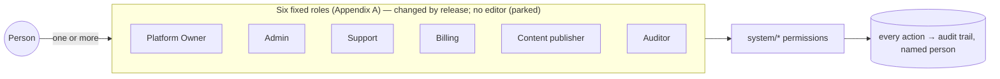
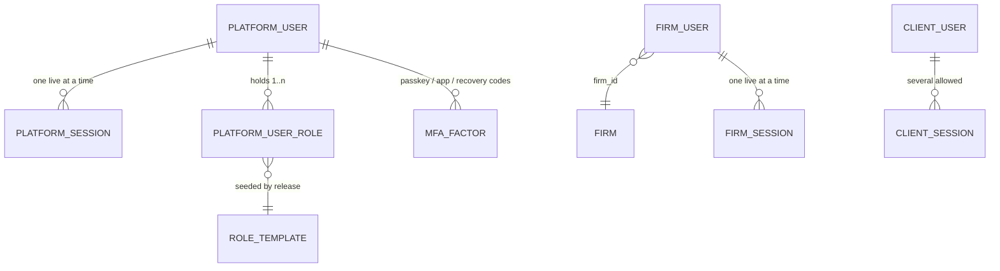

> **Document control** · Version **2.17** · **2026-10-17** · Status: **AG16-81 and AG16-55 applied (second pass, 17 Oct): letter-pattern review worked with the existing pack keys, second-person approval, AI drafting removed; OQ-12 and OQ-13 closed; earlier: AG-16 review decision AG16-43 applied (letter-library review and publish access; one new requirement, SA-7-49); earlier: ExpatReady staff-roles decisions (session 2) and Rule 9 pass applied (SR-Q1 – SR-Q8, G-Q5, SA-11 Q15, R9-21 – R9-23, R9-32, SA-12 Q9); earlier: complexity-review and template-review decisions applied (v2.14); final review applied (10 Oct); 12 Oct changes written on the product owner's approval**\
> Part of: *Super Admin Console — Functional Requirements* · Split from `FINAL-SuperAdmin-FR.md` lines 3935–4484 on 2026-09-16 · Previous version: `_archive/SA-07-platform-users_v2.16_2026-10-17.md`\
> Reviewed by: the product owner (product owner), 30 Sep and 1 Oct 2026 · Code state checked 2026-09-30 against local `dev` checkouts: backend `ERv2-sanitized` @ `1e82b2ae` (2026-09-29 — **not same-day**, see §12), frontend `ERv2-frontend` @ `ba4f333` (2026-09-30); **re-checked 2026-10-12** (complexity register) against backend @ `db646bf7` (10 Oct) and frontend @ `8511b27e` (11 Oct) — see §12. Staff-roles decisions of 12 Oct (session 2) applied on the product owner's approval
>
> | Version | Date | Change | Decisions |
> |---|---|---|---|
> | 2.17 | 2026-10-17 | Applied AG16-81 and AG16-55 (second pass; the product owner, 17 Oct). **Pointer only:** the "New letter patterns" list is worked by the Content publisher with the existing `system/pack:draft-manage`, `:approve` and `:publish` (no new key); a new entry is published with the existing second-person pack approval (SA-01 §3.12, SA1-D6); **AI drafting of letter entries removed** (nothing for AI to read, AG16-62, AG16-81(4)); the staff see only sender domain, file-name pattern and type chosen. SA-7-49, SA7-D75, Appendix A rows and the build card updated. **OQ-12 closed** (AG16-81(1)); **OQ-13 closed** (AG16-81(2)). *18 Oct: new section 'Decisions that change this epic' (index of AG16 decisions; no requirement changed).* *18 Oct (later): check fix — AG01-29(1) wording: firm users and clients have no short idle timer and sign in again after 28 days unused (SA7-D28, SA7-D66, SA7-D67, SA-7-18, auto-logout paragraph); the "as built, covers all three sign-in groups" flag is closed (`session-lifetime.ts:41-45`).* | AG16-81, AG16-62, AG16-55 |
> | 2.16 | 2026-10-17 | Applied AG16-43 (keeping the letter library current; the product owner, 17 Oct). **Access only:** the Content publisher reviews the "New letter patterns" list and publishes letter-library entries (pack content, all firms at once, no release); the Platform Owner has the same oversight as for other pack content. The list, its grouping and its screen are specified once, in SA-01 (single home, AG16-11); SA-07 adds no screen or control. New SA-7-49, SA7-D75, one Appendix A row, one build card; OQ-12 and OQ-13 opened (permission key coverage; second-person rule). | AG16-43, AG16-11, AG16-33 |
> | 2.15 | 2026-10-12 | Applied from the staff-roles decisions (session 2) and the Rule 9 pass (the product owner, 12 Oct). **Roles:** display names final — Platform Owner · Admin · Support · **Billing** · Content publisher · Auditor ("Billing operations" retired; OQ-1 closed). **Firm starter roles (SR-Q1 + correction):** Platform Owner **and Admin** create / edit and approve them, the approver is never the requester; the one-Owner floor is unchanged (SA7-D56, SA-7-25, BR-7) — the proposed second-to-last-Owner safeguard is dropped; with one Owner an Admin is the second person. **Templates and ExpatReady emails (SR-Q2):** the Platform Owner publishes **every** ExpatReady email; Content publisher drafts and previews (as built); the "contains legal terms" flag and its Owner check are parked; Content publisher still publishes firm starter templates, legal-type starters and the default e-sign consent text (R9-26); SA7-D70 rewritten; OQ-8 closed as moot; `system/mail-template:publish` is **not** added to Content publisher. **Code vs Appendix A (SR-Q4):** `system/firm:close` leaves Admin; Admin keeps Activity view; operational settings and the feature-catalogue register are Owner-only; Auditor, Support and Billing gain the read keys the table gives them; Content publisher keeps completeness profiles; Owner's `:suspend` / `:offboard` stay unused with no screen; account manager = Admin (and Owner); the updated Appendix A is the target and the remaining code differences are build tasks. **Pack approver (SR-Q5):** approves exactly what was submitted and does not edit (SA7-D49 reinstated). **Source of truth (SR-Q6):** the code registry is master, the database is seeded by release, `check:seed-parity` blocks a release (new SA-7-48). **Reasons (SR-Q7):** optional on staff role changes except giving or removing Platform Owner, and the Owner-change email carries the reason. **Staff detail (SR-Q8, R9-22):** role names and plain capability names, keys under Advanced. **Governance rows:** place / release legal holds — Platform Owner only, `system/compliance:legal-hold` (G-Q5); ExpatReady's breach register — Platform Owner, Auditor read-only (SA-11 Q15); `system/analytics:view-revenue` held by no role (R9-32). **Rule 9 pass:** invite link (72 h), password minimum, failed-attempt block, logout warnings, step-up and recovery codes are deploy configuration, not console settings; password rules are fixed rules (R9-21); staff email domains and staff auto-logout (60 min / 12 h) are Owner-only **Advanced** settings; invite form defaults; handover is one "Move all N firms to ___" choice (R9-23); new §3.10 "Settings — defaults and placement". **SA-12 Q9:** `system/platform-config:manage` Owner only. All ten open questions closed; one new (OQ-11). Changed decisions: SA7-D8, D15, D16, D17, D24, D33, D39, D47 – D54, D61, D64, D70; reinstated (changed) D49; new: SA7-D71 – SA7-D74. Requirements: **changed** SA-7-5, 6, 9, 12, 16, 18, 28, 40, 42, 47; **withdrawn** none; **added** SA-7-48. §0.2: SA7-X6, X12 – X18 updated; new rows SA7-X21 – SA7-X27 pending. **Same-day revision (W-1 – W-3, the product owner, 12 Oct):** W-3(2) rollback of a published ExpatReady email is Platform Owner only (Appendix A row split; OQ-11 closed); W-3(5) `system/breach:manage` removed from Admin (SA7-D74, §10, code-differences list, before-build tasks); W-3(6) Support read-only payment log, re-run stays Owner/Admin/Billing, one built key covers both (SA7-D52); W-3(7) Admin holds `system/flag:manage` as built; W-2 one-Owner pointer on SA7-D51. **Same-day revision (W-11 – W-21, the product owner, 12 Oct):** one Owner floor — at least one active Owner — for both deactivation and removing the Owner role (W-12); security lock apply and lift are Platform Owner only, so Admin loses `system/firm:suspend` / `:reinstate` (W-13); Support gains the audit-trail read tick (W-14); audit text fixes (W-21). | SR-Q1 – SR-Q8 · G-Q5 · SA-11 Q15 · R9-21 – R9-23, R9-32 · SA-12 Q9 · Rule 9 pass SA-07 / SA-08 |
> | 2.14 | 2026-10-12 | Applied from the template review and the complexity review (the product owner, 11–12 Oct). **Staff roles are the six already in code** — Platform Owner, Admin, Support, Billing operations, Content publisher, Auditor (`role-template.platform.ts`) — replacing the nine (SA7-D8); **the staff-role editor is parked** (SA7-D2, SA-7-27 withdrawn, US-3 withdrawn; frontend mock only); Staff manager, Content approver, Firm onboarding / Account manager, Security & audit and Platform engineer no longer exist as roles, and **Appendix A is rewritten for the six roles** with every old row mapped (rows no remaining role can hold are Open Questions OQ-3, OQ-6). **R4:** one session at a time for firm staff kept, reason added — it also prevents seat sharing (SA7-D68). **R29:** password rules kept as specified; character mix and last-5 reuse are not built (SA7-D24 note). **Spec follows code:** the step-up window is fixed at 5 minutes in configuration, not a console setting (SA7-D36, SA7-D69); auto-logout is one editable policy under `system/platform-config:manage` that must stay OFF for firm users and clients (SA7-D67 — flagged to developers, SA7-X8); staff "require password change" is built (SA-7-41). **Templates and ExpatReady emails (SA5-X12; Q14, Q16, R33):** no second approver; Content publisher publishes legal-type starters and the default e-sign consent text and certificate; "Send a legal template … expert check recorded" row removed; an ExpatReady email flagged "contains legal terms" needs the Owner role to publish, "never own submission" dropped; urgent-correction row added (Platform Owner only) (SA7-D70). **R22.5:** handover prompt kept (SA7-D64, D65). **Code-check outcomes:** second-Owner approval of live plan and price changes is built and stays (SA7-D51). Changed decisions: SA7-D2 (parked), D5, D6, D8, D9, D24, D36, D39, D43, D47 – D54, D64, D67; new: SA7-D68 – SA7-D70. Requirements: **changed** SA-7-9, 10, 12, 13, 18, 19, 28, 29, 31, 36, 41, 42, 47, BR-16; **withdrawn** SA-7-27 (parked), US-3; **added** none. §0.2: SA5-X12 applied; SA7-X1 and SA7-X10 superseded; new rows SA7-X12 – SA7-X20 pending. 10 open questions added (§13). | R8 revised, R4, R29, R33, R22.5 · Q14, Q16 · "spec follows code" · code-check outcomes (R9) · rules 7, 8 · SA5-X12 |
> | 2.13 | 2026-10-10 | Applied from SA-08 v2.5 and the co-product owner's SA-05 template review (merge decided by the product owner, 10 Oct). **Expat Ready's service keys are never entered, shown or changed in the console** (SA8-D1): "integration credentials" removed from the Platform engineer's console work, from step-up (SA7-D35) and from SA7-D54 — the engineer sets them at deploy. **Appendix A gains 11 rows:** templates and Expat Ready's own emails (see, write, test-send, publish ordinary emails and letters → Content author and Owner; send a legal template for approval → Content author and Owner; approve and publish legal templates and legal sentences → Owner only; roll back → Content author and Owner, legal Owner only; retire → Content author and Owner), e-signature wording (draft → Content author and Owner; approve and publish → Owner only) and the read-only Integrations status page (Owner, Platform engineer, Support). | SA8-D1, SA8-D15, SA8-D22 · SA5-X6, SA8-X7 |
> | 2.12 | 2026-10-10 | Applied from SA-03 v2.16 (SA3-X11; the product owner, 10 Oct): the product map is replaced by the **feature catalogue** — two permission-matrix rows renamed (plan features on/off; register a newly released feature). Who may do what is unchanged. | SA3-D10 (SA3-X11) |
> | 2.11 | 2026-10-10 | SA6-D12 — starter roles configured in Super Admin (the product owner, 10 Oct; owned by SA-06 v3.1 §3.9): the Platform Owner starter staff role gains the new permission `system/starter-role:manage` — create / edit and approve-publish the **firm** starter roles; the approver must be a different person from the editor. Appendix A and §10 updated; cross-reference to SA-06 §3.9. The nine staff starter roles (SA7-D8) and the staff-role editor (`system/super-admin-role:manage`) are unchanged. No requirement IDs added or changed. | SA6-D12 |
> | 2.10 | 2026-10-08 | Session rules for firm users and clients settled (the product owner, 8 Oct): session rules for firm users are set by the platform only — a firm has no session setting, and Agent AG-16-23 (firm session policy) is withdrawn. Firm users: no maximum session length and no idle timeout. Clients: sessions never expire (unchanged, re-confirmed). A password change or a second-step reset ends all of a firm user's or client's other sessions (AG-1-67 / CP-1-96). Client portal session tokens must not be readable by page script, in Release 1 (CP-1-91). The platform auto-logout setting (60 min idle / 12 h maximum) controls Expat Ready staff only; firm users and clients have no timer in code, and no fallback timeout may apply to them. One session at a time for firm staff stays a platform rule and ships in Release 1 (re-confirmed). Nothing changes for Expat Ready staff. SA7-D66 point 3 withdrawn; SA7-D67 added; §3.5, SA-7-18, US-9, SA7-X3, SA7-X8 updated. | SA7-D67 · withdraws SA7-D66 (3) |
> | 2.9 | 2026-10-07 | Knock-on from the SA-06 v3.0 closing review (the product owner, 7 Oct, SA-06 Open Question 10): the key for the Platform-Owner staff-role editor is **`system/super-admin-role:manage`**; **`system/role-template:manage` is retired** (SA-06 sets the code row inactive). §10 permission row and SA-7-27 updated. No requirement IDs added; no behaviour changed. | SA6 Q10 |
> | 2.8 | 2026-10-07 | Knock-on from SA-06 v3.0 (the product owner, 7 Oct): Appendix A, Plans row — "starter roles per plan" removed, because every plan now seeds the same six firm starter roles and the per-plan role set is withdrawn (SA-3-15 withdrawn in SA-03 v2.14, SA3-A6; its permission `system/plan-role-set:manage` is withdrawn with it). The nine internal staff starter roles (SA7-D8) are a different set and are unchanged. No requirement IDs added or changed. | SA6-D7 (SA3-A6) |
> | 2.7 | 2026-10-02 | Sessions revised for firm users and clients (the product owner, 2 Oct): one session at a time applies to Expat Ready staff and firm users only — clients may be signed in on several devices; auto-logout (60 min idle / 12 h maximum, with warnings) applies to Expat Ready staff only, and firm users and clients are not auto-logged out by the platform (a firm may set its own policy for its staff, AG-16-23). §0.2 statuses updated: SA7-X1, X2, X4, X5, X6, X9, X10, X11 applied in the other modules; SA7-X3 rewritten and applied in the Agent documents; SA7-X8 stays pending with developers. SA-7-18, SA-7-36, SA-7-37, BR-16, US-9, US-10 and one edge case changed. | SA7-D66 · changes SA7-D28, SA7-D30 – D32, SA7-D34, SA7-D55 · SA7-X1 – X6, X9 – X11 |
> | 2.6 | 2026-10-01 | Merged into the local set by the product owner: §0.2 SA7-X11 applied in SA-10 v2.3 (SA-10-26 number confirmed — it was added in SA-10 v2.1; v2.0 ended at SA-10-25); SA7-X2 (a) and (e) applied in SA-02 v2.13, (b)–(d) still pending; SA7-X7 now also covers the handover (Phasing & Glossary v2.9, Overview v3.3). Requirements unchanged. | SA7-X2, SA7-X7, SA7-X11 |
> | 2.5 | 2026-10-01 | Handover from the Agent console review (AG-01 v1.3): deactivating a staff member is never blocked by work they own — open support tickets return to the unassigned support queue (SA-10-26) and an account manager's deactivation shows a "choose a new manager or skip" prompt (Must for launch); skipped firms fall back to the shared team inbox. Adapted to SA-7: no Suspend (SA7-D10); requirement numbers SA-7-46, SA-7-47 and rule BR-20 (SA-7-27 / SA-7-28 / BR-15 were already in use); role name "Firm onboarding / Account manager". §3.7, §4, §5, §8 US-5, §9, §0.2 (SA7-X2, SA7-X11), §0.3, §12. | AG1-D2, AG1-D12, AG1-D13 · SA7-D64, SA7-D65 |
> | 2.4 | 2026-10-01 | **Final founder review** — "build for the firm, strip what is fancy". **Stripped:** Offboarded state and automatic offboarding (Deactivated is the end state, hidden by default); "remember this device"; failed-attempt, new-device, access-changed and deactivated emails; "last support session" and "second step" columns; Activity highlighting and CSV export. **Narrowed:** step-up only before support sessions, staff access changes, refunds and platform settings. **Moved to Phase 2:** Google sign-in together with the Owner emergency route — launch uses the built email + password + second step, and the password rules apply to all staff. **Kept and conditioned:** one session at a time for staff, firm users and clients, on condition that client questionnaires save every answer as it is typed; a "Sign in again here" button. **Changed:** an Owner can be deactivated down to one active Owner (a stolen Owner account can always be switched off). **Re-confirmed:** role editor in Release 1. **Corrections:** "account manager inactive" is staff-side only; a support session ends with the staff member's session; a demo firm is only ever on an Internal ($0) plan; "test environment" defined; SA-3 / SA-4 role names to align. SA-7-32 and SA-7-35 withdrawn; SA-7-45 added; others changed as marked. | SA7-D55 – SA7-D63 · changes SA7-D12 – D14, D22 – D27, D35, D38, D40, D41, D44 |
> | 2.3 | 2026-09-30 | §0.2 SA7-X7 marked applied: Phasing & Glossary v2.7 and Overview v3.1 aligned with this module. Requirements unchanged. | SA7-X7 |
> | 2.2 | 2026-09-30 | Starter-role permissions signed off (Appendix A finalised, §13 closed). Requirements unchanged. | SA7-D47 – SA7-D54 |
> | 2.1 | 2026-09-30 | Product review applied (roles, lifecycle, invite, sign-in, sessions, step-up, My account, Activity, staff list, emails, retention; alignment with SA-1 / SA-2; §12 rewritten). SA-7-1 – SA-7-26 changed; SA-7-27 – SA-7-44 added. | SA7-D1 – SA7-D46 |
> | 2.0 | 2026-06-20 | Baseline — golden per-module rebuild | — |

## Decisions that change this epic (14–18 Oct) *(new 18 Oct)*

Product-wide rules (apply here as everywhere; home: Agent `00-Overview` → "Product rules every epic follows"): AG16-11, AG16-31, AG16-33, AG16-76.

The "AG16" prefix is historical: these decisions began in the AG-16 review and apply across the product. Full text: `TEMPLATE-MAP-working_2026-10-10.md`.

| Decision | What was decided (one line) | What it changes in this epic | Where (requirement / card / section) |
|---|---|---|---|
| AG16-11 | One "Automatic messages" page, documented in one place only. | The "New letter patterns" list, its grouping and the entry editor are specified once in SA-01 (single home). SA-07 adds no screen or control; it states access only. | SA7-D75, SA-7-49 |
| AG16-43 | Keeping the letter library current. | New access requirement: the Content publisher reviews the "New letter patterns" list and publishes letter-library entries. One new requirement, one Appendix A row, one build card. | SA-7-49, SA7-D75, §2 (Content publisher job), Appendix A |
| AG16-55 | Writers' recommended defaults accepted for the detail questions. | Open questions OQ-12 (permission key) and OQ-13 (second-person rule) closed with the defaults. | OQ-12, OQ-13 (§13) |
| AG16-62 | Unrecognised-letter pattern: no text leaves the firm. | Staff see only sender domain, file-name pattern and the type chosen; no title, sentence, subject, body or attachment is reachable from the list. AI drafting of letter entries removed. | SA7-D75, SA-7-49 card |
| AG16-76 | Standing rule: help people, don't replace them; do, don't overdo. | Card SA-7-49 gains a "Person decides" line: the Content publisher decides each entry, a second person approves, nothing publishes by itself. | SA-7-49 |
| AG16-81 | "New letter patterns" review in Super Admin. | The list is worked with the existing pack keys (system/pack:draft-manage, :approve, :publish); no new key. A new entry is published with a second person (SA-01 §3.12). AI drafting of entries is removed. | SA7-D75, SA-7-49, Appendix A, OQ-12, OQ-13 |

## Module SA-7: Platform Users (Internal Team)

> **What this document is.** The build specification for Super Admin module SA-7 — the accounts of **Expat Ready's own staff** who operate the Super Admin console. Versions 2.1 – 2.4 apply the product reviews of 30 Sep and 1 Oct 2026. **§0** records each decision and the release phasing; every later section has been edited in place to match. Where an earlier version says something different, this version wins; earlier wording is kept only in `_archive/`.
>
> **Plane:** Super Admin console (GLOBAL). **Who:** Expat Ready's internal team — never firm staff, never clients. **Tenant key:** none — a staff account has **no `firm_id`**. **Permissions:** `system/*` keys only (SA1-D8), through six fixed roles (§3.3).
>
> **Why this module exists — for the firm.** A firm hands Expat Ready its clients' passports, bank statements and refusal histories. A staff account can, by role, look into a firm through a support session (SA-2), publish the Canada pack every firm relies on (SA-1), and change prices and refunds (SA-3, SA-4). SA-7 keeps that safe in the plainest way that works for a 4–6 person team: a mandatory second step, only the access each job needs, an instant off-switch, and a named person behind every action. Anything that did not serve that was removed in the 1 Oct review.
>
> **Requirement IDs are permanent.** A changed requirement keeps its number. A withdrawn requirement stays as a one-line entry. New requirements continue from SA-7-48. Numbers are never reused.

---

### 0. Decision log

**Roles** (30 Sep)

| ID | Decision | Where applied |
|---|---|---|
| **SA7-D1** | **4–6 internal staff at Canada launch.** The design must work when one person does several jobs. | §2 |
| **SA7-D2** | *(parked v2.14 — R8 revised)* ~~Roles are configuration — the Owner ticks permissions and creates roles.~~ **The staff-role editor is parked:** the screen is a frontend mock with no backend route (`ERv2-frontend` `platform-sub-role-editor.tsx:30-41`; the key `system/super-admin-role:manage` exists only in the catalogue), and six fixed roles need no editor. Roles are stored as data and seeded by release *(changed v2.15 — SR-Q6: the code registry is the master — SA7-D72)*; every `system/*` permission stays in code. *If the editor is ever built, carry over: the Owner role cannot be reduced; internal roles hold only `system/*` permissions; permissions added by a release start off except for Owner; every change audited with before / after.* | §3.3 · SA-7-27 withdrawn · §0.1 · §0.2 SA7-X1 (superseded), SA7-X12 |
| **SA7-D3** | **A person can hold several roles**; their access is the sum of their roles. | §3.3 · SA-7-11 · BR-4 |
| **SA7-D4** | **No blocked role combinations.** Protection comes from per-action rules — nobody approves their own plan change, price change or production pack (SA1-D6, SA3-D8b, SA4-D5) — and from nobody changing their own access (BR-5). | §3.3 |
| **SA7-D5** | *(changed v2.14 — R8 revised)* **"Manage staff" is its own permission** (`system/platform-user:manage`, `role-template.platform.ts:162`). In the six roles it is held by the **Platform Owner only**: invite, give and remove roles, change countries, reactivate and Reset MFA are Owner-only. The **Admin** role holds the lighter removal actions — deactivate, require a password change, end another person's session (`role-template.platform.ts:216-218`) — refused on a privileged target (for example an Owner) unless the actor holds Manage staff. Delegating "Manage staff" through a custom role went with the editor (SA7-D2). Not tied to firm provisioning. | §3.1 · SA-7-4, SA-7-12 · §10 |
| **SA7-D6** | *(changed v2.14 — R8 revised)* **Only an Owner can make someone an Owner.** Because only Owners hold Manage staff (SA7-D5), only Owners give any role. *Accepted consequence:* two Owners could raise each other's access; the audit trail and the Owner-change email (SA7-D61) show it. *(The Staff-manager case no longer arises.)* | §3.3 · SA-7-29 · §0.2 SA7-X1 |
| **SA7-D7** | **Access changes take effect at once and are audited — no second-person approval.** Removing access is always instant. | §3.3 |
| **SA7-D8** | *(changed v2.15 — SR-Q3; v2.14 — R8 revised)* **Six staff roles — the six already in code** (`role-template.platform.ts:29,180,226,243,261,305`): **Platform Owner** (`platform-owner`) · **Admin** (`platform-admin`) · **Support** (`platform-support`) · **Billing** (`platform-billing-ops`) · **Content publisher** (`platform-content-publisher`) · **Auditor** (`platform-auditor`). ~~Nine starter roles~~ — Staff manager, Content approver, Firm onboarding / Account manager, Security & audit and Platform engineer are no longer roles; the engineer's service keys stay outside the console (SA8-D1). Permissions in **Appendix A**, which maps every old row to the six roles. **Display names are final (SR-Q3, closes OQ-1):** Platform Owner · Admin · Support · Billing · Content publisher · Auditor; code keys unchanged. "Content author", "Billing operations" and "Security & audit" are retired names. | §2, §3.3 · SA-7-28 · Appendix A |
| **SA7-D9** | *(changed v2.14 — R8 revised)* **Country limits.** The **Content publisher** role is the one role scoped to assigned countries, from Release 1 (as built — `PLATFORM_CONTENT_PUBLISHER_TEMPLATE_KEY`, `role-template.platform.ts:8`; a staff invite may carry countries only for this role). Support, Admin and Billing get country limits in **Phase 2**, before a second country goes live (SA-7-13). | §3.3 · SA-7-13 |

**Lifecycle** (30 Sep)

| ID | Decision | Where applied |
|---|---|---|
| **SA7-D10** | **Deactivate only — no Suspend.** Instant, signs the person out everywhere, needs a reason, and is **never blocked by account-manager duties**: their firms show "account manager inactive" (staff side only) and their alerts go to the shared team inbox until reassigned. | §3.7 · SA-7-22, SA-7-30 · §0.2 SA7-X2 |
| **SA7-D11** | **Deactivation destroys the person's password and all second-step methods.** Reactivation means setting up from scratch, like a new hire. *Why:* a passkey on a stolen laptop must never work again. | §3.7 · SA-7-23 |
| **SA7-D12** | ~~Final Offboarded state~~ — *withdrawn v2.4 (SA7-D58).* | — |
| **SA7-D13** | ~~Offboarding manual or after 90 days~~ — *withdrawn v2.4 (SA7-D58).* | — |
| **SA7-D14** | *(changed v2.4 — SA7-D58)* **The staff list shows five statuses:** Invited (expires in …) · Invite expired · Setup incomplete (no second step yet) · Active · Deactivated. | §3.4, §6 · SA-7-7, SA-7-15 |

**Invite** (30 Sep)

| ID | Decision | Where applied |
|---|---|---|
| **SA7-D15** | *(changed v2.15 — Rule 9 pass)* **Invite form:** full name · work email · one or more roles, each shown with a one-line job description · countries (pre-set to Canada; shown only when Content publisher is ticked). Times on screen use each viewer's own browser timezone. | §3.1 · SA-7-5 |
| **SA7-D16** | *(changed v2.15 — Rule 9 pass)* **Invite link valid 72 hours** (deploy configuration, `INVITE_TTL_HOURS` — `env.schema.ts:206`; not a console setting), single-use, cancellable; resend issues a fresh link and voids the old one. | §3.1 · SA-7-5, SA-7-6 |
| **SA7-D17** | *(changed v2.15 — Rule 9 pass)* **Invites go only to approved company email domains** (an **Advanced** setting, Owner only; seeded at go-live). | §3.1 · SA-7-6 |
| **SA7-D18** | **A staff email can be a user only inside Expat Ready's own demo firms.** Help to customer firms goes only through an SA-2 support session. | §3.0 · SA-7-38 · §0.2 SA7-X2 |
| **SA7-D19** | **Demo firm = an explicit "Demo firm" marker** on the firm record, set only by staff, audited, shown as a badge. *(Changed v2.4 — SA7-D63: a demo firm can only be on an Internal ($0) plan, so it never takes real payments.)* | SA-7-38 · §0.2 SA7-X2, SA7-X4 |

**Sign-in and second step** (30 Sep, changed 1 Oct)

| ID | Decision | Where applied |
|---|---|---|
| **SA7-D20** | **Second-step methods:** passkey (preferred), authenticator app, one-time recovery codes. **No SMS for staff.** Nobody can switch off their own or anyone else's second step. | §3.2 · SA-7-8 |
| **SA7-D21** | **Reset MFA** — a Platform Owner action, never on oneself *(revised same day — W-21)*: verify the person first (for example by video call), enter a reason; all their sessions end; they set up a fresh second step at their next sign-in. | §3.2 · SA-7-31 |
| **SA7-D22** | ~~"Remember this device"~~ — *withdrawn v2.4 (SA7-D59).* | — |
| **SA7-D23** | ~~Remembered for 7 days~~ — *withdrawn v2.4 (SA7-D59).* | — |
| **SA7-D24** | *(changed v2.15 — R9-21; v2.4 — SA7-D57)* **Password rules for every staff member:** at least 12 characters · refused if on the leaked-password list · must mix upper-case, lower-case, a number and a symbol · none of the last 5 reused. No calendar expiry; the Owner or Admin can require "change password at next sign-in" when there is a reason *(revised same day — W-21)*. These are **fixed rules, not a console setting** — the minimum length is the deploy value (raise-only, `config/env.schema.ts:215`); character mix and last-5 live in code (R9-21). *(Kept as specified v2.14 — R29. Built today: the 12-character minimum and the leaked-password check only — `password-policy.service.ts`, `config/env.schema.ts:215`. **Character mix and last-5 reuse are not built** — they need a backend rule and a password-history table; the frontend rows are a mock. Staff "require password change" is built — register 5b.)* | §3.2 · SA-7-9, SA-7-41 |
| **SA7-D25** | *(changed v2.4 — SA7-D57)* **Company Google Workspace sign-in moves to Phase 2.** | §3.2 · SA-7-33 · §0.2 SA7-X9 |
| **SA7-D26** | *(changed v2.4 — SA7-D57)* **The Owner emergency password route and its alert to other Owners move to Phase 2, with Google sign-in.** At launch every staff member signs in with email + password + second step. | §3.2 · SA-7-2, SA-7-34 |
| **SA7-D27** | *(changed v2.4 — SA7-D61)* **Failed attempts:** as built — the attacking internet address is blocked and a "prove you're human" check appears after 5 failures on one account in 15 minutes; the account itself is never locked. **No email.** | §3.2 · SA-7-9 |

**Sessions and auto-logout** (30 Sep, conditioned 1 Oct)

| ID | Decision | Where applied |
|---|---|---|
| **SA7-D28** | *(changed v2.7 — SA7-D66)* **One auto-logout setting, for Expat Ready staff only.** Firm users and clients have no short idle timeout; they sign in again after 28 days unused *(reworded 18 Oct — AG01-29(1))*. | §3.5 · SA-7-18 |
| **SA7-D29** | **Auto-logout can be switched off only in test environments;** in production both timers are always on. *(Defined v2.4 — SA7-D63: "test environment" = any deployment not flagged as production by the infrastructure team.)* | §3.5 · SA-7-18 · §0.2 SA7-X8 |
| **SA7-D30** | *(changed v2.7 — SA7-D66)* **One session at a time for staff and firm users**, alongside the staff timers. Clients may be signed in on several devices. | §3.5 · SA-7-36 |
| **SA7-D31** | *(changed v2.7 — SA7-D66)* **One session at a time applies to Expat Ready staff and firm users only; clients may be signed in on several devices.** *(Re-confirmed v2.4 — SA7-D55; narrowed v2.7.)* | §3.5 · SA-7-36 · §0.2 SA7-X3 |
| **SA7-D32** | *(changed v2.7 — SA7-D66)* **Newest sign-in wins (staff and firm users):** the older session ends at once with "You were signed out because your account signed in on another device" (browser, device, place, time). | §3.5 · SA-7-36 |
| **SA7-D33** | *(changed v2.15 — Rule 9 pass)* **Go-live values: 60 minutes idle, 12 hours maximum** (an **Advanced** setting, Owner only; always enforced in production). | §3.5 · SA-7-18 · §0.2 SA7-X8 |
| **SA7-D34** | *(changed v2.7 — SA7-D66)* **Warnings:** a countdown 2 minutes before idle logout ("Stay signed in"), and a warning 10 minutes before the 12-hour maximum. *(Changed v2.7 — SA7-D66: Expat Ready staff only.)* | §3.5 · SA-7-37 · §0.2 SA7-X3 |

**Step-up, self-service, activity, gaps** (30 Sep, changed 1 Oct)

| ID | Decision | Where applied |
|---|---|---|
| **SA7-D35** | *(changed v2.4 — SA7-D60)* **Step-up** before: starting a support session (as built) · staff access changes · refunds · platform settings (~~integration credentials,~~ feature flags, security and operational settings). *(changed v2.13 — SA8-D1: service keys are never handled in the console.)* | §3.2 · SA-7-10 |
| **SA7-D36** | *(changed v2.14 — "spec follows code", SA7-D69)* **One step-up covers those actions for 5 minutes** in that session. The window is **fixed in configuration** (`SELF_STEP_UP_ATTESTATION_TTL_SECONDS`, default 300, hard maximum 300 enforced at boot — `config/env.schema.ts:86,529-534`); it is not a console setting. Support-session start keeps its built per-start rule. | §3.2 · SA-7-10 |
| **SA7-D37** | **"My account":** manage own second-step methods (at least one always remains) · current session and sign out · change own password · own name and screen language. Sensitive changes need step-up. *(Changed v2.4 — remembered devices and the separate emergency password removed.)* | §3.8 · SA-7-26 |
| **SA7-D38** | *(changed v2.4 — SA7-D62)* **Activity tab = a plain list of what the person did** (sign-ins and actions), filterable by date and type; support sessions appear as ordinary entries with firm and reason, linking to the SA-2 record. No highlighting, no CSV export. | §3.6 · SA-7-20, SA-7-21 |
| **SA7-D39** | *(changed v2.15 — SR-Q4 item 2; v2.14 — R8 revised)* **Who sees Activity:** Owner, Admin and Auditor — anyone's; each staff member — their own. | §3.6 · SA-7-42 |
| **SA7-D40** | *(changed v2.4 — SA7-D62)* **Staff list columns:** name · email · roles · status · last sign-in · countries. | §3.4 · SA-7-15 |
| **SA7-D41** | *(changed v2.4 — SA7-D56)* **Owners:** go-live needs two; **deactivating an Owner is allowed while at least one active Owner remains**; removing someone's Owner role is refused on the same floor — if it would leave no active Owner (as built, `platform-owner-guard.ts`) *(revised same day — W-12)*. | §3.7 · SA-7-25 · BR-7 |
| **SA7-D42** | **First Owners at go-live:** a one-time setup by the tech lead invites the two named Owners; audited; refuses to run once any Owner exists. | §3.1 · SA-7-39 |
| **SA7-D43** | *(changed v2.14 — R8 revised)* **No special last-resort procedure.** Another Owner resets a locked-out Owner's second step; if none is available, the platform waits. **Developers never restore access by editing the database.** | §3.2 · SA-7-39 |
| **SA7-D44** | *(changed v2.4 — SA7-D61)* Staff account emails — see SA7-D61. | §3.9 · SA-7-40 |
| **SA7-D45** | **Retention follows SA-11.** SA-7 sets no period of its own; a deactivated person's name is kept while any audit record refers to them. | §3.6 · SA-7-43 · §0.2 SA7-X5 |
| **SA7-D46** | **Phasing** — see §0.3. | §0.3 |

**Starter-role sign-off** (30 Sep)

| ID | Decision | Where applied |
|---|---|---|
| **SA7-D47** | *(changed v2.15 — SR-Q4 items 4 – 6; v2.14 — R8 revised)* The firm list (read-only) and changing a firm's account manager: **Owner and Admin** (was Staff manager); Support, Billing and Auditor also read the firm list (the read keys are build tasks). Role editing stays with the Owner — and the editor is parked (SA7-D2). | Appendix A |
| **SA7-D48** | *(changed v2.15 — SR-Q5; v2.14 — R8 revised)* **Content publisher** can approve and publish **their own test-only packs**; a production pack is approved by someone who is neither its author nor its submitter (SA1-D6) — another Content publisher or an Owner. There is no separate Content approver role. The second person is another Content publisher or an Owner; test-only packs are exempt *(SR-Q1, SR-Q5; OQ-4 closed)*. | Appendix A |
| **SA7-D49** | *(changed v2.15 — SR-Q5; withdrawn v2.14 as a role rule)* **The approver does not edit.** The approver approves exactly what was submitted (frozen at submission — `pack-draft-review.service.ts:200-205`); to fix something they reject with a reason, and the author fixes and resubmits. Anyone who edits and resubmits becomes the submitter and cannot approve it. SA1-D6 per action is unchanged. Closes OQ-4. | Appendix A |
| **SA7-D50** | *(changed v2.14 — R8 revised)* For a firm: change plan or billing period, cancel or undo a cancellation, and apply or remove an **approved** discount (reason required, audited) — **Billing and Owner**. The Admin role holds no billing-change key (`role-template.platform.ts:185-222`), so firm onboarding staff no longer do this *(OQ-3 closed — SR-Q4)*. | Appendix A |
| **SA7-D51** | *(changed v2.14 — role name; kept by the 12 Oct code check)* **Only Owners approve live plan and price changes;** Billing requests but never approves. Second-Owner approval is built (`plan-change.service.ts:412`; approval-queue screen real) and stays. With one Platform Owner, live plan and price changes wait until a second Owner is invited; Admin does not approve them; go-live creates two Owners (SA-7-39) *(revised same day — W-2)*. | Appendix A · §0.2 SA7-X10 |
| **SA7-D52** | *(changed v2.15 — SR-Q4 item 5, R9-14; v2.14 — R8 revised)* **Support** can view the payment-processor notification log (read-only); Owner, Admin and Billing view **and re-run** failed ones. It sits under **Advanced** as "Payment events". Built today Support holds only `system/billing:view` (`role-template.platform.ts:238`), not `:webhook-log` — Support gains the read key (build task, §12). **Re-run stays Owner, Admin and Billing; one built key covers both view and re-run today, so splitting them is a developer task** *(revised same day — W-3(6))*. | Appendix A |
| **SA7-D53** | *(changed v2.15 — SR-Q4; v2.14 — R8 revised)* **Applying and lifting a firm's security lock is Owner-only** (the Security & audit role is gone; the Auditor is read-only in code). **Closing** stays Owner-only: `system/firm:close` is removed from Admin in code (`role-template.platform.ts:203`; SR-Q4 item 1, closes OQ-6). | Appendix A · §0.2 SA7-X2 |
| **SA7-D54** | *(changed v2.15 — SR-Q4 item 3, R9-21, SA-12 Q9; v2.14 — R8 revised, "spec follows code")* **Security settings are Owner-only, under Advanced:** the auto-logout policy (one policy, gated by `system/platform-config:manage`, which only the Platform Owner holds among the six roles — `role-template.platform.ts:108-109`) and staff email domains. Password rules are fixed rules, not a setting (R9-21). The step-up window is no longer a setting (SA7-D36). Admin changes feature flags (`system/flag:manage`, `role-template.platform.ts:204`); **operational settings (`system/platform-config:manage`) and the feature-catalogue register are Owner only**, as coded (SR-Q4 item 3, SA-12 Q9; OQ-3 closed). **Expat Ready's service keys are set only at deploy, never in the console** *(v2.13 — SA8-D1)*. | Appendix A · §0.2 SA7-X6 |

**Final founder review** (1 Oct) — *build for the firm; strip what is fancy*

| ID | Decision | Where applied |
|---|---|---|
| **SA7-D55** | *(changed v2.7 — SA7-D66)* **One session at a time stays for Expat Ready staff and firm users** (no longer for clients), with the "signed out" screen offering **"Sign in again here"**. **Client questionnaires still save every answer as it is typed** and return the client to the exact question after any sign-out or device change, so a client's work is never lost (AG-8-15). *Why acceptable for firms:* firm staff do not fill government forms in Expat Ready. | §3.5 · SA-7-36 · §0.2 SA7-X3 |
| **SA7-D56** | **A stolen Owner account can always be switched off:** deactivation of an Owner is allowed while at least one active Owner remains (never zero). The same floor applies to removing someone's Owner role *(revised same day — W-12)*. | §3.7 · SA-7-25 |
| **SA7-D57** | **Launch sign-in = the built email + password + second step for every staff member;** the password rules of SA7-D24 apply to all staff. **Google sign-in and the Owner emergency route (with its alert) move to Phase 2 together.** | §3.2 · SA-7-2, SA-7-5, SA-7-9, SA-7-33, SA-7-34 |
| **SA7-D58** | **No Offboarded state and no 90-day job.** Deactivated is the end state: hidden from the staff list by default ("Show deactivated" filter), name kept for the audit trail, never hard-deleted; reactivation is a fresh setup. | §3.7, §6 · SA-7-24 |
| **SA7-D59** | **No "remember this device".** The second step is asked at every sign-in (a passkey touch takes seconds). | §3.2 · SA-7-32 withdrawn |
| **SA7-D60** | **Step-up only where nothing else protects the action:** support-session start, staff access changes, refunds, platform settings. Not on pack go-live or plan / price approvals (a second person already approves) nor on routine approved discounts. | §3.2 · SA-7-10 |
| **SA7-D61** | *(changed v2.15 — SR-Q7)* **Two staff emails only:** "someone gained or lost the Owner role, and by whom, with the reason" (to all Owners) and "your second step was reset / you must change your password" (to the person). New-device, access-changed, deactivated and failed-attempt emails are dropped. *(Phase 2 adds the emergency-route alert with Google sign-in.)* | §3.9 · SA-7-35 withdrawn, SA-7-40 |
| **SA7-D62** | **Screens trimmed:** no "last support session" column (SA-2's all-sessions list answers that), no "second step ✅/❌" column (an Active person always has one); Activity is a plain list without highlighting or CSV; the Demo flag and its exclusion from metrics stay; name and language stay in My account. | §3.4, §3.6 · SA-7-15, SA-7-20, SA-7-21 |
| **SA7-D63** | **Corrections from the final review:** (a) "account manager inactive" shows on the Expat Ready side only — never to the firm; (b) when a staff member's session ends (sign-out, newer sign-in, auto-logout, deactivation, Reset MFA) any support session they have open ends at the same moment, and the firm owner's history shows the end time; (c) a demo firm can only be on an Internal ($0) plan; (d) "test environment" = any deployment not flagged as production by the infrastructure team; (e) SA-3 and SA-4 role names and approvers to align (SA7-X10). | §3.5, §3.7 · SA-7-30, SA-7-38, SA-7-45 |

**Handover at deactivation** (1 Oct — from the Agent console review, AG-01 v1.3)

| ID | Decision | Where applied |
|---|---|---|
| **SA7-D64** | *(changed v2.15 — R9-23, SR-Q4 item 9)* **Leaving staff hand over; handover never blocks the lock-out** (applies AG1-D2, AG1-D12). Deactivation happens first. The person's **open support tickets return to the unassigned support queue at once** (SA-10-26). If they are an account manager, the deactivation screen shows **"Account manager for N firms → Move all N firms to ___"** — one choice, with a per-firm override and a **skip** kept; only staff holding the Admin or Owner role are offered (account manager = Admin, and Owner — SR-Q4 item 9, closes OQ-2); skipped firms fall back to the shared team inbox (SA-2-26, SA-7-30). Audited. The Owner rule (BR-7) still applies. *(Kept v2.14 — R22.5; role mapped to Admin and Owner — SR-Q4 item 9.)* | §3.7 · SA-7-46, SA-7-47 · BR-20 |
| **SA7-D65** | **The handover prompt ships for launch — Must now** (applies AG1-D13). *(Kept v2.14 — R22.5, over the register's suggestion to park it.)* | §0.3 |

**Sessions revised for firm users and clients** (2 Oct — the product owner, product owner; recorded on the Agent side as AG1-D16, AG1-D17, AG1-D18 in AG-01 v1.5)

| ID | Decision | Where applied |
|---|---|---|
| **SA7-D66** *(point 3 withdrawn v2.10 — SA7-D67)* | **(1) One session at a time applies to Expat Ready staff and firm users only; clients may be signed in on several devices.** **(2) Auto-logout (60 minutes idle / 12 hours maximum, with warnings first) applies only to Expat Ready staff** — unchanged for them and always on in production. Firm users and clients have no short idle timeout; they sign in again after 28 days unused *(reworded 18 Oct — AG01-29(1))*. **(3)** *(withdrawn v2.10 — SA7-D67: a firm has no session setting; the platform sets the rules.)* **(4)** Client questionnaires save every answer as it is typed and reopen at the same question (Agent AG-8-15). *Changes SA7-D28, SA7-D30 – D32, SA7-D34 and SA7-D55 for firm users and clients only; nothing changes for staff.* | §3.5 · SA-7-18, SA-7-36, SA-7-37 · BR-16 · §0.2 SA7-X3 · US-9, US-10 |

**Session rules for firm users and clients settled** (8 Oct — the product owner, product owner)

| ID | Decision | Where applied |
|---|---|---|
| **SA7-D67** | **(1) Session rules for firm users are set by the platform only. A firm has no session setting; Agent AG-16-23 (firm session policy) is withdrawn.** **(2)** Firm users: no maximum session length. **(3)** Firm users: no short idle timeout *(reworded 18 Oct — AG01-29(1))*. **(4)** Clients: no short idle timeout; they sign in again after 28 days unused *(reworded 18 Oct — AG01-29(1); was "sessions never expire")*. **(5)** A password change or a second-step (2FA) reset ends all of a firm user's or client's other sessions (Agent AG-1-67 / Client Portal CP-1-96). **(6)** Client portal session tokens must not be readable by page script, in Release 1 (CP-1-91). **(7)** The platform auto-logout setting (60 min idle / 12 h maximum) controls Expat Ready staff only. Firm users and clients have no short idle timer: they sign in again only after 28 days unused (platform setting `platform.session.remembered_idle_days`, seeded 28; `session-lifetime.ts:41-45`), and no fallback timeout (the 30 min / 8 h fail-closed fallback) applies to them *(reworded 18 Oct — AG01-29(1))*. **(8)** One session at a time for firm staff stays a platform rule and ships in Release 1 (re-confirmed; *reason recorded v2.14 — R4, SA7-D68: it also prevents seat sharing*). *Withdraws SA7-D66 point 3. Nothing changes for Expat Ready staff.* | §3.5 · SA-7-18 · US-9 · §0.2 SA7-X3, SA7-X8 |

**Applied 11–12 Oct** (the product owner, product owner — template review and complexity review)

| ID | Decision | Where applied |
|---|---|---|
| **SA7-D68** | **One session at a time for firm staff — kept, with the reason written down (R4).** It protects against seat sharing: several people signing in on one paid seat. Applies SA7-D67 (8); clients and Expat Ready staff are unchanged. | §3.5 · SA-7-36 · BR-16 |
| **SA7-D69** | **"Spec follows code" (12 Oct).** (a) The **step-up window is fixed at 5 minutes in configuration** — not a console setting (`config/env.schema.ts:86,529-534`); the frontend's read-only row is a mock. (b) **Staff auto-logout is one editable policy** under `system/platform-config:manage` (built: `GET/PUT /platform/session-timeout-policy`, `session-timeout-policy.controller.ts:18-39`; `SessionTimeoutPolicy`, `entitlements-platform.prisma:17-21`; screens real). **⚠ As built it applies to all three sign-in groups; it must stay OFF for firm users and clients (SA7-D67) — flagged to developers (SA7-X8).** (c) Staff "require password change" is built and stays (SA-7-41; `platform-user-lifecycle.controller.ts:270`, `platform-user-lifecycle.service.ts:276-290`, `identity-auth.prisma:21`, login gate `authcore.service.ts:346`; platform staff only). | §3.2, §3.5 · SA-7-10, SA-7-18, SA-7-41 · §0.2 SA7-X8, SA7-X17 |
| **SA7-D70** | *(changed v2.15 — SR-Q2; v2.14 — SA5-X12; Q14, Q16, R33)* **Staff permissions for templates and ExpatReady's own emails — follow the code.** The **Platform Owner publishes every ExpatReady email**; the **Content publisher drafts and previews only** (as built — `role-template.platform.ts:297-300`; earlier ruling O3, `SA05-SINGLE-PUBLISHER`). **Firm starter templates are unchanged:** the Content publisher publishes them (`system/template:*`), including legal-type starters (retainer, agreements, refusal messages, disclaimers); the default e-sign consent text is a firm-facing starter, not an ExpatReady email, so the Content publisher publishes it with the 7-day notice (R9-26, Q16, SA05-Q8). There is no second approver. The **"contains legal terms" flag and its Owner check are parked** (R33; two-lane publishing — §0.1); the row "Send a legal template … with the expert check recorded" stays removed. Only the Platform Owner can mark a publish as an **urgent correction**, with a written reason (Q14). Content approver holds no template permission (the role is gone). OQ-8 closed as moot. | Appendix A · §0.2 SA5-X12 (applied), SA7-X15, SA7-X16 |

**Applied 12 Oct, session 2** (the product owner, product owner — ExpatReady staff-roles decisions and Rule 9 pass)

| ID | Decision | Where applied |
|---|---|---|
| **SA7-D71** | **Firm starter roles — two approvers, never the requester (SR-Q1 + correction).** Platform Owner **and Admin** both hold `system/starter-role:manage`; the approver must differ from the requester (SA-06 OQ18). Packs and plan / price changes stay as built (Owner or Content publisher for packs; a second Owner for plan and price changes). **No two-Owner floor is added:** the floor stays **one** active Owner (SA7-D56, SA-7-25, BR-7; `platform-owner-guard.ts`), because a compromised Owner account must always be deactivatable. With one Owner temporarily, an Admin is the second person for starter-role changes. Firm side: no two-person approval (owned by the AG documents). | Appendix A · §10 |
| **SA7-D72** | **Source of truth for staff roles (SR-Q6, closes OQ-7); Appendix A is the target (SR-Q4, closes OQ-10).** The **code registry is the master** (`role-template.ts` / `role-template.platform.ts`); the database is seeded from it by release (seed lockstep `09-role-matrix-seed.sql`); `check:seed-parity` (`apps/api/package.json:46`) blocks a release on any difference. SR-Q4 rule: where the code is narrower for safety, keep the code; where a role cannot do its basic job without a read, the table wins. Remaining code differences are build tasks. Reasons on staff role changes: optional, except giving or removing Platform Owner, which needs one (SR-Q7, closes OQ-9). | SA-7-48 · SA-7-12 · Appendix A |
| **SA7-D73** | **Settings — defaults and placement (Rule 9 pass).** Deploy configuration, not console settings: invite link 72 h, password minimum 12 (raise-only), failed-attempt block 5 / 15 min, logout warnings 2 / 10 min, step-up 5 min, 10 recovery codes. Password rules are fixed rules (R9-21). Owner-only **Advanced** settings: staff email domains and staff auto-logout. Staff detail: role names and plain capability names, keys under Advanced (R9-22, SR-Q8). Handover: one "Move all N firms to ___" choice (R9-23). Full list: §3.10. | §3.10 · SA-7-5, SA-7-6, SA-7-9, SA-7-16, SA-7-18, SA-7-47 |
| **SA7-D74** | **Governance and analytics rows in Appendix A.** (a) **Place and release legal holds — Platform Owner only**, new key `system/compliance:legal-hold` on the built service (G-Q5; the firm route stays built with no screen). (b) **ExpatReady's data-incident (breach) register — Platform Owner; Auditor read-only** (SA-11 Q15; `system/breach:manage` route undelivered, per R13). **Admin does not hold `system/breach:manage`** — it is removed from `platform-admin` (`:206`) *(revised same day — W-3(5))*. (c) `system/analytics:view-revenue` is **not seeded on any role** until a money figure exists (R9-32, SA9-D6). (d) `system/platform-config:manage` Owner only (SA-12 Q9). | Appendix A · §10 |
| **SA7-D75** | *(new v2.16 — AG16-43; changed v2.17 — AG16-81)* **Letter-library review and publish access.** The **Content publisher** reviews the "New letter patterns" list and publishes letter-library entries. An entry is pack content: it reaches all firms at once, with no release (SA-01 pack versioning). The **Platform Owner** holds the same actions and the same oversight as for other pack content (Appendix A, "Countries and packs"; SA7-D48, SA1-D6). The list, its grouping and the entry editor live in SA-01 only (AG16-11); SA-07 states access. Worked with the existing `system/pack:draft-manage` (author), `:approve` and `:publish`; no new key. A new entry is published with a **second person** (SA-01 §3.12). **AI drafting of entries is removed** (AG16-81(4)): entries are written by hand from de-identified samples. | §4 SA-7-49 · Appendix A |

**Aligned with decisions already taken in reviewed modules**

| ID | Decision | Applied here |
|---|---|---|
| **SA1-D8** | Permission keys are `system/*`; no `global/*` namespace | §10 |
| **SA1-D6** | A production pack is approved and published by someone who is neither its author nor its submitter | Appendix A |
| **SA2-D7 · D7a · D7b · D11** | Support sessions: read-only with a reason or ticket; changes only while the firm owner allows; always-blocked actions; shown to the firm owner; security-locked firms only by the Platform Owner *(revised same day — W-21)*. No supervisor approval step. | §3.6 · SA-7-21 |
| **SA2-D6 / SA-2-26** | Account manager is a staff member with the **Admin** role (and Owner) *(changed v2.15 — SR-Q4 item 9; v2.14 — R8 revised)* | SA-7-30 (changes SA-2-26 — §0.2 SA7-X2) |
| **SA3-D8b · SA4-D5** | Live plan and price changes need a second person | SA7-D4, SA7-D51 |

#### 0.1 Deferred and stripped

| Item | Why | Reopen when |
|---|---|---|
| Google sign-in + Owner emergency route | SA7-D57 — built sign-in is enough for launch | Phase 2 |
| Country limits for Support, Admin, Billing, account managers | SA7-D9 — only Canada in Release 1 | Before a second country (Phase 2) |
| Offboarded state, automatic offboarding | SA7-D58 — adds nothing over Deactivated | Not planned |
| Staff-role editor (Owner ticks permissions, creates roles) | SA7-D2 — R8 revised; frontend mock only, six fixed roles | When a role is needed that a release cannot supply in time |
| Staff manager, Content approver, Firm onboarding / Account manager, Security & audit and Platform engineer as separate roles | SA7-D8 — R8 revised; the team is 4–6 people wearing several hats | When the team grows or an incident shows the need |
| Remember this device | SA7-D59 | Only if staff report sign-in friction |
| New-device, access-changed, deactivated, failed-attempt emails | SA7-D61 — noise | Only if an incident shows the need |
| Activity highlighting and CSV export; "last support session" column | SA7-D62 — SA-2's support-session list already answers it | If firms' security questionnaires ask for an export |
| Suspend as a separate state | SA7-D10 | If deactivate / reactivate proves too heavy |
| Two-lane publishing of ExpatReady emails (Content publisher publishes routine emails; emails flagged "contains legal terms" need the Owner) and the flag itself | SR-Q2 — the Platform Owner publishes every ExpatReady email for now. Cost later: one key on Content publisher, one yes / no field, one check — no data risk | The content team grows or the Owner becomes a bottleneck |
| Second-to-last-Owner safeguard (refuse to deactivate or suspend the second-to-last Owner) | SR-Q1 correction — a compromised Owner account must always be deactivatable | Not planned |
| Blocked role combinations; second-person approval of access changes | SA7-D4, SA7-D7 | If the team grows or an incident shows the need |
| SMS as a second step | SA7-D20 | Not planned |

#### 0.2 Decisions that other modules must apply

| ID | Owner | Requirement text to apply | Status |
|---|---|---|---|
| **SA7-X1** | SA-6 | *(Superseded v2.14 — R8 revised; see SA7-X12.)* Internal roles are data, editable by the Owner with the guardrails of SA-7-27; nine starter roles; several roles per person. | **Was applied in SA-06 v2.1; superseded** |
| **SA7-X2** | SA-2 | (a) SA-2-26: deactivating an account manager is **never blocked**; their firms show "account manager inactive" **on the staff side only**, and alerts go to the shared team inbox until reassigned. (b) Firm record gains a **Demo firm** marker (staff-set, audited, badge), allowed only on an **Internal ($0) plan**. (c) The "security-role user" of SA-2-30 / SA-2-37 is the **Security & audit** role *(v2.14: that role is gone — Owner holds investigate and the all-sessions list in code; see SA7-X14)*. (d) A support session ends when the staff member's session ends; the owner's history shows the end time. (e) Deactivating an account manager offers "choose a new manager or skip" (SA-7-47); skipped firms fall back to the shared inbox. | **Applied in SA-02 v2.13 (a, e) and SA-02 v2.14 (a – e)** |
| **SA7-X3** | SA-3 · Agent console FR · client-portal FR · client questionnaire (AG-8) | *(Rewritten v2.7 — SA7-D66; v2.10 — SA7-D67: firm session policy withdrawn; password change / second-step reset ends all sessions; CP-1-91 in Release 1.)* One session at a time for Expat Ready staff and firm users only — newest sign-in wins, with "Sign in again here"; clients may be signed in on several devices. Logout warnings and auto-logout (60 min idle / 12 h maximum) apply to Expat Ready staff only; firm users and clients have no timer and no fallback timeout, and a firm has no session setting of its own (SA7-D67). **Condition:** client questionnaires save every answer as it is typed and reopen at the same question (AG-8-15). A staff email cannot be added as a user of a customer firm. | **Applied in AG-01 v1.5, AG-15 v1.2, AG-16 v1.2 and AG-8-15; v2.10 knock-on applied in AG-01 v1.16, AG-16 v1.12, CP-01 v0.2** |
| **SA7-X4** | SA-9 | Exclude demo firms from firm counts and revenue metrics. | **Applied in SA-09 v2.1** |
| **SA7-X5** | SA-11 | Staff activity and deactivated staff names follow SA-11's audit retention; reconcile with SA-4's 6 years. *(Decided 2 Oct: every audit entry of a staff action is kept at least 7 years — one rule.)* | **Applied in SA-11 v2.1** |
| **SA7-X6** | SA-12 | Platform settings used by SA-7: approved staff email domains; invite link hours (72); step-up window (5 min); password rules (12, character mix, last-5 reuse); auto-logout values (60 / 12 h, staff only). Security settings are Owner-only (SA7-D54). *(Auto-logout is for Expat Ready staff only — SA7-D66; applied in SA-12 v2.2.)* *(Changed v2.15 — Rule 9 pass: the invite link (72 h) and the password rules are removed from the list — deploy configuration and fixed rules; staff email domains and auto-logout stay as Owner-only Advanced settings — see SA7-X23.)* *(Changed v2.14: the step-up window is no longer a platform setting — fixed 5 minutes in configuration; auto-logout is the one editable policy under `system/platform-config:manage`; password character mix and last-5 reuse are specified but not built — see SA7-X17.)* | **Applied in SA-12 v2.1; auto-logout scope updated in SA-12 v2.2; v2.15 change pending (SA7-X23)** |
| **SA7-X7** | Phasing & Glossary · Overview | Align with v2.4: Google + emergency route → Phase 2; Offboarded and remembered devices removed; step-up list; emails. | **Applied in Phasing & Glossary v2.8 and Overview v3.2** |
| **SA7-X8** | Developers — `specs/002-session-timeout-policy` | Production can never be "disabled"; go-live values 60 min / 12 h; add the warnings. "Disabled" allowed only where the deployment is not flagged as production. Applies to Expat Ready staff sessions only (SA7-D66). *(v2.10 — SA7-D67)* specs/002 must be narrowed to staff sessions only, with no timer or fallback for firm-staff and client-portal sessions. | **Pending — developers** (spec text updated 2026-10-08; the built code, commit ab5e8f9a, still covers all three pools — **re-confirmed 12 Oct: `SessionTimeoutPolicy` is one global policy for all three pools, gated by `system/platform-config:manage`; it must be narrowed to staff or must never apply to firm users and clients — SA7-D67, SA7-D69**) |
| **SA7-X9** | SA-8 | Google Workspace as the staff identity rail — **Phase 2**. | **Applied in SA-08 v2.1** |
| **SA7-X10** | SA-3 · SA-4 | Use the SA-7 role names ("Billing", "Firm onboarding / Account manager", "Security & audit" — not "Billing Admin", "Tenant Account Manager", "security-role user"); the "second Super Admin" who approves live plan and price changes is **an Owner** (SA7-D51). *(Role names superseded v2.14 — see SA7-X13.)* | **Applied in SA-03 v2.11 and SA-04 v2.7; names superseded** |
| **SA7-X11** | SA-10 | On a staff member's deactivation, their open support tickets return to the unassigned support queue at once (SA-10-26 — confirmed: added in SA-10 v2.1; v2.0 ended at SA-10-25). | **Applied in SA-10 v2.3** |
| **SA7-X12** | SA-6 | Staff roles are the **six** in code (Platform Owner, Admin, Support, Billing, Content publisher, Auditor — display names final, SR-Q3); the staff-role editor and `system/super-admin-role:manage` are parked; the code registry is the master and roles are seeded by release (SR-Q6); Appendix A of this document is the capability matrix; relax nothing else. Reasons on staff role changes: optional, except giving or removing Platform Owner (SR-Q7). Firm starter roles: Platform Owner **and Admin** hold `system/starter-role:manage`, approver ≠ requester (SR-Q1); the staff starter-role editor uses the same screen, 30 capabilities and Advanced view as the firm custom-role editor (SR-Q8). | **Pending** |
| **SA7-X13** | SA-3 · SA-4 | Replace the role names of SA7-X10 *(changed v2.15 — SR-Q3: the display name is **Billing**; "Billing operations" is retired)*: "Billing Admin" / "Billing operations" → **Billing**; "Firm onboarding / Account manager" and "Security & audit" no longer exist as roles (firm onboarding work → **Admin**; security reading → **Auditor**). "The second Super Admin who approves live plan and price changes" stays **an Owner**. | **Pending** |
| **SA7-X14** | SA-2 | (a) Account manager = a staff member holding the **Admin** role, and Owner (replaces "Firm onboarding / Account manager", SA-2-26, SA2-D6) — SR-Q4 item 9. (b) The "security-role user" of SA-2-30 / SA-2-37 → **Owner** (investigate a security-locked firm, supervised export, the all-support-sessions list; Auditor may read the all-sessions list); security lock apply / lift → Owner. (c) Who can start a support session: Owner and Support (as built); the Admin / Security & audit holders are dropped — SR-Q4 (OQ-3 closed). | **Pending** |
| **SA7-X15** | SA-5 | *(Rewritten v2.15 — SR-Q2.)* Appendix A of SA-7 v2.15 is the SA5-X12 result. SA-05: the **Platform Owner publishes every ExpatReady email**; Content publisher drafts and previews only; the "contains legal terms" flag, its Owner check, `system/template:approve-legal` and the SA05-Q13 flag list are parked (two-lane publishing parked — SA-7 §0.1). Knock-ons in SA-05: SA5-D24, SA5-D53, the Q13 row, §10. Firm starter templates (`system/template:*`) unchanged — Content publisher publishes. `system/mail-template:publish` stays Owner-only in code, as built (`role-template.platform.ts:297-300`). Role name "Content author" → Content publisher (SR-Q3). | **Pending** |
| **SA7-X16** | SA-8 | SA8-D22 (Owner approves and publishes the e-sign consent and certificate wording) and SA8-X7 are superseded by Q16: the default e-sign consent text and certificate wording publish normally (Content publisher, Owner) — no Owner sign-off, no SME. *(v2.15 — R9-26: the default consent text is a firm-facing starter, not an ExpatReady email, so SR-Q2 does not apply to it; 7-day notice.)* | **Applied in SA-08 v2.6; role names updated in SA-08 v2.7** |
| **SA7-X17** | SA-12 | Settings list used by SA-7 (SA7-X6) changes: **remove** "step-up window (5 min)" (fixed in configuration); auto-logout = the one editable policy under `system/platform-config:manage`, staff only; password rules: 12 characters and the leaked-password list are built, character mix and last-5 reuse are specified but not built (R29). *(Changed v2.15 — R9-21: password rules are fixed rules, not a setting.)* | **Pending** |
| **SA7-X18** | Developers | *(Revised v2.15 — SR-Q2, SR-Q4, SR-Q6.)* (a) Narrow or guard `SessionTimeoutPolicy` so it never applies to firm users or clients (continues SA7-X8). (b) ~~Add the Content publisher's `system/mail-template:publish` and the email-level flag~~ — **withdrawn** (SR-Q2: Platform Owner publishes every ExpatReady email, as built). (c) Build character mix and last-5 password history (R29). (d) ~~Rulings needed~~ — rulings made: remove `system/firm:close` from Admin; leave `:suspend` / `:offboard` unused with no screen and confirm no route uses them (SR-Q4 items 1, 8). (e) Bring the code to Appendix A (the read keys listed under the table; seed lockstep `09-role-matrix-seed.sql`); fix today's registry / database drift once; run `check:seed-parity` in the release pipeline (SR-Q6). (f) Add `system/compliance:legal-hold` (Platform Owner) on the built legal-hold service (G-Q5); do not seed `system/analytics:view-revenue` on any role (R9-32). | **Pending — developers** |
| **SA7-X19** | Phasing & Glossary · Overview | Role lists and the "nine staff roles" wording → six roles (display names per SR-Q3); role-editor mention → parked; step-up window no longer a setting (continues SA7-X7). | **Pending** |
| **SA7-X20** | AG-01 (firm sessions) | Add the reason to the one-session-at-a-time rule for firm staff: it also prevents several people sharing one paid seat (R4, SA7-D68). Behaviour unchanged. | **Pending** |
| **SA7-X21** *(new v2.15)* | SA-5 | Continues SA7-X15 (SR-Q2): SA5-D24, SA5-D53, Q13 row and §10 — Platform Owner publishes every ExpatReady email; the legal flag parked. Default e-sign consent text publishes through the Content publisher with the 7-day notice (R9-26). | **Pending** |
| **SA7-X22** *(new v2.15)* | SA-6 · SA-3 · SA-4 · SA-8 · SA-10 · SA-11 · SA-12 | Role display names (SR-Q3): **Billing** (not "Billing operations"), **Content publisher** (not "Content author"); "Security & audit" and "Platform engineer" are not roles. SA-8 applied in SA-08 v2.7. | **Pending** (SA-08 applied) |
| **SA7-X23** *(new v2.15)* | SA-12 | Security settings form (Rule 9 pass; SA-12 Q9): staff email domains and staff auto-logout (two numbers) are Owner-only **Advanced** fields; the invite link (72 h) and the password rules are removed from the console; `system/platform-config:manage` Owner only. | **Pending** |
| **SA7-X24** *(new v2.15)* | SA-11 | Appendix A gains "Place / release legal holds" (Platform Owner only, `system/compliance:legal-hold` — G-Q5) and "ExpatReady's breach register" (Platform Owner manages; Auditor read-only — SA-11 Q15). SA-11 §13 Q13 / Q15 closed there. | **Pending** |
| **SA7-X25** *(new v2.15)* | SA-9 | `system/analytics:view-revenue` is not seeded on any role until a money figure exists (R9-32, SA9-D6). | **Pending** |
| **SA7-X26** *(new v2.15)* | AG-01 · AG-16 | Handover prompt wording: "Move all N firms to ___" with a per-firm override and skip (R9-23); account manager = Admin (and Owner). Firm starter-role approval is by Owner and Admin, never the requester, and firms have no two-person approval (SR-Q1) — owned by the AG documents. | **Pending** (AG review) |
| **SA7-X27** *(new v2.15)* | SA-2 | SA-2-26 / SA2-D6: the account manager is a holder of Admin (and Owner); the shared team inbox address is deploy configuration (R9-7). | **Pending** |

**Rows into this document** (from other modules)

| ID | From | Requirement text | Status |
|---|---|---|---|
| **SA5-X6** | SA-5 | Template rows in Appendix A (written v2.13). | **Applied v2.13; narrowed by SA5-X12** |
| **SA5-X12** *(changed v3.1)* | SA-5 | Appendix A, "Templates and ExpatReady's own emails": remove the legal-template-for-approval row; change "approve and publish a legal template or sentence"; change "publish an ordinary email or letter" to cover any firm starter template including legal-type starters and the default e-sign wording *(v2.15 — SR-Q2: ExpatReady's own emails are published by the Platform Owner only)*; change the roll-back note; add the urgent-correction row (Platform Owner only); no Content approver row; no second approver. | **Applied in SA-07 v2.14; revised v2.15** — SR-Q2: the Platform Owner publishes every ExpatReady email (SA7-D70, SA7-X15) |

#### 0.3 Release phasing

| Slice | Priority | Covers |
|---|---|---|
| Roles (six fixed roles) | **Must now** | SA-7-11 – SA-7-14, SA-7-28, SA-7-29, SA-7-48 |
| Staff-role editor | **Parked** (R8 revised) | SA-7-27 withdrawn |
| Staff lifecycle | **Must now** | SA-7-22 – SA-7-25, SA-7-30 |
| Invite | **Must now** | SA-7-4 – SA-7-7 |
| Sign-in, second step, password rules, Reset MFA | **Must now** | SA-7-1, SA-7-2, SA-7-8, SA-7-9, SA-7-31, SA-7-41 |
| Auto-logout policy (staff only) | **Must now** | SA-7-18 |
| Step-up | **Must now** | SA-7-10 |
| Launch setup | **Must now** | SA-7-39 |
| Staff list | **Must now** | SA-7-15 |
| Two staff emails | **Must now** | SA-7-40 |
| Support session ends with the staff session | **Must now** | SA-7-45 |
| Handover at deactivation (tickets back to queue; "choose new manager or skip") — kept, R22.5 | **Must now** | SA-7-46, SA-7-47 |
| One session at a time (staff and firm users; clients several devices, auto-save) | **Should now** | SA-7-36 |
| Logout warnings (staff only) | **Should now** | SA-7-37 |
| My account | **Should now** | SA-7-26 |
| Activity tab (plain list) | **Should now** | SA-7-16, SA-7-20, SA-7-21, SA-7-42 |
| Demo firm | **Should now** | SA-7-38 |
| Google sign-in + Owner emergency route | **Phase 2** | SA-7-33, SA-7-34 |
| Country limits beyond content | **Phase 2** | SA-7-13 second part |

---

### Module Index

1. **Purpose & Goal** · 2. **Users & Jobs-to-be-Done** · 3. **Functional Design** (3.0 Sign-in groups · 3.1 Invite and first Owners · 3.2 Sign-in, second step, step-up · 3.3 Roles · 3.4 Staff list and detail · 3.5 Sessions and auto-logout · 3.6 Activity · 3.7 Deactivate and reactivate · 3.8 My account · 3.9 Staff emails · 3.10 Settings — defaults and placement) · 4. **Requirements** · 5. **Business Rules** · 6. **States** · 7. **Entities** · 8. **User Stories** · 9. **Edge Cases** · 10. **Permissions** · 11. **Scalability · Security · Performance** · 12. **Code state** · 13. **Open Questions** · **Appendix A** — starter roles

### Visual Overview

**A. Staff account lifecycle** (SA7-D14, SA7-D58):

```mermaid
stateDiagram-v2
    [*] --> Invited : an Owner invites (name, email, roles, countries)
    Invited --> InviteExpired : 72 h pass unused
    InviteExpired --> Invited : resend (fresh link)
    Invited --> SetupIncomplete : password set
    SetupIncomplete --> Active : second step set up
    Active --> Deactivated : Owner or Admin (reason) — sessions end, password and second step destroyed
    Deactivated --> Invited : reactivate (fresh setup, like a new hire)
    note right of SetupIncomplete : cannot do anything until the second step is set up
    note right of Deactivated : end state; hidden by default; name kept for the audit trail
```

**B. Roles** (six fixed roles — SA7-D8, R8 revised; several per person — SA7-D3):



**C. Three separate sign-in groups** (as built):



---

### 1. Purpose & Goal

**What it is.** SA-7 manages the accounts of the people who run Expat Ready: how they are invited, how they sign in, what they may do (roles), how long they stay signed in, what they did (activity), and how their access ends. Firms and clients are separate sign-in groups (SA-2, Agent console, client portal).

**The outcome — for the firm.** A firm's security questionnaire asks three things; SA-7 answers each plainly:
- **Who at Expat Ready can see my clients' data?** Every staff member holds named roles; only Support and Owners can open a support session — read-only unless the firm allowed changes, and always visible to the firm owner (SA-2).
- **How do you stop your staff accounts being taken over?** A mandatory second step, a password policy, step-up before the riskiest actions, one session at a time, and an instant off-switch that destroys login factors.
- **Can you prove who did what?** Every staff action is recorded against a named person.

**Global.** Times are shown in the viewer's timezone. The Content publisher role is country-limited from Release 1; other roles before a second country (SA7-D9).

---

### 2. Users & Jobs-to-be-Done

A team of 4–6 at launch, several people holding more than one role.

| Role (starter) | Job | Example |
|---|---|---|
| **Platform Owner** | Owns the platform; invites and manages staff, makes Owners, resets a colleague's second step, approves live plan and price changes, closes accounts, applies security locks, sets security settings, publishes every ExpatReady email, marks urgent corrections, places legal holds, keeps ExpatReady's breach register. | "I review Client W's request to move Growth from $199 to $229 and approve it." |
| **Admin** | Creates firms, sends sign-up links, looks after assigned firms (account manager); feature flags; creates and approves firm starter roles (never approving their own change); sees anyone's Activity; deactivates a leaver, requires a password change, ends a session; watches the Integrations status page. Service keys at deploy, never in the console (SA8-D1). | "Northstar signed up — I create the firm, send the link and check its set-up." |
| **Support** | Answers firm issues; read-only support sessions. | "Ticket #412 — I open Maple read-only with the ticket as the reason." |
| **Billing** | Plans, price change requests, discounts, refunds, overdue list, plan changes for a firm. | "Northwind was charged twice — I refund one charge." |
| **Content publisher** | Writes the Canada pack, approves and publishes packs — never their own draft; writes and publishes firm starter templates; drafts and previews ExpatReady's own emails (the Platform Owner publishes them — SR-Q2); keeps the completeness profiles; reviews the "New letter patterns" list and publishes letter-library entries *(new v2.16 — AG16-43; changed v2.17 — AG16-81: worked with the existing pack keys; the list is in SA-01)*. | "IRCC changes the CRS grid on the 1st — I draft it and submit it; a colleague approves it." |
| **Auditor** | Reads the audit trail, anyone's Activity, the all-support-sessions list and ExpatReady's breach register; read-only. | "Who at Expat Ready opened Northstar in March, and why?" |

---

### 3. Functional Design — How It Works

#### 3.0 Three separate sign-in groups

Expat Ready staff, firm users and clients are **three separate groups** with separate accounts, sign-in pages and tokens (as built). A staff account has no `firm_id`; a token from one group is refused by the others.

A staff email may be a user **only in Expat Ready's own demo firms** (SA7-D18, SA7-D19). *Example:* Client F creates "Demo Immigration Inc." (marked Demo firm, on an Internal plan) and signs in as its owner — allowed. Maple's owner tries to add `client-a@<company domain>` as a Maple user — refused: "Expat Ready staff can help your firm only through a support session."

#### 3.1 Invite and first Owners

**Invite** (Owners — the only role holding "Manage staff", SA7-D5). Staff → **Invite new staff member** → full name, work email, one or more roles (each shown with a one-line job description), and countries if the Content publisher role is ticked (pre-set to Canada). The email must be on an approved company domain. Only an Owner can tick the Owner role.

The invitee receives a single-use link valid **72 hours** (deploy configuration, not a console setting). It opens a page to **set a password** (SA7-D24 rules), then **second-step setup** (passkey or authenticator, plus 10 recovery codes shown once). Until the second step is set up the status is **Setup incomplete** and the person can do nothing else.

Pending invites show as **Invited (expires in …)** or **Invite expired**, with **Resend** (fresh link, old one void) and **Cancel**. All audited.

**First Owners at go-live** (SA7-D42). The tech lead runs a one-time setup that invites the two named Owners; audited; refuses to run if any Owner exists. The developer shortcut that creates users directly stays off in production.

#### 3.2 Sign-in, second step and step-up

**Sign-in at launch** (SA7-D57): email + password → second step (passkey, authenticator code or a recovery code) → session starts. *Phase 2:* "Sign in with Google" replaces the password for everyone, and Owners keep a password route for Google outages, each use emailed to the other Owners.

**Second-step methods** (SA7-D20): passkey (preferred), authenticator app, recovery codes. No SMS. Asked at **every** sign-in (SA7-D59). Nobody can switch a second step off.

**Password rules** (SA7-D24, all staff — fixed rules, not a console setting: R9-21): at least 12 characters; refused if on the leaked-password list; upper-case, lower-case, number and symbol; none of the last 5 *(character mix and last-5 reuse are specified but not built — R29)*. No calendar expiry; an Owner or Admin can require a change at the next sign-in (reason, step-up; built — SA-7-41).

**Failed attempts** (SA7-D27): the attacking internet address is blocked; a human check appears after 5 failures on one account in 15 minutes; the account is never locked. No email.

**Reset MFA** (SA7-D21): for a person who lost every second-step method. An Owner (never on themselves) verifies the person, for example by video call, enters a reason and passes step-up. All the person's sessions end; at the next sign-in they set up a fresh second step and receive the reset email (SA7-D61). If an Owner is locked out, another Owner resets them; access is never restored by editing the database (SA7-D43).

**Step-up** (SA7-D60, SA7-D36). A small box asks "Confirm it's you — touch your passkey or enter your code" before:
- **starting a support session** (as built — one confirmation per start);
- **staff access changes** — give or remove roles, deactivate, reactivate, Reset MFA, require password change;
- **refunds**;
- **platform settings** — feature flags, security and operational settings *(v2.13: service keys are never changed in the console — SA8-D1)*.

One confirmation covers these for **5 minutes** in that session (fixed in configuration, not a console setting — SA7-D36). Each step-up is audited with the action it unlocked.

#### 3.3 Roles

**Six fixed roles** (SA7-D8, R8 revised). A role is a named set of `system/*` permissions. The six roles (Appendix A) are pre-loaded and are changed by a release, not on a screen; **the code registry is the master**, the database is seeded from it by release, and a parity check blocks a release on any difference (SR-Q6); the **staff-role editor is parked** (SA7-D2 — a frontend mock with no backend route). Guardrails: (1) the Owner role always holds every permission; (2) internal roles hold only `system/*` permissions; (3) a permission added by a release starts off in every role except Owner; (4) every change is audited with before / after, who and when.

**Several roles per person** (SA7-D3). Nobody can approve their own request — enforced per action (SA7-D4).

**Who gives roles** (SA7-D5 – D7). Only Owners hold "Manage staff": they give or remove any role, and only an Owner gives the Owner role. Admin can deactivate, require a password change and end a session, but not give roles. Nobody changes their own roles, countries or status. Changes apply at once and are audited with who, when and before / after; a **reason is optional, except when giving or removing the Platform Owner role, which needs one** (SR-Q7). Removing someone's Owner role and deactivating an Owner are both refused only if they would leave no active Owner (SA7-D41, SA7-D56) *(revised same day — W-12)*. With one Owner temporarily, an Admin is the second person for firm starter-role changes (SA7-D71).

**Country limits** (SA7-D9). The Content publisher role is limited to assigned countries (as built); other roles in Phase 2 on every firm-facing screen (SA-7-13).

**Enforcement is on the server** (SA-7-14).

#### 3.4 Staff list and staff detail

**Staff list** (SA7-D40): name · email · roles · status · last sign-in · countries. Filters: status, role, country. **Deactivated people are hidden unless "Show deactivated" is ticked.**

**Staff detail**: name, email, invited by and date · roles and the plain-language capabilities they give (read-only; the individual permission keys sit under Advanced — SR-Q8, R9-22) · countries · second-step method types (never secrets) · current session · Activity (if permitted). Actions — permission-checked, step-up and reason where stated: give / remove roles · change countries · resend or cancel invite · Reset MFA · require password change · end session · deactivate · reactivate.

#### 3.5 Sessions and auto-logout

**Session** = one signed-in browser; it records device and browser, place, second-step method, start and last activity. Every request checks that this specific session is valid (as built).

**One session at a time** (SA7-D30 – D32, SA7-D55, SA7-D66). Signing in on a new device ends the older session at once; the old screen shows "You were signed out because your account signed in on another device — Chrome, Windows, Toronto, 18:42" with a **"Sign in again here"** button. Applies to **Expat Ready staff and firm users only**. **Clients may be signed in on several devices at once** and are not signed out by a newer sign-in. **Clients never lose questionnaire work:** every answer is saved as it is typed and the client returns to the same question after signing in again (AG-8-15; §0.2 SA7-X3). *Why for firm staff (R4, SA7-D68):* one paid seat is one person — without this rule several people could share one seat.

**Auto-logout** (SA7-D28, D29, D33, D34, D66, D69). One setting, **for Expat Ready staff only: 60 minutes idle, 12 hours maximum** — an **Advanced** setting, Owner only, always enforced in production. It is **one editable policy** under `system/platform-config:manage` (built — held only by the Platform Owner among the six roles). Firm users and clients have no short idle timer and no fallback timeout; they sign in again after 28 days unused; a firm has no session setting — the platform sets the rules (SA7-D67; AG01-29(1)). **As built, the firm and portal pools use only the 28-day unused window and never read this policy (`session-lifetime.ts:41-45`; `pool-descriptor.ts:103, 125`); the staff policy applies to Expat Ready staff only (SA7-X8 closed in code).** In production it cannot be switched off; a deployment not flagged as production may switch it off. A staff countdown appears 2 minutes before idle logout ("Stay signed in"); a warning appears 10 minutes before the 12-hour limit.

**Ending sessions.** The person signs out; an Owner or Admin ends another staff member's session (Admin: not on a privileged target); deactivation, Reset MFA and password change end all the person's sessions. **When a staff session ends for any reason, any support session that person has open ends at the same moment**, and the firm owner's history shows the end time (SA7-D63).

#### 3.6 Activity

Every staff action is recorded in the platform audit trail against the named person (SA-11). The **Activity tab** is a plain list over that trail (SA7-D38): sign-ins and actions, newest first, filterable by date and type. Support sessions appear as ordinary entries showing firm and reason, linking to the SA-2 session record. To answer a firm's "who opened our account?", the Owner or Auditor uses SA-2's list of all support sessions across firms (SA-2-19).

**Who sees it** (SA7-D39): Owner, Admin and Auditor — anyone's; every staff member — their own. Retention follows SA-11.

#### 3.7 Deactivate and reactivate

**Deactivate** (SA7-D10, D11) — an Owner or Admin (Admin: not on an Owner or other privileged target), with a reason and step-up. In one step: status Deactivated; every session ends (and with it any open support session); password and second-step methods are destroyed. **Never blocked by account-manager duties:** the person's firms show "account manager inactive" to Expat Ready staff only, and their alerts go to the shared team inbox until reassigned. **An Owner can be deactivated while at least one other active Owner remains** (SA7-D56) — so a stolen Owner account can always be switched off. Deactivated is the end state: hidden from the staff list by default, name kept for the audit trail, never hard-deleted (SA7-D58).

**Leaving staff hand over, never block** (SA7-D64, AG1-D12). Deactivation is never blocked by work the person owns; the lock-out happens first. Their **open support tickets return to the unassigned support queue at once** (SA-10-26). If they are a firm's account manager, the deactivation screen shows **"Account manager for N firms → Move all N firms to ___"** (R9-23): the person deactivating picks someone holding the Admin or Owner role (account manager = Admin, and Owner — SR-Q4 item 9), can override any single firm, or skips; skipped firms fall back to the shared team inbox (SA-2-26) and can be reassigned later from the firm list. The Owner rule (BR-7) still applies.

**Reactivate** — an Owner, with a reason and step-up. Sends a fresh invite; the person sets a new password and a new second step, like a new hire.

*Example:* Client A's laptop is stolen at the airport. Client F deactivates her at once ("laptop stolen"). Client A's 12 firms show "account manager inactive" on the staff side and their alerts go to the shared inbox. A week later Client F reactivates Client A, who sets up a passkey on her new laptop, and Client F reassigns the 12 firms.

#### 3.8 My account

Every staff member (SA7-D37): add or remove passkeys, replace the authenticator, generate new recovery codes (at least one method always remains) · see the current session and sign out · change own password · edit own name and screen language. Sensitive changes need step-up. Nobody edits their own roles, countries or status.

#### 3.9 Staff emails

(SA7-D61) Only two:
- **To all Owners:** "<name> was given / lost the Owner role by <name>. Reason: <reason>." *(reason included — SR-Q7)*
- **To the person:** "Your second step was reset by <name>" or "You must change your password at your next sign-in."

*Phase 2* adds, with Google sign-in: "The emergency Owner sign-in was used by <name>" to all other Owners.

#### 3.10 Settings — defaults and placement *(new v2.15 — Rule 9 pass, SA7-D73)*

Every staff screen runs on these defaults without anyone opening a setting.

| Item | Default | Placement |
|---|---|---|
| Invite form — roles | each role shown with a one-line job description | Main |
| Invite form — countries | pre-set to Canada; shown only when Content publisher is ticked | Main |
| Demo-firm marker (on the firm record, SA-2) | off | Main |
| My account — screen language | English | Main |
| Staff detail — roles | role names and plain capability names; permission keys hidden | Main; keys under Advanced (R9-22, SR-Q8) |
| Account-manager handover | "Move all N firms to ___"; per-firm override and skip kept | Main (R9-23) |
| Staff email domains | seeded at go-live | **Advanced**, Owner only |
| Staff auto-logout | 60 min idle / 12 h maximum; always enforced in production, off only in a test deployment | **Advanced**, Owner only |
| Staff password rules | 12+ characters, leaked-password check, character mix, last 5 not reused, no calendar expiry | Fixed rules, not a setting (R9-21); minimum length = the built deploy value, raise-only; character mix and last-5 in code, to build (R29) |
| Staff invite link validity | 72 hours | Deploy configuration (`INVITE_TTL_HOURS`, `env.schema.ts:206`) |
| Failed-attempt block | 5 failures / 15 minutes | Deploy configuration / code |
| Logout warnings | 2 minutes before idle logout; 10 minutes before the 12-hour limit | Deploy configuration / code |
| Step-up window | 5 minutes (hard maximum 5) | Deploy configuration (SA7-D36) |
| Recovery codes | 10, shown once | Code constant |

---

### 4. Detailed Functional Requirements (SA-7-n)

**Sign-in groups**

- **SA-7-1** *(changed v2.1)* Staff accounts are a separate sign-in group from firm users and clients, with no `firm_id`. A staff token is valid only for the staff console and never carries a firm id; firm and client tokens are refused by the staff console.
- **SA-7-2** *(changed v2.4 — SA7-D57)* Staff sign in only through the staff console with email, password and second step. Firm and client sign-ins can never produce a staff session. *(Phase 2: Google sign-in — SA-7-33, SA-7-34.)*
- **SA-7-3** *(changed v2.1)* Every audit record of a staff action identifies the actor as Expat Ready staff from the sign-in group itself, with the person's id and name.

**Invite**

- **SA-7-4** *(changed v2.1 — SA7-D5)* Only users with "Manage staff" can invite staff. No self-signup or access-request form.
- **SA-7-5** *(changed v2.15 — Rule 9 pass, SA7-D73; v2.14 — R8 revised; v2.4 — SA7-D57)* An invite captures full name, work email, one or more roles (each shown with a one-line job description), and countries (pre-set to Canada) when the Content publisher role is chosen. It sends a single-use link valid 72 hours (deploy configuration) that leads to setting a password and setting up the second step.
- **SA-7-6** *(changed v2.15 — Rule 9 pass; v2.1)* The invite email must be on an approved company domain (an Advanced setting, Owner only; seeded at go-live). A used or expired link is refused. Resend issues a fresh link and voids the previous one; a pending invite can be cancelled. All audited.
- **SA-7-7** *(changed v2.1)* A person who has not set up a second step is **Setup incomplete** and can do nothing but finish setup.

**Sign-in and second step**

- **SA-7-8** *(changed v2.1)* Second-step methods: passkey, authenticator app, one-time recovery codes; no SMS; asked at every sign-in; no route exists to switch off a staff member's second step.
- **SA-7-9** *(changed v2.15 — R9-21; v2.14 — R29; v2.4 — SA7-D24, SA7-D27, SA7-D57)* Staff passwords: at least 12 characters; refused if on the leaked-password list; must contain upper-case, lower-case, a number and a symbol; none of the last 5 reused; no calendar expiry. Failed attempts: the internet address is blocked and a human check is required after 5 failures on one account in 15 minutes; the account is never locked; failures are audited; no email. These are fixed rules, not a console setting; the minimum length is the deploy value (raise-only). **Built today: 12 characters and the leaked-password check; character mix and last-5 reuse are not built (R29).**
- **SA-7-10** *(changed v2.14 — spec follows code, SA7-D69; v2.4 — SA7-D60)* Step-up is required before: starting a support session (one per start); staff access changes (roles, role editing (when the editor is built) *(revised same day — W-21)*, deactivate, reactivate, Reset MFA, require password change); refunds; platform settings. Except for the support session, one step-up covers these for 5 minutes (fixed in configuration, not a setting) in that session. Every step-up is audited.

**Roles**

- **SA-7-11** *(changed v2.1)* A staff member holds one or more roles; their permissions are the sum of their roles' `system/*` permissions; everything else is denied.
- **SA-7-12** *(changed v2.15 — SR-Q7; v2.14 — R8 revised; v2.1)* Users with "Manage staff" (Owners only in the six roles — SA7-D5) give and remove roles; only an Owner gives the Owner role. Nobody changes their own roles. Changes apply immediately, need step-up and are audited with who, when and before / after. A reason is optional, except when giving or removing the Platform Owner role, which needs one; the Owner-change email carries the reason (SA-7-40).
- **SA-7-13** *(changed v2.14 — R8 revised; v2.1)* The Content publisher role is limited to assigned countries (server-enforced, screens hide the rest). **Phase 2:** Support, Admin and Billing are limited to assigned countries on: firm list and detail; firm creation and sign-up links; support session start; subscription, overdue and over-limit lists; refunds and discounts; account-manager alerts; audit views.
- **SA-7-14** All `system/*` checks happen on the server; hiding a control is only a convenience.

**Staff list and detail**

- **SA-7-15** *(changed v2.4 — SA7-D14, SA7-D40, SA7-D58)* The staff list shows name, email, roles, status (Invited, Invite expired, Setup incomplete, Active, Deactivated), last sign-in and countries, filterable by status, role and country. Deactivated people are hidden unless "Show deactivated" is ticked.
- **SA-7-16** *(changed v2.15 — SR-Q8, R9-22; v2.4)* Staff detail shows identity, roles with the plain-language capability names they give (read-only; permission keys under Advanced), countries, second-step method types, current session and — if permitted — Activity.

**Sessions**

- **SA-7-17** Each sign-in creates a session recording device and browser, place, second-step method, start and last activity. Every request checks that the specific session presented is still valid.
- **SA-7-18** *(changed v2.15 — Rule 9 pass; v2.14 — spec follows code, SA7-D69; v2.7 — SA7-D66; v2.10 — SA7-D67)* One auto-logout policy applies to Expat Ready staff only: 60 minutes idle and 12 hours maximum at go-live. It is one editable policy, an Advanced setting for the Owner only, under `system/platform-config:manage` (built — `session-timeout-policy.controller.ts`). A deployment flagged as production refuses "off"; any other deployment may switch it off. Firm users and clients have no short idle timer: they sign in again only after 28 days unused (platform setting, seeded 28), no fallback timeout applies to them, and a firm has no session setting of its own *(reworded 18 Oct — AG01-29(1))*. **As built, the firm and portal pools read only the 28-day window, not this policy (`session-lifetime.ts:41-45`; `pool-descriptor.ts:103, 125`) (SA7-X8).**
- **SA-7-19** *(changed v2.14 — R8 revised; v2.1)* A staff member sees their current session and can sign out; an Owner or Admin can end another staff member's session (Admin: not on a privileged target). An ended session is refused on its next request.

**Activity**

- **SA-7-20** *(changed v2.4 — SA7-D62)* Every staff action is written to the platform audit trail with the person, action, what it affected, before / after where relevant, time, device and a request id. Staff detail shows a read-only Activity list of it, newest first, filterable by date and type.
- **SA-7-21** *(changed v2.4 — SA7-D62)* Support sessions appear in the person's Activity as entries with firm and reason, linking to the SA-2 session record.

**Deactivate and reactivate**

- **SA-7-22** *(changed v2.4)* Deactivation (reason, step-up) ends all the person's sessions — and any support session they have open — and destroys their password and second-step methods in one transaction; sign-in is refused. There is no Suspend.
- **SA-7-23** *(changed v2.4 — SA7-D57)* Reactivation sends a fresh invite; the person sets a new password and a new second step as a new hire.
- **SA-7-24** *(changed v2.4 — SA7-D58)* Deactivated is the end state: hidden from the staff list by default; name and email kept while any audit record refers to the person; never hard-deleted. There is no Offboarded state and no automatic offboarding.
- **SA-7-25** *(changed v2.4 — SA7-D56)* Deactivating an Owner is refused only if it would leave no active Owner. Removing someone's Owner role is refused on the same floor — if it would leave no active Owner *(revised same day — W-12)*. Two such actions at the same moment cannot both succeed.

**My account**

- **SA-7-26** *(changed v2.4 — SA7-D37)* Every staff member can manage their own second-step methods (keeping at least one), see their current session and sign out, change their password, and edit their display name and screen language. Sensitive changes need step-up. Nobody can edit their own roles, countries or status.

**Added in v2.1 – v2.4**

- **SA-7-27** ~~Internal roles are stored as data and editable by the Owner (role editor).~~ *(withdrawn v2.14 — R8 revised, SA7-D2: the staff-role editor is parked — frontend mock only; the six roles are changed by release.)*
- **SA-7-28** *(changed v2.15 — SR-Q3; v2.14 — R8 revised; SA7-D8)* Six staff roles are pre-loaded at go-live — Platform Owner, Admin, Support, Billing, Content publisher, Auditor — with the permissions of Appendix A.
- **SA-7-29** *(changed v2.14 — R8 revised; SA7-D6)* Only an Owner can give someone the Owner role; any other role can be given by a user with "Manage staff" (Owners only in the six roles).
- **SA-7-30** *(changed v2.4 — SA7-D63)* Deactivating a firm's account manager is never blocked; each of their firms shows "account manager inactive" **to Expat Ready staff only** and routes its alerts to the shared team inbox until reassigned (changes SA-2-26).
- **SA-7-31** *(changed v2.14 — R8 revised; v2.4)* Reset MFA: an Owner, never on themselves, records that the person was verified and a reason, and passes step-up; all the person's sessions end; the person must set up a new second step at the next sign-in.
- **SA-7-32** ~~Remember this device~~ — *withdrawn v2.4 (SA7-D59).*
- **SA-7-33** *(changed v2.4 — Phase 2, SA7-D57)* Staff sign in with their company Google Workspace account, matching their staff email, followed by Expat Ready's second step; the staff password is then no longer used except by Owners (SA-7-34).
- **SA-7-34** *(changed v2.4 — Phase 2, SA7-D57)* With Google sign-in, Owners keep a password + second-step emergency route; each use emails all other active Owners.
- **SA-7-35** ~~Failed-attempt emails~~ — *withdrawn v2.4 (SA7-D61).*
- **SA-7-36** *(changed v2.14 — R4, SA7-D68; v2.7 — SA7-D66)* One session at a time for Expat Ready staff and firm users (for firm staff the reason is also seat sharing — one paid seat is one person): a new sign-in ends the person's other session at once; that screen explains why (browser, device, place, time) and offers "Sign in again here". Clients may be signed in on several devices. Client questionnaires save every answer as it is typed and reopen at the same question after any sign-out or device change (AG-8-15).
- **SA-7-37** *(changed v2.7 — SA7-D66)* For Expat Ready staff only: a countdown 2 minutes before idle logout lets the person stay signed in; a warning appears 10 minutes before the 12-hour maximum.
- **SA-7-38** *(changed v2.4 — SA7-D63)* A staff email can be added as a user only to firms marked Demo firm. The marker is set only by staff, audited and shown as a badge; a Demo firm can only be on an Internal ($0) plan; demo firms are excluded from metrics (SA-9).
- **SA-7-39** *(SA7-D42, SA7-D43)* A one-time go-live setup invites the first two Owners; audited; refuses to run if any Owner exists. No other route creates staff in production; staff access is never restored by editing the database.
- **SA-7-40** *(changed v2.15 — SR-Q7; v2.4 — SA7-D61)* Two staff emails: Owner role gained or lost (to all active Owners, naming who did it and the reason); second step reset or password change required (to the person).
- **SA-7-41** *(changed v2.14 — "spec follows code", SA7-D69; v2.4)* An Owner or Admin (Admin: not on a privileged target) can require a password change at the person's next sign-in (reason, step-up, audited). **Built** for platform staff: `POST /platform/users/:id/require-password-change` (`platform-user-lifecycle.controller.ts:270`), `PlatformUser.passwordChangeRequired` (`identity-auth.prisma:21`), login gate `authcore.service.ts:346`.
- **SA-7-42** *(changed v2.15 — SR-Q4 item 2; v2.14 — R8 revised; SA7-D39)* Activity is visible to Owner, Admin and Auditor for anyone, and to each person for their own.
- **SA-7-43** *(changed v2.4)* Staff activity and deactivated staff names are kept for SA-11's audit retention period; SA-7 sets no period of its own.
- **SA-7-44** Times are shown in the viewer's own timezone on every SA-7 screen.
- **SA-7-45** *(new v2.4 — SA7-D63)* When a staff session ends for any reason, any support session that staff member has open ends at the same moment, and the firm owner's history shows the end time.
- **SA-7-46** *(new v2.5 — SA7-D64, AG1-D2, AG1-D12)* Deactivating a staff member SHALL NOT be blocked by firms or support tickets they own; the lock-out happens first. Their open support tickets return to the unassigned support queue at once (SA-10-26).
- **SA-7-47** *(new v2.5 — SA7-D64, SA7-D65, AG1-D13; changed v2.15 — R9-23, SR-Q4; v2.14 — R22.5 kept, R8 revised)* Deactivating an account manager SHALL show "Account manager for N firms → Move all N firms to ___"; only staff holding the Admin or Owner role are offered (SR-Q4 item 9); the prompt is one "Move all N firms to ___" choice with a per-firm override and a skip (R9-23); skipped firms fall back to the shared team inbox (SA-2-26). The choice is audited. Must for launch.
- **SA-7-48** *(new v2.15 — SR-Q6, SR-Q4; SA7-D72)* The code registry (`role-template.ts` / `role-template.platform.ts`) is the master for the six staff roles; the database is seeded from it by release; the seed-parity check (`check:seed-parity`) blocks a release on any difference. Appendix A is the target matrix; code differences are build tasks.
- **SA-7-49** *(new v2.16 — AG16-43, SA7-D75; changed v2.17 — AG16-81)* The Content publisher can open the "New letter patterns" list and publish letter-library entries as pack content to all firms at once, with no release. The Platform Owner can do the same. The list is worked with the existing `system/pack:draft-manage`, `system/pack:approve` and `system/pack:publish` (no new key); a production publish needs a second person who is neither author nor submitter (SA1-D6, SA-01 §3.12). Country limits apply as for other pack content (SA7-D9). No other staff role can publish letter-library entries. SA-7 adds no screen or control: the review queue and entry editor are specified in SA-01. Build card: **SA-7-49** below.

#### Build cards

### SA-7-49 — Letter-library review and publish access      Decision: AG16-43, AG16-81, AG16-62, AG16-11 *(card changed v2.17)*   Status: Not built

1. Outcome      The Content publisher reviews the "New letter patterns" list and publishes letter-library entries to all firms at once; the Platform Owner has the same access and oversight as for other pack content.
2. Why          Letters from government offices change. Firms send de-identified patterns of letters the library did not recognise; someone at ExpatReady must turn them into library entries so the next firm gets the letter recognised (AG16-43). Without a named role and a permission rule, nobody is allowed to do it, or everybody is.
3. Where        SA-07 states access only (Appendix A row, §10). The "New letter patterns" list, grouping by similarity and the entry editor are in SA-01 (NEW there). Pointer only (AG16-81): the list is worked by the Content publisher. Existing role seed: `role-template.platform.ts` (Content publisher). No new screen in SA-07.
4. Engine       Rules (no AI). Doer: none (a staff screen; no Doer acts). AI-OFF: not applicable; there is no AI step. AI drafting of entries was removed (AG16-81(4)): the Content publisher writes each entry by hand from de-identified samples.
5. Rules        1) A staff member holding the Content publisher role sees the "New letter patterns" list. e.g. Client C (Content publisher, country Canada) opens it: list shown. Client F (Support) opens it: refused.
                2) The Content publisher adds or adjusts a letter-library entry and submits it. e.g. Client C drafts "Biometrics instruction letter".
                3) A production publish is approved and published by someone who is neither its author nor its submitter, and the approver does not edit (SA1-D6; SA7-D48; SA-01 §3.12, AG16-81(2)). The Platform Owner may approve and publish. e.g. Client C authors; Client A (Content publisher) or the Platform Owner approves; Client C cannot publish it himself.
                4) A published entry is pack content: all firms receive it at once, with no release (SA-01 pack versioning). e.g. entry published Tuesday; a firm's next unrecognised letter of that type is recognised.
                5) Country limit: a Content publisher with no assigned country can read the list and cannot publish (§9).
                6) No other staff role publishes letter-library entries. Auditor may read nothing here beyond the audit trail (SA-11).
6. States       None here. Entry and pattern states (new, drafted, submitted, published) are owned by SA-01.
7. Data         None new in SA-7. `LetterLibraryEntry` and the pattern list are owned by SA-01. Staff accounts have no `firm_id` (SA-7 header).
8. Access       Role: Content publisher; Platform Owner for oversight. Permission keys: existing `system/pack:draft-manage` (author), `system/pack:approve` and `system/pack:publish`; no new key (AG16-81(1)). Plan entitlement: none (staff side).
9. Events       Audit entries for review, publish and rollback of an entry are defined in SA-11 (AG16-43). SA-07 emits none of its own.
10. Safety      Staff see only the pattern's three content fields: sender domain, file-name pattern (digit runs masked, public form codes kept) and the type chosen; no title, sentence, subject, body or attachment is sent, so no client data is reachable from this list (AG16-62). Publishing is by a person, never automatic (AG16-31). Pack content only: a firm's own data is never changed. **Person decides:** the Content publisher decides each entry; a second person approves it; nothing publishes by itself (AG16-76).
11. Tests       Given Client C holds Content publisher with country Canada, when he opens "New letter patterns", then the list shows.
                Given Client F holds only Support, when she opens it or tries to publish an entry, then it is refused.
                Given Client C authored an entry, when Client C tries to publish it to production, then it is refused (SA1-D6); when Client A publishes it, then it reaches all firms with no release.
                Given Client C has no assigned country, when he tries to publish, then it is refused with the warning on his detail.
                AI-OFF: not applicable (no AI step).
12. Edge cases  Only one Content publisher exists and the Platform Owner is the second person -> the Owner approves. Content publisher is deactivated mid-draft -> the draft stays in SA-01 for the next publisher. **Clicks:** none added; none removed.
13. Non-goals   No new screen, queue or setting in SA-07. No new role. No letter-library editor here. No access for firm users. No second approver beyond the pack rule.
14. Mode        HARDEN (auth and permission; content published to every firm).


---

### 5. Business Rules

- **BR-1 (No firm on a staff account.)**
- **BR-2 (Second step is mandatory)** — at every sign-in; nobody can switch it off; at least one method always remains.
- **BR-3** *(changed v2.1)* **(Invite-only)** — by "Manage staff", or the one-time go-live setup.
- **BR-4** *(changed v2.1)* **(Roles, default-deny)** — permissions are exactly the sum of a person's roles.
- **BR-5 (No self-change of access.)**
- **BR-6** *(changed v2.4)* **(Step-up)** before support sessions, staff access changes, refunds and platform settings.
- **BR-7** *(changed v2.4 — SA7-D56)* **(Owners)** — never zero active Owners, whether by deactivation or by removing the Owner role *(revised same day — W-12)*.
- **BR-8** *(changed v2.1)* **(Access dies with deactivation)** — sessions end, password and second step destroyed, at once.
- **BR-9 (Session-bound requests.)**
- **BR-10** *(changed v2.4)* **(Reactivation starts from scratch)** — new password and new second step.
- **BR-11** *(changed v2.4)* **(Never hard-delete a staff account)** — Deactivated keeps name and email for the audit trail.
- **BR-12** *(changed v2.1)* **(Countries enforced on the server.)**
- **BR-13** *(changed v2.1)* **(Everything audited)** against the named staff member.
- **BR-14 (Three separate groups.)**
- **BR-15** *(v2.1)* **Only an Owner makes an Owner.**
- **BR-16** *(changed v2.14 — R4, SA7-D68; v2.7 — SA7-D66)* **One session at a time for staff and firm users** (a paid seat is one person), newest wins; clients may use several devices, and a client's saved answers are never lost.
- **BR-17** *(v2.1)* **Staff help firms only through support sessions.**
- **BR-18** *(changed v2.4 — Phase 2)* **Google is the front door** once Google sign-in ships; until then, email + password + second step.
- **BR-19** *(new v2.4)* **A support session never outlives the staff session that opened it.**
- **BR-20** *(new v2.5 — SA7-D64)* **Handover never blocks the lock-out.** Owned work is reassigned or falls back (tickets → unassigned queue; firms → chosen manager or shared inbox); it never delays revoking access.

---

### 6. States & Lifecycle

| Status (shown) | Meaning | Can sign in? | Can act? |
|---|---|---|---|
| **Invited** (expires in …) | Invite sent, not accepted | No | No |
| **Invite expired** | 72 hours passed; resend needed | No | No |
| **Setup incomplete** | Password set, no second step yet | Only to finish setup | No |
| **Active** | Second step set up | Yes | Yes, by roles |
| **Deactivated** | End state; password and second step destroyed; hidden by default | No | No |

Transitions: Invited → Invite expired → Invited (resend) · Invited → Setup incomplete → Active · Active → Deactivated (Owner or Admin) · Deactivated → Invited (reactivate, fresh setup). Built mechanics may keep invitations as a separate record; the status shown is derived.

**Session:** Active → Ended (sign-out, newer sign-in, idle 60 min, 12 h maximum, ended by an Owner or Admin, deactivation, Reset MFA, password change). An ending staff session also ends that person's open support session (BR-19).

---

### 7. Key Entities & Fields

> The Activity list reads SA-11's audit trail and adds no log of its own.

- **`PlatformUser`** *(built — `platform_user`)* — add: first name, last name; displayed status per §6; last-5 password history (not built); `passwordChangeRequired` (built — `identity-auth.prisma:21`). Existing: email (unique), password hash, status, deactivation date and reason, locale. *Phase 2:* Google account link.
- **`PlatformUserRole`** *(built)* — person ↔ role, many per person.
- **`RoleTemplate` / `RoleTemplatePermission`** *(built as a mirror of the frozen code registry; roles stored as data and seeded by release — R8 revised; **the code registry is the master** — SR-Q6, SA-7-48)* — role key, name, description, permissions. No editor, so no audit-on-change screen (SA7-D2 parked).
- **`PlatformCountryAssignment`** *(built, SA-1 area)* — person ↔ country.
- **MFA factors** *(built)* — passkeys, authenticator, recovery codes.
- **`PlatformSession`** *(built)* — add "ended because signed in elsewhere".
- **Step-up grant** *(built for support sessions)* — extend to the SA-7-10 actions; the 5-minute window is fixed in configuration.
- **Invitation** *(built — `AuthToken`)* — add name, several roles, countries.
- **Firm `isDemo`** *(new, SA-2)* — only on an Internal plan.

---

### 8. User Stories + Acceptance Criteria

**US-1 — Invite with the right access.**
- **Given** I hold "Manage staff", **When** I invite "Client C", `client-c@<company domain>`, role Content publisher, country Canada, **Then** Client C shows as Invited (expires in 72 h), receives a single-use link, and the invite is audited with me as actor.
- **Given** `client-c@gmail.com`, **Then** the invite is refused ("company email domains only"). **Given** I am not an Owner, **Then** the Owner role cannot be ticked.

**US-2 — Setup before anything.**
- **Given** Client C opens the link and sets a password that meets the rules but no second step, **Then** he is Setup incomplete and every action except setup is refused.
- **Given** the password `Password1!` (on the leaked list), **Then** it is refused.
- **When** he registers a passkey, **Then** he sees 10 recovery codes once and becomes Active; audited.

**US-3 — ~~Edit a role without a developer.~~** *Withdrawn v2.14 — the staff-role editor is parked (R8 revised, SA7-D2). The six roles change by release; a permission added by a release is on for Owner only.*

**US-4 — Several roles, never approving your own.**
- **Given** Client W (Billing) requests Growth $199 → $229, **Then** only an Owner can approve it.

**US-5 — Deactivate an account manager in an emergency.**
- **When** Client F deactivates Client A ("laptop stolen", step-up), **Then** in one step Client A's sessions end, her open support session on Maple ends (Maple's history shows the end time), her password and second-step methods are destroyed, and her 3 open support tickets return to the unassigned queue.
- **And** the screen shows "Account manager for 12 firms → Move all 12 firms to ___" with a per-firm override and a skip; **when** Client F moves 8 firms to Client W and skips 4, **then** the 8 move to Client W, the 4 show "account manager inactive" to staff only with alerts to the shared inbox, and each choice is audited. Only staff holding the Admin or Owner role are offered (SR-Q4 item 9). Maple's owner sees nothing about account-manager status.

**US-6 — Reactivate from scratch.**
- **When** Client F reactivates Client A, **Then** Client A is Invited, sets a new password and second step, and none of her old methods work.

**US-7 — A stolen Owner account.**
- **Given** two active Owners and one Owner's laptop is stolen, **When** the other Owner deactivates the stolen account, **Then** it succeeds (one Owner remains). **Given** one active Owner, **When** anyone tries to deactivate them, **Then** it is refused. **Given** two active Owners, **When** anyone removes the Owner role from one, **Then** it succeeds (one Owner remains). **Given** one active Owner, **When** anyone removes the Owner role from them, **Then** it is refused *(revised same day — W-12)*.

**US-8 — Lost everything.**
- **When** Client F resets Client A's second step after a video call (reason, step-up), **Then** Client A's sessions end, she is emailed, and her next sign-in asks her to set up a new second step. Client F cannot reset her own.

**US-9 — One session at a time (staff and firm users); clients on several devices.** *(changed v2.7 — SA7-D66)*
- **Given** Client R (RCIC at Maple) is signed in at the office, **When** she signs in on her phone, **Then** the office session ends and shows "signed in on another device … [Sign in again here]".
- **Given** a client has answered 14 of 30 questionnaire questions on a laptop, **When** they also sign in on a phone to upload a passport photo, **Then** both devices stay signed in; and **when** they reopen the questionnaire on the phone or sign in again on the laptop, **then** all 14 answers are there and it opens at question 15.

**US-10 — Auto-logout with warning (Expat Ready staff only).** *(changed v2.7 — SA7-D66)*
- **Given** 58 minutes idle, **Then** a 2-minute countdown appears; "Stay signed in" keeps the session. **Given** 12 hours since sign-in, **Then** signed out regardless, after a warning 10 minutes before. **Given** production, **When** anyone tries to switch auto-logout off, **Then** it is refused. **Given** a firm user or a client idle for hours, **Then** the platform does not sign them out (a firm has no session setting; the platform sets the rules — SA7-D67).

**US-11 — Step-up where it matters.**
- **Given** Client W confirmed step-up for a refund at 10:00, **When** she issues another refund at 10:03, **Then** no new confirmation; **at 10:06**, **then** one is asked. **Given** a Billing user applies an approved discount to Maple, **Then** no step-up is asked *(revised same day — W-21)*.

**US-12 — A firm asks who opened their account.**
- **Given** Northstar asks who opened their account in March, **When** the Auditor filters SA-2's all-support-sessions list by Northstar and March, **Then** each session shows the staff member, reason or ticket, start, end and changes; **when** they open that person's Activity, **then** the session entries are there with links to the SA-2 records.
- **Given** Client C (Content publisher), **When** he opens Client A's Activity, **Then** it is refused; his own shows. **Given** an Admin, **Then** anyone's Activity opens.

**US-13 — Staff help firms only through support sessions.**
- **Given** Maple (not a demo firm), **When** its owner adds `client-a@<company domain>` as a user, **Then** it is refused. **Given** "Demo Immigration Inc." marked Demo firm on an Internal plan, **Then** it is allowed. **When** anyone tries to move a demo firm to a paid plan, **Then** it is refused.

**US-14 — Deactivated is the end state.**
- **Given** Client C was deactivated in June, **Then** he does not appear on the staff list unless "Show deactivated" is ticked, and his name still shows on his 2026 pack approvals.

---

### 9. Edge Cases & Validations

- **Last method removal** in My account → refused (BR-2).
- **Resend while the old link is open** → old link void.
- **Two Owners raise each other's access** → allowed (SA7-D6); audited; Owner changes emailed to all Owners.
- **Role edited while holders are signed in** → applies from their next request; an action already running completes and is audited.
- **Step-up window across sessions** → does not carry over.
- **Deactivated person is the approver on a pending plan-change request** → the request stays pending for another Owner.
- **Deactivated person was named account manager on an unused sign-up link** → the firm is created with no account manager; alerts go to the shared inbox.
- **Account manager with 30 firms is let go** → locked out at once; in the handover prompt the firms go to a chosen manager or, if skipped, to the shared inbox; open tickets return to the queue (SA-7-46, SA-7-47).
- **No other staff member holds the Admin or Owner role** → the prompt offers only "skip"; all firms fall back to the shared inbox.
- **Staff session ends during a support session** → the support session ends at the same moment; firm history shows the end time (SA-7-45).
- **Content publisher with no country** → can read packs, write none; warning on their detail.
- **Clock drift on authenticator codes** → small tolerance; beyond it, "code expired or invalid".
- **Invite to an email already Active in the staff group** → refused ("already a staff member").
- **Client signed out or switching devices mid-questionnaire** → nothing lost; the client may be signed in on several devices and reopens at the same question (AG-8-15).
- *Phase 2:* Google account closed while a session is open → new sign-ins fail but the open session lasts until it ends; deactivate to cut it at once.

---

### 10. Permissions (GLOBAL `system/*`)

Default-deny; staff sign-in group only. Keys are grouped into roles in the code registry and seeded by release (SR-Q6, SA7-D72) *(revised same day — W-21)*; Appendix A shows the starter set. **Before build, the tech lead maps every Appendix A row to its key** (§13).

| Permission key | Status on `dev` | Meaning |
|---|---|---|
| `system/platform-user:list` · `:show` | exists | See the staff list and staff detail |
| `system/platform-user:manage` | **exists** in the Owner role (`role-template.platform.ts:162`). In code it is the Owner-only key that bypasses the privileged-target rule, while invite, reactivate, Reset MFA, suspend and offboard each have their own key (`:155,161,163-167`) — key shape as built — not changed by SR-Q4 item 8 | "Manage staff": **Platform Owner only** — invite, give / remove roles (except Owner), change countries, reactivate, Reset MFA. Deactivate, require password change and end another's session are also held by Admin, refused on a privileged target. Absorbs `system/role:assign` for staff. The Owner's `:suspend` and `:offboard` stay unused, with no screen (SR-Q4 item 8) |
| `system/platform-user:audit-view` | exists; Admin holds it (`role-template.platform.ts:218`) | See anyone's Activity (Owner, Admin, Auditor) *(SR-Q4 item 2)* |
| `system/super-admin-role:manage` | exists in catalogue, **no route uses it**; no platform template holds it yet (SA-06 §12) *(changed v2.9 — replaces `system/role-template:manage`, retired; SA-06 Open Question 10)* | Edit and create staff roles — **parked with the editor (SA7-D2, R8 revised)**; held by no role |
| `system/starter-role:manage` | **new** *(changed v2.11 — SA6-D12)* — owned by SA-06 §3.9 "Starter-role editor" | Create and edit the **firm** starter roles that every firm sees (add, edit, rename, retire) and approve-publish them; the approver must be a different person from the requester — **Platform Owner and Admin** *(changed v2.15 — SR-Q1)*. Not the same as `system/super-admin-role:manage` (staff roles) |
| `system/platform-user:create` | exists, dev-only, off in production | Never in a starter role |
| `system/platform-config:manage` | exists (`role-template.platform.ts:109`) — **Owner only** among the six roles *(SA-12 Q9, SR-Q4 item 3)* | Edit the auto-logout policy and operational settings (`session-timeout-policy.controller.ts`); the step-up window is not a setting *(v2.14 — SA7-D69)* |
| `system/template:*` · `system/mail-template:*` | `system/mail-template:read|edit|publish` exist; Content publisher holds read and edit only and the Platform Owner alone publishes (`role-template.platform.ts:297-300`) — **as intended** *(SR-Q2)* | Templates and ExpatReady's own emails — see SA-05 §10; Content publisher publishes firm starter templates (`system/template:*`); the Platform Owner publishes every ExpatReady email *(SA7-D70)* |
| *Letter-library review and publish* *(new v2.16 — AG16-43; changed v2.17 — AG16-81)* | existing `system/pack:draft-manage`, `system/pack:approve`, `system/pack:publish` (no new key; OQ-12 closed) | Review "New letter patterns" and publish letter-library entries — Content publisher and Platform Owner. Second-person approval applies (SA-01 §3.12) |
| `system/compliance:legal-hold` | **new** *(G-Q5)* — platform route on the built legal-hold service | Place and release legal holds — Platform Owner only. The firm route (`agent/legal-hold:manage`) stays built, no screen |
| `system/breach:manage` | route undelivered (R13; G-Q3); **remove from Admin** (`role-template.platform.ts:206`) *(revised same day — W-3(5))* | ExpatReady's data-incident register — Platform Owner manages; Auditor reads only *(SA-11 Q15)* |
| `system/analytics:view-revenue` | defined, not seeded on any role *(aligned with SA-09 — W-21)* | Held by **no role** until a money figure exists *(R9-32, SA9-D6)* |
| *Owner grant* | rule | Only Owners |
| *Self-service* | no key | Own account only |

---

### 11. Scalability · Security · Performance

**Scale.** Tens of staff. The only volume concern is the Activity list over the audit trail: filtered by person and date, indexed, paginated; "last sign-in" read from a cached value.

**Security.** Mandatory second step at every sign-in (passkey preferred, no SMS) · password policy · step-up before support sessions, staff access changes, refunds and settings · one session at a time (staff and firm users) and session-bound requests · staff auto-logout always on in production · instant deactivation that destroys login factors and ends open support sessions · never zero Owners · six fixed least-privilege roles, server-enforced · every action attributable to a named person · staff reach firm data only through SA-2 support sessions, shown to the firm owner.

**Performance.** Each request: one session check (cached) + one permission read (cached per person, cleared when their roles or a role's permissions change).

---

### 12. Reference Note — checked code state

Checked **2026-09-30** against local `dev` checkouts: backend `ERv2-sanitized` @ **`1e82b2ae`** (2026-09-29) and frontend `ERv2-frontend` @ **`ba4f333`** (2026-09-30). **Not re-fetched for v2.4** — re-check before sharing if `dev` has moved. SA-7 was built through backend PR #9 `feat/SA07-PlatformStaff` and PR #10 `feat/SA07-invite-roles`. *(v2.0's §12 described an older codebase; ignore it.)*

**Built and matching this version**
- **Separate sign-in groups** (`apps/api/prisma/models/identity-auth.prisma`; audiences in `apps/api/src/auth/authcore/pool-descriptor.ts`; no firm id in staff tokens, `packages/contracts/src/schemas/auth-session.ts`). SA-7-1.
- **Staff sign-in with email + password + mandatory second step** (`apps/api/src/auth/platform/platform-auth.controller.ts`; `apps/api/src/auth/mfa/`; no disable route, `mfa.controller.ts:24`). SA-7-2, SA-7-8.
- **Session-bound requests** (`apps/api/src/auth/auth.guard.ts:316-324`). SA-7-17.
- **Several roles per person** (`PlatformUserRole`, `authorization.prisma:157-166`). SA-7-11.
- **Content country assignment** (`PlatformCountryAssignment`; `pack-authoring/country-authorization.service.ts`). SA-7-13 first part.
- **Invite** — single-use, 72 h (`env.schema.ts:206`); resend supersedes; list and cancel. SA-7-6.
- **Deactivation** ends all sessions in one transaction (`auth/lifecycle/deactivate-lifecycle.service.ts`). SA-7-22 in part.
- **Owner guard** with an advisory lock, ≥1 (`auth/lifecycle/platform-owner-guard.ts`) — matches SA-7-25 for deactivation. SA-7-25 in part.
- **12-character minimum, leaked-password check, Argon2id** (`lifecycle/breached-corpus.ts`, `env.schema.ts:215`). SA-7-9 in part.
- **Throttling without account lock** (`throttle/auth-throttler.guard.ts`). SA-7-9 in part.
- **Support sessions** with reason and step-up (`auth/impersonation/`). SA-7-10 first item.
- **Global auto-logout policy** (`SessionTimeoutPolicy`; fallback 30 min / 8 h) — as built it applies to everyone; narrow to staff only (SA7-D66). SA-7-18 in part.
- **Frontend** `/admin/staff`, `/admin/staff/:id` (`src/features/admin/platform-staff/`); admin sign-in and MFA pages.

**⚠ On `dev` and in conflict — change**
- **Roles live in a frozen code registry** (`packages/contracts/src/schemas/role-template.platform.ts`, `createFrozenRegistry` at `role-template.ts:131`, read in memory by `apps/api/src/authz/permission-resolver.service.ts:33-34`; the database mirror `RoleTemplate` / `PlatformUserRole`, `authorization.prisma:96,158`, has already drifted) → roles stored as data and seeded by release; **no editor** (SA7-D2 parked; the editor is a frontend mock — `platform-sub-role-editor.tsx:30-41`); source of truth: the code registry (SR-Q6, SA-7-48).
- **Role keys** `platform-owner`, `-admin`, `-support`, `-billing-ops`, `-content-publisher`, `-auditor` — **these are the six staff roles; kept as built** (SA7-D8, R8 revised).
- **Invite permission and body** (`auth-lifecycle.controller.ts:137`, `{pool, email, roleHint}`) → `system/platform-user:manage`; name, several roles, countries.
- **Reactivation keeps old factors** (`platform-user-directory.controller.ts:197-201`) → destroyed at deactivation (SA-7-22).
- **Deactivating an account manager is blocked** (`deactivate-lifecycle.service.ts`) → never blocked (SA-7-30).
- **Session-timeout spec** (`specs/002-session-timeout-policy/spec.md`) starts "disabled" and allows "off" in production → never off in production; 60 / 12 h (SA-7-18).

**Gaps (not built)**
- Name fields; company domain rule; displayed statuses Invited / Invite expired / Setup incomplete / Deactivated hidden by default (directory contract has only `ACTIVE | PENDING_SETUP`).
- Character mix and last-5 reuse (SA-7-9; R29) — needs a backend rule and a password-history table. *(Require password change is built — SA-7-41.)*
- Reset MFA (SA-7-31).
- Step-up on staff access changes, refunds, settings (SA-7-10).
- One session at a time for staff and firm users, "Sign in again here", staff warnings (SA-7-36, SA-7-37); client questionnaire auto-save (AG-8-15).
- My account screen (none in the admin zone, `ERv2-frontend src/zones/admin/admin-header.tsx:35`) (SA-7-26).
- Activity lists sign-in events only (`GET /platform/users/:id/activity` reads `AuthAuditEvent`) — add actions and support sessions (SA-7-20, SA-7-21).
- Support session ending with the staff session (SA-7-45).
- Handover at deactivation: the "choose a new manager or skip" prompt and tickets returning to the unassigned queue (SA-7-46, SA-7-47).
- Demo firm marker and staff-email rule (SA-7-38); go-live Owner setup (SA-7-39); the two emails (SA-7-40).
- Open items in `Docs/DEFERRALS-REGISTER.md` §SA-07 — not re-checked.

**Re-checked 2026-10-12** (complexity register; backend `ERv2-sanitized` @ `db646bf7`, frontend `ERv2-frontend` @ `8511b27e`; local checkouts, not fetched)
- **Six roles ship; the editor is a mock.** `role-template.platform.ts:29,180,226,243,261,305`; no template-write route; staff role assignment is real (`platform-user-lifecycle.controller.ts`). SA7-D2, SA7-D8.
- **Step-up window is environment config only:** `SELF_STEP_UP_ATTESTATION_TTL_SECONDS`, default 300, hard maximum 300 (`config/env.schema.ts:86,529-534`); the frontend's read-only row is a mock (`security-settings-fixtures.ts:27`). SA7-D36, SA7-D69.
- **Auto-logout is one global `SessionTimeoutPolicy`** (idle + absolute minutes, DISABLED / ENFORCED) for all three pools (`entitlements-platform.prisma:17-21`), `GET/PUT /platform/session-timeout-policy` gated by `system/platform-config:manage` (`session-timeout-policy.controller.ts`); screens are real. Must be kept off for firm users and clients (SA7-D67, SA7-X8).
- **Password:** only the minimum length and the breached corpus (`password-policy.service.ts`, `config/env.schema.ts:215`); no history table; character mix and last-5 reuse exist only as a frontend mock. R29.
- **Code that disagrees with the spec (rulings made v2.15):** `:suspend` and `:offboard` keys and routes exist (`role-template.platform.ts:163,165`, `platform-user-lifecycle.controller.ts:161-170`) while the spec has no Suspend or Offboarded state (SA7-D10, D58) — they stay unused with no screen; a developer confirms no route uses them (SR-Q4 item 8); Admin holds `system/firm:close` (`:203`) — removed (SR-Q4 item 1); Content publisher holds both `system/pack:approve` and `:publish` (`:283-284`) — SA1-D6 per action and the approver-does-not-edit rule apply (SR-Q5); Content publisher lacks `system/mail-template:publish` (`:298-300`) — as intended, the Platform Owner publishes every ExpatReady email (SR-Q2).
- **Second-Owner approval of live plan and price changes is built** (`plan-change.service.ts:412`) — SA7-D51.

---

### 13. Open Questions

**Open — none.** OQ-12 and OQ-13 (opened v2.16) closed v2.17 — AG16-55, AG16-81.

| # | Question | Owner |
|---|---|---|
| ~~**OQ-12**~~ *(new v2.16 — AG16-43)* | ~~Which permission key covers reviewing "New letter patterns" and publishing letter-library entries?~~ **Closed v2.17 — AG16-81(1), AG16-55:** the existing `system/pack:draft-manage`, `:approve` and `:publish`; no new key. | Closed |
| ~~**OQ-13**~~ *(new v2.16 — AG16-43)* | ~~Does the second-person rule apply to each letter-library entry?~~ **Closed v2.17 — AG16-81(2), AG16-55:** yes; publishing a new entry uses the existing pack approval with a second person (SA-01 §3.12), because a wrong entry would suggest wrong deadlines to every firm. | Closed |

OQ-11 was closed on 12 Oct (W-3(2)).

**Closed in v2.15** *(the product owner, 12 Oct — session 2)*

| # | Question | Closed by |
|---|---|---|
| **OQ-11** *(new v2.15)* | Who rolls back a published ExpatReady email. | **W-3(2)** *(revised same day)*: Platform Owner only — a roll-back is a publish; Content publisher keeps roll-back of firm starter templates (Appendix A). |
| **OQ-1** | Role display names. | **SR-Q3:** Platform Owner · Admin · Support · Billing · Content publisher · Auditor. |
| **OQ-2** | Who can be an account manager. | **SR-Q4 item 9:** Admin (and Owner). |
| **OQ-3** | Old rows no remaining role holds in code. | **SR-Q4 items 3 – 6:** operational settings and the feature-catalogue register Owner only; Auditor, Support and Billing gain the read keys the table gives them; the table's mapping is confirmed. |
| **OQ-4** | Production-pack second person; may the approver edit? | **SR-Q5:** the approver does not edit — approves exactly what was submitted, or rejects with a reason (SA7-D49). |
| **OQ-5** | Suspend / Offboard keys in code. | **SR-Q4 item 8:** unused, no screen; spec stays "no Suspend, no Offboarded"; a developer confirms no route uses them. |
| **OQ-6** | Admin holds `system/firm:close`. | **SR-Q4 item 1:** removed from Admin; closing is Owner only. |
| **OQ-7** | Source of truth for roles. | **SR-Q6:** the code registry is master; `check:seed-parity` blocks a release (SA-7-48). |
| **OQ-8** | Who sets or clears the "contains legal terms" flag. | **SR-Q2:** moot — the flag is parked. |
| **OQ-9** | Reason on staff role changes. | **SR-Q7:** optional, except giving or removing Platform Owner (SA-7-12). |
| **OQ-10** | Appendix A principle. | **SR-Q4:** the updated Appendix A is the target; remaining code differences are build tasks. |

**Before build** (tasks): the tech lead maps every Appendix A row to its `system/*` key, so QA has an exact matrix; the infrastructure team flags the production deployment (SA-7-18). *(Added v2.15:)* fix today's registry / database drift once and run `check:seed-parity` in the release pipeline (SR-Q6); remove `system/firm:close` and `system/breach:manage` from Admin (W-3(5)); remove `system/firm:suspend` / `:reinstate` from Admin (W-13); add the read keys listed under Appendix A; add `system/compliance:legal-hold`; confirm no route uses `:suspend` / `:offboard`.

**Before go-live** (tasks): approved company email domain(s); the two first Owners; the shared team inbox (SA2-X3) — required for SA-7-30.

---

### Appendix A — Staff roles and their permissions *(updated v2.15 — SR-Q1 – SR-Q4, SR-Q2, G-Q5; rewritten v2.14 — R8 revised; first signed off 2026-09-30 for nine roles — SA7-D8, SA7-D47 – SA7-D54)*

What each of the **six staff roles** can do at go-live. "✔" = included. The six roles are the ones already in code (`role-template.platform.ts`); the staff-role editor is parked, so a release — not a screen — changes this table (SA7-D2). A person can hold several roles (SA7-D3); nobody approves their own request or production draft (SA7-D4). The tech lead maps each row to the `system/*` keys of the owning module's §10.

Columns: **Own** Platform Owner · **Adm** Admin · **Sup** Support · **Bil** Billing · **Con** Content publisher · **Aud** Auditor.

**How the nine old columns were mapped.** Staff manager → Own (the lighter removal actions also Adm, as built) · Content author and Content approver → Con (plus Own) · Firm onboarding / Account manager → Adm for firm creation and account-manager work, Bil for billing changes · Billing → Bil · Support → Sup · Security & audit → Aud for the read rows, Own for the action rows · Platform engineer → Adm for flags and the status page, Own for the catalogue register and operational settings (service keys stay outside the console — SA8-D1; SR-Q4 item 3). *(v2.15: OQ-3 and OQ-10 closed — this table is the target; where the code grants differently, see the list under the table.)*

| Capability (module) | Own | Adm | Sup | Bil | Con | Aud |
|---|---|---|---|---|---|---|
| **Staff (SA-7)** | | | | | | |
| Staff list and detail | ✔ | ✔ |  |  |  | ✔ |
| Manage staff — invite, give / remove roles (not Owner), countries, reactivate, Reset MFA | ✔ |  |  |  |  |  |
| Deactivate · require a password change · end another person's session — Admin not on an Owner or other privileged target | ✔ | ✔ |  |  |  |  |
| Give the Owner role | ✔ |  |  |  |  |  |
| Edit and create staff roles (SA-6 / SA-7) — **parked** *(R8 revised, SA7-D2: frontend mock only)* | | | | | | |
| Create / edit firm starter roles and approve-publish them — **Owner and Admin**; the approver is never the requester (SA-06 §3.9, `system/starter-role:manage`; SR-Q1; kept, R28) | ✔ | ✔ |  |  |  |  |
| See anyone's Activity *(Admin ticked — SR-Q4 item 2)* | ✔ | ✔ |  |  |  | ✔ |
| **Countries and packs (SA-1, SA-1B) — assigned countries only for Con** | | | | | | |
| Create, activate, suspend, re-enable a country | ✔ |  |  |  |  |  |
| Update an assigned country's details (names, languages) | ✔ |  |  |  | ✔ |  |
| Pack drafts, submit, validate, test run, diff, import / export, media | ✔ |  |  |  | ✔ |  |
| View drafts, validation reports, diffs | ✔ |  |  |  | ✔ |  |
| Approve and publish **own test-only** packs (SA7-D48) | ✔ |  |  |  | ✔ |  |
| Production pack: approve or reject with reason, publish / schedule, roll back — never the author or submitter; the approver does not edit (SA1-D6; SR-Q5) | ✔ |  |  |  | ✔ |  |
| Completeness profiles *(Content publisher ticked — SR-Q4 item 7)* | ✔ |  |  |  | ✔ |  |
| Review the "New letter patterns" list and publish letter-library entries — pack content to all firms at once, no release; a production publish follows the pack rule above (SA1-D6). The list is in SA-01 *(new v2.16 — AG16-43, SA7-D75; changed v2.17 — AG16-81; keys: existing pack keys)* | ✔ |  |  |  | ✔ |  |
| **Firms (SA-2)** | | | | | | |
| Firm list and detail (read-only) | ✔ | ✔ | ✔ | ✔ |  | ✔ |
| Change a firm's account manager (SA7-D47) | ✔ | ✔ |  |  |  |  |
| Create firms · sign-up links (create, revoke, with approved discount) · edit contact, address, billing email, web address · resend owner invitation | ✔ | ✔ |  |  |  |  |
| Health and usage · over-limit list | ✔ | ✔ | ✔ |  |  |  |
| Start a support session (read-only unless the firm allowed changes) | ✔ |  | ✔ |  |  |  |
| Investigate a security-locked firm · supervised export of a closed locked firm | ✔ |  |  |  |  |  |
| Apply and lift a security lock (SA7-D53) | ✔ |  |  |  |  |  |
| Close an account (SA7-D53; SR-Q4 item 1) | ✔ |  |  |  |  |  |
| All support sessions across firms | ✔ |  |  |  |  | ✔ |
| Stalled set-ups: complete or mark abandoned | ✔ | ✔ |  |  |  |  |
| **Plans and billing (SA-3, SA-4)** | | | | | | |
| Plans — create, edit, features on/off *(v2.12 — feature catalogue, SA3-D10)*, limits, ladder position, retire (live-plan changes become requests) | ✔ |  |  | ✔ |  |  |
| Feature catalogue — register a newly released feature (starts off) *(v2.12; Owner only — SR-Q4 item 3)* | ✔ |  |  |  |  |  |
| Rename a feature's display name (`system/product-map:manage-display`, `role-template.platform.ts:98`; W-3(4)) *(revised same day — W-21)* | ✔ |  |  |  |  |  |
| Prices on Draft plans · request price changes | ✔ |  |  | ✔ |  |  |
| **Approve** live plan and price changes — never own request (SA7-D51; built, `plan-change.service.ts:412`) | ✔ |  |  |  |  |  |
| Approved-discount list · refunds · monthly written-off report | ✔ |  |  | ✔ |  |  |
| For a firm: change plan or billing period, cancel / undo, apply or remove an approved discount (SA7-D50) | ✔ |  |  | ✔ |  |  |
| Overdue list · send reminder / update-card link | ✔ |  |  | ✔ |  |  |
| Plan, entitlement and billing status of a firm (read-only) | ✔ | ✔ | ✔ | ✔ |  | ✔ |
| Payment-processor notification log — view (SA7-D52; "Payment events" under Advanced) | ✔ | ✔ | ✔ | ✔ |  |  |
| Payment-processor notification — re-run failed | ✔ | ✔ |  | ✔ |  |  |
| **Templates and ExpatReady's own emails (SA-5) *(rewritten v2.14 — SA5-X12; changed v2.15 — SR-Q2)*** | | | | | | |
| See the template list and ExpatReady's own emails | ✔ |  |  |  | ✔ |  |
| Write or change a firm starter template, or draft one of ExpatReady's own emails | ✔ |  |  |  | ✔ |  |
| Preview, and send a test to your own inbox | ✔ |  |  |  | ✔ |  |
| Publish a **firm starter template** — including legal-type starters (retainer, agreements, refusal messages, disclaimers). Publishing a change to a template that firms use unedited starts their 7-day notice (SA-05) | ✔ |  |  |  | ✔ |  |
| Publish **any ExpatReady email** (every email ExpatReady sends in its own name) — *the "contains legal terms" flag and its Owner check are parked, SR-Q2* | ✔ |  |  |  |  |  |
| Roll back a published **firm starter template** | ✔ |  |  |  | ✔ |  |
| Roll back a published **ExpatReady email** — treated as a publish, Platform Owner only *(OQ-11 closed *(revised same day — W-3(2))*)* | ✔ |  |  |  |  |  |
| Mark a publish as an **urgent correction**, with a written reason (Q14) | ✔ |  |  |  |  |  |
| Retire a template | ✔ |  |  |  | ✔ |  |
| **E-signature wording (SA-8) *(SA8-X7 superseded by Q16 — SA7-X16)*** | | | | | | |
| Draft and publish ExpatReady's default e-sign consent text (a firm-facing starter, not an ExpatReady email — R9-26; 7-day notice) and the fixed, factual certificate wording — no second approver | ✔ |  |  |  | ✔ |  |
| **Platform (SA-8, SA-11, SA-12)** | | | | | | |
| Feature flags (`system/flag:manage`) *(changed v2.13 — SA8-D1: service keys are set only at deploy; Admin holds it as built, `role-template.platform.ts:204` — W-3(7))* | ✔ | ✔ |  |  |  |  |
| Operational settings (email sender, banners — Owner only, as coded; SR-Q4 item 3, SA-12 Q9). *The shared team inbox address is deploy configuration — R9-7.* | ✔ |  |  |  |  |  |
| Integrations status page — view, read-only (SA8-D15) | ✔ | ✔ | ✔ |  |  |  |
| **Security settings** (Advanced) — auto-logout policy (`system/platform-config:manage`) and staff email domains (SA7-D54). *The step-up window is no longer a setting — SA7-D36; password rules are fixed rules, not a setting — R9-21.* | ✔ |  |  |  |  |  |
| Audit trail — read *(Support: code holds `system/audit-log:list`, `role-template.platform.ts:231`, read-only, every read audited — W-14)* | ✔ |  | ✔ |  |  | ✔ |
| Place and release legal holds (`system/compliance:legal-hold` — G-Q5) | ✔ |  |  |  |  |  |
| ExpatReady's data-incident (breach) register — Owner manages, Auditor **read-only** (SA-11 Q15; route undelivered, R13) | ✔ |  |  |  |  | ✔ |
| **Everyone** — own Activity, My account (SA-7-26, SA-7-42) | ✔ | ✔ | ✔ | ✔ | ✔ | ✔ |

**Where the code grants differently from this table** *(`role-template.platform.ts`, checked 12 Oct; rulings SR-Q4 — each remaining difference is a build task, with the seed in lockstep: `09-role-matrix-seed.sql`)*
- **Admin** holds `system/firm:close` (`:203`) — **remove** (SR-Q4 item 1). It holds `system/firm:suspend` and `system/firm:reinstate` (`:189-190`; the security-lock lift key, `permission-catalog-rows.ts:108-110`) — **remove**, and from the seed: applying and lifting a security lock is Platform Owner only *(revised same day — W-13)*. It holds `system/breach:manage` (`:206`) — **remove** *(revised same day — W-3(5))*. It holds `system/flag:manage` (`:204`) — **as built, kept** *(revised same day — W-3(7))*. It keeps `system/platform-user:audit-view` (`:218`) — the table now shows the tick. It lacks `system/platform-config:manage`, `system/feature-catalog:manage` (Owner-only, `:92,108-109`) — **as intended** (SR-Q4 item 3) — and `system/firm:impersonate` — as intended.
- **Auditor** holds only `system/audit-log:list` and `system/audit:read` (`:313`) — **add** the read keys for staff list, Activity, firm list, billing status and support-session list (SR-Q4 item 4).
- **Support** holds `system/audit-log:list` (kept — the table now shows the tick, W-14), `system/firm:impersonate` and `system/billing:view` only (`:231-239`) — **add** the read keys for firm list, health, payment-processor log and status page (SR-Q4 item 5).
- **Billing** holds `plan:manage` and the `billing:*` keys (`:247-257`) — **add** the read keys for firm list and entitlement view (SR-Q4 item 6).
- **Content publisher** holds `system/pack-policy:manage|approve|assign` (`:287-289`) — **kept**; the table now gives completeness profiles to Content publisher (SR-Q4 item 7). It lacks `system/mail-template:publish` (`:298-300`) — **as intended** (SR-Q2).
- **Owner** holds `:suspend` and `:offboard` (`:163,165`) — **unused, no screen** (SR-Q4 item 8).
- **Platform Owner** needs the new key `system/compliance:legal-hold` (G-Q5); `system/analytics:view-revenue` is seeded on no role (R9-32).

*End of Module SA-7.*
