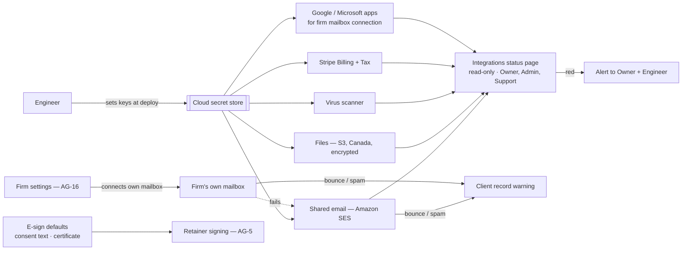

> **Document control** · Version **2.10** · **2026-10-17** · Status: **Second pass (17 Oct) applied: Google from day one, send-only route dropped (AG16-70); provider list and Gmail routes each in one home, Nylas a one-line before-go-live item, Embedded Signup wording (AG16-54 #23, #25); open questions 6 – 11 handled (AG16-55). Earlier: AG16-37, AG16-48 and AG16-53 applied (17 Oct): provider and go-live requirements with build cards (SA-8-68 – SA-8-74). Earlier status (v2.8): AG-16 decisions applied (14 Oct): no shared WhatsApp number, no payment fallback, firm and personal mailboxes, personal calendars only, AI provider change notice. Earlier status: Reviewed — template-map decisions of 10–12 Oct applied (SA8-D28 – SA8-D35); staff-roles session 2 and Rule 9 pass applied (SA8-D36 – SA8-D41)**\
> Part of: *Super Admin Console — Functional Requirements* · Split from `FINAL-SuperAdmin-FR.md` lines 4485–5113 on 2026-09-16 · Previous version: `_archive/SA-08-platform-integrations-and-infrastructure-rails_v2.9_2026-10-17.md` (v2.8, v2.7 and v2.5 are also in `_archive/`; v2.4, the co-product owner's review copy, and v2.2 are also in `_archive/`)\
> Reviewed by: the product owner (product owner), 2 Oct 2026 (review) and 9 Oct 2026 (merged into the master set and reconciled with the Agent documents) and 12 Oct 2026 (template-map decisions applied; staff-roles session 2 and Rule 9 pass applied) · Code state checked against local `dev` checkouts: backend `ERv2-sanitized` @ `4d9999e2` (2026-10-05) and frontend `ERv2-frontend` @ `f4fccf13` (2026-10-07) — **not same-day**, see §12 (items added in v2.6: backend `db646bf7` of 10 Oct and frontend `8511b27e` of 11 Oct, from the 12 Oct code check; local checkouts)
>
> **Hand-over scope (12 Oct)**\
> **Ready for development now:** everything in SA-08.\
> **Dependencies outside SA-08:** the "Before go-live" tasks in §13 (SES production access; WhatsApp provider contract and business verification; Google and Microsoft app registration; ExpatReady's default e-sign wording) and the knock-on rows still Pending in other documents — AG review: SA8-X14, SA8-X15, SA8-X21, SA8-X22, SA8-X23; other documents: SA8-X16 (SA-12), SA8-X19 (Phasing & Glossary, Overview). *(revised same day — hand-over scope)*
>
> | Version | Date | Change | Decisions |
> |---|---|---|---|
> | 2.10 | 2026-10-17 | **Second pass (AG16-54, AG16-55, AG16-70), SA-8 items.** **AG16-70:** Gmail send-only route (`gmail.send`) **dropped**; "Continue with Google" (read, file, send) is a **launch requirement**; Google Cloud project, consent screen, domain and brand verification, privacy policy and scope justification start now; the Gmail connection is submitted for verification and CASA **at least 10 weeks before launch**; pilot firms use "Continue with Google" before approval within Google's 100-user allowance for unverified apps; "Other provider (IMAP/SMTP)" with an app password is always available with a guided screen; decision trigger at **launch − 6 weeks**: Nylas or the app-password route (SA8-D43, SA-8-68, SA-8-69 rewritten). **AG16-54 #23:** provider list has one home (SA8-D31 + SA-8-57) and Gmail routes one home (SA-8-69), other places point to them; **Nylas card SA-8-74 withdrawn** and replaced by one line in the before-go-live list. **#25:** build on Meta's current Embedded Signup version; the "v2 retires 15 Oct 2026" note removed (SA8-D43(4), SA-8-72). **#6:** SA8X25 stays Pending, closes after the fix pass. **AG16-55:** Q11 closed (trigger date, AG16-70(7)); Q6 narrowed (guided screen decided); Q7 – Q10 stay open (no default stated); Q12 added. Build cards SA-8-68, SA-8-69 rewritten, SA-8-72 changed, SA-8-74 withdrawn. *Same-day fixes (17 Oct): AG16-83 – AG16-88 — §13 Q12 closed: ExpatReady operations tracks Google's 100-user count in the Google console; pilot firms are told once about Google's warning screen (AG16-83 #24).* *Same-day fixes (18 Oct): AG16-90 — cards SA-8-70, SA-8-71 and SA-8-73 gained "Clicks:" and "Person decides:".* *18 Oct: new section 'Decisions that change this epic' (index of AG16 decisions; no requirement changed).* *Same-day fixes (18 Oct): AG16-98, AG16-99 — SA8-D31 one line: the firm never picks a provider; which WhatsApp company ExpatReady contracts is a before-go-live task here, not a firm question (AG16-98; wording only). SA8-D43(5): until Zoom approves the app, "Connect Zoom" is hidden (AG16-99).* | AG16-54, AG16-55, AG16-70, AG16-98, AG16-99 |
> | 2.9 | 2026-10-17 | **Providers and go-live decisions applied (the product owner, 14–17 Oct), only where SA-8 is affected; build cards added (BUILD-CARD-STANDARD).** **Gmail has three routes (AG16-37):** (a) "Other provider (IMAP/SMTP)" with an app password from day one, no Google review; (b) send-only through `gmail.send` once Google verification passes; (c) full "Continue with Google" after Google verification and the annual CASA assessment. ExpatReady starts verification and CASA now; Nylas is the fallback if the launch date cannot wait (the data-transit review the research raises is an open question only). **Microsoft (AG16-37):** tenant-admin approval flow and free publisher verification (replaces AG-10-67's "a similar approval"); shared mailboxes use delegated `.Shared` permissions and are polled. **WhatsApp (AG16-48):** the chosen provider must support coexistence and Meta's current Embedded Signup version. **Zoom (AG16-53):** added to the provider list; Zoom Marketplace approval is a go-live item. SA8-D31 changed; SA8-D43 added; SA-8-68 – SA-8-74 added with build cards; SA-8-42, SA-8-50, SA-8-57, BR-1 changed; §3.7, §3.9, §0.3, §7, §12, §13 and the before-go-live list updated; open questions 6–11 added. | AG16-37, AG16-48, AG16-53 |
> | 2.8 | 2026-10-14 | **AG-16 review decisions applied (the product owner, 14 Oct), only where SA-8 is affected.** **No shared WhatsApp number (AG16-19):** WhatsApp works only through the firm's own connected account; with no connection, no approved template, or a Paused or Rejected template, the message goes by email; the shared-rail fallback applies to email only (SA8-D25, SA8-D39, §3.4, §3.7, SA-8-50). **No payment fallback (AG16-17):** client money never passes through ExpatReady; when a firm's payment account is paused, failed or disconnected there is no fallback to platform processing (§3.5, SA-8-64, new SA-8-67). **Mailboxes (AG16-15):** the firm may connect one shared mailbox and each person their own (SA8-D17, SA8-D18, SA-8-11, §3.4, §3.7). **Calendar (AG16-18):** personal only; no firm-wide calendar connection (SA8-D26, §3.7). **AI provider change (AG16-20 (4)):** the Owner is emailed before a change of AI provider takes effect (new SA8-D42, SA-8-66). No "Drafter" wording existed in this document; nothing renamed. Requirements SA-8-66, SA-8-67 added; SA-8-11, SA-8-50, SA-8-64 changed. | AG16-15, AG16-17, AG16-18, AG16-19, AG16-20 |
> | 2.7 | 2026-10-12 | **Staff-roles session 2 and Rule 9 pass applied (the product owner approved the write on 12 Oct).** **Own payment account (SA-Q1):** connecting the firm's own payment account is on **every plan**, through the provider's hosted sign-up; paid consultations and pay-by-card invoices work on every plan; no payment-plan extra in Release 1 (new SA-8-64, SA8-D36). **Signing-link expiry (SA-Q2):** a firm setting held in AG-05 (default 14 days, Advanced, new requests only, "Send again"); SA-8 stops listing it — SA8-D21, SA-8-20, §3.8, §7 and the overview diagram changed; §13 Q1 closed (SA8-D37). **Role names (SR-Q3):** Content author → Content publisher; "Platform engineer" is not a console role (the engineer is outside the console); the Integrations status page is visible to Owner, Admin and Support (SA8-D15, SA-8-41, §10). **Calendar (R16):** each staff member connects their own calendar (SA8-D26, §3.7, SA-8-23, SA-8-51). **Rule 9 pass:** deploy configuration versus settings listed in new §3.9 (SA8-D38); "Connect Gmail" / "Connect Microsoft 365" buttons on the main path and IMAP under Advanced ("Other provider"); the firm's own e-sign consent text, the per-message WhatsApp approval list and signing-link expiry under Advanced. **WhatsApp (R9-24, SA05-Q11, G-Q2):** guided connect, one status line, "Paused" added to the template statuses (treated like Rejected), and the opt-in recorded as the consent purpose "WhatsApp opt-in" (covers service and marketing) (SA8-D39). **Status page (R9-25):** each red line says what to do or who to call; the stuck-queue limit is fixed in code — §13 Q4 closed (SA8-D40, new SA-8-65). **Default e-sign consent text (R9-26):** a firm-facing starter, not an ExpatReady email — Content publisher publishes it with the 7-day notice (SA8-D28, SA-8-53); §13 Q2 closed. **Own-mailbox failure (R9-27):** the notice goes to the firm's Owner and Admins, email on by default (SA8-D41, SA-8-39). §13 Q5 closed; Q3 stays open. Changed decisions: SA8-D15, D17, D18, D21, D26, D28, D29, D34; new: SA8-D36 – SA8-D41. Requirements: **changed** SA-8-15, 20, 23, 39, 41, 42, 51, 53, 55, 61, 62, 63; **withdrawn** none; **added** SA-8-64, SA-8-65. §0.2: SA8-X11, X12, X13, X14, X17 updated; new rows SA8-X20 – SA8-X24 pending. **Same-day revision (W-4 – W-10, the product owner, 12 Oct):** W-10(3) confirms that ExpatReady's e-sign certificate wording is published by the Content publisher (or Platform Owner) like the default consent text (SA8-D28, SA-8-53). **Same-day revision (W-11 – W-21, the product owner, 12 Oct):** text fixes only (W-21) — hard bounces and spam complaints are platform-wide (SA05-Q10), unsubscribe and STOP are per firm, the payment-log key split is a developer task (W-3(6)), and the own-mailbox failure email is listed in §3.9. **Same-day revision (W-17, W-23, W-24 and hand-over scope, the product owner, 12 Oct):** W-23 closes §13 Q3 — the separate `system/esign-settings:edit` and `:publish` stay, held by Content publisher and Platform Owner, and are not folded into `system/template:*` (e-sign wording is not a message template — SA-05 A.15); §10 notes and SA8-X13 updated. §0.2: SA8-X17, X18 and X20 marked Applied after checking SA-09 v2.4, SA-04 v2.21 and SA-03 v2.20. A "Hand-over scope (12 Oct)" block is added under the document-control line. W-17 and W-24 change SA-05 only. | SA-Q1 · SA-Q2 · SR-Q3 · R16 · R9-24 – R9-27 · SA05-Q8, Q11 · G-Q2 · Rule 9 pass SA-07 / SA-08 |
> | 2.6 | 2026-10-12 | **Template-map decisions of 10–12 Oct applied (the product owner approved the write on 12 Oct).** **E-sign (map §3 revised 11 Oct; Q13, Q16; rule 7; SA5-X13(a)):** no recorded SME / counsel check and no Owner sign-off — ExpatReady's default consent text and certificate wording publish through the normal flow; the certificate is ExpatReady-owned, fixed and factual (signer, time, method, document fingerprint; no claim of legal effect); a firm's replacement consent text is a firm setting under "Manage legal settings", versioned, new signing requests only; the SME note field, the content-author SME example, the SME step in US-8 and the go-live SME task are removed; SA8-D22 superseded, SA8-D21 changed. **R32:** e-sign evidence is always time, IP, device and consent (no setting); mailbox and WhatsApp providers are fixed in code (Gmail, Microsoft 365, IMAP + one WhatsApp provider; emergency off by the kill switch, R14) — SA8-D18 and SA8-D25 changed; upload limits stay the built constants 25 MB / 10 MB (`upload-validation.ts:44-60`), not an SA-12 setting. **Sending by route (map decision 1 as corrected, Q9, Q10, Q11, §17 #4; SA-05 §3.6.5):** stated in §3.4 — shared email skips marketing to people with no recorded consent, own mailbox warns only, automatic marketing skips everywhere, the route actually used decides after a fallback, unsubscribe / STOP are automatic and block on every route, WhatsApp needs opt-in for any message the firm starts. **WhatsApp (Q12, R25; SA5-X13(b)):** ExpatReady submits the starter versions when a firm connects, status per firm per template, old approved text kept during a notice, the opener; closes AG-10 Q18. **Status page:** failed invoice-copy line with automatic retry (R31) and a stuck-queue / failed-job line (R11). **Requirements:** SA-8-20, SA-8-22, SA-8-50 changed; SA-8-43 withdrawn; BR-1, BR-8, BR-14 changed; SA-8-52 – SA-8-63, BR-18, BR-19, US-10 – US-13 added; US-8 changed. **§0.2:** SA8-X7 and SA8-X8 partly superseded, SA8-X10 extended, SA8-X12 – SA8-X19 added (Pending); SA5-X13 recorded as applied. Open questions 1–5 added (not decided). | SA8-D28 – SA8-D35 · map Q9 – Q13, Q16, R11, R14, R25, R31, R32, decision 1, §3, §17 #4 · SA5-X13 |
> | 2.5 | 2026-10-10 | **Merged into the master set (the product owner, 10 Oct).** The co-product owner's v2.3 / v2.4 (written outside the master) taken as the base and reviewed point by point. Kept as written, except: **WhatsApp is Release 1** (SA8-D25 — reverses the WhatsApp part of SA8-D19; the Agent decisions AG11-D6 / AG11-D18 stand; SMS stays Phase 3); **firm calendar linking is Release 1** (SA8-D26 — reverses SA8-D20; AG-16-13 stands); **allowed upload types add Excel, TIFF and ZIP**, with ZIP rules (SA8-D27 — extends SA8-D2). SA8-X1 and SA8-X11 withdrawn; SA8-X2 to SA8-X9 applied in this merge (statuses in §0.2). SA-8-16, SA-8-23, SA-8-37 changed; SA-8-49 – SA-8-51 added. | SA8-D25 – SA8-D27 |
> | 2.4 | 2026-10-10 | **Brought into the 10 Oct master set** (v2.3 was written on 9 Oct in a parallel copy and was not in this set; it is now in `_archive/`). **Knock-ons from 10 Oct:** (1) SA-04 v2.15 SA4-X13 — Stripe proration granularity set to **daily** in the payment-rail configuration, recorded with the rail settings (new SA-8-48, §3.5); (2) SA-03 v2.16/2.17 feature catalogue row #26 ("Own email, calendar, payment or WhatsApp account", sellable extra) — SA-3 to note that WhatsApp is available from Phase 2 and calendar linking later (new §0.2 SA8-X11). No decision changed. | SA4-D27 (SA4-X13) · SA3-D10 |
> | 2.3 | 2026-10-09 | **Product review applied** (review of 2 Oct, kept outside the master until today) and **reconciled with the Agent documents decided on 5 Oct** (AG-10, AG-11, AG-16, AG-5 v1.9). **Keys:** Expat Ready's own service keys are set by the engineer at deploy — never in the console; a read-only **Integrations status page** with alerts (Owner, engineer, Support). **Uploads:** virus scan before staff open a file; allowed file types. **Email:** firms email clients **from day one on the platform's shared email** and may connect their **own mailbox** (Gmail, Microsoft 365, IMAP — Release 1) to send from their domain and file inbound replies; automatic fallback; bounce and spam warnings on the client's record; real sending (SES out of sandbox) for launch. **E-signature in Release 1** (AG-5): SA-8 holds the e-sign settings; consent and certificate wording approved by the Owner after an SME check. **Stripe** goes live only after the Owner's written confirmation. Invoice copies stay in the locked billing area of the Canadian storage (as built). **Later:** WhatsApp (Phase 2), Google staff sign-in (Phase 2), SMS (Phase 3), calendar linking, per-country routing. **Removed:** console key screens, rotation / rollback UI, connectivity tests, health telemetry and graphs, webhook registry screen, residency generator, Cognito. §12 rewritten — v2.2's described an older codebase with plaintext secrets that no longer exists. SA-8-1 – SA-8-35 changed or withdrawn; SA-8-36 – SA-8-47 added. | SA8-D1 – SA8-D24 (D3 – D5, D10, D11, D13, D14, D16 superseded) · applies AG11-D14, AG11-D16, AG-5 v1.9, SA4-D20, SA4-D22, SA7-D57 |
> | 2.2 | 2026-10-02 | SA-7 role names used throughout (SA7-X10, SA7-D8): "Tenant Account Manager" → "Firm onboarding / Account manager", "Billing Admin" → "Billing". Requirements unchanged. | SA7-X10 |
> | 2.1 | 2026-10-01 | Applied from SA-07 v2.6 (the product owner, 1 Oct): Google Workspace sign-in for staff (operator-SSO app credentials in the identity-provider rail) moves to Phase 2; at launch staff use the built email + password + second step; SA-8-18 changed; firm and client identity content unchanged (SA7-D25, SA7-D57). | SA7-X9 |
> | 2.0 | 2026-06-20 | Baseline — golden per-module rebuild | — |

## Decisions that change this epic (14–18 Oct) *(new 18 Oct)*

Product-wide rules (apply here as everywhere; home: Agent `00-Overview` → "Product rules every epic follows"): AG16-31, AG16-33, AG16-42, AG16-44, AG16-76.

The "AG16" prefix is historical: these decisions began in the AG-16 review and apply across the product. Full text: `TEMPLATE-MAP-working_2026-10-10.md`.

| Decision | What was decided (one line) | What it changes in this epic | Where (requirement / card / section) |
|---|---|---|---|
| AG16-15 | Mailboxes: firm and personal, nothing required. | The firm may connect one shared mailbox and each person their own. Changed in v2.8 (v2.8 wording: a firm mailbox and personal mailboxes). | SA8-D17, SA8-D18, SA-8-11, §3.4, §3.7 |
| AG16-17 | Payment account down: money never falls back. | Client money never passes through ExpatReady. When a firm's payment account is paused, failed or disconnected there is no fallback to platform processing. New card SA-8-67; SA-8-64 changed. | SA8-D42, §3.5, SA-8-64, SA-8-67 |
| AG16-18 | Calendars: personal only, with "choose which calendars". | No firm-wide calendar connection; each staff member connects their own. SA8-D20 reversed. | SA8-D26, §3.7, SA8-D20 note |
| AG16-19 | No shared ExpatReady WhatsApp number. | WhatsApp works only through the firm's own connected account; with no connection, no approved template, or a Paused or Rejected template, the message goes by email. The shared-rail fallback applies to email only. | SA8-D25, SA8-D39, SA8-D42, §3.4, §3.7, SA-8-50 |
| AG16-20 | AI switch details (Owner-only on, as recommended). | New requirement: the Owner is emailed before a change of AI provider takes effect (provider stays in Canada, no training, no retention). | SA8-D42, SA-8-66 |
| AG16-24 | Own mailbox and own calendar on every plan. | Referenced only (no change here). The mailbox card notes plan entitlement is every plan. | SA-8-69 (Access) |
| AG16-25 | Mailbox roles, solo setup, and how email data separates. | Referenced only (no change here). The card says the person chooses the route and what the mailbox brings in. | SA-8-69 (Person decides) |
| AG16-37 | Mailbox go-live essentials. | SA-8 becomes the home for providers and go-live. Gmail routes (v2.9 had three; reduced by AG16-70); Microsoft tenant-admin approval flow and free publisher verification; shared mailboxes use delegated .Shared permissions and are polled. Build cards SA-8-68 to SA-8-73 added. | SA8-D31, SA8-D43, §3.7, §3.9, SA-8-68 to SA-8-73 |
| AG16-48 | WhatsApp: keep the firm's existing number and app (coexistence). | The chosen WhatsApp provider must support coexistence and Meta's current Embedded Signup version. | SA8-D31, SA8-D43(4), SA-8-72 |
| AG16-52 | Connecting one's own mailbox or calendar needs no permission. | Personal mailbox and own Zoom need no permission; the firm mailbox keys stay Owner and Admin. The old calendar and personal-mailbox keys are noted as conflicting and left to SA-06. | SA-8-69 Access, SA-8-70 Access, SA-8-73 rule 3 and Access, §12 permission note |
| AG16-53 | Video links are per person; no firm video account. | Zoom added to the provider list; Zoom Marketplace approval is a go-live item; connecting one's own Zoom needs no permission. | SA8-D31, SA8-D43(5), SA-8-73 |
| AG16-54 | 25 consistency fixes after the 17 Oct write (batch). | #23: provider list has one home (SA8-D31 + SA-8-57) and Gmail routes one home (SA-8-69); card SA-8-74 (Nylas) withdrawn, replaced by one line in the before-go-live list. #25: build on Meta's current Embedded Signup version; the old "v2 retires" note removed. #6: SA8-X25 stays Pending. | SA8-D43(4), SA-8-72, SA-8-74 (withdrawn), SA8-X25, §13 |
| AG16-55 | Writers' recommended defaults accepted for the detail questions. | Open Question 11 closed; Q6 narrowed; Q7 to Q10 stay open (no default stated); Q12 added. | §13 Q6 to Q12 |
| AG16-70 | Google from day one; send-only route dropped. | The Gmail send-only route (gmail.send) is dropped. "Continue with Google" (read, file, send) is a launch requirement: Google verification and CASA start now, submitted at least 10 weeks before launch. "Other provider (IMAP/SMTP)" with an app password is always available. Decision trigger at launch minus 6 weeks. | SA8-D43, SA-8-68, SA-8-69, §3.9 go-live line, SA8-X25 |
| AG16-82 | One rule for every broken connection. | Pointer only: the one rule for broken connections lives in AG-16; the route-failure line points to it. | SA-8-69 rule 5 |
| AG16-83 | 26 follow-through fixes after the second pass (batch A). | Open Question 12 closed (#24): ExpatReady operations tracks Google's 100-user count in the Google console; pilot firms are told once about Google's warning screen. | SA-8-68, §13 Q12 |
| AG16-88 | Release 1 is English-first; French later. | Cited — see change-log row 2.10 (cited only in the range AG16-83 to AG16-88); no requirement here names it. | Document control (v2.10) |
| AG16-90 | Batch C: consistency fixes from the 17 Oct audit. | Cards SA-8-70, SA-8-71 and SA-8-73 gained "Clicks:" and "Person decides:"; the WhatsApp connect card cites the current SA-06 row. | SA-8-70, SA-8-71, SA-8-72 (Access), SA-8-73 |
| AG16-98 | Providers fixed in code; vendor chosen by ExpatReady. | A25 and SA8-D31 agree: the firm never picks a provider (one supported provider per service, fixed in code); which WhatsApp company ExpatReady contracts is a before-go-live task in SA-8, not a firm question. Wording only. | SA8-D31 · §13 before go-live |
| AG16-99 | "Connect Zoom" hidden until Zoom approves the app. | Until the Zoom Marketplace approval (SA8-D43(5)) the button is not shown; Zoom users save their personal room as "My meeting link"; Meet and Teams links come from the calendar. | SA8-D43(5) · SA-8-73 |

## Module SA-8: Platform Integrations & Infrastructure Rails

> **What this document is.** The build specification for Super Admin module SA-8. Version 2.3 applies the product review of 2 Oct 2026, reconciled on 9 Oct with the Agent documents decided on 5 Oct; version 2.6 applies the template-map decisions of 10–12 Oct 2026; version 2.7 applies the staff-roles (session 2) and Rule 9 decisions of 12 Oct 2026. **§0** records each decision and the phasing; every later section has been edited in place to match. Where an earlier version says something different, this version wins; earlier wording is kept only in `_archive/`.
>
> **What SA-8 is — for the firm.** The outside services the platform runs on, made **reliable and safe**: a firm can email its clients from day one (and from its own mailbox when it connects it), clients' uploads are virus-checked and stored in Canada, clients sign retainers in the portal, payments work, and Expat Ready knows within minutes when a service breaks. The platform services: **email** (Amazon SES, shared), **file storage** (Amazon S3, Canada), **virus scanning**, **payments** (Stripe Billing + Stripe Tax — SA-4), **e-signature settings** (in-house Signer — AG-5), and the **Google and Microsoft app registrations** that let firms connect their own mailbox and calendar, and the **WhatsApp provider connection** for firms' own WhatsApp *(v2.5 — SA8-D25, SA8-D26)*. Later: SMS, Google sign-in for staff.
>
> **Two kinds of connection — never mixed.** (1) **Expat Ready's own services** (SES, S3, scanner, Stripe for subscriptions, the Google / Microsoft apps): their keys are held by the engineer and never appear in any console (SA8-D1). (2) **A firm's own connections** (its mailbox, calendar and WhatsApp *(v2.5)*, and its own Stripe for client payments): the firm enters or authorises them in its settings; they are encrypted and never shown again (AG-16 §3.4).
>
> **Plane:** GLOBAL. **Permissions:** `system/*` only (SA1-D8). **Region:** Canada (Montréal) for everything Expat Ready stores.
>
> **Requirement IDs are permanent.** A changed requirement keeps its number. A withdrawn requirement stays as a one-line entry. New requirements continue from SA-8-75; next decision SA8-D44; next cross-module row SA8-X26; next business rule BR-20; next user story US-14. *(changed v2.9: the v2.8 counters were stale — SA-8-66, SA-8-67 and SA8-D42 were already used.)* Numbers are never reused.

---

### 0. Decision log

**Review of 2 Oct 2026**

| ID | Decision | Where applied |
|---|---|---|
| **SA8-D1** | **Expat Ready's own service keys are set by the engineer in the cloud secret store at deploy** — never entered, shown or changed in the console, not even by the Owner. The console has a read-only **Integrations status page** (per service: working or not, mode, region, last error) with **alerts to the Owner and engineer** when a service goes red. Firm-owned connection credentials are entered by the firm (AG-16) and are not covered by this rule. | §3.1, §3.2 · SA-8-1 – SA-8-5, SA-8-26 |
| **SA8-D2** | **Virus scan first, always, plus allowed file types.** Staff can open a file only after a clean scan (seconds); the client sees "Uploaded ✓" at once. Accepted: PDF, JPG, PNG, HEIC, Word *(v2.5 — SA8-D27: plus Excel, TIFF and ZIP)*. Scanner down → files wait and the engineer and Owner are alerted. Infected → quarantined, firm told. | §3.3 · SA-8-36, SA-8-37 |
| **SA8-D3** | ~~Firm-to-client email only from the firm's own verified domain~~ — *superseded 9 Oct by SA8-D17.* | — |
| **SA8-D4** | ~~No client email until the firm's domain is verified~~ — *superseded 9 Oct by SA8-D17.* | — |
| **SA8-D5** | ~~Including portal security emails~~ — *superseded 9 Oct by SA8-D17.* | — |
| **SA8-D6** | **Bounces and spam complaints** show on the client's record ("emails to … bouncing since <date>"); sending to that address stops until the firm corrects it. Applies whether the email went through the shared service or the firm's own mailbox. **Hard bounces and spam complaints are platform-wide (SA05-Q10); the warning on the client's record stays** *(revised same day — W-21)*. | §3.4 · SA-8-40 |
| **SA8-D7** | **Stripe test → live** is an engineer deploy step after the **Owner confirms in writing**; the status page shows TEST / LIVE; the Owner is alerted on any mode change. | §3.5 · SA-8-13 |
| **SA8-D8** | **Per-country data routing is deferred** until a second country is planned; all data stays in Canada. | §3.6 · SA-8-30, SA-8-32 |
| **SA8-D9** | **The data-location statement is written once** (subscription terms and a firm-facing Security & privacy page, maintained in SA-11) — no generator. | §3.6 · SA-8-31 |
| **SA8-D10** | ~~SMS / WhatsApp gateway: Phase 3~~ — *changed 9 Oct by SA8-D19.* | — |
| **SA8-D11** | ~~Firm calendar / mailbox link later, with the Scheduler~~ — *changed 9 Oct by SA8-D18 (mailbox) and SA8-D20 (calendar).* | — |
| **SA8-D12** | **No webhook registry screen and no health history / graphs in the console.** Stripe's notification log (SA-4), the bounce display (D6) and the status page with alerts (D1) cover it; engineers use Amazon monitoring. | SA-8-27, SA-8-28 |
| **SA8-D13** | ~~Per-country e-signature settings later~~ — *superseded 9 Oct by SA8-D21.* | — |
| **SA8-D14** | ~~Forms and retainers signed outside Expat Ready and uploaded~~ — *superseded 9 Oct by SA8-D21.* | — |
| **SA8-D15** | *(changed v2.7 — SR-Q3)* **The Integrations status page is read-only for the Owner, Admin and Support.** (The engineer is not a console role.) | §3.2 · SA-8-41 |
| **SA8-D16** | ~~Phasing of 2 Oct~~ — *replaced 9 Oct by SA8-D24.* | — |

**Merge into the master and reconciliation with the Agent documents, 9 Oct 2026**

| ID | Decision | Where applied |
|---|---|---|
| **SA8-D17** | **Firms email clients from day one** through the platform's **shared email service** (shown as the firm's name, replies to the firm's address); a firm **may connect its own mailbox / SMTP** to send from its own domain (AG-16 §3.4) *(changed v2.8 — AG16-15: one shared firm mailbox, and each person may also connect their own)*; if the firm's connection fails, sending **falls back to the shared service** and the firm is told. *(Changed v2.6: after a fallback the marketing rule of the route actually used applies — SA8-D33.)* *(Changed v2.7 — R9-27, SA8-D41: the failure notice goes to the firm's Owner and Admins, email on by default.)* | §3.4 · SA-8-9, SA-8-38, SA-8-39 |
| **SA8-D18** | **Firm mailbox connection is Release 1** (AG11-D16): Gmail and Microsoft 365 by OAuth, plus IMAP, for inbound filing and own-domain sending *(changed v2.8 — AG16-15: a firm mailbox and personal mailboxes)*. SA-8 provides the **Google and Microsoft app registrations** (engineer-held keys, D1); ~~Super Admin approves the providers used (AG11-D14).~~ *(changed v2.6 — SA8-D31: the provider list is fixed in code.)* *(Changed v2.7 — Rule 9 pass: "Connect Gmail" and "Connect Microsoft 365" are the main buttons; IMAP sits under Advanced as "Other provider".)* | §3.7 · SA-8-23, SA-8-24, SA-8-42 |
| **SA8-D19** | ~~**WhatsApp: Phase 2;**~~ **SMS: Phase 3.** *(changed v2.5 — SA8-D25: WhatsApp is Release 1; the Agent decisions AG11-D6 / AG11-D18 stand.)* | SA-8-16, SA-8-17 |
| **SA8-D20** | ~~**Firm calendar linking: later**~~ *(changed v2.5 — SA8-D26: calendar linking is Release 1, as AG-16-13 says.)* | SA-8-23 |
| **SA8-D21** *(changed v2.7 — SA-Q2; v2.6)* | **In-house electronic signature is Release 1** (AG-5 v1.9): the client signs in the portal, the firm countersigns, a signed-on-paper upload is still allowed. SA-8 holds the **e-sign defaults** for Canada — ExpatReady's default consent text (the firm's Owner may replace it — SA8-D29), and the fixed factual certificate wording (SA8-D28). Evidence captured is fixed in code (SA8-D30). *(Changed v2.7 — SA-Q2: the signing-link expiry is a firm setting held in AG-5 and is no longer listed here — SA8-D37.)* | §3.8 · SA-8-20 – SA-8-22 |
| **SA8-D22** | ~~**E-sign consent and certificate wording:** drafted by the content manager, Immigration SME / counsel check recorded, approved and published by the Owner; changes apply to new signatures only (same rule as SA5-D9).~~ — *superseded 12 Oct by SA8-D28 (no recorded SME / counsel check, no Owner sign-off). The new-signatures-only rule is carried forward in SA5-D25 and SA-8-22.* | — |
| **SA8-D23** | **Expat Ready's invoice and credit-note copies stay in the locked billing area of the Canadian documents storage**, as built (access limited to the billing area, 6-year retention, holds). SA4-X11's "separate bucket" changes to match. | §3.6 · SA-8-44 |
| **SA8-D24** | **Phasing** — see §0.3. | §0.3 |

**Merge into the master, 10 Oct 2026 (the product owner)**

| ID | Decision | Where applied |
|---|---|---|
| **SA8-D25** | **WhatsApp is Release 1.** The firm connects its own WhatsApp account (AG-16-38) through the one WhatsApp provider fixed in code (SA8-D31; *changed v2.6 — was "a provider approved by Super Admin, AG11-D14"*); inbound messages and proactive outbound messages per AG11-D6 / AG11-D18 stand. *(Changed v2.8 — AG16-19: there is no shared ExpatReady WhatsApp number; with no firm connection the message goes by email.)* SA-8 provides the provider connection (keys held by the engineer — SA8-D1) and shows it on the status page. Reverses the WhatsApp part of SA8-D19; SMS stays Phase 3. ~~WhatsApp message wording is decided in the template management review.~~ *(Decided v2.6 — SA8-D34: each short client message has a WhatsApp version, submitted by ExpatReady, approval status per firm per template, opener, opt-in.)* | SA-8-16 · SA-8-50 · §0.1 · §0.3 |
| **SA8-D26** | *(changed v2.7 — R16)* **Firm calendar linking is Release 1** (AG-16-13): **each staff member connects their own** Google or Microsoft calendar; bookings are written to the host's calendar and their free/busy is honoured. SA-8 provides the Google and Microsoft app registrations for calendar as well as mailbox. Reverses SA8-D20. *(Changed v2.8 — AG16-18: calendars are personal only; there is no firm-wide calendar connection.)* | SA-8-23 · SA-8-51 · §3.7 · §0.1 · §0.3 |
| **SA8-D27** | **Allowed upload types: PDF, JPG, PNG, HEIC, Word, Excel, TIFF and ZIP.** A ZIP is unpacked and every file inside is virus-scanned and must itself be an allowed type (files that are not are listed and dropped); a **password-protected ZIP** and a **ZIP inside a ZIP** are refused with a clear message. Extends SA8-D2. | §3.3 · SA-8-37 · SA-8-49 |

**Template-map decisions, 12 Oct 2026 (the product owner)**

| ID | Decision | Where applied |
|---|---|---|
| **SA8-D28** | **E-sign default wording publishes normally; the certificate is fixed and factual.** No recorded SME / counsel check and no Owner sign-off: ExpatReady's default consent text and certificate wording are published through the normal publishing flow by a Content publisher or the Platform Owner (map Q16; SA5-D24) *(confirmed — W-10(3): the certificate wording is published like the consent text)*. *(Changed v2.7 — R9-26: the default consent text is a firm-facing starter, not an ExpatReady email, so SR-Q2 does not apply to it; it follows the 7-day update notice with "Keep my current wording", SA05-Q8.)* Expert input while writing is optional background work, never recorded or claimed. The **certificate** on the executed copy is ExpatReady-owned, fixed and a factual record only — signer, time, method, document fingerprint; it makes no claim of legal effect and firms cannot edit it. Supersedes SA8-D22. | §3.8 · SA-8-53, SA-8-54 · BR-14 |
| **SA8-D29** | **The firm's own consent text.** SA-8 holds ExpatReady's **default** consent text only. A firm's Owner (or any holder of the firm permission "Manage legal settings" — Q13, SA5-D47) may replace it in the firm's settings (AG-5): the replacement is versioned and applies to **new signing requests only**; the signature record names the consent-text version the client accepted. The portal consent screen (CP-1-13) is a different text and is not held here (SA-05 A.15). *(Changed v2.7 — Rule 9 pass: the replacement sits under Advanced; the default is ExpatReady's text.)* | §3.8 · SA-8-55 · SA-8-22 |
| **SA8-D30** | **E-sign evidence is fixed in code** (R32): every signature captures time, IP address, device and consent given. There is no "evidence options" setting. | §3.8 · SA-8-56 |
| **SA8-D31** *(changed v2.9 — AG16-37, AG16-48, AG16-53)* | **Providers are a fixed list in code** (R32): Gmail, Microsoft 365 and IMAP for mailbox; Google and Microsoft for calendar; **Zoom for per-person video links** *(v2.9 — AG16-53)*; one WhatsApp provider *(v2.9 — AG16-48: the chosen provider MUST support coexistence and Meta's current Embedded Signup version; not yet chosen — §13 Q8)*. Adding a provider is a release. "Super Admin approves the providers" (SA8-D18, SA-8-23 wording, AG11-D14) is a one-time product decision, not a console job; there is no allow-list screen. An emergency "off" for a provider uses the kill switch (R14; SA-12-12). *(changed 18 Oct — AG16-98)* The firm never picks a provider (one supported provider per service, fixed in code); which WhatsApp company ExpatReady contracts is a before-go-live task here (§13), not a firm question. | §3.7 · SA-8-57 · SA-8-72 · SA-8-73 · BR-1 |
| **SA8-D32** | **Upload size limits are built constants** (R32): 25 MB for documents, 10 MB for images — `upload-validation.ts:44-60` — not a setting in SA-12. | §3.3 · SA-8-58 |
| **SA8-D33** | **Sending rule by route** (map decision 1 as corrected; Q9, Q10, Q11; map §17 #4). SA-05 §3.6.5 holds the full table; SA-8 provides the routes and states the effect: on the **shared email**, marketing is not sent to people with no recorded marketing consent; from the firm's **own mailbox**, a manual marketing send warns only ("Send anyway?"); **automatic** marketing skips people without recorded consent on every route (logged); the **route actually used decides** after a fallback, and the firm is told who was not sent (Q9(3)); a person who **unsubscribed or replied STOP** is blocked on every route **within that firm** and the firm cannot override it *(revised same day — W-21)*; the **unsubscribe link and STOP handling are automatic**, cannot be removed, and use fixed ExpatReady wording (they protect ExpatReady's shared sending reputation). Bulk campaigns are always marketing (Q11). | §3.4 · SA-8-59, SA-8-60 · BR-18, BR-19 |
| **SA8-D34** | **WhatsApp templates and opt-in** (Q12, R25, decision 1 corrected). When a firm connects WhatsApp, **ExpatReady submits every starter WhatsApp version** to the firm's account; a firm's edit is resubmitted when it publishes; approval status is held **per firm per template** (Waiting for Meta / Approved / Rejected with Meta's reason / Paused — *v2.7, SA05-Q11*); while waiting, rejected or paused the message goes **by email**; during a 7-day update notice the new version is submitted at the start and the **old approved text keeps being used** until the new one is approved; WhatsApp versions exist for short client messages only. **Any** message the firm starts on WhatsApp, service or marketing, needs the client's WhatsApp opt-in — recorded as the consent purpose **"WhatsApp opt-in"**, which covers service and marketing and is fed by the import declaration (*v2.7, G-Q2*) — otherwise it goes by email; replies inside the 24-hour window are free text; the **conversation opener** (Must for firms with WhatsApp) also needs opt-in. Closes AG-10 Q18. Not built today (R25). | §3.7 · SA-8-61, SA-8-62 |
| **SA8-D35** | **Two more lines on the status page.** (a) **Invoice copies** (R31): a failed copy is retried automatically; if it still fails the line turns red and the engineer is alerted — replaces the daily exception report (not built). (b) **Background jobs** (R11): queue state and failed-job count, so a stuck queue is visible. | §3.2 · SA-8-52, SA-8-63 |

**Staff-roles session 2 and Rule 9 pass, 12 Oct 2026 (the product owner)**

| ID | Decision | Where applied |
|---|---|---|
| **SA8-D36** | **A firm's own payment account is on every plan (SA-Q1).** Connecting it is not a sellable extra: catalogue #26 keeps only own email, calendar and WhatsApp. Paid consultations (SA3-D25) and pay-by-card invoices (AG-6-14) work on every plan. The firm connects through the payment provider's **hosted sign-up**. No payment-plan extra in Release 1 (an invoice per instalment, R18). Not built today (only ExpatReady's own `stripe-billing.adapter.ts`). A per-payment application fee is a possible later decision, not taken. | §3.5 · SA-8-15, SA-8-64 · SA8-X20, SA8-X21 |
| **SA8-D37** | **Signing-link expiry is a firm setting in AG-5 (SA-Q2).** Default 14 days, under Advanced, next to the signing-reminder days; changes apply to **new** signing requests only; staff cannot edit one agreement's expiry — an expired link is re-sent with "Send again" (new link, fresh full period). SA-8 stops listing it. Not built today. Closes §13 Q1. | §3.8 · SA-8-20 · §7 · SA8-X22 |
| **SA8-D38** | **Deploy configuration versus settings (Rule 9 pass).** Deploy configuration or code, not console settings: Stripe test / live, email sending mode, upload types and sizes, the provider list, e-sign evidence (R32), proration, invoice-copy retries (R31), and the marketing route rules and unsubscribe (fixed). Firm-side, optional: "Connect Gmail" / "Connect Microsoft 365" buttons, each staff member's own calendar (R16), own payment account via hosted sign-up, WhatsApp. Advanced: firm IMAP ("Other provider"), the firm's per-message WhatsApp approval list, the firm's own e-sign consent text, signing-link expiry. Listed in §3.9. | §3.9 |
| **SA8-D39** | **WhatsApp connect and status (R9-24, SA05-Q11, G-Q2).** A guided connect flow; **one status line** for the firm — "WhatsApp ready" or "3 messages waiting for WhatsApp approval — sent by email meanwhile"; detail only on rejection. **"Paused"** is a template status, treated like Rejected: the message goes by email and Meta's reason is shown; no automated in-window acknowledgement in Release 1. The opt-in is one consent purpose, **"WhatsApp opt-in"**, covering service and marketing. | §3.7 · SA-8-61, SA-8-62 |
| **SA8-D40** | **Status page tells you what to do (R9-25).** Each red line says what to do or who to call. The "stuck jobs" limit is **fixed in code**, not a setting. Closes §13 Q4. | §3.2 · SA-8-63, SA-8-65 |
| **SA8-D42** *(new v2.8 — AG16-17, AG16-19, AG16-20)* | **Fallbacks and AI provider notice.** (1) **WhatsApp has no shared ExpatReady number** (AG16-19): it works only through the firm's own connected WhatsApp account; otherwise the message goes by email. The fallback to the shared rail applies to **email only**. (2) **Payment has no fallback** (AG16-17): client money never passes through ExpatReady; there is no fallback to platform processing. Behaviour on the client page and the firm alert: AG-06 and AG-16. (3) **AI provider change** (AG16-20 (4)): the provider stays in Canada, with no training and no retention; when ExpatReady changes it, the Owner is emailed **before the change takes effect**, naming the new provider; no re-acknowledgement. | §3.4 · §3.5 · SA-8-66, SA-8-67 |
| **SA8-D41** | **Own-mailbox failure notice (R9-27, map §15B).** When a firm's mailbox connection fails and sending falls back to the shared service, the notice goes to the firm's **Owner and Admins**, **email on by default**; fixed wording (not a template). | §3.4 · SA-8-39 |

**Providers and go-live, 17 Oct 2026 (the product owner)**

| ID | Decision | Where applied |
|---|---|---|
| **SA8-D43** *(new v2.9 — AG16-37, AG16-48, AG16-53)* | **SA-8 is the home for providers and go-live.** (1) **Gmail** *(changed v2.10 — AG16-70)*: "Continue with Google" (read, file, send) is a **launch requirement**; "Other provider (IMAP/SMTP)" with an app password is always available. The routes have one home, **SA-8-69**. ExpatReady **starts the Google setup now** (SA-8-68) and submits the Gmail connection at least 10 weeks before launch. **Nylas** is one line in the before-go-live list (§13), not a requirement; the data-transit and privacy review the research raises is an **open question only** (§13 Q7). (2) **Microsoft:** since late 2025 a tenant admin must approve apps that read mail (MC1163922); the connect screen detects "admin approval needed", offers **"Approve for your whole firm"** to an admin, otherwise **"Send this link to whoever manages your Microsoft 365"**; once per firm; ExpatReady completes free Microsoft publisher verification. This replaces AG-10-67's "a similar approval". (3) **Shared mailboxes on Microsoft** use delegated `.Shared` permissions and are **polled** (delta query), because change notifications on a shared mailbox need the application permission Mail.Read (research note §2). *(Source: the product owner's instruction of 17 Oct; the map text of AG16-37 does not mention shared mailboxes — §13 Q9.)* (4) **WhatsApp:** the chosen provider MUST support coexistence (the firm keeps its number and the WhatsApp Business app) and Meta's current Embedded Signup version (exact Meta limits are checked against Meta and the provider at build time) *(changed v2.10 — AG16-54 #25)*. (5) **Zoom** is added to the provider list; **Zoom Marketplace app approval** for ExpatReady is a go-live item; until approved, "Connect Zoom" is hidden (AG16-99). Meet and Teams links come from the host's connected Google or Microsoft calendar — no extra provider. | §3.7 · §13 before go-live · SA-8-68 – SA-8-73 |

**Aligned with decisions already final in reviewed modules**

| ID | Decision | Applied here |
|---|---|---|
| **SA4-D27 (SA4-X13)** | Proration by day, set in the payment processor's configuration | §3.5 · SA-8-48 |
| **SA4-D20 · SA4-D22** | Stripe Billing + Stripe Tax; Expat Ready keeps its own copy of every invoice | §3.5, §3.6 |
| **SA2-X8** | Switch on real email sending | SA-8-45 |
| **AG11-D14 · AG11-D16 · AG-16 §3.4** | Outside providers only for AI/OCR, WhatsApp and mailbox connections (*v2.6: a fixed list in code, not a console approval — SA8-D31*); own-account connections; the shared-rail fallback applies to email only — not WhatsApp (AG16-19) and not payment (AG16-17) | SA8-D17, SA8-D18 |
| **AG-5 v1.9** | In-house e-sign, client then firm countersign | SA8-D21 |
| **SA7-D57 · SA7-X9** | Staff sign-in is in-house; Google sign-in Phase 2 | SA-8-18 |
| **SA1-D8** | `system/*` keys only | §10 |

#### 0.1 Deferred and removed

| Item | Why | Reopen when |
|---|---|---|
| Console key entry, masking, rotation, rollback, connectivity tests, secret-hygiene card | SA8-D1 | Only if keys start changing often |
| Health telemetry log, error graphs, webhook registry screen | SA8-D12 | Not planned |
| Residency-declaration generator | SA8-D9 | With multi-region routing |
| Per-country / per-firm routing and buckets | SA8-D8 | Second country planned |
| SMS | SA8-D19 | Phase 3 |
| Google Workspace sign-in for staff | SA7-D57 | Phase 2 |
| Separate billing-archive bucket | SA8-D23 | Not planned |
| E-sign "evidence options" setting | SA8-D30 (R32) — evidence is fixed in code | Not planned |
| Super Admin provider allow-list / approval screen | SA8-D31 (R32) — fixed list in code | A provider is added by release |
| Upload size limit as an SA-12 setting | SA8-D32 (R32) — built constants | Not planned |
| Daily missing-invoice-copy exception report | SA8-D35 (R31) — immediate alert plus retry instead (never built) | Not planned |
| Recorded SME / counsel check and Owner sign-off on e-sign wording | SA8-D28 (Q16, rule 7) | Not planned |
| Signing-link expiry as an SA-8 setting | SA8-D37 (SA-Q2) — a firm setting in AG-5 | Not planned |
| Payment-plan extra / per-payment application fee | SA8-D36 (SA-Q1) — an invoice per instalment; fee a possible later decision | If asked for |

#### 0.2 Decisions that other modules must apply

| ID | Owner | Requirement text to apply | Status |
|---|---|---|---|
| **SA8-X1** | AG-10 · AG-11 · AG-16 | **WhatsApp moves to Phase 2** (SA8-D19): withdraw AG11-D18(a) proactive outbound WhatsApp and (b) unknown-number lead from Release 1, and AG11-D6 inbound WhatsApp; recipes send by email in Release 1. SMS Phase 3. | **Withdrawn v2.5** (SA8-D25 — WhatsApp stays Release 1) |
| **SA8-X2** | AG-16 | Own-account rails: **calendar connection later** (SA8-D20); mailbox connection Release 1 (unchanged); state that the shared email service shows the firm's name and replies go to the firm. Update the stale note that Stripe secrets are stored in plaintext — firm credentials are encrypted and masked (§12). | **Applied in AG-16 v1.14** (calendar part withdrawn — SA8-D26; storage note: the old plain-text storage is gone and firm connection storage is not built yet) |
| **SA8-X3** | SA-4 | SA4-X11: invoice and credit-note copies stay in the locked billing area of the Canadian documents storage (SA8-D23) — not a separate bucket. | **Applied in SA-4 v2.18** |
| **SA8-X4** | AG-9 (documents) · client portal | Uploads: allowed file types; client sees "Uploaded ✓" at once; staff see "Checking for viruses…" then the file; infected files "removed — infected", firm told. | **Applied in AG-9 v1.9** (types per SA8-D27) |
| **SA8-X5** | Client record (AG-2 / AG-7) · AG-10 | "Emails to <address> bouncing / marked as spam since <date>"; the firm edits the address to resume sending. | **Applied in AG-7 v2.8 and AG-10 v1.11** |
| **SA8-X6** | SA-11 | Hold the written data-location statement (all data in Canada; Stripe and the mailbox providers as listed sub-processors; backups 35 days — SA2-D12) and publish it on a firm-facing Security & privacy page. | **Applied in SA-11 v2.8** |
| **SA8-X7** | SA-7 (Appendix A) | Add "Integrations status page — view" → Owner, Platform engineer, Support. Add "Approve e-sign consent and certificate wording" → Owner. Platform engineer row: "service settings at deploy (no console access to keys)". | **Applied in SA-7 v2.13**; the "Approve e-sign … wording → Owner" row is **superseded v2.6** (SA8-D28) — see SA8-X12. *(v2.7 — SR-Q3: viewers are now Owner, Admin, Support.)* |
| **SA8-X8** | AG-5 | E-sign settings (consent text, certificate wording, evidence, ~~link expiry~~ *— moved to AG-5 in v2.7, SA8-D37*) come from SA-8; wording changes apply to new signatures only. | **Applied in AG-5 v1.10**; **partly superseded v2.6** (consent default, firm replacement, evidence fixed — SA8-X14) |
| **SA8-X9** | Phasing & Glossary · Overview | SA-8 rows per §0.3. | **Applied in Phasing & Glossary v2.19 and Overview v3.10** (v2.18 / v3.9 were the co-product owner's review copies) |
| **SA8-X10** | Developers | Go-live guard for Stripe (no livemode check today); clear invite / reset links from `MailOutbox.payload` after send; wire the virus scanner to firm documents; SES production access; status page; bounce handling. *(Extended v2.6:)* e-sign backend with fixed evidence capture (none today); failed invoice-copy automatic retry and status-page alert (SA8-D35); status-page lines for invoice copies and background jobs; WhatsApp starter submission with per-firm per-template status (not built); sending rule by route applied at send (AG-10). | Pending |
| **SA8-X11** | SA-3 | *(See SA8-X20 for the v2.7 change: the payment account leaves row #26.)* Feature catalogue row #26 ("Own email, calendar, payment or WhatsApp account"): note that the **WhatsApp** part is available from **Phase 2** and **calendar linking later** (SA8-D19, SA8-D20); own mailbox and own payment account are Release 1. | **Withdrawn v2.5** (WhatsApp and calendar are both Release 1; row #26 needs no note) |
| **SA8-X12** *(new v2.6)* | SA-7 (Appendix A) | Remove "Approve e-sign consent and certificate wording → Owner". Add "Publish ExpatReady's default e-sign consent text and certificate wording" (normal publishing flow) → Content publisher, Platform Owner; no Owner sign-off, no recorded expert check. Status-page viewers: Owner, Admin, Support (SR-Q3) — already in SA-7 Appendix A. | **Applied in SA-07 v2.14 (names confirmed v2.15)** |
| **SA8-X13** *(new v2.6)* | SA-6 | `system/esign-settings:publish` is no longer Owner-only: held by Content publisher and Platform Owner. The two `esign-settings` keys (`:edit`, `:publish`) stay separate and are not folded into `system/template:*` (W-23, the product owner, 12 Oct; closes §13 Q3). | **Applied** — decided (W-23) *(revised same day — W-23)* |
| **SA8-X14** *(new v2.6)* | AG-5 · AG-16 | ExpatReady's default consent text comes from SA-8 and publishes normally (AG-5-54 "published by the Owner" removed); the firm's replacement is a firm setting under "Manage legal settings", versioned, new signing requests only, with the accepted version recorded on the signature; the certificate is fixed and factual and not editable; evidence is always time, IP, device and consent; the signing-link expiry is a firm setting in AG-5 — default 14 days, Advanced, new requests only, "Send again" (SA-Q2, SA8-D37). | Pending |
| **SA8-X15** *(new v2.6)* | AG-10 · AG-11 · AG-16 | The mailbox and WhatsApp provider list is fixed in code — "approved by Super Admin" (AG11-D14 and wherever repeated) becomes a one-time product decision. WhatsApp: ExpatReady submits starter versions on connect; approval status per firm per template in the firm's WhatsApp integration; opener and opt-in rule; closes AG-10 Q18. Sending rule by route per SA-05 §3.6.5 (SA5-X28). | Pending |
| **SA8-X16** *(new v2.6)* | SA-12 | The upload size limit is not an SA-12 setting (built constants 25 MB / 10 MB); an emergency "off" for a provider uses the kill switch (SA-12-12). | Pending |
| **SA8-X17** *(new v2.6)* | SA-9 | SA-9-13 / SA-9-14: the stuck-queue / failed-job line lives on SA-8's status page (SA8-D35, R11); its limit is fixed in code (SA8-D40). | **Applied (SA-09 v2.4 — SA-9-13)**; SA-9-14 withdrawn there *(revised same day — W-23 check)* |
| **SA8-X18** *(new v2.6)* | SA-4 | R31: SA-4-66 and any daily missing-invoice-copy report are replaced by an immediate alert with automatic retry, shown on SA-8's status page; 6-year retention (SA4-D18) unchanged. | **Applied (SA-04 v2.21 — R31)** (SA4-D34, SA-4-66) *(revised same day — W-23 check)* |
| **SA8-X19** *(new v2.6)* | Phasing & Glossary · Overview | SA-8 rows per §0.3: e-sign defaults without "Owner-approved wording"; WhatsApp starter submission; status-page lines. | Pending |
| **SA8-X20** *(new v2.7)* | SA-3 | Catalogue row #26 keeps only own email, calendar and WhatsApp; connecting the firm's own payment account is on every plan; close §13 Q8 (SA-Q1, SA8-D36). | **Applied (SA-03 v2.20 — SA3-D27)**; §13 Q8 closed there *(revised same day — W-23 check)* |
| **SA8-X21** *(new v2.7)* | AG-04 · AG-06 · AG-16 | Paid consultations and pay-by-card invoices work on every plan; the firm connects its own payment account through the provider's hosted sign-up (SA8-D36). AG-16: each staff member connects their own calendar (R16); "Connect Gmail" / "Connect Microsoft 365" buttons with IMAP under Advanced; WhatsApp guided connect with one status line; own-mailbox failure notice to Owner and Admins, email on by default (SA8-D41). | Pending (AG review) |
| **SA8-X22** *(new v2.7)* | AG-05 | AG-5-32 / AG-5-54: the signing-link expiry is a firm setting, default 14 days, Advanced, new requests only; "Send again" re-sends an expired link with a fresh full period (SA-Q2, SA8-D37). | Pending (AG review) |
| **SA8-X23** *(new v2.7)* | AG-10 · AG-11 · AG-16 | WhatsApp "Paused" status treated like Rejected; the opt-in is the consent purpose "WhatsApp opt-in" covering service and marketing (SA05-Q11, G-Q2, SA8-D39). | Pending (AG review) |
| **SA8-X24** *(new v2.7)* | Developers | Own payment account connection via hosted sign-up (not built); signing-link expiry setting and "Send again" (not built); "Paused" status; "WhatsApp opt-in" consent purpose and send-gate alignment (G-Q2); status-page "what to do" line and the code-fixed stuck-queue limit; own-mailbox failure notice to Owner and Admins. | Pending |
| **SA8-X25** *(new v2.9)* | AG-10 · AG-16 · AG-04 · DEV-TASKS · SA-06 | AG-10 (AG-10-66, AG-10-67, §3.2a): the Gmail routes (SA-8-69, v2.10: two) and the Microsoft admin-approval flow replace "a similar approval" (SA-8-69, SA-8-70). AG-16: Connections and Advanced wording for Gmail via "Other provider". AG-04: Zoom link order; "Connect Zoom" hidden until approval (SA-8-73). DEV-TASKS: top-priority tasks — Google OAuth verification + CASA (SA-8-68), Microsoft publisher verification (SA-8-70), WhatsApp provider with coexistence (SA-8-72), Zoom Marketplace approval (SA-8-73). SA-06 v3.7: `agent/integration-calendar:manage` (still described as covering the firm's video account) and `agent/communication:connect-mailbox` (personal mailbox) conflict with AG16-52 and AG16-53 and are left to SA-06 (SA-06 v3.9 withdrew `agent/communication:connect-mailbox`; `agent/integration-calendar:manage` was withdrawn in v3.8); `system/integration:view` is not found in SA-06 v3.7. *(v2.10 — AG16-70: the send-only Gmail route is dropped; AG16-54 #6: status stays Pending and closes after the fix pass.)* | Pending — closes after the fix pass |

**Rows into this document (recorded as applied)**

| ID | From | Applied in SA-8 v2.6 | Status |
|---|---|---|---|
| **SA5-X13(a)** | SA-05 v3.1 | No recorded SME / counsel check; default consent text and certificate wording publish normally (Content publisher, no Owner sign-off — Q16); firm replacement consent text under "Manage legal settings" (Q13), versioned, new signing requests only; certificate fixed and factual. Items changed: SA8-D22 (superseded), SA-8-43 (withdrawn), §3.8, BR-14, US-8, §7 "SME note", §2 Content-author example, §13 go-live task. "Same rule as SA5-D9" now cites SA5-D25. | **Applied v2.6** |
| **SA5-X13(b)** | SA-05 v3.1 | WhatsApp rail: starter versions submitted by ExpatReady on connect; firm edits resubmitted on publish; status per firm per template; old approved text during a 7-day notice (SA-05 §3.6.7). SA8-D34, SA-8-61. | **Applied v2.6** |

#### 0.3 Release phasing (SA8-D24)

| Slice | Priority | Covers |
|---|---|---|
| Email live: SES in production, out of sandbox (shared service) | **Must now** | SA-8-9, SA-8-45 |
| Firm mailbox connection (Gmail, M365, IMAP) — platform app registrations | **Must now** | SA-8-23, SA-8-24, SA-8-42 |
| Shared-service fallback for firm connections | **Must now** | SA-8-38, SA-8-39 |
| E-sign defaults (consent text, factual certificate) + firm replacement text *(v2.6 — SA8-D28 – SA8-D30)* | **Must now** | SA-8-20 – SA-8-22, SA-8-53 – SA-8-56 |
| Virus scan + allowed file types | **Must now** | SA-8-36, SA-8-37 |
| Bounce / spam warnings | **Must now** | SA-8-40 |
| Integrations status page + alerts | **Must now** | SA-8-26, SA-8-27, SA-8-41 |
| Status-page lines: invoice copies (with retry) and background jobs *(v2.6 — SA8-D35)* | **Must now** | SA-8-52, SA-8-63 |
| Sending rule by route; unsubscribe / STOP *(v2.6 — SA8-D33)* | **Must now** | SA-8-59, SA-8-60 |
| WhatsApp starter submission, per-firm template status, opener, opt-in *(v2.6 — SA8-D34)* | **Must now** | SA-8-61, SA-8-62 |
| Stripe go-live guard + Owner confirmation | **Must now** | SA-8-12, SA-8-13 |
| Firm's own payment account on every plan — hosted sign-up *(v2.7 — SA8-D36)* | **Must now** | SA-8-64 |
| Status-page "what to do" line *(v2.7 — SA8-D40)* | **Must now** | SA-8-65 |
| Outbox link clearing | **Must now** | SA-8-46 |
| Stripe proration set to daily | **Must now** | SA-8-48 |
| Invoice copies in the billing area (built) | **Done** | SA-8-44 |
| WhatsApp provider connection *(v2.5 — SA8-D25)* | **Must now** | SA-8-16, SA-8-50 |
| Google setup started now, Gmail connection submitted ≥ 10 weeks before launch; Microsoft publisher verification and admin-approval flow; Gmail routes *(v2.9 — SA8-D43; changed v2.10 — AG16-70)* | **Must now** (longest lead time) | SA-8-68 – SA-8-71 |
| WhatsApp provider with coexistence and current Embedded Signup; Zoom Marketplace approval *(v2.9)* | **Must now** | SA-8-72, SA-8-73 |
| Nylas or app-password decision at launch − 6 weeks *(one line in the before-go-live list; AG16-70(7))* | **Only if Google approval has not arrived** | §13 before go-live |
| Google sign-in for staff | **Phase 2** | SA-8-18 |
| SMS | **Phase 3** | SA-8-16, SA-8-17 |
| Calendar linking *(v2.5 — SA8-D26)* | **Must now** | SA-8-23, SA-8-51 |
| Per-country routing | **With a second country** | SA-8-30, SA-8-32 |

---

### Module Index

1. Purpose · 2. Users · 3. Functional Design (3.1 Keys · 3.2 Integrations status page · 3.3 Uploads and virus scanning · 3.4 Email · 3.5 Payments · 3.6 Where data is stored · 3.7 Firm mailbox connection · 3.8 E-signature settings · 3.9 Settings — defaults and placement) · 4. Requirements · 5. Business Rules · 6. States · 7. Entities · 8. User Stories · 9. Edge Cases · 10. Permissions · 11. Scalability · Security · Performance · 12. Code state · 13. Open Questions

### Visual Overview



---

### 1. Purpose

**For the firm:** "I can email my clients on day one, and from my own mailbox once I connect it; my clients' replies land on their file; their documents are safe to open and stored in Canada; they sign their retainer in the portal; and if something breaks, Expat Ready knows before I do." **For Expat Ready:** one read-only page that answers "is everything working?", and no way for a stolen console login to reach a service key.

---

### 2. Users

| Role (SA-7) | Job in SA-8 | Example |
|---|---|---|
| **Engineer** *(not a console role — SA-7 v2.15)* | Sets and rotates Expat Ready's service keys at deploy; fixes red services; is alerted when an invoice copy keeps failing (R31). | "Stripe told us a key leaked — I replace it in the secret store and redeploy; the status page is green again." |
| **Platform Owner** | Watches the status page; confirms Stripe go-live in writing; receives alerts. | "Email turned red at 9 pm — I got the alert and called the engineer." |
| **Admin** | Watches the status page (read-only). | "The status page shows Virus scanning red — I tell the Owner and the engineer." |
| **Content publisher** | Writes and publishes ExpatReady's default e-sign consent text and the factual certificate wording through the normal publishing flow (SA8-D28). | "I shortened the French consent text and published it; new signing requests use it from now on." |
| **Support** | Checks the status page when a firm reports a problem. | "Maple says clients aren't getting emails — the status page is green, so I check Maple's mailbox connection and the client's bounce warning." |
| **Firm** (not SA-8 users) | Connects its mailbox; sees bounce warnings; uploads documents; sends retainers for signature; its Owner may replace the e-sign consent text (AG-5, SA8-D29). | Firm-side screens: AG-16, AG-10, AG-9, AG-5. |

---

### 3. Functional Design — How It Works

#### 3.1 Keys stay with the engineer (SA8-D1)

Expat Ready's service keys (Stripe, SES, storage, scanner, the Google and Microsoft app registrations) live in the cloud secret store and are given to the platform at deploy. They are never stored in the database, never sent to any screen, never written to logs or audit records, and cannot be entered, viewed or changed in the console by anyone. Rotating a key is an engineer's procedure (runbook) without downtime.

A **firm's own** connection credentials (mailbox password, app password, OAuth tokens; calendar and WhatsApp *(v2.5)*; the firm's own payment account for client payments — connected through the provider's hosted sign-up, on every plan, SA8-D36) are entered or authorised by the firm in its settings (AG-16), encrypted at rest and shown only as a masked hint.

#### 3.2 Integrations status page (SA8-D1, SA8-D15)

```
Integrations                                              (read-only)
Email (shared, Amazon SES)  ● Working   Sender: notifications@expatready.ca   Production access: Yes   Last error: —
Mailbox connection apps     ● Working   Google: OK · Microsoft: OK
Payments (Stripe)           ● Working   Mode: LIVE                             Last notification: 2 min ago
File storage                ● Working   Region: Canada (Montréal)              Encryption: On
Virus scanning              ● Working   Last scan: 1 min ago                   Waiting: 0 files
E-signature                 ● Working   Settings: Canada v3 (EN, FR)
WhatsApp provider           ● Working   Last error: —
Invoice copies              ● Working   Failed: 0 · Retrying: 0
Background jobs             ● Working   Waiting: 12 · Failed: 0
```

One line per service: working or not, the key facts, last error with time. When a service goes red, the Owner and engineer are alerted. Visible to the Owner, Admin and Support; nobody can edit anything on it. **Each red line states what to do or who to call** *(v2.7 — R9-25, SA8-D40)*, for example: "Virus scanning — files are waiting. Tell the engineer; nothing unscanned opens meanwhile."

Two lines are not outside services *(v2.6)*. **Invoice copies** (SA8-D35, R31): a failed copy of an ExpatReady invoice or credit note is retried automatically; if it still fails the line turns red and the engineer is alerted. **Background jobs** (SA8-D35, R11): how many jobs are waiting and how many have failed, so a stuck queue is visible; the limit for "stuck" is fixed in code, not a setting *(v2.7 — SA8-D40; §13 Q4 closed)*.

#### 3.3 Uploads and virus scanning (SA8-D2)

- **Allowed types** *(changed v2.5 — SA8-D27)*: PDF, JPG, PNG, HEIC, Word, Excel, TIFF, ZIP. Anything else is refused at upload with a clear message listing the allowed types.
- **ZIP files:** unpacked on upload; every file inside is scanned and must itself be an allowed type (others are listed as dropped); each accepted file appears as its own document. A password-protected ZIP or a ZIP inside a ZIP is refused: "Please upload the files directly."
- **Scan first:** the client sees "Uploaded ✓" at once; staff see "Checking for viruses…" for a few seconds, then can open the file.
- **Infected:** the file is quarantined; staff see "removed — infected file"; the firm is told; the client is asked to upload again.
- **Scanner down:** files wait ("still checking"); the engineer and Owner are alerted; nothing unscanned is ever opened by staff.
- **Size limits** *(v2.6 — SA8-D32)*: 25 MB for documents and 10 MB for images — constants in code (`apps/api/src/storage/upload-validation.ts:44-60`; 25 MiB / 10 MiB there), not a console or SA-12 setting.
- **Storage:** Canada (Montréal), encrypted with automatically rotating keys (as built).

#### 3.4 Email (SA8-D6, SA8-D17)

- **Shared email service (default, day one).** Every firm can email its clients at once through Expat Ready's shared service (Amazon SES): the email shows the **firm's name**, and replies go to the **firm's own address**. No set-up needed.
- **Firm's own mailbox (optional).** A firm can connect one shared mailbox (§3.7) so emails come from its own address (e.g. info@mapleimmigration.ca) and replies are filed on the client's record; each person may also connect their own mailbox *(changed v2.8 — AG16-15; which mailbox a message sends from: AG-10)*.
- **Fallback.** If a firm's mailbox connection fails (password changed, token revoked), sending falls back to the shared service at once and a notice goes to the firm's **Owner and Admins** to reconnect — email on by default, fixed wording *(v2.7 — R9-27)*. Clients never miss an email. This fallback is for email only: WhatsApp and payment do not fall back to a shared ExpatReady rail (AG16-19, AG16-17). After a fallback, the marketing rule of the route actually used applies (below).
- **Sending rule by route** *(v2.6 — SA8-D33; the full table is SA-05 §3.6.5)*. **Shared email:** marketing is not sent to people with no recorded marketing consent ("180 people have no recorded marketing consent and won't receive this") — this protects ExpatReady's shared sending reputation. **Firm's own mailbox:** a manual marketing send shows a warning only ("Send anyway?"); the firm decides. **Automatic marketing:** skips people without recorded consent on every route and logs it ("15 skipped — no recorded consent"). **Fallback:** the route actually used decides, and the firm is told who was not sent. Bulk campaigns are always marketing.
- **Unsubscribe and STOP** *(v2.6 — SA8-D33)*: the unsubscribe link in marketing emails and STOP handling on WhatsApp are added automatically, cannot be removed and use fixed ExpatReady wording in the firm's branding. A person who unsubscribed or replied STOP is blocked on every route within that firm; the firm cannot override it *(revised same day — W-21)*.
- **Bounces and spam complaints** (shared service or firm mailbox): hard bounces and spam complaints are platform-wide (SA05-Q10) *(revised same day — W-21)*. The client's record shows "⚠ Emails to client-c@gmial.com bouncing since 3 Oct"; further emails to that address stop until the firm corrects it.
- **Expat Ready's own emails** (to firm owners and staff — SA-5) go from Expat Ready's address on the shared service.
- **Production sending** must be live for launch: SES production access (out of sandbox); "log only" is refused in production (as built).

#### 3.5 Payments (SA8-D7)

Stripe Billing + Stripe Tax for Expat Ready's own subscriptions (as built — SA-4). Notifications are signature-checked and processed once (as built). **Test → live:** the engineer switches at deploy only after the Owner confirms in writing; the platform checks that the key's mode matches the intended mode (go-live guard — not in code today); the status page shows TEST / LIVE; the Owner is alerted on any change. **Proration is by day** (SA4-D27): the engineer sets the processor's proration granularity to daily and records it with the rail configuration (SA-8-48). A firm's own Stripe for client payments is a firm connection (AG-16, AG-6), not SA-8 *(v2.7 — SA-Q1, SA8-D36: it is available on every plan and is connected through the provider's hosted sign-up; not built today — only ExpatReady's own `stripe-billing.adapter.ts` exists)*. *(v2.8 — AG16-17:)* client money never passes through ExpatReady, and a paused, failed or disconnected firm payment account does **not** fall back to platform processing; the client page and the firm alert are specified in AG-06 and AG-16.

#### 3.6 Where data is stored (SA8-D8, SA8-D9, SA8-D23)

Everything Expat Ready stores is in Canada (Montréal). The written statement firms receive (SA-11): all client data in Canada, encrypted; Stripe and mailbox providers as listed sub-processors; backups 35 days (SA2-D12). Expat Ready's invoice and credit-note copies are kept in the **locked billing area** of the same Canadian storage, with access limited to billing, 6-year retention and holds (as built). *(v2.6 — SA8-D35, R31:)* if a copy cannot be saved it is retried automatically; if it still fails, the Invoice copies line on the status page turns red and the engineer is alerted (SA-8-52). Per-country routing is built when a second country is planned.

#### 3.7 Firm mailbox connection (SA8-D18)

Release 1. A firm connects one shared mailbox in its settings (AG-16), and each person may connect their own in My account (AG16-15), with the **"Connect Gmail"** or **"Connect Microsoft 365"** button (OAuth); any other mailbox goes under **Advanced** as "Other provider" (**IMAP**) *(v2.7 — Rule 9 pass)*. Expat Ready provides the **Google and Microsoft app registrations** (keys held by the engineer — §3.1). The connection is used to **send from the firm's own address** and to **file inbound replies** on the client's record (AG-10). Least-privilege permissions; the firm sees what it granted. The providers offered are a fixed list in code (SA8-D31, SA-8-57); adding one is a release, there is no allow-list screen, and an emergency "off" uses the kill switch (SA8-D31, R32; SA-12-12). *(Replaces "Super Admin approves which providers are offered", AG11-D14.)* The status page shows whether the Google and Microsoft apps are working.

**Providers and go-live** *(new v2.9 — SA8-D43, AG16-37, AG16-48, AG16-53; build cards SA-8-68 – SA-8-73).* **Gmail** *(changed v2.10 — AG16-70)*: the routes and their rules are in SA-8-69 (one home). "Continue with Google" is a launch requirement; ExpatReady starts the Google setup now and submits the Gmail connection at least 10 weeks before launch (SA-8-68). **Microsoft:** since late 2025 a tenant admin must approve apps that read mail (MC1163922); the connect screen offers "Approve for your whole firm" to an admin, otherwise "Send this link to whoever manages your Microsoft 365"; once per firm; ExpatReady completes free publisher verification (SA-8-70). Shared mailboxes on Microsoft use delegated `.Shared` permissions and are polled (SA-8-71). **WhatsApp:** the chosen provider must support coexistence and Meta's current Embedded Signup (SA-8-72). **Zoom** is on the provider list; Zoom Marketplace approval is a go-live item (SA-8-73). The firm screens are in AG-10 and AG-16.

**Calendar and WhatsApp** *(v2.5 — SA8-D26, SA8-D25)*. The same Google and Microsoft apps let **each staff member connect their own calendar** (AG-16-13, R16; personal only — no firm-wide calendar, AG16-18): bookings are written to the host's calendar and their free/busy is honoured. A firm's own WhatsApp account connects through the WhatsApp provider fixed in code (AG-16-38), by a guided connect flow; there is no shared ExpatReady number, and without a connection the message goes by email (AG16-19); the firm sees **one status line** — "WhatsApp ready" or "3 messages waiting for WhatsApp approval — sent by email meanwhile" — and detail only on a rejection *(v2.7 — R9-24)*. Both are Release 1 and appear on the status page. *(v2.6 — SA8-D34:)* when a firm connects WhatsApp, ExpatReady submits every starter WhatsApp version to the firm's account; a firm's edited version is submitted when it publishes; each template's approval status (Waiting for Meta / Approved / Rejected with Meta's reason / **Paused** — treated like Rejected, SA05-Q11) is kept per firm; while waiting, rejected or paused the message goes by email; during a 7-day update notice the old approved text keeps being used until the new one is approved. Any message the firm starts on WhatsApp needs the client's WhatsApp opt-in — the consent purpose "WhatsApp opt-in", covering service and marketing (G-Q2) — otherwise it goes by email; replies inside 24 hours are free text; the conversation opener (Must for firms with WhatsApp) also needs opt-in. The template side is SA-05 §3.6.7.

#### 3.8 E-signature settings (SA8-D21, SA8-D28 – SA8-D30)

Release 1 (AG-5). For Canada, SA-8 holds:
- **ExpatReady's default consent text** the client agrees to before signing (English and French). A firm's Owner (or holder of "Manage legal settings") may **replace** it in the firm's settings (AG-5, under Advanced): the replacement is versioned and applies to new signing requests only; SA-8 holds only the default (SA8-D29).
- **Signature-certificate wording** on the executed copy: ExpatReady-owned, fixed and a factual record only — signer, time, method, document fingerprint. It makes no claim of legal effect and firms cannot edit it (SA8-D28).
- **Evidence captured** — always time, IP address, device and consent given, together with the consent-text version accepted. Fixed in code; no setting (SA8-D30).

*(Removed v2.7 — SA-Q2, SA8-D37: the signing-link expiry is a firm setting held in AG-5 — default 14 days, Advanced, new requests only — and is no longer listed in SA-8.)*

ExpatReady's defaults are written and published through the normal publishing flow by a Content publisher or the Platform Owner (SA5-D24); the default consent text is a firm-facing starter, not an ExpatReady email, so it follows the 7-day update notice (R9-26, SA05-Q8): no recorded SME or counsel check and no Owner sign-off. Expert input while writing is optional background work, never recorded or claimed. A change applies to **new signing requests only**; an open request and signed documents keep the version they were issued under (SA5-D25). The portal consent screen (CP-1-13) is a separate text and is not held here (SA-05 A.15). No third-party e-signature service.

#### 3.9 Settings — defaults and placement *(new v2.7 — Rule 9 pass, SA8-D38)*

A new firm runs from day one on the shared services without opening any setting. SA-8 adds **no ExpatReady console setting**: every service choice below is fixed in code or set at deploy by the engineer.

| Item | Default | Placement |
|---|---|---|
| Stripe test / live | test until the Owner confirms in writing (SA8-D7) | Deploy configuration |
| Email sending mode | real sending through Amazon SES in production; "log only" refused | Deploy configuration |
| Upload types and sizes | PDF, JPG, PNG, HEIC, Word, Excel, TIFF, ZIP; 25 MB documents, 10 MB images | Code constants |
| Provider list (mailbox, calendar, WhatsApp, video) | Gmail, Microsoft 365, IMAP; Google and Microsoft calendar; one WhatsApp provider; Zoom *(v2.9)* | Code (R32) |
| E-sign evidence | time, IP, device, consent | Code (R32) |
| Proration | daily | Payment-processor configuration (SA-8-48) |
| Invoice-copy retries | automatic | Code (R31) |
| Marketing route rules; unsubscribe / STOP | as SA8-D33 | Fixed in code |
| Stuck-queue limit on the status page | fixed | Code constant (SA8-D40) |
| Firm: connect Gmail / Microsoft 365 | not connected (shared email) | Main (firm settings, optional) — buttons |
| Firm: own calendar | not connected | Main, per staff member (R16) |
| Firm: own payment account | not connected | Main, optional — provider's hosted sign-up (SA8-D36) |
| Firm: WhatsApp | not connected | Main, optional — guided connect, one status line |
| Firm: own-mailbox failure email | on | Staff notification settings *(revised same day — W-21)* |
| Firm: IMAP ("Other provider"), including Gmail with an app password *(v2.9)* | not used | **Advanced** |
| Google verification / CASA status *(v2.9 — SA-8-68)* | not passed (pilot firms within Google's 100-user allowance; app password always available) | Deploy configuration |
| Zoom Marketplace approval *(v2.9 — SA-8-73)* | not approved ("Connect Zoom" hidden) | Deploy configuration |
| Firm: Connect Zoom *(v2.9)* | not connected | Main, per staff member (My account → Video, AG-04 / AG-16) |
| Firm: per-message WhatsApp approval list | per-template status shown | **Advanced** |
| Firm: own e-sign consent text | ExpatReady's default text | **Advanced** (AG-5) |
| Firm: signing-link expiry | 14 days | **Advanced** (AG-5; SA8-D37) |

---

### 4. Detailed Functional Requirements (SA-8-n)

**Keys**
- **SA-8-1** *(changed v2.3 — SA8-D1)* Every Expat Ready service key is held in the cloud secret store and supplied at deploy; the database holds no key, only which service is used.
- **SA-8-2** ~~Write-only key inputs, masked last-4~~ — *withdrawn v2.3 (SA8-D1).*
- **SA-8-3** Keys never appear in any screen, API response, log line or audit record.
- **SA-8-4** *(changed v2.3)* Rotating a key is an engineer procedure (runbook) without downtime; no console rotation.
- **SA-8-5** ~~Secret-hygiene assurance view~~ — *withdrawn v2.3.*

**Storage**
- **SA-8-6** *(changed v2.3)* File storage is Amazon S3 in Canada (Montréal), encrypted with automatically rotating keys (as built); set at deploy.
- **SA-8-7** ~~Storage round-trip test before activation~~ — *withdrawn v2.3 (status page).*
- **SA-8-8** ~~Per-firm bucket / region~~ — *withdrawn v2.3 (SA8-D8).*

**Email**
- **SA-8-9** *(changed v2.3 — SA8-D17)* The shared email service (Amazon SES) sends Expat Ready's own emails and, by default, every firm's client emails under the firm's name with replies to the firm's address.
- **SA-8-10** *(changed v2.3)* Expat Ready's test emails are SA-5's "Send me a test".
- **SA-8-11** *(changed v2.3 — SA8-D17; changed v2.8 — AG16-15)* A firm's own connected mailbox (the firm's shared mailbox, or a person's own for a message that person writes), when connected and working, is used instead of the shared service (AG-16).

**Payments**
- **SA-8-12** *(changed v2.3)* Stripe Billing + Stripe Tax keys are supplied at deploy (SA-4); the deploy settings and the code use the same key names (fixed in code).
- **SA-8-13** *(changed v2.3 — SA8-D7)* Test → live is switched by the engineer only after the Owner's written confirmation; the platform refuses to start if the key's mode does not match the intended mode; the status page shows the mode; the Owner is alerted on any change.
- **SA-8-14** ~~Payment connectivity test~~ — *withdrawn v2.3.*
- **SA-8-15** *(changed v2.7 — SA-Q1)* Payment configuration for Expat Ready's subscriptions is platform-wide; a firm's own Stripe for client payments is a firm connection (AG-16, AG-6), available on every plan (SA-8-64).

**WhatsApp and SMS**
- **SA-8-16** *(changed v2.3 — SA8-D19; changed v2.5 — SA8-D25)* WhatsApp provider connection: **Release 1**. SMS gateway: Phase 3.
- **SA-8-17** *(Phase 3)* SMS use is gated by the plan (SA-3).

**Sign-in**
- **SA-8-18** *(changed v2.1 / v2.3 — SA7-D57)* Sign-in is in-house for staff, firm users and clients (SA-7); Google sign-in for staff is Phase 2.
- **SA-8-19** ~~Operator MFA assertion~~ — *withdrawn v2.3 (SA-7 owns MFA).*

**E-signature**
- **SA-8-20** *(changed v2.7 — SA8-D37; v2.3 — SA8-D21)* SA-8 holds Canada's e-sign defaults: ExpatReady's default consent text (EN, FR; firm-replaceable — SA-8-55), the signature-certificate wording (fixed, factual — SA-8-54); evidence captured is fixed in code (SA-8-56); used by AG-5 in Release 1. *(changed v2.6 — SA8-D28 – SA8-D30; changed v2.7 — SA-Q2: the signing-link expiry is a firm setting in AG-5, no longer held here — SA8-D37)*
- **SA-8-21** *(changed v2.3 — SA8-D21)* No third-party e-signature service; signing is in-house (AG-5); a signed-on-paper upload remains possible.
- **SA-8-22** *(changed v2.3; changed v2.6 — SA5-D25, SA8-D29)* A change to ExpatReady's e-sign defaults, or a firm's replacement consent text, applies to new signing requests only; an open request and signed documents keep the version they were issued under.

**Firm mailbox and calendar**
- **SA-8-23** *(changed v2.3 — SA8-D18; changed v2.5 — SA8-D26; changed v2.7 — R16; changed v2.9 — AG16-37: the Google review and Microsoft verification work is SA-8-68 – SA-8-71)* Expat Ready provides the Google and Microsoft app registrations used by firms to connect their mailbox and by each staff member to connect their own **calendar** (Release 1).
- **SA-8-24** *(changed v2.3)* Mailbox connections request the least permissions needed; the firm sees what it granted (AG-16).

**Status and health**
- **SA-8-25** ~~Activation gated on a connectivity test~~ — *withdrawn v2.3.*
- **SA-8-26** *(changed v2.3 — SA8-D1)* A read-only Integrations status page shows each Expat Ready service's state, key facts and last error.
- **SA-8-27** *(changed v2.3 — SA8-D12)* A service turning red alerts the Owner and engineer; no health log or graphs in the console.
- **SA-8-28** ~~Webhook registry screen~~ — *withdrawn v2.3 (SA8-D12).*
- **SA-8-29** Incoming service notifications are signature-checked and processed once (as built).

**Residency**
- **SA-8-30** *(changed v2.3 — SA8-D8)* All data is stored in Canada; per-country routing when a second country is planned.
- **SA-8-31** *(changed v2.3 — SA8-D9)* The data-location statement is written once and maintained in SA-11.
- **SA-8-32** *(changed v2.3)* Multi-region routing: with a second country.

**Change safety**
- **SA-8-33** *(changed v2.3)* Service configuration changes are deploys, recorded in the deployment history; a Stripe mode change alerts the Owner.
- **SA-8-34** ~~Versioned configuration and rollback~~ — *withdrawn v2.3.*
- **SA-8-35** *(changed v2.3)* No screen ever shows an Expat Ready service key, masked or otherwise.

**Added in v2.3**
- **SA-8-36** *(SA8-D2)* Firm documents are virus-scanned before staff can open them; infected files are quarantined and the firm is told; if the scanner is unavailable, files wait and the Owner and engineer are alerted.
- **SA-8-37** *(SA8-D2; changed v2.5 — SA8-D27)* Uploads accept PDF, JPG, PNG, HEIC, Word, Excel, TIFF and ZIP files only.
- **SA-8-38** *(SA8-D17)* Every firm can email its clients from day one through the shared service, without any set-up.
- **SA-8-39** *(SA8-D17; changed v2.7 — R9-27, SA8-D41)* If a firm's own mailbox connection fails, sending falls back to the shared service at once and a notice goes to the firm's Owner and Admins to reconnect; the email is on by default.
- **SA-8-40** *(SA8-D6)* Bounces and spam complaints mark the client's address on the client record with the date; sending to it stops until the firm corrects it. Hard bounces and spam complaints are platform-wide (SA05-Q10); the client-record warning stays *(revised same day — W-21)*.
- **SA-8-41** *(SA8-D15; changed v2.7 — SR-Q3)* The Integrations status page is visible to the Owner, Admin and Support, read-only.
- **SA-8-42** *(SA8-D18; changed v2.7 — Rule 9 pass; changed v2.9 — AG16-37)* Firms can connect Gmail or Microsoft 365 by OAuth (main buttons), or any mailbox by IMAP (under Advanced, "Other provider"), in Release 1 (AG-16, AG-10). *(changed v2.9 — AG16-37; v2.10: the Gmail routes are in SA-8-69.)*
- **SA-8-43** ~~E-sign consent and certificate wording is approved and published by the Owner after a recorded SME check.~~ — *withdrawn v2.6 (SA8-D28, Q16); replaced by SA-8-53.*
- **SA-8-44** *(SA8-D23, SA4-D22)* Expat Ready's invoice and credit-note copies are kept in the locked billing area of the Canadian storage, with SA-4-64's retention and holds (as built).
- **SA-8-45** *(SA2-X8)* Email sending is live in production through Amazon SES with production access (out of the SES sandbox); "log only" is refused in production (as built).
- **SA-8-46** The outgoing-email table does not keep invite or reset links once the email is sent.
- **SA-8-47** *(SA8-D7)* The platform refuses to run with a Stripe key whose mode (test / live) does not match the intended mode.
- **SA-8-48** *(new v2.4 — SA4-D27, SA4-X13)* The payment rail is configured with proration granularity **daily** (proration customizations confirmed on the account); the setting is recorded with the rail configuration so it survives a rebuild. Expat Ready never calculates proration itself.

**Added in v2.5**
- **SA-8-49** *(SA8-D27)* A ZIP upload is unpacked; every file inside is virus-scanned and accepted only if it is itself an allowed type, each becoming its own document; files of other types are listed as dropped. A password-protected ZIP, or a ZIP containing another ZIP, is refused with a clear message.
- **SA-8-50** *(SA8-D25)* SA-8 provides the WhatsApp provider connection used by firms' own WhatsApp accounts (AG-16-38) in Release 1, through the one WhatsApp provider fixed in code (SA8-D31); its keys are held by the engineer (SA8-D1) and its state is shown on the Integrations status page. There is no shared ExpatReady WhatsApp number (AG16-19, changed v2.8). *(changed v2.6 — SA8-D31; template submission and status: SA-8-61.)* *(changed v2.9 — AG16-48: the provider must support coexistence and Meta's current Embedded Signup version — SA-8-72.)*
- **SA-8-51** *(SA8-D26; changed v2.7 — R16)* The Google and Microsoft app registrations include the calendar permissions needed for each staff member's own calendar linking (AG-16-13) in Release 1, requesting the least permissions needed.

**Added in v2.6**
- **SA-8-52** *(SA8-D35, R31)* A failed copy of an ExpatReady invoice or credit note is retried automatically; if it still fails, the status page shows "Invoice copies" red and the engineer is alerted. This replaces the daily missing-invoice-copy exception report (never built). The 6-year retention (SA4-D18, SA-8-44) is unchanged.
- **SA-8-53** *(SA8-D28, Q16, SA5-D24; changed v2.7 — R9-26)* ExpatReady's default e-sign consent text (EN, FR) and certificate wording are published through the normal publishing flow by a Content publisher or the Platform Owner *(confirmed — W-10(3))*: no Owner sign-off and no recorded SME or counsel check. The default consent text is a firm-facing starter, not an ExpatReady email, so it follows the 7-day update notice with "Keep my current wording" (SA05-Q8).
- **SA-8-54** *(SA8-D28)* The signature certificate on the executed copy is ExpatReady-owned, fixed and factual — signer, time, method, document fingerprint — with no statement of legal effect; firms cannot edit it.
- **SA-8-55** *(SA8-D29, Q13; changed v2.7 — Rule 9 pass)* A firm's Owner, or any holder of the firm permission "Manage legal settings", may replace the default consent text in the firm's settings (AG-5, under Advanced). The replacement is versioned, applies to new signing requests only, and the signature record names the consent-text version the client accepted.
- **SA-8-56** *(SA8-D30, R32)* Every signature captures time, IP address, device and consent given. This is fixed in code; there is no evidence-options setting.
- **SA-8-57** *(SA8-D31, R32; changed v2.9 — AG16-48, AG16-53)* The mailbox and WhatsApp providers are a fixed list in code: Gmail, Microsoft 365 and IMAP (mailbox), Google and Microsoft (calendar), one WhatsApp provider *(v2.9: that provider must support coexistence and Meta's current Embedded Signup — SA-8-72)*, and Zoom for per-person video links *(v2.9 — SA-8-73)*. Adding one is a release; there is no allow-list screen. An emergency "off" uses the kill switch (SA-12-12, R14).
- **SA-8-58** *(SA8-D32, R32)* Upload size limits are built constants — 25 MB for documents, 10 MB for images (`apps/api/src/storage/upload-validation.ts:44-60`) — and are not an SA-12 setting.
- **SA-8-59** *(SA8-D33, Q9, Q10, Q11; SA-05 §3.6.5)* Marketing sending follows the route used: the shared email service does not send marketing to people with no recorded marketing consent; the firm's own mailbox warns on a manual send ("Send anyway?"); automatic marketing skips people without recorded consent on every route and logs it; after a fallback the route actually used decides and the firm is told who was not sent. Bulk campaigns are always marketing.
- **SA-8-60** *(SA8-D33; SA-05 §3.6.6)* The unsubscribe link and STOP handling are added automatically to marketing messages, cannot be removed, and use fixed ExpatReady wording in the firm's branding. A person who unsubscribed or replied STOP is blocked on every route within that firm; the firm cannot override it *(revised same day — W-21)*.
- **SA-8-61** *(SA8-D34, Q12, R25; SA5-X13(b); changed v2.7 — R9-24, SA05-Q11)* When a firm connects WhatsApp, ExpatReady submits every starter WhatsApp version to the firm's account; a firm's edit is submitted when it publishes. Approval status (Waiting for Meta / Approved / Rejected with Meta's reason / Paused) is kept per firm per template. A **Paused** template is treated like Rejected: the message goes by email and Meta's reason is shown; there is no automated in-window acknowledgement in Release 1 (SA05-Q11). While waiting, rejected or paused the message goes by email. The firm sees one status line ("WhatsApp ready" / "3 messages waiting for WhatsApp approval — sent by email meanwhile") and detail only on a rejection (R9-24). During a 7-day update notice the new version is submitted at the start and the old approved text keeps being used until the new one is approved. WhatsApp versions exist for short client messages only. Not built today.
- **SA-8-62** *(SA8-D34, decision 1; changed v2.7 — G-Q2)* Any message a firm starts on WhatsApp, service or marketing, needs the client's WhatsApp opt-in, recorded as the consent purpose "WhatsApp opt-in" (covers service and marketing; fed by the import declaration); without it the message goes by email. Replies inside the 24-hour window are free text. The WhatsApp conversation opener (Must for firms with WhatsApp connected) also needs opt-in; opt-out requests are honoured.
- **SA-8-63** *(SA8-D35, R11; changed v2.7 — R9-25)* The status page has a "Background jobs" line showing how many jobs are waiting and how many have failed, so a stuck queue or failed jobs are visible. The limit for "stuck" is fixed in code, not a setting (R9-25, SA8-D40; §13 Q4 closed).

**Added in v2.7**
- **SA-8-64** *(SA8-D36, SA-Q1)* A firm can connect its own payment account on every plan, through the payment provider's hosted sign-up; connecting it is not a sellable extra. Paid consultations and pay-by-card invoices work on every plan. There is no payment-plan extra in Release 1. Not built today. *(changed v2.8 — AG16-17)* If the firm's payment account is paused, failed or disconnected there is no fallback to platform processing (SA-8-67).
- **SA-8-65** *(SA8-D40, R9-25)* Each red line on the Integrations status page states what to do or who to call.

**Added in v2.8**
- **SA-8-66** *(SA8-D42, AG16-20 (4))* When ExpatReady changes the AI provider (still in Canada, no training, no retention), the Owner of every firm with AI switched on is emailed **before the change takes effect**, naming the new provider, so they can switch AI off if they object. No re-acknowledgement is asked. Not built.
- **SA-8-67** *(SA8-D42, AG16-17)* Client payments never fall back to platform processing. When a firm's payment account is paused, failed or disconnected, SA-8 offers no shared payment rail; the client page and the firm alert are specified in AG-06 and AG-16. Not built.

**Added in v2.9** *(AG16-37, AG16-48, AG16-53 — each requirement has its build card under "Build cards" below)*
- **SA-8-68** *(new v2.9 — SA8-D43, AG16-37; changed v2.10 — AG16-70)* ExpatReady starts the Google setup now (Cloud project, consent screen, domain and brand verification, privacy policy, scope justification) and submits the Gmail connection for Google verification and the annual CASA assessment **at least 10 weeks before launch**. Pilot firms use "Continue with Google" before approval within Google's 100-user allowance for unverified apps. → card SA-8-68.
- **SA-8-69** *(new v2.9 — SA8-D43, AG16-37; changed v2.10 — AG16-70)* **Gmail connects two ways:** "Continue with Google" (read, file, send; a launch requirement) and "Other provider (IMAP/SMTP)" with an app password, always available with a guided screen. The send-only route is dropped. This is the one home of the Gmail routes. → card SA-8-69.
- **SA-8-70** *(new v2.9 — SA8-D43, AG16-37)* Microsoft 365: ExpatReady completes free publisher verification; the connect screen detects "admin approval needed" and offers "Approve for your whole firm" or "Send this link to whoever manages your Microsoft 365"; once per firm. Replaces AG-10-67's "a similar approval". → card SA-8-70.
- **SA-8-71** *(new v2.9 — SA8-D43)* Shared mailboxes on Microsoft 365 use delegated `.Shared` permissions and are polled with delta query. → card SA-8-71.
- **SA-8-72** *(new v2.9 — SA8-D43, AG16-48)* The WhatsApp provider ExpatReady chooses must support coexistence and Meta's current Embedded Signup version. → card SA-8-72.
- **SA-8-73** *(new v2.9 — SA8-D43, AG16-53)* Zoom is on the provider list; Zoom Marketplace app approval for ExpatReady is a go-live item. → card SA-8-73.
- ~~**SA-8-74**~~ *(new v2.9 — SA8-D43, AG16-37)* **Withdrawn v2.10 — AG16-54 #23, AG16-70.** Nylas is now one line in the before-go-live list (§13); no card.

---

### Build cards

*(Format: `BUILD-CARD-STANDARD_2026-10-17.md`. Ordered by requirement ID. Standing rules relied on: AG16-31 ExpatReady suggests, the firm decides; AG16-33 AI reads, rules check, a person confirms; AG16-42 quiet by default; AG16-44 never quietly judge. None of these seven items has an AI step. Source for platform facts marked "research note": `research_notes/Mailbox connection design for ExpatReady/google_microsoft_constraints.md` (as of 2026-10-14). Platform costs and rules are flagged unverified for 2026 where the note says so.)*

### SA-8-68 — Google setup, verification and annual CASA track      Decision: AG16-37, AG16-70, SA8-D43   Status: Not built

1. **Outcome**      ExpatReady's engineer and Platform Owner start the Google setup now and hold Google OAuth verification and a current annual CASA assessment by launch, so "Continue with Google" (read, file, send) works for every firm.
2. **Why**          the product owner: "I need Google — we can initiate the process now — we have more than 12 weeks" (AG16-70, 17 Oct). Gmail read access uses restricted scopes: verification plus an annual third-party CASA assessment is required beyond 100 users. Verification "can potentially take several weeks"; CASA Tier 2 is a scan of the running app, 1–3 weeks plus fixes (`google_microsoft_constraints.md:18-21`, as cited in AG16-70); an unverified app is limited to 100 users with a warning screen (`:25`). Google's verification asks to see the feature in use, so the clock starts when the Gmail connection works, not today.
3. **Where**        NEW: ExpatReady's own Google Cloud project and consent screen (keys held by the engineer — SA8-D1); two deploy-configuration values read by the status page and the launch-readiness check. No code exists (§12).
4. **Engine**       Rules (no AI). Doer: none (a programme task plus a deploy flag). AI-OFF: None, no AI step.
5. **Rules**        1) **Start now:** Google Cloud project, OAuth consent screen, domain and brand verification, privacy policy and scope justification.
                   2) **Build order:** the Gmail connection is built first among mail features and submitted for Google verification and CASA **at least 10 weeks before launch**. e.g. launch 2027-03-01 → submit by 2026-12-21.
                   3) Scopes: read, file, send and calendar, least permission (exact list fixed at build, SA-8-24, SA-8-51). The send-only scope (`gmail.send`) is not requested on its own (AG16-70(4)).
                   4) CASA: start with an approved independent assessor. Budget about $540–$6,000 a year (2024–25 sources, unverified for 2026). Which assurance level ExpatReady lands in is unknown (research note gaps). Repeat at least every 12 months from the Letter of Assessment date. e.g. letter dated 2027-03-01 → renew before 2028-03-01.
                   5) **Pilot firms** use "Continue with Google" before approval, inside Google's 100-user allowance for unverified apps; they see Google's warning screen. e.g. pilot firm connects → warning screen, then connected.
                   6) **Trigger at launch − 6 weeks:** if approval has not arrived, the product owner decides between Nylas (one line in the before-go-live list, §13) and launching with the app-password route. e.g. launch 2027-03-01, no approval on 2027-01-18 → the product owner decides.
                   7) Deploy flags `googleVerificationPassed` (default false) and `googleCasaValidUntil` (date, default empty) record status for the status page and the readiness check; they do not hide "Continue with Google".
6. **States**       Not started → Setup done → Submitted → Verified → CASA passed → CASA due for renewal.
7. **Data**         Deploy configuration only: `googleVerificationPassed: boolean`, `googleCasaValidUntil: date?`. No firm data. No keys in the database (SA-8-1).
8. **Access**       None (ExpatReady-internal; no console screen; engineer sets values at deploy, SA8-D1). Decision at launch − 6 weeks: the product owner.
9. **Events**       Deployment history records each flag change (SA-8-33).
10. **Safety**      Least-privilege scopes; the firm sees what it granted (SA-8-24). Message content is never logged. Rule 7: the Connect screen says "Continue with Google", not the review's name. **Person decides:** the firm decides whether to connect Gmail and which mail to bring in; the product owner decides the Nylas or app-password route (AG16-76).
11. **Tests**       Given launch is 10 weeks away, when the readiness check runs, then the Gmail connection must be marked Submitted or the check fails (failure state).
                   Given `googleVerificationPassed` = false and the pilot count under 100, when a pilot firm opens Connect your email, then "Continue with Google" and "Other provider" are both offered.
                   Given CASA valid until 2027-12-31 and today 2028-01-02, when the status page loads, then it shows "CASA due for renewal".
12. **Edge cases**  Adding a new restricted scope later may trigger reassessment (research note §1) → treat as a new submission. What happens to firms already connected when CASA lapses → not decided (§13 Q10). Who watches the 100-user count → ExpatReady operations, in Google's console (fix 17 Oct — AG16-83 #24; §13 Q12 closed). **Clicks:** none added; none removed for the person.
13. **Non-goals**   No workaround of the 100-user cap through admin-trusted apps (research note: unproven). No console screen for these flags. No firm-facing mention of CASA. No send-only Gmail route.
14. **Mode**        HARDEN (auth, PII, third-party assessment).

### SA-8-69 — Gmail connection routes: Continue with Google and app password      Decision: AG16-37, AG16-70, SA8-D43   Status: Not built

1. **Outcome**      A firm user connects Gmail by "Continue with Google" or, always, by "Other provider (IMAP/SMTP)" with an app password, and is told clearly what each does.
2. **Why**          Gmail firms need read, file and send; the send-only route cannot file mail, adds a half-connected state and a forced reconnect, and its verification is the same request (AG16-70(4)). The app-password route needs no Google review and stays as the always-available path (AG16-70(6)).
3. **Where**        AG-10 §3.2a connect flow and AG-16 Connections / My account → Email own the screens; SA-8 holds the provider rules (this card is the one home of the Gmail routes). NEW: Gmail OAuth adapter; IMAP/SMTP adapter ("Other provider", SA-8-42). Existing email rail: `apps/api/src/rails/adapters/email`, `rail-config.resolver.ts` (from the map, AG16-15; firm mailbox code not built, §12).
4. **Engine**       Rules (no AI). Doer: Mailer. AI-OFF: None, no AI step.
5. **Rules**        1) **"Continue with Google"** (read, file, send; restricted scopes): a launch requirement. Filing, roles and the sending address follow AG-10. e.g. Client R clicks Continue with Google → consent → connected; Client C's reply is filed.
                   2) **"Other provider (IMAP/SMTP)"**, always available, under Advanced, with a **guided screen**: the Gmail address and a Google app password. Credentials encrypted at rest, shown only as a masked hint (§3.1). e.g. maple.immigration@gmail.com + app password → connected, mail is read over IMAP and sent over SMTP; server names and ports are checked against Google's current help page at build.
                   3) Receiving on "Continue with Google": Gmail watch (Pub/Sub), renewed daily (the platform requires at least every 7 days), then reads changes from the stored history position; a periodic reconcile poll covers dropped notifications. *(Source: research note §3.)* App-password route: polled or IMAP IDLE. *(Source: research note §4; interval not decided — §13 Q6.)*
                   4) An app-password connection can be upgraded to "Continue with Google" by reconnecting; a person connects only one route per address at a time.
                   5) Failure of any route: sending falls back to the shared service and the Owner and Admins are told (SA-8-39). The one rule for broken connections is AG16-82 (AG-16).
6. **States**       Not connected → Connected (imap | full) → Degraded / Failed (fallback) → Reconnected; imap → full by reconnect.
7. **Data**         `FirmConnection.provider = gmail`, `FirmConnection.mode: imap | full` (NEW; `send_only` dropped); encrypted credentials or tokens; status; granted scopes. `firm_id` on every row.
8. **Access**       Firm mailbox: `agent/integration-mail-receive:manage` and `agent/integration-smtp:manage` (Owner, Admin; SA-06 v3.9). Personal mailbox: no permission needed (AG16-52); `agent/communication:connect-mailbox` is withdrawn (SA-06 v3.9). Plan entitlement: every plan (AG16-24).
9. **Events**       Audit: connection created / changed / failed / disconnected (no credentials, no addresses of third parties). Domain event for connection status change.
10. **Safety**      The firm sees what it granted (SA-8-24). App passwords and tokens never logged. Reading is limited to what AG-10 allows. Rule 7: warn, never block. **Person decides:** the person chooses the route and what the mailbox brings in (AG16-25).
11. **Tests**       Given a pilot firm and an unverified app, when a user clicks Continue with Google, then Google's warning screen appears and, after consent, mail is filed.
                   Given a user who prefers an app password, when they connect `maple.immigration@gmail.com` under Other provider, then it connects and mail is filed.
                   Given a wrong app password, when connecting, then the screen says "Gmail did not accept this password" and nothing is stored (failure state).
12. **Edge cases**  Account without two-step verification cannot create an app password → shown as a hint (eligibility not yet checked — §13 Q6). Token revoked → fallback and notice. Password changed by the user invalidates Google tokens (research note §5) → reconnect. **Clicks:** removed one choice (send-only) for the person; none added.
13. **Non-goals**   No send-only Gmail route. No scraping, no Google Group or delegated-inbox API access, no domain-wide delegation (research note §1: too technical for the target firms).
14. **Mode**        HARDEN (auth, PII, credentials, worker).

### SA-8-70 — Microsoft publisher verification and tenant-admin approval      Decision: AG16-37, SA8-D43   Status: Not built

1. **Outcome**      A firm connects Microsoft 365 even when its tenant blocks user consent: an admin approves ExpatReady once for the whole firm.
2. **Why**          Since late 2025 users cannot consent to third-party apps that read mail (MC1163922); existing consents keep working, new ones need an admin (research note §2). Publisher verification is free; the AG-10-67 line "a similar approval" is replaced.
3. **Where**        AG-10 §3.2a (connect flow) and AG-16 own the screens; SA-8 holds the app registration (SA-8-23) and the go-live task. NEW: Microsoft app registration publisher verification; consent-error detection in the Microsoft adapter.
4. **Engine**       Rules (no AI). Doer: Mailer. AI-OFF: None, no AI step.
5. **Rules**        1) ExpatReady completes Microsoft publisher verification (verified partner account, publisher domain that is not `*.onmicrosoft.com`, multi-factor sign-in on the account — research note §2). No fee.
                   2) On "Connect Microsoft 365", if Microsoft answers "admin approval needed", the screen shows the state, not an error.
                   3) If the signed-in user is a tenant admin: button **"Approve for your whole firm"** (one admin consent for the firm).
                   4) Otherwise: **"Send this link to whoever manages your Microsoft 365"** (a link that opens the admin consent page).
                   5) Once approved, the approval holds for the whole firm; later staff connect without asking again. e.g. Client R (not admin) clicks Connect → sees the link; the Owner (admin) opens it, approves; Client R clicks Connect again → connected.
6. **States**       Not approved → Admin approval needed → Approved (per firm) → Connected (per user).
7. **Data**         `FirmConnection.providerTenantApproval: pending | approved` (NEW, per firm). Tenant id stored with the firm connection.
8. **Access**       Firm mailbox: `agent/integration-mail-receive:manage`, `agent/integration-smtp:manage` (Owner, Admin). Personal mailbox: no permission (AG16-52). Tenant-admin rights are Microsoft's, not ExpatReady's.
9. **Events**       Audit: "Microsoft approval requested / completed" (no personal data).
10. **Safety**      Least-privilege delegated permissions (SA-8-24). Nothing is requested at the application level. **Person decides:** the firm's Microsoft 365 admin decides whether to approve ExpatReady for the firm; staff decide only whether to connect. *(changed 18 Oct — AG16-90)*
11. **Tests**       Given a tenant that blocks user consent and a user who is an admin, when they click Connect, then "Approve for your whole firm" is shown and, after approval, the connection completes.
                   Given the user is not an admin, then the "Send this link…" option is shown and no connection exists until an admin approves (failure state).
12. **Edge cases**  Tenant that still allows user consent → connects with no extra step. Admin approves and a second staff member connects → no second approval. **Clicks:** where the tenant allows user consent, none added; where it blocks consent, one added (the admin's "Approve for your whole firm", or the user sends the link), once per firm; none removed. *(changed 18 Oct — AG16-90)*
13. **Non-goals**   No Microsoft 365 App Certification (separate optional programme; no evidence small firms need it). No PowerShell steps for the firm.
14. **Mode**        HARDEN (auth, tenancy).

### SA-8-71 — Microsoft shared mailboxes: delegated and polled      Decision: SA8-D43 (instruction of 17 Oct; §13 Q9)   Status: Not built

1. **Outcome**      A firm can connect a Microsoft 365 shared mailbox (e.g. info@) and have it read and sent from.
2. **Why**          Change notifications on a shared mailbox need the application permission Mail.Read; the delegated `.Shared` permissions do not support them (research note §2). Application scope with RBAC needs PowerShell: unrealistic for non-technical owners.
3. **Where**        Microsoft adapter (NEW); firm-mailbox rules and screens in AG-10 / AG-16.
4. **Engine**       Rules (no AI). Doer: Mailer. AI-OFF: None, no AI step.
5. **Rules**        1) Connect with a member's token using delegated `Mail.ReadWrite.Shared` and `Mail.Send.Shared`. The member must hold Send As or Send on Behalf on the shared mailbox (only a Microsoft admin can grant Send As).
                   2) No change-notification subscription is created for the shared mailbox.
                   3) The shared mailbox is **polled with delta query**; poll interval not decided (§13 Q9).
                   4) If the member whose token is used leaves or the token dies, the connection fails, sending falls back to the shared service and the Owner and Admins are told (SA-8-39); the deactivation screen already warns (AG16-37 (1)). e.g. Client G connected info@; Client G is deactivated → "These mailboxes will stop syncing: info@ (connected by Client G). [Reconnect as me]".
6. **States**       As the firm mailbox connection (SA-8-69): Connected → Failed → Reconnected.
7. **Data**         `FirmConnection.pollMode: delta` and `FirmConnection.deltaToken` (NEW, encrypted, per connection).
8. **Access**       `agent/integration-mail-receive:manage`, `agent/integration-smtp:manage` (Owner, Admin).
9. **Events**       Audit: connection created / failed (no content).
10. **Safety**      Tokens encrypted. Mail content never logged. Warn, never block (Rule 7). **Person decides:** the member decides to connect the shared mailbox with their own token; a Microsoft admin decides who holds Send As on it. *(changed 18 Oct — AG16-90)*
11. **Tests**       Given Client G holds Send As on info@, when he connects it, then new mail appears within one poll and no subscription exists.
                   Given Client G lacks permission, then the connect screen says "You need permission to send as info@; ask whoever manages your Microsoft 365" and nothing is stored (failure state).
12. **Edge cases**  Saving to the shared mailbox's Sent Items needs Full Access as well (research note §2) → if absent, the send works but the copy is not saved in that mailbox; not decided whether to warn. **Clicks:** none added beyond the normal Connect click; none removed (no PowerShell step for the firm). *(changed 18 Oct — AG16-90)*
13. **Non-goals**   No application-level Mail.Read, no RBAC scoping, no PowerShell script or wizard (not decided).
14. **Mode**        HARDEN (auth, PII, worker).

### SA-8-72 — WhatsApp provider: coexistence and current Embedded Signup      Decision: AG16-48, SA8-D43   Status: Not built

1. **Outcome**      The WhatsApp provider ExpatReady contracts lets a firm keep its existing number and the WhatsApp Business app, and connects through Meta's current Embedded Signup.
2. **Why**          Firms already use WhatsApp Business on a phone; forcing a new number loses their history and clients (AG16-48). Build on Meta's current Embedded Signup version (AG16-54 #25).
3. **Where**        SA-8 go-live item (provider contract, SA8-D31, SA-8-50); connect screen in AG-16; inbound filing in AG-10. Provider not chosen (§13 Q8). Code: only the `messenger.whatsapp` placeholder (`packages/contracts/src/schemas/capability.ts:227`).
4. **Engine**       Rules (no AI). Doer: Messenger. AI-OFF: None, no AI step.
5. **Rules**        1) Provider selection checklist (all must be yes before the contract is signed): supports Meta coexistence; supports Meta's current Embedded Signup version; imports past chats as AG16-48 (4) says (only known clients and leads, all chats of the last 6 months, none); shows "Sent from phone" for replies sent on the phone.
                   2) Exact Meta limits (history window, what stops working in the app) are checked against Meta and the provider at build time; third-party sources are not enough.
                   3) The firm's connect screen is AG-16's (one "Connect WhatsApp" button with "Keep my current WhatsApp Business number and app" as default, `agent/integration-whatsapp:manage`). SA-8 adds nothing to it.
                   4) Keys of the provider are held by the engineer (SA8-D1).
                   e.g. candidate answers "coexistence: no" → not eligible; candidate that supports only an older Embedded Signup version → not eligible.
6. **States**       Provider: Not chosen → Shortlisted → Checked against Meta → Contracted.
7. **Data**         None new in SA-8 (template approval per firm: SA-8-61).
8. **Access**       Firm connect: `agent/integration-whatsapp:manage` (Owner, Admin — SA-06 v3.9 line 1228 *(changed 18 Oct — AG16-90)*). Provider contract: Platform Owner (no console key).
9. **Events**       None new (connection audit as AG-16).
10. **Safety**      WhatsApp opt-in rules unchanged (SA-8-62). Address book is never imported (AG16-48). **Person decides:** the firm decides whether to connect WhatsApp; the product owner decides the provider.
11. **Tests**       Given a candidate provider, when the checklist is run against Meta's current documentation, then each line has a dated answer and a source.
                   Given a candidate that supports only an older Embedded Signup version, then the provider is rejected (failure state).
12. **Edge cases**  Provider supports coexistence only in some countries → check Canada and the firm's countries. Meta changes limits → rechecked at build. **Clicks:** none added; none removed.
13. **Non-goals**   No shared ExpatReady WhatsApp number (AG16-19); no staff personal WhatsApp; no group sync.
14. **Mode**        HARDEN (third-party, PII, auth).

### SA-8-73 — Zoom on the provider list and Zoom Marketplace approval      Decision: AG16-53, SA8-D43   Status: Not built

1. **Outcome**      A staff member can connect their own Zoom account in My account and have booking links created on it.
2. **Why**          Zoom licences are per host; one firm account puts meetings under the wrong host (AG16-53). Zoom needs ExpatReady's app to be approved on the Zoom Marketplace.
3. **Where**        SA-8 go-live task and the provider list (SA8-D31, SA-8-57); AG-04 owns the link order and "Connect Zoom"; AG-16 owns My account → Video. Nothing built.
4. **Engine**       Rules (no AI). Doer: Scheduler. AI-OFF: None, no AI step.
5. **Rules**        1) ExpatReady submits its Zoom app for Zoom Marketplace approval (keys held by the engineer, SA8-D1); scopes fixed at build, least permission.
                   2) Until approved, "Connect Zoom" is not offered. The other ways still work: Meet or Teams from the host's connected calendar, "My meeting link", a pasted link (AG16-53).
                   3) Connecting one's own Zoom needs no permission (AG16-52, AG16-53).
                   e.g. approval pending, host has no calendar → host uses "My meeting link".
6. **States**       App: Not submitted → Submitted → Approved.
7. **Data**         Deploy flag `zoomMarketplaceApproved: boolean` (default false). Per-person Zoom tokens: AG-04 / `FirmConnection`.
8. **Access**       None (own connection, AG16-52); the withdrawn `agent/integration-calendar:create` is not used.
9. **Events**       Audit: person connected / disconnected Zoom (AG-04).
10. **Safety**      Tokens encrypted; no meeting content logged. **Person decides:** each staff member decides whether to connect their own Zoom; without it they use Meet or Teams from their calendar, "My meeting link" or a pasted link (rule 2). *(changed 18 Oct — AG16-90)*
11. **Tests**       Given `zoomMarketplaceApproved` is false, when a staff member opens My account → Video, then "Connect Zoom" is not offered and "My meeting link" is.
                   Given it is true and the person connects, then a video booking gets a Zoom link (failure: Zoom token revoked → the booking falls to the next link source and the host is told).
12. **Edge cases**  Overlapping bookings for one host → host's Zoom account decides. **Clicks:** added 1 per person who chooses Zoom (Connect Zoom, once the Marketplace approval is in); none removed; nothing added for anyone who does not. *(changed 18 Oct — AG16-90)*
13. **Non-goals**   No firm Zoom account, no in-house video room in Release 1 (AG16-53).
14. **Mode**        HARDEN (third-party, auth).

### ~~SA-8-74 — Nylas fallback trigger for Gmail read access~~      Withdrawn v2.10 — AG16-54 #23, AG16-70

No card. Nylas is one line in the before-go-live list (§13); the trigger date is launch − 6 weeks (SA-8-68 rule 6).

---

### 5. Business Rules

- **BR-1** *(changed v2.3)* No third-party product tools; only infrastructure services and the fixed provider list of SA8-D31 (the list is in SA-8-57 — changed v2.10; changed v2.6; was "the approved providers of AG11-D14").
- **BR-2** *(changed v2.3 — SA8-D1)* Expat Ready's service keys never enter or leave any console; only the engineer handles them, at deploy.
- **BR-3** Keys never appear in logs or audit records.
- **BR-4** *(changed v2.3)* Key rotation causes no downtime (engineer runbook).
- **BR-5** ~~Test before live (console)~~ — *withdrawn v2.3.*
- **BR-6** *(changed v2.3 — SA8-D7)* Stripe goes live only after the Owner's written confirmation, and only with a matching key mode.
- **BR-7** *(changed v2.3 — SA8-D9)* The data-location statement must match reality; updated with any infrastructure change.
- **BR-8** *(changed v2.3 — SA8-D21; changed v2.6 — SA5-D25)* E-signature is in-house; settings changes apply to new signing requests only.
- **BR-9** ~~Override precedence~~ — *withdrawn v2.3 (SA8-D8).*
- **BR-10** *(changed v2.3 — SA8-D17)* Firm emails go through the firm's own connected mailbox when it works, otherwise through the shared service — clients never miss an email.
- **BR-11** *(changed v2.3)* A firm's own connections are optional; the platform works without them.
- **BR-12** ~~Versioned configuration~~ — *withdrawn v2.3.*
- **BR-13** Plan entitlements still apply to services (SA-3).
- **BR-14** *(changed v2.3 — SA8-D22; changed v2.6 — SA8-D28)* ExpatReady's default e-sign wording is published through the normal publishing flow (SA5-D24), with no Owner sign-off and no recorded expert check; the certificate is factual and firms cannot edit it.
- **BR-15** *(changed v2.3)* A service failure is a visible red status and an alert, never a silent fallback (the firm-mailbox fallback is announced to the firm).
- **BR-16** *(new v2.3 — SA8-D2)* Staff never open an unscanned file.
- **BR-17** *(new v2.3 — SA8-D6)* Expat Ready stops emailing an address that bounces or complains, and tells the firm. Hard bounces and spam complaints are platform-wide (SA05-Q10) *(revised same day — W-21)*.
- **BR-18** *(new v2.6 — SA8-D33)* A person who unsubscribed or replied STOP is blocked on every route within that firm; the firm cannot override it *(revised same day — W-21)*.
- **BR-19** *(new v2.6 — SA8-D33, SA8-D34)* The route actually used decides the marketing rule; any message the firm starts on WhatsApp needs the client's WhatsApp opt-in, otherwise it goes by email.

---

### 6. States & Lifecycle

**Service status:** Working ⇄ Not working (red, alert). **Uploaded file:** Uploaded → Checking → Clean (openable) / Infected (quarantined); Checking waits while the scanner is down. **Firm mailbox connection (AG-16):** Not connected (shared service) → Connected → Degraded / Failed (fallback to shared service, firm told) → Reconnected. **Client email address:** OK ⇄ Bouncing / Complained (sending stopped until corrected). **E-sign defaults:** Draft → Published (Content publisher or Platform Owner) → Superseded; a firm's replacement consent text is versioned in the firm's settings (AG-5). **WhatsApp template (per firm):** Waiting for Meta → Approved / Rejected (edit and resubmit) / Paused (treated like Rejected); while waiting, rejected or paused the message goes by email.

---

### 7. Key Entities & Fields

- **`IntegrationRailConfig`** *(built)* — which adapter is live per service and region; set by migration / deploy only. No keys.
- **E-sign settings** *(new; changed v2.6)* — country, default consent text per language, certificate wording, version, published by. *(Removed v2.7: link expiry — a firm setting in AG-5, SA8-D37.)* *(Removed v2.6: "evidence options" — SA8-D30; "approved by" and "SME note" — SA8-D28.)* The firm's replacement consent text and its version are held in the firm's settings (AG-5, SA8-D29).
- **WhatsApp template approval** *(new v2.6)* — per firm per template: status (Waiting for Meta / Approved / Rejected / Paused), Meta's reason; held in the firm's WhatsApp integration (AG-16; SA-05 §3.6.7).
- **Firm connection** *(new — AG-16)* — firm, provider (the fixed list, SA-8-57), encrypted credentials or tokens, status, granted permissions *(v2.9: Gmail mode — imap / full (v2.10: send-only dropped); Microsoft tenant approval; delta token for a polled shared mailbox — SA-8-69 – SA-8-71)*.
- **Provider approval status** *(new v2.9)* — deploy configuration only: Google verification passed, CASA valid until, Zoom Marketplace approved (SA-8-68, SA-8-73).
- **Email address status** *(new — client record)* — address, status (OK / bouncing / complained), since.
- **Document scan status** *(built field; to wire)* — pending / clean / infected.
- **Service status** *(built — `RailHealthService`, Redis)* — extend to every service on the status page, including the Invoice copies and Background jobs lines (SA8-D35).

---

### 8. User Stories + Acceptance Criteria

**US-1 — No key in the console.** **Given** any staff role, **When** they open any console screen or API, **Then** no Expat Ready service key is shown or accepted.

**US-2 — Red service.** **Given** SES starts rejecting sends, **Then** the status page shows the shared email service red with the last error, and the Owner and engineer are alerted within minutes.

**US-3 — Scan first.** **Given** Client C uploads a PDF, **Then** he sees "Uploaded ✓" at once; Client R sees "Checking for viruses…" and then can open it. **Given** an infected Word file, **Then** it is quarantined and Maple is told. **Given** an `.exe`, **Then** the upload is refused.

**US-4 — Day-one email.** **Given** Maple was created this morning and has connected nothing, **When** Client R sends Client C his portal invitation, **Then** it arrives as "Maple Immigration" through the shared service and Client C's reply goes to Maple's address.

**US-5 — Own mailbox and fallback.** **Given** Maple connected its Microsoft 365 mailbox, **When** Client R emails Client C, **Then** it comes from info@mapleimmigration.ca and Client C's reply is filed on his record. **When** Maple's Microsoft password changes and the connection fails, **Then** the next email goes through the shared service and Maple is told to reconnect.

**US-6 — Bounce.** **Given** Client C's address is `client-c@gmial.com`, **When** an email bounces, **Then** Client C's record shows the warning with the date and no more emails go to that address; **When** Client R corrects it, **Then** sending resumes.

**US-7 — Stripe live.** **Given** the Owner's written confirmation, **When** the engineer deploys with live keys and the intended mode "live", **Then** the status page shows Mode: LIVE and the Owner is alerted. **Given** a live key with the intended mode "test", **Then** the platform refuses to start.

**US-8 — E-sign wording.** *(changed v2.6 — SA8-D28)* **Given** the Content publisher writes a new French default consent text, **When** they publish it through the normal flow (no SME check recorded, no Owner sign-off), **Then** new signing requests use it and documents already signed keep their earlier version.

**US-9 — Support triage.** **Given** Maple reports clients not receiving emails, **When** Client A (Support) opens the status page, **Then** she sees the shared email service working and checks Maple's mailbox connection and the client's bounce warning.

**US-10 — Firm replaces the consent text.** *(new v2.6 — SA8-D29)* **Given** Maple's Owner replaces ExpatReady's default consent text in firm settings, **When** Client R sends a new retainer for signature, **Then** Client C sees Maple's text and the signature record names that version; **Given** a request already sent, **Then** it keeps the text it was sent with.

**US-11 — WhatsApp starters.** *(new v2.6 — SA8-D34)* **Given** Maple connects WhatsApp, **Then** ExpatReady submits all starter WhatsApp versions to Maple's account and each shows Waiting for Meta; **When** one is rejected, **Then** it shows Meta's reason with "Edit and resubmit", and that message goes by email meanwhile.

**US-12 — Marketing by route.** *(new v2.6 — SA8-D33)* **Given** Client R sends a marketing email to 400 people, 180 with no recorded consent, **When** it goes by the shared service, **Then** 180 are not sent and she is told; **When** it goes from Maple's own mailbox, **Then** she gets "Send anyway?"; **When** the mailbox fails mid-send and the rest falls back, **Then** the shared rule applies to what is left. **Given** a person replied STOP, **Then** they get nothing on any route from that firm *(revised same day — W-21)*.

**US-13 — Invoice copy fails.** *(new v2.6 — SA8-D35, R31)* **Given** the copy of an invoice cannot be saved, **Then** it is retried automatically; **When** it still fails, **Then** the Invoice copies line turns red and the engineer is alerted.

---

### 9. Edge Cases & Validations

- **Firm's mailbox token revoked** → fallback to the shared service; firm told; reconnect in settings.
- **Scanner down for hours** → files keep waiting; alerts repeat; nothing unscanned opens.
- **Unsupported file type or too large** → refused with a clear message (25 MB documents / 10 MB images, fixed in code — SA8-D32; was "set in SA-12").
- **SES sending paused by Amazon (reputation)** → shared email red; alert; bounce handling (D6) protects reputation; firms with a connected mailbox continue through it.
- **Stripe key leaked** → engineer replaces it via the runbook; status page returns to green.
- **E-sign wording changed during an open signing** → the open request keeps the version it was sent with; the same holds when a firm's Owner replaces the consent text (v2.6).
- **Billing archive copy fails** → retried automatically; if it still fails, the status page shows Invoice copies red and the engineer is alerted (SA-8-52; SA-4-66).
- **Meta rejects a WhatsApp template** → status "Rejected" with Meta's reason; that message goes by email until the firm edits and resubmits (SA-8-61).
- **Meta pauses a WhatsApp template** → treated like Rejected: that message goes by email and Meta's reason is shown (SA-8-61, SA05-Q11).
- **Marketing send falls back from the firm's mailbox to the shared service** → the shared rule applies to what is left; the firm is told who was not sent (SA-8-59).

---

### 10. Permissions (GLOBAL `system/*`)

| Permission key | Status | Meaning |
|---|---|---|
| `system/integration:view` | **new** | View the Integrations status page — Owner, Admin, Support (SA8-D15; SR-Q3) |
| `system/esign-settings:edit` | **new** | Draft ExpatReady's default e-sign consent text and certificate wording — Content publisher, Platform Owner *(changed v2.6; keys confirmed — SA8-X13, W-23, §13 Q3 closed)* *(revised same day — W-23)* |
| `system/esign-settings:publish` | **new** | Publish those defaults through the normal flow — Content publisher, Platform Owner; **no longer Owner-only** *(changed v2.6 — SA8-D28; keys confirmed — SA8-X13, W-23, §13 Q3 closed)* *(revised same day — W-23)* |
| `system/billing:webhook-log` | exists (SA-4) | View Stripe notifications and re-run failed ones. Support: read-only view; re-run: Owner, Admin and Billing. One built key covers both today — the split is a developer task (W-3(6)) *(revised same day — W-21)* |
| *(no key)* | — | Expat Ready service keys cannot be viewed or changed through the console by any role |

v2.2's `system/integration:manage|test|rotate-secret|mode-switch|health-view|webhook-manage|rollback`, `system/signer-settings:*`, `system/connector-app:manage`, `system/residency:view` are withdrawn or replaced. Firm connection keys are `agent/integration-<rail>:manage` (SA-6, AG-16).

---

### 11. Scalability · Security · Performance

**Security.** No console path to any Expat Ready service key; keys never logged; firm credentials encrypted and masked (AG-16); every upload scanned before staff open it; only sensible file types; bounces and complaints stop sending; Stripe live only with the Owner's confirmation and a matching key mode; e-sign default wording published through the normal flow and the certificate fixed and factual; all data in Canada, encrypted.
**Scale / performance.** Scanning asynchronous and fast; email via SES and firm mailboxes with the existing outbox and retries; status read from a cached value.

---

### 12. Reference Note — checked code state

Checked against local `dev` checkouts: backend `4d9999e2` (2026-10-05) and frontend `f4fccf13` (2026-10-07) — **not re-fetched on the day**. *(v2.2's §12 described an older codebase — `Bucket`, `SmtpSettings`, `PaymentSettings` with plaintext Stripe and S3 keys, Cognito — none of which exists now.)*

**Built and matching this version**
- **No plaintext secrets:** service keys are env / secret-store values; `IntegrationRailConfig.secretRef` holds only an env-var name (`apps/api/prisma/models/events-rails.prisma:115`); the table is migration / seed only.
- **Storage:** S3 in `ca-central-1` with SSE-KMS and key rotation, versioning, presigned URLs (`apps/api/src/storage/s3.adapter.ts`; `infra/lib/stacks/storage-stack.ts`).
- **Stripe Billing + Stripe Tax:** adapter, signed notifications, idempotency, notification log + re-run; deploy env names now match the code (`deploy/env.box.example:125-135`, commit 575f82c5).
- **Invoice copies:** stored under `billing/invoices/` and `billing/credit-notes/` with task access limited to those prefixes, Glacier Instant Retrieval tier and retention deletion with holds (commits 0e8ea2c8, 4128eeeb, ff0c0c5c, d3333a63; `apps/api/infra/RUNBOOK-billing-retention.md`) — matches SA8-D23.
- **Fake services and "log" mail refused in production** (`apps/worker/src/config/env.ts:686-691`).
- **SES mailer adapter exists** in the worker (`apps/worker/src/jobs/mailer/ses-mailer.adapter.ts`).
- **Scanner exists** (`apps/api/src/storage/adapters/av/av-scanner.service.ts`), used today only for country-pack media.
- **Upload limits are code constants:** 25 MiB for documents, 10 MiB for images (`apps/api/src/storage/upload-validation.ts:44-60`); pack uploads also have env `PACK_UPLOAD_MAX_BYTES` (`config/env/pack.shape.ts:50`). Matches SA8-D32. *(12 Oct code check.)*
- **Kill switch is built** (`flag-admin.controller.ts:146-278`, per the 12 Oct code check) — the emergency "off" for a provider (SA8-D31). *(Platform and firm scopes only; wired to the real API.)*

**⚠ On `dev` and in conflict — change**
- **Firm document scan not wired:** `S3Adapter.requestAvScan` returns `PENDING` unconditionally, so S3 documents stay unservable (`s3.adapter.ts:604-614`) → SA-8-36.
- **Mail defaults to "log"** (`apps/worker/src/config/env.ts:580`); SES "still in SANDBOX" (`deploy/env.box.example:118`) → SA-8-45.
- **No Stripe go-live guard:** no livemode check in `apps/api` or `apps/worker` → SA-8-13, SA-8-47.
- **Invite / reset links kept in `MailOutbox.payload` until sent** (`apps/api/src/auth/mailer/mail-outbox.service.ts:168`; cleared at `:349`, only partly at `:360`) → SA-8-46. (Sign-up invitations now use an encrypted capability payload — commit 71d60861.)
- **Status:** `RailHealthService` (Redis, 900 s TTL) fed only by resolver failures; no status route; frontend stub row for a non-existent TTL key (`src/features/admin/platform-settings/platform-settings-page.tsx:61,74`) → SA-8-26.

**Gaps (not built)**
- Shared-service sending of firm emails under the firm's name; firm mailbox connection (OAuth / IMAP) and fallback; Google / Microsoft app registrations; bounce / complaint handling (`email-relay.port.ts` fake only, `isSuppressed` fake); allowed file-type list; e-sign settings and e-sign backend (frontend `src/features/esign/` and `src/features/client-portal/sign/` are mock); Integrations status page and `system/integration:view`.
- Frontend integrations settings page with a Google Calendar card is mock (`src/features/settings/integrations/`, commit e2128391).
- *(Added v2.6, 12 Oct code check.)* **No e-sign backend at all** — the frontend (`src/features/esign/esign-mock-api.ts`, `esign-store.ts`, `esign-fixtures*.ts`) is mock — so fixed evidence capture (SA-8-56) is to be built with it. **No provider allow-list** (`messenger.whatsapp` is only a capability key, `packages/contracts/src/schemas/capability.ts:227`) — none is needed (SA8-D31). **WhatsApp starter submission with per-firm template status: not built** (R25). **Daily missing-invoice-copy exception report: not built** (R31 replaces it with alert and retry). No admin screen for evidence options, providers or upload size exists, and none is planned. *(Added v2.7:)* **Firm's own payment account connection: not built** (only ExpatReady's own `stripe-billing.adapter.ts`; SA-Q1). **Signing-link expiry setting and "Send again": not built** (SA-Q2). *(Added v2.9, from the map and the 14 Oct research note — no new code check:)* Gmail routes, Google verification and CASA, Microsoft publisher verification and admin-approval detection, polled shared mailboxes, WhatsApp coexistence and Zoom approval: **not built** (SA-8-68 – SA-8-74).

---

### 13. Open Questions

**Open — not decided** *(new v2.9; owner the product owner unless stated; none of these closes by a decision in the map)*
6. **Gmail app-password route — eligibility and polling.** *(narrowed v2.10 — AG16-70(6): the route is always available with a guided screen, so what a Gmail user sees is decided.)* Google app passwords need two-step verification and may be blocked by admin policy; not checked (research note §4 gaps). Polling interval for IMAP is not decided. **No default stated — stays open (AG16-55 exception).** (SA-8-69)
7. **Nylas — data-transit and privacy review.** *(No default stated — stays open, AG16-55 exception.)* The research raises that mailbox data would pass through a US vendor and needs a privacy and confidentiality review. Open question only, not a decision (AG16-37). Owner: the product owner with privacy counsel. (§13 before go-live)
8. **WhatsApp provider.** *(No default stated — stays open, AG16-55 exception.)* Not chosen (SA8-D31). Candidates must pass the SA-8-72 checklist; Embedded Signup version and Meta limits to be confirmed against Meta (third-party source, confidence medium). Owner: the product owner.
9. **Microsoft shared mailboxes.** *(No default stated — stays open, AG16-55 exception.)* The "delegated `.Shared`, polled" rule comes from the product owner's instruction of 17 Oct and is not in the map text of AG16-37; record it in the map. Polling interval not decided. Leaving-member risk is handled only by the deactivation warning (AG16-37 (1)). (SA-8-71)
10. **CASA lapse.** *(No default stated — stays open, AG16-55 exception.)* Not stated in the map or the research: what happens to firms already connected through "Continue with Google" if the annual assessment lapses. (SA-8-68)
11. ~~**Nylas decision date.**~~ **Closed v2.10 — AG16-70(7), AG16-55:** the decision trigger is **launch − 6 weeks**; if Google approval has not arrived, the product owner decides between Nylas and launching with the app-password route (SA-8-68 rule 6).
12. ~~**Google's 100-user allowance for pilot firms.**~~ **Closed 17 Oct — AG16-83 #24.** ExpatReady operations tracks the number of Google users connected before approval, in Google's console (no screen in the product). Each pilot firm is told once, before it first clicks "Continue with Google", that Google shows a warning screen for apps not yet verified. *(was: new v2.10 — AG16-70(5), no default.)* (SA-8-68)

**Closed by the 17 Oct decisions:** AG-10-67's "a similar approval" wording is replaced by SA-8-70 (AG16-37); Q11 closed v2.10 (AG16-70(7), AG16-55).

**Closed same day**
3. ~~**Permission keys for e-sign defaults.** Keep `system/esign-settings:edit` and `:publish` (both held by Content publisher and Platform Owner) or fold them into `system/template:*` (SA-05 §10)? *Recommendation:* keep one key, since the defaults are not templates (SA-05 A.15).~~ **Closed — W-23 (the product owner, 12 Oct):** keep the separate `system/esign-settings:edit` and `:publish`, held by Content publisher and Platform Owner; not folded into `system/template:*` (e-sign wording is not a message template — SA-05 A.15). *(revised same day — W-23)*

**Closed in v2.7** *(the product owner, 12 Oct)*
1. **Signing-link expiry — who owns it.** Closed by **SA-Q2 / SA8-D37:** a firm setting in AG-5, default 14 days, under Advanced; SA-8 stops listing it.
2. **Does ExpatReady's default consent text follow the 7-day update notice?** Closed by **R9-26 / SA05-Q8:** yes — same notice with "Keep my current wording"; an open signing request keeps its version either way (SA5-D25).
4. **Background-jobs line (R11).** Closed by **R9-25 / SA8-D40:** the "stuck" limit is fixed in code. The line follows SA-8-27 like every other line; the total-storage line (SA-9-14) is not part of the decision and is not added here.
5. **Who sees the status page.** Closed by **SR-Q3:** Owner, Admin and Support; the engineer is not a console role.

**Before go-live** (tasks): request Amazon SES production access; choose and contract the WhatsApp provider and complete the business verification (v2.5); register the Google and Microsoft apps, with mailbox and calendar permissions (verification by Google / Microsoft can take weeks — start early) *(changed v2.9 — AG16-37, AG16-48, AG16-53; each item has a build card:)* **start the Google setup now — Cloud project, consent screen, domain and brand verification, privacy policy, scope justification — and submit the Gmail connection for Google verification and the annual CASA assessment at least 10 weeks before launch** (SA-8-68; longest lead time; about $540–$6,000 a year per 2024–25 sources, unverified for 2026); **Microsoft publisher verification and the tenant-admin approval flow** (SA-8-70, SA-8-71); **choose the WhatsApp provider — it must support coexistence and Meta's current Embedded Signup version** (SA-8-72); **Zoom Marketplace app approval** (SA-8-73); **Nylas (one line, AG16-54 #23, AG16-70(7)):** if Google approval has not arrived 6 weeks before launch, the product owner decides between Nylas (a pre-assessed Google app, about $2 per mailbox per month, its name on the consent screen; connections made through it must be reconnected when moving to ExpatReady's own Google app; sub-processor list and data-location statement updated before use; privacy review is Q7) and launching with the app-password route; write ExpatReady's default e-sign consent text and the factual certificate wording (expert input is optional background work, never recorded or claimed); write the data-location statement (SA-11); write the key-rotation runbook; the Owner's written go-live confirmation for Stripe.

*v2.2 open questions closed:* 1 cross-region → SA8-D8 · 2 secret store → cloud secret store at deploy (SA8-D1) · 3 IAM role → engineer's choice at deploy · 4 Signer legal text → SA8-D22 (superseded by SA8-D28) · 5 rotation window / thresholds → runbook; alert on red · 6 firm SMTP → firm's own mailbox connection with shared fallback (SA8-D17) · 7 phasing → SA8-D24 · 8 webhook dual-accept window → engineer runbook.

*End of Module SA-8.*
