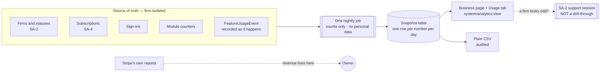

> **Document control** · Version **2.4** · **2026-10-12** · Status: **Rule 9 pass applied — fixed settings recorded as code constants; revenue key not seeded; one Business page (R11); most of the module parked**\
> Part of: *Super Admin Console — Functional Requirements* · Split from `FINAL-SuperAdmin-FR.md` lines 5114–5712 on 2026-09-16 · Previous version: `_archive/SA-09-platform-analytics-and-observability_v2.3_2026-10-12.md`\
>
> | Version | Date | Change | Decisions |
> |---|---|---|---|
> | 2.4 | 2026-10-12 | **Applied the Rule 9 pass for SA-09 (the product owner, 12 Oct) and the staff-role decisions of session 2.** SA-9 has **no screen settings**; everything that could look like a setting is a **code constant**: the **business timezone** (ExpatReady head office — closes Open question 5), the **nightly run time**, the **30-day windows**, the **fixed set of Business-page numbers**, and **2 retries on a failed night**. New subsection **§3.10 Settings — defaults and placement** states this. **`system/analytics:view-revenue` is defined but not seeded on any role** until a money figure exists (R9-32; SA9-D6 changed; closes Open question 4). **Role names** follow SR-Q3 (the persona example now reads "Admin or Billing"; account manager = Admin, SR-Q4(9)). Open question 2 is **partly answered** (numbers are fixed in code); the exact list and emitters stay open. **Requirement IDs — changed:** SA-9-21 (retries and run time). **BR changed:** BR-13, BR-15. **Story changed:** US-12. **Decisions:** SA9-D6 changed; SA9-D9 new. **Rows changed:** SA9-X3, SA9-X4. **Withdrawn:** none. **Added:** none (no new requirement IDs). **Same-day revision (W-1 – W-3, the product owner, 12 Oct):** W-1 sets the business timezone constant to `America/Toronto` (§3.10, BR-15, Open question 5); W-3(17) closes Open question 2 (firms by status Trial / Active / Payment hold / Security lock plus five module counts). **Same-day revision (W-11 – W-21, the product owner, 12 Oct):** text fixes only (W-21) — Open question 2 shown as fully closed (SA-9-1, SA-9-9 now name the statuses and counts; only SA9-X5 stays as the cross-module row), the timezone is the code constant, SA9-X2 is applied in SA-08, and the `view-revenue` build status reads "defined, not seeded". | Rule 9 pass — SA-09/10/11 · R9-32 · SR-Q3 · SR-Q4(9) |
> | 2.3 | 2026-10-12 | **Applied the founder complexity review of SA-09 (the product owner, 11–12 Oct).** The module is cut to **one "Business" page**: about eight nightly numbers compared with last month (firms by status, new and cancelled firms this month, trial conversion, monthly active users, a few module counts), a **feature-usage table** (firms using each feature, last 30 days) and a **plain, audited CSV**. **Feature-usage events are recorded from day one** (data foundation). **Revenue comes from Stripe's own reports** (SA4-P1); SA-9 shows no money figure. **Parked, one line each (§0.3):** revenue dashboards, multi-currency and FX, per-country views, alert-rules engine, metric catalogue and dashboard builder, six role dashboards, system-health graphs (SA8-D12), the aggregation pipeline beyond one nightly job, cohorts, scheduled digest, support tiles. The stuck-queue / failed-job line goes on the **SA-08 Integrations status page**, not here. **Mock screens:** keep the **Business** and **Usage** tabs of the existing console and wire them to a real backend; remove the countries, health, alert-rules, metric-catalogue, role-view and support screens (§12). **Permissions cut from nine keys to two:** `system/analytics:view` and `system/analytics:view-revenue`. Firm statuses corrected to SA-2-4 (the old text used SUSPENDED / OFFBOARDED). Rule 7: statute name removed from the tenant-isolation rationale; Immigration-SME routing of country / CRS-band values removed with the per-country views. **Requirement IDs — changed:** SA-9-1, -1a, -4, -5a, -7, -8, -9, -9a, -13, -17, -21. **Withdrawn (one line each):** SA-9-2, -2a, -3, -3a, -3b, -5, -6, -10, -11, -12, -14, -15, -15a, -16, -18, -19, -20, -22. **Unchanged:** SA-9-23. **New:** SA-9-24 – SA-9-26. **New decisions:** SA9-D1 – SA9-D8. **Stories:** US-1, US-7 changed; US-8 unchanged; US-2 – US-6 and US-9 withdrawn; US-10 – US-12 new. **BR:** BR-1, BR-3, BR-9, BR-10, BR-12, BR-13, BR-15 changed; BR-2, -4, -5, -6, -7, -8, -11, -14 withdrawn; BR-16 unchanged; BR-17 new. **Rows:** SA9-X1 – SA9-X7 added (Pending); SA7-X4 stays applied; SA4-X5 recorded as applied from this side; no SA5-X row targets SA-09. | R11 · map "Mock-only screens" (R11 analytics console) · code-check outcomes (12 Oct) · "Spec follows code" · R8 revised (role names only) · rule 7 · rule 8 · process rule (SA cuts decided now) · SA4-P1 · SA8-D12 |
> | 2.2 | 2026-10-02 | Old role names replaced with the SA-7 starter role names: "Billing Admin" becomes "Billing" and "Tenant Account Manager" becomes "Firm onboarding / Account manager". No requirement changed. | SA7-X10, SA7-D8 |
> | 2.1 | 2026-10-01 | Applied from SA-07 v2.6 (the product owner, 1 Oct): SA-9-23 added — demo firms (SA-2 Demo firm marker) are excluded from firm counts and revenue metrics; BR-16 and a §9 edge case added; "Applied from SA-07 v2.6" table added. | SA7-X4 · SA7-D19, SA7-D63 |
> | 2.0 | 2026-06-20 | Baseline — golden per-module rebuild | — |
>
> **IDs are permanent.** A changed item keeps its number and is marked "(changed v2.4 — …)" (earlier versions: v2.3). A withdrawn item stays as one line with its reason. Next free IDs after this version: requirement **SA-9-27**, decision **SA9-D10**, row **SA9-X8**, rule **BR-18**, story **US-13**.

## Module SA-9: Platform Analytics (the Business page)

> **What this document is.** The specification of the one page where Expat Ready's own team sees how the business is doing: a handful of numbers, counted nightly across all firms, compared with last month, plus a table of which features firms use. Everything heavier than that (revenue dashboards, charts, alerts, health graphs, per-country views) is **parked** and listed in §0.3 so it can be found later. Revenue is read from Stripe's own reports, not rebuilt here.
>
> **Plane:** Super Admin console (**GLOBAL**). This is the **only** place cross-firm aggregate numbers are allowed to exist; the rest of the platform is firm-isolated. **Permission scope:** `system/*` only, never assignable to firm staff. **Honest about today:** there is **no analytics code** in the backend (§12); the console in the frontend is a **mock on sample data**, of which two tabs are kept and wired (§12).

---

## 0. Decisions, parked items and cross-module rows

### 0.1 Applied from SA-07 v2.6 (2026-10-01) — unchanged

| ID | Decision | Applied here |
|---|---|---|
| **SA7-X4** | Demo firms (the SA-2 Demo firm marker, SA-2-40) are excluded from firm counts and revenue metrics | SA-9-23 · BR-16 · §9 edge case "Demo firm" |

### 0.2 Decisions (this version)

| ID | Decision | Source | Where |
|---|---|---|---|
| **SA9-D1** | **One Business page.** About eight numbers, counted **nightly**, shown **this month against last month**: firms by status, new firms this month, cancelled firms this month, trial conversion, monthly active users, and a few module counts. Plus a feature-usage table and a plain CSV. | **R11** | SA-9-24 · §3.1 |
| **SA9-D2** | **Revenue comes from Stripe's own reports.** SA-9 shows no MRR, ARR, ARPU, revenue collected or any other money figure in Release 1. SA-4 keeps recording every subscription, price, discount, invoice and refund from day one, so figures can be built later. | **R11**; SA4-P1 (SA-04 :75, :107, :415); SA-4-37 | SA-9-25 · §3.2 |
| **SA9-D3** | **Feature-usage events are recorded from day one** (a data foundation: usage history cannot be rebuilt later). The page reads them as a plain table, firms using each feature in the last 30 days. | **R11** | SA-9-8, -9a · §7 |
| **SA9-D4** | **One nightly job** writes the numbers to a snapshot table. No event-driven pipeline, no backfill engine, no reconcile layer. Because counts that do not come from a timestamp cannot be rebuilt, the nightly snapshot rows are kept as the history. | **R11** (aggregation pipeline beyond one nightly job parked) | SA-9-21 · §3.3 |
| **SA9-D5** | **No system-health graphs in this console** (API, queue, DB, uptime, storage). A **stuck-queue / failed-job line goes on the SA-08 Integrations status page**; engineers use Amazon monitoring for the rest. | **R11**; SA8-D12 (SA-08 :45, :89) | §0.3 · SA9-X2 |
| **SA9-D6** | **Two permissions:** `system/analytics:view` (the page, the feature-usage table, the CSV) and `system/analytics:view-revenue` (reserved for any money figure; none is on the page in Release 1). The other seven keys are withdrawn. *(changed v2.4 — R9-32)* **`view-revenue` is defined in the permission list but not seeded on any role** until a money figure exists; role grants are decided when a money figure exists. Closes former Open question 4. | **R11**; register row 15; **R9-32** | §10 · SA9-X3 |
| **SA9-D7** | **Mock screens:** keep the **Business** and **Usage** tabs of the existing console and wire them to a real backend; **remove** the countries, health, alert-rules, metric-catalogue, role-view and support screens. The Growth and Exports tabs are not named in the decision (Open question 1). | map "Mock-only screens" — **R11 analytics console** | §12 |
| **SA9-D8** | **Rule 7 wording.** The tenant-isolation rationale no longer cites a statute; it rests on Expat Ready's own isolation and privacy commitments. Immigration-SME routing of country, program and CRS-band values is removed with the per-country views. | map rule 7 | §3.0 · §13 |
| **SA9-D9** | **Rule 9: no screen settings.** SA-9 has nothing to configure. The business timezone (ExpatReady head office), the nightly run time, the 30-day windows, the fixed set of Business-page numbers and the 2 retries on a failed night are **code constants**. The page opens on its defaults with nothing to set up. | Rule 9 pass — SA-09/10/11 | SA-9-21 · BR-13 · BR-15 · §3.10 · §13 |

### 0.3 Parked for later (rule 8) — one line each

| Parked item | Was | Why parked |
|---|---|---|
| Revenue dashboard: MRR, ARR, ARPU, MRR bridge, net revenue retention, revenue churn, revenue collected | SA-9-3, -3b, -4 (part); §3.2 | Stripe's reports cover Release 1 (SA4-P1). SA-4 records the data from day one. |
| Multi-currency: reporting currency, FX snapshots, missing-rate rules | SA-9-3a; BR-2, -4, -5; `FxRateSnapshot` | Billing is CAD only (SA3-D2b); no conversion is needed. |
| Per-country revenue and usage: attribution rule, per-country dashboard, CRS-band spread, country-adoption trend | SA-9-6, -10, -11; BR-6; §3.4 | One country at launch (SA8-D8); meaningless with a single country. Counts of firms per country come back when a second country exists. |
| Alert-rules engine: thresholds, windows, severity, audience, cool-down, acknowledge | SA-9-20; BR-8; §3.8 | The SA-08 status page already alerts when a service goes red (SA-8-27). |
| Metric catalogue, dashboard and widget definitions as data | `MetricDefinition`, `DashboardDefinition`, `DashboardWidget`; `manage-dashboards` | A BI tool for a team of a few people. The page is fixed in code. |
| Six role-based dashboards | SA-9-18; §3.6 | Four of the six audiences are the same person at launch. |
| System-health graphs: API latency and errors, WebSocket, DB and cache, uptime, "not yet instrumented" states, `HealthSample` | SA-9-12, -14, -15, -15a; BR-11; §3.5 | **Contradicts SA8-D12** (no health graphs in the console). Amazon monitoring plus the SA-08 status page. |
| Aggregation pipeline beyond one nightly job: incremental updates, daily reconcile, idempotent keys, backfill | SA-9-21 (part); BR-7, -13; §3.10 | Built for many tenants and millions of rows; the nightly job is enough for the current number of firms. |
| 12-month growth chart, signup cohorts and retention curves, growth by plan and country | SA-9-2, -2a | Only this month against last month is needed for a weekly look. |
| Plan distribution with MRR per plan | SA-9-5 | Revenue-based; plan mix is available from SA-3 / SA-4 records and Stripe. |
| Date presets, custom range, period comparison on every tile, adaptive granularity | SA-9-19; §3.7 | Fixed "this month vs last month" is enough. |
| Scheduled digest email | SA-9-22 | Was already Phase 2. |
| Separate export permission, async XLSX / CSV export jobs | SA-9-17 (part); `system/analytics:export` | A plain CSV of one small page needs no job queue or separate key. |
| Support tiles (open tickets, response times) in analytics | SA-9-16 | The support queue itself shows ticket age (SA-10). Metrics suite parked in SA-10 (R12). |
| Per-firm "active users vs plan limit" drill inside analytics | SA-9-7 (part) | SA-2's firm health view already shows it. |
| Custom dashboard builder | §13 deferral | Stays deferred. |

### 0.4 Cross-module rows

**Rows INTO this document**

| ID | From | What | Status |
|---|---|---|---|
| **SA7-X4** | SA-07 | Demo firms excluded from firm counts and revenue metrics | **Applied in v2.1** (SA-9-23; unchanged) |
| **SA4-X5** | SA-04 | Revenue figures computed from SA-4 data, CAD only | **Applied here, narrowed:** SA-9 computes new firms, cancelled firms and trial conversion from SA-4 / SA-2 records; MRR, ARR and overdue amounts come from Stripe's reports (SA9-D2). SA-04 marks its own row (SA9-X1). |
| **SA5-X11 – SA5-X40** | SA-05 | Template knock-on rows | **None target SA-09** (checked in SA-05 v3.1 §0.2). |

**Rows FROM this document to others**

| ID | To | What | Source | Status |
|---|---|---|---|---|
| **SA9-X1** | SA-04 | Reword SA4-X5: SA-9 shows no money figure and no overdue amount; new firms, cancelled firms and trial conversion are counted from subscription records; revenue = Stripe's reports. Close the "SA-9 review" notes at :107 and :154. | SA9-D2 | Pending |
| **SA9-X2** | SA-08 | Add one line to the Integrations status page: **stuck automation queue / failed jobs** (the decision is the line; whether it turns red and alerts through SA-8-27 is SA-08's to state). Total storage is **not** decided (Open question 3). | SA9-D5; R11 | **Applied in SA-08 v2.7** (SA8-D40, SA8-X17) *(revised same day — W-21)* |
| **SA9-X3** | SA-06 | §10a lists no analytics keys today. Add `system/analytics:view` and `system/analytics:view-revenue`; the seven other keys named in SA-9 v2.2 §10 are never created. *(changed v2.4 — R9-32)* `view-revenue` is listed but **not seeded on any role**. | SA9-D6; R9-32 | Pending |
| **SA9-X4** | SA-07 | Appendix A has no analytics row. Add: "View the Business page, the feature-usage table and download the CSV" (`view`) and "View revenue numbers" (`view-revenue`, reserved). Role mapping follows SA-07's own staff-role decision (R8 revised: six roles in code) — SA-9 does not name roles. *(changed v2.4 — R9-32, SR-Q3)* The `view-revenue` row carries **no role tick** until a money figure exists; role names in the table are the SR-Q3 names. | SA9-D6; R8 revised; R9-32; SR-Q3 | Pending |
| **SA9-X5** | SA-12 | Confirm SA-12 keeps emitting a `FeatureUsageEvent` per plan-gated feature use, keyed by the feature key (SA-12 :95). Which modules emit the five module counters (assessments run, prospects created, cases opened, documents uploaded, automatic messages sent) stays with this row — Open question 2 is closed *(revised same day — W-21)*. | SA9-D3 | Pending |
| **SA9-X6** | 99-Phasing-and-Glossary (:39) · 00-Overview (:96) | Replace the SA-9 phasing and overview wording ("per-country", "system health/observability", "MRR/churn/ARPU", "Queue/system health, custom date-range analytics") with the one Business page. | SA9-D1 – D5 | Pending |
| **SA9-X7** | SA-10 | SA-9-16 (support tiles) is withdrawn; SA-10-24 (support metrics suite) is parked in SA-10 v2.6. | SA9-D1; R12 | **Applied in SA-10 v2.6** |

---

### Module Index

1. **Purpose & Goal**
2. **Users & Jobs-to-be-Done**
3. **Functional Design — How It Works** (core)
   - 3.0 The snapshot principle · 3.1 The Business page · 3.2 Revenue (Stripe) · 3.3 The nightly job · 3.4 Feature usage · 3.5 – 3.9 Parked (one line each) · 3.10 Settings — defaults and placement
4. **Detailed Functional Requirements** (SA-9-n)
5. **Business Rules & Logic**
6. **States & Lifecycle**
7. **Key Entities & Fields**
8. **User Stories + Acceptance Criteria**
9. **Edge Cases & Validations**
10. **Permissions** (GLOBAL `system/*`)
11. **Scalability · Security · Performance**
12. **Reference Note** (exists / NEW / changed, and the mock-screen decision)
13. **Open Questions / Founder Decisions**

### Visual Overview

**A. Data flow** — the nightly job is the only place that reads across firms; the page reads only the snapshot table.

---

### 1. Purpose & Goal

**What it is.** One page that tells the founder and the internal team, in thirty seconds, how many firms are in each state, how many joined and left this month, how many trials turned into paying firms, how many people used the product, and which features firms actually use — each against last month.

**The business outcome.** The team sees the shape of the business without opening Stripe, SA-2 and the database separately, and decides what to build, retire or chase from real adoption data. It does this with the smallest honest build: a nightly count and a table.

**What it is not.** It is not a revenue dashboard (Stripe's reports cover revenue — SA9-D2), not a monitoring console (SA8-D12), and not a BI tool (§0.3).

**How it ties to the platform.** SA-9 only reads. It counts firms and statuses from **SA-2**, subscriptions, cancellations and trials from **SA-4**, sign-ins for monthly active users, each product module's own counters, and the feature-usage events that **SA-12**'s plan-gated features emit. It owns no business process of its own.

---

### 2. Users & Jobs-to-be-Done

Every user is an internal Expat Ready operator; no firm user or client ever sees this module.

| Who | Job in SA-9 |
|---|---|
| **Platform Owner / Founder** (main user) | "When I start my week, I want firms by status, new and cancelled this month, trial conversion and active users next to last month, so I know the state of the business in 30 seconds." · "When I plan the roadmap, I want to see which features firms actually use in the last 30 days, so I build for what is used." |
| **Anyone else holding `system/analytics:view`** (for example Admin or Billing — the role mapping is SA-07's) *(changed v2.4 — SR-Q3, SR-Q4(9): the account manager is Admin)* | The same page and CSV. Revenue questions go to Stripe's reports. |

**Design implication.** One page, one audience. There are no role-scoped dashboards (§0.3).

---

### 3. Functional Design — How It Works (core)

#### 3.0 The snapshot principle — "the page reads a small table, never the firms' records"

**Decision:** the page reads **pre-computed, counts-only snapshot rows**. It never runs a cross-firm query against live firm tables. Reasons:
1. **Firm isolation must hold.** Every operational table is isolated by firm. A live query that bypasses that isolation to total across firms would break Expat Ready's own isolation and privacy commitments. The nightly job is the single, controlled place that counts across firms, and it writes **only counts** — never a client name, case detail or document content. The snapshot table has **no personal-data columns** (BR-9).
2. **It stays fast.** The page reads a few dozen rows, not every firm's records.
3. **It is stable.** A number shown today is the same when you look at it next week (BR-12).

**The one sanctioned exception, and what it is not.** When someone needs to look *inside* a firm because its numbers look wrong, that is **not** a drill-through from the page. It is an SA-2 **support session** (mandatory reason, time-limited, recorded). There is no path from the page to a firm's private records.

#### 3.1 The Business page — "the numbers, against last month"

**How it works.** One page shows, for the current month and the previous month, the following numbers, each from the last nightly snapshot:
- **Firms by status** — a count per SA-2 status (SA-2-4), so the team sees how many are on trial, active, on payment hold or security-locked.
- **New firms this month** — firms that reached Trial or Active in the month.
- **Cancelled firms this month** — firms whose subscription was cancelled in the month (SA-4).
- **Trial conversion** — of the trials that ended in the month, how many became paying subscriptions, and the share.
- **Monthly active users** — distinct firm staff who signed in during the last 30 days, shown as a count only.
- **A few module counts** — for example assessments run, cases opened, documents uploaded (the exact set is fixed — Open question 2 closed *(revised same day — W-3(17))*).

Each number shows its value, last month's value and the change. A "numbers as of <time>" stamp shows when the nightly job last ran. A **CSV** button downloads the page (SA-9-17). No filters, no chart builder, no date presets (§0.3).

**Demo firms are excluded** from every number (SA-9-23, BR-16).

#### 3.2 Revenue — "lives in Stripe"

Expat Ready reads MRR, ARR, revenue collected and overdue amounts from **Stripe's own reports** (SA4-P1). SA-4 keeps recording every subscription, price, discount, invoice and refund from day one, in CAD, so a revenue view can be built later without guesswork. The page shows **no money figure** in Release 1 (SA-9-25).

#### 3.3 The nightly job — "one job, a handful of rows"

**How it works.** Once a night one scheduled job counts each number from its source, and writes **one snapshot row per number per day** (§7). That is all: no event-driven updates, no reconcile layer, no backfill engine (§0.3). *(changed v2.4 — R9 pass)* The run time is a code constant. A failed run is **retried twice** and, if it still fails, raises the failure on the SA-08 status page like any other failed job; the page keeps showing the last good snapshot with its "as of" stamp.

**Why the daily rows are kept.** Counts such as "firms by status" cannot be rebuilt from timestamps later, so the daily snapshot history is the record (SA9-D4). "Last month" is read from the snapshot for the last day of last month.

#### 3.4 Feature usage — "which features do firms actually use"

**How it works.** Each time a firm uses a plan-gated feature, a small **feature-usage event** is recorded (firm, user, feature key, time — nothing about what was done inside the feature). The nightly job counts, per feature, **the number of firms that used it in the last 30 days**, and the **Usage** tab shows that as a ranked table. Underused features are the build-or-retire signal; heavily used ones are the ones to protect.

**Recording starts on day one** (SA9-D3) even though the table is plain, because usage history cannot be rebuilt.

#### 3.5 – 3.9 Parked sections (one line each; detail in §0.3)

- **3.5 System health and observability** — parked (SA8-D12); see the SA-08 status page.
- **3.6 Role-scoped dashboards** — parked; one page.
- **3.7 Trends, comparisons and date ranges** — parked; fixed "this month vs last month".
- **3.8 Alerts and thresholds** — parked; the SA-08 status page alerts.
- **3.9 Export jobs and scheduled digests** — parked; a plain audited CSV only (SA-9-17).

#### 3.10 Settings — defaults and placement *(new v2.4 — Rule 9 pass, SA9-D9)*

SA-9 has **no setting on any screen**. The page works on day one with nothing to set up (Rule 9: zero setup). Every value below is a **code constant**, changed by a release, not in the console.

| Item | Default / value | Placement |
|---|---|---|
| Business timezone for month boundaries (BR-15) | ExpatReady head office (Toronto): `America/Toronto` *(revised same day — W-1)* | Code constant |
| Nightly job run time | Off-hours, one run a night | Code constant |
| Retries on a failed night | 2 | Code constant |
| Windows ("monthly active users", feature usage) | 30 days | Code constant |
| The numbers on the Business page (SA-9-24) | Fixed set; no filters, no presets | Code constant |
| CSV download | Always available to `system/analytics:view` holders; audited | No setting |

The page itself passes the 15-minute test trivially: there is nothing to configure.

---

### 4. Detailed Functional Requirements (SA-9-n)

> Each maps to acceptance criteria in §8. The IDs of withdrawn items stay as one line.

**Firm counts**
- **SA-9-1** *(changed v2.3 — R11)* The page shows a count of firms **per SA-2 status** (SA-2-4), from the last nightly snapshot. *(Was: a "real-time-ish" snapshot using the statuses TRIAL / ACTIVE / SUSPENDED / OFFBOARDED, which SA-2 no longer has.)* Shown: Trial, Active, Payment hold, Security lock (Open question 2 closed — W-3(17)) *(revised same day — W-21)*.
- **SA-9-1a** *(changed v2.3 — R11)* "Active firm", "new firm" and "cancelled firm" use the single definitions in BR-1 and BR-3, so the page reconciles with SA-2 and SA-4.
- **SA-9-2** ~~12-month growth chart~~ — *withdrawn v2.3 (R11): parked; only this month against last month is shown (§0.3).*
- **SA-9-2a** ~~Signup cohorts with retention curve; growth by plan and country~~ — *withdrawn v2.3 (R11): parked (§0.3).*

**Revenue** *(all withdrawn — revenue lives in Stripe, SA4-P1)*
- **SA-9-3** ~~MRR and ARR from active subscriptions~~ — *withdrawn v2.3 (R11, SA4-P1): Stripe's reports.*
- **SA-9-3a** ~~Reporting currency and FX snapshots~~ — *withdrawn v2.3 (R11): CAD only; parked.*
- **SA-9-3b** ~~ARPU, revenue collected, MRR bridge~~ — *withdrawn v2.3 (R11, SA4-P1).*
- **SA-9-4** *(changed v2.3 — R11)* The page shows **new firms** and **cancelled firms** for the month (counts). *(Was: monthly churn rate, revenue churn and net revenue retention; the revenue lenses are parked.)*
- **SA-9-5** ~~Plan distribution with MRR contribution~~ — *withdrawn v2.3 (R11): parked (§0.3).*
- **SA-9-5a** *(changed v2.3 — R11)* **Trial conversion** for the month: trials that ended in the month, how many converted to a paid subscription, and the share; shown against last month. *(Was: per signup cohort with the trial window respected.)*
- **SA-9-6** ~~Revenue by country entitlement~~ — *withdrawn v2.3 (R11): one country; parked.*

**Usage**
- **SA-9-7** *(changed v2.3 — R11)* **Monthly active users:** distinct firm staff who signed in during the last 30 days, across all firms, shown as a **count only**; the underlying identities are never shown across firms. *(Was: also a per-firm "active users vs plan limit" drill; that stays in SA-2's firm health view.)*
- **SA-9-8** *(changed v2.3 — R11)* The **Usage** tab shows a plain table: per plan-gated feature, the number of **firms** that used it in the last 30 days, ranked. *(Was: a heatmap with firms and users, filtered by plan and country.)*
- **SA-9-9** *(changed v2.3 — R11)* The page shows **a few module counts** from the modules' own counters: assessments run, prospects created, cases opened, documents uploaded, automatic messages sent (Open question 2 closed — W-3(17); which modules emit them: SA9-X5) *(revised same day — W-21)*. *(Was: seven platform-wide totals with per-firm drill.)*
- **SA-9-9a** *(changed v2.3 — R11)* Feature adoption is recorded as de-identified **feature-usage events from day one** (SA9-D3); the table and counts expose counts only, never what was done inside a feature (BR-9).

**Per-country** *(withdrawn)*
- **SA-9-10** ~~Per-country dashboard: entitled firms, cases by program, assessments, streams, CRS-band distribution~~ — *withdrawn v2.3 (R11): parked; one country (§0.3).*
- **SA-9-11** ~~Country-adoption trend~~ — *withdrawn v2.3 (R11): parked.*

**System health** *(withdrawn — SA8-D12)*
- **SA-9-12** ~~API health: error rate, latency, throughput, WebSocket~~ — *withdrawn v2.3 (R11, SA8-D12): no health graphs in the console.*
- **SA-9-13** *(changed v2.3 — R11)* Stuck-queue and failed-job information is **not shown in SA-9**. It is **one line on the SA-08 Integrations status page** (SA9-X2). *(Was: a per-queue health table.)*
- **SA-9-14** ~~Total platform storage with threshold alert~~ — *withdrawn v2.3 (R11): not a decided SA-9 or status-page item (Open question 3).*
- **SA-9-15** ~~Health read from the observability layer~~ — *withdrawn v2.3 (SA8-D12).*
- **SA-9-15a** ~~"Not yet instrumented" state~~ — *withdrawn v2.3 (SA8-D12).*
- **SA-9-16** ~~Support tiles: open tickets, first-response and resolution times~~ — *withdrawn v2.3 (R11, R12): the SA-10 queue shows ticket age; the metrics suite is parked.*

**Export, dashboards, alerts, pipeline**
- **SA-9-17** *(changed v2.3 — R11)* A **plain CSV** of the page's numbers (and the feature-usage table) can be downloaded by anyone holding `system/analytics:view`. Each download is **audited** (who, when, which file). It holds counts only (BR-9). *(Was: CSV / XLSX of any view, async jobs, a separate `export` permission.)*
- **SA-9-18** ~~Six role-scoped dashboards~~ — *withdrawn v2.3 (R11): one page.*
- **SA-9-19** ~~Date presets, comparison on every tile, adaptive granularity~~ — *withdrawn v2.3 (R11): fixed "this month vs last month".*
- **SA-9-20** ~~Alert rules with severity, audience, cool-down~~ — *withdrawn v2.3 (R11): the SA-08 status page alerts (SA-8-27).*
- **SA-9-21** *(changed v2.3 — R11; changed v2.4 — R9 pass)* **One nightly job** counts each number and writes one snapshot row per number per day; the page reads only the snapshot table; the snapshot has no personal-data columns. The run time is a code constant, and a failed night is **retried twice** (BR-13). *(Was: incremental updates on events, daily reconcile, idempotent aggregation, backfill, FX at aggregation.)*
- **SA-9-22** ~~Scheduled digest email~~ — *withdrawn v2.3 (R11): parked.*
- **SA-9-23** *(v2.1 — SA7-X4; SA7-D19) — unchanged.* Demo firms (firms carrying the SA-2 Demo firm marker, SA-2-40) are excluded from every firm count and every other number on the page, including monthly active users and feature usage. The marker is read from SA-2 when the nightly job runs, so a firm moved in or out of demo status is reflected in the next run.

**New**
- **SA-9-24** *(new v2.3 — R11)* **The Business page.** One page with the numbers of SA-9-1, -4, -5a, -7 and -9, each for this month and last month, with a "numbers as of" time. Fixed in code; no filters. Reads only the snapshot table.
- **SA-9-25** *(new v2.3 — R11, SA4-P1)* **No money figure in Release 1.** Revenue is read from Stripe's own reports; SA-9 does not compute or show MRR, ARR, ARPU, revenue collected or overdue amounts.
- **SA-9-26** *(new v2.3 — R11, mock-screen decision)* **The console has two tabs, Business and Usage**, both served by a real backend. The countries, health, alert-rules, metric-catalogue, role-view and support screens of the mock console are removed (§12). The Growth and Exports tabs are Open question 1.

---

### 5. Business Rules & Logic

- **BR-1 (Active-firm definition)** *(changed v2.3)* A firm is "active" iff its SA-2 status is Active and it has a non-cancelled subscription (SA-4). One definition everywhere on the page, so it reconciles with SA-2 and SA-4. *(Was: used the old ACTIVE / TRIALING / PAST_DUE wording.)*
- **BR-2** ~~Never sum mixed currencies~~ — *withdrawn v2.3: no money on the page (SA9-D2).*
- **BR-3 (Cancelled and new firms)** *(changed v2.3)* A **cancelled** firm is one whose subscription cancellation SA-4 recorded in the period. A **new** firm is one that reached Trial or Active in the period. Counts only. *(Was: two churn lenses with revenue churn and net revenue retention.)*
- **BR-4** ~~MRR normalisation~~ — *withdrawn v2.3.*
- **BR-5** ~~Missing FX rate~~ — *withdrawn v2.3.*
- **BR-6** ~~Multi-country revenue attribution~~ — *withdrawn v2.3.*
- **BR-7** ~~Idempotent aggregation~~ — *withdrawn v2.3: the nightly job recounts from source each night, so a repeat run gives the same rows.*
- **BR-8** ~~Alert de-duplication~~ — *withdrawn v2.3.*
- **BR-9 (Aggregate and counts only — the cardinal safety rule)** *(changed v2.3)* The snapshot table, the page, the CSV and the feature-usage table contain **only counts**, never any firm's client details, case contents or document data. The snapshot table has no personal-data column. Looking inside one firm is **only** an SA-2 support session, never a drill-through from the page.
- **BR-10 (No live cross-firm scans)** *(changed v2.3)* The page never queries across firms live; it reads the snapshot table. The nightly job is the only place that counts across firms.
- **BR-11** ~~Honest health states~~ — *withdrawn v2.3 (SA8-D12).*
- **BR-12 (Snapshot stability)** *(changed v2.3)* A past day's snapshot row is not rewritten; it shows the same value whenever viewed. A new number may start its history on the day it is added.
- **BR-13 (A failed night is visible)** *(changed v2.3; changed v2.4 — R9 pass)* If the nightly job fails, it is retried **twice**; if it still fails, the failure shows on the SA-08 status page and the page keeps the last good rows with their "as of" time. *(Was: a reconcile layer where the reconciled value wins.)*
- **BR-14** ~~Permission-scoped composition~~ — *withdrawn v2.3: with two keys the check is on the route (§10).*
- **BR-15 (Month boundaries)** *(changed v2.3; changed v2.4 — R9 pass)* "This month", "last month" and the 30-day windows use one fixed business timezone, a **code constant** and not a screen, so boundaries are the same every time. *(changed v2.4 — R9 pass)* The timezone is **ExpatReady's head office timezone — `America/Toronto`** *(revised same day — W-1)* (closes former Open question 5).
- **BR-16 (Demo firms are not the business)** *(v2.1 — unchanged, wording trimmed to the numbers that remain)* A firm with the SA-2 Demo firm marker is excluded from every number on the page. A demo firm can only be on an Internal ($0) plan (SA-2-40), so no real revenue is ever hidden by this rule.
- **BR-17 (Revenue is Stripe's)** *(new v2.3 — SA9-D2)* SA-9 never computes a money figure in Release 1.

---

### 6. States & Lifecycle

SA-9 has almost no state of its own. The only one is **freshness**: each snapshot row carries the time the nightly job computed it, and the page shows "numbers as of <time>". A failed night leaves the last good rows in place (BR-13). *(Export-job, alert and metric-definition lifecycles were withdrawn with those features — §0.3.)*

---

### 7. Key Entities & Fields

SA-9 owns two small tables. Neither holds personal data.

- **`MetricSnapshot`** *(NEW — simplified v2.3)* — `id`, `metricKey` (for example `firms_trial`, `firms_active`, `firms_new`, `firms_cancelled`, `trial_converted`, `monthly_active_users`, a module-count key, `feature_firms:<featureKey>`), `periodStart` (the day), `value` (a count), `computedAt`. One row per number per day. No firm, plan or country columns (per-country views are parked; adding a column later starts that history from the day it is added). **No personal-data columns** (BR-9).
- **`FeatureUsageEvent`** *(NEW — recorded from day one, SA9-D3)* — `id`, `firmId`, `userId` (kept so distinct users can be counted later; never shown across firms), `featureKey` (the SA-12 feature key), `occurredAt`. No description of what was done inside the feature.
- **Parked entities (not built):** `MetricDefinition`, `FeatureUsageRollup`, `FxRateSnapshot`, `DashboardDefinition`, `DashboardWidget`, `AlertRule`, `AlertEvent`, `HealthProbe` / `HealthSample`, `reportingCurrency` and FX-policy settings (§0.3). The `FxRateSnapshot` model and `fx-rate.service.ts` already exist in the backend with no caller (§12); they stay unused.
- **Audit:** each CSV download writes an audit entry through the platform's existing audit log (SA-11); not redefined here.
- **Consumed read-only from other modules:** firms and statuses (SA-2), subscriptions and cancellations (SA-4), plan-gated feature keys (SA-12), sign-in events, and each product module's usage counters. SA-9 reads them; it never writes them.

---

### 8. User Stories + Acceptance Criteria

> Story IDs are permanent. Withdrawn stories stay as one line.

**US-1 *(changed v2.3 — R11)* — Platform Owner: the business at a glance.**
- **Given** firms in several statuses, some new this month and one cancelled, **When** I open the Business page after the nightly job, **Then** I see a count per SA-2 status, new and cancelled firms this month, trial conversion and monthly active users, each next to last month, with a "numbers as of" time; the active-firm count matches SA-2 and SA-4 (BR-1); demo firms are not counted (BR-16).
- **Given** a firm cancelled yesterday afternoon, **When** I open the page this morning, **Then** it counts in cancelled firms only if the nightly job has run since; otherwise the "as of" time shows the numbers are from the previous night.

**US-2** ~~Billing: revenue and churn truth, MRR bridge~~ — *withdrawn v2.3 (R11, SA4-P1): revenue is in Stripe's reports.*
**US-3** ~~Country Manager: per-country demand without revenue or PII~~ — *withdrawn v2.3 (R11): per-country views parked.*
**US-4** ~~Platform Engineer: catch a stuck queue~~ — *withdrawn v2.3 (R11, SA8-D12): the stuck-queue line is on the SA-08 status page.*
**US-5** ~~Trend and compare any range, with stable history~~ — *withdrawn v2.3 (R11): fixed "this month vs last month"; snapshot stability stays as BR-12.*
**US-6** ~~Alerting that does not spam~~ — *withdrawn v2.3 (R11): alert-rules engine parked.*

**US-7 *(changed v2.3 — R11)* — Download the numbers.**
- **Given** I hold `system/analytics:view`, **When** I download the CSV, **Then** I get the page's numbers and the feature-usage table (counts only) and an audit entry records who downloaded it and when.
- **Given** I do not hold `system/analytics:view`, **When** I request the page or CSV, **Then** the server refuses with 403.

**US-8 *(unchanged in substance)* — Look inside one firm correctly.**
- **Given** a firm's numbers look odd, **When** I need to look inside it, **Then** the only path is an SA-2 support session; the page shows no firm's records (BR-9).

**US-9** ~~Reconcile beats drift~~ — *withdrawn v2.3 (R11): no reconcile layer; a failed night is US-12.*

**US-10 *(new v2.3 — SA-9-5a)* — Trial conversion.**
- **Given** 10 trials ended this month and 4 became paying subscriptions, **When** I view the page, **Then** it shows 4 converted and 40%, with last month's figure beside it.

**US-11 *(new v2.3 — SA-9-8, -9a)* — Feature usage.**
- **Given** firms have used the Client portal and Assessments in the last 30 days, **When** I open the Usage tab, **Then** each feature shows the number of firms that used it, ranked; no description of what a firm did appears (BR-9).
- **Given** a feature is used for the first time, **When** the event is recorded, **Then** it is stored with firm, user, feature key and time and nothing else, from the first day of Release 1.

**US-12 *(new v2.3 — BR-13; changed v2.4 — R9 pass)* — Failed night.**
- **Given** the nightly job fails and both retries fail, **When** I open the page, **Then** I see the last good numbers with their "as of" time, and the failure is on the SA-08 status page.

---

### 9. Edge Cases & Validations

- **Empty platform / first run** → zero firms show "no data yet", not a broken page.
- **Nightly job has not run yet** → no rows: "no snapshot yet".
- **Firm changes status during the night** → counted in whichever state the job reads; the next night corrects it.
- **Firm cancels and re-subscribes in the same month** → counted by the BR-1 / BR-3 definitions consistently; not both cancelled and active in one snapshot row.
- **Demo firm** → never counted in any number (BR-16); if the marker is set or cleared later, the next night reflects it; past rows are not rewritten (BR-12).
- **Permission** → a user without `system/analytics:view` gets 403 from the server on the page, the Usage tab and the CSV.
- **Cross-firm personal data never present** → no snapshot, page or CSV can return a firm's client data (BR-9).
- **Month boundary** → evaluated in the code constant `America/Toronto` (BR-15) *(revised same day — W-21)*.

**Validation doctrine.** All input (the CSV request, any filter if one is ever added) is validated by schema (Zod), not ad-hoc `if/else`; reject early with a clear message.

---

### 10. Permissions (GLOBAL `system/*`)

> Default-deny; additive; **GLOBAL scope only**, never assignable to a firm staff role (SA-06 BR-4). **No permission grants a drill-through into a firm's private records** — that is a support session (SA-2).

| Permission Key | Status | Description |
|---|---|---|
| `system/analytics:view` | **NEW** *(SA-06 row pending — SA9-X3)* | View the Business page and the Usage tab; download the CSV (audited) |
| `system/analytics:view-revenue` | defined, not seeded on any role *(SA-06 row pending — SA9-X3; aligned with SA-07 — W-21)* | View any money figure. No money figure is on the page in Release 1 (SA-9-25); the key is defined so that a later revenue tile needs no permission redesign. *(changed v2.4 — R9-32)* **Not seeded on any role** until a money figure exists; grants are decided when a money figure exists (closes former Open question 4) |

**Withdrawn keys (never created):** `system/analytics:view-usage`, `:view-country`, `:export`, `:manage-alerts`, `:manage-dashboards`, `:manage-digest`, `system/system-health:view`. *(In the mock console, `analytics-roles.ts` lists all nine; code to be cut to the two above — §12.)*

**Role mapping.** Not set here. SA-07 maps roles to keys (Appendix A, row pending — SA9-X4); SA-07's own staff-role decision (R8 revised: the six roles in code) governs which roles hold `view`.

**Enforcement.** Route-level (`@RequirePermissions('system/...')`) on every analytics route. Cross-firm numbers are served only from the snapshot table.

---

### 11. Scalability · Security · Performance

- **Scalability.** The page reads a few dozen snapshot rows; the nightly job counts once a day. This is enough for the current number of firms; the heavier pipeline is parked (§0.3).
- **Security.** Counts-only snapshot with no personal-data columns (BR-9); the only way into a firm is an audited SA-2 support session; `system/*` only; CSV downloads audited; no secrets on the page.
- **Performance.** Page read is a small indexed read on `(metricKey, periodStart)`. The nightly job runs off-hours; its failure never blocks the page (BR-13).

---

### 12. Reference Note — what exists today vs NEW vs CHANGED

> Checked against `ERv2-sanitized` (backend, dev db646bf7) and `ERv2-frontend` (dev 8511b27e), 12 Oct. Nothing claimed that was not seen.

**Backend — almost nothing exists.**
- **No analytics code.** There are no analytics, alert or metric controllers. `GET /billing/overview` returns operations counts only (`packages/contracts/src/api/routes/sa4-billing-overview.ts:45-55`); there is no MRR / ARR code.
- **`FxRateSnapshot` model and `apps/api/src/fx/fx-rate.service.ts`** (manual source adapter) exist, but no controller and no caller outside `fx/`. Parked with FX (§0.3); stays unused.
- **NEW (to build):** the nightly job, `MetricSnapshot`, `FeatureUsageEvent` and its emitters, the two analytics routes, the CSV route with its audit entry, and the two `system/analytics:*` keys.

**Frontend — a complete mock, of which two tabs are kept (`ERv2-frontend/src/features/admin/analytics-console/`).**
- All eight tabs run on sample data: `analytics-console-routes.ts:18-27` lists `business`, `growth`, `usage`, `countries`, `health`, `support`, `alerts`, `exports`; no tab calls an API (`use-analytics-business.ts:11` says "Mock boundary").
- **Decision (SA9-D7, map "Mock-only screens" — R11 analytics console):**
  - **Keep and wire:** `business` (`components/analytics-business-panel.tsx` and `components/business/*`) and `usage` (`components/analytics-usage-panel.tsx` and `components/usage/*`).
  - **Remove:** `countries` (`analytics-countries-panel.tsx`, `analytics-usage-countries-fixtures.ts`), `health` (`analytics-health-panel.tsx`, `components/health/*`), `alerts` (`analytics-alerts-panel.tsx`, `components/alerts/*`), `support` (`analytics-support-panel.tsx`, `components/support/*`), the metric catalogue (`components/exports/metric-catalogue.tsx`), and the role views (`analytics-roles.ts` — the `?as=` demo switch and its nine keys).
  - **Not named in the decision (Open question 1):** `growth` (tenant overview, trial funnel, plan distribution, churn, cohorts) and `exports` (export builder, digest, pipeline freshness, backfill, export jobs).
- **The kept Business tab needs reducing, not only wiring.** It is a revenue view today (`business/business-bridge.tsx` MRR bridge, `business/business-fx.tsx`, `business-breakdowns.tsx` by plan and country, the currency filter in `analytics-filter-bar.tsx`). Revenue, FX and country parts belong to parked items and go; the tab shows the numbers of SA-9-24. This is a rebuild of its content.

**Legacy code (not the rebuild).** The old `Expat V1.5/DevAPI-main` has a single firm-scoped dashboard (`dashboard.service.ts`, `firmSummary`). It is a firm-plane dashboard, not SA-9, and shares no query path with it.

**CHANGED vs v2.2 (corrections).** The v2.2 text said queues, observability and per-country analytics were "NEW"; they are now parked, not planned. The v2.2 list of firm statuses (SUSPENDED / OFFBOARDED) did not match SA-2-4 and is corrected.

---

### 13. Open Questions / Founder Decisions

> Flagged, not assumed. Each has a recommendation and is **not decided**.

1. **Growth and Exports tabs of the mock console.** The mock-screen decision names the tabs to keep (Business, Usage) and the ones to remove, but not Growth or Exports. *Recommendation:* fold the three R11 firm numbers into the Business tab (so Growth's tenant overview and trial funnel disappear into it; cohorts, churn view and plan distribution stay parked), and keep only a **CSV button** from Exports; remove the rest of Exports (digest, backfill, pipeline freshness, export jobs). Confirm.
2. ~~**The exact list of numbers.**~~ **Closed 12 Oct *(revised same day — W-3(17))*:** firms by status = Trial, Active, Payment hold, Security lock (not Provisioning, Abandoned, Deleted), plus five module counts — assessments run, prospects created, cases opened, documents uploaded, automatic messages sent. The cross-module contract for who emits counters stays with SA9-X5. *(Original question and recommendation, for history:)* R11 says "about eight" and "a few module counts". *Recommendation:* statuses Trial, Active, Payment hold, Security lock (not Provisioning, Abandoned, Deleted); module counts: assessments run, prospects created, cases opened, documents uploaded, automatic messages sent. Also confirm which modules emit counters and `FeatureUsageEvent` rows (a cross-module contract; SA-12 is one emitter, SA9-X5). Also confirm "one Business page" against "Business and Usage tabs": *recommendation:* Business tab = the numbers and CSV; Usage tab = the feature-usage table. *(v2.4 — R9 pass, partly answered)* The Business-page numbers are **fixed in code**, not a setting (§3.10). The exact list and which modules emit counters remain **open**.
3. **Total storage.** The register suggested a storage line on the SA-08 status page next to the stuck-queue line. The decision names only the stuck-queue / failed-job line. *Recommendation:* add storage to that status-page row set; SA-08 decides.
4. ~~Does `system/analytics:view-revenue` ship now?~~ — **Closed v2.4 (R9-32, SA9-D6):** the key is defined but not seeded on any role until a money figure exists.
5. ~~Business timezone for month boundaries (BR-15).~~ — **Closed v2.4 (Rule 9 pass, SA9-D9):** ExpatReady's head office timezone, a code constant. *(The head office is Toronto, so the code constant is `America/Toronto` — W-1, 12 Oct.)*
6. **Trial conversion definition.** *Recommendation:* trials that **ended** in the month; converted = became a paid subscription before or at trial end; rate = converted ÷ ended. Confirm against SA-4's trial rules.
7. **Where the template "reach count" comes from** (SA-05 SA-5-77: "affects about N sends a week"). Template-usage rollups were suggested for SA-9 but the metric catalogue and rollups are parked. *Recommendation:* SA-05 computes it from its own send records, not from SA-9.

**Named deferrals (not Release 1):** custom dashboard builder; scheduled digest; revenue dashboard; per-country views; alert rules; health graphs (see §0.3).
