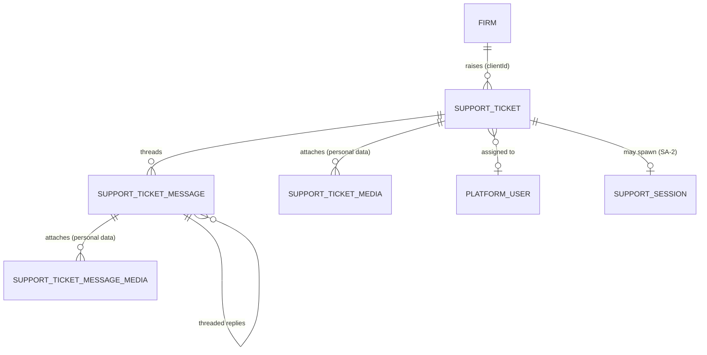

> **Document control** · Version **2.8** · **2026-10-14** · Status: **AG-16 decision applied (Get help: who raises and sees tickets; Open questions 7 and 8 closed; SA10-X5 resolved). Earlier status: Rule 9 pass and staff-role decisions applied — simple support queue (R12)**\
> Part of: *Super Admin Console — Functional Requirements* · Split from `FINAL-SuperAdmin-FR.md` lines 5713–6307 on 2026-09-16 · Previous version: `_archive/SA-10-support_v2.7_2026-10-12.md`\
>
> | Version | Date | Change | Decisions |
> |---|---|---|---|
> | 2.8 | 2026-10-14 | **AG-16 review (the product owner, 14 Oct), AG16-16 - Get help.** Every firm user may raise a ticket and sees their own; the Owner and Admin see all the firm's tickets and may reply on any. Get help opens from a "?" button on every screen (the current page is noted on the ticket automatically) and from Settings → Help & support. One text box plus optional attachments - **Open question 7 closed**. The firm-side screen is specified in **AG-16** - **Open question 8 closed**, **SA10-X5 resolved**. §10: firm keys `agent/support-ticket:create` (every starter role) and `agent/support-ticket:list` (own tickets for all; all firm tickets for Owner and Admin); not in code yet - to add with SA-07 / SA-06 seed parity. §3.1, SA-10-1, BR-2 and the plane note follow. Support's side (queue, priority, workspace) unchanged. *18 Oct: new section 'Decisions that change this epic' (index of AG16 decisions; no requirement changed).* | AG16-16 |
> | 2.7 | 2026-10-12 | **Applied the Rule 9 pass for SA-10 (the product owner, 12 Oct) and the staff-role decisions of session 2.** SA-10 has **no screen settings**; the fixed values are **code constants**, now listed in new **§3.13 Settings — defaults and placement**: **reopen window 7 days** (closes Open question 4), **support session 60 minutes**, the **priority and category lists** (staff only), **attachment limits 25 MB documents / 10 MB images** (R32), the **new-ticket alert to every holder of the Support role**, **ticket emails always on**, and **tickets kept with no deletion** (closes Open question 10). **Ticket emails** (*Ticket received*, *Reply from support*, *Status changed*) are ExpatReady emails **published by the Platform Owner** (SR-Q2). **Firm "Allow support to make changes"** (R9-pass ruling 2): one toggle, default 7 days, revocable any time; 1- and 30-day choices under Advanced — referenced in §3.8; R22.6 ("fixed 7 days") is superseded. **Role names** follow SR-Q3 (Support Lead and Support Agent become **Support**; account manager = Admin, SR-Q4(9)). **Support read grants** named (SR-Q4(5)): firm list, firm health, payment-processor log, status page. **Requirement IDs — changed:** SA-10-2, -3, -12, -14, -21. **BR changed:** BR-13, BR-14. **Story changed:** US-5. **Decisions:** SA10-D4, -D5 changed; SA10-D11 new. **Rows:** SA5-X16 and SA10-X3 changed; SA10-X8 added (Pending). **Withdrawn / added requirement IDs:** none. **Same-day revision (W-1 – W-3, the product owner, 12 Oct):** W-3(1) Platform Engineer persona replaced by bug tickets passed by Support to engineers outside the console (not a console role); W-3(18) closes Open question 1 (no "Immigration content" category, routing parked). **Same-day revision (W-11 – W-21, the product owner, 12 Oct):** text fixes only (W-21) — Open questions 1 and 11 shown as closed, the duplicate Q10 renumbered, the §5 lifecycle diagram uses the stored `WAITING_FOR_*` values without a firm-closes transition, "support lead" read as Support (or Admin), and the support-changes toggle is off until the firm Owner turns it on. | Rule 9 pass — SA-09/10/11 · R9-pass ruling 2 · SR-Q2 · SR-Q3 · SR-Q4(5), (9) · R32 |
> | 2.6 | 2026-10-12 | **Applied the founder complexity review of SA-10 (R12, the product owner 11–12 Oct) and the SA-05 knock-on.** The module is cut to a **simple queue**: the firm's form asks **"what's wrong" plus a screenshot**; **support sets the priority**, not the firm; **one queue, oldest-unanswered first**; **manual assignment**; **internal notes are never visible to firms** — including the **security fixes** for the legacy code (note filtering on every firm-facing read and live emit, room-join check, restricted origins, server-set message type); **email on a support reply**; an **"open support session" link** from a ticket (SA-2 support session, `system/firm:impersonate`; the old "request supervisor approval" step is removed — it does not exist in SA-2, SA2-D7); **tickets return to the queue** when staff leave (unchanged). The queue shows **ticket age** and **"waiting on firm"**; **first-response time is recorded from day one**. **Parked, one line each (§0.3):** SLA engine, escalation, routing / round-robin / auto-triage, canned replies, knowledge base (static help pages outside the product), satisfaction survey, metrics suite, settings screens. **Emails:** Ticket received, Reply from support and Status changed are Expat Ready-owned (SA-05 Appendix B.5, kind 1); **Satisfaction survey dropped** with the survey (rule 5). **Permission names** are `system/support:*` (not `global/support:*`); the delete grant is dropped; the impersonation key is `system/firm:impersonate`. **Rule 7 clean-up:** statute and regulator names removed (Law-25 / CASL at the old :188 and :304, PIPEDA labels at BR-13 and §11, "CICC", "compliance-native"); Q9 Immigration-SME routing removed and the question closed by O15 / R27. **Code state rewritten:** no ticket model exists in ERv2 (NOT BUILT); the legacy `DevAPI-main/src/support-ticket` is the base and the source of the leaks (§12). **Requirement IDs — changed:** SA-10-1, -2, -4, -9, -12, -13, -14, -18, -19, -20, -21. **Unchanged:** SA-10-3, -5, -8, -11, -26. **Withdrawn (one line each):** SA-10-6, -7, -10, -15, -16, -17, -22, -23, -24, -25. **New:** SA-10-27, SA-10-28. **Stories:** US-1 – US-5 changed; US-6 – US-11 withdrawn; US-12 – US-13 new. **BR:** BR-3, -4, -7, -11, -13, -14 changed; BR-6, -10 withdrawn; BR-1, -2, -5, -8, -9, -12 unchanged; BR-15, -16 new. **New decisions:** SA10-D1 – SA10-D10. **Rows:** SA5-X16 recorded as applied; SA10-X1 – SA10-X7 added (Pending). | R12 · SA5-X16 · map §16 "Support" · rule 5 · rule 7 · rule 8 · code-check outcomes · O15, R27 · process rule (SA cuts decided now) · SA2-D7 |
> | 2.5 | 2026-10-07 | Aligned to SA-06 v3.0 roles and permissions (the product owner, 7 Oct): the firm-staff persona row now names the six fixed starter roles (was Owner, RCIC, Case Officer, Intake, Accounts). Requirements unchanged. | SA6-D5 |
> | 2.4 | 2026-10-02 | SA-7 role names used throughout (SA7-X10, SA7-D8): "Tenant Account Manager" → "Firm onboarding / Account manager", "Billing Admin" → "Billing". Requirements unchanged. | SA7-X10 |
> | 2.3 | 2026-10-01 | Merged with SA-07 v2.5 (the co-product owner): Super Admin staff have no Suspend (SA7-D10), so SA-10-26 and its edge case now cover deactivation only; SA7-X11 applied — SA-10-26 confirmed as the ticket-return rule (added in v2.1; v2.0 ended at SA-10-25). | SA7-D10, SA7-X11 |
> | 2.2 | 2026-10-01 | Knock-on from AG-01 v1.3 (decisions revised by the product owner, 1 Oct): nothing in staff leaving is deferred, so the AG1-D12 and AG1-D13 rows now say the account-manager handover prompt is in scope (firms handed to a new account manager, or if skipped fall back to the shared team inbox, SA-2-26); SA-10-26 unchanged. | AG1-D1, AG1-D13 |
> | 2.1 | 2026-10-01 | Knock-on from AG-01 v1.2 (staff leaving, decided by the product owner 1 Oct): SA-10-26 added (a suspended or deactivated support agent's open tickets return to the unassigned queue at once and the agent leaves auto-assignment); one edge case added in §9. SA-07 counterpart pending with its owner. | AG1-D12, AG1-D13, AG1-D14 |
> | 2.0 | 2026-06-20 | Baseline — golden per-module rebuild | — |
>
> **IDs are permanent.** A changed item keeps its number and is marked "(changed v2.7 — …)" (earlier versions: v2.6). A withdrawn item stays as one line with its reason. Next free IDs after this version: requirement **SA-10-29**, decision **SA10-D12**, row **SA10-X9**, rule **BR-17**, story **US-14**.

## Decisions that change this epic (14–18 Oct) *(new 18 Oct)*

Product-wide rules (apply here as everywhere; home: Agent `00-Overview` → "Product rules every epic follows"): none cited in this document.

The "AG16" prefix is historical: these decisions began in the AG-16 review and apply across the product. Full text: `TEMPLATE-MAP-working_2026-10-10.md`.

| Decision | What was decided (one line) | What it changes in this epic | Where (requirement / card / section) |
|---|---|---|---|
| AG16-16 | Get help: who raises and sees tickets. | Every firm user may raise a ticket and sees their own; the Owner and Admin see all the firm's tickets and may reply on any. The firm ticket form is one text box plus optional attachments (no title or category; the queue shows the first line as the subject). Get help opens from a "?" button on every screen and from Settings → Help & support. Open question 7 and 8 closed; SA10-X5 resolved. Support's own side (queue, priority, workspace) is unchanged. | §0.4 (SA10-D2 row), §3.1, SA-10-1, BR-2, §10 (keys agent/support-ticket:create and :list) |

## Module SA-10: Support — Super Admin Console

> **What this document is.** The specification of the Super Admin **Support** module: a simple queue where a firm in trouble reaches a person on the Expat Ready team, who answers it, keeps private notes, and — when a screenshot is not enough — opens an SA-2 support session from the ticket. Everything heavier than a queue (SLA clocks, escalation, routing, canned replies, a knowledge base, satisfaction surveys, a metrics suite, settings screens) is **parked** and listed in §0.3 so it can be found later.
>
> **Plane:** Super Admin / Platform console (**GLOBAL**). The support team answers tickets raised by *firms* across *all* tenants. The **firm-side submission surface is the LOCAL counterpart** (every firm user submits and sees their own tickets; the firm's Owner and Admin see all of the firm's tickets - AG16-16). **Identity:** Super Admin operators authenticate in a dedicated platform identity context (SA-7). **Permissions:** `system/support:*` (GLOBAL). **In-house by doctrine:** support is a first-party module — no Zendesk or Intercom; live delivery is the in-house WebSocket gateway and email goes through the in-house rails. **Honest grounding:** **no ticket model, controller or screen exists in ERv2** (NOT BUILT, §12); a working but leaky base exists in the legacy `DevAPI-main/src/support-ticket`.

---

## 0. Decisions, parked items and cross-module rows

### 0.1 Applied from earlier versions — unchanged

**From AG-01 v1.3 (staff leaving, 2026-10-01)**

| ID | Decision | Applied here |
|---|---|---|
| **AG1-D12** | A Super Admin user can be deactivated at once. Their open support tickets return automatically to the unassigned support queue, where Support (or Admin) picks them up *(revised same day — W-21)*. Their firms are handed to a new account manager in the handover prompt or, if skipped, fall back to the shared team inbox (SA-2-26). Applied in SA-07 v2.5 (SA7-D64, SA-7-46, SA-7-47, BR-20) | SA-10-26 · §9 edge case |
| **AG1-D2** | Deactivation signs the agent out at once; Super Admin staff have no Suspend (SA7-D10) | SA-10-26 |
| **AG1-D13** | Nothing in staff leaving is deferred: the ticket rules and the account-manager handover prompt (SA-2-26) all ship in the MVP, same release | SA-10-26 |
| **AG1-D14** | Nothing more for the Super Admin side (small team; Support (or Admin) watches the queue daily *(revised same day — W-21)*) | — |

**From SA-07 v2.5 (2026-10-01)**

| ID | Decision | Applied here |
|---|---|---|
| **SA7-X11** | On a staff member's deactivation, their open support tickets return to the unassigned support queue at once | SA-10-26 |
| **SA7-D10** | Super Admin staff have no Suspend — deactivate only | SA-10-26 · §9 edge case |

### 0.2 Decisions (this version)

| ID | Decision | Source | Where |
|---|---|---|---|
| **SA10-D1** | **A simple queue.** One list of every firm's tickets, **oldest-unanswered first**, manual assignment, no routing. | **R12** | SA-10-4, -27 · BR-15 |
| **SA10-D2** | **The firm's form asks "what's wrong" and takes a screenshot.** **Support sets the priority**, never the firm (a firm-set priority makes everything urgent). The priority column stays in the data. | **R12** | SA-10-1 · BR-16 |
| **SA10-D3** | **Internal notes are never visible to firms** — in every firm-facing read, in every live emit, and the message type is set by the server from the caller's side, never taken from the request. Includes the **security fixes** for the legacy code: room-join check, restricted origins. | **R12**; §12 code facts | SA-10-9, -13 · BR-4 |
| **SA10-D4** | **Email on a support reply** to the firm (and the two other support emails). Support emails are **Expat Ready-owned** (SA-05 Appendix B.5, kind 1): *Ticket received*, *Reply from support*, *Status changed*. *(changed v2.7 — SR-Q2)* They are ExpatReady emails, so the **Platform Owner publishes them**; they are **always on** (no switch for the firm or for staff). **Satisfaction survey is dropped** from the catalogue with the survey (rule 5). | **R12**; **SA5-X16**; map §16; **SR-Q2**; Rule 9 pass | SA-10-2, -12, -14 · SA10-X1 |
| **SA10-D5** | **"Open support session" link from a ticket.** It starts an SA-2 support session (SA-2-16) with the ticket reference as the reason; it needs `system/firm:impersonate` and SA-2's step-up check. **No supervisor-approval step** (SA2-D7). The session is time-limited by SA-2 (60 minutes fixed, SA-2-18). *(changed v2.7 — Rule 9 pass, R9-pass ruling 2)* The 60 minutes is a **code constant**. Whether the session may make changes is the firm's own toggle (§3.8). | **R12**; SA2-D7; Spec follows code; Rule 9 pass; R9-pass ruling 2 | SA-10-18 – 20 |
| **SA10-D6** | **Tickets return to the queue when staff leave.** Unchanged. | **R12**; AG1-D12, SA7-X11 | SA-10-26 |
| **SA10-D7** | **Show ticket age and "waiting on firm"; record the first-response time from day one** (a data foundation: it cannot be rebuilt later, and an SLA can be worked out from it if one is ever promised). No SLA engine. | **R12** | SA-10-27, -28 |
| **SA10-D8** | **Permission names are `system/support:*`**, not `global/support:*` (SA1-D8: `system/*` only). Two keys, `list` and `manage`; the delete grant is dropped; no `config` key (settings screens are parked). | SA1-D8; register row 17 | §10 · SA10-X2 |
| **SA10-D9** | **Rule 7 wording.** No statute or regulator name as justification; "compliance-native", "immigration-literate" and SME routing of wording removed. Expat Ready's own obligations (security, access accountability, data location) stay. | map rule 7 | throughout |
| **SA10-D10** | **French on Expat Ready's own support emails:** English required, French optional; falls back to English when the recipient's language has no version. Closes former Open question 9. | **O15**, **R27** | BR-11 · §13 |
| **SA10-D11** | **Rule 9: no screen settings.** SA-10 has nothing to configure. The reopen window (7 days), the support session (60 minutes), the priority and category lists (staff only), the attachment limits (25 MB documents / 10 MB images), the new-ticket alert to every Support holder, always-on ticket emails and keep-everything (no deletion) are **code constants**. The firm's only related choice is its own "Allow support to make changes" toggle (§3.8). | Rule 9 pass — SA-09/10/11; **R32**; **R9-pass ruling 2** | §3.13 · SA-10-3, -21 · BR-14 |

### 0.3 Parked for later (rule 8) — one line each

| Parked item | Was | Why parked |
|---|---|---|
| SLA engine: per-priority targets, firm time zone, business hours, holiday calendar, clock pause on waiting | SA-10-15; BR-6; §3.6; Q3 | The founder has made no response-time promise (Open question 3). Ticket age and `firstResponseAt` are shown and stored so an SLA can be worked out later. |
| At-risk and breach flags, automatic escalation, escalation rules and history | SA-10-16, -17; §3.7 | Support holders already watch the queue (AG1-D14). Escalation today = reassign plus an internal note. |
| Category routing to staff pools, round-robin / load-aware assignment, keyword auto-triage | SA-10-6, -7; §3.3 | Nobody to route between at launch. Unassigned queue plus manual assignment (SA-10-5). |
| Canned replies (bilingual, fill-in fields) | SA-10-10; §3.9 | Worth it only at volume; the agent types the reply. |
| Knowledge base (internal and firm-facing, bilingual, country tags, deflection, "helpful?") | SA-10-23; §3.9 | Becomes **static help pages outside the product** (R12). |
| Satisfaction survey (CSAT) and low-score flag; the *Satisfaction survey* email | SA-10-22; §3.10; SA-05 B.5 | Parked by R12; the email leaves the SA-05 catalogue with it (rule 5). |
| Support metrics suite: rollups by category, firm, country, agent; SLA attainment | SA-10-24; §3.11; SA-9-16 | Parked by R12. Only `firstResponseAt` is recorded. |
| Settings screens: categories, SLA, routing, escalation, canned replies, KB | SA-10-25; §3.12 | The category list is the fixed enum (§7). |
| Saved shared queue views, board view, bulk triage | §3.2 (part of SA-10-4) | One list with filters is enough. |
| Hard delete of tickets and messages (`:delete` grant) | BR-14; §10 | No deletion path in the product; restricted and audited hard delete was the old position. |

### 0.4 Cross-module rows

**Rows INTO this document**

| ID | From | What | Status |
|---|---|---|---|
| **SA5-X16** *(changed v3.1)* | SA-05 | Support emails (SA-10-2, SA-10-12, SA-10-14, SA-10-22) are kind 1, owned and edited in SA-05 Appendix B.5. *(changed v2.7 — SR-Q2: published by the Platform Owner)* | **Applied here:** SA-10-2, -12, -14 name the catalogue emails (*Ticket received*, *Reply from support*, *Status changed*). SA-10-22 is **withdrawn** with the survey, so the *Satisfaction survey* row leaves Appendix B.5 (SA10-X1). |
| **SA7-X11** | SA-07 | Open tickets return to the queue on deactivation | Applied in v2.3 (SA-10-26; unchanged) |
| **SA5-X11 – SA5-X40** (other) | SA-05 | Template knock-on rows | **None other target SA-10** (checked, SA-05 v3.1 §0.2). |

**Rows FROM this document to others**

| ID | To | What | Source | Status |
|---|---|---|---|---|
| **SA10-X1** | SA-05 | Remove *Satisfaction survey* from Appendix B.5 (and the SA-10-22 reference); B.5 keeps *Ticket received*, *Reply from support*, *Status changed*; source references stay SA-10-2, -12, -14. Also the map §16 Support group and any catalogue count. | R12; rule 5 | Pending |
| **SA10-X2** | SA-06 | §10a lists no support keys. Add `system/support:list` and `system/support:manage`; the old `global/support:*` family, `:close`, `:config` and any delete grant are never created. `system/firm:impersonate` stays SA-02's. Firm-side `agent/support-ticket:list` and `:create` are named in the firm catalogue. | SA10-D8 | Pending |
| **SA10-X3** | SA-07 | Appendix A: add rows "See and work the support queue (reply, internal note, assign, change status and priority, close)" → `system/support:list` + `:manage`, and confirm "Open a support session from a ticket" needs `system/firm:impersonate`. Role mapping follows SA-07's own staff-role decision (R8 revised); SA-10 does not name which roles hold the two support keys. *(changed v2.7 — SR-Q3, SR-Q4(5))* Role names are the SR-Q3 names (Support Lead and Support Agent are now **Support**). The **Support** role also gets read access to the firm list, firm health, payment-processor log and status page. | SA10-D8; SR-Q3; SR-Q4(5) | Pending |
| **SA10-X4** | SA-02 | The ticket link in SA-2-16 ("reason or ticket reference"): confirm a support session started from a ticket stores the ticket id so the session and the ticket link both ways (SA-10-20); the "log in as" action on the firm screen is unchanged. | SA10-D5 | Pending |
| **SA10-X5** | AG-16 / AG-01 (firm console "Get help") | The firm-side ticket form: "what's wrong" plus screenshot; **no priority field**; "My tickets" list shows status including "Waiting on firm". **Resolved v2.8 (AG16-16):** AG-16 owns the Get-help screen ("?" on every screen, Settings → Help & support); every firm user raises and sees their own tickets, the Owner and Admin see all the firm's tickets. | SA10-D2, AG16-16 | Resolved - for the AG-16 write-up |
| **SA10-X6** | AG-18 | AG-18 (:167, :441, :755) waits for a platform key and a "written request attached to the ticket" from SA-10 / SA-07 for assisted migration. SA-10 does not define either (Open question 9). | Open | Pending |
| **SA10-X7** | 99-Phasing-and-Glossary (:40) · 00-Overview (:97) | Replace the SA-10 phasing and overview wording ("categories/priority/SLA", "triage/assign/escalate", "KB/canned, CSAT, metrics", "SLA tracking, escalation rules") with the simple queue. | R12 | Pending |
| **SA10-X8** | SA-02 (SA-2-28) · AG-16 (firm settings) | The firm-side "Allow support to make changes" toggle: one toggle, **off until the firm Owner turns it on**; **7 days when on**, revocable any time; the 1- and 30-day choices under **Advanced** *(revised same day — W-21)*. SA-10 §3.8 only refers to it; SA-02 owns the rule and an AG document owns the firm screen. Supersedes R22.6 ("fixed 7 days"). | R9-pass ruling 2 | Pending |

---

## Module Index

1. **Purpose & Goal**
2. **Users & Jobs-to-be-Done**
3. **Functional Design — How It Works** (core)
   - 3.0 One ticket, two planes · 3.1 Ticket submission · 3.2 The queue · 3.3 Assignment · 3.4 The ticket workspace · 3.5 Live delivery and the security fixes · 3.6 Status, age and first response · 3.7 – 3.12 Parked or moved (one line each) · 3.8 Open a support session · 3.13 Settings — defaults and placement
4. **Detailed Functional Requirements** (SA-10-n)
5. **Business Rules & Logic**
6. **States & Lifecycle**
7. **Key Entities & Fields**
8. **User Stories + Acceptance Criteria (GWT)**
9. **Edge Cases & Validations**
10. **Permissions** (GLOBAL `system/*`)
11. **Scalability · Security · Performance**
12. **Reference Note** (exists / NEW / changed — honest)
13. **Open Questions / Founder Decisions**

---

## Visual Overview

**A. Ticket lifecycle** (status drives behaviour; the firm may reopen within a window; `CLOSED` is reached by expiry or force-close):

```mermaid
stateDiagram-v2
    [*] --> OPEN : firm submits
    OPEN --> IN_PROGRESS : agent assigned / first reply
    IN_PROGRESS --> WAITING_FOR_CUSTOMER : agent needs info
    WAITING_FOR_CUSTOMER --> IN_PROGRESS : firm replies
    IN_PROGRESS --> WAITING_FOR_THIRD_PARTY : blocked on external
    WAITING_FOR_THIRD_PARTY --> IN_PROGRESS : unblocked
    IN_PROGRESS --> RESOLVED : agent resolves
    WAITING_FOR_CUSTOMER --> RESOLVED : agent resolves
    RESOLVED --> IN_PROGRESS : firm reopens within window
    RESOLVED --> CLOSED : reopen window elapses (auto)
    IN_PROGRESS --> CLOSED : force-close (reason)
    OPEN --> CANCELLED : firm withdraws before first reply
    CLOSED --> [*]
    CANCELLED --> [*]
    note right of WAITING_FOR_CUSTOMER : stored value; shown as "Waiting on firm"; drops below unanswered tickets in the queue
    note right of CLOSED : terminal; a further request creates a NEW linked ticket (BR-8)
```

**B. Firm ↔ Support ↔ Support session flow** (the ticket reference becomes the reason of the SA-2 session; the session links back to the ticket):

```mermaid
flowchart LR
    subgraph LOCAL["Firm console (LOCAL · firm-scoped)"]
      F[Firm staff] -->|"what's wrong + screenshot"| T[(SupportTicket)]
      F -->|reply in thread| M[(Messages)]
    end
    T --> NQ[Support queue:<br/>oldest unanswered first]
    T --> EM1[["Ticket received" email]]
    subgraph GLOBAL["Super Admin support (GLOBAL · cross-tenant)"]
      NQ --> A[Support]
      A -->|sets priority · assigns| T
      A -->|reply| M
      A -->|internal note| NOTE[(Note — never reaches the firm)]
      A -->|"Open support session<br/>(ticket ref as reason)"| IMP{system/firm:impersonate?}
    end
    IMP -->|yes + step-up| SA2[SA-2 support session<br/>read-only unless the firm allows changes · 60 min]
    IMP -->|no| REJ[403 — not offered]
    M -->|live if online · "Reply from support" email| F
```

**C. Data model** (one ticket viewed from two planes; a note is a message the firm can never read):



---

## 1. Purpose & Goal

**What it is.** SA-10 is the **bridge between Expat Ready and the firms that pay for it**. A firm whose retainer will not generate, whose staff member is locked out, or who has a question about a country's content reaches a human here. The team answers, keeps private notes, and — when a screenshot is not enough — opens an SA-2 support session from the ticket to see what the firm sees. It is a first-party tool because every ticket can carry a firm's — and by extension a client's — personal information.

**The business outcome.** A firm in trouble always reaches a human, and nothing is dropped. The simple queue makes that true by showing the **oldest unanswered ticket first**, with its age, so a Support holder sees at a glance what has waited longest.

**What it is not.** It is not a full help desk. There are no SLA clocks, escalation rules, routing, canned replies, knowledge base, satisfaction survey or metrics suite in Release 1 (§0.3).

**How it ties to the platform.** Firm submits (LOCAL) → ticket lands in the GLOBAL queue → an agent sets the priority, assigns it and replies → for hard cases the agent opens an **SA-2 support session** → resolution. Every status change, assignment and support-session link is written to the **SA-11** audit log. The three support emails are Expat Ready-owned and edited in **SA-05**. Support numbers are no longer fed to SA-9 (SA-9-16 withdrawn).

---

## 2. Users & Jobs-to-be-Done

| Role | Plane | Primary job in SA-10 | Jobs-to-be-done (representative) |
|---|---|---|---|
| **Support** *(changed v2.7 — SR-Q3; was Support Agent)* (heaviest GLOBAL user) | GLOBAL | Answer firm tickets; never drop one. | "When a ticket arrives, I want it in one queue showing its age and whether we are waiting on the firm, so I answer the longest-waiting first." · "When I am stuck reproducing a bug, I want to open a support session from the ticket with the reason already filled in." · "When I want to tell a colleague something, I want a private note I can be certain the firm never sees." |
| **Support / Admin** *(changed v2.7 — SR-Q3, SR-Q4(9); was Support Lead / Firm onboarding / Account manager)* | GLOBAL | Keep the queue healthy. | "When I look at the queue each morning, I want to see unassigned and long-waiting tickets and assign them." |
| **Platform Owner** | GLOBAL | Own support quality and accountability for access to firm data. | "When I review, I want every support session that started from a ticket, with the reason, who and how long." |
| ~~**Platform Engineer**~~ — **not a console role** *(revised same day — W-3(1))* | — | Engineers work outside the console. Support passes a confirmed-bug ticket to them with the firm, the description, the screenshot and (if used) the support session (R8, SA8-D1). | "When a ticket is a confirmed bug, I want the firm, the description, the screenshot and (if used) the support session in one place." *(Support assembles this and hands it over.)* |
| **Firm staff** (the six starter roles: Owner, Admin, Case Manager, Case Officer, Billing / Finance, Read-only — and any firm custom role) | **LOCAL** | Get help fast; stay informed. | "When something breaks, I want to type what is wrong, attach a screenshot and get a reply, without leaving the product." · "When support replies, I want an email and to reply in the same thread." |

**Design implication.** The **Support role is the protagonist of the GLOBAL UI**: the default screen is the queue; the workspace has a reply-versus-note toggle and an "open support session" button. The **firm staff member is the protagonist of the LOCAL surface**: one box, one attachment, a clean thread that can never show an internal note or another firm's ticket.

---

## 3. Functional Design — How It Works (core)

### 3.0 One ticket, two planes

A `SupportTicket` is **owned by a firm** (stamped with the firm's id, isolated) but **served by the platform** (the support team sees a cross-tenant queue). The same row is rendered two ways:
- **LOCAL (firm console):** a firm member sees only their firm's tickets and only firm-visible messages — never internal notes, assignment internals or other firms' tickets.
- **GLOBAL (Super Admin console):** an agent sees all tickets across all firms, plus internal notes and assignment, and the "open support session" action.

**Why the separation matters (security).**
1. **Default support access is scoped.** `system/support:*` lets an agent read the *ticket and its attachments* — not the firm's clients, cases, invoices or documents. To see those, the agent starts an **SA-2 support session** (reasoned, time-limited, recorded). *(Not yet enforced in code — Open question 2.)*
2. **An internal note must be unreadable by the firm,** on every path (BR-4, §3.5).
3. **Attachments are personal data.** A screenshot may contain a client's passport or a refusal letter, so ticket media is treated as personal data (BR-13).

### 3.1 Ticket submission (firm-side) — "say what's wrong, attach a screenshot"

**How it works.** Any firm user opens "Get help" - from a "?" button on every screen (the form opens with the current page noted on the ticket automatically) or from Settings → Help & support - and fills in **one thing: what's wrong** — free text — and may **attach a screenshot** (or other files). The ticket is created `OPEN`, stamped with the firm and the submitter, and enters the GLOBAL queue unassigned. The firm does **not** set a priority and is not asked for one (SA10-D2). The form is **one text box** plus optional attachments - no title or category field; the queue shows the first line as the subject and support sets category and priority *(closed v2.8 - AG16-16, former Open question 7)*.

- **Support is notified** (in-app and email to **every holder of the Support role**) when a ticket arrives *(changed v2.7 — Rule 9 pass)*, and the firm gets the **Ticket received** email (Expat Ready-owned, SA-05 B.5). The email carries the ticket number and states that support will reply; it carries **no promised response time** (no SLA, §0.3).
- **Attachments** upload by presigned URL, with size and type checks, and are treated as personal data (BR-13). *(changed v2.7 — R32)* Limits are the built constants: **25 MB for documents, 10 MB for images**; not a setting.
- **Firm context for the agent:** the ticket shows the firm's name, plan, country and the firm's recent tickets, read from existing records — the firm types nothing extra.

**Key screens.** *Get help* (firm console): one text box, attach, send. *My tickets* (firm console): the user's own tickets - and, for the Owner and Admin, all of the firm's tickets, who raised each, and the right to reply on any *(changed v2.8 - AG16-16)* - with status — including **"Waiting on firm"** — and last activity; open one for a clean thread, reply, attach, and **Resolve / Reopen** where applicable.

**Data flow.** Firm submit → create (firm id and submitter stamped, `status = OPEN`, priority empty, attachments) → emit `ticket.created` → support notified and **Ticket received** email queued → audit entry.

### 3.2 The queue — "the longest-waiting unanswered ticket first"

**How it works.** The GLOBAL landing screen is **one list** of tickets across all firms. Each row shows: subject (or the start of the description), firm (name and plan), priority (as set by support, or empty), status, assignee, **ticket age**, and a **"Waiting on firm"** marker where it applies. **Default order: oldest unanswered first** (BR-15). Filters: status, assignee, firm, priority. The list is server-paginated; it never fetches an unbounded set.

*(Saved shared views, a board view and bulk triage are parked — §0.3.)*

### 3.3 Assignment — "manual"

An agent **assigns a ticket to themselves or to another agent**. Assignment is recorded, audit-logged and moves the ticket's last-activity time. There is no routing by category, no round-robin and no keyword triage (parked, §0.3). Unassigned tickets stay in the queue for a Support holder to pick up. The support team also **sets the priority** here; priority is a label and a filter and does **not** change the queue order (BR-15, BR-16).

### 3.4 The ticket workspace — "answer, note, act"

One screen for one conversation, in three zones:
- **Left — ticket and firm context.** Subject, status, priority, assignee, ticket age, created and last-activity times, and the firm's name, plan, country, primary contact and recent tickets. Read-only firm facts; no client details beyond what is on the ticket. The **Open support session** button (§3.8).
- **Centre — thread and composer.** Firm messages, agent replies, **internal notes (visually distinct, GLOBAL only)**, status markers and system events, attachments inline. The composer has an unmistakable **reply (the firm will see this) / internal note (only the team sees this)** toggle, with a confirmation when switching.
- **Right — actions.** Status and priority, assignment, and the audit summary for the ticket.

**Behaviour.** The server sets each message's type from the caller's plane and the composer toggle; a firm-side request can only ever create a firm message (BR-4). *(Insert-canned-response, suggested KB articles and escalate are parked, §0.3.)*

**Data flow.** Composer reply → create message (`AGENT_REPLY`) → live emit to the firm room, or the **Reply from support** email if the firm is offline → first-response time stamped if first → audit. Composer note → create message (`INTERNAL_NOTE`) → live emit to the GLOBAL audience only → never delivered to the firm.

### 3.5 Live delivery and the security fixes — "live if both online; email if not; nothing leaks"

**How it works.** A WebSocket gateway delivers messages live. A client joins a per-ticket room and receives `new-message` when one is sent; a typing indicator is also sent. When the recipient is offline, the firm gets the **Reply from support** email (the agent gets an in-app notification and email).

**The security fixes (must be built; the legacy code has each flaw — §12).**
1. **Internal notes are filtered out of every firm-facing read** — list, single-ticket fetch and the message list — by message type (BR-4).
2. **Internal-note emits go to the GLOBAL audience only.** A note is never broadcast to the room a firm socket can join.
3. **Room joins are authorised:** a firm socket may join only rooms for its own firm's tickets; an agent may join any. A cross-tenant join is refused.
4. **Allowed origins only:** the gateway accepts connections from the console origins, not from any origin.
5. **The server sets the message type** from the caller's plane (and the composer toggle for agents); a firm's request body can never choose `AGENT_REPLY` or `INTERNAL_NOTE`.

*(Read receipts are "nice to have" and not committed — Open question 6.)*

**Data flow.** Connect → verify the token → on join: authorise (firm → own ticket only) → join. On message: save → emit with audience scoping (note → GLOBAL only) → if the recipient is offline, queue the email.

### 3.6 Status, ticket age and first response — "see how long it has waited"

**How it works.** A small status machine (§6) governs the ticket. Two things are shown and one is recorded:
- **Ticket age** — time since the ticket was created (and, in the queue order, how long the firm's latest message has waited without an agent reply; BR-15).
- **"Waiting on firm"** — shown whenever the status is `WAITING_FOR_CUSTOMER` (the UI label for the stored value).
- **First-response time is recorded from day one** (SA-10-28): the time of the first agent reply, stored on the ticket. It is not displayed or averaged in Release 1 (metrics suite parked), but it **cannot be rebuilt later**, and it is what an SLA would be worked out from if one is ever promised.

*(Status changes and their times are in the audit log, BR-12.)*

### 3.7 Parked: escalation — see §0.3
### 3.8 Open a support session from the ticket — "see exactly what they see, within the SA-2 rules"

**Why this is the spine of safe support.** A screenshot is often not enough. SA-10 gives a one-click bridge to SA-2's support session, so the safe path is the easy path.

**How it works.**
- The ticket workspace has an **Open support session** action. It starts the **SA-2 flow** (SA-2-16) with the **reason pre-filled** with the ticket reference (for example "Ticket #412").
- The action needs `system/firm:impersonate` and SA-2's **step-up identity check**. Holding `system/support:*` alone is not enough — support and support sessions are separate grants. Without the permission the action is not offered, and a direct call is refused with 403 and logged. **There is no supervisor-approval step** (SA2-D7).
- Once started, **all SA-2 rules apply**: the session is read-only unless the firm owner has allowed changes (SA-2-28) *(changed v2.7 — R9-pass ruling 2)* — the firm's own toggle **"Allow support to make changes for 7 days"**: off until the firm Owner turns it on, 7 days when on, revocable any time, with the 1- and 30-day choices under Advanced *(revised same day — W-21)* on the firm's screen (SA10-X8); a banner shows who is acting; it is time-limited (60 minutes, SA-2-18, a code constant); it ends when the staff member's own session ends (SA-2-41); the firm owner sees it in their account history and is emailed if changes were made (SA2-D7a).
- The session is **linked to the ticket** both ways (SA-10-20), so an auditor can walk from the ticket to the session and back.

**Data flow.** Click → permission check → if denied, 403; if granted, SA-2 step-up and session start (reason = ticket reference, firm = the ticket's firm) → link session and ticket → SA-2 audit entry → on end, return to the console; the ticket shows the linked session.

### 3.9 – 3.12 Parked or moved (one line each; detail in §0.3)

- **3.9 Knowledge base and canned responses** — parked; the knowledge base becomes static help pages outside the product (R12).
- **3.10 Satisfaction (CSAT)** — parked; the *Satisfaction survey* email leaves the SA-05 catalogue (SA10-X1).
- **3.11 Support metrics** — parked; only the first-response time is recorded (SA-10-28). Not fed to SA-9 (SA-9-16 withdrawn).
- **3.12 Category and SLA configuration** — parked (settings screens); categories are the fixed list in §7.

---

### 3.13 Settings — defaults and placement *(new v2.7 — Rule 9 pass, SA10-D11)*

SA-10 has **no support setting on any screen**: there is no settings screen (SA-10-25 withdrawn). Support works on day one with nothing to set up. Every value below is a **code constant**, changed by a release.

| Item | Default / value | Placement |
|---|---|---|
| Reopen window after `RESOLVED` (SA-10-21) | 7 days | Code constant |
| Support session length (SA-2-18) | 60 minutes | Code constant |
| Ticket priority list | LOW, MEDIUM, HIGH, URGENT; set by support only; staff only | Code constant |
| Ticket category list | The fixed list in §7; staff only (the firm form has no category) | Code constant |
| Attachment limits (R32) | 25 MB documents, 10 MB images | Code constant |
| New-ticket alert | To every holder of the Support role | Code constant |
| Ticket emails (*Ticket received*, *Reply from support*, *Status changed*) | Always on; published by the Platform Owner (SR-Q2) | Code constant; no switch |
| Keeping tickets | Kept; the product has no delete (BR-14) | Code constant |
| Firm "Allow support to make changes" (§3.8) | Off until the Owner turns it on; 7 days when on, revocable any time; 1 and 30 days under Advanced *(revised same day — W-21)* | Firm screen, owned by SA-02 / AG (SA10-X8) |

The firm side (one text box, one screenshot) and the support queue pass the 15-minute test: nothing is configured.

---

## 4. Detailed Functional Requirements (SA-10-n)

> "NOT BUILT" means no code exists in ERv2; "legacy" means the old `DevAPI-main` base (§12).

**Submission & intake (LOCAL → GLOBAL)**
- **SA-10-1** *(changed v2.6 — R12)* Firm staff submit a ticket from within their console by writing **what's wrong** and optionally attaching a **screenshot**. The ticket is stamped with the firm and the submitter, created `OPEN`, with **no priority** (support sets it, BR-16), and enters the GLOBAL queue. *(Was: title, description, category, sub-category, priority and attachments, all asked of the firm.)* Extra fields: none - one text box (closed v2.8, AG16-16).
- **SA-10-2** *(changed v2.6 — R12; SA5-X16; changed v2.7 — SR-Q2, Rule 9 pass)* On submission **every holder of the Support role** is notified (in-app and email) and the firm receives the Expat Ready-owned **Ticket received** email (SA-05 Appendix B.5; purpose: service; only Expat Ready edits it, and the **Platform Owner publishes it**; always on). The email names the ticket number and carries **no response-time promise** and no on-call roster. *(Was: on-call agents within 60 seconds and an acknowledgement with the first-response SLA in the firm's time zone.)*
- **SA-10-3** *(unchanged v2.6; changed v2.7 — R32; legacy exists, harden)* Attachments upload by presigned URL with size and type validation (**25 MB documents, 10 MB images**); ticket and message attachments are protected as personal data (BR-13).

**Queue & assignment (GLOBAL)**
- **SA-10-4** *(changed v2.6 — R12)* Support agents see **one cross-firm queue**, **oldest unanswered first** (BR-15), showing each ticket's **age** and **"Waiting on firm"** marker; filterable by status, assignee, firm and priority; server-paginated. *(Was: SLA-state sorting, saved shared views, board view, bulk triage, cached bucket counts.)*
- **SA-10-5** *(unchanged; legacy exists)* Agents assign a ticket to themselves or another agent (**manual**); assignment is audit-logged and updates last activity.
- **SA-10-6** ~~Category-driven routing and round-robin auto-assignment~~ — *withdrawn v2.6 (R12): parked; manual assignment only.*
- **SA-10-7** ~~Auto-triage suggestions~~ — *withdrawn v2.6 (R12): parked.*

**Conversation & internal notes (GLOBAL ↔ LOCAL)**
- **SA-10-8** *(unchanged; legacy exists)* Threaded messaging with rich text, threaded replies and attachments between the agent and the firm.
- **SA-10-9** *(changed v2.6 — R12; SA10-D3; security-critical)* A message may be an **internal note** (`messageType = INTERNAL_NOTE`), visible only on the GLOBAL plane. Every firm-facing read (list, single fetch, message list) and every live emit **excludes** internal notes; the **server sets the message type** from the caller's plane (a firm request can only create a firm message). The composer offers an unmistakable reply-versus-note toggle. Code facts: §12.
- **SA-10-10** ~~Bilingual canned responses~~ — *withdrawn v2.6 (R12): parked; the agent types the reply.*

**Live delivery & email**
- **SA-10-11** *(unchanged; legacy exists)* Live delivery by WebSocket when both parties are online (per-ticket rooms, typing indicator, `new-message`).
- **SA-10-12** *(changed v2.6 — R12; SA5-X16; changed v2.7 — SR-Q2)* **Email on a support reply:** when the firm is offline the Expat Ready-owned **Reply from support** email (SA-05 B.5) goes to the submitting staff member; this is the guaranteed channel. *(changed v2.7 — SR-Q2)* The email is **always on** and is published by the Platform Owner. Read/seen markers stay "nice to have" (Open question 6).
- **SA-10-13** *(changed v2.6 — R12; SA10-D3; security-critical)* Socket room joins are authorised (a firm socket may join only its own firm's tickets; an agent any); connections are accepted only from the allowed console origins; internal-note emits target the GLOBAL audience only.

**Status & priority (GLOBAL)**
- **SA-10-14** *(changed v2.6 — R12; SA5-X16; changed v2.7 — SR-Q2)* Agents change **status** and **priority**; resolving stamps the resolution time; a status change notifies the firm by the Expat Ready-owned **Status changed** email (SA-05 B.5; always on, published by the Platform Owner) and is audit-logged. *(Was: also drove the SLA target.)*
- **SA-10-15** ~~SLA policy per priority, firm time zone and business hours, pause on waiting~~ — *withdrawn v2.6 (R12): SLA engine parked; replaced by SA-10-27 and SA-10-28.*
- **SA-10-16** ~~At-risk and breach detection with automatic escalation~~ — *withdrawn v2.6 (R12): parked.*
- **SA-10-17** ~~Manual and rule-driven escalation with history~~ — *withdrawn v2.6 (R12): parked.*

**Support-session bridge (GLOBAL → SA-2)**
- **SA-10-18** *(changed v2.6 — R12; SA10-D5)* An **"Open support session"** action on the ticket starts the SA-2 support session (SA-2-16) with the reason pre-filled with the ticket reference; it requires `system/firm:impersonate` and SA-2's step-up check. `system/support:*` alone is not enough. *(Was: "Open impersonation", key `global/firm:impersonate`.)*
- **SA-10-19** *(changed v2.6 — SA10-D5; SA2-D7)* Without `system/firm:impersonate` the action is **not offered**, and a direct call is refused (403) and logged. *(Was: refused with guidance to "request supervisor approval"; SA-2 has no supervisor-approval step.)*
- **SA-10-20** *(changed v2.6 — SA10-D5)* The support session is **linked to the ticket** both ways, and the SA-2 audit entry records the ticket reference as the reason. *(Wording: "support session" replaces "impersonation session".)*

**Resolution & reopen (both planes)**
- **SA-10-21** *(changed v2.6 — R12; changed v2.7 — Rule 9 pass)* An agent marks a ticket `RESOLVED`; the firm may reopen within a window of **7 days** (a code constant — there is no settings screen); when the window elapses the ticket auto-closes; an agent with `system/support:manage` may force-close with a reason. After closing, a further request creates a **new ticket linked** to the closed one (BR-8). *(Was: key `global/support:close`; CSAT sent on resolve.)* Window value: closed (7 days, former Open question 4).
- **SA-10-22** ~~CSAT survey on resolve and the Satisfaction survey email~~ — *withdrawn v2.6 (R12; rule 5): parked; the email leaves the SA-05 catalogue (SA10-X1).*

**Knowledge base, metrics, configuration**
- **SA-10-23** ~~Bilingual, country-taggable knowledge base~~ — *withdrawn v2.6 (R12): parked; static help pages outside the product.*
- **SA-10-24** ~~Support metrics rollups to SA-9~~ — *withdrawn v2.6 (R12): metrics suite parked; first-response time recorded (SA-10-28).*
- **SA-10-25** ~~Owner-configurable categories, SLA, routing, escalation, canned replies, KB~~ — *withdrawn v2.6 (R12): settings screens parked; the category list is the fixed enum (§7).*

**Staff leaving (GLOBAL)**
- **SA-10-26** *(unchanged — AG1-D12; changed v2.3 — SA7-D10, SA7-X11)* When a support agent (a Super Admin user) is deactivated (Super Admin staff have no Suspend — SA7-D10), every open ticket assigned to them is unassigned at once and returns to the queue's unassigned bucket for a Support holder to pick up; no ticket waits on a handover. The agent is also removed from notification lists while deactivated. Each unassignment is audited (BR-12); tickets keep their status. Reactivating the agent does not give their tickets back. *(v2.5 wording about auto-assignment and routing pools is moot: those are parked, but the unassignment rule stands.)*

**New**
- **SA-10-27** *(new v2.6 — R12; SA10-D7)* The queue and the workspace show each ticket's **age** and a **"Waiting on firm"** marker (the UI label for `WAITING_FOR_CUSTOMER`).
- **SA-10-28** *(new v2.6 — R12; SA10-D7)* **First-response time is recorded from day one:** the ticket stores `firstResponseAt` — the time of the first `AGENT_REPLY` (an internal note does not count, BR-9). Not displayed or averaged in Release 1.

---

## 5. Business Rules & Logic

- **BR-1 (tenant stamping)** *(unchanged)* Every ticket is stamped with the submitting firm and user at creation; immutable. (Legacy enforces this on firm-side create.)
- **BR-2 (firm isolation, LOCAL)** *(unchanged)* A firm user may read or act on only their own firm's tickets and only firm-visible messages; within the firm, a user sees the tickets they raised, and the Owner and Admin see all of the firm's tickets and may reply on any *(changed v2.8 - AG16-16)*. (Legacy `verifyTicketClientAccess`; the message-level filter is the new part, BR-4.)
- **BR-3 (scoped support access, GLOBAL)** *(changed v2.6)* Holding `system/support:*` grants access to the ticket and its attachments across firms — **not** to the firm's other data. Access to the firm's clients, cases, invoices or documents requires an SA-2 support session (BR-7).
- **BR-4 (internal notes never reach the firm)** *(changed v2.6 — SA10-D3)* A message with `messageType = INTERNAL_NOTE` is excluded from every firm-facing read path and every firm-facing live emit, and the **server decides the message type** from the caller's plane — a firm request can never create an agent reply or a note. A hard security invariant, defended at the query layer and the socket layer.
- **BR-5 (status machine)** *(unchanged)* Allowed transitions follow §6; an agent cannot mark a brand-new ticket `RESOLVED` without it having been `IN_PROGRESS`; `CLOSED` and `CANCELLED` are terminal (a new linked ticket for anything further, BR-8).
- **BR-6** ~~SLA fairness (pause on waiting, firm time zone)~~ — *withdrawn v2.6 (R12): SLA engine parked.*
- **BR-7 (support session is double-gated and audited)** *(changed v2.6)* Opening a support session from a ticket requires `system/firm:impersonate` and SA-2's step-up check, is time-limited and read-only unless the firm allowed changes, and writes an audit entry with the ticket reference as the reason. Support permission alone never grants it. **No supervisor-approval step** (SA2-D7).
- **BR-8 (reopen)** *(unchanged)* A firm reply on a `RESOLVED` ticket within the reopen window moves it to `IN_PROGRESS`. After the window the ticket is `CLOSED` (terminal); a further firm request creates a **new ticket linked** to the closed one, never resurrecting a terminal row.
- **BR-9 (first-response definition)** *(unchanged)* The first-response time is the time of the first message with `messageType = AGENT_REPLY`. An internal note does **not** count.
- **BR-10** ~~Priority selects the SLA policy row~~ — *withdrawn v2.6 (R12): no SLA; see BR-16.*
- **BR-11 (language of Expat Ready's own emails)** *(changed v2.6 — SA10-D10; O15, R27)* *Ticket received*, *Reply from support* and *Status changed* are written in English; a French version is optional and used when the recipient prefers French; if it is missing the email goes in English. *(Was: render in the firm's language, falling back only if a translation is missing, with a statute-based justification.)*
- **BR-12 (audit everything significant)** *(unchanged)* Create, assign, status change, priority change, force-close, support-session link and ticket-return on deactivation are written to the SA-11 audit log with actor, UTC time and before/after where applicable.
- **BR-13 (attachments are personal data)** *(changed v2.6 — rule 7; changed v2.7 — Rule 9 pass)* Ticket and message media are treated as personal data: access only through permissioned, time-limited presigned URLs, kept as SA-11 sets for support records, and covered by SA-11's handling of personal-data requests made to Expat Ready. *(Was: "surfaced in PIPEDA tooling".)* *(changed v2.7 — Rule 9 pass)* Tickets and their attachments are **kept**; there is no deletion (BR-14). Closes former Open question 10.
- **BR-14 (no deletion)** *(changed v2.6 — register row 17; changed v2.7 — Rule 9 pass)* The product offers no delete of tickets or messages; tickets are kept and closed tickets stay as the record. *(Was: restricted, audited hard delete behind a `:delete` grant; legacy has `deleteTicket` and `deleteMessage` to be removed.)*
- **BR-15 (queue order)** *(new v2.6 — R12; SA10-D1)* A ticket is **unanswered** when the firm's latest message has no agent reply after it. The queue orders unanswered tickets by how long that message has waited, longest first; tickets in `WAITING_FOR_CUSTOMER`, `RESOLVED` and terminal states come after them. Priority does not change the order.
- **BR-16 (support sets the priority)** *(new v2.6 — R12; SA10-D2)* Only support staff set or change a ticket's priority; the firm's form has no priority field and a firm request cannot set it. The priority column stays in the data.

---

## 6. States & Lifecycle

**Ticket status** (the stored values; the UI label for `WAITING_FOR_CUSTOMER` is "Waiting on firm"):

| Status | Kind | Meaning |
|---|---|---|
| `OPEN` | active | Submitted, not yet picked up |
| `IN_PROGRESS` | active | Assigned or being worked |
| `WAITING_FOR_CUSTOMER` | waiting | Awaiting the firm's reply — shown as **Waiting on firm** |
| `WAITING_FOR_THIRD_PARTY` | waiting | Blocked on something outside the team |
| `RESOLVED` | resolving | Agent resolved; reopen window open |
| `CLOSED` | terminal | Reopen window elapsed or force-closed *(revised same day — W-21)* |
| `CANCELLED` | terminal | Firm withdrew before the first reply |

**Message types:** `CUSTOMER_MESSAGE` (both planes) · `AGENT_REPLY` (both; stamps first response) · `INTERNAL_NOTE` (**GLOBAL only**, BR-4) · `SYSTEM_MESSAGE` (both) · `STATUS_UPDATE` (both).

**Transitions:** `OPEN → IN_PROGRESS → {WAITING_FOR_CUSTOMER | WAITING_FOR_THIRD_PARTY} → IN_PROGRESS → RESOLVED → {IN_PROGRESS (reopen in window) | CLOSED}`; `OPEN → CANCELLED`; `IN_PROGRESS → CLOSED` (force-close). Each transition updates last activity, notifies as set out in SA-10-14, and is audited. No clock is recomputed (SLA parked).

---

## 7. Key Entities & Fields

> Grounded in the legacy schema (§12). In ERv2 **all of these are NEW**.

**`SupportTicket`** — `ticketId` (PK), `title` or subject, `description`, `priority` (set by support; may be empty), `status`, `category` (fixed list below; may be empty), `subCategory?`, `createdBy`, `assignedTo?`, `clientId` (the firm), `tags?`, `createdAt`, `updatedAt`, `lastActivityAt`, `actualResolutionDate?`.
> **New in v2.6:** `firstResponseAt?` (SA-10-28), `supportSessionId?` (the SA-2 session link, SA-10-20), `parentTicketId?` (reopen-as-new link, BR-8), `reopenWindowEndsAt?` (SA-10-21).
> **Not added (parked):** `slaPolicyId`, `slaState`, `firstResponseDueAt`, `resolutionDueAt`, `clockPausedTotalMs`, `escalationLevel`, `escalatedAt`, `csatScore`, `language`.

**`SupportTicketMessage`** — `messageId`, `ticketId`, `content`, `messageType`, `sentBy`, `ipAddress?`, `userAgent?`, `replyToMessageId?`, `createdAt`, `updatedAt`. `messageType` is set by the server (BR-4). *(Parked: `cannedResponseId`; read receipts `seenBy…At` are "nice to have".)*

**`SupportTicketMedia`** / **`SupportTicketMessageMedia`** — link a ticket or message to a stored file; personal data (BR-13).

**Enums** *(staff only; code constants — v2.7, Rule 9 pass)*. `TicketPriority {LOW, MEDIUM, HIGH, URGENT}` (set by support) · `TicketStatus` as in §6 · `TicketCategory {TECHNICAL, BILLING, FEATURE_REQUEST, BUG_REPORT, GENERAL_INQUIRY, ACCOUNT_ISSUE, CASE_RELATED, DOCUMENTATION, TRAINING, OTHER}` — fixed list; no `IMMIGRATION_CONTENT` value — Open question 1 closed (W-3(18)) *(revised same day — W-21)* · `MessageType` as in §6.

**Parked entities (not built):** `SlaPolicy`, `TicketCategoryConfig`, `RoutingRule`, `EscalationRule`, `CannedResponse`, `KnowledgeArticle`, `CsatResponse`, `TicketEscalationEvent`.

---

## 8. User Stories + Acceptance Criteria (GWT)

**US-1 *(changed v2.6)* — Firm submits; support is told.**
- **Given** a firm member writes what is wrong and attaches a screenshot, **When** the ticket is created, **Then** it is stamped with the firm and submitter, `status = OPEN`, **priority empty**, appears in the GLOBAL queue unassigned, the support team is notified (in-app and email), and the submitter receives the **Ticket received** email with no response-time promise.

**US-2 *(changed v2.6)* — Agent replies and leaves a private note.**
- **Given** an agent posts a reply and a separate internal note, **When** the firm opens the same ticket, **Then** the firm sees the reply but **not** the note — in the list, the single fetch and the live feed — and `firstResponseAt` is stamped from the reply, **not** the note.
- **Given** a firm member sends a request body claiming `messageType = AGENT_REPLY` or `INTERNAL_NOTE`, **When** it is saved, **Then** the server stores it as a firm message (BR-4).
- **Given** a firm socket is in the room when an internal note is posted, **Then** the socket receives nothing.

**US-3 *(changed v2.6)* — The queue shows the longest-waiting first.**
- **Given** ticket A (firm's last message waiting 6 hours, no reply) and ticket B (waiting 5 minutes), **When** the agent opens the queue, **Then** A is above B, each shows its age, and a ticket set to **Waiting on firm** sits below the unanswered ones (BR-15). Setting A's priority to LOW does not move it.

**US-4 *(changed v2.6)* — Open a support session from the ticket, double-gated.**
- **Given** an agent with `system/firm:impersonate` clicks **Open support session**, **When** SA-2's step-up check passes, **Then** the SA-2 session starts with the ticket reference as the reason, is time-limited, read-only unless the firm allowed changes, and is linked to the ticket.
- **Given** an agent without `system/firm:impersonate`, **Then** the action is not offered; a direct call returns 403 and is logged; no approval step exists (SA2-D7).

**US-5 *(changed v2.6; changed v2.7)* — Resolve and reopen.**
- **Given** an agent marks a ticket `RESOLVED`, **When** the firm replies within the window (7 days), **Then** it returns to `IN_PROGRESS`; **when** the window elapses with no reply, **Then** it becomes `CLOSED`; a later request from the firm creates a new linked ticket. No survey is sent.

**US-6** ~~SLA pause when waiting on the firm~~ — *withdrawn v2.6 (R12): SLA engine parked.*
**US-7** ~~Escalation on breach~~ — *withdrawn v2.6 (R12): parked.*
**US-8** ~~Bilingual canned response~~ — *withdrawn v2.6 (R12): parked.*
**US-9** ~~Routing to a content specialist~~ — *withdrawn v2.6 (R12): parked.*
**US-10** ~~Support metrics in SA-9~~ — *withdrawn v2.6 (R12): metrics suite parked; SA-9-16 withdrawn.*
**US-11** ~~Firm-facing KB deflection~~ — *withdrawn v2.6 (R12): static help pages outside the product.*

**US-12 *(new v2.6 — SA-10-26)* — A leaving agent's tickets return.**
- **Given** an agent has 3 open tickets, **When** the Platform Owner deactivates them, **Then** the 3 tickets are unassigned at once, appear in the queue's unassigned bucket and each unassignment is audited.

**US-13 *(new v2.6 — SA-10-28)* — First response recorded.**
- **Given** a new ticket with an internal note and then a reply, **When** the reply is sent, **Then** `firstResponseAt` equals the reply's time; the note did not set it.

---

## 9. Edge Cases & Validations

- **Internal-note leak (critical).** Verify the firm-side list, the single fetch **and** the live emit all exclude `INTERNAL_NOTE`; test with a firm socket in the room (BR-4).
- **Firm-chosen message type.** A firm request that names `AGENT_REPLY` or `INTERNAL_NOTE` is stored as a firm message (BR-4).
- **Cross-tenant socket join.** A firm socket joining another firm's ticket room is refused; no `new-message` ever reaches it.
- **Cross-tenant REST access.** A firm requesting another firm's ticket through the firm API gets 403 (regression-test).
- **Notification on submit.** Confirm `ticket.created` actually fires and the support team is notified; legacy create is silent (§12).
- **First-response correctness.** An internal note posted before any agent reply does not set `firstResponseAt` (BR-9).
- **Queue with an empty priority.** A ticket with no priority sorts by BR-15 and displays without a priority; the queue must not fail.
- **Reopen window boundary.** A firm reply exactly at the window edge: define inclusive or exclusive and test both sides; after the window the reply creates a **new linked** ticket (BR-8).
- **Support session without permission.** Not offered; direct call 403 and logged.
- **Support session expiry mid-ticket.** The session ends at the SA-2 limit; the ticket shows the linked session with its duration.
- **Attachment abuse.** Oversized or dangerous file types rejected; presigned URL scoped and time-limited; a firm cannot fetch another firm's media.
- **Deleted or cancelled ticket and a live socket.** Handled without orphaned emits.
- **Idempotent events.** `ticket.created` and `ticket.status_changed` consumers (notifications, emails) are idempotent on redelivery — never a double email.
- **Concurrent triage.** Two agents assign the same ticket at once → last write wins, both recorded in the audit log; no lost status.
- **Support agent deactivated** → their open tickets return to the unassigned queue at once (SA-10-26). A ticket being edited at that moment keeps the other person's last save.

**Validation doctrine.** All input (ticket form, message, status, priority, assignee, CSV-style filters) is validated by schema (Zod), not ad-hoc `if/else`; reject early with a clear message.

---

## 10. Permissions (GLOBAL scope)

| Permission Key | Status | Description |
|---|---|---|
| `system/support:list` | **NEW** *(SA-06 row pending — SA10-X2)* | View the cross-firm support queue and tickets |
| `system/support:manage` | **NEW** *(SA-06 row pending — SA10-X2)* | Reply, add an internal note, assign, change status and priority, force-close, create a ticket on a firm's behalf |
| `system/firm:impersonate` | *(SA-02)* | Required for **Open support session** from a ticket — separate from support |
| `agent/support-ticket:create` | LOCAL (firm) | Raise a ticket and reply on one's own tickets. Held by **every starter role** *(changed v2.8 - AG16-16; not in code yet - add with SA-07 / SA-06 seed parity)* |
| `agent/support-ticket:list` | LOCAL (firm) | See tickets: **own tickets for every user; all of the firm's tickets for the Owner and Admin**, who may reply on any. Always within the firm's own tickets and messages (BR-2) *(changed v2.8 - AG16-16; not in code yet)* |

**Mapping from the legacy keys** (the legacy code uses `system/support-ticket:*`; ERv2 has no ticket code, so nothing in ERv2 conflicts):

| Legacy key | New key | Plane |
|---|---|---|
| `system/support-ticket:list` | `system/support:list` | GLOBAL |
| `system/support-ticket:edit` | `system/support:manage` | GLOBAL |
| `system/support-ticket:create` | `system/support:manage` (agent-created ticket) | GLOBAL |
| `system/support-ticket:delete` | **dropped** (BR-14) | — |
| `agent/support-ticket:list` / `:create` | unchanged | LOCAL |

**Dropped:** `global/support:config` (settings screens parked), `global/support:close` (force-close is part of `manage`), and the whole `global/support:*` namespace (SA1-D8: `system/*` only).

**Other read access held by the Support role** *(new v2.7 — SR-Q4(5))*: the firm list, firm health, the payment-processor log and the status page. SA-07 Appendix A carries the full table (SA10-X3). Which roles hold `system/support:list` and `:manage` stays SA-07's.

**Key invariants.** (1) GLOBAL keys are for the Super Admin identity context only, never assignable to firm staff (SA-06 BR-4). (2) `system/support:*` never implies `system/firm:impersonate` (BR-7). (3) Firm keys grant access only within the firm's own tickets (BR-2); inside the firm, "all firm tickets" is Owner and Admin only (AG16-16). (4) Internal-note exclusion is by message type, independent of the keys (defence in depth, BR-4). Role mapping is SA-07's (SA10-X3).

---

## 11. Scalability · Security · Performance

**Scalability.** The queue spans all firms, so it is server-paginated and filtered on indexed columns (status, assignee, created time, firm). Live delivery uses per-ticket rooms (bounded membership); with more than one API instance the gateway needs a shared adapter so emits reach every instance. Files live in object storage, not the database.

**Security (the heart of this module).**
- **Plane isolation is the #1 risk.** Hiding internal notes (query, socket, server-set type) and authorising socket room joins are security-critical builds. An internal-note leak or a cross-firm live message is a trust and security incident (SA-11 breach register applies). Both get explicit tests (§9).
- **Scoped access versus support sessions.** Support permission reads the ticket only; firm data requires an SA-2 support session (BR-3, BR-7).
- **Attachments are personal data.** Access only by permissioned, time-limited URLs; kept as SA-11 sets for support records (BR-13).
- **Audit completeness.** Create, assign, status, priority, force-close, support-session link and ticket-return go to the SA-11 log.
- **Origins.** The gateway accepts connections only from the console origins.

**Performance.** Workspace load fetches the ticket, firm context and a **paginated** thread slice (never the whole history). Live delivery is decoupled from the email fallback (queued). Queue filters read indexed columns.

---

## 12. Reference Note — what exists today vs NEW vs CHANGED

> Checked 12 Oct against `ERv2-sanitized` (backend, dev db646bf7), `ERv2-frontend` (dev 8511b27e) and the legacy `Expat V1.5/DevAPI-main`. Nothing claimed that was not seen.

**ERv2 backend — NOT BUILT.** No ticket, SLA or knowledge-base model or controller exists. "Ticket" appears only as a reference string on support sessions (`ERv2-sanitized/apps/api/src/auth/impersonation/*`). **ERv2 frontend — NOT BUILT:** there is no support route in the admin screens; the only trace is the mock "Support volume" tile tab in the analytics console (`features/admin/analytics-console/components/analytics-support-panel.tsx:1-7`, fixture-backed), which SA-9 removes (SA-9 §12).

**Legacy base — `Expat V1.5/DevAPI-main/src/support-ticket` (about 860 lines, to be ported and hardened, not copied as is).** What exists:
- Models and enums for tickets, messages and media; `MessageType` includes `INTERNAL_NOTE`; two controllers (GLOBAL `system/support-ticket:*`, LOCAL `agent/support-ticket:*`); firm isolation on the firm-side path (`verifyTicketClientAccess`); a WebSocket gateway (`support-ticket.gateway.ts`) with token check on connect, join, leave, typing and `emitNewMessage`; presigned-URL attachments; audit hooks on create, update, assign, status and message.

**The leaks to fix (SA-10-9, -13; SA10-D3):**
- **Firm-side message list has no type filter.** `listAgentMessages` (`support-ticket.service.ts:418-424`) calls `listMessages` (`:258-290`), which filters only by ticket id; the firm route is `support-ticket-agent.controller.ts:93-107`. A firm sees internal notes.
- **Live emit goes to everyone in the room.** `emitNewMessage` (`support-ticket.gateway.ts:94-97`) emits every message to `ticket:<id>`; `addMessage` calls it for every type (`support-ticket.service.ts:348`).
- **Any socket may join any ticket room.** `join-ticket` (`support-ticket.gateway.ts:61-70`) joins the room with no ownership check.
- **Any origin may connect.** `cors: { origin: '*' }` (`support-ticket.gateway.ts:17`).
- **The firm chooses the message type.** `addAgentMessage` (`support-ticket.service.ts:426-434`) passes the request to `addMessage`, which stores `dto.messageType` as sent (`:324`) — a firm can post an agent reply or an internal note.
- **No notification on create.** Create paths emit nothing, so "support is notified" is new.
- **Hard delete exists** (`deleteTicket`, `deleteMessage` behind `:delete`) — removed by BR-14.

**NEW (to build in ERv2):** the ticket tables, both controllers, the gateway with the fixes above, the firm-side form and "My tickets" (own tickets; all firm tickets for Owner and Admin), the queue and workspace screens, the three emails (SA-05), `firstResponseAt`, the support-session link, `parentTicketId` and the reopen timer, the two `system/support:*` keys, and the firm keys `agent/support-ticket:create` / `:list` (not in code; add with seed parity - AG16-16).

**CHANGED vs v2.5.** The v2.5 text described the legacy base as "a genuine, working foundation" with a long list of NEW engines; those engines are now parked (§0.3). The "Status naming" note stands: the stored value is `WAITING_FOR_CUSTOMER`, labelled "Waiting on firm".

---

## 13. Open Questions / Founder Decisions

> Flagged, not assumed. Each has a recommendation and is **not decided** unless marked closed.

1. ~~**"Immigration Content" category.**~~ **Closed 12 Oct *(revised same day — W-3(18))*:** no "Immigration content" category; the fixed category list stays and routing stays parked (R12). *(Original: the list has no such value; with routing parked, a value is only a label.)*
2. **Scoped support access — enforce now or later?** Today a `system/*` holder can read any ticket (correct), but "ticket only; firm data only through a support session" is conceptual. *Recommendation:* ship the note exclusion and the socket fixes in Release 1 (true leaks); treat broader enforcement as later.
3. **Will Expat Ready advertise a response time?** If not, the SLA engine stays parked. If yes, use **one fixed target in Expat Ready's own business hours**, not each firm's time zone and holiday calendar; `firstResponseAt` already supports it. *Not decided.*
4. ~~Reopen window.~~ — **Closed v2.7 (Rule 9 pass, SA10-D11):** 7 days, global, a code constant.
5. **Inbound email.** Are replies by email turned into ticket messages in Release 1, or in-app only? *Recommendation:* in-app only for Release 1.
6. **Live-chat extras.** R12 does not mention the typing indicator or read/seen markers. *Recommendation:* keep the typing indicator (built in legacy), park read receipts.
7. ~~**Firm form fields beyond "what's wrong" and a screenshot.**~~ **Closed v2.8 (AG16-16, the product owner 14 Oct):** one text box plus optional attachments; the queue shows the first line as the subject; support sets category and priority.
8. ~~**Who owns the firm-side Get help screen in the AG documents?**~~ **Closed v2.8 (AG16-16):** AG-16 is the spec home (Settings → Help & support, and a "?" button on every screen).
9. **AG-18 assisted migration (AG-18 :167, :441, :755).** AG-18 waits for a platform key and for "the written request attached to the ticket". Ticket attachments already allow the second; the key belongs in SA-06 / SA-07. *Recommendation:* attach the request as a ticket attachment; define the key in SA-07. Not decided.
10. ~~How long ticket attachments and tickets are kept.~~ — **Closed v2.7 (Rule 9 pass, SA10-D11):** tickets are kept; the product has no deletion (BR-14).
11. ~~**Exact permission key set.**~~ **Closed by SA10-D8 *(revised same day — W-21)*:** `list` and `manage` (force-close and create folded into `manage`) is the register's suggestion; the namespace `system/support:*` is decided. *Recommendation:* two keys.

**Closed in this version:** former Q3 (SLA targets — parked), Q5 (CSAT — parked), Q6 (knowledge base — static help pages outside the product), Q8 (auto-triage — parked), Q9 (French — closed by O15 / R27: English required, French optional, fall back to English; SA4-D19 French-first applies to billing documents only), former Q10 of the earlier numbering (hard delete — none; not the Q10 below) *(revised same day — W-21)*.

**Closed in v2.8:** Q7 (one text box only), Q8 (spec home AG-16).

**Closed in v2.7:** Q4 (reopen window — 7 days, code constant), Q10 (tickets kept, no deletion).

---

*End of Module SA-10: Support. Companion: SA-2 (support sessions), SA-5 (the three support emails, Appendix B.5), SA-6 / SA-7 (keys and roles), SA-11 (audit and personal-data handling).*
