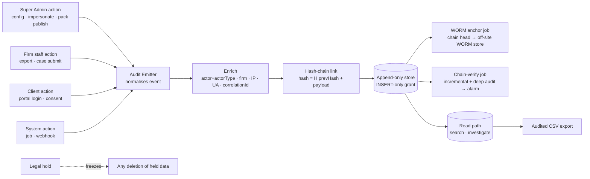
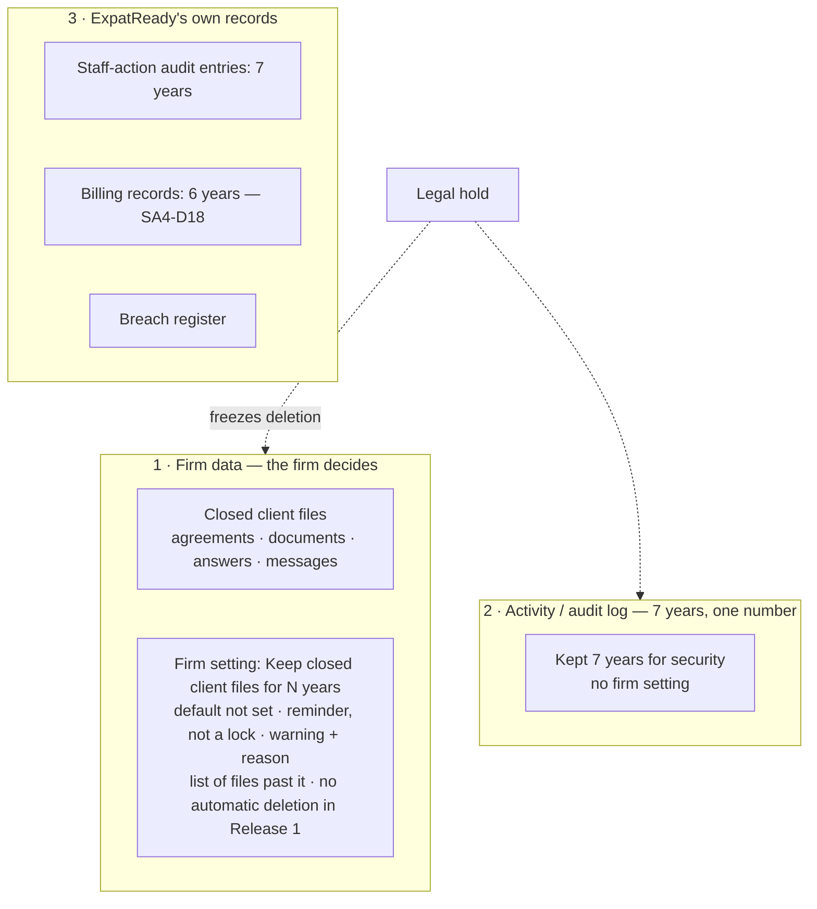
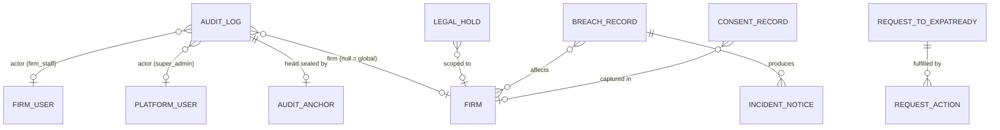

> **Document control** · Version **2.13** · **2026-10-18** · Status: **X-2 applied (18 Oct): privacy requests (export, erasure, legal hold) work per person record; a family member's answers live under their own record (new SA-11-40, three open questions Q23 – Q25). Earlier: Second pass (17 Oct): letter-pattern submission shrunk to three fields with no text (AG16-62); Move and Un-file one audit event type; mail-related audit entries hold ids only (AG16-54 #21); Q22 closed, Q21 narrowed (AG16-55). Earlier: AG-16 review decisions AG16-27(6), AG16-43 and AG16-44 applied (mail, letter and payment content never in system logs; audit of de-identified letter-pattern submissions; un-file audit event); earlier: the product owner's 12 Oct session-2 decisions applied (G-Q1 – G-Q6, R9-pass ruling 3, Rule 9 pass for SA-11, SR-Q2, SR-Q3, SA05-Q10); earlier 10–12 Oct decisions (R13 and its code check, Q19, Q20, Q21, decisions 1, 11, 14, rule 7, SA8-D9) unchanged**\
> Part of: *Super Admin Console — Functional Requirements* · Split from `FINAL-SuperAdmin-FR.md` lines 6308–6910 on 2026-09-16 · Previous version: `_archive/SA-11-audit-compliance-and-data-governance_v2.12_2026-10-17.md`\
>
> | Version | Date | Change | Decisions |
> |---|---|---|---|
> | 2.13 | 2026-10-18 | **People model applied (X-2).** New **SA-11-40** (full build card): a privacy request — export, erasure or legal hold — names one person record, and a family member's answers live under their own record, so a request about the principal does not sweep in family members' answers and a request about a family member works on that record. Pointers added to SA-11-16, -18, -28, -36 and to §3.4, §3.5, §3.8 (one line each, no control of their own). Three open questions added (Q23 – Q25): who may ask for a child's data, what a principal's copy holds, and how a case or firm hold reaches family members' records. *18 Oct (final): AG07-D17 – D21 applied — AG07-D20(n): privacy requests for minors come from the principal through the firm, adults act on their own record (SA-11-40 rule 8; Q23 and Q24 answered in part, Q25 stays open).* | X-2, AG07-D20(n) |
> | 2.12 | 2026-10-17 | **Second pass (AG16-54 #21, AG16-55, AG16-62), SA-11 items.** **AG16-62:** a letter-pattern submission holds exactly three content fields: sender domain, file-name pattern (digit runs masked except public form codes `IMM\s?\d{4}[A-Z]?`) and the type chosen (library code or `OTHER`); **no title, sentence, subject, body or attachment**; the name masker, its fail-closed rule and its fixtures are removed, so no masked text exists to log. **AG16-54 #21:** the pattern-submission audit entry holds **pattern id and type only**; **Move and Un-file are audited as one event type**; every mail-related audit entry holds ids and rule names only, never content. SA11-D14, SA-11-37 (wording), SA-11-38 and SA-11-39 changed; cards updated. **AG16-55:** Q22 closed (overtaken by AG16-62); Q21 narrowed and stays open (no default stated). **AG16-81:** AI drafting of letter entries removed from SA-11-38. *Same-day fixes (17 Oct): AG16-83 – AG16-88 — Q21 closed: the terms of service keep one line on shared pattern clues (AG16-83 #23).* *18 Oct: new section 'Decisions that change this epic' (index of AG16 decisions; no requirement changed).* | AG16-54, AG16-55, AG16-62, AG16-81 |
> | 2.11 | 2026-10-17 | Applied the AG-16 review decisions that touch audit and privacy logging (the product owner, 15–17 Oct). **Logging rule (AG16-27(6)):** email bodies, subjects and attachment file names are personal data and are never copied into system logs; the rule also covers letters and payment notices (AG16-27, AG16-30); BR-16 widened; new SA-11-37 and a log-scrubbing test. **Letter-pattern audit (AG16-43):** what is sent automatically (sender domain, file-name pattern with digits masked, title or first sentence with names and numbers removed, the type chosen) and what is never sent; audit entries for submission, review and publish; removal tested against de-identified fixtures; the terms state that de-identified government-template wording is shared; new SA-11-38. **Un-file (AG16-44):** un-filing an email is an audit event; new SA-11-39. Three build cards. OQ-21 and OQ-22 opened; no earlier question was answered by these decisions. | AG16-27, AG16-30, AG16-31, AG16-33, AG16-43, AG16-44 |
> | 2.10 | 2026-10-12 | Applied the product owner's 12 Oct session-2 decisions. **G-Q1 (disposal job):** switched ON, but only for an **approved, window-elapsed "delete my data" request**; grace is **7 days counted from approval** (code constant; the request shows "Erasing on <date> — Cancel"); refuses under a legal hold; ExpatReady's code floors kept (e.g. financial 7 years); **own stop switch** (kill-switch-eligible flag "Stop data erasure", R9-34); it is not a keep-period deleter, so Q19 is unaffected. SA-11-16 un-withdrawn in this narrow form; §1, §3.0, §3.4, §6B and the parked table changed. **G-Q2 (consent):** purposes named — built MARKETING_EMAIL, MARKETING_SMS, ANALYTICS_PROFILING, THIRD_PARTY_SHARING plus new "WhatsApp opt-in"; send-time rules by route; SA-11-29, §3.8, §7 `ConsentRecord`, BR-13. **G-Q3 (breach):** the firm-side breach backend stays with no firm screen (new SA-11-35); ExpatReady's register per R13; `agent/breach:manage` added to §10 as built. **G-Q4 (keep-periods):** the keep-period is a reminder, not a lock and does not feed the erasure job; the built per-class keep-periods stay dormant with no screen; keys named; SA-11-13 note, SA-11-33, BR-6, SA11-X1. **G-Q5 (legal holds):** placed by the **Platform Owner only** through a new platform route, key `system/compliance:legal-hold`; the firm route stays built, dormant, no screen; the purge of a cancelled firm refuses under a hold; §2, §3.5, SA-11-18, US-4, §10; closes §13 Q13. **G-Q6:** client self-download built, no portal button in Release 1 (new SA-11-36). **R9-pass ruling 3:** the activity log is kept **7 years — one number**; the firm "keep longer" setting and the refusal path are dropped (SA-11-14, SA-11-33, BR-6, BR-15, US-3, §9, §3.4); closes §13 Q1 and Q12. **Rule 9 pass:** new §3.11 "Settings — defaults and placement"; audit search, integrity banner, legal-hold screen and change-history screens (R9-28 – R9-31; §3.3, §3.5, §3.9, SA-11-8, -30, -34); §13 Q2, Q4 (part), Q5, Q8, Q9, Q11, Q15 – Q19 closed, Q14 closed by G-Q1 – G-Q6; Q3 and the pack-profile part of Q4 left open; new open item Q20 (erasure stop switch and the countdown) added, not decided. **SR-Q2 / SR-Q3:** the Platform Owner publishes every ExpatReady email (SA-11-25, §3.7); "Compliance / DPO" is not a role — the Platform Owner owns the breach register, the Auditor is read-only; persona and story names follow the six role names. **IDs:** changed SA-11-5, -8, -13 (note only; stays withdrawn), -14, -16 (un-withdrawn), -18, -19, -24, -25, -26, -28, -29, -30, -33, -34; added SA-11-35, -36; no requirement newly withdrawn. Decision log SA11-D9 – SA11-D12 added (SA11-D2, -D3, -D4, -D5 marked changed); §0.2 rows SA5-X37 (c), SA11-X1 – X4, X6, X7 changed and SA11-X10 – X13 added (all Pending). **Same-day revision (W-1 – W-3, the product owner, 12 Oct):** W-3(5) breach key note (`system/breach:manage` removed from Admin); W-3(8) pending erasures show "Erasure paused by ExpatReady" while "Stop data erasure" is on (Q20 closed); W-3(11) Q3 closed (30 days); W-3(12) Q4 remaining part closed; W-3(13) the 7-year financial keep floor and the 6-year billing records are different records; W-3(19) Q11 note closed (skipped messages are not logged in the audit). **Same-day revision (W-4 – W-10, the product owner, 12 Oct):** W-8 the stop switch does not cover client records and screens are unaffected (key per catalogue naming, SA-12 Q18); W-9 Q6 closed (`system/*`, as built); W-10(1) the Deletion outcome email goes to the person who made the request to ExpatReady (Q19 confirmed). **Same-day revision (W-11 – W-21, the product owner, 12 Oct):** W-11 the erasure flag is "Data erasure", on by default, and the emergency stop is its kill switch (replaces the "Stop data erasure, default off" wording of W-3(8)); text fixes (W-21) — Q3 and Q4 shown as closed, reason on firm role changes optional except the Owner role, this module sends two emails, only keep-period-driven soft-delete is parked, breach key `system/breach:manage` (Platform Owner only), engineers work outside the console. | G-Q1 – G-Q6; R9-pass ruling 3; Rule 9 pass (R9-28 – R9-31, R9-34); SR-Q2; SR-Q3; SA05-Q10 |
> | 2.9 | 2026-10-12 | Applied the product owner's 10–12 Oct decisions. **R13 and its code check:** audit basics kept (append-only log with actor type, firm and correlation id; insert-only grant; retry + alarm; support-session logging; ExpatReady staff-action records 7 years; breach register as a plain record); **hash chain + verify job, WORM off-site anchoring and the legal-hold API are KEPT because they are built** (`chain-append.service.ts`, `chain-verify.job.ts`, `worm-anchor.job.ts`, `legal-hold.controller.ts`) — SA-11-4, -5, -6, -18 changed to describe the build; **parked:** two-person audit deletion (not built; SA-11-17), compliance dashboard (SA-11-31), saved investigations / auditor pack / chain report attached to each export (SA-11-9, SA-11-8). **Compliance-console mock-screen decision:** wire audit search + CSV, integrity status banner, legal-hold list; remove panels for the retention engine, client data requests and residency generator (new SA-11-34). **Q19, decision 11, rule 7:** SA-11-13, -15, -16, -19 withdrawn; SA-11-14 rewritten (staff-action records 7 years; activity log at ExpatReady's own security minimum, value to confirm; breach records; no legal floors, no per-country minimums); new SA-11-33 (the three groups of keeping rules); statute and regulator names removed as justification, ExpatReady's own duties kept. **Q21:** SA-11-25 replaced by the "Security incident notice" to affected firms; SA-11-24 reduced to a plain record; SA-11-26 withdrawn (72-hour countdown parked); SA-11-27 / -28 narrowed to requests made to ExpatReady itself. **Consent (Q20, decision 14, decision 1):** SA-11-29 rewritten. **SA8-D9:** SA-11-21 withdrawn; SA-11-20, -22, -23 reworded; SA-11-32 unchanged. **IDs:** withdrawn SA-11-13, -15, -16, -19, -21, -26 (SA-11-10 stays withdrawn); changed SA-11-1, -4, -5, -6, -8, -9, -14, -18, -20, -22, -23, -24, -25, -27, -28, -29, -31; added SA-11-33, -34. Decision log SA11-D1 – SA11-D8 and §0.2 rows SA11-X1 – SA11-X9 added; SA5-X37 marked applied. §13: Q1 – Q3, Q5, Q8 reworded, Q7 and Q10 withdrawn, Q11 – Q19 added (all "not decided"). | R13; code-check outcome; mock-screen decision; Q19; Q20; Q21; decisions 1, 11, 14; rule 7; SA8-D9; SA5-X37 |
> | 2.8 | 2026-10-10 | Applied from SA-08 v2.5 (SA8-X6, SA8-D9; merge decided by the product owner, 10 Oct): SA-11 **holds a written data-location statement** — all client data in Canada (Montréal), encrypted; Stripe and the mailbox, calendar and WhatsApp providers as listed sub-processors; backups 35 days (SA2-D12) — included in the subscription terms and shown to firms on a **Security & privacy page**, and updated whenever the infrastructure changes (new SA-11-32). The **generated** residency declaration of SA-11-20 is replaced by this written statement (SA8-D9: no generator until multi-region routing); SA-11-21 and SA-11-22 now apply to the written statement and sub-processor list. | SA8-D9 (SA8-X6) |
> | 2.7 | 2026-10-07 | Aligned to SA-06 v3.0 roles and permissions (the product owner, 7 Oct): firm-side audit key `agent/audit-log:list` → canonical `agent/audit:read` (firm-wide for its holders, Owner and Admin by default — SA6-D11; was `agent/audit-log:list`, entity-scoped); `system/audit-log:list` kept as the canonical platform audit key; firm module keys merge into SA-11's register keys `agent/consent:manage`, `agent/legal-hold:manage`, `agent/retention-policy:manage` (SA-06 Appendix B); role changes are audited with a required reason (system-made changes carry an automatic reason); reveal keys confirmed withdrawn (AG7-D10), none live. | SA6-D3, SA6-D10, SA6-D11 |
> | 2.6 | 2026-10-05 | Applied from the Agent console's AG-07 (the product owner, 5 Oct) — a platform-wide product decision cited here, not a new SA decision: **no masking and no reveal of personal data anywhere**. Personal data is never masked in audit views, exports or snapshots; there is no reveal action, no `PII_REVEAL` event and no PII-reveal lens. SA-11-10 withdrawn; §13 Q7 withdrawn; SA-11-1, -8, -31, §3.1, §3.2, §3.3 wording, §7 `AuditLog`, the §8 story, §11 and §12 changed; BR-16 and BR-17 added (personal data never in system logs or traces; passport and financial numbers never in message content). Secret redaction in snapshots is unchanged; every export stays audited. | AG7-D10 (AG-07) |
> | 2.5 | 2026-10-03 | Consistency review fixes (3 Oct): status line updated to say the AG-17 retention-scope decision is applied; new "Applied from AG-17" table mapping each AG-17 decision to where it is applied. Requirements unchanged. | AG17-D4, AG17-D42 |
> | 2.4 | 2026-10-02 | Applied from AG-17 (the product owner, 2 Oct): the case-file retention period also governs LMIA (corporate) files and their candidate (job applicant) data — no separate candidate retention clock and no separate category. Scope only: the period's value stays an open question for counsel (§13 Q1). SA-11-13 and §13 Q1 changed. | AG17-D42 (AG-17 §0.2, SA-11 row) |
> | 2.3 | 2026-10-02 | Applied AG17 terminology/consistency changes (safe set): audit log's separate corporate case / corporate prospect links collapse to case / prospect links + client type. | AG17-D4 |
> | 2.2 | 2026-10-02 | SA-7 role names used throughout (SA7-X10, SA7-D8): "Tenant Account Manager" → "Firm onboarding / Account manager", "Billing Admin" → "Billing". Requirements unchanged. | SA7-X10 |
> | 2.1 | 2026-10-02 | Applied from SA-07 v2.6 (the product owner, 2 Oct): all audit entries of Expat Ready staff actions are kept at least 7 years, one rule for every category (SA-11-14 changed); a deactivated staff member's name is kept as long as any entry refers to them. Counsel confirmation (§13 Q1) still open. | SA7-X5, SA7-D45 |
> | 2.0 | 2026-06-20 | Baseline — golden per-module rebuild | — |

## Decisions that change this epic (14–18 Oct) *(new 18 Oct)*

Product-wide rules (apply here as everywhere; home: Agent `00-Overview` → "Product rules every epic follows"): AG16-31, AG16-33, AG16-44, AG16-76.

The "AG16" prefix is historical: these decisions began in the AG-16 review and apply across the product. Full text: `TEMPLATE-MAP-working_2026-10-10.md`.

| Decision | What was decided (one line) | What it changes in this epic | Where (requirement / card / section) |
|---|---|---|---|
| AG16-26 | Email filing order. | Referenced only (no change here). Cited on the Move and Un-file audit card as the filing order the audit event sits within. | SA-11-39 |
| AG16-27 | Government mail: recognise, match, identify the letter, sort, deadline. | Logging rule: email bodies, subjects and attachment file names are personal data and are never copied into system logs; the rule also covers letters and payment notices. BR-16 widened. New requirement SA-11-37 and a log-scrubbing test. | SA11-D13, SA-11-37, BR-16, §0.2 SA11-X14 |
| AG16-30 | Payment emails become a suggested payment record. | The never-in-system-logs rule also covers payment notices. | SA11-D13, SA-11-37 |
| AG16-43 | Keeping the letter library current. | New audit of letter-pattern submissions (what is sent automatically, what is never sent; audit entries for submission, review and publish). New requirement SA-11-38. | SA11-D14, SA-11-38, §3.1 |
| AG16-44 | ExpatReady never quietly judges for the firm. | Un-filing an email from a record is an audit event; Move and Un-file are one event type. New requirement SA-11-39. | SA11-D15, SA-11-39, §3.1 |
| AG16-54 | 25 consistency fixes after the 17 Oct write (batch). | #21: the pattern-submission audit entry holds pattern id and type only; Move and Un-file are audited as one event type; every mail-related audit entry holds ids and rule names only, never content. | SA11-D14, SA11-D15, SA-11-37 (wording), SA-11-38, SA-11-39 |
| AG16-55 | Writers' recommended defaults accepted for the detail questions. | Open Question 22 closed (overtaken by AG16-62); Open Question 21 narrowed. | §13 Q21, Q22 |
| AG16-62 | Unrecognised-letter pattern: no text leaves the firm. | A letter-pattern submission holds exactly three fields (sender domain, file-name pattern with digit runs masked except public form codes, the type chosen); no title, sentence, subject, body or attachment. The name masker and its fixtures are removed. | SA11-D14, SA-11-38, §0.2 SA11-X14, §13 Q22 |
| AG16-81 | "New letter patterns" review in Super Admin. | AI drafting of letter entries removed from SA-11-38 (no AI step). | SA-11-38 (Engine) |
| AG16-83 | 26 follow-through fixes after the second pass (batch A). | Open Question 21 closed (#23): the terms of service keep one line on shared pattern clues. | §13 Q21 |
| AG16-88 | Release 1 is English-first; French later. | Cited — see change-log row 2.12 (cited only in the range AG16-83 to AG16-88); no requirement here names it. | Document control (v2.12) |
| X-2 | One person record per real person; answers live under the person they describe; the principal sees family members' answers on shared cases (minors always; adults by default, unless staff tick "Keep private from the principal"). Home: AG-02. | Privacy requests (export, erasure, legal hold) work per person record. A family member's answers are exported, erased and held under their own record; a request about the principal does not sweep them in. One pointer line on each affected requirement; the rule is written once, in the new card. Three questions left open (Q23 – Q25). | SA-11-40 (home of the privacy-request scope), pointers in SA-11-16, -18, -28, -36; §3.4, §3.5, §3.8; §13 Q23 – Q25 |
| AG07-D20(n) | Privacy requests for children: the principal acts for minors through the firm; adults act on their own record. | SA-11-40 gains rule 8 and updated Access, Tests; Open Questions 23 and 24 answered in part (what proof staff check, what the principal's copy lists, and whether the principal is told when a private adult asks stay open); Q25 unchanged. | SA-11-40 (rule 8, Access, Tests), §13 Q23, Q24 |

## Module SA-11: Audit, Compliance & Data Governance

**Applied from AG-17 (corporate case, 2026-10-02)**

| ID | Decision | Applied here |
|---|---|---|
| **AG17-D4** | A corporate case or prospect is a case or prospect whose client type is Corporate (no separate corporate links) | §7 `AuditLog` scope note · §3 audit scope note |
| **AG17-D42** | The case-file retention period also governs LMIA (corporate) files and their candidate data; no separate candidate clock or category; the value is now the firm's own keep-period (Q19) | SA-11-13 (withdrawn v2.9; see SA-11-33) · §13 Q1 |

**Applied from SA-07 v2.6 (2026-10-01)**

| ID | Decision | Applied here |
|---|---|---|
| **SA7-X5** | Staff activity follows SA-11's audit retention, reconciled with SA-4's 6 years: **one rule — every audit entry of an Expat Ready staff action is kept at least 7 years**, whatever its category. Rests on ExpatReady's own security and tax needs and is reconciled with billing's 6 years (SA4-D18) *(rationale corrected v2.9 — rule 7; a client file's keep-period is the firm's, SA2-D13 revised)*. Decided by the product owner, 1 Oct. | SA-11-14 |
| **SA7-D45** | A deactivated staff member's name is kept as long as any audit entry refers to them | SA-11-14 |

**Decision log (v2.9, 2026-10-12)** *(IDs permanent; the product owner's decisions of 10–12 Oct applied to this module)*

| ID | Decision | Applied here |
|---|---|---|
| **SA11-D1** | **R13 and its code check.** Kept: append-only audit log with actor type, firm and correlation id; insert-only database grant; failed writes retried with an alarm; support-session logging; ExpatReady staff-action records kept 7 years; breach register as a plain record. **Also kept because built (12 Oct "built stays" rule):** hash chain + verify job (`chain-append.service.ts`, `chain-verify.service.ts`, `chain-verify.job.ts`), WORM off-site anchoring (`worm-anchor.job.ts`), legal-hold API (`legal-hold.controller.ts:59,82,105`). | SA-11-1 – SA-11-7, SA-11-11, SA-11-12, SA-11-18, SA-11-24 · §3.1 · §3.5 · BR-1 – BR-5 |
| **SA11-D2** *(changed v2.10 — R9-28 – R9-31)* | **Compliance-console mock-screen decision (R13).** The console on sample data is wired to the real backend for: **audit search + CSV export**, **integrity status banner** (from the verify job), **legal-hold list** (place / release). Panels for parked or reassigned engines are removed: retention engine, client data requests, residency generator. Screens follow Rule 9: audit search with a short default filter and technical filters under Advanced, plain integrity banner, "Hold this firm" with narrower scopes under Advanced, change history in words (R9-28 – R9-31; SA11-D10). | SA-11-34 · §3.3 · §3.5 · §3.9 · §3.10 |
| **SA11-D3** *(changed v2.10 — R9-pass ruling 3, G-Q1, G-Q4)* | **Keeping rules in three groups (Q19, decision 11, rule 7).** (1) **Firm data** (everything in a closed client file): the firm's own setting "Keep closed client files for N years" (default not set; warning + reason inside it; list of files past it; **no automatic deletion in Release 1**) — owned by the firm module, not set here; it is a **reminder, not a lock** and does not feed the erasure job (G-Q4, G-Q1). (2) **Activity / audit log:** **one number, 7 years**, for the whole log (firm entries and ExpatReady staff actions); no firm setting; wording "Your activity log is kept for 7 years for security." (R9-pass ruling 3). (3) **ExpatReady's own records:** staff-action audit entries 7 years; billing 6 years (SA4-D18); breach records 7 years (§13 Q2). No retention editor, no legal floors, no per-country minimums; ExpatReady's own built code floors (e.g. financial 7 years) stay in code (G-Q1, G-Q4). | SA-11-13 (withdrawn), -14, -15, -16, -19, -33 · §3.4 · BR-6, BR-7, BR-15 |
| **SA11-D4** *(changed v2.10 — SR-Q2)* | **Data requests and incidents (Q21).** A client's personal-data request is the **firm's**: handled in the firm's own tools (personal-data package in ExpatReady's fixed format, the firm's editable covering email, a firm-side request list). SA-11's register tracks **only requests made to ExpatReady itself**. For a security incident ExpatReady sends the **"Security incident notice"** to the affected firms' Owner and Admins (ExpatReady-owned, SA-05 Appendix B.6, published by the Platform Owner — SR-Q2); the firm decides whether and how to tell its clients; ExpatReady notifies people directly only for its **own users** (firm staff accounts). | SA-11-25, -27, -28 · §3.7 · §3.8 |
| **SA11-D5** *(changed v2.10 — G-Q2, SA05-Q10)* | **Consent records.** Three kinds: **portal consent screen acceptance** (one text per firm, recorded with date, time and text version; Q20 and the client consent screen decision), **imported declaration** ("imported — declared by <user>, <date> (source column …)"; decision 14; WhatsApp opt-in needs its own column and declaration, Q20), **marketing consent by sending route** (decision 1; Q9: unsubscribe / STOP always blocked). Portal consent is not marketing consent (Q20). **Purposes (G-Q2):** built per-purpose, append-only records `MARKETING_EMAIL`, `MARKETING_SMS`, `ANALYTICS_PROFILING`, `THIRD_PARTY_SHARING`, plus one new purpose **"WhatsApp opt-in"** (covers service and marketing). **Unsubscribe / STOP is per firm; hard bounces and spam complaints are platform-wide** (SA05-Q10). | SA-11-29 · §3.8 · §7 `ConsentRecord` · BR-13 |
| **SA11-D6** | **Residency (SA8-D9, R13).** The generated residency declaration and its "non-Canadian rail" warnings are not built; ExpatReady's **written data-location statement** (SA-11-32) stands in. | SA-11-20 – SA-11-23 · §3.6 · BR-10 · US-5 · §6F |
| **SA11-D7** | **Rule 7 wording.** Statute and regulator names are no longer used as the reason for anything a firm keeps or does; "legal floor", "lawful schedule", "statutory deadline", "legally required content" removed. **ExpatReady's own duties stay:** its breach register and incident notice, its data-location facts, its billing records (SA-04), its security. | Throughout |
| **SA11-D8** | **Breach register is a plain record (R13).** Discovery time, affected firms, data categories, cause, containment, notification decision, links to the notices sent. The structured "real risk of significant harm" engine, the 72-hour countdown and the regulator / individual notice composer are parked (see table below). | SA-11-24, -25, -26 · §3.7 · §6C |
| **SA11-D9** *(v2.10)* | **Governance code built against earlier "park" decisions (G-Q1 – G-Q6, 12 Oct).** (1) **Erasure job ON** for approved, window-elapsed "delete my data" requests only; 7 days' grace from approval; refuses under a hold; code floors kept; own emergency stop (kill switch on the "Data erasure" flag, on by default) *(revised same day — W-11)*. (2) **Consent** built stays, ON, send-time check aligned (G-Q2). (3) **Firm breach backend** stays, no firm screen; ExpatReady register per R13 (G-Q3). (4) **Keep-period = reminder, not a lock**; built per-class keep-periods dormant, no screen (G-Q4). (5) **Legal holds placed by the Platform Owner only**; firm route dormant (G-Q5). (6) **Client self-download** built, no portal button in Release 1 (G-Q6). Closes §13 Q13 and Q14. | SA-11-16, -18, -29, -33, -35, -36 · §3.4 · §3.5 · §3.7 · §3.8 · §10 · §12 |
| **SA11-D10** *(v2.10)* | **Rule 9 pass for SA-11.** Every kept setting has a default and a placement (Main / Advanced / code constant); screens R9-28 – R9-31; no permission keys on screen. Placement table in §3.11. | §3.3 · §3.5 · §3.9 · §3.11 · SA-11-34 |
| **SA11-D11** *(v2.10)* | **Activity log: one number, 7 years (R9-pass ruling 3).** Firm entries and ExpatReady staff actions alike; the firm "keep longer" setting and its refusal path are dropped (nothing deletes in Release 1: append-only log, no deletion path). Closes §13 Q1 and Q12. | SA-11-14, -33 · BR-6, BR-15 · US-3 · §9 |
| **SA11-D12** *(v2.10)* | **Roles and publisher (SR-Q2, SR-Q3).** The Platform Owner publishes every ExpatReady email, including the Security incident notice and the deletion-outcome email. "Compliance / DPO" is not a role: the Platform Owner owns the breach register and requests to ExpatReady; the Auditor is read-only. Legal holds: Platform Owner only (G-Q5). | SA-11-25, -28 · §2 · §3.7 · §10 · §13 Q15 |
| **SA11-D13** *(new v2.11 — AG16-27(6), AG16-30)* **Mail, letter and payment content is never in system logs.** Email bodies, subjects and attachment file names can carry names, passport numbers and dates of birth. They are personal data and are never copied into system logs or traces. The same holds for letter text and payment-notice text. Systems log record ids and rule names only. | SA-11-37 · BR-16 · §9 |
| **SA11-D14** *(new v2.11 — AG16-43, AG16-31; changed v2.12 — AG16-62, AG16-54 #21)* **Audit of letter-pattern submissions.** Sent automatically: exactly three content fields — sender domain, attachment file-name pattern (digit runs masked except public form codes `IMM\s?\d{4}[A-Z]?`) and the type the staff member chose (library code or `OTHER`). Never sent: the letter, a title or sentence, the body, attachments, any client field. No text leaves the firm, so there is no masked text to log. The audit entry holds the **pattern id and type only**. Audit entries for submission, review and publish. The terms-of-service sentence is Open Question 21. | SA-11-38 · §3.1 |
| **SA11-D15** *(new v2.11 — AG16-44; changed v2.12 — AG16-54 #21)* **Move and Un-file are audit-logged as one event type.** Un-filing a filed email (the firm's reversal of a rule-based filing) and moving it to another record are one audit event type with an action field (`move` | `unfile`). | SA-11-39 · §3.1 |

**Parked for later (rule 8)** *(one line each, so they can be found)*

| Item | Why parked | Comes back when |
|---|---|---|
| Two-person, regulator-ordered audit deletion (old SA-11-17, BR-9) | Not built; there is no audit-deletion path in the product (R13). | If a deletion path is ever built. Interim *(accepted — §13 Q8)*: a court order is handled by an engineer runbook with an audited Owner sign-off |
| Compliance dashboard (old SA-11-31 tiles) | Most tiles pointed at parked engines (R13). | After the engines it reads exist |
| Saved investigations, auditor pack, chain-verify report attached to each export | Console is a filtered list + audited CSV (R13). | On demand |
| Retention policy editor, legal floors on a screen, cold archive, keep-period-driven automatic disposal (old SA-11-13, -15) *(changed v2.10 — G-Q1, G-Q4)* | Q19: one firm setting, no automatic deletion from the keep-period in Release 1; decision 11. The built per-class keep-periods stay dormant with no screen (G-Q4). The disposal job itself is **ON**, for approved "delete my data" requests only (SA-11-16, G-Q1). | "Automatic disposal is a later release" (Q19) |
| Generated residency declaration and warnings | SA8-D9: no generator until multi-region routing. | With multi-region routing |
| Structured breach-risk assessment engine, 72-hour countdown, regulator / individual notice composer (old SA-11-25, -26) | R13 plain record; Q21 notice goes to firms. | On demand |
| Super Admin register of firms' clients' data requests (old SA-11-27, -28) | Q21: the firm's duty, handled in firm tools. | — |
| Platform compliance dashboard and per-firm report beyond the access list | R13. | — |

#### 0.2 Cross-module rows

**Rows INTO this module** *(applied in v2.9; SA5-X37 (c) updated v2.10)*

| ID | From | What | Source | Status |
|---|---|---|---|---|
| **SA5-X37** (a) | SA-05 v3.1 | A client's personal-data request is the firm's; SA-11's register tracks only requests made to ExpatReady itself | Q21 | **Applied v2.9** (SA11-D4; SA-11-27, -28) |
| **SA5-X37** (b) | SA-05 v3.1 | "Data breach notice to affected people" (SA-11-25) replaced by the ExpatReady-owned "Security incident notice" to affected firms; the firm decides about its clients; own users notified directly | Q21 | **Applied v2.9** (SA11-D4; SA-11-25) |
| **SA5-X37** (c) *(changed v2.10 — R9-pass ruling 3)* | SA-05 v3.1 | Firm keep-periods are one firm setting; the activity log stays separate: **one number, 7 years**, no firm setting | Q19, decision 11, R9-pass ruling 3 | **Applied v2.9; value fixed v2.10** (SA11-D3, SA11-D11; SA-11-14, -33). §13 Q1 closed |
| **SA5-X37** (d) | SA-05 v3.1 | SA-11 emails are kind 1 (Appendix B.6) | map §16 | **Applied v2.9** — this module sends two emails — the Security incident notice (SA-11-25) and the deletion-outcome email (§13 Q19) *(revised same day — W-21)* |
| **SA8-X6** | SA-08 v2.5 | Written data-location statement | SA8-D9 | Applied v2.8; confirmed v2.9 (SA11-D6) |

**Rows FROM this module to others** *(all Pending)*

| ID | Target | What changes | Source | Status |
|---|---|---|---|---|
| **SA11-X1** *(changed v2.10 — G-Q3, G-Q4, G-Q5, Q17)* | SA-06 | Permission keys of SA-11 §10: `system/audit:delete-ordered` parked (not built); `system/compliance:retention-config` and `:residency-view` withdrawn; `system/compliance:dashboard` parked; `system/compliance:consent-view` not needed (no consent viewer — Q17). **Firm keep-period:** set with `agent/legal-settings:manage` (Owner, delegable — Q13); deleting inside it with `agent/document:dispose` (Owner, delegable; warning + reason; for a "delete my data" request the warning shows at approval and approving is the decision); `agent/retention-policy:manage` stays on the built route (Owner and Admin), no screen (G-Q4; closes SA-06 OQ15). **Legal hold:** new platform key `system/compliance:legal-hold`, Platform Owner only; firm key `agent/legal-hold:manage` stays on the dormant firm route (G-Q5). **Breach:** firm key `agent/breach:manage` (Owner and Admin) stays on the built backend, no screen (G-Q3). Built keys are kept; no consolidation (Q17). | R13; Q19; Q13; G-Q3; G-Q4; G-Q5 | Pending |
| **SA11-X2** *(changed v2.10 — SR-Q3, G-Q5)* | SA-07 | SA7-X5 rationale: the 7-year rule for ExpatReady staff-action records rests on ExpatReady's own security and tax needs (billing 6 years, SA4-D18) — remove the "CICC 6-year client-file rule" reasoning. The activity log now shares the same 7-year number (R9-pass ruling 3). Breach register: owned by the Platform Owner, Auditor read-only; "Compliance / DPO" is not a role (§13 Q15 closed). Legal-hold key `system/compliance:legal-hold`: Platform Owner only (check Appendix A against §10). | rule 7; decision 11; SR-Q3; G-Q5 | Pending |
| **SA11-X3** *(changed v2.10)* | AG-16 / AG-01 (firm settings) | Firm keep-period setting and the "N closed files are past your keep-period" list (SA5-X32 (d)); the firm-side list of clients' personal-data requests (Q21); the keep-period is a reminder, not a lock (G-Q4); the firm "keep the activity log longer" setting is **dropped** (R9-pass ruling 3, §13 Q12 closed); product wording "Your activity log is kept for 7 years for security." | Q19; Q21; decision 11; G-Q4; R9-pass ruling 3 | Pending |
| **SA11-X4** *(changed v2.10)* | AG-13 | Activity-log retention text "cannot be set below its legal obligation" becomes "Your activity log is kept for 7 years for security." — no firm setting. | decision 11; R9-pass ruling 3 | Pending |
| **SA11-X5** | AG-09 | Document retention from the pack ("as long as the law requires") replaced by the firm's keep-period setting; legal-hold wording stays as built. | decision 11; Q19 | Pending |
| **SA11-X6** *(changed v2.10 — G-Q2, SA05-Q10)* | AG-10 / AG-02 / AG-18 | Consent: SA-11-29 records portal consent screen acceptance, imported declaration (email marketing; WhatsApp opt-in separate) and marketing consent by sending route; AG modules read the live state and apply the route rule. **Send-time gate aligned (code change, G-Q2):** unsubscribed / STOP blocked on every route; no recorded consent → skipped on shared email and on any automatic marketing send; own mailbox, manual → "Send anyway?"; WhatsApp needs the new "WhatsApp opt-in" purpose, else the message goes by email. Unsubscribe / STOP is per firm; hard bounces and spam complaints platform-wide (SA05-Q10). | decisions 1, 14; Q9; Q20; G-Q2; SA05-Q10 | Pending |
| **SA11-X7** *(changed v2.10)* | 00-Overview, 99-Phasing-and-Glossary | Overview row for SA-11 ("retention & disposal; PIPEDA…") → keep rules in three groups + consent records + erasure of approved "delete my data" requests (G-Q1) + legal holds placed by the Platform Owner (G-Q5); phasing: consent records are Release 1 (portal consent screen, marketing send rule by route, imported declarations); neutral label for "PIPEDA tooling". | decisions 1, 11, 14; G-Q1; G-Q5 | Pending |
| **SA11-X8** | SA-05 | Appendix B.6 "Source" column cites SA-11-25 "(replaced per SA5-X37)" — now SA-11-25 is the Security incident notice itself. | Q21 | Pending |
| **SA11-X9** | SA-08 | Check for any remaining reference to a *generated* residency declaration or "non-Canadian rail" warnings (SA-11 no longer has them). | SA8-D9 | Pending |
| **SA11-X10** *(v2.10)* | AG-07 / AG-13 / AG-16 | "Delete my data" request (SA05-Q3): the warning shows at approval and approving is the decision (G-Q4); after approval the request shows "Erasing on <date> — Cancel" for 7 days (code constant); an erasure approved after day 23 completes after the 30-day due date — the due date is a reminder; a held item shows "This data is on hold and can't be deleted." (G-Q5). | G-Q1; G-Q4; G-Q5 | Pending |
| **SA11-X11** *(v2.10)* | SA-12 | Erasure stop switch: a kill-switch-eligible flag "Data erasure" (key e.g. `governance.disposal`), on by default, stopped by tripping its kill switch with a reason (R9-34), separate from the general worker start-up switch *(revised same day — W-11)*. | G-Q1; R9-34 | Pending |
| **SA11-X12** *(v2.10)* | AG-07 / CP-01 | Client self-download: built (`portal/dsr-exports`), no portal button in Release 1; CP-01 decides the portal entry later. Developer notes: staff download uses `agent/data-export:request` (not the withdrawn `agent/pii:reveal`); export requests must not default to masked (AG7-D10). | G-Q6 | Pending |
| **SA11-X13** *(v2.10)* | SA-05; SA-02 | SA-05: add the short ExpatReady-owned **deletion-outcome email** for requests made to ExpatReady (Platform Owner publishes — SR-Q2); the Security incident notice is also published by the Owner. SA-02: the purge of a cancelled firm refuses while any active legal hold exists (ExpatReady places holds — G-Q5). | Q19 (SA-11 §13); SR-Q2; G-Q5 | Pending |
| **SA11-X14** *(new v2.11)* | SA-01 · AG-10 · AG-06 · SA-07 | SA-01: letter-pattern queue emits the review and publish events (SA-11-38). AG-10: the type-picker sends only the three items of AG16-62; Move and Un-file emit one event type (SA-11-39, AG16-54 #21). AG-10 and AG-06: mail, letter and payment-notice jobs never log subjects, bodies or file names (SA-11-37). SA-07: review and publish access is SA-7-49. | AG16-27, AG16-43, AG16-44 | Pending |

> **What this document is.** The reference-depth specification for the Super Admin console's **compliance backbone**: the platform-wide audit log and how its integrity is checked, support-session accountability, the legal-hold register (holds placed by the Platform Owner), ExpatReady's written data-location statement, its breach register and incident notice, the consent records, the rules for how long records are kept, and the erasure of approved "delete my data" requests. It describes how each part works, the screens, the states, the rules and the edge cases, so a developer can build it. Where the code already exists, this document describes what is built and cites the file (rule 8: spec follows code). Where this differs from the v1.0 summary of SA-11 in `2026-06-20-ExpatReady-SuperAdmin-Functional-Requirements.md`, **this document is the intended depth**.
>
> **Plane:** Super Admin console (**GLOBAL**) — platform-wide governance that spans every tenant. **Permission scope:** `system/*` (GLOBAL), Super Admin operators only; never assignable to firm staff. **Data:** this module governs the most sensitive data in the platform — immigration personal data (passports, biometrics references, family composition, medical and criminal admissibility signals). **In-house:** no third-party SIEM, no third-party audit vendor — the audit substrate is built in-house and stored in the firm's own cloud region. **Whose duty is what (rule 7):** the firm owns its own legal and regulatory duties — how long it keeps a client's file, how it answers its clients' data requests, whether and how it tells its clients about an incident. ExpatReady owns **its own** duties: the audit log and its integrity, who from ExpatReady looked at a firm's data, where the data is stored (a stated fact), its breach register and incident notice, its own billing records, and the 7-year keep period for the activity log. This module never certifies that a firm complies with anything.

---

## Module Index

Scan the whole module in ~30 seconds; jump to any part.

1. **Purpose & Goal**
2. **Users & Jobs-to-be-Done**
3. **Functional Design — How It Works** (core)
   - 3.0 The compliance-backbone model (pillars, one plane) · 3.1 The platform-wide immutable, tamper-evident audit log · 3.2 Actor model & high-sensitivity events (impersonation, cross-tenant, export) · 3.3 Audit search, CSV export & the compliance console · 3.4 How long records are kept (three groups) · 3.5 Legal hold · 3.6 Where the data lives (written statement) · 3.7 Breach register & Security incident notice · 3.8 Requests to ExpatReady & consent records · 3.9 Pack / reference-data change history · 3.10 Per-firm access report (compliance dashboard parked) · 3.11 Settings — defaults and placement
4. **Detailed Functional Requirements** (SA-11-n)
5. **Business Rules & Logic**
6. **States & Lifecycle**
7. **Key Entities & Fields**
8. **User Stories + Acceptance Criteria**
9. **Edge Cases & Validations**
10. **Permissions** (GLOBAL `system/*` — honest)
11. **Scalability · Security · Performance**
12. **Reference Note** (exists / NEW / changed — honest)
13. **Open Questions / Founder & Counsel Decisions**

### Visual Overview

**A. The audit-event pipeline** (every security- or data-significant action, from any plane, lands on one append-only, hash-chained spine; the chain is verified on a schedule and its head is anchored off-site):



**B. How long records are kept** (three groups, three owners — rule 7; no legal floors, no per-country minimums). The only automatic deletion is the erasure of an approved "delete my data" request (SA-11-16), which a legal hold stops:



**C. Core data model** (the audit log is the spine; the registers hang off the GLOBAL plane and reference firms by id — never redefining the polymorphic Part-2 attach pattern):



> `AuditLog` is attached to firm-plane entities (`case`, `prospect`, `task`, `calendarEvent`; a corporate case or prospect is a case or prospect whose client type is Corporate — AG17-D4) via the existing FK-scope pattern (Part-2 doctrine — reused, not redefined). The governance registers (`LegalHold`, `BreachRecord`, `IncidentNotice`, `RequestToExpatReady`, `ConsentRecord`) live on the GLOBAL plane and reference firms by id. The firm's keep-period is a firm setting (SA5-X32 (d)), not an entity here.

---

## 1. Purpose & Goal

**What it is.** SA-11 is the **trust backbone of the platform**: the platform-wide, append-only, tamper-evident record of **who did what, to which entity, in which firm, when, and from where**; the accountability record for every time ExpatReady staff enter a firm's data; the legal-hold register; ExpatReady's written statement of where client data lives; ExpatReady's own breach register and the incident notice it sends to affected firms; the consent records that firm modules read; the rules for how long each kind of record is kept; and the erasure of approved "delete my data" requests. It is also the **provenance ledger** for the immigration reference data itself (pack, scoring and form change history, tying SA-1).

**The business outcome it must produce.** ExpatReady sells to firms that handle some of the most sensitive personal data a person ever surrenders — passports, biometrics, family composition, medical and criminal admissibility. A firm needs to be able to ask "who from ExpatReady looked at our data, and why?" and get a complete, trustworthy answer; and ExpatReady needs to be able to show that its own record of events was not quietly altered. SA-11 makes that structurally true: an insert-only audit table, a hash chain that detects any later edit, a scheduled verification job, and off-site anchors of the chain head. Where the firm has duties of its own (how long to keep a client's file, how to answer a client's data request, whether to tell clients about an incident), SA-11 gives it tools and information and does not take the duty over.

**Why it matters / positioning.** A generic admin panel has an "activity log" — a best-effort, mutable list nobody trusts in a dispute. ExpatReady's audit substrate is built to be **evidence-grade** *(as built, 12 Oct — SA11-D1)*: append-only at the *database grant* level (the writing role holds INSERT only), **hash-chained** (`chain-append.service.ts`) so a later edit or removal breaks the chain and is detectable (`chain-verify.service.ts`, run by `chain-verify.job.ts`), **anchored** to an off-site WORM store (`worm-anchor.job.ts`), **actor-typed** (super_admin / firm_staff / client / system), and it explicitly captures an **impersonation session, a cross-tenant operation, and an export**. The moat is that every sensitive action across all three planes (Super Admin, firm, client) lands on one verifiable spine, and the same spine carries immigration **reference-data provenance** so an assessment can always be reproduced.

**How it ties to the platform.** SA-11 **records** every Super Admin action from SA-1…SA-12 (pack publishes, plan changes, impersonation, integration edits, feature-flag toggles, firm status changes); it **states** the data location facts that SA-8 rails make true (written statement, SA-11-32); and it **surfaces** the reference-data change history from SA-1 as a navigable trail. It is where the platform's promises become *checkable facts*.

**Global ambition.** The same module serves a Canada-only deployment and, later, a multi-region platform. Today the data-location statement names Canada (Montréal); a Country Pack residency profile and per-country routing are a later step (SA-11-23, §13 Q4, closed — W-3(12) *(revised same day — W-21)*). Nothing here depends on a country's rules about how long a firm keeps its files — that is the firm's setting.

---

## 2. Users & Jobs-to-be-Done

SA-11 is operated exclusively by Expat Ready's internal team (GLOBAL plane). The "Super Admin" umbrella splits into distinct sub-roles, each using this module differently. JTBD framing keeps the design honest about what each person is actually trying to accomplish. (Firm staff and clients *generate* audit events and *raise* DSR requests, but do not operate this console; their touchpoints are noted.)

| Role | Primary job in SA-11 | Jobs-to-be-done (representative) |
|---|---|---|
| **Platform Owner** (master account) | Own the platform's trust record and be able to prove it. | "When an external auditor asks for every impersonation in the last 90 days, I want to search, check that the integrity banner is green, and export it as CSV in minutes — not reconstruct it from logs." · "When I look at the platform, I want to see at a glance whether the audit chain is intact and when it was last anchored and verified." |
| **Platform Owner — breach register, requests to ExpatReady, legal holds** *(changed v2.10 — SR-Q3, G-Q5; "Compliance / DPO" is not a role)* | Run ExpatReady's own incident record, requests made to ExpatReady, and legal holds. The Auditor reads these read-only. | "When a possible incident is reported, I want to open a record, note scope, cause and containment, decide whether firms must be told, and send the **Security incident notice** to the affected firms' Owners and Admins." · "When a person or firm staff member asks ExpatReady itself for their data, I want one register that tracks the request to a response." · "When a court order or dispute needs data frozen, I want to place and release a legal hold with a reason — only the Platform Owner can." |
| **Admin (account-manager duties)** *(role name changed v2.10 — SR-Q3, SR-Q4(9))* | Account for platform access to a specific firm's data. | "When I support a firm, I want every impersonation I run to be **reason-gated and on the immutable record**, and I want to show the firm exactly who accessed their data and why." |
| **Content publisher** *(role name changed v2.10 — SR-Q3)* | Prove the provenance of immigration reference data. | "When a firm disputes an assessment, I want to show **who published which version of the CRS table and when**, with before/after — so the calculation is reproducible and defensible." |
| **Platform engineer** *(not a console role — SR-Q3; works outside the console — W-3(1), R8, SA8-D1) *(revised same day — W-21)** | Operate the substrate; respond to integrity alarms. | "When the **chain-verify job** finds a broken link, I want an immediate alarm with the exact range, because a broken chain means tampering or corruption." · "When the anchor job cannot reach the WORM store, I want to know and have it retried." |
| **Support** *(role name changed v2.10 — SR-Q3)* | Light, gated use. | "When I triage a ticket via impersonation, I want the session **pre-justified from the ticket** (SA-10) and recorded, so my access is accountable without extra steps." |

**Touchpoints (not operators):**
- **Firm staff** generate the bulk of audit events (exports, case submissions, consent changes) and see ExpatReady's written data-location statement on the read-only **Security & privacy** page (SA-11-32). They do **not** see the platform-wide log or other firms' records. A firm's own keep-period, its list of files past it, and its clients' data requests (including "Delete my data" and "Copy of my file") live in the firm's own settings and tools (Q19, Q21, G-Q1, G-Q6).
- **Clients** generate sign-in and document-access events and accept the portal consent screen; their personal-data requests go to the **firm**, not to this module.

**Design implication.** The Platform Owner (with the Auditor reading) is the protagonist: the audit search (filters + CSV + integrity banner), the legal-hold list and the incident record are designed for *defensibility under scrutiny* — "produce the evidence, show it is intact". Engineers get the integrity alarms. Permissions (Section 10) separate read-the-log from manage-a-hold (Platform Owner only) from manage-an-incident — least privilege on the most sensitive console in the platform.

---

## 3. Functional Design — How It Works (core)

This is the heart of the spec. Each sub-function is designed in depth: **how it works**, the **world-class behaviour** that makes it evidence-grade rather than a best-effort log, the **key screens & interactions** (functional, not pixel-level), and the **data flow**.

#### 3.0 The compliance-backbone model — "pillars on one plane, one source of truth"

**Design decision: SA-11 is one module whose parts all sit on the GLOBAL plane and feed one another.** They are specified together because they are operationally inseparable: an incident investigation reads the audit log; a legal hold stops a deletion, and the hold itself is audited. Splitting them would fracture the evidence.

1. **Immutable, tamper-evident audit log** (3.1–3.3) — the spine. Every security/data-significant event across all three planes, append-only and hash-chained, verified and anchored.
2. **How long records are kept** (3.4) — three groups with three owners: the firm's own data (firm setting, a reminder), the activity log (7 years), ExpatReady's own records; plus the erasure of approved "delete my data" requests.
3. **Legal hold** (3.5) — a freeze, placed by the Platform Owner, that beats any deletion.
4. **Where the data lives** (3.6) — ExpatReady's written data-location statement.
5. **Incident record and requests to ExpatReady** (3.7–3.8) — breach register and Security incident notice; requests made to ExpatReady itself; consent records.
6. **Reference-data provenance** (3.9) — the navigable change history of the immigration packs (ties SA-1), riding the same audit spine.

**The cross-plane actor principle.** Every event, regardless of origin, is normalised to a single shape with an explicit **`actorType` ∈ {super_admin, firm_staff, client, system}** and an explicit **firm** (the firm id, or **null for a genuinely global action**). This is what makes "who did what" unambiguous when a Super Admin acts *inside* a firm (impersonation), when a firm user acts on their own data, when a client acts in the portal, and when a background job acts as the system.

> **Reference-note callout:** the v2.8 text described the older `DevAPI-main` audit log (no `actorType`, no hash chain, no insert-only grant). The current backend (`ERv2-sanitized`) already has the hash chain, the verify job and the WORM anchor job; see Section 12 for what is built and what is not.

#### 3.1 The platform-wide immutable, tamper-evident audit log — "append-only at the grant level, hash-chained so tampering is detectable" *(changed v2.9 — R13 code check)*

**How it works.** A single **append-only** table is the system of record for every security- and data-significant event. Writes go through one **Audit Emitter** (a service every module calls, plus the existing interceptor for HTTP-shaped actions) that: (1) normalises the event to the canonical shape, (2) enriches it with actor + `actorType`, firm, IP, user-agent, and a **`correlationId`** (the request/trace id, so all entries from one operation are linkable), and (3) **links it into the hash chain**.

**Tamper-evidence (built — SA11-D1).**
- **Append-only at the database grant level.** The application role that writes audit entries holds **INSERT only** — no UPDATE, no DELETE grant on the audit table. Even a Platform Owner cannot edit or delete an entry through the application.
- **Hash-chaining (built).** Each entry stores `prevHash` and `entryHash = SHA-256(prevHash ‖ canonicalSerialization(thisEntry))`; a monotonic `sequenceNo` prevents silent gaps. Altering or removing any historical entry breaks every later hash. One chain per firm is appended by `chain-append.service.ts`; a separate platform chain by `platform-chain-append.service.ts`.
- **Off-site anchoring (built).** `worm-anchor.job.ts` sweeps every firm and, when a firm's chain head has advanced past its last anchor, writes the head to an immutable (WORM) store. A new anchor goes under a new append-only key each run, so duplicates are harmless witnesses.
- **Continuous verification (built).** `chain-verify.job.ts` runs an incremental sweep (30-minute cadence) and a weekly deep audit through `chain-verify.service.ts`. A finding raises the `audit.chain_integrity_failure` alarm (firm id and sequence range only); each completed incremental sweep emits an `audit.chain_verify_ok` heartbeat, and a missing heartbeat raises the absence alarm.

**What gets logged.** Authentication (login/logout/**failed login**/MFA challenge); authorization **denials**; create/update/delete on case/client/prospect/financial records with **before/after** where applicable; document access/download; **every export**; role and permission changes (the audit always records who, when and before / after; the **reason on firm role changes is optional, required only when giving or removing the Owner role** — R36, SR-Q7 *(revised same day — W-21)*; changes the system makes carry an automatic reason — SA6-D3, SA-06 BR-23); **consent changes** (the three kinds of SA-11-29); retainer created/signed; **case submitted to a government body**; payments/refunds; **every Super Admin action** (pack publish/rollback, plan change, firm status change, integration edit, feature-flag toggle, platform-user change); **every impersonation** (start/end + actions within); and **every cross-tenant operation** (3.2). System actions (jobs, webhooks) are logged with `actorType = system`. *(changed v2.11 — AG16-43, AG16-44)* **Also logged:** un-filing an email from a record (SA-11-39); a letter-pattern submission, its review and the publish of a letter-library entry (SA-11-38). These entries hold record ids, rule names and the chosen letter type only — never an email subject, body or attachment file name, and never letter text (SA-11-37).

**Behaviour.**
- **Non-fatal to the business action, but never silently dropped.** A failed audit write does not roll back the user's operation; the emitter retries on a durable queue and, if it still fails, raises an integrity alarm rather than swallowing it.
- **One emitter, many callers.** A new event type is a thin call, not a new logging mechanism, and the chain stays unbroken across modules.

**Key screens.** *(All read-only — there is no "edit entry" anywhere, by design.)* The chain-integrity status (last verified, last anchor, any findings) is the **integrity status banner** on the audit search screen (SA-11-34).

**Data flow.** Module action → Audit Emitter → enrich → compute `entryHash` from `prevHash` ‖ payload, assign sequence → INSERT (INSERT-only grant) → on schedule: anchor job writes the head to the WORM store; verify job checks the chain → on a finding, integrity alarm.

#### 3.2 The actor model & high-sensitivity events — "impersonation and cross-tenant ops are first-class, not buried" *(changed v2.6 — AG7-D10)*

**How it works.** Two categories of event are the ones a privacy regulator scrutinises first, so they are modelled explicitly rather than left as generic rows; exports are audited too (below). *(changed v2.6 — AG7-D10)*

- **No masking, no reveal of personal data** *(withdrawn v2.6 — AG7-D10; was "PII reveal")*. Personal data of firms' clients and staff (passport numbers, financial details, names, addresses) is **never masked** in any audit view, entry detail, snapshot or export: anyone permitted to read a record sees it in full. There is no reveal action, no `PII_REVEAL` event and no reveal or unmask permission. Access to the data is controlled by who may see a firm's data at all (permissions; SA-2 impersonation and consent), and every export is audited (who, what, when). Two rules still hold: **(a)** personal data is never written to system logs or traces; **(b)** passport and financial numbers are never put into the content of emails, WhatsApp messages or notifications (BR-16, BR-17).
- **Impersonation (cross-plane).** When a Super Admin enters a tenant via the SA-2 impersonation mechanism, SA-11 records the **session boundaries** (`IMPERSONATION_START` / `IMPERSONATION_END` with reason, firm, operator) **and** stamps **every action taken during the session** with both the impersonator's identity and `actorType = super_admin` *plus* the impersonated context — so a firm can later see "Expat Ready support, acting as your console, viewed these 4 records for reason X between 14:02 and 14:18." Destructive/financial actions are blocked during impersonation (SA-2 rule); the *attempt* is still logged.
- **Cross-tenant operation.** Any GLOBAL-plane read or action that spans more than one tenant (the unscoped admin audit query itself, a platform-wide template update notice, a platform-wide analytics scan over raw tenant data) emits a **`CROSS_TENANT_ACCESS`** event naming the operator and the scope. This is the control that keeps the platform team's god-mode accountable.

**World-class behaviour.**
- **The sensitive two are queryable as their own lens.** The investigation UI (3.3) has one-click filters for "all impersonations" and "all cross-tenant access" in a window (exports are found by action code) — the exact questions an auditor asks — instead of forcing a hand-built filter.
- **Actor type drives accountability views.** Because every entry carries `actorType`, a firm's per-tenant view (published to them) can show *only* firm_staff + the super_admin entries that touched *their* tenant — never another firm's — and a Platform Owner sees the super_admin lens across all tenants. The same data, correctly sliced by plane.

**Key screens.** *Sensitive-event lenses* (impersonation / cross-tenant) on the investigation console; *per-firm access report* (who from Expat Ready touched this tenant, when, why) — both export-ready.

**Data flow.** Impersonation entry / cross-tenant query → Audit Emitter with the dedicated action code + sensitive flag → same chain → indexed for the sensitive-event lenses.

#### 3.3 Audit search, CSV export & the compliance console — "find it, export it, see it is intact" *(changed v2.9 — R13, mock-screen decision)*

**How it works.** *(changed v2.10 — R9-28)* The audit search screen opens on the short default — **date range + firm + an "ExpatReady staff access" quick button**; the technical filters sit under **Advanced**, with plain action names. The full filter set queries the audit spine: **date range (required)**, actor, `actorType`, firm, action code, entity type/id, sensitive-event lens (impersonation / cross-tenant), `correlationId` (to pull a whole operation), and free-text on entity name/path. Results are paginated. The cross-firm read is built (`audit-read.controller.ts:92-135`); the unscoped admin query emits a `CROSS_TENANT_ACCESS` event for itself. Export is a **CSV** of the filtered list; every export is itself logged.

**The compliance console** (frontend `compliance-console/*`, today on sample data) is wired to the real backend for exactly three things (SA11-D2, SA-11-34): **audit search + CSV**, the **integrity status banner** (latest verify-job result and last anchor), and the **legal-hold list** (place / release). The banner reads **"Records intact — last checked N min ago"**; on a failure it turns red with a plain message, and the detail (firm, sequence range) opens on click (R9-29). Panels for the retention engine, client data requests and residency generator are removed.

**Parked (one line):** saved investigations, a one-click auditor pack, and a chain-verify report attached to each export — the console is a filtered list plus an audited CSV (R13). The integrity banner carries the chain status instead.

**Key screens.** *Audit search* (filter bar + results + integrity banner), *entry detail* (full payload, before/after, chain position), *export dialog* (range + filters → CSV), *legal-hold list* (3.5).

**Data flow.** Query → read path → results + banner; export → stream the filtered range → CSV → log the export and emit `CROSS_TENANT_ACCESS`.

#### 3.4 How long records are kept — "three groups, three owners" *(rewritten v2.9 — Q19, decision 11, rule 7; changed v2.10 — G-Q1, G-Q4, R9-pass ruling 3)*

**How it works.** ExpatReady does not run a platform retention editor and does not set legal minimums for firms. Keeping rules fall into three groups (SA11-D3):

1. **Firm data — the firm decides.** Everything in a closed client file (signed agreements, documents, questionnaire answers, messages, LMIA candidate data) follows **one firm setting, "Keep closed client files for ___ years"** (default not set), changed under the firm's "Manage legal settings" (Q13; key `agent/legal-settings:manage`, Owner, delegable) *(Advanced — §3.11)*. It is a **reminder, not a lock** *(G-Q4)*: it drives the warning and the list "N closed files are past your keep-period", and it does **not** feed the erasure job. Deleting inside the period shows a warning the person can pass with a reason (recorded; key `agent/document:dispose`, Owner, delegable). **Release 1 has the setting, the warning and the list — no automatic deletion from the keep-period;** keep-period-driven disposal is a later release. The setting itself belongs to the firm modules (SA5-X32 (d)); this module only records the events (3.1) and honours legal holds (3.5). The LMIA record-keeping end date (AG-17) is calculated from this setting ("No keep-period set" otherwise). Where a record has no keep-period rule yet (for example lead-only records) see SA-05 §13 Q4 and SA05-Q4 (lead-only records and send records join the same list).
2. **Activity / audit log — one number, 7 years** *(R9-pass ruling 3)*. The whole log (firm entries and ExpatReady staff actions) is kept **7 years**. There is no firm setting and no way to shorten or lengthen it; nothing in the product deletes an audit entry (append-only log, no deletion path — R13). Product wording: "Your activity log is kept for 7 years for security." — never "legal obligation".
3. **ExpatReady's own records — ExpatReady's own business.** Every audit entry of an ExpatReady staff (Super Admin) action is kept **7 years** (SA-11-14); billing records are kept 6 years (SA4-D18, SA-04) — a different record from the firms' client financial data kept 7 years by the code floor (§3.4 erasure) *(revised same day — W-3(13))*; breach records are kept **7 years** (SA-11-14, §13 Q2).

**Erasure of an approved "delete my data" request (G-Q1).** *(changed 18 Oct — X-2)* An erasure covers one person record; see SA-11-40. The built disposal job is **switched ON**, for exactly one trigger: a firm's **approved "delete my data" request** (SA05-Q3) whose grace window has elapsed (`disposal-executor.service.ts:46, 210-222`). It is not a keep-period deleter. Rules:
- **Warning at approval.** The keep-period warning shows when the request is approved; approving is the decision (G-Q4).
- **Grace of 7 days counted from approval** (code constant, like SA05-Q14). During it the request shows **"Erasing on <date> — Cancel"**. *(Fix 1: today the window ends on the 30-day due date counted from receipt — `dsr.service.ts:314-319` — so a late approval leaves 0–1 days to undo.)*
- **Accepted consequence:** an erasure approved after day 23 completes after the 30-day due date. The due date is a reminder, not enforced (rule 7).
- **Refuses under a legal hold** (3.5); the item is reported held.
- **Code floors kept:** classes with a floor are kept (financial 7 years — `retention-policy.service.ts:30-60`). This 7-year floor covers the **firms' client financial data**; it is a different record from ExpatReady's own billing records (6 years, SA4-D18) — no change to either *(revised same day — W-3(13))*. The built per-class keep-periods (`retention-policy.controller.ts`, `retention-policy.service.ts:91-120`) stay built and **dormant, with no screen** (G-Q4).
- **Own stop switch** *(Fix 2)*: the job today starts with the general worker switch (`worker/src/main.ts:489`); it gets a dedicated emergency stop — the kill-switch-eligible flag **"Data erasure"** (SA-12, R9-34; key e.g. `governance.disposal`, developer confirms the convention; **on by default**, platform scope only; reuses the built kill switch, no new setting). **Emergency stop = trip the kill switch** on it with a reason (audited): the flag reads off and erasure pauses, and pending erasures show "Erasure paused by ExpatReady"; untrip to resume. If the kill switch cannot be read, it also pauses — the safe direction (`platform-flag/flag.service.ts:104-105`) *(revised same day — W-11)*. The switch **does not cover client records**: it pauses the background job only — no read-only mode, screens unaffected; approvals and grace periods continue and nothing is erased *(revised same day — W-8)*.

**Parked (one line):** the platform retention policy editor, legal floors on a screen, cold archive, pre-disposal manifest and **keep-period-driven** soft-delete recovery window and scheduled disposal (old SA-11-13, -15) — Q19 says no automatic deletion from the keep-period in Release 1. Only the keep-period-driven path is parked; the 7-day grace after an approved request stays (G-Q1) *(revised same day — W-21)*.

**Key screens.** None in this module (the firm's keep-period screen is a firm setting; the erasure countdown is on the firm's request, SA11-X10). ExpatReady's own facts (activity log kept 7 years, backups 35 days, deletion dates) are shown on the firm's **Security & privacy** page (SA-11-32).

**Data flow.** Firm saves keep-period → firm module audit entry (3.1). Deletion attempt inside the period → warning + reason → audit entry with the reason. "Delete my data" approved → "Erasing on <date> — Cancel" for 7 days → job runs (unless stopped, cancelled or held) → erased; the audit entry survives (BR-8). A legal hold (3.5) stops a deletion of held data before any of this.

#### 3.5 Legal hold — "freeze beats deletion; nothing disappears mid-dispute" *(kept — built; changed v2.9; changed v2.10 — G-Q5, R9-30)*

**How it works.** *(changed 18 Oct — X-2)* A hold can also be placed on one person record; see SA-11-40. A **legal hold** is an explicit freeze placed on a scope — a firm, a case, a data category, or a date range — for litigation, an investigation, or a complaint. While a hold is active, **no in-scope data can be deleted or disposed of**, and a deletion that intersects the hold is **suspended** (recorded as held, not silently refused). A hold has a reason, an owner, a placed-at, and a (nullable) released-at; placement and release are **audited**.

**Who places it (G-Q5).** **ExpatReady places holds — the Platform Owner only**, from the legal-hold list in the console (R13, SA11-D2), through a new platform route on the built service with the key **`system/compliance:legal-hold`**. Why: ExpatReady's purge of a cancelled firm refuses while any active hold exists (`firm-purge-sql.ts:39`, `firm-purge.service.ts:87`), so ExpatReady must be able to place holds (for example a court order), and a firm-placed hold must not block the purge indefinitely. The **firm route** (`legal-hold.controller.ts:59,82,105`, key `agent/legal-hold:manage`, Owner and Admin) **stays built, with no firm screen** — dormant. A firm user who tries to delete held data sees **"This data is on hold and can't be deleted."**

**Behaviour.**
- **Hold always wins over any deletion.** A deletion obligation never overrides a preservation hold; the system encodes that order rather than leaving it to operator memory. This covers manual deletions, the erasure job (3.4) and the purge of a cancelled firm.
- **Holds are explainable.** "Why can't I delete this?" is answered from the hold list, with reason and owner.
- Nothing deletes itself from the keep-period in Release 1 (Q19); the automatic deletions that exist are the erasure of approved requests (3.4) and the purge of a cancelled firm, and both refuse under a hold.

**Key screens.** *Legal-hold list* in the compliance console (active/released holds, scope, reason, owner; Platform Owner only). *(R9-30)* The main action is **"Hold this firm"** plus a reason; narrower scopes (case, data category, date range) sit under **Advanced**. A *hold indicator* shows on any deletion it blocks.

**Data flow.** Place hold → list entry + audit entry. Any deletion path checks active holds first → if in scope, block and record "held". Release hold → list update + audit.

#### 3.6 Where the data lives — "a written statement, kept current" *(changed v2.9 — SA8-D9, R13)*

**How it works.** SA-11 holds a **written data-location statement** (SA-11-32): all client data is stored in Canada (Montréal), encrypted; Stripe and the mailbox, calendar and WhatsApp providers are the listed sub-processors; backups are kept 35 days (SA2-D12). It is part of the subscription terms (SA-4-65), shown to firm staff on a read-only **Security & privacy** page, exportable together with the sub-processor list (SA-11-22), and updated — with an audited version — whenever the infrastructure or the sub-processor list changes.

**Parked (one line):** the **generated** residency declaration (a per-category status computed from the SA-8 rail settings) and the automatic "non-Canadian rail" compliance warnings — SA8-D9 withdrew the generator until multi-region routing exists, and the compliance-console panel for it is removed (SA11-D2, SA11-D6).

**Later (multi-region):** residency is modelled per country plane (SA-11-23); physical per-country routing is a later phase (§13 Q4).

**Key screens.** *Security & privacy page* (firm app, read-only), *statement editor* (versioned, audited).

**Data flow.** Infrastructure or sub-processor change → statement edited by an authorised operator → new audited version → shown to firms and included in the export.

#### 3.7 Breach register & Security incident notice — "a plain record, and tell the affected firms" *(changed v2.9 — R13, Q21)*

**How it works.** A platform-wide **breach register** records **every** breach of ExpatReady's security safeguards, whether or not anyone must be told. A record is a plain record: **discovered at**, description, **affected firms**, **affected data categories**, root cause, containment steps, the **notification decision** (with who decided and why), and links to every notice sent. It is ExpatReady's own record-keeping duty and stays (SA11-D8).

**Notice (Q21).** ExpatReady notifies the **affected firms' Owner and Admins** with an ExpatReady-owned **"Security incident notice"** (SA-05 Appendix B.6; wording by counsel; **published by the Platform Owner, like every ExpatReady email** — SR-Q2; the "contains legal terms" flag is parked), **as soon as feasible** (interim wording — §13 Q2). The notice states ExpatReady's facts: what happened, what was affected, what ExpatReady has done, and a contact. The **firm decides whether and how to tell its own clients**; the firm has an editable library starter, "Notice to clients about a data incident" (SA-05 A.14, Good to have). ExpatReady does not write to a firm's clients. ExpatReady notifies people **directly** only for its **own users** (firm staff accounts). Each notice sent is recorded on the breach record (who, when, channel, recipients, the template version used) and on the audit spine. The record also has a free-text **"Other notifications made"** field (for example a report filed outside the product — §13 Q16). The **Platform Owner owns the register**; the Auditor reads it, read-only (SR-Q3, §13 Q15). Breach records are kept 7 years (SA-11-14).

**Firm side (G-Q3).** The built firm backend (`breach.controller.ts`, key `agent/breach:manage`, Owner and Admin) **stays as is, with no firm screen in Release 1** (SA-11-35); the recommended firm "Data incidents" page was declined. The decision step's regulator wording ("reasonable risk of significant harm", `rrosh-gate.service.ts`) stays in code only and is never shown on a screen (rule 7). On the ExpatReady side the plain register follows R13; the route (`system/breach:manage` in the map) is not yet delivered and the console panel runs on sample data — delivery follows R13.

**Parked (one line):** the structured "real risk of significant harm" assessment, the live 72-hour countdown, and a composer for notices to a regulator and to individuals (old SA-11-25, -26) — R13 keeps a plain record; Q21 sends the notice to firms. Whether any regulator report is filed, and when, is a counsel point for ExpatReady's own duty, done outside the product; the breach record only carries the free-text "Other notifications made" note (§13 Q2, Q16 — closed).

**Key screens.** *Breach register* (all records, status, affected scope), *breach detail* (the plain fields above), *notice sender* (recipient firms, preview of the Security incident notice, send, record).

**Data flow.** Breach opened (manually or from an integrity / security alarm) → register entry + audit entry → decision recorded → if firms are to be told: notice sent to each affected firm's Owner and Admins → recorded on the breach and on the audit spine.

#### 3.8 Requests to ExpatReady & consent records — "the firm answers its clients; ExpatReady answers requests made to ExpatReady" *(changed v2.9 — Q21, Q20, decisions 1 and 14)*

**Requests.** *(changed 18 Oct — X-2)* Every request, export, erasure or hold works on one person record; a family member's answers are handled under their own record (SA-11-40). A **client's** personal-data request is the **firm's**: the firm handles it in its own tools — the personal-data package (ExpatReady's fixed format), the firm's editable covering email, and a firm-side request list (SA5-X32; Q21). This module does **not** track them. SA-11 keeps a **register for requests made to ExpatReady itself** (for example a person or a firm staff member asking ExpatReady for the data ExpatReady holds about them): request type (access / correction / deletion), requester, date received, response date, status (`PENDING / IN_PROGRESS / COMPLETED / OVERDUE / HELD`), and the actions taken. The response date is **ExpatReady's own target** — the built 30-day clock (code constant, Rule 9 pass; §13 Q3 closed — 30 days, W-3(11)) *(revised same day — W-21)*. A **deletion** request checks legal holds (3.5); a deletion blocked by a hold is marked HELD / partial and the requester is told what was deleted and what is kept and why — never a false "done". When the request ends, the requester gets a short ExpatReady-owned **deletion-outcome email** (what was deleted, what is kept and why) — published by the Platform Owner (SR-Q2; §13 Q19).

**Client self-service download (G-Q6).** The built `portal/dsr-exports` request and portal download (`dsr-export.controller.ts:100-127`, `export-release.controller.ts:166`) stay, with **no portal button in Release 1**: clients ask the firm, and staff run the built export as decided (SA05-Q3). CP-01 decides the portal entry later. An export is never masked (AG7-D10) — a client's copy must be complete (SA-11-36).

**Consent records.** Recorded with timestamp, scope, language and the **text version**; withdrawals are first-class. Three kinds (SA11-D5):
- **Portal consent screen acceptance** — one consent text per firm, on from day one with ExpatReady's starter wording (the firm may edit or switch it off); recorded with date, time and **text version**; a changed text is shown again at the client's next login; the questionnaire does not ask again once accepted (Q20). It is **not** marketing consent.
- **Imported declaration** — when a consent column is mapped on import, the importer ticks "I confirm these people agreed to receive marketing from [firm], and I can show how and when"; recorded as "imported — declared by <user>, <date> (source column …)"; counts as marketing consent (decision 14). It covers **email marketing** only; **WhatsApp opt-in** needs its own column and declaration (Q20).
- **Marketing consent by sending route** — records the firm's own wording version. Firm modules read the live state and apply the route rule (decision 1, Q9; **send-time check aligned, G-Q2**): **unsubscribed or STOP → blocked on every route**; **no recorded consent → skipped** on ExpatReady's shared email and on **any automatic marketing send**; from the firm's own mailbox, manual send → a warning ("Send anyway?"); on WhatsApp any firm-started message (service or marketing) needs the client's **WhatsApp opt-in**, otherwise the message goes by email.

**Purposes (G-Q2).** Consent is stored per purpose, append-only (record / withdraw, key `agent/consent:manage`). Built purposes: `MARKETING_EMAIL`, `MARKETING_SMS`, `ANALYTICS_PROFILING`, `THIRD_PARTY_SHARING` (`contracts/schemas/governance.ts:28-48`). **New: "WhatsApp opt-in"** (service and marketing; fed by the import declaration, Q20). Analytics profiling and third-party sharing stay in the data with **no screen** — no feature uses them. The send-time gate (`rail-send-gate.service.ts`) today blocks only WITHDRAWN; aligning it to the rules above is a code change. **Suppression scope (SA05-Q10):** unsubscribe / STOP is **per firm**; hard bounces and spam complaints are **platform-wide**, because they protect the shared sending service.

**Key screens.** *Request register* (requests to ExpatReady, status), *request detail*, *(no Super Admin consent viewer in Release 1 — §13 Q17 closed; consent data stays firm-side)*.

**Data flow.** Request received → register entry + audit entry. Consent captured or withdrawn → consent record + audit entry; firm modules read the current state at the moment of sending.

#### 3.9 Pack / reference-data change history — "every immigration rule's provenance, on the same spine"

**How it works.** Every Country Pack content change (program edits, **scoring-table updates**, **form-edition uploads**, eligibility-rule changes, reference-data changes) emits an audit event with **before/after JSONB** (ties SA-1's `PACK_CONTENT_PUBLISHED`, `PACK_ROLLBACK`, etc.). SA-11 provides the **navigable per-entity change history**: "show me every version of the CRS scoring table, who published each, when, and the diff" — the provenance trail that makes an assessment **reproducible and defensible**.

**World-class behaviour.**
- **Provenance is the same evidence-grade spine, not a separate log.** Reference-data history is hash-chained and immutable like every other event — so "the rule that produced this assessment" is as tamper-evident as "who accessed this PII."
- **Reproducibility is the payoff.** Because SA-1 stamps each assessment/case/form with the *version* of data used, and SA-11 holds the immutable version history, a disputed assessment can be re-run exactly as it was — the regulated-profession requirement made concrete.

**Key screens.** *Per-entity history* (versions, publisher, timestamp, diff — a viewer over the audit spine), reachable from the SA-1 content editor and from the audit console. *(R9-31)* Each change reads in words — **"field: old → new"**; the raw before/after JSON sits under **Advanced**.

**Data flow.** SA-1 publish/rollback/edit → audit event with before/after → SA-11 per-entity history viewer queries the spine by (entityType, entityId) ordered by sequence.

#### 3.10 Per-firm access report — "what ExpatReady staff did in this firm" *(changed v2.9 — R13)*

**How it works.** For a single firm, the **access report** is the audit list filtered to that firm's impersonations and cross-tenant operations (operator, reason, time), exportable as CSV. It is what an account manager hands a firm asking "who from ExpatReady touched our data?". **Firm-scoped — it never leaks another firm's data.**

**Parked (one line):** the **platform compliance dashboard** (chain integrity, residency warnings, retention health, open breaches with clock, request counts, legal holds as tiles) and the wider per-firm compliance report (R13: most tiles pointed at parked engines). The chain status is on the integrity banner (3.3); legal holds are on the hold list (3.5). The per-firm report is the access list only in Release 1 (§13 Q17 closed).

**Key screens.** *Per-firm access report*, *export*.

**Data flow.** Filter the audit list by firm and sensitive-event lens → show → CSV.

#### 3.11 Settings — defaults and placement *(NEW v2.10 — Rule 9 pass, SA11-D10)*

A new firm runs from day one without opening any of these. **Main** = on the normal screen; **Advanced** = collapsed section; **Code / built** = not a setting. No permission key appears on any screen.

| Setting or screen | Default | Placement | Who |
|---|---|---|---|
| Keep closed client files for ___ years (reminder, not a lock) | Not set | **Advanced** — firm "Manage legal settings" | Firm Owner, delegable (Q13) |
| Portal consent screen (on / off, text) | On, ExpatReady's starter wording | **Advanced** — firm "Manage legal settings" | Firm Owner, delegable |
| Marketing consent wording | ExpatReady default wording, fully editable by the firm, no must-keep parts (map §17 #1) | **Advanced** — firm "Manage legal settings" | Firm Owner, delegable |
| Data-location statement (Canada, Montréal; backups 35 days) | Pre-filled | **Main** (ExpatReady staff) | Authorised operator (SA-11-32) |
| Audit search | Date range + firm + "ExpatReady staff access" quick button | Main; technical filters and plain action names under **Advanced** | Holders of `system/audit-log:list` |
| Integrity banner | Always shown: "Records intact — last checked N min ago" | Main (not a setting) | — |
| Legal hold | "Hold this firm" + reason | Main; narrower scopes (case, category, date range) under **Advanced** | Platform Owner only |
| Change history | "field: old → new" in words | Main; raw before/after under **Advanced** | Read-only |
| Activity-log keep period | 7 years | **Code constant** — no firm setting | — |
| Staff-action entries / breach records / billing records | 7 / 7 / 6 years | **Code constant** | — |
| Response target for requests to ExpatReady | 30 days (built clock) | **Code constant** | — |
| Chain-verify and anchor timings | As built (30-minute sweep, weekly deep audit) | **Code constant** | — |
| Erasure grace after approval | 7 days | **Code constant** | — |
| Code floors (e.g. financial 7 years); built per-class keep-periods | As built | **Code**, no screen | — |
| Data erasure (flag) | On; kill switch not tripped | **Main** — trip the kill switch on "Data erasure" in SA-12 (confirm + reason) *(revised same day — W-11)* | Per SA-12 |
| Consent send-time rules by route; unsubscribe / STOP | Fixed | **Code** — not switchable | — |
| Breach record "Other notifications made" | Empty | Field on the breach record | Platform Owner |

---

## 4. Detailed Functional Requirements (SA-11-n)

**Immutable, tamper-evident audit log (3.1–3.3)**

- **SA-11-1.** *(changed v2.9 — consent kinds named)* An **append-only** audit log SHALL record every security- and data-significant event across all tenants and planes (the event list in 3.1): authentication (incl. failed login, MFA), authorization denials, create/update/delete on case/client/prospect/financial records with before/after where applicable, document access/download, every export, role/permission changes, consent changes (the three kinds in SA-11-29), retainer created/signed, case submitted to a government body, payments/refunds, every Super Admin action, every impersonation, every cross-tenant operation, and system actions.
- **SA-11-2.** Each entry SHALL contain: `auditLogId` (UUID), `timestamp` (UTC, millisecond precision), `actor` (user id + display name), **`actorType` ∈ {super_admin, firm_staff, client, system}**, **`tenantId`** (firm id; **null for global actions**), `actionCode` (machine-readable), `entityType` + `entityId`, `before`/`after` snapshot (JSONB) where applicable, `ipAddress`, `userAgent`, **`correlationId`**, plus tamper-evidence fields **`sequenceNo`**, **`prevHash`**, **`entryHash`**.
- **SA-11-3.** Audit entries SHALL be **write-once**: the application role writing audit entries holds **INSERT only — no UPDATE or DELETE grant** on the audit table. No user, including Platform Owner, can modify or delete an entry through the application.
- **SA-11-4.** *(changed v2.9 — R13 code check: kept, built)* Each entry SHALL be **hash-chained**: `entryHash = SHA-256(prevHash ‖ canonicalSerialization(entry))`, with a monotonic `sequenceNo`; altering or removing any historical entry SHALL break all later hashes (detectable). **Built:** per-firm chain `chain-append.service.ts`; platform chain `platform-chain-append.service.ts`; verification `chain-verify.service.ts`, `platform-chain-verify.service.ts`.
- **SA-11-5.** *(changed v2.9 — R13 code check: kept, built; changed v2.10 — Q5)* The chain head SHALL be **anchored off-site** to an immutable (WORM) store when it has advanced past the last anchor. **Built:** `worm-anchor.job.ts` (one sweep over every firm; `WormAnchorHead` model, `security-governance.prisma:471`; job wired in `governance-verify.lane.ts:174-201`). An optional external timestamping authority is not built and not wanted until a customer asks (§13 Q5 closed).
- **SA-11-6.** *(changed v2.9 — R13 code check: kept, built)* A scheduled **chain-verify job** SHALL check the chain (incremental sweep every 30 minutes; weekly deep audit); any finding SHALL raise an **immediate integrity alarm** (`audit.chain_integrity_failure`, firm id and sequence range only) and a missing heartbeat (`audit.chain_verify_ok`) SHALL raise the absence alarm. **Built:** `chain-verify.job.ts`. On-demand verification by an operator through `system/audit:verify` is not confirmed built.
- **SA-11-7.** A failed audit write SHALL NOT roll back the user's underlying operation, but SHALL be retried on a durable queue and, if still failing, SHALL raise an integrity alarm (no silent gaps).
- **SA-11-8.** *(changed v2.9 — R13; changed v2.10 — R9-28)* Super Admin can search the audit log. The screen opens on **date range + firm + an "ExpatReady staff access" quick button**; the technical filters are under **Advanced** with plain action names. Filters: **date range (required)**, actor, `actorType`, tenant/firm, action code, entity type/id, sensitive-event lens (impersonation / cross-tenant), and `correlationId`. Cross-firm read is built (`audit-read.controller.ts:92-135`). *(Saved investigations: parked — R13.)*
- **SA-11-9.** *(changed v2.9 — R13)* The filtered audit list SHALL be **exportable as CSV**; the export action SHALL itself be logged and SHALL emit a `CROSS_TENANT_ACCESS` event. *(A chain-verify report attached to each export and a one-click auditor pack: parked — R13; the integrity banner of SA-11-34 carries the chain status.)*
- **SA-11-10.** *(withdrawn v2.6 — AG7-D10)*
- **SA-11-11.** **Impersonation** SHALL emit `IMPERSONATION_START`/`END` (reason, firm, operator) and SHALL stamp every action during the session with the impersonator's identity + `actorType = super_admin` + the impersonated context (ties SA-2).
- **SA-11-12.** **Cross-tenant operations** (any GLOBAL-plane read/action spanning >1 tenant, including the unscoped admin audit query) SHALL emit `CROSS_TENANT_ACCESS` naming operator and scope.

**How long records are kept; legal hold (3.4–3.5)**

- **SA-11-13.** *(withdrawn v2.9 — Q19, decision 11, rule 7; was the platform retention policy editor with a legal floor per category and per-country maximum; note added v2.10 — G-Q4)* Replaced by SA-11-33. The LMIA candidate-data sentence of v2.4 (AG17-D42) now lives in the firm's keep-period, which covers everything in a closed file including candidate data (Q19). The **built** per-class keep-periods (`retention-policy.controller.ts`, `retention-policy.service.ts:91-120`) stay built and dormant, with no screen; ExpatReady's code floors (e.g. financial 7 years) are unchanged.
- **SA-11-14.** *(changed v2.9 — decision 11, rule 7, SA7-X5 rationale corrected; changed v2.10 — R9-pass ruling 3, §13 Q2)* **The whole activity log SHALL be kept 7 years — one number** — covering firm entries and every audit entry of an ExpatReady staff (Super Admin) action, whatever its category (ExpatReady's own security and tax needs; billing records are 6 years, SA4-D18). There is **no firm setting** to shorten or lengthen it; nothing in the product deletes an audit entry. A deactivated staff member's name SHALL be kept as long as any entry refers to them (SA7-D45). **Breach records SHALL be kept 7 years** (ExpatReady's own record). Product wording: "Your activity log is kept for 7 years for security." There are no per-country minimums and no legal floors.
- **SA-11-15.** *(withdrawn v2.9 — Q19, R13; was cold-tier archival)* Parked with the retention engine; automatic disposal is a later release.
- **SA-11-16.** *(changed v2.10 — G-Q1; un-withdrawn in a narrow form; v2.9 had withdrawn it with the retention engine)* The built **disposal job SHALL be ON**, and SHALL run only on a firm's **approved, window-elapsed "delete my data" request** — it is not a keep-period deleter (Q19 unaffected). (a) The recovery window SHALL be **7 days counted from approval** (code constant); during it the request shows **"Erasing on <date> — Cancel"**. (b) The job SHALL refuse under an active legal hold (SA-11-18). (c) Classes with a code floor (e.g. financial 7 years) SHALL be kept. (d) The job SHALL have its **own on / off switch** — the kill-switch-eligible flag "Data erasure" (SA-12, R9-34; on by default; emergency stop = trip its kill switch with a reason) — separate from the general worker start-up switch *(revised same day — W-11)*. (e) An erasure approved after day 23 may complete after the 30-day due date; the due date is a reminder, not enforced. Built: `disposal-executor.service.ts:46, 210-222`; `dsr.service.ts:314-319` (window to change). *(changed 18 Oct — X-2)* Applies to one person record at a time (SA-11-40).
- **SA-11-17.** *(PARKED — R13; code check: not built)* A regulatory-ordered confirmed deletion of audit data with two-person authorization. There is no audit-deletion path in the product; see §13 Q8.
- **SA-11-18.** *(changed v2.9 — R13 code check: kept, built; changed v2.10 — G-Q5, R9-30)* A **legal hold** scoped to a firm, case, data category, or date range, with mandatory reason and owner, SHALL block deletion of in-scope data; placement and release SHALL be audited. **Hold precedence:** preservation overrides any deletion, including the erasure job (SA-11-16) and the purge of a cancelled firm (`firm-purge-sql.ts:39`, `firm-purge.service.ts:87`). **Who places it (G-Q5):** the **Platform Owner only**, through a new platform route on the built service with key `system/compliance:legal-hold`. The built firm route (`legal-hold.controller.ts:59,82,105`, key `agent/legal-hold:manage`) stays, dormant, with no firm screen. A firm user deleting held data sees "This data is on hold and can't be deleted." *(changed 18 Oct — X-2)* Applies to one person record at a time (SA-11-40).
- **SA-11-19.** *(withdrawn v2.9 — Q19, decision 11, rule 7; was publishing the retention policy to firms in a DPA / retention declaration view; wording changed v2.10 — R9-pass ruling 3)* Replaced by SA-11-32: the Security & privacy page states ExpatReady's own facts (activity log kept 7 years, backups 35 days, deletion dates); each firm's own keep-period is its own setting.

**Where the data lives (3.6)**

- **SA-11-20.** *(changed v2.9 — SA8-D9)* In Release 1 the data-location record is the **written statement** of SA-11-32 (locations, sub-processors, backups). A **generated** per-category residency declaration comes only with multi-region routing (parked).
- **SA-11-21.** *(withdrawn v2.9 — SA8-D9; was the "non-Canadian without a confirmed safeguard" compliance warning on a dashboard)* Parked with the generator.
- **SA-11-22.** *(changed v2.8; v2.9 wording)* The written data-location statement (SA-11-32) and a maintained **sub-processor list** SHALL be **exportable** for inclusion in a firm's data-processing terms.
- **SA-11-23.** *(changed v2.9)* The data-location model SHALL be **per country plane**: a Country Pack (SA-1) may carry a residency profile (the region its firms' data is stored in); **Canada launches in `ca-central-1`**. Physical **per-country routing** is a later phase (§13 Q4); the pack-carried profile stays as a statement of ExpatReady's own storage, not a legal requirement (§13 Q4 closed — W-3(12)) *(revised same day — W-21)*.

**Breach register & incident notice (3.7)**

- **SA-11-24.** *(changed v2.9 — R13 plain record; changed v2.10 — SR-Q3, §13 Q16)* The Platform Owner can maintain a **breach register** (the Auditor reads it, read-only) recording **every** breach of ExpatReady's security safeguards: discovered at, description, affected firms, affected data categories, root cause, containment, notification decision, a free-text **"Other notifications made"** field, and links to the notices sent. Breach records SHALL be kept 7 years (SA-11-14).
- **SA-11-25.** *(changed v2.9 — Q21, SA5-X37 (b); changed v2.10 — SR-Q2, §13 Q2; replaces "notification to the regulator and affected individuals")* Where ExpatReady decides firms must be told, the Platform Owner can send the ExpatReady-owned **"Security incident notice"** (SA-05 Appendix B.6; the Platform Owner publishes every ExpatReady email — SR-Q2) **as soon as feasible** to the **Owner and Admins of each affected firm**, recording each notice (who / when / channel / recipients / template version) on the breach record and on the audit spine. The **firm** decides whether and how to tell its clients (library starter "Notice to clients about a data incident"). ExpatReady notifies people directly only for its **own users** (firm staff accounts).
- **SA-11-26.** *(withdrawn v2.9 — R13, Q21; was the 72-hour countdown with escalating reminders)* Parked; timing of the firm notice is "as soon as feasible" as an interim wording (§13 Q2, closed v2.10).

**Requests to ExpatReady & consent (3.8)**

- **SA-11-27.** *(changed v2.9 — Q21, SA5-X37 (a))* Super Admin can view a **register of data requests made to ExpatReady itself**: requester, type (access / correction / deletion), date received, response date (ExpatReady's own target), status (`PENDING/IN_PROGRESS/COMPLETED/OVERDUE/HELD`), and actions taken. **Clients' requests to their firm are the firm's** and are not in this register.
- **SA-11-28.** *(changed v2.9 — Q21, decision 11)* A **deletion** request to ExpatReady SHALL check **legal holds** before executing; where a hold prevents full deletion, the request SHALL be marked **HELD / partial** and the requester told what was deleted and what is kept and why — never falsely "COMPLETED". When the request ends, ExpatReady SHALL send the requester a short **deletion-outcome email** (what was deleted, what is kept and why), an ExpatReady-owned email published by the Platform Owner (SR-Q2; §13 Q19). *(changed 18 Oct — X-2)* Applies to one person record at a time (SA-11-40).
- **SA-11-29.** *(changed v2.9 — Q20, decisions 1 and 14; changed v2.10 — G-Q2, SA05-Q10)* **Consent records** SHALL be recorded per **purpose** — built `MARKETING_EMAIL`, `MARKETING_SMS`, `ANALYTICS_PROFILING`, `THIRD_PARTY_SHARING`, plus the new **"WhatsApp opt-in"** (service and marketing); analytics profiling and third-party sharing stay in the data with no screen — with timestamp, scope, language and **text version** in three kinds: (1) **portal consent screen acceptance** (one text per firm; date, time, text version; shown again when the text changes; not marketing consent); (2) **imported declaration** ("imported — declared by <user>, <date> (source column …)"; counts as marketing consent; email marketing only — WhatsApp opt-in has its own column and declaration); (3) **marketing consent** with the firm's wording version. Withdrawals and unsubscribe / STOP are first-class and always block sending on every route (unsubscribe / STOP is **per firm**; hard bounces and spam complaints are **platform-wide** — SA05-Q10); firm modules read the **live** state (BR-13). **Send-time rules by route (code change, G-Q2):** no recorded consent → skipped on shared email and on any automatic marketing send; own mailbox, manual → "Send anyway?"; WhatsApp without opt-in → the message goes by email.

**Provenance & per-firm report (3.9–3.10)**

- **SA-11-30.** *(changed v2.10 — R9-31)* All Country Pack content changes SHALL be recorded with before/after JSONB (ties SA-1), and a **per-entity change-history viewer** SHALL show every version of a piece of reference data, who published each, when, and the diff — each change in words as **"field: old → new"**, the raw before/after under Advanced.
- **SA-11-31.** *(changed v2.9 — R13)* Super Admin can run a **per-firm access report** (the audit list filtered to that firm's impersonations and cross-tenant operations; strictly firm-scoped; CSV). *(The platform compliance dashboard is parked — R13.)*
- **SA-11-32.** *(NEW v2.8 — SA8-D9, SA8-X6)* SA-11 SHALL hold a **written data-location statement**: all client data is stored in Canada (Montréal), encrypted; Stripe and the mailbox, calendar and WhatsApp providers are listed sub-processors; backups are kept 35 days (SA2-D12). It SHALL be included in the subscription terms (SA-4-65) and shown to firm staff on a read-only **Security & privacy** page in the firm app, and SHALL be updated — with an audited version — whenever the infrastructure or the sub-processor list changes.
- **SA-11-33.** *(NEW v2.9 — Q19, decision 11, rule 7; changed v2.10 — G-Q4, R9-pass ruling 3)* Keeping rules SHALL fall in three groups with three owners (3.4): **firm data** follows the firm's own setting "Keep closed client files for ___ years" (default not set; a **reminder, not a lock**; warning + reason inside it; list of files past it; no automatic deletion from it in Release 1) — set in the firm modules (Advanced), not here; the **activity log** is kept **7 years, one number, no firm setting** (SA-11-14), shown as "Your activity log is kept for 7 years for security.", never as a legal obligation; **ExpatReady's own records** follow SA-11-14 and SA4-D18. The only automatic deletion of firm data is the erasure of an approved "delete my data" request (SA-11-16). This module sets no legal floors and no per-country minimums; ExpatReady's built code floors stay in code (G-Q4).
- **SA-11-34.** *(NEW v2.9 — R13 mock-screen decision; changed v2.10 — R9-28 – R9-30)* The compliance console SHALL be wired to the real backend for **audit search + CSV export** (default filter: date range + firm + "ExpatReady staff access" button; technical filters under Advanced), an **integrity status banner** ("Records intact — last checked N min ago"; red with a plain message on failure; detail on click) and the **legal-hold list** ("Hold this firm" + reason; narrower scopes under Advanced; Platform Owner only). It SHALL NOT show panels for the retention engine, client data requests or the residency generator.
- **SA-11-35.** *(NEW v2.10 — G-Q3)* The built **firm-side breach backend** (`breach.controller.ts`, key `agent/breach:manage`, Owner and Admin) SHALL stay as built, with **no firm screen** in Release 1. ExpatReady's own register follows R13 (SA-11-24).
- **SA-11-36.** *(NEW v2.10 — G-Q6)* The built client **self-service data download** (`portal/dsr-exports` request and portal download — `dsr-export.controller.ts:100-127`, `export-release.controller.ts:166`) SHALL stay built, with **no portal button in Release 1** (clients ask the firm; staff run the built export, SA05-Q3). Developer fixes: the staff download SHALL be gated by `agent/data-export:request`, not the withdrawn `agent/pii:reveal` (`export-release.controller.ts:195`); an export request SHALL NOT default to `exportMode = 'MASKED'` (`dsr.service.ts`) — a client's copy is complete (AG7-D10). *(changed 18 Oct — X-2)* Applies to one person record at a time (SA-11-40).
- **SA-11-37.** *(NEW v2.11 — AG16-27(6), AG16-30, SA11-D13)* Email **bodies, subjects and attachment file names** are personal data and SHALL NEVER be copied into system logs or traces. The same SHALL hold for the text of government letters and payment notices, and for any message sent through mail, WhatsApp or letters. Logs and audit entries refer to a message by record id, mailbox id, rule name and result only; **every mail-related audit entry** (filed, moved, un-filed, pattern submitted) holds ids and rule names only, never content *(changed v2.12 — AG16-54 #21)*. A **log-scrubbing test** SHALL fail the build if a log payload for any mail, letter or payment-notice job contains a subject, body or file-name field. Build card: **SA-11-37**.
- **SA-11-38.** *(NEW v2.11 — AG16-43, SA11-D14; changed v2.12 — AG16-62, AG16-54 #21, AG16-81)* **Letter-pattern submissions carry no text, and are audited.** When staff pick the type of an unrecognised letter, ExpatReady receives automatically exactly three content fields: (a) the sender domain; (b) the attachment file-name pattern with digit runs masked, except public form codes matching `IMM\s?\d{4}[A-Z]?`; (c) the type chosen (library code, or `OTHER` — the free-text label stays with the firm). It SHALL NEVER receive the letter, a title or sentence, the body, an attachment or any client field. The audit log SHALL record a **submission** (pattern id and type only), a **review** and a **publish** (SA-01 owns the queue; SA-07 states staff access). Whether the terms of service state that pattern clues are shared is Open Question 21; there is no firm setting. Build card: **SA-11-38**.
- **SA-11-39.** *(NEW v2.11 — AG16-44, SA11-D15; changed v2.12 — AG16-54 #21)* **Moving or un-filing an email is one audit event type.** When a person moves an email to another record or un-files it (the Move and Un-file actions in AG-10), the audit log SHALL record who, when, the email's record id, the record it came from, the record it went to (empty for Un-file), the rule that had filed it, and the action (`move` | `unfile`). Ids and rule names only. Build card: **SA-11-39**.
- **SA-11-40.** *(NEW 18 Oct — X-2)* **Privacy requests work per person record.** An export, an erasure and a legal hold SHALL each name one person record (Party). A family member's answers live under their own record, so a request about the principal does not include family members' answers, and a request about a family member works on that record only. Built on Party: consent, erasure, legal hold, keys and export are already keyed to Party. Full card below.

#### Build cards

### SA-11-37 — Mail, letter and payment content never in system logs      Decision: AG16-27(6), AG16-30, AG16-31   Status: Not built

1. Outcome      Firms' clients' names, passport numbers and dates of birth never end up in ExpatReady's system logs through mail, letter or payment-notice handling.
2. Why          Subjects, bodies and file names carry names and numbers; a real firm's mailbox showed 58% of incoming mail is government mail with such content (AG16-27; `research_notes/Mailbox connection design for ExpatReady/inbox_mix_snapshot.md`). System logs are read by more people and kept differently from the audit log (BR-16).
3. Where        SA-11 BR-16 and §3.1; every mail, letter and payment-notice worker (AG-10 filing, AG-06 payment notices, the letter library run in AG-09/AG-10). NEW: a log-field guard and a test in the shared logging code. The secret-sanitiser is secrets-only (SA-11 §12 CHANGED); it is not the control here.
4. Engine       Rules (no AI). Doer: none (a logging rule; applies to Mailer, Messenger and the Reader when on). AI OFF: no difference; AI steps follow the same rule.
5. Rules        1) Log lines and traces for mail, letter and payment-notice jobs carry only: record id, mailbox id, rule name, result. e.g. log "filed message m_8841 to case c_102 by rule application-number", not the subject.
                2) The fields `subject`, `body`, `html`, `text`, `attachmentName`, `fileName`, `snippet`, `letterText`, `noticeText` are never passed to a logger. e.g. a payload with `subject` -> test fails.
                3) Error messages from parsers do not echo the input. e.g. "could not read PDF text for attachment a_77" not the file name.
                4) The audit log follows the same rule for these events: ids and rule names only, never content (SA-11-38, SA-11-39; AG16-54 #21). e.g. the audit entry for a pattern submission holds pattern id `lp_204` and type `BIOMETRICS_INSTRUCTION`, not the file name.
6. States       None.
7. Data         None new. No retention change.
8. Access       No permission key; a build-time rule. Audit and log reading stays `system/audit-log:list` (SA-11 §10).
9. Events       None emitted.
10. Safety      This card is the privacy control (BR-16). Warn-never-block does not apply: it is internal.
11. Tests       Given a government email whose subject holds "Biometrics - Client B Test - W012345678" (de-identified fixture), when the filing job runs with log capture on, then no captured log line, trace attribute or audit description contains the subject, any word of it or the file name.
                Given a payment-notice email, when the matcher runs, then the log holds the notice id and rule name only.
                Failure: given a developer adds `logger.info({ subject })` in a mail job, when the log-scrubbing test runs, then the build fails.
                AI-OFF: the same tests pass with AI off and with AI on.
                Fixtures: de-identified emails and notices built from the research notes (`ircc_email_samples.md`, `inbox_mix_snapshot.md`); no real names or unmasked numbers.
12. Edge cases  A third-party library logs request bodies by default -> switch that off for mail clients. An exception carries the file name -> catch and replace with the attachment id. **Clicks:** none added; none removed. **Person decides:** nothing; this is a build-time rule (AG16-76).
13. Non-goals   No personal-data masking of the audit log or its views (AG7-D10 stands). No new log store. No change to what the firm sees on a record.
14. Mode        HARDEN (PII, worker).

### SA-11-38 — Audit of letter-pattern submissions      Decision: AG16-43, AG16-62, AG16-54 #21, AG16-31, AG16-81   Status: Not built

1. Outcome      ExpatReady staff see that a pattern of an unrecognised letter was submitted, reviewed and published, and nobody can say client text left the firm.
2. Why          The letter library is kept current from real letters (AG16-43). A masked first sentence masked only names on the case record, so other names (a sponsor, an officer, parts of an address) could reach a list staff see across firms (AG16-62). With no text sent, there is nothing to leak and the audit log is the proof.
3. Where        Submission step in the unrecognised-letter flow (AG-10 type picker, NEW); review queue and `LetterLibraryEntry` in SA-01 (NEW); audit entries through the Audit Emitter (SA-11 §3.1).
4. Engine       Rules (no AI). Doer: Tasker (AG16-62). AI-OFF: no difference; there is no AI step. AI drafting of letter entries was removed (AG16-81(4)).
5. Rules        1) Staff pick a type for a "Letter - type not recognised" item. Only then is a pattern prepared. e.g. type chosen "Biometrics instruction letter".
                2) The pattern holds exactly three content fields: (a) sender domain, e.g. donotreply@cic.gc.ca -> cic.gc.ca; (b) file-name pattern with digit runs masked except public form codes matching `IMM\s?\d{4}[A-Z]?`, e.g. "IMM5756.pdf" stays; "W012345678.pdf" -> "W#.pdf"; (c) the type chosen (library code or `OTHER`). e.g. "Other: sponsor letter from Mr Test" -> type `OTHER`, the free text stays with the firm.
                3) Nothing else is sent: not the letter, a title or sentence, the body, any attachment, any client, case or person field. The firm id is kept only to count "seen at N firms" (SA-01).
                4) Audit entries hold ids only: LETTER_PATTERN_SUBMITTED (firm, pattern id, type chosen), LETTER_PATTERN_REVIEWED (staff member, outcome, linked entry), LETTER_LIBRARY_ENTRY_PUBLISHED (staff member, entry id, pack version). Names are proposed; build confirms to the emitter's naming.
                5) Removed: the name masker, its fail-closed rule and its fixtures (AG16-62(4)).
6. States       Pattern: Submitted -> Reviewed -> Published | Rejected. Owned by SA-01; SA-11 records each change.
7. Data         Audit entries only (AuditLog, SA-11 §7). Pattern record owned by SA-01 (no client field). Retention: the 7-year activity-log rule (SA-11-14).
8. Access       Submission: system after a staff pick; the staff member needs the same access to the letter as to its task. Audit read: `system/audit-log:list` (platform); `agent/audit:read` (firm). Review and publish: the existing `system/pack:draft-manage`, `:approve`, `:publish` (SA-07 SA-7-49; OQ-12 closed).
9. Events       The three audit events above; consumes the SA-01 publish event.
10. Safety      Suggest, not decide (AG16-31): a pattern never changes any firm's behaviour until a person publishes an entry. Privacy: no text leaves the firm. The audit entry holds pattern id and type only (AG16-54 #21). **Person decides:** the staff member chooses the type; the Content publisher decides the entry; a second person approves it (AG16-76).
11. Tests       Given the fixture file name "W012345678_IMM5756.pdf" from a de-identified sample, when staff pick "Biometrics instruction letter", then the pattern equals {domain "cic.gc.ca", file-name "W#_IMM5756.pdf", type} and contains no title, sentence or name.
                Given a pattern is submitted, then an audit entry LETTER_PATTERN_SUBMITTED exists and holds the pattern id and the type only (no file name).
                Failure: given the firm picks "Other: [free text]", when the pattern is prepared, then the type is `OTHER` and the free text appears in no submission and no audit entry.
                AI-OFF: not applicable (no AI step); the same three audit entries are written.
                Fixtures: `fixtures/letter-patterns/*` built from `ircc_pdf_letters.md` with names and numbers replaced; none real.
12. Edge cases  Same pattern from 4 firms -> one group with a count (SA-01). Staff change the type later -> a new pattern is not sent; the earlier one stays. **Clicks:** none added; the staff pick of a type is unchanged; none removed.
13. Non-goals   No firm setting to switch sharing off. No sending of the letter, a title or a sentence, even masked. No automatic publish. No firm-visible list of what was sent. No AI drafting of entries.
14. Mode        HARDEN (data leaving the firm).

### SA-11-39 — Move and Un-file are audit-logged      Decision: AG16-44, AG16-26, AG16-54 #21   Status: Not built

1. Outcome      The firm can see who moved or un-filed an email, when, and from where and to where.
2. Why          ExpatReady never quietly judges for the firm (AG16-44): a rule-based filing can be reversed with Un-file or corrected with Move, so each change must leave a record. One event type keeps the log simple (AG16-54 #21).
3. Where        Move and Un-file actions on a filed email (AG-10, NEW); Audit Emitter (SA-11 §3.1). Firm-side read: `agent/audit:read`.
4. Engine       Rules (no AI). Doer: Mailer (filing); the audit entry is written by the emitter. AI-OFF: no difference.
5. Rules        1) On Move or Un-file, write one audit entry of one event type, MAIL_REFILED (name proposed; build confirms), with `action` = `move` | `unfile`. e.g. Client G un-files message m_8841 from case c_102 (filed by rule "exactly one open case") -> {action unfile, actor Client G, firm, message id m_8841, from c_102, to none, rule "one open case", time}. e.g. Client G moves m_8841 from c_102 to c_140 -> {action move, from c_102, to c_140}.
                2) The entry holds ids and the rule name only; no subject, body or file name (SA-11-37).
                3) After Un-file the email returns to Unmatched; after Move it sits on the target record (AG-10 owns where it goes); this card does not change that.
6. States       Filed -> Unfiled | Moved (AG-10). SA-11 records the transition.
7. Data         Audit entry only (AuditLog). `tenantId` = the firm. 7-year retention (SA-11-14).
8. Access       Move and Un-file permissions are owned by AG-10 and SA-06. Reading the entry: `agent/audit:read` (firm); `system/audit-log:list` (platform).
9. Events       MAIL_REFILED, one type for Move and Un-file (name proposed; build confirms).
10. Safety      Reversal is always allowed and never blocked. Privacy: ids only. **Person decides:** the person decides to move or un-file; the audit only records it (AG16-76).
11. Tests       Given a message filed by rule to case c_102, when Client G clicks Un-file, then one audit entry (action unfile) names Client G, c_102, the message id and the rule, and the message appears in Unmatched.
                Given the same message, when Client G moves it to c_140, then one audit entry of the same type (action move) names c_102 and c_140.
                Failure: given the audit write fails, then the action still completes and the write retries with an alarm (BR-5).
                AI-OFF: same result.
12. Edge cases  Un-file of an email filed by hand -> the rule field reads "by hand". Un-file twice -> the second is refused; one entry. **Clicks:** none added; none removed.
13. Non-goals   No reason field. No approval step. No separate event type for Move.
14. Mode        HARDEN (PII record, audit).

### SA-11-40 — Privacy requests work per person record      Decision: X-2   Status: Not built (the Party keys are built; the screens and scope rules are new)

1. Outcome      A request to export, erase or hold data names one person, and only that person's data is touched. A family member is never swept in by a request about the principal.
2. Why          Every real person in a case has their own person record (X-2 rule 1), and answers live under the person they describe (rule 3). Consent, erasure, legal hold, keys and export already key on the Party record, so the request has to name a person to be correct.
3. Where        Staff "delete my data" and export requests (SA05-Q3; firm tools, SA-11 §3.4 and §3.8); the register of requests made to ExpatReady (§3.8); the hold list (§3.5). Person records are owned by AG-02; this card only sets the scope of a request.
4. Engine       Rules (no AI). Doer: the built export and disposal services and the legal-hold service. AI-OFF: no difference.
5. Rules        1) A request has one subject: one person record. The request form asks "Whose data?" and lists the client's people by name and role on the case (for example "Client J, daughter"). The role comes from the filing (X-2 rule 2); the data is the person's.
                2) Export: the copy holds the answers, documents and consent records stored under that person's record. It does not include other people's answers. e.g. Client A (principal) asks for her data -> her record only; her daughter Client J's answers are in Client J's own copy.
                3) Erasure: erases what is stored under that person's record only. Erasing the principal does not erase a family member's record, and the reverse. The 7-day grace, the "Erasing on <date> - Cancel" countdown and the stop switch work as in SA-11-16.
                4) Legal hold: a hold may name one person record. It blocks deletion of that record's data, including the erasure job. Holds on a firm, case, category or date range work as before (SA-11-18). A hold always beats an erasure (BR-7).
                5) Government numbers such as the UCI are answers about that person (X-2 rule 6) and travel with that person's export, erasure and hold.
                6) Duplicate beats a miss: if the subject might be the same real person as another record (same name and date of birth), the screen shows both and asks the staff member to choose. It never picks one or merges silently (AG16-44).
                7) A person without a record yet (an unborn child, an answer subject with no Party) has nothing to export or erase; the screen says so.
                8) *(new 18 Oct — AG07-D20(n))* Who asks: for a minor, the principal acts for the child **through the firm** (staff enter the request on the child's record); an adult family member acts on their own record. e.g. Client A asks the firm for her daughter Client J's copy: staff open Client J's record and run the request; Client A's adult husband asks for his own copy on his own record, not through Client A.
6. States       Request: PENDING -> IN_PROGRESS -> COMPLETED | HELD (unchanged, §6B). Hold: Placed -> Released (unchanged). The subject is fixed when the request is created.
7. Data         Request and hold records gain a person-record id (Party id). Audit entries hold that id and the action only, never the person's name or answers (BR-16). Backend lead decides exact field placement (X-2).
8. Access       Unchanged: `agent/data-export:request` (firm export); `system/compliance:legal-hold` (Platform Owner places holds); `agent/legal-hold:manage` (built, dormant). No new key. Who asks: the principal for a minor, through the firm; an adult on their own record *(AG07-D20(n))*. What proof staff check is open (Q23).
9. Events       Existing request, erasure and hold audit events, each carrying the person-record id.
10. Safety      Warn, never block: a hold or a recent-activity warning shows once before the staff member approves. **Person decides:** the staff member chooses the person and approves each export or erasure; the system never widens a request to other people on its own (AG16-76, AG16-44). **Duplicate beats a miss:** see rule 6; a possible duplicate is shown, not hidden.
11. Tests       Given Client A and her daughter Client J each have a record, when Client A's export runs, then the copy holds Client A's answers and none of Client J's, and Client J's copy holds hers.
                Given Client J's erasure is approved, when the 7-day grace ends, then only Client J's data is erased and Client A's record and answers are unchanged.
                Given a hold on Client J's record, when Client A's erasure runs, then Client A's data is erased and Client J's is untouched; when Client J's erasure runs, then it is refused and reported held.
                Given two records with the same name and date of birth, when staff pick the subject, then both are shown and no silent choice or merge happens.
                Given the principal asks for her minor daughter's data, when staff run it, then the request names the daughter's record and is entered through the firm; given the principal asks for an adult family member's data, when staff try to run it as the principal's request, then the request is not run for them on the principal's behalf; it is entered on that adult's own record (failure state, AG07-D20(n)).
                Failure: given the export service fails for one record, then the request shows IN_PROGRESS with the error and nothing is marked COMPLETED (BR-5 style: no false "done").
12. Edge cases  A person on two cases: one record, one export, one erasure across both cases. A family member who is also a client in their own right: same record. **Clicks:** added: 1 ("Whose data?" choice, only when the client has family on file); removed: none.
13. Non-goals   No new permission key. No automatic extension of a request to family members. No change to who handles a client's request (the firm, SA05-Q3). No data migration (none built; backend lead, X-2).
14. Mode        HARDEN (privacy, PII).

---

## 5. Business Rules & Logic

- **BR-1 (Append-only, no exceptions).** No application path — none, including Platform Owner — exposes UPDATE or DELETE on audit entries. The DB grant is INSERT-only; the absence of the operation is the enforcement.
- **BR-2 (Chain integrity is mandatory).** Every entry links to the previous via `prevHash`/`entryHash` with a monotonic `sequenceNo`. A break is an incident, not a warning — it raises an immediate integrity alarm. *(Built — SA11-D1.)*
- **BR-3 (Actor type is always explicit).** Every entry has a non-null `actorType`. System actions are `system`; impersonated actions are `super_admin` with impersonated context; never inferred from a null `userId`.
- **BR-4 (Tenant is explicit; null means global).** `tenantId` is the firm id, or null for a genuinely platform-wide action — distinct from the legacy `clientId` overload (§12).
- **BR-5 (Audit-write failure ≠ business rollback, but ≠ silent).** The user's action commits; the audit write retries durably and alarms if it ultimately fails. A gap can never go unnoticed.
- **BR-6 (Activity log: one number).** *(rewritten v2.9 — decision 11; changed v2.10 — R9-pass ruling 3, G-Q4)* The activity log is kept 7 years (SA-11-14). There is no firm setting, so there is no refusal path. This module sets no legal floors and no per-country minimums; ExpatReady's built code floors (e.g. financial 7 years) and the built per-class keep-periods stay in code, dormant for keep-periods, with no screen.
- **BR-7 (Hold beats deletion).** *(changed v2.9; changed v2.10 — G-Q1, G-Q4, G-Q5)* Precedence is: **legal hold > a firm's keep-period warning > a deletion request**. A deletion never overrides an active hold — this includes the erasure job and the purge of a cancelled firm. A firm's keep-period inside Release 1 is a reminder: a warning with a reason, not a lock (Q19, G-Q4).
- **BR-8 (Deletion is recorded).** When any deletion of firm or client data takes place, the audit record *that* it happened (when, who, the reason entered inside a keep-period) survives the deleted data.
- **BR-9 (No audit-deletion path).** *(PARKED — R13; code check: not built; §13 Q8 accepted v2.10)* v2.8 required a two-person rule for regulator-ordered audit deletion. There is no such path; BR-1 applies without exception. A court order is handled by an engineer runbook with an audited Owner sign-off.
- **BR-10 (Data-location statement is written).** *(changed v2.9 — SA8-D9)* ExpatReady's data-location statement (SA-11-32) is a versioned written statement kept current by an authorised operator; there is no generated declaration in Release 1.
- **BR-11 (Breach record-keeping is unconditional; notification is a decision).** *Every* breach is recorded; whether firms are told is a recorded decision (SA-11-24, -25).
- **BR-12 (Requests to ExpatReady: deletion is honest).** A deletion blocked by a hold is HELD / partial with disclosure — never a false success.
- **BR-13 (Consent read is always live).** *(changed v2.10 — G-Q2, SA05-Q10)* Downstream modules read current consent state at action time, not a cached snapshot (the send-route rule of AG-10 / AG-02 depends on this). Unsubscribe / STOP always blocks on every route and is per firm; hard bounces and spam complaints are platform-wide. No recorded consent: skipped on shared email and on any automatic marketing send; warning on a manual send from the firm's own mailbox. WhatsApp needs the "WhatsApp opt-in" purpose, else the message goes by email.
- **BR-14 (Cross-tenant access is self-logging).** Any GLOBAL-plane operation spanning multiple tenants logs itself — including the audit query that produced the evidence.
- **BR-15 (Who sets which number).** *(rewritten v2.9 — decision 11, rule 7; changed v2.10 — R9-pass ruling 3)* A firm's keep-period is set by the firm. The activity-log keep period is one fixed number, 7 years, set in code by ExpatReady. Counsel is consulted only for ExpatReady's own legal records and notices (its breach record and Security incident notice). No SME routing.
- **BR-16 (Personal data never in system logs or traces).** *(new v2.6 — AG7-D10)* Personal data of firms' clients and staff is never written to system logs or traces. The audit log is the evidence record, not a system log; it follows its own access rules (§10). *(changed v2.11 — AG16-27(6))* This names email bodies, subjects and attachment file names, letter text and payment-notice text: none is copied into a system log, a trace or an audit entry's description; entries use record ids and rule names (SA-11-37).
- **BR-17 (No passport or financial numbers in message content).** *(new v2.6 — AG7-D10)* Passport and financial numbers are never put into the content of emails, WhatsApp messages or notifications.
- **BR-18 (Erasure runs only on an approved request).** *(new v2.10 — G-Q1)* The disposal job deletes only after a firm's "delete my data" request is approved and its 7-day grace from approval has elapsed; the keep-period never triggers it. It refuses under a legal hold, keeps classes with a code floor, and can be paused by tripping the kill switch on the "Data erasure" flag *(revised same day — W-11)*. The audit record of the erasure survives (BR-8).

---

## 6. States & Lifecycle

**A. Audit entry** (intentionally trivial — there is no lifecycle beyond birth and sealing; that is the point):

```mermaid
stateDiagram-v2
    [*] --> Written : INSERT (chained, sequenced)
    Written --> Anchored : anchor job (head → WORM store)
    note right of Written : NEVER Updated; NEVER Deleted (BR-1)
```

**B. Retained data record and erasure request:** *(changed v2.10 — G-Q1)* the active → cold archive → soft-deleted → disposed lifecycle belonged to the parked retention engine and stays parked. In Release 1 a record is kept until a person deletes it (warning + reason inside the firm's keep-period), or until an approved "delete my data" request is erased. A legal hold blocks both. Erasure request: `Received → Approved ("Erasing on <date> — Cancel", 7 days) → {Erased | Cancelled | Held (legal hold)}`; the 30-day due date is a reminder.

**C. Breach record:** `Discovered → Assessing → {Firms to be told → Notices sent | No notice needed} → Closed` (plain record; kept per SA-11-14).

**D. Request to ExpatReady:** `Pending → In-Progress → {Completed | Held/Partial | Overdue}` (response date is ExpatReady's own target; the deletion path checks holds).

**E. Legal hold:** `Placed (active, by the Platform Owner) → Released` (both audited; while Placed, blocks deletion of in-scope data, including the erasure job and the purge of a cancelled firm).

**F. Residency status per category:** *(withdrawn v2.9 — SA8-D9)* belonged to the generated declaration; the written statement (SA-11-32) is versioned instead.

---

## 7. Key Entities & Fields

> The `AuditLog` model **exists** (§12). The rebuild keeps one `caseId` and one `prospectId` link — corporate is a client type, not a separate link (AG17-D4). The registers below are the specification; only the legal-hold and chain items are confirmed built (§12).

- **AuditLog** *(CHANGED — adds):* **`actorType`** (enum: super_admin/firm_staff/client/system), **`tenantId`** (distinct from legacy `clientId`), **`correlationId`**, **`sequenceNo`** (monotonic per chain), **`prevHash`**, **`entryHash`** (SHA-256), **`sensitive`** (flag for impersonation/cross-tenant), `before`/`after` (formalised from `changes`). *Write grant: INSERT only.*
- **AuditAnchor** *(built as `WormAnchorHead` — `security-governance.prisma:471`):* head sequence, head digest, `anchoredAt`, S3 key / version of the WORM object.
- **LegalHold** *(built):* `holdId`, `scopeType` (firm/case/category/dateRange; *changed 18 Oct — X-2:* also person record), `scopeRef`, `dataCategories[]`, `reason`, `ownerId`, `placedAt`, `releasedAt` (nullable), `status` (active/released).
- **BreachRecord** *(NEW):* `breachId`, `discoveredAt`, `description`, `affectedFirmIds[]`, `affectedDataCategories[]`, `rootCause`, `containment`, `notificationDecision` (decided by, why), `otherNotifications` (free text — §13 Q16), `status`, `closedAt`. Kept 7 years (SA-11-14).
- **IncidentNotice** *(NEW; was `BreachNotification`)*: `noticeId`, `breachId`, `firmId`, `recipients` (the firm's Owner and Admins; or an ExpatReady user), `channel`, `sentAt`, `sentBy`, `templateVersionId` (SA-05 "Security incident notice").
- **RequestToExpatReady** *(NEW; was `DsrRequest`)*: `requestId`, `requesterRef`, `type` (access/correction/deletion), `receivedAt`, `respondBy` (ExpatReady's own target), `status` (pending/in-progress/completed/overdue/held), `holdBlocked` (bool), `disclosureNote`. **`RequestAction`**: `actionId`, `requestId`, `actionType`, `performedBy`, `performedAt`, `result`, `auditRef`.
- **ConsentRecord** *(NEW):* `consentId`, `subjectRef`, `firmId`, `consentType` (portal-screen / marketing / withdrawal), `purpose` (built: `MARKETING_EMAIL`, `MARKETING_SMS`, `ANALYTICS_PROFILING`, `THIRD_PARTY_SHARING`; new: "WhatsApp opt-in" — G-Q2), `source` (portal screen / firm form / import), `scope` (incl. email marketing vs WhatsApp opt-in), `locale`, `textVersion`, `declaredBy`, `declaredAt`, `sourceColumn` (imports), `capturedAt`, `withdrawnAt` (nullable).
- *(Withdrawn v2.9: `RetentionPolicy` with `legalFloor`, `ResidencyDeclaration`, `BreachNotification.contentSnapshot` "legally-required content" — Q19, SA8-D9, Q21. The firm's keep-period is a firm setting, not an entity here.)*

> Cross-cutting `Note · Task · Reminder · Notification · AuditLog` attach to firm-plane entities via the existing `(scopeField)` FK pattern (Part-2 doctrine) — reused here for the entity-scoped audit reads, never redefined.

---

## 8. User Stories + Acceptance Criteria (GWT)

These become the QA agent's test cases.

**US-1 — Answer an external review.**
*As a Platform Owner, I want to search all impersonations in the last 90 days, see that the chain is intact, and export, so I can hand over evidence.*
- **Given** impersonation events exist in the last 90 days, **When** the Platform Owner filters the audit search by the impersonation lens for that range and runs export, **Then** the CSV contains exactly those events with full actor/actorType/firm detail, the **integrity status banner** shows the last verify result and last anchor, and the export action is itself logged with a `CROSS_TENANT_ACCESS` event.

**US-2 — Tampering is detectable.**
*As the platform engineer on call (not a console role; works outside the console — W-3(1), R8, SA8-D1), I want any retroactive change to an audit entry to break the chain and alarm me, so silent tampering is impossible.*
- **Given** an audit entry is altered or deleted by direct DB surgery (bypassing the app), **When** the chain-verify job runs, **Then** the recomputed `entryHash` no longer matches the stored chain, an **integrity alarm** fires naming the firm and the broken `sequenceNo` range, and the integrity banner shows the finding.
- **Given** the application attempts an UPDATE or DELETE on the audit table, **When** the statement executes under the audit-writer role, **Then** it is **rejected at the database** (no grant), and the attempt is itself logged.

**US-3 — The activity log is kept 7 years.** *(rewritten v2.10 — R9-pass ruling 3; was "cannot be kept shorter than ExpatReady's minimum")*
*As a firm Owner, I want to know how long my activity log is kept.*
- **Given** any firm, **When** the Owner opens the Security & privacy page, **Then** it reads "Your activity log is kept for 7 years for security." There is no setting to change it and no refusal path; nothing in the product deletes an audit entry.

**US-4 — Legal hold beats deletion.** *(changed v2.10 — G-Q5)*
*As the Platform Owner, I want an active legal hold to stop any in-scope deletion, so nothing is destroyed under dispute.*
- **Given** an active legal hold, placed by the Platform Owner with a reason, scopes Firm X's case data, **When** someone deletes in-scope data, a deletion request to ExpatReady intersects it, an approved erasure comes due, or the purge of a cancelled firm runs, **Then** the deletion is **blocked**, the item or request is marked **HELD** with the hold reason, and no data is destroyed; a firm user sees "This data is on hold and can't be deleted."; **and When** the hold is released, **Then** the deletion can proceed.
- **Given** a user who is not the Platform Owner, **When** they try to place a hold from the console, **Then** it is refused.

**US-5 — The data-location statement is current.**
*As a Platform Owner, I want firms to see where their data lives and which sub-processors are used.*
- **Given** the infrastructure or sub-processor list changes, **When** an authorised operator updates the statement, **Then** a new audited version is saved, firm staff see it on the Security & privacy page, and the exportable sub-processor list matches. *(The v2.8 story about a generated residency warning is withdrawn — SA8-D9.)*

**US-6 — An incident: record it and tell the affected firms.** *(changed v2.10 — SR-Q3)*
*As the Platform Owner, I want to record an incident and send the Security incident notice to the affected firms.*
- **Given** an incident is opened with a discovery time, **When** the Platform Owner records scope, cause and containment and decides firms must be told, **Then** the Security incident notice goes to the Owner and Admins of each affected firm, each notice is recorded on the breach record with the template version, and the audit spine has the entries. The product sends nothing to any firm's clients.

**US-7 — Honest deletion of a request to ExpatReady.** *(changed v2.10 — SR-Q3)*
*As the Platform Owner, I want a deletion request to ExpatReady that hits a legal hold to be partial and disclosed.*
- **Given** a deletion request covers data partly under an active hold, **When** it is processed, **Then** the eligible data is deleted, the request is marked **HELD / partial** (not COMPLETED), and a disclosure note states what was deleted and what is kept and why; the requester receives the short deletion-outcome email.

**US-8 — Reference-data provenance.**
*As a Content publisher, I want to see who published each CRS-table version and the diff, so an assessment is defensible.*
- **Given** multiple published versions of the Canada CRS scoring table exist, **When** the Content publisher opens the per-entity change history for that table, **Then** every version is listed with publisher identity, UTC timestamp, action `PACK_CONTENT_PUBLISHED`, and the before/after diff — read from the immutable audit spine.

**US-9 — Per-firm access transparency.**
*As an Admin with account-manager duties, I want a firm-scoped report of who from ExpatReady touched a firm's data, so I can show the firm full accountability.*
- **Given** ExpatReady staff impersonated or ran cross-tenant operations touching Firm Y, **When** the Admin runs Firm Y's access report, **Then** it shows exactly those events (operator, reason, time) and **no events from any other firm**.

**US-10 — Consent is recorded, not assumed.**
*As a firm staff member, I want to know whether a client agreed, and to what.*
- **Given** a client accepts the portal consent screen, **When** the acceptance is saved, **Then** a consent record holds the date, time and text version; **and Given** the firm later edits the text, **Then** the client sees the screen again at the next login. **Given** an import with a mapped consent column, **Then** the record reads "imported — declared by <user>, <date> (source column …)" and counts as marketing consent but not as WhatsApp opt-in.

**US-11 — Erasure of an approved "delete my data" request.** *(NEW v2.10 — G-Q1)*
*As a firm Owner, I want an approved erasure to be undoable for a few days.*
- **Given** a "delete my data" request is approved on day 25, **When** the Owner views it, **Then** it shows "Erasing on <date> — Cancel" with the date 7 days after approval (even though the 30-day due date has passed); **and When** the Owner cancels before the date, **Then** nothing is erased; **and When** the date passes with no hold, no cancel and the "Data erasure" kill switch not tripped, **Then** the job erases the data, keeps classes with a code floor (e.g. financial 7 years), and the audit entry of the erasure survives.
- **Given** an active legal hold covers the data, **When** the date passes, **Then** the job refuses and the item is reported held.

---

## 9. Edge Cases & Validations

- **Chain break mid-search or export.** If the verify job has a finding inside a range being exported, the export still completes and the integrity banner shows the finding with the sequence range — the evidence is honest about its own integrity rather than hiding the break.
- **High-volume burst (audit write amplification).** A bulk operation (for example a platform-wide template update notice touching thousands of firms) could emit thousands of entries; the emitter batches chain-linking on a single ordered queue so the `sequenceNo`/`prevHash` stays correct under concurrency (one writer per chain; see §11) and the business action is not throttled by audit I/O.
- **Concurrent appends.** Two events at the same instant must not get the same `sequenceNo` or fork the chain — a single-writer-per-chain (or DB sequence + serialised hash-link) guarantees a total order.
- **System actor with no user.** A scheduled job or webhook has no human actor — `actorType = system`, `userId` null **by design** (and that is *valid*).
- **Impersonation action attribution.** An action during impersonation must show *both* the operator and that it was impersonated — never attributed to a firm user (which would falsely implicate the firm).
- **Deletion racing a new legal hold.** A hold placed *after* an item was queued for deletion but *before* it runs must still block it — holds are checked at execution time.
- **Deletion request vs ongoing case.** A deletion request to ExpatReady for a person with an active case must not orphan the case; the workflow surfaces the conflict rather than cascading a destructive delete.
- **Breach with no clear affected scope.** If affected firms/categories are not yet known, the record is still opened (discovery time starts) with scope "under investigation" — record-keeping is unconditional (BR-11).
- **Anchor storage unavailable.** If the WORM anchor write fails, entries still INSERT (the chain still links); the missed anchor is retried on the next sweep and logged — anchoring degradation must not stop the audit log itself.
- **Large export.** A multi-year CSV export streams and paginates; it never loads the full range into memory (§11).
- **Log-scrubbing (mail, letters, payment notices).** *(new v2.11 — AG16-27(6))* A new log line or library default that would print an email subject, body, attachment file name, letter text or payment-notice text is caught by the log-scrubbing test (SA-11-37) and fails the build.
- **Consent withdrawn between capture and use.** A module reading consent must read live state; a withdrawal or unsubscribe recorded after capture must be honoured at action time (BR-13).
- **Firm keeps the activity log longer, then asks to shorten it.** *(withdrawn v2.10 — R9-pass ruling 3: no firm setting exists.)*
- **Erasure approved late.** An erasure approved after day 23 completes after the 30-day due date; the due date is a reminder, and the 7-day grace always runs from approval (SA-11-16).
- **Erasure vs a hold placed during the grace.** A hold placed after approval but before the date still blocks the erasure (holds are checked at execution time).
- **Erasure stopped.** While the kill switch on the "Data erasure" flag is tripped (flag reads off), the job must not erase. Meanwhile pending erasures show **"Erasure paused by ExpatReady"** and resume when the kill switch is untripped; an unreadable kill switch also pauses erasure, the safe direction *(revised same day — W-11)* (§13 Q20 closed). Client records and screens are unaffected *(revised same day — W-8)*.
- **Cancelled firm with a hold.** The purge of a cancelled firm refuses while any active hold exists.

---

## 10. Permissions (GLOBAL `system/*` — honest)

> **Honest grounding:** the codebase uses the `system/*` GLOBAL convention (the v1.0 SA-FR summary used `global/*`; this spec follows the codebase — §13 Q6, closed W-9). Statuses below were set on 12 Oct against the R13 decisions and the session-2 rulings; built keys are kept and not consolidated (§13 Q17).

| Permission Key | Plane | Status | Description |
|---|---|---|---|
| `system/audit-log:list` | GLOBAL | **EXISTS** | Search/view the platform-wide audit log (cross-firm). |
| `agent/audit:read` | LOCAL | **EXISTS** (*was* `agent/audit-log:list`) | Firm-side audit log read — **firm-wide** for holders; Owner and Admin by default (SA6-D11, SA-06 SA-6-33). *Referenced, not owned here.* |
| `agent/consent:manage` | LOCAL | **EXISTS** | Firm-side record / withdraw of consent and the suppression list. Owned by SA-06 Appendix B. *Referenced, not owned here.* |
| `agent/legal-hold:manage` | LOCAL | **EXISTS — dormant** *(changed v2.10 — G-Q5)* | The built firm route for legal holds (Owner and Admin); no firm screen. ExpatReady places holds through `system/compliance:legal-hold`. *Referenced.* |
| `agent/retention-policy:manage` | LOCAL | **EXISTS — dormant** *(changed v2.10 — G-Q4)* | The built per-class keep-period route (Owner and Admin); no screen; code floors unchanged. *Referenced.* |
| `agent/legal-settings:manage` | LOCAL | Referenced *(v2.10 — G-Q4)* | Sets the firm keep-period "Keep closed client files for ___ years" (Owner, delegable — Q13). Owned by SA-06. |
| `agent/document:dispose` | LOCAL | Referenced *(v2.10 — G-Q4)* | Deleting inside the keep-period, with warning + reason (Owner, delegable). For a "delete my data" request the warning shows at approval. Owned by SA-06. |
| `agent/breach:manage` | LOCAL | **EXISTS — no screen** *(v2.10 — G-Q3)* | Built firm-side breach backend (`breach.controller.ts`), Owner and Admin; no firm screen in Release 1. *Referenced.* |
| `system/audit:export` | GLOBAL | NEW | Export the filtered audit list as CSV. |
| `system/audit:verify` | GLOBAL | NEW | Run on-demand chain verification (the scheduled verify job is built; an on-demand route is not confirmed). |
| `system/audit:delete-ordered` | GLOBAL | **PARKED** | Two-person, regulator-ordered audit deletion — not built (R13). |
| `system/compliance:residency-view` | GLOBAL | **WITHDRAWN v2.9** | Was: view the generated residency declaration and warnings (SA8-D9). The written statement is readable on the Security & privacy page. |
| `system/compliance:retention-config` | GLOBAL | **WITHDRAWN v2.9** | Was: configure retention policies with floors (Q19, decision 11). |
| `system/compliance:legal-hold` | GLOBAL | NEW *(changed v2.10 — G-Q5)* | Place/release legal holds from the console. **Platform Owner only.** A new platform route on the built service; the built firm route stays dormant. |
| `system/breach:manage` | GLOBAL | NEW *(changed v2.10 — SR-Q3)* | Manage the breach register and send the Security incident notice. **Platform Owner only**; the Auditor reads only. The key name is `system/breach:manage` (G-Q3; route undelivered) *(revised same day — W-21)*. It is **removed from the Admin role** (`role-template.platform.ts:206`); the Platform Owner alone manages the register *(revised same day — W-3(5))*. |
| `system/compliance:dsr-manage` | GLOBAL | NEW | Manage the register of requests made to ExpatReady (name kept; Q21). |
| `system/compliance:consent-view` | GLOBAL | **WITHDRAWN v2.10** | Was: view consent records. No Super Admin consent viewer in Release 1 (§13 Q17); consent data stays firm-side. |
| `system/compliance:dashboard` | GLOBAL | **PARKED** | Was: platform compliance dashboard and per-firm report (R13). The per-firm access report is read with `system/audit-log:list`. |

**Authorization rules.** Least privilege on the most sensitive console: read-the-log (`audit-log:list`), manage-a-hold (`legal-hold`), and manage-a-breach (`breach:manage`) are **separate** permissions so Support never gets hold power (the Platform Owner only) and Billing never gets breach power. Firm staff hold **no** `system/*` permission and can never reach the platform-wide log; their LOCAL `agent/audit:read` is firm-scoped by construction.

---

## 11. Scalability · Security · Performance

**Scalability.**
- **Write path is the hot path.** Every significant action platform-wide writes here, so the audit log is **append-heavy and high-volume**. The table is **time-partitioned** (for example monthly) so inserts hit a small active partition; indexes cover the query filters (`timestamp`, `tenantId`, `actorType`, `actionCode`, `entityType+entityId`, `correlationId`, `sequenceNo`).
- **Single-writer-per-chain for ordering.** The hash chain requires a total order; chain-linking is serialised per chain so concurrency cannot fork the chain — while the *business* actions stay fully concurrent (they enqueue; they do not block on the link).
- **Reads never touch the write path.** Audit search reads a read path; exports stream paginated.
- **Per-country sharding-ready.** Because `tenantId` and country are explicit, the substrate can later partition or route per country cluster without reshaping the model.

**Security.** *(This module IS the trust backbone.)*
- **Immutability at the grant, not the app.** INSERT-only DB grant on the audit table is the primary control; the app literally cannot offer edit/delete (BR-1). The hash chain and the WORM anchors make even out-of-band tampering detectable.
- **Most-sensitive data, tightest access.** The audit log contains records *of* access to personal data (and before/after snapshots that may embed personal data, shown in full to those permitted to read the log) — access is `system/*` only, least-privilege split (Section 10), and every read that spans tenants self-logs (BR-14). Snapshots **redact secrets** (the sanitiser strips `password`/`hash`/tokens — kept; personal data in `before/after` is **not** masked — AG7-D10).
- **Cross-plane isolation.** Per-firm reports are strictly firm-filtered; the platform-wide view is GLOBAL-only and emits `CROSS_TENANT_ACCESS`.
- **Data location is a stated fact.** The written statement (SA-11-32) is how firms learn where their data lives; per-country routing is a later phase.
- **Incident handling.** Breach record-keeping is unconditional; consent records with language and text version are the record of what a person agreed to; the send-route rule (shared email / own mailbox / WhatsApp) lives in the firm modules and reads this live state.

**Performance.**
- **Audit writes are async and non-blocking** (durable queue), so the audit subsystem never adds latency to a user action; failure retries + alarms rather than blocking (BR-5).
- **Chain-verify is incremental** (verify the new part of the chain) with a weekly deep audit, rather than re-hashing all history every run.
- **Export is streamed and chunked** — a multi-year export never loads into memory.

---

## 12. Reference Note (exists / NEW / changed — honest)

Grounded in the backend `ERv2-sanitized` @ dev db646bf7 (10 Oct) and frontend `ERv2-frontend` @ dev 8511b27e (11 Oct), read-only check of 12 Oct (`COMPLEXITY-REGISTER_2026-10-12.md`, "Code-build check"). *(The v2.8 gap list described the earlier `DevAPI-main` code and is superseded.)*

**BUILT (backend):**
- **Hash chain:** `apps/api/src/audit/chain-append.service.ts` (per-firm chain), `platform-chain-append.service.ts` (platform chain), `chain-verify.service.ts`, `platform-chain-verify.service.ts`.
- **Jobs:** `apps/worker/src/jobs/chain-verify.job.ts` (incremental 30-minute sweep, weekly deep audit; alarms `audit.chain_integrity_failure`, `audit.chain_verify_ok` heartbeat) and `worm-anchor.job.ts` (WORM head anchors), both wired in `governance-verify.lane.ts:174-201`; `WormAnchorHead` model (`security-governance.prisma:471`).
- **Legal hold:** `LegalHold` model and `apps/api/src/governance/legal-hold.controller.ts:59,82,105` (place / release / list; key `agent/legal-hold:manage`, firm pool — kept, dormant; the platform route with `system/compliance:legal-hold` is new, G-Q5).
- **Governance modules (ruled v2.10, G-Q1 – G-Q6):** disposal (`disposal-executor.service.ts`) — ON for approved requests, with two fixes (7-day grace from approval; own switch); consent (`contracts/schemas/governance.ts:28-48`, `rail-send-gate.service.ts`) — ON, gate to be aligned, "WhatsApp opt-in" purpose to add; breach (`breach.controller.ts`) — stays, no firm screen; keep-periods (`retention-policy.controller.ts`) — stay, dormant, no screen; self-download (`dsr-export.controller.ts`, `export-release.controller.ts`) — stays, no portal button.
- **Cross-firm audit read:** `audit-read.controller.ts:92-135`.

**NOT BUILT:**
- **Two-person audit deletion** — none found (parked).
- **Compliance and investigation console** — frontend `ERv2-frontend/src/features/admin/compliance-console/*` runs on sample data (every panel imports fixtures; `components/audit/audit-verify.ts` and `audit-integrity-banner.tsx` are mock); no legal-hold screen on the real API. Wiring is SA-11-34.

**Ruled 12 Oct, session 2 (was flagged as §13 Q14, now closed by G-Q1 – G-Q6):** the backend `apps/api/src/governance/` folder also contains `breach.controller.ts`, `consent.controller.ts`, `dsr.controller.ts`, `retention-policy.controller.ts`, a `disposal/` folder and worker jobs `disposal-orchestrator.job.ts`, `dsr-export.job.ts`, `dsr-received-reaper.job.ts`, `governance-clock.job.ts`. Under "built stays" they stay, as described in SA11-D9: erasure of approved requests ON, consent ON, firm breach backend and per-class keep-periods dormant with no screen, self-download built with no portal button. Automatic deletion **from the keep-period** and the Super Admin register of clients' requests remain parked.

**CHANGED (spec):** the secret-sanitiser stays secrets-only (no personal-data masking — AG7-D10); the retention, residency-generator, request-register-for-clients and breach-composer parts of v2.8 are withdrawn or parked (SA11-D3, D4, D6, D8).

---

## 13. Open Questions / Founder & Counsel Decisions *(updated v2.10)*

Flagged, not assumed. Items marked **Closed** were answered by the product owner on 12 Oct (session 2 and the Rule 9 pass); the decision ID is given. **Open: Q23 – Q25 (added v2.13, X-2); Q23 and Q24 answered in part 18 Oct (AG07-D20(n)), Q25 unchanged.** Earlier open item: Q21 (closed v2.12/17 Oct); everything else is closed (Q3, Q4 and Q20 were closed by W-3(11), W-3(12) and W-3(8); Q6 by W-9). The 17 Oct decisions (AG16-27(6), AG16-43, AG16-44) answered no earlier question; the second pass (AG16-62, AG16-55) closed Q22. Legal and retention values are no longer routed to an Immigration-SME (rule 7): firm keep-periods are the firm's; the activity-log period is fixed at 7 years; counsel is consulted only for ExpatReady's own legal records and notices.

1. **Closed v2.10 — R9-pass ruling 3.** Activity-log keep period: **one number, 7 years**, for the whole log (firm entries and ExpatReady staff actions); "e.g. 2 years" of decision 11 is superseded; SA05-Q4 stands.
2. **Closed v2.10 — Rule 9 pass (counsel's call, interim wording).** ExpatReady's own incident duties: the Security incident notice goes "as soon as feasible" (interim wording, no fixed hours); breach records are kept **7 years**. Whether a regulator report is needed is counsel's call outside the product; the breach record carries a free-text note (Q16).
3. **Closed 12 Oct *(revised same day — W-3(11))*.** Response date for requests made to ExpatReady itself: **30 days** (the built clock; a single default figure ExpatReady sets and may change, not described as a statutory deadline). *(Was: reworded v2.9 — Q21; the Rule 9 pass listed the 30-day target among the code constants and §3.8 / §3.11 use it.)*
4. **Cross-region data location.** **Closed v2.10 — Rule 9 pass (one statement, data in Canada; per-country routing later) and 12 Oct *(revised same day — W-3(12))* (remaining part):** the Country Pack data-location profile (SA-11-23) stays as a statement of ExpatReady's own storage, not a legal requirement.
5. **Closed v2.10 — Rule 9 pass.** No external timestamp (RFC-3161 or notarisation) on top of the hash chain and WORM anchors until a customer asks.
6. **Permission naming convention (founder/architect).** The v1.0 SA-FR summary uses `global/*`; the codebase uses `system/*`. This spec follows the codebase. **Closed 12 Oct *(revised same day — W-9)*:** `system/*`, as built; the old `global/*` name is retired. No change needed.
7. *(withdrawn v2.6 — AG7-D10)* — masked-by-default / reveal field set; nothing to define.
8. **Closed v2.10 — Rule 9 pass.** Accepted: no product deletion of audit entries. A court order is handled by an engineer runbook with an audited Owner sign-off.
9. **Closed v2.10 — Rule 9 pass.** Accepted: background audit write with retry and alarm (built: `AUTH_AUDIT_OUTBOX_DRAIN_ENABLED`); BR-5.
10. *(withdrawn v2.9 — demo scope; superseded by the compliance-console decision SA11-D2 and SA-11-34)*
11. **Closed v2.10 — Rule 9 pass.** All "recorded" events (portal consent acceptance, imported declaration, hiding a standard item, deleting inside the keep-period with the reason, locking clauses, replacing the e-sign consent text, marking a document type shareable, switching an automatic message on or off, "Keep my current wording", ExpatReady template publish and retire) go on the one audit log. *(A message skipped because a firm detail is missing — SA-5-107 — is **not** logged in the audit: the dashboard note is the record *(revised same day — W-3(19))*.)*
12. **Closed v2.10 — R9-pass ruling 3.** The firm "keep the activity log longer" setting is **dropped**; nothing deletes in Release 1.
13. **Closed v2.10 — G-Q5.** Legal holds are placed by ExpatReady, **Platform Owner only**, through a new platform route with key `system/compliance:legal-hold`; the firm route stays built and dormant.
14. **Closed v2.10 — G-Q1 – G-Q6.** Backend governance modules under "built stays": erasure of approved requests ON (G-Q1); consent ON, gate aligned (G-Q2); firm breach backend stays, no screen (G-Q3); keep-period a reminder, per-class keep-periods dormant (G-Q4); holds (G-Q5); self-download built, no portal button (G-Q6).
15. **Closed v2.10 — SR-Q3.** The Platform Owner owns ExpatReady's breach register; the Auditor is read-only. "Compliance / DPO" is not a role.
16. **Closed v2.10 — Rule 9 pass.** The breach record has a free-text **"Other notifications made"** field.
17. **Closed v2.10 — Rule 9 pass.** No Super Admin consent viewer in Release 1; the per-firm report is the access list; built keys are kept (no consolidation).
18. **Closed v2.10 — SA05-Q10.** Unsubscribe / STOP is **per firm**; hard bounces and spam complaints are **platform-wide**.
19. **Closed v2.10 — Rule 9 pass.** The "what was deleted / what is kept" message for a request made to ExpatReady is a short ExpatReady-owned **deletion-outcome email**, published by the Platform Owner (SR-Q2); to be added to the SA-05 catalogue (SA11-X13). It goes to the person who made the request to ExpatReady *(confirmed — W-10(1))*.
20. **Closed 12 Oct *(revised same day — W-3(8))*.** Erasure stop switch and the countdown: the flag is **"Data erasure"**, **on by default**, platform scope only; the emergency stop is to trip its kill switch with a reason (flag reads off), and pending erasures then show **"Erasure paused by ExpatReady"** and resume when the kill switch is untripped; an unreadable kill switch also pauses erasure *(revised same day — W-11)*. *(Was: new v2.10 — the date passes and the erasure waits, or the date moves.)*
21. ~~**Terms-of-service line on shared pattern clues.**~~ **Closed 17 Oct — AG16-83 #23** (the product owner). The terms of service keep **one line** saying that, when staff pick the type of an unrecognised letter, ExpatReady receives the sender domain, the file-name pattern and the type chosen (SA11-D14, SA-11-38). Wording by counsel. *(was: open, new v2.11 — AG16-43, narrowed v2.12.)* Where the terms text itself lives is outside this document set; SA-11-32 still only mentions the subscription terms.
22. ~~**How are names removed from the title or first sentence?**~~ **Closed v2.12 — AG16-62 (and AG16-55).** No title or sentence is sent, so no names need removing; the name masker is removed. Form codes matching `IMM\s?\d{4}[A-Z]?` are kept in the file-name pattern; the free-text "Other" label is not sent (only `OTHER`).
23. **Answered in part 18 Oct — AG07-D20(n); proof still open.** *(added 18 Oct, X-2)* Who may ask for a child's data? **Answered:** the principal, for a minor, through the firm (SA-11-40 rule 8). **Still open:** what proof the staff member checks. Original text: Who may ask for a child's data? A child's record gives no login (X-2 evidence). Can the principal ask for it, and what proof does the staff member check? Not decided; SA-11-40 only fixes that the request names the child's record.
24. **Answered in part 18 Oct — AG07-D20(n); rest still open.** *(added 18 Oct, X-2)* **Answered:** an adult family member acts on their own record (SA-11-40 rule 8). **Still open:** whether the principal's copy lists what they can see, and whether the principal is told when an adult whom staff ticked "Keep private from the principal" asks for a copy. Original text: What does the principal's copy hold? The principal sees family members' answers on shared cases (minors always; adults by default), but SA-11-40 keeps each person's answers in that person's own copy. Should the principal's copy also list what they can see? And may an adult family member ask for their own copy when staff ticked "Keep private from the principal" (and is the principal told)? Not decided.
25. **Open — added 18 Oct (X-2).** Does a hold on a case or a firm freeze family members' records? Each family member's answers sit under their own record, which a case or firm scope may not reach by itself. Erasing a principal while the family case is still open: refused, warned, or allowed? Not decided; backend lead to say how the case scope reaches the people on it.
