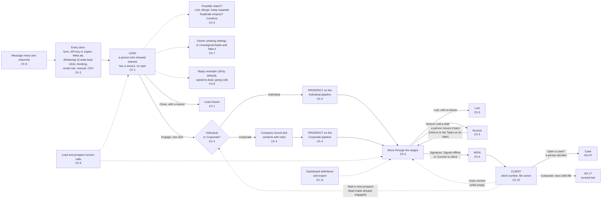
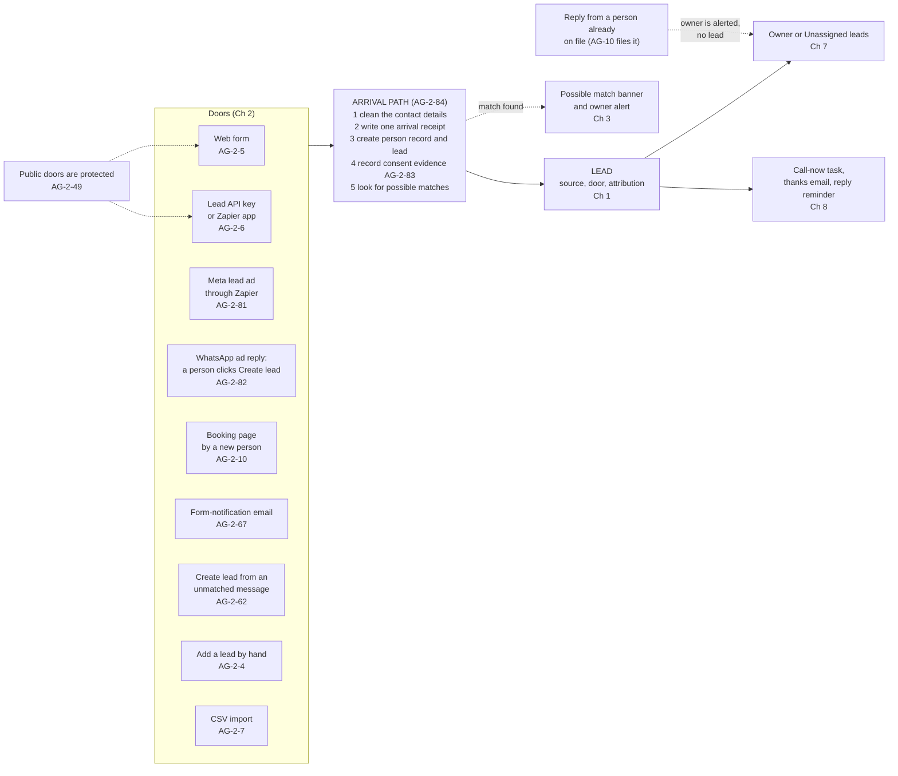
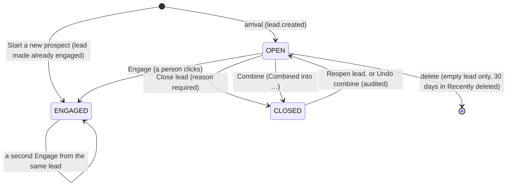
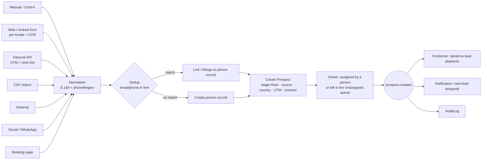
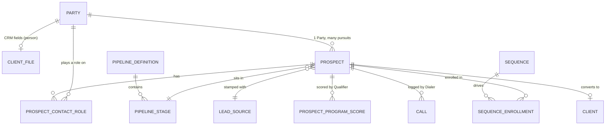

# AG-02 Leads, prospects and sales

Version 2.6 · 28 Oct 2026
Status: approved build source; build review applied (the product owner, 27–28 Oct: BUILD-1 to BUILD-6 and BUILD-14 to BUILD-17 — duplicate enquiries are flagged and combined, Merge ships in AG02-ME3, the old branch is retired, a person can become a client directly, the new owner is told, the thanks email is a service message, imports stay with Owner and Admin, clear fixes A1–A7 and A17; later the same day, the answers to the open items: Link and Add to prospect count once, one notice on Engage, writer defaults approved, client file owner by AG-7-69, Add to prospect can be undone and the old duplicate-lead close reason is retired (BUILD-18, BUILD-20 to BUILD-24); notices are sent by AG-11 once built (BUILD-27); D1.1h); earlier: MS-D24 and writer follow-ups applied in place (25 Oct, later); money slice and AG-05 review applied in place (the product owner, 25 Oct: Prepare retainer replaces Create proposal; Services list and defaults; retainer events and several signers; invoicing an unsigned client is a warning; Undo convert and trust money; deal value suggestion; D1.1g); earlier: Duplicates + copy on emails applied (the product owner, 24 Oct: family-add name and date-of-birth match, merge moves the case copy list, merge summary names overlapping open cases); earlier: AG19-D40 applied (the product owner, 23 Oct: a lead also has a To file list, and it carries over at Engage); earlier: AG19-D33 applied (the product owner, 23 Oct: the To file list carries over with the history); earlier: X-6 (22 Oct) and the AG-04 review decisions (the product owner, 21 Oct).
Previous version: `_archive/AG-02-prospect-lead-sales-crm_v2.5_2026-10-25.md`. v2.0 replaced v1.14, which is frozen in `_archive/`. Do not build from v2.5 or earlier. v2.6 is the only build source. Decisions: AG02-D0 (the 19 Oct rulings S1–S6) to AG02-D17, DUP-3, DUP-8 and CC-5 (the product owner, 24 Oct; `_drafts/DUPLICATES-AND-COPY-CHANGE-SUMMARY_2026-10-24.md`; D1.1f), X-4 and X-5 in `TEMPLATE-MAP-working_2026-10-10.md`, "AG-02 review — decisions"; AG04-D1 to AG04-D12 and S1–S6 in the same file, "AG-04 review — decisions" (D1.1c lists the ones that change this epic); MS-D2, MS-D13, MS-D15, MS-D16, MS-D18, MS-D19, MS-D20 and MS-D21 in "Money slice review — decisions" and AG05-D2, AG05-D3 and AG05-D4 in "AG-05 review — decisions" in the same file (D1.1g lists the ones that change this epic); BUILD-1 to BUILD-6 and BUILD-14 to BUILD-17 in "Build review — decisions (the product owner, 27–28 Oct)" in the same file (D1.1h lists them).
Nothing here is decided unless it cites "the product owner, 19 Oct 2026" (rulings S1 to S6), the product owner's 20 Oct rulings (AG02-D1 to AG02-D17, X-4, X-5) or another decision-log row. A point not yet decided is marked **Open — needs the product owner: …** on the card that owns it. Part D8 records how each question was answered.

---

# Page 1 — For developers: read this first

**What this is.** AG-02 is how a firm handles new enquiries: a lead arrives, staff engage it as a sale (a prospect), and the prospect becomes a client. Version 2.0 replaces v1.14. Build only from this file.

**What is different from v1.14 (the ten big changes).**
1. A **lead** and a **prospect** are separate. A lead is a person who showed interest, with no type and no stage. Staff click **Engage** to make a prospect.
2. A person becomes a **client** in one step, in one of three ways: the e-signature is complete, staff mark "Signed offline", or staff click "Convert to client". Undo is allowed while the client has nothing yet.
3. **Duplicates** are never merged by the system. It shows a banner, and staff click Link, Keep separate or Merge.
4. **Sharing new leads** is one firm setting: Anyone takes it, Round robin, or Always one person. No rules engine.
5. The **reply reminder** is off unless the firm turns it on. There is no response clock.
6. **Going cold** is a quiet mark after 7 open days. It sends no notice.
7. **"Message many"** replaces campaigns. It sends only to people who said yes to marketing on that channel.
8. **Labels** sit on the person.
9. **"Interested in"** can be a programme or one of the firm's own services.
10. **Facebook lead ads** arrive through an ExpatReady app on Zapier.

> **Changed in v2.1 (21 Oct, AG-04 review).** Small changes only. Each changed rule ends with "*(changed 21 Oct — AG04-Dn)*".
> - A paid booking whose hold ends unpaid (`booking.expired`) makes a lead with the note "Payment not completed". One booking never makes two leads (AG-2-10 rule 1; AG04-D1).
> - A booking made from a case (it carries `caseId`) makes no lead, no banner and no "Call now". It shows on the case (AG-2-10 rule 1b; AG04-D2).
> - Each new attendee of a group session becomes a lead with no "Call now". A full session takes the person's details, and they become a lead with no "Call now" (AG-2-10 rule 5, AG-2-56 rule 2; AG04-D9, AG04-D10).
> - `booking.completed` and `booking.no_show` come only from the host's click on "Did Client B attend? Attended · No-show". Nothing is guessed (AG-2-37, AG-2-38, AG-2-31; AG04-D3).
> - The consult record has the buttons "Engage and prepare retainer" (lead) and "Prepare retainer" (prospect). The retainer is AG-05's (AG-2-75, AG-2-37; AG04-D7, MS-D2).
> - Booking keys: a booking uses `agent/booking:create` and `agent/booking:edit` only; Prepare retainer uses AG-05's `agent/retainer:draft` (C4.3; AG04-D8).
> - A paid consult before Engage sits with the person (`partyId`): the booker's payment is a trust payment request on the person, and the consult invoice is made when the host clicks Attended (AG04 S1, MS-D15).
> - Event names, payloads and keys now follow AG-04 v2.0 (booking events); old AG-04 line citations are replaced by requirement IDs (C4b.2).
> - 22 Oct (AG04-D13): a new booker who starts a paid booking gets a person record at once (no lead, no "Call now"); the lead still follows on payment or when the hold ends (AG-2-10 rule 1a).
> - 22 Oct: AG-04 final cross-epic check fixes applied in place (marked "changed 22 Oct — final check"): AG-2-10 Why and payload wording, Q-BOOKING-CLOCK evidence.

> **Changed in v2.2 (23 Oct, AG-19 decisions).** One change: files a client sent to a prospect that answer no request wait on the prospect's **To file list** (AG-09 AG-9-68). When the prospect becomes a client, they stay on the person with the prospect's tag, like documents, and show on the client and on the case opened from it (AG-2-47 rule 7; AG19-D33).

> **Changed in v2.3 (23 Oct, AG19-D40).** One change: a lead has a **To file list** too (AG-09 AG-9-68). At Engage its items stay on the person with the lead's tag and show on the prospect, then on the client and the case, until staff file them (AG-2-75 rule 13).

> **Changed in v2.4 (24 Oct, duplicates and copy on emails).** Each changed rule ends with "*(changed 24 Oct — DUP-n / CC-n)*".
> - **Family add** (AG-2-14 rule 12, AG-2-72): when staff, the questionnaire or an import add a family member or applicant, ExpatReady also offers firm-wide people with the same first name, last name and date of birth. It is an offer only. Everywhere else names are still not matched (DUP-8).
> - **Merge** (AG-2-16 rule 2): the case copy list (`CaseCopy.partyId`, AG-7-97) moves to the survivor; a duplicate row on the same case is ended, not doubled (CC-5).
> - **Merge summary** (AG-2-16 rule 3): one information line when both records have an open case on the same program (DUP-3).

> **Changed on 25 Oct (money slice and AG-05 review).** In place, no version change. Each changed card names its decision on its Decision line.
> - **Prepare retainer.** "Create proposal" and "Engage and create proposal" become "Prepare retainer" and "Engage and prepare retainer". There is no separate proposal: the retainer is sent, and staff edit and resend it until the client signs (MS-D2; AG-2-37, AG-2-75, AG-2-94).
> - **Services.** The firm's own services now carry optional defaults (fee, schedule rows, costs, task template, retainer template, documents, "Needs a signed agreement"). The list is Settings → Services, and it is the same list as "Interested in" (MS-D18; AG-2-92).
> - **Retainer events.** AG-02 shows "Client signed, waiting for the firm" and, with several signers, "1 of 2 signed". A separate "signed offline" event carries no file (AG05-D2, AG05-D3, AG05-D4(10); AG-2-28a). This closes AG02-P85 and AG02-P87.
> - **Invoicing an unsigned client** shows a warning and never blocks (MS-D13; closes AG02-P1). **A wrong "Signed offline"** is corrected in AG-05 (AG05-D4(5); closes AG02-P2). **A case for the firm's own service** is AG-07's (MS-D16; closes AG02-P9).
> - **Undo convert** is not blocked by trust money held on the person (MS-D19; AG-2-47 rule 18).
> - **Deal value.** When a retainer is signed, the prospect offers "Update deal value to CAD 4,500?" (MS-D21(5); AG-2-92 rule 15).
> - **Currency** locks at the first money document sent: a retainer with fees, a deposit request or an invoice (MS-D20(3); AG-2-92 rule 1).
> - **Pipeline stage label.** The seeded stage with key `PROPOSAL` is labelled "Fees discussed". The key is unchanged, so rule 4 of AG-2-37 ("Follow up" after 5 days) works as before. A firm may still rename the stage (MS-D24(2); AG-2-52).
> - **A wrong "Signed offline".** A prospect already WON by Signed offline stays WON, and "Retainer not signed" shows again. Undo convert then works by its usual rules (AG05-D4(5); AG-2-47).
> - **Revenue event.** An invoice paid from trust raises `invoice.paid` too, so "Attributed revenue" reads `invoice.paid` alone (AG-2-87 rule 14; AG-06).

> **Changed in v2.6 (28 Oct, build review).** Each changed rule ends with "*(changed 28 Oct — BUILD-n)*". The decisions are in `MAP`, "Build review — decisions (the product owner, 27–28 Oct)"; D1.1h lists them.
> - **Duplicate enquiries (BUILD-4).** Four new cards in Chapter 3: AG-2-96 to AG-2-99, and the new rule BR-31. Leads and prospects of the same person or company show a chip: "Possible duplicate enquiry", "Same person, different interest" or "Returning". Staff **Combine** two leads, or two open prospects. One is kept, the other closes as "Combined into …", and reports count one enquiry. **Undo combine** reopens it. **Not a duplicate** clears the chip for that pair. The window is 60 days; the firm changes it on the Timings screen.
> - **Merge comes in AG02-ME3 (BUILD-5).** Until Merge ships, the banner offers Link and Keep separate. A pair that needs Merge goes on the "People to merge" list on the Contacts screen (AG-2-68 rules 3b and 17; AG-2-16 rule 12).
> - **The old branch is retired (BUILD-6).** Build from current `dev` and reuse only the contact normaliser ("Where to start in code", below).
> - **A person can become a client directly (BUILD-3).** New C2.1 row: (none) → `CLIENT` through Add client, the client import, a work-permit case or "make this person a client". No lead or prospect is made (AG-2-73, AG-2-47 rule 25, C4b.1).
> - **The client file and Add client (BUILD-1, BUILD-2).** The client file is AG-02's `ClientFile` table (AG-2-73 rule 3). Add client keeps "Create anyway", audited, and writes no `DuplicateFlag`; AG02-P58 is closed (D3.2).
> - **The new owner is told (BUILD-14).** A new notice, "Prospect assigned to you" (`prospect-assigned`). `lead.assigned` is raised at arrival when a fact or the sharing setting sets the owner. Take it, a lead you added yourself and an imported lead tell nobody (AG-2-48a, AG-2-84 rule 12, AG-2-85 rule 20).
> - **The thanks email is a service message (BUILD-15)** until SA-11 rules otherwise. It needs no marketing consent and holds an acknowledgement and next steps only, no offers (AG-2-56 rule 7, AG-2-33 rule 2).
> - **Imports (BUILD-16).** `agent/import:run` stays with Owner and Admin by default. A firm may grant it to another role in Settings → Roles. This closes N2 (D8.69).
> - **Clear fixes (BUILD-17).** A1: a paid booker's person record, made at hold start, gets the lead and its client file record when the booking event comes (AG-2-10 rule 1a, C2.1). A2: the Link test about `Call.partyId` moves to AG-2-16. A3: choosing another owner on Reopen needs `agent/prospect:assign`, and the CSV owner fact keeps AG-2-7's `assign` condition (AG-2-29a, AG-2-85). A4: "Marked signed by mistake" restores the retainer status and clears `signedAt` (C4b.2). A5: an unreadable main phone is `PartyProfile.phoneVerified = false`. A6: C3, C4.3 and C4b now match the cards. A7: SA-06 citations point to v3.15. A17: Engage uses the first Active stage in board order.
> - **Link onto a person with an open lead (BUILD-20).** The newer lead closes as "Combined into <older lead>", like Combine: it counts once, both sources stay, and Undo combine works (AG-2-68 rule 4, AG-2-4 rule 7).
> - **Add to prospect (BUILD-21).** A new lead that repeats an open prospect is added to it with one click. The lead closes into the prospect, its source shows there as "Also came from", and it counts once (AG-2-80 rule 10, AG-2-96 rule 9).
> - **One notice on Engage (BUILD-22).** When someone else engages your lead you get `lead-engaged-by-other` only, not "Prospect assigned to you" (AG-2-75 rule 12).
> - **Writer defaults approved (BUILD-23).** D2.1 W1 to W13 stand as written.
> - **File owner of a client made directly (BUILD-18).** It is set by AG-07 (AG-7-69 rule 8(e)); AG-02 points there (C2.1, AG-2-47 rule 25).
> - **Undo add to prospect (BUILD-24).** It works like Undo combine: the lead reopens and counts again, and "Also came from" leaves the prospect. The old close reason for a duplicate lead is retired; Link and Combine replace it.
> - **Notices later (BUILD-27).** AG-02 raises the events now; AG-11's Notification Doer sends the notices once it is built. Until then the work shows in Unassigned leads, lists, counts and Needs you.
> - **Still open:** D8.92 (backend lead).

**How to read.** Read Part A, then only your chapter in Part B. Each card says what to build, the rules, the data and the tests. Build the chapters in this order: **1, 2, 3, 4, 5, 7, 6, 8, 10, 11, 9.**

**Three rules.**
- This file wins over any other note.
- The other epics were updated to match on 21 Oct. A few questions are still open there; each sits in that epic's "Pending from the AG-02 review" block and is settled in its own review.
- If something is missing or marked "Open", **ask the product owner**. Do not guess.

**Waiting on other epics.** Build AG-02's side now, with a simple placeholder for the input: retainer events (AG-05), booking events (AG-04), "message sent" (AG-10), updated questionnaire answers (AG-08), the settings screens (AG-16) and the consent types (SA-11). Part D, table D3.2, lists exactly what each epic will add.

**Do not build yet.** Native Meta Lead Ads, SMS, Messenger and Instagram, and the other Release 2 items.

**Merge comes in AG02-ME3.** Merge (AG-2-16) is built in AG02-ME3. The backend lead designs the safe Merge route (AG02-P12) during rounds 1 and 2. Until Merge ships, the possible-match banner offers Link and Keep separate. A pair that needs Merge stays flagged and goes on the "People to merge" list on the Contacts screen (AG-2-68 rule 17). *(changed 28 Oct — BUILD-5)*

**Where to start in code.** The old branch `feat/ag02-step0-client-contracts`, built to v1.14, is retired and is not continued. AG02-ME1 starts a new branch from current `dev`. Reuse only its contact normaliser (E.164 phone, email; `apps/api/src/party-client/internal/contact-normaliser.ts:25-38`). Do not copy its v1.14 tables. Where a card cites that branch, it says what the old code did; it is not a base to build on. *(changed 28 Oct — BUILD-6)*

---

# Part A — Start here

**Read Part A, then only your chapter.** Part A is about 7,500 words. A chapter in Part B holds the cards for one slice of the work. You do not need the rest of the file to build one chapter.

Version 2.0 changes the shape of AG-02. A lead is now a person who showed interest, with no type. A prospect is a sale being worked, and it exists only after staff click Engage. A prospect becomes a client once: by a signature, by Signed offline, or by a person's "Convert to client" click. Part A shows the new shape first, so that every card reads as one piece of it.

## How this file is laid out

| Part | What it holds |
|---|---|
| **A. Start here** | Purpose, key terms, the main flow, one worked example (the Client E family), build order. |
| **B. Build cards** | Eleven chapters, one card per requirement, in build order inside each chapter. |
| **C. Rules and tests** | C1 business rules, C2 state tables, C3 data model, C4 permissions, C5 non-functional rules, C6 what is built today, C7 acceptance tests that cross cards. |
| **D. Appendix** | D1 decisions that change this epic, D2 author defaults, D3 what other epics must change (knock-on), D4 history, D5 closed questions and D5b withdrawn items, D6 "Where did it go?" (every v1.14 requirement ID), D7 deliberately dropped, D8 decisions needed from the product owner, D9 background. Nothing in D is a build instruction. |

The eleven chapters:

| Ch | Chapter | Cards |
|---|---|---|
| 1 | People and leads | AG-2-1, AG-2-72, AG-2-73, AG-2-80, AG-2-2 |
| 2 | Capture: every door | AG-2-84, AG-2-83, AG-2-4, AG-2-5, AG-2-8, AG-2-8a, AG-2-6, AG-2-7, AG-2-10, AG-2-62, AG-2-67, AG-2-49, AG-2-81, AG-2-82; pointer: AG-2-95 |
| 3 | Duplicates and asked-again | AG-2-14, AG-2-68, AG-2-16, AG-2-78, AG-2-79, AG-2-96, AG-2-97, AG-2-98, AG-2-99 |
| 4 | Engage and the pipelines | AG-2-75, AG-2-76, AG-2-77, AG-2-92, AG-2-52, AG-2-18, AG-2-20, AG-2-22, AG-2-23 |
| 5 | Moving a prospect | AG-2-26, AG-2-28a, AG-2-44, AG-2-45, AG-2-29a, AG-2-66 |
| 6 | Lead and prospect screen; calls | AG-2-94, AG-2-37a |
| 7 | Owner and next step | AG-2-85, AG-2-86, AG-2-13c, AG-2-64, AG-2-37, AG-2-38, AG-2-48a, AG-2-69 |
| 8 | Automatic follow-up | AG-2-56, AG-2-59, AG-2-31, AG-2-33, AG-2-39 |
| 9 | Message many and channels | AG-2-88, AG-2-89, AG-2-90, AG-2-91 |
| 10 | Becomes a client | AG-2-47, AG-2-54 |
| 11 | Dashboard definitions and export | AG-2-87, AG-2-49a, AG-2-93 |

Some requirements are pointers. A pointer is one line that names the epic where the rule lives. AG-02 adds no rule of its own to a pointer. The pointers sit at the end of the chapter that mentions them.

## How to read a card

Every card has 14 fields, in this order: 1 Outcome, 2 Why, 3 Where, 4 Engine, 5 Rules, 6 States, 7 Data, 8 Access, 9 Events, 10 Safety, 11 Tests, 12 Edge cases, 13 Non-goals, 14 Mode. Field 5 starts with a Client E example, then numbered rules with `input → output`. Field 7 writes each field as `plain name (codeName: type)`. A word in a card that is a key term is defined once in A2 and is not redefined in the card.

The card header shows the decision IDs that decide the rule and the build status: Built, Partly built, Not built, or Pointer. A decision ID is one of three kinds. `S1` to `S6` are the product owner's rulings of 19 Oct 2026, logged as `AG02-D0`. `AG02-D0` to `AG02-D17`, `X-4` and `X-5` are the product owner's logged rulings (`AG02-D1` to `AG02-D16`, `X-4` and `X-5` are of 20 Oct 2026); `AG02-D12` covers the small defaults written on the D8 rows, cited as "(AG02-D12, D8.nn)". IDs such as `AG16-44` or `AG07-D5` are other rows of the decision log. `Q-NAME` names a D8 question; every D8 question is answered (D8.0).

The card header lists the decisions behind the card. The build path (Parts A to C) carries no change history; history is in Part D. Two marks show that a point is not settled. **Open — needs the product owner: …** marks a point the rulings leave undecided. **Open — moved to <epic> review: …** marks a point another epic's review decides.

Every card that creates a person, a lead or a prospect also says what happens to quiet state, owner, consent, audit and event. Every card that uses AI says what happens when AI is off.

---

## A1 — Purpose in five lines

1. **What it is.** AG-02 is where a person who shows interest becomes a client. It holds leads, prospects and the sales pipelines, up to the moment a retainer is signed.
2. **What it covers.** Every way a person arrives. Duplicates and repeat inquiries. Engage, with Individual and Corporate pipelines. Moving a prospect, its owner and next step, automatic follow-up, becoming a client, and the numbers for the dashboard.
3. **The outcome.** No inquiry is dropped. Every lead has an owner or sits in plain view in Unassigned leads. Unassigned leads shows how long each lead has waited, in the firm's open hours.
4. **How.** Every door runs the same arrival path. One click, Engage, starts a sale. A signature, Signed offline or a "Convert to client" click makes the client, once (AG02-D2). A firm needs no setup: a lead with no owner waits in a queue, and a person clicks Take it. A firm with 2 or more users may choose how new leads are shared (AG02-D1).
5. **What it never does.** It never decides a person's type, never links or merges two people by itself, and never opens a case by itself. It never blocks the firm. The assessment (AG-03) is optional and is never a gate (S4). It sends no new client-facing automatic message without the product owner's approval (AG16-76).

**Who uses it.** Client C, a Case Officer, does the daily intake work: he takes new leads, calls, logs the call and engages. Client F, the licensed Case Manager, runs the consult, sends the retainer and countersigns it. She also watches the queue and who is waiting. Maple's Owner sets the sources, the loss reasons, the stages and how new leads are shared. Billing / Finance touches AG-02 only at the money edge (AG-06). The client never sees these screens. A client sees progress by email and, if the firm uses it, the portal (AG-15). Meta lead ads arrive through the ExpatReady app on Zapier; native Meta Lead Ads is Release 2 (AG02-D3). Each firm connects its own WhatsApp account through a contracted provider (AG02-D4).

**What the product owner settled on 19 and 20 Oct 2026.** Six rulings of 19 Oct and seventeen of 20 Oct (AG02-D1 to AG02-D17, with X-4 and X-5) drive this version. D8.0 lists the 20 Oct rulings.

| ID | Ruling |
|---|---|
| S1 | A lead is neutral: a person who showed interest. It has no Individual or Corporate type. |
| S2 | Engage is one click by staff. It turns a lead into a prospect, and staff choose Individual or Corporate at that click. The choice can be changed until the prospect is signed. |
| S3 | Employers use the same lead, prospect and client path. AG-17 is revised last. AG-02 defines the shared model and the hand-off, and D3 lists what AG-17 must change. |
| S4 | The assessment (AG-03) is optional and is never a gate. |
| S5 | Think like a best-in-class sales system, but keep it simple. No rules engine on the firm side. Complexity is acceptable on the platform side. |
| S6 | Epic order: AG-02, AG-03, AG-04, AG-05, AG-06, AG-08, AG-09, AG-10, AG-11, AG-12, AG-13, AG-15 (with CP-01), AG-14, AG-18, AG-17. |

**Rule box — a lead is neutral (BR-22).**
  > **BR-22** <!-- br:BR-22 -->
A lead is a person who showed interest. It has a source, an owner (`ownerUserId`, may be empty), "Interested in" and a state (OPEN, ENGAGED, CLOSED). It has no type, no pipeline, no stage, no deal value and no country. The lead's person is always a person record (kind PERSON). The web form asks no "asking as" question. A free-text interest note is stored but never sets a type. A CLOSED lead can be reopened as the same lead. A repeat inquiry always creates a new lead, even while the person has an open lead. `previousLeadId` is set when staff click Link, so a closure is never silently overturned.
<!-- /br -->

---

## A2 — Key terms

<!-- KEY-TERMS: terms marked "exists" are copied by script from 99-Phasing-and-Glossary_v1.9 and are not edited here. Terms marked "NEW" or "REDEFINE" are written in this file and need a glossary block in 99-Phasing-and-Glossary (D3.2). -->

### Terms that exist in the glossary (copied unchanged)

<!-- term:person-record -->
**Person record** (`Party`) — Every real person on a case has one person record, kept once and reused on all their cases. Their details, answers and consent are stored with it. *Example:* Client D, age 8, gets her own person record when she is added to the case. Her record gives her no portal login and no emails. *Not the same as:* the client file record, which holds the firm's own fields.
<!-- /term -->

<!-- term:client-file-record -->
**Client file record** (`ClientFile`) — The client file record holds the firm's own details for one person or employer who is a lead or client: the lifecycle stage, the client number, the file owner and the office. It is AG-02's table; client fields never go on the person record (BUILD-1). It is created when a person becomes a lead, or when a person becomes a client directly through Add client, the client import, a work-permit case or "make this person a client" (BUILD-3). *Example:* Client B becomes a client. His record shows client number CL-00001, file owner Client C and his office. *Not the same as:* the person record, which holds name, email, phone and language.
<!-- /term -->

<!-- term:client -->
**Client** (client file record and `Party`) — A client is the person or employer the firm works for. It is a person record, or an employer record, with a client file record added. *Example:* Client B became client CL-00001 when his retainer was signed by him and by the firm (one of the three ways to become a client, AG02-D2). *Not the same as:* an applicant, who is any person named on a filing.
<!-- /term -->

<!-- term:client-number -->
**Client number** (`clientCode`) — The client number is the firm's reference for a client, such as CL-00001. It is CL and a 5-digit counter for the firm, with no year. The screens show it as "Client code". *Example:* Client B is client CL-00001, and all his cases show that number. It is never edited or reused. *Not the same as:* the case number, which includes a year.
<!-- /term -->

<!-- term:file-owner -->
**File owner** (`fileOwnerUserId`) — The file owner is the staff member who owns a client. It is set on the client file record, not on a case. It is set from the facts: an existing file owner stays; otherwise the person who adds the client, the person who makes someone a client, the employer's file owner for a work-permit case, or the owner the import gives (BUILD-18). A client with no file owner shows in **Unassigned clients**, where anyone who can edit clients can **Take it** or **Assign** it, even with own-only visibility (BUILD-25). *Example:* Client C is file owner of client CL-00001. *Not the same as:* the case officer, who does the day-to-day work on one case.
<!-- /term -->

<!-- term:client-type -->
**Client type** (`clientType`) — The client type is Individual or Corporate. It comes from the program's pathway. Both types use the same case design, not two separate ones. *Example:* The Client E case is Individual. An employer's LMIA file is Corporate. LMIA means labour market impact assessment. *Not the same as:* a separate corporate case type. None exists; it is a case with client type Corporate.
<!-- /term -->

<!-- term:lead-representative -->
**Lead representative** (`LEAD_REPRESENTATIVE`) — The lead representative is the licensed person whose licence backs the case. It is filled in from the signed retainer or the firm's default, and a case may have none. *Example:* Client F is lead representative on the Client E case because she signed the retainer. If Client G were to sign instead, a warning shows: "Client F is this case's lead representative. Client G will sign this retainer." It never blocks. *Not the same as:* the case officer, who does the day-to-day work.
<!-- /term -->

<!-- term:contact-screen -->
**Contact** (no code name) — Contact is only the name of a screen where staff see a person. It is not a record type and not a second table. *Example:* Staff open Client B on the Contact screen. What they see comes from his person record and his client file record. *Not the same as:* a Contact table. None exists, so older text about a Contact table means the person record.
<!-- /term -->

<!-- term:not-started -->
**Not started** (`automationState` QUIET) — Not started means the client's automatic messages have not been started. An imported client, lead or case begins as Not started. Internal work runs, but no client message goes out until the firm starts it. *Example:* The firm imports an old case. It shows "Not started", and its imported values stay unverified until a person verifies them. *Not the same as:* client quiet hours, which are the 08:00 to 20:00 sending window.
<!-- /term -->

<!-- term:case -->
**Case** (`Case`) — A case is the firm's work for one client in one destination country. It holds one or more filings and the people on them. *Example:* Case C-2026-00012 is the Client E family's move to Canada. It holds three filings. They are Client B's employer-specific work permit, Client A's open work permit and Client D's study permit. *Not the same as:* a filing, which is one application inside a case.
<!-- /term -->

### Terms new in AG-02 v2.0

People and leads

<!-- glossary: NEW -->
<!-- term:lead -->
**Lead** (`Lead`) — A lead is a person who showed interest. It records how and when they arrived, who owns it (`Lead.ownerUserId`) and when the firm first answered. It has no type, stage or value. *Example:* Client B's Meta ad form of Mon 12 Oct 2026 is lead L-00031. *Not the same as:* a prospect, which is a sale being worked, or a lead representative, who is a licensed person on a case.
<!-- /term -->

<!-- glossary: NEW -->
<!-- term:company-record -->
**Company record** (`Party`, kind ORGANISATION) — A company record holds an employer as one record. Engage as Corporate creates it, or links an existing one. It gets a client file record only when it becomes a client (AG07-D20(k), AG02-D10(2)). The one exception: after Undo convert the company keeps that record, with no number (AG-2-54). *Example:* Pine Bakery Ltd is a company record. Lena Park and Client T Reyes are linked to it. *Not the same as:* a person record, or a client. A company is a client only after its prospect is won.
<!-- /term -->

<!-- glossary: NEW -->
<!-- term:source -->
**Source** (`leadSourceId`) — The source says where a lead came from, such as Meta lead ad, Website form or Referral. Every lead must have one. *Example:* Lead L-00031 has the source Meta lead ad. *Not the same as:* the door, which is the technical path the lead arrived on.
<!-- /term -->

<!-- glossary: NEW -->
<!-- term:door -->
**Door** (`door`) — The door is the technical path a lead arrived on, such as web form, lead API, booking, email rule or CSV import. *Example:* Lena's lead L-00032 came through the web form door. *Not the same as:* the source. One source, such as Website form, can arrive through more than one door.
<!-- /term -->

<!-- glossary: NEW -->
<!-- term:arrival-path -->
**Arrival path** (no code name) — The arrival path is the one set of steps every door runs. It cleans the contact details, writes one arrival receipt, creates the person record and the lead, records consent evidence and flags possible matches. *Example:* A web form and a Meta ad both run the same steps. *Not the same as:* Engage, which is a later click by staff.
<!-- /term -->

<!-- glossary: NEW -->
<!-- term:attribution -->
**Attribution** (`LeadAttribution`) — Attribution holds the campaign, ad and page facts that came with a lead. It is written once at arrival and never edited. *Example:* Client B's lead keeps the ad and the form it came from. *Not the same as:* the credited sales user, who gets credit for a sale.
<!-- /term -->

<!-- glossary: NEW -->
<!-- term:interested-in -->
**Interested in** (`interestedIn`) — Interested in lists what the person asked about, on the lead and on the prospect. The list holds the pack's programmes and the firm's own services, such as Canadian passport, OCI card or translation. Staff add an item like a label; the Owner or Admin renames or removes one from the same list (`agent/prospect:configure-pipeline`, AG02-D13(6)). A firm service works on Individual and Corporate prospects. Engage copies the lead's list to the prospect, where staff can edit it (AG02-D13(7)). The web form question uses this list. It never sets the type of a prospect (AG02-D9). *Example:* Client B's lead shows "Interested in: Work permit". *Not the same as:* the prospect type, which staff choose at Engage. Forms ask no "asking as: myself / a business" question (AG02-D12, D8.27).
<!-- /term -->

<!-- glossary: NEW -->
<!-- term:consent -->
**Consent** (`ConsentRecord`) — Consent is a recorded yes or withdrawal for one channel and one purpose. Each row keeps where it came from, the wording shown, the language and the time. Rows are only added, never edited. *Example:* Suppose Client B ticks "email me updates" on a form. The row keeps the form and the wording version. *Not the same as:* permission to answer an inquiry. Only express consent on one channel counts for that channel. WhatsApp marketing needs its own purpose, `WHATSAPP_MARKETING`; the WhatsApp service opt-in (`WHATSAPP_OPT_IN`) never counts as marketing (AG02-D15(4)). An inbound WhatsApp message is not marketing consent, and a referral brings none. Imported consent counts when a consent column is mapped and the importer ticks the declaration, for the channel that column names (MAP:368) (AG02-D8, AG02-D12, D8.8).
<!-- /term -->

<!-- glossary: NEW -->
<!-- term:consent-gate -->
**Consent gate** (BR-9) — The consent gate is the check made at send time. It skips every person who has no consent for that channel, and it counts the people skipped. *Example:* Suppose a list has 50 people and 20 have no consent. The 20 are skipped and shown as a count before sending. *Not the same as:* quiet hours, which are a time window.
<!-- /term -->

Duplicates and repeat inquiries

<!-- glossary: NEW -->
<!-- term:possible-match -->
**Possible match** (`DuplicateFlag`) — A possible match is a banner that says a new lead may be someone the firm already knows. Staff choose Link, Merge or Keep separate. Nothing joins by itself. *Example:* Client B's June 2027 inquiry shows "Possible match: Client B (client CL-00001, file owner Client C)". *Not the same as:* a certain duplicate, because it may be a different person.
<!-- /term -->

<!-- glossary: NEW -->
<!-- term:asked-again -->
**Asked again** (no code name) — Asked again is the banner and alert shown when a person the firm already knows sends a new inquiry. A new lead is made with the banner, and the matched person's owner is told once (AG02-D6). *Example:* In June 2027 Client C is alerted that Client B has inquired again. *Not the same as:* a new lead from a stranger.
<!-- /term -->

<!-- glossary: NEW -->
<!-- term:company-match -->
**Company match** (no code name) — Company match is the list of companies Engage as Corporate offers when staff type a company name. It looks at business number, name, website domain and main phone. It only suggests. Free-mail domains such as gmail.com never match. *Example:* A second Pine Bakery inquiry shows "Same company? Pine Bakery Ltd". *Not the same as:* a possible match, which compares people.
<!-- /term -->

<!-- glossary: NEW (written first in 99-Phasing-and-Glossary v1.16, DUP-8; home rule AG-2-14 rule 12) -->
<!-- term:family-add-match -->
**Family add match** (AG-2-14 rule 12) — When staff, the questionnaire or an import add a family member or applicant, ExpatReady also offers firm-wide people with the same first name, last name and date of birth; it is an offer only and never links, merges or hides (AG-2-14 rule 12). The date of birth must be on both records, and a swapped given name and surname counts. It runs only on the family-add paths (AG-2-72, AG-7-107, AG-8-28, the import AG-18-94, and when an expected child becomes a real person), never on lead arrival, Add client, the case wizard's "+ New client" or the copy list (AG-2-14 field 3, rule 12 f). *Example:* Client C adds Client D, with her name and date of birth, to Client B's case. Client D is on file only as Client A's daughter from Client A's own earlier case, so ExpatReady offers her with [Use her] and [Add as a new person]. *Not the same as:* a possible match, which compares email and phone and writes a `DuplicateFlag` on a lead; a family add match writes none (AG-2-14 rule 12 c). *(added 25 Oct — DUP-8)*
<!-- /term -->

Duplicate enquiries (BUILD-4)

<!-- glossary: NEW (BUILD-4) -->
<!-- term:duplicate-enquiry-chip -->
**Duplicate enquiry chip** (AG-2-96) — A chip on a lead or prospect that points at another enquiry of the same person or company. **Possible duplicate enquiry:** both are open, they share an "Interested in" item or one has none, and they started within the firm's window (60 days by default). **Same person, different interest:** both are open and share no item. An enquiry is a lead, or a prospect; open means an OPEN lead or a prospect in an ACTIVE stage. Chips are worked out when shown, and they never block, notify or join anything. *Example:* Client B's Meta ad lead L-00031 and his web-form lead L-00033, two days apart and both about a work permit, each show "Possible duplicate enquiry". *Not the same as:* a possible match, which asks whether two person records are one person.
<!-- /term -->

<!-- glossary: NEW (BUILD-4) -->
<!-- term:returning -->
**Returning** (chip, AG-2-96 rule 6) — The chip on a new open enquiry when the same person or company had an earlier enquiry that ended, or one older than the window. It is history only. *Example:* In June 2027 Client B's lead L-00040 shows "Returning: P-00017, won 1 Nov 2026". *Not the same as:* Asked again, the possible-match banner on a lead from a known person.
<!-- /term -->

<!-- glossary: NEW (BUILD-4) -->
<!-- term:combine -->
**Combine** (AG-2-97, AG-2-98) — A person's click that makes two leads, or two open prospects, one enquiry. One is kept. The other closes as "Combined into …". Both keep their sources, the kept one shows both timelines, and reports count one enquiry. *Example:* Client C combines L-00033 into L-00031. *Not the same as:* Link or Merge, which join two person records.
<!-- /term -->

<!-- glossary: NEW (BUILD-4) -->
<!-- term:undo-combine -->
**Undo combine** (AG-2-97, AG-2-98) — Reopens the lead or prospect that Combine closed, where it was before. Reports count it again. *Example:* Client F clicks Undo combine on P-00026, and it is back in Engaged. *Not the same as:* Reopen lead, or Reopen as a new prospect.
<!-- /term -->

<!-- glossary: NEW (BUILD-4) -->
<!-- term:not-a-duplicate -->
**Not a duplicate** (AG-2-99) — A person's click that clears the "Possible duplicate enquiry" chip for one pair of enquiries, for everyone. Both enquiries stay and count. *Example:* Client B asks for his brother Client Q's work permit from his own email; Client C marks that lead Not a duplicate against Client B's own prospect. *Not the same as:* Keep separate, which is about two person records.
<!-- /term -->

<!-- glossary: NEW (BUILD-5) -->
<!-- term:people-to-merge -->
**People to merge** (AG-2-68 rule 17) — Until Merge ships in AG02-ME3, the list on the Contacts screen of flagged pairs that Link cannot join. Nothing on it is merged or hidden by itself. *Example:* Client C logged a call on L-00040's new record, so Link is not possible; the pair waits on People to merge. *Not the same as:* the possible-match banner on a lead.
<!-- /term -->

Owner and first answer

<!-- glossary: REDEFINE (the glossary term "unassigned" means a case with no case officer) -->
<!-- term:unassigned-leads -->
**Unassigned leads** (no code name) — Unassigned leads is the list of open leads that have no owner (`Lead.ownerUserId` empty). *Example:* Lead L-00031 sits in Unassigned leads from 08:20 until Client C takes it. *Not the same as:* Unassigned cases, tasks or conversations. Those are different lists in other epics. A one-user firm never sees it: its user owns every lead (X-4).
<!-- /term -->

<!-- glossary: NEW -->
<!-- term:how-new-leads-are-shared -->
**How new leads are shared** (firm setting) — One setting in Settings → Advanced, for a firm with 2 or more users. **Anyone takes it** (default: the lead waits in Unassigned leads), **Round robin** between the people the admin ticks, or **Always one person**. It has no conditions, no weighting and no workload limits. Facts come first: the person who typed or created a lead, a one-to-one booking's host, or a one-user firm's user owns it. Only the Owner or an Admin changes it (`agent/firm-capability:manage`). *Example:* Suppose Maple picks Round robin for Client C and Farah; a web-form lead goes to whoever was given one least recently. *Not the same as:* a routing rule. ExpatReady has none (AG02-D1).
<!-- /term -->

<!-- glossary: REDEFINE (the glossary term "take-it" means taking a case) -->
<!-- term:take-it-lead -->
**Take it** on a lead or prospect (`agent/prospect:edit`) — Take it is one click that makes you the owner of a lead or prospect that has none. Anyone who can edit prospects and can see the item may use it, for themselves only. It works whatever the sharing setting is (AG02-D1). *Example:* Client C clicks Take it on L-00031 and becomes its owner. *Not the same as:* Take it on a case, which makes you the case officer.
<!-- /term -->

<!-- glossary: NEW -->
<!-- term:lead-owner -->
**Lead owner** (`Lead.ownerUserId`) — The lead owner is the staff member who works one lead. Taking or assigning a lead changes only the lead owner, never the file owner of a person already on file. A brand-new person's file owner is set to the owner of their first lead (AG02-D7). *Example:* Suppose Client B, client CL-00001 with file owner Client C, asks again and Farah is assigned the new lead; Client C stays file owner. *Not the same as:* the file owner, who is set on the person.
<!-- /term -->

<!-- glossary: NEW -->
<!-- term:prospect-owner -->
**Prospect owner** (`ownerUserId`) — The prospect owner is the staff member who works one prospect. The file owner is the staff member responsible for the person. They are often the same. *Example:* Client C owns prospect P-00017. *Not the same as:* the file owner, who is set on the person.
<!-- /term -->

<!-- glossary: NEW -->
<!-- term:unattended-door -->
**Unattended door** (no code name) — An unattended door is a way in where no staff member is present when the lead arrives. The unattended doors are the web form, the Lead API (including the ExpatReady Zapier app and its Meta Zap) and form-notification email. Only leads from these doors get the thanks email (AG02-D9(4)). *Example:* Client B's Meta ad lead arrives through Zapier at 08:20 with nobody watching. *Not the same as:* a lead typed in by staff, a booking-born lead or an import. Those get no thanks email.
<!-- /term -->

<!-- glossary: NEW -->
<!-- term:reminder-doors -->
**Reminder doors** (no code name) — The reminder doors are the doors whose leads the reply reminder covers. They are the unattended doors only: the web form, the Lead API (including the ExpatReady Zapier app) and form-notification email (AG02-D7(2)). *Example:* Client B's Meta ad lead arrives through Zapier at 08:20; when the reminder is on, the lead is covered. Client C clicks "Create lead" on an unknown WhatsApp number; that lead is not covered, because a person made it. *Not the same as:* the doors that get a "Call now" task (AG-2-56 rule 2), which also include "Create lead" from a conversation and a booking. A lead typed by hand, a lead from "Create lead", a booking-born lead and an import are not reminder doors.
<!-- /term -->

<!-- glossary: NEW -->
<!-- term:reply-reminder -->
**Reply reminder** (firm timing) — The reply reminder is one optional setting on the Timings screen: "Remind us if a new lead has no reply after: Off / 1 hour / 4 hours / 1 working day / custom". It is Off by default. When a firm switches it on, 1 hour is pre-selected (AG02-D13(1)). When on, it covers leads from the reminder doors only. The reply is the first response: a logged call, inbound or outbound; a message a person writes and sends; or a booking a staff member makes with the person (AG02-D13(3), AG02-D14(2)). Unassigned leads always shows how long each lead has waited, in the firm's open hours, and `firstResponseAt` records the first response (AG02-D7). *Example:* L-00031 arrives at 08:20, Maple opens at 09:00 and Client C calls at 09:20, so the lead waited 20 open minutes. *Not the same as:* a target or a breach. There is no response clock.
<!-- /term -->

<!-- glossary: NEW -->
<!-- term:timings-screen -->
**Timings screen** (AG-16 Settings → Advanced → Timings) — The one screen where a firm changes the timings that shape its work: the reply reminder, going cold, the Message many frequency limit and follow-up timing. Each is pre-filled with its default. Other timings are fixed and not shown (X-5). *Example:* Maple changes going cold from 7 to 10 open days. *Not the same as:* business hours (AG16-6).
<!-- /term -->

<!-- glossary: NEW -->
<!-- term:speed-to-lead -->
**Speed-to-lead** (recipe `speed_to_lead`) — Speed-to-lead is a ready-made recipe that runs when a lead arrives. It creates a "Call now" task and, for the unattended doors, sends the automatic thanks email (AG02-D9(4)). The thanks email is the "Lead acknowledgement" row on the Automatic messages page (AG-12, SA-05). A lead made already engaged gets neither. AG-11 owns the recipe. *Example:* On L-00031 it creates a "Call now" task and sends Client B the thanks email. *Not the same as:* the reply reminder, which only reminds staff.
<!-- /term -->

<!-- glossary: NEW -->
<!-- term:going-cold -->
**Going cold** (no code name) — Going cold is a quiet mark on an open lead or an active prospect with no activity for a set number of days. The default is 7 days the firm is open, changeable on the Timings screen. Nobody is notified (AG02-D7). Staff calls, messages and meetings and the person's own messages reset it; automatic messages and Message many sends do not (AG02-D12, D8.42). The mark is worked out when shown, not stored. A closed lead, a lost prospect or a nurture prospect never goes cold. *Example:* A lead gets no call or message for 7 open days. It shows "Going cold" in its row. *Not the same as:* Nurture, which is a choice by staff.
<!-- /term -->

Engage and the sale

<!-- glossary: REDEFINE (the glossary holds "Prospect" as one table row, "a potential client … before conversion") -->
<!-- term:prospect -->
**Prospect** (`Prospect`) — A prospect is a sale being worked. It has a type (Individual or Corporate), a pipeline, a stage, an owner and an expected value. A click on Engage creates it. *Example:* P-00017 is Client B's sale, Individual, now in stage Engaged. *Not the same as:* a lead, who is only a person who showed interest.
<!-- /term -->

<!-- glossary: NEW -->
<!-- term:engage -->
**Engage** (`engage`) — Engage is one click by staff that turns a lead into a prospect. Staff choose Individual or Corporate in that click. Nothing is sent and no assessment starts. *Example:* On Thu 15 Oct 2026 Client C clicks Engage on L-00031 and picks Individual. *Not the same as:* assessing a person, or a client signing. Engage is always a person's click; nothing engages by itself. Where a retainer or a booking needs a prospect, the Engage box opens inline (AG02-D9).
<!-- /term -->

<!-- glossary: NEW -->
<!-- term:prospect-type -->
**Prospect type** (`subjectPartyKind`) — The prospect type is Individual or Corporate. Staff choose it at Engage and can change it until the prospect is signed. Corporate means the sale is to an employer. *Example:* Client C engages Lena's inquiry as Corporate, so the sale is to Pine Bakery Ltd. *Not the same as:* client type on a case, which is worked out from the program. Changing the type after a retainer is sent asks staff to void the retainer first (AG02-D10).
<!-- /term -->

<!-- glossary: NEW -->
<!-- term:pipeline -->
**Pipeline** (`PipelineDefinition`) — A pipeline is the set of sales stages for one prospect type. A firm has an Individual pipeline and a Corporate pipeline. *Example:* P-00018 sits in the Corporate pipeline. *Not the same as:* the case board, which shows cases after the sale.
<!-- /term -->

<!-- glossary: NEW (the glossary terms "stage" and "stage-kind" stay case-only) -->
<!-- term:deal-stage -->
**Stage and kind** (`PipelineStage`, `StageKind`) — A sales stage is one position on a pipeline, such as Engaged, Consult or Retainer Sent. Each stage has a kind that fixes how it behaves: ACTIVE, WON, LOST or NURTURE. *Example:* On Wed 21 Oct 2026 P-00017 moves to Retainer Sent, which is an ACTIVE stage. *Not the same as:* a case stage. Each pipeline is seeded with eight stages starting at Engaged, with one WON, one LOST and one NURTURE stage (AG02-D10).
<!-- /term -->

<!-- glossary: NEW -->
<!-- term:won -->
**Services** (`FirmService`, Settings → Services) *(MS-D18)* — The one list of what the firm sells: the pack programmes it uses and its own services, such as an OCI card. It is the same list as "Interested in" and the web form. Each service may carry optional defaults (fee, schedule rows, costs, task template, retainer template, documents to ask for, "Needs a signed agreement"), all blank by default. *Example:* Maple's service "OCI card" has the default fee CAD 450 and "Needs a signed agreement" switched off. *Not the same as:* an appointment type, which keeps its own consult price (AG-04).

**WON** (stage kind WON) — WON means the prospect became a client. It is set once, by whichever comes first: the retainer fully signed in ExpatReady Signer, Signed offline, or a person's "Convert to client". How it was won is stored (`wonVia`), apart from the signed date. A person cannot drag a card to it (AG02-D2). The seeded WON stage is labelled "Won – client". *Example:* Client B signs on Sun 1 Nov 2026 and Client F countersigns the same evening, so P-00017 is WON. *Not the same as:* a case decision of Approved.
<!-- /term -->

<!-- glossary: NEW -->
<!-- term:signed-offline -->
**Signed offline** (`markSignedOffline`) — Signed offline is an action for a retainer signed on paper. It needs `agent/retainer:offline-sign` (AG-5-39), a reason and the uploaded original. It never invents a document. *Example:* A client signs a paper retainer in the office. Client F uploads the scan, gives a reason and marks it. *Not the same as:* an e-signature, which sets WON by itself once every client signer has signed and the firm's signature is on the retainer.
<!-- /term -->

<!-- glossary: NEW -->
<!-- term:becomes-a-client -->
**Becomes a client** (`prospect.won`, `client.created`) — A prospect's subject becomes a client once, by whichever comes first. (1) The retainer is EXECUTED in ExpatReady Signer: every client signer has signed and the firm's signature is on it (the representative's stored signature applied when staff sent it, or a countersign; AG05-D3). While waiting for the firm, the deal shows "Client signed, waiting for the firm"; with several client signers it shows "1 of 2 signed" until all have signed (AG05-D2). (2) Signed offline, with a reason. (3) A person clicks **Convert to client** and confirms "Retainer not signed. Work can start. Invoices will warn you, and the case will show a warning." A later signature only clears the warnings on the case and on invoices; there is no second client and no second WON. The client number, from the firm's one counter (AG02-D14(6)), and the file owner are set in the same step. Nothing client-facing is sent (AG02-D2). *Example:* Client B signs on Sun 1 Nov 2026, Client F countersigns the same evening, and he is client CL-00001. The prompt "Open a case?" follows. *Not the same as:* opening a case, which a person always does.
<!-- /term -->

<!-- glossary: NEW -->
<!-- term:undo-convert -->
**Undo convert** (`agent/prospect:convert`) — Undo convert takes back a client made by mistake, only while the client is empty: no case, no invoice and no signed retainer. An invoice from before the person became a client, such as a paid consult billed at Attended, does not count (AG02-D15(1)). Trust money held on the person does not count either; it stays with the person (MS-D19). A reason is required. The deal returns to the stage it was in before WON, and WON and the credit are cleared (AG02-D2). If this sale made the person a client, they are a prospect again. A person who was already a client stays a client (AG02-D14(1)). The client number is never given to anyone else; if the same person becomes a client again, they get it back (AG02-D13(8)). *Example:* Client C converts the wrong prospect by mistake and undoes it a minute later. *Not the same as:* Withdraw on a case (AG-7-50), which is used once a case exists; the deal then stays WON.
<!-- /term -->

<!-- glossary: NEW -->
<!-- term:credited-sales-user -->
**Credited sales user** (`creditedSalesUserId`) — The credited sales user is the staff member who gets the credit for a won sale. It is set to the prospect owner at WON and is then read-only. *Example:* Client C is the credited sales user of P-00017. *Not the same as:* the file owner or the lead representative.
<!-- /term -->

<!-- glossary: NEW -->
<!-- term:nurture -->
**Nurture** (stage kind NURTURE) — Nurture parks a prospect until a chosen date, with a reason. Nothing moves by itself. When the date comes, the prospect shows in the owner's My Tasks. *Example:* Suppose a person is saving for a language test. Client C parks the prospect until 15 Jan 2027. *Not the same as:* Lost, which ends the sale.
<!-- /term -->

<!-- glossary: NEW -->
<!-- term:lost -->
**Lost** (stage kind LOST) — Lost ends a prospect that did not sign. A reason is required. A lost prospect is never reopened; staff start a new one. *Example:* A person chooses another firm. Client C marks the prospect Lost with the reason "Went with competitor". *Not the same as:* Close a lead, which ends a lead that never became a prospect.
<!-- /term -->

<!-- glossary: NEW -->
<!-- term:close-a-lead -->
**Close a lead** (`Lead.state` CLOSED) — Close a lead ends a lead without a prospect. A reason is required, such as Not interested or Junk. An optional "Remind me on [date]" sets a reminder. A closed lead can be reopened (AG02-D10). *Example:* Client C closes a spam lead with the reason "Junk or spam". *Not the same as:* Lost, which belongs to a prospect.
<!-- /term -->

<!-- glossary: NEW -->
<!-- term:contact-role -->
**Contact role** (`PartyRelationship`, role) — A contact role is the part a person plays at a company: PRIMARY, SIGNATORY, HR, BILLING or OTHER (AG02-D14(14)). It is stored once as a `PartyRelationship` of type `CLIENT_CONTACT` and linked, never copied (AG02-D10(1)). *Example:* Lena Park is PRIMARY and Client T Reyes is SIGNATORY at Pine Bakery Ltd. *Not the same as:* a family link, or a lead representative. Applicant and Spouse are family links, not company roles.
<!-- /term -->

<!-- glossary: NEW -->
<!-- term:label -->
**Label** (`Tag`, `PartyTag`) — A label is a short word staff put on a person, such as "VIP" or "Spanish speaker". It follows the person as lead, prospect and client. Staff who can edit add it with "+ Label" on the person header. A person carries at most 10 labels, and a row shows at most 2, then "+n". Only the Owner or an Admin renames or deletes a label (`agent/prospect:configure-pipeline`, AG02-D13(6)). Lists filter by label, and Message many can use it. Labels are staff-only and have no colours, groups or automation (AG02-D9(2)). *Example:* Client C labels Client B "Referral from Client I". *Not the same as:* Interested in, or the person's lifecycle label (LEAD, PROSPECT, CLIENT, PAST CLIENT).
<!-- /term -->

Channels and Message many

<!-- glossary: NEW -->
<!-- term:meta-lead-ad -->
**Meta lead ad** (source "Meta lead ad") — A Meta lead ad is a Facebook or Instagram instant form. In Release 1 it reaches ExpatReady through the ExpatReady app on Zapier, using its "Create lead" action and a ready-made Zap "Facebook Lead Ads → ExpatReady lead". The Zap uses a lead API key of kind "Meta lead ads" (`ZAPIER_META`), and that key kind is what makes the door `META_LEAD_AD` (AG-2-6 rule 7). The lead keeps the Meta lead id, form id and ad id. Form-notification email stays as a fallback (AG02-D3). *Example:* Client B's ad form "Canada work permit — spouse and daughter" creates lead L-00031. *Not the same as:* the firm's web form. A native Meta connection is Release 2.
<!-- /term -->

<!-- glossary: NEW -->
<!-- term:message-many -->
**Message many** (`agent/communication:bulk-send`) — Message many sends one email or WhatsApp template to a filtered list of leads or clients. A preview says who will get it and who is skipped, such as "112 will get it, 8 skipped (no consent)". Only people with express consent on that channel receive it. A frequency limit, 1 marketing message per person per week by default, skips anyone already messaged. It is a paid extra (AG02-D8). *Example:* Maple sends news to past leads who agreed to hear from it; the others are skipped and counted. *Not the same as:* a follow-up, which runs for one person. There are no campaign objects, schedules or drips.
<!-- /term -->

**Names from other epics, used here as they are defined there.**

| Name | Meaning | Owner |
|---|---|---|
| **Needs you** | Each person's list of drafts and proposals waiting for their approval (glossary term `needs-you`). | AG-11 |
| **My Tasks** | A person's own work list. The name is fixed by AG17-D61: "My Tasks", never "My Day". | AG-13 |
| **Conductor** | The automation engine that runs the ready-made recipes, such as speed-to-lead. | AG-11 |
| **Call now** | The task the speed-to-lead recipe creates on a new lead. | AG-11 recipe, AG-02 trigger |

**Words this file avoids.** "Convert" appears only in the button names "Convert to client" and "Undo convert". "Campaign" names only the attribution facts of an ad; a send to many people is "Message many". "Opportunity" is not used. "Deal" appears only in the field label "Deal value"; elsewhere the file says "sale". "Archive" is not used; use Close. "Contact" names only a screen. "Lead" alone never means "lead representative".

---

## A3 — The main flow

Two pictures. The first shows one sale from arrival to case. The second shows the many doors. Each box names the chapter that builds it. Dotted lines are the parts that sit beside the main flow.

**Picture 1 — from a lead to a case.**



**Reading the picture.** A person's label is the stage stored on their client file record (C2.1). It is not a record type, and nobody is without one. A company's label is worked out from its prospects until it is a client: PROSPECT while it has an open prospect (AG02-D10(2)). A company has no client file record before it becomes a client, except one kept after Undo convert (AG-2-54).

| Label | When it applies |
|---|---|
| **LEAD** | The person has a lead and is not the subject of an open prospect, a client or a past client. This includes the enquirer of a Corporate Engage (the company holds the prospect). It also covers a person whose prospects are all parked in Nurture, lost or whose lead is closed; the row shows the date or reason, and there is no fifth label (AG02-D12, D8.88). |
| **PROSPECT** | The person, or their company, is the subject of an open prospect. Open means an ACTIVE stage. A parked Nurture prospect does not count. |
| **CLIENT** | The person or company became a client (signature, Signed offline or Convert to client), or was added as a client. |
| **PAST CLIENT** | A client with no open case, no open prospect and whose last case is closed. It is worked out when shown, not stored (AG02-D12, D8.75). |

A client or past client keeps that label when they get a new lead or prospect; the screen adds a chip for each. Client B is a client and has an open lead after his June 2027 inquiry. One person can have many leads over time and many prospects at once. A client or past client can start a new prospect from the person screen with "Start a new prospect" (Ch 4, AG-2-75): the lead is made already engaged, with no "Call now" task and no reply reminder. The assessment (AG-03) can be run at any point and is never a gate (S4).

**Picture 2 — many doors, one arrival path.** Every door that brings a new inquiry makes a lead at once on a new person record, and then looks for matches. A reply from a person the firm already knows is filed to that person by AG-10 and creates no lead. A reply to a click-to-WhatsApp ad from an unknown number waits for a person to click "Create lead" (AG02-D4).



Referral is a source, not a door. A referral can be typed by hand or sent through a form, and it can link to a person already on file (AG-2-8). Three cards stay outside AG-02: unknown WhatsApp numbers, personal-mailbox inquiries and the "Who is this" panel on every conversation have their home in AG-10 (AG-2-60, AG-2-70, AG-2-95).

---

## A4 — How a lead moves: the Client E family

One worked example runs through every chapter. The firm is Maple Immigration Services in Toronto. Its time zone is America/Toronto. It is open Monday to Friday, 09:00 to 17:00. Client B is the person who inquires and later signs. His wife is Client A, his daughter is Client D (8) and his brother is Client Q. The firm's people are Client C (Case Officer: intake and case work, no licence), Client F (Case Manager, licensed, lead representative), Farah (Case Officer), Client I (case reviewer) and Client H (who leaves later). Maple's Owner sets up the firm and runs imports. The same family appears in AG-07. Each moment below ends with where it is built.

1. **A lead arrives (Mon 12 Oct 2026, 08:20).** Client B submits a Meta lead ad form, "Canada work permit — spouse and daughter". Maple's ready-made Zap sends it to the ExpatReady app on Zapier (AG02-D3). The arrival path writes one arrival receipt, creates a person record for Client B and creates lead L-00031 with the source Meta lead ad and the Meta lead, form and ad ids. Maple shares new leads as Anyone takes it, so the lead has no owner and shows in Unassigned leads. A "Call now" task with no assignee sits on its row. Zapier is an unattended door, so Client B gets the firm's automatic "thanks" email (AG02-D9). Unassigned leads shows how long the lead has waited; Maple has the reply reminder Off, its default (AG02-D7). If Maple has no Zap, the same ad reaches it as a form-notification email, and every later moment is the same. → Ch 2, AG-2-81, AG-2-84, AG-2-83; Ch 7, AG-2-85; Ch 8, AG-2-56.

2. **Client C takes it and calls (Mon 12 Oct, 09:05 and 09:20).** Client C clicks Take it at 09:05. He becomes the owner of L-00031 (`Lead.ownerUserId`). Client B is a new person, so Client C also becomes his file owner (AG02-D7). The "Call now" task now carries Client C's name. At 09:20 he logs an outbound call with the outcome Connected. The logged call is the first response and completes the "Call now" task (AG02-D12, D8.41). Maple opened at 09:00, so the lead waited 20 open minutes. → Ch 7, AG-2-86; Ch 6, AG-2-37a; Ch 8, AG-2-56.

3. **Client C engages (Thu 15 Oct).** Client C clicks Engage on L-00031 and picks Individual (S2). The system creates prospect P-00017 in the first stage, Engaged. Client C owns it. The lead now shows Engaged and keeps the source and attribution. The lead follow-up stops. Nothing is sent to Client B, and no assessment starts. Until Client B signs, Client C can change the type. The prospect keeps its number, owner and history. Engage is always a person's click (AG02-D9). → Ch 4, AG-2-75, AG-2-52, AG-2-76; Ch 1, AG-2-80.

4. **Consult and assessment (Tue 20 Oct).** Client B books a consult on Maple's booking page. He has an open prospect, so the booking makes no new lead (AG02-D6; AG02-D12, D8.34). It appears on his timeline, and P-00017, his only open prospect, moves forward to Consult with the cause shown. The consult is held. An assessment is run. It is optional and never blocks a move (S4). Its verdict badge shows on the prospect, and AG-03 owns it. → Ch 2, AG-2-10; Ch 5, AG-2-26; Ch 6, AG-2-36.

5. **Retainer sent (Wed 21 Oct).** Client F sends the retainer to Client B from P-00017. AG-05 owns the retainer. AG-02 shows its state, and the stage moves to Retainer Sent. The timeline says the retainer caused the move. A move that happens by itself only goes forward, and it always names its cause. → Ch 5, AG-2-26; AG-05.

6. **Client B signs (Sun 1 Nov 2026).** Client F has no stored signature, so she countersigns after the client (with a stored signature, the retainer is signed the moment Client B signs, AG05-D3). Client B signs in ExpatReady Signer, and P-00017 shows "Client signed, waiting for the firm". Client F countersigns the same evening. The retainer is EXECUTED, and that moves P-00017 to WON from the stage Retainer Sent, with `wonVia` E_SIGNED (AG02-D2). Nobody drags a card. In the same step Client B becomes client CL-00001 with Client C as file owner, and Client C is the credited sales user. Client C gets the notice "Retainer signed". Nothing is sent to Client B. Client C sees the prompt "Open a case?". If Client B had signed on paper, Client F would use Signed offline (`agent/retainer:offline-sign`), with a reason. If work had to start before signing, Client C could click Convert to client; the later signature would then only clear the warnings. When the retainer is signed, P-00017 offers "Update deal value to CAD 3,500?" and Client C clicks it. → Ch 5, AG-2-28a; Ch 10, AG-2-47.

7. **The case opens (Thu 5 Nov).** Client C opens case C-2026-00012 in AG-07. AG-02 never opens a case. The lead representative is filled in as AG-7-104 says: Client F. Onboarding starts when the case opens, with AG-7-103's welcome box, not at the signature. → Ch 10, AG-2-47; AG-07, AG-7-103.

**The employer variant.**

8. **An employer asks (Tue 13 Oct 2026).** Lena Park, HR manager at Pine Bakery Ltd, fills the web form. She picks "LMIA" under Interested in and ticks "email me updates". Lead L-00032 is created with no type, and the tick is saved as one email consent row. → Ch 2, AG-2-5, AG-2-84.

9. **Client C engages as Corporate (Wed 14 Oct).** Client C chooses Corporate in the Engage window. He types "Pine Bakery Ltd"; a company name is needed for Corporate (AG02-D12, D8.28). Company match offers nothing, because the company is new. The system creates the company record and makes Lena its PRIMARY contact. Client C adds Client T Reyes as SIGNATORY. Prospect P-00018 sits in the Corporate pipeline, and its subject is the company. Lena's lead is now Engaged and she stays labelled Lead. If Client T signs, the contacts stay linked and nothing is copied. A new LMIA (labour market impact assessment) file belongs to AG-17, which is revised last. The roles are stored once as `PartyRelationship` rows of type `CLIENT_CONTACT`, and the company gets its own client file record only when it becomes a client (AG02-D10). → Ch 3, AG-2-79; Ch 4, AG-2-75, AG-2-77; Ch 10, AG-2-54.

**The returning client.**

10. **Client B asks again (Mon 14 Jun 2027).** Client B, client CL-00001, fills the web form again with the same email. Lead L-00040 is created at once. It shows the banner "Same email as Client B (client)", with Link pre-selected, and Client C gets one alert as file owner. A possible match skips any round robin, so the lead waits in Unassigned leads, and nothing links by itself (AG02-D6, AG02-D1). Client C clicks Link. The lead moves onto Client B's record, the empty new person record is closed with its own client file record, and Client C owns the lead because he is Client B's file owner. Client C then clicks Engage and picks Individual. The result is a second prospect, P-00031, on the same person. → Ch 3, AG-2-78, AG-2-68, AG-2-14; Ch 4, AG-2-75.

**Side moment.** Suppose Client A writes from Client B's email address. If she sends a message to a mailbox, AG-10 files it to the person who owns that address and alerts the owner. It creates no lead (Ch 7, AG-2-69; AG-10). If she fills in a web form with that address, a lead is created with a possible match. Staff decide: Link, Merge or Keep separate. If a family link already joins the two, the banner is information only and needs no decision (Ch 3, AG-2-68).

---

## A5 — Build order and dependencies

Build the chapters in this order: **1, 2, 3, 4, 5, 7, 6, 8, 10, 11, 9.** Chapter 2 builds the arrival path first. Chapter 9 comes last because Message many needs the lists, labels and consent of the earlier chapters, and its WhatsApp sending waits for the firm's provider connection (AG02-D8). A chapter needs the chapters in "Build after" and the epics and code in the next column. "Pending" is work that does not exist yet and that blocks or limits the chapter. Code paths are in the repository `ERv2-sanitized` unless stated.

| Ch | Build after | Other epics and built code it needs | Pending (blocks or limits the chapter) |
|---|---|---|---|
| **1 People and leads** | none | Built: `Party`, `PartyProfile`, `PartyRelationship` (`client-spine.prisma`). AG-07 owns the company field list (AG-7-72) and the time zone fill rule (AG-7-98). | The feature branch `feat/ag02-step0-client-contracts` has `ClientFile`, `Prospect`, pipeline, `Call` and `Tag` tables in the v1.14 shape, the `PartyProfile` person and organisation fields and the `Party` kind key (`client-spine.prisma:105`), with no service or route; dev has none of them. Missing everywhere: `Lead`, the client file fields of AG-2-73 and `preferredChannel`. That branch is retired: build from `dev` and reuse only its contact normaliser (BUILD-6). |
| **2 Capture: every door** | 1 | AG-16: web form settings, API keys screen, Connections. AG-18: the import engine for the CSV adapter. AG-04: `booking.scheduled`. AG-10: form-notification email and unmatched messages. Built: `ConsentRecord`, the rate-limit settings for API keys. | `ConsentRecord` lacks source, wording, language and evidence columns, and requires a recording user that a public form does not have. The lead API key table is new, because the built `ApiKey` accepts read keys only. The ExpatReady app on Zapier, with its "Create lead" action and ready-made Meta Zap, is new (AG02-D3). WhatsApp ad replies need AG-10's "Create lead" click (AG-10-58, AG02-D4). |
| **3 Duplicates and asked-again** | 1, 2 | Built: `MergePartyService.merge()` (`apps/api/src/spine/merge-party.service.ts:118`). AG-07 AG-7-73 and AG-18 use the match rules. AG-10 files known-channel replies. | Merge comes in AG02-ME3 (BUILD-5). The merge service has no route and no executor for the answer-store lens (`merge-party.service.ts:17-35`). It also has no lens for leads, prospects, client files, labels or channels. It must not be wired to a normal request route as shipped; the backend lead designs a SECURITY-DEFINER route during rounds 1 and 2 (AG02-D6, AG02-P12). Link, Keep separate, "People to merge", the duplicate enquiry chips, Combine and Not a duplicate are not blocked (AG02-D14(4), BUILD-4). |
| **4 Engage and the pipelines** | 1, 3 | AG-03: verdict badge. AG-17 (last): the Quick LMIA Check button. AG-14 and AG-18 read the stage keys. | New: `Prospect`, `PipelineDefinition`, `PipelineStage`. The built `prospect.created` contract (`packages/contracts/src/events/crm.events.ts:13-36`) is raised by Engage; it has no live emitter (`crm.events.ts:9`). Eight seeded stages per pipeline (AG02-D10). |
| **5 Moving a prospect** | 4 | AG-05: `envelope.signed` and the retainer state (sent, voided, expired, declined; C4b.2). AG-04: `booking.scheduled` for the move to Consult. Built: `envelope.signed` (`agreements.events.ts:16`), which fires at EXECUTED (AG-5-37). | The AG-05 emitter. Its payload carries no prospect ID, so AG-02 reads the source type and source ID. AG-05 must state what `partyId` means and send the signer ids; the prospect's subject becomes the client (AG02-D12, D8.60). AG-05 v2.0 (C6) defines the events "client signed", "signed offline" and "offline-sign reverted" and the events that feed the retainer status (sent, voided, expired, declined); the backend lead names them (AG05-D4(10)) and DEV-TASKS K3 lists them. Until they are built the retainer badge and the Change type block cannot follow the true state. |
| **7 Owner and next step** | 2, 4 | AG-13: tasks and My Tasks. AG-2-13c is the home of Unassigned leads; AG-13 and AG-11 own only a home-screen badge or section. AG-10: owner alerts (AG-10-69). AG-01: the Unassigned count and handover (AG1-D7). AG-16: personal notification settings, the "How new leads are shared" setting in Settings → Advanced, and the Timings screen. AG-04: the shared "next person" helper for multi-host bookings. Frontend to reuse: `ERv2-frontend/src/features/pipeline/prospect-settings/components/prospect-assignment-rule-pane.tsx` (mock data, no backend), with every condition, rule priority, manual order, away window and load-balanced choice removed (AG02-D1(11), AG02-D14(9)). | The sharing setting and round robin are not built (AG02-D1). AG-04 must replace its assignment-rule text with the shared "next person" helper (AG02-P6). |
| **6 Lead and prospect screen; calls** | 4, 7 | AG-03: assessment and verdict badge. AG-10: composer, timeline and the "Who is this" panel (AG-2-95). AG-13: tasks. AG-09: documents on the person. | New: the `Call` table. Open — moved to AG-03 review: staff editing the immigration profile and its effect on the verdict (D8.26 A9). |
| **8 Automatic follow-up** | 2, 7 | AG-11: the Conductor, the four lead recipes and the `lead.created` trigger. AG-12: the Automatic messages page. AG-16: the Timings screen (X-5). AG-18: Not started state. Built: `DomainEventOutboxService` (`apps/api/src/events/domain-event-outbox.service.ts:31-40`). | AG-04 must add `booking.completed` and `booking.no_show` (sent only by the host's attendance click), `booking.expired`, and `caseId` on the booking (AG04-D1, AG04-D2, AG04-D3). AG-10 must add the `message.received` and `message.sent` contracts. The thanks email goes to unattended doors only, the reply reminder is Off by default, and one-click "Add to follow-up" is in Release 1 (AG02-D7, AG02-D9). |
| **10 Becomes a client** | 5 | AG-05: the EXECUTED retainer, Signed offline (AG-5-39). AG-07: `client.created`, `ClientFileService`, the Open a case wizard (AG-7-69 to AG-7-72, AG-7-103), Withdraw (AG-7-50). AG-17 (last): corporate hand-off. AG-11: the "E-sign → onboarding" recipe is withdrawn; the welcome is AG-7-103's ticked box. | The branch registry has `client.created` (`crm.events.ts:92-116`), without `originProspectId` and `path`. The built `prospect.converted` contract needs a case ID that does not exist when a person becomes a client, so `prospect.won` and `client.created` are used instead (AG02-D2). Nothing is pending in AG-05 for this chapter: AG02-P1 is closed by MS-D13 and AG02-P2 by AG05-D4(5). |
| **11 Dashboard definitions and export** | 5, 7, 8 | AG-14 is the single home of the dashboard (AG02-D10). AG-16: export settings. Built: the per-person export job `apps/worker/src/jobs/dsr-export.job.ts` and the key `agent/data-export:request`. | AG-14 must adopt the metric definitions. Open — moved to AG-14 review: how long an export file is kept (D8.48). |
| **9 Message many and channels** | 2, 8 | AG-10: sending and the WhatsApp connection. AG-12: templates. AG-16: Connections and the Timings screen. SA-08: the WhatsApp provider. SA-03: #28 "Message many" and #26 WhatsApp. SA-11: consent wording. | `BulkSend` and `BulkSendRecipient` are new (AG02-D8). SA-06:1193 "Send anyway" conflicts with express consent only (AG02-P13). Native Meta Lead Ads is Release 2 (AG02-D3). |

**Order of epics.** After AG-02, the epics follow S6: AG-03, AG-04, AG-05, AG-06, AG-08, AG-09, AG-10, AG-11, AG-12, AG-13, AG-15, AG-14, AG-18, AG-17. D3 lists what each of them must change. Each epic applies its changes in its own review, with the product owner's approval.

**Decisions.** The product owner answered every D8 question on 19 and 20 Oct (D8.0 lists the rulings). What is still open sits in other epics' reviews, or is marked "Open — needs the product owner" on the card that owns it.

| Still open | Where it is decided | Chapters |
|---|---|---|
| Mandatory lead-form fields (D8.26, DEC:77) | AG-03 review, with the immigration expert | 2 |
| Staff edits to the immigration profile and the verdict (D8.26 A9) | AG-03 review (AG02-P11) | 6 |
| Is the sale's retainer the first LMIA file's retainer (D8.20); a sponsored worker who is also an open prospect (D8.32) | AG-17 review | 4, 10 |
| How long an export file is kept (D8.48) | AG-14 review | 11 |
| Whether a STOP reply to a marketing message also withdraws the WhatsApp service opt-in (`WHATSAPP_OPT_IN`) (AG-2-83 rule 11) | SA-11 review, with AG02-P115 | 2, 9 |

21 Oct: "Who is billed for a paid consult before Engage (D8.22)" is closed. The consult invoice is on the person (`partyId`), per AG02-D15(1) (AG04 S1). Applied and removed. 25 Oct: AG02-P1 (MS-D13), AG02-P2 (AG05-D4(5)), AG02-P9 (MS-D16), AG02-P85 and AG02-P87 (AG05-D4(10)) are closed. Applied and removed. 28 Oct: the thanks email is a service message until SA-11 rules otherwise (BUILD-15; D8.16). Applied and removed. The build review left four questions open; the product owner answered three the same day (BUILD-20 to BUILD-22). BUILD-24 answered D8.93 later. D8.92 stays open.


---

# Part B — Build cards


## Chapter 1 — People and leads

### What you build

You build the person record that every lead, prospect, client and case hangs off, and the lead itself. A lead is a person who showed interest. It has a source and a state. It has no type, no stage and no value (the product owner, 19 Oct 2026, S1).

One person record holds the details once: name, channels, language, time zone, file owner, lifecycle stage, labels. Family members get their own person records. A person can have many leads over time and many prospects at once. "Lead", "prospect" and "client" are labels that follow from where the person's work stands. They are not separate record types.

"Contact" is the name of a screen, not a table. Engage, which turns a lead into a prospect, is Chapter 4. Capture is Chapter 2. Duplicates are Chapter 3.

Build state: on dev, the person record (`Party`), its details (`PartyProfile`) and its links (`PartyRelationship`) exist in `ERv2-sanitized` (`apps/api/prisma/models/client-spine.prisma:20`, `:111`, `:167`). The feature branch `feat/ag02-step0-client-contracts` adds the `PartyProfile` person and organisation fields, a `ClientFile` table and a `Prospect` table in the v1.14 shape, with no service or route. No `Lead` table exists anywhere. That branch is retired (BUILD-6): it shows the v1.14 shape only, and the build starts from `dev`.

### The Client E family here

On Mon 12 Oct 2026 at 08:20 Client B submits a Meta lead ad, which arrives through Zapier. ExpatReady makes his person record, his channel rows, a client file record at stage LEAD, and lead **L-00031**. Nobody owns it, so it waits in Unassigned leads. The lead has no type.

Client C takes it at 09:05: he becomes the lead owner and, because Client B is new, his file owner (AG02-D7). On Thu 15 Oct Client C clicks Engage and chooses Individual (Chapter 4). Client B's client file record moves to ACTIVE_PROSPECT. When Client C adds Client A (wife) and Client D (daughter, 8) to Client B's file, each gets her own person record (AG-2-72). On Sun 1 Nov, when the retainer is fully signed, the record moves to CLIENT and he gets client number **CL-00001** (Chapter 10, AG02-D2).

A person who has no lead, no prospect and no client file record, such as Client D, a referrer or a company contact, is seen only as AG-2-1 rule 10 says.

The employer variant: **Lena Park** fills the web form on Tue 13 Oct. She is a person with lead **L-00032**. The lead says nothing about a company. The company record for Pine Bakery Ltd is made later, when Client C engages as Corporate (Chapter 4).

### Screens

- **Contacts list.** One list for leads, prospects, clients and past clients. Each row shows its labels (AG-2-1). Until Merge ships in AG02-ME3, the screen also has the "People to merge" list (AG-2-68 rule 17; BUILD-5).
- **Person details.** One panel where name, phone, language and time zone are edited once (AG-2-73).
- **Family offer.** "Client D, daughter, already on file — use her?" with [Use her] and [Add as a new person] (AG-2-72).
- **Close lead.** A reason picker, an optional note, an optional "Remind me on [date]" (AG-2-80).
- **Labels.** "+ Label" on the person header (AG-2-73).

### Data flow

1. A door (Chapter 2) runs the arrival path (AG-2-84). It makes the person record, the channel rows, the client file record at LEAD and the lead in one transaction (AG-2-73, AG-2-2).
2. Every lead carries a source (AG-2-2).
3. A lead is OPEN. Staff close it with a reason, or Engage it (AG-2-80, AG-2-75).
4. Engage moves the person's client file record to ACTIVE_PROSPECT (AG-2-73).
5. Staff add family members. Each is a person record, offered first from those already on file (AG-2-72).
6. Becoming a client (signature, Signed offline or Convert to client) moves the record to CLIENT; Undo convert moves it back while the client is empty (AG-2-47, AG02-D2).
7. Duplicates are repaired by Chapter 3.

### Cards in build order

AG-2-1, AG-2-72, AG-2-73, AG-2-80, AG-2-2. Pointer: AG-2-71.

---

#### AG-2-1 — One person record; leads and prospects hang off it   Decision: the product owner, 19 Oct 2026 (S1, S2, S3), X-2, AG07-D20(k), AG02-D9, AG02-D10, AG02-D12   Status: Partly built (`Party` is built; `Prospect` and `ClientFile` are schema only on the feature branch; `Lead` is not built)

- **1. Outcome.** Every lead, prospect, client and case points at one person record. One person can have many leads over time and several prospects open at once. A company record can be the subject of a prospect.
- **2. Why.** One person can ask more than once: a refused applicant returns, a client refers a spouse, one person pursues a study permit and a work permit together. The subject is not always a person: an employer running an LMIA is as real a pursuit as an individual applicant (S3). If "lead" and "person" are one row, you either create duplicates or lose history. The product owner ruled that a lead is neutral and that the type is chosen at Engage (S1, S2).
- **3. Where.** The Contacts list and the lead and prospect screen (AG-2-94). The person service is AG-02's; other epics read and write people through it (X-2). Built: `Party` (`client-spine.prisma:20`), `PartyProfile` (`:111`), `PartyRelationship` (`:167`), and the unique key `(id, firm_id, kind)` on `Party` (`uq_party_id_firm_kind`, `:105`). On the feature branch only, with no service: `Prospect` and `ClientFile` (`crm-spine.prisma:124-145, 221-289`), in the v1.14 shape that AG-2-73 and AG-2-75 change. Not built: `Lead`.
- **4. Engine.** Rules. Doer: none. No AI step; identical with AI off.
- **5. Rules.**
   Business rules this card applies (Part C1): BR-22.
   Example: Client B's Meta ad makes his person record and lead L-00031. When Client C engages him as Individual, prospect P-00017 names the same person record as its subject. No second record is made.
   1. **One record per real person, per firm.** A person record (`Party`) has kind PERSON or ORGANISATION. The same human at two firms is two records (`client-spine.prisma:8-19`).
   2. **A lead is always a PERSON** and has no type, pipeline, stage or value (AG-2-80, AG-2-2).
   3. **A prospect names its subject.** The subject is the person (Individual) or the company record (Corporate), stored as subject person record (`subjectPartyId`) and subject kind (`subjectPartyKind`). A composite foreign key `(subjectPartyId, firm_id, subjectPartyKind)` against `Party(id, firm_id, kind)` makes the database refuse a row that disagrees with the record it names. A company prospect cannot show as a person prospect. The field is not called "pathway": that word names the top of the programme tree. The screen says Individual or Corporate.
   4. **Many leads, many prospects.** A person may have several leads over time and more than one open prospect at once, for example a study permit and a work permit. "Open prospect" always means a prospect in a stage of kind ACTIVE. A prospect parked in Nurture is not open. Nurture returns to ACTIVE only by a person. Its date, a reply or updated answers put it back in My Tasks, with no automatic stage move (AG02-D10).
   5. **People on a prospect.** A prospect names one primary contact (`primaryContactPartyId`). For Individual it is the subject. For Corporate, the company's contacts and their roles are stored once, in `PartyRelationship` (AG-2-77). Family members are person records linked to the client (AG-2-72); their role (principal, spouse, child) is stored per filing (AG-07).
   6. **"Contact" is only a screen name.** There is no `Contact` table. A person who becomes a client stays on the same list. The board shows every open prospect, including those of people who are already clients, with a filter to hide existing clients (AG02-D12, D8.35; AG-2-18).
   7. **The label is derived.** CLIENT, PAST CLIENT, PROSPECT or LEAD follows from the client file record and from the person's open leads and prospects. One person can carry two labels, for example a client with an open lead. PAST CLIENT is worked out when shown, not stored (AG02-D12, D8.75).
   8. **History stays on the person.** Notes, tasks, calls, messages and documents belong to the person and carry a context tag saying which lead, prospect or case they relate to (AG02-D10). Nothing is moved to another record when the person is engaged or signs. Reopening a lost prospect makes a new prospect (AG-2-29a).
   9. **Plain screen for the common case.** A person with one lead and no prospect sees "the lead". The screen does not show two records.
  10. **A person with no lead, prospect or client file record** (a family member, a referrer, a company contact). Such a person is seen by a user who can see a record that links to them (family link, company link, referrer link) and by holders of `agent/prospect:view.all`. Search never lists anyone else. Matching still runs across the whole firm, whatever the viewer can see (AG02-D12, D8.80). AG-2-64 covers leads and prospects only.
- **6. States.** None of its own. Lead state is in AG-2-80. Lifecycle stage is in AG-2-73.
- **7. Data.** Person record (`Party`), built: id (`id`: id); firm (`firm_id`: id); kind (`kind`: `PERSON` or `ORGANISATION`); merged into (`mergedIntoPartyId`: id, optional); import key (`importNaturalKey`: text, optional); created and updated (timestamps). Built: unique `(id, firm_id, kind)` (`client-spine.prisma:105`). Written by AG-02's person service; tenant key `firm_id`, RLS. Subject fields on `Prospect` (`subjectPartyId`: id; `subjectPartyKind`: `PERSON` or `ORGANISATION`; `primaryContactPartyId`: id) are owned by AG-2-75. `Lead.partyId` is owned by AG-2-2.
- **8. Access.** Open a record: `agent/prospect:show`. Lists: `agent/prospect:view.own` or `agent/prospect:view.all`. Who sees which record: AG-2-64.
- **9. Events.** This card emits none. The built platform events `party.created` and `party.updated` (`packages/contracts/src/events/platform.events.ts:247`, `:274`) fire when the arrival path creates or edits a person record. Audit entry on every change.
- **10. Safety.** Personal data is never written to logs. Cross-firm matching never happens (BR-3).
    Person decides: whether two person records are the same person (AG16-44, AG16-76).
    Duplicate beats a miss (AG16-60): when two records could be one person, both stay visible and Merge repairs it later (AG-2-16).
- **11. Tests.**
    - Given Client C engages L-00031 as Individual, then one person record exists for Client B and P-00017 names it as its subject.
    - Given Lena's lead L-00032 engaged as Corporate, then P-00018 names Pine Bakery Ltd (ORGANISATION) as subject and sits in the Corporate pipeline.
    - Failure state: given a write that names a PERSON record with kind ORGANISATION, then the database refuses it and nothing is saved.
    - Given Client B has an open lead and is a client, then the list shows both labels on one row.
    - Given Maple and another firm each have a person with Client B's email, then they are two records and neither firm can see the other.
    - Given Client D has no lead, prospect or client file record and a user holds `view.own` only, when the user cannot see Client B's record, then Client D is not found by search; when the user can see Client B's record, then Client D is found (AG02-D12, D8.80).
- **12. Edge cases.** A company record is the subject of a prospect but never the subject of a lead. A person with a lead and no prospect has no pipeline and no stage. **Clicks:** adds 0.
- **13. Non-goals.** No `Contact` table. No second client table. No type on a lead. No match across firms. Labels live on the person record only, as AG-2-73 rule 8 says; there is no other tag system.
- **14. Mode.** HARDEN (schema, tenancy, PII).
<!-- src: 655, 305-318, 311-316, 1035-1038 -->

#### AG-2-72 — Every real person has their own person record   Decision: X-2, AG16-44, AG16-60, AG16-76, DUP-8   Status: Not built (the `Party` table is built; the automatic record and the offer are not)

- **1. Outcome.** Staff who add a family member get a person record for that person. ExpatReady makes it after offering any family member already on file, and anyone else in the firm with the same email, phone, or name and date of birth (AG-2-14 rule 12). Nobody creates or merges these records by hand. *(changed 24 Oct — DUP-8)*
- **2. Why.** The built answer store keys access, encryption, export and erasure to the answer's person record (X-2 evidence: `answer-store.service.ts:673-675, 728-734`; `export-aggregator.service.ts:382, 402`). An answer about a child with no person record has no owner for a privacy request. `AnswerSubject.partyId` is optional only for someone who does not exist yet, such as an unborn child (`client-spine.prisma:218-226`). One person keeps one set of answers across all their cases.
- **3. Where.** The family section of the lead and prospect screen (AG-2-94) is the entry point in this document. AG-07 (client and case family members, AG-7-107), AG-08 (questionnaire, AG-8-28) and the import (AG-18-94, AG-18 v1.9) call the same rule and add no second one. The match is AG-2-14 (rules 1 to 6 for a typed email or phone; AG-2-14 rule 12 for name and date of birth). *(changed 24 Oct — DUP-8)* New: a person service (working name `PersonRecordService`). Built: `Party` (`client-spine.prisma:20`), `PartyRelationship` (`:167`), `PartyProfile` (`:111`). The file comment names `MergePartyService` as the repair path for duplicates (`client-spine.prisma:8-19`).
- **4. Engine.** Rules. Doers: none (screen). No AI step; identical with AI off.
- **5. Rules.**
   Example: Client C adds "Client D, daughter" to Client B's file. If Client D is already on file from an earlier case, the screen shows "Client D, daughter, already on file — use her?" with [Use her] and [Add as a new person]. If nobody matches, Client C adds "Client A, spouse" and the record is made with no question. If Client C types "Client D, born 3 Aug 2018" and Client D is on file only as Client A's daughter from Client A's own earlier case, AG-2-14 rule 12 offers her too. *(changed 24 Oct — DUP-8)* *(changed 25 Oct — date of birth was 3 Mar 2015; now 3 Aug 2018, so Client D is 8 throughout the examples, Oct 2026 to Jun 2027)*
   1. **Trigger.** Staff add a family member (name and relationship; email, phone and date of birth optional) on a person's lead or prospect screen, on a client or on a case. The questionnaire (AG-08) can add one too. The client's own pick-or-add and the staff "Possible duplicate?" decision are specified in AG-8-28 (AG07-D20(h)).
   2. **Look up the client's family on file.** List the people linked to this client by a family `PartyRelationship`, or applicants on one of the client's other filings, who are not yet on this lead or case. Only people the user may see are listed (AG-2-1 rule 10).
   2a. **Then anyone in the firm who matches.** Any typed email or phone runs AG-2-14 rules 1 to 6; the name and date of birth run AG-2-14 rule 12. These matches (a client, lead, prospect or related contact) are listed after the client's family. An email or phone match on the case's client, or on someone already linked as family, shows as information only; a name and date-of-birth match on linked family stays a normal offer (AG-2-14 rule 12 d). *(changed 24 Oct — fix pass G2)* A match the user may not open shows the nameless line of AG-2-68 rule 11. *(changed 24 Oct — DUP-8)*
   3. **[Use her]** links the existing person to this lead or case. No new record is made. For someone outside the client's family (rule 2a), it also creates the missing `PartyRelationship` from the client with the relationship word. *(changed 24 Oct — DUP-8)* **[Add as a new person]** creates a person record (kind PERSON), a person details row with the typed details, and a `PartyRelationship` from the client to the new person with the relationship word ("daughter").
   4. **No match.** If no family is on file, none matches the typed name, and AG-2-14 finds no one (rule 2a), the record is created without asking. No extra click. *(changed 24 Oct — DUP-8)*
   5. **The role is not stored on the person.** Principal, spouse, child or other is stored on the person's applicant row in each filing (`CaseApplicant`, AG-07).
   6. **Someone who does not exist yet** (an unborn child). Answers may sit under an answer subject with no person record. The record is created once the person exists; at that moment AG-2-14 rule 12 runs, so a child already on file is offered before a second record is made. How the existing answers move to the new record is the backend lead's call (X-2). *(changed 24 Oct — DUP-8)*
   7. **A duplicate that still happens.** The same person added twice, or a person who is also a lead: staff repair it with Merge (AG-2-16). Nothing merges on its own (AG16-44). A family member's record is never added to a person record that has been merged away (AG-2-16 rule 5).
   8. **No client file record.** A family member gets no client file record until they become a lead or client in their own right (AG-2-73).
- **6. States.** Offer: Shown → Used existing | Created new | Not answered (nothing saved). Person record: Active → Merged-into (tombstone).
- **7. Data.** No new table for the person. Person record (`Party`: `kind` = `PERSON`); person details (`PartyProfile`); link (`PartyRelationship`: `fromPartyId` = client, `toPartyId` = family member, `relationshipType`, `role`); answer subject (`AnswerSubject.partyId`) set to the new record. All firm-scoped (`firm_id`, RLS). Kept as long as the person record.
- **8. Access.** From a lead or prospect: `agent/prospect:edit`. From a client or case: the AG-07 edit keys (AG-07 access table). From the questionnaire: the client's own session (AG-08). Merge: `agent/prospect:merge`. No new key. Plan: every plan.
- **9. Events.** Audit: "person record created for [name] as [relationship] of [client] by [user or questionnaire]"; "family member on file used: [name]". The built `party.created` event fires when the record is made. ~~"Added as a new person despite a possible match: [name]"~~ "added as new despite a match: <name>" (no later reminder) *(changed 25 Oct — one audit string, AG-7-107 rule 13)*. Merge audit as in AG-2-16. No notification. *(changed 24 Oct — DUP-8)*
- **10. Safety.** Confirm before commit (AG16-31): when a family member is on file, the person clicks [Use her] or [Add as a new person]. Leaving the offer open saves nothing. Quiet by default (AG16-42): making a record sends nothing, and a child's record gives no login and no emails (portal access is a separate grant, X-2). Names and dates of birth are never written to logs.
    Person decides: whether the person already on file is the same person.
    Duplicate beats a miss (AG16-60): when two entries could be one person, both stay visible and Merge repairs it later. The existing person is never hidden or silently replaced.
- **11. Tests.**
    - Given Client D (daughter) is on file, when Client C adds "Client D, daughter" to Client B's file, then the offer shows. When he clicks [Use her], then the number of PERSON records for the firm is unchanged and Client D is linked.
    - Given the same offer, when Client C clicks [Add as a new person], then a second person record exists, both are listed, and Merge combines them.
    - Given no family on file, when Client C adds "Client A, spouse", then one person record is created with no prompt and no email or login is created.
    - Failure state: given the person insert fails, when Client C adds a family member, then nothing is saved, the screen shows "Could not add Client A. Try again.", and no answer subject or `PartyRelationship` is left behind.
    - Given another firm has a person "Client D, daughter", then she is never offered (tenant boundary).
    - Given an unborn child is added, then an answer subject with no person record exists and no person record is created.
    - Given Client D (born 3 Aug 2018) is on file as Client A's daughter from Client A's own case and is not linked to Client B, when Client C adds "Client D, daughter, born 3 Aug 2018" to Client B's file, then she is offered; when Client C clicks [Use her], then no new person record exists and a `PartyRelationship` from Client B to Client D is created. *(changed 24 Oct — DUP-8)* *(changed 25 Oct — date of birth was 3 Mar 2015; now 3 Aug 2018, so Client D is 8 throughout the examples, Oct 2026 to Jun 2027)*
    - Given the same offer, when Client C clicks [Add as a new person], then a second record exists, the audit says ~~"added as a new person despite a possible match"~~ "added as new despite a match: <name>" *(changed 25 Oct — one audit string, AG-7-107 rule 13)*, and no task or notice follows. *(changed 24 Oct — DUP-8)*
    - Given Client A's expected child is born and the child's name and date of birth are entered, when a person record exists already with that name and date of birth, then it is offered before a record is made. *(changed 24 Oct — DUP-8)*
- **12. Edge cases.** Two children with the same first name: both are listed and staff pick. The principal never appears in their own family list. A family member who is also a client in their own right but is not linked to this client is offered when the email, the phone, or the name and date of birth match (AG-2-14 rule 12); with no date of birth and no shared email or phone, they are not offered and Merge repairs it. *(changed 24 Oct — DUP-8)* Staff close the screen with the offer open: nothing is saved. **Clicks:** adds 1 choice only when a family member is already on file; adds 0 otherwise; removes retyping that person's details and the later manual merge.
- **13. Non-goals.** No automatic link or merge by name (AG16-44). No firm-wide name search other than AG-2-14 rule 12 (exact name and date of birth, offer only). *(changed 24 Oct — DUP-8)* No login or email for the person. No role stored on the person. No data migration (none built; backend lead). No change for companies. The rules "the principal sees family members on a shared case" and "Keep private from the principal" belong to AG-07 and AG-15 (X-2 rule 4).
- **14. Mode.** HARDEN (PII, tenancy, privacy requests keyed to the person record).
<!-- src: 764, 311, 1036, 1284 -->

#### AG-2-73 — One place for a person's details   Decision: X-2, AG07-D20(k), AG07-D22 Q65, AG02-D2, AG02-D7, AG02-D9, AG02-D10, AG02-D12, AG02-D13(6), AG02-D13(8), AG02-D14(1), AG02-D14(6), BUILD-1, BUILD-3, BUILD-17   Status: Partly built (`Party` and `PartyProfile` with its person and organisation fields are built; `ClientFile` is schema on the feature branch in the v1.14 shape; `preferredChannel` and the client file fields of field 7 are not built)

- **1. Outcome.** A person's phone number is edited once. Every screen (lead, Contacts list, client) shows the same value.
- **2. Why.** A `Contact` table beside `Party` would hold a second copy of the same facts. A second copy drifts and doubles the places a privacy request must reach (X-2 rule 5). `Party` and `PartyProfile` are built. No `Contact` model exists (`apps/api/prisma/models/`, listed 19 Oct 2026).
- **3. Where.** Built on the feature branch: `PartyProfile` with its person and organisation fields (`client-spine.prisma:111-153`), the normalised `email` and `phone` match keys (`:151-153`), and `ClientFile` with its per-firm counter `ClientCodeCounter` (`crm-spine.prisma:124-153`). Must change on the branch: add `previousClientCodes`, `fileOwnerFromUserId`, `originProspectId`, `becameClientAt`, `mergedAt` and the code-if-and-only-if-CLIENT check on records that are not merged (C3.2); stop storing `PAST_CLIENT` (`crm-spine.prisma:23-28`); add `preferredChannel` (AG-10-56); replace `ProspectTag` and `Tag.color` (AG-2-23). Consent is used as built (`security-governance.prisma:332-346`) and extended by AG-2-83. Links: `PartyRelationship` (`client-spine.prisma:167`). Screens: Contacts list, lead and prospect screen (AG-2-94), client screen (AG-07).
- **4. Engine.** Rules. Doers: none. No AI step; identical with AI off.
- **5. Rules.**
   Example: Client C corrects Client B's phone on L-00031. After Client B is signed, the client screen shows the new phone, because it reads the same row.
   1. **Name, email, phone, language, country** are stored in the person details (`PartyProfile`) only. The normalised email and phone on `PartyProfile` are the match keys (AG-2-14).
   2. **Phone region** (a default-country hint for reading phone numbers), **country of origin, time zone, preferred channel** are stored in `PartyProfile` as new fields. The time zone fill rules stay in AG-07 (AG-7-98).
   3. **Lifecycle stage, client number, file owner, office** are stored in the client file record (`ClientFile`), one per person or company the CRM follows. The client file is this `ClientFile` table, owned by AG-02; client fields never go on `PartyProfile` (BUILD-1). It is created with the person's first lead, or when a person with no lead becomes a client directly: Add client, the client import, a work-permit case or "make this person a client" (C2.1) *(changed 28 Oct — BUILD-1, BUILD-3)*. A company gets one only when it becomes a client (AG07-D20(k), AG02-D10(2)); until then its label PROSPECT is worked out from its open prospect. The one exception: a company whose client status Undo convert removed keeps its client file record, with no number (AG-2-54 rule 1). Its stored stage then follows the person rule of AG-2-76 rule 10 (`ACTIVE_PROSPECT` while it is the subject of a prospect in an ACTIVE stage, otherwise `LEAD`), and its label is still worked out from its prospects. A family member added to a case or questionnaire gets a person record (AG-2-72) and no client file record until they become a lead or client (AG07-D20(k)).
   4. **Client number.** A lead has none. It is assigned when the person or company becomes a client; for a prospect that is the moment it is WON (AG-2-47, AG02-D2). It comes from the firm's one client-number counter, which Add client and the client import also use (AG02-D14(6)). The format and the never-edited rule are AG-7-69 rule 3's. The person never moves to another table.
   5. **Consent** is stored in `ConsentRecord`: one row per change, never edited. The current state is the latest row per firm, person and purpose. A withdrawal is a new row. The added evidence columns are AG-2-83's.
   6. **Links between people** (daughter, spouse, HR contact of a company) use `PartyRelationship`.
   7. **The person record does not hold the immigration profile.** Family unit, education and ECA status, language test and per-skill scores, work history and occupation classification, current status and goals are answers about the person. They are captured once and read by the assessment, the questionnaire and the forms without re-entry. Today nothing can record an answer, so the profile panel cannot be filled until the answer-capture write path is built. What the panel does until then is in AG-2-94.
   8. **Labels on the person.** Staff add a label with "+ Label" on the person header only. A label follows the person as lead, prospect and client. A row shows at most 2 labels, then "+n". Typing suggests existing labels, ignoring case; a label no one uses drops out of suggestions. A person carries at most 10 labels. Staff with `agent/prospect:edit` add a label. Only the Owner or an Admin renames or deletes one, from the filter menu (`agent/prospect:configure-pipeline`, AG02-D13(6)). Every list filters by label, "Add label to selected" works in bulk, and Message many can use it. Labels are staff-only. No colours, groups, automation or labels on emails (AG02-D9).
   9. **Not built, by design:** a `Contact` table, `ContactFamilyMember`, `ContactProfile`.
  10. **File owner of a new person.** A brand-new person's file owner is set to the owner of their first lead, when that lead owner is first set. A later lead owner never changes the file owner (AG02-D7).
  11. **Undo convert.** Undo convert is offered only while the client is empty (AG-2-47). If this sale made the client (`originProspectId` is the undone prospect), the record goes back to the stage before (LEAD or ACTIVE_PROSPECT). The client number moves to `previousClientCodes`, and `originProspectId` and `becameClientAt` are cleared. A person who was already a client stays CLIENT (AG02-D14(1)).
  11b. **The number goes back to the same person.** A client number is never given to anyone else. If the same person becomes a client again, they get their earlier number back from `previousClientCodes` (AG02-D13(8)).
  12. **Past client is worked out, not stored.** PAST CLIENT is shown for a client with no open case, no open prospect and a closed last case. It is computed when shown, so AG-07 needs no trigger (AG02-D12, D8.75).
- **6. States.** Client file record, lifecycle stage (`ClientFile.lifecycleStage`). Written only by services, never typed.

| From | To | Trigger | Set by |
|---|---|---|---|
| (none) | LEAD | the person's first lead is created; or Link or "Use existing person" puts a lead on a person who has no client file record (a family member such as Client D, a company contact such as Client T); or a paid booking's lead lands on the person made at hold start (AG-2-10 rule 1a) *(changed 28 Oct — BUILD-17 A1)* | arrival path, Add a lead, Link (AG-2-68 rules 3 and 16), AG-2-10 |
| (none) | CLIENT | a company's prospect is WON; or Add client, the client import, a work-permit case or "make this person a client", for a person or company with no client file record; no lead or prospect is made *(changed 28 Oct — BUILD-3)* | AG-2-47, AG-07 (AG-7-69), AG-18 |
| LEAD | ACTIVE_PROSPECT | Engage as Individual makes this person a prospect's subject (Corporate leaves the enquirer at LEAD) | Engage |
| ACTIVE_PROSPECT | LEAD | the person's last prospect in an ACTIVE stage is lost or parked in Nurture, or its type is switched away from them, and they are not a client | stage service |
| LEAD | ACTIVE_PROSPECT | a parked prospect of the subject returns to an ACTIVE stage | stage service |
| LEAD, ACTIVE_PROSPECT | CLIENT | a prospect with this subject is WON (signature, Signed offline or Convert to client); or Add client; or client import | AG-2-47, AG-07, AG-18 |
| CLIENT | LEAD or ACTIVE_PROSPECT (the stage before) | Undo convert while the client is empty (no case, no invoice, no signed retainer), only when this WON made the client; a person who was already a client stays CLIENT (AG02-D14(1)) | AG-2-47 |
| CLIENT (company) | ACTIVE_PROSPECT or LEAD | Undo convert of the company's prospect, same guard; the company keeps the record with no number (the one exception, rule 3). The kept record takes the stage that matches where the prospect returns: ACTIVE_PROSPECT when it returns to an ACTIVE stage (or the company has another prospect in an ACTIVE stage), LEAD when it returns to NURTURE (C2.1) | AG-2-54 |
| ACTIVE_PROSPECT (kept company record) | LEAD, and back | the company has no prospect in an ACTIVE stage (lost or parked), or one returns to an ACTIVE stage (AG-2-76 rule 10) | stage service |
| LEAD (kept company record) | ACTIVE_PROSPECT | Engage as Corporate, or a change of type to Corporate, makes the company the subject of a new prospect in an ACTIVE stage | Engage, AG-2-76 |
| CLIENT | (unchanged) | a new lead or a new prospect in an ACTIVE stage is made for them, or a new prospect is WON | the screen adds a chip; the stage does not move |

The label of a person comes from the stored stage, so nobody is without one. PAST CLIENT is not stored: a CLIENT with no open case, no open prospect and a closed last case is shown as PAST CLIENT (AG02-D12, D8.75). "Open prospect" means a prospect in an ACTIVE stage; a parked one is not open. The enquirer of a Corporate Engage stays LEAD. A person with only parked, lost or closed pursuits stays LEAD; the row shows the date or reason, and there is no fifth label (AG02-D12, D8.88). The full table is C2.1.

- **7. Data.**
   Person details (`PartyProfile`), built on the feature branch (`client-spine.prisma:111-153`), all nullable: first name (`firstName`: text); last name (`lastName`: text); organisation name (`organisationName`: text, with `organisationNameNormalized` for matching); operating name (`operatingName`: text); business number (`businessNumber`: text); website (`website`: text; company match derives a lower-case host with no scheme from it); email (`email`: text, normalised); phone (`phone`: E.164 or as typed, with `phoneVerified`); phone region (`phoneRegion`: ISO-3166 alpha-2); country of origin (`countryOfOrigin`: alpha-2); time zone (`timezone`: IANA, with `timezoneSource`); and `salutation`, `gender`, `logoUrl`, `registeredAddress`, `companySize`. New: preferred channel (`preferredChannel`: `EMAIL` or `WHATSAPP`, default `EMAIL`; code must add it, AG-10-56). Language is the built `localePreference`. The company fields are written by AG-7-72 and read here. Time zone is defined by AG-7-98.
   Match keys: the built `email` and `phone` on `PartyProfile`; a `PartyChannel` index holds further channels only (home: AG-2-14).
   Client file record (`ClientFile`), new: id (`id`: id); firm (`firm_id`: id); person or company (`partyId`: id, unique); lifecycle stage (`lifecycleStage`: `LEAD`, `ACTIVE_PROSPECT` or `CLIENT`; PAST CLIENT is computed, not stored); client number (`clientCode`: text; format and never-edited rule per AG-7-69 rule 3; drawn from the firm's one counter; never given to anyone else; set exactly when the stage is CLIENT on a record that is not merged, C3.2); previous client numbers (`previousClientCodes`: text list, filled when two clients merge or by Undo convert of a client this sale made; a number here goes back to the same person if they become a client again, AG02-D13(8)); merged at (`mergedAt`: date-time, optional; set when Merge or Link retires the record with its tombstone person; the one rule is in C3.2); file owner (`fileOwnerUserId`: id, optional; empty means unassigned); from owner (`fileOwnerFromUserId`: id, optional; the previous file owner after a skipped handover, AG-2-13c); office (`officeId`: id, optional); origin prospect (`originProspectId`: id, optional; the prospect whose WON made the client); became client at (`becameClientAt`: date-time, optional); created, updated, created by. Indexes: `(firm_id, lifecycleStage)` where `mergedAt` is empty, `(firm_id, fileOwnerUserId)`, unique `(firm_id, clientCode)` where `clientCode` is set and `mergedAt` is empty (C3.2). The quiet fields (`automationState`, `activatedBy`, `activatedAt`) belong to AG-18. The exact field placement is the backend lead's call. All firm-scoped.
   Label (`Tag`), built on the feature branch (`crm-spine.prisma:327-341`): id (`id`: id); firm (`firmId`: id); name (`name`: text) with `nameNormalized` unique per firm; created by (`createdBy`: id); created at (`createdAt`: date-time). Person label (`PartyTag`), built (`crm-spine.prisma:360-372`): firm (`firmId`); person or company (`partyId`: id); label (`tagId`: id); added by (`createdBy`: id); added at (`createdAt`: date-time); key `(firmId, partyId, tagId)`; index `(firmId, tagId)`. At most 10 labels per person (`packages/contracts/src/schemas/agent-tags.ts:57-60`). Code must change: drop `ProspectTag` and `Tag.color` (AG02-D9(2)). Firm-scoped, RLS.
- **8. Access.** Lead fields: `agent/prospect:view.own` or `view.all` to read, `agent/prospect:edit` to change (AG-2-64). Client fields after signing: the AG-07 client rules. Add a label: `agent/prospect:edit` on a lead or prospect, the AG-07 edit key on a client. Rename or delete a label: `agent/prospect:configure-pipeline` (Owner, Admin; AG02-D13(6)). Undo convert: `agent/prospect:convert`. No new key.
- **9. Events.** Audit on each change: who, field, before, after. The built `party.updated` event fires on an edit. No notification.
- **10. Safety.** Personal data is never written to logs. Consent is append-only, so history is kept.
    Person decides: which value is right when staff correct a field. ExpatReady changes nothing on its own.
    Duplicate beats a miss (AG16-60): the merge wizard (AG-2-16) shows both values of each field and lets staff choose. Neither value is dropped silently.
- **11. Tests.**
    - Given Client B's phone is changed on his lead, when staff open his client screen, then it shows the new phone.
    - Given a prospect of Client B is WON, then his `lifecycleStage` is `CLIENT` and no second person row exists.
    - Given Client B is not yet a client, then his `clientCode` is empty. Given he becomes a client, then a client number unique in the firm is assigned. Failure state: given the number cannot be assigned, then the change is not saved and no half-made client is left.
    - Given Client C adds Client D to a case, then a person record exists for her and no client file record exists; given she later becomes a lead, then one client file record is created for the same person.
    - Given marketing consent is withdrawn, then a new `ConsentRecord` row exists with the withdrawn status and the earlier row is unchanged.
    - Failure state: given client file record creation fails while a lead is created, then no lead and no orphan person record are saved, and the form shows "Could not save the lead. Try again."
    - Given Client B is a brand-new person and Client C takes L-00031, then Client C is both lead owner and file owner. Given Client B is client CL-00001 with file owner Client C and Farah is assigned his new lead L-00040, then Client C stays file owner.
    - Given Client B was converted by mistake and has no case, invoice or signed retainer, when Client C clicks Undo convert with a reason, then Client B's stage is ACTIVE_PROSPECT, CL-00001 is in `previousClientCodes`, and the next new client gets CL-00002.
    - Given Client B's convert was undone, when his prospect is won again, then he gets CL-00001 back and no other client ever gets CL-00001 (AG02-D13(8)).
    - Given a person added by Add client, with no case, invoice or signed retainer, has a prospect won by Convert to client, when Client C clicks Undo convert, then the prospect returns to its stage before WON and the person stays CLIENT with the same number (AG02-D14(1)).
    - Given Client B's only case is closed and he has no open prospect, then his row shows PAST CLIENT and his stored stage is CLIENT.
    - Given Client C adds the label "vip" to Client B and "VIP" exists, then Client B gets the existing "VIP" label and no second label is made.
- **12. Edge cases.** A family member who is not a lead or client has no client file record (AG07-D20(k)). Two screens never disagree, because there is one stored value. A company record gets a client file record only when it becomes a client, and keeps it after Undo convert (rule 3). Undo convert is not offered once the client has a case, an invoice or a signed retainer; Withdraw on the case is used then (AG-7-50). **Clicks:** removes the second place to edit a person's details; adds 0.
- **13. Non-goals.** No `Contact` table. No data migration (none built). No change to the time zone fill rules (AG-07). A person who may edit a lead may edit its time zone (`agent/prospect:edit`). No label colours, groups, automation or labels on emails. No stored PAST CLIENT stage and no fifth label.
- **14. Mode.** HARDEN (schema, PII).
<!-- src: 657, 765, 1035-1036, 1284, 311, 66-79 -->

#### AG-2-80 — A lead: states, close with a reason   Decision: AG02-D10, AG02-D6, AG02-D7, the product owner, 19 Oct 2026 (S1, S2), AG16-21, BUILD-4, BUILD-20, BUILD-21, BUILD-24   Status: Not built

- **1. Outcome.** Staff close a lead that will not go further, with a reason. They can reopen it. A lead holds no money, so reopening is safe.
- **2. Why.** With S1 a lead is not a prospect. A spam duplicate or a "not now" has no pipeline to be Lost in, and forcing a prospect for junk would fill the funnel with noise. A lead needs its own end state and a reason, so reports can tell lost leads from lost prospects. AG16-21 allows delete only for an empty record; anything with history is closed.
- **3. Where.** The lead screen and the lead rows (AG-2-94, AG-2-85). New: `Lead` state and close fields, reasons in `LossReason`. Existing code: no `Lead`. The branch `LossReason` (`crm-spine.prisma:206-218`) has no scope, `key` or `isSystem`; code must add them (AG02-D10(4); C3.3).
- **4. Engine.** Rules. Doer: none. No AI step; identical with AI off.
- **5. Rules.**
   Business rules this card applies (Part C1): BR-8, BR-22.
   Example: L-00031 is spam sent twice. Client C clicks **Close lead**, picks "Junk or spam" and saves. The lead is CLOSED and the speed-to-lead run stops.
   1. **Three states.** OPEN, ENGAGED, CLOSED. A new lead is OPEN.
   2. **Close lead** is shown on an OPEN lead. A reason is required (BR-7). The reasons for a lead: Not interested, Junk or spam, Added to a prospect, Cannot reach, Outside what we do. The system itself sets "Added to a prospect", so it is a system reason with a fixed key (C3.3, `LossReason`) *(changed 28 Oct — BUILD-24)*. Combine uses a second system reason, "Combined into another lead" (`COMBINED_LEAD`), which the Close dialog never offers (AG-2-97) *(changed 28 Oct — BUILD-4)*. Link onto a person with an OPEN lead uses it too (AG-2-68 rule 4; BUILD-20). "Added to a prospect" is set by **Add to prospect** (rule 10) *(changed 28 Oct — BUILD-21)*. An Owner or Admin can add reasons and rename any label (`agent/prospect:configure-pipeline`). A system reason cannot be deleted or turned off, and its key never changes, so reports keep working after a rename.
   3. **Remind me.** The Close dialog has an optional "Remind me on [date]". It creates a reminder (AG-13). It does not create a state (AG02-D10).
   4. **Reopen lead** puts a CLOSED lead back to OPEN. It is audited. A lead closed by Combine reopens only by Undo combine (AG-2-97) *(changed 28 Oct — BUILD-4)*. A lead closed by Add to prospect reopens only by Undo add to prospect (rule 10a) *(changed 28 Oct — BUILD-24)*.
   5. **Engaged stays engaged.** A lead whose person was engaged stays ENGAGED even if every prospect ends Lost. A later inquiry makes a new lead. A second Engage from the same lead is allowed, for a person with two pursuits.
   6. **A new inquiry after a closed lead** makes a new lead. It points to the earlier one (`previousLeadId`) once staff click Link on the possible-match banner (AG02-D6). The earlier closure is never silently overturned.
   7. **Closing stops lead automation.** The `lead.closed` event ends the lead's speed-to-lead run and its follow-up sequence (AG-11).
   8. **Going cold** applies to OPEN leads only. It never applies to a CLOSED lead (AG-2-39).
   9. **Delete is separate.** Only an empty lead can be deleted (AG-2-66).
  10. **Add to prospect** *(new 28 Oct — BUILD-21)*. When a new OPEN lead repeats an open prospect of the same person or company, staff click **Add to prospect** and pick that prospect. It is offered on the duplicate enquiry chip (AG-2-96 rule 9), after Link onto a person with an open prospect (AG-2-68 rule 5), and in the company picker (AG-2-79 rule 8). The lead closes with the system reason "Added to a prospect" (`ADDED_TO_PROSPECT`), and `addedToProspectId` names the prospect. The prospect shows the lead's source as "Also came from: <source> (<lead number>, <date>)" (AG-2-94), and the lead's timeline entries show on the prospect, marked with the lead number; nothing is moved or copied. The lead is left out of the lead figures, like a combined lead (AG-2-87 rule 18). Its "Call now" task closes and `lead.closed` ends its follow-up. Key: `agent/prospect:lose`; the user must see both. Input: P-00017 (Work permit) is open; L-00035 (Work permit) arrives; Client C clicks Add to prospect → L-00035 is closed into P-00017, and P-00017 shows "Also came from: Website form (L-00035, 20 Oct)". Undo is rule 10a.
  10a. **Undo add to prospect** *(new 28 Oct — BUILD-24)*. It works like Undo combine (AG-2-97 rule 12). It is offered on the closed lead and on the prospect's "Also came from" line, to a holder of `agent/prospect:lose` who may see both. In one transaction the lead returns to OPEN; `addedToProspectId` and the close fields are cleared, and the audit keeps the old values. "Also came from" for that lead leaves the prospect. `lead.add-to-prospect-undone` is raised, and reports count the lead again (AG-2-87 rule 18). Its "Call now" task and follow-up do not start again. Input: Client C clicks Undo add to prospect on L-00035 → L-00035 is OPEN, and P-00017 no longer shows "Also came from: Website form (L-00035, 20 Oct)".
- **6. States.** OPEN → ENGAGED (Engage); OPEN → CLOSED (Close lead, reason required); CLOSED → OPEN (Reopen lead); ENGAGED → ENGAGED (a second Engage). A lead can also be created already ENGAGED by "Start a new prospect" on a client or past client (AG-2-75). That lead is made ENGAGED, never OPEN, so it has no "Call now" task and no reply reminder. An OPEN lead with no prospect and no history can be deleted (AG-2-66).
- **7. Data.** Lead (`Lead`), new: state (`state`: `OPEN`, `ENGAGED` or `CLOSED`); close reason (`closeReasonId`: id); close note (`closeNote`: text, optional); closed at (`closedAt`: date-time); closed by (`closedByUserId`: id); engaged at (`engagedAt`: date-time); engaged by (`engagedByUserId`: id); previous lead (`previousLeadId`: id, optional); added to prospect (`addedToProspectId`: id, optional; set exactly when the reason is `ADDED_TO_PROSPECT`, BUILD-21). Database checks: state CLOSED needs a close reason; state ENGAGED needs `engagedAt`. Reason (`LossReason`): id (`id`: id); firm (`firm_id`: id); key (`key`: text, fixed when made, unique per firm; `lead.closed.closeReasonKey` and `lossReasonKey` carry it); label (`label`: text); system reason (`isSystem`: bool; a system row cannot be deleted or turned off); scope (`scope`: `LEAD`, `PROSPECT` or `BOTH`); order (`order`: int); active (`isActive`: bool); deleted at (`deletedAt`: date-time, optional). The system keys are listed once, in C3.3. Firm-scoped, RLS. Owner: AG-02.
- **8. Access.** Close, reopen: `agent/prospect:lose`. Change the reason list: `agent/prospect:configure-pipeline`. Seeing the lead follows AG-2-64.
- **9. Events.** `lead.closed` (`leadId`, `partyId`, `closeReasonKey`, and `addedToProspectId` for Add to prospect) at close. `lead.add-to-prospect-undone` on Undo add to prospect (rule 10a; C4b.1) *(changed 28 Oct — BUILD-24)*. Audit at close and reopen: who, reason, time. No event for Reopen lead. No notification.
- **10. Safety.** A person closes; nothing closes a lead by itself. Closing is never silent: the lead stays on the list under Closed and is reversible.
    Person decides: whether a lead is worth working (AG16-76).
    Duplicate beats a miss (AG16-60): a closed lead stays findable, and a new inquiry from the same person opens a new lead instead of reusing the old closure.
- **11. Tests.**
    - Given L-00031 is OPEN and Client C holds `agent/prospect:lose`, when he closes it with "Junk or spam", then it is CLOSED with the reason, `lead.closed` is emitted and the speed-to-lead run stops.
    - Failure state: given no reason is chosen, when Client C saves, then the lead stays OPEN and the screen asks for a reason.
    - Given a CLOSED lead, when Client C clicks Reopen lead, then it is OPEN and the audit shows who and when.
    - Given a person with a CLOSED lead sends a new inquiry, then a new lead exists and the old one is unchanged.
    - Given a lead is ENGAGED and its prospect is Lost, then the lead stays ENGAGED.
    - Given P-00017 is open and L-00035 repeats it, when Client C clicks Add to prospect, then L-00035 is CLOSED with "Added to a prospect", `addedToProspectId` is P-00017, P-00017 shows "Also came from: Website form (L-00035, 20 Oct)", and "Leads added" does not count L-00035 *(new 28 Oct — BUILD-21)*.
    - Given a user without `agent/prospect:lose`, then Add to prospect is not offered *(new 28 Oct — BUILD-21)*.
    - Given L-00035 was added to P-00017, when Client C clicks Undo add to prospect, then L-00035 is OPEN, `addedToProspectId` is empty, P-00017 no longer shows it, `lead.add-to-prospect-undone` is raised, and "Leads added" counts it again *(new 28 Oct — BUILD-24)*.
    - Given the Close dialog, then it offers Not interested, Junk or spam, Cannot reach, Outside what we do and any reason the firm added; no duplicate reason *(new 28 Oct — BUILD-24)*.
    - Given a user without `agent/prospect:lose`, then Close lead is not offered and the server refuses.
    - Given the Owner renames "Added to a prospect" to "Joined a sale", then closed leads still carry the key `ADDED_TO_PROSPECT` and reports still read them; given she tries to delete it, then it is refused *(changed 28 Oct — BUILD-24)*.
- **12. Edge cases.** A closed lead is not "going cold". The lead has its own owner (`Lead.ownerUserId`, AG-2-85); closing it keeps the owner. Closing a lead whose person has an open prospect is allowed; Add to prospect (rule 10) is the usual way. When the new inquiry arrives on a new person record, the earlier-lead pointer is set only when staff click Link (AG-2-68, AG02-D6). **Clicks:** closing takes one click plus a reason; adds 0 to working a lead.
- **13. Non-goals.** No Nurture state on a lead; a person who needs time is a prospect in Nurture (AG-2-45). No "archive". No automatic close.
- **14. Mode.** HARDEN (new state machine with a destructive-looking action and audit).
<!-- src: new, the product owner 19 Oct 2026; 732-733, 754 -->

#### AG-2-2 — A lead always has a source   Decision: the product owner, 19 Oct 2026 (S1, S2), 00-Overview FD-68, AG02-D3, AG02-D6, AG02-D7, AG02-D9, AG02-D12, AG02-D13(5), AG02-D14(3), AG02-D14(8)   Status: Not built

- **1. Outcome.** Every lead carries the source it came from, whichever door it used. The prospect fields (deal value, stage, country) are not on a lead; they belong to the prospect.
- **2. Why.** Source drives reports and the question "where do my leads come from". A lead with no source cannot be traced. With S1 a lead is neutral, so the fields about a worked prospect moved to the prospect (AG-2-92).
- **3. Where.** The arrival path (AG-2-84) and every door in Chapter 2. New: `Lead`, `LeadSource`. Existing code: no `Lead`. The feature branch has a fixed `LeadSource` enum with `PQR_CALENDAR` and no `META_LEAD_AD`, no `door` column, and a referrer type without `OTHER` (`crm-spine.prisma:66-90`). Code must change to a firm-extensible source table, the door enum and `OTHER` (AG02-D3(2), AG02-D14(8)).
- **4. Engine.** Rules. Doer: none. No AI step; identical with AI off.
- **5. Rules.**
   Business rules this card applies (Part C1): BR-22.
   Example: Client B's Meta ad makes L-00031 with source "Meta lead ad". Lena's web form makes L-00032 with source "Website form". Client C adds a walk-in by hand and picks "Walk-in" in the modal.
   1. **Source is required** on every lead, whichever door it used (BR-1). A path that does not supply one is rejected.
   2. **Each door has a default source.** A web form, a Lead API key and a form-notification rule each carry one source, set once by the firm (AG-2-5, AG-2-6, AG-2-67). A lead from the ready-made Meta Zap carries "Meta lead ad" (AG-2-81). The default for a form-notification rule is "Website form" (AG16-83 #22). A lead added by hand needs a choice in the modal. An import row takes the source column or "Import".
   3. **Seeded sources.** Manual, Website form, API, Import, Booking, Referral, Partner, Sub-agent, Education agent, Webinar, Event, Social, WhatsApp, Walk-in, and Meta lead ad (AG02-D3). Labels are in both languages. The firm adds its own sources in Release 1 (`agent/prospect:configure-source`, AG02-D14(8)).
   4. **Source detail** is optional free text: the form name, the Meta form, the referrer.
   5. **What a lead carries:** a lead number (`L-` and five digits, per firm, set by the server), its person, its state (AG-2-80), source, source detail and door. It also carries the referrer (AG-2-8), what the person is interested in, time of arrival, whether the person was already a client (AG-2-78), and who made it. It carries its own owner (`Lead.ownerUserId`, AG-2-85, AG02-D7).
   6. **What a lead does not carry:** type, pipeline, stage, deal value, expected close date, destination country.
   7. **Fields that sit on the prospect.** The destination country is the firm's one country, stamped by the server and never chosen (FD-68, 00-Overview:172; BR-2); it appears on no form and no lead (AG-2-92). A deal value is optional and, whenever set, is in the prospect's one currency, CAD or USD (`currency`, X-6). *(changed 22 Oct — X-6)* The expected close date is optional. Stage and owner are on the prospect (AG-2-75, AG-2-92).
   8. **Interested in.** A lead lists what the person asked about: pack programmes and the firm's own services, from one firm list shared with the prospect (AG-2-92, AG02-D9). The web form question uses the same list. It never sets a type. Forms ask no "asking as: myself / a business" question (AG02-D12, D8.27).
- **6. States.** None of its own. Lead state: AG-2-80.
- **7. Data.** Lead (`Lead`), new: id (`id`: id); firm (`firm_id`: id); lead number (`leadCode`: text, `L-<5 digits>`, per firm, no year, AG02-D12 D8.S Q-CODES); person (`partyId`: id, kind PERSON); owner (`ownerUserId`: id, optional; empty means the lead is in Unassigned leads; AG-2-85); state (`state`: AG-2-80); source (`leadSourceId`: id, required); source detail (`sourceDetail`: text, optional); door (`door`: `WEB_FORM`, `API`, `META_LEAD_AD`, `WHATSAPP`, `BOOKING`, `FORM_EMAIL`, `UNMATCHED_EMAIL`, `UNMATCHED_WHATSAPP`, `MANUAL` or `IMPORT`; a database enum, also used on `IntakeReceipt`); referrer (`referrerKind`: `CLIENT`, `PARTNER`, `SUB_AGENT`, `EDUCATION_AGENT` or `OTHER`; `referrerName`: text; `referrerPartyId`: id, optional); company typed on the form (`companyHint`: text, optional); interested in (`LeadInterest` rows, AG-2-92); arrived at (`arrivedAt`: date-time, UTC); last touch (`lastTouchAt`: date-time, empty until the first touch; written by the lead service named in field 9; going cold counts from `arrivedAt` while it is empty, AG-2-39); client at arrival (`wasClientAtArrival`: bool; true only after staff click Link to a client; "Use existing person" counts as Link, AG02-D6(10), AG02-D14(3)); from owner (`ownerFromUserId`: id, optional; AG-2-13c); deleted at (`deletedAt`: date-time, optional); deleted by (`deletedByUserId`: id, optional); created at (`createdAt`: date-time); created by (`createdBy`: user id, or `system:<door>` with the door value in lower-case kebab form, for example `system:web-form`). Source (`LeadSource`): id, `firm_id`, key (`key`: text), label (`label`: text), system flag (`isSystem`: bool), active (`isActive`: bool), order (`order`: int). Indexes: `(firm_id, state, arrivedAt)` for deleted-at null, read oldest first for Unassigned leads (AG02-D13(5)); `(firm_id, partyId)`; `(firm_id, leadSourceId, arrivedAt)`; `(firm_id, ownerUserId, state)`. Firm-scoped, RLS. Other lead columns are owned elsewhere: the first reply and the reply reminder by AG-2-56, attribution by AG-2-8a, receipts by AG-2-84, quiet state by AG-2-59, close and engage by AG-2-80.
- **8. Access.** Add a lead by hand: `agent/prospect:create`. Edit: `agent/prospect:edit`. Change sources: `agent/prospect:configure-source`.
- **9. Events.** `lead.created` is emitted by the arrival path (AG-2-84). Consumes `call.logged`, `message.sent` (written by a person) and the staff-created `booking` event (owned by AG-04). One lead service uses them to set `firstResponseAt` (AG-2-56, BR-12), `lastTouchAt` and `lastActivityAt`, and to end the lead's AG-11 run. Audit: lead created, with source and door. No notification from this card.
- **10. Safety.** Source is never guessed. A lead from a door with no source is rejected, not given a made-up one.
    Person decides: which source applies to a lead added by hand.
    Duplicate beats a miss (AG16-60): every door has a default source from its setup, so a real inquiry is not dropped for lack of one.
- **11. Tests.**
    - Given Maple uses the ready-made Meta Zap, when Client B submits the ad form, then L-00031 has the source "Meta lead ad".
    - Given Lena picks "LMIA" under Interested in on the web form, then L-00032 lists LMIA and has no type.
    - Given Client C adds a walk-in and leaves the source empty, when he saves, then the save is refused and the modal asks for a source.
    - Failure state: given a door with no source configured, when it creates a lead, then no lead is saved and the failure is logged.
    - Given a lead exists, then it has no destination country, stage or deal value.
    - Given the web form is on a firm whose country is Canada, then the form has no country field and the prospect later gets the country from the server.
    - Given Client C logs a call on L-00031, then the lead service sets `lastTouchAt` and `firstResponseAt` per BR-12 and ends the lead's AG-11 run.
- **12. Edge cases.** The firm adds a source "Radio ad"; it appears in the picker and in reports. A source is deactivated: old leads keep it. **Clicks:** adds 0 for doors with a default; adds 1 pick for a lead added by hand.
- **13. Non-goals.** No source guessing from the text. No country on a lead. No deal value on a lead. No source called "PQR" or "Calendar": a questionnaire is not a source, and a booking is "Booking".
- **14. Mode.** HARDEN (schema, tenancy).
<!-- src: 656, 669, 962-963 (BR-1, BR-2), 1040 (LeadSource) -->

#### AG-2-71 — Time zone shown on the person (pointer)   Decision: AG16-49, AG16-72   Status: Pointer

The person's time zone is specified once, in AG-07 (AG-7-98): the field is `PartyProfile.timezone` (an IANA name), filled automatically and editable. The fill order is address, then the phone country code only for a country with one time zone, then the office time zone (AG16-72). The lead screen shows it as "Time zone: <city> (auto)" (AG-2-94). AG-02 adds no control and no fill rule.

Data: AG-02 adds no field. The time zone lives in `PartyProfile`.
<!-- src: v1.14 762 -->

---


## Chapter 2 — Capture: every door

### What you build

You build every way a person can show interest in the firm, and the one path they all share. A person can write on the website form, call the office, book a consult, ask a friend to refer them, answer a Meta lead ad (through Zapier), message on WhatsApp, or appear in a CSV file. Each of these is a door.

Every door ends in the same place: a **lead** (`Lead`). A lead is a person who showed interest. It has a source, an arrival time and its own owner (`Lead.ownerUserId`, AG02-D7). It has no Individual or Corporate type, no stage and no value (the product owner, 19 Oct 2026, S1). Staff decide the type later, when they Engage (Chapter 4).

The doors differ only at the edge: who is allowed in, how the input is read, and what the person is asked. Behind the edge there is one service, the **arrival path** (AG-2-84). It reads the input, keeps one receipt per attempt, creates the person and the lead once, writes the consent evidence, flags a possible match, and raises `lead.created`. A new door is a thin adapter on this service.

Two kinds of door exist. A **staff door** is a click by a person: Add a lead by hand, or "Create lead" from a conversation, including a reply to a WhatsApp ad. The other doors run with no person present: the unattended doors (web form, Lead API / Zapier, form-notification email), a booking by a new person, and a CSV file. Staff doors check for a known person before saving. The other doors never wait: they save the lead on a new person record at once and flag the match, because a duplicate beats a miss (AG16-60). The same-person check runs on every door (AG02-D6).

Build state (checked 20 Oct 2026). The person record (`Party`, `PartyProfile`) exists in code: `ERv2-sanitized/apps/api/prisma/models/client-spine.prisma:20` and `:111`; the normalised `email` and `phone` match keys and the contact normaliser are on the feature branch (`:151-153`; `apps/api/src/party-client/internal/contact-normaliser.ts:25-38`). Consent rows exist but carry no source, wording, language or evidence, and require a recorder id: `security-governance.prisma:332-346`. The outbox that carries events exists: `apps/api/src/events/domain-event-outbox.service.ts:31-40`. No `Lead`, `IntakeReceipt`, `LeadAttribution`, `WebFormConfig` or `LeadIntakeKey` model exists on dev or on the feature branch (Part C6.3). The chapter is Not built.

### The Client E family here

- **Mon 12 Oct 2026, 08:20.** Client B submits the Meta lead ad "Canada work permit — spouse and daughter". Maple's ready-made Zap sends it through the ExpatReady Zapier app. The arrival path makes lead **L-00031**, source `META_LEAD_AD`, with the Meta lead, form and ad ids stored once. Maple shares new leads as "Anyone takes it", so nobody owns it and it waits in Unassigned leads, which shows how long it has waited. This is the Meta door (AG-2-81).
- **Tue 13 Oct 2026.** Lena Park, HR manager at Pine Bakery Ltd, fills the web form and picks "Interested in: LMIA". The arrival path makes lead **L-00032**. Nothing sets a type. This is the web-form door (AG-2-5).
- **Mon 14 Jun 2027.** Client B, now client CL-00001, fills the web form again with the same email. The arrival path makes lead **L-00040** on a new person record. It shows "Possible match: Client B (client CL-00001, file owner Client C)" to staff who may see Client B's record. Nothing links by itself. Chapter 3 shows what Client C does next.
- **Illustrations used in the cards below.** Client C adds Client B's brother Client Q by hand after a phone call (AG-2-4). A lead names Client B as the person who referred it (AG-2-8).

### Screens

- **Add a lead.** A modal, also opened by the ⌘K command "Add lead" (AG-2-4).
- **Web forms** (Settings). One screen to build, preview and publish each form, and to copy its embed snippet (AG-2-5).
- **Connections** (AG-16 screen). Lead API keys are made and revoked here, and the ExpatReady Zapier app and the ready-made Meta Zap are linked here (AG-2-6, AG-2-81).
- **Import wizard** (AG-18 engine). The lead adapter adds the lead columns (AG-2-7).
- **Unmatched inbox** (AG-10). Two actions, "Create lead" and "Always create leads from these?" (AG-2-62, AG-2-67).
- **"Who is this" panel** on every email and WhatsApp conversation (AG-10; AG-2-95). Its main button for an unknown sender is Create lead (AG-2-62, AG-2-82).
- **WhatsApp** connection screen (AG-16 owns the connection; AG-2-82).
- **Lead screen.** Shows source, referrer, attribution and the possible-match banner (AG-2-94, Chapter 6).

### Data flow

1. A door receives something: a click, a form post, an API call (including the Zapier app), an email that matches a rule, a booking event or a CSV row.
2. The door checks who may come in (form token and allowed sites, API key, user permission) and applies its limits (AG-2-49). It then builds one arrival request.
3. The arrival path (AG-2-84) checks the request against a strict schema. It writes the arrival receipt first, keyed by door and intake key, as PENDING. A repeated key returns the first result and creates nothing new.
4. It normalises email and phone, then creates the person record and the lead in one transaction. Staff doors may attach the lead to a person they chose.
5. It writes the attribution once (AG-2-8a) and any consent the person gave, with evidence (AG-2-83).
6. It looks for people with the same email or phone and writes a possible-match flag for each. It never links, merges or blocks (AG16-44).
7. It sets the owner: a fact first, else the firm's "How new leads are shared" setting (AG-2-85, AG02-D1). It raises `lead.created`. With no owner, the lead shows in Unassigned leads (Chapter 7). The "Call now" task and the thanks email follow from the event (AG-2-56, Chapter 8).

### Cards in build order

AG-2-84, AG-2-83, AG-2-4, AG-2-5, AG-2-8, AG-2-8a, AG-2-6, AG-2-7, AG-2-10, AG-2-62, AG-2-67, AG-2-81, AG-2-82, AG-2-49. Pointers: AG-2-60, AG-2-70, AG-2-95.

---

#### AG-2-84 — One arrival path: normalise, receipt, key, create, flag   Decision: AG16-44, AG16-60, AG16-89, X-2, AG02-D1, AG02-D3, AG02-D6, AG02-D7, AG02-D12, BUILD-14, BUILD-17   Status: Not built

- **1. Outcome.** Every door hands its lead to one service. The service reads the input once, creates the person and the lead once, sets the owner, writes consent and attribution, flags any possible match, and raises `lead.created`. A repeated attempt creates nothing new.
- **2. Why.** Without one path, each door would treat duplicates, source and consent in its own way. Web posts and webhooks are sent again when a reply is slow, so a repeat must not make a second lead. An unattended door may also bring a person the firm already knows. Rules AG16-44 (never quietly judge) and AG16-60 (a duplicate beats a miss) decide the answer: save the lead, flag the match, let a person decide.
- **3. Where.** No screen. A service behind every door. Data: person record (`Party`, `PartyProfile`, `PartyChannel`), client file record (`ClientFile`), `Lead`, `LeadAttribution`, `IntakeReceipt`, `ConsentRecord`, `DuplicateFlag` (C3). Existing code: `Party`, `PartyProfile` with the normalised `email` and `phone` match keys (`client-spine.prisma:20`, `:111-153`), the contact normaliser (`apps/api/src/party-client/internal/contact-normaliser.ts:25-38`) and the outbox (`domain-event-outbox.service.ts:31-40`). On the feature branch every create makes a prospect (`POST /agent/prospects`, `packages/contracts/src/api/routes/agent-prospects.ts:42-46, 140-176`); code must make a lead instead (S1). `ClientFile.createdBy` and `Prospect.createdBy` are a required user id (`crm-spine.prisma:134, 269`); code must accept `system:<door>`. `Lead`, `IntakeReceipt`, `LeadAttribution` and `DuplicateFlag` are not built.
- **4. Engine.** Rules. Doer: none. No AI step; identical with AI off.
- **5. Rules.**
   Business rules this card applies (Part C1): BR-26, BR-30.
   Example: Client B submits the Meta lead ad on Mon 12 Oct at 08:20, and the Zap sends it through the ExpatReady Zapier app. The receipt key is `meta:` plus the Meta lead id. The service creates a person record for Client B, lead L-00031 with source `META_LEAD_AD`, and no owner. Zapier retries the same lead at 08:21 → the receipt key is already known, so the service returns L-00031 and creates nothing.
   1. **One request shape.** Every door sends: door (`WEB_FORM`, `API`, `META_LEAD_AD`, `WHATSAPP`, `BOOKING`, `FORM_EMAIL`, `UNMATCHED_EMAIL`, `UNMATCHED_WHATSAPP`, `MANUAL`, `IMPORT`), intake key, person details (first name, last name, email, phone, phone region, language), source, "Interested in", referrer, attribution, consent answers and first message. The service checks the request against a strict schema. A field it does not know is refused. A failed check saves nothing.
   2. **Intake key.** The key makes a retry safe. Each door builds it as shown:

      | Door | Intake key |
      |---|---|
      | Web form | `submissionId`, a UUID the server issues with the form-load stamp each time the form is drawn: the embed script asks for it, and the iframe form gets it with the page. A post without one gets a random key, so it makes a lead and the possible-match flag catches a repeat. |
      | Lead API, a key of kind `API` | The `Idempotency-Key` header, which is optional. A call without it gets a random key, so it always makes a lead and the possible-match banner catches a repeat (AG02-D12, D8.50; AG-2-6 rule 6). |
      | Meta lead ad: a Lead API call with a key of kind `ZAPIER_META` (AG-2-6 rule 7) | `meta:` + the Meta lead id sent as `attribution.platformLeadId`, whatever the header says (AG02-D3) |
      | WhatsApp ("Create lead" on an ad reply) | `wa:` + first message id of the conversation |
      | Booking | `booking:` + booking id |
      | Form-notification email | `mail:` + message id |
      | "Create lead" on an unmatched email (`UNMATCHED_EMAIL`) | `mail:` + message id (the unique key includes the door) |
      | "Create lead" on any other unmatched WhatsApp message (`UNMATCHED_WHATSAPP`) | `wa:` + first message id |
      | CSV file | AG-18 batch id + row number |
      | By hand | a request id made when the modal opens, so a double click is one lead |

   3. **One receipt per attempt, written first.** Before anything else the service runs `INSERT … ON CONFLICT (firm_id, door, intake_key) DO NOTHING` for the receipt (`IntakeReceipt`), in its own short transaction, with outcome PENDING, and commits. The receipt stores a hash of the normalised request, never the raw request. Only the insert that wins carries on.
   3b. **Replay of a finished key.** For a CREATED key the service returns the first result. The response value is `DUPLICATE_RECEIPT`, which is never stored. It creates no person, lead, consent row or event. For a `REJECTED_NO_CONTACT` key it returns the same rejection and creates nothing. The sender uses a new key to try again with contact details.
   3c. **Replay of a FAILED key.** The retry runs again. One guarded update sets the row back to PENDING only if it is still FAILED, so two retries cannot both run. A retry replaces a FAILED receipt (AG02-D12, D8.57).
   3d. **Two posts with one key at once.** The second finds the PENDING row and waits for the first outcome, then answers as 3b or 3c. A PENDING row older than the request time-out counts as FAILED. The time-out is the backend lead's value.
   4. **A way to reach the person.** The request needs an email or a phone. With neither, the receipt is `REJECTED_NO_CONTACT`, nothing is created, and the item stays where it came from (Unmatched keeps the email). The Lead API and the Zapier app answer "A lead needs an email or a phone" (AG02-D3). A phone that cannot be read counts as a phone (rule 5).
   5. **Normalise.** Email: trim, Unicode NFKC, lower-case, remove surrounding `<>`. Dots and `+tag` stay. Phone: E.164, using the person's phone region, then the firm's default region (BR-18). A phone that cannot be read is kept as typed and marked unreadable: `PartyProfile.phoneVerified = false` for the main phone, status `UNPARSEABLE` for a further channel row *(changed 28 Oct — BUILD-17 A5)*. It is left out of phone matching and click-to-call until someone corrects it. The lead is still created: an inquiry is never dropped over a phone format.
   6. **Source is required (BR-1).** Each door sets the source: web form = the form's source (default `WEBSITE`, label "Website form"); a Lead API key of kind `API` = the key's source (default `API`) or `sourceKey` in the body; a Lead API key of kind `ZAPIER_META` = `META_LEAD_AD` (label "Meta lead ad"), always (AG-2-6 rule 7); WhatsApp = `WHATSAPP`; booking = `BOOKING`; CSV = `IMPORT` unless the file names one; form-notification email = the rule's source; by hand = chosen by the person. A request with no source is refused.
   7. **Unattended door: a new person at once.** The service creates a person record (kind PERSON), person details, channel rows and a client file record at stage `LEAD`, then the lead in state `OPEN`. This happens even when the same email or phone is already on a known person (AG02-D6). A repeat inquiry while the person has an open lead makes a second lead (AG02-D6). Two arrivals in the same second are both created and flag each other once saved (AG02-D6). **Staff door:** the person chose "Use existing person" or "Add as new" before saving (AG-2-4, AG-2-62); "Use existing person" puts the lead on that person and counts as Link (AG02-D14(3)); "Add as new" makes a new person record and counts as Keep separate for each candidate the person was shown (AG-2-4 rule 5).
   8. **Replies and bookings inside a live sale make no lead.** A booking by a person who has an open prospect goes on that person's timeline (AG-2-10; AG02-D12, D8.34). A booking by any other known person, for example a returning client, makes a new lead with the possible-match banner, like every door (AG02-D6). A reply from an email or WhatsApp number already on a person is filed by AG-10 and alerts the owner (AG-2-60, AG-2-69). The alert goes to the open lead owner, else the open prospect owner, else the client file owner (AG02-D12, D8.77). To start new work the owner clicks the main button of the "Who is this" panel (AG-2-95) or Start a new prospect on the person (AG-2-75).
   9. **Fields the server sets.** Lead number (`leadCode`, format `L-` + 5 digits, per firm, for example `L-00001`; AG02-D12), `arrivedAt` in UTC (for a form-notification email: the notification's received time, AG-2-67), `wasClientAtArrival` (true only when the lead is put on a client by Link; Use existing person at a staff door counts as Link; AG02-D6(10), AG02-D14(3)), `createdBy` (the user id, or `system:<door>`), and quiet state (`automationState`): `QUIET` for a CSV file or when the lead is placed on a quiet person, else `ACTIVE`. `previousLeadId` is set when staff Link the lead to a person with an earlier lead, including by Use existing person (AG02-D6(10), AG02-D14(3)). The closed reason is never silently overturned.
  10. **Attribution, referrer and consent.** Attribution is written once (AG-2-8a). When a web form post carries a partner token, the referrer is that partner and the source is Referral (AG-2-8, AG02-D14(13)). Consent the person gave at the door is written with evidence, per channel and express only (AG-2-83, AG02-D8). No consent is guessed from the act of inquiring.
  11. **Possible match.** After the lead exists, the service looks for other people in the same firm with the same normalised email or the same E.164 phone (BR-3, never across firms). It runs across the whole firm, whatever the viewer can see (AG02-D12, D8.80). The match rules are AG-2-14 (Chapter 3). Each hit gets a possible-match flag (`DuplicateFlag`, state `FLAGGED`; at a staff door, `KEPT_SEPARATE` for a candidate the person chose "Add as new" against, AG-2-4 rule 5) and the lead shows a banner that says what matched, for example "Same email as Client B (client)" (AG02-D6). The banner and the Link / Merge / Keep separate choices are AG-2-68. No match strength is stored. The service never links, merges, hides or blocks (AG16-44). The owner of the matched person gets one `possible-match` notification (AG-2-48a), except for a CSV row (AG-2-78 rule 10).
  12. **Owner at arrival** (AG02-D1). A fact comes first, and the setting never overrides it. A one-user firm's user owns every new lead. A one-to-one booking's host owns a booking-born lead. The person who typed or created the lead owns it. Otherwise the firm's "How new leads are shared" setting decides (AG-2-85): Anyone takes it (default; no owner), Round robin, or Always one person. The owner is written to `Lead.ownerUserId` (AG02-D7). A lead with no owner shows in Unassigned leads, and its "Call now" task has no assignee (AG-2-56). Take it and Assign follow (AG-2-86, AG-2-13c). When a fact or the setting gives the lead an owner here, `lead.assigned` is raised in the same transaction, with `assignedBy = FACT` or `SHARING_SETTING`. Who is told is AG-2-48a: the owner is told unless they made the lead themselves, and an imported lead tells nobody (BR-19) *(changed 28 Oct — BUILD-14)*.
  12b. **A possible match skips the rotation** (AG02-D1). A lead flagged as a possible match gets no owner from Round robin or Always one person. It waits in Unassigned leads with the banner, and the matched person's owner is told. A fact owner (rule 12) still applies.
  12c. **File owner of a brand-new person** (AG02-D7). When the lead's person is new, the person's file owner (`ClientFile.fileOwnerUserId`) is set to the lead's owner when that owner is first set. A lead never changes the file owner of a person who already has one.
  13. **One transaction, one event.** The person, lead, attribution, consent rows, flags, the receipt set to CREATED and the outbox event are saved together or not at all. The service raises `lead.created` (and `party.created` for a new person) through the outbox. If saving fails, the transaction rolls back and no event goes out. Then, in its own statement, the receipt is set to `FAILED`.
  14. **Nothing goes to the person.** This card sends no message. The automatic "thanks" email and the "Call now" task are AG-2-56 (Chapter 8). The thanks email goes only for leads from the unattended doors (AG02-D9(4)). No response clock starts here (AG02-D7).
  15. **Audit.** One audit entry per lead: "Lead created via <door>", with the user or `system:<door>`.
- **6. States.** Lead: (none) → `OPEN`. Client file record: (none) → `LEAD` for the person (Part C2.1). Receipt outcome: PENDING → `CREATED` | `REJECTED_NO_CONTACT` | `FAILED`; `FAILED` → PENDING on a retry. `DUPLICATE_RECEIPT` is a response value only and is never stored.
- **7. Data.** Owner of every row: AG-02 service. Every table carries firm (`firm_id`: id) and is row-secured by firm.
   - Arrival receipt (`IntakeReceipt`): id (`id`: id); firm (`firm_id`: id); door (`door`: the ten door values of rule 1); intake key (`intakeKey`: text); received at (`receivedAt`: date-time); outcome (`outcome`: `PENDING`, `CREATED`, `REJECTED_NO_CONTACT` or `FAILED`); completed at (`completedAt`: date-time, empty while PENDING); lead (`leadId`: id, empty if none); person (`partyId`: id, empty if none); request hash (`payloadHash`: text); created at (`createdAt`: date-time). Unique on firm + door + intake key.
   - Lead (`Lead`): id (`id`: id); firm (`firm_id`: id); lead number (`leadCode`: text); person (`partyId`: id); state (`state`: `OPEN`, `ENGAGED` or `CLOSED`); source (`leadSourceId`: id, required); source detail (`sourceDetail`: text, empty allowed); door (`door`: the ten door values of rule 1); arrived at (`arrivedAt`: date-time, UTC); lead owner (`ownerUserId`: id, optional); was client at arrival (`wasClientAtArrival`: boolean); previous lead (`previousLeadId`: id, empty allowed); quiet state (`automationState`: `QUIET` or `ACTIVE`); created by (`createdBy`: text); created at (`createdAt`: date-time). The remaining lead fields are written by their own cards: "Interested in" (AG-2-5, AG-2-92), referrer (AG-2-8), first response (AG-2-56), close (AG-2-80).
   - Channel (`PartyChannel`): id (`id`: id); firm (`firm_id`: id); person (`partyId`: id); kind (`kind`: `EMAIL`, `PHONE` or `WHATSAPP`); normalised value (`valueNormalised`: text); value as typed (`valueRaw`: text); primary (`isPrimary`: boolean); status (`status`: `VALID`, `UNVERIFIED`, `UNPARSEABLE` or `BOUNCED`). Unique on firm + person + kind + normalised value; indexed on firm + kind + normalised value for matching.
   - Possible-match flag (`DuplicateFlag`): written here, defined in AG-2-68.
   - Client file record (`ClientFile`): created here at stage `LEAD`; its file owner is set by rule 12c (defined in AG-2-1).
- **8. Access.** Unattended doors have no user. They are allowed in by the form token and allowed sites, or the Lead API key, which the Zapier app also uses; the key's kind sets the door (AG-2-49, AG-2-6 rule 7, AG-2-81). Staff doors need `agent/prospect:create`. Who sees the new lead follows the visibility rules (AG-2-64): an ownerless lead is seen by holders of `agent/prospect:view.all` or `agent/prospect:assign`.
- **9. Events.** `lead.created`, key `leadId`, payload: `leadId`, `partyId`, `source` (source key), `door`, `state` (`OPEN`, or `ENGAGED` for a lead made by "Start a new prospect", AG-2-75), `ownerUserId` (empty if none), `automationState`, `wasClientAtArrival`, `matches` (each: `partyId`, `matchedOn`, `candidateStage`), plus `firmId` and `occurredAt` (C4b.1). Also `party.created` for a new person (built, live), and `lead.assigned` when the lead has an owner at arrival (rule 12; BUILD-14). Consumers of `lead.created`: automation ("Call now" task, thanks email, reply reminder when on; nothing for a lead with `state = ENGAGED`), communications (`possible-match` only; a lead with no owner raises no notice), search, reporting, webhook-dispatch. Audit entry as in rule 15.
- **10. Safety.** The service creates and flags. It never decides who a person is.
    Person decides: whether a flagged person is the same person (Link, Merge or Keep separate, AG-2-68); who owns the lead; whether to Engage it.
    Duplicate beats a miss (AG16-60): when the service is not sure, it saves the lead and flags the match. It never drops an inquiry, never blocks it, and never merges (AG16-44).
- **11. Tests.**
    - Given the Meta lead for Client B at 08:20 and the setting Anyone takes it, when the service runs, then there is one person record, lead L-00031 with source `META_LEAD_AD`, no owner, one `lead.created` event and one receipt with outcome `CREATED`.
    - Given the setting Round robin between Client C and Farah, when a new web-form lead with no match arrives, then `Lead.ownerUserId` is the person whose turn it is. Given the same lead is flagged as a possible match, then it has no owner, waits in Unassigned leads, and the matched person's owner is told.
    - Given Client C adds a lead by hand under Round robin, then Client C owns it (a fact beats the setting).
    - Given Round robin gives a web-form lead to Farah, then `lead.assigned` (`SHARING_SETTING`) is raised and Farah is told. Given Client C adds a lead by hand, then `lead.assigned` (`FACT`) is raised and nobody is told *(new 28 Oct — BUILD-14)*.
    - Given a new lead on a person who already has file owner Client C, when Farah becomes the lead owner, then the file owner is still Client C. Given a brand-new person, then the file owner is set to the first lead's owner.
    - Given the same key arrives again, then the service returns L-00031 and creates no second person, lead, consent row or event; the response value is `DUPLICATE_RECEIPT` and the receipt row still shows `CREATED`.
    - Given two posts with the same key arrive at the same moment, then one lead exists, the second post waits for the first outcome and returns L-00031.
    - Given a first attempt whose save fails, then no lead, person or event exists and the receipt is `FAILED`; given the same key again, then the retry runs, and one lead exists once it succeeds.
    - Failure state: given a request with no email and no phone, then nothing is created, the receipt is `REJECTED_NO_CONTACT`, and the email stays in Unmatched. Given the same key again, then the same rejection returns and nothing is created.
    - Given Client B's 2027 web form with the email already on CL-00001, then lead L-00040 exists on a new person record, one flag with `matchedOn` = `EMAIL` exists, `wasClientAtArrival` is false until staff Link, and no link, merge or hiding happened.
    - Given two arrivals with the same email in the same second, then two leads exist and each is flagged against the other once saved.
    - Given a phone that cannot be read, then the lead is created, the main phone is kept as typed with `phoneVerified = false`, and the phone is not used for matching *(changed 28 Oct — BUILD-17 A5)*.
    - Given a request with a field the schema does not know, then it is refused and nothing is saved.
    - Given a request from another firm's data (same email in firm B), then no match is made across firms.
    - AI off: identical; the card has no AI step.
- **12. Edge cases.** One email matches two different people → two flags, both shown. A person sharing an email with a family member who is linked by a family relationship → the flag is information only and needs no decision (AG-2-68). A lead for a person who is a client → a new lead with the banner, and `wasClientAtArrival` turns true only when staff Link (AG02-D6, AG-2-78); the reply reminder, when on, covers it like any lead from its door (BR-12). A booking by a person with an open prospect → no lead (rule 8). A web form posted twice by a double click → one lead (same `submissionId`). Two doors sending the same person at once → two leads with two receipts and one flag each; Link closes the newer into the older as "Combined into" (AG-2-68 rule 4; BUILD-20). **Clicks:** removes the retyping of every web, ad and booking inquiry (at least 1 per lead); adds 0.
- **13. Non-goals.** No automatic link, merge, hiding or blocking of a possible match. No routing rules by programme, source, language or country, no weighting and no workload limits (AG02-D1). No message to the person. No response clock or SLA. No AI reading of the input (the form-notification reader is AG-2-67). No raw request stored. No match across firms. No stored match strength.
- **14. Mode.** HARDEN (schema, firm separation, personal data, public input).
<!-- src: 670, 323, 327-334, 342, 347, 355, 966, 969, 984, 1153, 1155, 1163 -->

---

#### AG-2-83 — Consent captured and evidenced at every door   Decision: MAP:368 (11 Oct, item 14), AG16-76, AG02-D8, AG02-D3, AG02-D12   Status: Not built

- **1. Outcome.** When a person gives permission for marketing at a door, the system stores a consent row that shows what they agreed to, where, in which words and language, and who or what recorded it. A firm can later show how and when the person agreed.
- **2. Why.** The built consent row holds only the purpose, the status, a notice version, the recorder and the time (`security-governance.prisma:332-346`). It has no source, wording or language. It also requires a recorder id, and a public form has no staff member to name (gap G44). Evidence needs the time, the language and the wording shown, so the row gets columns for them. AG16-76 says people decide what goes to clients, so consent is never assumed.
- **3. Where.** No screen of its own. The tick appears on the web form (AG-2-5), the booking form (AG-04) and the Add a lead modal (AG-2-4). A Meta form's consent question arrives through the Zapier app when the firm maps it (AG-2-81). The wording text is edited in AG-16 Legal settings (`agent/legal-settings:manage`) and picked per form (`agent/prospect:configure-form`). Data: `ConsentRecord` (extended) and `ConsentWording` (new). Existing code: `ConsentRecord` without evidence. The rest is Not built.
- **4. Engine.** Rules. Doer: none. No AI step; identical with AI off.
- **5. Rules.**
   Business rules this card applies (Part C1): BR-29.
   Example: Client B ticks "Email me updates" on the Meta form, and Maple's Zap maps that question. The row says: purpose `MARKETING_EMAIL`, status `GRANTED`, source `META_LEAD_AD`, wording version 3, language English, recorded by `system:meta-lead-ad`. Amina Yusuf only writes on WhatsApp → he gets no marketing consent row; the firm may answer him and may not market to him. Lena Park ticks the email box on the web form (AG-2-5) → she gets one row, source `WEB_FORM`.
   1. **A row only for an answer the person gave.** A consent row is written when a person ticked a box, answered a consent question, or replied to a WhatsApp opt-in. It is also written when the person told staff yes on a call or at the desk. Inquiring alone writes no row.
   2. **What each door means** (AG02-D8, AG02-D12, D8.8). Consent is express and counts for the named channel only.

      | Door and act | Row written | Source value |
      |---|---|---|
      | Web form tick | express, the purpose of the form's wording (`MARKETING_EMAIL` by default; `WHATSAPP_MARKETING` for a WhatsApp tick) | `WEB_FORM` |
      | Meta form question that names a channel, mapped in the Zap and sent with a key of kind `ZAPIER_META` | express, for that channel | `META_LEAD_AD` |
      | Booking form tick, if the form shows one | express, the purpose of its wording | `BOOKING_FORM` |
      | Reply to a WhatsApp opt-in message | `WHATSAPP_OPT_IN`: a service opt-in only, for WhatsApp service messages. It is never marketing consent (AG02-D15(4)) | `WHATSAPP_OPT_IN_REPLY` |
      | Inbound WhatsApp message | none. The firm may reply; this is not marketing consent. | — |
      | Staff record a yes from a call or desk | express, for the purpose staff pick (including `WHATSAPP_MARKETING`), with user, time and wording version | `STAFF_RECORDED` |
      | Lead API body sent with a key of kind `API`, with a `consent` block that names a valid `wordingId` of this firm for that purpose | express, for the named purpose, with `wordingId` and `evidenceRef` (AG02-D12, D8.8e; AG-2-6 rule 10). A block without a valid wording writes no row, and the lead is still created. | `API` |
      | CSV file with a mapped consent column, importer ticked the declaration | for each row whose column says yes: express, for the purpose the column names, "imported — declared by <user>, <date> (source column …)" (decided, MAP:368; see rule 5) | `IMPORT_DECLARED` |
      | CSV file with no mapped consent column, or declaration not ticked | none | — |
      | Referral, booking with no tick, form-notification email | none | — |

   3. **What every row stores.** Purpose and status (`GRANTED` or `WITHDRAWN`). The AG-02 purposes are `MARKETING_EMAIL`, `MARKETING_SMS`, `WHATSAPP_MARKETING` (express WhatsApp marketing, AG02-D15(4); SA-11 adds it to its register, AG02-P115) and `WHATSAPP_OPT_IN` (the WhatsApp service opt-in, never marketing); other purposes are another epic's. Basis (`EXPRESS`, or `IMPORT_DECLARED` for the importer's declaration). Source and source reference (form id, Meta form id or message id). Wording id, wording hash and language. Evidence reference (the Meta lead id or the import batch id). Recorded-by kind and recorded-by id: `SELF_SERVICE` when the person gave the answer themselves (a web-form, booking-form or Meta-form tick, an API consent block, an opt-in reply, a STOP reply, the portal); `USER` when a staff member recorded it (a yes on a call or at the desk, an import declaration, a withdrawal by hand); `SYSTEM` for a row copied by Link or Merge. When it happened. A web form also stores a hash of the visitor address. No other door stores or invents an address.
   4. **Public doors have no staff id.** A door with no user writes the reserved recorder `system:<door>`, with the door value of AG-2-2 in lower-case kebab form, for example `system:web-form` or `system:meta-lead-ad`. The built required column stays required. No schema change to that column. The recorder id (`recordedByPrincipalId`: who or which door wrote the row) and the recorder kind (`recordedByKind`: how the answer was given, rule 3) are set separately. Example: Client B's tick on a Meta form is written with id `system:meta-lead-ad` and kind `SELF_SERVICE`; Client C's recorded yes on a call is written with Client C's user id and kind `USER`.
   5. **Imported consent (decided, MAP:368, 11 Oct 2026).** A CSV file writes consent only when a consent column is mapped and the importer ticks a declaration. Each mapped consent column names one purpose (email marketing, SMS marketing or WhatsApp marketing). The declaration reads "I confirm these people agreed to receive marketing from [firm], and I can show how and when". Each row whose column says yes then gets one row for that purpose, reading "imported — declared by <user>, <date> (source column …)", and it counts as marketing consent for that channel only. A row whose column is empty or says no gets none. Without the tick, or with no mapped consent column, no consent is written. Unsubscribe, STOP, bounce and spam suppression still apply. MAP:368 replaces AG18-D10(i). The import wizard owns the tick (AG-18, AG-2-7, AG-2-59 rule 11).
   5b. **WhatsApp marketing is its own purpose** (AG02-D15(4)). A Message many WhatsApp send, and any marketing WhatsApp step, needs a `WHATSAPP_MARKETING` row. A `WHATSAPP_OPT_IN` row lets the firm send WhatsApp service messages only and never counts for marketing (AG-2-91 rule 4).
   6. **Wording is versioned.** Each tick shows a consent wording (`ConsentWording`): purpose, language, text and a version, never edited, only added to. The form stores the wording id. A firm that builds its own Meta form copies that text into Legal settings, so the evidence is complete.
   7. **Withdrawal is a new row.** Rows are never changed. A withdrawal is a new row with status `WITHDRAWN`, written by AG-10 (STOP) or by a person with `agent/consent:manage`. The consent gate reads the newest row for a person and purpose (BR-9, AG-2-33).
   8. **Link copies the rows.** When staff Link a new person onto a known person (AG-2-68), the consent rows are copied to the known person with `copiedFromConsentId`, because rows cannot be updated. A copy never undoes a later withdrawal. The newest row is chosen by when it happened (`occurredAt`), so a copy keeps the original time (AG02-D12, D8.8d). Merge copies every consent row the same way, including withdrawals (AG02-D6).
   9. **Notice version.** The built row requires a privacy notice version (`security-governance.prisma:336`). The wording version is written as the notice version (AG02-D12, D8.8b). No new setting.
  10. **Unticked or missing tick.** The marketing tick is always optional. Unticked writes no row and the lead is still created (AG02-D12, D8.8c).
  11. **"Stop" opts out at once** (AG02-D8). A "Stop" reply to any marketing message writes a `WITHDRAWN` row for that channel's marketing purpose at once: `WHATSAPP_MARKETING` for a WhatsApp message, `MARKETING_EMAIL` for an email (AG-10 writes it, rule 7). Open — moved to SA-11 review (with AG02-P115): whether the same STOP also withdraws the WhatsApp service opt-in (`WHATSAPP_OPT_IN`).
- **6. States.** Consent row: written once, never changed. Current consent for a purpose = the newest row.
- **7. Data.** Owner: AG-02 service writes; SA-11 owns the register; AG-16 owns the wording screen. Tenant key `firm_id`; row-secured by firm.
   - Consent row (`ConsentRecord`, built): firm (`firm_id`: id); person (`partyId`: id); purpose (`purpose`: text; for AG-02 `MARKETING_EMAIL`, `MARKETING_SMS`, `WHATSAPP_MARKETING` or `WHATSAPP_OPT_IN`, rule 3); status (`status`: text); notice version (`privacyNoticeVersion`: text); recorded by (`recordedByPrincipalId`: text, required); when it happened (`occurredAt`: date-time); created at (`createdAt`: date-time). New columns, one migration: basis (`basis`: `EXPRESS` or `IMPORT_DECLARED`); source (`source`: `WEB_FORM`, `META_LEAD_AD`, `WHATSAPP_OPT_IN_REPLY`, `BOOKING_FORM`, `STAFF_RECORDED`, `IMPORT_DECLARED`, `PORTAL` or `API`); source reference (`sourceRef`: text, empty allowed); wording (`wordingId`: id, empty allowed); wording hash (`wordingHash`: text, empty allowed); language (`locale`: text, empty allowed); evidence (`evidenceRef`: text, empty allowed); visitor address hash (`ipHash`: text, web form only); copied from (`copiedFromConsentId`: id, empty allowed); recorded-by kind (`recordedByKind`: `USER`, `SYSTEM` or `SELF_SERVICE`).
   - Consent wording (`ConsentWording`): id (`id`: id); firm (`firm_id`: id); purpose (`purpose`: text); language (`locale`: text); text (`text`: text); text hash (`textHash`: text); version (`version`: integer); effective from (`effectiveFrom`: date-time); created by (`createdBy`: id). Never edited.
- **8. Access.** Writing a row at a staff door rides on `agent/prospect:create` or `agent/prospect:edit`, not on `agent/consent:manage` (Part C4.1). Viewing, overriding and withdrawing use `agent/consent:manage` (Owner, Admin).
- **9. Events.** No event for a consent change; consumers read the live consent at send time (BR-9). Every row write is audited with its source.
- **10. Safety.** Consent is only what the person gave.
    Person decides: whether to tick the box (the visitor); whether to record a yes on a call (the staff member who heard it).
    Duplicate beats a miss (AG16-60): a second tick from the same person writes a second row. Nothing is dropped as "already agreed". A doubt about consent leaves the person out of a Message many send, and the preview shows how many were skipped (AG-2-91).
- **11. Tests.**
    - Given Client B ticks the Meta consent question and the Zap maps it, when the lead arrives, then one row exists with source `META_LEAD_AD`, the wording id, the language and recorder `system:meta-lead-ad`.
    - Given a Zapier body whose consent block names no wording of this firm, then no consent row exists.
    - Given Amina Yusuf's first contact is a WhatsApp message with no tick, then no consent row exists for him and a Message many send skips him.
    - Given Lena Park ticks the email box on the web form, then one row exists for her with source `WEB_FORM` and recorder `system:web-form`.
    - Given the importer maps the column "Email OK" as email marketing and ticks the declaration, when a CSV batch is confirmed, then each person whose column says yes has one `MARKETING_EMAIL` row with source `IMPORT_DECLARED` reading "imported — declared by <user>, <date> (source column Email OK)", and the batch id as evidence; a person whose column is empty has none. Given the box is not ticked, or no consent column is mapped, then no row exists.
    - Given Client C records "yes, email me" on a call, then a row exists with source `STAFF_RECORDED`, recorder kind `USER`, his user id and the wording version.
    - Failure state: given a Lead API body whose `consent.wordingId` is not a wording of this firm, then the lead is created, the reply is 201, and no consent row exists (AG16-60: an inquiry is never refused over consent).
    - Given Amina answers yes to a WhatsApp opt-in message, then her row has purpose `WHATSAPP_OPT_IN`, and a Message many WhatsApp send still skips her for no consent; given Client C records her yes to WhatsApp marketing on a call, then a `WHATSAPP_MARKETING` row exists and the next WhatsApp send reaches her.
    - Given Lena ticks the web form, then her row has recorder kind `SELF_SERVICE`; given Link copies it to another record, then the copy has recorder kind `SYSTEM`.
    - Given a person withdraws, then a new row with status `WITHDRAWN` exists, the old row is unchanged, and the next marketing send skips them.
    - Given a web form with no tick, then the lead is created with no consent row.
    - Given a granted row copied by Link has an `occurredAt` older than a withdrawal on the known person, then the person's current consent is still withdrawn.
    - AI off: identical; the card has no AI step.
- **12. Edge cases.** Link copies a granted row onto a known person who withdrew a moment earlier: the copy must not undo the withdrawal (rule 8). A Meta form with no consent question, or one the Zap does not map → no row. Wording changed after a lead arrived → the old row keeps the old wording id and hash. **Clicks:** adds 0 (the tick is part of the form or modal); removes the separate step of recording consent afterwards.
- **13. Non-goals.** No consent from inquiring alone. No consent from a referral. No consent from an inbound WhatsApp message. No marketing consent from the WhatsApp service opt-in (rule 5b). No implied consent (AG02-D8(2)). No editing of a consent row. No IP address stored except the hash on web forms. Message many is Chapter 9.
- **14. Mode.** HARDEN (personal data, append-only register, schema change).
<!-- src: 328, 330, 975, 1146, new -->

---

#### AG-2-4 — Add a lead by hand, with a check before saving   Decision: AG16-44, AG16-60, FD-68, AG02-D1, AG02-D6, AG02-D7, AG02-D9, AG02-D12, AG02-D14(3)   Status: Not built

- **1. Outcome.** A staff member adds a lead in seconds from a short modal or the ⌘K command. If the person may already be on file, the modal says so before saving and lets the staff member pick the existing person.
- **2. Why.** Walk-ins, phone calls and chat leads arrive with a person at the keyboard. The staff member should not retype a person who is already on file, and should not create a duplicate by accident.
- **3. Where.** The "Add a lead" modal, opened from the Leads list, the Unassigned leads list and the ⌘K command "Add lead". Data: through the arrival path (AG-2-84). Existing code: the feature branch answers a create that may be a duplicate with 409, redacted candidates and a `confirmToken`, and accepts a resend with `createAnyway` and `confirmedCandidateIds` (`packages/contracts/src/schemas/agent-prospects.ts:165-187, 351-389`). This card uses that transport. Code must change: the create makes a lead, not a prospect (S1), and the live lookup the frontend calls, `GET /prospects/dedupe-candidates` (`ERv2-frontend/src/features/pipeline/components/pipeline-api.ts:106-114`), needs a backend route.
- **4. Engine.** Rules. Doer: none. No AI step; identical with AI off.
- **5. Rules.**
   Business rules this card applies (Part C1): BR-1.
   Example: Client Q, Client B's brother, phones the office. Client C opens Add a lead, types "Client Q" and the phone number. The modal shows "Possible match: Client Q, brother of Client B (client CL-00001)". Client C clicks **Use existing person**. The lead is placed on Client Q's record.
   1. **Required fields:** a name, one way to reach the person (email or phone), and a source. Everything else is shown on request: language, phone region, "Interested in" (AG-2-92), referrer (AG-2-8), a first note, and "the person agreed to marketing" (AG-2-83).
   2. **No country field.** The firm has one country, and the server sets it on the prospect (FD-68). The modal never asks.
   3. **Phone region** starts as the firm's own country and can be changed, because a caller may be abroad (BR-18).
   4. **Check before saving.** As the staff member types an email or phone, the modal looks for a person with the same normalised email or E.164 phone in the firm. A hit shows the name, the label (lead, prospect, client or past client), what matched (email or phone), and the owner. The owner is not shown in a one-user firm (X-4). A phone that cannot be read is not checked. On Save, a hit answers 409 with the redacted candidates and a `confirmToken`, and nothing is saved until the staff member chooses.
   5. **Two choices on a hit.** **Use existing person** places the new lead on that person; no new person record is made. It counts as Link: it sets `previousLeadId` and `wasClientAtArrival` as Link does (AG02-D14(3)). **Add as new** resends with `createAnyway` and `confirmedCandidateIds`. It makes a new person record and the lead, and it counts as **Keep separate** for each candidate the staff member was shown: the arrival path writes the flag for that pair in state `KEPT_SEPARATE`, with the staff member as decider, and the lead shows no banner (AG-2-68 rule 7). A flag written as `KEPT_SEPARATE` sends no `possible-match` notice (AG-2-78 rule 2). A later arrival from the same pair is flagged again with "Kept separate before". Nothing is merged either way.
   6. **A person the staff member cannot see.** The modal shows one nameless line: "Possible match with a record you cannot open — ask a manager". It shows no name and no owner. Only Add as new is possible. The staff member could not judge this candidate, so its flag stays `FLAGGED`, not Keep separate. After saving, the banner is shown to users who can see both people (visibility rule 4, Part C4.5) (AG02-D12, D8.79).
   7. **A person who already has an open lead.** Use existing person still makes a new lead (AG02-D6(3)). Because it counts as Link, Link's rule applies (AG-2-68 rule 4): the newer lead is closed at once as "Combined into <older lead>", as Combine does (AG-2-97 rules 4 to 8). It counts once, its source shows on the older lead, and Undo combine works. The older lead stays open and unchanged *(changed 28 Oct — BUILD-20)*.
   8. **Owner.** The person who adds the lead owns it (`Lead.ownerUserId`), whatever the sharing setting says (AG02-D1). On a brand-new person, they also become the file owner (AG02-D7). The exception is **Use existing person**, which counts as Link: the lead takes that person's File owner, or the person who typed it if that person has no File owner (AG-2-85 rule 2; AG02-D14(3)).
   9. **No reminder, no thanks email, no call task.** The modal starts none of them, because the person is already talking to the firm. A typed-in lead is outside the reply reminder (AG02-D7, BR-12). It gets no automatic thanks email (AG02-D9) and no "Call now" task (AG02-D12, D8.68).
   10. **Permission.** The modal needs `agent/prospect:create`. Without it, the command and the button are not shown, and the server refuses.
- **6. States.** Lead: (none) → `OPEN`.
- **7. Data.** Writes through AG-2-84: lead (`Lead`, door `MANUAL`), person details, channels, client file record, and a consent row when the box is ticked (source `STAFF_RECORDED`). Request id for the double-click guard (`intakeKey`: text). Owner of the lead rows: AG-02 service. Tenant key `firm_id`.
- **8. Access.** `agent/prospect:create` (Owner, Admin, Case Manager, Case Officer). Recording consent given at intake is part of create (no `agent/consent:manage` needed).
- **9. Events.** `lead.created` (AG-2-84). Audit "Lead created by hand by <user>".
- **10. Safety.** The staff member picks the person; the system only shows the match.
    Person decides: whether the caller is the person on file (Use existing person) or someone new (Add as new).
    Duplicate beats a miss (AG16-60): a doubtful match never blocks saving. Add as new always works, and the flag is written as `KEPT_SEPARATE` for each candidate shown, or left `FLAGGED` for a candidate the staff member could not see (rules 5 and 6).
- **11. Tests.**
    - Given Client C types Client Q's phone and it matches Client Q, when he clicks Use existing person, then the lead is on Client Q's record and no new person record exists.
    - Given the same match, when Client C clicks Add as new, then a new person record and lead exist, the flag against Client Q is in state `KEPT_SEPARATE` with Client C as decider, and the lead shows no banner. Given the same phone arrives again later, then the new lead is flagged against Client Q with "Kept separate before".
    - Failure state: given Client C leaves the source empty, then Save is refused with "Pick a source" and nothing is saved.
    - Given Client C clicks Save twice, then one lead exists.
    - Given the phone matches a person Client C cannot see, then the modal shows "Possible match with a record you cannot open — ask a manager" with no name or owner, and offers Add as new only; after saving, the flag stays `FLAGGED` and the banner is visible to a user who can see both records.
    - Given the firm shares new leads by Round robin, when Client C adds a lead by hand, then Client C owns it, and no thanks email or "Call now" task exists.
    - Given the phone matches Client Q, who has an open lead, when Client C clicks Use existing person, then a second lead exists on Client Q, closed as "Combined into" the older lead, and the older lead is still open and unchanged *(changed 28 Oct — BUILD-20)*.
    - Given Client Q's File owner is Client F and the firm shares leads by Round robin, when Client C adds a lead and clicks Use existing person on Client Q, then the lead's owner is Client F, `lead.assigned` is raised with `assignedBy = FACT`, and Client F is told. Given Client Q has no File owner, then Client C owns the lead.
    - Given a user without `agent/prospect:create`, then ⌘K shows no "Add lead" and the server refuses the request.
    - AI off: identical.
- **12. Edge cases.** An email typed in capitals or with spaces → matched after normalising. A phone with no region and no firm default → kept as typed, marked unreadable, not checked. The matched person is a client and Client C picks Use existing person → the lead is placed on the client and, because this counts as Link, `wasClientAtArrival` is true. The person is already a company contact → the match shows the company. **Clicks:** adds 0; removes re-keying a person who is already on file (at least 6 fields).
- **13. Non-goals.** No country field. No automatic link or merge. No bulk entry (the CSV adapter is AG-2-7). No Individual or Corporate choice (that is Engage).
- **14. Mode.** THIN SLICE.
<!-- src: 327, 350, 660, 1153 -->

---

#### AG-2-5 — Website form, one per language   Decision: AG16-88, AG16-90, FD-68, AG02-D9, AG02-D10, AG02-D12   Status: Not built

- **1. Outcome.** The firm builds a website form, copies one snippet onto its site, and every submission becomes a lead with the right source, language, attribution and consent. A firm may run several forms, each in its own language.
- **2. Why.** The sample firm's own mailbox had 64 website-form notifications in 14 days (`research_notes/Mailbox connection design for ExpatReady/inbox_mix_snapshot.md`, as cited at AG02:334). The firm's own form removes the email step and the retyping. The form is the firm's main public entry, so it is built from configuration, not code, and hardened (AG-2-49).
- **3. Where.** Settings → Web forms: the form list, the builder with a live preview, and the embed snippet. Data: `WebFormConfig`. Existing code: none.
- **4. Engine.** Rules. Doer: none. No AI step; identical with AI off.
- **5. Rules.**
   Business rules this card applies (Part C1): BR-1.
   Example: Maple builds the form "Website — English". On Tue 13 Oct Lena Park opens it, types her name, email and phone, picks "Interested in: LMIA" and ticks the email box. The arrival path makes lead L-00032 with source `WEBSITE`, "Interested in" LMIA, one consent row and the page address, campaign and click id stored once. Lena sees the firm's thank-you text and gets the firm's thanks email.
   1. **The builder** sets: a name; the language; the fields; whether to show the "Interested in" question; the consent wording and tick (AG-2-83); the thank-you text; the source (default `WEBSITE`, label "Website form"); the sites allowed to show the form; and on or off. The builder refuses to publish a form that has neither an email field nor a phone field.
   2. **Embed.** The builder gives one script or iframe snippet carrying the form's token. The embed script asks the server for a new `submissionId` and form-load stamp each time it draws the form. For the iframe form the server issues them when it serves the page. That id is the intake key (AG-2-84 rule 2).
   3. **More than one form.** A firm may publish several forms, one per language. Each form, its thank-you and the thanks email use that form's language. The language is stored on the person as their Language (`localePreference`) so later messages pick the right template. The thanks email is the firm's own template (AG16-90). ExpatReady ships no French text in Release 1 (AG16-88).
   4. **Language rules.** Screens are English in Release 1 and ready for translation (AG16-88). A document that legally needs French wording is flagged for the product owner and is not built here.
   5. **No country.** The form has no country target and no country field. The firm has one country (FD-68).
   6. **Phone region** comes from the form's country default or an explicit picker on the form, so national numbers can be read (BR-18).
   7. **Hidden fields.** The embed script captures the campaign, medium, source, term, content, click id, landing page and referring page when present, and sends them with the submission (AG-2-8a). The builder lists these as "captured automatically".
   8. **"Interested in".** The optional question "Interested in" offers the firm's one "Interested in" list: pack programmes plus the firm's own services, such as Canadian passport, OCI card or translation (AG02-D9, AG-2-92). The answer is stored on the lead. It never sets a type. The form has no "asking as" question (AG02-D12, D8.27): staff choose the type at Engage (AG-2-75).
   9. **Short form** (AG02-D12, D8.26 A5). The form asks only for the questions marked as lead questions in the country pack, plus the firm's own fields. The thanks email carries the questionnaire link when AG-08 provides it (AG-2-56). It is a no-login link (AG16-92). Before pack content exists the form shows the firm's fields only.
   9b. **No result to the inquirer** (AG02-D9). The form never shows the inquirer an indicative result or verdict. An indicative result, when one exists, is seen by staff only. The form shows no disclaimer block (AG02-D12, D8.S Q-DISCLAIMER).
  10. **Submission.** The endpoint is public. It checks the form token, the allowed site and the limits (AG-2-49), then hands the request to the arrival path (AG-2-84) with door `WEB_FORM`. The visitor's page shows only the thank-you text. It never says whether the person is already known.
  11. **A form that is off** accepts nothing and shows a plain "This form is not available" message.
  12. **Tick missing.** The tick is optional, and an unticked tick writes no consent row (AG02-D12, D8.8c; AG-2-83 rule 10).
  13. **Permission.** Building and publishing a form needs `agent/prospect:configure-form` (Owner, Admin).
  13b. **Referral partner link** (AG02-D14(13)). The form accepts a partner token (`?via=<token>`) from a partner's tracked link and passes it to the arrival path. The lead then has source Referral and that partner as referrer (AG-2-8).
  14. **Thanks email.** A web-form lead gets the firm's automatic thanks email (AG-2-56), unless the firm switched it off on the Automatic messages page (AG02-D9). A returning client's inquiry gets none.
- **6. States.** Form: on or off. Each submission follows the lead states.
- **7. Data.** Web form (`WebFormConfig`): id (`id`: id); firm (`firm_id`: id); name (`name`: text); language (`locale`: text); fields (`fieldsJson`: json); consent wording (`consentWordingId`: id, empty allowed); show the "Interested in" question (`showInterestedIn`: boolean); thank-you text (`thankYouText`: text); embed token (`embedToken`: text); allowed sites (`allowedOrigins`: list of text); source (`leadSourceId`: id); on or off (`isActive`: boolean). There is no country field. On the lead, the form writes "Interested in" (the lead's interest rows, AG-2-92), the company hint (`companyHint`: text, empty allowed) and the source detail (`sourceDetail`: the form name). Owner: AG-02 service. Tenant key `firm_id`.
- **8. Access.** The visitor needs no sign-in; the form token and allowed sites let the post in. Staff: `agent/prospect:configure-form` to build; `agent/prospect:configure-source` for the source list.
- **9. Events.** Each submission raises `lead.created` (AG-2-84). Audit "Web form published / turned off by <user>".
- **10. Safety.** The form collects; people decide what happens next.
    Person decides: whether to tick the consent box (the visitor); whether to answer the lead (the staff member).
    Duplicate beats a miss (AG16-60): a form post that looks like a known person still becomes a lead and is flagged. A repeated post with the same `submissionId` is one lead.
- **11. Tests.**
    - Given the English form, when Lena submits with "Interested in: LMIA", then lead L-00032 exists with source `WEBSITE`, "Interested in" LMIA, her language stored, and no type set.
    - Given the firm added its service "OCI card" to the "Interested in" list, then the form offers it.
    - Given any form, then it has no "asking as" question and shows the inquirer no indicative result.
    - Given the French form is also published, when a visitor submits it, then the person's Language is the French value and the thanks email uses the firm's French template if the firm has one.
    - Given the firm switched the thanks email off, when Lena submits, then no thanks email is sent.
    - Failure state: given a form with no email field and no phone field, then publishing is refused with "Add an email or a phone field".
    - Given the form is off, when someone posts to its token, then nothing is created and the page shows "This form is not available".
    - Given the same `submissionId` is posted twice, then one lead exists.
    - Given the page address carries a campaign, then it is stored once on the lead (AG-2-8a).
    - AI off: identical.
- **12. Edge cases.** A visitor with JavaScript off → the snippet shows the iframe form, and the server makes its `submissionId`. A very long message → limited by AG-2-49. A visitor from a site not in the allowed list → refused (AG-2-49). Form language not supported by a template → the firm's default template is used. **Clicks:** adds 0 for staff; removes the email-forward step for the firm.
- **13. Non-goals.** No country. No French build in Release 1. No self-writing forms by AI. No payment or file upload on the form. No answer to the visitor about whether they are known. No "asking as" question. No indicative result shown to the inquirer.
  Open — moved to AG-03 review: which lead-form fields are mandatory (with the immigration expert).
- **14. Mode.** HARDEN (public endpoint, personal data).
<!-- src: 328, 334, 351, 661, 662, 1067, 1155 -->

---

#### AG-2-8 — Referral, optionally linked to an existing person   Decision: AG02-D10(11) (11 Oct row A4 confirmed), AG02-D11, AG02-D14(13)   Status: Not built

- **1. Outcome.** A lead can say who referred it: a client, a partner, a sub-agent or an education agent. The referrer can be typed as a name, or linked to someone already on file. Each referral partner can also get a tracked web-form link, so their leads arrive already marked. The firm can report on referrals next to paid channels.
- **2. Why.** Referral is a real source for immigration firms, and the firm often wants to thank or pay the referrer. A typed name cannot be counted; a link to a person record can. The 11 Oct decision lets a referral point to an existing person (`_archive/AG-02-decisions_2026-10-11.md:26`).
- **3. Where.** The "Add a lead" modal (AG-2-4), the lead screen (AG-2-94), and the Lead API (`referrer` fields, AG-2-6). The web form (AG-2-5) for the partner link. Data: the referrer fields on `Lead`. Existing code: the branch has a referrer kind enum without `OTHER` and no door column (`apps/api/prisma/models/crm-spine.prisma:66-71`); code must add `OTHER` (AG02-D3, C3.3). The frontend has a mock partner-link section (`ERv2-frontend/src/features/pipeline/prospect-settings/components/capture-partner-links-section.tsx`), with no backend.
- **4. Engine.** Rules. Doer: none. No AI step; identical with AI off.
- **5. Rules.**
   Business rules this card applies (Part C1): BR-1.
   Example: Client C adds a lead by hand and picks source Referral. He picks "Client" as the kind and searches "Client B". He selects Client B (client CL-00001). The lead shows "Referred by Client B". A report of referrals by client counts it.
   1. **Fields:** referrer kind (client, partner, sub-agent, education agent, other), referrer name as text, and an optional link to an existing person record.
   2. **Both are optional.** Source and referrer are independent. A lead may have a referrer under any source, and a referral source may have no referrer filled in. Reports can group by either.
   3. **Link to a person.** The staff member searches the firm's person records and picks one. The search shows only people the staff member may see (AG-2-64; for a person with no lead, prospect or client file record, AG-2-1 rule 10). The link is stored on the lead. When the staff member picks a person, the server also stores that person's display name in `referrerName`, as it stood at that moment. No family or company relationship is created.
   4. **Typed name only.** If nobody on file fits, the staff member types the name. The name can be linked later.
   5. **A referred lead is not consent.** A referral writes no consent row (AG-2-83), and the referrer is never told.
   6. **Write rule.** The referrer fields are set when the lead is created and may be edited by a person with `agent/prospect:edit`; each edit is audited.
   7. **Other doors.** The Lead API and the CSV file may send referrer fields. The web form may carry them as a field the firm chooses.
   8. **Referral partner link** (AG02-D14(13)). The Owner or an Admin gives a referral partner a tracked web-form link, from the partner's person record. The link is the firm's web form with a partner token (`?via=<token>`). A lead that arrives through it gets source Referral, referrer kind `PARTNER` and the partner as the linked referrer. A token that is unknown or switched off is ignored: the lead is still made, with the form's own source. How the token is stored is the backend lead's call.
- **6. States.** None.
- **7. Data.** On the lead (`Lead`): referrer kind (`referrerKind`: `CLIENT`, `PARTNER`, `SUB_AGENT`, `EDUCATION_AGENT` or `OTHER`, empty allowed); referrer name (`referrerName`: text, empty allowed; filled by the server from the picked person when one is linked); referrer person (`referrerPartyId`: id, empty allowed; a person record of the same firm). Partner link: a partner token tied to one partner's person record, with an active flag; its storage is the backend lead's call. Owner: AG-02 service. Tenant key `firm_id`.
- **8. Access.** Setting at creation follows `agent/prospect:create`; later edits follow `agent/prospect:edit`. Making or switching off a partner link: `agent/prospect:configure-form` (Owner, Admin). A viewer who cannot open the linked person sees the stored `referrerName` and no link. Opening the person follows visibility (AG-2-64).
- **9. Events.** None of its own; the lead raises `lead.created` (AG-2-84). Audit on edit.
- **10. Safety.** The link is a pointer, not a statement that two people are the same.
    Person decides: who the referrer is, and whether to link them.
    Duplicate beats a miss (AG16-60): if the typed name might match a person on file, the screen shows the match; it never links by itself.
- **11. Tests.**
    - Given a lead with source Referral and referrer Client B (CL-00001) picked by search, then `referrerPartyId` points to Client B's person record, `referrerName` holds "Client B", and the lead shows "Referred by Client B".
    - Given only a typed name, then the lead shows the name and no link.
    - Failure state: given a referrer person from another firm, then the server refuses the link.
    - Given a staff member who cannot see the linked person, then they see "Referred by Client B" from the stored name, with no link to his record.
    - Given the referrer is merged into another person, then `referrerPartyId` points to the survivor (AG-2-16).
    - Given Maple gave its partner Lotus Travel a partner link, when Dev submits the web form through it, then the lead has source Referral, referrer kind `PARTNER` and `referrerPartyId` = Lotus Travel's person record.
    - Given a partner link that was switched off, when a form arrives through it, then the lead is made with the form's own source and no referrer.
    - AI off: identical.
- **12. Edge cases.** The referrer is later merged into another person → the link follows the merge (AG-2-16). The referrer is the lead's own person → refused. The referrer record is deleted by retention → the typed name stays. **Clicks:** adds 1 optional (search and pick); removes retyping the referrer on every report.
- **13. Non-goals.** No referral fee or payout in Release 1 (Release 2, AG02-D11). No message to the referrer. No referral landing pages beyond the tracked web-form link. No second referrer.
- **14. Mode.** THIN SLICE.
<!-- src: 331, 665, new: AG-02-decisions 26 -->

---

#### AG-2-8a — Attribution captured once, never edited   Decision: AG02-D3, AG02-D12   Status: Not built

- **1. Outcome.** Every lead keeps the campaign, ad and page facts it arrived with. They are written once and never changed. The firm can later see which campaign or ad produced a paying client.
- **2. Why.** Firms spend real money on ads, agents and events. A source name such as "Website form" cannot say which campaign worked. The facts are stored once and never changed, so a later report tells the truth about the ad.
- **3. Where.** No screen of its own. The facts are shown on the lead screen (AG-2-94) and read by the dashboard (AG-14). Data: `LeadAttribution`. Existing code: the branch keeps UTM fields on `Prospect`, write-once by contract (`apps/api/prisma/models/crm-spine.prisma:238-245`; `packages/contracts/src/schemas/agent-prospects.ts:91-100`), with no Meta ids and no `LeadAttribution` table. Code must change: move the facts to `LeadAttribution` on the lead and add the Meta ids (AG02-D3(2)).
- **4. Engine.** Rules. Doer: none. No AI step; identical with AI off.
- **5. Rules.**
   Example: Client B's Meta lead ad L-00031, sent through the Zapier app, stores platform `META`, the Meta lead id, form id and ad id, plus the page id, ad set id and campaign id when the Zap sends them. Lena's web-form lead L-00032 stores utm source `google`, utm medium `cpc`, the landing page and the referring page.
   1. **One attribution row per lead,** written when the lead is created, in the same transaction (AG-2-84).
   2. **What is stored when supplied:** utm source, utm medium, utm campaign, utm term, utm content; one click id with its kind (Google, Meta, Microsoft, TikTok, other); landing page address; referring page address; platform (Meta or other); and for a Meta lead ad the Meta lead id, form id, page id, ad id, ad set id and campaign id.
   3. **Absence is allowed.** A lead by hand, a CSV file or a call has no campaign facts. The system never invents or guesses a value.
   4. **Write once.** The application cannot update or delete an attribution row. A correction is made by a note, not by an edit.
   5. **Which doors carry it.** The web form (hidden fields, AG-2-5), the Lead API (`attribution` block, AG-2-6), a Meta lead ad through the Zapier app (AG-2-81), a WhatsApp ad reply when a person clicks Create lead (AG-2-82), and a CSV file whose UTM columns are mapped (AG-2-7; AG02-D12, D8.44). A booking carries the booking page's attribution: AG-04 adds optional campaign and page fields to the booking so the lead keeps them (AG02-D12, D8.33; AG-2-10 rule 3).
   6. **Each lead has its own.** A returning person's new lead has its own attribution. When Link closes a newer lead into an older one, its attribution stays on the closed lead (BUILD-20).
   7. **Reports.** The dashboard reads source and attribution together (AG-2-87, AG-14). The revenue credit is a different thing (credited sales user, AG-2-47).
- **6. States.** None; the row never changes.
- **7. Data.** Lead attribution (`LeadAttribution`): lead (`leadId`: id, key); firm (`firm_id`: id); utm source (`utmSource`: text, empty allowed); utm medium (`utmMedium`: text, empty allowed); utm campaign (`utmCampaign`: text, empty allowed); utm term (`utmTerm`: text, empty allowed); utm content (`utmContent`: text, empty allowed); click id (`clickId`: text, empty allowed); click id kind (`clickIdKind`: `GCLID`, `FBCLID`, `MSCLKID`, `TTCLID` or `OTHER`, empty allowed); landing page (`landingPage`: text, empty allowed); referring page (`referrerUrl`: text, empty allowed); platform (`platform`: `META` or `OTHER`, empty allowed); platform lead id (`platformLeadId`: text, empty allowed); platform form id (`platformFormId`: text, empty allowed); platform page id (`platformPageId`: text, empty allowed); ad id (`adId`: text, empty allowed); ad set id (`adSetId`: text, empty allowed); ad campaign id (`adCampaignId`: text, empty allowed). Owner: AG-02 service writes; AG-14 reads. Tenant key `firm_id`. The application role has no UPDATE grant on this table.
- **8. Access.** Written by the system at arrival. Read by users who can see the lead (AG-2-64) and by AG-14 reports.
- **9. Events.** None of its own; it is part of `lead.created` (AG-2-84). Audit: none after creation, because nothing changes.
- **10. Safety.** The facts are what the visitor's browser or the platform sent. They are not judged.
    Person decides: nothing; this card records facts only.
    Duplicate beats a miss (AG16-60): if the same lead arrives twice, the second attempt creates no second row (same intake key, AG-2-84), so the first facts stay.
- **11. Tests.**
    - Given Lena's web form carries utm campaign "spring-pr", when the lead is created, then L-00032 has an attribution row with that campaign.
    - Given Client B's Meta lead ad through the Zapier app, then the row holds platform `META`, the Meta lead id, form id and ad id.
    - Given a lead added by hand, then no attribution row facts are invented (all empty).
    - Failure state: given any code path tries to update an attribution row, then the database refuses.
    - Given a returning person's second lead, then it has its own row and the first lead's row is unchanged.
    - AI off: identical.
- **12. Edge cases.** A very long address → cut to the field limit and marked cut, never dropped. A click id of an unknown platform → kind `OTHER`. A form blocked by the visitor's browser from sending campaign facts → empty, as for any lead without them. **Clicks:** adds 0; removes the manual "where did this lead come from" question.
- **13. Non-goals.** No later edit of a campaign fact. No guessing a campaign from the source. No ad spend or cost per lead (a Release 2 reporting item). No tracking of the visitor after the form.
- **14. Mode.** HARDEN (schema, write-once guarantee).
<!-- src: 336-340, 666, 1037 -->


#### AG-2-6 — Lead API keys and the inbound contract   Decision: AG16-10, AG16-44, AG16-60, AG16-76, AG02-D3, AG02-D9(7), AG02-D12   Status: Not built

- **1. Outcome.** An Owner or Admin makes a lead API key under Connections, on every plan. An outside tool, or the ExpatReady app on Zapier, posts a person's details with that key, and a lead appears with source API (or the source the call names).
- **2. Why.** Ad platforms, landing-page builders and partner portals cannot use the embedded form (AG-2-5). They post to a web address instead. Most small firms connect such tools through Zapier, so ExpatReady ships its own Zapier app on the same key (AG02-D3). The built `ApiKey` cannot do this job: its scopes accept read-shaped permission keys only and reject write keys (`packages/contracts/src/schemas/api-key.ts:38-66`). A write key would need a change to a security control, so lead keys are their own table.
- **3. Where.** Settings → Connections, "Lead API keys", with the link to the ExpatReady Zapier app and the ready-made Meta Zap (AG-2-81); AG-16 owns the screen placement (AG02-D3, AG02-D9(7)). Developer API keys stay on their own screen under `developer-api:manage` (SA-03 #21). The call itself goes to a public address that AG-02 defines. NEW: `LeadIntakeKey`. Existing code: `ApiKey` is built (`apps/api/prisma/models/integration-extensibility.prisma:155-172`) but stays read-only by design. The per-key limit machinery is built and reused (`apps/api/src/developer-api/api-key-rate-tier.config.ts:23-33`; default 60 requests per 60 seconds, `apps/api/src/config/env/auth-throttle.shape.ts:182-183`).
- **4. Engine.** Rules. Doer: none for creation; the "Call now" task and thanks email (AG-2-56) use Tasker and Mailer. No AI step; identical with AI off.
- **5. Rules.**
   Business rules this card applies (Part C1): BR-30.
   Example: Maple's landing-page builder posts Dev Malhotra's details with the key "Landing page builder". Lead L-00035 appears with source API. Maple shares new leads as Anyone takes it, so it waits in Unassigned leads.
   1. **Make a key.** The Owner or Admin gives it a label, picks its kind and may set an expiry date. The kind is **General** (`API`, the default) or **Meta lead ads** (`ZAPIER_META`, for the ready-made Zap of AG-2-81). The kind is fixed when the key is made. The key is a firm-scoped, write-only secret. It is shown once, only its hash is stored, and the Owner or Admin can revoke it at once. Input: label and kind → output: key text shown once.
   2. **Choose the default source.** A General key carries a default lead source (the seeded source `API`), and the caller may send another source key from the firm's list instead. A Meta lead ads key always uses the source `META_LEAD_AD`: the key's kind decides the source (rule 7). A `sourceKey` sent with a Meta lead ads key is ignored, the lead is still created with source `META_LEAD_AD`, and the lead's audit entry notes "sourceKey ignored" with the value sent. A Meta lead is never refused for it, because an inquiry is never refused (AG16-60; AG02-D3(5) names only a lead with no email and no phone). Source is mandatory (BR-1).
   3. **The call.** One call creates one lead. The caller sends the key as `Authorization: Bearer <key>` and, optionally, a header `Idempotency-Key` of at most 128 characters (see rule 6). The backend lead sets the URL path and the exact field names; the shape below is fixed.
   4. **The body.** A strict schema: `person {firstName?, lastName?, email?, phone?, phoneRegion?, language?}` with at least one of email or phone; `sourceKey?`; `interestedIn?` (names from the firm's "Interested in" list, AG-2-92); `companyHint?`; `message?` (at most 2,000 characters; becomes the lead's first note); `referrer?` (`kind`, `name`, AG-2-8); `attribution?` (UTM source, medium, campaign, term and content, `clickId`, `clickIdKind`, `landingPage`, `referrerUrl`, and for a Meta lead `platformLeadId`, `platformFormId`, `adId`, `platformPageId`, `adSetId`, `adCampaignId`); `consent?` (`purpose`, `granted`, `wordingId`, `evidenceRef`). A field outside the schema is refused.
   5. **The replies.** 201 with `{leadId, leadCode, outcome}` for a new lead. 200 with the same body when the same `Idempotency-Key` comes again after a CREATED receipt; no second lead. The same key after a 422 gets 422 again. The same key after a failed save runs again (AG-2-84 rule 3c). 400 for a schema error. 401 for an unknown, revoked or expired key. 422 "A lead needs an email or a phone" when there is neither; Zapier shows the failed run (AG02-D3). 429 when the key is over its limit (default 60 per 60 seconds). The reply never says whether the person matched someone on file.
   6. **A call without the header.** The header is optional. A call without it is accepted and always makes a lead. A repeat is caught by the possible-match banner (AG-2-14, AG-2-68), so a person decides (AG02-D12, D8.50). The ExpatReady Zapier app always sends the header.
   7. **The key's kind decides the door.** This is the one place that tells a Meta lead from a plain API call. The body carries no door field.

      | Key kind | Door | Source | Recorder (`createdBy`, consent `recordedByPrincipalId`) | Consent source | Arrival key |
      |---|---|---|---|---|---|
      | `API` (General) | `API` | the key's default, or `sourceKey` | `system:api` | `API` | the `Idempotency-Key` header, or a random key (rule 6) |
      | `ZAPIER_META` (Meta lead ads) | `META_LEAD_AD` | `META_LEAD_AD`; a `sourceKey` in the body is ignored (rule 2) | `system:meta-lead-ad` | `META_LEAD_AD` | `meta:` + `attribution.platformLeadId`, which is required: a call without it is refused with 400 |

      A General key that sends Meta ids in `attribution` still makes a lead with door `API`. The lead is created through the one arrival path (AG-2-84): a new person record, a lead with the door above, the owner set by the sharing setting (AG-2-85), the event `lead.created`, and a possible match flagged for staff (AG-2-14, AG-2-68). Nothing is merged, linked or hidden (AG16-44).
   8. **Write-only.** The key can create leads and nothing else. There is no read, list or search endpoint behind it. Keys are scoped to the firm's `firm_id`; a key never reaches another firm (BR-3).
   9. **Attribution.** The attribution block is saved once with the lead and never edited (AG-2-8a). Values the caller did not send stay empty and are never invented.
   10. **Consent.** A lead with no `consent` block holds no consent. A `consent` block counts as express consent for the named purpose only when it names a valid `wordingId` of this firm for that purpose (AG-2-83). It is stored with that wording version, `evidenceRef` and the consent source of rule 7. A block with no valid `wordingId` writes no consent, and the lead is still created: an inquiry is never refused over consent (AG02-D12, D8.8e; AG16-60).
   11. **Plan.** Lead API keys and the Zapier app are on every plan. They do not need the Developer API feature (#21), which stays sellable and unchanged (AG02-D3).
   12. **The keys screen.** It lists each key with its label, kind, default source, last-used time and its limit (default 60 per 60 seconds). Revoke is one click.
   13. **The ExpatReady app on Zapier** (AG02-D3). It offers one action, "Create lead", which calls this API with a lead API key the firm pastes in. The action's fields follow rule 4. "Email or phone" is a required field of the action, so the firm sees it when it builds the Zap. The app is invite-only at first. Connections links to it and to the ready-made Zap "Facebook Lead Ads → ExpatReady lead" (AG-2-81), which asks for a Meta lead ads key. Any other Zap the firm builds with a General key makes leads with door `API` (rule 7).
- **6. States.** Key: Active → Revoked; Active → Expired (when `expiresAt` passes). A revoked or expired key never becomes active again; make a new key.
- **7. Data.** Lead API key (`LeadIntakeKey`), owned by AG-02, tenant key `firm_id`: id (`id`: id); firm (`firm_id`: id); key hash (`keyHash`: text, unique); label (`label`: text); kind (`kind`: `API` or `ZAPIER_META`, fixed when made); default source (`leadSourceId`: id; `META_LEAD_AD` for a `ZAPIER_META` key); rate tier (`rateTier`: text, built value `standard`); last used at (`lastUsedAt`: date-time, optional); revoked at (`revokedAt`: date-time, optional); expires at (`expiresAt`: date-time, optional); created by (`createdBy`: id); created at (`createdAt`: date-time). Each call also writes an arrival receipt (`IntakeReceipt`, AG-2-84) with the door and arrival key of rule 7, and the new lead's `createdBy` is the recorder of rule 7. The key text itself is never stored.
- **8. Access.** `agent/prospect:configure-source` (Owner, Admin) to make, see and revoke keys (AG02-D9(7)). Not `developer-api:manage`. The public call needs only the key. Plan: rule 11.
- **9. Events.** Emits `lead.created` (door `API`, or `META_LEAD_AD` for a `ZAPIER_META` key, rule 7). Audit: "lead API key created by <user>", "lead API key revoked by <user>", "lead created by key <label>", and "sourceKey ignored" when a Meta lead ads key sends one (rule 2). Notifications follow AG-2-48a; a lead with no owner raises none.
- **10. Safety.** A person makes the key and decides which tool receives it (AG16-76). Nothing is merged or linked on its own (AG16-44).
    Person decides: whether to make a key, what its label and expiry are, and what to do with each possible match.
    Duplicate beats a miss (AG16-60): a retry with the same `Idempotency-Key` returns the lead that exists and never makes a second one. A second post with a new key for the same person makes a lead and a possible-match flag, never a refusal.
    Request bodies hold names, emails and phones and are never copied to logs. The raw body is not stored; only a hash of the cleaned payload is kept on the receipt.
- **11. Tests.**
    - Given an active key and a body with Dev Malhotra's email, when the call arrives with `Idempotency-Key` "k-1" and the firm shares leads as Anyone takes it, then the reply is 201, one lead exists with source API and no owner, and `lead.created` is emitted.
    - Given a firm on the lowest plan without feature #21, then the Owner can still make a lead API key and use the Zapier app.
    - Given a Zapier "Create lead" run with neither email nor phone, then the reply is 422 "A lead needs an email or a phone" and Zapier shows the run as failed.
    - Given a body whose `consent` block names a valid `wordingId` of Maple for that purpose, then an express consent row for that channel exists with source `API`; given a missing or unknown `wordingId`, then the reply is 201, the lead exists and no consent row exists.
    - Given a Meta lead ads key (`ZAPIER_META`) and a body with `platformLeadId` "123", then the lead has door `META_LEAD_AD`, source Meta lead ad and `createdBy` `system:meta-lead-ad`, any consent row has source `META_LEAD_AD`, and the receipt key is `meta:123` with door `META_LEAD_AD`. Given the same key and no `platformLeadId`, then the reply is 400 and nothing is saved.
    - Given a Meta lead ads key and a body with `platformLeadId` "124" and `sourceKey` "WEBINAR", then the reply is 201, the lead has source Meta lead ad (not Webinar), and its audit entry notes "sourceKey ignored".
    - Given a General key and a body that carries Meta ids in `attribution`, then the lead has door `API`, `createdBy` `system:api`, and the Meta ids are on its attribution.
    - Given a call without the `Idempotency-Key` header, then the reply is 201 and a lead exists; given the same call again, then a second lead exists and carries a possible-match flag to the first.
    - Given the same call with the same `Idempotency-Key`, then the reply is 200 with the same `leadId` and still one lead.
    - Failure state: given a body with neither email nor phone, then the reply is 422 and no lead exists. Given the same `Idempotency-Key` again, then the reply is 422 again.
    - Given a revoked key, then the reply is 401 and nothing is written. Given an expired key, the same.
    - Given the key's 61st call inside 60 seconds, then the reply is 429.
    - Given a body with a field outside the schema, or a `message` of 2,001 characters, then the reply is 400.
    - Given a Meta lead body with `platformPageId`, `adSetId` and `adCampaignId`, then the reply is 201 and all three are on the lead's attribution.
    - Given a body whose email matches Client B, client CL-00001, then a new lead and a possible-match flag exist, nothing is merged, and the reply does not say there was a match.
    - Given an unreadable phone and a valid email, then the lead is created and the phone is flagged unparseable (BR-18).
    - Given a user without `agent/prospect:configure-source`, then the keys screen does not offer key making and the server refuses.
    - AI OFF: identical result; no step uses AI.
- **12. Edge cases.** A caller that retries after a timeout uses the same `Idempotency-Key` and gets 200. An email with `+tag` or dots is kept as sent (no provider rules, AG-2-84). A call from a tool that sends a country field is refused by the strict schema (a lead has no country). **Clicks:** adds 1 per key, once; removes retyping every outside lead.
- **13. Non-goals.** No read or list access. No OAuth client ID and secret in Release 1 (`AG-16:665`). No Developer API webhooks in this card. No Zapier triggers or actions other than "Create lead". No automatic merge or link. No thanks-email logic here (AG-2-56).
- **14. Mode.** HARDEN.
<!-- src: 663, 329, 353, 1049, 1321 -->

#### AG-2-7 — Lead CSV import as an adapter on the import engine   Decision: AG18-D2, AG18-D4, AG18-D9, AG18-D10, AG16-44, AG16-60, AG07-D20(l), AG02-D6, AG02-D7, AG02-D8(2), AG02-D12, AG02-D13(4), AG02-D14(3), BUILD-14, BUILD-16   Status: Not built

- **1. Outcome.** A staff member uploads a CSV of leads, checks a dry-run preview, and confirms. The leads are created quiet, with source Import, and no client message goes to any of them.
- **2. Why.** Firms arrive with lists of people in spreadsheets. AG18-D2 makes the lead import one adapter on the AG-18 engine, in Release 1, so AG-02 builds no second import engine (`AG-18:162`, `AG-18:363`). The engine owns the dry run, mapping, duplicate detection, async job, report and batch undo (AG18-D4, `AG-18:164`).
- **3. Where.** The AG-18 import wizard, target "Leads". AG-02 owns the lead rules below; AG-18 owns the pipeline. NEW: the lead adapter (columns and rules below). Existing code: none for leads; the frontend has a mock wizard (`ERv2-frontend/src/features/pipeline/crm/import-wizard.tsx`). The platform event `import.run.requested` is built (`packages/contracts/src/events/platform.events.ts:474`) and starts the engine.
- **4. Engine.** Rules. Doer: none. No AI step; identical with AI off.
- **5. Rules.**
   Business rules this card applies (Part C1): BR-1.
   Example: Maple's Owner uploads a file with three rows: Client B (email), Client A (email), and a row with a name only. The preview shows 2 to create, 1 error "No email or phone". After confirming, two quiet leads exist with source Import, and nothing is sent to Client B or Client A.
   1. **One engine.** The import runs on the AG-18 engine as a lead adapter. AG-02 builds no second engine, no second dry run and no second undo. The engine gives the column mapping, a mandatory dry-run preview (create, merge, error counts with reasons), an asynchronous job, and a downloadable result report.
   2. **Columns.** Required: email or phone. Optional: first name, last name, phone region, language, source key (default `IMPORT`), referrer, "Interested in", owner e-mail, UTM columns, and an event label (saved as the source detail). In a one-user firm the only user owns every imported lead, whatever the file says (a fact first, X-4, AG02-D1(4)). In a firm with 2 or more users, the owner e-mail sets the lead owner (`Lead.ownerUserId`) only if the importer holds `agent/prospect:assign` and the e-mail names an active user. The lead then raises `lead.assigned` (`FACT`), and nobody is told: an import is silent (BR-19) *(changed 28 Oct — BUILD-14)*. On a brand-new person it also sets the file owner (AG02-D7). Otherwise the lead has no owner and the dry run says so on that row. Such a lead waits in Unassigned leads and never goes through the sharing setting (AG02-D13(4)).
   3. **Columns that cannot be mapped.** Country, type, stage and deal value. **Consent (decided, MAP:368, 11 Oct 2026).** A consent column may be mapped to one purpose (email marketing, SMS marketing or WhatsApp marketing). When a consent column is mapped, the importer ticks the declaration of AG-2-83 rule 5. Each row whose column says yes then gets one consent row for that purpose, "imported — declared by <user>, <date> (source column …)", which counts as marketing consent for that channel only. A row whose column is empty or says no gets none. Without the tick, or with no mapped consent column, no consent row is written.
   4. **Country.** A lead has no country. The firm's one country is stamped on the prospect when it is engaged (BR-2, FD-68). A country column in the file is not mapped. A disagreeing country column is an error on its row in the dry run (`AG-18:365`).
   5. **UTM columns.** UTM columns map to the lead's attribution when present. Nothing is invented for rows without them (AG02-D12, D8.44).
   6. **Every row is a quiet lead.** Each lead starts quiet (`automationState = QUIET`), carries the origin `IMPORT` for audit, and shows the badge "Not started". Its marketing consent is the declared consent of rule 3, if the importer ticked it. Quiet leads receive no client-facing action until the firm switches them on (AG-2-59). An imported lead gets no "Call now" task (AG02-D12, D8.68). This card creates none.
   7. **No reminder, no thanks email.** An imported lead is outside the reply reminder (AG02-D7, BR-12) and gets no thanks email (AG02-D9). `lead.created` is sent once with `automationState` QUIET. Switching a lead on later never starts a reminder and never sends `lead.created` again (AG-2-59).
   8. **A row that matches a known person.** In the dry run the match shows as "Possible match: [name] — Use existing · Merge · Keep separate". An exact email match pre-selects "Use existing", shown in the dry run; on confirm the lead is made on that person, which counts as Link (AG02-D6(1), AG07-D20(l), AG02-D14(3)). Any other match (phone only) pre-selects nothing. The importer may change each row. Merge is offered only to an importer who holds `agent/prospect:merge`; Use existing and Keep separate need `agent/prospect:edit` (AG02-D6(11)). A row with nothing chosen imports as a separate person and lead with a possible-match flag in state `FLAGGED` (AG-18-92, AG-18-94). A row the importer set to Keep separate imports as a separate person and lead, and the flag for that pair is written in state `KEPT_SEPARATE`, so a later arrival shows "Kept separate before" (AG-2-68 rule 7). Nothing is ever merged unseen. The import raises no per-row owner alert; the import report shows one line with the number of possible matches (AG02-D12, D8.78; AG-2-78 rule 10).
   9. **Duplicates inside the file** are reported by the engine (AG-18-13). The first row creates the lead; the later row is reported with its reason.
   10. **Provenance.** Every imported value is stamped with its import source, date and user and counts as unverified until a person verifies it (AG18-D6, AG18-D10(e)). The Owner's data-transfer attestation is required on every batch that holds personal data (AG18-D10(h)).
   11. **Permissions.** Running the import needs `agent/import:run` and `agent/prospect:create`. Setting the owner from the file needs `agent/prospect:assign` (rule 2). Choosing Merge in the dry run needs `agent/prospect:merge` (rule 8).
   12. **Undo.** Undoing a batch removes the leads it created, except leads someone has worked on. The default undo window is 14 days (AG18-D10(c)). The engine decides what counts as worked on.
- **6. States.** Batch (AG-18): uploaded → previewed → running → finished | undone. Lead: created as OPEN and QUIET; QUIET → ACTIVE only by the firm's "Start client automations" (AG-2-59).
- **7. Data.** Written by the adapter, owned by AG-02, tenant key `firm_id`: person record (`Party`) kind PERSON; person details (`PartyProfile`); channels (`PartyChannel`); lead (`Lead`) with source (`leadSourceId`: id, default the `IMPORT` source), door (`door`: `IMPORT`), source detail (`sourceDetail`: text, optional), import batch (`importBatchId`: id), quiet state (`automationState`: `QUIET`), `createdBy` = the importing user; client file record (`ClientFile`) at lifecycle stage LEAD; arrival receipt (`IntakeReceipt`) with `intakeKey` = the AG-18 batch id plus the row number; attribution (`LeadAttribution`) from mapped UTM columns. A consent row (`ConsentRecord`, source `IMPORT_DECLARED`, purpose from the mapped consent column, evidence = the batch id) is written only for a row whose mapped consent column says yes, when the importer ticked the declaration (rule 3). Owner: in a one-user firm, that user; otherwise the owner e-mail column sets `Lead.ownerUserId` when it names an active user and the importer holds `agent/prospect:assign`; on a brand-new person it also sets `ClientFile.fileOwnerUserId`.
- **8. Access.** `agent/import:run` (AG-18) and `agent/prospect:create`. Owner column: `agent/prospect:assign`. Merge in the dry run: `agent/prospect:merge`. Switching leads on: AG-2-59.
- **9. Events.** Consumes `import.run.requested`. Emits `lead.created` per new lead with `automationState` QUIET. Audit: "lead import run by <user>, N leads created, batch <id>". No notification to the leads.
- **10. Safety.** The importer sees the preview before anything is written (AG18-D4). Nothing is sent to an imported person without the firm's say-so (BR-19).
    Person decides: whether to run the batch, what to do with each possible match, and when to switch the leads on.
    Duplicate beats a miss (AG16-60): a row that matches a known person still creates a lead, with a possible match; no row is dropped as a duplicate of a person.
- **11. Tests.**
    - Given the three-row file above, when the dry run finishes, then it shows 2 to create and 1 error with the reason, and nothing is written yet.
    - Given the importer confirms, then two leads exist, both QUIET with source Import, no "Call now" task, no reply reminder and no thanks email or other email for either, and `lead.created` shows `automationState` QUIET.
    - Given the file has UTM columns, then each row's values are on that lead's attribution; given a row without them, then its attribution is empty. Given the importer did not tick the consent declaration, or mapped no consent column, then no consent row exists; given the importer mapped a column as email marketing and ticked it, then each lead whose column says yes has one `MARKETING_EMAIL` row "imported — declared by <user>, <date> (source column …)" and the others have none.
    - Given a one-user firm and a file with no owner column, then every imported lead is owned by that user and none waits in Unassigned leads.
    - Given the file has an owner e-mail and the importer lacks `agent/prospect:assign`, then the dry run shows "Owner not set" on that row and the leads are unassigned.
    - Given a row matches Client B and the importer lacks `agent/prospect:merge`, then Merge is not offered in the dry run for that row.
    - Given a 500-row file in which 40 rows match people on file by phone only, then 40 possible-match flags exist, no per-row owner alert is raised, and the import report shows "40 possible matches" (AG-2-78 rule 10).
    - Failure state: given the file has a country column that disagrees with the firm's country, then the row is an error in the dry run and is not imported.
    - Given a row whose email equals Client B's, client CL-00001, then the dry run shows "Use existing" pre-selected; on confirm the lead is on Client B's record, `wasClientAtArrival` is true and nothing is merged. Given the importer switched the row to Keep separate, then the lead is on a new person, the flag for that pair is in state `KEPT_SEPARATE` and no notice is sent; given Client B's email arrives again later, then the new lead's banner says "Kept separate before".
    - Given a user with `agent/import:run` but not `agent/prospect:create`, then the lead target is not offered and the server refuses.
    - Given the batch is undone on day 3 and no lead was worked on, then the leads it created are removed. Given a lead was worked on, then it stays.
    - Given a manual email sent by hand to a quiet lead, then the lead stays quiet (AG-2-59).
    - AI OFF: identical result.
- **12. Edge cases.** Malformed rows, an oversized file and duplicates inside the file show in the dry run per row, as AG-18 defines. A phone that cannot be read keeps the raw text, is flagged, and the lead is still created (BR-18). A lead in two batches is switched on by the batch that created it or on its own (AG18-D11(g)). **Clicks:** adds 0 beyond the AG-18 wizard; removes retyping every row.
- **13. Non-goals.** No second import engine. No consent written from the file unless a consent column is mapped and the importer ticks the declaration (rule 3). No reply reminder, no "Call now" task, no thanks email and no recipe for an imported lead. No automatic merge. No country, type, stage or deal value from the file.
  Import follows AG-18: `agent/import:*` is held by Owner and Admin by default (AG02-D15(2)). A firm may grant `agent/import:run` to another role in Settings → Roles *(changed 28 Oct — BUILD-16)*.
- **14. Mode.** HARDEN.
<!-- src: 664, 330, 352, 748, 1146 -->

#### AG-2-10 — A booking by a new or returning person makes a lead   Decision: MAP:56 (full-read review), AG16-6, AG16-60, AG02-D1, AG02-D6, AG02-D7, AG02-D9, AG02-D12, AG02-D14(2), AG04-D1, AG04-D2, AG04-D9, AG04-D10, AG04 S6, MS-D15, MS-D19, BUILD-14, BUILD-17   Status: Not built

- **1. Outcome.** When someone books a consult on the public booking page and has no open prospect, a lead exists with source Booking and the appointment is linked to it. The same happens when a paid booking's hold ends unpaid *(changed 21 Oct — AG04-D1)*. A booker already on file also gets the possible-match banner. A booking made from a case makes no lead *(changed 21 Oct — AG04-D2)*.
- **2. Why.** A booking is a strong sign of interest, and a missed booker is a lost client. AG-04 hands every booker to AG-02 (AG-4-22, BR-7); for a paid type, after payment or when the hold ends (AG-4-45) *(changed 22 Oct — final check)*. AG-02 makes the lead from the booking event, so every door runs the same arrival path and the same match check (AG02-D6).
- **3. Where.** The booking event from AG-04 (the Scheduler), then AG-02's arrival path (AG-2-84). The lead screen shows the appointment on its timeline. NEW: nothing beyond the arrival path. Existing code: the event `booking.scheduled` is built, with `partyId` optional (`packages/contracts/src/events/scheduling.events.ts:12`); `crm` is a declared consumer. Its payload carries `bookingId`, `partyId`, `appointmentTypeId`, `startsAt`, `endsAt` and `attendeeEmail`. AG-04 v2.0 (booking events) lists the six events (`booking.scheduled`, `booking.rescheduled`, `booking.cancelled`, `booking.completed`, `booking.no_show`, `booking.expired`) and their payloads as AG-04 C6 *(changed 21 Oct — F-5, F-41)* *(changed 22 Oct — final check)*.
- **4. Engine.** Rules. Doers: Scheduler (AG-04, emits the event), Tasker (the owner's call task, AG-2-56). No AI step; identical with AI off.
- **5. Rules.**
   Business rules this card applies (Part C1): BR-1.
   Example: Client A opens Client C's one-to-one booking page for the first time and books a consult for Tue 20 Oct with her own email. A lead appears with source Booking, owner Client C, and the appointment on its timeline. Client C gets a "Call now" task. Client A gets the booking confirmation and nothing else.
   1. **Trigger.** The event `booking.scheduled` with `partyId` empty means the booker's email is not on file. AG-02 creates the lead on a new person record through the arrival path. Door `BOOKING`, source Booking, arrival key `booking:` + `bookingId`. The appointment is linked to the lead.
   1a. **Paid booking not paid.** For a paid type, `booking.scheduled` comes only after payment. While the slot hold runs, no lead is made. When a paid booking starts and the booker's email is not on file, AG-04 asks AG-02 for the person record: AG-02 makes the person record only (no lead, no "Call now", nothing in New leads), so AG-06 can put the trust payment request on that person. The money it brings is held on that person until a case exists (MS-D15, MS-D19(2)) *(changed 22 Oct — AG04-D13)*. A paid type set to "After the consult" confirms at once like a free type and creates no payment request at booking (AG-04, MS-D15). When the payment arrives (`booking.scheduled`) or the hold ends unpaid (`booking.expired`), the lead is made on the person record made at hold start, not on a new one, and that person gets their client file record at stage `LEAD` then (C2.1) *(changed 28 Oct — BUILD-17 A1)*. When the hold ends unpaid, `booking.expired` runs the same arrival path, and the lead gets the note "Payment not completed". It uses the same arrival key `booking:` + `bookingId`, so a later payment on that booking makes no second lead *(changed 21 Oct — AG04-D1)*.
   1b. **A booking from a case makes no lead.** A booking that carries `caseId` (a Follow-up or Case review type, booked or sent from the case) makes no lead, no possible-match banner and no "Call now" task. It shows on the case timeline (AG-07, AG-04 v2.0 booking from the case) *(changed 21 Oct — AG04-D2)*.
   2. **Booker with an open prospect.** If the booker is on file and is the subject or main contact of an open prospect, no lead is made. The booking goes on that person's timeline. If the person has one open prospect, it moves forward to the Consult stage with the cause "consult booked" on its timeline; a prospect already at Consult or later stays where it is (AG-2-26). If the person has several open prospects, no card moves; a person moves the right one (AG02-D12, D8.34).
   2a. **Any other booker on file** (for example a returning client with no open prospect, or a person with only an open lead). The booking makes a new lead on a new person record, with the possible-match banner, like every door (AG02-D6, AG02-D6(3)). For a returning client this is the "asked again" lead: one notice goes to the matched person's owner, and the lead skips the rotation (AG02-D6(9), AG-2-78). Nothing links by itself; staff click Link, Merge or Keep separate (AG-2-68). The booking is shown on the new lead.
   3. **What the lead carries.** The booker's name, email, phone and language, and the appointment. AG-02 reads these from the booking record (AG-04) by `bookingId`; the event carries ids plus the attendee email (the built contract) and nothing more (AG02-D12, D8.36) *(changed 21 Oct — F-5)*. The lead also carries the booking page's attribution (UTM and referrer, AG-2-8a); AG-04 adds those fields to the booking (AG02-D12, D8.33).
   4. **No thanks email.** A lead made by a booking gets the booking confirmation from AG-04 and no thanks email (MAP:56, AG02-D9).
   5. **No reply reminder; a "Call now" task.** A booking-born lead is not from a reminder door, so the reply reminder does not cover it (AG02-D7, BR-12). It gets the "Call now" task for its owner (AG02-D12, D8.68; AG-2-56).
   5a. **Group sessions: no "Call now".** Each new attendee of a group booking runs this arrival path and becomes a lead, shown with source "Booking: <session name>", with no "Call now" task. When a session is full, the page shows AG-02's own lead form in place of the times ("This session is full. Leave your details and we'll contact you."); no new event or door is built; the person becomes a lead, shown with source "Booking: session full", with no "Call now" task. There is no waitlist (AG-04 v2.0 group sessions). One-to-one bookings keep "Call now" *(changed 21 Oct — AG04-D9, AG04-D10)*.
   6. **Owner** (AG02-D1). For a one-to-one appointment type, the booking host owns the new lead (a fact). `lead.assigned` (`FACT`) is raised and the host gets `new-lead-assigned` (AG-2-48a) *(changed 28 Oct — BUILD-14)*. For a multi-host type, the firm's "How new leads are shared" setting decides (AG-2-85). A collective type (all assigned hosts attend) counts as multi-host here *(changed 21 Oct — F-23)*. Which host takes the appointment itself is AG-04's (First free person or Round robin). A booking-born lead flagged as a possible match skips the rotation (AG-2-84 rule 12b).
   7. **Possible match.** If the phone matches a known person but the email does not, the lead is made and flagged for staff (AG-2-14, AG-2-68). Nothing is linked on its own (AG02-D6).
   8. **Consent.** A consent tick on the booking form, when the form shows one, is express consent for that channel; with no tick there is none (AG-2-83, AG02-D12, D8.8).
   9. **Cancelled.** The event `booking.cancelled` adds a timeline entry and suggests a task to staff. It does not close the lead and does not move a stage.
   10. **A booking made by staff is a reply.** When a staff member books a consult with a lead's person, that booking is the lead's first response if none is set (`firstResponseKind = BOOKING`), and it stops a pending reply reminder (AG02-D14(2), BR-12). A booking the person makes themselves is not a reply.
- **6. States.** Lead: created OPEN. Appointment states belong to AG-04.
- **7. Data.** Lead (`Lead`), owned by AG-02, tenant key `firm_id`: source (`leadSourceId`: id, the `BOOKING` source); door (`door`: `BOOKING`); arrival time (`arrivedAt`: date-time, the booking's creation time); lead owner (`ownerUserId`: id, the one-to-one host, optional); created by (`createdBy`: text, `system:booking`). Arrival receipt (`IntakeReceipt`): `intakeKey` = `booking:` + `bookingId`. The lead's person is a new `Party` kind PERSON with a `ClientFile` at stage LEAD. Attribution (`LeadAttribution`) is written once when the booking carried it. The link to the appointment is AG-04's record, shown here. After the arrival path, AG-02 writes the link back with AG-04's call `BookingService.link(bookingId, partyId, leadId | prospectId)`. The call is idempotent and audited; `Booking.partyId` may be empty until then *(changed 21 Oct — F-6)*.
- **8. Access.** The lead is created by the system. Staff see it by the rules of AG-2-64. No new key.
- **9. Events.** Consumes `booking.scheduled`, `booking.expired`, `booking.cancelled`, and the staff-created booking (C4b.2) *(changed 21 Oct — AG04-D1)*. Emits `lead.created` (door `BOOKING`). Audit: "lead created from booking <id>".
- **10. Safety.** A booking is something the booker did, so nothing here judges for the firm.
    Person decides: who works the lead, and whether to engage it.
    Duplicate beats a miss (AG16-60): a retry of the same event (same `bookingId`) returns the same lead. A booker who matches a person only by phone still becomes a lead with a flag.
- **11. Tests.**
    - Given `booking.scheduled` with `partyId` empty, Client A's new email and Client C's one-to-one type, when AG-02 receives it, then one lead exists with source Booking, owner Client C, the appointment linked, a "Call now" task for Client C, no reply reminder and no thanks email queued; `createdBy` is `system:booking`.
    - Given a multi-host type and the setting Round robin, then the lead owner is the person whose lead turn it is.
    - Given Client B has two open prospects and books, then neither prospect moves.
    - Given the same event delivered twice, then still one lead.
    - Failure state: given the first attempt to handle the event fails, then the redelivered event makes the lead once and nothing is made from the email alone.
    - Given `booking.scheduled` with `partyId` set to Client B (CL-00001) on a multi-host type under Round robin, and Client B has no open prospect, then a new lead exists on a new person record with the banner "Same email as Client B (client)", Client C gets one `possible-match` notice as file owner, the lead skips the rotation and has no owner, and nothing is linked. Given the same booking on Farah's one-to-one type, then Farah owns the lead (a fact, AG-2-84 rule 12b) and the banner and notice are the same.
    - Given Client C books a consult for Client B while his lead L-00040 has no first response, then `firstResponseAt` is set with kind BOOKING and a pending reply reminder stops.
    - Given Client B has an open prospect at stage Engaged and books, then the prospect moves forward to Consult and the timeline says "consult booked". Given it is at Fees discussed, then it stays.
    - Given `booking.cancelled`, then a timeline entry and a suggested task exist and the lead stays OPEN.
    - Given Client A's paid booking hold ends unpaid and `booking.expired` arrives, then one lead exists with source Booking and the note "Payment not completed". Given the same booking is then paid and `booking.scheduled` arrives, then there is still one lead *(new 21 Oct — AG04-D1)*.
    - Given a booking with `caseId` set, then no lead, no banner and no "Call now" task exist *(new 21 Oct — AG04-D2)*.
    - Given Client A starts a paid booking, then a person record exists for her, with no lead and no client file record. Given her payment arrives and `booking.scheduled` comes, then the lead is on that same person record and her client file record at `LEAD` exists now; no second person record is made *(new 28 Oct — BUILD-17 A1)*.
    - Given Client A books Client C's one-to-one type, then Client C owns the lead and gets one `new-lead-assigned` notice *(new 28 Oct — BUILD-14)*.
    - Given three new people book one group session, then three leads exist, each shown with source "Booking: <session name>", and no "Call now" task exists. Given the session is full and Lena leaves her details, then one lead exists, shown with source "Booking: session full", with no "Call now" task *(new 21 Oct — AG04-D9, AG04-D10)*.
    - AI OFF: identical result.
- **12. Edge cases.** A booker with a free-mail address still becomes a lead; free-mail only matters for company match (AG-2-79). Two bookings by the same new email in one hour give two events with two `bookingId` values: the first makes the lead; the second makes a second lead with the possible-match banner, and Link closes it as "Combined into" the first lead (AG-2-68 rule 4; BUILD-20). **Clicks:** adds 0; removes retyping every booker.
- **13. Non-goals.** No thanks email and no reply reminder for this door. No host choice here (AG-04 owns First free person and Round robin for appointments). No change to the booking page (AG-04). No automatic stage move other than forward to Consult for a single open prospect. No automatic link of a known booker (AG02-D6).
- **14. Mode.** HARDEN.
<!-- src: 668, 333 -->

#### AG-2-62 — Create a lead from an unmatched message   Decision: AG11-D18(b), AG16-57, AG16-89, AG16-60, AG16-76, AG02-D1, AG02-D4, AG02-D5, AG02-D7, AG02-D9, AG02-D11, AG02-D14(3)   Status: Not built

- **1. Outcome.** A person with the right keys clicks "Create lead" on a message from an unknown sender, in the Unmatched inbox or in the "Who is this" panel (AG-2-95), and a lead appears with the conversation linked from the first message.
- **2. Why.** Unknown WhatsApp numbers and unknown senders to the firm mailbox need a human to say "this is a real enquiry" (AG11-D18(b), `AG-11:136`; AG-10-58, AG-10-65). Nothing creates a lead from a stranger's message on its own (AG-10 BR-32, `AG-10:1339`). A person who clicks it is the human.
- **3. Where.** The "Create lead" action in the Unmatched inbox and the main button of the "Who is this" panel for an unknown sender (AG-10 owns the inbox, the panel and the button). This card owns the lead that the click creates. NEW: the lead creation from an Unmatched item. Existing code: none.
- **4. Engine.** Rules. Doers: Messenger or Mailer (the message is already in), Tasker (the owner's call task, AG-2-56). AI: none creates the lead. **AI OFF:** the same click works the same way; the Unmatched inbox shows items for manual filing (AG-10-39).
- **5. Rules.**
   Example: a message arrives on Maple's WhatsApp from a number no person record holds. It sits in Unmatched. Client C clicks "Create lead", confirms the person is new, and lead L-00033 exists with source WhatsApp, owner Client C, and the conversation on its timeline.
   1. **The action.** "Create lead" is offered on an unmatched WhatsApp message and on an unmatched email to the firm mailbox. It needs `agent/prospect:create` and `agent/communication:resolve-unmatched`.
   2. **Never automatic.** No lead exists until a person clicks. The message stays in Unmatched until then. No recipe, Sorter result or AI classification creates the lead (AG-10-58). This includes a reply to a click-to-WhatsApp ad (AG02-D4(3), AG-2-82).
   3. **Check before saving.** The click first runs the normal check for a person already on file (AG-2-4): "Use existing person" puts the lead on that person and counts as Link (AG02-D14(3)); "Add as new" makes a new person record and counts as Keep separate (AG-2-4 rule 5).
   4. **Source and door.** An unmatched WhatsApp message gives source WhatsApp (never Social) and door `UNMATCHED_WHATSAPP`. A reply to a click-to-WhatsApp ad gives door `WHATSAPP` instead (AG-2-82). An unmatched email gives door `UNMATCHED_EMAIL`, and the person clicking picks the source from the firm's list, because source is mandatory (BR-1).
   5. **The conversation.** The click links the conversation thread to the new lead from the first message, with its media, and marks the Unmatched item as linked. If the number later matches a different client, the item is linked there and no lead is made (AG-10-58).
   6. **A normal lead.** The lead is not imported and not quiet. The click creates the owner's "Call now" task (AG-2-56). The consent gate, autonomy levels and rate caps apply to anything automatic sent later (BR-9, BR-20).
   7. **No automatic message.** No automated in-window WhatsApp acknowledgement is sent (SA05-Q11, AG02-D4(4)). A lead made by this click gets no automatic thanks email either, because thanks emails go only to unattended doors (AG02-D9). The owner's "Call now" task is the only first step.
   8. **No reply reminder.** "Create lead" is a person's click, not an unattended door, so the reply reminder never covers a lead made by it (AG02-D7(2); BR-12). The lead's `arrivedAt` is the time the first message arrived, so Unassigned leads and the lead screen count the wait from then, as for a form notification (AG-2-67).
   9. **Owner.** The person who clicked owns the lead (`Lead.ownerUserId`), whatever the sharing setting says (AG02-D1). On a brand-new person, they also become the file owner (AG02-D7). The exception is "Use existing person", which counts as Link: the lead takes that person's File owner, or the person who clicked if there is none (AG-2-4 rule 8, AG-2-85 rule 2).
   10. **Consent.** A WhatsApp message lets the firm reply; it is not marketing consent. An email is not consent either (AG-2-83, AG02-D8(2)).
   11. **Audit.** The click is audited with the user and the time.
   12. **Messenger and other live channels.** An unknown sender on Messenger or Instagram may become a lead with source Social, with the thread linked from the first message. That is Release 2, with native Meta (AG02-D11). WhatsApp is Release 1 (`AG-11:124`).
- **6. States.** Unmatched item: Unmatched → Linked. Lead: created OPEN.
- **7. Data.** Lead (`Lead`), owned by AG-02, tenant key `firm_id`: source (`leadSourceId`: id); door (`door`: `UNMATCHED_WHATSAPP`, `UNMATCHED_EMAIL`, or `WHATSAPP` for an ad reply, AG-2-82); arrival time (`arrivedAt`: date-time, the first message's time); lead owner (`ownerUserId`: id, the clicking user); created by (`createdBy`: id, the clicking user). Arrival receipt (`IntakeReceipt`): `intakeKey` = `wa:` + the first message id for WhatsApp, `mail:` + the message id for email. The conversation link is AG-10's `Conversation`, shown on the lead. Person: a new `Party` kind PERSON with a `ClientFile` at stage LEAD, or the chosen existing person.
- **8. Access.** `agent/prospect:create` and `agent/communication:resolve-unmatched`. Both are needed. The lead is then seen by the rules of AG-2-64.
- **9. Events.** Emits `lead.created`. Audit: "lead created from Unmatched by <user>, <time>". The new-lead notification follows AG-2-48a.
- **10. Safety.** A person clicks. Nothing else creates the lead (AG16-76, AG-10 BR-32).
    Person decides: whether this message is a real enquiry, and whether the person is new or already on file.
    Duplicate beats a miss (AG16-60): clicking twice returns the same lead (same first message id). A number that might match someone still gets the check, and "Add as new" is always possible.
    A message from an unverified sender never triggers a client-facing action by itself; such an action waits in Needs you (AG-10-47, AG11-D13).
- **11. Tests.**
    - Given an unmatched WhatsApp message and Client C holds both keys, when he clicks "Create lead" and "Add as new", then one lead exists with source WhatsApp, the thread linked from the first message, and the Unmatched item is Linked.
    - Given an unmatched WhatsApp message and a person already on file, when Client C clicks "Create lead" and then "Use existing person", then the lead is on that person, no new person record exists, and the thread is linked from the first message.
    - Given the lead is created from an unmatched WhatsApp message, then no WhatsApp message and no thanks email is sent to the person; Client C owns the lead and the "Call now" task is the only first step.
    - Given the reply reminder is on at 1 hour and the message arrived at 10:00, when Client C clicks "Create lead" and nobody calls or writes by 11:00 open time, then no late-reply notice is sent and the lead screen shows how long it has waited since 10:00.
    - Given the message was not clicked, then no lead exists, however long it waits.
    - Failure state: given a user who holds `agent/prospect:create` but not `agent/communication:resolve-unmatched`, then the button is not offered and the server refuses.
    - Given the click is made twice, then still one lead.
    - Given the number matches Client B's WhatsApp channel, then the message is filed to Client B and no "Create lead" is offered (AG-2-60).
    - Given an unmatched email and Client C clicks, then he must pick a source before the lead saves.
    - AI OFF: the click works the same.
- **12. Edge cases.** A message with media: the media is linked with the conversation. If the person on the number is later found on file, the item links there. **Clicks:** adds 0 beyond the existing Create lead click and the check; removes retyping the sender.
- **13. Non-goals.** No automatic lead from a stranger's message. No lead from a personal mailbox: unknown senders there stay in the person's own mailbox (AG-2-70). No Messenger or Instagram build in Release 1. No automatic WhatsApp acknowledgement inside the 24-hour window (SA05-Q11). No thanks email for this door.
- **14. Mode.** HARDEN.
<!-- src: 667, 751, 332 -->

#### AG-2-67 — Lead from a form notification   Decision: AG16-32, AG16-33, AG16-44, AG16-65, AG16-96, AG16-97, AG16-55, AG16-60, AG02-D1, AG02-D7, AG02-D9, AG02-D13(2), BUILD-15   Status: Not built

- **1. Outcome.** The Owner or Admin clicks "Always create leads" once for a form. From then on every notification email from that sender with that subject pattern becomes a lead.
- **2. Why.** In 14 days the sample firm's mailbox held 64 website-form notifications (about 4.6 a day, sent from the firm's own address to itself), about 20 chat transcripts and 3 Facebook lead-ad emails. None reach a CRM by themselves, so someone retypes them or they are missed (`inbox_mix_snapshot.md`, section 2 line 47 and section 4 item 5; AG16-32, MAP:886).
- **3. Where.** The capture path (AG-2-84). AG-10 shows the offer in the Unmatched inbox (AG-10-77). AG-16 lists the rules under Connections, firm mailbox. NEW: `FormNotificationRule`, `FormNotificationParser`. This card is the one home of the rule, its data and its states: AG-16's `FormLeadRule` and AG-10-77 point here (D3.2). Existing code: none for the rule. The branch has no `Lead` and no mailbox model; the person record is `Party` (`client-spine.prisma:20`) with `PartyProfile` (`client-spine.prisma:111`).
- **4. Engine.** Rules + AI. Doers: Mailer (brings the notification in, AG-10; sends the thanks email), Tasker (the owner's "Call now" task, AG-2-56). AI: Sorter, optional. The Sorter is plan-gated (AG16-34) and locked until the provider is recorded (AG11-D13). **AI OFF:** only the four labels below are read; every other line goes into the lead's note; a notification with no readable email and no readable phone creates no lead and stays in Unmatched marked "Form notification — no contact details" (AG16-55; AG16-65 (4)).
- **5. Rules.**
   Business rules this card applies (Part C1): BR-1.
   Example: Maple's website sends "New enquiry 1042" from info@ to info@ with `Name: Client M`, `Email: kiran@example.com`, `Phone: +1 416 555 0100`, `Message: I want to apply for a work permit.` After the rule is on, lead L-00036 exists with the person Client M and phone `+14165550100`.
   1. **Offer.** Group repeated Unmatched items by sender and subject line, digit runs ignored. Show the Owner and Admin exactly what the rule will match, with [Yes] [No]. Example: "From info@ with subject 'New enquiry from website' — 3 so far. Always create leads from these?" Subjects "New enquiry 1042" and "New enquiry 1043" are one group. No setup by the firm. The offer appears on the 3rd matching Unmatched item: with 2 matching items there is no offer; the 3rd makes it show (AG16-96). A person still clicks Yes.
   2. **Switch on.** [Yes] saves one rule per form: the sender address plus the subject pattern (AG16-65). Each form gets its own rule (contact form, assessment form and chat transcript differ by subject), so each lead gets the right source. Ordinary staff mail from the same address never matches. Anything that does not match stays in Unmatched, visible. If the website subject changes after a redesign, the items land in Unmatched and the offer reappears. The rule applies from the click onward; items already in Unmatched stay there.
   3. **Who may switch.** Switching a rule on or off needs `agent/integration-mail-receive:manage` (Owner, Admin); no new key (AG16-97). The offer is shown only to holders of that key.
   4. **Read fields by rule.** Lines starting `Name:`, `Email:`, `Phone:`, `Message:` fill the person's name, email, phone and the lead's first note. Every other line goes into the same note under "Other details". The phone is parsed to E.164 by the rule of AG-2-14 and BR-18; an unparseable phone is kept raw and flagged, and the lead is still created.
      Example (FN-01): `Name: Client M` / `Email: kiran@example.com` / `Phone: +1 416 555 0100` / `Message: I want to apply for a work permit.` / `Source: floating button` → person Client M, email `kiran@example.com`, phone `+14165550100`; note "Enquiry message: I want to apply for a work permit. Other details: Source: floating button".
   5. **Create the lead** through the arrival path (AG-2-84): source = the rule's lead source (default "Website form", editable by the Owner or an Admin, AG16-83 #22); the owner set by the firm's "How new leads are shared" setting (AG-2-85, AG02-D1); the event `lead.created`; the "Call now" task and the thanks email (AG-2-56).
   6. **Reply reminder.** When the firm has switched the reply reminder on, it covers this door and counts from the notification's received time, in open hours only (AG02-D7, BR-12). Example: received Friday 17:40, hours Monday–Friday 09:00–17:00, reminder 1 hour → the late-reply notice is due Monday 10:00. With the reminder Off, the lead's row in Unassigned leads still shows how long it has waited, in open hours.
   7. **Consent and thanks email.** A notification carries no consent record. The consent flags stay empty, so marketing steps skip the lead (BR-9). The lead gets the firm's automatic thanks email (AG-2-56), unless the firm switched it off (AG02-D9).
   8. **Possible match.** A match on email or phone is handled by AG-2-68. Nothing is merged, linked or hidden here (AG16-44).
   9. **AI on.** The Sorter MAY read layouts the labels do not cover (chat transcripts, Facebook emails). Fields it reads appear on the lead as "Suggested details" with an accept action. Nothing the Sorter reads is written to the lead until a person accepts it (AG16-54 #11, AG16-33). Example: a chat transcript where the Sorter finds "Client A, client-a@example.com" → the lead shows Suggested details "Name: Client A, Email: client-a@example.com" with [Accept]. AI OFF: no Suggested details; the rule parser is the floor.
   10. **Off per rule.** A rule can be turned off per sender and subject pattern. Every switch-on and switch-off is audited.
   11. **No contact details.** A notification with no readable email and no readable phone creates no lead and stays in Unmatched. The receipt records outcome REJECTED_NO_CONTACT.
- **6. States.** Rule: Offered → Active | Declined (the offer reappears if the form's subject changes); Active → Off (per sender and subject pattern) → Active again. Notification: Unmatched → Lead created (rule active) | stays Unmatched.
- **7. Data.** Form-notification rule (`FormNotificationRule`), owned by AG-02, tenant key `firm_id`: id (`id`: id); firm (`firm_id`: id); mailbox connection (`mailboxConnectionId`: id); sender address (`senderAddress`: text); subject pattern (`subjectPattern`: text); lead source (`leadSourceId`: id, replaces the free-text source name); active (`isActive`: yes/no); created by (`createdByUserId`: id); created at (`createdAt`: date-time); turned off at (`turnedOffAt`: date-time, optional). `Lead.door` = `FORM_EMAIL`; `Lead.arrivedAt` = the notification's received time; `IntakeReceipt.intakeKey` = `mail:` + the message id (AG-10-64). Suggested details (`SuggestedDetail`, new, C3.6): id (`id`: id); firm (`firm_id`: id); lead (`leadId`: id); field (`fieldKey`: text, a person or lead field); suggested value (`suggestedValue`: text); evidence (`sourceMessageId`: text); state (`state`: `SUGGESTED`, `ACCEPTED` or `DISMISSED`); decided by (`decidedByUserId`: id, optional); decided at (`decidedAt`: date-time, optional); created at (`createdAt`: date-time). Only the Sorter writes it. No copy of the body is stored on the rule. The notification is filed on the lead's timeline (AG-10). The rule is kept until the firm deletes it.
- **8. Access.** Switch a rule on or off: `agent/integration-mail-receive:manage` (Owner, Admin; `AG-16:1471`); no new key (AG16-97). The lead is created by the system and is seen by `agent/prospect:view.own` or `view.all` (AG-2-64). Plan: the rule floor is on every plan; the Sorter part follows the AI plan gate (AG16-34).
- **9. Events.** Emits `lead.created` (door `FORM_EMAIL`). Consumes `message.received` (AG-10). Audit: "form-notification rule switched on / off for <sender> by <user>"; "lead created by rule <name>".
- **10. Safety.** A person sets the rule (AG16-32) and it can be turned off per sender (AG16-44). The lead is a normal lead, shown with its source. Notification bodies hold names, phones and enquiry text: never copied to logs. Quiet by default (AG16-42): only the notifications of AG-2-48a are raised; nothing else.
    Person decides: whether this form becomes leads, and whether to accept each Suggested detail (AG16-31, AG16-33, AG16-76).
    Duplicate beats a miss (AG16-60): a changed subject sends items to Unmatched and brings the offer back, so a form is never lost; the same person submitting three times makes three leads, each flagged.
- **11. Tests.** Fixtures: `fixtures/form-notifications/FN-01.eml` to `FN-04.eml`; FN-03 is the chat transcript of rule 9 (synthetic; to be replaced by 3 de-identified real notifications from the design-partner firm, with no real names or numbers).
    - Given an active rule for `info@firm.example` with subject pattern "New enquiry", when FN-01 arrives, then one lead exists with the person record, phone `+14165550100`, source = the rule's source, the note above, FN-01 on the timeline, `arrivedAt` = FN-01's received time, and one thanks email queued.
    - Given no rule, when FN-01 arrives, then no lead exists and FN-01 is in the Unmatched inbox; on the 3rd matching notification the Owner sees the offer (AG16-96), and a Case Officer without the key does not.
    - Given 2 Unmatched items with the same sender and the same subject pattern (digit runs ignored), when the Owner opens Unmatched, then no "Always create leads" offer shows; given a 3rd matching item arrives, then the offer shows "From info@ with subject '…' — 3 so far. Always create leads from these?".
    - Failure state: given AI OFF and FN-02 (labels `Full name:`, `Email address:`, no recognised label), then no lead is created and FN-02 stays in Unmatched marked "Form notification — no contact details" (AG16-55).
    - Given a staff email from `info@firm.example` with subject "Re: documents" (FN-04), then no lead is created (the subject pattern does not match).
    - Given the rule is turned off for the sender, when FN-01 arrives, then no lead is created.
    - Given an active rule for subject "New enquiry" and a chat transcript from the same address with subject "Chat transcript 88", when it arrives, then it stays in Unmatched and the offer shows "From info@ with subject 'Chat transcript' …" once repeated (AG16-65).
    - Given FN-01 arrives on Friday 17:40, hours are Monday–Friday 09:00–17:00 and the reply reminder is on at 1 hour, when nobody replies, then the late-reply notice is raised on Monday 10:00. Given the reminder is Off, then no notice is ever raised.
    - Given AI on and FN-03, when the Sorter finds "Client A, client-a@example.com", then the lead shows Suggested details with [Accept], nothing is written to the lead's name or email until Client C accepts, and given AI off, then no Suggested details exist.
- **12. Edge cases.** The same notification in two connected mailboxes → one lead (message ID, AG-10-64). One person submits three times → three leads, each flagged by AG-2-68. A notification with no `Phone:` but an `Email:` → lead created. A sender address or subject that changes → a new offer. A chat transcript with AI off → handled as FN-02. **Clicks:** adds one Yes per form, once; removes retyping every web enquiry.
- **13. Non-goals.** No automatic merge. No creation of leads without the one click. No setup screen for rule patterns (they are learned and shown). No backfill of items already in Unmatched. No parsing of `Source:` into UTM or click-ID attribution (it goes to the note). No Meta Lead Ads or Zapier connection in this card (see AG-2-81 and AG-2-6). No change to the firm's website form.
  The thanks email is a service message until SA-11 rules otherwise: it needs no marketing consent and holds an acknowledgement and next steps only, no offers (AG-2-56 rule 7) *(changed 28 Oct — BUILD-15)*.
- **14. Mode.** HARDEN (creates records from inbound mail; PII; worker).
<!-- src: 758, 783-815, 334, 1050, 1327-1331 -->

#### AG-2-81 — Meta lead ad becomes a lead (through the ExpatReady Zapier app)   Decision: AG02-D3, AG02-D8(2), AG02-D9(4), AG02-D11, AG02-D12, S5   Status: Not built

- **1. Outcome.** A person who fills a Facebook or Instagram lead-ad form for the firm becomes a lead within minutes, with the Meta ids kept, and nobody retypes anything. The firm connects it once, with a ready-made Zap on the ExpatReady Zapier app.
- **2. Why.** Ad forms are a top source for some firms, and today they arrive as email notifications (the sample firm had 3 Facebook lead-ad emails against 64 website-form notifications in 14 days, AG-2-67). A native Meta connection needs Meta's app review, a public webhook and token care; it is Release 2 (AG02-D3(4), AG02-P5). Zapier already has a Facebook Lead Ads trigger, so the firm gets the leads in Release 1 with no platform risk (AG02-D3(1)).
- **3. Where.** The ExpatReady app on Zapier, action "Create lead" (AG-2-6 rule 13), and the ready-made Zap "Facebook Lead Ads → ExpatReady lead", linked from Settings → Connections (AG-16). The Zap calls the Lead API (AG-2-6) with a lead API key of the firm. The form-notification email fallback stays (AG-2-67, AG16-32). Existing code: none; the branch stores no Meta ids (UTM fields sit on `Prospect`, `crm-spine.prisma:238-245`; AG-2-8a). No Meta webhook, Page connection or form table is built in Release 1.
- **4. Engine.** Rules. Doers: Tasker (the owner's "Call now" task, AG-2-56), Mailer (the thanks email). No AI step; identical with AI off.
- **5. Rules.**
   Business rules this card applies (Part C1): BR-30.
   Example: Mon 12 Oct 2026, 08:20, Client B submits Maple's ad form "Canada work permit — spouse and daughter". Maple's Zap sends it to ExpatReady. Lead L-00031 exists with source "Meta lead ad", the Meta lead, form and ad ids kept, and no owner, in Unassigned leads.
   1. **Set up once.** The Owner or Admin opens Connections, makes a lead API key of kind **Meta lead ads** (`ZAPIER_META`, AG-2-6 rule 1), and opens the ready-made Zap from the link. In Zapier they pick their Facebook Page and form and paste the key. The Zap maps name, email and phone by default (AG02-D3(1)).
   2. **The call.** Each Meta lead becomes one "Create lead" call to the Lead API (AG-2-6) with the Meta lead ads key. The key's kind makes the door `META_LEAD_AD`, the source `META_LEAD_AD` (label "Meta lead ad") and the recorder `system:meta-lead-ad` (AG-2-6 rule 7). All Meta ad forms, Facebook or Instagram, use this one source.
   3. **One receipt per Meta lead.** The arrival key is `meta:` + the Meta lead id the Zap sends as `attribution.platformLeadId`, unique per firm and door (AG02-D3(2); AG-2-6 rule 7). The server builds it from that field, whatever the `Idempotency-Key` header says. A Zapier retry returns the existing lead.
   4. **Contact needed.** "Email or phone" is a required field of the "Create lead" action. A Meta lead with neither is refused: "A lead needs an email or a phone". Zapier shows the failed run; nothing is created (AG02-D3(5); AG02-D12, D8.2a).
   5. **Create through the arrival path** (AG-2-84): a new person record, a lead with door `META_LEAD_AD`, the owner set by the sharing setting (AG-2-85), the event `lead.created`, and a possible match flagged for staff (AG-2-68). Nothing is merged or linked on its own (AG16-44, AG02-D6).
   6. **Attribution.** The lead keeps, write-once: platform Meta, the Meta lead id, form id and ad id (AG02-D3(2)), plus the Page id, ad set id and campaign id when the Zap sends them (AG-2-8a). `clickId` stays empty. Nothing is invented.
   7. **Consent.** Consent exists only if the form has an explicit question, for example "Can we email you updates? Yes / No", answered Yes, and the Zap sends it as the `consent` block with a valid `wordingId` of the firm (AG-2-6 rule 10). It is express consent for that channel only, with source `META_LEAD_AD`, the wording the firm copied into ExpatReady and the Meta lead id as evidence (AG-2-83; AG02-D12, D8.8e). With no such block there is no marketing consent.
   8. **Thanks email.** A Meta lead with an email gets the firm's automatic thanks email (AG-2-56, AG02-D9(4)). No WhatsApp message is sent (SA05-Q11).
   9. **Reply reminder.** When the firm has switched the reply reminder on, it covers this door, an unattended door (AG02-D7(2), BR-12).
   10. **When Zapier fails.** A failed or paused Zap is shown in Zapier, not in ExpatReady. The firm's form-notification email rule (AG-2-67) still works as a fallback (AG02-D3(3)).
- **6. States.** Lead: created OPEN.
- **7. Data.** No Meta table in Release 1. Each lead: `Lead.door` = `META_LEAD_AD`, source `META_LEAD_AD`, created by (`createdBy`: text, `system:meta-lead-ad`), plus `LeadAttribution` (platform `META`, `platformLeadId`, `platformFormId`, `adId`; and `platformPageId`, `adSetId`, `adCampaignId` when sent) and an `IntakeReceipt` with door `META_LEAD_AD` and `intakeKey` = `meta:` + the Meta lead id. The key used is a `LeadIntakeKey` of kind `ZAPIER_META` (AG-2-6). Owner AG-02; tenant key `firm_id`.
- **8. Access.** The call is allowed in by the lead API key (AG-2-6). Making the key: `agent/prospect:configure-source` (Owner, Admin). No `integration-meta:manage` key (AG02-D12, D8.18). On every plan (AG02-D3(6)).
- **9. Events.** Emits `lead.created` (door `META_LEAD_AD`). Audit: "lead created by key <label> (Meta lead ad)".
- **10. Safety.** The firm builds the Zap and picks its forms; the lead is created by what the firm switched on. Lead answers are never copied to logs.
    Person decides: which Page and forms to send, and what to do with each possible match.
    Duplicate beats a miss (AG16-60): a Zapier retry is harmless because the receipt key is unique; a person who fills the form twice gets two leads, flagged.
- **11. Tests.**
    - Given Maple's Zap and an active Meta lead ads key, when Client B's Meta lead arrives, then one lead exists with door `META_LEAD_AD`, source "Meta lead ad", `createdBy` `system:meta-lead-ad`, the Meta lead id, form id and ad id kept, and arrival key `meta:<lead id>`.
    - Given the firm pasted a General key into the Zap by mistake, then the lead is still created, with door `API` and source API (AG-2-6 rule 7); the Meta ids are on its attribution.
    - Given Zapier sends the same lead twice, then still one lead.
    - Given the Zap also sends the Page id, ad set id and campaign id, then the lead is created and all three are on its attribution.
    - Failure state: given a Meta lead with neither email nor phone, then the call is refused with "A lead needs an email or a phone", Zapier shows the failed run, and no lead exists.
    - Given Client B's email matches client CL-00001, then a new lead and a possible match exist, and nothing is merged.
    - Given the form has a consent question answered Yes and the Zap sends it with a valid `wordingId`, then a consent row exists with source `META_LEAD_AD` and the Meta lead id as evidence; given no consent block, then no consent row exists.
    - Given the Meta lead has an email, then one thanks email is queued (unless the firm switched it off).
    - AI OFF: identical result.
- **12. Edge cases.** A form the firm did not add to the Zap is ignored. A form's questions change in Meta: unmapped answers go into the lead's first note when the Zap maps them to `message`. Two Pages: one Zap each, or one Zap with both. **Clicks:** adds 0 per lead; the one-time Zap setup is a few clicks in Zapier; removes retyping and email forwarding.
- **13. Non-goals.** No native Meta Lead Ads connection, Meta webhook, Page connection screen, form mapping table or poll in Release 1 (Release 2, AG02-D3(4), AG02-D11). No sending of lead stages back to Meta. No ad creation. No automatic merge. No Instagram-specific source. No count screen of refused Meta leads (AG02-D12, D8.2a).
- **14. Mode.** HARDEN.
<!-- src: new, the product owner 19 Oct 2026 (S5); AG02-D3 (20 Oct) -->

#### AG-2-82 — Reply to a WhatsApp ad: a person clicks "Create lead"   Decision: AG02-D4, AG02-D5, AG02-D7, AG02-D8(2), AG02-D12, AG-10-58, AG16-19, S5   Status: Not built

- **1. Outcome.** A person who taps the firm's click-to-WhatsApp ad and writes to the firm's own WhatsApp number shows up in Unmatched with the ad named. A staff member clicks "Create lead", and the lead keeps the ad's details.
- **2. Why.** A click-to-WhatsApp ad has no form; the person arrives as a conversation. A stranger's message never creates a lead by itself (AG-10-58, AG-10 BR-32). The product owner ruled that ad replies are no exception: a person decides it is a real enquiry (AG02-D4(3)). The ad's details must still reach the lead, so the firm can see which ad works. WhatsApp runs on the firm's own account through a contracted provider (AG16-19, AG16-48, SA-8-72).
- **3. Where.** The Unmatched inbox and the "Who is this" panel on the conversation (AG-10, AG-2-95), whose main button for an unknown sender is "Create lead". This card adds the ad details to the lead that the click creates (AG-2-62). Existing code: none; only the `messenger.whatsapp` placeholder exists (`capability.ts:227`, per MAP:873).
- **4. Engine.** Rules. Doers: Messenger (the message), Tasker (the owner's "Call now" task, AG-2-56). No AI step: the provider's ad marker is a fact, never a classification. **AI OFF:** identical result.
- **5. Rules.**
   Business rules this card applies (Part C1): BR-30.
   Example: Amina Yusuf taps Maple's WhatsApp ad and writes "Hi, I want a work permit." Her number is on no person record. The message waits in Unmatched marked "From an ad". Client C clicks "Create lead". Lead L-00034 exists with source WhatsApp, owner Client C, the ad kept, and the message on its timeline.
   1. **No automatic lead** (AG02-D4(3)). A first message from a number no person record holds goes to Unmatched, with or without the provider's ad marker. It waits for a person's "Create lead" click (AG-2-62, AG-10-58).
   2. **The ad is shown.** When the provider marks the message as coming from a click-to-WhatsApp ad, Unmatched and the "Who is this" panel show "From an ad" and the ad's name when sent. What the provider's ad marker contains is UNVERIFIED (market research of 19 Oct 2026, see D9).
   3. **The lead.** The click runs AG-2-62: the same-person check, then the arrival path. For an ad-marked conversation the door is `WHATSAPP` (any other unmatched WhatsApp message gets `UNMATCHED_WHATSAPP`, AG-2-62), source WhatsApp, arrival key `wa:` + the first message id. The number is saved as the person's WhatsApp channel. The name the provider sends, if any, fills the name.
   4. **Attribution.** The ad id and the ad's name or source detail are kept on the lead, write-once, when the provider sent them (AG-2-8a). Nothing is invented.
   5. **Owner.** The person who clicked owns the lead (AG02-D1(4), AG-2-62 rule 9).
   6. **A known number.** A number already on a person is a known-channel message: it is filed and the owner is alerted, and no lead is made (AG-2-60, AG-2-69).
   7. **A reply to a Message many send.** It is filed to the person and the owner is alerted. No lead is made. The "Who is this" panel offers the main action for that person, for example Start case for a client with no open case, else Open case (AG02-D5, AG02-D12, D8.9b; AG-2-95).
   8. **Consent.** The inbound message lets the firm reply inside the provider's window. It records no marketing consent (AG02-D8(2)). If the person later answers an opt-in question, AG-2-83 records it with source `WHATSAPP_OPT_IN_REPLY` and purpose `WHATSAPP_OPT_IN`, a service opt-in that is never marketing consent (AG02-D15(4)).
   9. **No automatic reply.** No automated in-window WhatsApp acknowledgement is sent (SA05-Q11, AG02-D4(4)). No thanks email either (AG02-D9(4)). The owner's "Call now" task is the only first step.
   10. **No reply reminder.** A lead made by this click is a person's click, not an unattended door, so the reply reminder never covers it (AG02-D7(2); BR-12). The wait shown on the lead counts from the first message's time.
   11. **No connection, no message.** A firm without a connected WhatsApp account receives nothing here; there is no shared ExpatReady number (AG16-19). Message fees are SA-08/SA-03's (AG02-P3).
- **6. States.** Unmatched item: Unmatched → Linked. Lead: created OPEN.
- **7. Data.** Lead (`Lead`), owned by AG-02, tenant key `firm_id`: source (`leadSourceId`: id, the `WHATSAPP` source); door (`door`: `WHATSAPP`); source detail (`sourceDetail`: text, the ad name when sent); arrival time (`arrivedAt`: date-time, the first message time); lead owner (`ownerUserId`: id, the clicking user); created by (`createdBy`: id, the clicking user). Attribution (`LeadAttribution`): platform `META`, ad id when sent. Arrival receipt (`IntakeReceipt`): `intakeKey` = `wa:` + the first message id. Channel (`PartyChannel`): kind WHATSAPP. The conversation and the ad marker are AG-10's.
- **8. Access.** "Create lead" needs `agent/prospect:create` and `agent/communication:resolve-unmatched` (AG-2-62). Connecting the number: `agent/integration-whatsapp:manage` (AG-16).
- **9. Events.** Emits `lead.created` (door `WHATSAPP`). Audit: "lead created from WhatsApp ad reply by <user>".
- **10. Safety.** A person clicks; nothing creates the lead by itself (AG16-76, AG-10 BR-32).
    Person decides: whether the message is a real enquiry, whether the person is new or on file, and who works the lead.
    Duplicate beats a miss (AG16-60): clicking twice returns the same lead (same first message id). The message waits in plain view in Unmatched, so it is not lost. Message text is never copied to logs.
- **11. Tests.**
    - Given a first message from an unknown number with the ad marker, when it arrives, then no lead exists, the item is in Unmatched marked "From an ad", and no message is sent back.
    - Given Client C clicks "Create lead" and "Add as new", then one lead exists with source WhatsApp, door `WHATSAPP`, owner Client C, the ad id on its attribution, and the message on its timeline.
    - Given the click is made twice, then still one lead.
    - Given the number is on Client B's record, then the message is filed to Client B, no lead is made, and Client C is alerted.
    - Given a reply to a Message many send from Client B, then it is filed to Client B and no lead is made.
    - Given no WhatsApp connection, then nothing arrives.
    - AI OFF: identical result.
- **12. Edge cases.** A conversation that starts with media only: the media is linked when the lead is made. A number written in a different format matches by E.164 (BR-18). An ad-marked message that is spam: staff leave it or file it; no lead exists. **Clicks:** adds 1 (Create lead) per ad reply; removes retyping the ad details.
- **13. Non-goals.** No automatic lead from an ad reply or any stranger's message (AG02-D4(3)). No setting to turn automatic ad leads on. No platform-owned shared number (AG16-19). No SMS (Release 2, AG02-D11). No automatic reply to the person (SA05-Q11).
- **14. Mode.** HARDEN.
<!-- src: new, the product owner 19 Oct 2026 (S5), AG11-D18(b); AG02-D4 (20 Oct) -->

#### AG-2-49 — Protect public doors   Decision: AG16-60, AG16-76, AG02-D3, AG02-D12   Status: Not built

- **1. Outcome.** The web form, the lead API and the other public doors refuse floods, oversized bodies and bots, and save nothing when they refuse.
- **2. Why.** The public web form and the lead API are open to anyone on the internet. They are the module's main attack surface. A flood or a bot must not fill a firm's leads or slow the platform.
- **3. Where.** The public form endpoint (AG-2-5) and the lead API, which the Zapier app also uses (AG-2-6, AG-2-81). The WhatsApp provider webhook is AG-10's. The booking page is hardened by AG-04 (AG-4-20). NEW: the limits and checks below. Existing code: the throttle machinery is built (`apps/api/src/config/env/auth-throttle.shape.ts`, per-IP limit `:154-155`, bot-challenge threshold `:166`, provider switch `:144`; per-key tier `:182-183`).
- **4. Engine.** Rules. Doer: none. No AI step; identical with AI off.
- **5. Rules.**
   Example: a bot posts 100 times in a minute to Maple's web form. After the limit, the form answers "Too many requests" and no lead is made from the extra posts. Client B's own submission a minute later works.
   1. **Limits.** Every public door has a per-IP limit and a per-firm limit. The starting defaults are: the web form, 60 requests per 60 seconds per form token, on the same machinery as the per-key tier; the lead API, 60 requests per 60 seconds per key (AG-2-6); per IP, the built value of 30 per 60 seconds. The tests check these defaults. The backend lead may tune them later (AG02-D12, D8.S Q-WEBFORM-LIMITS).
   2. **Size.** A web-form body is at most 32 KB. A larger body is refused before it is read in full.
   3. **Bots.** No blocking challenge on a normal submission (AG02-D12, D8.84). The form has a hidden honeypot field and a minimum fill time of 2 seconds. The server signs the time it served the form into a hidden field, and the post sends it back, so the fill time is measured on the server. A submission that fills the honeypot, or arrives faster than 2 seconds after the signed time, is dropped. A bot challenge appears only after the built threshold of 5 is reached (`auth-throttle.shape.ts:166`). AG-04 takes the same line: risk-based bot mitigation, no blocking CAPTCHA for legitimate users (AG-4-20). The production challenge provider is chosen for go-live by SA-08. Until then the honeypot, fill time and limits stand alone. The setting `BOT_CHALLENGE_PROVIDER` today allows `none` or `dev` only (`auth-throttle.shape.ts:144`).
   4. **Allowed origins.** Each web form has a list of allowed origins (its own site). A post from another origin is refused.
   5. **Schema.** Every public body is checked against a strict schema. A body outside the schema is refused with an error that names no internal detail. Injection text is stored as plain text, never run.
   6. **Consent on the server.** The server records consent, with the time, the form's locale and the form version, from the form's own wording. The wording is the form's configured version, never text sent by the browser. A tick is never required, so no submission is refused for a missing tick (AG02-D12, D8.8c). The only network detail kept on a web form is an optional hashed IP; no IP address is invented (AG-2-83).
   7. **Nothing saved on a refusal.** A refused call writes no person, no lead and no consent row. The receipt may record the outcome.
   8. **No Meta webhook in Release 1.** Meta leads arrive through the Zapier app on the lead API, under the key's limits (AG02-D3). The native Meta webhook is Release 2.
   9. **Floods are flagged.** Abuse monitoring flags a flood. This card sets the limits only; the platform side owns the flag.
   10. **Keys.** Lead API keys are write-only and can be revoked at once (AG-2-6).
- **6. States.** None.
- **7. Data.** AG-02 adds no table. The signed form-served time is a hidden form field signed with a platform key; nothing is stored. The checks use the form configuration (`WebFormConfig`: embed token `embedToken`, allowed origins `allowedOrigins`, spam-protection settings), the key table (`LeadIntakeKey`) and the built throttle. A web-form consent row is written with `recordedByPrincipalId` = `system:web-form`, and an optional hashed IP (`ipHash`) is the only network detail kept for web forms. Owner AG-02; tenant key `firm_id`.
- **8. Access.** Form settings: `agent/prospect:configure-form` (Owner, Admin). Keys: `agent/prospect:configure-source`. The public checks need no login.
- **9. Events.** None. Audit: configuration changes only. A refused call makes no lead event.
- **10. Safety.** A refusal never leaks which firm or key exists: errors are generic. Bodies are never copied to logs.
    Person decides: the form's allowed origins and consent wording.
    Duplicate beats a miss (AG16-60): the checks lean toward accepting a real person. A normal submission is never blocked by a challenge, and a refused real person sees a message that tells them to try again.
- **11. Tests.**
    - Given 30 posts from one visitor address in 60 seconds, when the 31st arrives, then the reply is "Too many requests" and no lead is made.
    - Given 60 posts for one form token from many addresses in 60 seconds, when the 61st arrives, then the reply is "Too many requests" and no lead is made.
    - Given a body of 33 KB, then it is refused and nothing is saved.
    - Failure state: given a post that fills the honeypot, then it is dropped and no lead exists.
    - Given a post 1 second after the signed form-served time, then it is dropped; given 3 seconds, then it is accepted. Given a post whose signed time was altered, then it is dropped.
    - Given a post from an origin not on the allowed list, then it is refused.
    - Given a submission without the consent tick, then the lead is created with no consent row.
    - Given a body with a script tag in the message, then it is saved as plain text.
    - AI OFF: identical result.
- **12. Edge cases.** Many people behind one office network share one IP; the per-IP limit of 30 per 60 seconds counts them together, and the per-form limit is separate. Booking-page limits are AG-04's. **Clicks:** adds 0; removes cleaning spam by hand.
- **13. Non-goals.** No blocking challenge on a normal submission. No IP address stored beyond the optional hash on web forms. No rate limit on staff screens (the built default tier covers them). No CAPTCHA provider chosen in this card (SA-08). No Meta webhook in Release 1.
- **14. Mode.** HARDEN.
<!-- src: 775, 328, 1155, 1219 -->

#### AG-2-60 — Inbound WhatsApp from a known person is filed, not a lead (pointer)   Decision: AG11-D6, AG11-D18(b), AG11-D13, AG16-19   Status: Pointer

An inbound WhatsApp message from a number that is already on a person is filed to that person's timeline, and no lead is made. This is specified once, in AG-10 (AG-10-40, AG-10-38); AG-02 adds no rule of its own. WhatsApp inbound ships built and switched off until the platform records a provider (AG-10-43, AG11-D13). A match made only by AI is never filed on its own: it goes to Unmatched for a person (AG-10-38). The owner alert is AG-2-69, the reply that ends a follow-up run is AG-2-31, and a message from an unknown number is AG-2-62.

Data: AG-02 adds no field. The message sits on the person's `Conversation` and timeline (AG-10).
<!-- src: v1.14 749 -->

#### AG-2-70 — Personal-mailbox enquiries (pointer)   Decision: AG16-25, AG16-57, AG16-89   Status: Pointer

Unknown senders to a personal mailbox are not brought in; they stay in the person's own Gmail or Outlook. A new enquiry to a personal address is handled by the person (New lead, or forward to the firm mailbox). "Create lead" is offered for firm mail only: in Unmatched and in the "Who is this" panel (AG-2-95, AG02-D5). This is specified once, in AG-10 (AG-10-65, AG-10-68); AG-02 adds no control. A lead made from an Unmatched item is an ordinary lead through the arrival path (AG-2-62, AG-2-84).

Data: AG-02 adds no field. The rules live in AG-10.
<!-- src: v1.14 761 -->

#### AG-2-95 — "Who is this" panel on every conversation (pointer)   Decision: AG02-D5, X-4   Status: Pointer

Every email and WhatsApp conversation shows a "Who is this" panel: who the sender is, their stage, one main button, and the rest under "More". Unknown sender → **Create lead** (More: Add client · Add client and start case · Link to existing). Lead → **Engage** (More: Convert to client · Start case). Prospect → **Convert to client** if not signed (More: Start case). Client → **Start case** if none is open, else **Open case**. Each button opens an existing flow (AG-2-62, AG-2-75, AG-2-47, AG-07), runs the same-person check, creates nothing by itself and sends nothing. In a one-user firm the panel shows no owner line and no Assign (X-4); it offers email only until WhatsApp is connected. The panel is specified once, in AG-10 (home); AG-02 adds no rule of its own. Offering files received on chat or email for a new case's checklist is parked to the AG-09 review (AG02-P10).

Data: AG-02 adds no field. The panel reads the person's lead, prospect and client file (AG-2-1).
<!-- src: AG02-D5 (19 Oct 2026) -->


## Chapter 3 — Duplicates and asked-again

### What you build

You build the check that notices when a new arrival may be someone you already know, and the choices staff have: Link, Merge or Keep separate. You also build the merge itself, the "asked again" handling for people the firm already knows, and the company match used when a lead is engaged as Corporate.

You also build the **duplicate enquiry** chips. One person or company can ask twice. A chip shows the pair on both leads or prospects: "Possible duplicate enquiry", "Same person, different interest" or "Returning". Staff **Combine** two leads, or two open prospects, into one enquiry, **Undo combine** it, or mark the pair **Not a duplicate** (AG-2-96 to AG-2-99; BUILD-4). A possible match asks whether two person records are one person. A duplicate enquiry asks whether two enquiries are one sale. The two questions are separate.

ExpatReady never links, merges or hides anything by itself (AG16-44). A duplicate beats a miss (AG16-60): the lead is created at once on its own person record, and a banner invites staff to decide.

Build state: the merge service exists (`apps/api/src/spine/merge-party.service.ts:118`) but ships no merge route, and it needs a database role that bypasses row-level security (`:17-35`). It must not be wired to a normal request route as shipped. A Merge route needs a SECURITY-DEFINER redesign first (AG02-P12, AG02-D6). The backend lead designs it during rounds 1 and 2, and Merge is built in AG02-ME3; until then a pair that needs Merge waits on "People to merge" (AG-2-68 rule 17; BUILD-5). Link has its own simple route and does not wait for that redesign (AG02-D14(4)). The merge service has no step for leads, prospects, client file records, channel rows or person labels. Only Merge is blocked until its route exists and those steps are added; it is built in AG02-ME3 (BUILD-5). Match keys exist on the retired feature branch `feat/ag02-step0-client-contracts` (BUILD-6; only its normaliser is reused): the normalised `email` and `phone` on `PartyProfile` (`client-spine.prisma:151-153`) and the normaliser `apps/api/src/party-client/internal/contact-normaliser.ts:25-38`. No match service exists.

### The Client E family here

On Mon 14 Jun 2027 Client B fills the web form again with the same email. ExpatReady creates lead **L-00040** on a new person record, because the form is an unattended door. It finds Client B's record (client **CL-00001**, file owner Client C) by the exact email. The lead shows "Same email as Client B (client)", with Link pre-selected. Client C gets one notification. He clicks **Link**. The new record holds only its creation entry, so Link applies: the lead moves onto Client B's record, and the new record is tombstoned. Client C then engages a new Individual prospect, **P-00031**.

Had Client A written from Client B's address, the same banner would appear. Client C would click **Keep separate**. That is why nothing links by itself. Client A's next arrival from that address is flagged again, with "Kept separate before" (AG02-D6).

Two enquiries from one person are a different question. On Mon 12 Oct 2026 Client B's Meta ad makes **L-00031** (Work permit). On Wed 14 Oct he also fills the web form, again for a work permit: **L-00033**, on a new person record. Both leads show "Possible duplicate enquiry". Client C clicks **Combine** and keeps L-00031. L-00033 closes as "Combined into L-00031", and reports count one enquiry. The possible-match banner on L-00033 still asks Client C to Link it to Client B. For Pine Bakery, Client T Reyes's later enquiry made a second prospect, **P-00026**; Client C combines it into **P-00018** (AG-2-96 to AG-2-98).

### Screens

- **Possible-match banner** on the lead, and a chip on the list: [Link] [Merge] [Keep separate] (AG-2-68).
- **Merge wizard:** field-by-field choices and a "what will move" summary (AG-2-16).
- **Asked-again banner** on the lead and on the matched person's record (AG-2-78).
- **Company picker** inside the Engage modal: "Same company?" with the best match first (AG-2-79).
- **Duplicate enquiry chips** on lead and prospect rows, and the "Other enquiries" panel on the lead and prospect screen (AG-2-96).
- **Combine dialog:** both enquiries side by side, with the one to keep pre-selected; **Undo combine** on the closed one (AG-2-97, AG-2-98).
- **Not a duplicate** on the chip (AG-2-99).
- **People to merge** on the Contacts screen, until Merge ships in AG02-ME3 (AG-2-68 rule 17).

### Data flow

1. A door that creates a lead by itself makes the lead on a new person record at once (AG-2-84). Staff doors check before saving (AG-2-4).
2. The match runs against the match keys, inside the firm (AG-2-14).
3. Each match becomes a possible-match flag and a banner (AG-2-68). The matched person's owner is notified (AG-2-78).
4. Staff choose Link, Merge or Keep separate (AG-2-68). Merge opens the wizard and the merge service (AG-2-16).
5. A reply from an address already on file is filed to the person and creates no lead (AG-2-78, AG-2-69).
6. At Engage as Corporate, the company match offers known companies (AG-2-79).
7. For each open lead or prospect, the duplicate enquiry chips are worked out when shown (AG-2-96). Staff Combine, Undo combine or mark Not a duplicate (AG-2-97 to AG-2-99).

### Cards in build order

AG-2-14, AG-2-68, AG-2-16, AG-2-78, AG-2-79, AG-2-96, AG-2-97, AG-2-98, AG-2-99.

---

#### AG-2-14 — Match rules for people (email, phone, channels)   Decision: AG16-44, AG16-60, X-2, AG02-D6, AG02-D4, DUP-8, BUILD-2, BUILD-4, BUILD-17   Status: Not built

- **1. Outcome.** When a person arrives, ExpatReady finds every person record in the firm that shares their email or phone, and offers them as possible matches. When a family member or applicant is added, it also offers people with the same name and date of birth (AG-2-14 rule 12). It decides nothing. *(changed 24 Oct — DUP-8)*
- **2. Why.** The same person submits twice, and families share an email. A silent link would hide real people. A silent miss would split one person's history. The match gives staff the facts and they choose (AG16-44). One check serves lead capture, Add client and the case wizard (AG-7-73, AG-7-89), so there is one set of rules.
- **3. Where.** The arrival path (AG-2-84) after the lead is created; the inline check before save in Add a lead and Create lead from Unmatched (AG-2-4, AG-2-62); AG-07 Add client and the case wizard "+ New client" call the same check. Existing code (feature branch, not merged to dev): the primary match keys are the normalised `email` and `phone` columns on `PartyProfile`, with indexes (`client-spine.prisma:151-153`). The normaliser `apps/api/src/party-client/internal/contact-normaliser.ts:25-38` stores E.164 or the raw value plus `verified`. No match service exists. New: a `PartyChannel` index only for further channels (a second email, a WhatsApp number) and the `BOUNCED` and `UNPARSEABLE` states; its placement is the backend lead's call.
  AG-2-14 rule 12 (family add) is called by the add-family-member paths of AG-2-72 (lead and prospect screen), AG-7-107 (add a family member or applicant to a case or filing), the questionnaire AG-8-28, and the import AG-18-94 (AG-18 v1.9; AG-18 §13 item 28 closed), and when an expected child becomes a real person (AG-2-72 rule 6). No other path calls it. *(changed 24 Oct — DUP-8)* Adding a person to a case copy list (AG-7-97) or through the questionnaire copy question (AG-8-51) uses AG-2-14 rules 1 to 6 only, never AG-2-14 rule 12. *(changed 24 Oct — fix pass G9)*
- **4. Engine.** Rules. Doer: none. No AI step; identical with AI off. A proactive background pass is not part of this card (Release 2 or later).
- **5. Rules.**
   Example: Client B's June 2027 form carries client-b@example.com, already on CL-00001. The match returns CL-00001 as an exact email match. A second submission with phone "+1 416 555 0100" typed as "416 555 0100" matches by phone after the region CA is applied.
   1. **Match key.** The normalised email, or the E.164 phone, compared against `PartyProfile.email` and `PartyProfile.phone` and any further channel in `PartyChannel`, inside the firm only (BR-3). A match never crosses firms, because that would itself be a privacy breach.
   2. **Where it runs.** At every door (AG02-D6). Doors that create a lead by themselves (web form, Lead API / Zapier including Meta lead ads, booking, form notification, import) create the lead first, then match (AG-2-84). Staff-attended doors match before save: Add a lead and "Create lead" from a conversation (AG-2-4, AG-2-62). A reply to a click-to-WhatsApp ad is one of these: it waits for a person's "Create lead" click (AG02-D4). Import rows match with the same key (AG-2-7).
   3. **Email normalisation.** Trim, normalise Unicode (NFKC), lower-case, strip surrounding angle brackets. Dots and `+tag` are kept. No provider-specific rules.
   4. **Phone normalisation.** E.164 using the person's phone region (`PartyProfile.phoneRegion`), then the firm's default region (BR-18). A web form sends the region from its locale or a picker.
   5. **A phone that cannot be read** (too short, invalid for the region) is stored as typed and flagged "Unverified phone": the main phone has `PartyProfile.phoneVerified = false`, and a further channel row has status `UNPARSEABLE` *(changed 28 Oct — BUILD-17 A5)*. The lead is still created, because an inquiry is never dropped for a phone-format error. The phone is excluded from phone matching and from click-to-call until fixed. Email matching still applies.
   6. **Result.** A list of candidates. Each carries what it matched on (email or phone; a business number is a company key, AG-2-79). No match strength is stored; the banner says what matched (AG02-D6).
   7. **Names are not matched.** No name matching on person records except AG-2-14 rule 12, which runs only on the family-add paths. No fuzzy name matching anywhere. No score. *(changed 24 Oct — DUP-8)*
   8. **A match never acts.** It does not link, merge, hide or change an owner. Choices are AG-2-68.
      When a copy-list entry's typed email matches exactly one person, the `CaseCopy` row names that person (AG-8-51). That is a reference to the person, not a link, so this rule holds. *(changed 24 Oct — fix pass F2)*
   9. **Merged-away records.** If a match is a record that was merged, the check returns its survivor.
   10. **Two arrivals in the same second** with the same email. Both leads are created, and each flags the other once both are saved (AG02-D6).
   11. **Matching runs across the whole firm,** whatever the viewer can see. AG-2-68 rule 11 sets what the viewer is shown (AG02-D12, D8.80).
   12. **Family add.** On the add-family-member and add-applicant paths only (field 3), and when an expected child becomes a real person, the check runs rules 1 to 6 on any email or phone typed and also matches the firm's person records (kind PERSON) on first name + last name + date of birth, firm-wide (AG-2-14 rule 11). *(changed 24 Oct — DUP-8)*
      a. **Normalising.** Unicode NFKC, case-folded, accents and punctuation removed, spaces collapsed. A swapped given name and surname counts as a match ("Client E Client D" = "Client D").
      b. **Date of birth** must be present on both people, and must be equal. It is read from the person's profile answer `personal.dateOfBirth` (AG-08 canonical profile), which stays the single source of truth (X-2). The backend lead may add a derived, indexed copy for speed; the answer remains the truth. No date of birth on either side means no name match; the email and phone match still runs.
      c. **An offer only.** It never links, merges, hides or changes an owner (rule 8). No score and no stored strength. It writes no `DuplicateFlag`, because a flag is always written on a lead (AG-2-68 field 7). The calling card shows the choice and audits it (AG-2-72 rules 2 and 3; AG-7-107; AG-8-28).
      d. **Already on this file.** Only an email or phone match (rules 1 to 6) on the case's client, or on a person already linked to the client as family, is information only (as AG-2-68 rule 10, for example "shares an email with Client B"). It is never an offer to merge a spouse into the principal. A name and date-of-birth match on linked family stays a normal offer ("Client D, daughter, on file — use her?"). *(changed 24 Oct — fix pass G2)*
      e. **A record the viewer may not open** shows the nameless line of AG-2-68 rule 11.
      f. **Nowhere else.** Lead arrival, Add a lead, "Create lead", Add client, the case wizard "+ New client" and every import of leads keep rules 1 to 11 only. The duplicate enquiry chips (AG-2-96 rule 2) also use rule 12 a and b, to tell whether two enquiries belong to one family member; they write no flag and offer nothing *(changed 28 Oct — BUILD-4)*. Add client uses rules 1 to 11 and writes no flag: on a match, staff open the existing record, make that person a client, or click "Create anyway", which is audited (AG-7-73) *(changed 28 Oct — BUILD-2)*.
- **6. States.** Channel row status: VALID, UNVERIFIED, UNPARSEABLE, BOUNCED. An unreadable phone shows as "Unverified phone" (`PartyProfile.phoneVerified = false` for the main phone; status `UNPARSEABLE` for a further channel) *(changed 28 Oct — BUILD-17 A5)*. Flag states: AG-2-68.
- **7. Data.** Primary match keys, built on the branch: `PartyProfile.email` (normalised) and `PartyProfile.phone` (E.164 or raw), with `phoneVerified`, indexed `(firmId, email)` and `(firmId, phone)` (`client-spine.prisma:151-153`). Further channels: channel row (`PartyChannel`), new, derived from the person details: id (`id`: id); firm (`firm_id`: id); person (`partyId`: id); kind (`kind`: `EMAIL`, `PHONE` or `WHATSAPP`); normalised value (`valueNormalised`: text); typed value (`valueRaw`: text); primary (`isPrimary`: bool); status (`status`: `VALID`, `UNVERIFIED`, `UNPARSEABLE` or `BOUNCED`); created at. Unique `(firm_id, partyId, kind, valueNormalised)`. Index `(firm_id, kind, valueNormalised)`. Firm-scoped, RLS. Exact placement (table or generated columns) is the backend lead's call. Nothing else is stored by the check.
- **8. Access.** The check runs for anyone who can create a lead or a client, or add a family member or applicant (AG-2-14 rule 12; the calling card's key). The result is shown only if the viewer may see the matched record (AG-2-68, AG-2-64).
- **9. Events.** None of its own. `lead.created` carries the matches (AG-2-84). Emails, phone numbers, names and dates of birth are never written to logs.
- **10. Safety.** Matching is firm-scoped. A match changes nothing (AG16-44).
    Person decides: whether a match is the same person.
    Duplicate beats a miss (AG16-60): an unreadable phone is never a reason to drop an inquiry, and a doubtful match is shown, not hidden.
- **11. Tests.**
    - Given CL-00001 has client-b@example.com, when a lead arrives with client-b@Example.com, then CL-00001 is returned as a match.
    - Given a phone typed as 416 555 0100 with region CA, then it is stored as +14165550100 and matches the same number on another record.
    - Failure state: given the phone "0000" cannot be read, then it is stored as typed with the flag "Unverified phone", the lead is created, phone matching is skipped and email matching still runs.
    - Given another firm has the same email, then it is never returned.
    - Given a matched record was merged into another, then the survivor is returned.
    - Given Client D, born 3 Aug 2018, is on file as Client B's daughter from an earlier case, when Client F adds "ANYA SHARMA, daughter, born 3 Aug 2018" to a new case of Client A's, then Client D is offered; nothing is linked until Client F chooses. *(changed 24 Oct — DUP-8)* *(changed 25 Oct — date of birth was 3 Mar 2015; now 3 Aug 2018, so Client D is 8 throughout the examples, Oct 2026 to Jun 2027)*
    - Given the same Client D, when an import adds "Client E, Client D" with the same date of birth as a family member, then she is offered (swapped names match). *(changed 24 Oct — DUP-8)*
    - Given a lead arrives with the name Client D and no shared email or phone, then no match is returned (AG-2-14 rule 12 does not run at lead arrival). *(changed 24 Oct — DUP-8)*
    - Given the family member is added with no date of birth, then no name match is offered and the email and phone match still runs. *(changed 24 Oct — DUP-8)*
    - Given Client F adds "Client A, spouse" to Client B's case with client-b@example.com, then the match to Client B (the case's client) is information only ("shares an email with Client B"), and Client B is never offered as Client A's record. *(changed 24 Oct — DUP-8)*
    - Given Client D, born 3 Aug 2018, is linked to Client B as his daughter, when Client F adds "Client D, daughter, born 3 Aug 2018" to Client B's new case, then she is offered as a normal choice ("Client D, daughter, on file — use her?"), not shown as information only. *(changed 24 Oct — fix pass G2)* *(changed 25 Oct — date of birth was 3 Mar 2015; now 3 Aug 2018, so Client D is 8 throughout the examples, Oct 2026 to Jun 2027)*
    - Given the name and date of birth match a record Client F cannot open, then she sees "Possible match with a record you cannot open — ask a manager" with no name. *(changed 24 Oct — DUP-8)*
- **12. Edge cases.** Email matches one person and phone matches another: both are returned (AG-2-68). Two family members share one email: both match; if they are linked as family, the banner is information only (AG-2-68). Twins share a last name and date of birth but not a first name: no name match. **Clicks:** adds 0 to the check; the choice is AG-2-68 (or, for family add, the calling card).
- **13. Non-goals.** No name matching on person records except AG-2-14 rule 12 (family-add paths only). No fuzzy name matching. No confidence score. No background duplicate pass. No cross-firm match. No automatic link, merge or owner change. No stored match strength. No match on a passport number, UCI or immigration file number: ID-based matching is Release 2 (AG02-D11). *(changed 24 Oct — DUP-8)*
- **14. Mode.** HARDEN (PII, tenancy, matching rules).
<!-- src: 679, 342, 1127, 1138, 1153, 361 -->

#### AG-2-68 — Possible match: Link / Merge / Keep separate   Decision: AG16-44, AG16-60, X-2, AG02-D6, AG02-D1(9), AG02-D12, AG02-D14(3), AG02-D14(4), BUILD-5, BUILD-14, BUILD-17, BUILD-20, BUILD-21   Status: Not built

- **1. Outcome.** Staff see which existing person a new lead may repeat, and choose Link, Merge or Keep separate. Nothing happens on its own.
- **2. Why.** One person submitted the website form three times in the sample mailbox window, and chat visitors said "I filled out your form" (`inbox_mix_snapshot.md`, section 4 item 5). A silent merge would hide real people or lose history. AG16-44 forbids it. The same banner serves every door that can bring someone the firm may know.
- **3. Where.** The possible-match banner on the lead and a chip on the list. A merged person record is tombstoned, never deleted (`mergedIntoPartyId`, `client-spine.prisma:20`). Link has its own simple route (AG02-D14(4)). Merge uses `MergePartyService.merge()` (`merge-party.service.ts:118`), which has no route and needs a bypass-row-security executor (`:17-35`); only Merge waits for the SECURITY-DEFINER redesign (AG02-P12), and Merge is built in AG02-ME3 (BUILD-5). Existing code (feature branch, not merged to dev): the manual door answers 409 with candidates until `createAnyway` (`packages/contracts/src/schemas/agent-prospects.ts:165-187, 351-389`) and stores nothing. Must change: every other door creates the lead and never answers 409, and each match writes a `DuplicateFlag` row (AG02-D6(1)); no `DuplicateFlag` table exists.
- **4. Engine.** Rules. Doer: none (screen). No AI step; identical with AI off.
- **5. Rules.**
   Business rules this card applies (Part C1): BR-3, BR-4, BR-26.
   Example: L-00040 arrives with Client B's email. The banner reads "Same email as Client B (client) — [Link] [Merge…] [Keep separate]", with the client number and file owner below for viewers who may see them. Link is pre-selected because the email is exact.
   1. **Match key** is in AG-2-14. The banner says what matched: email or phone (AG02-D6). A business-number match is a company match and is shown in the Engage picker, not here (AG-2-79).
   2. **A matching lead is created at once**, on a new person record. The banner appears on the lead. A repeat inquiry while a lead is open still makes a second lead (AG02-D6). The reply reminder, if the firm turns it on, follows BR-12 (AG02-D7), not this card.
   3. **Link.** Link applies only when the new person record holds nothing but its creation entry: the lead, its attribution, its channel rows, its consent rows, its client file record and the arrival audit. Link runs on its own simple route, in one transaction, with row locks on both person records taken in id order (AG02-D14(4)). The lead and the few rows the new record holds move to the existing record, and the new record is tombstoned (`mergedIntoPartyId`). Link does not use the general merge executor, because the new record holds no answers, documents or portal login. It does not wait for the Merge redesign (AG02-P12). Every consent row of the new person is copied to the existing record, withdrawals included, because consent rows cannot be changed (AG02-D6). **Client file records.** The new person's own client file record, made only for this arrival, is retired with the tombstone: Link sets its `mergedAt` in the same transaction, so it leaves every count, and any number it holds moves to the existing person's record (the one rule is C3.2, `ClientFile.mergedAt`). If the existing person has no client file record (for example a family member such as Client D, or a company contact such as Client T), Link creates one for them at stage `LEAD`, with the lead's owner as file owner. **Owner.** "The existing owner wins" means the existing person's File owner (`ClientFile.fileOwnerUserId`): the lead takes that user as its owner. If the existing person has no File owner, the new lead's owner carries over (AG02-D6(5)).
   3a. **Link counts as an assignment.** When Link gives the lead to the existing person's File owner, `lead.assigned` is raised with `assignedBy = FACT` and the "Call now" task moves to that owner. The owner is told, unless the owner clicked Link (AG02-D12, D8.63; BUILD-14). When Link closes the newer lead into the older one (rule 4), it raises no `lead.assigned` and no notice, and the newer lead's "Call now" task is closed with it.
   3b. **Link falls back to Merge.** If staff have added anything else to the new person (a note, call, task, document, family link or second lead), Link is not possible, so nothing is lost. Once Merge ships (AG02-ME3), Link opens the Merge wizard instead. Until then the banner reads "Link is not possible: these records need Merge" and offers Keep separate. The flag stays `FLAGGED`, and the pair goes on "People to merge" (rule 17) *(changed 28 Oct — BUILD-5)*.
   3c. **Locks.** Link and Merge refuse to run on a person record that is already tombstoned. Engage, Start a new prospect and Add family member re-check this inside their own transaction, after taking the same lock (AG-2-16 rule 5).
   4. **Link, when the existing person already has an OPEN lead.** The newer lead is closed as "Combined into <older lead>", with the behaviour of Combine (AG-2-97 rules 4 to 8 and 12): system reason `COMBINED_LEAD`, `combinedIntoLeadId` set to the older lead, both sources kept, both timelines on the older lead, counted once, and Undo combine works. This applies whichever button staff press first, Link or Combine *(changed 28 Oct — BUILD-20)*.
   5. **Link, when the existing person has an open prospect** (a prospect in an ACTIVE stage; Nurture does not count). The new lead stays open. Staff click **Add to prospect** (AG-2-80 rule 10) or engage it *(changed 28 Oct — BUILD-21)*.
   6. **Merge** opens the merge wizard (AG-2-16). The button is shown only to holders of `agent/prospect:merge`, and only once Merge ships in AG02-ME3. Until then the banner offers Link and Keep separate *(changed 28 Oct — BUILD-5)*.
   7. **Keep separate.** The banner clears on this lead and the pair is marked KEPT_SEPARATE. A later arrival from the same email is a new person record and is flagged again against the existing person (AG02-D6). Its banner adds "Kept separate before: <earlier lead>" and offers Keep separate. Nothing is suppressed, because a suppressed flag could hide a real repeat. No reason is required (AG02-D12, D8.S Q-KEEPREASON). A kept-separate pair can still be merged later from the person's record.
   8. **If email matches one person and phone another,** show both candidates. A third submission that matches the first two lists both.
   9. **A client match.** The banner names the client and the file owner. Link attaches the lead to the existing client record.
   10. **A family link.** If a family link already joins the matched person and the new person, the flag is information only ("shares an email with Client D, daughter") and needs no decision.
   11. **Who sees the banner.** The matched person's name and owner show only to a viewer who may see that record (AG-2-64). Any other viewer sees a nameless line: "Possible match with a record you cannot open — ask a manager" (AG02-D12, D8.79). Users who can see both records see the full banner.
   12. **Matched record merged away.** Follow `mergedIntoPartyId` to the survivor.
   13. **One alert.** The matched person's owner gets one `possible-match` notification for a `FLAGGED` flag (AG-2-78, AG02-D6). The user told is stored on the flag (`notifiedUserId`) and may open the lead while the flag is `FLAGGED` (AG-2-64 rule 2e). A flag written as `KEPT_SEPARATE` by "Add as new" sends none (rule 16). A CSV import raises none per row (AG-2-78 rule 10).
   14. **No rotation.** A lead flagged as a possible match skips the sharing rotation. It waits in Unassigned leads with the banner (AG02-D1(9)).
   15. **Link sets the history fields.** Link sets `previousLeadId` to the existing person's latest earlier lead, if any. Link sets `wasClientAtArrival` to true when the existing person is a client (AG02-D6(10)).
  16. **"Use existing person" counts as Link; "Add as new" counts as Keep separate.** At a staff door the check before saving offers "Use existing person" (AG-2-4, AG-2-62). Choosing it creates the lead on that person and sets `previousLeadId` and `wasClientAtArrival` exactly as Link does (AG02-D14(3)). If that person has no client file record, one is created at `LEAD`, as in rule 3. "Add as new" writes the flag for each candidate shown in state `KEPT_SEPARATE`, with no banner and no `possible-match` notice (AG-2-4 rule 5).
  17. **People to merge (until Merge ships).** The Contacts screen has a list called "People to merge". It lists every pair whose flag is `FLAGGED` and where Link is not possible (rule 3b). Each row shows both people, what matched (email or phone), the lead, and "Flagged since <date>". A user sees a row only if they may see both records (AG-2-64). The list merges, links and hides nothing. Keep separate works from a row. When Merge ships (AG02-ME3), each row offers Merge; merging or Keep separate takes the pair off the list (AG-2-16 rule 12). Input: Client C logged a call on L-00040's new person record, then clicked Link → Link is not possible, and the pair "Client B — Client B (same email)" is on People to merge *(new 28 Oct — BUILD-5)*.
- **6. States.** Flag: FLAGGED → LINKED | MERGED | KEPT_SEPARATE. A `FLAGGED` flag whose Link is not possible shows on People to merge until it is merged or kept separate (rule 17).
- **7. Data.** Possible-match flag (`DuplicateFlag`), new: id (`id`: id); firm (`firm_id`: id); lead (`leadId`: id, required; every flag is written on a lead); matched person (`candidatePartyId`: id); matched on (`matchedOn`: `EMAIL` or `PHONE`; the company match writes no flag, AG-2-79 rule 9); no strength column (AG02-D6); kept separate before (`keptSeparateBefore`: bool; yes when the same pair was kept separate earlier, rule 7); state (`state`: `FLAGGED`, `LINKED`, `MERGED` or `KEPT_SEPARATE`); decided by (`decidedByUserId`: id, optional); decided at (`decidedAt`: date-time, optional); notified user (`notifiedUserId`: id, optional; the user the `possible-match` notice went to by the ladder of AG-2-78 rule 2; empty when nobody was told). Link and Merge also write `ClientFile.mergedAt` on the retired client file record (C3.2). Consent copy marker on `ConsentRecord` (`copiedFromConsentId`: id) is owned by AG-2-83. Lead links (`combinedIntoLeadId`, `addedToProspectId`) are in AG-2-80 and AG-2-97 *(changed 28 Oct — BUILD-24)*. Firm-scoped, RLS. Kept for the life of the lead.
- **8. Access.** Link and Keep separate: `agent/prospect:edit`, so Case Officers can decide them (AG02-D6). Merge, and Link's fall back to the Merge wizard: `agent/prospect:merge` (Case Manager and above). Seeing the banner follows rule 11.
- **9. Events.** Audit: "possible match flagged", "linked / merged / kept separate by <user>", with before and after. `lead.created` carries the matches. The built `party.merged` event (`platform.events.ts:172`) fires after the Link or Merge transaction commits. Other epics read it. AG-02 does not wait for it: its own rows move inside the transaction. `lead.assigned` when Link gives the lead to the existing person's File owner (rule 3a). Notification: one `possible-match` to the matched person's owner (AG02-D6).
- **10. Safety.** Never quietly judge (AG16-44): no automatic merge, link or hide. The only exception is an identical technical copy of one email, stored once by message ID (AG-10-64). Person emails and phones are never logged.
    Person decides: every possible match (AG16-44, AG16-76).
    Duplicate beats a miss (AG16-60): the lead is created even when it looks like a repeat, and a doubtful pair is shown, not hidden.
- **11. Tests.**
    - Given CL-00001 has client-b@example.com, when L-00040 arrives with the same email, then both exist, L-00040 shows the banner naming CL-00001, and no person record is merged.
    - Given Client B has no File owner and L-00040 is owned by Farah, when Client C clicks Link, then L-00040 keeps Farah as owner. Given Client B's File owner is Client C, then after Link the lead's owner is Client C, `lead.assigned` is raised with `assignedBy = FACT` and the "Call now" task is Client C's.
    - Given L-00040's new person record got a client file record at `LEAD` on arrival, when Client C clicks Link, then that record has `mergedAt` set, the `LEAD` count of the firm drops by one, and Client B's own client file record is unchanged at `CLIENT`.
    - Given a lead arrives with Client D's own email and Client D is on file only as Client B's daughter, with no client file record, when Client C clicks Link, then the lead is on Client D's record and Client D now has a client file record at `LEAD`.
    - Given Client B already has an OPEN lead, when Client C clicks Link on L-00040, then L-00040 is closed as "Combined into" that lead, no `lead.assigned` and no notice are raised, and its "Call now" task is closed *(changed 28 Oct — BUILD-20)*.
    - Given Client B and a newcomer submit in the same second with one email, then both leads exist and each flags the other.
    - Given the new person has a withdrawn email consent row, when Client C clicks Link, then the withdrawal is copied to Client B's record.
    - When Client C clicks Link on L-00040, then `previousLeadId` names Client B's latest earlier lead and `wasClientAtArrival` is true.
    - Given the firm shares leads by Round robin, when L-00040 is flagged, then it is not given to the next person and waits in Unassigned leads.
    - When Client C clicks Keep separate, then the banner clears, two person records remain, and the audit shows the user and time. Given the same email arrives again later, then a new lead is flagged against Client B and its banner says "Kept separate before: L-00040".
    - When Client C clicks Link, then L-00040 is on Client B's record, the new record is tombstoned, and the consent rows exist on Client B's record *(changed 28 Oct — BUILD-17 A2: the test of the columns that name a person moved to AG-2-16, because Link runs only on a record that holds no call)*.
    - Given Client B already has an OPEN lead L-00039 and L-00040 arrives with his email, when Client C clicks Link, then L-00040 is closed as "Combined into L-00039", L-00039 shows "Also came from" for it, L-00040's entries show on L-00039's timeline, "Leads added" counts one, and Undo combine on L-00040 reopens it *(changed 28 Oct — BUILD-20)*.
    - Given the matched person is linked to the new person as a family member (Client D shares Client B's email), then the banner is information only and no decision is asked.
    - Given staff logged a call on the new person before clicking Link, when Client C clicks Link, then the Merge wizard opens instead and nothing moves until it is confirmed. Given Merge has not shipped yet (before AG02-ME3), then Link is refused with "Link is not possible: these records need Merge", the flag stays `FLAGGED`, and the pair shows on People to merge *(changed 28 Oct — BUILD-5)*.
    - Given Link and Engage run on the same person at the same moment, then one finishes first, and the other stops with "This person was merged" if the person is now a tombstone; no prospect is ever created on a tombstone.
    - Given a user without `agent/prospect:merge`, when they click Merge, then it is refused and nothing changes; the button is not shown.
    - Given a user who cannot open CL-00001, then the lead shows "Possible match with a record you cannot open — ask a manager", with no name or owner.
    - Given a Case Officer holds `agent/prospect:edit` but not `agent/prospect:merge`, then they can click Link and Keep separate, and Merge is not offered.
    - Given the phone "0000" cannot be read, then phone matching is skipped and email matching still applies.
    - Given Client C adds a lead by hand with Client B's email and picks "Use existing person", then the lead is on Client B's record, `previousLeadId` is set and `wasClientAtArrival` is true.
    - Given the Merge route does not exist yet, when Client C clicks Link on L-00040, then Link completes on its own route.
    - Given Merge has not shipped, then the banner shows Link and Keep separate and no Merge button. Given a user may see only one of the two records of a People to merge row, then that row is not shown to them *(new 28 Oct — BUILD-5)*.
- **12. Edge cases.** A third submission matches the first two: the banner lists both. The matched record was merged away: follow it to the survivor. A client who has only closed cases writes in: it is a normal possible match. Link is not blocked by the Merge redesign; only Merge is, until AG02-ME3 (AG02-D14(4), AG02-P12, BUILD-5). **Clicks:** one per flagged lead (Link, Merge or Keep separate); none added to ordinary leads.
- **13. Non-goals.** No background suggestion pass (Release 2, AG02-D11). No fuzzy name matching; this banner never matches on names (the only name match is AG-2-14 rule 12, on family add, which writes no flag). No stored match strength. Nothing links, merges or hides by itself, ever. *(changed 24 Oct — DUP-8)*
- **14. Mode.** HARDEN (the choices re-parent personal data and are destructive in effect).
<!-- src: 680, 759, 357-362, 1333, 1332 -->

#### AG-2-16 — Merge two people safely   Decision: AG16-44, X-2, AG16-60, AG02-D6, AG02-D12, DUP-3, CC-5, BUILD-5, BUILD-17   Status: Partly built (the merge service is built; there is no route, wizard or lead step)

- **1. Outcome.** Staff merge two person records that are the same person, choose the surviving values field by field, and lose no history.
- **2. Why.** Merge is where naive CRMs lose data. A person captured twice must become one record with every note, call and document, and an audit trail. Merge stays the repair path for any duplicate (X-2, AG16-44).
- **3. Where.** The merge wizard, opened from the possible-match banner (AG-2-68) or from a person's record. Built: `MergePartyService.merge(principal, rawInput, executor)` (`apps/api/src/spine/merge-party.service.ts:118`). It takes two ordered advisory locks, re-reads both rows, rejects other firms and records already merged (`:128-155`), re-points the person details, portal login, relationships, documents and answer store (`:174-226`), and tombstones the source (`mergedIntoPartyId`, never a delete). Not built: a route; a safe executor, because the answer-store step needs a role that bypasses row-level security (`:17-35`); steps for `Lead`, `Prospect`, `ClientFile`, `PartyChannel`, `PartyTag` (person labels) and consent rows; the wizard. The feature branch adds `ClientFile`, `Prospect` and `PartyTag` tables but the merge service is unchanged and has no step for them. The branch's `ProspectContactRole` table must be removed, not given a step (AG02-D10(1)). **When:** Merge is built in AG02-ME3; the backend lead designs the safe route (AG02-P12) during rounds 1 and 2 *(changed 28 Oct — BUILD-5)*.
- **4. Engine.** Rules. Doer: none (screen). No AI step; identical with AI off.
- **5. Rules.**
   Business rules this card applies (Part C1): BR-4.
   Example: An Admin sees that "R. Client E" and Client B are one person. The wizard shows both phone numbers and both languages. The Admin keeps Client B's name and the newer phone, reads "what will move", and merges.
   1. **Field-by-field choice.** The wizard shows every field of both records. It defaults to the most complete and most recent value. Staff can override each field. The chosen values are written to the surviving record before the merge runs.
   2. **Re-parent all, delete nothing.** Every note, task, communication, call, document, assessment, appointment and open lead of the losing record attaches to the surviving record. The built service moves the person details, portal login, family links, documents and answers (`:174-226`). AG-02 adds steps for the columns that name a person record: `Lead.partyId`, `Lead.referrerPartyId`, `Prospect.subjectPartyId`, `Prospect.primaryContactPartyId`, `DuplicateFlag.candidatePartyId`, `Call.partyId`, `PartyChannel`, `IntakeReceipt.partyId`, `BulkSendRecipient.partyId`, `PartyTag.partyId` (person labels; a label both records carry is kept once), `CaseCopy.partyId` (the case copy list, AG-7-97; rule 2c) and `ClientFile` (rule 7). Consent rows are copied (rule 2b). The backend lead checks the schema for any other column that names a person record and adds it. The losing record is tombstoned (`mergedIntoPartyId`) and never hard-deleted, so the merge can be audited.
   2b. **Consent history on a merge.** Every consent row is copied to the survivor, withdrawals included, as Link does, because consent rows cannot be changed (AG02-D6).
   2c. **Case copy list on a merge.** Each active `CaseCopy` row of the losing record is re-pointed to the survivor. If the survivor is already on that case's copy list, the losing record's row is ended (`removedAt` set by the merge, `removedVia = MERGE`) and kept for history, so the case keeps one active row per person (AG-7-97). Ended rows are re-pointed too, so no row names the tombstone (rule 5). *(changed 24 Oct — CC-5; fix pass F1)*
      **Decided (the product owner, 24 Oct):** a row ended by a merge holds `removedVia = MERGE`. AG-7-97 owns the field; its values are `STAFF` | `OPT_OUT_LINK` | `MERGE` | `QUESTIONNAIRE` (F1). *(changed 24 Oct — fix pass G10, G18)*
   3. **A summary first.** A "what will move" summary is shown before the merge is confirmed. When both records have an open case with the same pathway, program and sub-category (the case key of AG-7-1 rule 9), it adds one information line: "Both records have an open case on the same program: C-…, C-…. Both stay as they are." The line creates no task, chip or notification, and nothing is changed on either case. *(changed 24 Oct — DUP-3)* "Open" uses AG-7-1 rule 9's test: the case is not closed and not in Recently deleted, and its filing for that program is `OPEN` or `SUBMITTED`. *(changed 24 Oct — fix pass G15)*
   4. **Self-merge is rejected.** The same record cannot be merged into itself.
   5. **One transaction, with locks.** The merge, and Link (AG-2-68), run in one transaction. The service takes the two ordered advisory locks on both person records before any step, as the built service does (`:128-155`). Engage, Start a new prospect, Add family member and Link re-check inside their own transaction, after taking the same lock, that the person is not a tombstone. Two merges at once resolve the same way each time: the second finds a record already merged and stops. A record is never tombstoned twice. No row ever points to a tombstone after the commit.
   6. **Two clients.** If both records have a client number, staff pick the number that survives. The other goes to the previous client numbers (`previousClientCodes`) on the surviving client file record (AG02-D12, D8.81). The losing record's own `previousClientCodes` move there too.
   7. **Other client file fields and the second `ClientFile` row.** `ClientFile.partyId` is unique, so two people who both hold a client file record need a rule. The wizard shows both values of owner, office and lifecycle stage, and staff choose each (AG02-D12, D8.81). The survivor's client file record keeps the chosen values. The losing record's client file record stays on the tombstone with its history, retired: Merge sets its `mergedAt` (the one rule is C3.2, `ClientFile.mergedAt`). In the same transaction its `clientCode` moves to the survivor's `previousClientCodes` and its own `previousClientCodes` move there too, so a number is held by one live record only. If the staff member picked the losing number as the survivor (rule 6), it is cleared from the tombstone first and then set on the survivor, and the survivor's old number goes to `previousClientCodes`. The `clientCode` check constraint, the unique `(firm_id, clientCode)` index and every count apply only where `mergedAt` is empty, so a retired record at stage CLIENT breaks none of them.
   8. **Two kinds.** The wizard allows only two persons or two companies. A person is never merged into a company, or the reverse (AG02-D12, D8.81).
   9. **Leads and prospects follow inside the transaction.** The lead and prospect columns, the channel rows and the client file record of rule 2 are re-pointed in the same transaction as the tombstone. The built `party.merged` event fires after the commit for other epics. AG-02 does not wait for it.
   10. **Possible-match flags** about the merged pair move to MERGED.
   11. **Permissioned and audited:** who merged what into what, with before and after.
   12. **People to merge.** When Merge ships, each pair on the "People to merge" list (AG-2-68 rule 17) offers Merge, which opens this wizard. Merging the pair, or Keep separate, takes it off the list *(new 28 Oct — BUILD-5)*.
- **6. States.** Person record: Active → Merged-into (tombstone, permanent). Flag: FLAGGED → MERGED.
- **7. Data.** No new table. Writes: surviving person details (`PartyProfile`) from the wizard choices; `mergedIntoPartyId` on the source; re-pointed rows (including `CaseCopy.partyId`; a duplicate copy row ends with `removedAt` and `removedVia = MERGE`, rule 2c *(changed 24 Oct — CC-5; fix pass F1)*); the surviving client file record (`previousClientCodes`: text list); the losing client file record (`mergedAt`: date-time, set; `clientCode` and `previousClientCodes` emptied; C3.2). Audit entry and the chain entry `record.party_merged`. Firm-scoped, RLS.
- **8. Access.** `agent/prospect:merge` (Owner, Admin, Case Manager).
- **9. Events.** Built, dormant: `party.merged` (`platform.events.ts:172`, no consumers yet) and `party.projection.deleted`. AG-02 re-points its own rows inside the merge transaction (rule 9) and does not consume `party.merged`. Audit: "merged A into B by <user>". No notification.
- **10. Safety.** Nothing is deleted. The merge needs a role that can write the answer-store arms (`merge-party.service.ts:17-35`). The built service must not be wired to a normal request route as shipped. A Merge route needs a SECURITY-DEFINER redesign first (AG02-P12); the backend lead designs it during rounds 1 and 2, and Merge ships in AG02-ME3 (BUILD-5). Do not widen the answer-store grants.
    Person decides: that the two records are the same person, and which value of each field survives.
    Duplicate beats a miss (AG16-60): the tombstoned record stays resolvable, so the merge stays reversible for audit.
- **11. Tests.**
    - Given two records for Client B, when an Admin merges them keeping Client B's name and the newer phone, then one active record has that name and phone, every note, call and document sits on it, and the other record is tombstoned.
    - Given the losing record is `Lead.referrerPartyId` of one lead, the candidate of one flag (`DuplicateFlag.candidatePartyId`), the person of one logged call (`Call.partyId`), the primary contact of one prospect and a recipient of one Message many send, when the merge commits, then each of those columns names the survivor and none names the tombstone *(changed 28 Oct — BUILD-17 A2)*.
    - Given Engage starts on the losing record while the merge runs, then Engage waits for the lock, finds a tombstone, and stops with "This person was merged"; no prospect is created.
    - Given both records hold a `ClientFile`, then the survivor keeps the chosen owner, office and stage, and the other `ClientFile` stays on the tombstone with `mergedAt` set and is left out of every count.
    - Given a merge of a record into itself, then it is rejected and nothing changes.
    - Failure state: given one step fails, then nothing is saved, no record is tombstoned and the wizard shows "Could not merge. Nothing changed."
    - Given two merges of the same pair start at once, then one succeeds and the other stops with "already merged".
    - Given both records have a client number, then the wizard asks which survives and the other is kept in the previous numbers.
    - Given CL-00001 and CL-00007 are merged and staff keep CL-00007, then the survivor has `clientCode` CL-00007 and CL-00001 in `previousClientCodes`, the tombstone's client file record has `mergedAt` set, stage CLIENT and no `clientCode`, the merge commits with no check-constraint or unique-index error, and the firm's CLIENT count drops by one.
    - Given a user without `agent/prospect:merge`, then Merge is not offered and the server refuses.
    - Given the losing record has a withdrawn marketing consent row, when the merge commits, then the withdrawal is on the survivor.
    - Given one record is a person and the other a company, then the wizard refuses the pair.
    - Given both records carry the label "VIP" and the losing record also carries "Spanish speaker", when the merge commits, then the survivor carries "VIP" once and "Spanish speaker".
    - Given Client A has two records, one copied on C-2026-00021 and both copied on C-2026-00025, when the merge commits, then the survivor is on C-2026-00021's copy list, C-2026-00025 has one active row for her, and the losing record's C-2026-00025 row is ended with `removedVia = MERGE` and kept. *(changed 24 Oct — CC-5; fix pass F1, G12)*
    - Given both records of Client B have an open study-permit case (C-2026-00012, C-2026-00019), when the Admin opens "what will move", then it shows "Both records have an open case on the same program: C-2026-00012, C-2026-00019. Both stay as they are."; after the merge both cases are unchanged and no task or notification exists. *(changed 24 Oct — DUP-3; fix pass G12)*
    - Given Client B's second record has a study-permit case whose filing is `DECIDED`, when the Admin opens "what will move", then no "open case on the same program" line shows (AG-7-1 rule 9's test). *(changed 24 Oct — fix pass G15)*
- **12. Edge cases.** Both profiles exist: the built service keeps the target's profile and leaves the source's on the tombstone (`merge-party.service.ts:174-186`), so the wizard writes the chosen values to the survivor first. A relationship that would become a self-link is left on the tombstone. A portal login on both records: the source's login is disabled, not moved (`:188-203`). **Clicks:** one wizard per merge; replaces a manual rebuild of a duplicate.
- **13. Non-goals.** No automatic merge. No hard delete. No background duplicate suggestions (Release 2, AG02-D11). No person-with-company merge. No unmerge screen is specified here.
- **14. Mode.** HARDEN (re-parents PII across tables, destructive in effect, privileged database role).
<!-- src: 681, 361-376, 1128, 1260 -->

#### AG-2-78 — Asked again: a known person writes in a second time   Decision: AG02-D6, AG02-D1(9), AG02-D4, AG02-D8, AG02-D12, AG02-D14(3), AG16-44, AG16-60, AG16-76, AG16-42, BUILD-4, BUILD-14   Status: Not built

- **1. Outcome.** When someone the firm already knows asks again, the matched person's owner is told, and a lead waits in Unassigned leads with a possible-match banner. Nothing is judged for staff.
- **2. Why.** A returning client with a new need is a sale. A notification alone can be missed; a lead on the queue stays until someone acts (AG16-60). Calling the person "the same" is a judgement ExpatReady does not make for the firm (AG16-44). Replies on a known channel are different: they are filed, not leads.
- **3. Where.** The arrival path (AG-2-84), the lead screen banner, the owner's notification (AG-2-48a). Existing code: none.
- **4. Engine.** Rules. Doer: none. No AI step; identical with AI off.
- **5. Rules.**
   Business rules this card applies (Part C1): BR-26.
   Example: On Mon 14 Jun 2027 Client B (CL-00001, file owner Client C) submits the web form. L-00040 is created and shows "Same email as Client B (client)", with Link pre-selected. Client C gets one notification. The lead is in Unassigned leads until Client C takes it or links it.
   1. **A new-inquiry door** from a known person makes a lead on a new person record, and the banner appears (AG-2-68, AG02-D6). The doors are the web form, the Lead API / Zapier (Meta lead ads included), a booking (rule 5), a form notification, import, Add a lead, and "Create lead" from a conversation. At Add a lead and "Create lead" the check runs before saving, and "Use existing person" counts as Link (AG02-D14(3)). A reply to a click-to-WhatsApp ad becomes a lead only when a person clicks "Create lead" (AG02-D4). An import makes the lead and flag but raises no per-row alert (rule 10). A reply to a Message many send is filed to the person (rule 4).
   2. **Who is told.** The owner of the matched person, by this ladder: an open lead's owner, else an open prospect's owner (a prospect in an ACTIVE stage), else the client's file owner (AG02-D12, D8.77). Exactly one `possible-match` notification (AG02-D6), for a flag in state `FLAGGED`; a flag written as `KEPT_SEPARATE` by "Add as new" at a staff door sends none (AG-2-68 rule 16). The user told is stored on the flag (`DuplicateFlag.notifiedUserId`), and that user may open the lead while the flag is `FLAGGED`, so the notice always opens (AG-2-64 rule 2e). The ladder only picks who is told. If staff then click Link, the lead goes to the matched person's File owner (AG-2-68 rule 3), who is told in turn unless they clicked (BUILD-14).
   3. **No owner.** If the matched person has no owner, nobody is notified. The lead shows the banner in Unassigned leads.
   4. **A reply on a known channel** (an email or WhatsApp message from an address already on a person) is filed to the person. It creates no lead. The alert goes to the owner found by rule 2, so a client such as Client B with no open lead or prospect alerts his file owner (AG02-D12, D8.77). AG-2-69 uses the same ladder.
   5. **A booking by someone already on file.** If the person has an open prospect, the booking makes no new lead. It goes on their timeline, and it moves the prospect to Consult only when the person has exactly one open prospect (AG-2-26; AG02-D12, D8.34). Any other booking by a known person, for example a returning client with nothing open, makes a new lead with the possible-match banner, like every door (AG02-D6, AG02-D6(9)).
   6. **To start new work** staff click **Start a new prospect** on the person (AG-2-75).
   7. **The client flag.** The lead records whether the person was a client when it arrived (`wasClientAtArrival`). It is true only after Link, when the lead's person is the client. "Use existing person" at a staff door counts as Link (AG02-D14(3)). A match alone leaves it false (AG02-D6(10)). Link also sets `previousLeadId` (AG-2-68 rule 15).
   8. **"Asked again" is the name of this banner** on a lead (term in Part A). It shows the possible-match line and the three choices.
   9. **No auto-assign.** The lead is not given to the matched owner. It also skips the sharing rotation and waits in Unassigned leads (AG02-D1(9)).
  10. **A CSV import raises no per-row alert** (AG02-D12, D8.78). A 500-row file could notify up to 500 times. Each matching row gets its flag and chip. The importer sees one line in the import report: "N rows matched people on file". No owner is notified per row.
  11. **A second enquiry, not only a second person.** The new lead may also show a duplicate enquiry chip against the person's other open lead or prospect (AG-2-96). The banner and the chip are separate: Link answers the banner; Combine or Not a duplicate answers the chip *(new 28 Oct — BUILD-4)*.
- **6. States.** The lead follows AG-2-80. The flag follows AG-2-68.
- **7. Data.** No new table. Reads `DuplicateFlag` and `Lead.wasClientAtArrival` (AG-2-2); writes `DuplicateFlag.notifiedUserId` when the notice is sent (AG-2-68 field 7). Notification type `possible-match` (AG-2-48a). Firm-scoped.
- **8. Access.** The notification goes to the matched person's owner. The lead and banner follow AG-2-64. Take it, Link: `agent/prospect:edit`. Assign: `agent/prospect:assign`.
- **9. Events.** `lead.created` carries the matches. The `possible-match` notification is raised by its consumer. Audit: "asked again: lead L-00040 matched CL-00001".
- **10. Safety.** No lead is hidden or merged for staff. The notification is real work for one person who would otherwise miss it (AG16-42). No message goes to the client (AG16-76).
    Person decides: whether this is the same person and whether to take the lead.
    Duplicate beats a miss (AG16-60): the lead exists even if the match looks certain, and the owner is told in addition.
- **11. Tests.**
    - Given CL-00001 (owner Client C), when Client B's June 2027 form arrives, then L-00040 exists, shows the banner, Client C has one `possible-match` notification, and the flag's `notifiedUserId` is Client C.
    - Given Client C adds a lead by hand, is shown Client B as a possible match and clicks Add as new, then the flag is `KEPT_SEPARATE` and no `possible-match` notification is sent.
    - Given Client B is a client with no open lead and no open prospect, when an email from client-b@example.com reaches the firm mailbox, then it is filed to Client B, Client C (file owner) is alerted once, and no lead is created.
    - Given a 500-row import in which 40 rows match people on file, then 40 flags exist and no `possible-match` notification is sent for those rows.
    - Failure state: given the notification cannot be sent, then the lead and banner still exist.
    - Given the matched person has no owner, then no notification is sent and the lead shows in Unassigned leads.
    - Given a user cannot open CL-00001, then the lead shows "Possible match with a record you cannot open — ask a manager", with no name (AG02-D12, D8.79).
    - Given L-00040 matches client CL-00001, then `wasClientAtArrival` is false until Client C clicks Link, and true after it.
    - Given the firm shares leads by Round robin, then L-00040 is not given to the next person in the rotation.
    - Given Client B is a client with no open prospect, when he books a consult on the booking page, then a new lead with the possible-match banner is created. Given Client B has one open prospect, then no lead is created, the booking is on his timeline and the prospect moves to Consult.
- **12. Edge cases.** The matched person has an open prospect: the new lead stays open for staff to click Add to prospect or engage (BUILD-21). Client A writes from Client B's address: same banner; Client C clicks Keep separate. A booking by an unknown address: a normal new lead (AG-2-10). **Clicks:** adds 1 (Link or Keep separate); removes hunting for the old record.
- **13. Non-goals.** No auto-assign to the matched owner. No rotation for a flagged lead. No automatic link. No message to the client. No per-row or digest alert for an import.
- **14. Mode.** HARDEN (PII; person-linking behaviour).
<!-- src: new, the product owner 19 Oct 2026 (S1); 357-362, 760 -->

#### AG-2-79 — Company match, at Engage   Decision: AG02-D6, AG02-D9(5), AG02-D12, AG16-44, AG16-60   Status: Not built

- **1. Outcome.** When staff engage a lead as Corporate and type a company name, ExpatReady offers companies the firm already has, so a second record for the same company is made only on purpose.
- **2. Why.** Ad leads are people, so the company is known only when staff engage as Corporate (S3). The same company can arrive through two people, and a name alone misses the strongest key, the business number.
- **3. Where.** The company field of the Engage modal (AG-2-75). AG-07 Add client for a company and AG-7-73 reuse this match; AG-7-73 rule 1 must cite these keys instead of the legal name alone (D3.2). Existing code (feature branch): `PartyProfile.organisationNameNormalized` with an index (`client-spine.prisma:153`), `businessNumber` and `website`. No match service exists. Must add: a normalised domain worked out from `website`.
- **4. Engine.** Rules. Doer: none. No AI step; identical with AI off.
- **5. Rules.**
   Business rules this card applies (Part C1): BR-3, BR-23, BR-27.
   Example: Client C engages L-00032 (Lena Park) as Corporate and types "Pine Bakery Ltd". Pine Bakery is new, so nothing is offered and Client C picks **New company**. Had it existed with an open prospect P-00012 owned by Client C, the picker would show "Same company? [Use Pine Bakery Ltd (open prospect P-00012, owner Client C)] [New company]".
   1. **Keys, strongest first:** the business number; the normalised name; the website domain; the main phone (AG02-D12, D8.4 company keys).
   2. **Business number.** Letters and digits only, upper-case. Exact match.
   3. **Name.** Case-folded, punctuation removed, and the words ltd, limited, inc, incorporated, corp, corporation, co, llc dropped.
   4. **Website domain.** The lower-case host with no scheme, worked out from the company's `website`. Lena's email domain `pinebakery.example` counts. A free-mail domain never matches.
   5. **Free-mail list.** Seed list: gmail.com, outlook.com, hotmail.com, live.com, msn.com, yahoo.com, icloud.com, aol.com, proton.me, protonmail.com, gmx.com, mail.com. It is a constant in code, not a setting (AG02-D12, D8.S Q-FREEMAIL). The backend lead owns the list.
   6. **Main phone.** The company record's phone channel.
   7. **Suggest only.** A hit is offered, never linked. Staff pick the company or **New company**. *(25 Oct — one exception:* an import row with an exact business-number match preselects "Use existing" in the dry run, which the importer can change; AG-18-97, as AG07-D20(l) does for an exact email.) The strongest hit is first.
   8. **A company with an open prospect** (in an ACTIVE stage). The picker offers "Add Lena as a contact to P-00012 and close this lead (Added to a prospect)", pre-selected, or "Start a separate prospect". A person clicks (AG02-D12, D8.29).
   9. **The choice is audited:** the company offered, the key it matched on (`ORG_BUSINESS_NUMBER`, `ORG_NAME`, `ORG_DOMAIN` or `ORG_PHONE`), the company chosen, the user. The pick in the modal is the decision. The company match writes no possible-match flag, whichever company is chosen; choosing **New company** despite a suggestion writes none either (AG02-D6).
   10. **One rule, one home.** This card owns the keys. AG-07 points to it.
- **6. States.** None.
- **7. Data.** Reads the company details written by AG-7-72 (AG-7-72 owns the field list): name (`organisationName`, with the built `organisationNameNormalized`), operating name (`operatingName`), business number (`businessNumber`), website (`website`; the match uses its lower-case host), and the company's phone (`PartyProfile.phone`, AG-2-14). Writes no new field and no `DuplicateFlag`. The matched key is written only in the audit entry of rule 9, as `ORG_BUSINESS_NUMBER`, `ORG_NAME`, `ORG_DOMAIN` or `ORG_PHONE`. Firm-scoped.
- **8. Access.** Engage: `agent/prospect:edit` (there is no separate Engage key, AG02-D9(5)). Seeing a matched company and its prospect follows AG-2-64.
- **9. Events.** None of its own. Audit as in rule 9.
- **10. Safety.** The match suggests; staff decide (AG16-44). A free-mail domain never matches, so two people at gmail.com are never "the same company".
    Person decides: whether it is the same company.
    Duplicate beats a miss (AG16-60): a second company record is allowed on purpose, and Merge repairs a wrong one.
- **11. Tests.**
    - Given a company with business number "BN 123", when Client C types a name that differs but enters the same number, then that company is offered first.
    - Given a lead writes from an address at gmail.com, then that email domain is not used as a company match. Given Lena writes from lena@pinebakery.example, then `pinebakery.example` is used as the website-domain key.
    - Given "Pine Bakery Ltd" exists, when Client C types "pine bakery, ltd.", then it is offered.
    - Failure state: given the match cannot run, then Client C can still choose **New company** and engage.
    - Given a company with an open prospect, then the picker offers the second-contact choice and the separate-prospect choice.
- **12. Edge cases.** Two companies match different keys: both are offered, strongest first. A company is already merged away: its survivor is offered. A company with only closed prospects is offered like any other. **Clicks:** adds 1 pick only when a match exists.
- **13. Non-goals.** No automatic link. No fuzzy name matching. No score. No match across firms. No flag when staff choose New company.
- **14. Mode.** HARDEN (PII, matching rules).
<!-- src: new; 665, 741 -->

---

#### AG-2-96 — Duplicate enquiry chips: possible duplicate, different interest, returning   Decision: BUILD-4, BUILD-21, AG16-42, AG16-44, AG16-60, X-5   Status: Not built

- **1. Outcome.** Staff see on a lead or prospect when the same person or company has another enquiry: a possible duplicate, a different interest, or an earlier one. Nothing is blocked or joined.
- **2. Why.** One person often asks twice, for example by a Meta ad on Monday and the web form on Wednesday. Each door makes its own lead (AG-2-84), so the board and the reports show two enquiries. Joining or hiding them by judgement is not allowed (AG16-44), and a duplicate beats a miss (AG16-60). The product owner decided chips that show the pair, and a person's Combine (BUILD-4, 28 Oct 2026).
- **3. Where.** A chip on lead and prospect rows: the lead list, Unassigned leads, the prospect list and the board card. An "Other enquiries" panel on the lead and prospect screen (AG-2-94). The window is on the Timings screen (AG-16 Settings → Advanced → Timings, X-5). The person keys are AG-2-14's; the company keys are AG-2-79's. Existing code: none. New: the chip check (working name `EnquiryChipService`) and `EnquiryNotDuplicate` (AG-2-99).
- **4. Engine.** Rules. Doer: none. No AI step; identical with AI off.
- **5. Rules.**
   Business rules this card applies (Part C1): BR-3, BR-8, BR-31.
   Example: Client B's Meta ad lead L-00031 (Interested in: Work permit) arrived on Mon 12 Oct 2026. On Wed 14 Oct he fills the web form with client-b@example.com and picks Work permit: lead L-00033, on a new person record. Both are open, both say Work permit, and they are 2 days apart, so both rows show "Possible duplicate enquiry". On Tue 20 Oct he asks about a visitor visa for his parents: lead L-00034 shows "Same person, different interest" against his prospect P-00017 (Work permit). In June 2027 his new lead L-00040 shows "Returning: P-00017, won 1 Nov 2026".
   1. **What an enquiry is.** A lead, or a prospect. "Open" means a lead in state OPEN, or a prospect in an ACTIVE stage (BR-8). An ENGAGED lead is not compared: its prospects are. A lead or prospect closed by Combine is not compared on its own: it shows inside the kept one (AG-2-97, AG-2-98).
   2. **Same person or company.** Two enquiries belong to the same person when (a) they sit on the same person record, or (b) the two person records match by AG-2-14 rules 1 to 6 (email or phone), or (c) for a family member, the two records have the same first name, last name and date of birth (AG-2-14 rule 12 a and b; both dates must be on file). Two prospects belong to the same company when their subject is the same company record, or the two company records match by AG-2-79's keys (business number, name, website domain, main phone). A person and a company never pair. Matching stays inside the firm (BR-3). Input: L-00033 sits on a new person record with client-b@example.com; L-00031 is on Client B's record with the same email → same person.
   3. **Enquiry date.** A lead's date is its arrival (`arrivedAt`). A prospect's date is its Engage (`engagedAt`). Distances are whole calendar days in the firm's time zone (AG16-6).
   4. **Possible duplicate enquiry.** Both enquiries are open. They share at least one "Interested in" item, or one of them has none. Their dates are no more than the window apart. The window is 60 days by default, and the firm changes it on the Timings screen (X-5). Input: L-00031 (12 Oct, Work permit) and L-00033 (14 Oct, Work permit), window 60 → both show "Possible duplicate enquiry".
   5. **Same person, different interest.** Both enquiries are open, each has at least one "Interested in" item, and they share none. No window applies. Input: L-00034 (Visitor visa) and P-00017 (Work permit) → both show "Same person, different interest".
   6. **Returning.** It shows on the newer open enquiry when the same person or company has an earlier enquiry that ended, or an earlier open one whose date is more than the window before it. Ended means a closed lead, or a prospect in a LOST or WON stage. These do not count: a lead or prospect closed by Combine, a lead closed by Add to prospect, and a prospect lost as "Duplicate of another prospect". The chip shows the earlier enquiry's number, how it ended and the date. Input: L-00040 (14 Jun 2027) and P-00017, won 1 Nov 2026 → "Returning: P-00017, won 1 Nov 2026".
   7. **One chip per row; every pair on the screen.** A row shows the first chip that applies, in this order: Possible duplicate enquiry, Same person, different interest, Returning. The "Other enquiries" panel lists every pair, with its chip and a link to the other enquiry.
   8. **Not a duplicate wins.** A pair with an `EnquiryNotDuplicate` row shows no chip (AG-2-99).
   9. **What the chip offers.** "Possible duplicate enquiry" between two leads offers **Combine** (AG-2-97) and **Not a duplicate** (AG-2-99). Between two prospects it offers **Combine** (AG-2-98) and **Not a duplicate**. Between a lead and a prospect it offers **Add to prospect** (AG-2-80 rule 10) and **Not a duplicate**; the lead then counts once, as a combined lead does *(changed 28 Oct — BUILD-21)*. Combine is not offered there, because BUILD-4 names two leads or two prospects. "Same person, different interest" and "Returning" are information only.
   10. **Worked out when shown.** Chips are not stored. They are worked out each time a row or a screen is shown, from the enquiries, their "Interested in" lists, the match keys and the `EnquiryNotDuplicate` rows. The backend lead may keep a derived table for speed; the rules stay the same.
   11. **Never blocks, never notifies.** A chip never stops a lead or prospect being created. It never changes an owner, the rotation, a task, the reply reminder or the thanks email, and it sends no notice (AG16-42, AG16-60). The possible-match banner (AG-2-68) is separate and keeps its own rules.
   12. **Who sees what.** A chip names the other enquiry only to a viewer who may see it (AG-2-64). Any other viewer sees a nameless chip: "Possible duplicate enquiry with a record you cannot open — ask a manager". Matching runs across the whole firm, as AG-2-14 rule 11 says.
   13. **Corporate.** The same rules apply to Corporate prospects. Input: Pine Bakery's P-00018 (LMIA, engaged Wed 14 Oct) and P-00026 (LMIA, engaged Mon 2 Nov, made when Client C chose "Start a separate prospect" for Client T Reyes) → both show "Possible duplicate enquiry".
- **6. States.** None of its own; chips are worked out when shown. Combine: AG-2-97 and AG-2-98. Not a duplicate: AG-2-99.
- **7. Data.** No chip table. It reads: lead (`Lead.partyId`, `state`, `arrivedAt`, `closeReasonId`, `combinedIntoLeadId`); prospect (`Prospect.subjectPartyId`, `subjectPartyKind`, `pipelineStageId` and its kind, `engagedAt`, `lossReasonId`, `combinedIntoProspectId`); "Interested in" (`LeadInterest`, `ProspectProgramInterest`); person keys (`PartyProfile.email`, `PartyProfile.phone`, `PartyChannel`, and the date of birth from `personal.dateOfBirth`, AG-2-14 rule 12 b); company keys (AG-2-79); Not a duplicate (`EnquiryNotDuplicate`, AG-2-99). Firm timing on the Timings screen: duplicate enquiry window (`duplicateEnquiryWindowDays`: integer, default 60); AG-16 owns the field and its allowed range. Tenant key `firm_id`.
- **8. Access.** Seeing a chip follows AG-2-64. Changing the window: Owner or Admin on the Timings screen, with the key AG-16 sets for it (AG02-P35). No new key.
- **9. Events.** None. Showing a chip writes no audit entry. Emails, phone numbers, names and dates of birth used for matching are never written to logs.
- **10. Safety.** Quiet by default (AG16-42): a chip is shown, never pushed. Never quietly judge (AG16-44): nothing is joined, closed or hidden.
    Person decides: whether two enquiries are one (Combine), not one (Not a duplicate), or simply both stay (AG16-76).
    Duplicate beats a miss (AG16-60): every enquiry is created and shown; a chip only points at the pair.
- **11. Tests.**
    - Given L-00031 (12 Oct, Work permit) and L-00033 (14 Oct, Work permit, same email, new person record), then both rows show "Possible duplicate enquiry" and each screen links to the other lead.
    - Given the same two leads 61 days apart and the window at 60, then the newer shows "Returning" and neither shows "Possible duplicate enquiry". Given Maple sets the window to 90 days, then both show "Possible duplicate enquiry".
    - Given L-00033 has no "Interested in" item, then the pair still shows "Possible duplicate enquiry".
    - Given L-00034 (Visitor visa) and P-00017 (Work permit) are both open, then both show "Same person, different interest" and no Combine button.
    - Given L-00040 (14 Jun 2027) and P-00017 won on 1 Nov 2026, then L-00040 shows "Returning: P-00017, won 1 Nov 2026".
    - Given lead L-00035 and P-00017 share Work permit within the window, then the chip offers Add to prospect and Not a duplicate, and no Combine *(changed 28 Oct — BUILD-21)*.
    - Given Pine Bakery's P-00018 and P-00026 (both LMIA, 19 days apart), then both show "Possible duplicate enquiry".
    - Given Client D (born 3 Aug 2018) has a lead on her record and a second lead on another record with the same name and date of birth, then they pair. Given one record has no date of birth, then they do not pair.
    - Given the pair has an `EnquiryNotDuplicate` row, then neither enquiry shows a chip for it.
    - Given a viewer who cannot see L-00031, then L-00033 shows the nameless chip and no Combine.
    - Given another firm has a lead with client-b@example.com, then it never pairs with Maple's leads.
    - Failure state: given the chip check cannot run, then rows and screens still open with no chip, and no lead is ever refused.
    - AI off: identical; the card has no AI step.
- **12. Edge cases.** Three enquiries: each pair is worked out, and the row shows the first chip by rule 7. A lead and the prospect it was engaged into never pair, because the lead is ENGAGED. A person merged away: their enquiries follow the survivor. A quiet imported lead pairs like any other; quiet only stops client messages. **Clicks:** adds 0; removes the hunt for an earlier enquiry.
- **13. Non-goals.** No automatic combine, close or hide. No score or stored strength. No fuzzy name matching. No chip between a person and a company. No match across firms. No notification or task from a chip. No background scan of old enquiries.
- **14. Mode.** HARDEN (personal data, matching rules).
<!-- src: new, BUILD-4 (the product owner, 28 Oct 2026) -->

---

#### AG-2-97 — Combine two leads; Undo combine   Decision: BUILD-4, BUILD-20, AG16-31, AG16-44, AG16-60, AG16-76, X-2   Status: Not built

- **1. Outcome.** A rep combines two leads that are one enquiry. One lead is kept and the other closes as "Combined into …". Both sources stay, the kept lead shows both timelines, and reports count one enquiry. Undo combine reopens the closed lead.
- **2. Why.** A second lead from the same person stays as a separate enquiry, or is closed by hand, and reports count it twice. The product owner decided Combine at lead level: a person's click, never blocked, and undoable (BUILD-4). Doing it by judgement is not allowed (AG16-44).
- **3. Where.** The "Possible duplicate enquiry" chip on a lead row and the "Other enquiries" panel on the lead screen (AG-2-96). A Combine dialog. **Undo combine** on the combined lead and on the kept lead's "Also came from" line (AG-2-94). Data: `Lead` (the combine fields) and `LossReason` (the system reason `COMBINED_LEAD`). Existing code: none (no `Lead` table on dev).
- **4. Engine.** Rules. Doer: none. No AI step; identical with AI off.
- **5. Rules.**
   Business rules this card applies (Part C1): BR-7, BR-31.
   Example: L-00031 (Meta lead ad, Mon 12 Oct, owner Client C) and L-00033 (Website form, Wed 14 Oct, no owner) both show "Possible duplicate enquiry". Client C clicks **Combine**. The dialog pre-selects the older lead, L-00031, as the one to keep. He confirms. L-00033 closes as "Combined into L-00031". L-00031 shows "Also came from: Website form (L-00033, 14 Oct)" and both timelines. Maple's "Leads added" for October counts Client B once, under Meta lead ad.
   1. **When it is offered.** On a "Possible duplicate enquiry" chip between two OPEN leads (AG-2-96 rule 4). The user must hold `agent/prospect:lose` and may see both leads (AG-2-64). It is not offered for a lead and a prospect (AG-2-96 rule 9).
   2. **The dialog.** It shows both leads: number, source, arrival date, owner and "Interested in". The older lead is pre-selected as the one to keep, and staff may pick the other. No reason is asked; the system reason says why. Nothing is saved until the person confirms.
   3. **One transaction.** It locks both lead rows in id order, then checks that both are still OPEN. If not, it stops with "L-00033 is no longer open" and changes nothing.
   4. **The other lead closes.** Its state becomes CLOSED with the system reason `COMBINED_LEAD` (label "Combined into another lead"; the screen reads "Combined into L-00031"). `combinedIntoLeadId`, `combinedAt`, `combinedByUserId`, `closedAt` and `closedByUserId` are set. Its "Call now" task is closed with it, and `lead.closed` ends its follow-up run (AG-11). Input: L-00033 → CLOSED, "Combined into L-00031".
   5. **The kept lead does not change.** Its state, owner, source, attribution, "Interested in" and first response stay as they are. Combine never copies a field from one lead to the other.
   6. **Both sources are kept.** The closed lead keeps its own source, door, attribution, receipt and consent rows. The kept lead shows them in one line: "Also came from: <source> (<lead number>, <date>)".
   7. **Both timelines.** The kept lead's timeline shows its own entries and every entry tagged to a lead combined into it, each marked with that lead's number. Nothing is moved, copied or re-tagged (AG02-D10(6), X-2).
   8. **Reports count one enquiry.** The closed lead leaves every lead figure: Leads added, by source and campaign, the engage rate and time to first reply (AG-2-87 rule 18). The kept lead counts once, under its own source.
   9. **People are not touched.** Combine works on leads only. It never links, merges or changes a person record, an owner or a file owner. When the two leads sit on two person records, the possible-match banner stays until staff click Link, Keep separate or Merge (AG-2-68).
   10. **Nobody is notified.** No work moves to anyone, so no notice is sent (AG16-42). The timeline and the audit show who combined what.
   11. **A combined lead is locked.** Until Undo combine, it cannot be engaged, reopened, closed again or combined again. On it, **Undo combine** takes the place of "Reopen lead".
   12. **Undo combine.** It is offered on the combined lead and on the kept lead's "Also came from" line, to a holder of `agent/prospect:lose` who may see both leads. In one transaction the lead returns to OPEN. The combine and close fields are cleared, and the audit keeps the old values. `lead.combine-undone` is raised, and reports count the lead again. Its "Call now" task and follow-up do not start again, as for Reopen lead (AG-2-80). Input: Client F clicks Undo combine on L-00033 → L-00033 is OPEN; L-00031 no longer shows it.
   13. **Chains.** A kept lead may itself be combined into a third lead later. The third lead shows every timeline by following the links. Undo combine undoes one link only.
   14. **Link onto a person with an open lead.** Link and "Use existing person" close the newer lead as "Combined into <older lead>" by rules 4 to 8 of this card, with no dialog: the older lead is kept. Undo combine (rule 12) works on it (AG-2-68 rule 4, AG-2-4 rule 7) *(changed 28 Oct — BUILD-20)*.
- **6. States.** Lead: OPEN → CLOSED ("Combined into …") by Combine; CLOSED ("Combined into …") → OPEN by Undo combine (C2.2).
- **7. Data.** On `Lead` (owner AG-02, tenant key `firm_id`): combined into (`combinedIntoLeadId`: id, optional); combined at (`combinedAt`: date-time, optional); combined by (`combinedByUserId`: id, optional); the close fields of AG-2-80. Database check: `combinedIntoLeadId` is set exactly when the state is CLOSED with the reason `COMBINED_LEAD`, and it never names the lead itself. Index `(firm_id, combinedIntoLeadId)` for "Also came from". `LossReason` system row `COMBINED_LEAD` (scope LEAD; set only by Combine; never offered in the Close dialog; C3.3).
- **8. Access.** Combine and Undo combine: `agent/prospect:lose` (Owner, Admin, Case Manager and Case Officer by default), and the user must see both leads (AG-2-64). No new key.
- **9. Events.** `lead.closed` (`leadId, partyId, closeReasonKey = COMBINED_LEAD, combinedIntoLeadId`) for the closed lead. `lead.combine-undone` (`leadId, partyId, combinedIntoLeadId, actorUserId`; key `leadId:combine-undone:occurredAt`) on Undo. Consumers are in C4b.1. Audit: "L-00033 combined into L-00031 by Client C"; "combine undone by Client F". No notification.
- **10. Safety.** A person's click; the dialog shows both leads before anything is saved (AG16-31). It can be undone.
    Person decides: whether two leads are one enquiry, and which one to keep (AG16-76).
    Duplicate beats a miss (AG16-60): the closed lead is never deleted. It stays findable with its source and history, and Undo combine brings it back.
- **11. Tests.**
    - Given L-00031 and L-00033 show "Possible duplicate enquiry", when Client C combines them keeping L-00031, then L-00033 is CLOSED with "Combined into L-00031", L-00031 is unchanged, and L-00031 shows "Also came from: Website form (L-00033, 14 Oct)".
    - Given that Combine, then L-00031's timeline shows L-00033's arrival entry marked "L-00033", and no entry was moved or re-tagged.
    - Given that Combine, then October's "Leads added" counts one lead for Client B, under Meta lead ad.
    - Given L-00033 had a "Call now" task, then the task is closed and one `lead.closed` with `closeReasonKey = COMBINED_LEAD` is raised.
    - Given L-00033 sits on its own person record, then after Combine its possible-match banner still shows and both person records exist.
    - Given Client F clicks Undo combine on L-00033, then L-00033 is OPEN, its combine fields are empty, `lead.combine-undone` is raised, and "Leads added" counts it again.
    - Failure state: given Farah closed L-00033 a moment before Client C confirms, then Combine stops with "L-00033 is no longer open" and nothing changes.
    - Given a user without `agent/prospect:lose`, then Combine and Undo combine are not offered and the server refuses.
    - Given a user who cannot see L-00031, then Combine is not offered on L-00033.
    - Given L-00033 is combined, then Engage and Reopen lead are not offered on it.
    - Given Client B has OPEN lead L-00031 and Client C clicks Link on L-00033 instead of Combine, then L-00033 is closed as "Combined into L-00031" exactly as by Combine, and Undo combine works on it *(new 28 Oct — BUILD-20)*.
    - AI off: identical.
- **12. Edge cases.** The two leads have different owners: the kept lead keeps its owner, and the other owner is not told. The kept lead is engaged later: Undo combine still works, and the reopened lead is OPEN. A third lead pairs with the kept lead: it gets its own chip. **Clicks:** adds 2 (Combine, confirm); removes closing a duplicate by hand and correcting reports.
- **13. Non-goals.** No automatic combine. No Combine of a lead with a prospect. No copying of fields between leads. No change to person records (that is Link or Merge). No reason picker. No notice.
- **14. Mode.** HARDEN (state change across records; report counts).
<!-- src: new, BUILD-4 (the product owner, 28 Oct 2026) -->

---

#### AG-2-98 — Combine two open prospects; Undo combine   Decision: BUILD-4, AG16-31, AG16-44, AG16-60, AG16-76, X-2   Status: Not built

- **1. Outcome.** A rep combines two open prospects that are one sale. One prospect is kept and the other closes as "Combined into …". Both sources stay, the kept prospect shows both timelines, and reports count one sale. Undo combine puts the closed prospect back in its stage.
- **2. Why.** Two people at one company enquire, or two staff engage the same person. Two prospects then track one sale and inflate the pipeline. The Lost reason "Duplicate of another prospect" (AG-2-44) cannot be undone. The product owner decided Combine at prospect level: a person's click, never blocked, and undoable (BUILD-4).
- **3. Where.** The "Possible duplicate enquiry" chip on prospect rows and board cards, and the "Other enquiries" panel on the prospect screen (AG-2-96). A Combine dialog. **Undo combine** on the combined prospect and on the kept prospect's "Also came from" line (AG-2-94). Data: `Prospect` (the combine fields) and `LossReason` (the system reason `COMBINED_PROSPECT`). Existing code: none.
- **4. Engine.** Rules. Doer: none. No AI step; identical with AI off.
- **5. Rules.**
   Business rules this card applies (Part C1): BR-5, BR-8, BR-24, BR-31.
   Example: Pine Bakery's P-00018 (LMIA, engaged Wed 14 Oct, owner Client C, stage Consult) and P-00026 (LMIA, engaged Mon 2 Nov when Client C chose "Start a separate prospect" for Client T Reyes, stage Engaged) both show "Possible duplicate enquiry". Client C clicks **Combine** and keeps P-00018. P-00026 moves to Lost as "Combined into P-00018". P-00018 shows "Also came from: Website form (L-00037, 2 Nov)" and both timelines. The Corporate pipeline counts one sale. On Tue 3 Nov Client F learns that Client T's enquiry is for a second bakery. She clicks Undo combine, and P-00026 is back in Engaged.
   1. **When it is offered.** On a "Possible duplicate enquiry" chip between two prospects in ACTIVE stages of the same person or company (AG-2-96 rules 2 and 4). The user must hold `agent/prospect:lose` and may see both prospects (AG-2-64). Two prospects made by two Engage clicks on one lead (AG-2-75 rule 11) show the chip too; Combine and the Lost reason "Duplicate of another prospect" both stay available.
   2. **The dialog.** It shows both prospects: number, type, stage, owner, deal value, "Interested in" and retainer status. The prospect engaged first is pre-selected as the one to keep, and staff may pick the other. No reason is asked. Nothing is saved until the person confirms.
   3. **A retainer out.** A prospect whose retainer is sent (`retainerStatus = SENT`) cannot be the one that closes. The dialog says "P-00026 has a retainer out. Keep P-00026, or void the retainer in Agreements first", as Change type does (BR-24).
   4. **One transaction.** It locks both prospect rows in id order, then checks that both are still in ACTIVE stages. If not, it stops with "P-00026 is no longer open" and changes nothing.
   5. **The other prospect closes.** It moves to its pipeline's LOST stage with the system loss reason `COMBINED_PROSPECT` (label "Combined into another prospect"; the screen reads "Combined into P-00018"). `combinedIntoProspectId`, `combinedAt`, `combinedByUserId`, `stageBeforeCombineId`, `lostAt` and `lostByUserId` are set. `status` stays OPEN (BR-8). Its prospect-level recipes exit (AG-11). The subject's client file stage is worked out again (C2.1); it does not change while the kept prospect is in an ACTIVE stage.
   6. **The kept prospect does not change.** Its stage, owner, value, currency, "Interested in", contacts and retainers stay as they are. Combine never copies a field.
   7. **Both sources are kept.** Each prospect keeps its own lead, and through it its source and attribution. The kept prospect shows "Also came from: <source> (<lead number>, <date>)".
   8. **Both timelines.** The kept prospect's timeline shows its own entries and every entry tagged to a prospect combined into it, each marked with that prospect's number. Nothing is moved, copied or re-tagged (AG02-D10(6), X-2).
   9. **Reports count one sale.** The combined prospect is left out of the funnel, pipeline value, win rate, lost by reason, time in stage and the per-person counts (AG-2-87 rule 18). It is not a loss.
   10. **Lists and board.** Lists and the board hide combined prospects unless the filter "Show combined" is on (AG-2-87 rule 18). With it on, the card reads "Combined into P-00018" in the Lost column.
   11. **A combined prospect is locked.** Until Undo combine, it cannot be moved, won, reopened as a new prospect, changed in type or combined again. A signature on it is handled as on any LOST prospect (BR-17): nothing moves and staff get an alert; staff may Undo combine first.
   12. **Undo combine.** It is offered on the combined prospect and on the kept prospect's "Also came from" line, to a holder of `agent/prospect:lose` who may see both. In one transaction the prospect returns to `stageBeforeCombineId`. If that stage was removed, it returns to the pipeline's first Active stage, and the timeline says so. The combine and loss fields are cleared, and the audit keeps the old values. `prospect.stage.changed` is raised with cause `UNDO_COMBINE`, and reports count it again. Lead follow-up never starts again; prospect-level recipes follow AG-11.
   13. **Companies and people are not touched.** Combine works on prospects only. Contacts stay linked to the company (BR-28). Two company records that match stay two records until staff merge them (AG-2-16).
   14. **Nobody is notified.** No work moves to anyone, so no notice is sent (AG16-42). The timeline and the audit show it.
- **6. States.** Prospect: ACTIVE → LOST ("Combined into …") by Combine; LOST ("Combined into …") → the stage before Combine by Undo combine (C2.4).
- **7. Data.** On `Prospect` (owner AG-02, tenant key `firm_id`): combined into (`combinedIntoProspectId`: id, optional); combined at (`combinedAt`: date-time, optional); combined by (`combinedByUserId`: id, optional); stage before Combine (`stageBeforeCombineId`: id, optional); the loss fields of AG-2-44 (`lossReasonId`, `lostAt`, `lostByUserId`). Check: `combinedIntoProspectId` never names the prospect itself. `LossReason` system row `COMBINED_PROSPECT` (scope PROSPECT; set only by Combine; never offered in the Lost dialog; C3.3).
- **8. Access.** Combine and Undo combine: `agent/prospect:lose` (Owner, Admin, Case Manager and Case Officer by default), and the user must see both prospects (AG-2-64). No new key.
- **9. Events.** `prospect.stage.changed` with cause `COMBINE`, `lossReasonKey = COMBINED_PROSPECT` and `combinedIntoProspectId`; on Undo, `prospect.stage.changed` with cause `UNDO_COMBINE` (C4b.1). No `prospect.won` and no `prospect.assigned`. Audit: "P-00026 combined into P-00018 by Client C"; "combine undone by Client F". No notification.
- **10. Safety.** A person's click; the dialog shows both prospects first (AG16-31). It can be undone. A retainer out is never orphaned (rule 3).
    Person decides: whether two prospects are one sale, and which one to keep (AG16-76).
    Duplicate beats a miss (AG16-60): the combined prospect stays on file with its lead, source and history, and Undo combine brings it back.
- **11. Tests.**
    - Given P-00018 and P-00026 show "Possible duplicate enquiry", when Client C combines them keeping P-00018, then P-00026 is in the Lost stage with "Combined into P-00018", `status` is OPEN, and P-00018 is unchanged.
    - Given that Combine, then P-00018 shows "Also came from: Website form (L-00037, 2 Nov)" and P-00026's timeline entries marked "P-00026".
    - Given that Combine, then P-00026 is in no funnel, pipeline value, win rate or lost-by-reason figure.
    - Given P-00026 has a retainer out, then the dialog does not let P-00026 be the one that closes, and offers to keep P-00026 instead.
    - Given Client F clicks Undo combine on P-00026, then it is back in Engaged, its combine and loss fields are empty, and `prospect.stage.changed` has cause `UNDO_COMBINE`.
    - Given P-00026's stage before Combine was removed meanwhile, when Client F clicks Undo combine, then it returns to the first Active stage and the timeline says so.
    - Failure state: given P-00026 was marked Lost a moment before Client C confirms, then Combine stops with "P-00026 is no longer open" and nothing changes.
    - Given a user without `agent/prospect:lose`, then Combine and Undo combine are not offered and the server refuses.
    - Given P-00026 is combined, then Reopen as a new prospect, Change type and moves are not offered on it.
    - AI off: identical.
- **12. Edge cases.** The kept prospect is WON later: Undo combine of the other still works, and it returns to its stage. The two prospects have different owners: each keeps its owner, and nobody is told. Different deal values: the combined value leaves the pipeline value; staff edit the kept value if needed. **Clicks:** adds 2 (Combine, confirm); removes marking a duplicate Lost by hand and correcting the pipeline.
- **13. Non-goals.** No automatic combine. No Combine of a prospect with a lead. No Combine of a WON, LOST or NURTURE prospect. No copying of values, contacts or retainers. No merge of company or person records. No notice.
- **14. Mode.** HARDEN (state change across records; report counts).
<!-- src: new, BUILD-4 (the product owner, 28 Oct 2026) -->

---

#### AG-2-99 — Not a duplicate   Decision: BUILD-4, AG16-42, AG16-44, AG16-60, AG16-76   Status: Not built

- **1. Outcome.** Staff mark two enquiries as not the same enquiry. The chip clears for that pair, for everyone, and both enquiries stay and count.
- **2. Why.** One email can ask for two real things, for example a person and their brother. A chip that cannot be cleared becomes noise, and staff stop reading chips (AG16-42). The product owner decided that "Not a duplicate" clears the chip for that pair (BUILD-4).
- **3. Where.** The "Possible duplicate enquiry" chip and the "Other enquiries" panel (AG-2-96). Data: `EnquiryNotDuplicate` (new). Existing code: none.
- **4. Engine.** Rules. Doer: none. No AI step; identical with AI off.
- **5. Rules.**
   Business rules this card applies (Part C1): BR-31.
   Example: On Wed 21 Oct a web form from client-b@example.com asks for a work permit "for my brother Client Q": lead L-00036. It pairs with Client B's own prospect P-00017 (Work permit), and both show "Possible duplicate enquiry". Client C clicks **Not a duplicate**. The chip clears on L-00036 and P-00017 for everyone. Both stay open and count as two enquiries.
   1. **When it is offered.** On a "Possible duplicate enquiry" chip, for any pair: two leads, two prospects, or a lead and a prospect. The user must hold `agent/prospect:edit` and may see both enquiries (AG-2-64).
   2. **One click, no reason.** Like Keep separate, it asks for no reason (AG02-D12, D8.S Q-KEEPREASON).
   3. **What it writes.** One `EnquiryNotDuplicate` row for the pair. From then on the pair shows no chip, even if its "Interested in" items or dates change (AG-2-96 rule 8).
   4. **Only that pair.** A third enquiry still pairs with each of the two by AG-2-96.
   5. **People are not touched.** Not a duplicate is about the two enquiries, not about whether two person records are one person. The possible-match banner keeps its own choices (AG-2-68). Keep separate there does not clear this chip, and Not a duplicate here does not clear that banner.
   6. **Undo.** The panel lists the pair as "Not a duplicate (Client C, 21 Oct)" with **Undo**. Undo deletes the row and the chip shows again. The audit keeps both steps.
   7. **Nothing is sent.** No notice and no message (AG16-42).
- **6. States.** Pair: chip shown → Not a duplicate (row written) → chip shown again (Undo).
- **7. Data.** Not a duplicate (`EnquiryNotDuplicate`), new, owner AG-02: id (`id`: id); firm (`firm_id`: id); first enquiry (`firstKind`: `LEAD` or `PROSPECT`; `firstId`: id); second enquiry (`secondKind`: `LEAD` or `PROSPECT`; `secondId`: id); decided by (`decidedByUserId`: id); decided at (`decidedAt`: date-time). The pair is stored in one fixed order (kind, then id), so it is written once. Unique `(firm_id, firstKind, firstId, secondKind, secondId)`. Firm-scoped, RLS. Kept while both enquiries exist.
- **8. Access.** `agent/prospect:edit` (Owner, Admin, Case Manager and Case Officer by default), and the user must see both enquiries. No new key.
- **9. Events.** None. Audit: "L-00036 and P-00017 marked not a duplicate by Client C"; "not a duplicate undone by Client C".
- **10. Safety.** A person's click; it changes no enquiry and no person.
    Person decides: whether two enquiries are different (AG16-76).
    Duplicate beats a miss (AG16-60): both enquiries stay and count; Undo brings the chip back.
- **11. Tests.**
    - Given L-00036 and P-00017 show "Possible duplicate enquiry", when Client C clicks Not a duplicate, then neither shows the chip for that pair, for any user, and both stay open.
    - Given the pair is marked, when L-00036's "Interested in" changes, then still no chip shows for the pair.
    - Given a third lead L-00038 matches both, then L-00038 shows its own chips with each of them.
    - Given Client C clicks Undo on the pair, then the row is gone and the chip shows again.
    - Given L-00036 also shows a possible-match banner, then Not a duplicate leaves the banner as it was.
    - Failure state: given a user without `agent/prospect:edit`, then Not a duplicate is not offered and the server refuses.
    - Given a user who cannot see P-00017, then Not a duplicate is not offered on L-00036.
    - AI off: identical.
- **12. Edge cases.** Two users mark the same pair at once: the unique key keeps one row, and the second click changes nothing. One of the two enquiries is deleted: its row goes with it. **Clicks:** adds 1; removes a chip that would stay forever.
- **13. Non-goals.** No reason picker. No Not a duplicate for "Same person, different interest" or "Returning" (they offer nothing). No change to person records.
- **14. Mode.** THIN SLICE.
<!-- src: new, BUILD-4 (the product owner, 28 Oct 2026) -->


## Chapter 4 — Engage and the pipelines

### What you build

You build the step where a lead becomes a prospect, and the two boards where prospects are moved. A staff member clicks **Engage** on a lead and chooses **Individual** or **Corporate**. ExpatReady then makes a **prospect** (`Prospect`): the pursuit staff actually work, with a type, a pipeline, a stage, an owner and a value (the product owner, 19 Oct 2026, S1 and S2).

The choice can be changed until the prospect is signed. Employers use the same path as people (S3). Only the type differs: a Corporate prospect has a company record as its subject and a contact person with a role.

You also build the two pipelines (Individual and Corporate), the stage settings, the board and list, bulk actions, and filters with saved views. Moving a prospect between stages, WON, Lost and Nurture belong to Chapter 5. The owner of a prospect is Chapter 7.

Build state: the person record (`Party`) and the contact link (`PartyRelationship`) exist in code (`ERv2-sanitized/apps/api/prisma/models/client-spine.prisma:20`, `:167`). The outbox that sends events exists (`ERv2-sanitized/apps/api/src/events/domain-event-outbox.service.ts:31-40`). The feature branch `feat/ag02-step0-client-contracts` holds a v1.14-shaped schema for `Prospect`, the pipelines and `ClientFile` (`apps/api/prisma/models/crm-spine.prisma`), not merged to dev, with no service or route. It has no `Lead` table: there a prospect doubles as the lead. That must change (AG02-D14(15); change list `FINAL-SuperAdmin-FR/DEV-TASKS_2026-10-12.md`, section I). The event `prospect.created` is defined but has no live emitter (`ERv2-sanitized/packages/contracts/src/events/crm.events.ts:9`, `:13-36`).

### The Client E family here

Client B's Meta ad lead, L-00031, has been Client C's since Monday 12 Oct. On Thursday 15 Oct Client C clicks **Engage** and keeps **Individual**. Prospect **P-00017** appears in the Individual pipeline in stage Engaged. Client C owns it. Client B's lead now shows Engaged.

On Tuesday 20 Oct Client B books a consult, and P-00017 moves to Consult. On Wednesday 21 Oct the retainer goes out and the stage becomes Retainer Sent. Each move shows its cause on the timeline. On Sunday 1 Nov Client B signs and Client F countersigns the same evening. P-00017 becomes WON in stage "Won – client" (Chapter 5, Chapter 10).

The employer variant: **Lena Park**'s lead L-00032 asks about hiring a foreign worker. On Wednesday 14 Oct Client C clicks **Engage** and chooses **Corporate**. He enters Pine Bakery Ltd. The company is new, so no match is offered. The company record is created, Lena is its PRIMARY contact, and prospect **P-00018** starts in the Corporate pipeline. Client C then adds **Client T Reyes** as SIGNATORY.

In June 2027 Client B writes in again. After Client C links the new lead L-00040 to Client B's record, he clicks **Engage** and keeps Individual. The result is a second prospect, **P-00031**, beside the old one.

### Screens

- **Engage window.** One required choice, Individual or Corporate. For Corporate it adds a company field with matches (AG-2-75, AG-2-77).
- **Pipeline board.** One column per stage, cards are prospects. It follows the Individual or Corporate view (AG-2-18, AG-2-53).
- **List view.** The same prospects as sortable rows (AG-2-18).
- **Stage settings.** Rename, reorder, recolour, add and remove stages for each pipeline (AG-2-20).
- **Bulk bar.** Appears when rows or cards are selected (AG-2-22).
- **Filter bar and saved views.** On the board, the list and the lead list (AG-2-23).
- **Prospect screen sections owned here.** Type with "Change type", value and close date, "Interested in", company and contacts (AG-2-76, AG-2-77, AG-2-92). The screen itself is AG-2-94.

### Data flow

1. A lead exists (Chapter 1, Chapter 2). A person with `agent/prospect:edit` clicks **Engage** on it, or **Start a new prospect** on a client's person screen (AG02-D9).
2. The window asks for Individual or Corporate. Corporate also takes a company name and runs the company match (AG-2-79).
3. One transaction creates the prospect in the first ACTIVE stage of that type's pipeline, marks the lead ENGAGED, sets the owner, and for Corporate creates or links the company record and its contact link (AG-2-75, AG-2-77).
4. `prospect.created` is written to the outbox in the same transaction. The lead reply reminder (if the firm turned it on) and lead follow-up stop; prospect-level recipes start (AG-11).
5. The prospect appears on the board of its pipeline. Staff fill in value, close date and "Interested in" (AG-2-92).
6. Until the prospect is signed, staff may change its type. The same prospect moves to the other pipeline (AG-2-76).
7. Stage moves, Lost, Nurture and WON are Chapter 5.

### Cards in build order

AG-2-52, AG-2-20, AG-2-92, AG-2-75, AG-2-77, AG-2-76, AG-2-18, AG-2-23, AG-2-22. Pointers: AG-2-53, AG-2-55.

The pipelines and stages (AG-2-52, AG-2-20) come first because Engage needs a first stage to put the prospect in.

---

#### AG-2-52 — Individual and Corporate pipelines; 8 seeded stages   Decision: AG17-D5, AG17-D35, AG17-D75, AG17-D80, the product owner, 19 Oct 2026 (S3), AG02-D10, AG02-D10(3), AG02-D1, AG02-D2   Status: Not built

- **1. Outcome.** Every firm has two pipelines from day one: Individual and Corporate. Each starts with the same eight stages. A prospect always sits in the pipeline of its type.
- **2. Why.** An employer prospect is the same record as a person prospect, so the firm works in one CRM and not two (AG17-D5, `AG-17-corporate-cases-and-lmia_v0.10_2026-10-18.md:167`). Corporate is in every plan (AG17-D35, `AG-17…:197`). Arrival time and first response are facts on the lead, so the prospect starts at Engaged and there is no "New" or "Contacted" stage (AG02-D10(3)).
- **3. Where.** The pipeline board, the list view, and Stage settings (AG-2-20). Data: `PipelineDefinition`, `PipelineStage` (C3). Existing code (feature branch, not merged to dev, no service): pipeline and stage tables with "the same nine stages" (`packages/contracts/src/schemas/agent-pipelines.ts:8-10`), a `wip_limit` column and a required `win_probability` with a 0-100 check (`apps/api/prisma/models/crm-spine.prisma:192-193`; `tools/lib/crm-constraints.ts:47-53`). No stage seed exists. Must change: seed the eight stages below and drop `wip_limit` and `win_probability` (AG02-D10(3), AG02-D10(11), R19).
- **4. Engine.** Rules. Doer: none. No AI step; identical with AI off.
- **5. Rules.**
   Business rules this card applies (Part C1): BR-2.
   Example: Client B's P-00017 sits in the Individual pipeline in stage Consult. Pine Bakery's P-00018 sits in the Corporate pipeline in stage Engaged. Neither shows on the other board.
   1. A firm has two pipelines: Individual (subject kind PERSON) and Corporate (subject kind ORGANISATION). Each kind has exactly one default pipeline. Input: a new firm → output: both exist with stages.
   2. A prospect of an Individual type sits only in the Individual pipeline. A Corporate prospect sits only in the Corporate pipeline. The server refuses a stage from the wrong pipeline.
   3. Both pipelines are seeded with the same eight stages, starting at Engaged. Each pipeline has exactly one WON, one LOST and one NURTURE stage (AG02-D10):

   | Order | Stage (default label) | Kind | Meaning |
   |---|---|---|---|
   | 1 | Engaged | ACTIVE | Made by Engage. The first stage. |
   | 2 | Qualified | ACTIVE | Optional. Eligibility looked at, or for an employer the quick LMIA Check was run. Never a gate. |
   | 3 | Consult | ACTIVE | Consultation booked or held. |
   | 4 | Fees discussed | ACTIVE | Services and fee discussed. |
   | 5 | Retainer Sent | ACTIVE | Agreement out for e-signature. |
   | 6 | Won – client (key `RETAINER_SIGNED`) | WON | Set only when the prospect becomes a client: a signature (EXECUTED), Signed offline or Convert to client (AG-2-28a, AG02-D2). The client exists. |
   | 7 | Lost | LOST | Closed-lost. A reason is required. |
   | 8 | Nurture | NURTURE | Parked for later, until a date. |

   4. For an employer, staff move the prospect to Qualified after the quick LMIA Check was run. Running the Check never moves the card (AG17-D80, `AG-17…:242`; AG-2-55). Its result is information only and never blocks, delays or gates a stage move or the signing. The assessment is optional and never a gate (the product owner, 19 Oct 2026, S4).
   5. Each pipeline has its own stages that the firm can change (AG-2-20). The same kinds and the same move rules (AG-2-26) apply to both.
   6. One `agent/prospect:*` grant covers both pipelines. The Corporate pipeline, the view and the Check button add no new key (`AG02:1201`).
   7. The data allows more named pipelines. Release 1 offers only these two. Further named pipelines, for example one per programme, are Release 2 or later (`AG02:1343`).
   8. A returning employer's next LMIA is opened directly as a new file in AG-17, not through the pipeline (AG17-D75, `AG-17…:237`).
   9. An employer prospect uses the same capture, duplicate check, owner and permissions as any prospect. No pipeline has its own routing rules; how new leads are shared is one firm setting (AG02-D1).
- **6. States.** Stage kinds ACTIVE, WON, LOST, NURTURE (C2). A pipeline has no state of its own.
- **7. Data.** Pipeline (`PipelineDefinition`), owned by AG-02: id (`id`: id); firm (`firm_id`: id); name (`name`: text); default for its kind (`isDefault`: bool); kind served (`subjectPartyKind`: `PERSON` or `ORGANISATION`). Stage (`PipelineStage`): id (`id`: id); firm (`firm_id`: id); pipeline (`pipelineId`: id); key (`key`: text); label (`label`: text); order (`order`: int); kind (`kind`: `ACTIVE`, `WON`, `LOST` or `NURTURE`); colour (`color`: text); active (`isActive`: bool); deleted at (`deletedAt`: date-time, optional). No WIP limit field and no win-probability field (AG02-D10(11), R19). The seeds are written per firm when the firm is created. Audit entry on any later change.
- **8. Access.** `agent/prospect:view.own` or `agent/prospect:view.all` to see a board. `agent/prospect:configure-pipeline` (Owner, Admin) to change stages.
- **9. Events.** None on seeding. Stage changes are audited (AG-2-20).
- **10. Safety.** The type decides the pipeline; the type is never guessed (the product owner, 19 Oct 2026, S2).
    Person decides: which stage a prospect is in, and when staff move an employer to Qualified.
    Duplicate beats a miss (AG16-60): nothing is hidden when the view changes (AG-2-53). A prospect found by search always opens.
- **11. Tests.**
    - Given a new firm, when staff open the board, then the Individual pipeline shows eight stages in the order above, and the Corporate view shows the same eight.
    - Given P-00018 is Corporate, when staff open the Individual board, then P-00018 is not shown, and a search for Pine Bakery still finds it.
    - Failure state: given a Corporate prospect, when a call asks to put it in an Individual-pipeline stage, then the server refuses and nothing changes.
    - Given an employer prospect and the LMIA Check is run, then the stage does not change.
    - AI-OFF: no AI is involved; the pipelines behave the same.
- **12. Edge cases.** A firm renames "Consult" to "Meeting": the key stays, only the label changes. A prospect with a company subject whose Corporate pipeline was edited by the firm: it uses the firm's edited stages. **Clicks:** removes the setup of a second pipeline for employers; adds 0.
- **13. Non-goals.** No pipeline per programme, and no further named pipelines (Release 2, AG02-D11). No win probability or forecast (Release 2). No pipeline-specific assignment rules. No "New" or "Contacted" stage. No WIP limits.
- **14. Mode.** HARDEN.
<!-- src: 399-413, 692-693, 1201, 1303, 1343; new, the product owner 19 Oct 2026 (AG-2-25, AG-2-52) -->

---

#### AG-2-20 — Stages you can change; kinds are fixed   Decision: A13 (DEC:35), AG17-D5, AG02-D10, AG02-D12, AG02-D14(9)   Status: Not built

- **1. Outcome.** The Owner and Admin shape each pipeline: rename, reorder and recolour stages, and add and remove Active stages. The kind of a stage never changes, so the rules stay correct whatever the labels say. Removing a stage never leaves a prospect without a stage.
- **2. Why.** Firms describe their sales steps in their own words (A13, `_archive/AG-02-decisions_2026-10-11.md:35`). The kind is what the rules read, not the label. A stage that still holds prospects needs a destination before it goes, so no prospect is left without a stage.
- **3. Where.** Stage settings, one tab per pipeline. Data: `PipelineStage` (AG-2-52, C3). Existing code: the stage table on the feature branch (AG-2-52) and the frontend mock `ERv2-frontend/src/features/pipeline/prospect-settings/pipeline-stages-page.tsx`. Must change: the frontend stage entry conditions page (`prospect-settings/stage-entry-conditions-page.tsx`; `prospect-settings/components/prospect-settings-funnel-types.ts:71-91`) and the per-stage "rot days" (`prospect-settings/prospect-settings-fixtures.ts:37-52`) are removed (AG02-D14(9)).
- **4. Engine.** Rules. Doer: none. No AI step; identical with AI off.
- **5. Rules.**
   Example: Maple renames Consult to "Meeting" in the Individual pipeline. P-00017 now shows in "Meeting". Its stage key is unchanged, and so are its rules.
   1. Staff with `agent/prospect:configure-pipeline` can rename, reorder and recolour any stage, and add and remove Active stages, in either pipeline. A saved change shows to all staff, in the saved order.
   2. Every stage has a **kind**: ACTIVE, WON, LOST or NURTURE. The kind cannot be changed. A stage the firm adds is always ACTIVE. WON and LOST are terminal. NURTURE can be left again.
   3. A stage has a **key** set when it is created. Renaming the stage changes the label only, never the key.
   4. **Remove a stage that holds prospects:** only an Active stage can be removed. The person must first choose another Active stage for its prospects. Until then the removal is blocked (AG02-D12, D8.61). Input: remove a stage holding 12 prospects, no destination → output: blocked with a message asking for a destination.
   5. **The single WON, LOST and NURTURE stages are fixed.** Each pipeline has exactly one of each (AG02-D10). They can be renamed and recoloured, but not removed, turned off or given another kind. Each pipeline also keeps at least one ACTIVE stage.
   6. **No WIP limits.** A stage holds any number of prospects, and the board shows no limit warning (AG02-D10).
   7. Stages carry no win probability in Release 1. Forecasting is Release 2 (R19, `TEMPLATE-MAP-working_2026-10-10.md:447`).
   8. Every change to a stage is audited with before and after (C5.3).
   9. **No entry conditions and no per-stage stale days.** A stage never demands a field, a deal value or a held consult before a card enters it. There is one going-cold timing for the firm (AG-2-39), not one per stage (AG02-D14(9)).
- **6. States.** Stage: active → removed (soft delete). Kind never changes.
- **7. Data.** Stage (`PipelineStage`), owned by AG-02: key (`key`: text, fixed); label (`label`: text); order (`order`: int); kind (`kind`: `ACTIVE`, `WON`, `LOST`, `NURTURE`, fixed); colour (`color`: text); active (`isActive`: bool); deleted at (`deletedAt`: date-time, optional). Tenant key `firm_id`. No win-probability field and no WIP limit field. Audit entry.
- **8. Access.** `agent/prospect:configure-pipeline` (Owner, Admin).
- **9. Events.** Audit entry "Stage changed". No notification, no domain event.
- **10. Safety.** The kind protects the rules: a firm cannot turn a terminal stage into a normal one.
    Person decides: the stage names, their order, and where prospects go when a stage is removed.
    Duplicate beats a miss (AG16-60): a prospect is never left without a stage; the removal waits for a destination.
- **11. Tests.**
    - Given the Owner adds a stage "Documents received" and reorders the board, when she saves, then the stage is ACTIVE and all staff see it in the new order. (US-11)
    - Failure state: given a stage holds 12 prospects, when the Owner confirms removal without a destination, then the removal is blocked until she chooses another Active stage. (US-11)
    - Given the WON, LOST or NURTURE stage, when staff try to remove it, turn it off or change its kind, then it is refused with "This stage cannot be removed." (US-11)
    - Given a removal of an Active stage, then only Active stages are offered as the destination.
    - Given a user without `agent/prospect:configure-pipeline`, then Stage settings is not offered and the server refuses.
    - AI-OFF: no AI is involved.
- **12. Edge cases.** A stage renamed while someone drags a card: the move uses the key and succeeds. A new stage appears at the end of the ACTIVE stages until it is reordered. **Clicks:** adds 0 to daily work; the Owner sets up stages once.
- **13. Non-goals.** No change of kind. No second WON, LOST or NURTURE stage. No per-prospect stage lists. No win probability. No WIP limits. No stage entry conditions. No per-stage "going stale" days (AG02-D14(9)). No third pipeline in Release 1.
- **14. Mode.** HARDEN.
<!-- src: 687-688 (AG-2-20, AG-2-21), 417, 422, 1040, 1108-1109, 1243 -->

---

#### AG-2-92 — Prospect fields: value, currency, expected close, "Interested in"   Decision: A2 (DEC:24), FD-68, AG02-D9(1), AG02-D10(11), AG02-D13(6), AG02-D13(7), MS-D18, MS-D20(3), MS-D21(5)   Status: Not built

- **1. Outcome.** Staff record on a prospect what the firm needs to run the sale: a value in the prospect's one currency, an optional expected close date, and what the person is "Interested in": programmes and the firm's own services. Nobody types the country; the server stamps it.
- **2. Why.** Interest is a list of programmes at any level, with one optional primary; the single exact programme is fixed only when a case opens (A2, `_archive/AG-02-decisions_2026-10-11.md:24`). Firms also sell their own services, which no pack programme names (AG02-D9(1)). The value is read in the prospect's currency (X-6).
- **3. Where.** The prospect screen, section "Deal value", and the "Interested in" field on the lead and the prospect. The list of services is Settings → Services (AG-16 places the screen, MS-D18(1)); staff can still add a service by typing it in this field. Data: `Prospect`, `ProspectProgramInterest`, `LeadInterest`, `FirmService` (C3). Existing code (feature branch, not merged to dev): `Prospect` has `dealValueCurrency` (a free code) but no `dealValueMinor` (`apps/api/prisma/models/crm-spine.prisma:256`; the schema file itself notes the gap, `packages/contracts/src/schemas/agent-prospects.ts:48-49`), and interest is a `programmeKeys` text array with `primaryProgrammeKey` (`crm-spine.prisma:247-248`). No `FirmService` and no lead interest exist. Must change: add `dealValueMinor`; replace `dealValueCurrency` by `currency` (`CAD | USD`, required; X-6); add `FirmService` and the interest rows on the lead and the prospect (AG02-D9(1), AG02-D13(7)); array or rows is the backend lead's choice once `FirmService` exists.
- **4. Engine.** Rules. Doer: none. No AI step; identical with AI off.
- **5. Rules.**
   Business rules this card applies (Part C1): BR-2.
   Example: P-00017 for Client B lists the work permit as his primary programme and the open work permit as a second interest. Client B also asks about an OCI card, so Client C adds the firm service "OCI card". Client C types a deal value; it is in the prospect's currency, CAD. The country shows Canada and cannot be edited.
   1. **Deal value and currency.** The prospect has one currency, `CAD` or `USD`, set when the prospect is created (Engage) from the firm's default currency (X-6 rules 1 and 2). It has no picker beyond that. Staff may change it until the first money document on the prospect is sent (a retainer with fees, a deposit request or an invoice); from then on it is locked and the server refuses a change (X-6 rule 4 as amended by MS-D20(3); the documents are AG-05's and AG-06's). The case takes this currency when the prospect becomes a client (X-6 rule 3; AG-07). A lead has no currency; a consult record's quoted fee (amount and currency, AG04-D7) uses the prospect's currency, or the firm default on a lead. The deal value is optional and is stored in minor units (`dealValueMinor`), always in the prospect's currency. *(changed 22 Oct — X-6)*
   2. **Expected close date.** Optional date. It is a field only; the forecast is Release 2 (R19, `TEMPLATE-MAP-working_2026-10-10.md:447`). A prospect without a date is still a normal prospect.
   3. **"Interested in".** A prospect has a list of items (AG02-D9(1)). An item is a pack programme key, at any level of the programme tree, or one of the firm's own services (for example Canadian passport, OCI card, translation). At most one item is marked primary. The same item cannot be listed twice. The list with one optional primary is confirmed (AG02-D10(11), A2).
   4. The tree root of every programme key must match the prospect's type: Individual keys for an Individual prospect, Corporate keys for a Corporate one. The server checks this.
   5. "Interested in" is a hint. It never fixes the stream or the exact programme of the case or LMIA file. That is chosen when the file opens (AG-17, AG-07).
   6. **On the lead.** The lead carries the same "Interested in" list, filled by the web form question or by staff (AG02-D9(1)).
   7. **Country.** `destinationCountry` is always the firm's one country (FD-68, `99-Phasing-and-Glossary_v2.22_2026-10-17.md:87`). The server stamps it when the prospect is created. It is never an input, never a filter and not shown as a badge on cards.
   8. **Owner and stage.** Every prospect has a stage (AG-2-52) and an owner that may be empty (Chapter 7). The credited sales user is set at WON (AG-2-47).
   9. A board can hold both CAD and USD prospects. Totals are shown per currency, at most two, and never added together or converted (BR-16, X-6 rule 7). *(changed 22 Oct — X-6)*
   10. **The firm's own services.** The list is Settings → Services: the pack programmes the firm uses plus its own services (MS-D18(1)). Staff with `agent/prospect:edit` add a new service by typing it, like a label. Renaming or removing a service needs `agent/prospect:configure-pipeline` (Owner, Admin) (AG02-D9(1), AG02-D13(6), MS-D18(8)).
   11. **One list everywhere.** The web form question uses this list (AG-2-5). The board and every lead and prospect list filter by it (AG-2-23). A firm service is sold in the same pipeline as programmes; there is no pipeline per service (AG02-D9(1)).
   12. A firm service can be chosen on Individual and on Corporate prospects. At Engage the lead's "Interested in" items are copied to the prospect, and staff may edit them there (AG02-D13(7)).
   13. **Defaults on a service** (MS-D18(2)). Each service may carry optional defaults, all blank by default: fee type Fixed or Hourly with a price (or a rate × estimated hours); schedule rows (the deposit first); a disbursement estimate (for a pack programme, the pack's government fees, kept current from the pack until copied, plus the firm's own lines); a task template (AG-13-4); a retainer template; documents to ask for; and **"Needs a signed agreement"**, on by default (when off, the retainer warnings do not apply to cases of that service, MS-D16(3)). A pack programme keeps the same defaults, at any level of its programme tree; the closest level wins (MS-D18(6)). Editing defaults needs `agent/billing-config:terms` (MS-D18(8)). A consult's price stays on the appointment type (MS-D18(9)).
   14. **Who uses the defaults.** AG-05 and AG-07 copy them when a retainer, an amendment or a case is made, and later edits never change what was sent, signed or opened; a quoted fee from the consult record beats the service price; prices pre-fill only in the same currency as the prospect or case; "Save these fees as the default for <service>" is AG-05's click after a retainer. Those rules are written once in AG-05 and AG-07 (MS-D18(3), (4), (7), (10); AG16-11). AG-02 only holds the list and the stored defaults.
   15. **Deal value on signing** (MS-D21(5)). When the prospect's retainer is signed (e-signed or signed offline, by every signer), the prospect shows "Update deal value to CAD 4,500?", using the retainer's fee total in the prospect's currency (AG-05 states the field on its signed event). It shows only when the total differs from the deal value. One click sets the deal value; nothing changes by itself (AG16-76).
- **6. States.** None of its own. Fields are editable while the prospect is OPEN.
- **7. Data.** On `Prospect`, owned by AG-02: deal value (`dealValueMinor`: int, optional); currency (`currency`: `CAD` or `USD`, required, set at creation from the firm default; locked once the first money document on the prospect is sent, X-6, MS-D20(3)); expected close (`expectedCloseDate`: date, optional); country (`destinationCountry`: text, stamped); owner (`ownerUserId`: id, optional); stage (`pipelineStageId`: id). On `ProspectProgramInterest` (new): prospect (`prospectId`: id); programme key (`programNodeKey`: text, optional); firm service (`firmServiceId`: id, optional; exactly one of the two is set); primary (`isPrimary`: bool). Unique `(prospectId, programNodeKey)` and `(prospectId, firmServiceId)`. `LeadInterest` (new): the same shape with lead (`leadId`: id) in place of the prospect. Firm service (`FirmService`, new): id (`id`: id); firm (`firm_id`: id); name (`name`: text, unique per firm, case-insensitive); active (`isActive`: bool); the optional defaults of rule 13 (fee type, price or rate and estimated hours, schedule rows, disbursement lines, task template id, retainer template id, documents to ask for, `needsSignedAgreement`: bool, default true), all empty by default. Defaults for a pack programme are kept the same way, keyed by the programme node (the table shape is the backend lead's choice). Tenant key `firm_id`. Audit entry with before and after on every change.
- **8. Access.** `agent/prospect:edit` to change value, close date and "Interested in", and to add a new firm service. `agent/prospect:configure-pipeline` (Owner, Admin) to rename or remove a firm service (AG02-D13(6)). `agent/billing-config:terms` to edit the defaults of a service (MS-D18(8)). `agent/prospect:show` to see them.
- **9. Events.** Audit entry. No domain event.
- **10. Safety.** The programme list is information, not a decision about the case.
    Person decides: the value, the close date and which programmes to list.
    Duplicate beats a miss (AG16-60): a second programme is listed beside the first; neither replaces the other.
- **11. Tests.**
    - Given a prospect is created in a firm whose default is CAD, then its currency is CAD and the deal value Client C types is in CAD.
    - Given the first retainer with fees (or deposit request, or invoice) on P-00017 has been sent, when Client C tries to change the prospect's currency, then the server refuses; before it was sent the change was allowed (X-6 rule 4, MS-D20(3)).

    - Given P-00017 lists two programmes with the first primary, when Client C marks the second primary, then only the second is primary.
    - Failure state: given a Corporate prospect, when a call lists an Individual-tree programme key, then the server refuses.
    - Given a prospect is created, then `destinationCountry` equals the firm's country and the screen offers no field to change it.
    - Given a column holds one CAD prospect and one USD prospect, then the column shows two totals.
    - Given Client C types "oci card" and the firm already has "OCI card", then the existing service is offered and no second one is made.
    - Given the Admin renames "OCI card" to "OCI card application", then every lead and prospect that lists it shows the new name.
    - Given Client C holds `agent/prospect:edit` but not `configure-pipeline`, when he tries to rename a firm service, then the server refuses; he can still add a new one.
    - Given a new firm service, then every default is empty and "Needs a signed agreement" is on; given the Owner sets the fee CAD 450 on "OCI card", then the service holds it and no sent or signed retainer changes.
    - Given P-00017's retainer total is CAD 4,500 and its deal value is CAD 4,000, when the retainer is fully signed, then the prospect shows "Update deal value to CAD 4,500?" and the deal value stays CAD 4,000 until Client C clicks.
    - Given the retainer total equals the deal value, then no suggestion shows.
    - Given a filter "Interested in: Translation" on the board, then only prospects listing it show.
    - AI-OFF: no AI is involved.
- **12. Edge cases.** A programme removed from the country pack after it was listed: it stays on the list as text and cannot be added again. Type change: only programme rows whose tree root no longer fits the new type are cleared; firm-service rows stay (AG-2-76, AG02-D13(7)). **Clicks:** adds 0 beyond typing; removes retyping the value in a second system.
- **13. Non-goals.** No forecast, no win probability (Release 2). No currency conversion, now or later (R18). No score. No programme that binds the case. No pipeline per programme or per service.
- **14. Mode.** HARDEN.
<!-- src: 656, 1037, 1137, 553, 494-495, 1131 -->

---

#### AG-2-75 — Engage a lead (one click; Individual or Corporate)   Decision: the product owner, 19 Oct 2026 (S1, S2), AG16-31, AG16-76, AG02-D9(5), AG02-D7(1), AG02-D10(2), AG02-D12, AG02-D13(7), AG02-D14(12), AG07-D20(k), AG19-D40, MS-D2, BUILD-14, BUILD-17, BUILD-22   Status: Not built   *(changed 23 Oct — AG19-D40)*

- **1. Outcome.** A staff member clicks **Engage** on a lead and chooses Individual or Corporate. ExpatReady makes a prospect in the first stage of that pipeline, and the lead shows Engaged. The click is always a person's.
- **2. Why.** A lead is a neutral person who showed interest, with no type (the product owner, 19 Oct 2026, S1). A prospect needs a type, a pipeline and a value. The type is chosen at the moment a person decides to work the lead (S2). A Meta ad lead cannot say whether it is a person or an employer. Nothing is committed without a click (AG16-31).
- **3. Where.** The lead screen and the rows of the lead list, including Unassigned leads (Chapter 7). On the person screen of any client or past client, the button reads **Start a new prospect**. Data: `Lead`, `Prospect`, `ClientFile` (C3). The outbox exists (`domain-event-outbox.service.ts:31-40`). Existing code (feature branch, not merged to dev, no service): `Prospect` doubles as the lead ("create a lead" is `POST /agent/prospects`, `packages/contracts/src/api/routes/agent-prospects.ts:42-46, 140-176`), and the prospect number is `PRS-<year>-<6 digits>` with a per-year counter (`packages/contracts/src/schemas/agent-prospects.ts:77-86`; `crm-spine.prisma:155-164, 224`). The built `prospect.created` payload is the v1 shape `prospectId, partyId, source, assignedUserId` (`crm.events.ts:13-36`). Must change: a separate `Lead` and an Engage step that creates the prospect (S1, S2); prospect number `P-00001`, no year (AG02-D14(12)); the `prospect.created` payload of C4b.1; and the missing `Prospect` fields `leadId`, `primaryContactPartyId`, `engagedAt`, `engagedByUserId`, `engageRequestId`, `typeChangedAt`, `typeChangedByUserId`, `lostAt`, `lostByUserId`, `nurtureUntil`, `nurtureReason`, `ownerFromUserId`.
- **4. Engine.** Rules. Doer: none. No AI step; identical with AI off.
- **5. Rules.**
   Business rules this card applies (Part C1): BR-2, BR-15, BR-23, BR-27.
   Example: On Thursday 15 Oct Client C opens L-00031 and clicks **Engage**. Individual is selected. He confirms. P-00017 appears in stage Engaged, owned by Client C. L-00031 shows Engaged. Client B's client file record moves to Active prospect.
   1. **Engage** is offered on an OPEN or ENGAGED lead to a user who holds `agent/prospect:edit` (AG02-D9(5)). A CLOSED lead must be reopened first (AG-2-80). It is never offered on a person record that was merged away (`mergedIntoPartyId` set); the screen opens on the surviving person instead (AG-2-16).
   2. **Nothing engages by itself.** A logged call, an email, a booking or a message never creates a prospect. Engage is always a person's click (AG02-D9(5)). An action that needs a prospect (Prepare retainer, the consult record's "Engage and prepare retainer") opens this same Engage box inline, so the click is still a person's *(changed 21 Oct — AG04-D7)*.
   3. The window has **one required choice**: Individual or Corporate. Individual is preselected. Forms ask no "asking as" question, so nothing pre-sets the type (AG02-D12, D8.27). Nothing is saved until the person confirms.
   4. **Corporate** adds a company field. Typing a name shows matching companies (AG-2-79). Staff pick one, or "New company". A company name is required at Corporate Engage, as in Add client (AG-7-72). Staff may type a working name and edit it later (AG02-D12, D8.28). Creating or linking the company is AG-2-77.
   5. **One transaction, all or nothing.** It first locks the person's row and refuses if the person was merged away. Then:
      a. The prospect is created with the lead, the subject, the primary contact, the first ACTIVE stage of the matching pipeline in board order (the lowest `order`, whatever its key, so a firm that reorders its stages gets its own first stage) *(changed 28 Oct — BUILD-17 A17)*, the owner, the time and the person who engaged. The server stamps the country (AG-2-92). The quiet state is copied from the lead.
      b. The lead becomes ENGAGED, with the time and the person.
      c. If the lead has no active owner (`Lead.ownerUserId` empty or a deactivated user), the person who clicked becomes the lead owner and `lead.assigned` is raised with `assignedBy = PERSON` (AG02-D12, D8.46). A brand-new person with no file owner also gets the clicker as file owner (AG02-D7(1)). An existing person's file owner never changes. The prospect owner is the lead's owner.
      d. Corporate only: the company record and its contact link are created or linked (AG-2-77).
      e. For Individual, the person's client file record moves from Lead to Active prospect. For Corporate, the company gets no client file record yet: it gets one when it becomes a client (AG02-D10(2), AG07-D20(k)), and its PROSPECT label is worked out from its open prospect. The one exception: a company that kept its client file record after Undo convert (AG-2-54 rule 1) and is at Lead moves to Active prospect, because it is now the subject of a prospect in an ACTIVE stage (C2.1). The enquirer stays at Lead. A person or company that is already a client or a past client keeps that stage.
      f. `prospect.created` is written to the outbox in the same transaction.
   6. **After Engage:** the lead reply reminder (if the firm turned it on) and lead follow-up for this lead stop. Prospect-level recipes start as AG-11 sets them. The no-show and post-consult recipes stay off by default.
   7. **Engage does not** send a message, run an assessment, send a retainer or create a task.
   8. **Start a new prospect** from a person with no OPEN lead first creates a lead for that person (source `MANUAL`), so every prospect has a lead. If the person has an OPEN lead, the button engages that lead instead. That lead is created directly in state ENGAGED, in the same transaction as the prospect, and never passes through OPEN. It raises `lead.created` with `state = ENGAGED`, so the lead counts stay true. Consumers skip an ENGAGED lead: no thanks email, no "Call now" task and no reply reminder start.
   8a. **Interested in is copied.** At Engage the lead's "Interested in" items are copied to the prospect, where staff may edit them (AG02-D13(7)).
   9. **A second Engage on the same lead** is allowed, for example a study permit and a work permit for one person. The window first lists the prospects this lead already has, with a link to each.
   10. **Double-submit.** The window creates a request id (a unique value made in the browser) when it opens and sends it with Confirm. The server keeps it on the prospect. A repeat of the same request id returns the same prospect and creates no second one.
   11. **Two people, two requests.** Two staff who click Engage on the same lead each send their own request id. Both prospects are created (rule 9). Nothing closes the extra one by itself. A staff member marks it Lost with the reason "Duplicate of another prospect" (AG-2-44), which is left out of win-rate and lost-by-reason figures.
   12. **Who is told.** The person who clicked is told nothing about their own click. If someone other than the lead owner engages the lead, the lead owner is told once (AG02-D12, D8.46). That owner also becomes the prospect owner. `lead-engaged-by-other` is the only notice: it tells them they own the new prospect, and no "Prospect assigned to you" is sent *(changed 28 Oct — BUILD-22)*.
   13. **The lead's To file list carries over (AG19-D40).** A lead has a To file list: files the person sent that answer no request (AG-9-68). At Engage nothing is moved, copied or re-keyed, as in AG-2-47 rule 7. The items stay on the person with the lead's tag and show on the new prospect, and later on the client and the case, until staff file them. Input: L-00031 has 1 passport scan waiting on its To file list when Client C engages it → output: the scan shows on P-00017's To file list; nothing is copied.
- **6. States.** Lead: OPEN → ENGAGED, or ENGAGED → ENGAGED (C2). Start a new prospect: no lead → ENGAGED, created in one step (rule 8). Prospect: created with status OPEN in stage kind ACTIVE. Client file: LEAD → ACTIVE_PROSPECT (C2 table, person level). A company gets no client file record at Engage; a kept company record at LEAD moves to ACTIVE_PROSPECT (rule 5e).
- **7. Data.** Prospect (`Prospect`), owned by AG-02: id (`id`: id); firm (`firm_id`: id); prospect number (`prospectCode`: text, format `P-00001`, no year, AG02-D14(12)); lead (`leadId`: id, never empty); subject (`subjectPartyId`: id); subject kind (`subjectPartyKind`: `PERSON` or `ORGANISATION`); primary contact (`primaryContactPartyId`: id); pipeline (`pipelineId`: id); stage (`pipelineStageId`: id); stage entered at (`stageEnteredAt`: date-time); last activity (`lastActivityAt`: date-time); status (`status`: `OPEN`); owner (`ownerUserId`: id, optional); engaged at (`engagedAt`: date-time); engaged by (`engagedByUserId`: id); country (`destinationCountry`: text, stamped); quiet state (`automationState`: `QUIET` or `ACTIVE`, copied from the lead); engage request id (`engageRequestId`: text, unique per firm). On `Lead`: state (`state`: `ENGAGED`); engaged at (`engagedAt`: date-time); engaged by (`engagedByUserId`: id); owner (`ownerUserId`: id, optional; set by rule 5c). On `ClientFile`: lifecycle stage (`lifecycleStage`); file owner (`fileOwnerUserId`: id, optional). Consent: Engage writes no consent row; consent stays on the person. Audit entry "Engaged by Client C as Individual" on the lead and the prospect.
- **8. Access.** `agent/prospect:edit` (Owner, Admin, Case Manager, Case Officer). There is no separate Engage key (AG02-D9(5)). The user must also be able to see the lead (`agent/prospect:show` with `view.own` or `view.all`). Creating the company needs no other key.
- **9. Events.** `prospect.created`: `prospectId`, `leadId`, `partyId` (the subject), `subjectPartyKind`, `pipelineId`, `ownerUserId` (or empty), `engagedByUserId`, with `firmId` and `occurredAt`. Key: `prospectId`. Consumers: automation, communications, search, reporting, webhook-dispatch. The built contract carries `source` and `assignedUserId` (`crm.events.ts:13-36`); it is changed before the first emit (`crm.events.ts:9`). For a new company, the platform's `party.created` also fires. `lead.assigned` when Engage fills an empty lead owner (rule 5c). "Start a new prospect" raises `lead.created` with `state = ENGAGED` (C4b.1) and then `prospect.created`. Audit entry. Notification: rule 12 (`lead-engaged-by-other`, AG-2-48a).
- **10. Safety.** One person's click creates the prospect, and nothing decides the type for staff (AG16-31, AG16-44).
    Person decides: whether to engage, and whether the lead is an Individual or a Corporate matter.
    Duplicate beats a miss (AG16-60): a second Engage on the same lead is always possible. Two people who click at the same moment leave two visible prospects, and staff close the extra one as "Duplicate of another prospect". Engage is never blocked because a prospect already exists.
- **11. Tests.**
    - Given L-00031 owned by Client C, when Client C engages it as Individual, then P-00017 exists in stage Engaged of the Individual pipeline, the lead shows Engaged, the client file record shows Active prospect, and `prospect.created` is in the outbox.
    - Given L-00032, when Client C opens Engage, chooses Corporate, enters Pine Bakery Ltd and confirms, then P-00018 is in the Corporate pipeline, Pine Bakery Ltd exists as a company record with no client file record, Lena stays at stage Lead, and Lena is its PRIMARY contact.
    - Given L-00032 has no owner and Client C engages it, then Client C is the lead owner and the prospect owner, `lead.assigned` is raised, and Client C gets no notification.
    - Given L-00031 is owned by Client C, when Client F engages it, then P-00017 is owned by Client C and Client C is told once.
    - Suppose Client B's new lead L-00040 was kept separate, so it is still on its own person record with no owner. Given Client B is client CL-00001 with file owner Client C, when Farah engages L-00040, then Farah owns the lead and the prospect, and Client C stays the file owner. (After Link the lead would go to Client B's File owner Client C instead, AG-2-68 rule 3.)
    - Given Client C clicks Prepare retainer on a lead, then the Engage box opens inline and nothing is created until he confirms.
    - Failure state: given Corporate is chosen and the company name is empty, when Client C confirms, then nothing is saved and the lead stays OPEN. Given any step of the transaction fails, then no prospect, no lead change and no event are saved.
    - Given Client B is client CL-00001 with no open lead, when Client C clicks **Start a new prospect**, then a lead (source `MANUAL`, created as ENGAGED) and a prospect are created, Client B stays a client, `lead.created` with `state = ENGAGED` and `prospect.created` are in the outbox, and no thanks email, "Call now" task or reply reminder starts.
    - Given L-00032 lists "LMIA" under Interested in, when Client C engages it as Corporate, then P-00018 lists "LMIA" too and Client C can edit the list there.
    - Given Client C double-clicks Confirm, so the same request id arrives twice, then one prospect exists. Given Client F clicks Engage on the same lead at the same moment with her own request id, then two prospects exist.
    - Given a person record that was merged away, then Engage is not offered on it and a direct call is refused.
    - Given L-00031 already has P-00017, when Client C clicks **Engage** again, then the window lists P-00017 first and still lets him start another.
    - Given L-00031 has 1 file on its To file list, when Client C engages it, then the file shows on the prospect's To file list and nothing was copied or moved (rule 13; AG19-D40).
    - Given a QUIET lead, when it is engaged, then the prospect is QUIET.
    - Given a user without `agent/prospect:edit`, then the button is not offered and the server refuses.
    - AI-OFF: no AI is involved; the result is the same.
- **12. Edge cases.** A lead in Recently deleted: restore it first. The lead's owner differs from the person who clicks: the prospect goes to the lead's owner. A company with an open prospect is picked: AG-2-77 offers to add the enquirer to it. A one-user firm: the only user owns everything, so no owner line or notice appears (X-4). **Clicks:** adds 2 (Engage, then confirm); removes retyping the person's name, contact details and source into a new prospect.
- **13. Non-goals.** No automatic Engage. No "asking as" hint. No separate Engage key. No assessment, message, retainer or task from the click. No value required to engage. Changing the type later is AG-2-76.
- **14. Mode.** HARDEN.
<!-- src: new, the product owner 19 Oct 2026 (S1, S2); 313, 1037 -->

---

#### AG-2-77 — Employer: company record and contacts (one place for roles)   Decision: the product owner, 19 Oct 2026 (S3), X-2, AG02-D9(5), AG02-D10(1), AG02-D10(2), AG02-D12, AG02-D14(14), AG07-D20(k)   Status: Not built

- **1. Outcome.** When staff engage a lead as Corporate, ExpatReady creates or links the company record. The enquirer becomes its PRIMARY contact. Staff add more contacts with a role, such as the SIGNATORY. Each contact is stored once, on the company.
- **2. Why.** An employer sale involves several people: an HR contact, a billing contact, a signatory. A copy of them on the prospect and again on the client would drift. One place avoids that: person-to-company links in `PartyRelationship`, read by AG-02, AG-07 and AG-17 alike (X-2, AG02-D10(1)).
- **3. Where.** The prospect screen of a Corporate prospect, panel "Company and contacts". Data: `Party` (company), `PartyProfile`, `ClientFile`, `PartyRelationship` (C3). Existing code: `Party`, `PartyProfile` and `PartyRelationship` are built (`client-spine.prisma:20`, `:111`, `:167`; relationship type and role are free text, with valid-from and valid-to dates). The feature branch adds the type `CLIENT_CONTACT` (`packages/contracts/src/schemas/spine-identity.ts:13-18`), the role list `ContactRoleKindSchema` (`packages/contracts/src/schemas/agent-clients.ts:70-79`), partial unique indexes and one active PRIMARY per company, pinned by a check (`tools/lib/crm-constraints.ts:21-38, 58-63`). It also adds `ClientFile` (`crm-spine.prisma:124-145`) and a `ProspectContactRole` table with routes (`crm-spine.prisma:291-303`; `packages/contracts/src/api/routes/agent-prospects.ts:368-417`). Must change: remove `ProspectContactRole` and its routes (AG02-D10(1)); in the role list drop `HIRING_MANAGER`, `APPLICANT`, `SPOUSE` and `REPRESENTATIVE` and add `OTHER` (AG02-D14(14)).
- **4. Engine.** Rules. Doer: none. No AI step; identical with AI off.
- **5. Rules.**
   Business rules this card applies (Part C1): BR-23, BR-27, BR-28.
   Example: Client C engages Lena's lead as Corporate with Pine Bakery Ltd. The company is new, so Pine Bakery Ltd is created. Lena is linked to it as PRIMARY. Client C adds Client T Reyes as SIGNATORY.
   1. **Company record.** Engage as Corporate creates a company record (`Party` kind ORGANISATION), or links the one staff picked from the matches (AG-2-79). The company name (`organisationName`) is entered once, here. AG-7-72 owns the company field list (operating name, business number, website and the rest); those fields are read here for the match.
   2. **Company client file.** The company gets a client file record (`ClientFile`) when it becomes a client: WON, Add client or the client import (AG02-D10(2), AG07-D20(k)). Before that it has none, and its PROSPECT label is worked out from its open prospect. The record then holds the client number, file owner and office, exactly as for a person. The one exception: after Undo convert the company keeps the record, with no number (AG-2-54 rule 1). A kept record is known by its facts: `previousClientCodes` is not empty, because Undo convert moved the number there. So this card's checks allow a company record (not merged, `mergedAt` empty) at `LEAD` or `ACTIVE_PROSPECT` only when its `previousClientCodes` is not empty.
   3. **Contacts.** A contact is a link from the company to a person: relationship type `CLIENT_CONTACT`, with a role of PRIMARY, SIGNATORY, HR, BILLING or OTHER (AG02-D14(14)). Applicant and Spouse are family links, not company roles. Roles are stored once, on the `PartyRelationship` link, and are linked, never copied (AG02-D10(1)). One person may hold several roles at one company. The same person and role are never linked twice. A company has at most one active PRIMARY contact.
   4. The enquirer is linked as PRIMARY at Engage. The prospect points to exactly one primary contact (`primaryContactPartyId`), and that person must have a `CLIENT_CONTACT` link to the company.
   5. **Add a contact:** staff pick a person already on file, or type a new person. A new person is checked against existing people first, as in AG-2-4, and gets a person record (AG-2-72).
   6. **Remove a contact** ends the link with an end date. The person record stays. The primary contact cannot be removed until another person is made primary.
   7. **Linked, not copied.** When the prospect is signed the contacts stay linked to the company. Nothing is copied to the client (AG-2-54).
   8. A retainer for a Corporate prospect is signed by the person with the SIGNATORY role (AG-5-50, `AG-05-retainer-and-agreements_v1.11_2026-10-18.md:466`). Staff add that contact before they send the retainer.
   9. **A second person from a company that already has an open prospect.** When the company match finds a company with an open prospect (one in an ACTIVE stage), the window offers "Add Lena as a contact to P-00012 and close this lead (Added to a prospect)", pre-selected, or "Start a separate prospect". A person clicks (AG02-D12, D8.29).
   10. **One person, two roles.** A person who is both a worker and the owner of the business has one person record. Their role decides the type of each prospect; the person never gets a type.
   11. "Interested in" on a Corporate prospect is only a hint to the LMIA file (AG-2-92).
- **6. States.** Contact link: active → ended (end date). Company client file: none → Client when the company becomes a client (AG-2-54). A company has a client file record at Lead or Active prospect only after Undo convert removed its client status (rule 2); a new Engage as Corporate moves a kept record at Lead to Active prospect (AG-2-75 rule 5e).
- **7. Data.** Company (`Party`, kind `ORGANISATION`), written through the AG-02 service. Company file (`ClientFile`, made only when the company becomes a client): party (`partyId`: id, unique); lifecycle stage (`lifecycleStage`: `CLIENT`, or `LEAD` or `ACTIVE_PROSPECT` only for a record kept after Undo convert; "Past client" is worked out when shown, AG02-D12, D8.75); file owner (`fileOwnerUserId`: id, optional). Contact link (`PartyRelationship`): firm (`firm_id`: id); from company (`fromPartyId`: id); to person (`toPartyId`: id); type (`relationshipType`: `CLIENT_CONTACT`); role (`role`: `PRIMARY`, `SIGNATORY`, `HR`, `BILLING` or `OTHER`); valid from (`validFrom`: date-time, optional); valid to (`validTo`: date-time, optional). Unique per company, person, type and role while the link is active; one active PRIMARY per company (a check). On `Prospect`: primary contact (`primaryContactPartyId`: id). `ProspectContactRole` is retired (AG02-D10(1)); the branch table must be removed (field 3). Audit entry.
- **8. Access.** `agent/prospect:edit` to create the company at Engage, and to add, change or end a contact (no separate Engage key, AG02-D9(5)).
- **9. Events.** Platform event `party.created` for a new company or a new person. Audit entries. No new domain event.
- **10. Safety.** The company is created only by a person's Engage click.
    Person decides: which company, which roles, and whether to add a second person to an open prospect.
    Duplicate beats a miss (AG16-60): a company that may be the same is offered, never merged. A second company record is acceptable if staff choose "New company".
- **11. Tests.**
    - Given L-00032 and a company name that matches nothing, when Client C engages as Corporate, then Pine Bakery Ltd exists as a company record with no client file record, and Lena is linked as PRIMARY.
    - Given P-00018, when Client C adds Client T Reyes as SIGNATORY, then one link of type `CLIENT_CONTACT` with role SIGNATORY exists from the company to Client T.
    - Given Client C tries to give Client T the role APPLICANT, then the server refuses; the roles are PRIMARY, SIGNATORY, HR, BILLING and OTHER.
    - Given P-00018 is won, then Pine Bakery Ltd gets its client file record at stage CLIENT in that step.
    - Failure state: given Lena is the primary contact, when Client C tries to end her link, then it is refused until another person is made primary. Given Client C adds Client T with the same role twice, then only one link exists.
    - Given the company match finds Pine Bakery Ltd with open prospect P-00012, then the window offers to add the enquirer to P-00012 and close the lead, and also "Start a separate prospect".
    - Given P-00018 is signed, then Lena and Client T are still linked to the company and nothing was copied.
    - AI-OFF: no AI is involved.
- **12. Edge cases.** The enquirer's email is a free-mail address: it does not count as a company match (AG-2-79). A prospect with no SIGNATORY can exist; a retainer cannot be sent until one is added. A person added as a contact is also a client elsewhere: one record, shown with both labels. **Clicks:** removes retyping contacts at signing; adds 1 per extra contact.
- **13. Non-goals.** No `ProspectContactRole` table. No copy of contacts to the client. No separate company file table. No company client file record before the company first becomes a client. No family roles (Applicant, Spouse) on a company link. No legal check of who may sign.
- **14. Mode.** HARDEN.
<!-- src: 314, 1038, 1131; new, the product owner 19 Oct 2026 (S3) -->

---

#### AG-2-76 — Change the type before signing   Decision: the product owner, 19 Oct 2026 (S2), AG02-D10(5), AG02-D9(5), AG02-D10(2), AG02-D13(7)   Status: Not built

- **1. Outcome.** Staff change a prospect from Individual to Corporate, or the reverse, until it is signed. It stays the same prospect: same number, owner, notes, calls and history.
- **2. Why.** People pick the type at the Engage click (S2), and sometimes pick wrong or learn more later. Starting again would lose the owner, the tasks and the history. The change is allowed until signing because a signed retainer fixes the subject.
- **3. Where.** The prospect screen, action "Change type". Data: `Prospect`, `PartyRelationship`, `ClientFile` (C3). Existing code (feature branch): `retainerStatus` has only NONE, SENT and SIGNED (`crm-spine.prisma:55-59`); no type-change fields or event. Must change: add `VOIDED`, `EXPIRED` and `DECLINED` (C2.7, AG02-D13(9)), `typeChangedAt`, `typeChangedByUserId` and `prospect.type.changed`.
- **4. Engine.** Rules. Doer: none. No AI step; identical with AI off.
- **5. Rules.**
   Business rules this card applies (Part C1): BR-23, BR-24.
   Illustration only: suppose Client C had engaged Lena's lead as Individual on Wednesday 14 Oct. On Thursday 15 Oct he sees it is an employer matter. He clicks **Change type**, chooses Corporate and enters Pine Bakery Ltd. P-00018 keeps its number, owner and history and moves to the Corporate pipeline.
   1. Change type is offered when the prospect status is OPEN and the stage kind is ACTIVE or NURTURE, to users with `agent/prospect:edit` (AG02-D9(5)). It is not offered in WON or LOST. A lost prospect is reopened as a new prospect (BR-15, AG-2-29a).
   2. **After a retainer is sent,** Change type asks staff to void the retainer first (AG02-D10(5)). The change is blocked while the retainer status of this prospect is `SENT`, with the message "Void the retainer in Agreements first." After the retainer is voided, expires or is declined, the status is `VOIDED`, `EXPIRED` or `DECLINED` and the change is allowed.
   3. Individual → Corporate asks for a company the same way as Engage (AG-2-75, AG-2-77, AG-2-79). Corporate → Individual returns to the primary contact (staff may pick another contact).
   4. The subject, the subject kind and the pipeline change together in one transaction. The server refuses a mixed state.
   5. **What stays:** the prospect row, its number, the lead, the owner, the created date, the value, notes, calls, tasks, messages, documents and the timeline. They sit on persons and are tagged to this prospect. Source, attribution and consent stay on the lead and the person.
   6. **Stage:** the prospect gets the stage with the same key in the other pipeline. If the firm renamed or removed it, it gets the nearest earlier ACTIVE stage, and the timeline says so.
   7. **"Interested in".** Only pack-programme rows whose tree root no longer fits the new type are cleared. Firm-service rows stay, because a firm service works on Individual and Corporate prospects (AG02-D13(7)). The lead's own "Interested in" list stays.
   8. **Contacts:** going to Corporate makes the enquirer PRIMARY, and others are added by hand. Going to Individual leaves the links to the company in place, and the new subject is the primary contact.
   9. **Company record** is created or linked now, and never deleted by a change back. A company that is not a client has no client file record (AG02-D10(2)), so nothing about it is recalculated; its PROSPECT label simply ends when it has no open prospect. A company that kept its record after Undo convert (AG-2-54 rule 1) is recalculated by rule 10, like a person.
   10. **Person's client file record** is recalculated after the change, by this rule: Active prospect while the person has a prospect in an ACTIVE stage, otherwise Lead. A client or past client keeps that stage. Example: Individual → Corporate moves a person with no other ACTIVE prospect to Lead.
   11. **Assessment results** (AG-03) stay on the person and are hidden in the Corporate view. A quick LMIA Check note (AG-17) is kept as a note.
   12. **Automation:** recipes for the old type stop and recipes for the new type start. Lead-stage follow-ups never start again.
   13. The change is audited with before and after, and `prospect.type.changed` is written to the outbox.
   14. **Racing a signature.** Change type and the signature step (AG-2-28a) both lock the prospect row first. If the signature wins, the prospect is WON and Change type is refused with "This prospect was just signed." If Change type wins, the signature step then reads the new subject.
- **6. States.** Prospect type: PERSON ↔ ORGANISATION while OPEN in ACTIVE or NURTURE. Person's client file: Active prospect ↔ Lead, recalculated (rule 10).
- **7. Data.** On `Prospect`: subject (`subjectPartyId`: id); subject kind (`subjectPartyKind`: `PERSON` or `ORGANISATION`); pipeline (`pipelineId`: id); stage (`pipelineStageId`: id); primary contact (`primaryContactPartyId`: id); type changed at (`typeChangedAt`: date-time, optional); type changed by (`typeChangedByUserId`: id, optional). The composite key on subject and kind changes together. Other fields as AG-2-77. Owner of the data: AG-02. Tenant key `firm_id`. Audit entry.
- **8. Access.** `agent/prospect:edit` (there is no separate Engage key, AG02-D9(5)).
- **9. Events.** `prospect.type.changed`: `prospectId`, `fromKind`, `toKind`, `fromPipelineId`, `toPipelineId`, `fromStageKey`, `toStageKey`, `actorUserId`. Key: `prospectId` and `occurredAt`. Consumers: automation, reporting, search, webhook-dispatch. No notification.
- **10. Safety.** Only a person changes the type, and the old type is shown in the audit.
    Person decides: whether to change the type and which company or contact becomes the subject.
    Duplicate beats a miss (AG16-60): nothing is deleted by the change. The old company record and old links stay, so no history is lost.
- **11. Tests.**
    - Given an Individual prospect in stage Consult and no retainer sent, when Client C changes it to Corporate for Pine Bakery Ltd, then it is in the Corporate pipeline in stage Consult, the number and owner are unchanged, no Individual programme key is left in "Interested in", a listed firm service such as "Translation" is still there, and `prospect.type.changed` is written.
    - Given the prospect is Corporate, when Client C changes it back to Individual, then the primary contact is the subject, the company record still exists, and the company has no client file record.
    - Failure state: given a retainer is Sent, when Client C clicks **Change type**, then he sees "Void the retainer in Agreements first." and nothing changes. Given the prospect is WON, then **Change type** is not offered.
    - Given the retainer was voided in Agreements and its status is `VOIDED`, when Client C clicks **Change type**, then the change goes ahead. The same holds for `EXPIRED` and `DECLINED`.
    - Given Client C clicks Change type at the moment the signature arrives, then one of them wins: either the prospect is WON and Change type is refused, or the type changes and the signature then reads the new subject.
    - Given the other pipeline has no stage with that key, then the prospect lands in the nearest earlier ACTIVE stage and the timeline says so.
    - Given a lead follow-up ran on the lead, then a type change does not start it again.
    - AI-OFF: no AI is involved.
- **12. Edge cases.** The person has another open prospect: their client file record stays at Active prospect. The new company has an open prospect: AG-2-77 rule 9 applies. **Clicks:** adds 2 (Change type, confirm); removes engaging again and retyping history.
- **13. Non-goals.** No change after signing. No change of a lost prospect. No automatic void or re-send of a retainer. No merging of the two companies.
- **14. Mode.** HARDEN.
<!-- src: new, the product owner 19 Oct 2026 (S2) -->

---

#### AG-2-18 — Board and list stay in sync, paged   Decision: A13 (DEC:35), AG17-D6, AG17-D61, AG16-60, AG02-D10, AG02-D12, AG02-D14(9)   Status: Not built

- **1. Outcome.** Staff see all open prospects on a board, one column per stage, and in a list. Both show the same data and stay in step. Moving work is a drag. Large firms still get a fast board.
- **2. Why.** A board shows where revenue is stuck. A list serves people who sort and edit in bulk. Both read the same data, so the numbers never disagree.
- **3. Where.** The pipeline board and the list view, in the Individual or Corporate view (AG-2-53). Data: `Prospect`, `PipelineStage` (C3). Existing code: frontend mocks `ERv2-frontend/src/features/pipeline/components/pipeline-board.tsx` and `prospect-list-table.tsx`, which call `/prospects/board`, `/prospects/:id/stage-move` and `/mark-lost` (`components/pipeline-api.ts:63-100`). The feature branch backend routes are `/agent/prospects`, `/stage` and `/lose` (`packages/contracts/src/api/routes/agent-prospects.ts:114, 204, 239`), not registered, with no board or per-column count route. Must change: one set of paths, plus a board route with per-column counts and totals (rules 5 and 6).
- **4. Engine.** Rules. Doer: none. No AI step. The verdict badge comes from AG-03. With AI off the badge still shows what AG-03 produced, or "Not assessed".
- **5. Rules.**
   Business rules this card applies (Part C1): BR-2, BR-8.
   Example: On Wednesday 21 October, before the retainer goes out, the Individual view of Maple's board shows P-00017 in Consult: "Client B", owner Client C, the verdict badge, and "1d in Consult". In the Corporate view P-00018 shows in Engaged with Pine Bakery Ltd.
   1. The **board** has one column per stage of the pipeline that matches the user's view. Each card is a prospect. Leads are not cards (Chapter 7).
   2. The **list** shows the same prospects as rows with sortable columns, and fields can be edited in the row. A change made in one view shows in the other.
   3. **Card fields:** the subject's name (a person or a company), the deal value in its own currency, the owner (not shown in a one-user firm, X-4), the verdict badge from AG-03, the days in the stage, and the next-step indicator (AG-2-37). The card shows no country badge.
   4. **Days in stage** is shown as, for example, "7d in Consult", counted in the firm's time zone. The card colour does not change with the days, and no stage has its own stale days (AG02-D14(9)). Going cold is AG-2-39.
   5. **Each column header** shows the number of prospects and the value total per currency. Totals in different currencies are shown separately and never added (BR-16).
   6. **Paging:** each column loads one page and then "Load more". The list is paged. The counts in the headers come from stored counts, so the board never loads an unbounded set (C5.4).
   7. **Drag** to another stage runs the move rules of AG-2-26 and writes a timeline entry. Drag to Lost opens the loss flow (AG-2-44). A drag onto a WON stage is refused with the message of AG-2-26 rule 3.
   8. **No WIP warning.** Stages have no WIP limit (AG02-D10, AG-2-20).
   9. **What is shown by default.** The board shows every open prospect the user may see (AG-2-64), including one whose person is already a client. A filter hides prospects of existing clients when staff want it (AG02-D12, D8.35). Server checks apply to the cards, the counts and the totals.
   10. A prospect opened from search or a link opens normally and shows its own pipeline's stages, even when the view differs (AG-2-53).
   11. **The view.** The board and list follow the user's Individual or Corporate view, as AG17-D6 and AG17-D61 define it (AG-17 §3.0). A lead has no type, so leads show in both views, and a lead's task carries no Individual or Corporate label.
- **6. States.** None of its own. Columns read stage kinds (C2).
- **7. Data.** Reads `Prospect` (stage, owner, value, `currency`, stage entered at, last activity) and `PipelineStage` (key, label, order, kind, colour). Reads the person's name and the verdict badge. Writes nothing itself; a drag writes through the stage service (AG-2-26). Tenant key `firm_id`. Index on `(firm_id, pipelineStageId)`.
- **8. Access.** `agent/prospect:view.own` or `agent/prospect:view.all` to see the board. `agent/prospect:edit` to drag and edit in the list. Own-versus-all scope is enforced on the server.
- **9. Events.** A drag writes `prospect.stage.changed` with cause MANUAL (AG-2-26) and an audit entry. Viewing writes nothing.
- **10. Safety.** The board only shows and moves; it never decides for staff.
    Person decides: which card to move and where.
    Duplicate beats a miss (AG16-60): a refused drag snaps the card back with a message, so work is never moved silently. The view never hides a prospect from search (AG-2-53).
- **11. Tests.**
    - Given 3,000 prospects, when the board opens, then each column loads one page, headers show full counts, and the screen stays responsive.
    - Given a CAD prospect and a USD prospect in one column, then the header shows one total per currency.
    - Given Client C drags P-00017 from Consult to Fees discussed, then the stage changes, the timeline has an entry, and the list shows the same stage.
    - Failure state: given Client C drags a card to Lost, then the loss flow opens and the card does not move until a reason is saved. Given he drags it to a WON stage, then it is refused with the message of AG-2-26 rule 3 and the card returns.
    - Given 40 prospects in one column, then the column shows no limit warning.
    - Given P-00017 has been 30 days in Consult, then its card reads "30d in Consult" and looks the same as a card with 1 day.
    - Given Client B is client CL-00001 and P-00031 is open for him, then P-00031 shows on the board. When Client C turns on the filter that hides existing clients, then P-00031 is hidden and the chip shows.
    - Given a user with `view.own` only, then cards, counts and totals include only prospects they own.
    - AI-OFF: the badge shows "Not assessed" when no assessment exists.
- **12. Edge cases.** The view is Individual and a link opens a Corporate prospect: it opens with Corporate stages. A prospect with no owner shows an empty owner avatar. **Clicks:** removes switching to a list to edit fields; adds 0.
- **13. Non-goals.** No weighted forecast (Release 2). No currency conversion, now or later (R18). No score. No country badge or filter. No lead cards. No time-in-stage report on the board; the reporting figure for time in stage is AG-2-87. No WIP limits. No card colour by age and no per-stage stale days (AG02-D14(9)). No open deal hidden by default.
- **14. Mode.** THIN SLICE.
<!-- src: 685-686 (AG-2-18, AG-2-19), 395-422, 315, 1109, 1132 -->

---

#### AG-2-23 — Filters and saved views   Decision: A13 (DEC:35), A12 (DEC:34), A17 (DEC:39), FD-68, AG02-D9(1), AG02-D9(2), AG02-D8, AG02-D7(1), AG02-D12, AG02-D13(6)   Status: Not built

- **1. Outcome.** Staff narrow the board, the list and the lead list with filters, and save a filter as a named view for themselves or for the whole firm.
- **2. Why.** A staff member with 200 prospects needs "mine, in Consult". A manager needs "everything from this ad campaign". Saved views make the same question one click (A13). Labels live on the person, so one label filter works on every list (AG02-D9(2)). There is no score filter (A17).
- **3. Where.** The filter bar above the board, the list and the lead list. The Saved views manager. Data: `SavedFilterView`, and the label tables `Tag` and `PartyTag` (C3). Existing code (feature branch, not merged to dev): `Tag` with a colour (default `#6366f1`), `ProspectTag` and `PartyTag` (`apps/api/prisma/models/crm-spine.prisma:326-372`); creating and deleting a tag needs `configure-pipeline` and there is no rename route (`packages/contracts/src/api/routes/agent-tags.ts:29-31, 70-181`); at most 10 tags per record (`packages/contracts/src/schemas/agent-tags.ts:12, 57-60`). The frontend has a colour palette (`ERv2-frontend/src/features/pipeline/prospect-settings/components/picklist-colour-palette.ts:2-31`). Must change: drop `ProspectTag` and `Tag.color`, let staff with `agent/prospect:edit` create a label, and add a rename route (AG02-D9(2), AG02-D13(6)). No `SavedFilterView` exists.
- **4. Engine.** Rules. Doer: none. No AI step; identical with AI off.
- **5. Rules.**
   Example: Client C saves the filter "My open consults": owner is Client C, stage is Consult. It appears in his list of views. Maple's Owner saves "Unassigned leads" for the whole firm.
   1. **Filters on prospects:** owner, source, "Interested in", label, stage, date range, verdict badge, ad campaign (UTM campaign) and "hide existing clients" (AG-2-18). **Filters on leads:** lead owner (`Lead.ownerUserId`, AG02-D7(1)), source, "Interested in", label, lead state (Open, Engaged, Closed), date range and ad campaign (UTM campaign).
   2. Destination country is not a filter. A firm has one country (FD-68).
   3. **Labels.** Labels sit on the person and follow them as lead, prospect and client (AG02-D9(2)). Every list has a label filter, with type-ahead, case-insensitive. Renaming or deleting a label from the filter menu needs `agent/prospect:configure-pipeline` (Owner, Admin) (AG02-D13(6)). Unused labels drop out of the suggestions. A person carries at most 10 labels.
   4. **"Open" means open and being worked.** An open-prospect filter or count includes status OPEN and stage kind ACTIVE only. Lost and Nurture are excluded (A12, DEC:34).
   5. A saved view stores a name and a filter. It is either **personal** or **shared with the firm**. Staff can rename, replace and delete their own views.
   6. A saved view never shows more than the viewer may see. A shared view opened by a user with `view.own` shows only their own prospects (AG-2-64).
   7. A filter and a saved view are the same filter language that **Message many** uses. Message many sends to a filtered list of leads or clients (AG-2-90, AG02-D8).
   8. **Date range.** It filters the arrival date for leads and the engage date for prospects, so list counts match the dashboard (AG02-D12, D8.49). "Untouched" leads are found by the going-cold mark (AG-2-39).
   9. **Sharing a view.** Sharing a view with the whole firm needs `agent/prospect:configure-pipeline` (Owner, Admin). Anyone can keep personal views (AG02-D12, D8.62).
- **6. States.** View: personal or shared. No other state.
- **7. Data.** Saved view (`SavedFilterView`), owned by AG-02: id (`id`: id); firm (`firm_id`: id); owner (`ownerUserId`: id, empty = shared with the firm); name (`name`: text); filter (`filterJson`: JSON checked by a schema). Labels: label (`Tag`: `id`, `firmId`, `name`, `nameNormalized` unique per firm, `createdBy`, `createdAt`) and person label (`PartyTag`: `firmId`, `partyId`, `tagId`, `createdBy`, `createdAt`; key `(firmId, partyId, tagId)`) (C3). Tenant key `firm_id`. Audit entry on shared-view changes and on label renames and deletes.
- **8. Access.** `agent/prospect:view.own` or `view.all` to filter and keep personal views. `agent/prospect:configure-pipeline` (Owner, Admin) to share a view with the firm (rule 9) and to rename or delete a label (AG02-D13(6)). `agent/prospect:edit` to add a label to a person.
- **9. Events.** None. Audit entry for shared views.
- **10. Safety.** Filters only show; they change no record.
    Person decides: the filter and whether to share it.
    Duplicate beats a miss (AG16-60): a filter never hides a prospect from search or from its owner's own list. The filter chip is visible and clearable.
- **11. Tests.**
    - Given Client C filters by owner Client C and stage Consult, when he saves "My open consults", then it appears in his views and not in Client F's.
    - Given a shared view "Unassigned leads", when a user with `view.own` opens it, then they see only leads they may see.
    - Failure state: given a saved view names a stage that was removed, when it is opened, then it opens with that part dropped and says so. Given invalid filter data is sent, then the server refuses it.
    - Given the open-prospect filter, when a prospect is in Nurture, then it is not counted.
    - Given the filter bar, then it offers no country, and it offers a label filter and an "Interested in" filter.
    - Given Client B has the label "VIP", when Client C filters the prospect list and then the client list by "vip", then Client B shows in both.
    - Given Client C holds `view.own` but not `configure-pipeline`, then he can save a personal view and cannot share it with the firm.
    - Given Client C holds `agent/prospect:edit` but not `configure-pipeline`, then he can add the label "VIP" to Client B and cannot rename or delete it.
    - Given Client B already carries 10 labels, when Client C adds an eleventh, then it is refused with a message.
    - Given a date range of October, then a lead that arrived in September and was engaged in October shows on the prospect list and not on the lead list.
    - AI-OFF: no AI is involved.
- **12. Edge cases.** Two people save a view with the same name: both are kept; personal views are labelled with their owner. A shared view of a user who leaves stays with the firm. A saved view names a label that was deleted: that part is dropped and the view says so. **Clicks:** removes re-entering the same filter each day; adds 1 to save a view.
- **13. Non-goals.** No label colours, groups or automation. No labels on a prospect or an email; labels sit on the person only. No numeric score filter. No country filter. No per-view permissions.
- **14. Mode.** THIN SLICE.
<!-- src: 690-691 (AG-2-23, AG-2-24), 420-422, 1210 -->

---

#### AG-2-22 — Bulk actions   Decision: A13 (DEC:35), AG16-21, AG16-89, AG02-D9(2), AG02-D9(6), AG02-D10(4), AG02-D8, AG02-D7(1), AG02-D12 (D8.37, D8.38, D8.64)   Status: Not built

- **1. Outcome.** Staff select several prospects or leads and act on them at once: move stage, assign an owner, close leads, delete empty spam leads, add a label, add to a follow-up. A mixed selection never fails as a whole.
- **2. Why.** Triage at volume is daily work: an ad brings 40 leads, some are spam, some go to a colleague. Deleting empty spam leads in bulk is allowed (AG16-21, `TEMPLATE-MAP-working_2026-10-10.md:875`). Labels sit on the person (AG02-D9(2)). There is no "archive" and no routing by condition.
- **3. Where.** The bulk bar on the board, the list and the lead list. Data: `Prospect`, `Lead` (C3). Existing code: none in ERv2-sanitized; the feature branch seeds no `agent/prospect:bulk` key (C4.1).
- **4. Engine.** Rules. Doer: none. No AI step; identical with AI off.
- **5. Rules.**
   Example: Maple's ad brings in leads overnight. On Monday Client F (Case Manager) selects 12 leads, three of them spam with no history. She clicks **Delete**. The three spam leads are deleted, and an Undo shows for a few seconds. The other nine are skipped with a note, because they have history. She then selects four prospects and assigns them to Client C.
   1. The bulk bar appears when one or more rows or cards are selected. It offers the actions below that the user may use.
   2. **Move stage** (prospects). Bulk Move offers Active stages only (AG02-D12, D8.38). Each prospect goes through the same move rules as a single move (AG-2-26). Nurture, Lost and WON are set one prospect at a time.
   3. **Assign owner** (prospects and leads). On a lead it sets the lead owner (`Lead.ownerUserId`, AG02-D7(1)). The new owner must belong to the same firm. The new owner is told as in AG-2-13c. The action is audited. In a one-user firm the action is not shown (X-4).
   4. **Close leads** (lead list). One reason from the lead reasons list is chosen once and applied to every selected lead (BR-7, AG02-D10(4)). An optional "Remind me on [date]" applies to all of them.
   5. **Delete spam leads** (lead list). Only empty leads are deleted (AG-2-66). A lead with history is skipped with a note, and staff close it instead. An Undo shows after the delete. Deleted leads go to Recently deleted for 30 days (AG16-21).
   6. **Add to follow-up** (Release 1, AG02-D9(6)). One click adds the selected people to a library follow-up. The firm can edit its wording and timing and switch steps off; new steps and firm-written follow-ups are Release 2. Every message still passes the consent check at send time (AG-2-33).
   7. A **mixed selection** of terminal and active rows: terminal rows are skipped with a per-row note, and active rows proceed. The result shows how many changed and how many were skipped.
   8. Every bulk action is audited with the actor, the rows and before and after (C5.3).
   9. No bulk action works across firms. There is no bulk archive.
   10. **Add label to selected.** One label is added to the person of every selected row (AG02-D9(2)). A person who already has it is skipped.
   11. **Message many** is not a bulk-bar action on selected rows. It sends to a filtered list (AG-2-90, AG02-D8).
   12. **Keys.** The bulk bar needs `agent/prospect:bulk`. Each action also needs its own key, checked on the server as for a single action (AG02-D12, D8.37).
- **6. States.** None of its own. Each row changes by its own rules.
- **7. Data.** Writes through the services that own each change: stage (`pipelineStageId`: id), owner (`Prospect.ownerUserId` or `Lead.ownerUserId`: id), lead state (`state`: `CLOSED`) with reason (`closeReasonId`: id) and optional reminder date, lead delete marker (`deletedAt`: date-time), person label (`PartyTag`, owned by the label service, AG-2-23), follow-up enrolment (AG-11). Owner of the data: AG-02. Tenant key `firm_id`. One audit entry per bulk action, listing every row.
- **8. Access.** `agent/prospect:bulk` (Owner, Admin, Case Manager) shows the bar. Each action also needs its own key, checked on the server: move stage and add label `agent/prospect:edit`; assign owner `agent/prospect:assign`; close leads `agent/prospect:lose`; delete spam leads `agent/prospect:delete`; add to follow-up `agent/prospect:sequence` (AG02-D9(6); AG02-D12, D8.37).
- **9. Events.** Each row emits its normal event: `prospect.stage.changed` for a move (cause MANUAL), `lead.assigned` for a lead assignment, `prospect.assigned` for a prospect assignment (AG02-D12, D8.64), `lead.closed` for a close. Audit entry for the batch. Large batches run in the background with a progress display.
- **10. Safety.** Bulk reaches only rows the user may see (AG-2-64). Nothing is sent to clients by a bulk action.
    Person decides: the selection, the action, and the one reason for a bulk close.
    Duplicate beats a miss (AG16-60): a lead with history is never deleted in bulk. It is skipped with a note and closed instead. Undo and Recently deleted give a way back.
- **11. Tests.**
    - Given 12 selected leads with three empty spam leads, when Client F clicks **Delete**, then three are deleted, nine are skipped with a note, and Undo shows.
    - Given four selected prospects, when she assigns them to Client C, then all four show Client C, four `prospect.assigned` events are raised and each assignment is audited.
    - Given a user with `bulk` and `edit` but not `sequence`, then **Add to follow-up** is not offered and the server refuses it.
    - Failure state: given the selection mixes an ACTIVE prospect and a WON prospect, when she moves them to Fees discussed, then the ACTIVE one moves and the WON one is skipped with a note.
    - Given the bulk Move menu, then it lists Active stages only, with no Nurture, Lost or WON.
    - Given a user without `agent/prospect:bulk`, then no bulk bar is shown and the server refuses.
    - Given a user with `bulk` but not `assign`, then Assign owner is not offered and the server refuses it.
    - Given a bulk close with no reason, then it is refused (BR-7).
    - Given 20 selected leads, when Client F adds the label "Spring fair", then each person has it once.
    - Given 10 selected leads, when Client F clicks **Add to follow-up** and picks a library follow-up, then each person is enrolled, and a person without consent for a marketing step is skipped at send time.
    - AI-OFF: no AI is involved.
- **12. Edge cases.** Selection spans pages: only the rows the user selected change. Someone else changes a row while the batch runs: that row is skipped with a note. **Clicks:** removes N single actions per batch (one per row); adds 1 to select.
- **13. Non-goals.** No bulk archive: use Close lead (AG-2-80). No bulk Nurture, Lost or WON. No message sending from the bulk bar (Message many is AG-2-90). No new follow-up steps or firm-written follow-ups (Release 2).
- **14. Mode.** HARDEN.
<!-- src: 689, 418, 1158, 777, 1182, 1231 -->

---

#### AG-2-53 — The view never hides search, tasks or links; leads show in both views (pointer)   Decision: AG17-D6, AG17-D61   Status: Pointer

The Individual / Corporate view is specified once, in AG-17 §3.0 (AG17-D6, AG17-D61; `AG-17-corporate-cases-and-lmia_v0.10_2026-10-18.md:168`, `:223`). AG-02 adds one fact: a lead has no type, so leads show in both views and a lead's task carries no Individual or Corporate label (AG-2-18 rule 11). AG-17 must state this too (D3.2).

Data: AG-02 adds no field. The view choice is a user setting owned by AG-17.
<!-- src: 694, 413, 1132 -->

---

#### AG-2-55 — Quick LMIA Check button; never moves the stage (pointer)   Decision: AG17-D52, AG17-D80, AG02-D2   Status: Pointer

The quick LMIA Check is specified once, in AG-17 (AG17-D52, `AG-17…:214`). AG-02 only hosts the **Check** button on a Corporate prospect (AG-2-94). What the Check may do to the stage is AG-2-52 rule 4. AG-17 must store the values entered in the Check (on the prospect or in an AG-17 draft) and pre-fill the new LMIA file when the company becomes a client by any of the three ways: signature, Signed offline or Convert to client (AG02-D2; D3.2).

Data: AG-02 adds no field. The check and its values are owned by AG-17.
<!-- src: 742, 384, 1112 -->


## Chapter 5 — Moving a prospect

### What you build

You build the engine that moves a prospect from stage to stage. A prospect ends in one of three ways: WON (it became a client), lost, or parked in Nurture. You also build the rules for reopening a lost prospect and for deleting an empty lead.

Every move has a cause. A person drags a card, or an event arrives: a booking, a sent retainer or a signature. The system never moves a card backward by itself. A prospect becomes WON once, in one of three ways: an executed ExpatReady Signer retainer, Signed offline, or a person's **Convert to client** (AG02-D2). Only the executed signature does it without a person's click.

Build state: the `Prospect` schema sits on the feature branch `feat/ag02-step0-client-contracts`, not merged to dev, with no service or route (`apps/api/prisma/models/crm-spine.prisma:221-289`). It has no `Lead` table. The event contracts exist and no emitter is live (`packages/contracts/src/events/crm.events.ts:9`, `agreements.events.ts:50`). The branch allows WON only from Proposal or Retainer Sent (`packages/contracts/src/api/routes/agent-prospects.ts:106`; `apps/api/src/prospect/prospect.port.ts:39-40`), as does the legacy V1.5 guard (`Expat V1.5/DevAPI-main/src/prospect-pipeline/pipeline-stage.logic.ts:49-68`). This chapter's guard must replace both (AG02-D2(1)).

### The Client E family here

Prospect **P-00017** (Client B, Individual) is in stage Engaged from Thursday 15 October. After the consult on Tuesday 20 October, Client F sends the retainer on Wednesday 21 October. The stage moves to Retainer Sent by itself, and the timeline shows the cause "Retainer sent".

On Sunday 1 November 2026 Client B signs, and Client F countersigns the same evening. The executed retainer moves P-00017 to WON from Retainer Sent. Client B becomes client **CL-00001** in the same step (Chapter 10), with Client C as file owner. The screen then asks "Open a case?" and Client C answers on Thursday 5 November.

Where the Client E facts have no loss, parking or deletion, the cards say "Suppose" and use the same people. These are tests of the rules, not events in the timeline.

### Screens

- **Board and list** (Chapter 4, AG-2-18): drag a card to another stage.
- **Prospect screen** (AG-2-94): a "Move to" menu, Mark lost, Park, Signed offline, Convert to client, Undo convert and Reopen.
- **Loss dialog**: a reason from a list and an optional note.
- **Park dialog**: a "Nurture until" date and a reason.
- **Signed offline dialog** (AG-05, AG-5-39): a reason.
- **Convert to client confirm**: "Retainer not signed. Work can start. Invoices will warn you, and the case will show a warning."
- **Undo convert dialog**: a reason, offered only while the client is empty.
- **Lead screen and lead list**: Delete on an empty lead, then an "Undo" bar for a few seconds.
- **Recently deleted**: the list of deleted leads. AG-16 builds the screen (AG16-21, `TEMPLATE-MAP-working_2026-10-10.md:875`). This chapter fills it with leads.

### Data flow

1. A person or an event asks for a move: a drag, the Move menu, a bulk action, a booking, a sent retainer or a signature.
2. The stage service reads the prospect's current stage kind and the target kind and applies the guard (AG-2-26).
3. A move to Lost goes through the loss dialog (AG-2-44). A move to Nurture goes through the Park dialog (AG-2-45).
4. An executed signature, Signed offline or Convert to client runs the WON step (AG-2-28a). The same transaction makes the client (AG-2-47). Undo convert reverses it while the client is empty.
5. Every committed move writes a timeline entry, an audit entry and the event `prospect.stage.changed`.
6. A Lost prospect can be reopened as a new prospect (AG-2-29a). An empty lead can be deleted and restored (AG-2-66).

### Cards in build order

AG-2-26, AG-2-28a, AG-2-44, AG-2-45, AG-2-29a, AG-2-66

---

#### AG-2-26 — Stage guards; WON from any open stage, never by a drag   Decision: AG02-D2, AG02-D10(3), AG02-D10(11) (A10, A11, A12), AG02-D12 (D8.34, D8.73), AG02-D13(9); AG16-44   Status: Not built

- **1. Outcome.** Staff move a prospect between open stages freely. Lost happens only through the loss dialog. WON happens only when the prospect becomes a client: an executed signature, Signed offline, or a person's Convert to client. It can happen from any open or parked stage.
- **2. Why.** A rule that allows WON only from certain stages blocks the very signature that causes WON, for example when Client B signs while the card sits in Consult. A signature is a fact, so it must always be able to win the prospect. The signature causes the stage; the stage never marks a signature (AG-05 BR-2, `AG-05-retainer-and-agreements_v1.11_2026-10-18.md:554`). The product owner, 11 Oct 2026: "By event, not stage key" (`_archive/AG-02-decisions_2026-10-11.md:33`, row A11). WON means the prospect became a client, whichever way came first (AG02-D2). Auto-moves go forward only and show their cause (DEC:32, A10). The first response is a lead fact, so no stage is called "Contacted" (AG02-D10(11)). Every question about open prospects leaves out Lost and Nurture (DEC:34, A12). Prospect status is `OPEN` or `WON` (BR-8).
- **3. Where.** Board and list drag, the "Move to" menu on the prospect screen, and bulk move (AG-2-22). All three call the same stage service. Data: `Prospect`, `PipelineStage` (Chapter 4). Existing code: the event contract `prospect.stage.changed` (`crm.events.ts:66-90`) and, on the feature branch, the `Prospect` schema with no service. The branch allows WON only from Proposal or Retainer Sent and convert only from WON (`routes/agent-prospects.ts:106`; `prospect.port.ts:39-40`; FE `prospect-settings/components/won-reachability-notice.tsx`). It must change: WON from any open stage, never by a drag (AG02-D2(1)). The branch's `RetainerStatus` has only NONE, SENT and SIGNED (`crm-spine.prisma:55-59`); it must add VOIDED, EXPIRED and DECLINED (AG02-D13(9)).
- **4. Engine.** Rules. Doer: none. No AI step. AI OFF: identical.
- **5. Rules.**
   Business rules this card applies (Part C1): BR-5, BR-6.
   Example: P-00017 is in Consult. Client C drags it onto the WON stage, "Won – client". The move is refused and the card stays in Consult. Later Client B signs and the firm countersigns, and the system moves P-00017 to WON from wherever it sits.
   1. **Open stages.** A prospect in an ACTIVE stage moves to any other ACTIVE stage, forward or back, with no extra check. Input: drag from Consult to Fees discussed → output: the card is in Fees discussed.
   2. **Terminal.** A prospect in a WON or LOST stage has no drag or menu move. Input: drag a WON card to Consult → output: refused with "A won prospect cannot go back. To work again, start a new prospect." The one way out of WON is Undo convert while the client is empty (AG-2-47).
   3. **WON.** A prospect reaches the WON stage only when it becomes a client (AG-2-28a): its ExpatReady Signer retainer is executed, Signed offline is recorded, or a person clicks Convert to client (AG02-D2). It can do so from any ACTIVE stage and from NURTURE (AG02-D12, D8.73). A hand drag onto the WON stage is refused with "This stage is set when the prospect becomes a client. Use Convert to client, or Signed offline if the client signed on paper."
   4. **Lost.** A prospect reaches a LOST stage only through the loss dialog (AG-2-44), from an ACTIVE stage or from NURTURE. A drag onto a LOST stage opens the dialog. If the person cancels, the card does not move.
   5. **Nurture.** A prospect moves to NURTURE only through the Park dialog (AG-2-45). From NURTURE a person moves it to any ACTIVE stage. Nothing moves it by itself; the date, a reply or updated answers only put it in My Tasks (AG-2-45, AG02-D10(10)).
   6. **Auto-moves go forward only, and only for a prospect in an ACTIVE stage.** Each shows its cause on the timeline. A consult booked (`booking.scheduled`) moves the card to Consult; rule 8 limits this to a person with one open prospect, because a booking names the person. A completed consult moves no card; it only feeds the next step "Prepare retainer" (AG-2-37) *(changed 21 Oct — AG04-D7)*. A retainer sent from AG-05 moves the prospect it names (`sourceId`) to Retainer Sent, whatever other prospects the person has (C4b.2). If the target is not later than the current stage, the card does not move and the event still shows on the timeline. A signature is not an auto-move: it is the WON step of rule 3, and it runs from an ACTIVE or a NURTURE stage (AG02-D12, D8.73). Example: a booking arrives while P-00017 is in Fees discussed → the card stays in Fees discussed and the timeline shows "Consult booked".
   7. **Calls and emails are not stage moves.** A logged call or a sent email on a lead sets the lead's first response (AG-2-37a, AG-2-56). It moves no card.
   8. **Several open prospects and a booking.** The booking event names the person, not the prospect. If the person has more than one prospect in an ACTIVE stage, no card moves by itself, the booking shows on the person's timeline, and a person moves the right card. A person with a single open prospect still has that card moved forward by rule 6 (AG02-D12, D8.34).
   9. **Retainer Sent by hand.** A person may drag a card to Retainer Sent with no retainer made. The retainer badge always shows the true state from AG-05 (`NONE`, `SENT`, `SIGNED`, `VOIDED`, `EXPIRED` or `DECLINED`, taken from the latest agreement and kept up to date by the AG-05 events in C4b.2). A drag never sets it.
   10. **What every committed move records.** The time it entered the stage (`stageEnteredAt`) and the last activity (`lastActivityAt`), both stored in UTC and shown in the firm's time zone. It also records a timeline entry that names who moved it or the cause, an audit entry, and the event `prospect.stage.changed`. If a reaction to the event fails, the move stays and the reaction is retried. It is not rolled back.
   11. **Plain refusals.** A refused move says why in plain words and names the next step. It never fails silently.
   12. **Status and stage kind.** Prospect status is `OPEN` until WON. Lost and Nurture are read from the stage kind and the status stays `OPEN`. An **open prospect** is a prospect with status `OPEN` and stage kind ACTIVE. Every list, count, queue, label and dashboard figure about "open prospects" leaves out stage kinds LOST and NURTURE unless it asks for them.
   13. **Guards read the kind, never the name.** A firm may rename the WON stage "Won – client". The guard reads stage kind only.
   14. **Seeded stages.** The eight seeded stages start at Engaged (AG02-D10(3)). The guards use the stage keys `ENGAGED`, `QUALIFIED`, `CONSULT`, `PROPOSAL` (label "Fees discussed"), `RETAINER_SENT` (all ACTIVE), `RETAINER_SIGNED` (WON, label "Won – client"), `LOST` (LOST), `NURTURE` (NURTURE). AG-2-52 owns the seed. The key `RETAINER_SIGNED` keeps its built name but means "became a client" by any of the three ways, a manual Convert included; nothing may read it as "a retainer is signed" (use `signedAt` or `retainerStatus` for that).
   15. **One stage of each end kind.** A pipeline has exactly one WON, one LOST and one NURTURE stage. A firm may add, rename or remove ACTIVE stages only (AG02-D10(3)). So a loss, a park or a win never asks which stage.
- **6. States.** Stage kinds only. ACTIVE ⇄ ACTIVE (free). ACTIVE → NURTURE (Park). NURTURE → ACTIVE (a person). ACTIVE or NURTURE → LOST (loss dialog). ACTIVE or NURTURE → WON (executed signature, Signed offline or Convert to client). LOST: no outgoing move. WON → the stage it came from: only by Undo convert while the client is empty (AG-2-47).
- **7. Data.** On `Prospect` (owner AG-02, tenant key `firm_id`): stage (`pipelineStageId`: id); entered stage at (`stageEnteredAt`: date-time); last activity (`lastActivityAt`: date-time); status (`status`: `OPEN` or `WON`); retainer status (`retainerStatus`: `NONE`, `SENT`, `SIGNED`, `VOIDED`, `EXPIRED` or `DECLINED`, derived from the latest agreement in AG-05 and never set by a move). On `PipelineStage`: kind (`kind`: `ACTIVE`, `WON`, `LOST` or `NURTURE`), key (`key`: text), order (`order`: number). The timeline entry belongs to AG-13.
- **8. Access.** `agent/prospect:edit` to move between ACTIVE stages and to park or unpark. `agent/prospect:lose` for the loss dialog. `agent/prospect:convert` for Convert to client and Undo convert. Signed offline: `agent/retainer:offline-sign` only, as AG-5-39 states (Owner, Admin and Case Manager by default, SA-06 v3.15:1139). The user must also be able to see the prospect (`agent/prospect:view.own` or `view.all`, AG-2-64). Auto-moves run as the system, with the cause recorded.
- **9. Events.** `prospect.stage.changed` (built, version 1: `firmId, prospectId, fromStageKey, toStageKey, toStageKind, retainerStatus, occurredAt`, `crm.events.ts:66-90`). Added fields, all optional: `cause` (`MANUAL`, `AUTO_FORWARD`, `E_SIGNED`, `SIGNED_OFFLINE`, `MANUAL_CONVERT` or `UNDO_CONVERT`), `pipelineId`, `lossReasonKey` (C4b.1). Key: `prospectId:toStageKey:occurredAt`. Consumers: automation, communications, search, reporting, webhook-dispatch. Audit entry on every move. No notification for a plain move.
- **10. Safety.** The stage service is the only writer of stage and status.
    Person decides: whether and when to move a card, and whether to mark a retainer signed offline (AG16-76). Nothing moves a card backward, and nothing parks or loses a prospect by itself (AG16-44).
    Duplicate beats a miss (AG16-60): two people move the same card at the same time → the first move wins, the second person sees who moved it and to which stage, and nothing is lost silently.
- **11. Tests.**
    - Given P-00017 in Consult, when Client C drags it onto "Won – client", then the move is refused with the message in rule 3 and the card stays in Consult.
    - Given P-00017 in Engaged, when a consult is booked for Client B, then the card moves to Consult and the timeline shows "Consult booked".
    - Given P-00017 in Fees discussed, when a consult is booked for Client B, then the card stays in Fees discussed and the timeline shows "Consult booked".
    - Given a WON card, when Client C drags it to Consult, then it is refused.
    - Given P-00017 parked in Nurture, when its retainer is executed, then P-00017 is WON. (AG02-D12, D8.73)
    - Given a pipeline, when the Owner tries to add a second LOST stage, then it is refused; adding an ACTIVE stage works.
    - Given P-00017 in Consult, when Client C drags it to Fees discussed and then back to Consult, then both moves are saved and each has a timeline entry. (US-11)
    - Given a card dragged onto Lost, when Client C cancels the loss dialog, then the card has not moved. (US-11)
    - Given Client B has two prospects in ACTIVE stages, when a consult is booked for him, then no card moves and the booking shows on his timeline.
    - Given Client B has P-00017 in Consult and P-00031 in Engaged, when Client F sends the retainer for P-00017, then P-00017 moves to Retainer Sent and P-00031 does not move.
    - Given a drag onto the WON stage, then it is refused with the message in rule 3.
    - Failure state: given the automation consumer of `prospect.stage.changed` fails, then the stage change stays saved and the consumer is retried.
    - Failure state: given Client F moved the card a second earlier, when Client C drags it, then he sees "Client F moved this to Fees discussed" and nothing changes.
    - AI-OFF: identical.
- **12. Edge cases.** A firm renames or recolours a stage → guards still read the kind. A firm deletes an ACTIVE stage (AG-2-20) → its cards move to another ACTIVE stage first, and the reassignment is a recorded move (AG02-D12, D8.61). A move needs the stage the user saw; a stale screen gets the "moved by" message. **Clicks:** removes 1 (no separate "fix the stage" step after a signature); adds 0.
- **13. Non-goals.** No win probability or forecast (Release 2). No automatic move backward. No automatic move to Lost or Nurture. No case is made by any move. No stage "Contacted": a first call or email is a lead fact (AG-2-37a). No second WON, LOST or NURTURE stage. No WIP limits (AG02-D10(11)).
- **14. Mode.** HARDEN.
<!-- src: 697, 698, 702, 734, 428-433, 439-441, 971-974, 1011-1021, 1144 -->

---

#### AG-2-28a — Becoming a client moves the prospect to WON (signature, Signed offline or Convert)   Decision: AG02-D2, AG02-D10(11) (A11), AG02-D12 (D8.59, D8.60, D8.72, D8.73, D8.83), AG02-D14(1), AG02-D14(6); AG16-60, AG16-76, AG05-D2, AG05-D3, AG05-D4(10), MS-D13, BUILD-17   Status: Not built

- **1. Outcome.** A prospect becomes a client once, by whichever comes first: its ExpatReady Signer retainer is executed, Signed offline is recorded, or a person clicks **Convert to client**. At that moment the prospect becomes WON, from any open or parked stage, and its client is made in the same step. A later signature never makes a second client or a second WON. While the client is still empty, a person can undo the conversion.
- **2. Why.** The signature causes the stage; the stage never marks a signature (AG-05 BR-2, `AG-05…:554`). A handoff that a firm can switch off would lose signed clients, so WON cannot live in an automation recipe. The AG-11 recipe "E-sign → onboarding" is withdrawn: WON is this core step, and the welcome is AG-7-103's ticked box at case opening. Onboarding starts when a case is opened, not at signature (`TEMPLATE-MAP-working_2026-10-10.md:360`, decided 11 Oct). Some work starts before the paper is signed, so a person may convert by hand; the case then shows a warning until the retainer is signed (AG02-D2). WON means "became a client", so it happens once (AG02-D2).
- **3. Where.** A platform consumer of `envelope.signed` (built contract, `agreements.events.ts:15-51`; `crm` is a declared consumer). The **Convert to client** and **Undo convert** buttons sit on the prospect screen (AG-2-94); AG-2-47 defines them. Signed offline is AG-05's action (AG-5-39); AG-02 runs the same step when AG-05 records it. Data: `Prospect`, `ClientFile` (AG-2-47). Existing code: the event contract only; no emitter is live (`agreements.events.ts:50`). The branch's `Prospect.status` is `OPEN` or `CONVERTED` (`crm-spine.prisma:50-53`) and has no `wonVia`, `signedAt`, `wonAt`, `stageBeforeWonId`, `wonEnvelopeId` or `wonOfflineReason`. It must change to `OPEN` or `WON` with those fields (AG02-D2(2)). The built `prospect.converted` contract requires `caseId` (`packages/contracts/src/events/crm.events.ts:38-64`), and the branch's convert route says it emits it (`routes/agent-prospects.ts:343`; `prospect.port.ts:45`). It must be retired; `prospect.won` and `client.created` are used instead (AG02-D2(6)).
- **4. Engine.** Rules. Doer: none. The signature path is a core consumer in platform code, not an AG-11 recipe, so a firm cannot switch it off. No AI step. AI OFF: identical.
- **5. Rules.**
   Business rules this card applies (Part C1): BR-5, BR-6, BR-17, BR-25.
   Example: On Sunday 1 November 2026 Client B signs the retainer that Client F sent on 21 October. Until the firm countersigns, P-00017 shows "Client signed, waiting for the firm". Client F countersigns that evening. The envelope is executed, `envelope.signed` arrives with `sourceEntityType = PROSPECT` and `sourceId` = P-00017, and P-00017 moves from Retainer Sent to WON. A second delivery of the same event on Monday changes nothing.
   1. **One transaction, two parts.** The prospect part (this card) and the client part (AG-2-47) commit together or not at all. The events go out through the outbox in the same transaction (`domain-event-outbox.service.ts:31-40`).
   2. **Three ways in, one step.** The step runs on the first of: (a) an executed ExpatReady Signer envelope (all required signatures: every client signer's and the firm's signature (stored or countersigned; AG05-D3, AG05-D4(3))), `wonVia = E_SIGNED`; (b) Signed offline recorded in AG-05, `wonVia = SIGNED_OFFLINE`; (c) a person's Convert to client, `wonVia = MANUAL`.
   3. **Waiting for the firm, and several signers.** While every client signer has signed and the firm's signature is not yet on the retainer, the prospect shows "Client signed, waiting for the firm". With several client signers it shows "1 of 2 signed" until all have signed, and each signer's state is shown by person (AG05-D2(5)). It does not move and no client is made. A retainer whose representative has a stored signature is signed the moment the last client signs, so this wait appears only when there is no stored signature (AG05-D3). AG-02 consumes AG-05's event "client signed, waiting for the firm" (name set by the backend lead; AG05-D4(10), closes AG02-P85). `envelope.signed` is sent only when the envelope is executed (AG-5-37; AG-05:610).
   4. **Lock and repeat check.** The step locks the prospect row, then checks whether the prospect is already WON. If so, it stops. The key is `prospectId:wonAt`, one per win, so a prospect whose WON was undone can be won again. So two envelopes for one prospect, or Signed offline and a signature at the same moment, give one win; the second finds the first.
   5. **Find the prospect.** For a signature, use `payload.sourceEntityType = 'PROSPECT'` and `payload.sourceId` (`agreements.events.ts:37-38`). The event carries no prospect id of its own.
   6. **Who becomes the client.** The prospect's subject becomes the client (AG02-D12, D8.60). AG-05 states that the agreement's `partyId` is the subject and sends the signers' ids. If a signer is neither the subject nor a known contact on the prospect, the step still runs and a staff alert is raised.
   7. **The prospect becomes WON.** Status becomes `WON`. The prospect enters the pipeline's WON stage. `wonAt` and `wonVia` are set, and the stage it left is kept in `stageBeforeWonId`. For a signature, `signedAt` and `wonEnvelopeId` are set and retainer status becomes `SIGNED`. The credited sales user is set to the prospect's owner at this moment and never changes afterwards (AG7-D21, approved in AG07-D15, `TEMPLATE-MAP-working_2026-10-10.md:985`). A prospect with no owner has no credited sales user.
   8. **The client.** AG-2-47 makes or promotes the client file, assigns the client number and emits `client.created` in this same transaction. The client number comes from the firm's one counter, which Add client also uses (AG-2-47, AG02-D14(6)).
   9. **Quiet state.** A Quiet prospect makes a Quiet client (AG-2-59).
   10. **Notify and ask.** The owner is told "Retainer signed" when the retainer is EXECUTED (after the firm's signature) or Signed offline is recorded, never at the client's own signature (AG-2-48a). Nothing client-facing is sent (AG02-D2). The prospect and the client show "Open a case?". The system never opens a case by itself (AG-7-2: creating a case is a deliberate act). Onboarding starts when a case is created (AG-07).
   11. **Employer.** For a Corporate prospect the contacts stay linked and nothing is copied. "New LMIA file" is offered (AG-2-54).
   12. **From where.** WON is reached from any ACTIVE stage and from NURTURE (AG02-D12, D8.73). There is no "only from Proposal or Retainer Sent".
   13. **Signed offline.** AG-05 records it with a reason; its key is AG-5-39's (`agent/retainer:offline-sign`, `AG-05…:447`). Example: if Client B had signed on paper, Client F would record Signed offline. AG-05 raises a separate "signed offline" event that carries no file (name set by the backend lead; AG05-D4(10), closes AG02-P87). The same step runs with `wonVia = SIGNED_OFFLINE`. Staff never sign for a client and the system never makes a document (AG-05 BR-2).
   14. **Convert to client.** A person's **Convert to client** runs this same step with `wonVia = MANUAL`. The button, its confirm text and its key are AG-2-47's.
   15. **A later signature.** A signature or Signed offline on a prospect already WON by Convert sets `signedAt` and retainer status `SIGNED`. It clears the case warning and the invoice warning (AG-06, AG-07). It makes no second client, no second WON and no second `prospect.won`.
   16. **Undo convert.** While the client is empty (no case, no invoice, no signed retainer), Undo convert returns the prospect to the stage in `stageBeforeWonId` and clears WON. The person loses client status only if this WON created the client (AG02-D14(1)). AG-2-47 owns the action, its reason, its key and the client number.
   17. **After a case exists.** Undo convert is not offered and the prospect stays WON (AG-2-47).
   18. **Failure.** If any step fails, nothing is saved. For a signature the outbox delivers the event again (at least once). After 3 failed attempts, staff see the alert "Signed retainer not yet processed". The alert goes to the prospect owner; with no owner, to Owner and Admin (AG02-D12, D8.72). The retainer is signed in AG-05 either way.
   19. **Same rule for every event AG-02 consumes.** A redelivered event never fires a second effect. The keys are: `envelope.signed` by `envelopeId`; `prospect.won` by `prospectId:wonAt`; `lead.created` by `leadId` and `prospect.created` by `prospectId`, so a second delivery sends no second acknowledgement and makes no second call task (AG-2-84, AG-2-56).
   20. **Edge cases of becoming a client.** The table in field 12 is part of this rule.
- **6. States.** Prospect: ACTIVE or NURTURE → WON. WON → the stage it came from, only by Undo convert while the client is empty. Retainer status: `SENT` → `SIGNED`. Client file: see AG-2-47.
- **7. Data.** On `Prospect` (owner AG-02, tenant key `firm_id`): status (`status`: `OPEN` or `WON`); won at (`wonAt`: date-time); won via (`wonVia`: `E_SIGNED`, `SIGNED_OFFLINE` or `MANUAL`); signed at (`signedAt`: date-time, optional, set by the first signature or Signed offline); signing envelope (`wonEnvelopeId`: id, optional); stage before WON (`stageBeforeWonId`: id, optional, used by Undo convert); credited sales user (`creditedSalesUserId`: id, read-only after this step); retainer status (`retainerStatus`: `SIGNED`); The Signed offline reason is stored by AG-05. AG-02 stores no file.
- **8. Access.** The system acts on `envelope.signed`; no user key is needed. Convert to client and Undo convert: AG-2-47 (`agent/prospect:convert`). Signed offline: AG-5-39's key, `agent/retainer:offline-sign`.
- **9. Events.** Consumed: `envelope.signed` (key `envelopeId`), and `envelope.offline_sign_reverted` (the edge case "A wrong Signed offline"; BUILD-17 A4). Produced: `prospect.won` (`firmId, prospectId, leadId, partyId` = the subject, `wonVia`, `signedAt` or null, `retainerAgreementId` or null, `envelopeId` or null, `creditedSalesUserId` or null, `occurredAt`; key `prospectId:wonAt`, one per win; consumers communications for the owner notice, reporting, search, webhook-dispatch). Produced by AG-2-47: `client.created` (payload and key in C4b.1). `prospect.convert-undone` is produced by AG-2-47's Undo convert. Produced: `prospect.stage.changed` with `cause` `E_SIGNED`, `SIGNED_OFFLINE`, `MANUAL_CONVERT` or `UNDO_CONVERT`. Audit entry. `prospect.converted` is not used.
- **10. Safety.** One transaction; the effect happens once.
    Person decides: whether a paper signature is real (Signed offline needs a person and a reason, AG16-76); whether to convert before signing; whether to undo; whether to open a case.
    Duplicate beats a miss (AG16-60): a signature that cannot be matched, or that reaches a Lost prospect, raises a staff alert rather than being dropped.
- **11. Tests.**
    - Given P-00017 in Retainer Sent, when its envelope is executed and `envelope.signed` arrives, then P-00017 is WON with `wonVia = E_SIGNED`, Client B is client CL-00001 with Client C as file owner, and "Open a case?" shows.
    - Given Client B signed, the firm's signature is not yet on the retainer and Client F has no stored signature, then P-00017 shows "Client signed, waiting for the firm", is not WON, and no client exists.
    - Given a retainer with two client signers and one has signed, then P-00017 shows "1 of 2 signed", is not WON, and no client exists (AG05-D2).
    - Given the representative has a stored signature and the last client signs, then `envelope.signed` arrives at once and P-00017 is WON with no waiting state (AG05-D3).
    - Given AG-05 raises the signed offline event, then the step runs with `wonVia = SIGNED_OFFLINE` and no file is read from the event.
    - Given P-00017 in Consult with a retainer out, when `envelope.signed` arrives, then P-00017 is WON.
    - Given P-00017 in Nurture, when `envelope.signed` arrives, then P-00017 is WON. (AG02-D12, D8.73)
    - Given the same `envelope.signed` arrives twice, then the second delivery changes nothing and sends nothing.
    - Given two `envelope.signed` events with different envelope ids arrive together for P-00017, then P-00017 is WON once, one client number is used and one `prospect.won` exists.
    - Given Client C confirms Convert to client with no signed retainer (AG-2-47), then P-00017 is WON with `wonVia = MANUAL` and leaves its stage, kept in `stageBeforeWonId`.
    - Given Client B signs and the firm's signature is not yet on the retainer, then Client C gets no "Retainer signed" notice; when Client F countersigns, then he gets it once.
    - Given P-00017 was WON, undone, and then Client B's retainer is executed, then a second `prospect.won` with a new `wonAt` is raised.
    - Given P-00017 won by Convert, when Client B's retainer is executed later, then `signedAt` is set, the case warning clears, and no second `prospect.won` or `client.created` exists.
    - Given P-00017 won by Convert and no case, invoice or signed retainer, when Undo convert is saved (AG-2-47), then P-00017 is back in the stage in `stageBeforeWonId` and WON is cleared.
    - Given `sourceEntityType = CASE`, then no prospect changes.
    - Failure state: given the client step fails, then the prospect is not WON, nothing is saved, and after 3 attempts the alert "Signed retainer not yet processed" shows to the owner, or to Owner and Admin if there is no owner.
    - Failure state: given `sourceId` matches no prospect, then nothing is created and staff get an alert.
    - AI-OFF: identical.
- **12. Edge cases.** **Clicks:** removes 2 (no separate convert click and no stage drag after a signature); adds 0.

| Case | Rule |
|---|---|
| Event delivered twice or out of order | No change (a second delivery finds the prospect already WON). |
| A second envelope for the same prospect, or Signed offline together with a signature | The first to take the prospect lock wins. The second finds the prospect WON and changes nothing. A log line is written. |
| `sourceEntityType` is `CLIENT` or `CASE` | No prospect changes. The person is already a client. If the person has an open prospect, it shows an info chip: "A retainer was signed on the client". It never becomes WON by itself. |
| The prospect is LOST | Do not move it. Staff get the alert "Signed retainer on a lost prospect" with one button, **Reopen as a new prospect and mark won** (AG02-D12, D8.83). |
| The prospect is already WON | No change, except rule 15 when it was won by Convert. A log line is written. |
| The signer has an unresolved possible match | The client is made at once. The alert offers Link or Merge (AG02-D12, D8.59). |
| The person has several leads or prospects | Only the prospect named by `sourceId` changes. All others stay open. |
| `sourceId` matches no prospect (deleted) | A log line and a staff alert. Nothing is created. |
| Signed offline | Same step. `wonVia = SIGNED_OFFLINE`. Needs AG-05's key and a reason. |
| The client was made first (Add client or import) | AG-2-47 rule 15. |
| The person's own lead is still OPEN | A lead that was engaged into this prospect is already ENGAGED. A different OPEN lead stays open. |
| A wrong Signed offline | Undo convert is not offered, because Signed offline leaves a signed retainer (rule 16). AG-05 corrects it: "Marked signed by mistake" returns the retainer to its earlier state (AG05-D4(5), closes AG02-P2). AG-02 consumes `envelope.offline_sign_reverted`: it restores the prospect's previous retainer status (for example `SENT`), clears `signedAt` and shows "Retainer not signed" again (C4b.2) *(changed 28 Oct — BUILD-17 A4)*. A prospect already WON by Signed offline stays WON; Undo convert then works by its usual rules (MS-D24). |
| Billing a client converted without a signed retainer | AG-06 shows "<Client>'s retainer isn't signed. Invoice anyway?"; never a block (MS-D13, closes AG02-P1). |

- **13. Non-goals.** No case made by a signature or a conversion. No onboarding message at signature. No document made by AG-02. No separate WON card drag. No second client or second WON for one prospect. No Undo convert once the client holds a case, an invoice or a signed retainer.
- **14. Mode.** HARDEN.
<!-- src: 699, 700, 701, 433, 435, 437, 441, 972, 983, 1013-1014, 1090-1093, 1142 -->

---

#### AG-2-44 — Mark a prospect lost (reason required)   Decision: AG02-D10(4), AG02-D10(11) (A12), AG02-D12 (D8.51, D8.83); AG16-60   Status: Not built

- **1. Outcome.** Staff mark a prospect Lost with a reason from a list. The prospect stays on file, can be found, and can be reopened as a new prospect.
- **2. Why.** Without a reason, lost prospects cannot be counted by cause, and the firm never learns why it loses. A lost prospect still holds the history and the source, so it is kept (AG16-21: records with history are closed, not deleted, `TEMPLATE-MAP…:875`). A lead that is not interested or is spam is closed as a lead with a reason (AG-2-80, AG02-D10(4)), not marked Lost.
- **3. Where.** "Mark lost" on the prospect screen and card menu, and a drag onto a LOST stage. Data: `Prospect`, `LossReason`. Existing code: the feature branch has `LossReason` with no scope and no system keys (`crm-spine.prisma:206-218`; `schemas/agent-lead-config.ts:54-62`). It must add `scope` (LEAD, PROSPECT or BOTH), the fixed `key`, the system flag `isSystem`, and the system reasons listed once in C3.3, of which this card uses `DUPLICATE_PROSPECT` (AG02-D10(4)). The legacy V1.5 app seeds six loss reasons (`pipeline-stage.logic.ts:25-32`).
- **4. Engine.** Rules. Doer: none. No AI step. AI OFF: identical.
- **5. Rules.**
   Business rules this card applies (Part C1): BR-5, BR-7.
   Example: Suppose Client B tells Client C on 22 October that the fee is too high. Client C clicks **Mark lost** on P-00017, picks **Price**, and adds the note "Fee too high for now". P-00017 moves to Lost and stays on Client B's record.
   1. **Loss dialog only.** A move to a LOST stage happens only here. A drag onto a LOST stage opens the same dialog.
   2. **Reason required.** The reason is chosen from the firm's list, filtered to scope PROSPECT or BOTH. The seeded reasons are Not eligible, Price, Went with competitor, Unresponsive, Not ready or timing, Duplicate of another prospect, and Other. A note is optional. Save is disabled until a reason is picked.
   3. **Who edits the list.** Holders of `agent/prospect:configure-pipeline` add reasons, rename any label, reorder them, and remove or turn off a reason that is not a system reason. A system reason (`isSystem`), such as "Duplicate of another prospect" (`DUPLICATE_PROSPECT`), can be renamed but cannot be removed, turned off or re-keyed, so reports keep working (C3.3). A reason the firm later removes still shows on old prospects.
   4. **From where.** A prospect in an ACTIVE stage or in NURTURE.
   5. **On save.** The prospect enters the LOST stage. The reason, note, time and user are stamped. Status stays `OPEN` (stage kind carries Lost). A timeline entry and `prospect.stage.changed` follow (AG-2-26 rule 10).
   6. **The person's file.** If the subject has no other open prospect (status `OPEN` and an ACTIVE stage), and is not a client, the subject's client file returns to `LEAD`. Example: P-00017 is Client B's only prospect → his client file goes from `ACTIVE_PROSPECT` to `LEAD`. The lead L-00031 stays ENGAGED.
   7. **Recipes stop.** Follow-up recipes for this prospect exit (AG-2-31).
   8. **Kept and findable.** A Lost prospect is searchable, listed in the Lost filter and reopenable (AG-2-29a). It is never deleted.
   9. **Reported by reason.** Reporting counts prospects lost by reason. Leads closed are counted separately (AG-14). A prospect lost as "Duplicate of another prospect" is left out of the win-rate and of the lost-by-reason figures, because it is the same pursuit counted twice (AG-2-87).
   10. **A retainer still out.** If the retainer status is `SENT`, the dialog shows "A retainer is still out. Void it in Agreements if it should not be signed." It does not block the loss. If it is signed later, the prospect does not move; staff get the alert with **Reopen as a new prospect and mark won** (AG-2-28a, AG02-D12, D8.83).
   11. **No notice.** Nobody is notified when a prospect is marked Lost, even by someone other than the owner. The timeline and the board show it (AG02-D12, D8.51).
- **6. States.** Prospect stage kind: ACTIVE or NURTURE → LOST (terminal). Client file: `ACTIVE_PROSPECT` → `LEAD` when rule 6 applies.
- **7. Data.** On `Prospect` (owner AG-02, tenant key `firm_id`): loss reason (`lossReasonId`: id); loss note (`lossNote`: text, optional); lost at (`lostAt`: date-time); lost by (`lostByUserId`: id). On `LossReason`: key (`key`: text, fixed when made, unique per firm; `lossReasonKey` carries it); label (`label`: text); system reason (`isSystem`: bool; a system row cannot be removed, turned off or re-keyed); scope (`scope`: `LEAD`, `PROSPECT` or `BOTH`); order (`order`: number); active (`isActive`: bool); removed at (`deletedAt`: date-time, optional). The system keys are listed once, in C3.3.
- **8. Access.** `agent/prospect:lose` (Owner, Admin, Case Manager, Case Officer). The user must see the prospect. `agent/prospect:configure-pipeline` edits the reason list.
- **9. Events.** `prospect.stage.changed` with `toStageKind = LOST`, `cause = MANUAL`, `lossReasonKey`. Audit entry. Notification: none (rule 11).
- **10. Safety.** The reason is required by the server, not only by the screen.
    Person decides: whether a prospect is lost. Nothing loses a prospect by itself, not even a long silence (AG16-44).
    Duplicate beats a miss (AG16-60): a signature on a Lost prospect raises an alert and is never dropped (AG-2-28a).
- **11. Tests.**
    - Given P-00017 in Consult, when Client C saves Mark lost with reason Price, then P-00017 is in Lost with reason Price, Client B's client file is `LEAD`, and the timeline shows the reason.
    - Given the loss dialog with no reason picked, then Save is disabled, and a direct server call without a reason is refused.
    - Given a card dragged onto Lost, when the dialog is cancelled, then nothing changed.
    - Given Client B has another open prospect, when P-00017 is lost, then Client B's client file stays `ACTIVE_PROSPECT`.
    - Given Client B's only other prospect is parked in Nurture, when P-00017 is lost, then Client B's client file goes to `LEAD`.
    - Given two prospects were made by two Engage clicks and one is closed as "Duplicate of another prospect", then it is in Lost and is not counted in the win-rate or lost-by-reason figures.
    - Given Client F marks Client C's prospect P-00017 Lost, then Client C gets no notification and the timeline shows who marked it and why.
    - Failure state: given a reason id from another firm, then the call is refused.
    - Given the Owner renames "Duplicate of another prospect" to "Double entry", then its key stays `DUPLICATE_PROSPECT` and reports still leave it out. Given the Owner tries to remove or turn it off, then the server refuses.
    - Given a user without `agent/prospect:lose`, then Mark lost is not shown and the server refuses.
    - AI-OFF: identical.
- **12. Edge cases.** A reason removed after use → old prospects still show it. A prospect in NURTURE can be lost. A WON prospect cannot be lost (terminal). **Clicks:** removes 0; adds 1 (the reason pick).
- **13. Non-goals.** No automatic loss. No deleting a Lost prospect. No win-back message sent by this card. No notification on loss. No second LOST stage (AG-2-26 rule 15).
- **14. Mode.** THIN SLICE.
<!-- src: 732, 517, 523, 525, 527, 973, 974, 1044, 1144 -->

---

#### AG-2-45 — Nurture until a date (no draw triggers)   Decision: AG02-D10(10), AG02-D10(11) (A21), AG02-D12 (D8.73); AG16-76   Status: Not built

- **1. Outcome.** Staff park a prospect that is not ready, with a date and a reason. On that date, on a reply, or when the person's answers are updated, it shows in the owner's My Tasks. Nothing moves it by itself.
- **2. Why.** Many losses are timing losses: "saving up", "waiting on a language retest". Those prospects belong in Nurture, not the bin. The product owner, 11 Oct 2026: a "Nurture until" date with a reason, and no draw or score triggers, because ExpatReady holds no draw data (DEC:43, row A21). The firm's own follow-up messages are its choice (AG16-76).
- **3. Where.** "Park" on the prospect screen and card menu; a drag onto a NURTURE stage opens the same dialog. The owner's My Tasks (AG-13). Data: `Prospect`. Existing code: none in ERv2-sanitized. The legacy V1.5 app has a NURTURE stage kind (`pipeline-stage.logic.ts:19`).
- **4. Engine.** Rules. Doer: none. No AI step. AI OFF: identical.
- **5. Rules.**
   Business rules this card applies (Part C1): BR-5.
   Example: Suppose Client B says on 20 October he cannot decide before his language retest in January. Client C clicks **Park** on P-00017, sets **Nurture until 15 January 2027** and the reason "Waiting for language retest". On 15 January the prospect shows in Client C's My Tasks.
   1. **Park dialog.** It asks for a date and a reason. Both are required (AG02-D10(10)). A date before today is refused.
   2. **From where.** A prospect in an ACTIVE stage. Only a person parks it.
   3. **On save.** The prospect enters the NURTURE stage. `nurtureUntil` and `nurtureReason` are stored. The timeline shows the date and reason.
   4. **Back to work.** On the date, when the person replies, or when the person's answers are updated (AG-08), the prospect shows in the owner's My Tasks with the cause (AG02-D10(10)). A person then moves it to any ACTIVE stage. Nothing moves it by itself. The "answers updated" cause needs a person-keyed event with no case from AG-08; the built `sqr.submitted` needs a case (D3.2, C4b.2). Until AG-08 adds it, only the date and a reply bring the prospect back.
   5. **Reply.** A reply from the person reaches the owner as for any prospect (AG-2-69).
   6. **Still open.** A prospect in NURTURE keeps status `OPEN`. It counts as parked, not as working. Every "open prospects" query leaves it out unless it asks for NURTURE (AG-2-26 rule 12).
   7. **Still signable or losable.** A parked prospect can be lost (AG-2-44). An executed signature, Signed offline or Convert to client makes it WON (AG-2-28a, AG02-D12, D8.73).
   8. **No messages from this card.** Parking starts no message. Follow-up messages to a parked prospect come only from an AG-11 recipe that the firm switched on (AG-2-31).
   9. **No triggers.** Draws and scores never wake a prospect. Updated answers only put it in My Tasks (rule 4).
   10. **The person's file.** A parked prospect is not an open prospect (AG-2-26 rule 12). The person's client file is recalculated (AG-2-76 rule 10): with no other prospect in an ACTIVE stage it shows Lead, and it returns to Active prospect when a person moves the prospect to an ACTIVE stage.
- **6. States.** ACTIVE → NURTURE (Park). NURTURE → ACTIVE (a person). NURTURE → LOST. NURTURE → WON (AG-2-28a). The My Tasks entry is a view, not a state change.
- **7. Data.** On `Prospect` (owner AG-02, tenant key `firm_id`): nurture until (`nurtureUntil`: date); nurture reason (`nurtureReason`: text).
- **8. Access.** `agent/prospect:edit` to park and to move back. The user must see the prospect. My Tasks shows only the owner's own items (AG-13).
- **9. Events.** `prospect.stage.changed` with `toStageKind = NURTURE`, `cause = MANUAL`. Audit entry. No notification on parking. My Tasks reads prospects with stage kind NURTURE and `nurtureUntil` on or before today, or with a reply or answers update since parking; AG-13 is to confirm it can list them. Consumed: the AG-08 "answers updated" event, pending in AG-08 (person-keyed, no case).
- **10. Safety.**
    Person decides: when to park, the date, and when to wake the prospect. The system only reminds (AG16-76).
    Duplicate beats a miss (AG16-60): a parked prospect with a past date still shows in My Tasks every day until a person moves it.
- **11. Tests.**
    - Given P-00017 in Consult, when Client C parks it until 15 January 2027 with a reason, then it is in Nurture and the timeline shows the date and reason.
    - Given the date arrives, then P-00017 shows in Client C's My Tasks, and it is still in Nurture.
    - Given Client B updates his questionnaire answers while P-00017 is parked, then P-00017 shows in Client C's My Tasks with the cause "Answers updated", and it is still in Nurture.
    - Given Client B's only prospect is parked, then his client file shows Lead; when Client C moves P-00017 to Consult, then it shows Active prospect.
    - Given a Park dialog with a past date, then Save is refused.
    - Given Client B replies by email to the firm mailbox while P-00017 is parked, then Client C gets the owner alert (AG-2-69) and the prospect shows in his My Tasks with the cause "Replied".
    - Failure state: given the Park dialog with no reason, then Save is disabled and the server refuses a call without one.
    - Given a parked prospect, when `envelope.signed` arrives, then it becomes WON.
    - AI-OFF: identical.
- **12. Edge cases.** A parked prospect whose owner left → it follows the Unassigned prospects rules (AG-2-13c). Parked twice → the new date replaces the old and the timeline keeps both. **Clicks:** removes 0; adds 0.
- **13. Non-goals.** No draw, score or CRS trigger (no draw data exists). No automatic return to an ACTIVE stage (AG02-D10(10)). No automatic recycling. No quarterly check-in message from this card. No bulk move to Nurture (AG02-D12, D8.38).
- **14. Mode.** THIN SLICE.
<!-- src: 733, 519, 527, 974 -->

---

#### AG-2-29a — Reopen a lost prospect as a new prospect   Decision: X-2, X-4, AG02-D12 (D8.58, D8.71), BUILD-4, BUILD-17   Status: Not built

- **1. Outcome.** Staff reopen a Lost prospect. The system makes a new prospect for the same person or company, in the first ACTIVE stage. The Lost prospect is untouched.
- **2. Why.** A terminal record is history and attribution. Dragging it backward would hide that it was lost. A fresh pursuit is a new prospect that links back (X-2, `TEMPLATE-MAP…:730`). A WON prospect is not reopened: the person starts a new prospect from the client (AG-2-75).
- **3. Where.** "Reopen as a new prospect" on a Lost prospect. Data: `Prospect`. Existing code: none in ERv2-sanitized.
- **4. Engine.** Rules. Doer: none. No AI step. AI OFF: identical.
- **5. Rules.**
   Business rules this card applies (Part C1): BR-5, BR-15.
   Example: Suppose P-00017 was marked Lost in October. In March Client B writes again and Client C clicks **Reopen as a new prospect**. A new prospect for Client B appears in Engaged. P-00017 stays Lost, with a link to the new one.
   1. **Only on Lost.** The button shows on a LOST prospect only. It is not shown on a prospect closed by Combine; Undo combine is used there (AG-2-98) *(changed 28 Oct — BUILD-4)*.
   2. **What is made.** A new prospect with its own id and number. It has the same subject and the same type and pipeline as the Lost one. It starts in the pipeline's first ACTIVE stage. The server stamps the firm's country; it is never input. Its primary contact is the Lost prospect's primary contact; for a Corporate prospect whose contact link has since ended, it is the company's active PRIMARY contact (AG-2-77 rule 3).
   3. **Link.** `reopenedFromProspectId` points to the Lost prospect. The Lost prospect shows "Reopened as <number>". The new one shows "Reopened from <number>".
   4. **Owner.** The dialog asks who owns the new prospect. The person who clicked is pre-selected. Choosing another user needs `agent/prospect:assign` (C4.1) *(changed 28 Oct — BUILD-17 A3)*. In a one-user firm there is no question: the one user owns it (X-4).
   5. **Its lead.** The new prospect keeps the Lost prospect's lead, so source and attribution stay as they were. No new lead is invented, so "Leads added" and source counts stay true. A real new inquiry still arrives as a new lead (AG-2-78) (AG02-D12, D8.58).
   6. **Nothing is copied.** The person's details, answers, notes, calls and documents already sit on the person, tagged to the Lost prospect. They stay there and stay visible. No profile is copied.
   7. **The person's file.** The client file is recalculated (AG-2-76 rule 10). If it was `LEAD` because of the loss, it returns to `ACTIVE_PROSPECT`.
   8. **Quiet.** The new prospect is Quiet if the person is Quiet (AG-2-59).
   9. **Event and notice.** `prospect.created` is emitted for the new prospect. The new owner is told "Prospect reopened" when the owner is not the person who clicked (AG-2-48a; AG02-D12, D8.71).
   10. **Twice is allowed.** Reopening the same Lost prospect twice makes two prospects. Both link back to it and both are visible.
- **6. States.** The Lost prospect stays LOST. The new prospect starts ACTIVE.
- **7. Data.** On `Prospect` (owner AG-02, tenant key `firm_id`): reopened from (`reopenedFromProspectId`: id, optional). All other fields are set as in Engage (AG-2-75): subject (`subjectPartyId`: id), subject kind (`subjectPartyKind`: `PERSON` or `ORGANISATION`), pipeline (`pipelineId`: id), stage (`pipelineStageId`: id), owner (`ownerUserId`: id), engaged at (`engagedAt`: date-time), engaged by (`engagedByUserId`: id).
- **8. Access.** `agent/prospect:lose` ("reopen a lost prospect", SA-06). Choosing an owner other than yourself also needs `agent/prospect:assign` (BUILD-17 A3). The user must see the Lost prospect.
- **9. Events.** `prospect.created` (`prospectId, leadId, partyId, subjectPartyKind, pipelineId, ownerUserId, engagedByUserId`; key `prospectId`). Audit entry on both prospects. Notification to the new owner when someone else clicked (AG-2-48a: "Prospect reopened").
- **10. Safety.**
    Person decides: whether to reopen, and who owns the new prospect (AG16-76).
    Duplicate beats a miss (AG16-60): the person already has another open prospect of the same type → the reopen is still allowed and both stay visible.
- **11. Tests.**
    - Given Lost prospect P-00017, when Client C clicks Reopen as a new prospect, then a new prospect exists in Engaged, P-00017 is still Lost, and both show the link. (US-9)
    - Given Client C reopens P-00017 twice, then two new prospects exist and both link to P-00017. (US-9)
    - Given P-00017 came from lead L-00031, when Client C reopens it, then the new prospect's lead is L-00031 and no new lead exists.
    - Given Client F clicks Reopen and chooses Client C as the owner of the new prospect, then Client C gets one "Prospect reopened" notice, and Client F gets none. (US-9)
    - Given Client C holds `agent/prospect:lose` but not `agent/prospect:assign`, then the owner field shows Client C and he cannot pick anyone else; the server refuses another owner *(new 28 Oct — BUILD-17 A3)*.
    - Given a WON prospect, then Reopen is not shown.
    - Given a user without `agent/prospect:lose`, then Reopen is not shown and the server refuses.
    - Failure state: given the new prospect cannot be saved, then nothing is saved and P-00017 is unchanged.
    - AI-OFF: identical.
- **12. Edge cases.** The Lost prospect's pipeline stage was deleted → the new prospect starts in the first ACTIVE stage of the pipeline of its type. The Lost prospect was Corporate → the new one is Corporate for the same company. **Clicks:** removes 3 (re-entering person, source and type by hand); adds 0.
- **13. Non-goals.** No backward drag. No reopening a WON prospect. No copy of notes or documents. No new lead made by a reopen.
- **14. Mode.** THIN SLICE.
<!-- src: 703, 521, 527, 981, 1101-1103, 1135 -->

---

#### AG-2-66 — Delete an empty lead; Undo; 30 days; restore   Decision: AG16-21, AG16-60, AG02-D6(11), AG02-D12 (D8.82, D8.S Q-ERASE)   Status: Not built

- **1. Outcome.** Staff delete a lead that has no history, such as a duplicate or spam entry. They can undo it at once and restore it for 30 days.
- **2. Why.** A mistaken click or a spam entry should not need a support request. Records with any history are closed, not deleted (AG16-21 (5)). The decision AG16-21 gives Undo, a 30-day Recently deleted list, and delete only when empty (`TEMPLATE-MAP-working_2026-10-10.md:875`).
- **3. Where.** Delete on the lead screen and in the lead list (single and bulk). The Recently deleted list in Settings → Security & your data (AG-16 builds the screen). Data: `Lead`. Existing code: none in ERv2-sanitized. The only deleted marker in code is `Firm.deletedAt` (`tenancy-core.prisma:157`, per AG16-21).
- **4. Engine.** Rules. Doer: none. A worker job removes expired leads. No AI step. AI OFF: identical.
- **5. Rules.**
   Example: Suppose a spam bot posts the web form with a made-up address and makes an empty lead. An Admin deletes it. An **Undo** bar shows for a few seconds. Later the Admin finds it in Recently deleted. Nobody can delete L-00031 after Client C logs a call; it is closed instead.
   1. **Undo.** After any lead delete the screen shows **Undo** for a few seconds. Undo brings the lead back at once.
   2. **Recently deleted.** A deleted lead goes to Recently deleted. It can be restored for 30 days. After 30 days it is removed for good.
   3. **Who restores.** The user who deleted it, the Owner and Admin. It returns to where it was: same state and same owner. If its person record was merged meanwhile, it returns on the surviving person record.
   4. **Only an empty lead.** Delete is offered only on a lead in state OPEN that has nothing beyond its creation entry. Only what a person did counts (AG02-D12, D8.82). Empty means: no logged call, email, message, note, task, document, assessment or booking by a person or by the inquirer beyond the creation entry, no prospect, and no consent change after creation. What the system did at arrival does not count: the automatic thanks email and the automatic "Call now" task. So an untouched spam web-form lead can be deleted.
   5. **Not empty.** A lead with any history is closed with a reason (AG-2-80), not deleted. It stays searchable and reopenable.
   6. **Bulk delete.** Bulk delete is available for spam leads, with the same empty-lead test, the same Undo and the same 30 days. A selected lead that is not empty is skipped, and the result says how many were skipped.
   7. **Key.** Delete follows `agent/prospect:delete` (Case Manager and above, AG02-D6(11)).
   8. **"Delete my data".** An approved erasure request skips Recently deleted. It has its own 7-day grace period and a Cancel. A lead on legal hold cannot be deleted. AG-16 owns both rules (AG16-21 (7)).
   9. **What stays.** Deleting a lead deletes the lead only. The person record, the person's channels and the consent rows stay, because consent rows cannot be changed or removed (`security-governance.prisma:343-344`). They stay until retention or an approved delete-my-data request (AG16-21) (AG02-D12, D8.S Q-ERASE). A person record with no lead, prospect, case or consent history is removed by the retention job, not by this click.
   10. **Out of the lists.** A deleted lead is in no queue, count or search result.
   11. **Automatic run ends.** Deleting a lead ends its automatic follow-up run and its "Call now" task, the same way Close does (AG-2-80; AG02-D12, D8.82). A restore does not restart them.
- **6. States.** Lead: OPEN → deleted (marker set) → restored (marker cleared) or removed after 30 days. A deleted lead is not CLOSED; it has no `Lead.state` change.
- **7. Data.** On `Lead` (owner AG-02, tenant key `firm_id`): deleted at (`deletedAt`: date-time, optional); deleted by (`deletedByUserId`: id, optional). Restore clears both. The queue index excludes rows with `deletedAt` set.
- **8. Access.** `agent/prospect:delete` to delete (Owner, Admin, Case Manager). To restore: the user who deleted it, the Owner or an Admin. The user must also see the lead.
- **9. Events.** Audit entries "lead deleted", "lead restored" and "lead removed after 30 days". Deleting tells AG-11 to end the lead's run the same way Close does (rule 11); the event detail is a build choice.
- **10. Safety.** Destructive action with a short undo and a long restore.
    Person decides: which lead to delete and whether to restore it (AG16-76).
    Duplicate beats a miss (AG16-60): when in doubt a lead is kept. A lead with any history cannot be deleted, and bulk delete skips it rather than deleting it.
- **11. Tests.**
    - Given an empty lead, when an Admin deletes it, then it leaves the lists and Undo shows; when the Admin clicks Undo, then it is back unchanged. (US-21)
    - Given a lead deleted 29 days ago, when the Owner restores it, then it returns with its old state and owner. (US-21)
    - Given a lead deleted 31 days ago, then it is gone and cannot be restored. (US-21)
    - Given L-00031 with Client C's logged call, then Delete is not offered and Close lead is. (US-21)
    - Given a bulk selection of 10 leads with 2 not empty, when an Admin deletes in bulk, then 8 are deleted and the result says 2 were skipped.
    - Given a lead on legal hold, then Delete is not offered.
    - Given a spam web-form lead with only the automatic thanks email and "Call now" task, then Delete is offered; after delete the run and the task are ended.
    - Given an empty lead is deleted, then its person record and consent rows still exist.
    - Failure state: given a user without `agent/prospect:delete`, then Delete is not shown and the server refuses.
    - AI-OFF: identical.
- **12. Edge cases.** The person was merged after the delete → restore follows `mergedIntoPartyId`. A web-form retry after the delete is the arrival path's rule (AG-2-84). **Clicks:** removes 0; adds 0 (Undo is one click).
- **13. Non-goals.** No delete of a prospect. No delete of a lead with history. No hard delete by this click. No change to the activity log, which is never deletable (AG16-21 (6)).
- **14. Mode.** HARDEN.
<!-- src: 754, 1133, 1322, 1048-1049 -->

---

## Chapter 6 — Lead and prospect screen; calls

### What you build

You build the one screen a person works from, and the call log inside it. The screen holds the whole relationship: who the person is, what was said, what to do next, and the buttons that start work in other modules.

One screen serves both stages. Before Engage it is the lead screen and has an **Engage** button. After Engage it is the prospect screen and shows the stage, the type and the value. The person record underneath is the same.

The screen shows and acts. The rules of each action stay in the card that owns it. Calls are the one new record built here.

Build state: the feature branch `feat/ag02-step0-client-contracts` has `Prospect` and `Call` schemas, not merged to dev, with no service or route (`apps/api/prisma/models/crm-spine.prisma:221-289, 307-324`). It has no `Lead` table. The person record `Party` exists (`client-spine.prisma:20`). The frontend detail screen and call dialog exist as mocks for one record that is both lead and prospect (C6.4); they must be split into a lead screen and a prospect screen (S1, S2).

### The Client E family here

Monday 12 October 2026, 08:20: Client B's Meta ad makes lead **L-00031**. At 09:05 Client C opens the lead screen and clicks **Take it**. At 09:20 he calls Client B and saves the call as **Connected**. That call is the lead's first response. The lead waited 20 open minutes: it arrived before the firm opened at 09:00.

On Thursday 15 October Client C clicks **Engage**, chooses Individual, and the same screen becomes the prospect screen for **P-00017**.

### Screens

- **Lead screen and prospect screen** (AG-2-94): a left rail about the person, a centre timeline with a composer, a right rail with the next step and the action bar.
- **Log a call dialog** (AG-2-37a): outcome, direction, duration, notes, and an offer of a follow-up task.
- **Call button**: a `tel:` link on each valid phone number.

### Data flow

1. A person opens a lead or prospect from a list, the board or a search result.
2. The screen loads the person, the lead or prospect, one page of the timeline, the latest assessment summary and the next step.
3. The person clicks an action. The action goes to the module that owns it (AG-03, AG-04, AG-05, AG-06, AG-10, AG-13) or to the AG-02 card for Engage, Close, Move, Lost, Park.
4. For a call: the person clicks the phone number, which opens the phone app through a `tel:` link. Then the person logs the call.
5. The saved call appears on the timeline. If it is the first logged call on an open lead, inbound or outbound, it is also the lead's first response. Any logged call completes the "Call now" task.

### Cards in build order

AG-2-94, AG-2-37a, AG-2-30 (pointer), AG-2-36 (pointer)

---

#### AG-2-94 — Lead screen and prospect screen (one command centre)   Decision: the product owner, 19 Oct 2026 (S1, S2); AG02-D2, AG02-D5, AG02-D7, AG02-D9, AG02-D10(11) (A6, A9), AG02-D12 (D8.27, D8.75, D8.79, D8.88), AG02-D13(6), AG02-D14(5), X-4, MS-D2, MS-D16, BUILD-4, BUILD-21   Status: Not built

- **1. Outcome.** Staff open one screen for a person and see the whole story. They act on it with one click, and they never re-type a name, number or fee.
- **2. Why.** A relationship is spread over calls, emails, notes, assessments and retainers. Without one screen, staff switch between modules and lose the thread. The screen follows the new model: a lead is neutral and has no type (S1), and Engage is one click that makes the prospect (S2). The product owner, 11 Oct 2026: panels and buttons appear as their module goes live, with no "coming soon" buttons; staff can fill or correct the immigration profile and every value records its source (DEC:31, row A9).
- **3. Where.** Opens from the lead lists, a board card or list row, search, the person's name anywhere, and the "Who is this" panel on a conversation (AG-10; pointer AG-2-95). Data: `Party`, `PartyProfile`, `ClientFile`, `Lead`, `Prospect`, `Call`, and the person's profile answers. Existing code: `Party`, `PartyProfile` and `PartyRelationship` exist (`client-spine.prisma:20`, `:111`, `:167`). `Prospect` and `Call` are schema only on the feature branch, with no service; there is no `Lead` table. The frontend mock shows one record as both lead and prospect, with calls, duplicates, sequences, convert and reopen tabs (`ERv2-frontend/src/features/pipeline/crm/lead/*`). It must be split into a lead screen and a prospect screen joined by Engage (S1, S2).
- **4. Engine.** Rules. Doer: none. The next step and the verdict badge come from rules (AG-2-37, AG-03). The only AI on this screen is the Writer inside the email composer (AG-10-15). AI OFF: the composer works without it.
- **5. Rules.**
   Business rules this card applies (Part C1): BR-22.
   Example: On Monday 12 October at 09:05 Client C opens L-00031. The screen shows "Client B", the stage label **Lead**, source Meta lead ad, "Waiting since 08:20, no reply yet", and an **Engage** button. On 15 October the same screen shows **P-00017**, Individual, stage Engaged, with a stage control instead of Engage.
   1. **Header.** The person's name, their stage label, and the firm's labels on the person. The stage label follows the client file stage (C2): **Client** at `CLIENT`, **Prospect** at `ACTIVE_PROSPECT`, **Lead** at `LEAD`. **Past client** shows for a client with no open case and no open prospect whose last case is closed. It is worked out when shown and never stored (AG02-D12, D8.75). There is no fifth stage label: a person whose every pursuit is parked, lost or closed reads **Lead**, and the chip shows the date or reason (AG02-D12, D8.88).
      a. `ACTIVE_PROSPECT` means the person is the subject of a prospect in an ACTIVE stage. A parked prospect does not count (AG-2-26 rule 12).
      b. A person with an OPEN lead also carries **Lead**, so a client can carry two labels.
      c. Lena after a Corporate Engage stays **Lead**, because the company is the subject. Her chip reads "Lead L-00032 · Engaged → P-00018".
      d. A client shows the client number and the file owner.
      e. **Labels.** A "+ Label" control sits on the header only. It shows at most 2 label chips, then "+n". Typing suggests existing labels, case-insensitive; labels no longer used drop out of the suggestions. Labels follow the person as lead, prospect and client. They are for staff only (AG02-D9(2)).
      f. A client converted without a signed retainer shows "Retainer not signed" until a signature arrives (AG-2-28a rule 15).
   2. **Context chips.** Under the header, one chip per OPEN or ENGAGED lead and per prospect, such as "Lead L-00031 · Open" and "Prospect P-00017 · Individual · Consult". Selecting a chip sets what the right rail and the action bar act on. With one lead or prospect, it is selected.
   3. **Left rail, the person.** It shows these items, top to bottom:
      a. Name, and initials or photo.
      b. Each phone number with a **Call** button (a `tel:` link, AG-2-37a). Each email with an **Email** button. A **Message** button for WhatsApp.
      c. Source and attribution (read-only). On a lead or prospect, one line "Also came from: <source> (<number>, <date>)" for each lead combined into it (AG-2-97), each lead added to it (AG-2-80 rule 10; the line goes when Undo add to prospect runs, rule 10a, BUILD-24) and each prospect combined into it (AG-2-98) *(changed 28 Oct — BUILD-21)*.
      d. The owner: the lead's owner (`Lead.ownerUserId`) on a lead, the prospect owner on a prospect, and **File owner** for a client (AG02-D7(1)). In a one-user firm no owner line is shown (X-4).
      e. The verdict badge (AG-2-36), language, and time zone (AG-2-71).
      f. Consent state per purpose, and "Not started" if Quiet.
      g. "Interested in" (AG-2-92) and the company, never a type. There is no "Asking as" hint (AG02-D12, D8.27).
   4. **Left rail, the immigration profile.** Compact: the family unit (each member is their own person record, AG-2-72), highest education and its credential check status, language test with per-skill scores, work history summary with the occupation, current status and goals. These facts are the person's profile answers. They are entered once and read by the assessment, the questionnaire and form fill.
   5. **Left rail, Interested in.** What the lead or prospect is interested in: pack programmes and the firm's own services, such as an OCI card (AG-2-92, AG02-D9(1)).
   6. **Corporate prospect.** The left rail shows the company, its contacts with their roles (AG-2-77) and the primary contact. The verdict badge is not shown. The contact person's own profile opens from the contact row.
   7. **Centre.** A timeline of everything for the person, newest first, typed and filterable by type: calls with outcome and duration, emails, messages, notes, stage changes, tasks, reminders, assessments, appointments, documents, retainer and payment events. AG-13 owns the timeline and AG-10 the communications. This screen renders them. Items tied to a lead, prospect or case carry that tag and can be filtered by it.
   8. **Composer.** At the top of the centre: log a call, add a note, send an email, send a message, create a task, set a reminder (AG-2-30).
   9. **Right rail.** The "Other enquiries" panel with the duplicate enquiry chips (AG-2-96; BUILD-4); the next step (AG-2-37); on a lead with no first response, how long it has waited (AG-2-56, AG02-D7(2)); the going-cold mark when it applies (AG-2-39); the follow-up the person is enrolled in and the next scheduled touch (AG-2-31); days in stage on a prospect; and the action bar.
   10. **Action bar.** Each button starts work in the module that owns it, pre-filled from this record.
      a. Sales actions: **Engage** (AG-2-75), **Take it** (AG-2-86), **Close lead** (AG-2-80), **Change type** (AG-2-76), **Mark lost** (AG-2-44), **Park** (AG-2-45), **Convert to client** and **Undo convert** (AG-2-47), **Signed offline** (AG-5-39, AG-2-28a), **Reopen** (AG-2-29a), **Combine** and **Undo combine** (AG-2-97, AG-2-98), **Not a duplicate** (AG-2-99), **Start a new prospect** (AG-2-75), **Add to follow-up** (AG-2-31, AG02-D9(6)), **Delete** (AG-2-66). In a one-user firm **Take it** and **Assign** are not shown (X-4).
      b. Other modules: **Assess** (AG-03), **Book a consult** (AG-04), **Prepare retainer** (AG-05), **Open case → Firm service** (AG-07, MS-D16), **Invoice** (AG-06).
      c. On a Corporate prospect the bar also shows **Quick LMIA Check**, which AG-17 owns (AG-2-55).
      d. A button shows only for a user who holds its key and only when the state allows it (field 6).
   11. **One click, pre-filled.** Calling, booking, assessing, emailing and sending a retainer all start from this screen with the person's data already in. The user never re-types a name, number or fee.
   12. **Keyboard.** Call, log a call, add a note, change stage and set the next step can each be done without the mouse.
   13. **Panels appear when their module is live.** A panel or button whose module is not built is not shown. There are no "coming soon" buttons.
   14. **Edit the profile.** Staff with `agent/prospect:edit` can fill or correct a profile value on the lead or prospect screen (AG02-D10(11), A9). Each value shows its source: entered by the person, entered by staff, or imported. Until the answer-capture write path exists, the profile panel is read-only (`AG02:1036`). Open — moved to AG-03 review: what an edited profile value does to the verdict (re-run by itself, or marked "out of date") (AG02-P11).
   15. **One load, paged.** The screen loads the person, the profile, the client file, the lead and prospect, the latest assessment summary and the next step in one request, plus one page of the timeline. It never loads the whole history at once.
   16. **Who sees it.** Who sees a lead or a prospect is AG-2-64 rules 2 and 3, copied: a user sees a lead if they hold `view.all`, own the lead (`Lead.ownerUserId`, AG02-D7(1)), own any prospect of the person, are the person's File owner, or, while the lead has an open (`FLAGGED`) possible-match flag, are the File owner of the matched person or the user the `possible-match` notice for that flag was sent to; a user sees a prospect if they hold `view.all`, own it, or are the person's File owner (AG02-D16(2)). A lead or prospect with no owner is also visible to `view.all` and `assign` holders. A link to a record the user cannot see opens as "not found", the same page as for a record that does not exist, and never partly. Who sees a person-level item (note, task, call, message, document) follows AG-7-90's one shared check; AG-02 adds no rule of its own (AG02-D14(5)).
   17. **Verdict badge.** The lead and prospect screens show the verdict badge from AG-03: likely eligible, close — missing X, not assessed or not eligible. AG-03 must state how its per-program outcomes roll up into this one badge, and which programs count given "Interested in" (D3.2). AG-02 shows no number and no score. The result is for staff only; the inquirer never sees it (AG02-D9(3), DEC:28). The assessment is optional and never blocks a move, a retainer or a signature (S4).
   18. **Labels from the screen.** Adding or removing a label on the header changes the person's labels everywhere. Owner or Admin rename or delete a label from the filter menu of a list, with `agent/prospect:configure-pipeline` (AG-2-23, AG02-D9(2), AG02-D13(6)).
- **6. States.** The screen has no state of its own. It shows `Lead.state` and the prospect's stage kind, and offers these buttons.

| Shown record | Buttons offered |
|---|---|
| Lead OPEN | Engage · Take it (no owner) · Close lead · Delete (empty only) · composer actions |
| Lead ENGAGED | Engage again (another prospect, AG-2-75 rule 9) · Link to its prospect or prospects · composer actions |
| Lead CLOSED | Reopen lead · composer actions |
| Prospect ACTIVE | Move · Take it (no owner) · Change type · Mark lost · Park · Convert to client · Signed offline · Prepare retainer · Open case → Firm service · composer actions |
| Prospect NURTURE | Move to an ACTIVE stage · Take it (no owner) · Change type · Mark lost · Convert to client · Signed offline |
| Prospect LOST | Reopen as a new prospect |
| Prospect WON | Open a case? · Open case → Firm service · Start a new prospect · Undo convert (only while the client has no case, invoice or signed retainer) |

Take it shows only once the firm has a second user (X-4).

- **7. Data.** AG-02 adds no table here. It reads `Party`, `PartyProfile`, `ClientFile`, `Lead`, `LeadAttribution`, `Prospect`, `Call`, consent rows (`ConsentRecord`), the verdict from AG-03, and the timeline from AG-13. Profile values are the person's profile answers (`ClientCanonicalAnswer` against the `Party`, AG02:1036), written through the AG-08 answer store; the source stamp is stored with the answer (AG-08 to confirm). The screen writes a profile value (rule 14) and the person's labels (rule 1e, stored by AG-2-23).
- **8. Access.** `agent/prospect:show` to open the screen. `view.own` or `view.all` and the rules of AG-2-64 decide what the user sees. `agent/prospect:edit` for profile edits. Each button uses the key of its own card. The person's time zone on a lead follows `agent/prospect:edit` (SA-06 meaning).
- **9. Events.** None produced by opening the screen. Editing a person's details fires the built `party.updated` (`platform.events.ts:274`). Audit entry on a profile edit, with the old and new value.
- **10. Safety.** Every action is a button a person clicks. The screen never engages, closes, emails or moves anything by itself.
    Person decides: every action on the screen (AG16-76).
    Duplicate beats a miss (AG16-60): the possible-match banner and the "asked again" banner show even when unsure (AG-2-68, AG-2-78). Both link to the other record when the viewer may see it.
- **11. Tests.**
    - Given L-00031 is OPEN with no first response, when Client C opens it, then the screen shows the label Lead, the source, how long it has waited and an Engage button, and no stage.
    - Given a one-user firm, then the lead screen shows no owner line, no Take it and no Assign. (X-4)
    - Given Client C adds the labels "VIP", "Referral" and "Spanish" to Client B, then the header shows two chips and "+1", and the labels show on Client B's client screen too.
    - Given Client B is a client with no open case or prospect and his last case closed, then the header shows Past client; nothing stored that label.
    - Given P-00017 is WON by Convert to client with no case, then Undo convert shows; given a case exists, then it does not.
    - Given Client C engages Client B as Individual, then with the chip of P-00017 selected the same screen shows its stage and no Engage button.
    - Given Client B is a client with a new OPEN lead L-00040, then the header shows the labels Client and Lead, and a chip for the lead and for the WON prospect P-00017.
    - Given a Corporate prospect, then the left rail shows the company and contacts and no verdict badge.
    - Given a phone number that could not be parsed, then its Call button is disabled with "Fix number".
    - Given a user who cannot see P-00017, when they open its link, then they see "not found", the same page as for a number that does not exist, and no name or count.
    - Given L-00032 is ENGAGED into P-00018 and Client C clicks **Engage** again, then the window lists P-00018 first. Given an ownerless prospect, then **Take it** shows.
    - Given Lena after the Corporate Engage, then the header shows the label Lead and the chip "Lead L-00032 · Engaged → P-00018".
    - Failure state: given the timeline fails to load, then the left and right rails still show and the timeline shows a retry.
    - Given the user has no `agent/prospect:edit`, then profile values are read-only.
    - Given the Writer is off, then the email composer works without it.
    - AI-OFF: identical.
- **12. Edge cases.** A lead whose person was merged → the screen opens on the surviving person. A client who also has an OPEN lead → both labels show (rule 1b). A person with no phone → no Call button. The viewer cannot see the matched record → a nameless line "Possible match with a record you cannot open — ask a manager" (AG-2-68; AG02-D12, D8.79). **Clicks:** removes at least 3 (opening the call, mail and assessment modules separately); adds 0.
- **13. Non-goals.** No numeric score. No call recording link (Release 2). No live telephony. No AI summary. No editing of fields owned by other modules. No destination country on the screen. No timeline of its own. No label colours, groups or automation, and no labels on emails (AG02-D9(2)). No stored "Past client" stage.
- **14. Mode.** HARDEN.
<!-- src: new, the product owner 19 Oct 2026 (S1, S2); 377-392, 1034-1036 -->

---

#### AG-2-37a — Log a call; 7 outcomes; any logged call is the first response   Decision: AG02-D7(2), AG02-D10(11) (A24), AG02-D12 (D8.40, D8.41), AG02-D13(3), AG02-D14(2); AG16-6   Status: Not built

- **1. Outcome.** Staff log a call on a lead or prospect in a few seconds. The first logged call on an open lead, inbound or outbound, counts as the first response. It completes the "Call now" task and counts as the reply for the lead reply reminder.
- **2. Why.** Without a call log, calls happen off the system, so the record is incomplete and the first response to a lead is invisible when it is a phone call, the action that wins most hot leads. The product owner, 11 Oct 2026: a call log with a `tel:` link, seven outcomes, a duration and a note; the telephony provider and recording are Release 2 (DEC:46, row A24). The first response is a fact on the lead, not a stage (AG02-D10(11)). A logged call counts as the reply for the reply reminder, whether it was outbound or inbound (AG02-D7(2), AG02-D13(3)).
- **3. Where.** The **Call** button beside each phone number and the "Log a call" action in the composer, on the lead and prospect screen (AG-2-94). Data: `Call`. Existing code: the feature branch has a `Call` schema with no service (`crm-spine.prisma:101-118, 307-324`). Its direction values `IN` and `OUT` are kept. It must change: the call hangs on the person with a context LEAD or PROSPECT (the branch has entity PROSPECT or CONTACT, and CONTACT has no table), the seven outcomes below replace `ANSWERED, NO_ANSWER, LEFT_MESSAGE, WRONG_NUMBER, CALLBACK_REQUESTED, NOT_INTERESTED`, and `providerCallId` goes (Release 2) (AG02-D12, D8.40; AG02-D10(11), A24). Frontend: the call outcomes are a firm-editable picklist in the mock (`prospect-settings/components/prospect-settings-sections.ts:74`; `picklist-descriptors.ts`); the list must be fixed.
- **4. Engine.** Rules. Doer: none. No AI step. AI OFF: identical.
- **5. Rules.**
   Business rules this card applies (Part C1): BR-12, BR-18.
   Example: On Monday 12 October at 09:20 Client C clicks **Call** beside Client B's number, talks, and saves the call as **Connected** with 6 minutes. The lead's first response is 09:20 by Client C. The lead waited 20 open minutes, because the firm opened at 09:00. The "Call now" task is done.
   1. **Call button.** Each valid phone number has a **Call** button. It opens the phone app through a `tel:` link on the normalised number (E.164). ExpatReady does not place or record the call. A number that could not be parsed shows the button disabled with "Fix number".
   2. **Log dialog.** After the click, or by hand, the person logs the call. Fields: direction (outbound or inbound), outcome, duration in seconds (optional; 0 for no answer), notes (the summary and next step), and the start time (default: the click, or now when logged by hand; editable). The person who logs it and the number called are stamped.
   3. **The seven outcomes.** Connected · No answer · Left voicemail · Busy · Wrong number · Callback requested · Not in service. The list is fixed. "Not interested" is not an outcome: after the call the screen offers **Close lead** (AG-2-80), or **Mark lost** on a prospect (AG-2-44).
   4. **Timeline.** A saved call appears on the timeline as a typed Call entry with its outcome and duration.
   5. **First response.** A logged call, inbound or outbound, with any outcome, is the first response of every OPEN lead of that person that has no first response yet, whichever screen it was logged from and whatever its context (AG02-D13(3)). A person with two open leads gets it on both. The call sets first response time, first responder and kind `CALL`. A message written and sent by a person and a booking a staff member makes also count (rule 13, AG02-D14(2)). A note, a task, Take it, Engage, an automatic message and a booking the person makes themselves do not count. A later call never changes the first response. A call logged from a prospect screen counts too, whichever screen it was logged from.
   6. **Open minutes.** The first response time is measured from the time the lead arrived, in open minutes on the firm's hours and closed days (AG16-6). Example: a lead arrives Friday 16:55 and Client C logs a No answer call on Monday 09:10 → 5 + 10 = 15 open minutes, with default hours Monday to Friday 09:00 to 17:00. It is a measure for the dashboard (AG-2-87), not a target. There is no breach flag.
   7. **What a call does not do.** It does not move a stage. There is no "Contacted" stage. Whether it ends a follow-up run is the run's own exit rule (AG-2-31).
   8. **Outcome offers (suggestions, a person clicks).** No answer → offer a callback task, due tomorrow. Callback requested → offer a task and ask for the date and time. Connected → the next step may change (AG-2-37). Each offer is a button. Nothing is created without a click.
   9. **Quiet leads.** Logging a call to a Quiet lead does not start any automation (AG-2-59).
   10. **Consent.** Logging a call writes no consent. Consent given on a call is recorded on the lead screen (AG-2-83).
   11. **Not here.** No recording, no recording link, no telephony provider, no automatic log (all Release 2).
   12. **Reports.** AG-14 counts calls logged and calls connected per person from `Call` (AG-2-42). AG-02 adds no score from calls.
   13. **One lead service writes the first-response fields.** Saving a call writes the event `call.logged`. One lead service consumes it, together with a message sent by a person (`message.sent`, which AG-10 must add) and a booking made by staff (`booking.scheduled`, AG-04; AG02-D14(2)). For each event the service does four things:
      a. It sets `firstResponseAt`, `firstResponseByUserId` and `firstResponseKind` on every OPEN lead of the person that has no first response yet, once each.
      b. It writes `lastTouchAt` on every open lead of the person and `lastActivityAt` on every prospect of the person in an ACTIVE stage, for any logged call, inbound or outbound.
      c. It completes the "Call now" task of each of those open leads (rule 15) and tells AG-11 to end the lead's follow-up run where that run's exit rule says so (AG-2-31).
      d. A booking made by staff sets the kind `BOOKING`. An email sent by a person sets `EMAIL`, and another message sets `MESSAGE`.
   14. **The reply for the reminder.** When the firm has switched on the lead reply reminder, the first response of rule 5 is the reply that stops it, whether the call was outbound or inbound (AG-2-56, AG02-D7(2), AG02-D13(3)). With the reminder Off, nothing else changes.
   15. **The "Call now" task.** Any logged call on the lead, inbound or outbound, completes its "Call now" task (AG02-D12, D8.41). No overdue item is left behind.
   16. **Correcting a call.** The person who logged a call, or an Admin, may correct its outcome, duration and notes. The audit keeps the old values. A first response, once set, stays as it was (AG02-D12, D8.40).
- **6. States.** None. A call is a record. The lead gets a first response once.
- **7. Data.** `Call` (owner AG-02, tenant key `firm_id`): id (`id`: id); person (`partyId`: id); context (`contextType`: `LEAD` or `PROSPECT`, optional; `contextId`: id, optional); direction (`direction`: `OUT` or `IN`, the built names); outcome (`outcome`: `CONNECTED`, `NO_ANSWER`, `LEFT_VOICEMAIL`, `BUSY`, `WRONG_NUMBER`, `CALLBACK_REQUESTED` or `NOT_IN_SERVICE`); duration (`durationSec`: number, optional); notes (`notes`: text, optional); logged by (`loggedByUserId`: id); start (`startedAt`: date-time, stored in UTC and shown in the firm's time zone); number (`phoneE164`: text, optional). Index `(firm_id, partyId, startedAt DESC)`. On `Lead`: first response at (`firstResponseAt`: date-time, optional), by (`firstResponseByUserId`: id, optional), kind (`firstResponseKind`: `CALL`, `EMAIL`, `MESSAGE` or `BOOKING`, optional), set once; last touch (`lastTouchAt`: date-time). On `Prospect`: last activity (`lastActivityAt`: date-time). `recordingRef` and `providerCallId` do not exist.
- **8. Access.** `agent/prospect:log-call` (Owner, Admin, Case Manager, Case Officer). The user must see the lead or prospect (AG-2-64). Correcting a call: the person who logged it, or an Admin (rule 16).
- **9. Events.** Produces `call.logged`: `callId`, `partyId`, `contextType`, `contextId` (or empty), `direction`, `outcome`, `loggedByUserId`, `startedAt`, with `firmId` and `occurredAt`. Key: `callId`. Consumer: the lead service of rule 13 (also search and reporting). Consumes `message.sent` (AG-10 must add it) and `booking.scheduled` (AG-04) for rule 13. The timeline entry and the audit entry record the call. No notification for a logged call. A first response stops the reply reminder when the firm has it on (AG-2-56). A correction (rule 16) writes an audit entry with the old values.
- **10. Safety.** A call is the audit-grade record of what was said; it feeds the timeline.
    Person decides: whether to call, the outcome, and whether to create the follow-up task (AG16-76).
    Duplicate beats a miss (AG16-60): logging the same call twice is allowed. Both entries show, and the first response stays the first.
- **11. Tests.**
    - Given L-00031 arrived Monday 12 October 08:20 and the firm opened at 09:00, when Client C saves an outbound Connected call at 09:20, then the first response is 09:20 by Client C with kind CALL, the lead shows 20 open minutes, and the "Call now" task is completed.
    - Given a lead that arrived Friday 16:55, when an outbound No answer call is logged Monday 09:10, then the first response is 15 open minutes.
    - Given each of the seven outcomes, then each can be saved and shows on the timeline. "Not interested" is not in the list.
    - Given an inbound call is logged first, then `firstResponseAt` is set with kind CALL and a pending reminder stops.
    - Given a second call, outbound or inbound, then the first response does not change.
    - Given Client Q has two OPEN leads with no first response, when Client C logs a call from Client Q's prospect screen with context PROSPECT, then both leads get `firstResponseAt` with kind CALL and both "Call now" tasks are completed.
    - Given Client C saves the 09:20 call, then `call.logged` is written and the lead's `lastTouchAt` is 09:20.
    - Given the firm has the reply reminder on at 1 hour, when Client C logs the call at 09:20, then no late-reply notice is sent for L-00031.
    - Given Client C corrects the outcome of his call from No answer to Left voicemail, then the call shows the new outcome, the audit shows the old one, and the first response is unchanged.
    - Given Farah, not an Admin, tries to correct Client C's call, then the server refuses.
    - Given an OPEN lead with no first response, when Client B books a consult on the booking page himself, then the first response stays empty.
    - Given an OPEN lead with no first response and a staff-made booking, then `firstResponseKind` is `BOOKING`.
    - Given a No answer call, then a callback task is offered and none is created until Client C clicks it.
    - Failure state: given a number that cannot be parsed, then Call is disabled with "Fix number", and a call can still be logged by hand with no number.
    - Failure state: given a user without `agent/prospect:log-call`, then the action is not shown and the server refuses.
    - AI-OFF: identical.
- **12. Edge cases.** A call to a person with no open lead (an engaged lead or a client) is saved on the person with its context and sets no first response. A call on a lead the user cannot see is refused. The firm's closed day is skipped in the open-minute count. **Clicks:** removes 2 (typing the call in a note and then finding it again for the report); adds 0.
- **13. Non-goals.** No recording and no recording consent flow (Release 2). No telephony provider and no automatic call log (Release 2). No missed-call escalation to a manager. No notification for an inbound call (AG-2-48a lists none). No stage move. No do-not-call check: no do-not-call state exists in the data model.
- **14. Mode.** THIN SLICE.
<!-- src: 717, 564-590, 978, 1042, 1076-1079 -->

---

#### AG-2-30 — Composer actions (pointer)   Decision: None   Status: Pointer

The composer on the lead and prospect screen offers six actions: log a call, add a note, send an email, send a message, create a task and set a reminder. Each is specified once in its own home. Calls: AG-2-37a. Email: AG-10 (AG-10-5, `AG-10-communication-hub_v1.16_2026-10-18.md:546`). Messages: AG-10 (AG-10-16, `:563`). Notes, tasks and reminders: AG-13 (sections 3.1 to 3.3, `AG-13-tasks-reminders-notes-and-activity-audit_v1.16_2026-10-18.md:278`, `:301`, `:323`). Every action adds an entry to the timeline with the name of the person who did it. AG-02 adds no rule of its own.

Data: AG-02 adds no field. Calls are in `Call` (AG-2-37a). Messages are `Communication` rows (AG-10-3). Notes, tasks and reminders attach to the person with a lead, prospect or case tag (AG-13).
<!-- src: v1.14 706 -->

---

#### AG-2-36 — Verdict badge shown to staff only; assessment optional (pointer)   Decision: the product owner, 19 Oct 2026 (S4); AG02-D9(3), AG02-D10(11) (A6), AG02-D12 (D8.26 A17)   Status: Pointer

The verdict badge, its wording and its version stamp are specified once, in AG-03 (AG-3-10, `AG-03-pathway-assessment_v1.4_2026-10-07.md:362`). How the screens show it is AG-2-94 rule 17. The result is for staff only and is never shown to the inquirer (AG02-D9(3)).

Data: AG-02 adds no field. The assessment is read by person (`subjectPartyId`) and, when set, by prospect (AG-03).
<!-- src: v1.14 715 -->


## Chapter 7 — Owner and next step

### What you build

You build how a lead or a prospect gets one person responsible for it, how staff take or hand over that responsibility, who may see which leads and prospects, what the suggested next step is, and who is told.

There are three owner fields, and each has one meaning (AG02-D7). The **lead owner** (`Lead.ownerUserId`) works one lead. The **prospect owner** (`Prospect.ownerUserId`) works one prospect. The **File owner** (`ClientFile.fileOwnerUserId`) is responsible for the person. A brand-new person's File owner is the owner of their first lead. Later leads never change it.

The firm chooses how new leads are shared, in one setting (AG02-D1): **Anyone takes it** (the default), **Round robin**, or **Always one person**. There are no routing rules by condition, no weighting and no workload limits. A lead with no owner waits in **Unassigned leads** until a person takes it or assigns it. In a one-user firm none of this shows: the one user owns every lead (X-4). The ranking and next-step cards use fixed, readable rules and no score and no AI.

Build state: the feature branch `feat/ag02-step0-client-contracts` has `Prospect.ownerUserId` and `ClientFile.fileOwnerUserId` in its schema, not merged to dev, with no service or route (`crm-spine.prisma:124-145, 250`). It has no `Lead`, Task, Notification or NotificationPreference model (the only note-like model is `Note`, `firm-records.prisma:49`). The 10 `agent/prospect:*` keys are seeded on the branch and no route mounts them (C4.1). Every card below is Not built.

### The Client E family here

- **Mon 12 Oct 2026, 08:20.** Client B's Meta lead ad becomes lead **L-00031**. Maple shares new leads with **Anyone takes it**, so the lead has no owner. It shows in Unassigned leads, with an unassigned "Call now" task on its row (AG-2-85).
- **Mon 12 Oct, 09:05.** Client C clicks **Take it**. Client C is now the lead's owner. Client B is a new person, so Client C also becomes his File owner. The "Call now" task is his (AG-2-86). At 09:20 Client C logs a call; the next-step "Call now" stops showing (AG-2-37).
- **Tue 13 Oct (employer variant).** Lena Park's lead **L-00032** has no owner. If nobody owns it when Client C Engages it on Wed 14 Oct, Engage makes him the lead owner (AG-2-75).
- **Tue 20 Oct.** The consult with Client B is held. On Client C's work queue, prospect **P-00017** shows the next step "Prepare retainer" (AG-2-37, AG-2-38).
- **Sun 1 Nov.** Client B signs and Client F countersigns that evening, so the retainer is EXECUTED. Client C, owner of P-00017, then gets the notification "Retainer signed" (AG-2-48a).
- **Mon 14 Jun 2027 (returning client).** Client B's new web-form inquiry becomes **L-00040** on a new person record. It is a possible match, so it skips the sharing setting and waits in Unassigned leads. Client C, the File owner of CL-00001, is told of the possible match (AG-2-48a). When he clicks **Link**, the lead moves onto Client B's record and Client C is its owner (AG-2-85). If Client F then assigns L-00040 to Farah, Client C stays File owner (AG02-D7).

### Screens

- **Unassigned leads.** Open leads with no active lead owner, oldest arrival first (AG-2-13c rule 6). Each row shows name, source, arrival time, how long it has waited in open hours, and the "Call now" task. Buttons: **Take it**, **Assign to…** (AG-2-13c, AG-2-86).
- **Unassigned leads extras** (2 or more users only, X-4): **Skip me for now** for people in the rotation, and "This week: Client C 5 · Farah 3" for Owner and Admin (AG-2-85).
- **How new leads are shared.** One setting in Settings → Advanced, for Owner or Admin, shown once the firm has 2 or more users (AG-2-85).
- **Unassigned prospects.** A filter on the prospect list and board (filters: AG-2-23).
- **Owner control** on the lead screen and prospect screen headers: shows the owner, **Take it** when empty, **Assign to…** (screens: AG-2-94). Hidden in a one-user firm (X-4).
- **Work queue** (the "My Tasks" list): ranked rows with reasons (AG-2-38).
- **Next step** panel on the lead screen and prospect screen, and a chip on queue rows (AG-2-37).
- **Notifications** in the bell and by email, set in My account → Notifications (AG-16 owns that screen) (AG-2-48a).

### Data flow

1. A lead arrives through any door (Chapter 2). The owner step is part of the one arrival path (AG-2-84). Facts come first; then the firm's sharing setting gives an owner or leaves it empty (AG-2-85).
2. An ownerless lead shows in Unassigned leads, with its "Call now" task unassigned on its row (AG-2-13c).
3. A person clicks **Take it** (AG-2-86), or someone who holds `agent/prospect:assign` picks a colleague (AG-2-13c). The lead owner is set, `lead.assigned` is raised, the task gets the new owner, and the audit log records it.
4. Every list, board, count, search, export and link is cut to what the user may see (AG-2-64).
5. The work queue ranks what to work next (AG-2-38); the next-step panel suggests one action (AG-2-37). Tasks come from AG-13 (AG-2-40).
6. AG-02 raises the events; AG-11's Notification Doer sends the notices to the owner by the person's own settings once it is built; until then the work shows in the lists and counts (AG-2-48a rule 0, AG-2-69; BUILD-27).

### Cards in build order

AG-2-85, AG-2-86, AG-2-13c, AG-2-64, AG-2-37, AG-2-38, AG-2-48a, AG-2-69. Pointer: AG-2-40.

---

#### AG-2-85 — Who owns a new lead: facts first, then the firm's sharing setting   Decision: AG02-D1, AG02-D7, AG02-D6, AG02-D12, AG02-D13(4), AG02-D14(3), AG02-D14(9), AG16-60, X-2, X-4, BUILD-14, BUILD-17   Status: Not built

- **1. Outcome.** A new lead gets its owner from a fact first, then from the firm's one setting "How new leads are shared". With **Anyone takes it** (the default) a lead waits in Unassigned leads, never dropped, until a person takes it.
- **2. Why.** Firms work in different ways. Some let anyone pick up a lead; some share leads in turn; some send every lead to one person (AG02-D1). A lead nobody sees is a dropped lead, so an ownerless lead must always be visible to someone who can act on it (AG16-60). A lead has its own owner, so handing a new enquiry to a colleague never changes who looks after the person (AG02-D7).
- **3. Where.** The arrival path (AG-2-84, Chapter 2) ends with this step for every door. The setting sits in Settings → Advanced (AG-16), shown only once the firm has 2 or more users (X-4). Reuse the built frontend screen `ERv2-frontend/src/features/pipeline/prospect-settings/components/prospect-assignment-rule-pane.tsx` (mock data, no backend) for the setting. Data: `Lead.ownerUserId`, the setting, the rotation list. Existing code, backend: the feature branch sets the owner from "the caller or the AssignmentRule" (`packages/contracts/src/schemas/agent-prospects.ts:165-167`; `routes/agent-prospects.ts:150-152`). It must change: facts first, then the sharing setting, and the AssignmentRule goes (AG02-D1(1), (4)). V1.5 `ROUND_ROBIN` is an enum value only (`Expat V1.5/DevAPI-main/src/booking/booking.enums.ts:7`). Existing code, frontend (mocks): the rule pane has several rules with keys and priorities, conditions on source, capture method, Individual or Corporate and programme, and a hand-ordered rota (`prospect-assignment-rule-pane.tsx:96-110, 280-354, 360-420`; `prospect-settings-funnel-types.ts:165-196`; `prospect-settings/prospect-routing-page.tsx`). The availability pane has dated "away" windows (`prospect-availability-pane.tsx:1-25`), and `crm/crm-types.ts:89` has a `LOAD_BALANCED` strategy. All of these must go: one setting, no conditions, no rules or priorities, least-recently-given order, no away windows and no load balancing, placed in Settings → Advanced (AG02-D1, AG02-D14(9)).
- **4. Engine.** Rules. Doer: none. No AI step; identical with AI off. One shared "next person" helper serves this card and AG-04 multi-host bookings (AG02-D1(3)).
- **5. Rules.**
   Business rules this card applies (Part C1): BR-11.
   Example: Suppose Maple chose the setting **Round robin** between Client C and Farah. Client B's Meta form arrives Mon 12 Oct at 08:20 as L-00031. Farah got the last lead, so L-00031 goes to Client C. Client C is told "new lead assigned to me". (In A4 Maple keeps Anyone takes it.)
   1. **Facts come first.** The setting never overrides them (AG02-D1(4)). (a) In a one-user firm, the one user owns every new lead. (b) A lead born from a one-to-one booking is owned by the booking's host. (c) A lead a person types in or creates (AG-2-4, "Create lead" from a conversation, AG-2-62) is owned by that person. (d) A CSV row that names the e-mail of an active user is owned by that user, when the importer holds `agent/prospect:assign` (AG-2-7 rule 2) *(changed 28 Oct — BUILD-17 A3)*.
   2. **Use existing person and Link.** When staff choose **Use existing person** (AG-2-4, AG-2-62), which counts as Link (AG02-D14(3)), or click **Link** (AG-2-68), the existing owner wins: the lead takes the File owner of the existing person. If there is none, the new lead's owner carries over (AG02-D6(5)). Link raises `lead.assigned` with `assignedBy = FACT` and moves the "Call now" task to that owner (AG02-D12, D8.63). At "Use existing person" with no File owner on that person, the person who typed the lead owns it (fact (c)).
   3. **The setting "How new leads are shared".** It has three choices: **Anyone takes it** (default), **Round robin** between the people the admin ticks, and **Always one person**. Owner or Admin changes it (`agent/firm-capability:manage`). It applies only to a new lead that no fact in rule 1 owns.
   4. **Anyone takes it.** The lead has no owner. It waits in Unassigned leads until someone clicks **Take it** (AG-2-86) or **Assign to…** (AG-2-13c).
   5. **Round robin.** The next person in the ticked list gets the lead. The next person is the one given a lead least recently. Inactive people are skipped (AG02-D1(3)). The list and the turn belong to leads only; AG-04 bookings keep their own list and turn.
   6. **Always one person.** The named person gets every new lead that no fact owns.
   7. **No conditions.** The setting has no conditions by programme, source, language or country. It has no weighting and no workload limits (AG02-D1(1)).
   8. **Skip me for now.** Each person in the rotation has a "Skip me for now" switch on the Unassigned leads screen. That person or the admin turns it on or off in 1 click. While it is on, the rotation passes them by (AG02-D1(6)).
   9. **People who leave.** A person who leaves or is deactivated drops out of every rotation. If the "one person" leaves, or the rotation has nobody left, the setting returns to **Anyone takes it** and the Owner gets the `lead-sharing-reset` notice (AG02-D1(7), AG-2-48a).
   10. **A possible match skips the rotation.** A lead flagged as a possible match is not shared by the setting. It waits in Unassigned leads with the banner, and the matched person's owner is told (AG02-D1(9), AG02-D6(9), AG-2-68).
   11. **Weekly count.** Beside Unassigned leads, Owner and Admin see the new leads each person got this week, for example "This week: Client C 5 · Farah 3" (AG02-D1(10)).
   12. **Take it and Assign always work.** In every mode, anyone allowed may still take or reassign a lead (AG-2-86, AG-2-13c; AG02-D1(5)).
   13. **The lead has its own owner.** The owner is `Lead.ownerUserId`. Two leads of the same person may have different owners. Setting a lead's owner never changes the File owner of a person who already has one (AG02-D7(1)).
   14. **A brand-new person's File owner.** When a new person's first lead first gets an owner, that user also becomes the person's File owner (`ClientFile.fileOwnerUserId`) (AG02-D7(1)).
   15. **How the owner was set.** Each lead records whether a person or a fact set the owner, or the sharing setting did (`ownerSetBy`). The late-reply notice uses it (AG-2-56).
   16. No owner is not an error. The arrival path never blocks or rejects a lead for lacking an owner (AG16-60).
   17. The `lead.created` consumer creates the AG-13 "Call now" task on the person, with context LEAD, for the leads AG-2-56 names. Its assignee is the lead owner, or empty. A task with an empty assignee shows on the lead's row in Unassigned leads and is not listed in AG-13's own "Unassigned tasks". When a person later sets the owner, the task gets the new owner (AG-2-13c).
   18. A lead whose owner would be a deactivated user gets no owner (AG1-D4). An open lead whose owner is deactivated counts as unassigned (AG-2-13c rule 6).
   19. **Imported rows with no owner column.** In a firm with 2 or more users, an imported lead whose row names no owner waits in Unassigned leads. It never goes through the sharing setting, so an import does not flood the rotation (AG02-D13(4)). In a one-user firm fact (a) of rule 1 comes first: the one user owns every imported lead.
  20. **Who is told at arrival** *(new 28 Oct — BUILD-14)*. Whenever a fact or the setting gives a new lead an owner, `lead.assigned` is raised in the same transaction (`assignedBy` = `FACT` or `SHARING_SETTING`). The new owner gets `new-lead-assigned` (AG-2-48a) when someone else or the system gave them the lead: Round robin, Always one person, a one-to-one booking's host, another fact, or Link and "Use existing person" clicked by someone else (rule 2). Nobody is told for a lead they added or created themselves, for Take it (AG-2-86), or for an imported lead (BR-19). Input: Round robin gives L-00031 to Client C → Client C is told. Client C adds a walk-in by hand → nobody is told.
- **6. States.** Lead has no owner → has an owner (the lead's own state stays OPEN). Setting: Anyone takes it ↔ Round robin ↔ Always one person; Round robin or Always one person → Anyone takes it when nobody is left (rule 9).
- **7. Data.** Lead owner (`Lead.ownerUserId`: id, optional; empty = unassigned), written only by the AG-02 service. How it was set (`Lead.ownerSetBy`: `PERSON`, `FACT` or `SHARING_SETTING`, optional). File owner (`ClientFile.fileOwnerUserId`: id, optional), set from the first lead's owner of a brand-new person only. Setting (`LeadSharingSetting.mode`: `ANYONE` | `ROUND_ROBIN` | `ONE_PERSON`; `onePersonUserId`: id, optional), one per firm. Rotation member (`LeadRotationMember.userId`: id; `skipForNow`: boolean; `lastGivenAt`: date-time, optional). Lead (`Lead.id`: id; `Lead.partyId`: id). Tenant key `firm_id` on every row. The event `lead.created` carries owner (`ownerUserId`: id or null). Task assignee: AG-13's field; AG-02 only supplies the value.
- **8. Access.** None to arrive (public doors). To add a lead by hand: `agent/prospect:create`. To change the sharing setting and the rotation list: `agent/firm-capability:manage` (Owner, Admin). To switch "Skip me for now": the person themself, or Owner or Admin. To see Unassigned leads: `agent/prospect:view.all` or `agent/prospect:assign` (AG-2-64). No new key (AG02-D1).
- **9. Events.** Produces `lead.created` with `ownerUserId` set to the owner at that moment, or null (Part C4b.1). A lead given an owner at arrival, by a fact or by the setting, raises `lead.assigned` (rule 20); its owner gets `new-lead-assigned` unless they made the lead themselves or it was imported (BUILD-14). Audit: the lead's creation entry, each change of the setting, and each "Skip me for now" switch. A lead with no owner raises no notice; it shows in Unassigned leads (AG02-D12, D8.71). When the setting falls back to Anyone takes it, the Owner gets the `lead-sharing-reset` notice (AG-2-48a).
- **10. Safety.** Nothing is sent to the person by this card.
    Person decides: the firm decides how leads are shared; any person may still take or reassign a lead (AG16-76, AG02-D1(5)).
    Duplicate beats a miss (AG16-60): an ownerless lead is shown, not hidden; a lead that matches a known person is still created and flagged, never blocked. An empty rotation never leaves a lead unseen: it falls back to Anyone takes it.
- **11. Tests.**
    - Given the setting is Anyone takes it and a web-form arrival for a new email, then the lead has no owner, is in Unassigned leads, and its "Call now" task has no assignee and shows on the lead's row. (US-2)
    - Given Round robin between Client C and Farah, and Farah got the last lead, when L-00031 arrives, then Client C owns it and gets "new lead assigned to me".
    - Given Client C has "Skip me for now" on, then the next lead goes to the next person and Client C's turn is kept.
    - Given Always one person is Client F and Client F is deactivated, then the setting returns to Anyone takes it and the Owner gets one `lead-sharing-reset` notice.
    - Given a lead flagged as a possible match, then it is not given by the rotation, waits in Unassigned leads, and the matched person's owner is told.
    - Given a one-user firm, then the one user owns every new lead and the setting is not shown.
    - Given a one-to-one booking by a new person, then the host owns the lead whatever the setting says, `lead.assigned` (`FACT`) is raised, and the host gets one `new-lead-assigned` *(changed 28 Oct — BUILD-14)*.
    - Given Client C adds a lead by hand, then Client C owns it whatever the setting says, and he gets no notice *(changed 28 Oct — BUILD-14)*.
    - Failure state: given a CSV row whose owner e-mail matches no active user, then the lead is created and the row is not rejected.
    - Given the importer lacks `agent/prospect:assign` and a CSV row names Client C, then the lead has no owner and waits in Unassigned leads (rule 1(d)) *(new 28 Oct — BUILD-17 A3)*.
    - Given Client C chooses **Use existing person** for Client B, whose File owner is Client C, then the new lead's owner is Client C and it is not in Unassigned leads.
    - Given Client B is client CL-00001 with File owner Client C, when his new lead L-00040 is given to Farah, then Client C stays File owner.
    - Given a brand-new person whose first lead Client C takes, then Client C is also the person's File owner.
    - Given Owner or Admin opens Unassigned leads, then the weekly count shows; given a Case Officer, then it does not.
    - Given the Owner imports 20 leads with no owner column under Round robin, then all 20 wait in Unassigned leads and nobody's turn moves (AG02-D13(4)). Given a one-user firm imports the same file, then its one user owns all 20 and Unassigned leads is not shown.
    - AI OFF: identical.
- **12. Edge cases.** A lead on a new person record that later gets linked (Mon 14 Jun 2027: L-00040): it first shows in Unassigned leads and becomes Client C's when Client C clicks **Link** (rule 2). Two leads arrive at the same moment under Round robin: each gets a different next person; the turn is taken in one conditional write. A firm grows from 1 user to 2: the setting appears with Anyone takes it. **Clicks:** adds 0 at arrival; removes 2 per lead under Round robin or Always one person (no Take it or Assign).
- **13. Non-goals.** No routing rules by condition (programme, source, language, country). No weighting, no workload limits, no routing by tags or teams (AG16-89(8) as kept by AG02-D1). No away status or dated away windows: "Skip me for now" is the only pause. No priorities, no several rules and no load-balanced strategy (AG02-D14(9)).
- **14. Mode.** THIN SLICE.
<!-- src: new, AG02-D1; 593, 614, 628, 670, 794, 345 -->

---

#### AG-2-86 — Take it (leads and prospects)   Decision: AG16-89(3) for conversations and AG07-D19 for cases, extended to leads and prospects; AG02-D1, AG02-D7, AG02-D12, AG16-76, X-4, BUILD-14   Status: Not built

- **1. Outcome.** Anyone who may edit leads and prospects takes a lead or prospect that has no owner, for themselves, in one click, and becomes its owner. It works whatever the firm's sharing setting is (AG02-D1(5)).
- **2. Why.** Rule 8 (AG16-89) says: assign, take it, file. Taking an item is one click, with no assign picker. The same one-click claim exists for cases (AG-7-106; AG07-D19, MAP:989).
- **3. Where.** A **Take it** button on each row of Unassigned leads, in the lead screen header, and in the header of a prospect that has no owner (AG-2-94, AG-2-18). Not shown in a one-user firm, where the one user owns everything (X-4). Data: `Lead.ownerUserId` for a lead; `Prospect.ownerUserId` for a prospect. Existing code: none (no route on the feature branch).
- **4. Engine.** Rules. Doer: none. No AI step; identical with AI off.
- **5. Rules.**
   Business rules this card applies (Part C1): BR-11.
   Example: L-00031 has no owner. On Mon 12 Oct at 09:05 Client C clicks **Take it**. Client C is now the lead's owner. Client B is a new person, so Client C also becomes his File owner.
   1. **Take it** is shown on a lead that has no active owner, and on a prospect that has no active owner, to users who hold `agent/prospect:edit` and may see that item (AG-2-64). A deactivated owner counts as no owner (AG-2-13c rule 6). It shows in every mode of the sharing setting (AG02-D1(5)).
   2. On a lead, the click sets the clicker as the lead owner (`Lead.ownerUserId`). On a prospect, it sets the clicker as prospect owner. It records who and when. Example: Client C clicks **Take it** on L-00031 → Client C is the lead owner.
   3. The click sets the owner only if the owner is still empty or inactive at that moment (a conditional write). If someone else got there first, it shows "Client F already has this lead" (or "this prospect") and changes nothing.
   4. **Take it** on a lead changes only the lead owner. It changes the File owner only for a brand-new person who has none yet (AG02-D7(1), AG-2-85 rule 14). **Take it** on a prospect changes only the prospect owner.
   5. **Take it** is only for oneself. Putting a colleague on the item is an assignment and needs `agent/prospect:assign` (AG-2-13c).
   6. After a lead is taken, its "Call now" task gets the clicker as assignee and `lead.assigned` is raised with `fromUserId` empty. The lead records `ownerSetBy = PERSON`.
   7. After a prospect is taken, `prospect.assigned` is raised with `fromUserId` empty (AG02-D12, D8.64).
   8. The person who clicked gets no notification about their own click (AG16-42: only real work they would otherwise miss; same as AG-7-106; BUILD-14).
- **6. States.** Lead: no owner → owner set. Prospect: no owner → owner set. Lead state and stage are unchanged.
- **7. Data.** Lead owner (`Lead.ownerUserId`: id, optional), how it was set (`Lead.ownerSetBy`), prospect owner (`Prospect.ownerUserId`: id, optional); File owner (`ClientFile.fileOwnerUserId`: id, optional) for a brand-new person only; all owned by AG-02, tenant key `firm_id`. Audit entry: who took it (`actorUserId`: id), what (lead or prospect id), when (`occurredAt`: date-time). Task assignee: AG-13's field.
- **8. Access.** `agent/prospect:edit` to take for yourself (AG02-D1(5)). `agent/prospect:assign` to put someone else on it (Part C4.1). No new key.
- **9. Events.** For a lead: `lead.assigned` (`leadId, partyId, fromUserId` null, `toUserId`, `assignedBy` = `PERSON`), key `leadId:toUserId:occurredAt`. For a prospect: `prospect.assigned` (`prospectId, partyId, fromUserId` null, `toUserId`), key `prospectId:toUserId:occurredAt` (Part C4b.1). Audit text: "taken by Client C". No notification to the clicker.
- **10. Safety.** One person's click.
    Person decides: whether to take it (AG16-76).
    Duplicate beats a miss (AG16-60): two people clicking at once → the first wins and the second sees who took it. The item is never left with no owner by the race, and the "Call now" task is not doubled.
- **11. Tests.**
    - Given L-00031 has no owner and Client C holds `agent/prospect:edit`, when he clicks **Take it**, then he is the lead owner, he is the File owner of the new person Client B, the "Call now" task is his, and the audit shows "taken by Client C". (US-22)
    - Given Client B is client CL-00001 with File owner Client F and his new lead has no owner, when Client C clicks **Take it**, then Client C owns the lead and Client F stays File owner.
    - Failure state: given Client F took it a second earlier, when Client C clicks **Take it**, then he sees "Client F already has this lead" and nothing changes. (US-22)
    - Given a user without `agent/prospect:edit`, then **Take it** is not offered and the server refuses.
    - Given Client C holds `edit` but not `assign`, then he can take an item for himself and cannot put Client F on it.
    - Given the setting is Round robin and a possible-match lead waits with no owner, then **Take it** is offered and works.
    - Given an ownerless prospect, when Client C takes it, then only `Prospect.ownerUserId` changes and `prospect.assigned` is raised.
    - Given a one-user firm, then **Take it** is never shown.
- **12. Edge cases.** A lead with an active owner shows no **Take it**; it is not unassigned. A user who cannot see the lead (AG-2-64) cannot take it. **Clicks:** removes at least 2 (opening the assign picker and choosing yourself); adds 0.
- **13. Non-goals.** No taking on behalf of a colleague. No notification to others who can assign. No new `agent/prospect:take` key.
- **14. Mode.** THIN SLICE.
<!-- src: new, AG16-89(3); 593, 675, 614 -->

---

#### AG-2-13c — Assign, reassign, the Unassigned queue   Decision: AG16-89, AG16-60, AG1-D4, AG1-D5, AG1-D6, AG1-D7, AG01-21, AG02-D1, AG02-D7, AG02-D12, AG02-D13(2), AG02-D13(5), X-2, X-4, BUILD-14   Status: Not built

- **1. Outcome.** A person who may assign work hands any lead or prospect to a colleague, in every mode of the sharing setting (AG02-D1(5)). A lead nobody owns waits in Unassigned leads, never dropped, until someone owns it.
- **2. Why.** Firms manage their own queue by assigning (AG16-89(8)). When a staff member leaves, skipped work must stay visible, not vanish (AG1-D7). Assigning is also how a manager hands a new lead to the right person.
- **3. Where.** Unassigned leads, **Assign to…** on every lead and prospect row and header, and bulk assign in AG-2-22. None of these shows in a one-user firm (X-4). The handover screen on deactivation belongs to AG-01 (AG-1-48). Data: the lead owner (`Lead.ownerUserId`), the prospect owner and the from-owner fields (`Lead.ownerFromUserId`, `Prospect.ownerFromUserId`, `ClientFile.fileOwnerFromUserId`). Existing code: the feature branch has `Prospect.ownerUserId` only, with no route; the from-owner fields and `Lead` are to build (AG1-D7, AG02-D7(1)).
- **4. Engine.** Rules. Doer: none. No AI step; identical with AI off.
- **5. Rules.**
   Example: L-00031 has no owner at 08:20. Client F holds `agent/prospect:assign`. She opens Unassigned leads and assigns it to Client C. Client C is told "new lead assigned to me".
   1. Assigning or reassigning needs `agent/prospect:assign`. It works in every mode of the sharing setting (AG02-D1(5)).
   2. The new owner must be an active user of the same `firm_id` (BR-11). A user of another firm is refused. A deactivated user is never offered (AG1-D4).
   3. On a lead, assign sets the lead owner (`Lead.ownerUserId`) and records `ownerSetBy = PERSON`. On a prospect, it sets the prospect owner.
   4. Every assignment is audited: who assigned it, to whom, when.
   5. The new owner is notified (AG-2-48a), unless they made the change themselves. For a lead, `lead.assigned` is raised and the "Call now" task takes the new owner. For a prospect, `prospect.assigned` is raised and the new owner gets "Prospect assigned to you" (`prospect-assigned`) (AG02-D12, D8.64) *(changed 28 Oct — BUILD-14)*.
   6. **Unassigned leads** lists open leads with no active lead owner: `Lead.ownerUserId` is empty, or it holds a deactivated user. This card is the one home of the list. "New leads" in AG02-D1 and AG02-D7 means this list, and the name stays "Unassigned" (AG02-D13(2)). It is visible to holders of `agent/prospect:view.all` or `agent/prospect:assign` (AG-2-64). It is listed oldest arrival first (AG02-D13(5)). Each row shows the source, arrival time, how long the lead has waited in the firm's open hours (AG16-6), and the unassigned "Call now" task.
   7. **Unassigned prospects** are prospects with no active owner (empty, or a deactivated user), for example after a skipped handover (AG1-D7). They are visible to the same two groups and found with the owner filter (AG-2-23).
   8. A home-screen count of unassigned work for anyone who can reassign work is owned by AG-01 (AG1-D7). AG-13 and AG-11 own only a home-screen badge or section. This card supplies the lists they link to.
   9. When a staff member is deactivated, AG-01's handover (AG-1-48) moves their open leads and prospects to one new owner. It should also move the file owner of every client file record the leaver holds, at LEAD, ACTIVE_PROSPECT or CLIENT (D3.2, AG-01 row). Or the manager skips, and the items land here marked "From <name>", filterable in one click (AG1-D5, AG1-D7, AG01-21). Won and lost prospects keep the departed owner (AG1-D5). Before the handover runs, the open items show "(Inactive) Name" (AG1-D1).
   10. **The "From <name>" marker is stored.** A skipped handover empties the owner field and stores the previous owner in the from field: `Lead.ownerFromUserId`, `Prospect.ownerFromUserId` or `ClientFile.fileOwnerFromUserId` (AG1-D7). The screen shows "From <name>". Assigning a new owner clears the from field and ends the marker.
   11. The role filter of the handover applies to the handover only. The everyday picker lists active users of this firm, not filtered by role (AG1-D6).
   12. Bulk reassign, for example when a staff member leaves, is supported, audited, and needs `agent/prospect:bulk` (AG-2-22).
   13. Assigning a lead never changes the File owner of a person who already has one. Example: Client B is client CL-00001 with File owner Client C; Client F assigns his new enquiry L-00040 to Farah; Client C stays File owner (AG02-D7(1)). A brand-new person with no File owner gets the new lead owner as File owner (AG-2-85 rule 14). The File owner is changed on the client screen (AG-07).
   14. **Skip me for now.** A person in the rotation who is away clicks "Skip me for now" on the Unassigned leads screen; the admin may do it for them (AG02-D1(6), AG-2-85 rule 8). Leads already theirs stay theirs; Client F reassigns them here if needed.
   15. In a one-user firm, **Assign to…**, Unassigned leads and Unassigned prospects are not shown (X-4).
- **6. States.** Owner: none or A → B. Lead state and prospect stage do not change.
- **7. Data.** Lead owner (`Lead.ownerUserId`: id, optional; `Lead.ownerSetBy`; from owner `Lead.ownerFromUserId`: id, optional), prospect owner (`Prospect.ownerUserId`: id, optional; from owner `Prospect.ownerFromUserId`: id, optional); file from owner (`ClientFile.fileOwnerFromUserId`: id, optional); owned by AG-02; tenant key `firm_id`. File owner (`ClientFile.fileOwnerUserId`) is read, and written only for a brand-new person (rule 13). Audit entry: actor (`actorUserId`: id), previous owner (`fromUserId`: id or null), new owner (`toUserId`: id), time (`occurredAt`: date-time). Events `lead.assigned` and `prospect.assigned` (Part C4b.1).
- **8. Access.** `agent/prospect:assign` (Owner, Admin, Case Manager) to assign or reassign. `agent/prospect:view.all` or `agent/prospect:assign` to see Unassigned items. `agent/prospect:bulk` for bulk. The key `assign` does not include the sharing setting; that is `agent/firm-capability:manage` (AG-2-85).
- **9. Events.** `lead.assigned` for a lead, with `assignedBy` = `PERSON` (consumers: communications for `new-lead-assigned`, automation for the task assignee, reporting). `prospect.assigned` for a prospect (`prospectId, partyId, fromUserId, toUserId`; consumers: communications, reporting) (D8.64). Bulk assign raises `lead.assigned` for each lead and `prospect.assigned` for each prospect (AG-2-22). Audit "assigned to Client C by Client F".
- **10. Safety.** The same-firm check stops assignment across tenants.
    Person decides: who gets each lead or prospect. The firm's sharing setting gives new leads only; a person may always change the owner (AG02-D1(5), AG16-76).
    Duplicate beats a miss (AG16-60): the Unassigned lists show an item instead of hiding it, including an item with a possible match. A reassignment never leaves an item with no owner.
- **11. Tests.**
    - Given L-00031 has no owner and Client F holds `agent/prospect:assign`, when she assigns it to Client C, then Client C is the lead owner, the audit shows "assigned to Client C by Client F", Client C gets "new lead assigned to me", and the "Call now" task is his.
    - Given Client B is client CL-00001 with File owner Client C, when Client F assigns his new lead L-00040 to Farah, then Farah owns the lead and Client C stays File owner.
    - Given Client F moves P-00017 from Client C to Farah, then `prospect.assigned` is raised and Farah gets one `prospect-assigned` notice ("Prospect assigned to you"); Client F gets none *(changed 28 Oct — BUILD-14)*.
    - Given a one-user firm, then **Assign to…** and Unassigned leads are not shown.
    - Failure state: given a user id from another firm, when Client F assigns to it, then the server refuses and nothing changes.
    - Given a user without `assign`, then **Assign to…** is not offered and the server refuses; with `edit` only, the user can use **Take it** (AG-2-86).
    - Given Client H's handover is skipped, then her open leads have an empty `ownerUserId` and `ownerFromUserId` = Client H, appear in Unassigned leads marked "From Client H", and one click filters to them.
    - Given Client F sets a new owner on one of those leads, then it leaves Unassigned leads and `ownerFromUserId` is cleared.
    - Given L-00031 arrived at 08:20 and L-00032 at 08:40 with no owner, then Unassigned leads lists L-00031 first.
    - Given a user with `view.own` only and without `assign`, then Unassigned leads is not shown.
- **12. Edge cases.** A deactivated owner is never assigned new work (AG1-D4). A client whose File owner is deactivated gets items created with no owner (AG1-D4, AG01-29(6)). A lead that still holds a deactivated owner, before any handover, shows in Unassigned leads with "(Inactive) Name" (rule 9). **Clicks:** Assign takes 2 (open the picker, choose); adds 0; removes 0.
- **13. Non-goals.** No routing rules by condition, weighting, workload limits, or routing by tags or teams (AG16-89(8) as kept by AG02-D1). No escalation to a manager (AG16-22).
- **14. Mode.** HARDEN (tenancy).
<!-- src: 675, 593, 614, 618, 624, 628, 670, 977, 1069, 1161 -->

---

#### AG-2-64 — Who sees which leads and prospects   Decision: SA6-D1, SA6-D6, SA6-D10, X-2, AG02-D7, AG02-D12, AG02-D14(5)   Status: Not built

- **1. Outcome.** A staff member sees the leads and prospects they are meant to see, and only those. By default everyone sees everything; a firm makes a role own-only by removing one key.
- **2. Why.** Firms differ: a solo owner wants one open view, a larger firm wants each person to see their own work. The product owner decided visibility is open by default and own-only by choice (SA6-D1, SA-06-CHANGE-NOTE:46). Prospects have their own own/all pair, and unassigned items are seen by "see all" holders and people allowed to assign work (SA6-D6, SA-06-CHANGE-NOTE:51).
- **3. Where.** AG-02 owns the rule; SA-06 owns the key catalogue and seeding. One server check serves the list, board, counts, search, export, dashboard figures and direct links. Existing code: the feature branch seeds `view.own` and `view.all` on all six roles, and its `ProspectVisibility` own scope is `ownerUserId` (`apps/api/src/prospect/prospect.port.ts:58-62`). No route mounts the keys (Part C4.1). Leads need rule 2 once `Lead` exists.
- **4. Engine.** Rules. Doer: none. No AI step; identical with AI off.
- **5. Rules.**
   Business rules this card applies (Part C1): BR-11.
   Example: Maple removes `agent/prospect:view.all` from the Case Officer role. Client C owns Client B's lead L-00031 and P-00017, so he still sees both. A new case officer who owns nothing sees neither. Neither sees an ownerless lead unless they also hold `agent/prospect:assign`.
   1. Every check runs on the server, inside the caller's `firm_id`, at object level. Hiding a row on screen is not enough.
   2. **Lead.** A user sees a lead if any of these is true (AG02-D16(2)):
      a. They hold `agent/prospect:view.all`.
      b. They are its lead owner (`Lead.ownerUserId`).
      c. They own any prospect of that person.
      d. They are the File owner of the lead's person.
      e. The lead has an open possible-match flag (state `FLAGGED`), and they are either the File owner of the matched person or the user the `possible-match` notice for that flag was sent to (`DuplicateFlag.notifiedUserId`, by the ladder of AG-2-78 rule 2), so the notice always opens. This lasts while the flag is `FLAGGED`. Example: Client C is told about L-00040 because it may be Client B, so Client C can open L-00040 before anyone clicks Link. If Client B had an open lead owned by Farah, Farah would be told instead, and she could open L-00040 in the same way.
      A lead with no owner is also visible to `view.all` holders and `assign` holders. This card is the one home of the lead and prospect rule; AG-2-94 and C4.5 copy it.
   3. **Prospect.** A user with `agent/prospect:view.all` sees every prospect of the firm. A user with `agent/prospect:view.own` and without `view.all` sees prospects whose `ownerUserId` is theirs, and every prospect of a person whose File owner they are (AG02-D16(2)). A prospect with no active owner is visible to `view.all` holders and `assign` holders.
   4. The server applies this scope in five places:
      a. The list, the board (every column and every card count), and the stage and pipeline counts.
      b. Search. An item outside the scope is not returned, not even by name or count.
      c. Export (AG-2-49a).
      d. The dashboard figures fed from AG-02 (AG-2-41, AG-2-87).
      e. Direct links. An item outside the scope opens as "not found", the same page as for a number that does not exist, never partly.
   5. `agent/prospect:view.own` and `agent/prospect:view.all` are seeded on all six starter roles (Owner, Admin, Case Manager, Case Officer, Billing / Finance, Read-only). A firm makes a role own-only by removing `view.all`.
   6. **Person-level items.** Notes, tasks, calls, messages and documents sit on the person record and are marked with the lead, prospect or case they belong to. Who sees them follows AG-7-90's one shared check; AG-02 adds no rule of its own (AG02-D14(5)). AG-07 is asked to cover items tagged to a lead or prospect, with that lead or prospect as the parent under rules 2 and 3 (D3.2, AG-07 row).
   7. When an item is reassigned, visibility moves with the new owner on the next read.
   8. The possible-match banner shows the matched person's name only if the viewer may see that record. Otherwise it says "Possible match with a record you cannot open — ask a manager" (AG02-D12, D8.79).
   9. Leads, prospects and both pipelines are on every plan (SA-03:397).
   10. **A person with no lead, prospect or client file.** A person is seen through the records linked to them, plus `agent/prospect:view.all`. Matching runs across the whole firm, whatever the viewer can see; rule 8 covers what the banner shows (AG02-D12, D8.80).
- **6. States.** None. The check runs on every request.
- **7. Data.** No new table. The check reads: lead owner (`Lead.ownerUserId`: id, optional); File owner (`ClientFile.fileOwnerUserId`: id, optional; used by rules 2d, 2e and 3, and by AG-7-88 and AG-7-90 for the person and their items); open possible-match flags (`DuplicateFlag.state`, `DuplicateFlag.candidatePartyId` and `DuplicateFlag.notifiedUserId`, for rule 2e); prospect owner (`Prospect.ownerUserId`: id, optional); the lead's person (`Lead.partyId`: id); the caller's keys; tenant key (`firm_id`: id).
- **8. Access.** `agent/prospect:view.own`, `agent/prospect:view.all`, `agent/prospect:assign` (for Unassigned items). Opening one item needs `agent/prospect:show`.
- **9. Events.** None of its own. A denied direct link writes no record beyond the normal request log.
- **10. Safety.** The rule never exposes counts of hidden items.
    Person decides: the firm decides which roles see all and which see own work only; ExpatReady seeds the open default and enforces the choice (AG16-76).
    Duplicate beats a miss (AG16-60): the open default means nobody misses a lead unless the firm chooses own-only, and ownerless items are visible to everyone who can assign them.
- **11. Tests.**
    - Given a role with `view.own` only, and Client C owns P-00017 but not P-00018, when he opens the board, then P-00017 is in it and P-00018 is in no column, count, search result or export.
    - Failure state: given the same user, when he opens P-00018 by link or API, then the server refuses with "not found" and returns nothing about it.
    - Given L-00031 has no owner, when a `view.own`-only user without `assign` opens Unassigned leads, then it is not shown and not counted.
    - Given Client F holds `view.all`, then she sees every lead and prospect of the firm in every list and count.
    - Given an item is reassigned from Client C to Client F, then the next read by Client C no longer shows it (with `view.own` only) and Client F's shows it.
    - Given a possible match to a record the viewer cannot see, then the banner shows no name and reads "Possible match with a record you cannot open — ask a manager".
    - Given Client C owns P-00017 and Farah owns P-00018 of the same person, with `view.own` only, then what each sees of the person's notes and documents is decided by AG-7-90's shared check.
    - Given Client C holds `view.own` only and is Client B's File owner, and new lead L-00040 (owned by Farah) has an open possible-match flag with Client B, then Client C sees L-00040 in his lists and can open it; after Link, he still sees it as Client B's lead.
    - Given Farah holds `view.own` only, owns Client B's open lead L-00039 and is not Client B's File owner, when L-00040 (no owner) is flagged against Client B and Farah gets the `possible-match` notice, then Farah can open L-00040 from the notice. Given Client C then clicks Keep separate, then Farah no longer sees L-00040 and opening it shows "not found".
    - Given Client C holds `view.own` only and is Client B's File owner, and Farah owns P-00031 for Client B, then Client C sees P-00031 on the board and in counts.
    - Failure state: given Client C holds `view.own` only and is not the File owner of Amina Yusuf, and Amina's lead is owned by Farah with no possible-match flag to any of Client C's people, then Client C does not see it and opening it by link shows "not found".
- **12. Edge cases.** Two prospects of one person with different owners: rule 6 (AG-7-90) decides what each sees of the person's history. A user who holds `assign` but not `view.all` sees only Unassigned items and their own. **Clicks:** adds 0.
- **13. Non-goals.** No masking and no reveal of personal data inside what a user may see (AG7-D10). No new starter role; SA-06 v3.15 names "Sales / Intake" only as a role Super Admin may add later (Part C4.5, rule 6) *(changed 28 Oct — BUILD-17 A7)*.
- **14. Mode.** HARDEN (tenancy, auth, personal data).
<!-- src: 753, 1180, 1203, 87-91, 100-101 -->

---

#### AG-2-37 — Next step: seven fixed rules   Decision: AG02-D10(11), AG02-D12, AG02-D7, AG16-31, AG16-76, MS-D2   Status: Not built

- **1. Outcome.** Each open lead and each active prospect shows one suggested next step, chosen by a short list of fixed, readable rules. The person decides whether to do it.
- **2. Why.** Staff lose leads when they must decide what to do from a board. The product owner decided on 11 Oct: no numeric score until the SME sets weights, and about six fixed readable rules, no AI (DEC:39-40). The AG-03 verdict badge is shown instead of a score.
- **3. Where.** The Next step panel on the lead screen and prospect screen (AG-2-94), and a chip on queue rows (AG-2-38). Data: computed when shown; no table. Existing code: none.
- **4. Engine.** Rules. Doer: none. No AI step. AI OFF: identical.
- **5. Rules.**
   Example: Mon 12 Oct 08:25, L-00031 has no first response. Its panel says **Call now**. After Client C logs a call at 09:20 it no longer does. On Tue 20 Oct the consult with Client B is held, so P-00017 says **Prepare retainer**.
   1. The rules apply to a lead in state OPEN and to a prospect in an ACTIVE stage. Nothing is suggested on a closed lead, or a lost, nurture or won prospect.
   2. Rule 1: the lead has a "Call now" task (AG-2-56 rule 2 says which leads get one) and no first response (`firstResponseAt` empty) → **Call now**. A lead with no "Call now" task never shows it: a lead added by hand, an imported lead (quiet or started) and a lead made already ENGAGED (AG02-D12, D8.26 A18, D8.68).
   3. Rule 2: the AG-03 verdict is not "not eligible" and no consult is booked → **Book a consult**. A prospect that was never assessed still gets it, because the assessment is never a gate (S4) (AG02-D12, D8.26 A18).
   4. Rule 3: the consult is done → on a lead **Engage and prepare retainer**, on a prospect **Prepare retainer**. The label is the consult record's button (AG-04 consult record, AG-4-50). "Consult done" is the event `booking.completed`, sent only when the host answers Attended; it is never inferred (Part C4b.2) *(changed 21 Oct — AG04-D3, AG04-D7)*.
   5. Rule 4: the prospect entered the "Fees discussed" stage (key `PROPOSAL`) 5 days the firm is open ago → **Follow up**. No proposal-sent event exists, so the stage entry date is used. The 5 days are fixed and not shown on the Timings screen (AG02-D12, D8.26 A18).
   6. Rule 5: the item carries the going-cold mark (AG-2-39) → **Re-engage**.
   7. Rule 6: the AG-03 verdict is "not eligible" → **Nurture or close**.
   8. A suggestion opens the matching action when clicked (log a call, book a consult, prepare a retainer, write a message, nurture, close, resend). It never sends, books or moves anything by itself.
   9. Verdict names come from AG-03 (AG-2-38, rule 4: "likely eligible", "close — missing X", "not assessed", "not eligible"). The assessment is optional and never a gate (S4).
   10. Rule 7: the questionnaire link was sent and is not completed in 3 days → **Resend the questionnaire**. It comes after rule 6 in the order. This rule applies only if AG-08 ships the pre-retainer questionnaire link; AG-08 must decide that (D3.2) (AG02-D12, D8.26 A5; DEC:40).
   11. **One suggestion only.** When more than one rule is true, the panel shows only the first true rule, in the order rule 1 to rule 7 (AG02-D12, D8.26 A18).
- **6. States.** None. The suggestion is recomputed each time it is shown.
- **7. Data.** No new table. It reads: first response (`Lead.firstResponseAt`: date-time, optional), whether the lead has a "Call now" task (AG-13), quiet state (`automationState`), the going-cold mark (AG-2-39), stage and its age (`Prospect.pipelineStageId`: id; `Prospect.stageEnteredAt`: date-time), the firm's open days (AG16-6), AG-03's verdict, AG-04's consult booking, and AG-08's questionnaire link state. Tenant key `firm_id`.
- **8. Access.** Follows the visibility of the item (AG-2-64). No extra key.
- **9. Events.** None. The panel is always live, never from a stale cache (AG02:1228). No audit entry.
- **10. Safety.** The panel is a suggestion shown as "Suggested" (AG16-31); no message goes to a client.
    Person decides: whether to follow the suggestion (AG16-76).
    Duplicate beats a miss (AG16-60): a suggestion can repeat what a colleague has started; showing it is accepted over missing a lead.
- **11. Tests.**
    - Given L-00031 with no logged call, then the panel says **Call now**; given Client C logs a call, then it no longer does.
    - Given P-00017 with verdict "likely eligible" and no consult booked, then the panel says **Book a consult**.
    - Given P-00017 is "not assessed" and no consult is booked, then the panel says **Book a consult**.
    - Failure state: given P-00017 is "not eligible", then rule 2 does not fire and the panel says **Nurture or close**.
    - Given a consult held on Tue 20 Oct and the host answered Attended, then the panel on prospect P-00017 says **Prepare retainer**, one click from the action; on an open lead it says **Engage and prepare retainer**. (US-2)
    - Given P-00017 entered Fees discussed and 5 days the firm is open have passed, then the panel says **Follow up**.
    - Given the item carries the going-cold mark, then the panel says **Re-engage**; given a LOST prospect, then the panel is empty.
    - Given a quiet imported lead with no first response, then rule 1 does not fire, and it still does not fire after the firm starts it.
    - Given Client C adds a walk-in by hand and is serving the person, then the lead's panel never says **Call now**; the next true rule shows instead.
    - Given both rule 1 and rule 5 are true, then only **Call now** shows.
    - Given the questionnaire link ships and a link sent 3 days ago is not completed, then the panel says **Resend the questionnaire**.
    - AI OFF: identical.
- **12. Edge cases.** A lead with a possible match is still suggested **Call now**. The queue shows the same suggestion as a chip (AG-2-38). **Clicks:** adds 0; each suggestion is one click to its action.
- **13. Non-goals.** No numeric score. No AI. No automatic action. No list of several suggestions. The only inputs are those in field 7.
- **14. Mode.** THIN SLICE.
<!-- src: 716, 463-477, 471; DEC 39-40 -->

---

#### AG-2-38 — Work queue order (verdict badge, no score)   Decision: AG02-D10(10), AG02-D10(11), AG02-D12, AG02-D7, AG16-6   Status: Not built

- **1. Outcome.** Each staff member has one work queue, in two parts, Leads and Prospects, that shows who to work next and why. Every row says why it is there.
- **2. Why.** Staff should not stare at a board wondering who to call (AG02:471). The product owner decided on 11 Oct: a verdict badge plus simple ordering, no numeric score (DEC:39).
- **3. Where.** The work queue on the home screen ("My Tasks"), and the default order of the lead and prospect lists. Data: computed; no table. Existing code: none.
- **4. Engine.** Rules. Doer: none. No AI step; identical with AI off.
- **5. Rules.**
   Example: Mon 12 Oct 09:06. Client C has taken L-00031; it has no first response, so it is at the top of the Leads part of his queue with the reason "Not contacted yet".
   1. The queue has two parts, **Leads** and **Prospects** (AG02-D12, D8.26 A17). It lists open leads and ACTIVE prospects the user may see (AG-2-64): the user's own, plus Unassigned items for users who may see them. A parked prospect joins when rule 6 brings it back.
   2. Each row shows one or more reasons: "Not contacted yet", "Reply late" (only when the firm's reply reminder is on, AG-2-56), the verdict badge, "Going cold" (AG-2-39), "Task overdue" (AG-13), "Rebook no-show", "Unassigned", "Asked again" (AG-2-78), "Nurture date reached", "Replied", "Answers updated". Going cold, task overdue, rebook and unassigned are reasons only; they do not change the order.
   3. Leads are ordered: (1) not yet contacted and marked "Reply late" (only when the reminder is on); (2) not yet contacted, oldest arrival first; (3) asked again; (4) all others by latest activity (AG02-D12, D8.26 A17).
   4. Prospects are ordered: verdict badge first ("likely eligible", "close — missing X", "not assessed", "not eligible"), then most recent activity, then overdue tasks (AG02-D12, D8.26 A17).
   5. No number score is shown or stored.
   6. A NURTURE prospect returns to the queue on its `nurtureUntil` date, when the person replies, or when the person updates their answers. Its row says which. Nothing moves its stage by itself (AG02-D10(10), AG-2-45).
   7. A "Rebook no-show" reason needs the event `booking.no_show`. It is sent only when the host answers No-show; nothing is guessed (Part C4b.2). Until AG-04 builds it, that reason does not appear *(changed 21 Oct — AG04-D3)*.
   8. Due dates and "overdue" are evaluated in the firm's time zone, in calendar days (AG16-6).
   9. The queue is always live, never served from a stale cache (AG02:1228).
- **6. States.** None.
- **7. Data.** No new table. It reads: reply late (`Lead.lateReplyNotifiedAt`: date-time, optional; set only when the reminder is on, AG-2-56), first response (`Lead.firstResponseAt`), last activity (`Lead.lastTouchAt`, `Prospect.lastActivityAt`), `nurtureUntil` (date), the person's latest reply and answer update, the AG-03 verdict, AG-13 tasks. Tenant key `firm_id`.
- **8. Access.** Follows AG-2-64. No extra key.
- **9. Events.** None. No audit entry.
- **10. Safety.** Reasons are plain words, never a score.
    Person decides: which row to work (AG16-76).
    Duplicate beats a miss (AG16-60): a row with several reasons appears once with all of them; no row is hidden to shorten the list.
- **11. Tests.**
    - Given L-00031 not contacted and Client C's queue, then it is first in the Leads part, with "Not contacted yet". (US-2)
    - Given the reply reminder is on and four leads in Client C's queue: A marked "Reply late", B not contacted and the oldest arrival, C asked again, D any other, then the order is A, B, C, D. (US-2)
    - Given the reply reminder is off, then no row shows "Reply late" and the not-contacted leads are ordered oldest arrival first.
    - Failure state: given a prospect not assessed, then it shows "not assessed" and is ordered after "close — missing X", not dropped.
    - Given two prospects with verdicts "likely eligible" and "not eligible", then the first is above the second. Given equal verdicts, then the one with the later activity is first, then the one with an overdue task. Given a prospect that is going cold or has an overdue task, then the reason shows on its row. (US-2)
    - Given a prospect in NURTURE with `nurtureUntil` reached, then it appears with "Nurture date reached". Given the person replies before that date, then it appears with "Replied". In both cases its stage stays NURTURE.
    - Given a user with `view.own` only, then Unassigned items are not in the queue.
    - Given a LOST or CLOSED item, then it is not in the queue.
- **12. Edge cases.** An imported quiet lead is outside the reply reminder; it is ordered by group 4 (AG-2-59). A user with no items sees an empty queue. **Clicks:** adds 0.
- **13. Non-goals.** No numeric score, no forecast, no AI ranking. No automatic stage move out of Nurture.
- **14. Mode.** THIN SLICE.
<!-- src: 718, 471, 475, 1073, 1228 -->

---

#### AG-2-48a — Notifications   Decision: AG16-14, AG16-42, AG16-89, AG02-D1(7), AG02-D1(8), AG02-D7, AG02-D10(9), AG02-D12, BUILD-14, BUILD-22, BUILD-27   Status: Not built

- **1. Outcome.** Staff are told about the few events that need them, by their own settings, and about nothing else.
- **2. Why.** Notifications follow each person's own settings; there is no firm grid (AG16-14, MAP:868). Everything passes the quiet-by-default test: real work for this person that they would otherwise miss (AG16-42, MAP:893). A loss or a going-cold mark is information, not work, so it stays quiet (AG16-60, AG02-D7(3)). A late reply reaches Owner and Admin too only when no person picked the lead (AG02-D1(8)).
- **3. Where.** AG-02 raises the events; AG-11's Notification Doer sends the notices once it is built, with settings in My account → Notifications (AG-16 owns the screen). AG-02 builds no notification module *(changed 28 Oct — BUILD-27)*. Existing code: none. No Notification or NotificationPreference model exists (checked 19 Oct, `apps/api/prisma/models/`; no notification folder under `apps/api/src/`).
- **4. Engine.** Rules. Doer: none. No AI step; identical with AI off.
- **5. Rules.**
   Example: Client F assigns L-00031 to Client C → Client C gets "new lead assigned to me" in the app and by email. On Sun 1 Nov Client B signs and Client F countersigns that evening → when the retainer is EXECUTED, Client C gets "Retainer signed".
   0. **Events now, notices later** (BUILD-27). AG-02 raises the events of field 9 now. The notices in this card, and every "is told" or "is notified" line in this file, are sent by AG-11's Notification Doer once it is built. This card fixes who would be told and when. Until then the same work shows in Unassigned leads, the owner's lists, the counts and Needs you, so nothing is missed *(changed 28 Oct — BUILD-27)*.
   1. Each notification goes to the person named below and follows that person's own `NotificationPreference`. There is no firm notification grid (AG16-14).
   2. ExpatReady decides who is told; the firm does not configure it (AG16-14). The recipient is the owner of the item (AG16-42(a)).
   3. Defaults: in-app on for all; email on for "new lead assigned to me"; email off for noisy items (AG16-14). The email default and the AG-16 group of "Prospect assigned to you" are set in AG-16's review (D3.2; BUILD-14).
   4. The kinds are these, and no others (AG02-D12, D8.71; BUILD-14):

   | Notification | Goes to | When | Card |
   |---|---|---|---|
   | `new-lead-assigned` | the new owner, unless they made the change | someone else or the system gives them a lead: an assignment by another user, Round robin or Always one person, a one-to-one booking's host, another fact at arrival other than the user's own click, or Link or "Use existing person" clicked by someone else. Never for Take it, for a lead the user added or created, or for an imported lead (BR-19) *(changed 28 Oct — BUILD-14)* | AG-2-13c, AG-2-85, AG-2-68 |
| `prospect-assigned` (screen text "Prospect assigned to you") | the new prospect owner, unless they made the change | someone else assigns or reassigns the prospect to them, one at a time or in bulk (AG-2-22). Never for Take it. A reopened prospect has its own notice, `prospect-reopened`. Never when someone else engages your lead: `lead-engaged-by-other` covers it *(new 28 Oct — BUILD-14; changed 28 Oct — BUILD-22)* | AG-2-13c |
   | `possible-match` | the matched person's owner: open lead → lead owner, open prospect → prospect owner, client → File owner. A returning client's enquiry gets one notice | a new lead has a possible match in state `FLAGGED` (inside the `lead.created` consumer) (AG02-D6(9)); a flag written as `KEPT_SEPARATE` by "Add as new" sends none. The user told is stored as `DuplicateFlag.notifiedUserId` and can open the lead (AG-2-64 rule 2e) | AG-2-68 |
   | `lead-reply-late` | the lead owner. If the owner was not set by a person or a fact (the sharing setting gave it), or there is no owner: also Owner and Admin | only when the firm's reply reminder is on, and the reminder time passes with no reply (AG02-D1(8), AG02-D7(2)) | AG-2-56 |
   | `follow-up-attention` (screen text "Follow-up needs attention") | the owner | a follow-up sequence stops because an email bounced or a step halted | AG-2-31 |
   | `task-due` (AG-13's kind, listed here because lead tasks use it) | the task's assignee; not sent to a manager | a task is overdue | AG-13 |
   | `retainer-signed` (screen text "Retainer signed") | the prospect owner | the retainer is EXECUTED (after the firm's signature), or Signed offline is recorded; never at the client's own signature | AG-2-28a |
   | `lead-sharing-reset` | the Owner | the "one person" leaves or the rotation is empty, and the setting returns to Anyone takes it (AG02-D1(7)) | AG-2-85 |
   | `lead-engaged-by-other` | the lead's owner, once | someone else engages their lead (AG02-D12, D8.46) | AG-2-75 |
   | `prospect-reopened` (screen text "Prospect reopened") | the new owner, unless they clicked | a Lost prospect is reopened as a new prospect by someone else | AG-2-29a |
   | Staff alert: "Signed retainer not yet processed", "Signed retainer on a lost prospect", or a person mismatch on a signature | the prospect owner. With no active owner: Owner and Admin (AG02-D12, D8.72) | the signature step cannot finish, or finds a Lost prospect, or the signer is not known on the prospect | AG-2-28a |
   | Other staff alerts raised by AG-2-47 and AG-2-62 | as the row above | the card that raises the alert says when | AG-2-47, AG-2-62 |
   | `lead-replied` | by the ladder: open lead owner, else open prospect owner, then AG-10-69's client and case rungs (AG02-D12, D8.77) | an email from a known person is filed to a mailbox that is not the owner's own; a WhatsApp chat starts (one alert, nothing more until the owner opens it, AG02-D10(9)) | AG-2-69 (pointer to AG-10-69) |

   5. A notification about an item with no owner goes to no one, except `lead-reply-late` and the staff alerts, which go to Owner and Admin (AG02-D1(8), AG02-D12, D8.72). The product has one fallback rule: Owner and Admin.
   6. A notification body holds only what the person needs: names, phones and enquiry text are never written to logs. Email text beyond the sender's name and subject line is not copied (AG-2-69).
   7. Notifications are tenant-scoped and never leave the firm.
   8. The notice that a client now exists is the "Retainer signed" row when a signature makes the client (AG-2-47, AG02-D2).
   9. There is no "going cold" notice: going cold is a quiet mark (AG02-D7(3)). There is no "Lead reopened" notice. There is no notice when someone else marks your prospect Lost; the timeline and the board show it (AG02-D12, D8.51). A lead that arrives with no owner raises no notice; it shows in Unassigned leads (AG02-D12, D8.71).
- **6. States.** None (a notification is sent or not).
- **7. Data.** No new table in AG-02. AG-11 owns `Notification` and `NotificationPreference` (BUILD-27), and AG-16 owns the settings screen. `NotificationPreference` (per user: group, in-app on/off, email on/off). AG-02 supplies recipient (`userId`: id), kind, and the item link; tenant key `firm_id`. For `lead-reply-late` it reads `Lead.ownerSetBy` (AG-2-85).
- **8. Access.** None to receive. A person changes their own settings in My account.
- **9. Events.** AG-02 raises `lead.created`, `lead.assigned`, `prospect.assigned`, `prospect.created` (for `lead-engaged-by-other`) and `prospect.won` (C4b.1). AG-11's Notification Doer consumes them. The sharing service raises the fact behind `lead-sharing-reset` as an event for the same Doer *(changed 28 Oct — BUILD-27)*. Audit: not needed beyond the notification record.
- **10. Safety.** Quiet by default (AG16-42): no alert to the whole office, none to the person who made the change. Subject lines and enquiry text are personal data and are never logged.
    Person decides: each person chooses how to be told, in their own settings (AG16-14).
    Duplicate beats a miss (AG16-60): where a miss could lose a lead, a second notice is accepted, for example `possible-match` and `new-lead-assigned` for one lead.
- **11. Tests.**
    - Given Client F assigns L-00031 to Client C, then Client C gets `new-lead-assigned` once, and Client F gets none.
    - Given Client F assigns P-00017 to Farah, then Farah gets `prospect-assigned` once. Given Farah takes an ownerless prospect herself, then nobody is told *(new 28 Oct — BUILD-14)*.
    - Given Round robin gives a web-form lead to Client C, or Client C hosts a one-to-one booking that makes a lead, then Client C gets `new-lead-assigned` once. Given Client C adds a lead by hand, or Maple's Owner imports a lead whose row names Client C, then nobody is told *(new 28 Oct — BUILD-14)*.
    - Failure state: given Client C takes L-00031 himself, then he gets no notification.
    - Given Client C switched in-app off for "new lead assigned to me", then only his email setting applies.
    - Given Client B signs and the firm's signature is not yet on the retainer, then no one is told; when the retainer is EXECUTED, then Client C gets "Retainer signed" and no one else does.
    - Given the sharing setting is Always one person and that person is deactivated, then the Owner gets `lead-sharing-reset` once.
    - Given Client C owns L-00032 and Farah engages it, then Client C gets `lead-engaged-by-other` once.
    - Given the same Engage, then Client C gets no `prospect-assigned` notice *(new 28 Oct — BUILD-22)*.
    - Given the signature step for P-00017 fails three times, then Client C gets "Signed retainer not yet processed". Given the prospect has no owner, then Owner and Admin get it.
    - Given the reply reminder is on and Round robin gave L-00031 to Client C, when the reminder time passes with no reply, then Client C, the Owner and the Admin each get `lead-reply-late` once. Given Client C took the lead himself, then only Client C gets it.
    - Given the reply reminder is off, then no `lead-reply-late` is ever sent.
    - Given a lead gets the going-cold mark, then no one is notified.
    - Given Client F marks Client C's prospect Lost, then Client C gets no notice.
    - Given a task overdue, then only its assignee is told; no manager is.
    - Given a notification for an item in another firm, then it is never created or shown.
- **12. Edge cases.** An item with a deactivated owner notifies no one (AG1-D4), except `lead-reply-late` and staff alerts, which go to Owner and Admin. In a one-user firm, Owner and Admin is the one user, so the notice comes once. **Clicks:** adds 0.
- **13. Non-goals.** No firm notification grid, no digest, no daily summary email, no quiet hours (AG16-14). No going-cold notice, no "Lead reopened" notice, no "lost by someone else" notice. No escalation of lead alerts beyond Owner and Admin.
- **14. Mode.** HARDEN (personal data in notification bodies).
<!-- src: 769, 345, 472, 483, 977, 614, 803 -->

---

#### AG-2-69 — Owner alert on a filed email (pointer)   Decision: AG16-25 (6), AG16-42 (1)(4), AG16-89 (2), AG16-67, X-2, AG02-D10(9), AG02-D12 (D8.77)   Status: Pointer

The alert on a filed email is specified once, in AG-10 (AG-10-69, the one alert rule; AG-10 files the email and raises `message.received`). AG-02 supplies only the lead and prospect rungs of the ladder, ahead of AG-10-69's client and case rungs: the open lead's owner, else the open prospect's owner (AG02-D12, D8.77). The alert goes only when the email lands in a mailbox that is not that owner's own, and no owner means no alert. A WhatsApp chat gives one alert when it starts, and nothing more until the owner opens it (AG02-D10(9)). The notification kind is `lead-replied` (AG-2-48a). AG-10 must add the prospect rung to AG-10-69 (D3.2). AG-02 adds no other rule.

Data: AG-02 adds no field. It supplies `Lead.ownerUserId` and `Prospect.ownerUserId` to the ladder.
<!-- src: 760, 842-863, 1334 -->

---

#### AG-2-40 — Tasks and reminders (pointer)   Decision: AG16-22, X-2   Status: Pointer

Tasks and reminders are specified once, in AG-13 (AG-13-1 creates a task on any record, AG-13-5 lists "My Tasks"). AG-02 adds no rule of its own. Overdue tasks show as a reason in the work queue (AG-2-38). The "Call now" task of a new lead is made by AG-2-56; a logged call completes it. Follow-up sequences and stage moves may create tasks through AG-11.

Data: AG-02 adds no field. A task sits on the person record, marked with the lead or prospect it belongs to; AG-13 owns the table.
<!-- src: v1.14 722 -->


## Chapter 8 — Automatic follow-up

### What you build

You build the part of AG-02 that follows up on leads without a person clicking each time. It is small on purpose. Every automatic message toward a lead is one row on the Automatic messages page (AG-12), and the firm controls that row (AG16-11, AG16-76). Nothing else sends by itself.

You build five things. First, the new-lead run: a "Call now" task for the owner, the automatic "thanks" email for leads from unattended doors, and the optional reply reminder, which is Off by default (AG-2-56). Second, the rule that imported people stay quiet until the firm starts them (AG-2-59). Third, the ready-made lead follow-up recipes (with the new-lead recipe, these are the four lead recipes), the one-click "Add to follow-up", and the rules for who may be enrolled and when a run ends (AG-2-31). Fourth, the consent check before every marketing send (AG-2-33). Fifth, the quiet "going cold" mark (AG-2-39).

There is no always-on response clock, no response target and no breach notice (AG02-D7). The firm sets its own timings on one Timings screen (AG-16 Settings → Advanced → Timings, X-5).

AG-11 owns the engine (the Conductor, the Doers, the recipes). AG-12 owns the Automatic messages page and the wording. AG-10 owns the sending rails. This chapter owns only what is specific to leads and prospects: when a run starts, who may be in it, what ends it, and what the lead screen shows.

### The Client E family here

Mon 12 Oct 2026, 08:20: Client B's Meta lead ad becomes lead **L-00031** through the firm's Zapier app. Nobody owns it. The new-lead recipe creates a "Call now" task with no assignee. It shows on the lead's row in Unassigned leads, with "waiting 0 min". Maple left the reply reminder Off, so no timer runs. At 09:05 Client C clicks **Take it**; the task now has Client C as assignee. At 09:20 Client C logs an outbound call (Connected). The call is announced as the event `call.logged`. It sets the first response, completes the "Call now" task, and ends the run. Maple opens at 09:00, so the lead waited 20 open minutes. The lead screen says why the run ended.

Tue 13 Oct 2026: Lena Park fills the web form and ticks "email me updates" (AG-2-5). Lead **L-00032** arrives. A web form is an unattended door, so Lena gets the firm's automatic "thanks" email (AG02-D9(4)). The message is a template message the firm has already approved once. Nobody approved this send.

If Client B's brother Client Q were ever imported from a spreadsheet, he would arrive as a quiet lead with a "Not started" badge. He would get nothing until the Owner clicks **Start client automations** and confirms the preview.

### Screens

AG-02 adds no screen of its own in this chapter. It adds these pieces to screens that others own:

- **Lead and prospect screen (AG-2-94):** the "Enrolled in" indicator, how long the lead has waited, the "Not started" badge, the "Going cold" mark, and **Add to follow-up**.
- **Unassigned leads (AG-2-13c):** a lead row shows its "Call now" task when nobody owns the lead, and how long the lead has waited, always shown (AG02-D7(2), AG02-D13(2)).
- **Automatic messages page (AG-12-52):** one row per lead message, including the "thanks" email. AG-12 owns the page. AG-02 only names the rows it needs.
- **Timings screen (AG-16 Settings → Advanced → Timings):** the reply reminder (Off by default), going cold (7 days the firm is open), and the follow-up timings (X-5).
- **Start client automations (AG-18):** the preview and the confirm step for quiet imported people. AG-18 owns it.

### Data flow

1. A lead is created (`lead.created`, AG-2-84). The Conductor starts the new-lead recipe (`speed_to_lead`, AG-11) for it, unless the lead is quiet.
2. The recipe creates the "Call now" task where AG-2-56 says so and, for an unattended door, sends the "thanks" email if the firm's row allows. Each action passes the send-time checks: consent, quiet state, autonomy level, missing firm details.
3. A person's first logged call, sent message or staff booking reaches the lead service as an event (`call.logged`, `message.sent`, the staff-created `booking.scheduled`). The service sets the first response and ends the run. If the firm switched the reply reminder on, a scan marks a lead from a reminder door "Reply late" when its reminder time passes with no reply, and sends one notice (BR-12).
4. Later, a lead or prospect may be enrolled in one of the other recipes, by its own trigger or by one click on "Add to follow-up". Before every marketing step the worker checks consent for that person, at that moment.
5. A run ends when its goal is met: a reply, a booking, Engage, close, lost, won, or unsubscribe.
6. The "Going cold" mark is calculated each time it is shown, after 7 days the firm is open with no activity (the firm may change the number on the Timings screen). It sends no notice (AG02-D7(3)).

### Cards in build order

AG-2-56, AG-2-59, AG-2-31, AG-2-33, AG-2-39

---

#### AG-2-56 — New lead: "Call now" task, thanks email and reply reminder   Decision: AG02-D7, AG02-D9(4), AG02-D1(8), AG02-D4(4), AG02-D12, AG16-6, AG16-11, AG16-60, AG16-76, AG16-92, SA05-R9a, SA05-R9b, SA05-Q11 (MAP:514-516), AG11-D1, AG11-D17, DEC A5/A15 (DEC:27, DEC:37), MAP:56, BR-12, BR-20, X-5, AG02-D13(1), AG02-D13(2), AG02-D13(3), AG02-D14(2), AG02-D14(9), AG02-D14(10), BUILD-15   Status: Not built

- **1. Outcome.** When a new lead arrives, the owner gets a "Call now" task where this card says so, and a lead nobody owns shows in Unassigned leads. A lead from an unattended door gets the firm's automatic "thanks" email. Unassigned leads always shows how long each lead has waited. If the firm switches on the reply reminder, a lead left unanswered is marked "Reply late" and one notice goes out.
- **2. Why.** Firms lose revenue because leads are dropped, not because leads are missing (AG02:272). The first answer must come from a person. The thanks email is only a receipt. The call is the response. A small firm should not be nagged by a timer it did not ask for, so the reminder is Off until the firm turns it on (AG02-D7(2)). Automatic messages are rows the firm controls (AG16-76, AG16-11). Nothing waits for a review before it runs (SA05-R9a; AG12-D23, AG-12:85).
- **3. Where.** The recipe `speed_to_lead` (the new-lead recipe) is seeded in AG-11 (AG-11:528) and switched on when the firm is set up. The lead screen shows the run ("Enrolled in") and how long the lead has waited (AG-2-94). The row for the thanks email is on the Automatic messages page (AG-12-52). The reply reminder is on the Timings screen (AG-16 Settings → Advanced → Timings, X-5). Existing code: no recipe and no lead service. The CRM events have no live sender yet (`ERv2-sanitized/packages/contracts/src/events/crm.events.ts:9`). The frontend has a mock response policy with a first-response target, a clock mode and an SLA deadline (`ERv2-frontend/src/features/pipeline/prospect-settings/prospect-settings-funnel-types.ts:143-153`; `prospect-settings/components/prospect-sla-policy-pane.tsx`; `crm/sla-settings-section.tsx`; `crm/lead/lead-next-best-action.tsx`). It must change to the optional reply reminder on the Timings screen (AG02-D7(2), AG02-D14(9)). Email templates live in AG-12; the sales settings link there (AG02-D14(10)). Data: `Lead`, `AutomationRun`.
- **4. Engine.** Rules plus Doers. The Conductor runs the recipe. Tasker creates the task. Mailer sends the thanks email. AG-11's Notification Doer sends the late-reply notice once it is built (BUILD-27). No AI step. If a person asks the Writer for a one-off text, that text always needs approval (AG11-D1). AI OFF: identical.
- **5. Rules.**
   Example: Lena's lead L-00032 arrives from the web form. The recipe creates a "Call now" task for the lead's owner and sends Lena the firm's thanks email from the template the firm approved once. Client C calls her. The call completes the task, the run ends, and the lead screen says "Ended: first call logged by Client C".
   1. **Start.** `lead.created` starts the `speed_to_lead` recipe once per lead. It does not start for a quiet lead or for a lead raised with `state = ENGAGED` ("Start a new prospect"). A repeated event does not start it twice (each action has its own idempotency key, AG-11:560; AG-11 owns the key).
   2. **The "Call now" task.** (a) The recipe creates the "Call now" task on the person, with context LEAD, for leads from the unattended doors, for leads made by "Create lead" from a conversation, and for booking-born leads (MAP:56). Leads from a group session or a full session's details get none (AG-2-10 rule 5a) *(changed 21 Oct — AG04-D9, AG04-D10)*. A lead added by hand, an imported lead and a lead made already ENGAGED by "Start a new prospect" get none (AG02-D12, D8.68). Its assignee is the lead's owner, or nobody if the lead has no owner. Its due time is the reply reminder time when the reminder is on and covers the lead (rule 15); otherwise it has no due time. (b) At assignment the task gets the new owner (`lead.assigned`). Link moves it to the existing person's File owner (AG-2-68 rule 3; AG02-D12, D8.63). The `new-lead-assigned` notice is raised by AG-2-13c, not here. A task with no assignee shows on the lead's row in Unassigned leads and not in AG-13's own Unassigned tasks list. (c) Any logged call, inbound or outbound, completes the task (AG02-D12, D8.41; AG02-D13(3)).
   3. **The thanks email is a template message.** It is a published firm template version with only its merge fields filled (AG11-D1; AG11-D12 as AG-12 now states it). It sends **Send automatically** from day one, with no approval per send, because the firm approved the template once. The firm may edit it, set the row to **Ask me first**, or switch it **Off** on the Automatic messages page (AG16-11, AG02-D9(4)). It cannot lower a message covered by the floor in rule 4.
   4. **The floor.** One-off AI-written text always waits in Needs you as Ask me first. A template whose body AI edited is approved once, when the firm publishes it, and never again per send (BR-20; AG12-D25, AG-12:87). Who approves a waiting draft, and when it is overdue, is AG-11's rule (AG11-D2, AG11-D11, AG11-D17). A waiting draft never sends on timeout.
   5. **Send-time checks.** Every send checks: the person's consent for that channel when the message is marketing (AG-2-33, BR-9; the thanks email is a service message, rule 7); that the action has not already run; that the lead and the person are not quiet (AG-2-59); that the message has every firm detail it needs. A message missing a firm detail is not sent, and the firm sees a short note naming the detail (AG-12-109). The call task and the notification still run. A skipped message is not sent late once the detail is added (SA05-R9b item 2).
   6. **Which leads get the thanks email.** Only leads from unattended doors: the web form, the Lead API / Zapier, and the form-notification email (AG02-D9(4)). None for leads typed in by hand, booking-born leads (the booking confirmation is enough, MAP:56), imported leads, leads made already ENGAGED by "Start a new prospect", or returning clients (a lead flagged as a possible match to an existing client). A lead born from a WhatsApp message gets none: there is no automatic in-window WhatsApp acknowledgement (SA05-Q11, AG02-D4(4)). The thanks email is an email.
   7. **Content.** The thanks email is the "Lead acknowledgement" row of the Automatic messages page (AG-12, SA-05). It carries the pre-retainer questionnaire link only if AG-08 ships that link in Release 1 (DEC:37; AG-08 open question 7, D3.2). The link is a no-login link, so the person can answer from the email (AG16-92). It is sent in the firm's default language, which is English in Release 1 (AG16-88). It is a service message until SA-11 rules otherwise: it needs no marketing consent, and it holds an acknowledgement and next steps only, never an offer *(changed 28 Oct — BUILD-15)*.
   8. **First response.** The first response is the first of: a logged call, inbound or outbound, any outcome (AG02-D13(3)); an email or WhatsApp message written and sent by a person (AG02-D7(2)); a booking a staff member makes with the lead's person (AG02-D14(2)). The same event is the reply that stops the reply reminder. These do not count: a note, a task, assigning, Take it, Engage, an automatic message, the thanks email, a follow-up step, a Message many send, and a booking the person makes themselves.
   9. **Who sets it.** One lead service consumes `call.logged`, `message.sent` (sent by a person, not by a recipe) and the staff-created booking event (AG-04 owns the booking event; Part C4b.2 lists all three). The first of them sets `firstResponseAt`, `firstResponseByUserId` and `firstResponseKind` (`CALL`, `EMAIL`, `MESSAGE` or `BOOKING`) on every OPEN lead of that person that has no first response yet (AG-2-37a rule 5). Once set, it stays (AG02-D12, D8.40). All three events, a booking the person makes themselves (`booking.scheduled` with an empty `createdByUserId`), and the person's own `message.received` set `lastTouchAt` and `lastActivityAt` (going cold, AG-2-39 rule 5). A self-booking never sets the first response and does not stop the reply reminder (rule 8). The first response ends the run (rule 12).
   10. **How long it has waited.** Unassigned leads and the lead screen always show how long each lead has waited, from `arrivedAt` until `firstResponseAt` (AG02-D7(2), AG02-D13(2)). The wait is counted in the firm's open hours (AG16-6). Example: L-00031 arrives Monday 08:20, Maple opens at 09:00 and Client C calls at 09:20, so it shows "waited 20 open minutes". For a form-notification lead, arrival is the notification's received time (AG-2-67). This shows whether the reminder is on or off. No lead is ever "late" while the reminder is off.
   11. **The reply reminder.** One optional setting on the Timings screen: "Remind us if a new lead has no reply after: Off / 1 hour / 4 hours / 1 working day / custom". It is **Off by default** (AG02-D7(2), X-5). Owner or Admin changes it, with the key AG-16 sets for the Timings screen (AG02-P35).
   12. **End of run.** The run ends at the first response, at Engage, when the lead is closed, or when the lead is deleted (AG-2-66). A draft still waiting in Needs you closes with it. The lead screen shows the end reason.
   13. **Indicator.** The lead screen and the work queue show the run: the thanks email as sent, or skipped with the reason, and any message waiting in Needs you. A rep can see why a message has or has not gone to a new lead.
   14. **From day one.** No automatic message of a lead recipe is held for a review. It sends from day one in ExpatReady's neutral wording, unless the recipe is off by default (no-show recovery, going-cold follow-up, post-consult follow-up; AG-2-31). Unchanged: quiet imported people, the consent check, the AI floor, WhatsApp opt-in. The one-time dashboard notice is AG-12-110. The page itself is optional (AG-12-52).
   15. **Which leads the reminder covers.** When on, the reminder covers leads from the unattended doors only: the web form, the Lead API / Zapier, and form-notification email (AG02-D7(2)). It never covers a lead made by a person's click: hand-added leads and leads from "Create lead" on a conversation, including WhatsApp ad replies. It never covers imported, booking-born or already-ENGAGED leads either; a booking is already an answer. A lead flagged as a possible match is covered like any other (AG02-D12, D8.65a).
   16. **Reminder time.** When the reminder is on, `replyReminderDueAt` is the arrival time plus the chosen delay, counted in the firm's (or the office's) open hours and closed days (AG16-6). Example: hours Monday to Friday 09:00 to 17:00, delay 1 hour, a lead received Friday 16:40 is due Monday 09:40. DST uses the firm's time zone.
   17. **Reply late.** When `replyReminderDueAt` passes with no first response, a scan sets `lateReplyNotifiedAt` and sends one `lead-reply-late` notice (AG-2-48a). It goes to the lead owner. If the owner was given by the sharing setting, or there is no owner, it also goes to Owner and Admin (AG02-D1(8)). A later reply does not clear `lateReplyNotifiedAt`. The notice is never sent twice for one lead.
   18. **Default delay.** When the firm switches the reminder on, **1 hour** is pre-selected (AG02-D13(1)).
- **6. States.** Run (AG-11): Queued → Success, Skipped (quiet), Awaiting approval, Failed. Action: sent, skipped (off), skipped (quiet), skipped (missing detail), awaiting approval. Lead reply: waiting → answered. With the reminder on, for a covered lead: waiting → reply late → answered.
- **7. Data.** On `Lead` (owner AG-02; tenant key `firm_id`): arrived at (`arrivedAt`: date-time); reminder due (`replyReminderDueAt`: date-time, empty allowed; set only when the reminder is on and covers the lead); first response at (`firstResponseAt`: date-time, empty allowed); by (`firstResponseByUserId`: id); kind (`firstResponseKind`: `CALL`, `EMAIL`, `MESSAGE` or `BOOKING`); late reply notified at (`lateReplyNotifiedAt`: date-time, empty allowed); last touch (`lastTouchAt`: date-time, empty allowed; also read by AG-2-39); quiet state (`automationState`: `QUIET` or `ACTIVE`). Firm setting on the Timings screen (AG-16): reply reminder (`leadReplyReminder`: `OFF` or a duration; default `OFF`; 1 hour is pre-selected when it is switched on). AG-11 owns `AutomationRecipe` (key `speed_to_lead`) and `AutomationRun`. The firm's business hours and closed days are AG-16's settings. Audit: thanks email sent or skipped, task created, task completed, run ended, reply late, with the reason.
- **8. Access.** The run uses no click. Turning the thanks email row on, off or to Ask me first needs `agent/template:configure` (Owner, Admin; SA05-R9b). Changing the reply reminder is Owner or Admin on the Timings screen, with the key AG-16 sets for that screen (AG02-P35). Approving a waiting draft needs the permission to send that message by hand (`agent/communication:send-message`). Seeing the run and the waiting time needs `agent/prospect:show`.
- **9. Events.** Consumes `lead.created` (skipped when `state = ENGAGED`), `lead.assigned`, `call.logged`, `message.sent` (sender is a person) and the staff-created `booking.scheduled` (Part C4b.2). Produces no new event. Notice: `lead-reply-late`, only when the reminder is on (AG-2-48a). `new-lead-assigned` is AG-2-13c's. Timeline entries for the thanks email, the task and the end of the run.
- **10. Safety.** Nothing is promised in the thanks email. No second message goes out when the lead replies.
    **Person decides:** whether to call, what to say, whether to edit or switch off the thanks email, and whether to switch the reply reminder on (AG16-76).
    **Duplicate beats a miss (AG16-60):** the call task is created even if the lead may be someone known, and even if nobody owns it. A possible-match lead is covered by the reminder. This never justifies a second message to the lead (AG16-76 (4)).
- **11. Tests.**
    - Given Client B's lead L-00031 arrives Monday 08:20 through Zapier with no owner, when `lead.created` is delivered twice, then one "Call now" task exists, with no assignee, shown on the lead's row in Unassigned leads.
    - Given Client C takes L-00031 at 09:05 and logs an outbound Connected call at 09:20, then `call.logged` sets `firstResponseAt` with `firstResponseKind` CALL and `lastTouchAt`, the "Call now" task is completed, Unassigned leads showed "waited 20 open minutes", and the run shows "Ended: first call logged by Client C".
    - Given Client C sends L-00031 an email by hand (`message.sent`, sender a person), then `firstResponseKind` is EMAIL and the run ends. Given the thanks email (`message.sent`, sender the recipe), then `firstResponseAt` stays empty.
    - Given an inbound call from Client B is logged first on L-00031, then `firstResponseAt` is set with kind CALL, the "Call now" task is completed and a pending reminder stops.
    - Given Client C books a consult for Client B from the lead (a staff booking), then `firstResponseKind` is BOOKING. Given Client B books the consult himself, then the first response stays empty.
    - Given the Owner switches the reply reminder on, then 1 hour is pre-selected.
    - Given the reply reminder is Off (the default), when a web-form lead waits all day unanswered, then no lead is marked late and no notice is sent; the waiting time still shows.
    - Given the reminder is set to 1 hour and Round robin gave a web-form lead to Client C at 10:00, when nobody replies by 11:00, then the next scan sets `lateReplyNotifiedAt`, and Client C, the Owner and the Admin each get one notice. Given Client C calls at 11:10, then `firstResponseAt` is set and `lateReplyNotifiedAt` stays.
    - Given the reminder is on and Client C took the lead himself, when it goes unanswered, then only Client C gets the notice.
    - Given the reminder is on and a lead arrives Friday 16:40 with hours Monday to Friday 09:00 to 17:00 and a 1-hour delay, then it is due Monday 09:40 and is not late over the weekend.
    - Given the reminder is on, a hand-added, imported, booking-born or already-ENGAGED lead is never marked late, and neither is a lead from "Create lead" on a WhatsApp or email conversation.
    - Given a web-form lead flagged as a possible match and the reminder on, then the reminder covers it.
    - Failure state: given the thanks email needs the firm's sender name and it is blank, then the message is not sent, the firm sees a note naming the detail, and the call task still exists.
    - Given a booking-born lead, then it gets no thanks email, and it does get the staff "Call now" task (MAP:56).
    - Given a lead added by hand, then it gets no thanks email and no "Call now" task.
    - Given a lead flagged as a possible match to an existing client, then no thanks email is sent.
    - Given a web-form lead with no marketing consent, then the thanks email is still sent, and its text holds an acknowledgement and next steps only *(new 28 Oct — BUILD-15)*.
    - Given a lead that came from a WhatsApp message, then no thanks email or WhatsApp acknowledgement is sent (SA05-Q11).
    - Given an imported lead, then no run starts and no Call now task is made, now or after Start client automations (AG-2-59 rule 8).
    - Given Client C adds a note, assigns the lead, or clicks Take it, then none of them counts as the first response.
    - AI OFF: identical. The standard thanks email uses no AI.
- **12. Edge cases.** The owner is deactivated: the task is created with no assignee (AG-11 BR-18). Two people reply at once: the first logged touch sets the first response; the second changes nothing. Delivery fails: AG-10 handles the failure and the run shows it. **Clicks:** adds 0; removes at least 2 (creating the task and writing the thanks email by hand).
- **13. Non-goals.** No always-on response clock, no response target, no breach. No reminder notice while the reminder is Off. No escalation beyond Owner and Admin. No numeric lead score. No automatic stage move. No second or third automatic message to the lead. No AI-written thanks email. No WhatsApp acknowledgement (SA05-Q11).
- **14. Mode.** HARDEN. It sends messages to people, uses a worker, and handles personal data.
<!-- src: 345, 457, 578, 712, 745, 747, 755, 794-796, 978, 1139-1140, 1149-1151, 1296, 1317, 1323 -->

---

#### AG-2-59 — Imported people stay quiet until the firm starts them   Decision: AG18-D2, AG18-D6, AG18-D7, AG18-D9, AG18-D10, AG18-D11 (AG-18:162-171), MAP:368 (decision 14, 11 Oct), SA05-R9a, AG16-11, AG02-D7, AG02-D8(2), AG02-D12   Status: Not built

- **1. Outcome.** People who arrive by CSV import send and receive nothing automatic until the firm starts them, after a preview and a confirm. This holds on the import, on every later event, on edits, and on scheduled scans. The same quiet state carries from the lead to the prospect and on to the client.
- **2. Why.** A firm that imports 500 people must not message any of them without its own say-so, now or later (BR-19). The import engine belongs to AG-18, and the lead import is an adapter on it (AG18-D2). The quiet state is one switch on the record, so no recipe has to know about imports.
- **3. Where.** The import adapter is AG-2-7. The preview and "Start client automations" belong to AG-18. This card owns what a quiet lead, prospect and client do and show. The "Not started" badge shows on the lead screen (AG-2-94). Existing code: none for leads. Data: `Lead`, `Prospect`, `ClientFile`. The branch has `automationState` on no CRM table; AG-18 owns the person and client fields.
- **4. Engine.** Rules. Doer: none for the switch. The Conductor reads the quiet state before every client-facing action. No AI step. AI OFF: identical.
- **5. Rules.**
   Business rules this card applies (Part C1): BR-21.
   Example: the Owner imports a spreadsheet that includes Client A. Client A's lead is created quiet and shows **Not started**. Client C sends her a note by hand: allowed, and it does not switch her on. The firm later clicks **Start client automations**, sees the preview, and confirms. Client A now behaves like any other lead, except that the reply reminder never covers her.
   1. **Quiet at creation.** The lead import runs on the AG-18 engine as a lead adapter. Every lead it creates has `automationState = QUIET`, empty `activatedBy` and `activatedAt`, and the door `IMPORT`. The record's `automationState` decides, not the door (AG18-D10(a)). A lead from any other door is `ACTIVE`.
   2. **What a quiet record does not receive.** No client-facing action: not the new-lead recipe, any other recipe, a chase, a thanks email, a portal invitation, or a questionnaire link. This holds whether the trigger is the import, a later event, a user's edit, or a scheduled scan. Each skip is logged with the reason.
   3. **What still runs.** Internal actions run normally, for example a notice to staff or a Minder reminder (AG18-D7). The new-lead run is not one of them: it never starts for an imported lead, so no "Call now" task is made (rule 8; AG02-D12, D8.68). The import report shows one line for possible matches; there is no alert per row (AG02-D12, D8.78).
   4. **Start client automations.** The firm switches leads on per import batch or per lead, after a preview and a confirm (AG-18). The preview shows counts by recipe and action type, after the consent check and rate caps. It has a checkbox to skip any action type and a filter for open cases only. Confirming releases messages through the normal scan with rate caps, never as a burst.
   5. **Pause.** The firm can pause a lead or a batch back to **Not started**. This is audited (AG18-D10(b)). Drafts already waiting for a paused lead stay in Needs you marked "client paused". They cannot be sent until the lead is started again or the draft is deleted (AG18-D11(e)).
   6. **Who may start.** A batch needs `agent/import:run`. One lead can be started by a user with `agent/import:run` or by the lead's owner. No licensed approval is needed (AG18-D11(b)). A lead in two batches is started by the batch that created it, or by itself (AG18-D11(g)). Every start is audited with who and when.
   7. **Manual messages.** A message a person writes to a quiet lead is allowed and does not switch the lead on.
   8. **No reminder.** The reply reminder never covers an imported lead, so it is never marked "Reply late" (BR-12, AG02-D7(2)). Starting it changes nothing here, and the new-lead run is not started for it later (AG-2-56).
   9. **Provenance.** Every imported value is stamped with its source, import date and user. It is unverified until a person verifies it with the per-client "Verify imported values" action (AG18-D6, AG18-D10(e)).
   10. **Data-transfer attestation.** The Owner must attest on every batch that holds personal data (AG18-D10(h)).
   11. **Imported consent.** When a consent column is mapped, the importer ticks the firm's declaration: "I confirm these people agreed to receive marketing from the firm, and I can show how and when." Each person's consent is recorded as "imported — declared by <user>, <date> (source column …)" and counts as marketing consent for the channel the column names. Unsubscribe, STOP, and bounce or spam suppression still apply. Without the tick, or with no mapped column, no consent is written. This follows MAP:368, kept by AG02-D8(2), in place of AG18-D10(i). AG-18 must align its own text (Part D3).
   12. **Combining records.** An import row that matches a known person is never merged and never attached unseen. An exact email match pre-selects "Use existing" (which counts as Link) in the dry run (AG02-D6(1), AG07-D20(l), AG02-D14(3)). Any other match creates the lead and a possible match for staff to decide (AG-2-68). When staff later merge people (AG-2-16), the surviving lead keeps its own quiet state and only empty fields are filled (AG18-D10(o)).
   13. **Undo.** Undoing an import batch removes or restores the leads the batch created, within the AG-18 undo window (default 14 days). The engine decides which leads count as worked on and are kept (AG18-D10(c)).
   14. **Quiet carries on.** At Engage, the prospect takes the lead's state. At signature, a quiet prospect makes a quiet client ("Not started"). Neither step switches anything on (AG18-D10(a)).
   15. **Existing client.** If the prospect's person is already an `ACTIVE` client, the client keeps its own state. A quiet client stays quiet. Signing never switches any record on and never changes an `ACTIVE` client's state (AG18-D11(c)).
   16. **Records made on a quiet record.** A lead or case made on a quiet client starts quiet. A case made from a quiet prospect on an `ACTIVE` client follows the client and is `ACTIVE`.
   17. **The skip rule.** A client-facing action is skipped if any record it concerns, or the person it goes to, is quiet. The skip is logged. The prospect keeps its own state.
   18. **Ownership.** `automationState`, `activatedBy`, `activatedAt` on the person and client are owned by AG-18 until AG-01 adopts them (AG-11:173, AG18-D10; AG-11:631).
- **6. States.** `QUIET` → `ACTIVE` (Start client automations). `ACTIVE` → `QUIET` (Pause). Badge text: **Not started**.
- **7. Data.** On `Lead`: quiet state (`automationState`: `QUIET` or `ACTIVE`); started by (`activatedBy`: id, empty allowed); started at (`activatedAt`: date-time, empty allowed); import batch (`importBatchId`: id, empty allowed). On `Prospect`: the same three fields, copied from the lead at Engage. On `ClientFile`: the same fields, owned by AG-18. Owner: AG-02 for lead and prospect, AG-18 for the person and client. Tenant key `firm_id`. AG-11 records a skipped action as "skipped (quiet)" (AG-11:1390). Audit: start, pause, skip, verify.
- **8. Access.** `agent/import:run` for a batch or a single lead. The lead's owner may start one lead. `agent/prospect:show` to see the badge.
- **9. Events.** Consumes `import.run.requested` (AG-18 engine). Produces none. The start and pause are audit entries. `lead.created` for an imported lead does not start the new-lead recipe.
- **10. Safety.** Nothing is sent to anyone the firm has not started. A skipped action is logged, never silent.
    **Person decides:** whether and when to start a batch or a single lead, whether to skip an action type in the preview, and whether to tick the consent declaration (AG16-76).
    **Duplicate beats a miss (AG16-60):** an imported row that matches a known person still creates a lead and a possible match, so no one is missed. This does not allow any message to a quiet person.
- **11. Tests.**
    - Given an imported lead is quiet, when a scheduled scan or a later event would send a message, then nothing is sent and the skip is logged with the reason.
    - Given the Owner clicks **Start client automations** for the batch, sees the preview, and confirms, then the leads are switched on with the Owner's name and the time, behave like any other lead, and are outside the reply reminder, with no new-lead run and no "Call now" task.
    - Given the Owner maps a consent column as email marketing and ticks the declaration, then each imported person whose column says yes has one `MARKETING_EMAIL` row with source `IMPORT_DECLARED`, recorded "imported — declared by <Owner's name>, <date> (source column …)", which counts as marketing consent for email only. Given he leaves the box unticked, or maps no consent column, then no consent row exists for the batch.
    - Given an imported person later clicks unsubscribe, then marketing to that person stops although the import declared consent.
    - Given Client C sends a note by hand to a quiet lead, then it is allowed and the lead is still quiet.
    - Failure state: given a user without `agent/import:run` who is not the lead's owner tries to start the lead, then the server refuses.
    - Given a lead in two batches, then the batch that created it, or the lead itself, starts it, and the other batch does not.
    - Given a quiet prospect is signed and the person has no client file, then the client is created quiet.
    - Given the person is already an `ACTIVE` client, when a quiet prospect is signed, then the client stays `ACTIVE`.
    - AI OFF: identical.
- **12. Edge cases.** A lead is paused while its thanks-email draft waits: the draft stays, marked "client paused". A row matches a known person: lead and possible match, never a merge. An import batch is undone after a lead was worked on: the engine keeps that lead. **Clicks:** adds 0 for the firm's normal work; one confirm per batch to start it (set by AG-18).
- **13. Non-goals.** No automatic start. No default switch-on after a time. No consent written from an import unless a consent column is mapped and the importer ticked the declaration (MAP:368). No client-facing action for a quiet record, whatever the trigger. No "Call now" task for an imported lead; it shows as Not started in the list (AG02-D12, D8.68). No alert per imported row (D8.78).
- **14. Mode.** HARDEN. It guards messages to people and handles personal data.
<!-- src: 330, 748, 750, 985, 987, 1120, 1146-1148, 1306 -->

---

#### AG-2-31 — Ready-made follow-up recipes: who may be enrolled, and what ends a run   Decision: AG11-D3 (AG-11:121), AG11-D17, AG11-D18 (AG-11:136), AG16-11, AG16-12, AG16-76, AG16-88, SA05-R9a, AG02-D9(6), AG02-D11, AG02-D7(3), AG02-D12, X-5   Status: Not built

- **1. Outcome.** The firm has the four lead recipes, ready-made, for leads and prospects. One is on from the start, and three are off until the firm turns them on. Staff add a person to a library follow-up in one click. AG-02 decides who may be in a run and what ends it. A run never keeps going after the goal is met.
- **2. Why.** Follow-up is where firms lose people. The recipes are library-first, so a small firm turns one on and does not build anything (AG-11:524). AG-11 owns the recipes. AG-02 must not describe the same sequences a second time, so AG-02 keeps only the enrolment and exit rules. Firm-controlled messages only (AG16-76).
- **3. Where.** Recipes live in AG-11 (AG-11:528-541, `AutomationRecipe`). The on, off and Ask me first choice is a row per message on the Automatic messages page (AG-12-52). The lead screen shows "Enrolled in" (AG-2-94). Existing code: no backend. The frontend has a mock sequences panel with bulk enrolment (`ERv2-frontend/src/features/pipeline/crm/sequences-panel.tsx`); it must follow the one-click library follow-up (AG02-D9(6)). Data: `AutomationRun` (AG-11).
- **4. Engine.** Rules plus Doers. The Conductor runs each step. Doers: Mailer, Messenger, Tasker, Reminder. No AI step in the standard recipes. A one-off AI-written message waits for approval (AG11-D1). AI OFF: identical.
- **5. Rules.**
   Business rules this card applies (Part C1): BR-9, BR-20.
   Example: suppose the firm has turned on the going-cold follow-up and Client C's Individual prospect P-00017 goes quiet. The recipe sends its first step to Client B. Client B replies. The run ends, the reply is filed on his timeline, and Client C gets the reply notice (AG-2-69).
   1. **The library.** The four lead recipes: the new-lead recipe (on from the start, AG-2-56), no-show recovery, going-cold follow-up, and post-consult follow-up. The last three are off by default, because they are closer to marketing (AG-11:539-541). The firm turns each on or off from its row on the Automatic messages page. The library has no on/off of its own (AG16-11).
   2. **Timings and wording.** In Release 1 the firm edits the wording and the timing of each library step, and can switch a step off (AG02-D9(6), AG11-D17, AG16-12). Timings sit on the Timings screen (X-5); AG-11 and AG-12 show them read-only and link there (Part D3). Wording comes from the firm's templates (AG-12). Adding new steps and building firm-written follow-ups or recipes are Release 2 (AG02-D9(6), AG02-D11).
   3. **Triggers.** Each recipe starts from its own event. The going-cold follow-up starts when the going-cold mark appears, so the Timings screen has one going-cold value (AG-2-39; AG02-D12, D8.43). The no-show recovery starts on `booking.no_show`, and the post-consult follow-up on `booking.completed`. Both events come only from the host's attendance answer ("Did Client B attend? Attended · No-show"); with no answer, nothing is sent. Both recipes stay off by default. AG-04 must build the two events before these recipes can start (Part C4b.2; registry has only `booking.scheduled` and `booking.cancelled`) *(changed 21 Oct — AG04-D3)*.
   4. **Who may be enrolled.** The person, with a lead or prospect as context. A quiet person is never enrolled in a client-facing step (AG-2-59). The going-cold follow-up never includes a closed lead, a lost prospect, or a prospect in Nurture (AG-2-39).
   5. **Each step is checked when it runs.** The worker checks live consent, quiet state, autonomy, rate caps and quiet hours for that person before each step (AG-2-33; AG-11 BR-8, BR-11). Steps run in the background (asynchronously) through the Conductor and the Doers. Events arrive at least once, and each step runs once (idempotency keys as in AG-2-28a; AG-11 owns the step key).
   6. **Channel.** A step goes on the person's preferred channel. A WhatsApp step uses a template the provider has approved, and falls back to email if there is no approved template (AG-10-56, AG-10-57). SMS stays in Release 2 (AG11-D18(a)).
   7. **Language.** Each message is a template set keyed by language. The step uses the person's language, and falls back to the firm's default language if a translation is missing. Release 1 writes English only; the way to add French stays (AG16-88).
   8. **What ends a run.** A run ends when its goal is met: the person replies; the person books; a person Engages the lead; the lead is closed; the prospect is lost; the prospect is won; or the person unsubscribes. The first response (BR-12; AG-2-56 rule 9) ends the new-lead run. Each end is logged with its reason. A person who already booked is not chased.
   9. **Add to follow-up.** One click on a lead or prospect, "Add to follow-up", adds the person to a library follow-up in Release 1 (AG02-D9(6)). There is no builder. It needs `agent/prospect:sequence`. The recipe's own row on the Automatic messages page still controls whether the messages send. Bulk "Add to follow-up" on selected rows is AG-2-22.
- **6. States.** Run: Queued → Success, Skipped, Awaiting approval, Failed (AG-11). Enrolment ends in one of the exits in rule 8.
- **7. Data.** AG-02 adds no table. It uses AG-11's `AutomationRecipe` (key), `AutomationRun`, and the person's preferred channel (`preferredChannel`: `EMAIL` or `WHATSAPP`) and language (`localePreference`: text). The run records the exit reason.
- **8. Access.** Turn a recipe on or off: `agent/template:configure` (Owner, Admin). Add to follow-up: `agent/prospect:sequence` (Owner, Admin, Case Manager, Case Officer). Seeing the run: `agent/prospect:show`.
- **9. Events.** Consumes `lead.created`, `lead.closed`, `prospect.created`, `prospect.stage.changed`, `prospect.won`, `booking.scheduled`, `call.logged`, `message.sent` (sender a person) and `message.received` (AG-10 must add the contract). Produces none. Each exit and each skip is a timeline entry.
- **10. Safety.** A run stops the moment its goal is met. Marketing steps need consent (AG-2-33).
    **Person decides:** which recipes the firm turns on, and each message's row (Send automatically, Ask me first, Off). A staff member decides to add a person by hand with "Add to follow-up" (AG16-76).
    **Duplicate beats a miss (AG16-60):** staff may see two reminders about one lead. The person never gets an extra message because of it.
- **11. Tests.**
    - Given the going-cold follow-up is off, then no run starts for a going-cold lead.
    - Given the firm turned it on and a prospect gets the going-cold mark (AG-2-39), then a run starts at once and the first step is checked for consent at send time.
    - Given Client C clicks "Add to follow-up" on P-00017 and picks a library follow-up, then a run starts for Client B.
    - Given the firm switched off step 2 of a library follow-up, then step 2 never sends and step 3 still runs.
    - Given the person replies, books, or is Engaged, closed, lost, or won, or unsubscribes, then the run ends with that reason and no later step sends.
    - Failure state: given the person has no recorded consent, then a marketing step is skipped, logged, and the run continues or ends as AG-11 defines.
    - Given a WhatsApp step with no approved template, then the step goes by email and the reason is logged.
    - Given a quiet person, then no step is sent.
    - AI OFF: identical.
- **12. Edge cases.** The no-show and post-consult events are not built yet, so those two recipes cannot start until AG-04 builds them. A host who never answers the attendance question starts neither recipe *(changed 21 Oct — AG04-D3)*. A person is closed in one lead and open in another: only the lead that was closed ends its run. **Clicks:** adds 0 for the on-from-start recipe; adds 1 for "Add to follow-up".
- **13. Non-goals.** No step builder: no new steps and no firm-written follow-ups or recipes (Release 2, AG02-D11). No SMS (Release 2). No automatic move of a stage or a lead to Nurture. No chain beyond the firm's rows.
- **14. Mode.** THIN SLICE.
<!-- src: 449-461, 707-712, 746, 1306, 1320 -->

---

#### AG-2-33 — Marketing steps check consent at send time   Decision: AG16-76, AG16-11, SA05-R9a, MAP:368 (decision 14, 11 Oct), AG02-D8(2), AG02-D12, BUILD-15   Status: Not built

- **1. Outcome.** Every marketing or nurture message to a person is checked against that person's recorded consent for that channel, at the moment of sending. A person without consent is skipped and counted. A person who unsubscribes stops getting marketing until they agree again.
- **2. Why.** Consent can change between enrolment and send. Someone can unsubscribe on Tuesday for a Friday step. The check at send time means a firm cannot send a marketing message to someone who has since said stop. AG-10 already requires this for every send (AG-10-22 to AG-10-27); this card says how leads and prospects use it.
- **3. Where.** The check runs in the worker for each recipient (AG-10-23). The evidence is stored with the consent record, written by every door (AG-2-83). Existing code: the consent record is built, but has no source, wording or locale (`apps/api/prisma/models/security-governance.prisma:332-346`). Data: `ConsentRecord`.
- **4. Engine.** Rules. Doer: Mailer or Messenger, which call the gate. No AI step. AI OFF: identical.
- **5. Rules.**
   Business rules this card applies (Part C1): BR-9.
   Example: the going-cold follow-up is on. Client B ticked "email me updates" on the Meta form, and the firm's Zap sends that answer with a valid consent wording of the firm (`wordingId`), so the record shows express consent for marketing email, with the wording version. His step sends. Lena ticked "email me updates" on the web form (AG-2-5), so her step sends too. A walk-in that Client C added by hand (AG-2-2) has no consent row, so that step is skipped and logged "no consent".
   1. **Per recipient, at send.** Each marketing or nurture step checks the person's consent for that channel and purpose when the step is about to send. It does not check at enrolment. A consent withdrawn after enrolment blocks the next step.
   2. **Service messages.** A message that only answers the person or serves a booking or signing is exempt (for example a booking confirmation or a retainer link). The classification is AG-10-22. The automatic "thanks" email (AG-2-56) is a service message until SA-11 rules otherwise: it is sent without marketing consent and holds an acknowledgement and next steps only, no offers *(changed 28 Oct — BUILD-15)*.
   3. **Which recipes are marketing.** The three recipes that are off by default pass the consent check as marketing (AG-2-31, AG-11:539-541).
   4. **Unsubscribe.** A link click, a STOP reply, or a manual flag writes a withdrawal. It stops marketing on that channel, permanently, until the person agrees again. Every send path honours it, the Conductor included (AG-10-24).
   5. **Message many and bulk enrolment.** "Message many" (AG-2-90, AG-2-91) and a bulk enrolment check each recipient inside the worker. Consented people receive the message. People without express consent on that channel are skipped, logged, and counted in the report. There is no all-or-nothing send (AG-10-23, AG02-D8(2)).
   6. **Skips are shown.** Every skip is logged with the reason and appears on the person's timeline. Any send can show why it was allowed: service, or the specific consent record (AG-10-27).
   7. **Evidence.** Every consent record carries its purpose, status, source, wording version, locale, and who or what recorded it (BR-29; Part C3.2). A record made at a public door is recorded as `system:<door>`.
   8. **Which arrivals give which consent.** Only express consent counts, and only for the channel named (AG02-D8(2); AG02-D12, D8.8). A web-form tick is express consent for the channel it names. A Meta form question answered yes, sent through the Lead API or Zapier, counts only when the call names a valid `wordingId` of this firm for that purpose; otherwise it gives none (AG02-D12, D8.8e). A booking-form tick counts. Consent a staff member records on a call counts, with user, time and wording version. An inbound WhatsApp message lets the firm reply but is not marketing consent. A WhatsApp marketing step needs `WHATSAPP_MARKETING`; the service opt-in `WHATSAPP_OPT_IN` never counts (AG02-D15(4)). A referral gives none.
   9. **Imported consent.** A mapped consent column, with the importer's ticked declaration, gives each row whose column says yes one row for the purpose the column names, recorded as "imported — declared by <user>, <date> (source column …)"; it counts as marketing consent for that channel only. Stop and bounce rules still apply (MAP:368; AG-2-59 rule 11). Without the tick, or with no mapped consent column, none is written.
   10. **A form-notification lead.** A notification email carries no consent record. Marketing steps skip the lead (AG-2-67).
   11. **The tick is optional.** A form never requires the marketing tick; the lead is still created without it (AG02-D12, D8.8c).
   12. **The wording version is stored.** Each consent row stores the version of the notice wording the person saw. There is no new setting (AG02-D12, D8.8b).
   13. **Link and Merge.** When Link or Merge copies consent rows, every row is copied, withdrawals included. The newest row by `occurredAt` decides, so a copied row never undoes a later withdrawal (AG02-D6(6); AG02-D12, D8.8d).
- **6. States.** Consent: granted, withdrawn (append-only; the latest row decides). Send: allowed, skipped (reason).
- **7. Data.** `ConsentRecord` (built; owner AG-02 through the consent service, AG-10 reads it; tenant key `firm_id`): purpose (`purpose`: `MARKETING_EMAIL`, `MARKETING_SMS`, `WHATSAPP_MARKETING` or `WHATSAPP_OPT_IN`; only the first three are marketing consent, AG-2-83 rule 3); status (`status`: `GRANTED` or `WITHDRAWN`; vocabulary UNVERIFIED in code); basis (`basis`: `EXPRESS` or `IMPORT_DECLARED`); source (`source`: `WEB_FORM`, `META_LEAD_AD`, `WHATSAPP_OPT_IN_REPLY`, `BOOKING_FORM`, `STAFF_RECORDED`, `IMPORT_DECLARED`, `PORTAL`, `API`; an inbound WhatsApp message writes no row); source reference (`sourceRef`: text); wording (`wordingId`: id, `wordingHash`: text); locale (`locale`: text); evidence (`evidenceRef`: text); recorded by (`recordedByPrincipalId`: text, required; `recordedByKind`: `USER`, `SYSTEM` or `SELF_SERVICE`); occurred at (`occurredAt`: date-time). The new columns are listed in Part C3.2. Audit: each consent change and each skip.
- **8. Access.** Recording consent given at intake (a call, the desk) rides on `agent/prospect:create` and `edit`. Viewing, overriding or withdrawing consent needs `agent/consent:manage` (Owner, Admin).
- **9. Events.** No event for consent changes; senders read the live record at send time. Skips are audit entries and timeline entries.
- **10. Safety.** Consent is never invented (AG02-D8(2); imports follow MAP:368). A skipped person is counted, never hidden.
    **Person decides:** whether to record consent a person gave by phone, and whether to send one message by hand where AG-10 allows it with a warning. "Message many" never sends to a person without consent (AG02-D8(2), AG16-76).
    **Duplicate beats a miss (AG16-60):** a staff member may see a skip notice twice. A message to a person without consent is never sent to avoid a miss.
- **11. Tests.**
    - Given 2 people are enrolled and one withdrew consent after enrolment, when the next marketing step runs, then the consented person gets it, the other is skipped and logged, and the report shows the count.
    - Given a person clicks unsubscribe, then no later marketing step on that channel sends until they agree again.
    - Failure state: given the consent record cannot be read, then the step is not sent and the failure is logged (no send without a check).
    - Given a booking confirmation, then it sends without marketing consent.
    - Given a new web-form lead with no marketing consent, then the thanks email sends, because it is a service message *(new 28 Oct — BUILD-15)*.
    - Given Lena ticked "email me updates" on the web form, when the going-cold follow-up runs for her, then her step sends. Given a walk-in with no consent row, then the step is skipped and logged "no consent".
    - Given a person imported with a mapped email consent column that says yes and a ticked declaration (AG-2-59 rule 11), then the email step sends; given the person later clicks unsubscribe, then it does not.
    - Given a person whose only contact was an inbound WhatsApp message, then a marketing WhatsApp step is skipped "no consent". Given a person with only a `WHATSAPP_OPT_IN` row, then a marketing WhatsApp step is skipped "no consent" too.
    - Given a Zap that sends a consent answer with no valid `wordingId` of the firm, then no consent row is written.
    - Given Link copies an older "granted" row onto a person whose newer row is "withdrawn", then the person stays withdrawn.
    - AI OFF: identical.
- **12. Edge cases.** A person has consent for email and not for WhatsApp: the email step sends, the WhatsApp step is skipped. A person is merged into another: every consent row is copied to the surviving record, withdrawals included (AG-2-68). **Clicks:** adds 0; removes at least 1 per Message many send (no manual list check).
- **13. Non-goals.** No implied consent from an inquiry. No pre-ticked box. No consent from an import unless a consent column is mapped and the importer ticked the declaration (MAP:368). No hiding of skipped people. No legal wording in this card.
- **14. Mode.** HARDEN. It controls messages to people and handles consent records.
<!-- src: 454-455, 710, 975, 1139, 796 -->

---

#### AG-2-39 — Going cold: a quiet mark after a set number of open days   Decision: AG02-D7(3), AG02-D12, AG02-D14(9), X-5, AG16-6, AG16-42   Status: Not built

- **1. Outcome.** An open lead or an active prospect with no activity for 7 days the firm is open shows a quiet "Going cold" mark. No notice is sent. The firm may change the number on the Timings screen. The mark never closes, loses or moves anything.
- **2. Why.** Silent attrition is the cheapest loss to prevent. The mark points staff to the people who need a call. It is information, not work, so it sends no notice (AG16-42, AG02-D7(3)). Going cold shapes how the firm works, so the firm may set its own number (X-5).
- **3. Where.** The mark shows on the lead and prospect screen (AG-2-94), on list and board rows, and as a reason in the work queue (AG-2-38). It can start the going-cold follow-up recipe (AG-2-31). The number sits on the Timings screen (AG-16 Settings → Advanced → Timings). Existing code: none in the backend. The frontend fixtures give each stage its own "rot days" (`ERv2-frontend/src/features/pipeline/prospect-settings/prospect-settings-fixtures.ts:37-52`); that must change to the one going-cold number (AG02-D7(3), AG02-D14(9)). Data: `Lead.lastTouchAt`, `Prospect.lastActivityAt`.
- **4. Engine.** Rules. Doer: none. The mark is calculated when shown; a scan only starts the follow-up recipe if the firm turned it on. No AI step. AI OFF: identical.
- **5. Rules.**
   Business rules this card applies (Part C1): BR-12.
   Example: Client B's lead L-00031 stays open with no activity after Mon 12 Oct 09:20 (Client C's logged call, which set `lastTouchAt`). Maple is open Monday to Friday. After 7 open days, from Wed 21 Oct 09:20, the lead shows "Going cold". Nobody is notified. The going-cold follow-up recipe is off, so no message goes to Client B.
   1. **What it applies to.** Leads in state `OPEN`, and prospects in an `ACTIVE` stage kind. It never applies to a closed lead, a lost prospect, or a prospect in Nurture (an open prospect means an ACTIVE stage kind only, Part C2.1).
   2. **The count.** 7 days the firm is open, with no activity (AG02-D7(3)). Open days follow the firm's (or office's) open days and closed days (AG16-6), in the firm's time zone, not UTC.
   3. **The boundary.** The mark shows when 7 open days have passed since the time of the last activity, to the minute, in the firm's time zone. For a lead the last activity is `lastTouchAt`, or `arrivedAt` while `lastTouchAt` is empty, so a lead nobody has touched goes cold from its arrival. For a prospect it is `lastActivityAt`, or `engagedAt` while that is empty. Example: last activity Mon 12 Oct 09:20, with Saturday and Sunday closed, mark from Wed 21 Oct 09:20.
   4. **The firm's number.** The default is 7. The Owner or Admin may change it on the Timings screen, with the key AG-16 sets for that screen (AG02-D7(3), X-5, AG02-P35).
   5. **What counts as activity.** A call, a message or a meeting resets the count (AG02-D7(3)). That means a staff member's logged call, a message a staff member sends, a booking or meeting (whoever booked it, the person included), and the person's own messages (AG02-D12, D8.42). A booking that arrives as a new lead with a possible-match banner counts on the existing lead only after Link (AG02-D17). A self-booking resets going cold but is not a first response (AG-2-56 rule 8). Automatic messages (the thanks email, follow-up steps) and "Message many" sends do not reset it, or they would hide a neglected lead. The lead service writes `lastTouchAt` on `call.logged`, `message.sent` (sender a person), `message.received` and the booking event.
   6. **No notice.** Going cold sends no notice to anyone. It shows only as the mark, on the row, and as a reason in the queue (AG02-D7(3); AG02-D12, D8.71).
   7. **The follow-up recipe.** The going-cold follow-up recipe starts when the mark appears, but only if the firm has turned it on (AG-2-31). It is off by default. It uses the same number, so the Timings screen has one going-cold value (AG02-D12, D8.43).
   8. **Quiet people.** A quiet record shows the mark for staff, because the mark is internal. The follow-up recipe skips it (AG-2-59).
   9. **Clearing.** The mark clears when the lead or prospect has new activity.
- **6. States.** Not cold → going cold → not cold (on new activity). The mark is derived, not a state of the lead.
- **7. Data.** On `Lead` (owner AG-02; tenant key `firm_id`): last touch (`lastTouchAt`: date-time, empty allowed; written as in rule 5; while empty, the count runs from `arrivedAt`, rule 3). On `Prospect`: last activity (`lastActivityAt`: date-time; written by the events of rule 5 and by stage moves; while empty, the count runs from `engagedAt`). Firm setting on the Timings screen (AG-16): going-cold days (`goingColdOpenDays`: whole number, default 7). The mark is calculated from these, not stored; there is no going-cold field. Firm time zone and open days: AG-16 settings. Audit: a change to the number.
- **8. Access.** Seeing the mark: `agent/prospect:show`. Changing the number: Owner or Admin on the Timings screen, with the key AG-16 sets for that screen (AG02-P35).
- **9. Events.** Produces none. Consumes `call.logged`, `message.sent`, `message.received` and the booking event only through the lead service (rule 5). No notification. It may start the going-cold follow-up recipe (AG-2-31).
- **10. Safety.** The mark only shows. It does not close, lose, move, or message anyone.
    **Person decides:** what to do about a cold lead, whether to change the number, and whether to turn on the follow-up recipe (AG16-76).
    **Duplicate beats a miss (AG16-60):** the mark shows in the queue, on list rows and on the lead screen, so a cold lead is never hidden. An automatic message never resets it.
- **11. Tests.**
    - Given Client C logged a call on L-00031 at Mon 12 Oct 09:20 and the firm is closed at weekends, when the lead is shown on Wed 21 Oct at 09:21, then the mark shows and nobody is notified. This test reads `lastTouchAt` set by `call.logged`.
    - Given a lead on open day 6, then no mark.
    - Given a web-form lead that nobody has called or written to, with `lastTouchAt` empty, when 7 open days have passed since its `arrivedAt`, then it shows the mark.
    - Given Client B's open lead L-00031 and Client B books a consult himself on day 5 with the same email, then the booking makes a new lead with the possible-match banner and L-00031's count is unchanged (AG02-D6, AG02-D17). When staff click Link, the booking counts on L-00031: the count starts again from the booking time, and L-00031's first response stays empty.
    - Given the firm changes the number to 10 on the Timings screen, then the mark shows after 10 open days.
    - Given Client B writes a WhatsApp message on day 5, then the count starts again.
    - Given the thanks email, a follow-up step or a Message many send goes to Client B on day 5, then the count does not start again.
    - Failure state: given a closed lead, a lost prospect, or a prospect in Nurture with 30 quiet days, then no mark.
    - Given new activity on a marked lead, then the mark clears.
    - Given the going-cold follow-up is on, when the mark appears, then the recipe starts once.
    - AI OFF: identical.
- **12. Edge cases.** A lead with no owner: the mark shows in Unassigned leads. A time-zone change: days follow the firm's zone. **Clicks:** adds 0; removes at least 1 (scanning the board by hand).
- **13. Non-goals.** No going-cold notice to the owner or a manager. No automatic closing or move to Nurture. No numeric score. No second going-cold timing and no per-stage "going stale" days (AG02-D14(9)).
- **14. Mode.** THIN SLICE.
<!-- src: 472, 719, 978, 1140, 1296 -->

---

## Chapter 9 — Message many and channels

### What you build

You build one thing: **Message many**, one message sent once to a filtered list a person chose (AG-2-90), with the rules for who gets it and who is skipped (AG-2-91) (AG02-D8). Two cards here are pointers. Native Meta Lead Ads is Release 2; in Release 1 Meta leads arrive through the ExpatReady app on Zapier (AG-2-81, AG02-D3). WhatsApp is the firm's own account, specified in AG-10 and AG-16 (AG-2-89, AG02-D4).

Standing rules bind every card here. Nothing is sent to clients beyond the firm's own Automatic messages rows, except a message a person chooses to send once to a list the person chose (AG16-76). A duplicate beats a miss, for what staff can see; it never means an extra message to a client (AG16-60). ExpatReady never quietly judges (AG16-44).

### The Client E family here

Mon 12 Oct 2026, 08:20: Client B submits Maple's Facebook lead ad. Maple's ready-made Zap sends it to ExpatReady, and lead **L-00031** arrives with source "Meta lead ad" and the Meta lead, form and ad ids (AG-2-81). The form asked about email updates. Client B ticked it, and Maple's Zap sends that answer with a valid consent wording of the firm (`wordingId`). So his consent record shows express email consent, with the wording version (AG02-D12, D8.8e).

Tue 13 Oct: Lena ticked "email me updates" on the web form (AG-2-5). Her consent record shows express email consent from the web form.

Later, Client F filters the lead list to "arrived in October 2026" and clicks **Message many**. She picks email and a template. The list also holds a walk-in that Client C added by hand (AG-2-2), who gave no consent. The preview says "2 will get it, 1 skipped (no consent)". Client F clicks **Send**. The worker checks each person again at send time.

### Screens

- **Message many (AG-02).** A button on any filtered list of leads or clients. It opens one window: channel, template, preview with counts and names by skip reason, Send. After sending, the same window shows results.
- **Connections (AG-16).** The Zapier card with the link to the ready-made Zap, and the firm's WhatsApp account. Specified in AG-16.

### Data flow

1. A person filters a list of leads or clients (AG-2-23) and clicks **Message many**.
2. The person picks email or WhatsApp and a template, and sees the preview (AG-2-91).
3. The person clicks **Send**. AG-10 delivers. The worker checks consent and the frequency limit for each person again.
4. Results show per person: sent, opened, replied, or skipped with a reason.
5. A reply is filed on the person and alerts the owner. A "Stop" writes an opt-out at once.

### Cards in build order

AG-2-90, AG-2-91, AG-2-88 (pointer), AG-2-89 (pointer)

---

#### AG-2-90 — Message many: one message to a filtered list   Decision: AG02-D8, AG02-D12, AG16-76, AG16-19, AG18-D10   Status: Not built

- **1. Outcome.** A person sends one message, once, to a filtered list of leads or clients. People without consent on that channel are skipped and counted. The window then shows who got it, who opened it and who replied.
- **2. Why.** Firms send news to people who asked to hear from them. Under the firm's own WhatsApp account the phone app's broadcast lists stop (AG16-48 (3)). AG-10 has the consent rules for such a send (AG-10-23, AG-10:1437-1439). The product owner chose one small action instead of a separate marketing tool (AG02-D8). It is one message a person sends once. Nothing follows it automatically.
- **3. Where.** A **Message many** button on any filtered list of leads or clients (AG-2-23). AG-02 owns the audience and the consent check (AG-2-91). AG-10 delivers. AG-12 holds the templates. Existing code: none (no table, no route, no screen). Data: `BulkSend`, `BulkSendRecipient`.
- **4. Engine.** Rules plus Doers. Mailer or Messenger sends through AG-10. No AI step in the send. If a person uses the Writer to draft the text, the person approves it before sending. AI OFF: identical.
- **5. Rules.**
   Business rules this card applies (Part C1): BR-9, BR-29.
   Example: Client F filters the lead list to "arrived in October 2026" and clicks **Message many**. She picks email and a template. The preview says "2 will get it, 1 skipped (no consent)". She clicks **Send**. Client B gets the email and replies. The reply is filed on his timeline and Client C gets the reply notice.
   1. **Start.** A person with `agent/communication:bulk-send` clicks **Message many** on a filtered list of leads or clients. The list is the current filter (AG-2-91 rule 1) (AG02-D8(1)). Only the lead lists and the client lists offer it; the prospect list and the board do not, because AG02-D8(1) names leads and clients. A prospect's person is on the lead list through their lead.
   2. **Channel and template.** The person picks email or WhatsApp and a template. Email uses a firm template and is always marketing (SA-03:418). WhatsApp uses a template approved for the firm's own number (AG-10-41, AG-10-57). AG-12 must add a "Message many" template use (Part D3).
   3. **No silent channel change.** WhatsApp never falls back to email by itself. If WhatsApp cannot send, the window says why and the person decides.
   4. **Preview, then Send.** Nothing sends until a person clicks **Send** after seeing the preview, for example "112 will get it, 8 skipped (no consent)" (AG02-D8(1)). Sending starts at once. There is no scheduled send (AG02-D8(7)).
   5. **Delivery.** AG-10 sends. The worker checks consent and the frequency limit again for each person at send time (AG-10-23). Skips are logged.
   6. **Cancel.** While sending, **Cancel** stops the recipients still queued. Messages already sent stay sent (AG02-D8(1)).
   7. **Results.** Per person: sent, opened, replied, or skipped with its reason. Totals show sent, opened, replied and skipped (AG02-D8(5)).
   8. **Stop.** A "Stop" reply or an unsubscribe click writes an opt-out at once, on that channel, until the person agrees again (AG02-D8(3), AG-10-24). Every email carries the firm's name, a way to reach the firm and an unsubscribe link. Open — moved to SA-11 review: the exact wording the law requires before Message many goes live.
   9. **Replies.** A reply from a known person is filed on the person and alerts the owner (AG-2-69). It creates no lead (AG02-D12, D8.9b).
   10. **Not a reply to a lead, not activity.** A Message many send does not count as the reply to a new lead (AG-2-56). It does not reset going cold (AG02-D12, D8.42).
   11. **Channels.** Email and WhatsApp in Release 1. WhatsApp sending starts once the firm's provider is connected (AG02-D8(8)). SMS is Release 2 (AG02-D11).
   12. **Who may send.** `agent/communication:bulk-send`, seeded to Owner, Admin and Case Manager (AG02-D8(6), AG02-D6(11)).
   13. **Plan.** Message many is the paid extra SA-03 #28, renamed "Message many". WhatsApp sending also needs the WhatsApp extra #26 (AG02-D8(8)).
- **6. States.** Send: sending → sent, or cancelled. Recipient: see AG-2-91.
- **7. Data.** `BulkSend` (owner AG-02; tenant key `firm_id`), one row per Message many action: sender (`createdByUserId`: id); channel (`channel`: `EMAIL` or `WHATSAPP`); template (`templateId`: id, AG-12); list filter snapshot (`filterSnapshotJson`: json, the same filter language as `SavedFilterView`); state (`state`: `SENDING`, `SENT` or `CANCELLED`); started at (`startedAt`: date-time); finished at (`finishedAt`: date-time, optional); cancelled at (`cancelledAt`: date-time, optional); counts (`recipientCount`: int, `skippedCount`: int, `sentCount`: int, `openedCount`: int, `repliedCount`: int). The full field list is Part C3.6. `BulkSendRecipient`: see AG-2-91. Audit: send and cancel, with the filter and the counts.
- **8. Access.** `agent/communication:bulk-send` (Owner, Admin, Case Manager) to send and to see results. The sender must see every recipient (Part C4.5, rule 8).
- **9. Events.** Produces `bulk-send.started` and `bulk-send.completed`: `bulkSendId`, `channel`, `recipientCount`, `sentCount`, `skippedCount`; keys `bulkSendId:started` and `bulkSendId:completed`; consumer: reporting. Each send and skip is a timeline entry on the person.
- **10. Safety.** The send is a person's click. Nothing follows it automatically. The consent check runs again at send time.
    **Person decides:** the list, the template, and the click that sends (AG16-76).
    **Duplicate beats a miss (AG16-60):** staff may see the same person in two previews. The frequency limit and the consent check stop the person getting extra messages.
- **11. Tests.**
    - Given Client B and Lena have email consent and a walk-in has none, when Client F sends, then 2 messages go out, 1 is skipped and logged, and the window shows both counts.
    - Given a person replies "Stop", then they are opted out at once and the next Message many skips them.
    - Given a reply, then it is filed on the person's timeline, the owner is alerted, and no lead is created.
    - Given a send of 112 is under way, when Client F clicks **Cancel**, then queued recipients get nothing and sent messages stay sent.
    - Given the firm's WhatsApp provider is not connected, then WhatsApp is not offered and the window says why.
    - Failure state: given a user without `agent/communication:bulk-send`, then **Message many** is not offered and the server refuses.
    - Given a Message many send to Client B, then his going-cold mark is not reset.
    - AI OFF: identical.
- **12. Edge cases.** The template is changed after the preview: the person must preview again. A person withdraws consent after the preview: the worker skips them at send time. The firm's WhatsApp number is disconnected mid-send: new sends stop and the Owner gets the reconnect item (AG16-48 (5)). **Clicks:** adds 4 to send an update; removes at least 20 for a list of any size (no single sends).
- **13. Non-goals.** No campaign objects. No schedules. No A/B tests. No drips, sequences or chains. No list uploads. No marketing dashboards (AG02-D8(7)). No SMS. No automatic send on a trigger. No data sent back to Meta.
- **14. Mode.** HARDEN. It sends messages to many people and handles consent and personal data.
<!-- src: new, the product owner 19 Oct 2026 (S5); AG02-D8 -->

---

#### AG-2-91 — Who gets it: consent, frequency limit, quiet people   Decision: AG02-D8, AG02-D12, AG16-44, AG16-60, AG16-76, AG18-D10, MAP:368   Status: Not built

- **1. Outcome.** Before sending, the Message many window shows how many people will get the message and how many are skipped, with the reason for each skip. Nobody without consent on that channel, and nobody quiet, is on the sending side.
- **2. Why.** A list built by hand is where consent mistakes happen. A count before sending turns the consent gate into something the sender can see. The rules follow AG-10-23 (consent per recipient, skipped and reported) and US-4 in AG-10 (AG-10:1437-1439).
- **3. Where.** The preview in the Message many window (AG-2-90). The worker checks consent and the frequency limit again at send time. Existing code: none. Data: `BulkSendRecipient`.
- **4. Engine.** Rules. Doer: none for the preview; Mailer or Messenger send (AG-10). No AI step. AI OFF: identical.
- **5. Rules.**
   Business rules this card applies (Part C1): BR-9.
   Example: Client F filters "leads that arrived in October 2026" and picks email. The preview says: 2 will get it (Client B: express email consent from the Meta form, sent with the firm's wording; Lena: express email consent from the web form), 1 is skipped (a walk-in Client C added by hand: no consent). Client F sees all three names and the reasons before sending.
   1. **Who can be on a list.** People already in ExpatReady, chosen by a filter on a list of leads or clients. The filter language is the one used for saved views, including labels (AG-2-23, AG02-D9(2)). A list cannot be uploaded (AG02-D8(7)).
   2. **What the sender sees.** Only people the sender may see (Part C4.5, rules 1 to 3). Anyone outside that scope is not in the list and is not counted.
   3. **The channel value.** The system takes the person's email address or WhatsApp number from their channels. A hard-bounced or invalid address is on the firm-wide suppression list and receives nothing (AG-10-25).
   4. **Consent basis.** Express consent on that channel only (AG02-D8(2)): `MARKETING_EMAIL` for an email send, `WHATSAPP_MARKETING` for a WhatsApp send. The WhatsApp service opt-in (`WHATSAPP_OPT_IN`) is not enough for a WhatsApp send (AG02-D15(4); SA-11 adds the purpose, AG02-P115). An inbound WhatsApp message is not marketing consent. A person who came by import counts as consented only for the channel of a mapped consent column that says yes, with the declaration ticked (MAP:368; AG-2-59 rule 11).
   5. **Skip reasons.** Each person is `ELIGIBLE` or skipped for one reason: no consent for that channel under rule 4, which includes a WhatsApp send to a person with only `WHATSAPP_OPT_IN` (`SKIPPED_NO_CONSENT`); withdrawn or opted out (`SKIPPED_OPTED_OUT`); the person is not started (`SKIPPED_QUIET`, AG-2-59); no usable channel (`SKIPPED_NO_CHANNEL`); over the frequency limit (`SKIPPED_FREQUENCY_LIMIT`). When several apply, the first in this order is shown. A hard bounce reads "no usable channel" (AG02-D12, D8.7e).
   6. **Frequency limit.** Default 1 marketing message per person per week. Every marketing message counts towards it, from Message many or a follow-up step. The firm changes it on the Timings screen (AG-16 Settings → Advanced → Timings) (AG02-D8(4), X-5). The limit only skips people in a Message many send. It never blocks a message a person writes to one person, or a follow-up step (AG02-D12, D8.7f).
   7. **Preview, then re-check.** The preview shows counts and names by reason, and stores the counts (`recipientCount`, `skippedCount`). At send time the worker checks again, so the final number can be lower. The results show the difference.
   8. **Merged people.** A person merged into another is not on the list; the surviving record is (`mergedIntoPartyId`).
   9. **Not a lead action.** Being on a list changes nothing on the lead, prospect or client.
- **6. States.** Recipient eligibility: `ELIGIBLE`, or one skip reason. Send state: `QUEUED`, `SENT`, `DELIVERED`, `FAILED`, `REPLIED`, `OPTED_OUT`, `CANCELLED`. An open is recorded in `openedAt`, not as a state. `CANCELLED` is a recipient still queued when the sender clicks Cancel (AG02-D8(1)).
- **7. Data.** `BulkSendRecipient` (owner AG-02; tenant key `firm_id`): send (`bulkSendId`: id); person (`partyId`: id); channel value (`channelValueNormalised`: text); eligibility (`eligibility`: the six values above); send state (`sendState`: the seven values above); sent at (`sentAt`: date-time, optional); opened at (`openedAt`: date-time, optional); replied at (`repliedAt`: date-time, optional). Frequency limit: a firm timing on the Timings screen (AG-16), default 1 per 7 days. Audit: the list filter, the counts, and who sent.
- **8. Access.** `agent/communication:bulk-send` (Owner, Admin, Case Manager). The sender also needs to see every recipient (`agent/prospect:view.all`, or the recipient is in their own scope).
- **9. Events.** None of its own. `bulk-send.started` and `bulk-send.completed` are AG-2-90's.
- **10. Safety.** Nobody is quietly left out. Every skipped person is listed with a reason. A skip never deletes or edits a record.
    **Person decides:** the filter, the channel, and whether to send after seeing the preview (AG16-76).
    **Duplicate beats a miss (AG16-60):** staff can see a person in two previews. A person never gets an extra marketing message to avoid a miss; the frequency limit protects them.
- **11. Tests.**
    - Given Client B and Lena have express email consent and a walk-in has none, when Client F previews an email send, then 2 will get it, 1 is skipped for no consent, and all three are listed by name.
    - Given a person who only wrote in on WhatsApp, when Client F previews a WhatsApp send, then that person is skipped for no consent.
    - Given Amina has a `WHATSAPP_OPT_IN` row and no `WHATSAPP_MARKETING` row, when Client F previews a WhatsApp send, then Amina is skipped for no consent; given Amina also has a `WHATSAPP_MARKETING` row, then she will get it.
    - Given a quiet person is in the filter, then they are skipped as quiet and counted.
    - Given a person with no consent and a hard-bounced address, then the reason shown is "no consent".
    - Given Client B withdraws consent after the preview, when the send runs, then Client B is skipped and the results show the difference from the preview.
    - Given a person got a follow-up marketing step 3 days ago, then they are skipped for the frequency limit.
    - Given the firm set the limit to 2 per week on the Timings screen, then a person with one marketing message this week gets the message.
    - Failure state: given a user without `agent/communication:bulk-send`, then the preview is not offered and the server refuses.
    - AI OFF: identical.
- **12. Edge cases.** A person has two email addresses: the primary one is used. A person is on the list through a family link only: the filter decides, nothing is inferred. A lead closed as "Not interested" is not an opt-out: the filter and the consent check decide. **Clicks:** adds 1 (read the preview); removes at least 5 for a firm that checks a list by hand.
- **13. Non-goals.** No list upload. No A/B testing. No send-time optimisation. No scoring of people. No merging of lists. No WhatsApp marketing on the service opt-in (rule 4).
- **14. Mode.** HARDEN. It decides who receives messages and handles consent.
<!-- src: new, the product owner 19 Oct 2026 (S5); AG02-D8 -->

---

#### AG-2-88 — Native Meta Lead Ads (Release 2; pointer)   Decision: AG02-D3, AG02-D11   Status: Pointer

Native Meta Lead Ads (a platform Meta app, the firm's own Facebook Page, form ticking, webhooks, polling and health) is a named Release 2 item (AG02-D3(4); AG02-P5 in SA-08 §13; AG02-D11). In Release 1 a Meta lead arrives through the ExpatReady app on Zapier and its ready-made Zap "Facebook Lead Ads → ExpatReady lead" (AG-2-81, AG02-D3(1)). The form-notification email (AG-2-67, AG16-32) stays as the fallback (AG02-D3(3)).

Data: AG-02 adds no field here. The Meta lead, form and ad ids and the arrival key `meta:<lead id>` are AG-2-81's (AG02-D3(2)). No `MetaLeadForm` table and no `agent/integration-meta:manage` key in Release 1 (AG02-D12, D8.18).
<!-- src: new, the product owner 19 Oct 2026 (S5); AG02-D3 -->

---

#### AG-2-89 — WhatsApp for leads (pointer)   Decision: AG02-D4, AG16-19, AG16-48, SA05-Q11   Status: Pointer

WhatsApp is the firm's own account through a contracted provider, specified in AG-10 and AG-16 (AG02-D4(1); AG16-19, AG16-48, SA-8-72); message fees are SA-08 and SA-03's (AG02-P3); a reply to a click-to-WhatsApp ad waits for a person's "Create lead" click (AG-2-82, AG-10-58); there is no automatic in-window acknowledgement (SA05-Q11).
<!-- src: new, the product owner 19 Oct 2026 (S5); AG02-D4 -->


## Chapter 10 — Becomes a client

### What you build

You build the moment a prospect turns its subject into a client. The subject is the person for an Individual prospect and the company for a Corporate prospect. It happens **once**, by whichever comes first (AG02-D2(1)):

1. **ExpatReady Signer EXECUTED:** every required signature is in: every client signer's and the firm's signature (stored or countersigned; AG05-D3, AG05-D4(3)).
2. **Signed offline:** a person records a paper signature, with a reason (AG-5-39).
3. **Convert to client:** a person clicks it, and confirms that the retainer is not signed.

WON means "became a client" (AG02-D2(2)). The client gets a client number, a file owner and a credited sales user. Nothing else is created. No case opens, no message goes out, and no history is moved. A later signature after a manual Convert only clears the warning and enables invoicing. There is never a second client or a second WON.

A manual Convert can be undone while the client is still empty: no case, no invoice and no signed retainer (AG02-D2(4)). Undo removes client status only if this sale made the client (AG02-D14(1)).

The prospect part of a signature (WON, the credited sales user, `prospect.won`, Signed offline, the failure alert and the edge cases) is written once, in AG-2-28a. This chapter writes the client part, the manual Convert and Undo convert.

The chapter ends in a hand-off. Staff see "Open a case?" and a person with `agent/case:create` opens the case in AG-07 (AG-7-1). For an employer, the card offers "New LMIA file" and AG-17 owns that file. Both hand-offs are a person's click (AG-7-2, AG-07 BR-1).

### The Client E family here

On Sunday 1 Nov 2026 Client B signs the retainer for prospect P-00017, which sits in stage Retainer Sent. Until the firm countersigns, the deal shows "Client signed, waiting for the firm". Client F countersigns the same evening, and the envelope is EXECUTED. In one step P-00017 becomes WON with `wonVia` = `E_SIGNED`, and Client B's client file record moves to stage CLIENT with client number **CL-00001**. Client C, who owns the prospect, is the file owner and the credited sales user. Client C sees "Retainer signed — Open a case?". No case exists yet.

On Thu 5 Nov Client C opens case C-2026-00012 from that prompt. The new case sends `case.created` with the source prospect P-00017. The case wizard pre-fills Client F as lead representative, by the rule of AG-7-104 (AG02-D14(7)).

Employer variant: Client T Reyes signs for Pine Bakery Ltd on prospect P-00018. The company record becomes a client. Lena Park stays its PRIMARY contact and Client T stays its SIGNATORY. Both links are kept as they are. The card offers "New LMIA file". Lena herself does not become a client.

Manual variant: suppose Pine Bakery needs work to start before Client T signs. Client C clicks **Convert to client** on P-00018 and confirms "Retainer not signed. Work can start. Invoices will warn you, and the case will show a warning." Pine Bakery Ltd becomes a client with `wonVia` = `MANUAL`. When Client T signs a week later, the warnings clear. No second client is made. Lena stays a lead person at stage LEAD.

Returning client: on Mon 14 Jun 2027 Client B starts a second Individual prospect, P-00031. When he signs it he is already CL-00001. P-00031 turns WON, he keeps his number, and no second `client.created` is sent.

### Screens

- **Prospect screen.** A **Convert to client** button for holders of `agent/prospect:convert`, shown until the prospect is WON. While the client has signed and the firm has not, the deal shows "Client signed, waiting for the firm".
- **Prospect screen after becoming a client.** A banner: "Client B is now client CL-00001. [Open a case] [Open client]". If the person has other open prospects, the banner lists them and says they stay open. While the client is empty, the banner also offers **Undo convert**. The prospect list filtered to the WON stage (AG-2-23) shows source and credited sales user for each won prospect.
- **Client screen header.** AG-07 owns it (AG-7-77). It shows the credited sales user read-only. A client made by manual Convert with no signed retainer shows "Retainer not signed" (Part D3 asks AG-07 to add it to AG-7-77).
- **Staff alerts.** "Signed retainer not yet processed"; "Signed retainer on a lost prospect" with the button "Reopen as a new prospect and mark won"; "Signer has a possible match" with Link or Merge; "Signer is not on this prospect". AG-2-28a owns them.

### Data flow

1. AG-05 sends `envelope.signed` when the envelope is EXECUTED: every required signature is in (AG-5-37). A person can also use **Signed offline** (AG-2-26), or **Convert to client** (AG-2-47).
2. AG-02 finds the prospect from `sourceEntityType` = PROSPECT and `sourceId` (AG-2-28a decides that it becomes WON).
3. In one all-or-nothing transaction the platform marks the prospect WON with `wonVia`, credits the sales user (AG-2-28a), makes the subject a client, and writes `prospect.won` and, when the subject becomes a client, `client.created` through the outbox.
4. The owner is notified. The prospect and the client screen show "Open a case?".
5. A person with `agent/case:create` opens the case in AG-07 (AG-7-1). `case.created` carries `sourceProspectId`.
6. For a company, the person may instead choose "New LMIA file" in AG-17. It is a case with client type Corporate (AG-17:531).
7. Welcome email, portal invitation and first requests start when the case opens, on a person's click (MAP:360, AG-7-103). They do not start when the client is made (AG02-D2(3)).

### Cards in build order

AG-2-47, AG-2-54

---

#### AG-2-47 — A prospect becomes a client, once (signature, Signed offline or Convert; Undo while empty)   Decision: AG02-D2, AG02-D10(11), AG02-D12, AG07-D3, AG07-D15, AG07-D22, AG18-D10(a), AG16-76, AG-2-28a, AG02-D13(8), AG02-D14(1), AG02-D14(6), AG02-D14(7), AG02-D15(1), AG19-D33, MS-D13, MS-D16, MS-D19, MS-D20(8), AG05-D2, AG05-D3, AG05-D4(5), BUILD-3, BUILD-17, BUILD-18   Status: Not built

- **1. Outcome.** A prospect's person or company becomes a client once, by whichever comes first: an EXECUTED ExpatReady signature, Signed offline, or a manual **Convert to client**. The client gets a client number and a file owner, and shows the credited sales user (set by AG-2-28a). No case is created. A manual Convert can be undone while the client is empty.
- **2. Why.** A firm sometimes starts work before the paper is signed, so a manual Convert must exist. One rule keeps it simple: the first of the three ways makes the client, and WON means "became a client" (AG02-D2(1), (2)). Decision A22 keeps "Open a case?" and never an automatic case (DEC:44). The client is made by the platform itself, not by an automation recipe a firm could switch off.
- **3. Where.** A core consumer of `envelope.signed` in AG-02, not an automation recipe; it cannot be switched off. A **Convert to client** button and an **Undo convert** action on the prospect screen. The result shows on the prospect screen, the client list and the client screen (AG-07). Existing code: the built `envelope.signed` contract names `crm` as a consumer (`agreements.events.ts:16`; `sourceEntityType` and `sourceId` at `:37-38`). The outbox service exists (`apps/api/src/events/domain-event-outbox.service.ts:31-40`). The feature branch `feat/ag02-step0-client-contracts` holds a v1.14 schema with no service, not merged to dev. On it, `Prospect.status` is `OPEN` or `CONVERTED` (`apps/api/prisma/models/crm-spine.prisma:50-53`). WON is reachable only from Proposal or Retainer Sent (`packages/contracts/src/api/routes/agent-prospects.ts:106`; `apps/api/src/prospect/prospect.port.ts:39-40`). Convert means `CREATE_NEW` or `LINK_EXISTING`, with no Undo (`packages/contracts/src/schemas/agent-prospects.ts:242-245`; FE `ERv2-frontend/src/features/pipeline/crm/lead/convert-lead-dialog.tsx:39`). The prospect carries `convertedClientCustomerId`, `convertedCaseId` and `salesMarketingRepId` (`crm-spine.prisma:251, 264-265`). `prospect.converted` requires `caseId`, `programNodeKey` and `packVersionId` (`crm.events.ts:38-64`). `client.created` is in the branch registry without `originProspectId` and `path` (`crm.events.ts:92-116`). `ClientFile` has no `previousClientCodes`, `originProspectId` or `becameClientAt` (`crm-spine.prisma:124-145`; counter `:148-153`). Must change: status `OPEN` or `WON` with the won fields; WON from any open stage; one-step Convert plus Undo; the three v1.14 prospect fields removed; `prospect.converted` replaced by `prospect.won` and `prospect.convert-undone`; the missing `ClientFile` fields added (AG02-D2, AG02-D13(8), AG02-D14(1)). Change list: `FINAL-SuperAdmin-FR/DEV-TASKS_2026-10-12.md`, section I (AG02-D14(15)).
- **4. Engine.** Rules. Doer: none. No AI step; identical with AI off.
- **5. Rules.**
   Business rules this card applies (Part C1): BR-6, BR-13, BR-17, BR-25.
   Example: Client B signs the retainer for P-00017 on Sun 1 Nov 2026 and Client F countersigns the same evening. P-00017 becomes WON with `wonVia` `E_SIGNED`. Client B becomes client CL-00001 with Client C as file owner and credited sales user. Client C sees "Open a case?". No case exists.
   1. **Three ways in, first one wins.** The client is made by whichever comes first (AG02-D2(1)): `envelope.signed` with `sourceEntityType` = PROSPECT, sent when the envelope is EXECUTED (every required signature is in); **Signed offline** (AG-2-28a, AG-5-39, `agent/retainer:offline-sign`, reason); or **Convert to client** (rule 16). Input: the first of these on P-00017 → output: the steps below run once.
   2. **Waiting for the firm.** While every client signer has signed and the firm's signature is not yet on the retainer, the deal shows "Client signed, waiting for the firm". Nothing else changes (AG02-D2(1)).
   3. **One transaction.** The client part runs in the same transaction as the prospect part of AG-2-28a (WON, `wonVia`, the credited sales user, `prospect.won`), or not at all. (a) The subject's client file record moves to stage CLIENT. If it has no client number, it gets one: its earlier number from `previousClientCodes` if it had one (AG02-D13(8)), otherwise the next number. The format is AG-7-69's. (b) The firm has one client-number counter, used here and by AG-07 Add client and the client import (AG02-D14(6)). It is read and advanced under a row lock inside the transaction, and `(firm_id, clientCode)` is unique, so two clients never share a number. (c) If the file owner is empty, it is set to the prospect owner. (d) `originProspectId` and `becameClientAt` are set whenever this step makes the subject a client: the first time, or again after Undo convert cleared them. (e) `client.created` is written each time the subject becomes a client: the first time, or again after Undo convert. Input: Client B has no client number → output: CL-00001, file owner Client C; AG-2-28a sets credited sales user Client C.
   4. **Already a client.** A person who is already a client keeps the number. Input: Client B (CL-00001) signs P-00031 on a later day → output: P-00031 is WON (AG-2-28a), Client B is still CL-00001, `client.created` is not written. One person record means there is no "create new or link existing" choice to make (AG-7-70).
   5. **Several prospects.** Only the prospect named by `sourceId`, or the one Convert was clicked on, changes. Other open prospects of the same person stay open. The banner names the won prospect and lists the others: "P-00031 stays open". Input: P-00017 won while P-00031 is open → output: P-00031 unchanged.
   6. **Nothing is invented.** Becoming a client writes no profile value and no default. A value the person record does not hold stays empty. No gender is ever set, and there is no hard-coded default gender. The destination country is already stamped on the prospect by the server (BR-2); this step does not carry or change it.
   7. **History stays where it is (AG02-D10(11), DEC:45).** Notes, tasks, calls, messages, documents and assessments are saved on the person and tagged with the prospect or case (AG02-D10(6)). Becoming a client moves, copies and re-keys nothing. *(changed 23 Oct — AG19-D33)* The prospect's **To file list** (files the client sent that answer no request, AG-9-68) carries over the same way: its items stay on the person with the prospect's tag and show on the client and on the case opened from the prospect, until staff file them. Input: Anil Shah has 2 files waiting on his prospect's To file list when he becomes a client → output: the 2 files show on the client and, once Client C opens the case, on the case's To file list; nothing is copied or moved. The source lead keeps its source and attribution and stays ENGAGED; it is never marked "converted" or deleted. Answers live on the person (X-2), so there is no profile copy. When a case is opened, the case reads the person's documents and answers through their context tags (AG-7-7). Part D3 asks AG-07 to drop its re-parenting of documents and answers.
   8. **The retainer stays on the prospect.** AG-02 moves no retainer. The lead representative follows AG-7-104 (AG02-D14(7)); AG-02 states no source of its own and adds no control (AG07-D3). AG-02 keeps two retainer rules:
      (a) Every retainer of the prospect stays visible on the client and, once a case is opened, on the case, in any state: draft, sent, signed, expired, voided or declined. The link to the prospect stays in the history.
      (b) An expired or voided retainer stays visible and does not supply the representative; the next retainer pre-fills it from the normal default (AG01-5, AG07-D3, AG02-D13(9)).
   9. **No case.** The prompt "Open a case?" is only an offer. A case is opened by a person with `agent/case:create` (AG-7-1, AG-7-2, AG-07 BR-1). A returning client's new program gets a new case by default; adding a filing to a case that is still open is also allowed (AG07-D22 Q44). Both are AG-07 wizard choices.
   10. **The credited sales user is read-only.** It is shown in the client header (AG-7-77). It cannot be set on Add client (AG07-D15, approving AG7-D21).
   11. **Quiet carries through (BR-21, AG-2-59).** A client made from a QUIET prospect is QUIET and shows "Not started" (AG18-D10(a), AG-18:170). A client who is already ACTIVE keeps their own state. Becoming a client sends no message in either case (AG02-D2(3)).
   12. **Onboarding starts at the case (MAP:360, AG02-D2(3)).** The welcome email, the portal invitation and the first requests start when a case is opened, on a person's click (AG-7-103). The AG-11 recipe "E-sign → onboarding" is withdrawn: WON is AG-02's core step (AG-2-28a) and the welcome is AG-7-103's ticked box (Part D3).
   13. **Tell the owner.** The owner notification "Retainer signed" is raised by AG-2-28a (AG-2-48a; AG02-D12, D8.71), not here.
   14. **Failure.** If the client part fails, the whole transaction rolls back and the signed retainer in AG-05 is untouched. The retry and the alert "Signed retainer not yet processed" are AG-2-28a rule 18.
   15. **Repeats, parked and lost prospects, other signatures.** A repeated or out-of-order `envelope.signed`, a signature on a CLIENT or CASE, and a missing prospect are written once, in AG-2-28a. A signature on a NURTURE prospect wins it and makes the client (AG02-D12, D8.73). A signature on a LOST prospect moves nothing; an alert offers "Reopen as a new prospect and mark won" (AG02-D12, D8.83).
   16. **Convert to client (manual).** A person with `agent/prospect:convert` clicks **Convert to client** on an open or parked prospect that is not WON. If no retainer of the prospect is signed, a confirm says "Retainer not signed. Work can start. Invoices will warn you, and the case will show a warning." On confirm, rules 3 to 11 run, with `wonVia` = `MANUAL` and `signedAt` empty (AG02-D2(1), (5)).
   17. **A later signature after Convert.** A signature on a prospect that is already WON by Convert sets `signedAt`, clears the "Retainer not signed" warning and the invoice warning. It makes no second client, no second WON and no second `prospect.won` or `client.created` (AG02-D2(1)). Invoicing before the retainer is signed shows "<Client>'s retainer isn't signed. Invoice anyway?" and never blocks (MS-D13, AG-06; closes AG02-P1).
   18. **Undo convert.** A person with `agent/prospect:convert` may undo while the client is empty: no case, no invoice and no signed retainer (AG02-D2(4)). An invoice raised before the person became a client (a paid consult billed at Attended, AG-6-34) does not count and stays with the person (AG02-D15(1)). Trust money held on the person (a deposit, a paid consult not yet billed) does not block it either; the money stays on the person and is not touched by Undo (MS-D19(2)). A reason is required (SA-6-18 list). The prospect returns to the stage it was in before WON (`stageBeforeWonId`). WON, `wonAt`, `wonVia` and the credited sales user are cleared. (a) If this WON made the client (`ClientFile.originProspectId` is this prospect), the client file record returns to the stage before (LEAD or ACTIVE_PROSPECT). The client number moves to `previousClientCodes`, and `becameClientAt` and `originProspectId` are cleared. (b) If the person was already a client (Add client, client import or an earlier won prospect), they stay a client; only WON and the credit are cleared (AG02-D14(1)). The counter is not rolled back. The number is never given to anyone else; if the same person becomes a client again, they get their earlier number back (AG02-D13(8)). Timeline and audit record who, when and why.
   19. **After a case exists.** Undo convert is not offered once a case exists. The firm uses Withdraw on the case (AG-7-50), and the deal stays WON (AG02-D2(4)). A wrong "Signed offline" is corrected in AG-05 with "Marked signed by mistake" (AG05-D4(5), closes AG02-P2). AG-02 then restores the previous retainer status and clears `signedAt` (`envelope.offline_sign_reverted`, C4b.2) *(changed 28 Oct — BUILD-17 A4)*. A prospect already WON by Signed offline stays WON, and "Retainer not signed" shows again; Undo convert then works by its usual rules (MS-D24).
   20. **Signer with a possible match.** If the signer has an unresolved possible match, the client is made at once. An alert offers Link or Merge (AG02-D12, D8.59). If both people are clients, staff pick the surviving number (AG02-D12, D8.81).
   21. **Who becomes the client.** The prospect's subject becomes the client. An alert is raised only if the signer is not known on the prospect (AG02-D12, D8.60).
   22. **Add client or import came first.** The client already exists, so becoming WON sets WON and credit only. `client.created` is not sent again and `originProspectId` stays empty. An Undo convert of this prospect leaves the person a client (rule 18(b), AG02-D14(1)).
   23. **Firm service case from a prospect.** "Open case → Firm service: <service>" on a prospect makes the person a client in the same step as Convert (`wonVia = MANUAL`, rules 3 to 11) and then opens AG-07's case of kind Firm service (MS-D16(1); the case is AG-07's). It needs both `agent/prospect:convert` and the key to open a case (AG-07). If the service does not need a signed agreement, the confirm "Retainer not signed" is not shown (MS-D16(3), MS-D18(2)).
   24. **Money on the person.** Money held on the person before a case exists (a paid consult, a deposit) stays on the person when they become a client, and moves to the case when one opens (AG-06; MS-D19(2)). The deposit and close-out items go to the file owner until a case exists, then to the case lead (MS-D20(8); AG-06 owns them).
   25. **A client made without a prospect** *(new 28 Oct — BUILD-3)*. Add client, the client import, a work-permit case and "make this person a client" (AG-07) take a person with no client file record straight to `CLIENT`. AG-7-69's client-file step runs it. The client file record is created, the client number is set (the person's earlier number if they had one), `becameClientAt` is set, the file owner is set by AG-7-69 rule 8(e) (facts first; BUILD-18), and `client.created` is raised with `path` `ADD_CLIENT`, `IMPORT` or `WORK_PERMIT`. No lead or prospect is made. C2.1 holds the row. A later prospect of that person follows rule 22. Input: Client A has a person record from Client B's case and no client file record; Client F clicks "make this person a client" on Add client → Client A's client file record is created at `CLIENT` with the next number, and she has no lead and no prospect.
- **6. States.** Prospect: ACTIVE or NURTURE → WON (AG02-D12, D8.73); WON → the stage before WON, only by Undo convert while the client is empty. Person: LEAD or ACTIVE_PROSPECT → CLIENT (a past client is already CLIENT, AG02-D12, D8.75); CLIENT → the stage before (LEAD or ACTIVE_PROSPECT) only by Undo convert, and only when this WON made the client (AG02-D14(1)). Lead: stays ENGAGED. Lifecycle transitions are in Part C2 (Part C2.1).
- **7. Data.** Owner AG-02; tenant key `firm_id`: id.
  Client file record (`ClientFile`), written: stage (`lifecycleStage`: LEAD, ACTIVE_PROSPECT or CLIENT); client number (`clientCode`: text; format and "never edited" per AG-7-69; unique per firm; never given to anyone else; set only for stage CLIENT on a record that is not merged, C3.2); previous client numbers (`previousClientCodes`: text list; filled by Undo convert and by a merge; the same person gets a number back from it); file owner (`fileOwnerUserId`: id, optional); origin prospect (`originProspectId`: id, optional); became client at (`becameClientAt`: date-time, optional).
  Prospect (`Prospect`): how it was won (`wonVia`: `E_SIGNED`, `SIGNED_OFFLINE` or `MANUAL`, optional); signed at (`signedAt`: date-time, optional; kept apart from `wonAt`); stage before WON (`stageBeforeWonId`: id, optional; used by Undo convert). The other fields written at WON (status, won at, envelope, offline reason, retainer status, credited sales user) are listed once, in AG-2-28a. The credited sales user is shown read-only on the client.
  Read: `envelope.signed` payload (`retainerAgreementId`, `envelopeId`, `sourceEntityType`, `sourceId`, `partyId`); prospect owner (`ownerUserId`: id, optional).
  Not in this model: `convertedClientCustomerId`, `convertedCaseId` and `salesMarketingRepId`. The case links back with `Case.convertedFromProspectId` (AG-7-1), carried in the event as `case.created.sourceProspectId` (`case-delivery.events.ts:14-38`).
- **8. Access.** The signature path needs no staff key; the platform acts. Signed offline needs `agent/retainer:offline-sign` only (AG-5-39; Owner, Admin, Case Manager by default). **Convert to client** and **Undo convert** need `agent/prospect:convert` (SA-06 v3.15:1074); Undo is on the SA-6-18 reason-required list (AG02-D2(5)). See the banner: `agent/prospect:show` and the visibility rules of AG-2-64. "Open a case" is shown only to holders of `agent/case:create`, a key of AG-07 that this card uses and Part C4.3 must list. `agent/client:create` is not needed, because this is not Add client.
- **9. Events.** Produces `client.created` each time the subject becomes a client (payload `clientId` (= `Party.id`), `kind`, `clientCode`, `originProspectId` or null, `path` (`E_SIGNED`, `SIGNED_OFFLINE` or `MANUAL` from this card; `ADD_CLIENT`, `IMPORT` and `WORK_PERMIT` come from AG-7-69, rule 25); key `clientId:becameClientAt`; consumers automation, communications, search, reporting and webhook-dispatch; Part C4b.1). Produces `prospect.convert-undone` on Undo (`prospectId, partyId, toStageKey, clientStatusRemoved, reason, actorUserId`; key `prospectId:undone:occurredAt`); its consumers are the same as those of `client.created`, so each can undo what it did (BUILD-17 A6). `prospect.won` (key `prospectId:wonAt`), `prospect.stage.changed` and the owner notice are AG-2-28a's. `prospect.converted` is not used, because its contract requires `caseId` (AG02-D2(6)). Consumes `envelope.signed` through AG-2-28a. Audit: "client made from prospect P-00017, by signature" (or "by Signed offline", "by Convert"); "convert undone by Client C: <reason>".
- **10. Safety.** Nothing is sent to the client when the client is made (AG02-D2(3)). A signature is a fact, so the system records it; it never decides what the firm does next (AG16-44). A manual Convert is a person's click with a plain warning.
    **Person decides:** whether to convert before signing, whether to undo, whether and when to open a case, and which representative leads it (AG16-76).
    **Duplicate beats a miss (AG16-60):** an alert instead of silence for a signature that cannot be applied is AG-2-28a's. A repeated event never makes a second client number.
- **11. Tests.**
    - Given P-00017 in Retainer Sent and Client B with no client number, when `envelope.signed` arrives (EXECUTED) with `sourceEntityType` PROSPECT and P-00017's id, then Client B is CL-00001, Client C is file owner, `client.created` is written once, P-00017 is WON with `wonVia` `E_SIGNED` and Client C as credited sales user, and no case exists.
    - Given Client B has signed and the firm's signature is not yet on the retainer, then the deal shows "Client signed, waiting for the firm" and Client B is not yet a client.
    - Given the same event arrives again, then nothing changes and no event is written.
    - Given two new clients are made at the same time, then they get two different client numbers.
    - Given Client B is CL-00001 and signs P-00031, then he keeps CL-00001 and `client.created` is not written.
    - Given P-00017 and P-00031 are both open and P-00017 is won, then P-00031 stays open and the banner names it.
    - Given Client C clicks **Convert to client** on Pine Bakery's unsigned prospect P-00018 and confirms, then Pine Bakery Ltd is a client, `wonVia` is `MANUAL`, `signedAt` is empty, the client shows "Retainer not signed", and Lena stays at stage LEAD.
    - Given Client T then signs, then `signedAt` is set, the warning clears, and no second `prospect.won` or `client.created` is written.
    - Given Client C converted Client B by mistake and the client has no case, invoice or signed retainer, when Client C clicks **Undo convert** with a reason, then P-00017 returns to its earlier stage, WON is cleared, Client B's stage is back to ACTIVE_PROSPECT, CL-00001 is in `previousClientCodes`, and `prospect.convert-undone` is written with `clientStatusRemoved` yes.
    - Given that undo, when Client B later signs P-00017, then he gets CL-00001 back, a new `client.created` is written, and the next new client gets CL-00002.
    - Given Client B was already client CL-00001 through Add client with no case yet, when P-00031 is converted and then undone, then Client B stays a client with CL-00001 and only WON and the credit are cleared.
    - Given Client A has a person record and no client file record, when Client F clicks "make this person a client" on Add client, then Client A's client file record is created at `CLIENT` with the next client number, `client.created` has `path = ADD_CLIENT`, and no lead or prospect exists *(new 28 Oct — BUILD-3)*.
    - Failure state: given a case exists on the client, then **Undo convert** is not offered and the server refuses.
    - Given Client B paid a consult invoice before he became a client (AG-6-34) and has no case and no signed retainer, when Client C undoes the convert with a reason, then the undo goes ahead and the paid invoice stays with Client B (AG02-D15(1)). Given CAD 150 is held in trust on Client B's person record from his paid consult, then Undo convert is still offered and the CAD 150 stays on Client B (MS-D19). Given an invoice raised after he became a client, then Undo convert is not offered.
    - Given P-00017 was won by Signed offline, then Undo convert is not offered, because the retainer is signed.
    - Given a user without `agent/prospect:convert`, then **Convert to client** and **Undo convert** are not offered and the server refuses.
    - Given a prospect in NURTURE is signed, then it is WON and the client is made.
    - Given a prospect in LOST is signed, then nothing moves and the alert offers "Reopen as a new prospect and mark won".
    - Given the signer has an unresolved possible match, then the client is made at once and an alert offers Link or Merge.
    - Given the prospect is QUIET, then the client shows "Not started" and no message is sent.
    - Given the person record has no gender, then no gender value exists after becoming a client.
    - Given P-00017 has two signed retainers, when Client C opens a case, then the wizard pre-fills the lead representative as AG-7-104 says, and staff can change it with no block.
    - Given Client B's retainer is voided or expired, then it still shows on the client and does not pre-fill the representative. Given a prospect with no retainer, then nothing is pre-filled and the case opens.
    - Given all retainers of P-00017 in all six states, then the client screen lists every one.
    - Failure state: given the client number cannot be assigned, then the prospect stays in its stage, nothing is written, and AG-2-28a's retry and alert apply.
    - AI OFF: same results (no AI step).
- **12. Edge cases.** Repeated signatures, deleted prospects and a signature on a CLIENT or CASE: AG-2-28a. Convert clicked twice at once: the conditional write lets one through; the second sees "Already a client". **Clicks:** a signature or Signed offline needs no Convert click; a manual Convert adds 2 (click and confirm); Undo adds 2 (click and reason).
- **13. Non-goals.** No case is created. No message is sent. No profile or history is copied or moved. No second client number for a person. No second WON. No Undo once a case, a signed retainer, or an invoice raised after the person became a client exists. No automatic judgement that a signed retainer on a client or case belongs to an open prospect.
- **14. Mode.** HARDEN (schema, tenancy, event, client creation).
<!-- src: 529-563, 737-739, 766, 972, 974, 979, 987, 1002-1022, 1091, 1094-1096, 1121, 1134, 1142, 1148, 1246-1255, new the product owner 19 Oct 2026 (S2); AG02-D2 -->


---

#### AG-2-54 — A company becomes a client; contacts stay linked   Decision: AG02-D2, AG02-D10(1), AG02-D10(2), AG02-D14(14), AG07-D20(k), S3, X-2, AG17-D5   Status: Not built

- **1. Outcome.** When a Corporate prospect becomes a client, by any of the three ways of AG-2-47, the company becomes a client in the same transaction. Its contacts and their roles, including the signatory, are already linked to it. The card then offers "New LMIA file".
- **2. Why.** The authorised signatory must already be in place for the retainer and for the LMIA file (AG17-D5, AG-17:167; AG-5-50, AG05:466). Employers use the same lead → prospect → client path (the product owner, 19 Oct 2026, S3). X-2 says employer-contact roles point at the person record, with no second copy (MAP:730; AG-17:292).
- **3. Where.** The same consumer and the same Convert action as AG-2-47. The Corporate prospect screen, the client screen contact panel (AG-7-80) and the "New LMIA file" button (AG-17). Existing code: `PartyRelationship` with open `relationshipType` and `role` strings (`apps/api/prisma/models/client-spine.prisma:167`). On the feature branch the type `CLIENT_CONTACT` is built (`packages/contracts/src/schemas/spine-identity.ts:13-18`), with one active PRIMARY per company pinned by a check (`tools/lib/crm-constraints.ts:21-38, 58-63`). The built role list `ContactRoleKindSchema` (`packages/contracts/src/schemas/agent-clients.ts:70-79`) has PRIMARY, SIGNATORY, HR, HIRING_MANAGER, APPLICANT, SPOUSE, REPRESENTATIVE and BILLING. It must drop HIRING_MANAGER, APPLICANT, SPOUSE and REPRESENTATIVE and add OTHER (AG02-D14(14)). The branch still has `ProspectContactRole` and its routes (`crm-spine.prisma:291-303`; `packages/contracts/src/api/routes/agent-prospects.ts:368-417`); they must be removed (AG02-D10(1)). `ClientFile` is on the branch (`crm-spine.prisma:124-145`).
- **4. Engine.** Rules. Doer: none. No AI step; identical with AI off.
- **5. Rules.**
   Business rules this card applies (Part C1): BR-25.
   Example: Client T Reyes signs the retainer for P-00018. Pine Bakery Ltd becomes a client with the next client number. Lena Park (PRIMARY) and Client T (SIGNATORY) show on its contact panel. The card offers "New LMIA file". No file exists yet.
   1. Every rule of AG-2-47 applies, with the company as the subject, including Convert to client and Undo convert. The company record exists since Engage as Corporate (AG-2-75, AG-2-77). It gets its client file record when it becomes a client, with stage CLIENT, a client number and a file owner (AG02-D10(2), AG07-D20(k)). Before that its label PROSPECT is worked out from its open prospect. **The one exception to "no client file record before it is a client":** after an Undo convert that removed its client status, the company's client file record stays, with no number, and the number goes to `previousClientCodes`, so the same company gets its earlier number back (AG02-D13(8)). The kept record takes the stage that matches where its prospect returns (C2.1): `ACTIVE_PROSPECT` when the prospect returns to an ACTIVE stage (or the company has another prospect in an ACTIVE stage), `LEAD` when it returns to NURTURE. From then on the kept record follows AG-2-76 rule 10: `ACTIVE_PROSPECT` while the company is the subject of a prospect in an ACTIVE stage, otherwise `LEAD` (when its prospects are lost or parked). A new Engage as Corporate on the company, or a change of type to Corporate, moves a kept record at `LEAD` to `ACTIVE_PROSPECT` (AG-2-75 rule 5e). Its label is still worked out from its prospects: PROSPECT while one is open, none otherwise; the stored stage is never shown as a company label. When the company becomes a client again, the kept record moves to CLIENT with its earlier number.
   2. A repeat employer is the same company record. Company match at Engage (AG-2-79) links the existing record, so becoming a client never creates a second company record. Input: Pine Bakery already has a record → output: no second record.
   3. Contacts are stored once, as `PartyRelationship` links from the company to each person (`CLIENT_CONTACT`, with a role). They are linked, never copied (AG02-D10(1)). The client screen reads the same links (AG-7-80). The roles are PRIMARY, SIGNATORY, HR, BILLING and OTHER (AG02-D14(14)). Applicant and spouse are family links, not company roles. A person can hold several roles. A company has one active PRIMARY.
   4. A Corporate prospect becoming a client does not make the enquirer a client. Lena's own client file record stays at stage LEAD.
   5. **Hand-off to AG-17.** After the company becomes a client, the prospect screen and the client screen offer "New LMIA file". The file is never created automatically. A person with `agent/case:create` opens it (AG-7-1). It is a case with client type Corporate (AG-17:531) and sends `case.created` with `sourceProspectId`. Open — moved to AG-17 review: whether the sale's retainer is the first LMIA file's retainer (D8.20).
   6. "Interested in" is a hint. The prospect's "Interested in" rows pass to the new file as a suggestion only (AG02-D9(1)). They never bind the file to a stream or to a configurator row. AG-17 proposes the stream and staff confirm it at file set-up (AG-17:531).
   7. Values entered in the quick LMIA Check pre-fill the new file. AG-17 owns the pre-fill and must store the values until the company becomes a client, by any of the three ways (Part D3). AG-02 stores none of them (AG-2-55).
   8. No contacts or no signatory on the prospect: becoming a client still completes. The client is made without them. Staff add contacts on the client screen. Nothing is invented. Input: a Corporate prospect with no SIGNATORY link is signed on paper → output: the company is a client with no signatory shown.
   9. A returning employer opens new LMIA files directly from its client record (AG17-D75, AG-17:237). It does not need a new prospect.
   10. The quiet rule is AG-2-47's. Credit, notification, failure, repeat and Signed offline rules are AG-2-28a's.
- **6. States.** As AG-2-47. Company client file record: (none) → CLIENT when the company becomes a client; CLIENT → ACTIVE_PROSPECT or LEAD (matching where the prospect returns) only by Undo convert, when this WON made the client; then ACTIVE_PROSPECT ↔ LEAD by AG-2-76 rule 10, LEAD → ACTIVE_PROSPECT by a new Corporate Engage, and back to CLIENT (earlier number) when it becomes a client again.
- **7. Data.** Owner AG-02; tenant key `firm_id`: id.
  Company client file record (`ClientFile`, for a person record of kind `ORGANISATION`): fields as AG-2-47 (AG02-D10(2)).
  Contact link (`PartyRelationship`): company (`fromPartyId`: id); contact person (`toPartyId`: id); type (`relationshipType`: `CLIENT_CONTACT`); role (`role`: one of the five roles above); valid from and to (`validFrom`, `validTo`: date-time, optional). Written when staff add a contact (AG-2-77). Not written when the company becomes a client.
  Prospect primary contact (`primaryContactPartyId`: id). "Interested in" rows are defined in AG-2-92 and read at hand-off as a hint.
- **8. Access.** As AG-2-47. Adding or ending a contact after the company is a client needs `agent/client:edit` (AG-7-80). "New LMIA file" needs `agent/case:create`. Both keys belong to AG-07 and Part C4.3 must list them.
- **9. Events.** `prospect.won` and `client.created` (`clientId` is the company). Later, `case.created` from AG-07 when a person opens the file.
- **10. Safety.** Becoming a client sends nothing to the employer or its contacts.
    **Person decides:** whether to open an LMIA file and which stream it uses (AG16-76).
    **Duplicate beats a miss (AG16-60):** a contact who matches an existing person is offered, not duplicated (AG-2-79).
- **11. Tests.**
    - Given P-00018 with Lena PRIMARY and Client T SIGNATORY, when Client T's signature arrives, then Pine Bakery Ltd is a client, both contacts show with their roles on the client screen, "New LMIA file" is offered, and no case exists.
    - Given Client C clicks **Convert to client** on an unsigned Corporate prospect, then the company is a client with `wonVia` `MANUAL` and its contacts stay linked.
    - Given Pine Bakery already has a company record, then becoming a client creates no second company record.
    - Given the prospect has an "Interested in" row, then the new file receives it as a hint and no stream is set.
    - Failure state: given a Corporate prospect with no contacts is signed on paper, then the company becomes a client with no contacts and nothing is invented.
    - Given Lena was the enquirer, then her own client file record is still at stage LEAD.
    - Given Client C converted P-00018 by mistake and Pine Bakery Ltd (CL-00005) has no case, invoice or signed retainer, when he clicks Undo convert with a reason, then P-00018 returns to its stage before WON, Pine Bakery's client file record stays at `ACTIVE_PROSPECT` with no `clientCode` and CL-00005 in `previousClientCodes`, its label reads PROSPECT, and Lena and Client T stay linked. Given P-00018 is then marked Lost, then the kept record moves to `LEAD` and the company shows no label. Given Client C then engages Lena's next lead as Corporate with Pine Bakery Ltd, then the kept record moves to `ACTIVE_PROSPECT`. Given a later prospect of Pine Bakery is won, then it is CL-00005 again.
    - Given P-00018 was parked in NURTURE when Convert to client was clicked, and Pine Bakery has no other prospect, when Client C clicks Undo convert, then P-00018 returns to NURTURE and Pine Bakery's kept record is at `LEAD`, not `ACTIVE_PROSPECT`.
    - AI OFF: same results.
- **12. Edge cases.** Repeat employer → same company record, contacts already linked. Person who is both an employer contact and a worker → one person record, one set of links (BR-28). Open — moved to AG-17 review: a sponsored worker who is also an open Individual prospect (D8.32). **Clicks:** removes the copying of contacts; adds 0.
- **13. Non-goals.** No LMIA file is created automatically. No stream is chosen. No copy of contacts. No change to the stage when the quick LMIA Check runs (AG-2-55, AG17-D80).
- **14. Mode.** HARDEN (schema, tenancy, PII).
<!-- src: 549-555, 741, 1111-1114, 1130-1131, 1282, new the product owner 19 Oct 2026 (S3); AG02-D2, AG02-D10 -->


---

## Chapter 11 — Dashboard definitions and export

### What you build

You build the written definitions of every sales number, and the two ways data leaves the sales area here: a list export and a one-person export.

The sales dashboard screen lives in AG-14, and AG-02 supplies the definitions in AG-2-87 (AG02-D10(7)). The decision log already sets "one dashboard with sections", with Sales as one section, drawn from AG-02 and AG-14 data (R19, MAP:447). The dashboard export is AG-14's.

Release 1 keeps the sales basics, with revenue per source and per person (AG02-D10(7)). The weighted forecast, commit and best case, quotas, the ranked leaderboard, win probability per stage, and revenue per campaign go to Release 2 (R19: MAP:446-447; DEC:42). There is no money conversion between currencies, now or later (R18, X-6). The expected close date and the stage history are still kept, so Release 2 can use them.

### The Client E family here

Client B's Meta lead ad arrived on Mon 12 Oct 2026 and became lead L-00031. It counts once under source Meta lead ad. Client C's call at 09:20 is a first reply after 20 minutes the firm is open. P-00017 entered Retainer Sent on Wed 21 Oct and became WON on Sun 1 Nov when the envelope was EXECUTED. That is 11 days in that stage, and 20 days from the lead's arrival to becoming a client. Pine Bakery's P-00018 counts in the Corporate pipeline, not the Individual one.

Later, Client F exports the Unassigned leads list as a CSV file. Client B asks Maple Immigration Services for a copy of everything held about him, and Client F exports his personal data from his person screen. The firm gives it to him; there is no portal button in Release 1 (G-Q6, MAP:573).

### Screens

- **Sales section of the dashboard.** AG-14's screen (AG02-D10(7)). This chapter specifies the numbers, not the layout.
- **Export button** on the lead list and the prospect list or board. Format choice, a line "this export uses your current filter", then a download, or progress for a large list.
- **Export personal data** on the person screen.
- **Export history.** Exports show in the firm's Activity log (AG-16:570), for holders of `agent/audit:read`. There is no separate screen (AG02-D12, D8.47).

### Data flow

1. A user opens the dashboard. AG-14 reads its pre-counted figures; no screen scans the lead or prospect tables live (Part C5).
2. These events change the figures: `lead.created`, `lead.assigned`, `lead.closed`, `prospect.created`, `prospect.assigned`, `prospect.stage.changed`, `prospect.type.changed`, `prospect.won`, `prospect.convert-undone`, `lead.combine-undone`, `client.created` and `invoice.paid`.
3. A user clicks Export on a list. The server fixes the filter and the user's visibility, writes the audit entry, and offers the download. A large list is built in the background on AG-14's `ExportJob`.
4. A user with `agent/data-export:request` clicks **Export personal data**. The built per-person export job gathers that one person's data across all sections, writes it, and audits it.

### Cards in build order

AG-2-87, AG-2-49a, AG-2-93, AG-2-41 (pointer), AG-2-42 (pointer)

---

#### AG-2-87 — What AG-02 gives the dashboard: metric definitions   Decision: AG02-D10(7), AG02-D7, AG02-D2, AG02-D12, AG02-D14(9), AG02-D14(11), R18, R19, SA6-D6, FD-68, MS-D20(15), BUILD-4, BUILD-20, BUILD-21   Status: Not built

- **1. Outcome.** Every sales number on the dashboard has one written definition. The dashboard, the lists and the exports give the same count for the same filter.
- **2. Why.** The model has a lead and a prospect, status `WON`, and no money conversion in Release 1 (R18, R19: MAP:446-447). The numbers need definitions on that model. AG-14 lists the same numbers in its own words (AG-14-5 to AG-14-8, AG-14:380-383) and declares each as data (`MetricDefinition`, AG-14:490). Without one definition, "conversion rate" would be counted two ways.
- **3. Where.** Defined here, shown by AG-14's Sales section (R19, AG02-D10(7)). AG-14 uses the same definitions. Existing code: no backend metric service. The feature branch has the v1.14 `Prospect` and `Call` schema with no service, and no `Lead` table (Part C6). The frontend has a mock forecast panel, rep leaderboard, performance panel, a sales dashboard tab and sales reports (`ERv2-frontend/src/features/pipeline/crm/forecast-panel.tsx`, `prospects/rep-leaderboard.tsx`, `crm/performance-panel.tsx`, `prospects/prospects-dashboard.tsx`, `prospect-reports/*`). They must change: the forecast and the leaderboard are dropped (R19, AG02-D14(9)), and the dashboard is AG-14's (AG02-D10(7)).
- **4. Engine.** Rules. Doer: none. No AI step; identical with AI off.
- **5. Rules.**
   Business rules this card applies (Part C1): BR-8, BR-12.
   Example: for 12 Oct to 1 Nov 2026 Maple's dashboard counts L-00031 under Meta lead ad. P-00017 counts as engaged on 15 Oct and WON on 1 Nov, 20 days after the lead arrived.
   1. **Who sees what.** Every figure counts only the leads and prospects the viewer may see under AG-2-64 (SA6-D6(b), SA-06:97). A user with `agent/prospect:view.own` and not `view.all` sees only what they own. Firm-wide totals need `agent/prospect:view.all`. Unassigned leads count for holders of `view.all` or `assign`.
   2. **Filters.** Date range, owner, source, ad campaign (`utmCampaign`), pipeline (Individual or Corporate) and "Interested in" (AG02-D9(1)). Leads are dated by arrival (`arrivedAt`); prospects by engage date (`engagedAt`) (AG02-D12, D8.49). Destination country is not a filter, because a firm has one country (FD-68, 99-Glossary:87). A user can save a filter as a view (AG-2-23).
   3. **Leads added.** The number of leads whose `arrivedAt` falls in the range and that are not deleted, closed by Combine or closed by Add to prospect (rule 18) *(changed 28 Oct — BUILD-21)*. Closed leads count; they arrived. Of these, the number whose person was already a client at arrival (`wasClientAtArrival`) is shown separately.
   4. **Leads by source and by ad campaign.** The same count, grouped by source, and by the ad campaign in the lead's attribution (`utmCampaign`). A lead with no ad campaign counts under "No campaign". Nothing is dropped.
   5. **Funnel (stage counts).** For prospects with status OPEN and stage kind ACTIVE: the number in each stage now. Nurture shows as one separate "parked" count. Prospects in a WON or LOST stage are counted by `wonAt` and `lostAt` in the range. Every "open" query excludes stage kinds LOST and NURTURE (Part C2.1).
   6. **Two rates, by cohort (AG02-D12, D8.56).** **Engage rate** = leads that arrived in the range and are now ENGAGED, divided by leads that arrived in the range. **Win rate** = prospects engaged in the range that are now WON, divided by prospects engaged in the range. A rate can never pass 100%. A lead closed by Combine, by Link onto an open lead or by Add to prospect is not in "Leads added" (rule 18), so it is in neither line of the engage rate *(changed 28 Oct — BUILD-20, BUILD-24)*. A prospect lost with the reason "Duplicate of another prospect" is left out of the win rate (AG-2-44 rule 9). Input: 10 leads arrive, 1 is combined into another, 4 are engaged → "Leads added" 9, engage rate 4 of 9.
   7. **Days to become a client.** The average of (`wonAt` of the prospect minus `arrivedAt` of its lead), for prospects WON in the range, in calendar days. Input: arrived Mon 12 Oct, WON Sun 1 Nov → 20 days. Every way in counts the same (AG02-D2(1)).
   8. **Time in stage.** For each stage: the average days from entering the stage (`stageEnteredAt`) to the next move, for prospects that left it in the range. Prospects still in the stage show "days so far" separately. The stage with the longest average is highlighted as the bottleneck. Input: Wed 21 Oct to Sun 1 Nov in Retainer Sent → 11 days.
   9. **Pipeline value, per currency.** The sum of the deal value of prospects with status OPEN and stage kind ACTIVE, one total per currency. Values in different currencies are never added together or compared (BR-16). A prospect with no value is counted as "no value set" and adds nothing. Input: CAD 4,000, USD 3,000 and one prospect without value → "CAD 4,000 · USD 3,000 · 1 with no value".
   10. **Lost by reason.** Two tables, never mixed: prospects in stage kind LOST by loss reason, and leads closed by close reason (AG02-D10(4)). Each uses `lostAt` or `closedAt` in the range. The prospect reason "Duplicate of another prospect" is not counted in the first table.
   11. **Time to first reply.** Of leads arrived in the range: the average time from `arrivedAt` to `firstResponseAt`, in minutes the firm is open (AG16-6), and the number with no reply yet. There is no target and no breach count (AG02-D7(2)).
   12. **Unassigned leads waiting.** The number of OPEN leads with no owner (`Lead.ownerUserId` empty), and the age of the oldest.
   13. **Per-person table (AG-2-42).** One row per user, never ranked. Columns: leads owned now (`Lead.ownerUserId`); open prospects owned; prospects engaged by the user in the range (`engagedByUserId`); prospects WON in the range credited to the user (`creditedSalesUserId`); calls logged and calls with outcome Connected (`Call.loggedByUserId`); pipeline value per currency of open prospects owned. A user who is deactivated but had activity in the range keeps a row (AG-14:382).
   14. **Attributed revenue.** Fees collected: money from paid invoices of a client and fees billed from trust, credited to the client's original prospect (`ClientFile.originProspectId`), and through it to the lead's source and the credited sales user. It is shown per source and per person in Release 1 (AG02-D10(7), AG02-D14(11)). The built `invoice.paid` payload (`invoiceId, partyId, amountMinor, currency, fxSnapshotId`; `billing.events.ts:74`) is enough: `partyId` leads to the client file. Money held in trust and not yet billed (a deposit, a paid consult before Attended) is "Trust received" and is never counted as revenue here (MS-D20(15); AG-14 shows it apart). An invoice paid from trust raises `invoice.paid` too (AG-06), so this metric reads `invoice.paid` alone. Revenue per ad campaign is Release 2.
   15. **Not in Release 1.** Weighted forecast, commit and best case, quota, win probability per stage, ranked leaderboard, "unscheduled pipeline" and revenue per campaign (R19; DEC:42; AG02-D10(7)). There is no reporting currency, FX rate or converted total, now or later (R18, X-6). Expected close date and stage history are still stored.
   16. **Equal counts.** The count behind a number equals the row count of the same filter in the lead list or the prospect list. A deleted lead is not counted; a restored lead is counted again.
   17. **How clients were won (AG02-D2(2)).** For prospects WON in the range: the count by `wonVia` (`E_SIGNED`, `SIGNED_OFFLINE`, `MANUAL`). "Converted before signing" is the count with `wonVia` `MANUAL`. "Days to sign" is the average of (`signedAt` minus `wonAt`) for those that have since been signed; those still unsigned show as "not signed yet". A WON cleared by Undo convert is not counted.
   18. **Combined enquiries count once** *(new 28 Oct — BUILD-4)*. A lead closed by Combine or by Link onto an open lead (`COMBINED_LEAD`, BUILD-20), a lead closed by Add to prospect (`ADDED_TO_PROSPECT`, BUILD-21) and a prospect closed by Combine (`COMBINED_PROSPECT`) are left out of every figure in rules 3 to 13 and 17. The enquiry counts once, as the kept lead or prospect, under the kept one's source; a lead added to a prospect counts as that prospect. A combined enquiry is not a loss: it is in neither "Lost by reason" table. Undo combine and Undo add to prospect count it again (BUILD-24). The lead and prospect lists hide combined enquiries unless the filter "Show combined" is on, so rule 16 holds. Input: L-00031 (Meta lead ad) and L-00033 (Website form) are combined, keeping L-00031 → "Leads added" counts 1, under Meta lead ad.
- **6. States.** None. Read-only. Stage kinds ACTIVE, WON, LOST and NURTURE are read as defined in Part C2.
- **7. Data.** Reads, writes nothing. Owner of the data AG-02; tenant key `firm_id`: id. Lead (`Lead`): arrived at (`arrivedAt`: date-time); state (`state`: `OPEN`, `ENGAGED` or `CLOSED`); owner (`ownerUserId`: id, optional); source (`leadSourceId`: id); was client at arrival (`wasClientAtArrival`: boolean); first response at (`firstResponseAt`: date-time, optional); close reason (`closeReasonId`: id, optional); closed at (`closedAt`: date-time, optional); deleted at (`deletedAt`: date-time, optional); combined into (`combinedIntoLeadId`: id, optional). Attribution (`LeadAttribution`): ad campaign (`utmCampaign`: text, optional). Prospect (`Prospect`): status (`status`: `OPEN` or `WON`); stage (`pipelineStageId`: id); entered stage at (`stageEnteredAt`: date-time); owner (`ownerUserId`: id, optional); credited sales user (`creditedSalesUserId`: id, optional); engaged at (`engagedAt`: date-time); engaged by (`engagedByUserId`: id); won at (`wonAt`: date-time, optional); won via (`wonVia`: `E_SIGNED`, `SIGNED_OFFLINE` or `MANUAL`, optional); signed at (`signedAt`: date-time, optional); loss reason (`lossReasonId`: id, optional); lost at (`lostAt`: date-time, optional); combined into (`combinedIntoProspectId`: id, optional); deal value (`dealValueMinor`: integer, optional); currency (`currency`: `CAD` or `USD`); expected close date (`expectedCloseDate`: date, optional, stored only). Call (`Call`): outcome (`outcome`: one of the 7 outcomes); logged by (`loggedByUserId`: id). The metric keys and rollups are AG-14's.
- **8. Access.** `agent/prospect:view.own` and `agent/prospect:view.all` set the scope of the sales figures (rule 1). The dashboard lives in AG-14 (AG02-D10(7)), which has its own `agent/report:*` keys (AG-14:587, :646). Open — moved to AG-14 review: which key family scopes the Sales section (`agent/prospect:view.*`, `agent/report:*`, or `agent/prospect:view-dashboard` and `view-performance`, SA-06:1043-1044); the equal-counts rule 16 needs the figures to follow `agent/prospect:view.*`.
- **9. Events.** Produces none. The figures change on the events listed in the Data flow of this chapter. `invoice.paid` is consumed by `crm` (`billing.events.ts:74-99`).
- **10. Safety.** Read-only. Personal data is shown in full to anyone who may see the record (AG7-D10).
    **Person decides:** None (read-only).
    **Duplicate beats a miss (AG16-60):** a number never hides a record it cannot place. It shows it as "No campaign", "No value set", or "No reply yet", with its count.
- **11. Tests.**
    - Given L-00031 (Meta lead ad, arrived 12 Oct) and P-00017 WON on 1 Nov, when the range is 12 Oct to 1 Nov, then leads added includes L-00031 and days to become a client is 20.
    - Given P-00017 in Retainer Sent from 21 Oct to 1 Nov, then time in stage for Retainer Sent is 11 days.
    - Given open prospects worth CAD 4,000 and USD 3,000, then two totals show and no sum.
    - Given a user with `view.own` only, then every figure counts only what they own.
    - Given a prospect in NURTURE, then it is in the "parked" count and not in pipeline value.
    - Given a prospect closed as Lost with "Duplicate of another prospect", then it is in neither the win rate nor the lost-by-reason table.
    - Given 10 leads arrive in the range and 1 is combined into another, then "Leads added" is 9 and the engage rate's bottom line is 9 *(changed 28 Oct — BUILD-24)*.
    - Given L-00033 is combined into L-00031, then "Leads added" counts one lead for Client B, under Meta lead ad; given Undo combine, then it counts two. Given P-00026 is combined into P-00018, then P-00026 is in no funnel, pipeline value, win rate or lost-by-reason figure *(new 28 Oct — BUILD-4)*.
    - Given L-00035 is added to P-00017, then "Leads added" does not count it. Given Link closes L-00040 into L-00039, then "Leads added" counts one *(new 28 Oct — BUILD-20, BUILD-21)*.
    - Given Pine Bakery's P-00018 is WON by Convert and Client T signs 7 days later, then it counts in "Converted before signing" and its "days to sign" is 7.
    - Given Client B becomes client CL-00001 from P-00017 and an invoice of his is paid, then the revenue counts under source Meta lead ad and under Client C.
    - Given CAD 1,000 sits in trust for Client B and nothing is billed, then it is not counted as revenue.
    - Given a WON is cleared by Undo convert, then it is not in any WON count.
    - Given Client C's call to Client B 20 open minutes after arrival, then time to first reply includes 20 minutes and no target or breach figure exists.
    - Given the same filter on the lead list, then its row count equals the dashboard count.
    - Failure state: given a lead with no ad campaign, then it appears under "No campaign" and is not dropped.
    - AI OFF: same results.
- **12. Edge cases.** Two lead rows joined by Link, or combined: one counts (rule 18; BUILD-20). A lead added to a prospect: it does not count as a lead (rule 18; BUILD-21). Person merged → counts follow the surviving person (`party.merged`). **Clicks:** adds 0.
- **13. Non-goals.** No forecast, quota, leaderboard, win probability or money conversion in Release 1. No revenue per campaign in Release 1. No response target or breach figure. No numeric lead score. No country filter. No second definition of any number in another epic.
- **14. Mode.** THIN SLICE.
<!-- src: 487-513, 725-729, new, AG-14 knock-on (Part D3), R18/R19; AG02-D10(7) -->


---

#### AG-2-49a — Export a list (audited, never wider than visibility)   Decision: AG02-D10(11), AG02-D12, AG7-D10, SA6-D6   Status: Not built

- **1. Outcome.** A user with permission exports the lead list or the prospect list to CSV or Excel. The file holds exactly what the user sees, in full, and the export is recorded.
- **2. Why.** Firms expect to take their own data out and to report in their own tools. The product owner's 11 Oct decision A26 sets the formats to CSV and Excel (DEC:48), confirmed on 20 Oct (AG02-D10(11), AG02-D12 D8.26). Personal data is never masked in an export (AG7-D10). A bulk export moves data out of the system, so it is audited.
- **3. Where.** An **Export** button on the lead list and the prospect list or board, and on a saved view (AG-2-23). Existing code: no list export route. The frontend has a mock export dialog (`ERv2-frontend/src/features/pipeline/crm/export-dialog.tsx`) and an export history panel (`crm/export-history-panel.tsx`); the history panel must go, because exports show in the Activity log (AG02-D12, D8.47). The built per-person export is a different feature (AG-2-93).
- **4. Engine.** Rules. Doer: none. No AI step; identical with AI off.
- **5. Rules.**
   Example: Client F opens Unassigned leads, filters to source Meta lead ad for Oct 2026, and clicks **Export**. She picks Excel. She gets a file with the rows she sees and the columns on her screen.
   1. **Who.** A user with `agent/prospect:export`.
   2. **Formats.** CSV and Excel (XLSX) only. JSON is not offered for lists; it stays a format of the one-person export (AG-2-93) (AG02-D12, D8.26 A26).
   3. **Export what I see.** The file uses the exact current filter, the saved view and the columns shown. The confirm line says "This export uses your current filter". There is no tag column and no numeric score column.
   4. **Never wider than visibility.** The file holds only the leads and prospects the exporter may see under AG-2-64. `agent/prospect:export` does not widen visibility (SA6-D6(b)). Input: a user with `view.own` exports → output: only their own rows. Only the caller's firm is ever read.
   5. **Personal data in full.** No masking, no reveal step (AG7-D10). Passport and financial numbers are never put into the content of an email, a WhatsApp message or a notification, and personal data is never written to logs or traces.
   6. **Small lists at once, large lists in the background.** A small list downloads at once. A list above a row count the platform sets runs in the background on AG-14's `ExportJob` (AG02-D12, D8.48). The file is built page by page, never as one unbounded list in memory. The user sees progress and a download. Visibility is checked again at download. Open — moved to AG-14 review: how long a finished file is kept (AG-14 open question 7).
   7. **Money.** Each row carries its own value and currency. Any total row is one total per currency, never added across currencies (BR-16).
   8. **Audit.** Every export writes an audit entry: who, the filter, the format, the row count and the time. Exports are audited as exports (AG7-D10). They show in the firm's Activity log (AG-16:570); there is no separate export history screen (AG02-D12, D8.47).
   9. **Headers** use the firm's language.
   10. **Dashboard export.** AG-14 owns the dashboard export under its own export key, because the dashboard lives in AG-14 (AG02-D10(7)). The definitions it exports are AG-2-87's (DEC:48).
- **6. States.** A large export uses AG-14's `ExportJob` states: QUEUED → RUNNING → COMPLETED or FAILED (AG-14:477-481). A small export has no job.
- **7. Data.** Reads Lead, Prospect, person details and attribution (fields as AG-2-87). Writes one audit entry: actor (`actorUserId`: id), filter (text), format (`CSV` or `XLSX`), row count (number), time (date-time). A large export writes AG-14's `ExportJob` row (`target`: the list); AG-02 adds no job table (AG02-D12, D8.48). Tenant key `firm_id`: id.
- **8. Access.** `agent/prospect:export`, plus the visibility keys of rule 4. Delivered to the requester only.
- **9. Events.** Audit only. No domain event.
- **10. Safety.** The file contains personal data in full, so only the requester can download it.
    **Person decides:** whether to export and which filter to use (AG16-76).
    **Duplicate beats a miss (AG16-60):** a failed job shows "Export failed — try again" and never an empty file that looks complete.
- **11. Tests.**
    - Given Client F filters Unassigned leads to Meta lead ad and exports to Excel, then the file has the rows and columns she sees and the audit shows her name, the filter, XLSX and the row count.
    - Given a user with `view.own` only, then the file holds only their own rows.
    - Given a user without `agent/prospect:export`, then the button is not offered and the server refuses.
    - Given rows in two currencies, then no row or total adds them.
    - Failure state: given the build fails halfway, then the user sees an error and no partial file is offered as complete.
    - Given a user asks for JSON, then the server refuses; only CSV and XLSX exist.
    - Given a 20-row list, then it downloads at once with no job; given a list above the platform's row count, then an `ExportJob` runs and the user sees progress.
    - Given Client F loses sight of some rows before a background file is ready, then the download holds only rows she may still see.
    - Given an export, then it shows in the firm's Activity log.
    - AI OFF: same results.
- **12. Edge cases.** A very large filtered set → built in the background and streamed; audited (US-10). A lead in Recently deleted is not exported. **Clicks:** adds 0.
- **13. Non-goals.** No JSON. No masking. No scheduled exports (AG-14's). No dashboard export here (AG-14's). No second export job table. No export of other firms' data. No attachments inside the file. No separate export history screen.
    Lead and prospect list export and saved list views are on every plan, not part of 'Advanced reports' (AG02-D15(3)).
- **14. Mode.** HARDEN (PII, export).
<!-- src: 630-647, 772, 1104-1105, 1156, 1160, 1187, 1271 -->


---

#### AG-2-93 — Export one person's data (access request)   Decision: AG02-D10(11), AG02-D12, G-Q6, X-2, AG7-D10   Status: Not built

- **1. Outcome.** A user with permission produces a complete package of everything the firm holds about one person, in one audited click.
- **2. Why.** A person can ask the firm for a copy of their data, and a privacy request works per person (X-2, MAP:730). The firm needs a one-click, audited action, not a manual search of the database. The product owner's 12 Oct decision G-Q6 keeps the built export, adds no portal button in Release 1, and has clients ask the firm (MAP:573). The product owner's 11 Oct decision A26 says to reuse the built job (DEC:48).
- **3. Where.** An **Export personal data** action on the person screen of a lead, prospect, client or past client. Existing code: the one per-person export job (`apps/worker/src/jobs/dsr-export.job.ts:40`, "the ONE canonical per-individual export"), the aggregator (`apps/api/src/governance/export/export-aggregator.service.ts`) and the key `agent/data-export:request` (`packages/contracts/src/schemas/permission-catalog-rows.ts:527`). The built sections cover `profile-identity`, `answer-store`, `documents`, `notes`, `assessments` and `forms` only (`export-coverage.ts:23-52`). They have no lead, prospect, call, consent, channel or relationship section. On the feature branch, CRM export specs cover the v1.14 CRM rows (`apps/api/src/governance/export/crm-export-specs.ts`); they must follow the tables of rule 9.
- **4. Engine.** Rules. Doer: none. No AI step; identical with AI off.
- **5. Rules.**
   Example: Client B asks Maple for a copy of everything held about him. Client F clicks **Export personal data** on his person screen. The package lists his lead L-00031, his prospects P-00017 and P-00031, his calls, his consent records, his notes and his documents. Client F downloads it and gives it to him.
   1. **Who.** A user with `agent/data-export:request`. It is a separate key from `agent/prospect:export`, which stays for lists. It is not the withdrawn key `agent/pii:reveal` (G-Q6, MAP:573).
   2. **Can see this person.** The key is not enough. The server also checks that the requester may see the person: the requester can see one of the person's leads or prospects (Part C4.5 rules 1 and 2) or their client file (AG-7-88), or holds `agent/prospect:view.all`. Otherwise the server refuses and the action is not offered. For a person with no lead, prospect or client file, only holders of `view.all` may export (AG02-D12, D8.80).
   3. **One person only.** The package reads that one person record in the firm, including every earlier record merged into it (the aggregator reads the whole merge lineage). For a company, each contact is exported through their own person record.
   4. **What is in it.** Identity and details; channels; every lead and every prospect, including closed and lost ones, with their source and attribution; calls; consent records with their evidence; family and company links; notes; tasks; communications; documents and assessments (as references); and the answers on file. AG-02 adds its sections. AG-10, AG-13 and AG-09 add theirs. There is no second export entry point (`dsr-export.job.ts:40`).
   5. **Complete and unmasked.** The package is never masked (G-Q6 note 2, AG7-D10). The built request defaults to the masked mode (`dsr.service.ts:194-198`), so the default must change for staff downloads (G-Q6 note 2).
   6. **Language.** The package is produced in the person's language where required. The built job resolves the data subject's preference first (`dsr-export.job.ts:241-245`).
   7. **Audit.** The request, the requester, the person and the time are audited, separately from list exports.
   8. **Background job.** The package is built by the built job and downloaded by the requester (AG-2-49a rule 6 applies).
   9. **Completeness check.** Every new AG-02 table that holds data about a person is either an export section or on the excluded list with a written reason. The built completeness test fails otherwise (`export-coverage.ts:11-20`). AG-02 tables to cover: Lead, LeadAttribution, LeadInterest, Prospect, ProspectProgramInterest, Call, ClientFile, PartyChannel, PartyTag (labels), DuplicateFlag, ConsentRecord and PartyRelationship. Which of them carry a subject column is the backend lead's call (UNVERIFIED). The arrival receipt keeps only a hash of the payload (Part C3.3) and is a candidate for the excluded list.
   10. **Format.** JSON and PDF, as built (`packages/contracts/src/schemas/dsr-export.ts:139`; SA11-D4) (AG02-D12, D8.55).
   11. **Deleted rows.** Items in Recently deleted are still held, so they are included and marked "deleted" (AG02-D12, D8.54).
- **6. States.** The built request states (`DsrTransition`) are the platform's (`dsr-export.job.ts`); AG-02 adds none.
- **7. Data.** Reads the person record (`Party`, kind `PERSON`), person details (`PartyProfile`), and the AG-02 tables listed in rule 9. Writes an audit entry and the platform's export request record. Tenant key `firm_id`: id; subject (`subjectPartyId`: id). AG-02 adds no field and no table for this card.
- **8. Access.** `agent/data-export:request` (built; Owner, Admin and Case Manager are seeded in SA-06 v3.15:1357 per Part C4.3). Shown on the person screen only to holders.
- **9. Events.** The built platform event `dsr.export.requested` (`platform.events.ts:201`) starts the job. Audit entry. AG-02 produces no event.
- **10. Safety.** The package holds a lot of personal data at once, so it is a separate permission and a separate audit entry. Only the requester can download it.
    **Person decides:** whether to run it and to whom the firm gives the package (AG16-76).
    **Duplicate beats a miss (AG16-60):** a person with several records (an unresolved possible match) is exported only through the record the user opened, and the screen shows the possible match so the user can export the other record too.
- **11. Tests.**
    - Given Client B with a lead, two prospects, two calls and consent records, when Client F exports his data, then the package contains each of them and the audit shows Client F, Client B and the time.
    - Given a user without `agent/data-export:request`, then the action is not offered and the server refuses.
    - Given a user holds the key but has `view.own` only and Client B's lead and prospects belong to Client C, then the server refuses and the action is not offered on Client B's screen.
    - Given a family member with no lead, prospect or client file, then a `view.own` holder is refused and a `view.all` holder may export.
    - Given a person merged from two records, then the package holds both records' data.
    - Given a new AG-02 table with a person column and no export section, then the completeness test fails.
    - Given Client B has a note in Recently deleted, then the package holds it, marked "deleted".
    - Given the package is built, then it is offered as JSON and PDF.
    - Failure state: given the job fails, then the user sees "Export failed" and no partial package is offered.
    - AI OFF: same results.
- **12. Edge cases.** A person with no lead or prospect (client only) → the AG-02 sections are empty and the package still builds. Erasing data is a separate request and is not part of this card (G-Q1). **Clicks:** removes the manual search of the database; adds 0.
- **13. Non-goals.** No portal button for the client in Release 1 (G-Q6). No erase. No export of other people's data. No second export engine. No CSV rendering of the package.
- **14. Mode.** HARDEN (PII, export).
<!-- src: 630-646, 1160 -->


---

#### AG-2-41 — Dashboard scope follows visibility (pointer)   Decision: SA6-D6, R19   Status: Pointer

The dashboard screen is specified once, in AG-14 (R19, MAP:447; AG02-D10(7)). The sales numbers on it are defined in AG-2-87, and the scope rule is AG-2-87 rule 1 (SA6-D6(b)).

Data: AG-02 adds no field. The figures read the lead and prospect fields listed in AG-2-87.
<!-- src: v1.14 725 -->

---

#### AG-2-42 — Per-person performance (pointer)   Decision: R19   Status: Pointer

The per-person table is part of AG-14's Sales section. Its AG-02 columns are defined in AG-2-87 rule 13. The ranked leaderboard is not in Release 1 (R19, MAP:447).

Data: AG-02 adds no field. The columns read the owner, credit and call fields listed in AG-2-87.
<!-- src: v1.14 726 -->


---


# Part C — Rules and tests

Part C holds what every chapter shares: the business rules, the state machines, the data model, the permission keys, the events, the non-functional rules, what exists in code today, and the journey tests. Read it when a card points to it. A card never says "as in Part C" in place of a rule; the card names what it needs and copies the business rules it uses from C1.

How to read the marks in Part C:

- **AG02-Dn** is a ruling by the product owner of 19–20 Oct 2026 (MAP, "AG-02 review — decisions"). **AG02-D12, D8.nn** is one of the small defaults settled on 20 Oct, written on that D8 row.
- **Open — needs the product owner: …** means the point is not decided. The sentence says what is missing. **Open — moved to <epic> review** means another epic decides it.
- **S1 to S6** are rulings by the product owner on 19 Oct 2026. AG16-n and AG07-Dn are decision-log rows.
- Code names are exact. A question mark after a code name (`dueDate?`) means the field is optional. "Built" means the thing exists in the code checked in C6.
- Example people are the Client E family and the Maple Immigration Services team of Part A.

---

### C1 Business rules

There are 31 business rule numbers, BR-1 to BR-31. BR-10 and BR-14 have no text in AG-02; their numbers are not reused (BR-10 sits with AG-03). Each rule has its own heading. The text between the `br` markers is the one text that cards copy, with its ID. "Used by" lists the Part B cards that cite the rule; it is generated from the card text. Decision IDs that shaped the rule are listed under "Decisions".

#### BR-1 Source is mandatory

<!-- br:BR-1 -->
No lead can be saved without a source (`leadSourceId`). Every capture path supplies one: the web form and the lead API key each carry their own default source, a lead from the ExpatReady Zapier app's Meta Zap carries "Meta lead ad", and a person adding a lead by hand picks one. A capture path that cannot supply a source is rejected.
<!-- /br -->

Example: Lena Park submits the Maple web form on Tue 13 Oct 2026. The form's default source is "Website form", so lead L-00032 is saved with source "Website form".
Decisions: DEC A4 (referral), AG02-D3 (source "Meta lead ad" through Zapier).
Used by: AG-2-2, AG-2-4, AG-2-5, AG-2-6, AG-2-7, AG-2-8, AG-2-10, AG-2-62, AG-2-67, AG-2-84.
<!-- src: v1.14 967 -->

#### BR-2 The destination country is stamped on the prospect, never typed

<!-- br:BR-2 -->
A prospect's destination country (`destinationCountry`) is set by the server from the firm's one country (FD-68) when the prospect is created. It is never an input and never selectable. A submitted value that differs is rejected. A lead has no country.
<!-- /br -->

Example: Maple works with Canada only. When Client C engages Client B, P-00017 is stamped Canada. A Meta lead from the Zap carries no country field.
Decisions: FD-68.
Used by: AG-2-2, AG-2-7, AG-2-18, AG-2-47, AG-2-52, AG-2-75, AG-2-92.
<!-- src: v1.14 968 -->

#### BR-3 Matching stays inside one firm

<!-- br:BR-3 -->
Every match for a possible duplicate (person or company) is made inside one `firm_id`. A match across firms is never made, because a cross-firm match would itself be a breach of tenant isolation.
<!-- /br -->

Example: Client B is also a client of another firm on ExpatReady. Maple's check never sees that other record.
Used by: AG-2-1, AG-2-6, AG-2-14, AG-2-68, AG-2-79, AG-2-84.
<!-- src: v1.14 969 -->

#### BR-4 Merge keeps everything

<!-- br:BR-4 -->
Merge moves every record of the merged person to the surviving person and marks the other person as merged into it. It never deletes a person and never merges by itself. A person cannot be merged into itself. If both people have a client number, staff pick the surviving number and the other is kept in `previousClientCodes`. Staff also pick the surviving owner, office and stage. The losing file stays on the merged-away record, retired with `mergedAt` set, and its client number and previous numbers move to the survivor in the same transaction, so a number is never held twice (C3.2). Only a person merges with a person, and a company with a company.
<!-- /br -->

Example: An Admin merges a second record of Client B into CL-00001. Both persons had no other client number, so CL-00001 survives and the old record points to it.
Decisions: AG16-44, AG02-D12 (D8.81).
Used by: AG-2-16, AG-2-68.
<!-- src: v1.14 970 -->

#### BR-5 Stage guards

<!-- br:BR-5 -->
WON and LOST are final: a prospect in a WON or LOST stage has no outgoing move. The one way back from WON is Undo convert while the client is empty (BR-25). The one way back from LOST is Undo combine, for a prospect that Combine closed (BR-31). A prospect enters the WON stage only when it becomes a client, from any open stage (Active or Nurture): an ExpatReady Signer envelope EXECUTED, the permissioned "Signed offline" action, or a person's "Convert to client" click (BR-25). A prospect enters the LOST stage only through the loss flow. A Nurture prospect can return to any Active stage. Only Active stages can be removed; their prospects move to another Active stage the Owner picks. Every refused move returns a plain message.
<!-- /br -->

Example: P-00017 is in Retainer Sent when Client B signs on Sun 1 Nov 2026 and Client F countersigns the same evening. It moves to WON. If Client C drags P-00017 to the "Won – client" stage by hand, the move is refused with "This stage is set when the prospect becomes a client. Use Convert to client, or Signed offline if the client signed on paper."
Decisions: DEC A10, DEC A11, the product owner S2, AG02-D2, AG02-D10(3), AG02-D12 (D8.61), BUILD-4 (Undo combine).
Used by: AG-2-26, AG-2-28a, AG-2-29a, AG-2-44, AG-2-45, AG-2-98.
<!-- src: v1.14 971 -->

#### BR-6 Side effects are derived, and a case is never opened by itself

<!-- br:BR-6 -->
Retainer status and Won status are derived from the stage and from AG-05. They are not edited by hand. Entering a WON stage sets status WON, stores how it was won (`wonVia`) and credits the owner in the same transaction. Opening a case is never a side effect of a stage move, a signature or Convert to client. A person with `agent/case:create` opens it. Nothing client-facing fires when a prospect becomes a client; onboarding starts when a case is created (AG-07).
<!-- /br -->

Example: Client B's signature on Sun 1 Nov makes P-00017 WON. No case exists until Client C opens C-2026-00012 on Thu 5 Nov.
Decisions: DEC A22, AG07 BR-1, AG02-D2(3).
Used by: AG-2-26, AG-2-28a, AG-2-47.
<!-- src: v1.14 972 -->

#### BR-7 A reason is required to lose or close

<!-- br:BR-7 -->
A prospect cannot enter a LOST stage, and a lead cannot be closed, without a reason from the firm's configured list. A lead takes reasons marked for leads. A prospect takes reasons marked for prospects. Closing a lead may add an optional "Remind me on [date]". Undo convert also needs a reason (BR-25).
<!-- /br -->

Example: Client C closes a junk lead with the reason "Junk or spam". He loses P-00031 with the reason "Price".
Decisions: AG02-D10(4), AG02-D2(4).
Used by: AG-2-10, AG-2-22, AG-2-44, AG-2-80.
<!-- src: v1.14 973 -->

#### BR-8 Status and stage: one source of truth

<!-- br:BR-8 -->
A prospect's `status` is OPEN or WON. It is set to WON in the same transaction that enters a WON stage, and it is never CONVERTED. Lost and Nurture are read from the stage kind; `status` stays OPEN. A lead's `state` is OPEN, ENGAGED or CLOSED. Every query and dashboard follows this split. "Open and being worked" means status OPEN and stage kind ACTIVE: every open-prospect query leaves out LOST and NURTURE.
<!-- /br -->

Example: P-00017 in Nurture still has status OPEN. The "open prospects" count on the dashboard does not include it.
Decisions: DEC A12 as confirmed by AG02-D10(11); `status` is OPEN or WON (AG02-D2(2)). Undo convert sets `status` back to OPEN (BR-25).
Used by: AG-2-18, AG-2-26, AG-2-80, AG-2-87.
<!-- src: v1.14 974 -->

#### BR-9 The consent gate

<!-- br:BR-9 -->
A marketing or nurture message needs each recipient's recorded express consent for that channel, checked at the moment of each send. Consent on one channel never counts for another. An inquiry is not marketing consent, and an inbound WhatsApp message is not marketing consent. A consent withdrawn after a person is enrolled blocks their next message. A service message needs no marketing consent: a reply to an inquiry, a confirmation, a booking message. A Stop reply halts marketing at once, until the person consents again. In Message many, consent is checked per recipient: consented people receive the message, the others are skipped and counted, and nobody is sent to without consent. There is no "Send anyway". WhatsApp marketing needs the purpose `WHATSAPP_MARKETING`; the WhatsApp service opt-in (`WHATSAPP_OPT_IN`) never counts as marketing consent (AG02-D15(4)). Every consent row records its source, wording version, locale and who or what recorded it (BR-29). An import with a mapped consent column and the importer's declaration ticked records consent, for each row whose column says yes, as "imported — declared by <user>, <date> (source column …)", and it counts as marketing consent for the channel that column names (MAP:368). When two rows conflict, the newest by `occurredAt` wins, so a copied row never undoes a later withdrawal.
<!-- /br -->

Example: Maple picks 50 past leads for an update. 30 have consent for email, 20 do not. The 30 get it. The 20 are skipped and Client C sees "20 skipped: no consent".
Decisions: AG02-D8(2), AG02-D12 (D8.8, D8.8d), AG02-D15(4), MAP:368 (decision 14, 11 Oct 2026; replaces AG18-D10(i); the text at AG-18 v1.7:345 is stale and is a knock-on for AG-18).
Used by: AG-2-31, AG-2-33, AG-2-56, AG-2-62, AG-2-67, AG-2-83, AG-2-90, AG-2-91.
<!-- src: v1.14 975 -->

#### BR-10 (no text in AG-02)

The wording rule for eligibility results lives in AG-03. AG-02 shows only AG-03's verdict badge. The number BR-10 is not reused.
<!-- src: v1.14 976 -->

#### BR-11 Owner and assignment

<!-- br:BR-11 -->
A lead has its own owner (`Lead.ownerUserId`), like a prospect (`Prospect.ownerUserId`). Assigning or taking a lead changes only the lead's owner. It never changes the file owner (`ClientFile.fileOwnerUserId`) of a person who already has one. A brand-new person's file owner is set to the owner of their first lead when that owner is first set. A lead with no owner waits in Unassigned leads.

Facts come first, and the sharing setting never overrides them. A one-user firm's user owns every new lead. The host of a one-to-one booking owns the booking-born lead. The person who typed or created a lead owns it. Link and "Use existing person" (which counts as Link) give the lead to the existing person's File owner, or keep the lead's owner (the typer) when that person has no File owner (AG02-D6(5), AG02-D14(3)).

Otherwise the firm's one setting "How new leads are shared" decides. It sits in Settings → Advanced, is changed by the Owner or an Admin (`agent/firm-capability:manage`), and is shown only once the firm has 2 or more users (X-4). The modes are: **Anyone takes it** (default; the lead waits in Unassigned leads), **Round robin** between the people the admin ticks, and **Always one person**. There are no conditions (programme, source, language or country), no weighting and no workload limits. Round robin gives the lead to the person in the list who was given one least recently, skipping inactive people. It uses one shared "next person" helper with AG-04 multi-host bookings; each place keeps its own list and its own turn.

A person in the rotation can switch on "Skip me for now" on the Unassigned leads screen; that person or the admin switches it in 1 click. A person who leaves or is deactivated drops out of every rotation. If the "one person" leaves, or the rotation is empty, the setting returns to Anyone takes it and the Owner is told. A lead flagged as a possible match skips the rotation: it waits in Unassigned leads with the banner, and the matched person's owner is told. In a firm with 2 or more users, an imported lead with no owner waits in Unassigned leads and never goes through the sharing setting (AG02-D13(4)); in a one-user firm its one user owns it, as every new lead.

Take it and Assign always work, in every mode. A person with `agent/prospect:edit` who can see the lead or prospect takes it for themselves (Take it). Putting someone else on a lead or prospect needs `agent/prospect:assign`. An assignment checks that the new owner is in the same firm, is audited, and notifies the new owner. Changing a prospect's owner raises `prospect.assigned`.

When the reply reminder is on (BR-12), the late-reply notice goes to the lead owner. If no person picked the lead (it was shared automatically, or it is still unowned), the notice also goes to the Owner and the Admins. On Unassigned leads, the Owner and Admins see this week's count per person, for example "This week: Client C 5 · Farah 3". In a one-user firm there is no owner line, no Take it, no Assign and no sharing setting (X-4).

When a fact or the setting gives a new lead an owner, `lead.assigned` is raised at arrival. The new owner is told when someone else or the system gave them a lead or a prospect: an assignment, Round robin, Always one person, a booking host, or Link to their client. Take it, a lead they added themselves and an imported lead tell nobody (BUILD-14). AG-02 raises the events; AG-11's Notification Doer sends the notices once built (BUILD-27).
<!-- /br -->

Example: Maple shares new leads as Anyone takes it, so L-00031 waits in Unassigned leads until Client C takes it, and Client C becomes Client B's file owner. Suppose instead Maple picks Round robin for Client C and Farah, and Farah had the last lead. Then a new web-form lead goes to Client C. In June 2027 Client B asks again as client CL-00001: his lead is a possible match, so it skips the rotation, and Client C stays his file owner whoever later owns the lead.
Decisions: AG16-89, 00-Overview rule 8 (as changed by AG02-D1), DEC A3, AG02-D1, AG02-D7(1), AG02-D12 (D8.64), AG02-D13(2), AG02-D13(4), X-4, BUILD-14.
Used by: AG-2-13c, AG-2-31, AG-2-64, AG-2-85, AG-2-86.
<!-- src: v1.14 977 -->

#### BR-12 Reply reminder and going cold

<!-- br:BR-12 -->
There is no always-on response clock, no response target and no breach. Unassigned leads always shows how long each lead has waited, counted in the firm's open hours (AG16-6).

`firstResponseAt` is set by the first of: a logged call, inbound or outbound, with any outcome; an email or WhatsApp message written and sent by a person; or a booking a staff member makes with the lead's person. `firstResponseKind` records which (CALL, EMAIL, MESSAGE or BOOKING). Once set, it stays. These do not count: the thanks email or any automatic message, a follow-up step, a Message many send, a booking the person makes themselves, notes, tasks, assignment, Take it and Engage. The same event is the reply that stops the reply reminder.

Reply reminder: the firm has one optional setting on the Timings screen (AG-16 Settings → Advanced → Timings, X-5). It reads "Remind us if a new lead has no reply after: Off / 1 hour / 4 hours / 1 working day / custom". It is Off by default. The delay counts the firm's open hours and closed days (AG16-6). When on, it applies only to leads from the unattended doors (the web form, the Lead API or Zapier, a form-notification email) (AG02-D7(2)). It never applies to a lead a person made by a click (added by hand, or "Create lead" from a conversation, including a WhatsApp ad reply), an imported lead or a booking-born lead. A lead with a possible match is covered like any other. The first response above is the reply. If no reply is logged in time, one late-reply notice goes out, to the recipients in BR-11. A quiet imported lead never gets the reminder, and switching it on starts none.

Going cold is a quiet mark only, with no notice. It shows on an OPEN lead and on a prospect in an ACTIVE stage after 7 days the firm is open with no activity, counted from the last activity, or from the lead's arrival (or the prospect's Engage) when there has been none. The firm can change the number of days on the Timings screen. It never applies to a CLOSED lead or to a LOST or NURTURE prospect. Activity means a staff call, message or meeting (a booking, whoever made it), or the person's own message. Automatic messages (the thanks email, follow-up steps) and Message many sends are not activity. The next activity clears the mark. The mark is worked out when shown; it is not stored. The going-cold follow-up, if the firm turns it on, starts when the mark appears. Both timings run in the firm's time zone.

Default delay when the reminder is switched on: 1 hour (AG02-D13(1)).
<!-- /br -->

Example: L-00031 came through Zapier on Mon 12 Oct at 08:20, and Maple keeps the reminder Off. Client C calls at 09:20, and Unassigned leads showed "waited 20 open minutes". Suppose instead Maple switched the reminder on at 1 hour and a web-form lead arrived at 08:20. Hours start at 09:00, so the hour ends at 10:00. Client C's call at 09:20 is the reply, so no notice goes out.
Decisions: AG16-6, AG18-D9, AG02-D7(2), AG02-D7(3), AG02-D1(8), AG02-D12 (D8.42, D8.43, D8.65a), AG02-D13(1), AG02-D13(3), AG02-D14(2), X-5. The cards copy this text and add no second timing rule.
Used by: AG-2-2, AG-2-4, AG-2-7, AG-2-10, AG-2-31, AG-2-37a, AG-2-39, AG-2-56, AG-2-59, AG-2-62, AG-2-67, AG-2-68, AG-2-81, AG-2-82, AG-2-84, AG-2-87.
<!-- src: v1.14 978, 4.6 -->

#### BR-13 Signing never invents or copies

<!-- br:BR-13 -->
When a prospect becomes a client, by any of the three ways in BR-25, the system never invents or defaults a missing value, and never copies a profile. The person's answers, notes, calls, messages and documents stay on the person record, tagged to the lead, prospect or case they belong to. Nothing is moved from one record to another. The lead stays as the record of source and attribution.
<!-- /br -->

Example: Client B's gender is not on file. The client record shows it empty. It is never set to a default.
Decisions: DEC A23, AG07 BR-7, AG02-D2.
Used by: AG-2-47.
<!-- src: v1.14 979 -->

#### BR-14 (no text in AG-02)

The number BR-14 is not reused. The country is stamped on each prospect (BR-2), so a platform roll-up by country reads it from the prospect.
<!-- src: v1.14 980 -->

#### BR-15 Reopen makes a new prospect

<!-- br:BR-15 -->
Reopening a LOST prospect creates a new prospect on the same person, in the first Active stage, linked by `reopenedFromProspectId`. The new prospect keeps the old lead; no lead is invented. The lost prospect stays as it was. A WON prospect is not reopened: "Start a new prospect" on the client creates a new one. Reopening twice makes two separate new prospects, both linked to the first.
<!-- /br -->

Example: Client C reopens a lost prospect for Client Q. The new prospect, P-00024, starts in Engaged. The old prospect stays Lost.
Decisions: DEC A23, AG02-D12 (D8.58).
Used by: AG-2-29a, AG-2-75, AG-2-76.
<!-- src: v1.14 981 -->

#### BR-16 Money is never added across currencies

<!-- br:BR-16 -->
Each prospect carries one currency, `CAD` or `USD` (`currency`), and its deal value (`dealValueMinor`) is in that currency. Amounts in different currencies are never added together or compared. Any total shows one line per currency, so at most two (X-6 rule 7). There is no currency conversion, now or later (R18). *(changed 22 Oct — X-6)*
<!-- /br -->

Example: Maple has two open deals: CAD 4,500 and USD 3,000. The board total reads "CAD 4,500 · USD 3,000", never one sum.
Decisions: MAP R18, R19, X-6 (forecast is Release 2; there is no FX).
Used by: AG-2-18, AG-2-49a, AG-2-87, AG-2-92.
<!-- src: v1.14 982 -->

#### BR-17 A prospect is won once

<!-- br:BR-17 -->
The automatic trigger for WON is an ExpatReady Signer envelope EXECUTED: all required signatures are in (every client signer's and the firm's signature (stored or countersigned; AG05-D3, AG05-D4(3))). It arrives as `envelope.signed` with `sourceEntityType = PROSPECT`. While the countersign is missing, the deal shows "Client signed, waiting for the firm" and nothing else changes. A redelivered or duplicate event changes nothing and fires nothing twice. Every way to WON locks the prospect row first, and a prospect that is already WON is skipped. So two events with different envelope ids (a re-sent retainer), or a signature racing Signed offline or Convert to client, cannot both win it. `prospect.won` is keyed per win (`prospectId:wonAt`), so a prospect whose WON was undone can be won again. A signature that arrives after Convert to client only clears the case warning and the invoice warning; there is no second client and no second WON. A signature on a client or a case never changes a prospect. A signature on a Nurture prospect wins it. A signature on a LOST prospect changes nothing and shows a staff alert with one button, "Reopen as a new prospect and mark won".
<!-- /br -->

Example: The event for Client B's retainer arrives twice on Sun 1 Nov. P-00017 becomes WON once. One "Retainer signed" notification goes to Client C.
Decisions: DEC A11, AG02-D2(1), AG02-D12 (D8.73, D8.83).
Used by: AG-2-28a, AG-2-47.
<!-- src: v1.14 983 -->

#### BR-18 Phone region and normalised contact values

<!-- br:BR-18 -->
Phone numbers are normalised to E.164 using the person's phone region (`PartyProfile.phoneRegion`) and then the firm's default region. A number that cannot be resolved is stored as typed, marked unverified, and left out of phone matching and click-to-call. Email matching still applies. Email is normalised by trimming, Unicode NFKC, lower case and removing surrounding angle brackets. Dots and `+tag` parts are kept.
<!-- /br -->

Example: Maple's default region is Canada. "416 555 0142" is stored as +14165550142. "555 0142" has no area code, so it is stored as typed and flagged.
Code: the normaliser is built on the feature branch (`apps/api/src/party-client/internal/contact-normaliser.ts:25-38`: E.164 or the raw value plus `verified`).
Used by: AG-2-4, AG-2-5, AG-2-6, AG-2-7, AG-2-14, AG-2-37a, AG-2-67, AG-2-82, AG-2-84.
<!-- src: v1.14 984 -->

#### BR-19 Imported leads are marked and quiet

<!-- br:BR-19 -->
A lead created or merged by an import is stamped with its import source, date and user, and its values are shown as unverified until a person verifies them. A lead created by an import is quiet: no client-facing message reaches it, on the import or on any later trigger or scan, until the firm switches it on after a preview and a confirmation. Importing 500 leads sends nothing to any of them. Internal actions still run. An imported lead gets no reply reminder and no "Call now" task (BR-12), and switching it on does not replay `lead.created`. An import raises no alert per row; matches are one line in the import report. A merge into an existing lead never changes that lead's state and fills empty fields only. When a consent column is mapped, the importer ticks a consent declaration; each row whose column says yes is then recorded as "imported — declared by <user>, <date> (source column …)" and counts as marketing consent for the channel that column names (MAP:368, decision 14, 11 Oct 2026). With no mapped consent column, or no declaration ticked, no consent row is written.
<!-- /br -->

Example: Maple's Owner imports 500 leads from a spreadsheet. No thanks email goes out. Each lead shows "Not started".
Decisions: AG18-D6, AG18-D7, AG18-D9, AG18-D10(a), AG18-D10(o), MAP:368 (replaces AG18-D10(i); AG-18 v1.7:345 is stale), AG02-D8(2).
Used by: AG-2-7, AG-2-59.
<!-- src: v1.14 985 -->

#### BR-20 Autonomy on lead automation

<!-- br:BR-20 -->
Every action in a lead recipe has an autonomy level. The automatic "thanks" email is a template message (a published template version). It goes only to leads from unattended doors: the web form, the Lead API or Zapier, and a form-notification email. It never goes to a lead typed in by staff, a booking-born lead, an imported lead or a returning client. It runs automatically from day one with no review step. It is a service message until SA-11 rules otherwise: it needs no marketing consent and holds an acknowledgement and next steps only, no offers (BUILD-15). The firm switches it off or edits it on the Automatic messages page. One-off AI-written text to a lead, and any value written into a verified profile without a person looking at its source, cannot be set below APPROVE by the firm. A template whose body AI edited is approved once, when it is published, not on each send. AI-written text is approved by anyone who holds the sending permission for that channel; the Owner approves, recorded, only when nobody holds it. There is no message supervision. BR-9 and BR-21 apply on top. With AI off: the template thanks email still sends; steps that need AI-written text wait or are skipped, and nothing is invented.
<!-- /br -->

Example: Maple sends the "Website form" thanks email from its published template with no review. A step with AI-written text for Client B waits in Needs you.
Decisions: AG11-D1, AG11-D9, AG11-D11, AG12-D25, SA05-R9a, AG16-3, AG02-D9(4), BUILD-15.
Used by: AG-2-31, AG-2-56, AG-2-62.
<!-- src: v1.14 986 -->

#### BR-21 Quiet carries through Engage and signing

<!-- br:BR-21 -->
A quiet lead makes a quiet prospect when it is engaged. A quiet prospect makes a quiet client when it is signed. A client who already exists keeps their own state. A case or lead created on a quiet client is quiet. A client-facing action is skipped if any record it concerns, or the recipient, is quiet. Engage and signing never switch a record on. The screen word is "Not started".
<!-- /br -->

Example: Client C imports a quiet lead, engages it and the person signs. The new client shows "Not started". No welcome message or portal invite goes out until the firm starts it.
Decisions: AG18-D10(a), AG18-D11(c).
Used by: AG-2-47, AG-2-59.
<!-- src: v1.14 987 -->

#### BR-22 A lead is neutral

<!-- br:BR-22 -->
A lead is a person who showed interest. It has a source, an owner (`ownerUserId`, may be empty), "Interested in" and a state (OPEN, ENGAGED, CLOSED). It has no type, no pipeline, no stage, no deal value and no country. The lead's person is always a person record (kind PERSON). The web form asks no "asking as" question. A free-text interest note is stored but never sets a type. A CLOSED lead can be reopened as the same lead. A repeat inquiry always creates a new lead, even while the person has an open lead. `previousLeadId` is set when staff click Link, so a closure is never silently overturned.
<!-- /br -->

Example: Lena writes "for my bakery" in the note. L-00032 still has no type until Client C engages it.
Decisions: the product owner S1, AG02-D6(3), AG02-D6(10), AG02-D7(1), AG02-D9(1), AG02-D10(4), AG02-D12 (D8.27).
Used by: AG-2-1, AG-2-2, AG-2-80, AG-2-94.
<!-- src: new, the product owner 19 Oct 2026 -->

#### BR-23 Engage is a person's click and creates the prospect

<!-- br:BR-23 -->
Engage is one click by a person with `agent/prospect:edit`. In that click the person chooses Individual or Corporate. Corporate needs a company name; a working name is allowed and can be edited later. Engage creates the prospect in the first Active stage of that pipeline, sets the lead to ENGAGED, and does everything in one transaction. Engage sends no message and runs no assessment. Engage is never automatic. An action that needs a prospect (Prepare retainer, the consult record's "Engage and prepare retainer") opens the Engage box inline, so the click still belongs to a person.
<!-- /br -->

Example: Client C clicks Engage on L-00031 on Thu 15 Oct and picks Individual. P-00017 is created in Engaged, owned by Client C.
Decisions: the product owner S2, AG02-D9(5), AG02-D12 (D8.18, D8.28).
Used by: AG-2-75, AG-2-76, AG-2-77, AG-2-79.
<!-- src: new, the product owner 19 Oct 2026 -->

#### BR-24 The type can change until signing

<!-- br:BR-24 -->
A prospect's type (Individual or Corporate) can be changed while its status is OPEN and its stage kind is ACTIVE or NURTURE. The change edits the same prospect: its id, code, owner, notes, calls, tasks, messages, documents and timeline stay. The subject, the pipeline and the stage change together. It is not allowed in a WON or LOST stage. It never starts the lead's follow-up again. While a retainer is sent, the change asks to void the retainer first ("Void the retainer in Agreements first"). A voided, expired or declined retainer does not block the change.
<!-- /br -->

Example: Client C engaged Lena's inquiry as Individual by mistake. Before any retainer, he changes P-00018 to Corporate. The code, owner and history stay.
Decisions: the product owner S2, AG02-D10(5).
Used by: AG-2-76.
<!-- src: new, the product owner 19 Oct 2026 -->

#### BR-25 Becoming a client: three ways in, one step, Undo while empty

<!-- br:BR-25 -->
WON means the prospect became a client. A prospect becomes a client once, by whichever of three ways comes first. (1) An ExpatReady Signer envelope EXECUTED: all required signatures are in (every client signer's and the firm's signature (stored or countersigned; AG05-D3, AG05-D4(3))). This is the only automatic way. (2) "Signed offline" (AG-5-39), a person's click with `agent/retainer:offline-sign` and a reason. (3) "Convert to client", a person's click with `agent/prospect:convert`. Its confirm reads "Retainer not signed. Work can start. Invoices will warn you, and the case will show a warning."

In the same transaction the system makes the client. If the subject is not yet a client, its client file record goes to CLIENT. It gets a client number (`clientCode`) from the firm's one counter, or its earlier number back if it was a client before. `wonVia` stores the way (`E_SIGNED`, `SIGNED_OFFLINE` or `MANUAL`), and `signedAt` stores the signed date separately. `prospect.won` is raised. `client.created` is raised when the subject becomes a client; it is not raised for a subject who already was one. A later signature on a client made by Convert only clears the warnings. The system then shows "Open a case?". It never opens a case by itself, and nothing client-facing fires. AG-02 runs this as part of the platform, not as an automation recipe, so a firm cannot switch it off.

Undo convert is allowed only while the client is empty: no case, no invoice and no signed retainer. An invoice raised before the person became a client (a paid consult, AG-6-34) and trust money held on the person do not block Undo convert; they stay with the person. It needs `agent/prospect:convert` and a reason. The prospect returns to the stage it was in before WON, and WON and the credit are cleared. If this WON created the client (`originProspectId` is this prospect), the person also stops being a client: their client file record returns to its stage before, and the client number moves to `previousClientCodes`. If the person was already a client, they stay a client. A client number is never given to anyone else; if the same person becomes a client again, they get their earlier number back. The timeline and the audit record it, and `prospect.convert-undone` is raised. Once a case exists, the way out is Withdraw on the case (AG-7-50), and the deal stays WON.
<!-- /br -->

Example: Client B signs on Sun 1 Nov and Client F countersigns the same evening. P-00017 is WON with `wonVia = E_SIGNED`, Client B becomes client CL-00001 with file owner Client C, and Client C sees "Open a case?".
Decisions: DEC A22, DEC:44, AG07-D3, AG02-D2, AG02-D13(8), AG02-D14(1), AG02-D14(6), AG02-D15(1), MS-D13, MS-D19, AG05-D4(5). AG02-P1 is closed by MS-D13 and AG02-P2 by AG05-D4(5).
Used by: AG-2-28a, AG-2-47, AG-2-54.
<!-- src: new -->

#### BR-26 A possible match never links by itself

<!-- br:BR-26 -->
This rule applies at every door: form, WhatsApp, booking, API and a lead typed by hand. A possible match is a flag and a banner. The system never links, merges or hides a person by itself (AG16-44). At a door with no person present, a new inquiry always creates its lead at once on a new person record (a duplicate beats a miss, AG16-60). At a staff door (Add a lead, "Create lead") the check runs before saving: "Use existing person" counts as Link, and "Add as new" counts as Keep separate. A repeat inquiry while a lead is open makes a second lead. Two arrivals in the same second are both created and flag each other once saved. The banner says what matched (email or phone), for example "Same email as Client B (client)". No match strength is stored. Staff choose **Link**, **Keep separate** or **Merge…**. At a staff door, "Use existing person" in the check before saving counts as Link (AG02-D14(3)). Link is pre-selected for an exact email match and still needs the click. After Link, the lead takes the existing person's File owner as its owner; if there is none, the new lead's owner carries over. Link retires the new record's own client file record with the tombstone, and gives the existing person a client file record at LEAD if they had none. Link and Keep separate need `agent/prospect:edit`; Merge needs `agent/prospect:merge`. Keep separate needs no reason. A pair kept separate is flagged again on a later arrival, with "Kept separate before". A returning client's inquiry gets a new lead, the banner and one notice to the matched person's owner; it skips the rotation (BR-11). A booking by a person who has an open prospect is not a new inquiry: it goes on that prospect's timeline (C4b.2). The reply reminder covers a possible-match lead like any other (BR-12). A match on a family member who already has a family link shows as information only. A viewer who cannot see the matched record reads "Possible match with a record you cannot open — ask a manager". Matching runs across the whole firm, whatever the viewer can see.
<!-- /br -->

Example: Client B's June 2027 form uses client-b@example.com, already on CL-00001. L-00040 is created and the banner reads "Same email as Client B (client)". Nothing is linked until Client C clicks Link.
Decisions: AG16-44, AG16-60, AG02-D6, AG02-D12 (D8.79, D8.80, D8.S Q-KEEPREASON).
Used by: AG-2-68, AG-2-78, AG-2-84.
<!-- src: new -->

#### BR-27 Company match keys

<!-- br:BR-27 -->
When a lead is engaged as Corporate, the system suggests existing companies. It matches on: business number (exact, letters and digits only, upper case), normalised name (case-folded, punctuation removed, suffix words such as Ltd, Inc, Corp dropped), website domain (the lower-case host with no scheme, worked out from `PartyProfile.website`), and main phone. A free-mail domain such as gmail.com never matches; the list is a seed list in code, not a setting. A match is only a suggestion; staff choose the company or "New company". Choosing "New company" despite a suggestion writes no flag.
<!-- /br -->

Example: Lena writes from pinebakery.example. No company named Pine Bakery exists, so nothing is suggested and Client C creates it. A person writing from gmail.com would not match any company by domain.
Decisions: AG16-44, AG02-D6(7), AG02-D12 (D8.4 company keys, D8.S Q-FREEMAIL).
Used by: AG-2-75, AG-2-77, AG-2-79.
<!-- src: new -->

#### BR-28 Company contacts live in one place

<!-- br:BR-28 -->
A person's role at a company is stored once, on the link between the company and the person (`PartyRelationship`, `relationshipType = CLIENT_CONTACT`, `role` one of PRIMARY, SIGNATORY, HR, BILLING, OTHER). Applicant and spouse are family links, not company roles. There is no role table on the prospect. A company has at most one active PRIMARY contact. A person can hold several roles. Contacts are linked, not copied, when the company becomes a client. A prospect points to its main contact (`primaryContactPartyId`). A second person from a company with an open prospect is offered "Add as a contact to P-00012 and close this lead" (pre-selected) or "Start a separate prospect"; a person clicks.
<!-- /br -->

Example: Lena is PRIMARY at Pine Bakery Ltd. Client T Reyes is added as SIGNATORY. When Client T signs, both stay linked to the company. Nothing is copied.
Decisions: X-2, S3 (employers use the same path), AG02-D10(1), AG02-D12 (D8.29), AG02-D14(14).
Used by: AG-2-54, AG-2-77.
<!-- src: new -->

#### BR-29 Every consent row has its evidence

<!-- br:BR-29 -->
Every consent row records the person, the purpose (one channel), granted or withdrawn, the source (web form, Meta lead ad, WhatsApp opt-in reply, booking form, staff-recorded, import declaration, portal, API), the form or message reference, the exact wording version and its hash, the locale, the time, and who or what recorded it. Each door records express consent per channel only. An inquiry alone, an inbound WhatsApp message or a referral records no marketing consent. The marketing tick on a form is always optional; the lead is created without it. A consent field sent through the Lead API or Zapier counts as express consent for the named channel only when the call names a valid `wordingId` of this firm for that purpose; the row stores the wording version and evidence. A public door with no signed-in user records the reserved value `system:<door>`, with the strings listed in C3.3. Consent rows are never changed: a withdrawal is a new row. Consent given at intake (a call, the front desk) is recorded as part of creating or editing the lead.
<!-- /br -->

Example: Lena ticks "email me updates" on the web form, wording version 3, locale en. The row says source Web form, recorded by `system:web-form`.
Decisions: MAP:368, AG02-D8(2), AG02-D12 (D8.8, D8.8b, D8.8c, D8.8e).
Used by: AG-2-33, AG-2-83, AG-2-90.
<!-- src: new -->

#### BR-30 Every arrival has one receipt key

<!-- br:BR-30 -->
Every arrival attempt first writes one arrival receipt (`IntakeReceipt`) as PENDING, in its own insert that conflicts on the key, which is unique per firm and door. The receipt then becomes CREATED, REJECTED_NO_CONTACT or FAILED. A second post with the same key at the same time waits for the first one's outcome. A repeat of a CREATED key returns the first lead and creates nothing new. A repeat of a REJECTED_NO_CONTACT key returns the same reply and creates nothing. A repeat of a FAILED key is processed again. `DUPLICATE_RECEIPT` is the name of a reply, never a stored row. The raw payload is not stored, only a hash of the normalised payload. An arrival with neither email nor phone is rejected ("A lead needs an email or a phone"), and the item stays where it came from. On the Lead API the retry-safety header is optional: with it, retries are safe; without it, every call makes a lead and the possible-match banner catches repeats. The ExpatReady Zapier app always sends the header. A call with a Meta lead ads key (`ZAPIER_META`) is keyed `meta:<lead id>` instead, with door `META_LEAD_AD` (AG-2-6 rule 7). How long a PENDING receipt waits before it counts as FAILED is a backend setting, not a product rule.
<!-- /br -->

Example: The web form is submitted twice by a double click. One lead is created. The second call returns L-00032 again.
Decisions: AG02-D3(5), AG02-D12 (D8.50, D8.57).
Used by: AG-2-6, AG-2-81, AG-2-82, AG-2-84.
<!-- src: new -->

#### BR-31 A duplicate enquiry is shown, never blocked or combined by itself

<!-- br:BR-31 -->
Enquiries of the same person or company are compared. An enquiry is a lead, or a prospect; it is open when the lead is OPEN or the prospect is in an ACTIVE stage. "Same person" means the same person record, or a person record that matches by email or phone, or by name and date of birth for a family member. "Same company" means the same company record, or one that matches by the company keys (BR-27). Two open enquiries that share an "Interested in" item, or where one has none, and that started within the firm's window show "Possible duplicate enquiry". The window is 60 calendar days by default, and the firm changes it on the Timings screen. Two open enquiries with no shared item show "Same person, different interest". An earlier ended enquiry, or one older than the window, shows as "Returning" on the newer one. Chips are worked out when shown. They never block creating an enquiry, never notify, never change an owner and never link people. Only a person combines. Combine keeps one of two leads, or one of two open prospects, and closes the other as "Combined into …". Both sources and both timelines are kept, and reports count one enquiry. Undo combine reopens the closed one where it was. Not a duplicate clears the chip for that pair, for everyone.
<!-- /br -->

Example: Client B's Meta ad lead L-00031 and his web-form lead L-00033, two days apart and both about a work permit, show "Possible duplicate enquiry". Client C combines them, keeping L-00031, and Maple's reports count one enquiry.
Decisions: BUILD-4 (the product owner, 28 Oct 2026), AG16-44, AG16-60, X-5.
Used by: AG-2-96, AG-2-97, AG-2-98, AG-2-99.
<!-- src: new, BUILD-4 -->

---

### C2 State machines

Every table has the same columns: From, To, Who (permission key), Guard, Side effects. A state or a move that the requirements do not name is not listed. "System" means no person acts. A person's click is always checked against its own key (C4). Words: a lead has a state (`Lead.state`); a prospect has a deal stage (`PipelineStage`) whose kind (`StageKind`) decides its behaviour; a person record has a lifecycle stage (`ClientFile.lifecycleStage`). The case board and case stages belong to AG-07.

#### C2.1 Person record: `ClientFile.lifecycleStage`

The client file record is written only by services. `clientCode` comes from the firm's one client-number counter on the first move to CLIENT (C3.2). The same person keeps it for life and gets it back if Undo convert took it (AG02-D13(8), AG02-D14(6)). The board shows every open prospect, with a filter to hide those of existing clients (AG02-D12, D8.35). A client file record retired by Merge or Link has `mergedAt` set (C3.2): it takes no further move, and it is left out of every count and of the `clientCode` check and unique index.

| From | To | Who | Guard | Side effects |
|---|---|---|---|---|
| (none) | `LEAD` | System (arrival path), or `agent/prospect:create` (lead added by hand), or `agent/prospect:edit` (Link or "Use existing person" on a person with no client file record, such as a family member or a company contact; AG-2-68 rules 3 and 16) | The first lead for the person is created, or lands on them by Link, or a paid booking's lead lands on the person made at hold start (AG-2-10 rule 1a; BUILD-17 A1) | Client file record created. Its file owner is set to the owner of this first lead when that owner is first set (BR-11). A Corporate enquirer keeps this stage after Engage (the company holds the prospect) |
| (none) | `CLIENT` | System (a company's prospect is WON); `agent/client:create` (Add client, AG-07); `agent/import:run` (client import, AG-18) | A company record becomes a client. A company has no client file record before this (AG07-D20(k), AG02-D10(2)) | Company client file record created with its client number; the file owner is set by AG-7-69 rule 8(e) for the AG-07 paths (BUILD-18); `client.created` |
| (none) | `CLIENT` (person) | `agent/client:create` (Add client, and "make this person a client" on its duplicate check, AG-7-73); `agent/import:run` (client import, AG-18); `agent/case:create` (a work-permit case, AG-7-55) | The person has no client file record (BUILD-3) | Client file record created at `CLIENT` by AG-7-69's client-file step. `clientCode` set: the person's earlier number if they had one, else the next number from the firm's counter. `becameClientAt` set. The file owner is set by AG-7-69 rule 8(e), facts first (BUILD-18). `client.created` raised with its `path` (`ADD_CLIENT`, `IMPORT` or `WORK_PERMIT`). No lead or prospect is created |
| `LEAD` | `ACTIVE_PROSPECT` | System (Engage), with `agent/prospect:edit` | Engage (Individual) makes this person the subject of a prospect. Engage (Corporate) leaves the enquirer at `LEAD`; the company has no client file record until it becomes a client, unless it holds a record kept after Undo convert (rows below) | None beyond Engage (C2.3) |
| `ACTIVE_PROSPECT` | `LEAD` | System | The person has no prospect in an ACTIVE stage (each is LOST or NURTURE, or its type was changed away from them), and they are not a client | None. The label follows the stage kind (BR-8) |
| `LEAD` | `ACTIVE_PROSPECT` | System | A parked (NURTURE) prospect of the subject returns to an ACTIVE stage (C2.4) | None |
| `LEAD`, `ACTIVE_PROSPECT` | `CLIENT` | System (an EXECUTED Signer envelope); `agent/retainer:offline-sign` (Signed offline); `agent/prospect:convert` (Convert to client) (BR-25); `agent/client:create` (Add client, AG-07); `agent/import:run` (client import, AG-18); `agent/case:create` (a work-permit case, AG-7-55) | A prospect with this subject is WON, or Add client, the client import or a work-permit case *(changed 28 Oct — BUILD-3)* | `clientCode` set: the person's earlier number from `previousClientCodes` if they had one, else the next number from the firm's counter; `becameClientAt` set; `originProspectId` set when the way in was a prospect; `client.created` raised (C4b.1) |
| `CLIENT` | `LEAD` or `ACTIVE_PROSPECT` (the stage before) | `agent/prospect:convert` (Undo convert, BR-25) | The client is empty: no case, no invoice, no signed retainer (an invoice from before they became a client and trust money held on the person do not count, AG02-D15(1), MS-D19). A reason is given. This prospect's WON made the client (`originProspectId` is this prospect). A person who was a client before this prospect stays `CLIENT`; only the prospect's WON is cleared (AG02-D14(1)) | `clientCode` moved to `previousClientCodes` and never given to anyone else; `becameClientAt` and `originProspectId` cleared; `prospect.convert-undone`; timeline and audit entry. If the same person becomes a client again, their earlier number is given back (AG02-D13(8)). |
| `CLIENT` | `ACTIVE_PROSPECT` or `LEAD` (company) | `agent/prospect:convert` (Undo convert, BR-25) | The same guard as the row above, for a company whose prospect's WON made it a client | The company's client file record stays, with no number, at the stage that matches where the prospect returns: `ACTIVE_PROSPECT` when it returns to an ACTIVE stage (or the company has another prospect in an ACTIVE stage), `LEAD` when it returns to NURTURE (C2.4). The number moves to `previousClientCodes` and is given back if the company becomes a client again. This is the only case where a company holds a client file record without being a client. From then on the kept record moves `ACTIVE_PROSPECT` ↔ `LEAD` by the two person rows above (no prospect in an ACTIVE stage, or one back in an ACTIVE stage), and to `CLIENT` with its earlier number when the company becomes a client again (AG-2-54 rule 1). A kept record is one with `previousClientCodes` not empty (AG-2-77 rule 2) |
| `LEAD` | `ACTIVE_PROSPECT` (kept company record) | System (Engage as Corporate, or Change type to Corporate, C2.6), with `agent/prospect:edit` | The company holds a record kept after Undo convert, at `LEAD`, and becomes the subject of a new prospect in an ACTIVE stage | None beyond Engage (C2.3) |
| `CLIENT` | (unchanged) | System | A new lead is made for them (a web form, "Start a new prospect") or one of their new prospects is in an ACTIVE stage | None. The stage does not go back to `LEAD` or `ACTIVE_PROSPECT`; the screen adds a chip for each open lead and prospect |

**Past client is shown, not stored.** "Past client" is read from facts each time it is shown: the stage is CLIENT, there is no open case and no open prospect, and the last case is closed. No event or trigger sets it, so AG-07 needs no new trigger (AG02-D12, D8.75).

**Person label rule (the one home; A3, AG-2-1 and AG-2-94 copy it).** The label of a person is its stored stage, plus "Past client" worked out as above, so no person is ever without a label. A company that is not a client takes its label from its prospects, whether or not it holds a kept record (C2.1 company row): PROSPECT while it has an open prospect, none otherwise. A client company reads CLIENT. "Open prospect" means a prospect in an ACTIVE stage; a parked (NURTURE) prospect is not open (BR-8). Every client file record is in exactly one of the three stored stages:

| Situation | Stored stage | Chips on the screen |
|---|---|---|
| An OPEN lead, nothing else | `LEAD` | Lead L-00031 · Open |
| Engage as Individual, prospect in an ACTIVE stage | `ACTIVE_PROSPECT` | Prospect P-00017 · Individual · Engaged |
| Engage as Corporate: the enquirer (the company holds the prospect) | `LEAD` | Lead L-00032 · Engaged → P-00018 |
| Engage as Corporate: the company | none yet (no client file record; the label PROSPECT comes from its open prospect) | Prospect P-00018 · Corporate |
| Every prospect of the person is parked (NURTURE) | `LEAD` | Prospect · Nurture, with the date |
| Every prospect is LOST, or the only lead is CLOSED | `LEAD` | the lost prospect or closed lead, with the reason |
| A client (or past client) with a new lead or prospect | `CLIENT`, unchanged | Lead / Prospect chip |
| A Corporate prospect is won | company `CLIENT`; the enquirer stays `LEAD` | Lead L-00032 · Engaged → P-00018 |

There is no extra label for a person whose pursuits are all parked, lost or closed: they read "Lead", and the row shows the date or reason (AG02-D12, D8.88).

#### C2.2 Lead: `Lead.state`



| From | To | Who | Guard | Side effects |
|---|---|---|---|---|
| (none) | `OPEN` | System (web form, Lead API or Zapier, including a Meta lead ad through the Zapier app, booking, form-notification email, CSV import); `agent/prospect:create` (Add a lead by hand; "Create lead" from a conversation, including a reply to a click-to-WhatsApp ad, which also needs `agent/communication:resolve-unmatched`) | A source is present (BR-1). Unattended doors need an email or a phone (BR-30). The arrival key is not already used (BR-30) | Arrival receipt written first, as PENDING (BR-30); person record created (or, for a staff door, the person chosen in the check before saving); client file record `LEAD`; channels stored; consent rows written (BR-29); receipt set to CREATED; possible-match flags computed (BR-26); lead owner set by BR-11; `lead.created`; the "Call now" task (C2.7); the thanks email for unattended doors only (BR-20); the reply reminder for reminder doors, if the firm switched it on (BR-12) |
| (none) | `ENGAGED` | `agent/prospect:edit` ("Start a new prospect" on a client with no open lead) | The person is a person record that is not merged into another. Individual or Corporate is chosen | The lead is created already ENGAGED (source `MANUAL`, door `MANUAL`, `engagedAt` set, owner the person who clicked), then everything in C2.3. `lead.created` is raised with `state = ENGAGED`; lead follow-up starts only for an OPEN lead, so none starts. No reply reminder and no "Call now" task |
| `OPEN` | `ENGAGED` | `agent/prospect:edit` | The lead's person is a person record that is not merged into another (no Engage on a merged-away record). Individual or Corporate is chosen. Corporate needs a company name; a working name is allowed and edited later | Everything in C2.3 |
| `OPEN` | `CLOSED` | `agent/prospect:lose` | A reason with scope LEAD or BOTH (BR-7). Optional "Remind me on [date]" creates an AG-13 reminder and no state | `closedAt`, `closedByUserId`, `closeReasonId` set; `lead.closed`; the lead's recipes exit; audit entry |
| `OPEN` | `CLOSED` (reason Combined into …) | System, from a Link click or "Use existing person" (`agent/prospect:edit`) | The survivor person already had an OPEN lead (C2.8; AG-2-4 rule 7) | As Combine (row below): `COMBINED_LEAD`, `combinedIntoLeadId` = the older lead; counted once; Undo combine works *(changed 28 Oct — BUILD-20)* |
| `CLOSED` (Added to a prospect) | `OPEN` | `agent/prospect:lose` (Undo add to prospect, AG-2-80 rule 10a) | The lead was closed by Add to prospect | `addedToProspectId` and close fields cleared; the audit keeps the old values; "Also came from" leaves the prospect; `lead.add-to-prospect-undone`; counted again. Its "Call now" task and follow-up do not start again *(changed 28 Oct — BUILD-24)* |
| `OPEN` | `CLOSED` (reason Added to a prospect) | `agent/prospect:lose` (Add to prospect, AG-2-80 rule 10) | The person or company has an open prospect, and staff choose to add the new inquiry to it | `addedToProspectId` set; the prospect shows "Also came from: <source>"; its "Call now" task closes; `lead.closed`; left out of every lead figure (AG-2-87 rule 18) *(changed 28 Oct — BUILD-21)* |
| `OPEN` | `CLOSED` (reason Combined into …) | `agent/prospect:lose` (Combine, AG-2-97) | Two OPEN leads show "Possible duplicate enquiry" (BR-31); staff pick the lead to keep; both are still OPEN | System reason `COMBINED_LEAD`; `combinedIntoLeadId`, `combinedAt`, `combinedByUserId`, `closedAt` and `closedByUserId` set; its "Call now" task closes; `lead.closed`; left out of every lead figure (AG-2-87 rule 18). Engage, Reopen lead and a second Combine are not offered on it (BUILD-4) |
| `CLOSED` (Combined into …) | `OPEN` | `agent/prospect:lose` (Undo combine, AG-2-97) | The lead was closed by Combine | Combine and close fields cleared; the audit keeps the old values; `lead.combine-undone`; counted again. Its "Call now" task and follow-up do not start again (BUILD-4) |
| `CLOSED` | `OPEN` | `agent/prospect:lose` | A lead holds no money, so the same lead reopens (AG-2-80). A lead closed by Combine reopens only by Undo combine, and one closed by Add to prospect only by Undo add to prospect (rows above; BUILD-24) | `closedAt`, `closeReasonId` cleared; the audit entry keeps the old values |
| `ENGAGED` | `ENGAGED` | `agent/prospect:edit` | A second prospect for the same lead (for example a study permit and a work permit) | A new prospect only; the lead's `engagedAt` is kept |
| `OPEN` | deleted | `agent/prospect:delete` | The lead is empty: nothing a person did beyond the creation entry (no logged call, sent email or message, note, task, document, assessment or booking), no prospect, no consent change after creation. Automatic messages such as the thanks email do not count, so an untouched spam lead can be deleted (AG02-D12, D8.82) | Soft delete: the lead is hidden for 30 days in Recently deleted. The lead's automatic follow-up ends as on Close. The person record, channels and consent rows stay until retention or an approved delete-my-data request (AG02-D12, D8.S Q-ERASE). Restore: the person who deleted it, the Owner or an Admin; if the person was merged meanwhile, the restore follows `mergedIntoPartyId` |

Notes: an ENGAGED lead stays ENGAGED even if every prospect later ends LOST; a later inquiry makes a new lead. A lead with history cannot be deleted; it is closed. Going cold (BR-12) applies to OPEN leads only.

#### C2.3 What Engage does

Engage is one click that moves a lead from OPEN to ENGAGED and creates a prospect. The button is on the lead screen, on the rows of the work queue and of Unassigned leads, and on the person screen of any client or past client ("Start a new prospect"). From a person with no open lead the system first creates a lead (source Manual, state ENGAGED at once), so every prospect has a lead. The Engage box also opens inline from Prepare retainer, the consult record's "Engage and prepare retainer". The box has one required choice: Individual or Corporate. Individual is preselected. The key is `agent/prospect:edit`.

All or nothing, in one transaction. The click carries a request id made by the client when the modal opens. A repeat of the same request id returns the first prospect and creates nothing. A second person's click has a different request id, so it makes a second prospect: staff close the extra one with the loss reason "Duplicate of another prospect", which win-rate and lost-by-reason rates leave out.

1. The prospect is created: `leadId`, `subjectPartyId` and `subjectPartyKind` (the person for Individual, the company for Corporate), `primaryContactPartyId` (the enquirer), `pipelineId` (the default pipeline of that kind), `pipelineStageId` (the first Active stage in board order, the lowest `order`, whatever its key; BUILD-17 A17), `ownerUserId`, `engagedAt`, `engagedByUserId`, `engageRequestId` (the request id above, unique per firm), `destinationCountry` (stamped by the server, BR-2), and `automationState` copied from the lead.
2. The lead goes to ENGAGED (`engagedAt`, `engagedByUserId`). It stays the record of source and attribution.
3. Owner: `Prospect.ownerUserId` is the lead's owner (`Lead.ownerUserId`). If the lead had no owner, the person who clicked becomes the owner of both the lead and the prospect, and `lead.assigned` is raised; nobody is told about their own click. If someone else engages a lead that has an owner, that owner is told once (`lead-engaged-by-other`, AG02-D12, D8.46). `ClientFile.fileOwnerUserId` is set only if it is empty (BR-11).
4. Corporate: the company record is created or linked, and a company-to-enquirer link is made (`CLIENT_CONTACT`, PRIMARY). The company gets no client file record until it becomes a client (AG07-D20(k)). A company that holds a record kept after Undo convert, at `LEAD`, moves to `ACTIVE_PROSPECT` (C2.1).
5. Individual: the person's `lifecycleStage` goes to `ACTIVE_PROSPECT` (Corporate leaves the enquirer at `LEAD`).
6. `prospect.created` is written to the outbox in the same transaction (C4b).
7. The lead's follow-up recipes and its reply reminder exit, because they were lead-level. Prospect-level recipes start as AG-11 defines.

Engage sends no message, runs no assessment, creates no retainer and creates no task unless a recipe does.

#### C2.4 Prospect: stage kinds and moves

```mermaid
stateDiagram-v2
  [*] --> ACTIVE : Engage (first Active stage)
  ACTIVE --> ACTIVE : move (forward or back, automatic moves go forward only and name their cause)
  ACTIVE --> NURTURE : park (nurture-until date and reason)
  NURTURE --> ACTIVE : a person moves it
  ACTIVE --> LOST : loss flow only (reason required)
  NURTURE --> LOST : loss flow only
  ACTIVE --> WON : Signer EXECUTED, Signed offline or Convert to client
  NURTURE --> WON : Signer EXECUTED, Signed offline or Convert to client
  WON --> ACTIVE : Undo convert (client empty; back to the stage before WON)
  WON --> NURTURE : Undo convert (when it was parked before WON)
  ACTIVE --> LOST : Combine (Combined into …)
  LOST --> ACTIVE : Undo combine (the stage before Combine)
  LOST --> NewProspect : Reopen makes a NEW prospect
  WON --> NewProspect : Start a new prospect on the client
```



Seeded stages. Both pipelines are seeded identically with eight stages, starting at Engaged (AG02-D10(3)). A firm may rename a stage, reorder stages and add Active stages. Kinds are fixed. Each pipeline has exactly one WON, one LOST and one NURTURE stage; these cannot be removed, deactivated or given another kind. Only Active stages can be removed, and the last Active stage cannot. Prospects in a removed stage move to another Active stage the Owner picks (AG02-D12, D8.61). There are no card limits per stage.

| Key | Label | Kind | Note |
|---|---|---|---|
| `ENGAGED` | Engaged | ACTIVE | Seeded first. Engage puts a prospect in the first Active stage in board order, which is this one unless the firm reorders the stages (BUILD-17 A17) |
| `QUALIFIED` | Qualified | ACTIVE | Optional, never a gate (S4). For a company it means the quick LMIA Check was run (AG17-D75) |
| `CONSULT` | Consult | ACTIVE | |
| `PROPOSAL` | Fees discussed | ACTIVE | The key stays `PROPOSAL`; it is the stage AG-2-37 rule 4 reads (MS-D24(2)) |
| `RETAINER_SENT` | Retainer Sent | ACTIVE | May be set by hand; the badge shows the true retainer state (C2.6) |
| `RETAINER_SIGNED` | Won – client | WON | Set only when the prospect becomes a client: a signature (EXECUTED), Signed offline or Convert to client (BR-25). A drag onto it is refused with "This stage is set when the prospect becomes a client. Use Convert to client, or Signed offline if the client signed on paper." |
| `LOST` | Lost | LOST | Set only by the loss flow |
| `NURTURE` | Nurture | NURTURE | Parked until a date |

| From (kind) | To (kind) | Who | Guard | Side effects |
|---|---|---|---|---|
| ACTIVE | ACTIVE | `agent/prospect:edit`; or System for an automatic move | Free. Automatic moves go forward only and name their cause on the timeline: a consult booked (`booking.scheduled`) moves to Consult, only when the person has one open prospect; with several, no card moves and a person moves it (AG02-D12, D8.34). A retainer sent (AG-05) moves the prospect it names (`sourceId`) to Retainer Sent, whatever other prospects the person has (AG-2-26 rules 6 and 8). An outbound call or email on a lead is a lead fact, not a stage move | Timeline entry; `stageEnteredAt` and `lastActivityAt` stamped (UTC, shown in the firm's time zone); `prospect.stage.changed` with its cause |
| ACTIVE, NURTURE | WON | System (`envelope.signed` with `sourceEntityType = PROSPECT`, envelope EXECUTED); `agent/retainer:offline-sign` ("Signed offline", reason); `agent/prospect:convert` ("Convert to client", confirm) | From any open stage (BR-5). Once only (BR-17) | `status = WON`, `wonAt`, `wonVia`, `signedAt` if signed, `retainerStatus = SIGNED` if signed, `stageBeforeWonId` kept for Undo, `creditedSalesUserId := ownerUserId`; client made (C2.5, BR-25); `prospect.won`; `client.created` when the subject becomes a client; `prospect.stage.changed` |
| WON | the stage before WON | `agent/prospect:convert` ("Undo convert", reason) | The client is empty: no case, no invoice, no signed retainer (BR-25) | `status = OPEN`; `wonAt`, `wonVia` and `creditedSalesUserId` cleared; the client file record goes back to the stage before only if this WON made the client (C2.1, AG02-D14(1)); `prospect.convert-undone`; timeline and audit entry |
| ACTIVE, NURTURE | LOST | `agent/prospect:lose` | The loss flow only: a reason (BR-7). Dragging a card to Lost opens the loss flow | `lossReasonId`, `lossNote`, `lostAt`, `lostByUserId`; `prospect.stage.changed` carries `lossReasonKey`; client file `LEAD` if no other prospect is in an ACTIVE stage and not a client |
| ACTIVE | LOST (Combined into …) | `agent/prospect:lose` (Combine, AG-2-98) | Two prospects in ACTIVE stages of the same subject show "Possible duplicate enquiry" (BR-31); the prospect that closes has no retainer out (`retainerStatus` is not `SENT`) | System loss reason `COMBINED_PROSPECT`; `combinedIntoProspectId`, `combinedAt`, `combinedByUserId`, `stageBeforeCombineId`, `lostAt` and `lostByUserId` set; `status` stays OPEN; `prospect.stage.changed` with cause `COMBINE`; left out of every figure (AG-2-87 rule 18); the client file stage is worked out again (C2.1) (BUILD-4) |
| LOST (Combined into …) | the stage before Combine | `agent/prospect:lose` (Undo combine, AG-2-98) | The prospect was closed by Combine | Combine and loss fields cleared; if the stage before was removed, the first Active stage, and the timeline says so; `prospect.stage.changed` with cause `UNDO_COMBINE`; counted again (BUILD-4) |
| ACTIVE | NURTURE | `agent/prospect:edit` | Allowed. A nurture-until date and a reason. No draw or score triggers | `nurtureUntil`, `nurtureReason`; the prospect leaves "open and being worked" counts (BR-8). The subject's client file record goes to `LEAD` if no other prospect is in an ACTIVE stage and the person is not a client |
| NURTURE | ACTIVE | `agent/prospect:edit` | Allowed, by a person only. Nothing moves it by itself (AG02-D10(10)) | The prospect returns to the owner's daily list (My Tasks, AG-13) on its until-date, on a reply from the person, or when the person updates their answers. The subject's client file record goes back to `ACTIVE_PROSPECT` when a person moves it |
| WON (except Undo convert), LOST (except Undo combine) | any | Not offered | Blocked: final | Reopen (LOST, but not a prospect closed by Combine) and Start a new prospect (WON) create a NEW prospect (BR-15) |

Bulk Move offers Active stages only; a prospect is parked in Nurture one at a time (AG02-D12, D8.38).

#### C2.5 Becoming a client: three ways in, Undo while empty (AG02-D2)

AG-02 runs this as part of the platform. It is not an automation recipe and a firm cannot switch it off. It starts on the first of: an ExpatReady Signer envelope EXECUTED (`envelope.signed`), "Signed offline", or "Convert to client" (BR-25). While the client has signed and the firm's signature is not yet on the retainer, the deal shows "Client signed, waiting for the firm" and nothing else changes. Nothing client-facing fires. Onboarding (welcome email, portal invite, first requests) starts when a case is opened, not at signing (AG-7-103; MAP:360).

One transaction (all or nothing; the event goes through the outbox):

1. Lock the prospect row. Skip if the prospect is already WON, so a second envelope id, a Signed offline or a Convert racing a signature wins nothing. If the prospect is already WON by Convert to client and a signature now arrives, only `signedAt` and `retainerStatus` are set: the case warning and the invoice warning clear (BR-17). Change type (C2.6) takes the same lock: whichever comes first wins, and a change type that comes second is refused because the prospect is WON.
2. For a signature, find the prospect: `sourceEntityType = 'PROSPECT'` and `sourceId` in the event. The prospect's subject becomes the client. A staff alert shows only if the signer is not known on the prospect. AG-05 states what `partyId` means and sends the signer ids (knock-on, AG02-D12, D8.60).
3. Set the prospect WON (C2.4) with `wonVia` (`E_SIGNED`, `SIGNED_OFFLINE` or `MANUAL`) and `signedAt` when signed. If the subject is not yet a client, its client file record goes to CLIENT. A company subject gets its client file record here. The number is the subject's earlier number from `previousClientCodes` if it has one, else the next number from the firm's counter row, incremented in this transaction (C3.2). `fileOwnerUserId` is set to the prospect's owner if empty, `originProspectId` is set to this prospect, `becameClientAt` is stamped, and `client.created` is raised. If the subject already is a client, its client file record does not change. `prospect.won` is raised either way. `prospect.converted` is not used.
4. A quiet prospect makes a quiet client (BR-21).
5. The owner is notified "Retainer signed" when the retainer is EXECUTED (after the firm's signature) or marked Signed offline, and "Open a case?" shows on the prospect and the client. No case is opened (BR-6). After Convert to client, the case shows a warning until a signature arrives.
6. Corporate: the contacts stay linked, nothing is copied (BR-28). "New LMIA file" is offered (AG-17).
7. The lead representative at case creation follows AG-7-104; AG-02 adds no source of its own (AG02-D14(7)).

**Undo convert.** Offered on the prospect and the client only while the client is empty: no case, no invoice, no signed retainer. It needs `agent/prospect:convert` and a reason (SA-6-18 list). In one transaction the prospect returns to the stage it was in before WON (`stageBeforeWonId`), and WON and the credit are cleared. If this WON made the client (`originProspectId` is this prospect), the person also returns to their stage before (C2.1) and the number moves to `previousClientCodes`. A person who was already a client stays a client (AG02-D14(1)). The client number is never given to anyone else; if the same person becomes a client again, they get it back (AG02-D13(8)). The timeline and the audit record it, and `prospect.convert-undone` is raised. Once a case exists, Undo is not offered: the way out is Withdraw on the case (AG-7-50), and the deal stays WON. An invoice raised before the person became a client (a paid consult, AG-6-34) and trust money held on the person do not block Undo convert; they stay with the person (AG02-D15(1), MS-D19).

If a step fails, nothing is saved and the outbox redelivers. After 3 failed attempts a staff alert "Signed retainer not yet processed" shows. The retainer stays signed in AG-05 either way.

| Edge case | Rule |
|---|---|
| Event delivered twice, or a second `envelope.signed` with a different envelope id for the same prospect | No change (BR-17) |
| `sourceEntityType` is CLIENT or CASE | No prospect changes. If the person has an open prospect, an info chip shows "A retainer was signed on the client". Never an automatic WON |
| The prospect is LOST | The prospect is not moved. A staff alert "Signed retainer on a lost prospect" with one click "Reopen as a new prospect and mark won" (AG02-D12, D8.83) |
| The prospect is in NURTURE | The signature wins it (AG02-D12, D8.73) |
| The prospect is already WON by a signature or Signed offline | No change; logged |
| The prospect is already WON by Convert to client | `signedAt` and `retainerStatus` set; the case warning clears; no second client, no second WON |
| The signer has an unresolved possible match | The client is made at once; an alert offers Link or Merge (AG02-D12, D8.59) |
| The person has several leads or prospects | Only the prospect named by `sourceId` changes; the others stay open |
| `sourceId` not found (prospect deleted) | Logged and a staff alert; nothing is created |
| Signed offline | Same transaction with `wonVia = SIGNED_OFFLINE`. Needs `agent/retainer:offline-sign` and a reason (AG-5-39). The system never invents a document |
| Convert to client | Same transaction with `wonVia = MANUAL` and no `signedAt`. Needs `agent/prospect:convert` and the confirm "Retainer not signed. Work can start. Invoices will warn you, and the case will show a warning." |
| The client was created first by Add client or import | `client.created` is not raised again; `originProspectId` stays empty; an Undo convert of this prospect leaves the person a client (AG02-D14(1)) |
| A different lead of the person is OPEN | It stays open. The lead that was engaged into the won prospect is already ENGAGED |

#### C2.6 Change type before signing

Allowed while `status = OPEN` and the stage kind is ACTIVE or NURTURE (BR-24). Not allowed in WON or LOST. While `retainerStatus = SENT`, the change asks to void the retainer first. Allowed when it is `NONE`, `VOIDED`, `EXPIRED` or `DECLINED` (C2.7) (AG02-D10(5)).

| Item | Individual to Corporate | Corporate to Individual |
|---|---|---|
| Prospect row, `prospectCode`, `leadId`, `ownerUserId`, `createdAt`, value, notes, calls, tasks, messages, documents, timeline | Stay (they sit on persons, tagged to this prospect) | Stay |
| Source, attribution, consent | Stay (on the lead and person) | Stay |
| `subjectPartyId`, `subjectPartyKind`, `pipelineId` | Change together: the company (created or linked, with company match, BR-27); the enquirer becomes PRIMARY contact | Change together: back to the primary contact person (staff may pick another contact) |
| Stage | Same stage key in the other pipeline (both are seeded identically). If the firm renamed or removed it: the nearest earlier ACTIVE stage; the timeline says so | Same |
| "Interested in" rows | Pack-programme rows whose tree root no longer fits the new kind are cleared; firm-service rows stay (AG02-D13(7)); the free-text hint stays | Same |
| Contacts | The enquirer becomes PRIMARY; others are added by hand | Links to the company stay (the company keeps its contacts); the new subject is the primary contact |
| Company record | Created or linked now. A record kept after Undo convert is recalculated like a person's (next row; C2.1) | Kept, never deleted by a switch. It has no client file record unless it is already a client or holds a kept record, which is recalculated like a person's |
| The person's client file record | `ACTIVE_PROSPECT` goes to `LEAD` unless another prospect is open | `LEAD` goes to `ACTIVE_PROSPECT` |
| Assessment results (AG-03) | Stay on the person; hidden in the Corporate view | Visible again |
| Quick LMIA Check note (AG-17) | Not applicable | Kept as a note |
| Automation | Recipes for the old type stop and the new type's start. Lead follow-up never runs again | Same |
| Audit and event | `prospect.type.changed` (before and after) | Same |

#### C2.7 Other states

- **Retainer status** (`NONE`, `SENT`, `SIGNED`, `VOIDED`, `EXPIRED`, `DECLINED`) belongs to AG-05. AG-02 mirrors it and it is never set by dragging. It is derived from the latest retainer agreement with `sourceEntityType = PROSPECT` and `sourceId` of this prospect: `NONE` if there is none; `SENT` if it is sent; `SIGNED` if signed; `VOIDED` if voided; `EXPIRED` if expired; `DECLINED` if the signer declined (AG-05:104). A later retainer replaces the earlier one as the latest. AG-02 keeps the mirror up to date from the AG-05 events in C4b.2 (sent, signed, voided, expired, declined).
- **Call-now task.** The `lead.created` step creates the AG-13 "Call now" task on the person, context LEAD, with no due time, assigned to the lead owner or to nobody. It is made for a lead from an unattended door, for a lead made by "Create lead" from a conversation, and for a booking-born lead (MAP:56). A lead added by hand, an imported lead and a lead created already ENGAGED get none (AG02-D12, D8.68). A task with nobody assigned shows on the lead's row in Unassigned leads and is not counted in AG-13's own "Unassigned tasks" list. When the lead is assigned or taken, the task gets the new owner and `lead.assigned` is raised. Link moves the task to the existing person's File owner (AG-2-68 rule 3; AG02-D12, D8.63). Any logged call, inbound or outbound, completes the task (AG02-D12, D8.41; AG02-D13(3)).
- **Quiet ("Not started")** carries Lead to Prospect (Engage) to Client (signing) and never switches anything on (BR-21).
- **Message many send** (`BulkSend.state`): `SENDING`, then `SENT` or `CANCELLED`. Cancel while sending stops the recipients still queued (AG02-D8(1)). The recipient states are in C3.6.
- **Possible match** (`DuplicateFlag.state`): `FLAGGED`, then `LINKED`, `MERGED` or `KEPT_SEPARATE`.
- **Duplicate enquiry chips** have no state: they are worked out when shown (AG-2-96, BR-31). A pair marked Not a duplicate has one `EnquiryNotDuplicate` row (AG-2-99). Combine and Undo combine are rows of C2.2 and C2.4 (BUILD-4).

#### C2.8 Possible match: what each click does

Matches are made on exact normalised email or phone in the firm only (BR-3, BR-26). The match never links by itself. The same rule runs at every door (AG02-D6).

| Door | What the system does | Who is told |
|---|---|---|
| Doors where a staff member is present (Add a lead by hand, "Create lead" from a conversation) | The same match shows before saving, through the built check: the server answers 409 with redacted candidates and a `confirmToken` (`packages/contracts/src/schemas/agent-prospects.ts:165-187, 351-389`). "Use existing person" creates the lead on that person and counts as Link: it sets `previousLeadId` and `wasClientAtArrival` as Link does, the lead takes that person's File owner (or the typer if there is none), and if that person already has an OPEN lead the new one closes as "Combined into" the older lead (BUILD-20) (AG02-D14(3); AG-2-68 rule 16; AG-2-4 rules 7 and 8). "Add as new" resends with `createAnyway` and `confirmedCandidateIds`, creates a new person and counts as Keep separate: the flag for each candidate shown is written in state `KEPT_SEPARATE` and no banner shows. A candidate the staff member could not see stays `FLAGGED` (AG-2-4 rules 5 and 6) | Nobody for a `KEPT_SEPARATE` flag. For a candidate left `FLAGGED`, its owner gets the `possible-match` notice as at any other door (AG-2-78 rule 2). Use existing person: as Link, below |
| Every other new-inquiry door (web form, Lead API or Zapier, a booking by a person not on file, a booking by a known person who has no open prospect, form-notification email, CSV) | Create the lead at once on a new person record. Then compute matches: each match is a `DuplicateFlag` (what matched: email or phone; state FLAGGED) and a banner, for example "Same email as Client B (client) — Link / Keep separate / Merge…". An exact email match pre-selects Link. For a CSV row, an exact email match pre-selects "Use existing" (= Link) in the dry run and is never merged unseen (AG02-D6(1), AG07-D20(l)). A repeat inquiry while a lead is open makes a second lead. Two arrivals in the same second are both created and flag each other once saved. A flagged lead skips the rotation (BR-11) | The matched person's owner (open lead: the lead's owner; open prospect: the prospect's owner; client: the file owner) gets one `possible-match` notification. If the viewer cannot see the matched record, the banner reads "Possible match with a record you cannot open — ask a manager" (AG02-D12, D8.79). An import raises no notice per row; matches are one line in the import report (AG02-D12, D8.78) |
| Known-channel replies (an email or WhatsApp from an address or number already on a person, including a reply to Message many), and a booking by a person who has an open prospect | AG-10 files the message to the person. The booking goes on the prospect's timeline and moves it to Consult only when the person has exactly one open prospect (AG02-D12, D8.34). No lead is created. The "Who is this" panel (AG-2-95) offers one main button by stage; for a client it is "Start case" if none is open, else "Open case" (AG02-D5) | The open lead's owner, else the open prospect's owner, else the client file owner (AG02-D12, D8.77, D8.9b) |
| Link (a click, `agent/prospect:edit`) | Link has its own simple route; it does not wait for the Merge redesign (AG02-D14(4)). One transaction, with row locks on both person records taken in id order. The lead moves onto the existing person. The new person record, which holds nothing beyond its creation entry, is marked merged into the existing person. Link is offered only while the new person record holds nothing beyond its creation entry (its lead, channels, consent rows, client file record and receipt). If it holds more (a logged call, note, task, document, message, another lead or a prospect), Link opens the Merge wizard instead; until Merge ships in AG02-ME3, the pair goes on "People to merge" (AG-2-68 rule 17; BUILD-5). Consent rows are copied to the survivor (`copiedFromConsentId`), because consent rows cannot be changed; the newest row by `occurredAt` wins (BR-9). The new record's own client file record, made only for this arrival, is retired with the tombstone (`ClientFile.mergedAt` set, C3.2); if the survivor has no client file record (a family member, a company contact), Link creates one at `LEAD`. The lead takes the survivor's File owner as its owner; if the survivor has no File owner, the new lead's owner carries over; Link raises `lead.assigned` (`assignedBy = FACT`) to that owner and moves the "Call now" task, and the owner is told unless they clicked Link (AG02-D12, D8.63). When the newer lead closes into the older lead, no `lead.assigned` and no notice are raised. `previousLeadId` is set, and `wasClientAtArrival` is set to yes if the survivor is a client. If the survivor already has an OPEN lead, the newer lead closes as "Combined into" the older lead, as Combine does (BUILD-20). If the survivor has an open prospect, the new lead stays open for staff to close as Added to a prospect or to engage | The survivor's File owner, unless they clicked Link |
| Merge (a click, `agent/prospect:merge`) | The same single transaction and the same locks as Link. It re-points every record listed in C4b.2 (`party.merged`) in that transaction, so no record points at a merged-away person at any moment. Every consent row is copied, including withdrawals. The losing client file record is retired (`ClientFile.mergedAt` set, C3.2; AG-2-16 rule 7). The merged-away person cannot be engaged | Nobody extra |
| Keep separate (a click, `agent/prospect:edit`) | The banner clears. No reason is required (AG02-D12, D8.S Q-KEEPREASON). If the pair matches again on a later arrival, it is flagged again with "Kept separate before" | Nobody extra |
| Family sharing a contact | If a family link already joins the two persons, the flag shows as information only ("shares an email with Client D, daughter") and needs no decision | Nobody extra |

Build fact for Merge: the merge service exists but has no route. The built `merge-party.service.ts` must not be wired to a normal request route as shipped; a Merge route needs a SECURITY-DEFINER redesign (AG02-P12, C6.2). The backend lead designs it during rounds 1 and 2, and Merge is built in AG02-ME3 (BUILD-5). Only Merge waits for that route; until it exists, pairs that need it wait on "People to merge". Link has its own simple route and is not blocked (AG02-D14(4)).

---

### C3 Data model

Names follow the rebuild conventions: `firm_id` is the tenant key on every table, and row-level security (RLS) enforces it. Cross-cutting records attach to a person with a context tag (C3.7). Notation: `plain name (codeName: type)`. A `?` after a code name means optional (nullable). "Built" is checked against `apps/api/prisma/models/` in `ERv2-sanitized` on the feature branch `feat/ag02-step0-client-contracts` @c20b60aa3 (20 Oct 2026; not merged to dev, no service or route); C6 gives the evidence. That branch is retired (BUILD-6): a "Built on the feature branch" entry says what the old code did, and the build starts from `dev`, reusing only the contact normaliser. Everything not marked Built is new. Where the branch already has a table in the v1.14 shape, the entry says what must change. The full list is `FINAL-SuperAdmin-FR/DEV-TASKS_2026-10-12.md`, section I (AG02-D14(15)). "Owner" is the epic whose service writes the table; other epics write through that service.

#### C3.1 Relationships

A person record (`Party`) is the only identity. A lead says "this person showed interest, here is how and when". Engage creates a prospect from a lead. One person can have many leads over time and many prospects at once. "Client" is not a record type: a person is a client when the client file record has `lifecycleStage = CLIENT`.

```mermaid
erDiagram
  PARTY ||--o| CLIENT_FILE : "one per person or company the CRM follows"
  PARTY ||--o{ PARTY_CHANNEL : "email, phone, WhatsApp (normalised)"
  PARTY ||--o{ LEAD : "episodes of interest"
  LEAD ||--o{ PROSPECT : "engaged into (usually 1)"
  PARTY ||--o{ PROSPECT : "subject (person or company)"
  PARTY ||--o{ PARTY_RELATIONSHIP : "company contacts and roles (ONE place)"
  PIPELINE_DEFINITION ||--o{ PIPELINE_STAGE : contains
  PROSPECT }o--|| PIPELINE_STAGE : "sits in"
  LEAD }o--|| LEAD_SOURCE : "stamped with"
  LEAD ||--o| LEAD_ATTRIBUTION : "write-once"
  INTAKE_RECEIPT }o--o| LEAD : "idempotency and outcome"
  PARTY ||--o{ CONSENT_RECORD : "append-only, with evidence"
  PARTY ||--o{ CALL : "logged calls"
  BULK_SEND ||--o{ BULK_SEND_RECIPIENT : "Message many"
  BULK_SEND_RECIPIENT }o--|| PARTY : to
  TAG ||--o{ PARTY_TAG : "put on"
  PARTY ||--o{ PARTY_TAG : "labelled"
  LEAD ||--o{ LEAD_INTEREST : "interested in"
  PROSPECT ||--o{ PROSPECT_PROGRAM_INTEREST : "interested in"
  FIRM_SERVICE ||--o{ LEAD_INTEREST : "a firm service"
  FIRM_SERVICE ||--o{ PROSPECT_PROGRAM_INTEREST : "a firm service"
  LEAD_SHARING_SETTING ||--o{ LEAD_ROTATION_MEMBER : "rotation"
```

| Entity | Role | Built? |
|---|---|---|
| `Party` (PERSON or ORGANISATION) | Identity root, firm-scoped. One human at two firms is two records. Merge tombstone `mergedIntoPartyId` | Built (`client-spine.prisma:20`) |
| `PartyProfile` | Display name, language, channels JSON, the person and organisation fields, and the normalised email and phone that are the main match keys | Built (`:111`; the person and organisation fields are on the feature branch). `preferredChannel` is new |
| `PartyChannel` | Index for further channels (a second email, a WhatsApp number) and their states. The main match keys are the built `PartyProfile.email` and `PartyProfile.phone` | New; placement is the backend lead's call |
| `ClientFile` | Lifecycle stage, client number, file owner, office. One per person the CRM follows, and one per company client (AG02-D10(2)) | Schema on the feature branch (`crm-spine.prisma:124-145`, counter `:148-153`); the fields marked new in C3.2 are to add |
| `Lead` | One episode of interest by one person, with its own owner | New |
| `Tag`, `PartyTag` | Labels on the person: the firm's label list and the link between a label and a person (AG02-D9(2)) | Schema on the feature branch (`crm-spine.prisma:326-372`); `ProspectTag` and `Tag.color` must be removed |
| `Prospect` | The worked deal; created by Engage | Schema on the feature branch in the v1.14 shape (`crm-spine.prisma:221-289`); it must change as C3.4 says |
| `PipelineDefinition`, `PipelineStage` | Individual and Corporate pipelines; stage kinds | Schema on the feature branch with nine stages, `wipLimit` and `winProbability` (`crm-spine.prisma:192-193`); it must change (C3.4) |
| `PartyRelationship` | The one generic link: family links and company contacts with roles | Built (`:167`); the `CLIENT_CONTACT` type and its role list are on the feature branch (C3.5) |
| `ConsentRecord` | Append-only consent per person and purpose | Built (`security-governance.prisma:332`); evidence columns are new |
| `ConsentWording` | Versioned wording text shown at a door | New |
| `ClientCustomer` | The portal login identity. Not the client record. AG-02 never writes it | Built (`client-spine.prisma:193`) |
| `Call` | A logged call | Schema on the feature branch in the v1.14 shape (`crm-spine.prisma:307-324`); it must change (C3.6) |
| `LeadSource`, `LossReason`, `SavedFilterView`, `WebFormConfig`, `FormNotificationRule` | Reference and config | New |
| `SuggestedDetail` | AI suggestions on a form-notification lead, kept until a person accepts or dismisses | New |
| `LeadIntakeKey`, `IntakeReceipt` | Lead API keys (also used by the ExpatReady Zapier app), arrival receipts | New (the Developer API `ApiKey` is built, `integration-extensibility.prisma:155`, and is read-only by design) |
| `BulkSend`, `BulkSendRecipient` | One "Message many" action and its recipients | New |
| `LeadSharingSetting`, `LeadRotationMember` | The firm's "How new leads are shared" setting and the people in its rotation (AG02-D1) | New |
| `FirmService` | The firm's own services, offered in "Interested in" (AG02-D9(1)) | New |
| `EnquiryNotDuplicate` | A pair of enquiries that staff marked "Not a duplicate" (AG-2-99, BUILD-4). The combine links live on `Lead` and `Prospect` (C3.3, C3.4) | New |
| `LeadInterest` | "Interested in" on a lead: pack programmes and firm services | New (the branch keeps `programmeKeys` and `primaryProgrammeKey` on `Prospect`, `crm-spine.prisma:247-248`, which must change) |
| Follow-up sequences | Not an AG-02 table. Recipes live in AG-11 (`AutomationRecipe`, `AutomationRun`). AG-02 decides who may be enrolled and what exits a run | AG-11 owns |

#### C3.2 Person layer

##### `Party` (Built; owner: AG-02 service; others write through it)

| Field | Rule |
|---|---|
| id (`id`: uuid), firm (`firm_id`: uuid) | Tenant key |
| kind (`kind`: `PERSON` or `ORGANISATION`) | Built enum |
| merged into (`mergedIntoPartyId?`: uuid) | Tombstone, never a delete |
| import key (`importNaturalKey?`: text) | SHA-256 of the import dedup key; built |
| created at, updated at (`createdAt`, `updatedAt`: date-time) | Built |
| composite key (`@@unique([id, firm_id, kind])`) | Built on the feature branch (`uq_party_id_firm_kind`, `client-spine.prisma:105`), next to `@@unique([firmId, id])`. It lets a prospect carry `subjectPartyKind` in a composite foreign key |

##### `PartyProfile` (Built; new fields nullable)

| Field | Rule |
|---|---|
| display name (`displayName`: text), language (`localePreference?`: text), channels JSON (`contactChannelsJson`: json) | Built (`:111`) |
| first name (`firstName?`: text), last name (`lastName?`: text), salutation (`salutation?`), gender (`gender?`: free text) | PERSON. Built on the feature branch |
| organisation name (`organisationName?`: text) and its matching copy (`organisationNameNormalized?`), operating name (`operatingName?`: text), business number (`businessNumber?`: text), website (`website?`: text), logo (`logoUrl?`), registered address (`registeredAddress?`), company size (`companySize?`) | ORGANISATION. Built on the feature branch. Company match works out the website domain from `website`: a lower-case host with no scheme. Written by AG-07 (AG-7-72 owns the field list); read by AG-02 for company match |
| email (`email?`: normalised), phone (`phone?`: E.164 or as typed), phone verified (`phoneVerified?`) | Built on the feature branch, with indexes `(firmId, email)` and `(firmId, phone)` (`client-spine.prisma:151-153`). These are the main match keys (BR-18; normaliser `apps/api/src/party-client/internal/contact-normaliser.ts:25-38`). An unreadable main phone is kept as typed with `phoneVerified = false` and is left out of phone matching and click-to-call; the status `UNPARSEABLE` belongs to a further channel row (`PartyChannel`) *(changed 28 Oct — BUILD-17 A5)* |
| phone region (`phoneRegion?`: text) | ISO-3166 alpha-2 (BR-18). Built on the feature branch |
| country of origin (`countryOfOrigin?`: text) | alpha-2. Built on the feature branch |
| time zone (`timezone?`: text), how it was set (`timezoneSource?`) | IANA name. Defined and filled by AG-07 (AG-7-98); AG-02 only shows it (AG-2-71). Built on the feature branch |
| preferred channel (`preferredChannel`: `EMAIL` or `WHATSAPP`, default `EMAIL`) | New: not on the branch; code must add it (AG-10-56) |

##### `PartyChannel` (New; index for further channels)

| Field | Rule |
|---|---|
| id (`id`: uuid), firm (`firm_id`: uuid), person (`partyId`: uuid) | Tenant key `firm_id` |
| kind (`kind`: `EMAIL`, `PHONE` or `WHATSAPP`) | |
| normalised value (`valueNormalised`: text), as typed (`valueRaw`: text) | Normalisation is BR-18. A free-mail domain list is a constant in code, not a setting |
| primary (`isPrimary`: yes/no) | |
| status (`status`: `VALID`, `UNVERIFIED`, `UNPARSEABLE` or `BOUNCED`) | `UNPARSEABLE` is left out of phone matching and click-to-call |
| created at (`createdAt`: date-time) | |

Constraints: unique `(firm_id, partyId, kind, valueNormalised)`. Index `(firm_id, kind, valueNormalised)` for matching. The main email and phone are matched on the built `PartyProfile.email` and `PartyProfile.phone`; this index holds only further channels (a second email, a WhatsApp number) and the `BOUNCED` and `UNPARSEABLE` states, which the branch does not have. The backend lead may use generated columns instead of a table.

##### `ClientFile` (Not built: the old branch is retired, BUILD-6; owner: AG-02 record; AG-07 writes it through the client-file step of AG-7-69 rule 8. One client-number counter per firm: AG-02's become-a-client step, AG-07 Add client (AG-7-69) and the client import all draw from it (AG02-D14(6)). One per person, and one per company client, AG02-D10(2))

| Field | Rule |
|---|---|
| id (`id`: uuid), firm (`firm_id`: uuid), person or company (`partyId`: uuid) | `partyId` unique; composite foreign key `(partyId, firm_id)` |
| lifecycle stage (`lifecycleStage`: `LEAD`, `ACTIVE_PROSPECT` or `CLIENT`) | Moves are in C2.1; written only by services. "Past client" is worked out when shown, not stored (C2.1, D8.75). The branch also has `PAST_CLIENT` (`crm-spine.prisma:23-28`): code must drop it |
| client number (`clientCode?`: text) | The format and "never edited" rule are AG-7-69 rule 3. A number is never given to anyone else; if the same person becomes a client again, they get their earlier number back from `previousClientCodes` (AG02-D13(8)). On a record whose `mergedAt` is empty, set if and only if the stage is CLIENT (a check constraint that applies only where `mergedAt` is empty; not on the branch, code must add it). The number comes from one counter row per firm, incremented with a row lock in the same transaction that sets the stage (a rolled-back signature leaves no gap and no duplicate); the unique index is the backstop |
| previous client numbers (`previousClientCodes`: text list) | New. Filled when two clients merge (BR-4) and by Undo convert (C2.1); read when the same person becomes a client again |
| merged at (`mergedAt?`: date-time) | New. **The one rule for a retired client file record** (AG-2-16 rule 7, AG-2-68 rule 3 and C2.1 point here). Merge sets it on the losing person's record, and Link sets it on the record of the new person it tombstones, in the same transaction as the tombstone (`Party.mergedIntoPartyId`). In that transaction the retired record's `clientCode`, if any, moves to the survivor's `previousClientCodes` (or becomes the survivor's number when staff chose it, AG-2-16 rule 6), its own `previousClientCodes` move there too, and both are emptied on the retired record. The record stays on the tombstone with its stage and history, and is never written again. The `clientCode` check constraint, the unique `(firm_id, clientCode)` index and every count, list and stage filter apply only where `mergedAt` is empty |
| file owner (`fileOwnerUserId?`: uuid) | The person-level owner, shown as "File owner". It is not the lead's owner (`Lead.ownerUserId`). For a brand-new person it is set to the owner of their first lead when that owner is first set. Taking or assigning a later lead never changes it. A skipped handover (AG1-D7) empties it, so the record is found by "owner is empty". For a client made directly, AG-7-69 rule 8(e) sets it (BUILD-18) |
| from owner (`fileOwnerFromUserId?`: uuid) | New. The previous file owner, set when a skipped handover empties `fileOwnerUserId`; shown as "From <name>" and cleared when the file is assigned |
| office (`officeId?`: uuid) | AG-01 `Office` |
| origin prospect (`originProspectId?`: uuid) | New. The prospect whose WON made the client; empty for Add client and import. AG-07 reads the credited sales user through it, and revenue per source and per person is found through it (AG02-D14(11)) |
| became client at (`becameClientAt?`: date-time) | New |
| created at, updated at, created by (`createdAt`, `updatedAt`, `createdBy`) | |

Indexes: `(firm_id, lifecycleStage)` where `mergedAt` is empty (every count by stage reads it), `(firm_id, fileOwnerUserId)`, unique `(firm_id, clientCode)` where `clientCode` is not empty and `mergedAt` is empty. The quiet fields (`automationState`, `activatedBy`, `activatedAt`) on the person and client are owned by AG-18 (AG-11:173, AG18-D10; AG-11:631). `createdBy` is a user id NOT NULL on the branch (`crm-spine.prisma:134, 269`); code must allow `system:<door>`.

##### `ConsentRecord` (Built, append-only; evidence columns new)

Built columns: id, `firm_id`, person (`partyId`), purpose (`purpose`: text), status (`status`: text), notice version (`privacyNoticeVersion`: text), recorded by (`recordedByPrincipalId`: text, required), when (`occurredAt`: date-time), `createdAt`. The app role has insert and select only; update and delete are revoked (`02-rls-policies.sql:1543-1544`). Foreign keys to Party and Firm are `Restrict`.

| New field | Rule |
|---|---|
| purpose (`purpose`) | Closed list for AG-02: `MARKETING_EMAIL`, `MARKETING_SMS`, `WHATSAPP_MARKETING` (express WhatsApp marketing, needed for a Message many WhatsApp send, AG02-D15(4); SA-11 adds it to its register, AG02-P115) and `WHATSAPP_OPT_IN` (the WhatsApp service opt-in; never marketing consent). Others are SA-11's |
| status (`status`) | `GRANTED` or `WITHDRAWN`. The values in code are not confirmed (UNVERIFIED) |
| basis (`basis`: `EXPRESS` or `IMPORT_DECLARED`) | Express consent only; no implied consent from an inquiry. `IMPORT_DECLARED` is the importer's declaration (MAP:368) |
| source (`source`: enum) | `WEB_FORM`, `META_LEAD_AD`, `WHATSAPP_OPT_IN_REPLY`, `BOOKING_FORM`, `STAFF_RECORDED`, `IMPORT_DECLARED`, `PORTAL`, `API`. An inbound WhatsApp message writes no consent row |
| notice version (`privacyNoticeVersion`, built) | Stores the wording version shown; no new setting (AG02-D12, D8.8b) |
| source reference (`sourceRef?`: text) | Form id, Meta form id (from the Zap) or message id |
| wording (`wordingId?`: uuid) and hash (`wordingHash?`: text) | The exact text shown, versioned |
| locale (`locale?`: text) | The form's locale |
| evidence (`evidenceRef?`: text) | For example a Meta lead id or an import batch id. For `IMPORT_DECLARED`: the text "imported — declared by <user>, <date> (source column …)" and the batch id; one row per mapped consent column that says yes (MAP:368). No IP address is invented: `ipHash?` is stored only for web forms |
| copied from (`copiedFromConsentId?`: uuid) | Set when Link copies rows to the surviving person |
| recorded by (`recordedByPrincipalId`, built) | A public door writes the reserved value `system:<door>` with the strings in C3.3 (for example `system:web-form`). A staff door writes the user's id. No change to the column |
| recorded by kind (`recordedByKind`: `USER`, `SYSTEM` or `SELF_SERVICE`) | New. `SELF_SERVICE`: the person gave it at a public door (a form tick, an API consent block, an opt-in or STOP reply, the portal). `USER`: staff recorded it (a call or desk yes, an import declaration, a withdrawal by hand). `SYSTEM`: a row copied by Link or Merge (AG-2-83 rule 3) |

##### `ConsentWording` (New; screen owned by AG-16 Legal settings)

id, `firm_id`, purpose (`purpose`), locale (`locale`), text (`text`), hash (`textHash`), version (`version`), effective from (`effectiveFrom`), created by (`createdBy`). Append-only. The firm copies the text it put on its Meta form here so the evidence is complete.

#### C3.3 Lead layer

##### `Lead` (New; owner: AG-02; a lead's person is always kind PERSON)

| Field | Rule |
|---|---|
| id (`id`: uuid), firm (`firm_id`: uuid) | Tenant key |
| lead number (`leadCode`: text) | `L-<5 digits>` per firm, no year, set by the server (AG02-D12, D8.S Q-CODES) |
| person (`partyId`: uuid) | Composite foreign key |
| owner (`ownerUserId?`: uuid), from owner (`ownerFromUserId?`: uuid) | The lead's own owner (BR-11). Empty means the lead waits in Unassigned leads. A skipped handover empties `ownerUserId` and stores the previous owner in `ownerFromUserId`, shown as "From <name>"; cleared on assignment |
| how the owner was set (`ownerSetBy?`: `PERSON`, `FACT` or `SHARING_SETTING`) | `SHARING_SETTING` when Round robin or Always one person gave the lead its owner; then the late-reply notice also goes to the Owner and Admins (BR-11, AG-2-85) |
| state (`state`: `OPEN`, `ENGAGED` or `CLOSED`) | C2.2 |
| source (`leadSourceId`: uuid) | Required (BR-1) |
| source detail (`sourceDetail?`: text) | Form, Meta form or referrer, as free text |
| door (`door`: enum of 10 values; the same enum on `IntakeReceipt.door`) | `WEB_FORM`, `API`, `META_LEAD_AD`, `WHATSAPP`, `BOOKING`, `FORM_EMAIL`, `UNMATCHED_EMAIL`, `UNMATCHED_WHATSAPP`, `MANUAL`, `IMPORT`. Never free text. `META_LEAD_AD` is a Lead API call made with a key of kind `ZAPIER_META`, the key of the ExpatReady Zapier app's Meta Zap (AG02-D3; AG-2-6 rule 7). `WHATSAPP` is a reply to a click-to-WhatsApp ad, made when a person clicks "Create lead" (AG02-D4(3)) |
| referrer (`referrerKind?`, `referrerName?`, `referrerPartyId?`) | Kind: `CLIENT`, `PARTNER`, `SUB_AGENT`, `EDUCATION_AGENT` or `OTHER`. `referrerPartyId` links to an existing person (DEC A4) |
| interested in (`LeadInterest` rows, same shape as `ProspectProgramInterest`, AG-2-92); company hint (`companyHint?`: text) | Pack programmes plus the firm's own services (AG02-D9(1)). The web form asks no "asking as" question (AG02-D12, D8.27). They never set a type |
| arrived at (`arrivedAt`: date-time) | UTC. For a form-notification lead, the notification's received time (AG-2-67) |
| first reply (`firstResponseAt?`: date-time, `firstResponseByUserId?`: uuid, `firstResponseKind?`: `CALL`, `EMAIL`, `MESSAGE` or `BOOKING`) | Rules in BR-12. Once set, it stays. One lead service sets them from `call.logged` (inbound or outbound), `message.sent` and a booking made by staff (C4b.2; AG02-D13(3), AG02-D14(2)). Unassigned leads shows the wait from `arrivedAt`, in open hours |
| reply reminder (`replyReminderDueAt?`: date-time, `lateReplyNotifiedAt?`: date-time) | Filled only when the firm switched the reminder on and the lead came from a reminder door (BR-12). The delay comes from the AG-16 Timings screen. One late-reply notice per lead. There is no response target and no breach field |
| last touch (`lastTouchAt?`: date-time) | Feeds going cold, which is worked out from it when shown and is not stored. Empty until the first touch; going cold then counts from `arrivedAt` (AG-2-39 rule 3). Set by the same lead service from staff calls, messages and meetings and the person's own messages; automatic messages and Message many sends do not set it (BR-12) |
| was client at arrival (`wasClientAtArrival`: yes/no) | Yes only after staff click Link, or pick "Use existing person" (AG02-D14(3)), to a person whose client file record is CLIENT at that moment. Snapshot for reporting |
| links (`previousLeadId?`, `addedToProspectId?`: uuid) | `previousLeadId` is set on Link, including "Use existing person" (AG02-D6(10), AG02-D14(3)). `addedToProspectId` is set exactly when the lead is closed with `ADDED_TO_PROSPECT` by Add to prospect (AG-2-80 rule 10; BUILD-21); Undo add to prospect clears it (BUILD-24). |
| quiet (`automationState`: `QUIET` or `ACTIVE`; `activatedBy?`, `activatedAt?`, `importBatchId?`) | AG-18 meaning (BR-19) |
| close (`closeReasonId?`, `closeNote?`, `closedAt?`, `closedByUserId?`) | Check: state CLOSED means a reason is set |
| engage (`engagedAt?`, `engagedByUserId?`) | Check: state ENGAGED means `engagedAt` is set |
| combined (`combinedIntoLeadId?`: uuid, `combinedAt?`: date-time, `combinedByUserId?`: uuid) | Set by Combine and cleared by Undo combine (AG-2-97, BUILD-4). Check: `combinedIntoLeadId` is set exactly when the state is CLOSED with the system reason `COMBINED_LEAD`, and it never names the lead itself |
| deleted (`deletedAt?`, `deletedByUserId?`), `createdAt`, `createdBy` | `createdBy` is a user id or `system:<door>` |

Indexes: `(firm_id, state, arrivedAt)` ascending where not deleted (Unassigned leads, oldest arrival first, AG02-D13(5)); `(firm_id, ownerUserId, state)` (the one owner index, as AG-2-2 field 7; BUILD-17 A6); `(firm_id, partyId)`; `(firm_id, combinedIntoLeadId)` ("Also came from", AG-2-97); `(firm_id, leadSourceId, arrivedAt)`; `(firm_id, replyReminderDueAt)` where `state = OPEN` and `firstResponseAt` is empty (the reminder scan, only when the reminder is on). A lead has no type, pipeline, stage, deal value or country.

Firm timing used by the duplicate enquiry chips: duplicate enquiry window (`duplicateEnquiryWindowDays`: integer, default 60), on the AG-16 Timings screen (X-5; BUILD-4). AG-16 owns the field and its allowed range.

Recorder strings. A door with no signed-in user writes `system:<door>` into `Lead.createdBy` and `ConsentRecord.recordedByPrincipalId`. A staff door writes the user's id.

| Door | Recorder |
|---|---|
| `WEB_FORM` | `system:web-form` |
| `API` (a Lead API key of kind `API`) | `system:api` |
| `META_LEAD_AD` (a Lead API key of kind `ZAPIER_META`, AG-2-6 rule 7) | `system:meta-lead-ad` |
| `BOOKING` | `system:booking` |
| `FORM_EMAIL` | `system:form-email` |
| `WHATSAPP`, `UNMATCHED_EMAIL`, `UNMATCHED_WHATSAPP`, `MANUAL`, `IMPORT` | The user who clicked "Create lead" or ran the import (a WhatsApp ad reply waits for that click, AG02-D4(3)) |

##### `LeadAttribution` (New; one-to-one with `Lead`; write-once: the app role has no update grant)

lead (`leadId`: uuid, primary key), `firm_id`, `utmSource?`, `utmMedium?`, `utmCampaign?`, `utmTerm?`, `utmContent?`, click id (`clickId?`) and its kind (`clickIdKind?`: `GCLID`, `FBCLID`, `MSCLKID`, `TTCLID` or `OTHER`), `landingPage?`, `referrerUrl?`, platform (`platform?`: `META` or `OTHER`), platform lead id (`platformLeadId?`; the Meta lead id), platform form id (`platformFormId?`; the Meta form id), ad id (`adId?`), `platformPageId?`, `adSetId?`, `adCampaignId?`. The Meta ids come from the ExpatReady Zapier app's "Create lead" action; the arrival key is `meta:<lead id>`. A CSV file's UTM columns fill these fields when present; nothing is invented for rows without them (AG02-D12, D8.44). A booking-born lead carries the booking's attribution (AG02-D12, D8.33). The branch keeps the UTM fields on `Prospect` and has no Meta ids (`crm-spine.prisma:238-245`): code must move them here.

##### `LeadSource` (reference; the firm adds its own; seeded per firm)

id, `firm_id`, key (`key`: text), label (`label`), system value (`isSystem`: yes/no), active (`isActive`), order (`order`). Seeded keys: `MANUAL`, `WEBSITE`, `API`, `IMPORT`, `BOOKING`, `REFERRAL`, `PARTNER`, `SUB_AGENT`, `EDUCATION_AGENT`, `WEBINAR`, `EVENT`, `SOCIAL`, `WHATSAPP`, `WALK_IN`, `META_LEAD_AD` (label "Meta lead ad", AG02-D3(2)). A form-notification rule and a lead API key each reference a `LeadSource`; there is no free-text source name. The default for a form-notification rule is `WEBSITE`, labelled "Website form" (AG16-83 #22). The firm adds its own sources in Release 1, with `agent/prospect:configure-source` (AG02-D14(8)). The branch has a fixed enum with `PQR_CALENDAR` and no `META_LEAD_AD` (`crm-spine.prisma:74-90`): code must change it to this table. A referral partner's tracked link gives source `REFERRAL` (AG-2-8, AG02-D14(13)).

##### `IntakeReceipt` (New; one per arrival attempt)

id, `firm_id`, door (`door`), arrival key (`intakeKey`: text), received at (`receivedAt`), outcome (`outcome`: `PENDING`, `CREATED`, `REJECTED_NO_CONTACT` or `FAILED`), completed at (`completedAt?`: date-time, empty while `PENDING`; BUILD-17 A6), lead (`leadId?`), person (`partyId?`), payload hash (`payloadHash`: SHA-256 of the canonical normalised payload; the raw payload is not stored), `createdAt`. Unique `(firm_id, door, intakeKey)` (BR-30).

The receipt is written first, in its own insert that conflicts on the key, as `PENDING`. It then becomes `CREATED`, `REJECTED_NO_CONTACT` or `FAILED`. A failed or rolled-back lead write leaves the receipt (`FAILED`), because the receipt is not part of the lead's transaction. `DUPLICATE_RECEIPT` is a value in the reply to a repeat, not a stored outcome; the table holds one row per key.

| Repeat of a key that is | Reply |
|---|---|
| `PENDING` (a post is still running) | The second post waits for the first one's outcome, then returns it |
| `CREATED` | `DUPLICATE_RECEIPT` with the first lead. Nothing new is created |
| `REJECTED_NO_CONTACT` | The same rejection: the lead API answers 422 "A lead needs an email or a phone" again (AG-2-6 rule 5). No lead and no stored success reply exist for that key. Nothing is created |
| `FAILED` | The post is processed again under the same key |

| Door | `intakeKey` |
|---|---|
| Web form | The form's `submissionId`, a UUID the server issues with the form-load stamp whenever the form is drawn (the embed script asks for it; the iframe form gets it with the page). If absent: a random key, so a lead is made and the possible-match flag catches a repeat |
| Lead API, a key of kind `API` | The `Idempotency-Key` header (the ExpatReady Zapier app always sends it). If absent: a random key, so every such call makes a lead and the possible-match flag catches a repeat (AG02-D12, D8.50) |
| Lead API, a key of kind `ZAPIER_META` (the Meta Zap) | `meta:` + the Meta lead id sent as `attribution.platformLeadId`, whatever the header says; the call is refused with 400 without it (AG02-D3(2); AG-2-6 rule 7) |
| WhatsApp ad reply ("Create lead" clicked) | `wa:` + the first message id of the conversation |
| Booking | `booking:` + `bookingId` |
| Form-notification email | `mail:` + the message id (AG-10-64) |
| "Create lead" on an unmatched email (`UNMATCHED_EMAIL`) | `mail:` + the message id; the unique key includes the door (BUILD-17 A6) |
| "Create lead" on any other unmatched WhatsApp message (`UNMATCHED_WHATSAPP`) | `wa:` + the first message id (BUILD-17 A6) |
| CSV import | The AG-18 batch id + the row number |
| Manual | The client request id (a double-click guard) |

A receipt with `REJECTED_NO_CONTACT` keeps the item where it came from; the API reply reads "A lead needs an email or a phone" and Zapier shows the failed run (AG02-D3(5)). A retry replaces a FAILED receipt; the PENDING timeout is the backend lead's choice (AG02-D12, D8.57).

##### `DuplicateFlag`

id, `firm_id`, lead (`leadId`, required; every flag is written on a lead), candidate person (`candidatePartyId`), matched on (`matchedOn`: `EMAIL` or `PHONE`; the company match writes no flag and records its key only in its audit entry, AG-2-79 rule 9), kept separate before (`keptSeparateBefore`: yes/no), state (`state`: `FLAGGED`, `LINKED`, `MERGED` or `KEPT_SEPARATE`), `decidedByUserId?`, `decidedAt?`, notified user (`notifiedUserId?`: the user the `possible-match` notice went to, AG-2-78 rule 2; read by the visibility rule AG-2-64 rule 2e while the flag is `FLAGGED`). No match strength is stored; the banner says what matched. A pair kept separate is flagged again on a later arrival with `keptSeparateBefore = yes`. "Add as new" at a staff door and Keep separate on an import row write the flag directly in state `KEPT_SEPARATE` (AG-2-4 rule 5, AG-2-7 rule 8); such a flag sends no notice. "New company" despite a suggestion writes no flag.

##### `EnquiryNotDuplicate` (New; AG-2-99, BUILD-4)

id, `firm_id`, first enquiry (`firstKind`: `LEAD` or `PROSPECT`; `firstId`: uuid), second enquiry (`secondKind`; `secondId`: uuid), decided by (`decidedByUserId`: uuid), decided at (`decidedAt`: date-time). The pair is stored in one fixed order (kind, then id), so it is written once. Unique `(firm_id, firstKind, firstId, secondKind, secondId)`. A pair with a row shows no duplicate enquiry chip (AG-2-96 rule 8). Undo deletes the row; the audit keeps the decision. Firm-scoped, RLS.

##### `LossReason` (reference)

id, `firm_id`, key (`key`: text, fixed when made, unique per firm; events and reports read the key, never the label), label (`label`), system reason (`isSystem`: yes/no), scope (`scope`: `LEAD`, `PROSPECT` or `BOTH`), order, active, `deletedAt?`. **The system keys, listed once:** `ADDED_TO_PROSPECT` (Added to a prospect, scope LEAD), `DUPLICATE_PROSPECT` (Duplicate of another prospect, scope PROSPECT), `COMBINED_LEAD` (Combined into another lead, scope LEAD) and `COMBINED_PROSPECT` (Combined into another prospect, scope PROSPECT). The two `COMBINED_` reasons are set only by Combine and are never offered in the Close or Lost dialog; the screen reads "Combined into L-…" or "Combined into P-…" (BUILD-4). A system row can be renamed but cannot be deleted, turned off or re-keyed. Other lead seeds: Not interested, Junk or spam, Cannot reach, Outside what we do. Other prospect seeds: Not eligible, Price, Went with competitor, Unresponsive, Not ready or timing, Other. A prospect lost as `DUPLICATE_PROSPECT` is left out of win-rate and lost-by-reason rates. A lead or prospect closed with a `COMBINED_` reason is left out of every figure (AG-2-87 rule 18). The branch `LossReason` has no scope, `key` or `isSystem` (`crm-spine.prisma:206-218`): code must add them.

#### C3.4 Prospect layer

##### `Prospect` (New; created by Engage; owner: AG-02)

| Field | Rule |
|---|---|
| id (`id`: uuid), firm (`firm_id`: uuid), prospect number (`prospectCode`: text) | `P-<5 digits>` per firm, no year (AG02-D14(12); AG02-D12, D8.S Q-CODES). The branch numbers `PRS-<year>-<6 digits>` with a per-year counter (`packages/contracts/src/schemas/agent-prospects.ts:77-86`; `crm-spine.prisma:155-164, 224`): code must change |
| lead (`leadId`: uuid) | Never empty. Engage from a person with no open lead creates a lead first |
| subject (`subjectPartyId`: uuid, `subjectPartyKind`: `PERSON` or `ORGANISATION`) | Composite foreign key `(subjectPartyId, firm_id, subjectPartyKind)` to `Party(id, firm_id, kind)`, so a company deal cannot show as a person deal |
| main contact (`primaryContactPartyId`: uuid) | A person. Equal to the subject for Individual. For Corporate it must have a `CLIENT_CONTACT` link to the company (a service check) |
| pipeline (`pipelineId`: uuid), stage (`pipelineStageId`: uuid), `stageEnteredAt` (date-time), `lastActivityAt` (date-time) | A service check: the pipeline's `subjectPartyKind` equals the prospect's. The lead service of C4b.2 also writes `lastActivityAt` from `call.logged`, `message.sent` and booking events |
| status (`status`: `OPEN` or `WON`) | BR-8. The branch has `OPEN` and `CONVERTED` (`crm-spine.prisma:50-53`): code must change |
| owner (`ownerUserId?`: uuid), from owner (`ownerFromUserId?`: uuid) | Empty owner means Unassigned prospects (for example after a skipped handover, AG1-D7). A skipped handover empties `ownerUserId` and stores the previous owner in `ownerFromUserId`, shown as "From <name>"; cleared on assignment. A change raises `prospect.assigned` (AG02-D12, D8.64) |
| interested in (`ProspectProgramInterest` rows) | See below; the same "Interested in" list as the lead (AG02-D9(1)) |
| credited sales user (`creditedSalesUserId?`: uuid) | Set to the owner when WON; read-only afterwards (AG07-D15) |
| engage (`engagedAt`: date-time, `engagedByUserId`: uuid, `engageRequestId`: text, the same type as AG-2-75 field 7; BUILD-17 A6), type change (`typeChangedAt?`: date-time, `typeChangedByUserId?`: uuid) | `engageRequestId` is sent by the client and is unique per firm: a repeat returns the first prospect (C2.3) |
| country (`destinationCountry`: text) | BR-2 |
| deal value (`dealValueMinor?`: integer) and currency (`currency`: `CAD` or `USD`, required) | Minor units, in the prospect's currency. No currency conversion (R18, BR-16). Locked after the first money document sent (X-6, MS-D20(3)). The branch has only `dealValueCurrency` (`crm-spine.prisma:256`) |
| expected close (`expectedCloseDate?`: date) | Optional field only; a forecast is Release 2 |
| retainer status (`retainerStatus`: `NONE`, `SENT`, `SIGNED`, `VOIDED`, `EXPIRED` or `DECLINED`) | A mirror of AG-05, derived from the latest retainer agreement (C2.7). The branch has only `NONE`, `SENT`, `SIGNED` (`crm-spine.prisma:55-59`) |
| won (`wonAt?`, `wonVia?`: `E_SIGNED`, `SIGNED_OFFLINE` or `MANUAL`, `signedAt?`: date-time, `wonEnvelopeId?`, `wonOfflineReason?`, `stageBeforeWonId?`: uuid) | `wonVia` says how the prospect became a client; `signedAt` is the signed date, kept separately, so AG-14 can show "converted before signing" and "days to sign". A signature after Convert to client sets `signedAt` only. `stageBeforeWonId` is the stage Undo convert returns to; Undo clears the won fields (BR-25) |
| lost (`lossReasonId?`, `lossNote?`, `lostAt?`, `lostByUserId?`) | |
| nurture (`nurtureUntil?`: date, `nurtureReason?`: text) | |
| reopened from (`reopenedFromProspectId?`: uuid) | BR-15 |
| combined (`combinedIntoProspectId?`: uuid, `combinedAt?`: date-time, `combinedByUserId?`: uuid, `stageBeforeCombineId?`: uuid) | Set by Combine together with the LOST stage and the system reason `COMBINED_PROSPECT`; cleared by Undo combine (AG-2-98, BUILD-4). Check: `combinedIntoProspectId` never names the prospect itself |
| quiet (`automationState`, `activatedBy?`, `activatedAt?`) | Copied from the lead at Engage (BR-21) |
| created at (`createdAt`) | |

Not in Release 1, though on the branch, so code must remove them: `convertedClientCustomerId`, `convertedCaseId`, `salesMarketingRepId` (`crm-spine.prisma:251, 264-265`) and the UTM fields on `Prospect` (`:238-245`; attribution lives on `LeadAttribution`).

Indexes: `(firm_id, pipelineStageId)`, `(firm_id, ownerUserId)`, `(firm_id, status)`, `(firm_id, subjectPartyId)`, `(firm_id, leadId)`; unique `(firm_id, engageRequestId)`. The signing step locks the prospect row, and a prospect that is already WON is skipped; `prospect.won` is keyed `prospectId:wonAt` (C2.5, BR-17). The case links back with the AG-07 column `Case.convertedFromProspectId`; the built event field `case.created.sourceProspectId` carries the same link. A prospect stores no case id and no client login id.

##### `ProspectProgramInterest` (New; many per prospect)

prospect (`prospectId`), programme node (`programNodeKey?`: text), firm service (`firmServiceId?`: id, to `FirmService`), primary (`isPrimary`: yes/no). The table keeps its name and widens its meaning to "Interested in": each row is either a pack programme or one of the firm's own services (for example Canadian passport, OCI card, translation); exactly one of the two keys is set. Staff add a firm service like a label; the Owner or an Admin renames or removes one from the same list. The web form question, the board filter and the list filters use the same list. Unique `(prospectId, programNodeKey)` and `(prospectId, firmServiceId)`; at most one primary. A service check: a programme node's tree root agrees with `subjectPartyKind`. It is a hint only; it never fixes the stream or row of a later LMIA file (AG-2-54). The firm's services are the firm-scoped list `FirmService`, separate from person labels. Staff add one with `agent/prospect:edit`; renaming or removing one needs `agent/prospect:configure-pipeline` (AG02-D13(6)). The lead carries the same rows in `LeadInterest`, and Engage copies them to the prospect, where they stay editable (AG02-D13(7)). On a type change only pack-programme rows whose root no longer fits are cleared; firm-service rows stay (C2.6).

##### `LeadInterest` (New; many per lead)

lead (`leadId`), programme node (`programNodeKey?`: text), firm service (`firmServiceId?`: id, to `FirmService`), primary (`isPrimary`: yes/no), `firm_id`. Exactly one of the two keys is set. Unique `(leadId, programNodeKey)` and `(leadId, firmServiceId)`; at most one primary. It never sets a type, so it has no tree-root check. Firm-scoped, RLS.

##### `FirmService` (New; the firm's own services, AG02-D9(1), MS-D18)

id, `firm_id`, name (`name`: text, unique per firm ignoring case), active (`isActive`: yes/no), `createdBy`, `createdAt`, and the optional defaults of AG-2-92 rule 13 (all empty by default; `needsSignedAgreement` true by default). A service works on Individual and Corporate prospects (AG02-D13(7)). Audit on every change. Firm-scoped, RLS.

##### `LeadSharingSetting` and `LeadRotationMember` (New; "How new leads are shared", AG02-D1)

`LeadSharingSetting`: one per firm: `firm_id`, mode (`mode`: `ANYONE`, `ROUND_ROBIN` or `ONE_PERSON`; default `ANYONE`), the one person (`onePersonUserId?`: uuid), `updatedByUserId`, `updatedAt`. `LeadRotationMember`: `firm_id`, user (`userId`), skip me for now (`skipForNow`: yes/no), last given (`lastGivenAt?`: date-time). Unique `(firm_id, userId)`. Round robin gives the next lead to the member given one least recently, skipping members with `skipForNow` and inactive users. A deactivated user is removed. If the rotation is empty, or the one person leaves, the mode returns to `ANYONE` and the Owner gets `lead-sharing-reset`. Changed with `agent/firm-capability:manage`; audited. Firm-scoped, RLS.

##### `PipelineDefinition` and `PipelineStage` (New)

`PipelineDefinition`: id, `firm_id`, name (`name`), default (`isDefault`), kind it serves (`subjectPartyKind`). One default per kind. `PipelineStage`: id, `firm_id`, `pipelineId`, key (`key`), label (`label`), order (`order`), kind (`kind`: `ACTIVE`, `WON`, `LOST` or `NURTURE`), colour (`color`), active (`isActive`), `deletedAt?`. There is no card limit per stage (AG02-D10(11)), no win-probability field in Release 1 (a forecast is Release 2), no stage entry condition and no per-stage "going stale" days (AG02-D14(9)). The branch has `wip_limit` and a required `win_probability` with a 0-100 check (`crm-spine.prisma:192-193`; `tools/lib/crm-constraints.ts:47-53`) and seeds "the same nine stages" (`packages/contracts/src/schemas/agent-pipelines.ts:8-10`): code must change to the eight stages of C2.4. One pipeline per kind; more named pipelines are Release 2 (AG02-D11). Seed and the stage guard are in C2.4.

#### C3.5 Company contacts: the one place

`PartyRelationship` (Built, `client-spine.prisma:167`: `fromPartyId`, `toPartyId`, `relationshipType`, `role`, `validFrom`, `validTo`; `relationshipType` and `role` are open text). Company contact roles live here once, linked and never copied; there is no role table on the prospect (AG02-D10(1)). The type is the built `CLIENT_CONTACT` (company `fromPartyId`, person `toPartyId`; `packages/contracts/src/schemas/spine-identity.ts:13-18`). `role` is one of `PRIMARY`, `SIGNATORY`, `HR`, `BILLING`, `OTHER` (AG02-D14(14)). Applicant and spouse are family links, not company roles. The role list lives in `ContactRoleKindSchema` (`packages/contracts/src/schemas/agent-clients.ts:70-79`). Its built values are PRIMARY, SIGNATORY, HR, HIRING_MANAGER, APPLICANT, SPOUSE, REPRESENTATIVE and BILLING: code must drop HIRING_MANAGER, APPLICANT, SPOUSE and REPRESENTATIVE and add OTHER. The built partial uniques and a check allow one active PRIMARY per company (`tools/lib/crm-constraints.ts:21-38, 58-63`). The branch still has a `ProspectContactRole` table and routes (`crm-spine.prisma:291-303`; `packages/contracts/src/api/routes/agent-prospects.ts:368-417`): code must remove them. A person can hold several roles. AG-07 (AG-7-80) stores its client-level link here; AG-17 reads it; AG-05 reads `SIGNATORY`. Family links keep their existing family `relationshipType` values (AG-2-72).

Free-mail domains that never match a company (a seed list kept in code, not a setting; AG02-D12, D8.S Q-FREEMAIL): gmail.com, outlook.com, hotmail.com, live.com, msn.com, yahoo.com, icloud.com, aol.com, proton.me, protonmail.com, gmx.com, mail.com.

#### C3.6 Calls, forms, keys, labels, Message many

##### `Call` (New)

id, `firm_id`, person (`partyId`), context (`contextType?`: `LEAD` or `PROSPECT`, `contextId?`), direction (`direction`: `IN` or `OUT`, the built names), outcome (`outcome`: `CONNECTED`, `NO_ANSWER`, `LEFT_VOICEMAIL`, `BUSY`, `WRONG_NUMBER`, `CALLBACK_REQUESTED`, `NOT_IN_SERVICE`), duration (`durationSec?`), notes (`notes?`), who (`loggedByUserId`), start (`startedAt`), number (`phoneE164?`). "Not interested" is not an outcome: after the call the screen offers Close lead. Recording and provider call ids are Release 2. Index `(firm_id, partyId, startedAt DESC)`. The branch `Call` is keyed on entity PROSPECT or CONTACT (CONTACT has no table under X-2), has six outcomes (`ANSWERED`, `NO_ANSWER`, `LEFT_MESSAGE`, `WRONG_NUMBER`, `CALLBACK_REQUESTED`, `NOT_INTERESTED`) and `providerCallId` (`crm-spine.prisma:101-118, 307-324`): code must change to this shape, so a call can be logged on a lead.

##### `WebFormConfig` (New)

id, `firm_id`, name, locale (`locale`), fields (`fieldsJson`), consent wording (`consentWordingId?`), show the "Interested in" question (`showInterestedIn`: yes/no; BUILD-17 A6), thank-you text (`thankYouText`), embed token (`embedToken`), allowed origins (`allowedOrigins`: list), default source (`leadSourceId`), active (`isActive`). Several forms allowed (one per language). No country field and no "asking as" question (AG02-D12, D8.27). The "Interested in" question uses the firm's list (AG02-D9(1)). The marketing tick is always optional (AG02-D12, D8.8c). When a form is shown, the server issues a signed form-load stamp (`formLoadedAt`: date-time) and the `submissionId`; the 2-second minimum fill time is checked against the stamp on the server. The form also has a per-form rate limit, a 32 KB body limit, a honeypot field and allowed origins; there is no blocking challenge. The exact numbers are the backend lead's (AG02-D12, D8.S Q-WEBFORM-LIMITS, D8.84).

##### `SuggestedDetail` (New; the AI "Suggested details" of a form-notification lead, AG-2-67)

id, `firm_id`, lead (`leadId`), field (`fieldKey`: text, a person or lead field), suggested value (`suggestedValue`: text), evidence (`sourceMessageId`: text), state (`state`: `SUGGESTED`, `ACCEPTED` or `DISMISSED`), `decidedByUserId?`, `decidedAt?`, `createdAt`. A suggestion changes nothing until a person accepts it (AG16-31, AG16-33). Nothing is written into the person record from this table without that click.

##### `LeadIntakeKey` (New; write-only; listed under AG-16 Connections; on every plan, AG02-D3(6))

id, `firm_id`, key hash (`keyHash`: unique), label, kind (`kind`: `API` or `ZAPIER_META`, fixed when made; it sets the door, source, recorder and arrival key, AG-2-6 rule 7), default source (`leadSourceId`, default `API`; `META_LEAD_AD` for a `ZAPIER_META` key), rate tier (`rateTier`: the built value `standard`), `lastUsedAt?`, `revokedAt?`, `expiresAt?`, `createdBy`, `createdAt`. Shown once; only the hash is stored. A separate table because the built `ApiKey` accepts read-shaped permission scopes only (`packages/contracts/src/schemas/api-key.ts:27, 38-66`). A call with a General key may name another `LeadSource` of the firm with `sourceKey` in the body; a Meta lead ads key ignores a `sourceKey` and notes it in the audit (AG-2-6 rule 2). The Owner or an Admin makes a key with `agent/prospect:configure-source`; it is not gated by SA-03 #21 Developer API and does not use `developer-api:manage` (AG02-D9(7), AG02-D12, D8.85). The ExpatReady Zapier app connects with a lead key.

##### `Tag`, `PartyTag` (schema on the feature branch; labels on the person, AG02-D9(2))

`Tag`: id, `firmId`, name (`name`: text), matching copy (`nameNormalized`: lower case and trimmed; unique per firm), `createdBy`, `createdAt`. `PartyTag`: `firmId`, person (`partyId`), label (`tagId`), `createdBy`, `createdAt`; key `(firmId, partyId, tagId)`; index `(firmId, tagId)` (`crm-spine.prisma:326-372`). The screen word is "label". A person carries at most 10 labels (the built cap, `packages/contracts/src/schemas/agent-tags.ts:12, 57-60`). Code must change: drop `ProspectTag` and `Tag.color` (default `#6366f1`), let staff with `agent/prospect:edit` create a label (today create needs `configure-pipeline`, `packages/contracts/src/api/routes/agent-tags.ts:29-31`), and add a rename route. A label sits on the person, so it follows them as lead, prospect and client. Staff add one with "+ Label" on the person header, with type-ahead that ignores case. A label no person uses drops out of the suggestions. The Owner or Admin renames or deletes a label from the filter menu, with `agent/prospect:configure-pipeline` (AG02-D13(6)). Labels are staff only. They have no colour, no group and no automation, and emails carry none.

##### `BulkSend` and `BulkSendRecipient` (New; one "Message many" action, AG02-D8)

`BulkSend`: id, `firm_id`, sender (`createdByUserId`), channel (`channel`: `EMAIL` or `WHATSAPP`), template (`templateId`: AG-12), list filter snapshot (`filterSnapshotJson`: the same filter language as `SavedFilterView`), state (`state`: `SENDING`, `SENT` or `CANCELLED`), counts (`recipientCount`, `skippedCount`, `sentCount`, `openedCount`, `repliedCount`), `startedAt`, `finishedAt?`, `cancelledAt?`. `BulkSendRecipient`: send (`bulkSendId`), person (`partyId`), `channelValueNormalised`, eligibility (`eligibility`: `ELIGIBLE`, `SKIPPED_NO_CONSENT`, `SKIPPED_OPTED_OUT`, `SKIPPED_QUIET`, `SKIPPED_NO_CHANNEL` or `SKIPPED_FREQUENCY_LIMIT`; a hard bounce reads `SKIPPED_NO_CHANNEL`, "no usable channel"; the first reason that applies is stored, AG02-D12, D8.7e), send state (`sendState`: `QUEUED`, `SENT`, `DELIVERED`, `FAILED`, `REPLIED`, `OPTED_OUT` or `CANCELLED`), `sentAt?`, `openedAt?`, `repliedAt?`. The list is people already in ExpatReady chosen by a filter on leads or clients; there is no list upload. The frequency limit defaults to 1 marketing message per person per week, counts every marketing message, and is firm-changeable on the Timings screen (X-5). It only skips people in a Message many send; it never blocks a person's own message or a follow-up step (AG02-D12, D8.7f). AG-10 delivers the messages. There is no campaign object, no schedule, no A/B test and no drip.

Native Meta Lead Ads (a Meta form mapping per firm Page) is Release 2 (AG02-D3(4)); Release 1 stores only the Meta ids on `LeadAttribution`.

##### `SavedFilterView`, `FormNotificationRule`

`SavedFilterView`: id, `firm_id`, owner (`ownerUserId?`: empty means shared with the firm), name, filter (`filterJson`). `FormNotificationRule`: id, `firm_id`, mailbox connection (`mailboxConnectionId`), sender address (`senderAddress`), subject pattern (`subjectPattern`), source (`leadSourceId`), active (`isActive`), `createdByUserId`, `createdAt`, `turnedOffAt?`. One row per form (sender and subject pattern) that an Owner or Admin switched on (AG16-65).

#### C3.7 Records that attach to a person, and the timeline

Notes, tasks, reminders, communications, documents, calls, audit entries and notifications attach to the person record: `entityType = party`, with a context tag (`contextType`: `LEAD`, `PROSPECT` or `CASE`; `contextId`). History is never moved when a lead engages, a prospect is won or a case opens. Who sees a person-level item follows AG-7-90's one shared check; AG-02 adds no rule of its own (C4.5 rule 3; AG02-D14(5)). Documents attach to the person with a context tag (AG02-D10(6), AG-09). Those records are defined once in their own epics (AG-13, AG-10, AG-09) and are not redefined here. `Notification` and `NotificationPreference` belong to AG-11 and carry the events of AG-2-48a (BUILD-27).

The unified timeline (`ActivityEvent`) is not a table in Release 1. It is read-time aggregation over the typed sources (notes, tasks, reminders, communications, calls, documents, stage-change and audit events, assessment runs, bookings), each ordered by `occurredAt`, plus intake, consent, Engage and possible-match entries. A composite cursor `{occurredAt, sourceType, sourceId}` gives stable pagination across sources. If cross-source reads grow too slow, the same shape can become an append-only table behind the same cursor: a swap, not a redesign. Rules for the cursor are in C5.4.

#### C3.8 Data model at a glance

| Item | Answer |
|---|---|
| Owner fields | `Lead.ownerUserId` (the lead), `Prospect.ownerUserId` (live), `Prospect.creditedSalesUserId` (frozen at WON), `ClientFile.fileOwnerUserId` (person level; set from the first lead's owner for a brand-new person). There is no sales-rep field (AG02-D7(1)) |
| Source values | One seeded list (C3.3). The questionnaire value and the calendar value are not sources; `BOOKING` is the booking value |
| Country | Stamped on the prospect only. Not on the web form, the lead or the board card |
| Call outcomes | Seven values; direction `IN` or `OUT`. "Not interested" is Close lead |
| Consent | Evidence columns, `ConsentWording`, the reserved `system:<door>` value, no invented IP |
| Duplicate arrivals | An arrival receipt per door and key (BR-30). A repeat of the same key creates nothing. A different arrival by a known person becomes a lead plus a possible-match flag, never blocked, never merged |
| Duplicate enquiries | Chips are worked out when shown; the Combine links sit on `Lead` and `Prospect`; `EnquiryNotDuplicate` holds Not a duplicate; the window `duplicateEnquiryWindowDays` (default 60) is on the Timings screen (BUILD-4) |
| Last stage of a kind | Protected (C2.4) |
| Interested in | Many per prospect (`ProspectProgramInterest`, pack programmes and firm services) and on the lead (`LeadInterest`) (AG02-D9(1)) |
| Assessment scores | AG-02 stores no score. AG-03's assessment is read by person and optional prospect; AG-02 shows AG-03's verdict badge only |
| Lead API keys | `LeadIntakeKey` and the inbound contract (AG-2-6) |
| Deleting an empty lead | Soft delete of the lead only; the person record, channels and consent rows stay until the retention job or an approved delete-my-data request (AG02-D12, D8.S Q-ERASE) |
| Follow-up sequences | Not stored in AG-02. AG-11 owns the recipes |
| Contact roles | `PartyRelationship` only, type `CLIENT_CONTACT`; roles PRIMARY, SIGNATORY, HR, BILLING, OTHER (C3.5, AG02-D14(14)) |
| Company file | A company gets its `ClientFile` when it becomes a client (AG02-D10(2), AG07-D20(k)); before that its label PROSPECT comes from its open prospect. The one exception: after Undo convert the company keeps its `ClientFile`, with no number, at `ACTIVE_PROSPECT` or `LEAD` (AG-2-54 rule 1, C2.1) |
| Labels | On the person only (`Tag`, `PartyTag`), at most 10 per person (AG02-D9(2)) |
| Mass sends | `BulkSend` per Message many action; no campaign object (AG02-D8) |
| Past client | Worked out when shown, not stored (C2.1) |

---

### C4 Permissions

Permission keys of this module start with `agent/prospect:`. One resource covers the whole sales pursuit, lead and prospect, for Individual and Corporate alike: there is no separate corporate key set and no separate lead key set. There is no `agent/lead:*` family, and AG-02 adds no new key (AG02-D9(5), AG02-D12). The rules: default-deny, additive, always evaluated within the caller's `firm_id`. The starter roles are Owner (O), Admin (A), Case Manager (M), Case Officer (C), Billing / Finance (B) and Read-only (R) (SA6-D5). SA-06 owns the seeding of every key. Role defaults below are the SA-06 v3.15 §10b rows for AG-02 (`FINAL-SuperAdmin-FR/SA-06-rbac_v3.15_2026-10-25.md`, lines 1069 to 1087; the defaults are unchanged since v3.10); a "-" means the role does not hold the key by default *(changed 28 Oct — BUILD-17 A7)*.

Code check, 20 Oct 2026: 10 `agent/prospect:*` keys (view.own, view.all, show, create, edit, lose, assign, convert, log-call, configure-pipeline) and the `agent/client:*` keys are seeded on the feature branch `feat/ag02-step0-client-contracts` (`packages/contracts/src/schemas/permission-catalog-rows-prospect.ts:21-144`; `permission-catalog-rows-client.ts:22-72`). They are not on dev, and no route mounts them. Missing keys, which code must add: merge, bulk, delete, export, sequence, configure-form, configure-source. Seed errors, which code must fix: a Case Officer gets only `view.own` and `view.all` (`role-template.ts:381`; `infra/09-role-matrix-seed.sql:339-343`); `show` is missing for Billing and Read-only (`09-role-matrix-seed.sql:355-359, 366-370`); `configure-pipeline` is also given to the Case Manager (`role-template.ts:349`; `09-role-matrix-seed.sql:324`). The 19 live spellings in SA-06 match the 19 keys of the earlier AG-02 key list exactly (read line by line, SA-06 v3.15 lines 1069 to 1087); the withdrawn `agent/prospect:reveal-pii` is listed last.

#### C4.1 Existing SA-06 keys (unchanged names; meanings as used here)

| Key | SA-06 v3.15 line | O | A | M | C | B | R | What it allows | Cards |
|---|---|---|---|---|---|---|---|---|---|
| `agent/prospect:view.own` | 1087 | Y | Y | Y | Y | Y | Y | List, board and queue access; sees the leads and prospects the user owns, unless `view.all` is also held | AG-2-64, AG-2-18, AG-2-23 |
| `agent/prospect:view.all` | 1086 | Y | Y | Y | Y | Y | Y | Sees every lead and prospect of the firm, and Unassigned leads | AG-2-64, AG-2-13c |
| `agent/prospect:show` | 1083 | Y | Y | Y | Y | Y | Y | Open a lead or prospect screen | AG-2-94 |
| `agent/prospect:create` | 1075 | Y | Y | Y | Y | - | - | Add a lead by hand; "Create lead" from Unmatched (also needs `agent/communication:resolve-unmatched`, :1246); lead CSV import (also needs `agent/import:run`). Recording consent a person gave at intake (call, front desk) is part of create and edit with source `STAFF_RECORDED`, not `agent/consent:manage` | AG-2-4, AG-2-7, AG-2-8, AG-2-62 |
| `agent/prospect:edit` | 1077 | Y | Y | Y | Y | - | - | Edit a lead or prospect; Take it for yourself (AG02-D1(5)); Engage, change a prospect's type and "Start a new prospect" (AG02-D9(5)); move a stage; Link and Keep separate (AG02-D6(11)); Not a duplicate (AG-2-99, BUILD-4); the person's immigration client number and time zone on a lead; run an assessment (AG-03, today) | AG-2-94, AG-2-86, AG-2-75, AG-2-76, AG-2-26, AG-2-68, AG-2-71, AG-2-99 |
| `agent/prospect:assign` | 1069 | Y | Y | Y | - | - | - | Assign or reassign a lead or prospect to someone else; see Unassigned leads and prospects; choose another owner on Reopen (AG-2-29a, BUILD-17 A3) | AG-2-13c, AG-2-85, AG-2-64 |
| `agent/prospect:convert` | 1074 | Y | Y | Y | Y | - | - | Manual "Convert to client", and "Undo convert" while the client is empty; each makes or unmakes the client (AG02-D2(5)). Signed offline uses `agent/retainer:offline-sign` alone (AG-5-39; C4.3). Undo convert is on the SA-6-18 reason-required list. AG-07 keeps citing the key (AG07:5452) | AG-2-28a, AG-2-47 |
| `agent/prospect:lose` | 1080 | Y | Y | Y | Y | - | - | Close a lead; mark a prospect lost; reopen a lost prospect; reopen a closed lead; Combine and Undo combine (BUILD-4); Add to prospect and Undo add to prospect (BUILD-21, BUILD-24) | AG-2-44, AG-2-80, AG-2-29a, AG-2-97, AG-2-98 |
| `agent/prospect:merge` | 1081 | Y | Y | Y | - | - | - | Merge two people; Merge in the possible-match banner (Link and Keep separate need only `edit`, AG02-D6(11)) | AG-2-16, AG-2-68 |
| `agent/prospect:bulk` | 1070 | Y | Y | Y | - | - | - | Bulk actions: move stage (Active stages only), assign, close, "Add label to selected", "Add to follow-up". Each bulk action also needs its own key: `edit` to move or label, `assign` to assign, `lose` to close, `sequence` to add to follow-up (AG02-D12, D8.37, D8.38) | AG-2-22 |
| `agent/prospect:delete` | 1076 | Y | Y | Y | - | - | - | Delete an empty lead. Restore from Recently deleted is also open to the user who deleted it, the Owner and Admin (AG16-21) | AG-2-66 |
| `agent/prospect:export` | 1078 | Y | Y | Y | - | - | - | Export lists (audited; never masked) | AG-2-49a |
| `agent/prospect:log-call` | 1079 | Y | Y | Y | Y | - | - | Log a call | AG-2-37a |
| `agent/prospect:sequence` | 1082 | Y | Y | Y | Y | - | - | One-click "Add to follow-up" with a library follow-up, in Release 1 (AG02-D9(6)) | AG-2-31 |
| `agent/prospect:configure-pipeline` | 1072 | Y | Y | - | - | - | - | Stages and loss reasons (not win probabilities in Release 1); rename or remove firm services and labels (AG02-D13(6)); share a saved view with the whole firm (AG02-D12, D8.62) | AG-2-20, AG-2-52, AG-2-23, AG-2-92, AG-2-73 |
| `agent/prospect:configure-form` | 1071 | Y | Y | - | - | - | - | Web forms; partner links (AG02-D14(13)); choice of consent wording (the text itself is edited in AG-16 Legal settings with `agent/legal-settings:manage`) | AG-2-5, AG-2-8, AG-2-83 |
| `agent/prospect:configure-source` | 1073 | Y | Y | - | - | - | - | Lead sources; the lead API key and the Zapier app under Connections, on every plan (AG02-D3(6), AG02-D9(7)) | AG-2-2, AG-2-6, AG-2-81 |
| `agent/prospect:view-dashboard` | 1084 | Y | Y | Y | - | - | - | Pointer: the sales dashboard lives in AG-14 (AG02-D10(7)). Open — moved to AG-14 review: overlap with `agent/report:*` (AG14:587, :646) | AG-2-87 |
| `agent/prospect:view-performance` | 1085 | Y | Y | Y | - | - | - | Same as above | AG-2-87 |
| `agent/prospect:reveal-pii` | 1574 (Appendix B) | - | - | - | - | - | - | Not a key: there is no masking and no reveal; personal data is shown in full to anyone allowed to see the record (AG7-D10) | none |

The meaning of `edit`, `convert`, `create` and `lose` is wider than their SA-06 descriptions. SA-06 must update the description text for these rows; the names do not change.

Role defaults against the example people (AG02-D6(11)). In Part A, Client C is "intake and case officer", which maps to Case Officer (C). The SA-06 defaults stay. A Case Officer links a possible match and keeps a pair separate with `agent/prospect:edit`. Merge, delete, bulk actions and Message many (`agent/communication:bulk-send`, SA-06 v3.15:1242) stay with Case Manager and above. Client F is a Case Manager: in the tests she does merge, delete, Message many and Signed offline. The import key `agent/import:run` is Owner and Admin by default (AG-18), so in the tests Maple's Owner runs imports (AG02-D15(2)).

#### C4.2 New keys: none (AG02-D9(5), AG02-D12)

AG-02 adds no key to SA-06. The count "231 canonical firm keys" and the per-role counts (SA-06 v3.15, Appendix C, line 1725 onward) do not change because of AG-02 *(changed 28 Oct — BUILD-17 A7)*.

- Engage, change of type, "Start a new prospect" and the Engage box inside Prepare retainer and "Engage and prepare retainer" use `agent/prospect:edit`. The retainer itself then uses AG-05's key `agent/retainer:draft` (AG04-D8). There is no `agent/prospect:engage` (AG02-D9(5)).
- There is no `agent/integration-meta:manage`. Native Meta Lead Ads is Release 2 (AG02-D3(4)). The Zapier app needs no key of its own: the lead key is made with `agent/prospect:configure-source` (AG02-D12, D8.18).
- A platform key for a native Meta app belongs to the Release 2 Meta work (SA-08, SA-12).
- "How new leads are shared" uses the existing `agent/firm-capability:manage` (Owner, Admin) (AG02-D1(1)).

#### C4.3 Keys of other epics that AG-02 uses (no new key)

| Key | What it allows here | Where | Code status (19 Oct 2026) |
|---|---|---|---|
| `agent/communication:resolve-unmatched` | "Create lead" from Unmatched, with `agent/prospect:create` | SA-06 :1246 | New |
| `agent/communication:bulk-send` | "Message many": send one message to a filtered list, and cancel it while sending; the sender must also see every recipient (C4.5) (AG02-D8(6)). SA-06 :1242 lets a send go to people with no consent after "Send anyway?"; AG02-D8(2) overrides it (AG02-P13) | SA-06 :1242 | New |
| `agent/communication:send-message` | Send a WhatsApp or portal message | SA-06 :1248 | New |
| `agent/consent:manage` | View, override and withdraw consent. Not needed to record consent given at intake | SA-06 :1382 | Built: `permission-catalog-rows.ts:461` (SA-06 cites `:471`, a drift to fix) |
| `agent/legal-settings:manage` | Edit consent wording text (AG-16 Legal settings), Owner by default (SA6-D17) | SA-06 SA6-D17 (line 108) | Not checked in code (UNVERIFIED) |
| `agent/integration-mail-receive:manage` | Turn form-notification rules on or off (AG16-97) | SA-06 :1361 | New |
| `agent/integration-whatsapp:manage` | The firm's own WhatsApp account and templates | SA-06 :1363 | New |
| `agent/data-export:request` | A per-person personal-data package (AG-2-93). Replaces `agent/prospect:export` for that action | SA-06 :1357 (cites `:537`; the row is at `:527`) | Built: `permission-catalog-rows.ts:527` |
| `agent/developer-api:manage` | Developer API keys only (SA-03 #21, sellable and unchanged); lead API keys do not use it (AG02-D3(6)) | SA-06 :1392 | Built: `permission-catalog-rows.nfr-cross-cutting.ts:64` |
| `agent/firm-capability:manage` | The "How new leads are shared" setting, Settings → Advanced (AG02-D1(1)) | SA-06 :1394 (Owner, Admin) | Built: `permission-catalog-rows.ts:317` (as SA-06 records) |
| `agent/retainer:offline-sign` | "Signed offline" with a reason; this key alone (AG-5-39, AG02-D2(1)). Owner, Admin and Case Manager by default | AG-05, SA-06 :1139 | New (SA-06 :1139) |
| `agent/client:create` | Add client. A signature does not need it: the system acts | SA-06 :1196 | New |
| `agent/client:edit` | Edit the client's own details, file owner, office and corporate contacts (AG-07); on a client, the immigration client number and time zone | SA-06 :1197 | Not found in code (searched `.ts` in `packages/` and `apps/`, 19 Oct 2026) |
| `agent/case:create` | Open a case from "Open a case?" after a signature, and "New LMIA file" for a company (AG-07, AG-17). A signature never needs it: opening a case is a person's click (BR-6) | SA-06 :1178 | Not found in code (searched as above) |
| `agent/import:run` | Run an import batch (the lead CSV needs this and `agent/prospect:create`). Owner and Admin by default; a firm may grant it to another role in Settings → Roles (BUILD-16) | SA-06 :1373 | Built as `agent/firm:import` (`permission-catalog-rows.nfr-cross-cutting.ts:51`); SA-06 renames it |
| `agent/template:configure` | Turn lead recipes on or off | AG-12 (SA05-R9b) | Not checked in code (UNVERIFIED) |
| `agent/assessment:*` | Run an assessment. AG-03 owns it; "run" rides on `agent/prospect:edit` today (SA-06 :1098) | AG-03 | Built as `agent/assessment:create` and `:read` (`permission-catalog-rows.pack-bridge.ts:45, :58`) |
| `agent/party:view.own`, `agent/party:view.all` | Used by the finder search over people. Not a lead key | `permission-catalog-rows.nfr-cross-cutting.ts:14, :27` | Built |
| `agent/booking:create`, `agent/booking:edit` | Book a consult for a lead's person (`create`); reschedule, cancel, record attendance and write the consult record (`edit`). The consult record's "Engage and prepare retainer" also needs `agent/prospect:edit`, and the retainer needs AG-05's `agent/retainer:draft`. No other booking key exists *(new 21 Oct — AG04-D8)* | AG-04 v2.0 (permissions), SA-06 | New |
| `agent/billing-config:terms` | Edit the optional defaults of a firm service (fee, schedule rows, costs) on Settings → Services (AG-2-92 field 8; MS-D18(8)) | SA-06 :1153 | Not checked in code (UNVERIFIED) (BUILD-17 A6) |

#### C4.4 Which key covers what

- Take it for yourself: `agent/prospect:edit`, for anyone who can see the item (AG02-D1(5)). Putting someone else on: `agent/prospect:assign`. Both work in every sharing mode.
- "How new leads are shared": `agent/firm-capability:manage` (AG02-D1(1)). "Skip me for now": the person themselves, or an Owner or Admin (AG02-D1(6)).
- Link and Keep separate: `agent/prospect:edit` (AG-2-68, AG02-D6(11)). Merge: `agent/prospect:merge`. A Link that must fall back to the Merge wizard (C2.8) needs `agent/prospect:merge` too. A person with `edit` only is told to ask a colleague who holds it.
- Engage, change type, Start a new prospect: `agent/prospect:edit` (AG02-D9(5)).
- Close a lead, mark lost, reopen: `agent/prospect:lose`. Delete an empty lead and restore: `agent/prospect:delete`.
- Signed offline: `agent/retainer:offline-sign` (AG-5-39). Manual "Convert to client" and "Undo convert": `agent/prospect:convert`; Undo needs a reason (AG02-D2(5)). An ExpatReady Signer signature needs no key: the system acts.
- Bulk actions: `agent/prospect:bulk` and the key of each action (AG02-D12, D8.37).
- Share a saved view with the whole firm: `agent/prospect:configure-pipeline`. Anyone may keep personal views (AG02-D12, D8.62).
- Add a label or a firm service: `agent/prospect:edit`. Rename or remove one: `agent/prospect:configure-pipeline` (AG02-D13(6)).
- The Timings screen: Owner or Admin, with the key AG-16 sets for that screen (AG02-P35).
- Message many: `agent/communication:bulk-send` (AG02-D8(6)).
- Lead API key and the Zapier app: `agent/prospect:configure-source`, under Connections, on every plan (AG02-D3(6), AG02-D9(7)).
- Consent recorded at intake: `agent/prospect:create` or `edit`. Consent override or withdrawal: `agent/consent:manage`.
- The person's immigration client number and time zone on a lead: `agent/prospect:edit`. On a client: `agent/client:edit` (AG-07).
- Per-person data package: `agent/data-export:request`. List export: `agent/prospect:export`.
- Form-notification rules: `agent/integration-mail-receive:manage`; no new key (AG16-32, AG16-97).
- Approving a client-facing draft from a lead recipe needs the same permission as sending that message by hand (AG11-D2). The Owner approves, recorded, only when nobody holds it (AG11-D11).
- Running the lead CSV import, undoing a batch and viewing import reports use the AG-18 `agent/import:*` keys (Owner and Admin by default). AG-02 adds no import key, and Case Manager does not get `agent/import:run` by default (AG02-D15(2)). A firm may grant `agent/import:run` to another role in Settings → Roles (BUILD-16).
- Combine and Undo combine: `agent/prospect:lose`, because they close and reopen an enquiry; the user must see both enquiries. Not a duplicate: `agent/prospect:edit`, like Keep separate. No new key (BUILD-4; D2.1 W3).
- Choosing an owner other than yourself on Reopen: `agent/prospect:assign` (BUILD-17 A3).

#### C4.5 Who sees what

1. **Lead.** Copied from AG-2-64 rule 2, the home: visible to a user who holds `view.all`, or who is the lead's owner (`Lead.ownerUserId`, AG02-D7(1)), or who owns any prospect of that person, or who is the person's File owner, or, while the lead has an open (`FLAGGED`) possible-match flag, who is the File owner of the matched person or the user the `possible-match` notice for that flag was sent to (`DuplicateFlag.notifiedUserId`) (AG02-D16(2)). A lead with no owner is also visible to `view.all` and `assign` holders (the Unassigned leads queue, SA6-D6).
2. **Prospect.** Visible to `view.all` holders, to its `ownerUserId` and to the person's File owner (AG02-D16(2)). A prospect with no owner is also visible to `view.all` and `assign` holders.
3. **Person-level items** (notes, tasks, calls, messages, documents on the person) follow AG-7-90: one shared visibility check, used by every module. AG-02 adds no rule of its own (AG02-D14(5)). AG-07 is asked to cover items tagged to a lead or prospect, with that lead or prospect as the parent under rules 1 and 2 (D3.2).
4. **Possible-match banner.** Matching runs across the whole firm, whatever the viewer can see (AG02-D12, D8.80). The banner shows the matched person's name only if the viewer may see that record. Otherwise it reads "Possible match with a record you cannot open — ask a manager" (AG02-D12, D8.79).
5. **A person with no lead, prospect or client file** is seen through the records linked to them, and by `view.all` holders (AG02-D12, D8.80).
6. **Seeding.** `view.own` and `view.all` are on all six starter roles (SA6-D1). So Billing / Finance and Read-only see every lead, prospect and, under rule 3, every person-level item, although Part A says they touch AG-02 only at the money edge. This is a consequence of the SA-06 defaults, noted here and not decided. SA-06 v3.15 names "Sales / Intake" only as a starter role Super Admin may add later (`:144`, `:411`); it is not seeded *(changed 28 Oct — BUILD-17 A7)*. AG-02 needs none: Engage rides on `edit`, which O, A, M and C hold.
7. **Plan gating.** Leads, prospects, and the Individual and Corporate pipelines are on every plan (SA-03:397; AG17-D35). The lead API key and the Zapier app are on every plan, not behind the Developer API feature #21 (AG02-D3(6)). Message many is the paid extra #28, renamed "Message many" (SA-03:418). Sending by WhatsApp also needs the WhatsApp extra #26 (SA-03:416) and a connected provider (AG02-D8(8)).
8. **Message many.** The sender needs `agent/communication:bulk-send` and must be able to see every recipient under rules 1 to 3. There is no separate "create" key (AG02-D8(6)).

#### C4.6 Enforcement

Every endpoint is checked at route level (`@RequirePermissions`) and at object level (`firm_id` ownership; an assignee must be in the same firm). Own-versus-all visibility (`view.all`, AG-2-64) is enforced on the server; the board never trusts the client to scope. `convert`, `bulk`, `lose`, `merge` and `delete` are checked against their own keys, never against `edit`. Engage and change of type are checked against `edit` (AG02-D9(5)). Plan and feature entitlement layers on top, and the server enforces it (hiding a button is not security). The same `agent/prospect:*` grant covers an Individual and a Corporate prospect; the Corporate pipeline, the view and the Check button add no permissions. Restricted personal data is shown in full to anyone allowed to see the record; there is no masking and no reveal (AG7-D10).

---

### C4b Events in and out

Event names and payloads are checked against `packages/contracts/src/events/` in `ERv2-sanitized`, on the feature branch `feat/ag02-step0-client-contracts` @c20b60aa3 (C6.2). All AG-02 events use `idempotencySource: 'business-id'`. Consumer ids are `EventModuleId` values (`event-module.ts`). That list has 13 original members (`crm`, `case-delivery`, `eligibility`, `automation`, `scheduling`, `communications`, `agreements`, `search`, `billing`, `reporting`, `platform`, `portal`, `webhook-dispatch`) and the code adds further worker-side members, for example `dsr-export`, `import` and `pack-transfer`. The mapping of module to epic (`crm` AG-02, `automation` AG-11, `communications` AG-10 and AG-12, `eligibility` AG-03, `case-delivery` AG-07, `billing` AG-06, `agreements` AG-05, `scheduling` AG-04, `portal` AG-15, `reporting` AG-14, `webhook-dispatch` AG-16, `search` the finder) is UNVERIFIED against `Docs/03` section 6. No CRM event has a live emitter yet: every row in `crm.events.ts` carries `pendingDelivery` "no live emitter yet" (`crm.events.ts:9`). The CRM rows can therefore be changed in place before the first emit; whether to edit in place or add a version 2 is the backend lead's call. The cards copy the payloads and keys below or point here.

#### C4b.1 Produced by AG-02

| Event | Status | Payload (every event also has `firmId`, `occurredAt`) | Business key | Producer | Consumers |
|---|---|---|---|---|---|
| `lead.created` | New (AG-16 already cites the name, AG16:1115; on the branch only as a test fixture) | `leadId, partyId, source (LeadSource key), door, state (OPEN or ENGAGED), ownerUserId or null, automationState, wasClientAtArrival, matches[{partyId, matchedOn, candidateStage}]`. `matchedOn` says what matched (`EMAIL` or `PHONE`); no strength is stored (AG02-D6(2)) | `leadId` | The arrival path (AG-2-84); "Start a new prospect" (raised with `state = ENGAGED`, C2.2) | automation ("Call now" task; the thanks email for unattended doors, AG02-D9(4); the reply reminder for reminder doors, only when the firm switched it on, AG02-D7(2)). A lead with `state = ENGAGED` gets none of the three. communications (`possible-match` only; a lead with no owner raises no new-lead notice), search, reporting, webhook-dispatch |
| `lead.assigned` | New | `leadId, partyId, fromUserId or null, toUserId, assignedBy (PERSON, FACT or SHARING_SETTING; same values as `Lead.ownerSetBy`)`. Assign, Take it and an Engage that fills an empty owner are `PERSON`; an owner set by a fact at arrival (one-user firm, booking host, the person who typed or created the lead, an import row) and Link and "Use existing person" (the lead takes the File owner) are `FACT`; Round robin and Always one person are `SHARING_SETTING` | `leadId:toUserId:occurredAt` | Arrival, whenever a fact or the setting sets the owner (AG-2-84 rule 12, AG-2-85 rule 20; BUILD-14); Assign, Take it, Engage that fills an empty owner (AG02-D12, D8.46), and Link (AG02-D12, D8.63) | communications (`new-lead-assigned` when someone else or the system gave the lead; never to the person who clicked or typed it, and never for an import; BUILD-14), automation (call-task owner), reporting |
| `lead.closed` | New | `leadId, partyId, closeReasonKey`, and `combinedIntoLeadId` when `closeReasonKey = COMBINED_LEAD` (BUILD-4), or `addedToProspectId` when it is `ADDED_TO_PROSPECT` (BUILD-21) | `leadId:closed` (D8.92 asks the backend lead to key it per close) | Close lead; Combine and Link onto an open lead (AG-2-97, BUILD-20); Add to prospect (AG-2-80 rule 10, BUILD-21) | automation (exit lead runs), reporting, search |
| `lead.add-to-prospect-undone` | New (BUILD-24; working name) | `leadId, partyId, addedToProspectId, actorUserId` | `leadId:add-undone:occurredAt` | Undo add to prospect (AG-2-80 rule 10a) | reporting (count the lead again, AG-2-87 rule 18), search |
| `lead.combine-undone` | New (BUILD-4; working name) | `leadId, partyId, combinedIntoLeadId, actorUserId` | `leadId:combine-undone:occurredAt` | Undo combine (AG-2-97) | reporting (count the lead again, AG-2-87 rule 18), search |
| `call.logged` | New | `callId, partyId, contextType, contextId, direction (IN or OUT), outcome, loggedByUserId, startedAt` | `callId` | Log a call (AG-2-37a) | crm lead service (sets `firstResponseAt` and `firstResponseKind = CALL` on every OPEN lead of the person that has none yet, then `lastTouchAt` and `lastActivityAt`, for an inbound or an outbound call with any outcome, AG02-D13(3); AG-2-37a rule 5), automation (any logged call completes the "Call now" task, AG02-D12, D8.41; a pending reply reminder stops, AG02-D7(2)), reporting |
| `prospect.created` | Built v1 (`crm.events.ts:13-36`: `prospectId, partyId, source, assignedUserId`); the meaning changes to **Engage** | `prospectId, leadId, partyId (= subjectPartyId), subjectPartyKind, pipelineId, ownerUserId or null, engagedByUserId`. `source` is dropped; read it through the lead. Code must change the payload | `prospectId` (as built) | Engage service; Reopen as a new prospect (AG-2-29a; BUILD-17 A6) | automation, communications (`lead-engaged-by-other` to the lead's owner when someone else engaged it), search, reporting, webhook-dispatch (as built) |
| `prospect.stage.changed` | Built v1 (`crm.events.ts:66-90`: `prospectId, fromStageKey, toStageKey, toStageKind, retainerStatus or null`). Spelling in code uses dots; the route text says `prospect.stage_changed` (`routes/agent-prospects.ts:214`), which is a comment to correct | Optional additive fields: `cause (MANUAL, AUTO_FORWARD, E_SIGNED, SIGNED_OFFLINE, MANUAL_CONVERT, UNDO_CONVERT, COMBINE, UNDO_COMBINE), pipelineId, lossReasonKey, combinedIntoProspectId` (AG02-D2; `COMBINE`, `UNDO_COMBINE` and `combinedIntoProspectId` BUILD-4) | `prospectId:toStageKey:occurredAt` (as built) | Stage service | As built: automation, communications, search, reporting, webhook-dispatch |
| `prospect.type.changed` | New | `prospectId, fromKind, toKind, fromPipelineId, toPipelineId, fromStageKey, toStageKey, actorUserId` | `prospectId:occurredAt` | AG-2-76 | automation (swap recipes), reporting, search, webhook-dispatch |
| `prospect.won` | New | `prospectId, leadId, partyId (= subjectPartyId), wonVia (E_SIGNED, SIGNED_OFFLINE or MANUAL), signedAt or null, retainerAgreementId or null, envelopeId or null, creditedSalesUserId or null` | `prospectId:wonAt` (one per win; a prospect whose WON was undone can be won again) | The become-a-client step (C2.5): ExpatReady Signer EXECUTED, Signed offline, or manual Convert to client, whichever comes first | communications (owner notice "Retainer signed" when EXECUTED or Signed offline), reporting, search, webhook-dispatch. Billing needs none: `envelope.signed` already reaches it. A later signature after a manual convert raises no second `prospect.won` |
| `client.created` | Not built: it existed only on the retired branch (`crm.events.ts:92-116`; BUILD-6). An AG-07 contract (AG7-D23); AG-7-69 rule 8 raises it for the AG-07 paths |  As built, plus two fields code must add: `originProspectId` or null, and `path` (`E_SIGNED`, `SIGNED_OFFLINE`, `MANUAL`, `ADD_CLIENT`, `IMPORT`, `WORK_PERMIT`) for AG-14's "converted before signing". There is no `clientFileId` | `clientId:becameClientAt`. It is raised each time the person becomes a client, including again after Undo convert (with the earlier number). The built key `clientId` alone must change | One producer per path: AG-02's become-a-client step (C2.5) for `E_SIGNED`, `SIGNED_OFFLINE` and `MANUAL`; AG-07's client file service (AG-7-69) for `ADD_CLIENT` (Add client and "make this person a client"), `IMPORT` and `WORK_PERMIT`, including a person with no client file record who goes straight to `CLIENT` with no lead or prospect (C2.1; BUILD-3) | As built: automation, communications, search, reporting, webhook-dispatch. Nothing client-facing fires; onboarding starts at case creation (AG02-D2(3)) |
| `prospect.convert-undone` | New (AG02-D2(4)) | `prospectId, partyId, toStageKey, clientStatusRemoved (yes or no), reason, actorUserId`. `clientStatusRemoved` is yes only when this WON made the client (AG02-D14(1)) | `prospectId:undone:occurredAt` | Undo convert, only while the client has no case, no invoice and no signed retainer | automation, communications, search, reporting, webhook-dispatch: the same consumers as `client.created`, so each can undo what it did (BUILD-17 A6) |
| `prospect.assigned` | New (AG02-D12, D8.64) | `prospectId, partyId, fromUserId or null, toUserId` | `prospectId:toUserId:occurredAt` | Assign, Take it and bulk assign of prospects | communications (notice to the new owner, never to the person who clicked), reporting |
| `bulk-send.started`, `bulk-send.completed` | New (AG02-D8) | `bulkSendId, channel, recipientCount, sentCount, skippedCount` | `bulkSendId:started`, `bulkSendId:completed` | Message many (AG-02 builds the audience; AG-10 delivers) | reporting |

`prospect.converted` is not used: its built contract requires `caseId` (`packages/contracts/src/events/crm.events.ts:38-64`), and no case exists when a person becomes a client. AG-02 raises `prospect.won` and `client.created` instead (AG02-D2(6)). The branch convert route still says it "Emits `prospect.converted`" (`routes/agent-prospects.ts:343`; `prospect.port.ts:45`): code must change. Eligibility and case delivery read `case.created.sourceProspectId` (`case-delivery.events.ts:14-38`, built).

There is no `lead.reopened` event: a lead reopen is audited only (AG02-D12, D8.71). Going cold raises no event and no notice: it is a quiet mark (AG02-D7(3)). There is no response-breach event; the late-reply notice exists only when the reply reminder is on (AG02-D7(2), AG02-D1(8)).

Platform events AG-02 triggers without defining: `party.created` and `party.updated` (built and live, `platform.events.ts:247`, `:274`; consumer search) fire when the arrival path creates or edits a person record. `party.merged` (built, `platform.events.ts:172`, `consumers: []`) fires on Link (its own route) and on Merge once the merge route exists. A consent change has no event: consumers read live consent at send time (BR-9), and consent changes are audited.

#### C4b.2 Consumed by AG-02

| Event | Status | What AG-02 does | Notes |
|---|---|---|---|
| `envelope.signed` | Built (`agreements.events.ts:16`; `crm` is a declared consumer). It fires at EXECUTED (AG-5-37; AG-05:610) | Becomes a client by ExpatReady Signer EXECUTED: all required signatures are in, every client signer's and the firm's signature (stored or countersigned; AG05-D3, AG05-D4(3)) (C2.5, AG02-D2(1)). If the prospect is already WON (manual convert), the signature only clears the "Retainer not signed" warning and the invoice warning. While the countersign is waiting, the deal shows "Client signed, waiting for the firm". Payload: `retainerAgreementId, envelopeId, sourceEntityType, sourceId, partyId, executedDocKey, certificateKey, feeAmountMinor, feeCurrency, feeSchedule, fxSnapshotId, signerNames, portalVisible`; key `envelopeId`; `fxSnapshotId` is to be removed — X-6(8) | No `prospectId`. AG-02 finds the prospect with `sourceEntityType = 'PROSPECT'` and `sourceId`. No live emitter yet. AG-05 raises the event "client signed, waiting for the firm" (AG05-D4(10); name set by the backend lead, closes AG02-P85) |
| `envelope.sent`, `envelope.voided`, `envelope.expired`, `envelope.declined` (working names) | Defined in AG-05 v2.0 (C6), together with `envelope.client_signed` (client signed), `envelope.signed_offline` (signed offline) and `envelope.offline_sign_reverted` (offline-sign reverted); working names, which the backend lead may rename (AG05-D4(10)). DEV-TASKS K3 lists all eight events; none is built yet. With several client signers the state also shows who has signed ("1 of 2 signed", AG05-D2(5)) | Keep `Prospect.retainerStatus` true (C2.7): sent → `SENT`, voided → `VOIDED`, expired → `EXPIRED`, declined → `DECLINED`, for the prospect named by `sourceEntityType = PROSPECT` and `sourceId`. A sent retainer also moves that prospect forward to Retainer Sent (AG-2-26 rule 6). The Change type block reads the status (AG-2-76 rule 2) | Waits for the emitters in DEV-TASKS K3. Until they exist, the retainer badge and the Change type block cannot follow AG-05, so Chapter 5 is limited (A5). Key: `envelopeId` plus the state |
| `envelope.offline_sign_reverted` (working name) | Defined in AG-05 v2.0 (C6) for "Marked signed by mistake" on a Signed offline retainer (AG05-D4(5), (10)); not built | Restore `Prospect.retainerStatus` to the status it had before Signed offline (for example `SENT`), clear `signedAt`, and show "Retainer not signed" again. A prospect already WON by Signed offline stays WON; Undo convert then works by its usual rules (AG-2-28a, AG-2-47 rule 19) | BUILD-17 A4. Key: `envelopeId` plus the state |
| Signed offline (AG-5-39) | A separate "signed offline" event that carries no file (AG05-D4(10); name set by the backend lead; closes AG02-P87) | Becomes a client with `wonVia = SIGNED_OFFLINE` (C2.5). Until the event exists, the Signed offline click runs the become-a-client step in the same transaction | Pending AG-05 |
| `booking.scheduled`, `booking.cancelled` | Built (`scheduling.events.ts:12`; `crm` consumes `booking.scheduled`; `partyId` is nullable; key `bookingId`) | A booker not on file (`partyId` empty, unknown email): create a lead (door `BOOKING`, key `booking:<bookingId>`, no thanks email, a "Call now" task, no reply reminder) (AG02-D12, D8.68; AG02-D9(4)). A known person who has an open prospect: no new lead; a timeline entry, and an automatic move to Consult only if the person has exactly one open prospect; with several, no card moves (AG02-D12, D8.34). Any other known person (no open prospect, for example a returning client): a new lead with the possible-match banner, like every door (AG02-D6, AG02-D6(9); AG-2-78 rule 5). The lead keeps the booking's attribution (AG02-D12, D8.33). Cancelled: a timeline entry and a suggested staff task. A booking with `caseId` makes no lead; it shows on the case (AG-2-10 rule 1b; AG04-D2) | The payload is ids plus `attendeeEmail` (the built contract): AG-02 reads name, phone, language and attribution from the booking record (AG02-D12, D8.36). Keys: `booking.scheduled` on `bookingId`; `booking.cancelled` on `bookingId:sequence`, as built (AG-04 v2.0 booking events) *(changed 21 Oct — F-4, F-5, F-41)* |
| `booking.expired` | Not built. AG-04 adds it, with the same payload as the built `booking.scheduled` (AG04-D1) | A paid booking's hold ended unpaid: the same arrival path as `booking.scheduled`, with the note "Payment not completed" (AG-2-10 rule 1a). Arrival key `booking:<bookingId>`, so a later payment on that booking makes no second lead | Keyed `bookingId` *(new 21 Oct — AG04-D1, F-4)* |
| `booking.completed`, `booking.no_show` | Not built. AG-04 adds them; they are sent only when the host answers "Attended" or "No-show" (AG04-D3) | Completed: the next step "Engage and prepare retainer" or "Prepare retainer" (AG-2-37 rule 3) and the post-consult recipe if the firm turned it on. No-show: the "Rebook no-show" reason (AG-2-38) and the no-show recipe if the firm turned it on. Neither moves a stage | Keys as AG-04 v2.0 (booking events) *(new 21 Oct — AG04-D3)* |
| A booking made by staff (`booking.scheduled`) | Built; AG-04 owns the booking event and must add the creator (`createdByUserId`, empty for a self-booking) and `caseId` (empty unless booked from a case, AG04-D2) | A booking a staff member makes with the lead's person counts as the first response (AG02-D14(2)): `firstResponseAt`, `firstResponseByUserId` and `firstResponseKind = BOOKING` on every OPEN lead of the person that has no first response yet, then `lastTouchAt` and `lastActivityAt`, and a pending reply reminder stops. A self-booking (`createdByUserId` empty) sets `lastTouchAt` and `lastActivityAt`, so it resets going cold (AG02-D7(3)), but it never sets the first response and does not stop the reply reminder | Keyed `bookingId` |
| `call.logged` | New. Produced by AG-02 (C4b.1) and read by the lead service | See C4b.1 | The same lead service handles every first-response event |
| `message.sent` | Not in the built registry. AG-10 must add it (D3.2), with the sender `sentByUserId` (empty for an automatic message), `messageId`, `partyId` and the channel | Only a message written and sent by a person (`sentByUserId` set) counts. The lead service sets `firstResponseAt`, `firstResponseByUserId` and `firstResponseKind` (`EMAIL` or `MESSAGE`) on every OPEN lead of the person that has no first response yet, then `lastTouchAt` and `lastActivityAt`, and stops a pending reply reminder (AG02-D7(2)). An automatic message, the thanks email, a follow-up step and a Message many send change nothing, and do not reset going cold (BR-12; AG02-D12, D8.42) | Business key `messageId` |
| `message.received` | Not in the built registry. AG-10 must add it (D3.2) | A known person's own message sets `lastTouchAt` and `lastActivityAt`, which clears going cold; it is not a first response. A known-channel reply is filed to the person, with one alert by AG-10-69's ladder, where AG-02 supplies the lead and prospect rungs: the open lead's owner, else the open prospect's owner (AG-2-69; AG02-D12, D8.77). A WhatsApp chat gives one alert when it starts, nothing more until the owner opens it (AG02-D10(9)). An unknown sender, including a reply to a click-to-WhatsApp ad: no lead until a person clicks "Create lead" in the "Who is this" panel (AG02-D4(3), AG02-D5, AG-2-95). A known person's reply to a Message many send is filed to them; no lead (AG02-D12, D8.9b) | |
| AG-08 "answers updated" | Not in AG-08 yet. AG-08 must add a person-keyed event with no case (D3.2) | A parked (NURTURE) prospect of that person returns to the owner's My Tasks (AG02-D10(10)); no stage moves | The built `sqr.submitted` needs a case |
| `invoice.paid` | Built (`billing.events.ts:74`: `invoiceId, partyId, amountMinor, currency, fxSnapshotId`; `crm` consumes; `fxSnapshotId` is to be removed — X-6(8)) | Revenue per source and per person: found through the client's original prospect (`ClientFile.originProspectId`). An invoice paid from trust raises it too (MS-D24 writer follow-ups) | No AG-06 event change (AG02-D14(11)) |
| `case.created` | Built (`case-delivery.events.ts:14-38`; `sourceProspectId` nullable) | Link the case to the prospect for display. No state change | `case.created.sourceProspectId` (event field) is the same link as `Case.convertedFromProspectId` (AG-07 column) |
| `client.updated` | Built on the branch (`crm.events.ts:118-142`); an AG-07 event | Nothing. Listed so the registry and this table agree | |
| `party.merged` | Built, no consumers yet | The re-pointing is not done on this event. It happens inside the merge transaction (C2.8), so no record ever points at a merged-away person. The complete list of lenses the merge service needs: `Lead.partyId`, `Lead.referrerPartyId`, `Prospect.subjectPartyId`, `Prospect.primaryContactPartyId`, `DuplicateFlag.candidatePartyId`, `Call.partyId`, `PartyChannel`, `IntakeReceipt.partyId`, `BulkSendRecipient.partyId`, `PartyTag.partyId` (person labels; duplicates of the same label collapse), `LeadInterest` (through the lead) and `ClientFile`. `ConsentRecord` rows, withdrawals included, are copied to the survivor, not re-pointed (append-only, `copiedFromConsentId`; AG02-D6(6)). When both people hold a `ClientFile`: staff pick the surviving client number and each of owner, office and stage; the other number goes to `previousClientCodes`; the losing file stays on the tombstone with `mergedAt` set and its number moved to the survivor in the same transaction (C3.2, AG-2-16 rule 7). Only person with person, or company with company (AG02-D12, D8.81). Notes, tasks, reminders, messages, documents and audit entries that attach to the person (C3.7) get their lens from their own epic | The merge service has none of these lenses yet (C6.2). Consumers of the event after commit: search, reporting |
| `import.run.requested` | Built (`platform.events.ts:474`) | The AG-18 engine runs the lead adapter | |
| A "Create lead" call from the ExpatReady Zapier app's Meta Zap (Facebook Lead Ads → ExpatReady lead), made with a Meta lead ads key (`ZAPIER_META`) | Lead API call, not an event | Written as an arrival receipt with door `META_LEAD_AD` and key `meta:<lead id>`, source "Meta lead ad", recorder `system:meta-lead-ad`, and the Meta lead, form and ad ids (AG-2-6 rule 7); a call with no email and no phone is refused "A lead needs an email or a phone" (AG-2-81; AG02-D3(2), (5)) | Native Meta webhooks are Release 2 (AG02-D3(4)) |
| Inbound WhatsApp from an unknown number, including a click-to-WhatsApp ad reply | AG-10 conversation | No lead by itself. A person clicks "Create lead"; the lead keeps the ad's referral facts (AG-2-82; AG02-D4(3)) | AG-10-58; its wording "lead (prospect)" and `createdProspectId` change (D3.2) |

---

### C5 Non-functional rules

Every card follows these rules. They hold for every endpoint, list, screen and job in this epic.

#### C5.1 Validation

Every input is validated by a schema (Zod or class-validator), never by a manual if/else chain. Inputs include every capture path (web form, lead API and the Zapier app, WhatsApp "Create lead", booking, form-notification email, CSV, manual), every configuration, every action and every export filter. Reject early with a clear, localised message. Never persist on a validation failure. The lead API body uses a strict schema: an unknown field is rejected.

#### C5.2 Scalability and expandability

1. Config-driven, not code-driven. Stages, loss reasons, lead sources, web-form fields and saved views are data. A firm reshapes its funnel without a deploy. New lead sources are thin adapters onto one arrival path (AG-2-84). Deal currency is the prospect's one currency, CAD or USD (X-6); more currencies come later. *(changed 22 Oct — X-6)*
2. Country-aware and pack-driven. `destinationCountry` is stamped from the firm's one country (FD-68). Programmes come from that country's Country Pack (AG-03), never hardcoded. The same code serves a firm in any packed country.
3. Cross-cutting records attach to the person with a context tag (C3.7). Extending is configuration, not migration.
4. Services are stateless and work is queue-backed. Capture, import, Message many sends and exports scale horizontally. Workers scale independently. Target: a large firm at 100,000 to 1,000,000 records with the board and list still fast.

#### C5.3 Security

1. Every endpoint carries the right permission key from C4. Own-versus-all visibility is enforced on the server. Every export is audited.
2. Tenant isolation. The tenant key is `firm_id` on every table. PostgreSQL row-level security (RLS) is enabled and forced, so the application role cannot read or write across tenants even on a query bug. Object-level checks back it up: no IDOR, and no client-supplied tenant id is trusted. RLS is built for the person tables today (`apps/api/infra/02-rls-policies.sql:1086-1122`: Party, PartyProfile, PartyRelationship). Every new AG-02 table must ship with RLS enabled and forced in the same change.
3. Lead personal data is Confidential. It is shown in full to anyone allowed to see the record; there is no masking and no reveal (AG7-D10). Personal data is never written to system logs or traces. Passport and financial numbers are never put into the content of emails, WhatsApp messages or notifications. Field-level encryption at rest is a target: a field-encryption codec exists in the platform (`FieldEncryptionCodec`, imported by `apps/worker/src/jobs/dsr-export.job.ts`), and which lead and person fields use it is not decided (UNVERIFIED).
4. Public-endpoint hardening. The web form and lead API enforce rate limits, a honeypot, a strict schema, payload-size limits and write-only revocable keys with no read access. The lead API's retry-safety header is optional: with it, a retry is safe; without it, every call makes a lead and the possible-match banner catches repeats. The ExpatReady Zapier app always sends it (AG02-D12, D8.50). Abuse monitoring flags floods. The mechanism is fixed (AG02-D12, D8.S Q-WEBFORM-LIMITS); the exact numbers are the backend lead's call. Starting numbers: per form token 60 requests per 60 seconds (the same machinery as the per-key tier); body at most 32 KB; an allowed-origins list; a minimum fill time of 2 seconds, measured from the server's form-load stamp (C3.6). The per-IP limit is checked first: one address is refused at its 31st request in 60 seconds, and the form-token cap of 60 applies across addresses. The built per-IP limit is 30 requests per 60 seconds (`auth-throttle.shape.ts:154-155`) and the built per-key standard tier is 60 per 60 seconds (`:182-183`). No blocking CAPTCHA: a honeypot, the 2-second minimum and the rate limits; a bot challenge only after the built threshold of 5 failures (`:166`) (AG02-D12, D8.84). No production challenge provider is chosen (`BOT_CHALLENGE_PROVIDER` is `none` or `dev`, `:144`); this is a go-live item for SA-08.
5. Audit of sensitive actions. On the branch every write route says `audit: 'none'` as a temporary value (`packages/contracts/src/api/routes/agent-prospects.ts:60, 172, 194, 229, 262, 297, 324, 359, 408, 435`; `agent-tags.ts`): code must change. These write immutable entries with actor, target, and before and after: Engage, change of type, Signed offline, manual Convert to client, Undo convert with its reason, becoming a client (WON), Link, Merge, Keep separate, bulk actions, assignment and Take it, a change to "How new leads are shared" and "Skip me for now", close and reopen of a lead, delete and restore, configuration changes, consent changes, Message many sends, and every export.

#### C5.4 Performance (highest priority)

1. Replace in-memory sales numbers with database-side aggregation. Per-rep performance and source attribution are computed by grouped queries and, when measured response times need it, a refreshed rollup table read from a replica. The dashboard reads aggregates, never rows in app memory.
2. Cache-invalidation contract. Release 1 uses database totals and indexes. Pre-computed rollups and a cache are added only when measured response times need them (AG07-D14 pattern; AG02-D12, D8.39). This contract applies whenever a cache is added.
   - Cached: per-stage board counts and values, funnel counts (lead to Engage, prospect to WON), KPI tiles and source-ROI. Stored in Redis, keyed by `(firm_id, filter-hash)`.
   - Invalidated by: `lead.created`, `lead.assigned`, `lead.closed`, `prospect.created`, `prospect.stage.changed`, `prospect.type.changed`, `prospect.won`, `prospect.convert-undone`, `prospect.assigned`, loss, an assignment change, a deal value or currency change, and a paid-invoice link (`invoice.paid`, for revenue). These events evict the affected firm's count and dashboard keys. Targeted eviction, never a global flush.
   - Staleness: counts and dashboards may lag real time by a short TTL of at most 60 seconds as a safety net even without an event. The work queue, Unassigned leads and the lead and prospect screens are always live and never served from the cache.
   - Equal counts. Every screen reads the same aggregate key, and the key is evicted when the event commits, so two screens agree as soon as the eviction runs. The TTL covers only a missed eviction. A test of equal counts (AG-2-87) clears the key first or reads with the cache off.
3. Board pagination. The board never fetches an unbounded set. Columns are keyset-paginated or virtualised (default at most 50 cards, "load more" per column; counts come from the aggregates). A firm with thousands of prospects still gets a fast board.
4. Timeline cursor rules. The timeline is read-time aggregation over typed sources, ordered by `occurredAt`. A composite cursor `{occurredAt, sourceType, sourceId}` gives stable keyset paging across sources. Ties are broken by `sourceType`, then `sourceId`, so equal timestamps never skip or repeat an entry. The detail screen never loads the full history.
5. Indexes, always paginated: `(firm_id, pipelineStageId)`, `(firm_id, ownerUserId)`, `(firm_id, status)`, `(firm_id, subjectPartyId)`, `(firm_id, leadId)` on prospects; the lead indexes in C3.3; `(firm_id, kind, valueNormalised)` on channels for matching; unique `(firm_id, door, intakeKey)` on receipts; `(entityType, entityId, occurredAt)` on cross-cutting tables. No unbounded fetches. Budgets: read p95 at most 300 ms, write p95 at most 600 ms. Lists, boards and exports are paginated or streamed.
6. Heavy work is queued. Bulk import, Message many sends and large exports run on the job queue and never block the request. The screen shows progress. A small list export downloads at once; a large one runs in the background on AG-14's `ExportJob`, and visibility is checked again at download (AG02-D12, D8.48). It is never built whole in memory.
7. Event delivery is at-least-once and every consumer is idempotent. The consumers (becoming a client, the thanks email, Message many sends, follow-up steps) use the keys in C4b, so a redelivered or out-of-order event never fires a side effect twice. A failed side effect (a notification, a recipe exit) never rolls back the stage move that caused it; it is retried. The become-a-client step is the exception: it is all or nothing and retried by the outbox up to 3 times before a staff alert (C2.5).
8. Plan and entitlement gating. Leads, prospects, both pipelines, the lead API key and the Zapier app are on every plan (AG17-D35; AG02-D3(6)). Further named pipelines (Release 2), the WhatsApp account (#26) and Message many (#28) follow SA-03 (AG02-D8(8)). When a firm lacks an entitlement, the feature is hidden or shown disabled with an upgrade hint, never a hard error mid-flow. The server enforces the gate.
9. Time. Every stored time is UTC and shown in the firm's time zone. The reply reminder (when on) and going cold are counted as BR-12 says. Daylight-saving changes use the firm's zone, not a fixed offset.

#### C5.5 Data lifecycle

A lead with history is never deleted; it is closed. An empty lead may be deleted and restored for 30 days (C2.2). Deleting an empty lead removes the lead only; the person and the consent rows stay until the retention job or an approved delete-my-data request (AG02-D12, D8.S Q-ERASE). A person record with no lead, prospect, case or consent history is removed by the retention job, not by a click. Consent rows are append-only and are removed only by an approved delete-my-data request or the retention job. On the feature branch, the CRM export (`apps/api/src/governance/export/crm-export-specs.ts`) and the firm purge (`apps/api/infra/17-firm-purge-fns.sql`) already cover the CRM rows. RLS is enabled and forced on the CRM tables there (`apps/api/infra/02-rls-policies.sql:2363` onward); its `GRANT … DELETE ON "Prospect"` (`:2376`) is wider than this design, where nothing deletes a prospect, and should be removed.

---

### C6 What is built today

This section says what exists in code, what does not, and what changes. It is read-only evidence. The cards cite it for "Built" status. Paths are in `ERv2-sanitized` unless a path says `ERv2-frontend` or `Expat V1.5`. Nothing here is a build instruction. Statements were checked against the file named on 19 Oct 2026 and re-checked against the feature branch on 20 Oct 2026. A statement not checked is marked UNVERIFIED.

**The fact that frames this section.** The AG-02 code sits only on the feature branch `feat/ag02-step0-client-contracts` @c20b60aa3. It adds 96 files: the migration `20261021120001_crm_spine`, `crm-spine.prisma`, contracts, permission rows, role seeds, RLS and ports. It has no service, controller or emitter: every route family says "AUTHORED AHEAD OF ITS CONTROLLERS … NOT registered in ALL_ROUTES" (`packages/contracts/src/api/routes/agent-prospects.ts:55`), and every permission row and event carries `pendingDelivery`. Dev (`origin/dev` @22f1d12bd) has none of it. The branch follows the v1.14 model: a prospect is the lead, `status` is OPEN or CONVERTED, nine stages, WON only from Proposal or Retainer Sent, convert means "create new or link existing", an `AssignmentRule`, `ProspectContactRole`, and tags with colours. The decisions of 19 and 20 Oct replace most of that, so the code follows this document (AG02-D14(15)). The change list is `FINAL-SuperAdmin-FR/DEV-TASKS_2026-10-12.md`, section I.

#### C6.1 What was checked

| Repository | State read | How |
|---|---|---|
| `ERv2-sanitized` (new backend) | Local checkout at commit `05d8162d` dated Mon 19 Oct 2026 17:29 -0400; re-checked on 20 Oct 2026 against the feature branch `feat/ag02-step0-client-contracts` @c20b60aa3 and `origin/dev` @22f1d12bd | Opened `apps/api/prisma/models/` (18 model files), `packages/contracts/src/events/`, `packages/contracts/src/schemas/`, `apps/api/src/spine/merge-party.service.ts`, `apps/api/src/events/`, `apps/api/src/import/`, `apps/worker/src/jobs/dsr-export.job.ts`, `apps/api/infra/02-rls-policies.sql`; searched for the AG-02 names |
| `ERv2-frontend` | `dev` @5ccd9faa (re-checked 20 Oct 2026; first read at `85623d47`, 14 Oct) | Opened `src/features/pipeline/` |
| `Expat V1.5/DevAPI-main/src` (legacy) | Working copy in the workspace; no commit read | Opened the prospect, pipeline, sales-performance, evaluation and booking modules and `prisma/sql/schema.prisma` |

Legacy behaviour is a reference only, not code to reuse.

The feature branch `feat/ag02-step0-client-contracts` is retired (BUILD-6, 28 Oct). Where C6 cites it, the citation says what that code did. AG02-ME1 starts from current `dev` and reuses only the contact normaliser.

#### C6.2 Exists in the new backend (`ERv2-sanitized`)

- **`Party`** at `apps/api/prisma/models/client-spine.prisma:20` (kind `PERSON` or `ORGANISATION`, enum at `:1-4`; tombstone `mergedIntoPartyId` at `:24`). Its header comment says no natural key and no dedupe machinery ships; the merge service is the repair path (`:10-19`). Its unique keys are `(firmId, id)` and, on the feature branch, `(id, firmId, kind)` (`uq_party_id_firm_kind`, `:105`).
- **`PartyProfile`** at `:111`: `displayName`, `localePreference`, `contactChannelsJson`. On the feature branch it also has `operatingName`, `businessNumber`, `logoUrl`, `registeredAddress`, `website`, `companySize`, `firstName`, `lastName`, `organisationName`, `organisationNameNormalized`, `salutation`, `email`, `phone`, `phoneVerified`, `phoneRegion`, `countryOfOrigin`, `timezone`, `timezoneSource` and `gender`, with indexes on email and phone (`:116-153`). There is no `preferredChannel`. The contact normaliser is built with tests (`apps/api/src/party-client/internal/contact-normaliser.ts:25-38`).
- **`PartyRelationship`** at `:167`: `fromPartyId`, `toPartyId`, `relationshipType`, `role`, `validFrom`, `validTo`; open text vocabularies; indexes only, no unique constraint on a link. The pinned `CORPORATE_SEAT` type is described at `:120-124` (the portal seat).
- **`ClientCustomer`** at `:193` (the portal login binding).
- **CRM schema on the feature branch, not merged, no service** (`apps/api/prisma/models/crm-spine.prisma`): `ClientFile` (`:124-145`) and `ClientCodeCounter` (`:148-153`); `Prospect` in the v1.14 shape (`:221-289`); pipelines and stages with `wip_limit` and `win_probability` (`:192-193`); `LossReason` (`:206-218`); a fixed `LeadSource` enum (`:74-90`); `Call` (`:307-324`); `ProspectContactRole` (`:291-303`); `Tag`, `ProspectTag`, `PartyTag` (`:326-372`). The `CLIENT_CONTACT` relationship type (`packages/contracts/src/schemas/spine-identity.ts:13-18`) and its role list (`agent-clients.ts:70-79`). RLS is enabled and forced on all CRM tables (`apps/api/infra/02-rls-policies.sql:2363` onward). The CRM export and the firm purge cover these rows (`apps/api/src/governance/export/crm-export-specs.ts`; `apps/api/infra/17-firm-purge-fns.sql`). What must change is in C3 and in the change list.
- **`ConsentRecord`** at `apps/api/prisma/models/security-governance.prisma:332`: `purpose`, `status`, `privacyNoticeVersion`, `recordedByPrincipalId` (required), `occurredAt`, `createdAt`. No source, locale, wording or evidence column. Foreign keys to Party and Firm are `Restrict` (`:343-344`). The app role has insert and select only (`apps/api/infra/02-rls-policies.sql:1543-1544`).
- **`ApiKey`** at `apps/api/prisma/models/integration-extensibility.prisma:155-172`: `keyHash`, `label`, `scopes`, `rateTier`, `revokedAt`, `lastUsedAt`, `expiresAt`. Scopes accept read-shaped permission keys only; manage, write and assign keys are rejected (`packages/contracts/src/schemas/api-key.ts:27, 38-66`). The only rate tier is `standard` (`:85`), limited by `THROTTLE_API_KEY_STANDARD_LIMIT` 60 and `THROTTLE_API_KEY_STANDARD_TTL_MS` 60,000 (`apps/api/src/config/env/auth-throttle.shape.ts:182-183`; map at `apps/api/src/developer-api/api-key-rate-tier.config.ts:23`).
- **RLS** enabled and forced, with a tenant policy, on `Party`, `PartyProfile` and `PartyRelationship` (`apps/api/infra/02-rls-policies.sql:1086-1122`).
- **`Note`** at `apps/api/prisma/models/firm-records.prisma:49` and `ClientDocument` at `:8`; modules `apps/api/src/notes` and `apps/api/src/documents` exist. Depth of these modules was not audited (UNVERIFIED).
- **`DomainEventOutboxService.enqueueInTx`** at `apps/api/src/events/domain-event-outbox.service.ts:34` (class at `:31`).
- **`MergePartyService.merge()`** at `apps/api/src/spine/merge-party.service.ts:118`. It moves `PartyProfile`, `ClientCustomer`, `PartyRelationship`, `ClientDocument` (lenses a to d, `:174-224`) and the answer store (lens e, `:226-306`), then marks the source merged (`:313`) and enqueues the dormant `party.merged` event (`:335`). Its header says no merge route ships and the whole merge needs a BYPASSRLS or SECURITY-DEFINER executor, because the answer-store tables refuse `party_id` updates from the app role (`:15-35`). It has no lens for `Lead`, `Prospect`, `ClientFile` or `PartyChannel`. It must not be wired to a normal request route as shipped; a Merge route needs a SECURITY-DEFINER redesign (AG02-D6(12), AG02-P12).
- **Event contracts** (`packages/contracts/src/events/`, feature branch): `prospect.created` (`crm.events.ts:13-36`), `prospect.converted` (`:38-64`; requires `caseId`, so AG-02 does not use it, AG02-D2(6)), `prospect.stage.changed` (`:66-90`), `client.created` (`:92-116`), `client.updated` (`:118-142`), registry (`:144`); `envelope.signed` (`agreements.events.ts:16`); `booking.scheduled` (`scheduling.events.ts:12`), `booking.cancelled`; `invoice.paid` (`billing.events.ts:74`); `case.created` (`case-delivery.events.ts:14`); `party.merged` (`platform.events.ts:172`), `party.created` (`:247`), `party.updated` (`:274`); `dsr.export.requested`; `import.run.requested` (`:474`). Dev has only the first three CRM rows. The CRM events and `envelope.signed` carry "no live emitter yet".
- **Import engine** at `apps/api/src/import/` with a worker job `apps/worker/src/jobs/import-run.job.ts`. Targets are PARTY, DOCUMENT and NOTE (`targets/target-registry.ts:23`). The PARTY target needs a non-empty email: `naturalKey` throws without one (`targets/party.target.ts:164-168`). A phone-only lead row therefore needs the lead adapter to handle it; the party target as built cannot.
- **Per-person export:** `apps/worker/src/jobs/dsr-export.job.ts`, driven by `dsr.export.requested`, behind `agent/data-export:request` (`packages/contracts/src/schemas/permission-catalog-rows.ts:527`).
- **Permission catalogue:** on the feature branch, 10 `agent/prospect:*` keys and the `agent/client:*` keys with role seeds that must change (C4). On dev and the branch: `agent/consent:manage` (`permission-catalog-rows.ts:461`), `agent/party:view.own` and `.all` (`permission-catalog-rows.nfr-cross-cutting.ts:14, :27`), `agent/firm:import` (`:51`), `agent/developer-api:manage` (`:64`), `agent/assessment:create` and `:read` (`permission-catalog-rows.pack-bridge.ts:45, :58`).
- **`FxRateSnapshot`** at `apps/api/prisma/models/events-rails.prisma:79` (global plane) is built but is to be deleted, with the `fx` module and the `fxSnapshotId` event fields (X-6(8); DEV-TASKS J20). AG-02 never uses it. *(changed 22 Oct — X-6)*
- **Field-encryption codec:** `FieldEncryptionCodec` is imported by `apps/worker/src/jobs/dsr-export.job.ts`. Which AG-02 fields it will protect is open (C5.3).

#### C6.3 Does not exist in the new backend

- On dev: no CRM model (dev lists 18 model files, none of them CRM), no `agent/prospect` key, and only three CRM event rows.
- On the feature branch as well: no `Lead`, `LeadInterest`, `FirmService`, `LeadAttribution`, `DuplicateFlag`, `IntakeReceipt`, `LeadIntakeKey`, `ConsentWording`, `WebFormConfig`, `SuggestedDetail`, `SavedFilterView`, `FormNotificationRule`, `BulkSend`, `BulkSendRecipient`, `LeadSharingSetting`, `LeadRotationMember`, `PartyChannel` or `Campaign`; no `Contact` (by design).
- No `lead.*` (except test fixtures in `events/__tests__/define-event.test.ts:38, 260, 293`), `call.logged`, `prospect.won`, `prospect.convert-undone`, `prospect.type.changed`, `prospect.assigned`, `bulk-send.*`, `message.received` or `message.sent` event in `packages/contracts/src/events/`.
- No service, controller or emitter for any CRM table, route or event.
- No business-hours, closed-days or firm-country table in the models searched (`businessHours`, `closedDay`, `FirmCountryEntitlement` have no hit; the only time-zone columns are `PlatformUser.timezone`, `identity-auth.prisma:32`, and pack authority zones). BR-12 therefore depends on AG-01 and AG-16 data that is not built.
- No free-mail list, no company-match code, no web-form or lead-key endpoint, no Meta lead intake and no bulk-send code: a search of `apps/api/src`, `apps/worker/src` and `packages/contracts/src` for leadgen, campaign, web-form and lead-intake names found nothing. WhatsApp appears only as a platform flag and capability name (`apps/api/src/platform-flag/flag.service.ts`, `packages/contracts/src/schemas/capability.ts`). A search for `ROUND_ROBIN` in `apps/` and `packages/` found nothing.
- `MergePartyService` has no route and is unchanged on the branch (C6.2). Only Merge is blocked until a SECURITY-DEFINER merge route exists (AG02-P12); it is built in AG02-ME3 (BUILD-5). Link has its own simple route (AG02-D14(4)).

#### C6.4 The frontend (`ERv2-frontend`, `dev` @5ccd9faa)

Every CRM screen is a mock on typed fixtures (`src/features/pipeline/prospect-settings/components/prospect-settings-api.ts:2` "MOCK BOUNDARY"; `crm/mock-surface-note.tsx`; `pipeline-fixtures.ts:1-16`). The screens follow the v1.14 model and need redoing for this document.

- **Board, list, prospect detail, mark-lost, capture drawer with duplicate panel** (`components/pipeline-board.tsx`, `prospect-list-table.tsx`, `prospect-detail-page.tsx`, `mark-lost-dialog.tsx`, `prospect-capture-drawer.tsx`, `dedupe-compare-panel.tsx`). Reuse in kind; re-model for lead versus prospect. The fixtures use the old stage keys `new`, `qualified`, `nurture` (`pipeline-fixtures.ts:27, 51, 75, 118-120`). The FE calls `/prospects/board`, `/prospects/:id/stage-move`, `/mark-lost` and `GET /prospects/dedupe-candidates` (`components/pipeline-api.ts:63-114`); the branch routes are `/agent/prospects`, `/stage`, `/lose` and there is no board, per-column count or live-lookup route (`routes/agent-prospects.ts:114, 204, 239`). The paths must converge.
- **One record as lead and prospect** (`crm/lead/*`: calls, duplicates, sequences, convert, reopen tabs on one "lead"; `crm/lead/convert-lead-dialog.tsx:39` create-new or link-existing). Must change to a lead screen and a prospect screen with Engage (AG-2-94, AG-2-75) and one-step Convert with Undo (AG-2-47).
- **Tabs** (`prospects/prospects-tab-strip.tsx:20-31`): dashboard, work-queue, pipeline, converted, assessments, performance, sequences, routing, form, setup, reports, settings. There is no leads list and no Unassigned leads screen; "Unassigned queue" exists only in routing copy (`locales/en/prospects.json` `routing.unassigned*`).
- **Routing pane** (`prospect-settings/components/prospect-assignment-rule-pane.tsx:96-110, 280-354, 360-420`; `prospect-settings-funnel-types.ts:165-196`; `prospect-settings/prospect-routing-page.tsx`, a four-rung ladder; `crm/crm-types.ts:89` with `ROUND_ROBIN`, `FIXED_USER`, `LOAD_BALANCED`). Reuse for "How new leads are shared" (AG02-D1(11)), moved to Settings → Advanced, with every condition, priority, multiple rules, manual order and load balancing removed (AG02-D1(1), AG02-D14(9)).
- **Availability pane** with pause and dated "away" windows (`prospect-availability-pane.tsx:1-25`; `routing.availability.*`). Must become "Skip me for now" only (AG02-D1(6), AG02-D14(9)).
- **Response policy** with a first-response target and a mock SLA deadline (`prospect-settings-funnel-types.ts:143-153`; `components/prospect-sla-policy-pane.tsx`; `crm/sla-settings-section.tsx`; `crm/lead/lead-next-best-action.tsx`). Dropped; replaced by the optional reply reminder on the Timings screen (AG02-D7(2), AG02-D14(9)).
- **Stage entry conditions** (12 conditions, warn or refuse; `prospect-settings/stage-entry-conditions-page.tsx`; `prospect-settings-funnel-types.ts:71-91`) and **per-stage "rot days"** (`prospect-settings-fixtures.ts:37-52`). Dropped (AG02-D14(9)).
- **Referral partner links** (`?via=`; `prospect-settings/components/capture-partner-links-section.tsx`). Release 1 (AG02-D14(13), AG-2-8).
- **Email template library** inside prospect settings (`prospect-settings/mail-template-library-page.tsx`). Moves to AG-12; sales settings link there (AG02-D14(10)).
- **Picklists** for call outcomes, contact roles and tags, with a colour palette (`prospect-settings-sections.ts:74, 77`; `picklist-descriptors.ts`; `picklist-colour-palette.ts:2-31`). Call outcomes and contact roles become fixed lists (C3.5, C3.6); labels have no colour (AG02-D9(2)).
- **Forecast, rep leaderboard, performance panel, prospects dashboard, reports** (`crm/forecast-panel.tsx`, `prospects/rep-leaderboard.tsx`, `crm/performance-panel.tsx`, `prospects/prospects-dashboard.tsx`, `prospect-reports/*`). Out of AG-02: the dashboard lives in AG-14 (AG02-D10(7)); forecast and leaderboard are dropped (AG02-D14(9); R18, R19).
- **Export history panel** (`crm/export-history-panel.tsx`). Dropped: exports show in the firm's Activity log (AG02-D12, D8.47).
- **WON reachability notice** (`prospect-settings/components/won-reachability-notice.tsx`): WON only from Proposal or Retainer Sent. Must change: WON from any open stage (AG02-D2).
- **Quote and retainer tabs** on the prospect: shown as mocks; the retainer belongs to AG-05.
- **Exist as mocks and match in kind:** stage settings, loss reasons, web form builder, import wizard, lead API keys, export, export personal data, log call, merge, reopen (`pipeline-stages-page.tsx`, `crm/loss-reasons-section.tsx`, `crm/web-form-builder.tsx`, `crm/import-wizard.tsx`, `crm/api-keys-section.tsx`, `crm/export-dialog.tsx`, `crm/lead/export-personal-data-dialog.tsx`, `log-call-dialog.tsx`, `merge-contacts-dialog.tsx`, `reopen-lead-dialog.tsx`).
- **Not found, to build:** Message many, the Engage window, the possible-match banner with Link / Keep separate / Merge, the "Who is this" panel, Close lead with "Remind me on", "+ Label". The scheduler mocks a round-robin hosting model with a weight (`src/features/scheduler/components/appointment-types/appointment-type-validation.ts:36, 63`). No round-robin logic exists in ERv2.

#### C6.5 The legacy reference (`Expat V1.5/DevAPI-main/src`; not code to reuse)

- Two parallel modules: `prospect/` and `corporate-prospect/`, each with its own authorisation.
- Nine default stages with kinds ACTIVE, WON, LOST, NURTURE, and default loss reasons (`prospect-pipeline/pipeline-stage.logic.ts:11, :23`). `canTransition` (`:49`): WON and LOST are terminal; WON is reachable only from `proposal` or `retainer_sent` (`:59-63`); NURTURE can re-enter. Stage create, update, reorder and delete are in `prospect-pipeline.controller.ts:100-134`; bulk update of stage, assignee, tags or lost is `PATCH /bulk` (`:63`). A stage change calls `triggerProspectStageChangedWorkflow` (`prospect-pipeline.service.ts:285`).
- The board keeps own-versus-all on the server: without `agent/prospect:view.all` the query is forced to the user's own (`prospect-pipeline.service.ts:168-181`). It reads every prospect of the firm in one query with no page limit and groups by stage in memory (`:183-205`). Tenant scoping is by `clientId`, not `firm_id`; a search of `prisma/` and `src/` for row-level-security statements found none.
- Convert: `prospect.service.ts:1337` (`convertToClient`) with `ConvertAction` `create_new` or `link_existing` (`prospect/dto/convert-to-client.dto.ts`). It writes a fixed `gender: 'MALE'` on a new client (`prospect.service.ts:1398`). The defect is not carried forward (BR-13).
- Sales performance is computed in memory over fetched rows, grouped by sales rep (`prospect-sales-performance/prospect-sales-performance.service.ts:26`).
- Eligibility: `prospect-evaluation/` with calculators for CRS, FSW, OINP and others and a `RULES_AS_OF` stamp (`prospect-evaluation/calculators/types.ts:67`). AG-03 owns this.
- Data model (`prisma/sql/schema.prisma`): `Prospect` (`:506`), `ProspectStatus` OPEN or CONVERTED (`:3152`), `StageKind` (`:3157`), `Currency` as a closed list (`:3192`), `LeadSource` (`:3253`: PQR, CALENDAR, MANUAL, WEBSITE, REFERRAL, PARTNER, SUB_AGENT, EDUCATION_AGENT, WEBINAR, EVENT, SOCIAL, WALK_IN, IMPORT; no WhatsApp, API or Booking value), `ProspectProgramScore` (`:3389`).
- Permission keys in use: `agent/prospect:list`, `agent/prospect/tag:list`, `:create`, `:edit`, `:delete` (`prospect/prospect.controller.ts:49-95`).
- Booking assignment: `booking/booking.enums.ts:5-17` defines `ROUND_ROBIN` and its modes; `booking.service.ts:1050-1099` chooses the agent with the fewest bookings that day for a non-one-to-one type. Legacy code is a reference only. AG02-D1 uses round robin for leads and multi-host bookings through one new shared "next person" helper (least recently given, skipping inactive people), not this legacy logic.

#### C6.6 Known gaps between today and this design

1. On dev nothing of C3 exists beyond `Party`, `PartyProfile`, `PartyRelationship`, `ClientCustomer` and `ConsentRecord`. On the feature branch part of it exists in the v1.14 shape and must change (C3; the change list).
2. `Lead`, `LeadInterest`, `FirmService`, the sharing tables, `PartyChannel`, `preferredChannel` and the consent evidence columns are to build (C3.2, C3.3, C3.4).
3. The CRM event contracts change: `prospect.created` changes meaning, `prospect.converted` is not used (it requires `caseId`), `client.created` gains `originProspectId` and `path`, and `lead.*`, `call.logged`, `prospect.won`, `prospect.convert-undone`, `prospect.assigned`, `prospect.type.changed` and `bulk-send.*` are added (C4b.1; AG02-D2(6)).
4. Other epics add events: AG-10 adds `message.sent` and `message.received`; AG-04 adds a creator and `caseId` to the booking event, and `booking.completed`, `booking.no_show` (from the host's attendance answer only) and `booking.expired` *(changed 21 Oct — AG04-D1, AG04-D2, AG04-D3)*; AG-05 adds the "client signed, waiting for the firm" event and a separate "signed offline" event with no file (AG05-D4(10)), and adds the retainer sent, voided, expired and declined events; AG-08 adds a person-keyed "answers updated" event (C4b.2).
5. The merge route and its SECURITY-DEFINER executor are to build (AG02-P12), and the merge service needs the lenses listed in C4b.2 for the new tables (C6.2). Link has its own route and does not wait (AG02-D14(4)).
6. The legacy board reads without a page limit, sums in memory and filters by `clientId`: all three are replaced (C5.3, C5.4).
7. Business hours, closed days and the firm's country come from AG-01 and AG-16 and are not built (C6.3).
8. Currency is `CAD | USD` on the prospect (X-6); the legacy closed list (`:3192`) is cut to those two. *(changed 22 Oct — X-6)*
9. The frontend CRM screens are fixtures in the v1.14 shape (C6.4).
10. No round-robin logic exists in ERv2; the shared "next person" helper for leads and AG-04 bookings is to build (AG02-D1(3)).
11. The branch seeds and routes need the fixes listed in C4 (missing keys, Case Officer seeds, `show` for Billing and Read-only, `configure-pipeline` off Case Manager) and C5.3 (audit).

#### C6.7 To build

Nothing in this list is built as a working feature; parts have schema on the feature branch that must change (C6.2). Release 1 includes all of it.

- The person layer: `preferredChannel`, `PartyChannel` for further channels, `ClientFile` for persons and company clients, consent evidence, labels on the person (`Tag`, `PartyTag`, AG02-D9(2)).
- The arrival path (AG-2-84) with arrival receipts, and every door: manual, web form, lead API key, the ExpatReady Zapier app with the ready-made Meta Lead Ads Zap, CSV adapter, booking, referral, unmatched email, form-notification rule, and "Create lead" from a conversation, including a WhatsApp ad reply (AG02-D3, AG02-D4).
- `Lead` with `ownerUserId`, `LeadAttribution` with the Meta ids, `LeadSource`, `LossReason`, `DuplicateFlag`.
- "How new leads are shared" and the shared "next person" helper (AG02-D1).
- Engage, change of type, `Prospect`, "Interested in" with `FirmService` and `LeadInterest`, two pipelines with eight stages, stage guards, loss, nurture, reopen.
- Referral partner links on the web form (AG02-D14(13)) and firm-made lead sources (AG02-D14(8)).
- The become-a-client step (three ways in), Undo convert, `prospect.won` and `client.created` (AG02-D2).
- Possible-match banner and the Link, Merge and Keep separate actions (Link on its own route; Merge blocked on the merge route).
- The work queue, next-step rules, Unassigned leads and Take it, the call log, the saved views, the optional reply reminder and the going-cold mark (AG02-D7).
- Message many: audience, consent check, frequency limit, `BulkSend` and `BulkSendRecipient` (AG02-D8).
- The dashboard definitions for AG-14, list export and per-person export.
- `firm_id` and RLS on every new table.

---

### C7 Acceptance tests

These are Given / When / Then tests. They become the QA agent's test cases. Thirteen stories cross several cards, so they stay whole here (C7.1 to C7.12, and C7.15): US-1, US-3, US-6, US-7, US-8, US-12, US-13, US-14, US-15, US-16, US-20, US-23 and US-24. US-12, US-20 and US-23 together cover the employer path. Every other story is split into field 11 of the card that owns each line; the index in C7.14 says where each line goes. Examples use the facts of Part A (Maple Immigration Services, the Client E family, Pine Bakery Ltd). Client F is a Case Manager; she does the merge, delete, Message many and Signed offline steps (AG02-D6(11)). Maple's Owner runs imports (AG-18 keys). Farah is a Case Officer, used in the sharing examples.

#### C7.1 US-1 — Intake rep: a web-form lead lands once, flagged, and waits in the queue

As an intake rep, I want an inquiry to land at once, with its consent, and show in Unassigned leads, so that no lead is missed and nothing is linked without me.

- **Given** the Maple web form (language English, default source "Website form") is embedded, **When** Lena Park submits it on Tue 13 Oct 2026 with an email, a phone and the box "email me updates" ticked, **Then** one arrival receipt (written first as `PENDING`, then `CREATED`) and lead L-00032 are saved on a new person record, with source "Website form", door `WEB_FORM`, state OPEN, no owner and no type. Any UTM values are saved once and never edited.
- **Then** a consent row is saved with source `WEB_FORM`, the wording version and hash, the form's language, and `recordedByPrincipalId` = `system:web-form`. `lead.created` is raised once. The "Call now" task exists with nobody assigned and shows on L-00032's row in Unassigned leads. L-00032 does not show in AG-13's own "Unassigned tasks" list.
- **Given** the same submission arrives twice (a double click), **When** the second call carries the same `submissionId`, **Then** it returns L-00032 and creates nothing (BR-30).
- **Given** two posts with the same `submissionId` arrive at the same moment, **Then** the second waits for the first one's outcome and returns L-00032. **Given** two lead API calls with no retry-safety header, **Then** two leads exist and they flag each other as a possible match (AG02-D12, D8.50; AG02-D6(4)).
- **Given** a submission with neither email nor phone, **Then** it is rejected, the receipt outcome is `REJECTED_NO_CONTACT` and no lead exists. **When** the same key is posted again, **Then** the same rejection is returned and nothing is created. **Given** a receipt is `FAILED`, **When** the same key is posted again, **Then** it is processed again.
- **Given** Lena's email already belongs to a person record, **Then** L-00032 is still created at once on a new person record, a possible-match flag (matched on email, state FLAGGED) and a banner are added, and nothing is linked or merged (BR-26).
- **Given** nobody is signed in at the public door, **Then** the lead's `createdBy` is `system:web-form`.
- **Given** an unknown field or an oversized body is posted to the form or the lead API, **Then** it is rejected by the strict schema and nothing is saved.
- **Given** the form posts more than 60 requests in 60 seconds from one form token across addresses, **Then** the 61st is refused. **Given** one address posts, **Then** its 31st request in 60 seconds is refused first (C5.3; AG02-D12, D8.S Q-WEBFORM-LIMITS).
- **Given** the firm has one user, **Then** that user owns every new lead, and no owner line, Take it, Assign or sharing setting is shown (AG02-D1(4), X-4).
- **Given** Maple has 3 users and "How new leads are shared" is Anyone takes it (the default), **Then** L-00032 has no owner and waits in Unassigned leads (AG02-D1(1)).
- **Given** the setting is Round robin between Client C and Farah, and Client C was given a lead least recently, **When** L-00032 arrives, **Then** Client C owns it, `lead.assigned` carries `assignedBy = SHARING_SETTING`, and the next lead goes to Farah. **Given** Farah clicked "Skip me for now" on Unassigned leads, **Then** she is passed over until she switches it back (AG02-D1(3), (6)).
- **Given** Round robin, **When** Maple's Owner imports a lead with no owner, **Then** it waits in Unassigned leads, it does not go through the sharing setting, and nobody's turn is used (AG02-D13(4)).
- **Given** three unowned leads arrived at 08:20, 08:40 and 09:10, **Then** Unassigned leads lists them oldest arrival first (AG02-D13(5)).
- **Given** Round robin, **When** L-00032 is flagged as a possible match, **Then** it skips the rotation, waits in Unassigned leads with the banner, the matched person's owner is told once, and no one's turn is used (AG02-D1(9)).
- **Given** the setting is Always one person and that person is deactivated, **Then** the setting returns to Anyone takes it and the Owner gets `lead-sharing-reset` (AG02-D1(7)).
- **Given** the lead arrives and AI is switched off, **Then** the lead, the task and the thanks email are unchanged (BR-20).
- **Given** the form is shown, **Then** the server issues the `submissionId` and the form-load stamp. **Given** a post arrives less than 2 seconds after the stamp, **Then** it is refused (AG02-D12, D8.84).

Client E example: Lena's lead L-00032 is in Unassigned leads at 08:20 on Tue 13 Oct; Client C clicks Take it and the "Call now" task moves to him.
Cites: AG-2-5, AG-2-83, AG-2-84, AG-2-85, AG-2-13c, AG-2-86. Rules: BR-1, BR-11, BR-26, BR-29, BR-30.

#### C7.2 US-3 — Rep: a call is the first response, and only a person's contact counts

As a rep, I want a logged call or a message I send to count as the first reply, so that the funnel reflects my real outreach.

- **Given** a lead arrives Fri 16:55, **When** Client C logs an outbound call with outcome "no answer" on Mon 09:10, **Then** the call is on the timeline, `firstResponseAt` is set, the "Call now" task is completed (AG02-D12, D8.41), and Unassigned leads showed the wait, in open hours, until then.
- **Given** the automatic thanks email was sent at 16:55, **Then** it does not set `firstResponseAt`. **Given** the lead writes in, **Then** that sets `lastTouchAt` but is not a first response. Notes, tasks, Take it, assignment and Engage do not count (BR-12).
- **Given** the first event is an inbound call that Client C logs, **Then** `firstResponseAt` is set with kind CALL, the "Call now" task is completed and a pending reminder stops (AG02-D13(3)).
- **Given** Client C writes and sends an email or a WhatsApp message to the lead, **Then** `message.sent` sets `firstResponseAt` with `firstResponseKind` EMAIL or MESSAGE. **Given** Client C books a consult with the lead, **Then** the booking event sets it with kind BOOKING and stops a pending reminder (AG02-D14(2)). **Given** the person books it themselves on the booking page, **Then** it does not.
- **Given** the first response is set, **Then** `lastTouchAt` and `lastActivityAt` are set from the same event, and once set `firstResponseAt` never changes (AG02-D12, D8.40).
- **Given** a new firm, **Then** the reply reminder is Off: no reminder, no late-reply notice and no breach flag exist for any lead (AG02-D7(2)).
- **Given** the Owner switches the reminder on, **Then** "1 hour" is pre-selected (AG02-D13(1)).
- **Given** the firm sets "Remind us if a new lead has no reply after: 1 hour" and a web-form lead owned by Client C has no reply after 1 open hour, **Then** Client C gets one late-reply notice. **Given** the lead was shared by Round robin or still has no owner, **Then** the Owner and Admin are told too (AG02-D1(8)).
- **Given** the reminder is on, **Then** it covers only leads from the unattended doors (the web form, the lead API or Zapier, form-notification email), including a possible-match lead. A lead made by import, a booking-born lead, a lead added by hand, or a lead from "Create lead" on a conversation gets no reminder (AG02-D7(2); AG02-D12, D8.65a).
- **Given** a lead has had no call, message or meeting for 7 days the firm is open, **Then** it shows the quiet "Going cold" mark and nobody is notified. **When** Client C logs a call or the person writes in, **Then** the mark clears. **When** only the thanks email, a follow-up step or a Message many send goes out, **Then** the mark stays (AG02-D7(3); AG02-D12, D8.42).
- **Given** the Owner changes going cold to 10 days on the Timings screen, **Then** the mark appears after 10 open days (X-5).
- **Given** a user without `agent/prospect:log-call`, **Then** "Log a call" is not offered and the server refuses it.
- **Given** a prospect in Engaged, **When** a user drags its card to "Won – client", **Then** the move is refused with "This stage is set when the prospect becomes a client. Use Convert to client, or Signed offline if the client signed on paper."

Client E example: L-00031 arrives Mon 12 Oct 08:20; Client C's call at 09:20 is the first reply; Maple has the reply reminder off.
Cites: AG-2-37a, AG-2-56, AG-2-26, AG-2-39. Rules: BR-5, BR-12. Events: `call.logged`, `message.sent`, the staff-created booking (C4b.2).

#### C7.3 US-6 — Owner: a prospect becomes WON once, by whichever way comes first

As an owner, I want the deal to be won exactly once, when the person becomes a client, so that "won" and "client" cannot disagree.

- **Given** P-00017 is in Retainer Sent and Client B has signed, **When** the firm's signature is not yet on the retainer, **Then** the deal shows "Client signed, waiting for the firm" and is not WON.
- **Given** P-00017 is in Retainer Sent, **When** the ExpatReady Signer envelope is EXECUTED (Client B signed and the firm countersigned) with `sourceEntityType = PROSPECT` and `sourceId` = P-00017, **Then** P-00017 moves to "Won – client" (WON): `status = WON`, `retainerStatus = SIGNED`, `wonVia = E_SIGNED`, `signedAt` set, `creditedSalesUserId` = Client C. `prospect.won` and `prospect.stage.changed` (cause `E_SIGNED`) are raised, Client C is notified "Retainer signed", and no case is opened.
- **Given** P-00017 has no signed retainer, **When** Client C clicks "Convert to client" and confirms "Retainer not signed. Work can start. Invoices will warn you, and the case will show a warning.", **Then** P-00017 is WON with `wonVia = MANUAL` and `signedAt` empty. **When** the retainer is signed later, **Then** `signedAt` is set, the warnings clear; there is no second WON and no second `prospect.won`.
- **Given** P-00017 is parked in Nurture, **When** the envelope is EXECUTED, **Then** P-00017 is WON (AG02-D12, D8.73).
- **Given** P-00017 is still in Consult, **When** Client B signs in ExpatReady Signer and Client F countersigns, **Then** it moves to WON from Consult. A signature is a fact; there is no "reachable only from Proposal" guard.
- **Given** the same event is delivered again, **Then** nothing changes and nothing fires twice (BR-17). **Given** a second `envelope.signed` with a different envelope id arrives for the same prospect (a re-sent retainer), **Then** nothing changes. **Given** Signed offline and an e-signature arrive together, **Then** one wins under the prospect lock and the other changes nothing.
- **Given** a user is changing P-00017's type while the signature arrives, **Then** whichever takes the prospect lock first wins, and a change type that comes second is refused because the prospect is WON.
- **Given** two signings at the same moment for two prospects of one firm, **Then** the two clients get different client numbers and no number is used twice.
- **Given** P-00017 is LOST, **When** the event arrives, **Then** P-00017 is not moved and a staff alert offers one click, "Reopen as a new prospect and mark won" (AG02-D12, D8.83). The alert goes to the prospect owner; with no owner, to the Owner and Admin (AG02-D12, D8.72).
- **Given** the event has `sourceEntityType = CLIENT` or `CASE`, **Then** no prospect changes; if the person has an open prospect, a chip reads "A retainer was signed on the client".
- **Given** the person has a study-permit prospect and a work-permit prospect open, **When** the work-permit retainer is signed, **Then** only that prospect changes.
- **Given** `sourceId` names a deleted prospect, **Then** nothing is created and a staff alert shows.
- **Given** the owner's notification fails to send, **Then** the move to WON stays saved and the notification is retried.
- **Given** Client F holds `agent/retainer:offline-sign` (a Case Manager default), **When** she uses "Signed offline" with a reason (AG-5-39), **Then** the prospect is WON with `wonVia = SIGNED_OFFLINE` and Client C, the owner, gets "Retainer signed". **Given** no reason, **Then** it is refused. **Given** a user without the key, such as Client C, **Then** the action is not offered and the server refuses it. The system never creates a document.
- **Given** a user drags a card to "Won – client", **Then** the move is refused (BR-5).

Client E example: Client B signs on Sun 1 Nov 2026 and Client F countersigns the same evening; P-00017 is WON from Retainer Sent; Client C sees the notice on Monday.
Cites: AG-2-26, AG-2-28a, AG-2-47. Rules: BR-5, BR-6, BR-8, BR-17.

#### C7.4 US-7 — Owner: becoming a client, with nothing lost or invented

As an owner, I want the person to become a client once, by signature, Signed offline or Convert to client, with nothing re-keyed and nothing made up, so that delivery starts clean.

- **Given** Client B's P-00017 envelope is EXECUTED, **Then** in the same transaction Client B's client file record is CLIENT with client number CL-00001, file owner Client C (the prospect's owner, if the file owner was empty) and origin prospect P-00017; `prospect.won` (`wonVia = E_SIGNED`) and `client.created` (path `E_SIGNED`) are raised once; and the prospect and the client both show "Open a case?". Nothing client-facing is sent. No case exists until Client C opens C-2026-00012 on Thu 5 Nov.
- **Given** Client C used "Convert to client" on P-00017 by mistake and CL-00001 has no case, no invoice and no signed retainer, **When** he clicks "Undo convert" with a reason, **Then** P-00017 returns to the stage it was in before WON and WON is cleared. This WON made Client B a client, so his client file record returns to `ACTIVE_PROSPECT` and CL-00001 moves to `previousClientCodes`. `prospect.convert-undone` (`clientStatusRemoved` yes) is raised, and the timeline and audit show it. CL-00001 is never given to anyone else; the next new client gets CL-00002 (AG02-D2(4)).
- **Given** that Undo, **When** Client B later signs and becomes a client again, **Then** he gets CL-00001 back, `client.created` is raised again with CL-00001, and no new number is drawn (AG02-D13(8)).
- **Given** Client Q was added as a client by Add client and has no case, invoice or signed retainer, **When** his prospect is converted and then undone, **Then** Client Q stays a client with his number; only the prospect's WON is cleared (`clientStatusRemoved` no) (AG02-D14(1)).
- **Given** a case exists on CL-00001, **Then** "Undo convert" is not offered; the case is withdrawn instead (AG-7-50) and the deal stays WON.
- **Given** Undo convert with no reason, **Then** it is refused (SA-6-18).
- **Given** the signer has an unresolved possible match, **Then** the client is made at once and an alert offers Link or Merge (AG02-D12, D8.59). **Given** the signer is not known on the prospect, **Then** the prospect's subject still becomes the client and an alert shows (AG02-D12, D8.60).
- **Given** P-00017 has two signed retainers, **Then** the lead representative at case creation follows AG-7-104; AG-02 adds no rule (AG02-D14(7)).
- **Then** Client B's notes, calls, messages and documents are on his record, now tagged to P-00017; nothing was moved or copied. A field with no captured value (for example gender) stays empty and is never set to a default.
- **Given** Client B was added directly as a client first, **When** a later prospect of his is signed, **Then** `client.created` is not raised again and the origin prospect stays empty.
- **Given** the person has two open prospects, **When** one becomes WON, **Then** only that prospect is WON and the other stays open on the now-client record.
- **Given** the prospect was quiet, **Then** the client is created quiet ("Not started") and no welcome, portal invite or request goes out. **Given** a client who already existed, **Then** their own state is unchanged.
- **Given** a step of the transaction fails, **Then** nothing is saved, the event is redelivered, and after 3 failed attempts the staff alert "Signed retainer not yet processed" shows. The retainer stays signed in AG-05.
- **Given** the company is the subject (Pine Bakery Ltd), **Then** the company becomes the client with its own `ClientFile` (AG02-D10(2)), its contacts stay linked as `PartyRelationship` rows and are not copied (AG02-D10(1)), and "New LMIA file" is offered. No LMIA file exists until a person opens one.
- **Given** the client is made and Client C clicks "Open a case?", **Then** the AG-07 case wizard opens, and the lead representative follows AG-7-104. AG-07 tests the wizard.

Client E example: Sun 1 Nov 2026, Client B becomes CL-00001; Client C opens C-2026-00012 on Thu 5 Nov.
Cites: AG-2-28a, AG-2-47, AG-2-54, AG-7-69, AG-7-50. Rules: BR-6, BR-13, BR-17, BR-21, BR-25.

#### C7.5 US-8 — Owner: Message many respects each person's consent

As an owner, I want to send one message to a filtered list and be told who was skipped and why, so that nobody without consent is sent marketing.

- **Given** Client F filters 120 people and 112 have express consent for email, **When** she clicks Message many, picks email and a template, **Then** the preview reads "112 will get it, 8 skipped (no consent)" before anything is sent.
- **When** she clicks Send, **Then** the 112 receive it, the 8 are skipped and listed, and no one without consent is sent to. **When** she cancels while it is sending, **Then** the recipients still queued are not sent to.
- **Given** a person withdraws consent before their message leaves the queue, **Then** that person is skipped at send time. **Given** a person replies Stop, **Then** they are opted out at once and no later marketing reaches them until they consent again.
- **Given** a person has express consent for email only, **When** Client F picks WhatsApp, **Then** that person is skipped. **Given** a person only wrote in on WhatsApp, **Then** that is not marketing consent and they are skipped (AG02-D8(2)).
- **Given** a person is quiet, has no usable channel (including a hard bounce), or already got any marketing message in the last week, **Then** they are skipped with the first reason that applies (`SKIPPED_QUIET`, `SKIPPED_NO_CHANNEL`, `SKIPPED_FREQUENCY_LIMIT`) (AG02-D12, D8.7e, D8.7f). The weekly limit never blocks a message Client C writes to one person, nor a follow-up step.
- **Given** the Owner sets the frequency limit to 2 a week on the Timings screen, **Then** the preview applies 2 (AG02-D8(4), X-5).
- **Given** a user without `agent/communication:bulk-send`, **Then** Message many is not offered. **Given** a sender who cannot see some of the recipients, **Then** those recipients are not in the list.
- **Given** a list, **Then** it is people already in ExpatReady chosen by a filter, which may include a label; a list upload, a schedule and an A/B test are not offered (AG02-D8(7)).
- **Given** an import with a consent column mapped as email marketing and the consent declaration ticked, **Then** each row whose column says yes has one `MARKETING_EMAIL` row "imported — declared by <user>, <date> (source column …)" that counts as marketing consent for email only (MAP:368). **Given** the declaration is not ticked, or no consent column is mapped, **Then** no consent row is written.
- **Given** a person with only the WhatsApp service opt-in (`WHATSAPP_OPT_IN`), **When** Client F picks WhatsApp, **Then** that person is skipped for no consent; only `WHATSAPP_MARKETING` counts (AG02-D15(4)).
- **Given** the firm lacks extra #28, **Then** Message many is shown disabled with an upgrade hint. **Given** WhatsApp (#26) is not connected, **Then** WhatsApp is not offered as a channel (AG02-D8(8)).
- **Given** the send finishes, **Then** Client F sees sent, opened and replied counts. **Given** Client B replies, **Then** his reply is filed to him, his owner is alerted, and no lead is created (AG02-D12, D8.9b).

Client E example: Maple sends "Express Entry draw news" to 120 past leads; 112 are sent and 8 skipped and listed.
Cites: AG-2-33, AG-2-83, AG-2-90, AG-2-91. Rules: BR-9, BR-19, BR-29.

#### C7.6 US-12 — Corporate sales: an employer goes from inquiry to prospect

As corporate sales, I want an employer's inquiry to become a Corporate prospect with its people and roles in one place.

- **Given** I am in the Corporate view, **When** I open the board, **Then** I see the Corporate pipeline. **When** I switch to the Individual view, **Then** I see the Individual pipeline. A global search for the employer still finds the prospect in either view, and leads show in both views (AG-2-53).
- **Given** L-00032 (Lena Park), **When** Client C clicks Engage on Wed 14 Oct and picks Corporate, **Then** the Engage box asks for a company name. **When** he types Pine Bakery Ltd and no company matches, **Then** he creates it, Lena becomes its PRIMARY contact, and prospect P-00018 is created in the Corporate pipeline in Engaged, with Pine Bakery Ltd as the subject and Lena as the main contact. Lena's own client file record stays `LEAD`, and her chip reads "Lead L-00032 · Engaged → P-00018" (C2.1). The company has no client file record until it becomes a client (AG07-D20(k)).
- **When** Client C adds Client T Reyes as SIGNATORY, **Then** one `PartyRelationship` link (company to Client T, `CLIENT_CONTACT`, SIGNATORY) is saved. Roles are stored only there (AG02-D10(1)).
- **Given** an organisation prospect, **When** Client C clicks **Check** and enters location, occupation, wage and positions, **Then** he sees the stream, refusal-area status, cap check and fee estimate as information only (AG-17). Running it never moves the stage, and the prospect can be moved or signed whatever the result.
- **Given** Lena's inquiry is engaged as Individual by mistake, **Then** C7.9 applies.
- **Given** the web form, **Then** it has no "asking as" question; staff choose the type at Engage (AG02-D12, D8.27).
- **Given** Client C picks Corporate and leaves the company name empty, **Then** the click is refused. **Given** he types a working name, **Then** it is accepted and can be edited later (AG02-D12, D8.28).

Client E example: Pine Bakery Ltd, P-00018 in the Corporate pipeline, Lena PRIMARY, Client T SIGNATORY.
Cites: AG-2-52, AG-2-53, AG-2-75, AG-2-77, AG-2-55. Rules: BR-22, BR-23, BR-27, BR-28.

#### C7.7 US-13 — A lead from an unattended door gets the firm's thanks email; an import stays silent

As a firm, I want a new web-form lead to get the firm's own thanks email at once, and an import to send nothing.

- **Given** a new web-form lead and the firm's thanks email on the Automatic messages page (ExpatReady's neutral wording until the firm changes it), **When** `lead.created` is raised, **Then** the owner (or the Unassigned queue) gets the "Call now" task at once, the thanks email is sent automatically and shows on the lead's timeline, and no review step is shown (BR-20).
- **Given** a lead from the lead API or Zapier, or from a form-notification email, with an email address, **Then** the thanks email is sent too. **Given** a lead typed in by staff, a booking-born lead, an import, a returning client or a WhatsApp lead, **Then** no thanks email is sent. There is no automatic in-window WhatsApp message (SA05-Q11; AG02-D4(4)).
- **Given** the firm switched the thanks email off on the Automatic messages page, **Then** nothing is sent and the "Call now" task still runs.
- **Given** a web-form lead with no marketing consent, **Then** the thanks email is still sent: it is a service message until SA-11 rules otherwise, with an acknowledgement and next steps only and no offers (BUILD-15).
- **Given** the template is missing a firm detail, **Then** the message is not sent, the firm sees a short note naming the detail, and the call task still runs.
- **Given** the firm edited the template body with AI, **Then** the new template version is approved once, when it is published, and no send after that waits for review (BR-20). **Given** AI is off, **Then** the unedited thanks email still sends.
- **Given** the thanks email carries the questionnaire link, **Then** it is a no-login link (AG16-92).
- **Given** a booking-born lead, **Then** the lead gets no thanks email (MAP:56) and its owner gets the "Call now" task (AG02-D12, D8.68).
- **Given** Maple's Owner imports 500 leads, **When** the import completes, **Then** no thanks email, task or draft is created, one line in the import report lists the possible matches and no owner gets a per-row alert (AG02-D12, D8.78), the leads show as imported, unverified and "Not started", and the batch can be undone within the window (AG-18).
- **Given** a quiet imported lead, **When** a later trigger or scan would message it, **Then** nothing is sent and the skip is logged with the reason. **When** Maple's Owner chooses Start client automations for the batch, sees the preview and confirms, **Then** the leads are switched on with the Owner's name and the time recorded, and they behave like any other lead, except they get no reply reminder and `lead.created` is not replayed. A message Client C sends by hand to a quiet lead does not switch it on.
- **Given** a quiet imported lead is engaged and then signed, **Then** the client is created quiet and no welcome, portal invite or request goes until the firm switches it on. **Given** the lead is linked to an existing ACTIVE client, **Then** that client's state is unchanged.

Client E example: Lena's web-form lead gets Maple's thanks email on Tue 13 Oct; the 500 imported leads receive nothing.
Cites: AG-2-56, AG-2-59, AG-2-7, AG-2-31. Rules: BR-9, BR-19, BR-20, BR-21.

#### C7.8 US-14 — Rep: Engage turns a lead into a prospect in one click

As a rep, I want one click to start working a lead as a deal, choosing Individual or Corporate, so that I need no form.

- **Given** L-00031 is mine and I hold `agent/prospect:edit`, **When** I click Engage on Thu 15 Oct and pick Individual, **Then** prospect P-00017 is created in Engaged, owned by me, with the country stamped and the lead set to ENGAGED. Client B's client file record is `ACTIVE_PROSPECT` (C2.1). `prospect.created` is in the outbox from the same transaction. No message is sent, no assessment runs and no task is created (AG02-D9(5)).
- **Given** the lead has no owner, **When** I engage it, **Then** I become the lead's owner (`Lead.ownerUserId`), `lead.assigned` is raised, nobody is told about my own click, and the lead leaves Unassigned leads. **Given** Client B is a brand-new person, **Then** I also become his file owner (AG02-D7(1); AG02-D12, D8.46).
- **Given** L-00031 is owned by Farah, **When** I engage it, **Then** Farah gets `lead-engaged-by-other` once (AG02-D12, D8.46).
- **Given** I do not hold `agent/prospect:edit`, **Then** Engage is not offered and the server refuses it.
- **Given** a step of the Engage transaction fails, **Then** nothing is saved and the lead stays OPEN.
- **Given** Client B is a client with no open lead, **When** Client C clicks "Start a new prospect" on his screen (a later work-permit deal), **Then** a lead (source Manual) is created already ENGAGED and prospect P-00025 is created from it. `lead.created` carries `state = ENGAGED`, so no thanks email, no reply reminder and no "Call now" task result. Client B's client file record stays `CLIENT`.
- **Given** the Engage modal is submitted twice with the same request id (a double click), **Then** one prospect exists and the second call returns it.
- **Given** two staff click Engage on L-00031 at the same moment (different request ids), **Then** two prospects exist. **When** staff close the extra one as Lost with "Duplicate of another prospect", **Then** it is left out of win-rate and lost-by-reason rates.
- **Given** the lead's person was merged into another person, **Then** Engage on it is refused.
- **Given** Client C clicks Prepare retainer, the consult record's "Engage and prepare retainer" on an OPEN lead, **Then** the Engage box opens inline in that action. **Given** he cancels it, **Then** no prospect exists. **Given** Client C logs a call or Client B books a consult, **Then** no prospect is created: Engage is always a person's click (AG02-D9(5)).
- **Given** a second Engage on an ENGAGED lead, **Then** a second prospect is created and the lead's `engagedAt` is kept.
- **Given** a quiet lead, **Then** the prospect is quiet (BR-21).

Client E example: P-00017 on Thu 15 Oct; the "Client C clicks Engage" moment of Part A.
Cites: AG-2-75, AG-2-94, AG-2-85. Rules: BR-2, BR-21, BR-22, BR-23.

#### C7.9 US-15 — Rep: change the type before signing

As a rep, I want to correct Individual or Corporate before the deal is signed, without losing anything.

- **Given** P-00018 is Individual in Consult with notes, calls and a task, and no retainer (`retainerStatus = NONE`), **When** Client C changes it to Corporate and picks Pine Bakery Ltd, **Then** the same prospect (same id, code P-00018, owner, notes, calls, tasks and timeline) now has the company as subject, the Corporate pipeline, the stage Consult (same key), Lena as PRIMARY contact, pack-programme interests whose root no longer fits cleared, firm-service interests kept (AG02-D13(7)), and `prospect.type.changed` is raised. No automatic message runs again. Lena's client file record goes back to `LEAD` if she has no other open prospect.
- **Given** the other pipeline has no stage with that key, **Then** the prospect goes to the nearest earlier ACTIVE stage and the timeline says so.
- **Given** a retainer is sent (`SENT`), **When** Client C asks to change the type, **Then** he is asked to void the retainer first: "Void the retainer in Agreements first" (AG02-D10(5)). **Given** the retainer was then voided (`VOIDED`) or has expired (`EXPIRED`), **Then** the change is allowed.
- **Given** the prospect is WON or LOST, **Then** change type is not offered.
- **Given** a user without `agent/prospect:edit`, **Then** change type is not offered and the server refuses it.
- **When** Client C changes it back to Individual, **Then** the company record is kept, and Lena's client file record becomes `ACTIVE_PROSPECT` again.

Client E example: Fri 16 Oct 2026, two days after an Engage as Individual by mistake, Client C corrects P-00018 to Corporate before any retainer. (In C7.6 Client C engages Lena as Corporate at once on Wed 14 Oct; this story is the case where he picked Individual first.)
Cites: AG-2-76, AG-2-75, AG-2-77. Rules: BR-24.

#### C7.10 US-16 — Rep: a person we know writes in again

As a rep, I want a returning client's new inquiry to wait for me with a clear banner, so that it is neither lost nor silently merged.

- **Given** Client B is client CL-00001 and Client C is file owner, **When** Client B submits the web form on Mon 14 Jun 2027 with client-b@example.com, **Then** lead L-00040 is created on a new person record, a possible-match flag (matched on email) is saved with no stored strength, and the banner reads "Same email as Client B (client) — [Link] [Merge…] [Keep separate]", with the client number CL-00001 and file owner Client C below it for viewers who may see them, and Link pre-selected (AG-2-68). Client C gets one `possible-match` notification. L-00040 skips the rotation and waits in Unassigned leads. No thanks email goes to Client B (AG02-D6(1), (2), (9); AG02-D9(4)).
- **When** Client C clicks Link, **Then** L-00040 moves onto Client B's record, the empty new person record is marked merged and its own client file record is retired with `mergedAt` set (C3.2; Client B's stays at `CLIENT`), every consent row of the new record, withdrawals included, is copied to the surviving record, `wasClientAtArrival` becomes true, `previousLeadId` is set, and Client C can click Engage to create P-00031 (AG02-D6(6), (10)).
- **Given** Client C is a Case Officer, **Then** he may Link and Keep separate with `agent/prospect:edit`; Merge needs `agent/prospect:merge` (AG02-D6(11)).
- **Given** Client C is Client B's File owner, **When** Farah clicks Link on L-00040, **Then** the lead's owner becomes Client C and the "Call now" task moves to him; Client C is told, Farah is not. **Given** Client B's record has no File owner, **Then** L-00040's owner carries over (AG02-D6(5); AG02-D12, D8.63).
- **Given** the new person record already holds more than its creation entry (Client C logged a call on it before clicking Link), **When** Client C clicks Link, **Then** the Merge wizard opens instead. Client C, who does not hold `agent/prospect:merge`, is told to ask a colleague such as Client F. Before Merge ships (AG02-ME3), the pair goes on "People to merge" instead (BUILD-5).
- **Given** Link and Engage run at the same moment on the new person record, **Then** the row locks make one wait; no prospect is created on a merged-away person.
- **Given** the merge completes, **Then** `Lead.partyId`, `Lead.referrerPartyId`, `Prospect.subjectPartyId`, `Prospect.primaryContactPartyId`, `DuplicateFlag.candidatePartyId`, `Call.partyId`, `IntakeReceipt.partyId`, channels, `PartyTag.partyId` (a label both records carry is kept once), `BulkSendRecipient.partyId` and `CaseCopy.partyId` (one active row per case and person; a duplicate row is ended) all point at the surviving person in the same transaction. *(changed 24 Oct — CC-5)*
- **Given** Client B already has an OPEN lead, **When** Client C links L-00040, **Then** the newer lead closes as "Combined into" the older lead, its source shows on the older lead, it counts once, and Undo combine works (BUILD-20).
- **Given** Client B has an open prospect, **When** Client C links L-00040, **Then** the lead stays open for Client C to click Add to prospect or to engage (BUILD-21).
- **When** Client C clicks Keep separate, **Then** the banner clears and no reason is asked (AG02-D12, D8.S Q-KEEPREASON). **When** the same pair arrives again, **Then** it is flagged again with "Kept separate before" (AG02-D6(8)).
- **Given** Client B already has an open lead, **When** he writes in again, **Then** a second lead is created and flagged; nothing is dropped (AG02-D6(3)).
- **Given** two submissions with Client B's email arrive in the same second, **Then** both leads are created and flag each other once saved (AG02-D6(4)).
- **Given** Client A writes from Client B's email and a family link joins Client A and Client B, **Then** the flag shows as information only and needs no decision.
- **Given** a user who cannot see CL-00001 opens L-00040, **Then** the banner reads "Possible match with a record you cannot open — ask a manager" (AG02-D12, D8.79).
- **Given** Client B sends an email from client-b@example.com to the firm mailbox, **Then** AG-10 files it to Client B, Client C is alerted, and no lead is created (AG-2-69).
- **Given** a phone-only match with a different name, **Then** it is a possible match, never an automatic link. The banner says "Same phone as …".
- **Given** Client B has no open prospect, **When** he books a consult or is typed in by hand with client-b@example.com, **Then** the same banner shows; the check runs on every door (AG02-D6). **Given** Client B has an open prospect, **When** he books, **Then** no lead is made and the booking goes on that prospect (AG-2-78 rule 5; AG02-D12, D8.34).
- **Given** Client C types Client B in by hand and picks "Use existing person" in the check before saving, **Then** the lead is created on Client B's record and `previousLeadId` and `wasClientAtArrival` are set as for Link (AG02-D14(3)).

Client E example: the June 2027 returning-client moment of Part A.
Cites: AG-2-68, AG-2-78, AG-2-14, AG-2-16, AG-2-69. Rules: BR-3, BR-4, BR-26.

#### C7.11 US-20 — Rep: company match and a second contact at the same company

As a rep, I want to see whether a company is already on file when I engage a lead as Corporate, so that I do not create it twice.

- **Given** a company named Pine Bakery Ltd already exists with an open prospect P-00012 owned by Client C, **When** a lead is engaged as Corporate and the company field is typed, **Then** matches are shown with what matched (business number, name, website domain or main phone; AG02-D12, BR-27): "Same company? Use Pine Bakery Ltd (open prospect P-00012, owner Client C) / New company". It is always a suggestion. This is an illustration; in the Part A example Pine Bakery is new and nothing is offered.
- **Given** Client C picks the existing company, **Then** he is offered, as the default, "Add Lena as a contact to P-00012 and close this lead (Added to a prospect)" (pre-selected), or "Start a separate prospect". Nothing happens until he clicks (AG02-D12, D8.29).
- **Given** a business number equal to an existing company's, **Then** it is a match even if the names differ.
- **Given** the enquirer's email is at gmail.com, **Then** the domain gives no match. **Given** the domain is pinebakery.example, **Then** it is a match key.
- **Given** the names differ only by "Ltd" or punctuation, **Then** the normalised names match.
- **Given** Client C picks "New company", **Then** a new company record is made, no flag is written, and nothing is linked or merged by itself (BR-26; AG02-D6(7)).
- **Given** the company has a main phone equal to an existing company's, **Then** it is a match key (AG02-D12, BR-27).

Client E example: if Lena's inquiry came after Pine Bakery was already a prospect, Client C adds Lena to P-00012.
Cites: AG-2-79, AG-2-77, AG-2-75. Rules: BR-3, BR-26, BR-27, BR-28.

#### C7.12 US-23 — Employer signs: the company becomes a client and the people stay linked

As corporate sales, I want the signed employer to become a client with its contacts in place and no file opened for me.

- **Given** P-00018 is Corporate with Lena PRIMARY and Client T Reyes SIGNATORY, and the retainer is sent, **When** Client T signs and Maple countersigns, **Then** P-00018 is WON (`wonVia = E_SIGNED`), Pine Bakery Ltd gets its own `ClientFile` at CLIENT with a client number, and the `PartyRelationship` links to Lena and Client T are unchanged (not copied) (AG02-D2, AG02-D10(1), (2)). The card offers "New LMIA file".
- **Then** no LMIA file and no case exists until a person opens one (AG-17). "Interested in" on the prospect is a hint only for that file.
- **Given** the prospect has no SIGNATORY when the retainer is prepared, **Then** AG-05 handles the block; AG-02 adds no rule (AG-5-50).
- **Given** a returning employer, **Then** its next LMIA file is opened directly as a new file, not through the pipeline (AG17-D75).
- **Given** a person is both a contact at an employer and a worker with an Individual prospect, **Then** there is one person record; the role decides the type of each prospect. Open — moved to AG-17 review: a sponsored worker who is also an open Individual prospect (D8.32).
- **Given** the signing step fails, **Then** C7.4 applies.

Client E example: Client T Reyes signs for Pine Bakery Ltd; Client C sees "New LMIA file".
Cites: AG-2-54, AG-2-47, AG-2-77, AG-2-28a. Rules: BR-25, BR-28.

#### C7.13 Stories with no test in Release 1

US-5 (forecast and multi-currency dashboard) has no Release 1 test: forecast and quota are Release 2 (MAP R19); there is no currency conversion (R18). Release 1 shows totals per currency (BR-16); that line is tested in AG-2-18.

#### C7.14 Index: where every other story line goes

Each line is a test that field 11 of the card named must hold, tagged with its story ID. A card that does not yet carry its tagged lines is a gap in that card.

| Story | Line (first words) | Card |
|---|---|---|
| US-2 Know who to work next | The work queue has two parts, Leads and Prospects (AG02-D12, D8.26 A17); leads show how long each has waited, oldest not yet contacted first, then asked-again, then the rest | AG-2-38 |
| US-2 | Prospects are ranked by the verdict badge, then latest activity, then overdue tasks; going-cold and overdue are flagged with the reason; there is no numeric score | AG-2-38 |
| US-2 | A prospect with a completed consult: the next step is the rule that fits (about six fixed rules), one click away | AG-2-37 |
| US-2 | Unassigned leads show first, with the "Call now" task | AG-2-85 |
| US-2 | "How new leads are shared": Anyone takes it by default; Round robin and Always one person; possible match skips the rotation; "Skip me for now" and the "This week" count (Owner and Admin) on Unassigned leads, listed oldest first (AG02-D1, AG02-D13(5)) | AG-2-85, AG-2-13c |
| US-2 | The reply reminder is Off by default; when on it covers reminder doors only and sends one late-reply notice; 1 hour is pre-selected (AG02-D7(2), AG02-D13(1)) | AG-2-56 |
| US-2 | Going cold is a quiet mark after 7 open days, with no notice; the firm changes the days on Timings (AG02-D7(3)) | AG-2-39 |
| US-4 Assessment is optional | A lead with no assessment can still be engaged, moved and signed | AG-2-36 (pointer; the test lives in AG-03) |
| US-4 | The verdict badge shows on the card; the wording rule is AG-03's | AG-2-36 |
| US-9 Reopen a lost prospect | A LOST prospect: Reopen creates a new prospect on the same person in the first Active stage, linked to the old one and keeping the old lead (AG02-D12, D8.58); the owner is notified if someone else reopened it | AG-2-29a |
| US-9 | Reopen twice makes two separate new prospects | AG-2-29a |
| US-10 Export with audit | A holder of `agent/prospect:export` exports a filtered list as CSV or Excel: the file holds the data in full, large sets run in the background, and the export shows in the firm's Activity log with who, the filter and the row count (AG02-D12, D8.26 A26, D8.47, D8.48) | AG-2-49a |
| US-10 | Export is never wider than the user's visibility | AG-2-49a |
| US-10 | A per-person data package through `agent/data-export:request` | AG-2-93 |
| US-11 Configure the funnel | A new stage appears for all staff in order | AG-2-20 |
| US-11 | Deleting a stage that holds 12 prospects is blocked until a destination stage is chosen | AG-2-20 |
| US-11 | The single WON, LOST and NURTURE stages cannot be deleted, deactivated or re-kinded; only Active stages can be removed (AG02-D10(3); AG02-D12, D8.61) | AG-2-20 |
| US-11 | Moving a card forward or back inside Active, and a refused drag to Lost | AG-2-26 |
| US-17 A Meta lead | A Meta lead ad lead from the ExpatReady Zapier app lands once per Meta lead id (`meta:<lead id>`) with its lead, form and ad ids; one with no email and no phone is refused (AG02-D3) | AG-2-81 |
| US-17 | Native Meta Lead Ads (Page connection, reconnect notice) is Release 2; no Release 1 test (AG02-D3(4)) | AG-2-88 |
| US-18 A WhatsApp-born lead | A reply to a click-to-WhatsApp ad makes no lead by itself; a person's "Create lead" click makes one, once per conversation (AG02-D4(3)) | AG-2-82 |
| US-18 | The "Who is this" panel shows one main button by stage, and creates nothing by itself (AG02-D5) | AG-2-95 (pointer; the test lives in AG-10) |
| US-18 | A firm without WhatsApp connected sees no WhatsApp items | AG-2-89 (pointer to AG-10, AG-16) |
| US-19 Message many | A Message many send cannot reach a person without express consent on that channel (AG02-D8) | AG-2-90, AG-2-91 (the whole story is C7.5) |
| US-21 Close a lead | A lead is closed with a reason; "Remind me on [date]" creates an AG-13 reminder and no state | AG-2-80 |
| US-21 | A closed lead can be reopened; a new inquiry from that person makes a new linked lead | AG-2-80 |
| US-21 | A lead with history cannot be deleted; an empty one can, and is restored from Recently deleted for 30 days | AG-2-66 |
| US-22 Take it from Unassigned leads | A user with `agent/prospect:edit` takes a lead for themselves; a second person clicking at once sees who took it | AG-2-86 |
| US-22 | A user without `agent/prospect:assign` cannot put a colleague on it | AG-2-13c |
| US-22 | The new owner is notified; the "Call now" task moves to them | AG-2-13c |
| US-22 | Assigning a returning client's new lead to Farah changes only `Lead.ownerUserId`; Client C stays file owner (AG02-D7(1)) | AG-2-13c |
| US-22 | In a one-user firm, Take it, Assign and the owner line are not shown (X-4) | AG-2-86, AG-2-13c |

#### C7.15 US-24 — Rep: one person's two enquiries are combined and counted once

As a rep, I want to see when one person or company has asked twice, and combine the two, so that the board and the reports show one sale and nothing is lost.

- **Given** Client B's Meta lead L-00031 (12 Oct, Work permit) and his web-form lead L-00033 (14 Oct, Work permit, on a new person record), **Then** both rows show "Possible duplicate enquiry", L-00033 also shows the possible-match banner, and nothing is joined (BR-26, BR-31).
- **When** Client C combines them and keeps L-00031, **Then** L-00033 is CLOSED as "Combined into L-00031", L-00031 shows "Also came from: Website form (L-00033, 14 Oct)" and both timelines, the banner on L-00033 is unchanged, and October's "Leads added" counts Client B once, under Meta lead ad (AG-2-87 rule 18).
- **When** Client F clicks Undo combine on L-00033, **Then** it is OPEN again and counted again.
- **Given** Pine Bakery's P-00018 and P-00026 (LMIA, 19 days apart), **When** Client C combines them and keeps P-00018, **Then** P-00026 is in Lost as "Combined into P-00018", it is left out of the pipeline value and the win rate, and Undo combine returns it to Engaged.
- **Given** P-00026 has a retainer out, **Then** it cannot be the prospect that closes until the retainer is voided.
- **Given** L-00036 (a work permit for Client Q, sent from Client B's email) pairs with P-00017, **When** Client C clicks Not a duplicate, **Then** the chip clears on both for everyone and both count.
- **Given** L-00034 (Visitor visa) and P-00017 (Work permit), **Then** both show "Same person, different interest", with no Combine.
- **Given** L-00040 in June 2027, **Then** it shows "Returning: P-00017, won 1 Nov 2026".
- **Given** Maple sets the window on the Timings screen to 30 days, **Then** two open enquiries 45 days apart show "Returning" on the newer, not "Possible duplicate enquiry".
- **Given** a user without `agent/prospect:lose`, **Then** Combine and Undo combine are not offered.

Client E example: Client B's two October leads become one enquiry; Pine Bakery's two prospects become one sale.
Cites: AG-2-96, AG-2-97, AG-2-98, AG-2-99, AG-2-87, AG-2-68. Rules: BR-5, BR-26, BR-31.

---


---


# Part D — Appendix

> Nothing in Part D is a build instruction. Part D holds decisions, history, closed questions and withdrawn text. Build from Parts A to C. Sources: `_archive/AG-02-prospect-lead-sales-crm_v1.14_2026-10-18.md` (cited `AG02:line`, frozen), `SPEC-CORE.md` (cited `SC §`), decision log `FINAL-SuperAdmin-FR/TEMPLATE-MAP-working_2026-10-10.md` (cited `MAP:line`), `_archive/AG-02-decisions_2026-10-11.md` (cited `DEC:line`), `FINAL-SuperAdmin-FR/HANDOVER-NOTE_2026-10-18.md` (cited `HN:line`).
> Approved 20 Oct 2026 as v2.0. The 19 Oct rulings S1–S6 are logged as AG02-D0 and the 20 Oct rulings as AG02-D1 to AG02-D17, X-4 and X-5, all in `MAP` ("AG-02 review — decisions"). Where an older row in this Part disagrees, the logged ruling wins. Other epics apply D3.2 in their own reviews.
> Regulator and statute names appear here only where a quoted old title needs them.

| Section | What it holds |
|---|---|
| D1 | Decisions that change this epic: D1.1 the product owner 19 Oct, D1.1b the product owner 20 Oct (AG02-D1 to AG02-D17), D1.2 the v1.14 decision rows, D1.3 decisions applied from other epics |
| D2 | Author defaults: small defaults first proposed without asking, decided 20 Oct (AG02-D12) |
| D3 | Knock-on status: what each connected epic must change, and the order |
| D4 | History: one line per version |
| D5 | Closed questions (v1.14 Q1 to Q31) |
| D5b | Withdrawn requirements, keys, entities and struck text |

(D6 to D9 follow in the full file.)

---

## D1 Decisions that change this epic

### D1.1 the product owner, 19 Oct 2026 — logged as AG02-D0 (20 Oct)

Source: the brief for this draft (`BRIEF-AG02-v2.md`, "DECIDED by the product owner in this session") and `SC §0.1`. Log status: **not in `MAP`** (verified, see top). When the product owner approves, each row gets a log ID; until then cite it as "the product owner, 19 Oct 2026".

| ID | What was decided | What it changes in this epic | Where in v2.0 |
|---|---|---|---|
| S1 | A **lead** is neutral: a person who showed interest (form, call, booking, WhatsApp, Meta ad, social, import). A lead has no Individual/Corporate type. | v1.14 had one row (`Prospect`, AG02:1037) with a type and a stage "New". Now two rows: `Lead` (no type, no stage, no value) and `Prospect`. Closes v1.14 Q1 (D5). `ClientFile.lifecycleStage` gets a defined `LEAD` value. | Ch1, Ch2, Part C3 `Lead`; BR-22 |
| S2 | **Engage** is ONE click by staff. It turns the lead into a **prospect** (a sale being worked). Staff choose Individual or Corporate at that click. The choice stays editable until the prospect is signed. | New cards AG-2-75 (Engage) and AG-2-76 (change type). No new key: Engage uses `agent/prospect:edit` (AG02-D9(5)). The form hint "asking as" never sets the type. Auto-Engage on a logged call or email is **not** adopted (Q-ENGAGE). | Ch4; BR-23, BR-24; events `prospect.created`, `prospect.type.changed` |
| S3 | Employers use the same lead, prospect, client path. AG-17 (corporate cases, LMIA) is revised **last**. AG-02 defines the shared model and the hand-off, and lists what AG-17 must change. | Engage as Corporate creates or links a company record and makes the enquirer its PRIMARY contact. Company match keys (BR-27, AG02-D6), one place for contact roles (`PartyRelationship`, BR-28, AG02-D10(1)), company `ClientFile` when the company becomes a client (AG02-D10(2)). AG-17 list: D3. | AG-2-77, AG-2-79, AG-2-54; Ch10 |
| S4 | The assessment (AG-03) is optional, never a gate. | "Assess" is offered on a lead and on a prospect and blocks nothing. AG-02 shows only AG-03's verdict badge. No numeric score. | AG-2-36 pointer; AG-2-37, AG-2-38 |
| S5 | Think like a best-in-class sales CRM, but not over-complicated. No rules engine on the firm side. Complexity is acceptable on the platform (SuperAdmin) side. A platform Meta app, WhatsApp integration and lead mass-campaigns are in scope of the design. | Chapter 9 (Message many and channels). Release and ownership were decided on 20 Oct: Zapier now and native Meta in Release 2 (AG02-D3), the firm's own WhatsApp account (AG02-D4), Message many (AG02-D8); Q-PROVIDER closed as obsolete. The firm side stays: default owner or Unassigned queue plus "Take it". | Ch9 (AG-2-88 to AG-2-91); AG-2-81, AG-2-82 |
| S6 | The epic order is AG-02 → AG-03 → AG-04 → AG-05 → AG-06 → AG-08 → AG-09 → AG-10 → AG-11 → AG-12 → AG-13 → AG-15 (+ CP-01) → AG-14 → AG-18 → AG-17. | Fixes the order of the knock-on work in D3. The same sequence is in `HN:51` (verified, line 51). AG-17 is last and is revised later. | D3 |

### D1.1b the product owner, 20 Oct 2026 — AG02-D1 to AG02-D17, X-4, X-5 (in `MAP`, "AG-02 review — decisions")

These rows are logged. D8.0 gives a one-line summary of each and says which D8 questions it closes. AG02-D13 (nine gaps found while writing), AG02-D14 (answers after the end-to-end checks), AG02-D15 (last four points) and AG02-D16 (two points from the cold review: no reminder on a clicked "Create lead"; File owner sees the person's leads and prospects under own-only) were added on 20 Oct. Where D1.2, D1.3, D2 or D5 below still show a v1.14 or 19 Oct status, the 20 Oct ruling named in the row wins.

Note on S6 and the handover note. `HN:51` reads "Then, in order: AG-02 → AG-03 → AG-04 → AG-05 → AG-06 → AG-08 → AG-09 → AG-10 → AG-11 → AG-12 → AG-13 → AG-15 (+ CP-01 refresh) → AG-14 → AG-18 → AG-17." S6 repeats it as the product owner's ruling of 19 Oct. Whether the handover note was itself a logged decision: not found in `MAP` (UNVERIFIED).

### D1.1c the product owner, 21 Oct 2026 — AG-04 review decisions (in `MAP`, "AG-04 review — decisions")

| Decision | What was decided (one line) | What it changes in this epic | Where |
|---|---|---|---|
| AG04-D1 | A paid booking whose hold ends unpaid still makes a lead | `booking.expired` runs the arrival path with the note "Payment not completed"; same arrival key, so one lead per booking | AG-2-10 rule 1a, field 9, tests; C4b.2; A5 chapter 8 |
| AG04-D2 | Case calls start from the case and carry `caseId` | A booking with `caseId` makes no lead, no banner and no "Call now"; closes the open part of AG02-P8 | AG-2-10 rule 1b, tests; C4b.2; D3.2 AG-04 (3) |
| AG04-D3 | Attendance is asked of the host, never guessed | `booking.completed` / `booking.no_show` come only from the host's click; recipes stay off by default | AG-2-37 rule 3; AG-2-38 rule 7; AG-2-31 rule 3, field 12; C4b.2 |
| AG04-D7 | Consult record: the next step is the button clicked | "Engage and prepare retainer" on a lead, "Prepare retainer" on a prospect (names changed by MS-D2); the Engage box opens inline | AG-2-37 rule 3, tests; AG-2-75 rule 2; Engage text in Part A and C7; C4.2 |
| AG04-D8 | Six booking keys; Prepare retainer uses AG-05's key | AG-02 uses `agent/booking:create` and `:edit` only; Prepare retainer uses `agent/retainer:draft` | C4.2; C4.3 |
| AG04-D9 | Group session attendees become leads without "Call now" | Each new attendee is a lead shown as "Booking: <session name>", no "Call now" | AG-2-10 rule 5a, tests; AG-2-56 rule 2 |
| AG04-D10 | A full group session takes details; no waitlist | The person becomes a lead shown as "Booking: session full", no "Call now" | AG-2-10 rule 5a, tests; AG-2-56 rule 2 |
| AG04-D13 *(22 Oct)* | A new paid booker gets a person record when the booking starts | AG-02 makes the person record only (no lead) at the start of a paid booking | AG-2-10 rule 1a |
| AG04 S1 | A paid consult invoice before Engage is on the person (`partyId`) | D8.22 closed; open-questions row removed | A5 "Still open"; D3.2 AG-04 (8), AG-05 (1), AG-06 (4); D8.22 |
| AG04 S6 | Group and collective hosting stay in Release 1 | Collective counts as multi-host for the lead owner | AG-2-10 rule 6 |

### D1.1d the product owner, 22 Oct 2026 — X-6 (in `MAP`)

| Decision | What was decided (one line) | What it changes in this epic | Where |
|---|---|---|---|
| X-6 | CAD and USD only; one currency per prospect or case, no mixing; it locks at the first money document sent (MS-D20(3)); no FX now or later | The prospect has one `currency` (default from the firm default, changeable until the first money document is sent); the case takes it; the quoted fee uses it; totals are per currency, at most two; FX / reporting currency removed | AG-2-92 rules 1 and 9, fields 7 and 11; BR-16; AG-2-18; AG-2-87; D3.2 AG-14 (4); D9.4 |

### D1.1e the product owner, 23 Oct 2026 — AG-19 decisions (in `MAP`, "AG-19 review — decisions")

| Decision | What was decided (one line) | What it changes in this epic | Where |
|---|---|---|---|
| AG19-D33 | The To file list exists on every record that holds documents: prospect, client, case. On conversion prospect → client or case, the To file items carry over with the history. Home: AG-09 (AG-9-68) | The prospect's To file items follow rule 7: they stay on the person with the prospect's tag and show on the client and on the case. AG-02 re-parents nothing, so "carry over" is applied as this rule | AG-2-47 rule 7; Page 1 box |
| AG19-D40 | A lead also has a To file list; it carries over on conversion, as AG19-D33 (the product owner, 23 Oct: approved). Home: AG-09 (AG-9-68) | The lead's To file items follow AG-2-47 rule 7's logic at Engage: they stay on the person with the lead's tag and show on the prospect, the client and the case | AG-2-75 rule 13, test; Page 1 box |

### D1.1f the product owner, 24 Oct 2026 — duplicates and copy on emails (`_drafts/DUPLICATES-AND-COPY-CHANGE-SUMMARY_2026-10-24.md`; working IDs)

| Decision | What was decided (one line) | What it changes in this epic | Where |
|---|---|---|---|
| DUP-8 | On the family-add and add-applicant paths only, match person records on normalised first name + last name + date of birth, firm-wide; offer only; date of birth read from `personal.dateOfBirth` (AG-08) | New AG-2-14 rule 12; rule 7 and non-goals narrowed to "no name matching on person records except AG-2-14 rule 12"; AG-2-72 offers firm-wide matches and creates the missing family link on [Use her]; AG-2-68 non-goal clarified | AG-2-14 Outcome, Where, rules 7 and 12, Access, Events, tests, edge cases, non-goals; AG-2-72 Outcome, Where, rules 2a, 3, 4, 6, Events, tests, edge cases, non-goals; AG-2-68 non-goals |
| CC-5 | `CaseCopy` (the case copy list, home AG-7-97) names a person record; a merge moves it, and a duplicate row on the same case is ended, not doubled (the product owner, 24 Oct, item 8) | AG-2-16 rule 2 adds `CaseCopy.partyId`; new rule 2c; a row ended by a merge holds `removedVia = MERGE` (the Open point on `removedVia` is Decided, the product owner, 24 Oct, fix pass F1) | AG-2-16 rules 2 and 2c, Data, test; C7 merge acceptance line |
| DUP-3 | A merge that leaves one person with two open cases on the same program says so once, as information | AG-2-16 rule 3 adds the summary line; no task, chip or notification | AG-2-16 rule 3, test |

### D1.1g the product owner, 25 Oct 2026 — money slice and AG-05 review (in `MAP`, "Money slice review — decisions" and "AG-05 review — decisions")

| Decision | What was decided (one line) | What it changes in this epic | Where |
|---|---|---|---|
| MS-D2 | No separate proposal; the retainer is sent and stays editable until the client signs | "Create proposal" and "Engage and create proposal" become "Prepare retainer" and "Engage and prepare retainer" | AG-2-37, AG-2-75, AG-2-94, C4.2; Engage text |
| MS-D13 | Invoicing a client whose retainer is not signed is a warning, not a block (closes AG02-P1) | The Convert confirm and the later-signature rule speak of warnings, not a block on invoicing | AG-2-47 rules 16 and 17; AG-2-28a rule 15; C2.5 |
| MS-D15, MS-D19 | A paid consult's money at booking is trust money, held on the person until a case exists | The booker's payment request sits on the person; Undo convert is not blocked by trust money on the person | AG-2-10 rule 1a; AG-2-47 rules 18, 24 |
| MS-D16 | A simple case for a firm service (closes AG02-P9) | "Open case → Firm service" on a prospect makes the person a client as Convert does | AG-2-47 rule 23; AG-2-94 |
| MS-D18 | The Services model: one Settings → Services list with optional defaults | `FirmService` and the pack programmes carry defaults; AG-02 owns the list, AG-05 and AG-07 consume the defaults | AG-2-92 rules 10, 13, 14; C3 |
| MS-D20(3), (8) | Currency locks at the first money document sent; deposit and close-out items go to the file owner before a case exists | The prospect's currency locks at the first retainer with fees, deposit request or invoice; the money items follow the file owner | AG-2-92 rule 1; AG-2-47 rule 24 |
| MS-D20(15) | Reports show "Trust received" apart from fees collected | Attributed revenue counts fees billed from trust or paid, never trust received | AG-2-87 rule 14 |
| MS-D21(5) | When a retainer is signed the prospect offers "Update deal value to CAD 4,500?" | One click sets the deal value | AG-2-92 rule 15 |
| AG05-D2 | Several client signers on one retainer | The deal shows "1 of 2 signed"; the retainer counts as signed only when everyone has signed | AG-2-28a rule 3 |
| AG05-D3 | The representative's stored signature is applied when staff send | "Client signed, waiting for the firm" shows only when no signature is stored | AG-2-28a rule 3 |
| AG05-D4(5), (10) | A wrong "Signed offline" is corrected in AG-05; new events "client signed, waiting for the firm" and "signed offline" (no file) | Closes AG02-P2, AG02-P85, AG02-P87; the events are consumed in C4b.2 | AG-2-28a; AG-2-47 rule 19; C4b.2; A5 |
| **MS-D24(2)** | The seeded stage `PROPOSAL` is relabelled "Fees discussed"; the key stays; firms may rename it | Every place that shows the label; AG-2-37 rule 4 ("Follow up" after 5 days) still reads the key | AG-2-52 · AG-2-10 · AG-2-18 · AG-2-22 · AG-2-26 · AG-2-37 |
| **MS-D24 (writer follow-ups, no new rule)** | Items settled under existing decisions | A prospect already WON by Signed offline stays WON after "Marked signed by mistake", and "Retainer not signed" shows again (AG05-D4(5)); an invoice paid from trust raises `invoice.paid` (MS-D20(15)) | AG-2-47 rule 19 · AG-2-87 rule 14 · event table |
| **MS-D3** *(22 Oct; home AG-04)* | The consultation agreement starts on for Free consultation and Paid consultation types; a staff-made booking sends a no-login accept link | Pointer only: nothing changes here; the agreement and its "Agreement accepted" line belong to the booking (AG-4-15) | AG-4-15 |

### D1.1h the product owner, 27–28 Oct 2026 — build review (in `MAP`, "Build review — decisions (the product owner, 27–28 Oct)")

BUILD-7 to BUILD-13, BUILD-19 and BUILD-17 items A8 to A16 change AG-07 only; they are not listed here.

| Decision | What was decided (one line) | What it changes in this epic | Where |
|---|---|---|---|
| BUILD-1 | O4 is replaced: the client file is AG-02's `ClientFile` table; client fields never go on `PartyProfile` | No rule change: C3.2 already defines `ClientFile`; the card now says it in one line. AG-07 drops its client columns on `PartyProfile` and its own counter (D3.2) | AG-2-73 rule 3; D3.2 AG-07 |
| BUILD-2 | Add client: open the existing record, make that person a client, or "Create anyway" (audited); no `DuplicateFlag` (closes AG02-P58) | Add client uses AG-2-14 rules 1 to 11 with no flag; AG02-P58 is closed | AG-2-14 rule 12 f; D3.2 AG-07 (13) |
| BUILD-3 | A person can become a client directly: (none) → `CLIENT` | New C2.1 person row; the states table of AG-2-73; AG-2-47 rule 25; the `client.created` producers | C2.1; AG-2-73 rule 3 and states; AG-2-47 rule 25 and field 9; C4b.1 |
| BUILD-4 | Duplicate enquiries are flagged and combined at lead and prospect level; never blocked; window 60 days | New cards AG-2-96 to AG-2-99; new BR-31; BR-5 gains Undo combine; C2.2, C2.4 and C2.7 rows; combine fields, two system reasons and `EnquiryNotDuplicate` in C3; keys in C4.4; `lead.combine-undone` and the `COMBINE` causes in C4b.1; reports count one enquiry; A2 terms; C7.15 | Chapter 3; AG-2-14 rule 12 f; AG-2-29a rule 1; AG-2-78 rule 11; AG-2-80 rules 2 and 4; AG-2-87 rules 3 and 18; AG-2-94; BR-5; BR-31; C2; C3; C4; C4b; C7.15 |
| BUILD-5 | Merge ships in AG02-ME3; until then Link and Keep separate, and "People to merge" | Page 1 "Do not build yet" replaced; Link's fallback and the Merge button follow the round; new list on the Contacts screen | Page 1; A5; Chapter 1 and 3 intros; AG-2-68 rules 3b, 6, 17; AG-2-16 rule 12; C2.8; C7.10 |
| BUILD-6 | The old AG-02 branch is retired; AG02-ME1 starts from `dev`, reusing only the contact normaliser | Page 1 "Branch owner only" replaced; branch citations read as evidence of the old shape | Page 1; A5 row 1; Chapter 1 and 3 build state; C3 intro; C6.1; D3.2 DEV-TASKS |
| BUILD-14 | Notify the new owner when someone else or the system gives them a lead or prospect | New kind `prospect-assigned`; `lead.assigned` at arrival; who is and is not told | AG-2-48a; AG-2-84 rule 12; AG-2-85 rules 1 and 20; AG-2-86 rule 8; AG-2-13c rule 5; AG-2-68 rule 3a; AG-2-75 rule 12; AG-2-78 rule 2; AG-2-10 rule 6; AG-2-7 rule 2; BR-11; C4b.1 |
| BUILD-15 | The automatic thank-you is a service message until SA-11 rules otherwise | The "Open — moved to SA-11" lines are replaced; no marketing consent; acknowledgement and next steps only | AG-2-56 rules 5 and 7; AG-2-33 rule 2; AG-2-67; BR-20; C7.7; A5 |
| BUILD-16 | Imports stay with Owner and Admin by default; a firm may grant `agent/import:run` | "Import stays with Case Manager and above" is corrected; N2 and D8.69 are closed | AG-2-7 field 13; C4.3; C4.4; D8.0; D8.69 |
| BUILD-17 (A1) | A person made at paid-booking hold start takes the lead from `booking.scheduled` or `booking.expired`, and gets its client file record then | The lead lands on that person; the client file record is created at that moment | AG-2-10 rule 1a; AG-2-73 states; C2.1 |
| BUILD-17 (A2) | The AG-2-68 Link test about `Call.partyId` moves to AG-2-16 | Link runs only on a record with no call, so the column test belongs to Merge | AG-2-68 field 11; AG-2-16 field 11 |
| BUILD-17 (A3) | Choosing another owner on Reopen needs `agent/prospect:assign` (default the clicker); the CSV owner fact keeps AG-2-7's `assign` condition | Reopen's owner field; fact (d) of AG-2-85 | AG-2-29a rule 4 and field 8; AG-2-85 rule 1; C4.4 |
| BUILD-17 (A4) | `envelope.offline_sign_reverted` restores the previous retainer status, clears `signedAt`, and "Retainer not signed" shows again | New consumed event row | C4b.2; AG-2-28a field 9 and edge cases; AG-2-47 rule 19 |
| BUILD-17 (A5) | An unreadable main phone is `PartyProfile.phoneVerified = false` | `UNPARSEABLE` stays for further channel rows only | AG-2-14 rule 5 and field 6; AG-2-84 rule 5; C3.2 |
| BUILD-17 (A6) | C3, C4.3 and C4b synced with the cards | `IntakeReceipt.completedAt`; the `UNMATCHED_*` arrival keys; `showInterestedIn`; `agent/billing-config:terms`; one `engageRequestId` type (text); one lead index `(firm_id, ownerUserId, state)`; Reopen raises `prospect.created`; `client.created` and `prospect.convert-undone` name the same consumers | C3.3; C3.4; C3.6; C4.3; C4b.1; AG-2-47 field 9 |
| BUILD-17 (A7) | SA-06 citations updated (and AG-07 C3.2 adds three `ClientFile` fields) | Part C cites SA-06 v3.15 lines; the AG-07 part is a knock-on | C4 intro; C4.1; C4.2; C4.3; C4.5 rule 6; AG-2-64 field 13; AG-2-26, AG-2-47 and AG-2-93 field 8; D3.2 AG-07 |
| BUILD-17 (A17) | Engage places the prospect in the first Active stage in board order, not a fixed `ENGAGED` key | Engage reads the stage order | AG-2-75 rule 5a; C2.3; C2.4 seeded table |
| BUILD-18 | Client file owner: facts first, then an "Unassigned clients" view (home AG-07, AG-7-69 rule 8) | Pointer only: a client made directly gets its file owner from AG-7-69 rule 8(e) | C2.1 person row; AG-2-47 rule 25 |
| BUILD-20 | Link onto a person with an open lead closes the newer lead as "Combined into …" (closes D8.89) | Replaces the "Duplicate of another lead" close for this case: counted once, sources kept, Undo combine works | AG-2-68 rules 3a, 4 and tests; AG-2-4 rule 7 and test; AG-2-97 rule 14; AG-2-87 rules 6, 18; C2.2; C2.8; C7.10 |
| BUILD-21 | A new lead that repeats an open prospect is added to it and counted once (closes D8.90) | New action Add to prospect; `Lead.addedToProspectId`; "Also came from" on the prospect; left out of lead counts | AG-2-80 rules 2 and 10, data, tests; AG-2-96 rules 6 and 9; AG-2-68 rule 5; AG-2-87 rule 18; AG-2-94 rule 3c; C2.2; C3.3; C4b.1; D8.93 (new) |
| BUILD-22 | Someone else engages your lead: one notice (closes D8.91) | `lead-engaged-by-other` only; no "Prospect assigned to you" | AG-2-75 rule 12; AG-2-48a |
| BUILD-23 | Writer defaults W1 to W13 approved as written | D2.1 status | D2.1 |
| BUILD-27 | Notices: AG-02 raises the events now; AG-11's Notification Doer sends them when built (home AG-11) | No notification module in AG-02; every "is told" line means a notice sent later by AG-11; until then the work shows in lists, counts and Needs you | AG-2-48a fields 3, 7, 9 and rule 0; BR-11; Chapter 7 data flow; C3.7; D3.2 AG-11 |
| BUILD-24 | "Add to prospect" can be undone; the "Duplicate of another lead" reason is retired (closes D8.93) | New Undo add to prospect, as Undo combine; `DUPLICATE_LEAD` and `duplicateOfLeadId` removed | AG-2-80 rules 2, 10, 10a, data, tests; AG-2-87 rules 6, 18; AG-2-94; AG-2-96 rule 6; AG-2-84; AG-2-8a; C2.2; C2.8; C3.3; C4b.1 |

### D1.2 Decisions that change this epic (14–18 Oct) — every v1.14 row carried

Source: `AG02:20-60` (verified by opening). The "AG16" prefix is historical: these decisions began in the AG-16 review and apply across the product. Full text: `MAP`. Product-wide rules in `AG02:22`: AG16-31, -33, -42, -44, -60, -63, -76 (each opened in `MAP`: AG16-31 `MAP:771`, AG16-44 `MAP:784`, AG16-60 `MAP:800`, AG16-76 `MAP:816`).
"Status in v2.0": **Kept** = no change to the effect; **Changed** = the effect changes under the draft (reason given); **Cited** = decision range only, no AG-02 text.

| Decision | What was decided (one line) | What it changes in this epic (v2.0 draft) | Where (v2.0) | Status |
|---|---|---|---|---|
| AG16-6 (`MAP:855`; summary row `MAP:746`) | Business hours and closed days (Mon–Fri 9–17 default; firm's own closed days, list starts empty). | The **lead response clock** runs on business hours and closed days. There is no response clock in v2.0: the optional reply reminder (Off by default) and going cold count business hours (AG02-D7). AG16-6 (`MAP:855`) lists its internal clocks (Needs you overdue, government-deadline lead time, lead response time, case target dates); AG-16 retires "lead response time" (D3.2). Going cold: 7 days the firm is open, firm-changeable (AG02-D7(3)). | AG-2-56, AG-2-39; BR-12 | Changed (AG02-D7) |
| AG16-10 | Developer API: spec follows code. | The lead API keys are their own table (`LeadIntakeKey`), listed on the AG-16 "API keys" screen. Reason: the built `ApiKey` schema rejects write scopes (`packages/contracts/src/schemas/api-key.ts:38-66`, `SC §1.3` row 14). | AG-2-6; AG02-D3(6) | Changed |
| AG16-11 | One "Automatic messages" page, documented once (AG-12). | Sequences are AG-11 recipes. AG-02 drops the `Sequence`, `SequenceStep`, `SequenceEnrollment` tables and keeps only who may be enrolled and what exits a run. On/off stays on the Automatic messages page. | AG-2-31, AG-2-56; AG02-D9(6) | Changed |
| AG16-14 | Staff notifications: personal settings only. | Unchanged. The draft adds notification kinds to the personal settings, listed in AG-2-48a (AG02-D12, D8.71; plus `lead-sharing-reset` from AG02-D1(7) and `lead-engaged-by-other` from D8.46). | AG-2-48a | Kept; additions decided |
| AG16-21 (`MAP:761`) | Undo deletes: Undo, 30-day Recently deleted. | Only an empty lead can be deleted. Soft delete of the lead only; person record, channels and consent rows stay (small default Q-ERASE). Restore returns the lead to its state and owner. | AG-2-66 | Kept |
| AG16-22 (`MAP:876`) | One Escalation switch, on by default. It alerts everyone who holds `agent/case:assign` for (1) government deadlines and (2) Needs you items overdue after 2 working days (AG11-D17). Overdue tasks are not pushed to others. | A missed lead response is not in the list of AG16-22. There is no response clock and no breach (AG02-D7(2)); the optional reply reminder tells the owner, plus Owner and Admin when no person picked the lead (AG02-D1(8)). A speed-to-lead draft that sits overdue in Needs you does fall under item (2), so the people who hold `agent/case:assign` are alerted. | BR-12; AG-2-56 | Kept; no lead-response breach (AG02-D7) |
| AG16-24 | Own mailbox and calendar on every plan. | None (decision range only, AG02:1.12 row). | — | Cited |
| AG16-25 | Mailbox roles, solo setup, how email data separates. | Owner alert on a filed email; pointer for personal-mailbox enquiries. | AG-2-69, AG-2-70 | Kept |
| AG16-32 | Lead notification emails become leads, after Owner or Admin clicks "Always create leads" once. | The rule and the lead source are one entity: `FormNotificationRule` references a `LeadSource` (no free-text source). | AG-2-67 | Kept (entity merged) |
| AG16-34 | AI is included in higher plans, not an add-on. | Referenced only: the Sorter used by AG-2-67 is plan-gated. | AG-2-67 | Kept |
| AG16-49 | Client quiet hours in the client's own time zone. | Pointer only: `PartyProfile.timezone`; fill rule AG-07 (AG-7-98). | AG-2-71 | Kept |
| AG16-53 | Video links per person. | None (decision range only). | — | Cited |
| AG16-54 | 25 consistency fixes (#11: AI-read form-notification fields shown as "Suggested details"). | Unchanged. | AG-2-67 | Kept |
| AG16-55 (`MAP:795`) | Writers' recommended defaults accepted (Q22, Q26 closed; Q21, Q27 left open). | Q22 and Q26 stay as the card defaults. Q27 (reason for Keep separate) is closed as "no reason" (AG02-D12, D8.S Q-KEEPREASON). | AG-2-67, AG-2-68 | Kept |
| AG16-57 | Two places for unfiled messages. | Unchanged; "Only you" items already dropped by AG16-89. | AG-2-70 | Kept |
| AG16-65 (`MAP:805`) | Form-notification rule matches sender plus subject pattern; one rule per form. | Unchanged. | AG-2-67 | Kept |
| AG16-67 | "No reply" signals kept as layers. | Unchanged (note only). | AG-2-69 | Kept |
| AG16-72 | Time zone from phone code only for single-zone countries. | Pointer; refined fill order owned by AG-07. | AG-2-71 | Kept |
| AG16-82 | One rule for every broken connection. | None (decision range only). | — | Cited |
| AG16-83 (`MAP:823`) | 26 follow-through fixes (#22: default lead source name "Website form"; #11: owner-alert rule). | Default source `WEBSITE` with label "Website form" (`SC §3.2`). | AG-2-67 | Kept |
| AG16-88 (`MAP:828`) | Release 1 is English-first; French later. | Notes kept: web-form locale, bilingual templates and sequences are English at launch. | AG-2-5 | Kept |
| AG16-89 (`MAP:829`, `MAP:942`) | Simplified mailbox model: assign and file. | Lead owner alert only when the email arrived in a mailbox not the owner's own. "Only you" items dropped. | AG-2-69, AG-2-48a, AG-2-70 | Kept |
| AG16-89 (8) / 00-Overview rule 8 (`MAP:942`) | No routing rules, no round robin; the firm manages its own queue by assigning. | Withdrawn text: see D5b. Kept: assign, reassign, Unassigned queue, new-owner notification, "Take it". For a lead, Take it = assign to yourself, needs `agent/prospect:edit`. Round robin returns for leads and multi-host bookings, with no conditions; a one-to-one booking's host owns the lead (AG02-D1). | AG-2-13c, AG-2-85, AG-2-86 | Replaced in part by AG02-D1 |
| AG16-90 | Batch C consistency fixes (web-form French acknowledgement test). | Unchanged. | US-1 | Kept |
| AG16-96 (`MAP:836`) | Form-lead offer appears on the 3rd matching email. | Unchanged. | AG-2-67 | Kept |
| AG16-97 (`MAP:837`) | Form-lead rules use `agent/integration-mail-receive:manage`. | Unchanged. | AG-2-67; C4 | Kept |
| X-2 (`MAP:730`) | One person record per real person; one place for details (the product owner, 18 Oct; replaces AG07-D5). Home: AG-02. | Kept as the base. The draft adds a company `ClientFile` when the company becomes a client (AG02-D10(2)) and match keys (built `email` and `phone` on `PartyProfile`, plus a `PartyChannel` index for further channels). Note: `MAP:730` lists AG-02 first among affected epics. | AG-2-72, AG-2-73, AG-2-1 | Kept (extended) |
| AG07-D3 (`MAP:970`) | Retainer from a lead, client or case; representative pre-filled. v1.14 reading: conversion **carries** the retainer and its representative to the client and case. | **Differs in wording.** The draft keeps the retainer on the prospect; the case wizard reads it through `Case.convertedFromProspectId` (AG-2-74 merged into AG-2-47, `SC §7.2`). The lead representative follows AG-7-104 (AG02-D14(7)); an expired or voided retainer supplies none (AG02-D13(9)). The log row's word "carries" is read as "the case reads the retainer". | AG-2-47; AG-05 knock-on | Changed (AG02-D14(7)) |
| AG07-D15 (AG7-D21) (`MAP:985`) | Author defaults approved as a batch. | Credited sales user is read-only on the client. Now `Prospect.creditedSalesUserId`, frozen at WON, reached through `ClientFile.originProspectId`. | AG-2-47; AG-7-77 | Kept |
| AG07-D20(h) (`MAP:990`) | Client adds a family member in the questionnaire (home AG-08). | Pointer only. Q30(d) closed. | AG-2-72 | Kept |
| AG07-D20(k) (`MAP:990`) | `ClientFile` is created only when a person becomes a lead or client. | Kept. A lead now has a `ClientFile` at `LEAD` stage from the first lead. | AG-2-73 | Kept |
| AG07-D22 Q65 (`MAP:992`) | `clientCode` is assigned at conversion; a lead has none. | Kept. `clientCode` is set only for `CLIENT` (database check); PAST CLIENT is worked out, not stored (AG02-D12, D8.75). One counter per firm, used by Convert and Add client (AG02-D14(6)). | AG-2-73, AG-2-47 | Kept |
| AG07-D22 Q44 (`MAP:992`) | Returning client with a new program: new case by default; adding a filing allowed. | One line in Ch10; the case stays an explicit step ("Open a case?"). | AG-2-47 | Kept |
| AG01-29 (6) (`MAP:999`) | Staff-leaving handover also moves the leaver's clients (file owner) in the same click. | Kept. A company client's file owner moves too. Items for a deactivated owner are created with no owner and show in "Needs an owner". | AG-2-13c; AG-01 knock-on | Kept |

### D1.3 Decisions applied from other epics (v1.14 "Applied from" tables, `AG02:83-173`)

Every row of the six tables is carried. "Draft status" is what the draft does with the row. Where a row says "see D1.2" the decision has a row above. Rows marked *per SC* take their draft status from `SC` and need no further check.

**From SA-06 v3.0 (record visibility, 7 Oct 2026)** — `AG02:83-93`

| ID | Decision | Draft status |
|---|---|---|
| SA6-D1 | Open by default, own-only by choice: `view.own` + `view.all` seeded on all six starter roles. | Kept (`SC §6.4` rule 5). |
| SA6-D6(b) | Prospects have their own own/all pair; unassigned prospects visible to `view.all` and `assign` holders. | Kept; the same rule now covers leads (`SC §6.4` rules 1–2). |
| SA6-D6(a) | Records on a client or case follow that parent's visibility; at conversion the lead's history follows the client's rules. | **Changed:** history is never re-parented. Person-level items follow AG-7-90 (AG02-D14(5)). Case-tagged items follow AG-07 (AG-7-88). |
| SA6-D10 | Naming: `view.all` / `view.own`. | Kept; the 19 key spellings match (`SC §6.1`). |
| SA6-D6 (v1.9) | Unassigned queue visible to `view.all` and `assign` holders. | Kept. |

**From AG-01 v1.3 (staff leaving, 1 Oct 2026)** — `AG02:95-102`

| ID | Decision | Draft status |
|---|---|---|
| AG1-D1 | Delete only after deactivation; history shows "(Inactive)" or "(Deleted)". | Kept. |
| AG1-D4 | No new work to a deactivated person (changed 18 Oct by AG01-29(6)). | Kept. |
| AG1-D5 | Work-handover prompt on deactivation. | Kept (AG-01 owns). |
| AG1-D6 | Only eligible staff in handover. | Kept. |
| AG1-D7 | Skipped work goes to the Unassigned lists. | Kept; "Unassigned" always says what (leads, prospects, cases, tasks) (`SC §2`). |
| AG1-D13 | All staff-leaving items ship together in the MVP. | Kept. |

**From AG-17 v0.1 (corporate pipeline, 2 Oct 2026)** — `AG02:104-114`

| ID | Decision | Draft status |
|---|---|---|
| AG17-D5 | Corporate prospects stay in AG-02 with a separate corporate pipeline in Release 1; corporate convert creates the organisation client. | **Changed by S3:** a Corporate prospect comes from Engage, not from capture; "convert" is replaced by three ways to become a client (AG02-D2). |
| AG17-D6 | The board follows the Individual / Corporate view; the view never hides search, notifications, tasks or links. | Kept; leads show in both views (AG-2-53 pointer). |
| AG17-D52 | A corporate prospect offers a quick informational Check owned by AG-17. | Kept (AG-2-55 pointer). |
| AG17-D61 | The switch is called a "view". | Kept. |
| AG17-D35 | Corporate is in every plan. | Kept (`SC §6.4` rule 6). |
| AG17-D75 | Corporate pipeline seeded with the same **nine** stages; returning employer opens a new LMIA file directly. | **Changed (AG02-D10(3)):** eight stages, because "New" and "Contacted" become lead facts. AG17-D75 says nine; AG-17 restates it (AG02-P40). |
| AG17-D80 | Running the LMIA Check does not move the stage. | Kept. |

**From AG-12 / SA-05 (automatic messages from day one, 12 Oct 2026)** — `AG02:116-121`

| ID | Decision | Draft status |
|---|---|---|
| SA5-X46 (SA05-R9a) | Automatic messages run from day one; nothing waits for a review. | Kept. AG-2-65 is merged into AG-2-56. |
| AG12-D23 | "Review your automatic messages" is optional; a message missing a firm detail is not sent. | Kept. |

**From the AG-16 review, 14 Oct, and round 2, 15–17 Oct** — `AG02:123-148`. The six 14 Oct rows (AG16-6, -11, -14, -21, -22, -10 note) and the round 2 rows AG16-32, -44, -25(6)/-42(4), -25(4)/-57, -65, -54 #11/-33, -67, -72, -49 have the same effect as in D1.2 or the rows below.

| ID | Decision | Draft status |
|---|---|---|
| AG16-44 (`MAP:784`) | ExpatReady never quietly judges: no automatic merge; "Link / Merge / Keep separate". | **Kept, and it decides a draft choice:** the draft does not auto-link even on an exact email (`SC §1.3` row 6). Decided by AG02-D6. |
| AG16-25(6) / AG16-42(4) | Lead owner alert only when the mail arrived in a mailbox the owner does not read; trimmed by AG16-89. | Kept. |
| AG16-25(4) / AG16-57 | "Show me possible new enquiries" folded into Unmatched; "Only you" items later dropped (AG16-89). | Withdrawn (D5b). |
| AG16-31 / AG16-33 | Standing rules: ExpatReady suggests, the firm decides; AI reads, rules check, a person confirms. | Kept. They are the reason Engage is a click. |

**From AG-11 and AG-18 (agent-native decisions, 4–5 Oct 2026)** — `AG02:150-173`

| ID | Decision | Draft status |
|---|---|---|
| AG11-D1 (revised) | Every automated action has an autonomy level; template messages default to AUTO. | Kept (AG-11 owns). |
| AG11-D2 (revised) | Approve inline when the approver is the person acting. | Kept. |
| AG11-D3 | Minimal Conductor in Release 1 with seeded recipes; visual builder and firm-authored recipes Release 2. | Kept. AG-11 owns the recipes; AG-02 enrols. |
| AG11-D4 | AI Doers off until provider terms are recorded; they propose, never fabricate. | Kept. |
| AG11-D6 | Inbound WhatsApp in Release 1; proactive outbound WhatsApp Release 1; SMS Release 2. | Kept for WhatsApp. The SMS and Messenger deferrals come from earlier decisions (AG11-D18(a), AG11-D6) and were confirmed as Release 2 by AG02-D11. Message many channels: AG02-D8. |
| AG11-D9 (revised) | Supervised messages to a lead moved to D11(c), then withdrawn (R5, 12 Oct). | Withdrawn (D5b). |
| AG11-D11 (rewritten 14 Oct) | No licence-based routing; anyone with the sending permission approves AI-written text; Owner may approve if no one holds it. | Kept. |
| AG11-D12 | Standard messages reviewed once at setup. | Withdrawn v1.10 by SA05-R9a (D5b). |
| AG11-D13 | AI off until processing terms recorded; an AI-only match is never filed automatically. | Kept. |
| AG11-D14 | Core in-house; outside providers only for AI/OCR, WhatsApp and mailbox, each approved by Super Admin. | Kept. Meta Lead Ads is not a fourth provider in Release 1: Zapier is the firm's own tool and native Meta is Release 2 (AG02-D3; D8.31 closed). |
| AG11-D15 | AI processing in Canada only. | Kept. |
| AG11-D16 | Inbound email: Gmail, Microsoft 365, IMAP (AG-10). | Kept. |
| AG11-D17 | A speed-to-lead message in Needs you is overdue after 2 working days. | Kept. |
| AG11-D18 | (a) proactive WhatsApp Release 1; (b) "Create lead" from an unknown WhatsApp number is a person's click; (d) other three sequences Release 1, off by default, manual enrolment Release 2. | (a), (d) kept; (b) kept by AG02-D4(3) (no carve-out); manual enrolment: one-click Add to follow-up in Release 1 (AG02-D9(6)). |
| AG18-D2 | One import engine; the lead CSV import is an adapter. | Kept. |
| AG18-D4 | Imports safe by construction (dry run, mapping, report, undo). | Kept. |
| AG18-D6 | Imported values stamped with source, date, user; unverified until verified. | Kept. |
| AG18-D7 | Imports never trigger client-facing automation. | Kept. |
| AG18-D9 | Imported records are quiet until "Start client automations". | Kept; quiet carries Lead → Prospect → Client (BR-21). |
| AG18-D10 | Imports usable and safe: (a) quiet inheritance, (b) preview, (c) 14-day undo, (e) verify values, (h) attestation, (i) imported consent never written, (o) merge fills empty fields only, (q) "Not started". | Kept, except (i). **(i) is replaced by `MAP:368` (decision 14, "DECIDED 11 Oct", "Replaces AG18-D10(i)"):** the importer ticks a declaration; consent is recorded as "imported — declared by <user>, <date>" and counts as marketing consent; unsubscribe, STOP and bounce suppression still apply. AG-18 v1.7:345 still says "never written until legal decides"; that text is stale (knock-on in D3). AG02-D8(2) keeps `MAP:368`. A CSV row whose email exactly matches a known person pre-selects "Use existing" in the dry run and is never merged unseen (AG02-D6(1), AG07-D20(l)). |
| AG18-D11 | (b) lead owner or `agent/import:run` may switch on one lead; (c) a case from a quiet lead on an ACTIVE client follows the client; (e) paused drafts stay; (g) lead in two batches. | Kept. |

---

## D2 Author defaults

Small defaults the draft first proposed without asking. Source for all rows: `SC §8` (opened). Status for every row: **decided 20 Oct (AG02-D12)**; the ruling for each is on the D8.S line. Changes from the text below: Q-PAST-CLIENT took option B (worked out when shown, not stored); Q-CODES is confirmed by AG02-D14(12); Q-BOOKING-CLOCK is obsolete (no clock; a booking-born lead gets the call task only); Q-WEBFORM-LIMITS drops the Meta webhook part.

| ID | Default | Why (evidence) |
|---|---|---|
| Q-ERASE (N9) | Deleting an empty lead soft-deletes the lead only. Person record, channels and consent rows stay (consent is append-only) until the retention job or an approved delete-my-data request. | `ConsentRecord` is append-only and its Party and Firm keys are `Restrict` (`security-governance.prisma:343-344`). |
| Q-PAST-CLIENT (N3) | `PAST_CLIENT` when the person has no open case, no open prospect, and the last case is closed. AG-07 confirms. | No trigger exists in AG-07 (`SC §4.1`). |
| Q-SIGNED-LOST (G43) | A signature on a LOST prospect gives an alert plus one click "Reopen as a new prospect and mark won". Nothing automatic. | AG16-76 (`MAP:816`): help people, don't replace them. |
| Q-REPNAME | Keep the phrase "lead representative" unchanged. | Renaming touches AG-01, AG-05, AG-07, AG-16, SA-05, SA-06 (SA6-D14/D20). Confidence 75% (`SC §2.1`). |
| Q-CODES | Lead `L-<5 digits>`, prospect `P-<5 digits>`, per firm, no year. | Same pattern as AG-07 `CL-` and `C-year` (`SC §3.2`). The format is the author's. |
| Q-BOOKING-CLOCK | A booking-born lead gets the owner call task but no response clock and no acknowledgement. | `MAP:56` (booking-born lead gets no acknowledgement). AG-04 v2.0 has no playbook (AG-4-22 pointer to AG-2-10) *(changed 22 Oct — final check)*. |
| Q-KEEPREASON (Q27) | "Keep separate" needs no reason. | AG16-44 shows none; v1.14 Q27 was open (AG02:1333). |
| Q-EMPTYLEAD (Q18) | "Empty" lead = nothing logged after creation, no prospect, no consent change. | The v1.14 Q18 proposed text (AG02:1322). |
| Q-MERGE-CLIENTS | Merging two people who both have a client number: staff pick the surviving number; the other goes to `previousClientCodes`. | `SC §1.6`. |
| Q-CAPTCHA (N12) | No blocking CAPTCHA. Honeypot, 2-second minimum fill time, per-IP limit (30 per 60 s, built); a bot challenge only after the built threshold of 5. Production challenge provider is not chosen. | `auth-throttle.shape.ts:154-155`, `:166`, `:144`; AG-4-20 says no blocking CAPTCHA (per brief). |
| Q-DISCLAIMER (N13) | No mandatory "no guarantee" disclaimer block in AG-02. Wording belongs to AG-03. | Rule 7 (`MAP:387`); SA1B-D20. |
| Q-WEBFORM-LIMITS (G51) | Per form token 60 requests per 60 s; body up to 32 KB; honeypot on; allowed-origins list. Meta webhook: signature check, exempt from the IP limit. | `api-key-rate-tier.config.ts:23-33`. The numbers are the author's. |
| Q-FREEMAIL | The free-mail domain list is a constant in code, not a setting. | Rule 9. The list itself is the author's. |

The larger questions (Q-ENGAGE, Q-DEDUP, Q-RETURN, Q-LOST, Q-ROUTE, Q-META, Q-WA, Q-CAMPAIGN, Q-CONSENT, Q-ACK, Q-TAGS, Q-FRT, Q-SEQ, Q-KEYS, Q-CLASSIFY, Q-11OCT) were answered on 20 Oct (D8.0). The 11 Oct decision rows A1 to A26 (`DEC:23-48`) were confirmed by AG02-D10(11).

### D2.1 Writer defaults of the build review (28 Oct) — approved (BUILD-23)

BUILD-4 and BUILD-14 leave small points open that a card must state to be buildable. The writer chose the defaults below from existing rules. The product owner approved all of them as written on 28 Oct (BUILD-23). None of them adds a key, a client message or a setting.

| # | Default | Where | Why (existing rule it follows) |
|---|---|---|---|
| W1 | The older enquiry is pre-selected as the one to keep in the Combine dialog; staff may switch | AG-2-97 rule 2, AG-2-98 rule 2 | Defaults first (Rule 9); the older one usually holds the history |
| W2 | Combine, Undo combine and Not a duplicate ask for no reason | AG-2-97, AG-2-98, AG-2-99 | As Keep separate (AG02-D12, D8.S Q-KEEPREASON); the system reason says why |
| W3 | Combine and Undo combine use `agent/prospect:lose`; Not a duplicate uses `agent/prospect:edit` | C4.4 | They close and reopen an enquiry (as Close lead and Reopen); Not a duplicate is like Keep separate. No new key |
| W4 | A lead's date is `arrivedAt`, a prospect's date is `engagedAt`, counted in calendar days | AG-2-96 rule 3 | AG-2-87 rule 2 dates leads and prospects the same way |
| W5 | "Same person, different interest" has no window; "Returning" counts a WON prospect as ended | AG-2-96 rules 5 and 6 | BUILD-4 names the window only for "Possible duplicate enquiry" |
| W6 | One chip per row, in the order Possible duplicate, Different interest, Returning; the panel lists every pair | AG-2-96 rule 7 | Rows show at most a few chips (AG-2-73 rule 8 pattern) |
| W7 | A prospect with a retainer out cannot be the one that closes | AG-2-98 rule 3 | BR-24: a sent retainer is voided before a type change |
| W8 | Combine and Undo combine notify nobody | AG-2-97 rule 10, AG-2-98 rule 14 | AG16-42; no notice when someone else marks your prospect Lost (AG02-D12, D8.51) |
| W9 | Lists and the board hide combined enquiries unless "Show combined" is on | AG-2-87 rule 18, AG-2-98 rule 10 | Keeps AG-2-87 rule 16 (equal counts) true |
| W10 | Not a duplicate can be undone from the panel | AG-2-99 rule 6 | AG16-60: a cleared chip stays recoverable |
| W11 | Undo combine of a prospect whose earlier stage was removed returns it to the first Active stage | AG-2-98 rule 12 | AG-2-29a edge case |
| W12 | A combined lead's "Call now" task closes with it; Undo combine does not make a new one | AG-2-97 rules 4 and 12 | AG-2-68 rule 3a (a lead closed as a duplicate closes its task); Reopen lead starts no run |
| W13 | The new notice kind is named `prospect-assigned` (screen text "Prospect assigned to you") | AG-2-48a | The naming pattern of `new-lead-assigned` |

---

## D3 Knock-on status

What each connected epic must change. The 20 Oct rulings are logged; each epic applies its rows in its own review. Line numbers in D3.2 come from the 20 Oct cross-epic review, which opened them.

### D3.1 Order of work

From S6 (AG02-D0) and `HN:51` (verified): AG-02 first, then each epic below in this order. **AG-17 is revised last and later**: this draft only lists what AG-17 must change.

| Step | Epic | Step | Epic |
|---|---|---|---|
| 1 | AG-02 (this draft) | 9 | AG-11 |
| 2 | AG-03 | 10 | AG-12 |
| 3 | AG-04 | 11 | AG-13 |
| 4 | AG-05 | 12 | AG-15 (+ CP-01 refresh) |
| 5 | AG-06 | 13 | AG-14 |
| 6 | AG-08 | 14 | AG-18 |
| 7 | AG-09 | 15 | AG-17 (last; list only) |
| 8 | AG-10 | | |

Not in the order but also affected (`SC §9`, and AG-16, SA-01/SA-01B and SA-09 added after review): AG-01, AG-16, SA-01/SA-01B, SA-03, SA-05, SA-06, SA-08, SA-09, SA-11, SA-12, 00-Overview, 99-Glossary, the decision log. Where they sit in the order is not stated in `HN:51` (gap).

### D3.2 What each epic must change

Rebuilt on 20 Oct 2026 from AG02-D1 to AG02-D14, X-4, X-5, the AG02-P items held in each epic, and the three review reports of 20 Oct (internal, cross-epic, code). Each line is one change. "P" = an AG02-P item already written in that epic; "new P" = a change the cross-epic review found with no P item yet, to be logged in that epic's open questions. Nothing here is done until that epic's review applies it. Pre-share check, 20 Oct: every P number cited below was checked against the epic files (`FINAL-Agent-FR`, `FINAL-SuperAdmin-FR`). Many "New P" lines have since been logged in the epics as AG02-P52 to AG02-P119; this table does not yet cite those numbers.

| Epic | What must change (one line each) | Status |
|---|---|---|
| **00-Overview** | (1) New P: AG-2 scope row (`:114`) reads "leads, Engage, prospects, sharing new leads, three ways to become a client, Zapier app, Message many"; "convert → client" goes. (2) New P: the AG-14 row (`:126`) puts revenue per source and per person in Release 1 (AG02-D10(7)). (3) New P: persona wording "convert prospect to client" (`:225`) becomes "a prospect becomes a client". (4) Rule 8 (`:92`) already reflects labels on people (AG02-D9(2)) and round robin for leads (AG02-D1); no further change. (5) X-4 and X-5 are written in "Product rules every epic follows". | Pending |
| **99-Phasing and Glossary** | (1) P51: Release 2 row gets the AG02-D11 list and native Meta Lead Ads; "manually enrolling a lead into a sequence" leaves Release 2 (AG02-D9(6)); add "revenue per campaign" (AG02-D10(7)). (2) New P: Release 1 row (`:28`) names the AG-02 Release 1 items: Zapier app, round robin, Message many (paid extra), labels, one-click Add to follow-up, referral partner links (AG02-D14(13)), firm-made sources (AG02-D14(8)). (3) New P: "Prospect" row (`:84`) redefined ("a sale being worked, created by Engage"); "Qualifier … scores leads" (`:95`) becomes "shows a verdict badge". (4) New P: Unassigned and Take it (`:231`, `:235`) get object words (leads, prospects, cases). (5) New P: add the AG-02 new term blocks of A2 (lead, Engage, reminder doors, unattended door, Message many and the others). | Pending |
| **AG-01** | (1) New P: AG1-D4 (`:98`), AG-1-47 (`:553`), `:352` and the `:70` row stop saying "no round robin"; deactivation removes the person from both rotations (lead sharing and multi-host booking types), and the fall-back to Anyone takes it with the Owner notice is AG-02's (AG02-D1(7)). (2) New P: AG-1-48 handover (`:554`, `:188`) moves the file owner of every client file record the leaver holds (LEAD, ACTIVE_PROSPECT, CLIENT), with the preview counting them (AG1-D7; AG-2-13c cites it). (3) New P: AG-1-50 (`:556`) adds Unassigned prospects to the lists and the badge count. (4) "Create first lead" (`:244`) is correct; no change. No new key (AG02-D9(5)). | Pending |
| **AG-03** | (1) P11 (settle with open item 10, `:682`): profile re-run automatic or explicit. (2) P14 (open item 6 is at `:676`, not `:671`): mandatory lead-form fields, with the immigration expert. (3) P15: a firm service in "Interested in" is ignored by the assessment. (4) New P: AG-3-10 (`:362`) adds the badge rule that rolls per-program outcomes into the one prospect badge (likely eligible, close — missing X, not assessed, not eligible), and which programs count given "Interested in". (5) New P: AG-3-36 (`:400`, `:318`, `:110`, `:112`, `:58`) publishes the badge only; no lead score or NBA (DEC:39). (6) New P: AG-3-37 (`:401`, `:327`) carries forward on `case.created.sourceProspectId`, not `prospect.converted`. (7) New P: `Assessment` (`:474`, `:465`, AG-3-28) keys on `partyId` plus optional `prospectId`; the current pointer sits on the person; `contactId` goes. (8) New P: AG-3-38 (`:402`, `:331-340`) client-facing share is Release 2, or the product owner rules that a reviewed share after Engage is allowed (DEC:28, AG02-D9(3)). (9) New P: `:96` hosts items on the person, not `CONTACT` (X-2). (10) Owns the disclaimer wording (BR-10). | Pending |
| **AG-04** | (1) P6 (also `:51`, `:270`, `:328`): add Round robin to multi-host booking types (AG02-D1(2)). (2) P7 (also `:312`, `:445` "speed-to-lead playbook still runs"): no `AssignmentRule`; a booking-born lead gets a "Call now" task, no thanks email and no reply reminder. (3) P8 (BR-7 is at `:802`, not `:958`; also `:310`, `:321`, AG-4-22 `:547`): no automatic link; a known booker with an open prospect goes on that prospect's timeline; any other known booker gets a new lead with the possible-match banner (AG02-D6, AG-2-10); a repeat inquiry while a lead is open makes a second lead (AG02-D6(3)). 21 Oct: P8's open part (a consult after conversion reaching the case) is closed by AG04-D2: staff book from the case, and the booking carries `caseId`. (4) New P: one Consult trigger: `booking.scheduled` moves to Consult; `appointment.completed` (`:449`, `:905`) moves no stage. (5) New P: rename `appointment.*` (AG-4-47 `:587`, `:445-449`, BR-12 `:807`) to the built `booking.*` registry; add `booking.completed`, `booking.no_show`, the creator `createdByUserId` (empty for a self-booking; a staff booking is the first response, AG02-D14(2)) and attribution on `Booking`; 21 Oct: also `booking.expired` (AG04-D1). (6) New P: `Booking` and `ConsultRecord` (`:865`, `:867`) get `leadId?`, `prospectId?` and `partyId`; `contactId` goes (X-2). (7) New P: drop the country-stamped "Lead/Contact" (`:309`, BR-7 `:802`, AG-4-22 `:547`); point to the AG-02 arrival path (AG-2-84); a lead has no country (BR-22). (8) 21 Oct: closed by AG04 S1: a paid consult before Engage is invoiced to the person (`partyId`). | Pending (set when AG-04 v2.0 is issued) |
| **AG-05** | (1) P1: closed by MS-D13 (25 Oct): invoicing an unsigned client is a warning, not a block. (2) P2: closed by AG05-D4(5) (25 Oct): "Marked signed by mistake" on a signed-offline retainer. (3) P16 (also `:351`, BR-2 `:554`, `:618`, test `:675`): three ways to become a client, `wonVia`, Undo convert. (4) New P: AG-5-55, AG-5-40 and §3.13 (`:369`, `:448`, `:475`): "Prepare retainer" on a lead opens Engage inline and the retainer attaches to the new prospect; nothing moves at conversion (AG02-D9(5)). (5) New P: add envelope sent, voided, expired and declined events and a client-signed event (or a state read), so AG-02 can keep the retainer status true (`SENT`, `VOIDED`, `EXPIRED`, `DECLINED`; AG-02 C4b.2, working names `envelope.sent` and the like) and show "Client signed, waiting for the firm" (the event is named in AG05-D4(10); closes P85); remove "SENT on … stage entry" (`:618`); AG-06's mirror (`AG-06:623`) follows. (6) A separate "signed offline" event that carries no file (AG05-D4(10); closes P87); the backend lead names it; AG-02 C4b.2 consumes it. (7) New P: §3.11 (`:342`, `:351`) points to AG-2-28a for WON and the owner notice ("Retainer signed" once, at EXECUTED) and keeps only the Biller hand-off. (8) State what `envelope.signed.partyId` means and send the signer ids (AG02-D12, D8.60). (9) `envelope.signed` already fires at EXECUTED (AG-5-37, `:610`); AG-02 needs nothing more there. (10) 25 Oct: several client signers, the representative's stored signature applied at send, and a Prepare retainer that replaces Create proposal (AG05-D2, AG05-D3, MS-D2); the retainer's fee total on the signed event for the deal value suggestion (MS-D21(5)); written into AG-05 v2.0 by its writer. | Pending |
| **AG-06** | (1) P1: closed by MS-D13 (25 Oct): the invoice block of AG-6-42 and BR-17 becomes a warning. (2) P17 (`AG-06:910`, still written as open there) is withdrawn by AG02-D14(11); AG-06 marks it withdrawn in its review: no `prospectId` or `caseId` on `invoice.paid`; revenue per source and per person is found through `ClientFile.originProspectId`. (3) New P: `:401`, `:403` ("AG-2 owns the attribution view", "rep/campaign") point to AG-14 (AG02-D10(7)). (4) Billing subject for a paid consult before Engage: closed 21 Oct by AG04 S1 (the person, `partyId`; D8.22). (5) 25 Oct: money for a paid consult before a case sits on the person as trust money; trust received is not revenue (MS-D15, MS-D19, MS-D20(15)); the file owner gets deposit and close-out items before a case exists (MS-D20(8)). | Pending |
| **AG-07** | (1) P9: closed by MS-D16 (25 Oct): case kind Firm service, "Open case → Firm service" on a client or a prospect. (2) P12: Merge needs a SECURITY-DEFINER redesign; Link has its own simple route (AG02-D14(4)). (3) P18 (heading `:7587`, box `:7593`; also `:443`, `:519`, `:595`, `:598`, `:604`, `:611-612`, `:627`, `:635`, `:642`, `:1531`, `:5687`): three ways to become a client; a signature converts with no click, so `:443` is wrong, not only reworded; add the "Retainer not signed" warning on the client header (AG-7-77, `:531`). (4) P19: Add client from the conversation panel. (5) P20: labels on the client screen. (6) P21 (rule 2 is `:597`, not `:596`): a lead has its own owner. (7) New P: replace `ProspectContactRole` (`:602`, `:721`, `:727`, `:757`, `:1088`, `:1115-1123`, `:5140`) with `PartyRelationship` type `CLIENT_CONTACT`, roles PRIMARY, SIGNATORY, HR, BILLING, OTHER (AG02-D10(1), AG02-D14(14)); drop "as carried by corporate convert". (8) New P: AG-7-7 (`:1539-1544`, test `:1551`, `:2342`, BR-6 `:2483`) links person-held documents and answers to the case by context tag; no re-parent, no `responseType` rewrite (AG02-D10(6); with AG-09 P22). (9) New P: AG-7-90 covers items tagged to a lead or prospect, with that lead or prospect as the parent; AG-02 adds no visibility rule of its own (AG02-D14(5)). (10) New P: AG-7-69 rule 3 states one client-number counter per firm, drawn by AG-02's become-a-client step, Add client and the client import, and the give-back after Undo convert ("never given to anyone else; the same person gets it back") (AG02-D13(8), AG02-D14(6)). (11) New P: AG-7-104 owns the lead-representative pre-fill; "lead" there means the prospect the case came from (AG02-D14(7)). (12) New P: adopt the `client.created` payload and `path` enum (`E_SIGNED`, `SIGNED_OFFLINE`, `MANUAL`, `ADD_CLIENT`, `IMPORT`, `WORK_PERMIT`), one producer per path, key `clientId:becameClientAt` (AG7-D23, `:6039`). (13) New P: AG-7-73 (`:659-662`) cites the AG-2-14 / AG-2-79 match keys and says whether Add client keeps "create anyway" or uses Keep separate with the "Kept separate before" flag (AG02-D6(8)). Closed 28 Oct by BUILD-2 (AG02-P58): Add client keeps "Create anyway", audited, and writes no `DuplicateFlag`. (14) New P: Q66 and Q68 (`:7261`, `:7265`) are answered by `ClientFile.becameClientAt` and `ClientFile.originProspectId` (Undo convert clears both when it removes client status). (15) New P: a company gets its client file record when it becomes a client (AG07-D20(k), AG02-D10(2)); AG-7-72 is the one owner of the company field list (drop "owners AG-02", `:727`). (16) New P: "a lost lead" (`:661`, `:675`) becomes "a closed lead" (fold into P18). (17) Name the case link once: `Case.convertedFromProspectId` (column) = `case.created.sourceProspectId` (event field). (18) Welcome at case opening (AG-7-103) stays the only onboarding start (AG02-D2(3)). No PAST_CLIENT trigger: AG-02 works it out when shown. (19) 25 Oct: no "Retainer not signed" warning for a firm-service case whose service needs no signed agreement (MS-D16(3), MS-D18(2)); Prepare retainer on a client screen (AG-5-55). (20) 28 Oct, BUILD-1: the client file is AG-02's `ClientFile` table; AG-07 removes the client columns on `PartyProfile` and its own `ClientCodeCounter`. (21) BUILD-3 and BUILD-17 A8: every AG-07 client-creation path uses AG-7-69's client-file step; a person with no client file record goes to `CLIENT` with `client.created` path `ADD_CLIENT`, `IMPORT` or `WORK_PERMIT`, and no lead or prospect. (22) BUILD-5: AG-7-73 offers Merge only from AG02-ME3. (23) BUILD-17 A7: AG-07 C3.2 adds `previousClientCodes`, `mergedAt` and `fileOwnerFromUserId`. | Pending (items 20 to 23: AG-07's own build-review version) |
| **AG-08** | (1) New P: a person-keyed "answers updated" event with no case (or `sqr.profile_updated` with `partyId`, `:721`), so a Nurture prospect returns to My Tasks (AG02-D10(10)); AG-02 C4b.2 consumes it. (2) New P: decide whether the pre-retainer questionnaire attaches to the person or lead and ships in Release 1 (open question 7, `:791`; AG-8-12 `:397`); AG-02 keeps its conditional wording. (3) New P: reword `:161`, `:176`, `:665` ("convert", "when a lead retains us") to "becomes a client". | Pending |
| **AG-09** | (1) P10: offer files received before the case. (2) P22 (extend): retire BR-16's re-parent at conversion (`:936`, `:472`, `:1124`, `:230`); add the `party` host with a context tag (`:1000`); document visibility follows AG-7-90 (AG02-D14(5)), replacing SA6-D6(b) "follows the prospect" (`:82`). | Pending |
| **AG-10** | (1) P23 (also AG-10-65 `:641`, `:404`, `:1254`: "Create lead lives only in Unmatched"): the "Who is this" panel on every conversation. (2) P24: AG-10-58 is not unchanged: drop "lead (prospect)" (`:632`) and write `createdLeadId` (`:1410`). (3) P25 (also AG-10-40 `:608`): one alert per WhatsApp chat start. (4) P26 (also "Bulk email campaigns" `:1619`, and SA-05 §3.6.5): delivery for Message many. (5) New P: add the `message.sent` contract (`messageId`, `partyId`, `channel`, `sentByUserId` empty when automatic). (6) New P: replace the `ConsentRecord` entity (`:1407`, `:135`) with a pointer to the AG-02 / built record keyed to Party; drop the AG18-D10(i) clause (MAP:368). (7) New P: cut AG-10-77 (`:1100-1108`) to the Unmatched offer and point to AG-2-67 for the `FormNotificationRule` rule, data and states. (8) New P: hosts `party` plus context `LEAD`/`PROSPECT`/`CASE` (`:1399`, `:308`); `preferredChannel` on `PartyProfile` (`:1414`). (9) New P: AG-10-69 (`:913`, AG-10-11 `:554`) is the one home of the alert on a filed email; add the prospect-owner rung after the lead owner; AG-2-69 is a pointer. (10) New P: rename "campaign" wording (`:337`, `:1437`, `:1619`) to Message many. (11) A click-to-WhatsApp ad reply still waits for "Create lead" (AG02-D4(3)); no carve-out. (12) 28 Oct, BUILD-14: deliver the new kind `prospect-assigned`; `lead.assigned` (`FACT`) is now raised at arrival, so the notice to a booking host or a sharing-setting owner comes from `lead.assigned`. | Pending |
| **AG-11** | (1) P27 (also `:1883`, `:535`, AG-11-107 `:880`): one-click Add to follow-up in Release 1; timings on the Timings screen (X-5). (2) P28 (reply reminder) and P66 (trigger, doors and language): retarget speed-to-lead from `prospect.created` (now Engage) to `lead.created` (`:529`, `:359`, `:713`, `:1418`, `:1574`); thanks email to unattended doors only (AG02-D9(4)); "Call now" task for the doors of AG-2-56; firm default language (AG16-88); reply reminder Off by default, 1 hour pre-selected (AG02-D7(2), AG02-D13(1)); skip a lead created with `state = ENGAGED`. (3) P29: going cold notifies nobody. (4) New P: withdraw the "E-sign → onboarding" recipe (`:532`, `:745`, `:822`, `:1429`, `:1485`, `:1874`, `:359`): WON is AG-02's core step (AG-2-28a) and the welcome is AG-7-103's ticked box. (5) New P: subscribe to the new lead events (`lead.created`, `lead.assigned`, `lead.closed`, `prospect.convert-undone`, `prospect.type.changed`); recipe exits (replied, booked, engaged, lost, won, unsubscribed); enrolment unit = person. (6) AG-11-115 home sections: the Unassigned leads list lives in AG-2-13c; AG-11 owns only a badge or section. (7) 28 Oct, BUILD-27: AG-11's Notification Doer owns `Notification` and `NotificationPreference` and sends every AG-2-48a kind (including `prospect-assigned`) from the events AG-02 raises; until it is built, AG-02's work shows in lists, counts and Needs you. | Pending |
| **AG-12** | (1) New P: a LEAD (person) template type or a person source for fill-in fields (`TemplateType`, `:981`), so the thanks email has fields. (2) New P: a template use for Message many (email and WhatsApp, always marketing). (3) New P: follow-up timings are edited on the Timings screen (X-5); the Automatic messages page (AG12-D3 `:65`, `:286`) shows them read-only and links there (X-5 makes the Timings screen the one place to edit). (4) New P: the "Lead acknowledgement" row (`:1045`) goes to unattended doors only (AG02-D9(4)). (5) Email templates live here; AG-02 sales settings link to them (AG02-D14(10)). (6) 28 Oct, BUILD-15: the "Lead acknowledgement" row is a service message until SA-11 rules otherwise; its wording holds an acknowledgement and next steps only, no offers. | Pending |
| **AG-13** | (1) P30 (restate): "New leads" means the Unassigned leads list (AG02-D13(2)); its home is AG-2-13c; AG-13 shows only a badge. (2) P31: Nurture prospects return to My Tasks. (3) New P: host `party` plus `contextType`/`contextId` (`:271`); delete the conversion re-point (`:276`, `:718`); visibility follows AG-7-90 (AG02-D14(5)) in AG-13-67 and BR-21 (`:486`, `:600`). (4) New P: AG-13-62 (`:479`) leaves out tasks with context LEAD from Unassigned tasks; say whether the badge counts each ownerless lead once (with AG-11-115). (5) New P: a lead's task shows no Individual/Corporate label (`:432`, `:286`; BR-22). (6) New P: `:292` "auto-creates the right task with the right due date" becomes an example, not a rule. | Pending |
| **AG-14** | (1) P32 (extend): also `prospect.created` now means Engage (`:187`, `:93`); consume `lead.created`, `lead.closed`, `lead.assigned`, `prospect.convert-undone` and `prospect.type.changed`. (2) P33: dashboard home; revenue per source and per person through `ClientFile.originProspectId` (AG02-D14(11)); per campaign Release 2. P33's dependence on P17 (`AG-14:679`) goes, because P17 is withdrawn. (3) P34 (open item 7 is at `:691`, not `:686`): export file retention. (4) New P: move AG-14-8 forecast and quota (`:383`), the leaderboard (`:382`) and the sales first-response SLA breach (`:247`) to Release 2 (R19, AG02-D7(2)); remove FX / reporting currency (`:185`, `:187`) altogether (R18, X-6); AG-14-5 to AG-14-7 point to AG-2-87 for the definitions. (5) New P: sales figures are scoped by `agent/prospect:view.*`, not `agent/report:view.all` (`:679`), so dashboard counts equal list counts (AG-2-87 rule 16); settle with SA-06. (6) New P: lead figures show in every Individual/Corporate view; the segmenter gets "none" (AG-14-32/33, `:426-427`). (7) Decide whether lead list export and saved views fall under "Advanced reports" (SA3-D19, `:689`) — Open, needs the product owner (AG-2-49a). (8) 28 Oct, BUILD-4: count one enquiry after Combine: a lead closed as `COMBINED_LEAD` and a prospect closed as `COMBINED_PROSPECT` leave every figure; consume `lead.combine-undone` and the `COMBINE` and `UNDO_COMBINE` causes of `prospect.stage.changed` (AG-2-87 rule 18). | Pending |
| **AG-15** | (1) New P: "created by AG-02 convert" (`:86`, `:173`, `:257`, `:648`) becomes "becomes a client in AG-02" (three ways, AG02-D2). (2) New P: portal access for an unsigned client (made by Convert to client): allowed or not. (3) Locale from `PartyProfile`; a returning inquiry never shows in the portal. | Pending |
| **AG-16** | (1) P35 (extend): Settings → Advanced holds "How new leads are shared"; the Timings screen holds the reply reminder (Off; 1 hour pre-selected, AG02-D13(1)), going cold (7 open days), the Message many frequency limit, follow-up timings, task due dates and client chasers (X-5); retire the "lead response clock / lead response time" lines (`:1111` AG-16-72 rule 6, `:651`, `:989`, `:1013`, `:219`); name the Timings screen key. (2) P36 (the Zapier listing deferral is at `:1655`, not `:1651`; also `:669`, `:219`): lead keys use `agent/prospect:configure-source`, not `agent/developer-api:manage`; `:1122` becomes "native Meta Lead Ads is Release 2; Zapier app in Release 1"; move the "Zapier" key test (`:1399`) to the lead-key screen. (3) New P: map each AG-2-48a kind to one of the eight groups (`:498-511`): `possible-match`, `lead-reply-late`, `lead-sharing-reset`, `lead-engaged-by-other` → group 1 or 6; `lead-replied` → group 4, renamed "A client or lead messaged me"; Retainer signed and Prospect reopened get a group. (4) New P: `FormLeadRule` (`:1296`, `:1621`) is AG-02's `FormNotificationRule` (AG-2-67 is its home). (5) New P: AG-16-72 banner text (`:1109`) becomes a pointer to AG-2-68. (6) New P: AG-16-66 (`:859`) states that the consent wording is versioned; text edited in Legal settings (`agent/legal-settings:manage`), picked per form (`agent/prospect:configure-form`). (7) 28 Oct, BUILD-4: the Timings screen gains "Possible duplicate enquiry window", default 60 days (X-5); AG-16 sets the field and its allowed range. (8) BUILD-14: the new kind `prospect-assigned` ("Prospect assigned to you") gets a group and an email default. | Pending |
| **AG-17** *(last)* | (1) P37: sales retainer vs the first LMIA file's retainer (D8.20). (2) P38: a sponsored worker who is also an open Individual prospect. (3) P39 (also `:511`, `:589`, `:214`, `:1130`): contacts linked once as `PartyRelationship` `CLIENT_CONTACT`; nothing is linked "on conversion". (4) P40: eight stages starting at Engaged. (5) New P: AG-17 stores the Quick LMIA Check inputs (on the prospect or an AG-17 draft) and pre-fills the file when the company becomes a client by any of the three ways (`:513`, AG17-D52 `:214`, US-29 `:1130`). (6) New P: leads and their tasks are not filtered by the view and carry no Individual/Corporate label (`:396`, AG-17-2 `:756`; AG17-D6). (7) Upstream dependencies: `prospect.won` and `client.created` (no new key). | Pending; revised last |
| **AG-18** | (1) P41 (the stale text is `:950`, not `:946`; also `:170`): imported consent with the declaration counts (MAP:368). (2) P42 (cite AG02-D12, D8.78, not AG02-D6): imports raise possible-match flags with no notice per row; an exact email match on a lead row pre-selects "Use existing" (AG02-D6(1), AG07-D20(l), AG-18-94 `:498`, `:534`). (3) New P: rewrite `:365` and `:190`: no SLA clock or breach flag; `lead.created` is not re-sent on switch-on; the path is lead → Engage → prospect → client. (4) New P: an imported lead with no owner waits in Unassigned leads and never goes through the sharing setting (AG02-D13(4)). (5) Import keys stay Owner and Admin by default; a firm may grant `agent/import:run` to another role in Settings → Roles (BUILD-16, 28 Oct; closes N2). (6) 28 Oct, BUILD-3: the client import creates the client file record at `CLIENT` for a person with none, with `client.created` path `IMPORT`; no lead or prospect. | Pending |
| **SA-01B** | P43 (SA1B-Q1 is at `:539`, not `:536`): the indicative result is staff only (AG02-D9(3)); correct SA1B-D21, SA1B-X5, SA-1B-80 and SA1B-Q1. | Pending |
| **SA-03** | (1) P3: WhatsApp message fees (#26). (2) P44 (also the home column of #28, `:418`: "AG-02 (audience) / AG-10 (delivery)"): #28 renamed "Message many". (3) New P: #7 or #21 notes that the lead API key and the Zapier app are on every plan, outside #21 (AG02-D3(6)). | Pending |
| **SA-05** | (1) New P: A.1 #1 (`:1395`) and SA5-X20(b) (`:297`): the thanks email ("Lead acknowledgement") goes only to leads from unattended doors (AG02-D9(4)); recipient "Lead". (2) New P: §3.6.5 (`:601`, `:609`): add a "Message many" row with express consent on the channel, no "Send anyway?" and no WhatsApp-to-email fallback (AG02-D8(2)); extend P13 and P50 to cite it. (3) New P: a LEAD template type or person fill-in source in SA-5-2 (`:806`) and the dictionary (`:560`). (4) New P: rename "Bulk campaign" (`:604`, `:608`) to Message many and decide whether a starter is shipped. (5) New P: follow-up timings live on the Timings screen (SA5-D54 `:117`; X-5). (6) New P: A.1 heading "Prospects (leads)" (`:1391`) and recipients read Lead or Prospect as fits. | Pending |
| **SA-06** | (1) P13 (also SA-05:601): no "Send anyway" for Message many. (2) P45: Undo convert on the reason-required list. (3) P46 (target is capability 7 at `:1720`, not "starter role 7 (`:1714`)"): Link and Keep separate come with `agent/prospect:edit`, Case Officers included (AG02-D6(11)); and P112: update the descriptions of `:1031-:1041` per AG-02 C4.1 — `configure-pipeline` drops sources and win probabilities and adds firm services, labels and shared views (AG02-D13(6)); `convert` covers manual Convert and Undo; `delete` drops "archive"; `lose` adds close and reopen a lead; `sequence` becomes one-click "Add to follow-up"; `merge` no longer covers Link (Link is on `edit`). (4) P47: no new `agent/prospect:engage` key; the 248-key count does not change. (5) New P: seed fixes the branch needs (code): Case Officer gets show, create, edit, lose, convert, log-call; `show` for Billing and Read-only; `configure-pipeline` off Case Manager. (6) New P: settle the Sales / Intake starter-role contradiction (R:103 vs R:860). (7) Import: closed 28 Oct by BUILD-16 (N2, D8.69): Owner and Admin by default; a firm may grant `agent/import:run` to another role. (8) BUILD-17 A7: AG-02 Part C now cites SA-06 v3.15 lines; no SA-06 change. | Pending |
| **SA-08** | (1) P3: WhatsApp fees. (2) P4 (make unconditional; AG02-D4(3) rejected option C): the provider passes Meta's ad referral marker so AG-2-82 can show and keep the ad. (3) P5: native Meta Lead Ads is Release 2. (4) New P: the ExpatReady app on Zapier (owner of the Zapier developer account, invite-only then public listing, go-live checks). (5) New P: the production bot-challenge provider in the before-go-live list (`:809`). | Pending |
| **SA-09** | P48: "prospects created" counts engaged prospects (AG02-D10(8)); name the event (SA9-X5, `:83`). | Pending |
| **SA-11** | (1) P49 (cite SA-05 A.1 #1 default purpose S, `:1395`): is the thanks email a service message — with the immigration expert. 28 Oct, BUILD-15: until SA-11 rules, it is a service message: no marketing consent, an acknowledgement and next steps only, no offers. (2) P50 (also SA-05:601): consent is express, per channel. (3) New P: the consent register gains the AG-2-83 columns (source, source reference, wording id, language, basis, `system:<door>` recorder), `ConsentWording`, the `AuditLog` person scope for leads, and "Whose data?" finding lead-only people (`:379-383`). (4) New P: say whether the one "WhatsApp opt-in" (service and marketing, `:383`) is enough for a Message many WhatsApp send, or a separate marketing purpose is needed — Open, needs the product owner (AG-2-91). | Pending |
| **SA-12** | No Meta intake flags (native Meta is Release 2, AG02-D3(4)). Message many and the public form and Lead API endpoints sit under maintenance mode and the single IP limit. | Pending |
| **DEV-TASKS** (section I) | 28 Oct, BUILD-6: the branch `feat/ag02-step0-client-contracts` is retired; section I records what that branch did and is not a list to continue; AG02-ME1 starts from `dev` and reuses only the contact normaliser. | Pending |
| **Decision log (`MAP`)** | (1) AG02-D1 "Epics affected" adds AG-01 (cross-epic F5 S1). (2) R23 vs AG16-89(8) (`MAP:454`, `MAP:942`) now reads against AG02-D1. (3) AG07-D3 and AG07-D22 Q65 re-anchored to the prospect. (4) The 11 Oct decisions (`DEC:23-48`) were confirmed by AG02-D10(11); they are still not rows of `MAP`. | Pending |

---

## D4 History

Source: `AG02:1-19` (version table, opened) and `AG02:1296` (pre-1.1 locks). One line per version. Decision IDs kept.

| Version | Date | What happened | Decisions |
|---|---|---|---|
| (locks) | 2026-08-28 | Founder locks: `Party` is the identity root (Q1); one default pipeline for the first build (Q2); sequences of every channel parked whole (Q3); going-cold 7 days (Q5). Split from `FINAL-Agent-FR.md` lines 775–1644 on 2026-09-16. | ADR C2-D4; FD-68 (one country per firm) |
| 1.1 | 2026-08-28 | Baseline, complete document. | — |
| 1.2 | 2026-10-01 | Staff leaving (AG-01 v1.2): deactivated reps leave round-robin; skipped leads go to Unassigned. | AG1-D1, D4, D5, D6, D7 |
| 1.3 | 2026-10-01 | AG-01 v1.3: deleted reps show "(Inactive)/(Deleted) Name"; handover and Unassigned queue ship in the MVP. | AG1-D1, D13 |
| 1.4 | 2026-10-02 | Corporate pipeline brought into Release 1; new AG-2-52 to -55, US-12. | AG17-D5, D6, D52, D61, D75 |
| 1.5 | 2026-10-03 | Consistency fixes: Corporate pipeline stated in requirements; "Phase" wording replaced by Release wording. | AG17-D75, D80, D35, D60 |
| 1.6 | 2026-10-04/05 | Agent-native decisions: CSV import un-parked; speed-to-lead in Release 1; imported leads quiet; new AG-2-56 to -62, BR-19 to -21; WhatsApp "Create lead"; three more sequences Release 1 (off by default). | AG11-D1 to D4, D6, D9, D11 to D13; AG18-D2, D4, D6, D7, D9, D10; AG1-D19; AG11-D14 to D18; AG18-D11 |
| 1.7 | 2026-10-05 | Knock-ons from AG-07 v2.3: client fields on the Contact lens; AG-02 owns `Party`; masking and reveal removed (AG-2-63 added then withdrawn). | AG7-D1, D5, D9, D10 |
| 1.8 | 2026-10-07 | Who sees which prospects: `view-all` seeded on all six starter roles; new AG-2-64. | SA6-D1, SA6-D6 |
| 1.9 | 2026-10-07 | SA-06 v3.0 rename map: `view.own` / `view.all`; unassigned prospects visible to `view.all` and `assign`. | SA6-D1, D6, D10 |
| 1.10 | 2026-10-12 | Automatic messages run from day one; new AG-2-65; open question 15 (closed same day). | SA05-R9a, R9b; AG12-D23; SA5-X46 |
| 1.11 | 2026-10-14 | AG-16 review: sequence on/off on the Automatic messages page; business-hours response clock; personal notification settings; Undo and Recently deleted (new AG-2-66); escalation to a manager removed; R5 audit corrections. | AG16-6, -10, -11, -14, -21, -22; R5; AG12-D25 |
| 1.12 | 2026-10-17 | AG-16 round 2: leads from form notification emails (AG-2-67); no automatic merge (AG-2-68); lead owner alert (AG-2-69); pointers AG-2-70, -71; open questions 21 to 28. | AG16-25, -31, -32, -33, -42, -44, -49 |
| 1.13 | 2026-10-17 (fixes to 18 Oct) | Second pass: form rule matches sender plus subject; "Suggested details"; Unmatched folded; questions 22, 23, 24, 25, 26, 28 closed; "Decisions that change this epic" section added. | AG16-33, -54, -55, -57, -60, -65, -67, -72, -76, -83 to -90, -96, -97 |
| 1.14 | 2026-10-18 | People model X-2 (every real person has a person record; `Contact` table retired; AG-2-72, -73, -74 added); AG07-D3 (retainer carried), AG07-D15 (credited sales user read-only); later the same day AG16-89(8) (routing withdrawn), AG07-D17 to D22, AG01-29(6). Questions 29 to 31 added; 30(b), 30(d) closed. | X-2; AG07-D3, D15, D20(h)(k), D22; AG16-89(8); AG01-29(6) |
| **2.0 DRAFT** | 2026-10-19 | Rewrite for the product owner's review: lead and prospect split (S1), Engage (S2), employer path (S3), optional assessment (S4), sales-CRM direction and channels (S5). Replaces v1.14, which is frozen in `_archive/` **when approved**. | S1 to S6 (DRAFT, not yet logged) |
| 2.0 DRAFT (20 Oct) | 2026-10-20 | The product owner's 20 Oct rulings applied: AG02-D1 to AG02-D13, X-4, X-5. Each D8 row carries its ruling; 77 small defaults decided (AG02-D12). | AG02-D1 to AG02-D13; X-4; X-5 |
| 2.0 DRAFT (20 Oct, second pass) | 2026-10-20 | AG02-D14 applied. History markers "*(changed 20 Oct — …)*" removed from Parts A–C; the decision ID stays on each card's Decision line. Three review reports applied (internal, cross-epic, code). The code on branch `feat/ag02-step0-client-contracts` @c20b60aa3 follows v1.14; the change list is `FINAL-SuperAdmin-FR/DEV-TASKS_2026-10-12.md`, section I. D3.2 rebuilt from the decisions and the AG02-P items. | AG02-D14 |
| **2.0** | 2026-10-20 | Approved by the product owner. AG02-D15 and AG02-D16 applied; cold-review findings (7 blockers, 16 should-fix, 17 minor) fixed; the 19 Oct rulings S1–S6 logged as AG02-D0. Replaces v1.14 (moved to `_archive/`). |
| 2.0 (20 Oct, pre-share check) | 2026-10-20 | last-round check fixed: 1 blocker, 6 should-fix, 14 minor; D3.2 P numbers verified. | AG02-D0 to AG02-D16, X-4, X-5 |
| 2.0 (21 Oct, hand-over check) | 2026-10-21 | Dated note, no version change. Final hand-over check (21 Oct): the `_archive/` prefix added to the two v1.14 file names in Part D (Part D intro and the draft note). | — |
| **2.1** | 2026-10-21 | AG-04 review decisions applied. AG-2-10: `booking.expired` makes a lead with "Payment not completed" (rule 1a); a booking with `caseId` makes no lead (rule 1b); group attendees and full-session details become leads with no "Call now" (rule 5a); collective counts as multi-host (rule 6); write-back `BookingService.link` (field 7); new tests. AG-2-56 rule 2: no "Call now" for group leads. AG-2-37 rule 3 and AG-2-38 rule 7: events come only from the host's attendance answer; labels "Engage and create proposal" / "Create proposal". AG-2-31 rule 3: recipes start on the host's answer. Engage box wording (AG-2-75, A-part, C4.2, C7). C4.3: booking keys. C4b.2: `booking.expired`, `booking.completed`, `booking.no_show` rows and keys; stale AG-04 line citations replaced by requirement IDs. D8.22 (billing subject) closed. Page 1 "Changed in v2.1" box. | AG04-D1, D2, D3, D7, D8, D9, D10; S1, S6; F-4, F-5, F-6, F-23, F-41 |
| 2.1 (22 Oct) | 2026-10-22 | X-6 (currency) applied, no new version. AG-2-92: the prospect has one currency, CAD or USD, set at Engage from the firm default, changeable until the first invoice on it is sent, then locked (rule 1, field 7, new tests); the case takes it; a consult record's quoted fee uses it (AG04-D7); board totals per currency, at most two (rule 9). BR-16 and the AG-2-18 and AG-2-87 data: `dealValueCurrency` replaced by `currency` (`CAD | USD`). Every "FX / conversion / reporting currency: Release 2" removed (AG-2-92 and AG-2-18 non-goals, AG-2-87, Part C and D lists, D9.4): there is no conversion now or later (R18). The v1.14 background text in D9.1 to D9.3 is left as history. | X-6; R18 |
| **2.6** | 2026-10-28 | Build review applied (the product owner, 27–28 Oct; `MAP`, "Build review — decisions"). (1) BUILD-4: new cards AG-2-96 (duplicate enquiry chips), AG-2-97 (Combine two leads; Undo combine), AG-2-98 (Combine two open prospects; Undo combine) and AG-2-99 (Not a duplicate); new BR-31; BR-5 gains Undo combine; C2.2, C2.4 and C2.7 rows; C3 combine fields, `COMBINED_LEAD`, `COMBINED_PROSPECT`, `EnquiryNotDuplicate` and the Timings window; C4.4 keys; C4b.1 `lead.combine-undone` and the `COMBINE` causes; AG-2-87 rule 18; AG-2-14 rule 12 f; AG-2-29a, AG-2-78, AG-2-80, AG-2-94; C7.15 US-24; A2 terms; Chapter 3 intro. (2) BUILD-5: Merge ships in AG02-ME3; "People to merge" (AG-2-68 rules 3b, 6, 17; AG-2-16 rule 12); Page 1. (3) BUILD-6: Page 1 "Where to start in code"; A5; Chapter 1 and 3; C3 and C6.1 notes; D3.2 DEV-TASKS. (4) BUILD-3: C2.1 person row (none) → `CLIENT`; AG-2-73; AG-2-47 rule 25; C4b.1. (5) BUILD-1, BUILD-2: AG-2-73 rule 3; AG-2-14 rule 12 f; AG02-P58 closed (D3.2). (6) BUILD-14: `prospect-assigned`; `lead.assigned` at arrival; AG-2-84, AG-2-85 rule 20, AG-2-86, AG-2-13c, AG-2-48a, AG-2-10, AG-2-7, AG-2-68, AG-2-75, AG-2-78; BR-11; C4b.1. (7) BUILD-15: AG-2-56, AG-2-33, AG-2-67, BR-20, C7.7; the A5 open row removed; D8.16. (8) BUILD-16: AG-2-7, C4.3, C4.4; N2 and D8.69 closed. (9) BUILD-17 A1 to A7 and A17 (D1.1h). (10) Writer defaults in D2.1; open questions D8.89 to D8.92. (11) Later the same day, the product owner's answers applied in place: BUILD-20 (Link closes into the older lead as "Combined into"), BUILD-21 (Add to prospect, `addedToProspectId`, counted once), BUILD-22 (one notice on Engage), BUILD-23 (D2.1 approved), BUILD-18 (C2.1 and AG-2-47 point to AG-7-69 rule 8(e)); D8.89 to D8.91 answered; new D8.93. (12) BUILD-24: Undo add to prospect (AG-2-80 rule 10a, `lead.add-to-prospect-undone`, C2.2, AG-2-87, AG-2-94); the reason "Duplicate of another lead", `DUPLICATE_LEAD` and `duplicateOfLeadId` removed from Parts A–C; D8.93 answered. (13) Final review: BUILD-27 (AG-2-48a rule 0: events now, notices by AG-11 later); AG-2-80 rules 2 and 4 and field 9; C4.1 `lose`; AG-2-87 rule 3; BUILD-6 leftovers in C3.2 and C4b (`ClientFile`, `client.created` not built); C2.1 work-permit path and AG-7-69 rule 8(e) pointers. | BUILD-1 · BUILD-2 · BUILD-3 · BUILD-4 · BUILD-5 · BUILD-6 · BUILD-14 · BUILD-15 · BUILD-16 · BUILD-17 · BUILD-18 · BUILD-20 · BUILD-21 · BUILD-22 · BUILD-23 · BUILD-24 · BUILD-27 |
| 2.5 (25 Oct, final check) | 2026-10-25 | **25 Oct (final check): verification fixes.** Chapter 5 and the C4b table: the retainer events are no longer "not in AG-05"; they point to AG-05 v2.0 C6 (client signed, signed offline, offline-sign reverted, sent, voided, expired, declined) and DEV-TASKS K3. Decision-table row MS-D3 added (pointer, home AG-04). | MS-D3, AG05-D4(10) |
| 2.5 (25 Oct, money slice + AG-05 review) | 2026-10-25 | **25 Oct (money slice + AG-05 review).** Applied in place, no version change. (1) MS-D2: "Create proposal" and "Engage and create proposal" become "Prepare retainer" and "Engage and prepare retainer" (AG-2-37, AG-2-75, AG-2-94, Engage text, C4.2, tests). (2) MS-D18: `FirmService` gains the optional defaults and the list is Settings → Services (AG-2-92 rules 10, 13, 14, data, access, tests; C3). (3) MS-D21(5): deal value suggestion on signing (AG-2-92 rule 15). (4) MS-D20(3): the currency locks at the first money document sent (AG-2-92). (5) AG05-D2, AG05-D3, AG05-D4(10): "Client signed, waiting for the firm", "1 of 2 signed", the "signed offline" event with no file (AG-2-28a rule 3 and 13, C4b.2, A5; closes AG02-P85 and AG02-P87). (6) MS-D13: invoicing an unsigned client is a warning (AG-2-47, AG-2-28a, Convert confirm; closes AG02-P1). AG05-D4(5) closes AG02-P2; MS-D16 closes AG02-P9 and adds "Open case → Firm service" (AG-2-47 rule 23, AG-2-94). (7) MS-D19: trust money on the person does not block Undo convert (AG-2-47 rule 18). (8) MS-D15, MS-D19: a paid booker's payment request sits on the person (AG-2-10 rule 1a). (9) MS-D20(15): trust received is not revenue (AG-2-87 rule 14). (10) D1.1g and D3.2 rows for AG-05, AG-06, AG-07 updated. The stage name "Proposal" and the effect of "Marked signed by mistake" on a WON prospect were open then; both are settled in the next row. | MS-D2 · MS-D13 · MS-D15 · MS-D16 · MS-D18 · MS-D19 · MS-D20 · MS-D21 · AG05-D2 · AG05-D3 · AG05-D4 |
| 2.5 (25 Oct, later) | 2026-10-25 | **25 Oct (later): MS-D24 and writer follow-ups.** Applied in place, no version change. (1) MS-D24(2): the seeded stage `PROPOSAL` is labelled "Fees discussed" wherever the label shows (AG-2-10 test, AG-2-18 test, AG-2-22 test, AG-2-26 and its tests, AG-2-37 rule 5 and its test, AG-2-52 stage table, stage table in the data section); the key and rule 4 are unchanged. (2) Settled under existing decisions: a prospect already WON by Signed offline stays WON when "Marked signed by mistake" is used, and "Retainer not signed" shows again (AG-2-47 rule 19; the wrong-Signed-offline row); an invoice paid from trust raises `invoice.paid` too (AG-2-87 rule 14; event table). (3) D1.1g rows added. The two open marks in this file are removed. | MS-D24(2) · AG05-D4(5) · MS-D20(15) |
| **2.5** | 2026-10-25 | Version bump only: carries the 25 Oct in-place follow-ups already logged in the 2.4 row (no content change). 25 Oct final audit: AG-2-72 Events and test use the one audit string "added as new despite a match: <name>" (AG-7-107 rule 13). | — |
| **2.4** | 2026-10-24 | Duplicates and copy on emails applied (the product owner, 24 Oct). AG-2-14: new AG-2-14 rule 12 "Family add" (name + date of birth, family-add paths only, offer only; date of birth from `personal.dateOfBirth`); rule 7 and non-goals narrowed; Where names the callers (AG-2-72, AG-7-107, AG-8-28, AG-18-94); tests. AG-2-72: firm-wide offer (rule 2a), [Use her] creates the missing family link, expected child runs AG-2-14 rule 12, edge case and non-goals rewritten, tests. AG-2-68: non-goal clarified. AG-2-16: `CaseCopy.partyId` re-pointed (rule 2, new rule 2c, one Open point), merge summary line for overlapping open cases (rule 3), tests; C7 merge acceptance line. Page 1 box; D1.1f. Fix pass (24 Oct): cross-epic audit findings and decisions F1-F13 applied. 25 Oct mop-up: A2 gains the key term Family add match under Duplicates and repeat inquiries, word for word from 99-Glossary v1.16 (DUP-8; AG-2-14 rule 12). Client D's date of birth in the examples and tests of AG-2-72 and AG-2-14 changed from 3 Mar 2015 to 3 Aug 2018, so she is 8 throughout the examples. | DUP-3, DUP-8, CC-5 |
| **2.3** | 2026-10-23 | AG19-D40 applied: a lead has a To file list (AG-9-68); at Engage its items stay on the person with the lead's tag and show on the prospect, the client and the case (AG-2-75 rule 13, test; Page 1 box; D1.1e). | AG19-D40 |
| **2.2** | 2026-10-23 | AG19-D33 applied: the prospect's To file list (AG-9-68) carries over at conversion with the history; its items stay on the person with the prospect's tag and show on the client and the case (AG-2-47 rule 7; Page 1 box; D1.1e). | AG19-D33 |

**What the build path no longer says (history kept here).**

- v1.14 had nine prospect stages, including "New" and "Contacted"; v2.0 seeds eight, starting at Engaged, and the first two became lead facts (`arrivedAt`, `firstResponseAt`) (AG02-D10(3)).
- v1.14 had one `Prospect` row that was also the lead; v2.0 splits `Lead` and `Prospect` (S1, S2).
- v1.14 converted a lead by a "Convert" click with "create new or link existing client"; v2.0 has three ways to become a client and one step (AG02-D2).
- v1.14 copied company contacts into `ProspectContactRole`; v2.0 links them once in `PartyRelationship` (AG02-D10(1)).
- v1.14 had a lead response clock and a breach flag; v2.0 has an optional reply reminder, Off by default (AG02-D7(2)).
- v1.14 planned a `Contact` table beside `Party`; X-2 retired it in v1.14.
- v1.14 routed leads by `AssignmentRule`; AG16-89(8) withdrew routing; v2.0 has one sharing setting with round robin and no conditions (AG02-D1).
- Earlier 20 Oct text gave person-level items a "union rule" for visibility (AG02-D12, D8.30); AG02-D14(5) replaced it with AG-7-90.
- Earlier 20 Oct text said the case wizard reads the source prospect's retainers for the lead representative (AG02-D12, D8.70); AG02-D14(7) replaced it with AG-7-104.
- Earlier text said the client number is "never reused"; AG02-D13(8) makes it "never given to anyone else; the same person gets it back".
- Earlier text named company contacts `EMPLOYER_CONTACT` and labels `PartyLabel` / `PartyLabelAssignment`; v2.0 uses the built names `CLIENT_CONTACT`, `Tag` and `PartyTag`.
- Earlier text created a company's client file record at Engage as Corporate; v2.0 creates it when the company becomes a client (AG07-D20(k), AG02-D10(2)).

Document-control line to carry at the top of the approved v2.0: "Replaces v1.14, frozen in `_archive/`" (`SC §7.6`).

---

## D5 Closed questions (v1.14 Q1 to Q31)

Source: `AG02:1291-1339` (opened) and `SC §7.7`. Three groups. "Closer" is the decision that closed the question.

### D5.1 Closed by a logged decision (already closed in v1.14)

| Q | Question | Closer |
|---|---|---|
| Q2 | Multi-pipeline in Release 1? | Locked 28 Aug (one pipeline); **revised by AG17-D5**: two pipelines (Individual, Corporate). Further named pipelines stay deferred. |
| Q10 | Corporate pipeline defaults. | AG17-D75 (same nine stages), changed to eight by AG02-D10(3); AG-17 restates it (AG02-P40). |
| Q11 | Import undo window. | AG18-D10(c): 14 days. |
| Q12 | Unknown WhatsApp senders. | The product owner 5 Oct, reversed the same day by AG11-D18(b): person-clicked "Create lead". Needs-you due time: AG11-D17. |
| Q13 | Quiet imported leads and the clock. | The product owner 4 Oct (no clock, no replay); the product owner 5 Oct AG18-D11(b). Licensed-approval part superseded 14 Oct by R5. |
| Q14 | Case from a quiet lead on an ACTIVE client. | The product owner 5 Oct, AG18-D11(c): follows the client. |
| Q15 | Firm details each automatic message needs. | SA05-R9b. |
| Q20 | Leftover supervision and licensed-approver text. | R5, applied 14 Oct. |
| Q21 | How many notifications make "repeated". | AG16-96 (`MAP:836`): the 3rd. |
| Q22 | Form notification with no readable email or phone. | AG16-55 (`MAP:795`), card default: stays in Unmatched, no lead. |
| Q23 | What the form rule matches on. | AG16-65 (`MAP:805`): sender plus subject pattern. |
| Q24 | The lead's source name. | AG16-83 #22 (`MAP:823`): "Website form". |
| Q25 | AI-read fields on a form lead. | AG16-54 #11: "Suggested details". |
| Q26 | What "Link" does for an existing form lead. | AG16-55: lead moves to the existing person, empty record tombstoned. |
| Q28 | Does the owner "read" the firm mailbox. | AG16-83 #11, reverting AG16-55; rule fixed by AG16-89 (`MAP:829`). |
| Q30(b) | Does every person get a `ClientFile`. | AG07-D20(k) (`MAP:990`): only a lead or client. |
| Q30(d) | Family member added in the questionnaire. | AG07-D20(h) (`MAP:990`). |

### D5.2 Closed by a the product owner decision of 11 Oct that is **not in the log**

Source: `DEC` rows (opened). Not found in `MAP` (searched), so these closures rest on the decision file only. Q-11OCT asks the product owner to confirm them.

| Q | Question | Closer |
|---|---|---|
| Q4 | Lead-score formula. | `DEC:39` (A17): verdict badge, no numeric score. |
| Q7 | Call/dialer provider. | `DEC:46` (A24): `tel:` link and manual log; telephony and recording Release 2. |
| Q9 | `isWonEntry` per stage. | `DEC:33` (A11): WON by event from any ACTIVE stage. |

### D5.3 Closed or moved by this draft (closed by the 19 and 20 Oct rulings)

| Q | Question | Disposition in the draft |
|---|---|---|
| Q1 | Contact/Lead split and subject kind. | Closed by S1 and S2. |
| Q3 | Live nurture channels at demo time. | Closed as stale: WhatsApp is Release 1 (AG11-D18(a)); a send to many is Message many (AG02-D8). |
| Q5 | SLA and going-cold defaults. | Closed: going cold after 7 days the firm is open, firm-changeable (AG02-D7(3)); no first-response target (AG02-D7(2)); the assignment-rule part is withdrawn (AG16-89(8)) and replaced by one sharing setting (AG02-D1). |
| Q6 | Reporting currency and FX. | Closed: there is no FX and no reporting currency, now or later (R18, X-6). |
| Q8 | Entitlement tiers. | Closed by AG02-D3(6) and AG02-D8(8). |
| Q16 | Step editing vs Release 2. | Closed by AG02-D9(6) and AG02-D11. |
| Q17 | Inbound keys and the Developer API. | Closed by AG02-D3(6) and AG02-D9(7) (separate table, `configure-source`). |
| Q18 | What is an empty lead. | Closed: AG02-D12, D8.82 (Q-EMPTYLEAD). |
| Q19 | Hours switch and target. | Closed by AG02-D7(2) and AG02-D13(1). |
| Q27 | Reason for Keep separate. | Closed: no reason (AG02-D12, Q-KEEPREASON). |
| Q29(a) | Company `ClientFile`. | Closed by AG02-D10(2): created when the company becomes a client. |
| Q29(b) | Where consent source and locale live. | Closed: new `ConsentRecord` columns (AG02-D12, D8.8b). |
| Q30(a) | Tags. | Closed by AG02-D9(2): labels on the person. |
| Q30(c) | Rename `entityType = CONTACT`. | AG-13 knock-on (D3). |
| Q31 | Lead with several retainers. | Pointer: the lead representative follows AG-7-104 (AG02-D14(7)). |
| Parked list and named deferrals (`AG02:1305-1309`, `1341-1346`) | Per-programme pipelines, further named pipelines, background duplicate pass, materialised timeline: Release 2 or later (unchanged). Manual sequence enrolment: one-click Add to follow-up in Release 1 (AG02-D9(6)); the materialised timeline is removed from the list (AG02-D11). Forecast: Release 2. There is no FX (R18). | — |

---

## D5b Withdrawn

Line numbers cite v1.14. Struck text is kept in `AG02`; this table keeps the number, the date and the reason. IDs stay reserved and are not reused (`SC §7.1`).

### D5b.1 Withdrawn by a logged decision

| Item | What it was | Withdrawn by | v1.14 line |
|---|---|---|---|
| AG-2-13a | Assign a new lead by the firm's `AssignmentRule`. | AG16-89(8), 18 Oct (`MAP:942`) | 673 |
| AG-2-13b | Assignment rule definition (criteria, strategy, eligible set). | AG16-89(8) | 674 |
| AG-2-13d | Round-robin cursor, persisted per rule. | AG16-89(8) | 676 |
| §3.13 routing | "Lead Routing & Assignment" (strategies, pointer state, out-of-office, routing screens). Heading now "Lead Assignment". | AG16-89(8) | 591-626 |
| `AssignmentRule` entity, BR-11 rule part, routing user story, round-robin edge case, Q5 assignment rule | Whole routing model. | AG16-89(8) | 1041, 977, 1065-1068, 1141, 1296 |
| AG-2-24 | Destination-country filter. | FD-68 (one country per firm) | 691 |
| By-country routing, "country deactivated" edge case | Dimension that cannot vary inside a firm. | FD-68 | 603, 1143 |
| AG-2-63 | Reveal personal data. Added then withdrawn v1.7. | AG7-D7, replaced the same day by AG7-D10 | 752 |
| `agent/prospect:reveal-pii` | Permission to reveal masked data. | AG7-D7, AG7-D10 | 1194 |
| `agent/pii:export-unmasked` | Permission to export unmasked. | AG7-D10 | 1195 |
| AG11-D9 (the part touching AG-2), AG11-D11(c) | Supervised messages to a lead. | R5, 12 Oct (applied 14 Oct) | 158-159 |
| AG11-D12 | "Review your standard messages" as a gate. | SA05-R9a, v1.10 | 160 |
| Speed-to-lead waits for review | Edge case (v1.10). | SA05-R9a | 1149 |
| Licensed-approver wording on switching on an imported lead | AG-18-63, AG-18-86 conditions. | R5, 14 Oct | 168, 1315 |
| "Only you" items for personal-mailbox senders; "Show me possible new enquiries" | Personal-mailbox list. | AG16-89 (after AG16-57) | 141, 761 |
| Disabled-affordance sequences | "Seeded sequences render read-only; none runs until AG-11 lands". | AG11-D3, AG11-D18(d) | 1306 |
| Bulk CSV import "parked" | Un-parked in Release 1. | AG18-D2 | 1309 |

### D5b.2 Retired or withdrawn by this draft (decided by the 19 and 20 Oct rulings)

| Item | Fate in the draft | Reason | Source |
|---|---|---|---|
| `prospect.converted` event | Withdrawn. Replaced by `prospect.won` plus `client.created` plus the built `case.created`. | Built payload requires `caseId`, `programNodeKey`, `packVersionId`, but signing creates no case (G14, `crm.events.ts:51-59`). | `SC §5.1` |
| "Convert" as a verb for the old create-or-link modal | Retired. The button "Convert to client" stays as one of three ways to become a client, with "Undo convert" (AG02-D2). AG-07 keeps "Add client". | AG02-D2. | `SC §2`, §1.3 row 4 |
| Status `CONVERTED` | Replaced by `WON`; status is `OPEN \| WON`. | AG02-D2(2). | `SC §7.4` BR-8 |
| `ProspectContactRole` | Retired. Company contacts live in `PartyRelationship` (type `CLIENT_CONTACT`), linked not copied. The branch still has the table (`crm-spine.prisma:291-303`). | AG02-D10(1), AG02-D14(14). | `SC §1.3` row 8 (AG02:1038) |
| `Prospect.salesMarketingRepId` | Dropped. | Three owner fields on one row (G50). | `SC §1.3` row 12 (AG02:1037) |
| `InboundApiKey` | Replaced by `LeadIntakeKey`. | Built `ApiKey` forbids write scopes. | `SC §1.3` row 14 (AG02:1049) |
| `Sequence`, `SequenceStep`, `SequenceEnrollment` tables | Leave AG-02; AG-11 owns the recipes. | AG16-11, AG02-D9(6). | `SC §1.3` row 13 |
| `ProspectProgramScore` | Replaced by the AG-03 assessment link. | Gap G26. | `SC §4.6` ledger (AG02:1054) |
| Numeric lead score | Removed; verdict badge only. | `DEC:39` (A17), not in log. | `SC §4.6` |
| AG-2-74 | Merged into AG-2-47: retainers stay on the prospect. | Choice 11. | `SC §7.2` (AG02:766) |
| BR-10 no-guarantee rule | Moved to AG-03. | Rule 7 (`MAP:387`), SA1B-D20. | `SC §7.4` (AG02:976) |
| BR-13 honest carry-forward | Merged into AG-2-47. | Nothing is copied. | `SC §7.4` |
| BR-14 country tagging | Dropped (D7). | A constant inside a firm. | `SC §7.4` (AG02:980) |
| AG-2-17 | Background duplicate suggestions: Release 2 (unchanged). | Parked list. | `SC §7.2` (AG02:682) |
| AG-2-43a, AG-2-43b | Weighted forecast: Release 2. FX conversion: none, now or later (R18). | R18/R19 (`MAP:446-447`). | `SC §7.2` (AG02:728-729) |
| AG-2-43, AG-2-50, AG-2-51 | Moved to Part C5 (non-functional). | Not requirements of their own. | `SC §7.2` |
| `Contact` table, `ContactFamilyMember`, `ContactProfile` | Retired by X-2 (v1.14). | X-2 (`MAP:730`). | `AG02:64-79` |
| Struck v1.14 sentence "convert … copies the prospect's contacts and roles" | Replaced by "contacts stay linked". | AG02-D10(1). | `SC §4.4` step 6 |
| Words "Phase 1/2/3", "demo", "archive", "tag", "opportunity", regulator names | Removed from Parts A to C. | Gaps G35, G37, N14; rule 7. | `SC §4.6` |

---

### Open points in D1 to D5b

1. The 11 Oct decisions `DEC:23-48` are not in `MAP`. D1.2 and D5.2 depend on `DEC` alone.
2. The 19 Oct rulings S1 to S6 are cited by the 20 Oct log rows (MAP, "AG-02 review — decisions") but have no log ID of their own.
3. D3.2 was rebuilt on 20 Oct from the cross-epic review, which opened its line numbers.
4. The AG07-D3 wording ("carries the retainer") is read as "the case reads the retainer"; the lead representative follows AG-7-104 (AG02-D14(7)).
5. `HN:51` was not found as a logged decision; it is a handover note.
6. The order position of AG-01, SA-03, SA-05, SA-06, SA-08, SA-11, SA-12 and the two reference documents is not stated in `HN:51`.


*Draft for the product owner's review, 19 Oct 2026. Nothing here is a decision unless it says "the product owner, 19 Oct 2026" or cites a decision-log row. Regulator and statute names may appear in this Part only (rule 7). v1.14 = `FINAL-Agent-FR/_archive/AG-02-prospect-lead-sales-crm_v1.14_2026-10-18.md`.*

**Short names.** `AG02` = AG-02 v1.14. `DEC` = `_archive/AG-02-decisions_2026-10-11.md`. `MAP` = `TEMPLATE-MAP-working_2026-10-10.md`. `GL` = `99-Phasing-and-Glossary_v1.8`. `R:` = `SA-06-rbac_v3.10`.

## D6 Where did it go?

*Every v1.14 requirement ID, business rule, user story, section and decision, and its place in v2.0. The places in these tables are checked by script at assembly: the table is regenerated against the final v2.0 and diffed. A row that names a place that does not exist fails the assembly. "v1.14 line" is the line where the item is defined in v1.14.*

**Disposition words.** **Carry** = a 14-field card already exists in v1.14 (AG-2-67, -68, -69, -72, -73): the card is carried over, language simplified. **Write** = a new 14-field card (or a rewritten rule or story) written from the v1.14 requirement. **Pointer** = one line, the single home is another epic. **Merged** = the text and tests live inside another numbered item. **Withdrawn** = stays in D5 with its number. **Moved** = leaves the build path (Part C5, Part D, or a named Release 2 deferral in D9.4). **Dropped** = deliberately removed, listed in D7.

**Not a v1.14 ID but used below.** "Ch n" = chapter n of Part B. Part C = C1 rules, C2 states, C3 data model, C4 permissions, C5 non-functional, C6 built today, C7 acceptance tests.

### D6.1 Requirements AG-2-n (89 IDs)

| v1.14 ID | v1.14 line | v2.0 place | Disposition | v2.0 title |
|---|---|---|---|---|
| AG-2-1 | 655 | Ch 1 · card AG-2-1 (rewritten) | Write | One person record; leads and prospects hang off it |
| AG-2-2 | 656 | Ch 1 · card AG-2-2 (split) | Write | A lead always has a source (the deal fields move to AG-2-92) |
| AG-2-3 | 657 | merged into AG-2-73 (Ch 1) | Merged | Person attributes live in one place |
| AG-2-4 | 660 | Ch 2 · card AG-2-4 | Write | Add a lead by hand, with a check before saving |
| AG-2-5 | 661 | Ch 2 · card AG-2-5 | Write | Website form, one per language |
| AG-2-5a | 662 | merged into AG-2-5 (Ch 2) | Merged | More than one form, each with its language |
| AG-2-6 | 663 | Ch 2 · card AG-2-6 (changed) | Write | Lead API keys and the inbound contract |
| AG-2-7 | 664 | Ch 2 · card AG-2-7 (adapter) | Write | Lead CSV import as an adapter on the import engine |
| AG-2-8 | 665 | Ch 2 · card AG-2-8 | Write | Referral, optionally linked to an existing person |
| AG-2-8a | 666 | Ch 2 · card AG-2-8a | Write | Attribution captured once, never edited |
| AG-2-9 | 667 | merged into AG-2-62 (Ch 2) | Merged | Unknown sender becomes a lead only by a click |
| AG-2-10 | 668 | Ch 2 · card AG-2-10 (changed) | Write | A booking by a new person makes a lead |
| AG-2-11 | 669 | merged into AG-2-2 (Ch 1) | Merged | Source is mandatory |
| AG-2-12 | 670 | merged into AG-2-84 (Ch 2) | Merged | Every arrival emits `lead.created`; no owner = queue |
| AG-2-13a | 673 | D5 withdrawn, kept with its number | Withdrawn | Assignment rule on creation (AG16-89(8)) |
| AG-2-13b | 674 | D5 withdrawn, kept with its number | Withdrawn | Assignment rule definition (AG16-89(8)) |
| AG-2-13c | 675 | Ch 7 · card AG-2-13c (changed) | Write | Assign, reassign, the Unassigned queue |
| AG-2-13d | 676 | D5 withdrawn, kept with its number | Withdrawn | Round-robin cursor (AG16-89(8)) |
| AG-2-14 | 679 | Ch 3 · card AG-2-14 (changed) | Write | Match rules for people (email, phone, channels) |
| AG-2-15 | 680 | merged into AG-2-68 (Ch 3) | Merged | Link / Merge / Keep separate |
| AG-2-16 | 681 | Ch 3 · card AG-2-16 | Write | Merge two people safely |
| AG-2-17 | 682 | D9.4 deferral (Release 2, unchanged) | Moved | Background duplicate suggestions |
| AG-2-18 | 685 | Ch 4 · card AG-2-18 (changed) | Write | Board and list stay in sync, paged |
| AG-2-19 | 686 | merged into AG-2-18 (Ch 4) | Merged | Card fields (no country badge, G34) |
| AG-2-20 | 687 | Ch 4 · card AG-2-20 (changed) | Write | Stages you can change; kinds are fixed |
| AG-2-21 | 688 | merged into AG-2-20 (Ch 4) | Merged | Delete a stage: reassign first; last of a kind protected (G54) |
| AG-2-22 | 689 | Ch 4 · card AG-2-22 (changed) | Write | Bulk actions (tags and "archive" removed: Q-TAGS) |
| AG-2-23 | 690 | Ch 4 · card AG-2-23 (changed) | Write | Filters and saved views |
| AG-2-24 | 691 | D5 withdrawn, kept with its number (FD-68) | Withdrawn | Destination-country filter |
| AG-2-25 | 692 | merged into AG-2-52 (Ch 4) | Merged | Two pipelines in Release 1 |
| AG-2-52 | 693 | Ch 4 · card AG-2-52 (changed) | Write | Individual and Corporate pipelines; 8 seeded stages |
| AG-2-53 | 694 | Ch 4 · pointer AG-2-53; home AG-17 §3.0. The board and list rule moved to AG-2-18 rule 11 | Pointer | The view never hides search, tasks or links; leads show in both views |
| AG-2-26 | 697 | Ch 5 · card AG-2-26 (changed) | Write | Stage guards; WON from any open stage by event only |
| AG-2-27 | 698 | merged into AG-2-26 (Ch 5) | Merged | Lost only through the loss flow |
| AG-2-28 | 699 | merged into AG-2-28a (Ch 5) | Merged | WON side-effects derived; no auto case |
| AG-2-28a | 700 | Ch 5 · card AG-2-28a (changed) | Write | A signature moves the prospect to WON |
| AG-2-28b | 701 | merged into AG-2-28a (Ch 5); the keys are in Part C4b.1 (business key column) and BR-17 | Merged | Idempotency: one key per event, replacing the triple key (eventType, entityId, externalEventId); see D7 #23 |
| AG-2-29 | 702 | merged into AG-2-26 (Ch 5) | Merged | Stamps, timeline entry, event on every move |
| AG-2-29a | 703 | Ch 5 · card AG-2-29a | Write | Reopen a lost prospect as a new prospect |
| AG-2-30 | 706 | Ch 6 · pointer AG-2-30; homes AG-10, AG-13, AG-2-37a | Pointer | Composer actions |
| AG-2-31 | 707 | Ch 8 · card AG-2-31 (changed, AG02-D9(6)) | Write | Ready-made follow-up recipes: who may be enrolled, and what ends a run |
| AG-2-31a | 708 | merged into AG-2-31 (Ch 8) | Merged | Language variant is AG-11/AG-12's |
| AG-2-32 | 709 | merged into AG-2-31 (Ch 8) | Merged | Execution by the Conductor (AG-11) |
| AG-2-33 | 710 | Ch 8 · card AG-2-33 (changed) | Write | Marketing steps check consent at send time |
| AG-2-34 | 711 | merged into AG-2-31 (Ch 8) | Merged | Auto-exit on reply, booking, Engage, lost, won |
| AG-2-35 | 712 | merged into AG-2-56 (Ch 8) | Merged | Speed-to-lead seeded |
| AG-2-36 | 715 | Ch 6 · pointer AG-2-36; home AG-03 (AG-3-10). How the screens show the badge moved to AG-2-94 rule 17 | Pointer | Verdict badge shown; assessment optional |
| AG-2-37 | 716 | Ch 7 · card AG-2-37 (changed) | Write | Next step: about six fixed rules |
| AG-2-37a | 717 | Ch 6 · card AG-2-37a (changed) | Write | Log a call; 7 outcomes; first outbound call stops the clock |
| AG-2-38 | 718 | Ch 7 · card AG-2-38 (changed) | Write | Work queue order (verdict badge, no score) |
| AG-2-39 | 719 | Ch 8 · card AG-2-39 (changed) | Write | Going cold: a quiet mark after a set number of open days (AG02-D7(3)); never for lost, nurture or closed |
| AG-2-40 | 722 | Ch 7 · pointer AG-2-40; home AG-13 | Pointer | Tasks and reminders |
| AG-2-41 | 725 | Ch 11 · pointer AG-2-41; home AG-14 | Pointer | Dashboard scope follows visibility (AG-2-64) |
| AG-2-42 | 726 | Ch 11 · pointer AG-2-42; home AG-14 | Pointer | Per-person performance |
| AG-2-43 | 727 | Part C5 (non-functional) | Moved | DB-side aggregation, cached counts |
| AG-2-43a | 728 | D9.4 deferral (Release 2) (MAP:447 R19) | Moved | Weighted forecast |
| AG-2-43b | 729 | Removed (R18, X-6) | Removed | FX conversion; totals per currency, never mixed |
| AG-2-44 | 732 | Ch 5 · card AG-2-44 (changed) | Write | Mark a prospect lost (reason required) |
| AG-2-45 | 733 | Ch 5 · card AG-2-45 (changed) | Write | Nurture until a date (no draw triggers) |
| AG-2-46 | 734 | merged into AG-2-26 (Ch 5) and Part C1 BR-8 | Merged | Lost/nurture read from stage kind |
| AG-2-47 | 737 | Ch 10 · card AG-2-47 (rewritten, AG02-D2) | Write | A prospect becomes a client, once (signature, Signed offline or Convert; Undo while empty) |
| AG-2-47a | 738 | merged into AG-2-47 (Ch 10) | Merged | Nothing fabricated or defaulted |
| AG-2-47b | 739 | merged into AG-2-47 (Ch 10) | Merged | Several open prospects: only the signed one changes |
| AG-2-54 | 741 | Ch 10 · card AG-2-54 (changed) | Write | A company becomes a client; contacts stay linked |
| AG-2-55 | 742 | Ch 4 · pointer AG-2-55; home AG-17 (AG17-D52). What the Check may do to the stage moved to AG-2-52 rule 4 | Pointer | Quick LMIA Check button; never moves the stage |
| AG-2-56 | 745 | Ch 8 · card AG-2-56 (changed) | Write | New lead: "Call now" task, thanks email and reply reminder (BR-12; AG02-D7, AG02-D9(4)) |
| AG-2-57 | 746 | merged into AG-2-31 (Ch 8) | Merged | Three more recipes, off by default |
| AG-2-58 | 747 | merged into AG-2-56 (Ch 8) | Merged | "Enrolled in" indicator |
| AG-2-59 | 748 | Ch 8 · card AG-2-59 (changed) | Write | Imported people stay quiet until started |
| AG-2-60 | 749 | Ch 2 · pointer AG-2-60; home AG-10 (AG-10-40, AG-10-38). Two v1.14 sentences are not carried: see D7 #24 | Pointer | Inbound WhatsApp from a known person is filed, not a lead |
| AG-2-61 | 750 | merged into AG-2-59 (Ch 8) | Merged | Quiet carries through Engage and signing |
| AG-2-62 | 751 | Ch 2 · card AG-2-62 (changed) | Write | Create a lead from an unmatched message |
| AG-2-63 | 752 | D5 withdrawn, kept with its number (v1.7) | Withdrawn | Reveal personal data |
| AG-2-64 | 753 | Ch 7 · card AG-2-64 (changed) | Write | Who sees which leads and prospects |
| AG-2-65 | 755 | merged into AG-2-56 (Ch 8) | Merged | Automatic messages run from day one |
| AG-2-66 | 754 | Ch 5 · card AG-2-66 (changed) | Write | Delete an empty lead; Undo; 30 days; restore |
| AG-2-67 | 758 | Ch 2 · card AG-2-67 (changed) | Carry | Lead from a form notification |
| AG-2-68 | 759 | Ch 3 · card AG-2-68 (generalised) | Carry | Possible match: Link / Merge / Keep separate |
| AG-2-69 | 760 | Ch 7 · pointer AG-2-69 (home AG-10-69; AG-02 supplies the lead and prospect rungs) | Pointer | Owner alert on a filed email (pointer) |
| AG-2-70 | 761 | Ch 2 · pointer AG-2-70; home AG-10 | Pointer | Personal-mailbox enquiries |
| AG-2-71 | 762 | Ch 1 · pointer AG-2-71; home AG-07 (AG-7-98). The screen shows it: AG-2-94 | Pointer | Time zone shown on the person |
| AG-2-72 | 764 | Ch 1 · card AG-2-72 | Carry | Every real person has a person record |
| AG-2-73 | 765 | Ch 1 · card AG-2-73 (changed) | Carry | One place for a person's details |
| AG-2-74 | 766 | merged into AG-2-47 (Ch 10), rule 7 (a) to (e) and its tests. The pre-fill order is AG-05 / AG-7-104 | Merged | Retainers stay on the prospect; every retainer stays visible; AG-05 / AG-7-104 read them |
| AG-2-48a | 769 | Ch 7 · card AG-2-48a (changed) | Write | Notifications (adds possible-match and signed) |
| AG-2-49a | 772 | Ch 11 · card AG-2-49a (changed). JSON is not offered: see D7 #25 | Write | Export a list (audited, never wider than visibility) |
| AG-2-49 | 775 | Ch 2 · card AG-2-49 (changed) | Write | Protect public doors (numeric limits, G51) |
| AG-2-50 | 776 | Part C5 | Moved | Everything paged and firm-scoped |
| AG-2-51 | 777 | Part C5 (audit list) | Moved | Sensitive actions are audited |

Count: Carry 5 · Merged 25 · Moved 6 · Pointer 10 · Withdrawn 5 · Write 38 · total 89. Note on the "Carry" rows: only the five 14-field cards that existed in v1.14 (AG-2-67, -68, -69, -72, -73) are Carry. AG-2-74 had a card in v1.14 and is Merged into AG-2-47 (SPEC-CORE 7.6).

### D6.2 Business rules BR-n (21 IDs; BR-22 to BR-30 are new)

| v1.14 ID | v1.14 line | v2.0 place | Disposition | What changed |
|---|---|---|---|---|
| BR-1 | 967 | C1 BR-1 | Carry | Kept. Also closes AG-2-11. |
| BR-2 | 968 | C1 BR-2 | Carry | Kept, but on the prospect only (G34): no country on a lead. |
| BR-3 | 969 | C1 BR-3 | Carry | Kept. Dedupe scope is the firm. |
| BR-4 | 970 | C1 BR-4 | Carry | Kept; adds "two clients: pick the surviving client number". |
| BR-5 | 971 | C1 BR-5 | Write | Changed: WON from any non-terminal stage, by event only. |
| BR-6 | 972 | C1 BR-6 | Write | Changed: WON sets status WON; no automatic case. |
| BR-7 | 973 | C1 BR-7 | Carry | Kept; also applies to closing a lead. |
| BR-8 | 974 | C1 BR-8 | Write | Changed: status is OPEN or WON (N1); lost and nurture read from stage kind. |
| BR-9 | 975 | C1 BR-9 | Write | Changed: evidence fields on consent; no statute names; an import with the declaration ticked counts (MAP:368). |
| BR-10 | 976 | AG-03 (rule moves out of AG-02); AG-02 shows only AG-03's verdict badge (AG-2-36 pointer) | Moved | A mandatory disclaimer conflicts with rule 7 (N13; MAP:387; SA1B-D20). See D7 and D8.S Q-DISCLAIMER. |
| BR-11 | 977 | C1 BR-11 | Write | Changed: routing words removed. |
| BR-12 | 978 | C1 BR-12 | Write | Changed: no response clock; an optional reply reminder on the lead (AG02-D7(2)); going cold is a quiet mark that excludes LOST, NURTURE and CLOSED (AG02-D7(3)). |
| BR-13 | 979 | merged into AG-2-47 (Ch 10) | Merged | Nothing is copied at signing; answers live on the person. |
| BR-14 | 980 | D7 (dropped) | Dropped | Country is a constant within a firm. |
| BR-15 | 981 | C1 BR-15 | Carry | Kept for LOST only; a WON prospect uses "Start a new prospect". |
| BR-16 | 982 | C1 BR-16 | Carry | Kept as "totals per currency, never added" (no FX, R18). |
| BR-17 | 983 | C1 BR-17 | Write | Changed: idempotency keys in the events table. |
| BR-18 | 984 | C1 BR-18 | Carry | Kept. Phone region. |
| BR-19 | 985 | C1 BR-19 | Write | Changed: imported leads stay quiet (kept). The old line "an imported consent column is never written" is replaced by MAP:368; the reverse is an option in Q-CONSENT. |
| BR-20 | 986 | C1 BR-20 | Carry | Kept. AI writer and Needs you stay Release 1 (AG16-3). |
| BR-21 | 987 | C1 BR-21 | Write | Changed: quiet carries through Engage and signing. |

New in v2.0 (no v1.14 line): BR-22 a lead is neutral · BR-23 Engage is a person's click and creates the prospect · BR-24 type editable until signed (BR-22 to BR-24 rest on the product owner's rulings S1 to S3 of 19 Oct) · **Proposed, not decided:** BR-25 a signature is the only automatic way to WON, and WON makes the client (Q-CONVERT) · BR-26 a possible match never links by itself (Q-DEDUP, Q-RETURN) · BR-27 company match keys; free-mail never matches (Q-DEDUP) · BR-28 contact roles live in `PartyRelationship` (Q-ROLES) · BR-29 every consent row has source, wording version, locale and who or what recorded it (Q-CONSENT) · BR-30 every arrival has one receipt key (Q-IDEMPOTENCY).

### D6.3 User stories US-n (13 IDs; US-14 to US-23 are new)

| v1.14 ID | v1.14 line | v2.0 place | Disposition | What changed |
|---|---|---|---|---|
| US-1 | 1064 | C7 US-1 | Write | New person record, possible-match flag, no automatic assignment. |
| US-2 | 1072 | C7 US-2 | Write | Verdict badge; unassigned leads first. |
| US-3 | 1076 | C7 US-3 | Write | Business minutes; "drag to Retainer Signed is blocked" becomes "only a signature or Signed offline". |
| US-4 | 1081 | C7 US-4; pointer to AG-03 | Write | Changed to optional (S4). |
| US-5 | 1085 | D9.4 deferral (Release 2) | Moved | Forecast (MAP:446-447, R19); the multi-currency dashboard becomes totals per currency, no FX (R18, X-6). |
| US-6 | 1090 | C7 US-6 | Write | E-sign drives WON from any open stage. |
| US-7 | 1094 | C7 US-7 | Write | Rewritten: a signature makes the client. |
| US-8 | 1098 | C7 US-8 | Write | Changed: Message many with skipped recipients (AG02-D8). |
| US-9 | 1101 | C7 US-9 | Carry | Kept. Reopen. |
| US-10 | 1104 | C7 US-10 | Carry | Kept. Export with audit. |
| US-11 | 1107 | C7 US-11 | Carry | Kept. Configure the funnel. |
| US-12 | 1111 | C7 US-12 | Write | Changed: Engage as Corporate; contacts linked. |
| US-13 | 1116 | C7 US-13 | Write | Changed: acknowledgement and silent import. |

New in v2.0 (no v1.14 line): US-14 Engage · US-15 change type · US-16 asked again · US-17 Meta lead · US-18 WhatsApp lead · US-19 campaign · US-20 company match and second contact · US-21 close a lead · US-22 take it from Unassigned · US-23 employer signs.

### D6.4 Sections, decisions and questions of v1.14 (§n)

| v1.14 section | v1.14 line | v2.0 place | Disposition |
|---|---|---|---|
| Document control and change log | 1-19 | D3 history (one line "v1.14 frozen in `_archive/`"); new 3-line control at the top | Carry |
| Decisions that change this epic and the "Applied from" tables | 21-62 and 83-173 | D1 (one table, rewritten with the Engage model; every row keeps its decision ID) | Write |
| People model: how to read "Contact" | 64-79 | C3 (replaced by the new data model) | Write |
| Module Index | 175-192 | D7 (dropped); replaced by the Part A layout | Dropped |
| Visual Overview A, B, C | 194-264 | A3 redrawn; originals in D9.6 | Write |
| §1 Purpose and Goal | 268 | A1 (5 lines); full text in D9.1 | Write |
| §2 Users and Jobs-to-be-Done | 284 | A1; full text in D9.2 | Write |
| §3 Functional Design intro | 301-304 | Chapter intros ("What you build" of each chapter) | Write |
| §3.0 The Lead and Contact model | 305 | Ch 1 intro and Part A2 | Write |
| §3.1 Lead capture | 321 | Ch 2 | Write |
| §3.2 De-duplication and merge | 357 | Ch 3 | Write |
| §3.3 The Lead / Contact detail view | 377 | Ch 6 (AG-2-94) | Write |
| §3.4 The pipeline board and configurable stages | 393 | Ch 4 | Write |
| §3.5 Stage transition rules and lifecycle engine | 426 | Ch 5 | Write |
| §3.6 Activities, follow-ups and sequences | 443 | Ch 8 (sequences) and Ch 6 (composer pointer) | Write |
| §3.7 Lead scoring, prioritisation and "what to do next" | 463 | Ch 7 (numeric score dropped, A17; D7) | Write |
| §3.8 Tasks, reminders and the work-queue | 479 | Ch 7 | Write |
| §3.9 Sales dashboard, KPIs, forecasting and multi-currency | 487 | Ch 11 (definitions only); forecast in D9.4 (Release 2); no FX (R18) | Write |
| §3.10 Loss, nurture, recycling and reopen | 515 | Ch 5 | Write |
| §3.11 Convert prospect to client | 529 | Ch 10 (rewritten) | Write |
| §3.12 Call logging | 564 | Ch 6 (AG-2-37a) | Write |
| §3.13 Lead assignment | 591 | Ch 7 (struck text goes to D5) | Write |
| §3.14 Data export and portability (PIPEDA) | 630 | Ch 11 (AG-2-49a, AG-2-93) | Write |
| §4 Detailed functional requirements | 650 | the cards (D6.1) | Write |
| Build cards (AG-2-67, -68, -69, -72, -73, -74) | 779-961 | AG-2-67, -68, -69, -72, -73 stay cards; AG-2-74 is merged into AG-2-47 | Carry |
| §5 Business rules | 965 | C1 (D6.2) | Write |
| §6 States and lifecycle | 991 | C2 | Write |
| §7 Key entities and fields | 1030 | C3 | Write |
| §8 User stories and acceptance criteria | 1060 | C7 (D6.3) | Write |
| §9 Edge cases and validations | 1125 | inside the cards and C7 | Write |
| §10 Permissions | 1167 | C4 | Write |
| §11 Scalability, security, performance | 1207 | C5 | Write |
| §12 Reference note (what exists today) | 1238 | C6 (rewritten; names the repository for every "exists" claim, G41) | Write |
| §13 Open questions and founder decisions | 1289 | D4 (closed) and D8 (open); question by question in D8.Q | Write |

### D6.5 Decision IDs of v1.14 (FD-n)

| v1.14 ID | v1.14 lines | v2.0 place | Disposition |
|---|---|---|---|
| FD-68 (one country per firm) | 278, 307, 327, 328, 330, 350, 351, 352, 422, 490, 499, 502, 508, 513, 544, 603, 656, 661, 664, 673, 674, 690, 691, 725, 728, 968, 977, 980, 1037, 1041, 1143, 1211, 1261, 1296, 1342 | Stays a decision row in D1 and rule BR-2 (on the prospect only); not a requirement. The withdrawn AG-2-24 stays in D5. Country wording on the lead, the web form and the board card is removed (D7). | Carry |

FD-68 is the only FD-n ID in v1.14 (checked by search for "FD-" over the whole file). Other decision IDs (AG16-n, AG11-n, AG7-n, SA6-n, X-2 and so on) are rows of the decision log and keep their IDs in D1 (SPEC-CORE 7.6, :882).

### D6.6 IDs new in v2.0 (for the script: these have no v1.14 line)

AG-2-75 Engage a lead · AG-2-76 Change the type before signing · AG-2-77 Employer: company record and contacts · AG-2-78 Asked again · AG-2-79 Company match · AG-2-80 A lead: states, close with a reason · AG-2-81 Meta lead ad becomes a lead (Proposed) · AG-2-82 WhatsApp ad or campaign reply becomes a lead (Proposed) · AG-2-83 Consent captured and evidenced · AG-2-84 One arrival path · AG-2-85 Who owns a new lead · AG-2-86 Take it · AG-2-87 Dashboard metric definitions · AG-2-88 Meta connection (Proposed) · AG-2-89 WhatsApp for leads (Proposed) · AG-2-90 Campaign (Proposed) · AG-2-91 Audience (Proposed) · AG-2-92 Prospect fields: value, currency, expected close, programme interest · AG-2-93 Export one person's data · AG-2-94 Lead screen and prospect screen · AG-2-95 "Who is this" panel on every conversation (pointer; added 20 Oct, AG02-D5). (SPEC-CORE 7.3. IDs from AG-2-95 up are used only if a chapter writer asks for one.)

New in v2.6 (28 Oct, BUILD-4): AG-2-96 Duplicate enquiry chips · AG-2-97 Combine two leads; Undo combine · AG-2-98 Combine two open prospects; Undo combine · AG-2-99 Not a duplicate · BR-31 · US-24.

### D6.7 Check totals

v1.14 IDs placed above: AG-2-n **89** of 89 · BR **21** of 21 · US **13** of 13 · FD **1** of 1 · section rows **34** (the document control, the decisions block, the people-model block, and every `###` and `####` heading of v1.14 from the Module Index to §13). Method: IDs and lines were extracted from v1.14 by pattern and compared with SPEC-CORE 7.2 by script; the 89 IDs and their 89 definition lines matched with no difference.

## D7 Deliberately dropped

*Rule content that leaves the build path, and why. Nothing else may be missing: history-only text is not an exclusion, it is in Part D. "Decided" = a the product owner ruling or a decision-log row backs it. Since 20 Oct every row is decided; rows that a ruling brought back are marked "Not dropped".*

| # | What leaves the build path | v1.14 place | Why | Status |
|---|---|---|---|---|
| 1 | Module Index | :175-192 | Navigation only; replaced by the Part A layout. | Editor choice (SPEC-CORE 7.6) |
| 2 | Inline change markers in live text ("changed v1.x", "NEW ...", "fixed ...") and struck text | throughout | Parts A to C carry no history markers (X-1 writing rule, BRIEF-AG02-v2:38). History goes to D3; struck text goes to D5. | Decided (X-1) |
| 3 | Numeric lead score and the Qualifier score as a ranking input; the `ProspectProgramScore` copy | :463-479 (§3.7); AG02:465-468 | A verdict badge replaces the score; AG-03 `Assessment` is read by person (G23, G26; DEC:39 = A17). | Decided (DEC:39, valid, not yet applied) |
| 4 | Destination country on the lead, web form, CSV column, board card badge and filters | :656, :661, :664, :686, :690, :1048, :1067 | A firm has one country (FD-68). It is stamped on the prospect by the server and never input (G34). | Decided (FD-68) |
| 5 | BR-14 Country tagging on attribution | :980 | A constant within a firm; no metric needs it. | Decided (FD-68) |
| 6 | BR-10 mandatory "no guarantee" disclaimer inside AG-02 | :976 | A mandatory disclaimer block conflicts with rule 7 (MAP:387; SA1B-D20). The wording belongs to AG-03; AG-02 only shows AG-03's verdict badge. Also A6: eligibility result is staff-only (DEC:28). | Decided (AG02-D12, D8.S Q-DISCLAIMER) |
| 7 | The "archive" bulk action; tags on prospects and clients, with colours | :689, :690, :1338 (Q30a) | "Archive" has no defined meaning (N14); use Close. Tags are **not dropped**: labels on the person come back, with a filter on every list and bulk "Add label to selected" (AG02-D9(2)); only tags on a prospect or client record and label colours are dropped. | Decided (AG02-D9(2)) |
| 8 | Weighted forecast (`winProbability` on stages), quota, FX conversion and reporting currency | :728, :729, :1299 (Q6) | Forecast and quota are Release 2 (MAP:446-447 R19; DEC:42 = A20). FX conversion and reporting currency are removed (R18, X-6). `winProbability` leaves the stage table in Release 1. Release 1 shows totals per currency, never added. | Decided (R18, R19, DEC:42) |
| 9 | Automatic recycling of a nurtured prospect on a trigger (a new draw, a profile update) | :519, AG-2-45 (:733) | Nurture is "until a date" only (DEC:43 = A21; G22). | Decided (DEC:43, valid, not yet applied) |
| 10 | Stages "New" and "Contacted" as prospect stages (nine stages become eight) | :399-409 | They are now lead facts: `arrivedAt`, `firstResponseAt`. Engage starts a prospect at "Engaged". | Decided (AG02-D10(3)) |
| 11 | `Sequence`, `SequenceStep`, `SequenceEnrollment` tables in AG-02 | :1045-1046 (§7) | AG-11 owns the recipes (AutomationRecipe, AutomationRun). AG-02 decides only who may be enrolled and what exits a run. | Decided (AG02-D9(6), AG16-11) |
| 12 | Event `prospect.converted` and the fields `convertedClientCustomerId`, `convertedCaseId`, `salesMarketingRepId` | :1022, §7 | The built contract requires `caseId`, `programNodeKey`, `packVersionId` (`crm.events.ts:51-59`) but signing creates no case (G14). Replaced by `prospect.won` plus `client.created`; the case links back by `sourceProspectId` (G50). | Decided (AG02-D2(6), AG02-D7(1)) |
| 13 | Status `CONVERTED` | :972, :974, AG-2-28 | One rule: status is OPEN or WON (N1). | Decided (AG02-D2(2)) |
| 14 | The convert modal's "create new or link existing client" choice and re-parenting of history at conversion | :529-562, :737, :1022 | History is never moved; it stays on the person with a tag (DEC:44, DEC:45 = A22, A23). The manual "Convert to client" action is **not dropped**: AG02-D2 restores it as one of three ways to become a client, with no create/link choice, plus Undo convert. | Decided (AG02-D2, DEC:44, DEC:45) |
| 15 | `ProspectContactRole` (deal-level contact roles) | :314, :1038 | Contact roles live in one place, `PartyRelationship` (type `CLIENT_CONTACT`), linked not copied (G30). | Decided (AG02-D10(1), AG02-D14(14)) |
| 16 | Single programme interest (`pathwayNodeId`, `programId`, `categoryId`, `subCategoryId`) | :1037 | Multi-valued `ProspectProgramInterest` (DEC:24 = A2; G24). | Decided (DEC:24, valid, not yet applied) |
| 17 | Source value `PQR/CALENDAR` | :1043 (§7 LeadSource) | PQR is a questionnaire (AG-08); the calendar value is `BOOKING` (G57). | Decided (AG02-D3(2) seed list; AG02-D14(8)) |
| 18 | Statute and regulator names in product text (CASL, PIPEDA, Law 25 and others) | throughout, e.g. :274, :630 | Rule 7 (MAP:387; G37). The names stay in Part D and research notes only. | Decided (rule 7) |
| 19 | "Phase 1/2/3" and "demo" wording | throughout | Use Release 1 and Release 2 (G35). | Decided (release vocabulary) |
| 20 | Routing rules, `AssignmentRule` with conditions (AG-2-13a, 13b, 13d; BR-11 routing words; by-country strategy) | :673-676, :977, :1041 | Routing rules stay withdrawn (AG16-89(8)); the items are kept in D5 with their numbers. Round robin is **not dropped**: AG02-D1 brings it back for leads and multi-host bookings, with no conditions. | Decided (AG16-89(8); AG02-D1) |
| 21 | Proactive background duplicate pass (AG-2-17) | :682, :369 | Release 2 or later in v1.14 (:1344). Point-of-arrival possible-match ships now. See D9.4 and D8.R. | Decided (AG02-D11) |
| 22 | Ownership of the sales dashboard screen and its keys `view-dashboard`, `view-performance` | :725-726, :1192-1193 | AG-14 is the single home; AG-02 keeps metric definitions (AG-2-87). | Decided (AG02-D10(7)) |
| 23 | AG-2-28b triple idempotency key (`eventType`, `entityId`, `externalEventId`) | :701 | Replaced by one business key per event (Part C4b.1, "Business key" column), the arrival receipt key (BR-30) and the rule that only one `prospect.won` exists per prospect (AG-2-28a). A redelivered `envelope.signed` still cannot move the prospect twice. | Decided (build rule) |
| 24 | Two sentences of AG-2-60: "WhatsApp inbound ships built but switched off until a provider is recorded" and "a match made only by AI, with no deterministic signal, is never filed automatically" | :749 | AG-2-60 is a pointer now; its home is AG-10 (AG-10-40, AG-10-38). The second sentence is carried by AG11-D13 (v1.14:161). I could not find the first in AG-10, so it is not verified. AG-2-62 keeps "AI off: the Unmatched inbox shows items for manual filing". | Not verified: the AG-10 owner checks that both are carried |
| 25 | JSON as a list-export format (AG-2-49a) | :772 | v1.14 disagrees with itself: AG-2-49a says "CSV/JSON", §3.14 (:635) says "CSV and Excel (XLSX)", and the 11 Oct row A26 (DEC:48) says "export CSV/Excel". v2.0 follows A26. JSON stays in the one-person data package (AG-2-93, built). | Decided (AG02-D12, D8.26 A26: CSV and Excel only) |
| 26 | AG-2-74 as a separate requirement and card (retainer handling at conversion) | :766, :934 | Not dropped. The rules moved into AG-2-47 rule 7 (a) to (e) with tests: every retainer stays visible in any state; a signed retainer pre-fills the representative and staff can change it; an expired or voided one does not pre-fill; no retainer pre-fills nothing; several retainers are listed. The lead representative follows AG-7-104 (AG02-D14(7)). | Decided (AG07-D3, AG02-D13(9), AG02-D14(7)), place changed |
| 27 | Stage entry conditions (the frontend's 12 conditions, warn or refuse) | not in v1.14; FE `stage-entry-conditions-page.tsx`, `prospect-settings-funnel-types.ts:71-91` | No stage is a gate (S4); a firm-side rules engine is out (S5). | Decided (AG02-D14(9)) |
| 28 | Per-stage "going stale" days | not in v1.14; FE `prospect-settings-fixtures.ts:37-52` (`rotDays`) | One going-cold number for the firm (AG02-D7(3)). | Decided (AG02-D14(9)) |
| 29 | Frontend forecast panel, rep leaderboard, first-response target screen | FE `crm/forecast-panel.tsx`, `prospects/rep-leaderboard.tsx`, `prospect-sla-policy-pane.tsx` | Forecast and leaderboard are Release 2 (R19); there is no response target (AG02-D7(2)). | Decided (AG02-D14(9)) |
| 30 | Assignment-rule conditions, priorities, several rules, "away" windows, load-balanced strategy | FE `prospect-assignment-rule-pane.tsx:96-110, 280-354, 360-420`; `prospect-availability-pane.tsx`; `crm/crm-types.ts:89` | AG02-D1 keeps only the three sharing choices and "Skip me for now". | Decided (AG02-D14(9), AG02-D1) |
| 31 | WIP (card) limits per stage | v1.14 board features; branch `wip_limit` (`crm-spine.prisma:192`) | Dropped with the 11 Oct confirmation. | Decided (AG02-D10(11)) |

*v1.14 line numbers in this table were opened and checked, except those inside :656-:690, :1048 and :1067, which I took from SPEC-CORE (G34) and the v1.14 search for FD-68.*

## D8 DECISIONS NEEDED FROM the product owner

*History: the cards once said "Open — see D8 Q-NAME". **"Apply and close"** on a row means a rule already decides it, named in the row; you can approve it in one go and the Open line comes off the card. It is not settled until you approve. Every D8 question is now answered by the product owner's rulings of 19 and 20 Oct (D8.0); the decision log holds them (MAP, "AG-02 review — decisions"). Four points stay open on their cards as "Open — needs the product owner" (N1 to N4 in D8.0), and some rows are moved to another epic's review. Ranked by impact (what breaks or costs most if the answer is wrong). Each entry: the question in plain words, a Sharma-style example, the options, my recommendation with confidence (how sure I am the recommended option is right, not how sure the facts are), the evidence and the epics affected. The wording is SPEC-CORE section 8; where I could open a cited line and it did not say what is claimed, I fixed or removed the citation and marked it "(fixed in Part D)". Since 20 Oct each row carries its ruling directly under its heading (ANSWERED, Decided, Moved or Closed); the text below that line is history.*

### D8.0 Answered

*The product owner, 19 Oct 2026 (S1–S6) and 20 Oct 2026 (AG02-D1 to AG02-D17, X-4, X-5; MAP decision log, "AG-02 review — decisions"). Treat as settled.*

| ID | Ruling |
|---|---|
| S1 | A **lead** is neutral: a person who showed interest (form, call, booking, WhatsApp, Meta ad, social, import…). A lead has no Individual/Corporate type. |
| S2 | **Engage** is ONE click by staff. It turns the lead into a **prospect** (a worked deal); staff choose Individual or Corporate at that click; the choice is editable until the prospect is signed. |
| S3 | Employers use the same lead → prospect → client path. AG-17 is revised last; AG-02 defines the shared model, the hand-off, and lists what AG-17 must change (D2). |
| S4 | The assessment (AG-03) is optional, never a gate. |
| S5 | Think like a best-in-class sales CRM, not over-complicated: no rules engine on the firm side; complexity is acceptable on the platform (SuperAdmin) side. Platform Meta app, WhatsApp integration and mass campaigns are in scope of the design; their release and ownership are open (Q-META, Q-WA, Q-CAMPAIGN). |
| S6 | Epic order: AG-02 → AG-03 → AG-04 → AG-05 → AG-06 → AG-08 → AG-09 → AG-10 → AG-11 → AG-12 → AG-13 → AG-15 (+CP-01) → AG-14 → AG-18 → AG-17 (HANDOVER-NOTE_2026-10-18.md:51). |
| AG02-D1 | How new leads are shared: one setting (Anyone takes it · Round robin · Always one person), round robin also for multi-host bookings, no conditions; Take it and Assign always work; "Skip me for now"; possible matches skip the rotation; late notice to owner, plus Owner and Admin if not picked by a person. Closes D8.10, D8.74. |
| AG02-D2 | Becoming a client: once, by Signer EXECUTED, Signed offline or manual "Convert to client"; WON = became a client (`wonVia`); Undo convert while the client is empty; `prospect.won` + `client.created`. Closes D8.1. |
| AG02-D3 | Meta Lead Ads through an ExpatReady Zapier app now, native Meta in Release 2; Meta ids stored; lead key and Zapier app on every plan. Closes D8.2, D8.17, D8.17a. |
| AG02-D4 | WhatsApp: firm's own account; fees to SA-08/SA-03; a click-to-WhatsApp ad reply waits for a person's "Create lead" click; no in-window acknowledgement. Closes D8.3, D8.3a, D8.9, D8.16a. |
| AG02-D5 | "Who is this" panel on every conversation, one main button per stage, home AG-10; creates and sends nothing by itself. |
| AG02-D6 | "Is this the same person?" on every door: lead on a new person with a banner; Link / Keep separate / Merge by a person; Link and Keep separate with `agent/prospect:edit`. Closes D8.4, D8.4a–h, D8.5, D8.5a, D8.69. |
| AG02-D7 | A lead has its own owner (`Lead.ownerUserId`); lead reply reminder Off by default, unattended doors only when on; going cold is a quiet mark, 7 open days, firm-changeable. Closes D8.23, D8.53, D8.65, D8.65a, D8.66, D8.67, D8.68, D8.43. |
| AG02-D8 | "Message many" on any filtered list, express consent per channel, frequency limit 1 a week, one permission, paid extra #28 (+#26 for WhatsApp); no campaign objects or schedules. Closes D8.7, D8.7a–f, D8.8, D8.17b. |
| AG02-D9 | "Interested in" incl. firm services; labels on the person; indicative result staff only; thanks email only for unattended doors; Engage a click, no new key; "Add to follow-up" in Release 1; lead key by Owner or Admin. Closes D8.6, D8.16, D8.18, D8.19, D8.25, D8.85, D8.86. |
| AG02-D10 | Pipeline, model and dashboard defaults: roles linked once, company `ClientFile`, eight stages, lead close with reason, void retainer before type change, documents on the person, dashboard in AG-14, WhatsApp one alert per chat start, Nurture returns without a stage move; WIP limits dropped. Closes D8.11–D8.15, D8.21, D8.24, D8.26, D8.45, D8.52, D8.76, D8.87. |
| AG02-D11 | Release 2 list confirmed (background duplicate scan, per-programme and more named pipelines, firm-written follow-ups, SMS, Messenger / Instagram, ID matching, referral payout). Closes D8.R. |
| AG02-D12 | 77 small defaults decided at 90% or more confidence; each D8 row carries its "Decided 20 Oct — AG02-D12" line. Moved: thanks email as service message (SA-11), mandatory lead-form fields (AG-03), D8.32 (AG-17), export file retention (AG-14). |
| X-4 | Grows with the firm: no firm-size setting; team features (owner lines, Assign, sharing settings) appear only when a second user, office or connected channel makes them useful. |
| AG02-D13 | Nine gaps found while writing the draft: (1) reminder switched on → 1 hour pre-selected; (2) "New leads" means the Unassigned leads list, name stays "Unassigned"; (3) a logged call counts as the reply, inbound or outbound; (4) an imported lead with no owner waits in Unassigned leads and never goes through the sharing setting; (5) Unassigned leads listed oldest first; (6) renaming or removing a firm service or a label needs `agent/prospect:configure-pipeline`; (7) a firm service works on Individual and Corporate; "Interested in" copies to the prospect at Engage; (8) after Undo convert the same person gets the earlier client number back, never given to anyone else; (9) an expired or voided retainer supplies no representative. Closes the A5 "still open" rows (reminder default, New leads list) and refines D8.10, D8.23, D8.65, D8.41, D8.25, D8.82. |
| AG02-D14 | Answers after the 20 Oct end-to-end checks: (1) Undo convert removes client status only if this sale created the client (`originProspectId`); (2) a booking made by staff counts as the reply; (3) "Use existing person" counts as Link; (4) Link has its own simple route, only Merge waits for AG02-P12; (5) who sees a person's items follows AG-7-90 (replaces the D8.30 union rule); (6) one client-number counter per firm, used by Convert and Add client; (7) the lead representative follows AG-7-104 (replaces the source part of D8.70); (8) firm-made lead sources are Release 1; (9) dropped: stage entry conditions, per-stage "going stale" days, frontend forecast panel, leaderboard, first-response target screen, assignment-rule conditions, priorities, away windows, load-balanced strategy; (10) email templates live in AG-12; (11) revenue per source and person through the client's original prospect, no AG-06 event change (refines D8.45); (12) prospect number `P-00001`, no year (confirms D8.S Q-CODES against the branch's `PRS-2026-000001`); (13) referral partner links are Release 1; (14) company contact roles HR, Signatory, Billing, Primary, Other; (15) the branch code follows v1.14, change list `DEV-TASKS_2026-10-12.md (section I)`. Closes D8.5a (Use existing), D8.30, the code-review questions and the internal-review questions on Undo, booking and Link. |
| X-5 | The firm sets the timings that shape its work on one Timings screen: the reply reminder, going cold, the Message many frequency limit, follow-up timing, task due dates and client chasers. Everything else stays a fixed default. |

**Answered 20 Oct — AG02-D15** (the product owner: "ok"): N1 no, the invoice stays with the person and does not block Undo; N2 import is Owner and Admin only (AG-18 holds; closed 28 Oct by BUILD-16: Owner and Admin by default, and a firm may grant `agent/import:run` to another role); N3 list export and saved views are on every plan; N4 a separate express WhatsApp marketing consent is needed. The table below is kept for history.

| # | Question | Card |
|---|---|---|
| N1 | Does an invoice raised against the prospect before it became a client (a paid consult, AG-6-34) block Undo convert? | AG-2-47, BR-25 |
| N2 | AG02-D6(11) keeps import with Case Manager and above, but AG-18 seeds `agent/import:*` on Owner and Admin only. Should SA-06 add Case Manager to `agent/import:run`? | AG-2-7, C4.1 (D8.69) |
| N3 | Are the lead and prospect list export and saved list views part of the sellable "Advanced reports" (SA3-D19, AG14:689), or on every plan? | AG-2-49a |
| N4 | Is the one SA-11 "WhatsApp opt-in" (service and marketing) enough for a Message many WhatsApp send, or is a separate WhatsApp marketing purpose needed? (with SA-11) | AG-2-83, AG-2-91 |

**Applied 20 Oct.** The 20 Oct rulings above, AG02-D14 included, are applied to the cards and BRs in Parts A–C.

**Already decided elsewhere and applied in this draft (no question).** No routing rules product-wide (00-Overview:92 rule 8; AG16-89(8); MAP:942); round robin for leads and bookings is now allowed by AG02-D1 · AI writer and Needs you stay R1 (AG16-3) · forecast / quota are Release 2 (MAP:446-447 R19); no FX (R18) · a booking-born lead gets no acknowledgement (MAP:56) · no automated in-window WhatsApp acknowledgement in Release 1 (SA05-Q11, MAP:514-516; SA-05:125) · an import with the importer's declaration ticked records consent "imported — declared by <user>, <date>" that counts as marketing consent (MAP:368, decision 14, 11 Oct; AG-18 v1.7:345 is stale) · business hours and closed days (AG16-6) · form-notification leads (AG16-32/65/96/97) · AG16-76 no new client-facing automation without the product owner · AG16-44 never quietly judge (no silent merge, link or hide) · AG16-60 a duplicate beats a miss · X-2 (`Party` / `PartyProfile` / `ClientFile`; no `Contact` table) · AG07-D5 file-owner visibility · AG07-D20(j) booking round robin withdrawn (replaced by AG02-D1 for multi-host bookings) · AG16-88 English first · Release 1 is a full-fledged system (workspace CLAUDE.md, 11 Oct 2026).

**Decision-log rows overtaken or confirmed by the 11 Oct list.** The A1 to A26 table is D8.26 Q-11OCT below.

### D8.index Ranking at a glance

| Rank | Id | Question |
|---|---|---|
| D8.1 | Q-CONVERT | Does a signature make the client, or does a person click "Convert"? |
| D8.2 | Q-META | Meta Lead Ads in Release 1? (platform-run app; each firm authorises its own Page) |
| D8.3 | Q-WA | WhatsApp: the firm's own number only, or platform-owned numbers for campaigns? Who pays Meta? |
| D8.4 | Q-DEDUP | How is "the same person" decided when someone arrives? |
| D8.5 | Q-RETURN | What does a returning client's new inquiry create? |
| D8.6 | Q-ENGAGE | Click only, or also automatic? |
| D8.7 | Q-CAMPAIGN | Mass campaigns: channels, who may send, consent |
| D8.8 | Q-CONSENT | Which arrivals count as which consent? |
| D8.9 | Q-AUTOLEAD | "Create lead is a person's click" versus automatic intake |
| D8.10 | Q-ROUTE | Who gets a new lead |
| D8.11 | Q-ROLES | Where company contact roles live, and copy or link |
| D8.12 | Q-ORGFILE | Does a company have a client file record? |
| D8.13 | Q-STAGES | Which stages does a prospect start in? |
| D8.14 | Q-LOST | Lead "not interested / junk" versus prospect "lost" |
| D8.15 | Q-SWITCH-RETAINER | Change type after a retainer is out |
| D8.16 | Q-ACK | Acknowledgement: which sources, and is it "service"? |
| D8.17 | Q-PLAN | Entitlements for the new pieces |
| D8.18 | Q-KEYS | Permission names |
| D8.19 | Q-SEQ | Manual "Add to follow-up" in Release 1? |
| D8.20 | Q-RETAINER-LMIA | Is the sale's retainer the first LMIA file's retainer? |
| D8.21 | Q-DOCREUSE | One person, many prospects: reuse of documents and answers |
| D8.22 | Q-BILL-CONSULT | Who is billed for a paid consult before Engage? (closed 21 Oct by AG04 S1) |
| D8.23 | Q-FRT | First-response target |
| D8.24 | Q-DASH | Where does the sales dashboard live? |
| D8.25 | Q-TAGS | Tags |
| D8.26 | Q-11OCT | Confirm the still-valid 11 October decisions |
| D8.27 | Q-CLASSIFY | The "I'm asking as: myself / a business" hint on forms |
| D8.28 | Q-LEADORG | Engage as Corporate with the company unnamed? |
| D8.29 | Q-SECOND-CONTACT | A second person from the same company |
| D8.30 | Q-VISIBLE | Who sees person-level items when prospects have different owners |
| D8.31 | Q-PROVIDER | Meta as a fourth outside provider |
| D8.32 | Q-WORKER | A sponsored worker who is also an open Individual prospect |
| D8.S | small defaults | 13 small defaults, decided 20 Oct (AG02-D12) |
| D8.R | Q-R2-CONFIRM | Confirm the Release 2 deferrals are not daily work (added in Part D) |

#### D8.1 Q-CONVERT — Does a signature make the client, or does a person click "Convert"?

**ANSWERED 20 Oct — AG02-D2:** A prospect becomes a client once, by whichever comes first: ExpatReady Signer EXECUTED (client and firm signed), Signed offline with a reason, or a manual "Convert to client" with a warning. WON means became a client (`wonVia` stored); Undo convert works only while the client is empty; events `prospect.won` + `client.created`.

**Question.** When Client B signs the retainer, does ExpatReady make him a client at once (client number, file owner), or does the prospect only turn WON and Client C must then click Convert?
**Example.** Client B signs on Sunday 1 Nov. A: on Monday Client C sees "Client B is client CL-00001 — Open a case?". B: on Monday Client C sees "WON — Convert to client" and must click.
**A (recommended).** The signature (or "Signed offline" with reason and the paper original) makes the client in the same transaction; "Open a case?" follows; never an automatic case. *Pros:* no extra click per sale; no "won but not a client" state; one rule. *Cons:* a wrongly marked "signed offline" creates a client (mitigated by key, reason, original, audit, and Merge/close for mistakes).
**B.** WON on signature; a person converts (v1.14). *Pros:* a human looks before a client number is spent. *Cons:* one more click forever; forgotten conversions leave signed clients invisible in client lists; AG-07's four ways in stay "convert".
**C.** A, plus a manual "Convert to client" button for exceptions, plus an undo path for a wrong "Signed offline". *Pros:* DEC:44 (A22) itself keeps the manual button for exceptions. It covers a deal the system never saw signed and needs no paper original. It also gives a way back from a mistake. *Cons:* a second way to make a client. The undo needs rules that no source gives: who may undo, until when, and what happens to the client number. Today neither AG-2-28a nor AG-2-16 offers a way back from a wrong "Signed offline".
**Recommendation:** A, with C as the fallback if you want the DEC:44 button kept. **Confidence 60%.** What lowers it: "a signature makes the client" has one source, the 11 Oct row A22 (DEC:44), and that row is not in the decision log. The logged decision AG07-D3 (MAP:970) says "conversion carries the retainer", and AG-07 v3.0 still says "Client C converts the lead" (AG-07 v3.0:439, :594, :607, :632). My earlier note "C is the same thing as Signed offline" was wrong: Signed offline needs a reason and the paper original, a manual Convert does not. Open sub-point if C: who may undo, and until when.
**Evidence.** DEC:44 (signature, and "Manual 'Convert to client' button for exceptions") · MAP:970 (AG07-D3) · AG02 v1.14:1022, :737 (v1.14 = B) · AG-07 v3.0:439, :594, :607, :617-646 (AG-7-70, four ways in), :632 · AG05:554 (BR-2) · AG-11:531.
**Epics.** AG-05, AG-07, AG-03, AG-08, AG-11 (retarget the `e-sign → onboarding` recipe to `case.created`), AG-15, AG-18, SA-06 (`convert` meaning), 99-Glossary (client example).

#### D8.2 Q-META — Meta Lead Ads in Release 1? (platform-run app; each firm authorises its own Page)

**ANSWERED 20 Oct — AG02-D3:** Option B+: an ExpatReady app on Zapier with a "Create lead" action and a ready-made Facebook Lead Ads Zap now; Meta ids and the arrival key `meta:<lead id>` stored; native Meta Lead Ads is a named Release 2 item.

**Question.** Do Facebook and Instagram lead-ad forms flow straight into leads in R1?
**Example.** Client B's ad form on Mon 12 Oct 08:20 becomes lead L-00031 with ad id and form id, with no email forwarding.
**A (recommended).** Design and build in R1 behind a platform flag. If Meta's app review is not finished at go-live, the firm keeps form-notification email (AG-2-67) and the Lead API; nothing else changes. *Pros:* the firm's top source works without Zapier; small-firm "zero setup" (Login, pick Page, pick forms). *Cons:* review lead time is outside our control (W1-MARKET §7 risk 1); a new public webhook surface.
**B.** Release 2; R1 keeps form email + Lead API. *Pros:* no platform risk. *Cons:* ad-driven firms re-key or use Zapier.
**C.** R1 via Lead API and a Zapier recipe only.
**Recommendation:** A. **Confidence 55%.** I could not prove Meta leads are day-to-day for the typical 1–20 person firm: in the sample firm's 14-day mailbox there were 64 website-form notifications and 3 Facebook lead-ad emails (AG02:334, from `inbox_mix_snapshot.md`). Only one competitor claims native Meta capture; incumbents use Zapier (W1-MARKET §1). Your call whether that is day-to-day.
**Evidence.** AG16-72 non-goal "No Meta Lead Ads connection (stays optional)" (AG-16:1122, per W1); MAP:886 (AG16-32); W1-MARKET §3 (webhook payload, polling as backstop, token-health banner).
**Epics.** AG-16 (Connections card, `FirmConnection` kind, key), SA-08 (app, review, go-live), SA-12 (flag, kill switch), SA-03 (entitlement), SA-11 (sub-processor, controller statement), AG-10, AG-14, 00-Overview.


#### D8.2a Q-META-NOCONTACT — A Meta lead with no email and no phone

**Closed 20 Oct — obsolete: native Meta is Release 2 (AG02-D3). For the Zapier app, "email or phone" is a required field of the "Create lead" action and the API refuses a lead with neither (AG02-D3(5)); no count screen.**

**Question.** A Meta form lead arrives without an email or a phone. No lead can be made. Does the firm ever see it?
**Example.** A Meta form for "Canada work permit" posts a lead with only a first name.
**A.** Only the arrival receipt remains (REJECTED_NO_CONTACT). *Pros:* nothing to build. *Cons:* the firm never sees that leads were rejected.
**B (recommended).** The Page connection screen counts such leads per form. *Pros:* the firm can fix the form; AG16-60 favours a visible trace. *Cons:* a small count on a screen.
**Recommendation:** B. **Confidence 65%.** What lowers it: I could not verify whether Meta forms can be built without a contact field; if they cannot, this never happens.
**Evidence.** MAP:912 (AG16-60) · AG02:42 (Q22: a notification with no contact creates no lead) · card AG-2-81 test (REJECTED_NO_CONTACT).
**Epics.** AG-02, AG-16 (Page screen).
**Cards.** AG-2-81 field 13, AG-2-88.

---

#### D8.3 Q-WA — WhatsApp: the firm's own number only, or platform-owned numbers for campaigns? Who pays Meta?

**ANSWERED 20 Oct — AG02-D4:** The firm's own WhatsApp account through a contracted provider (AG16-19, AG16-48); no platform-owned numbers. Message fees moved to SA-08/SA-03 (AG02-P3).

**Question.** Today: no shared ExpatReady WhatsApp number; each firm connects its own (AG16-19). For lead intake and campaigns, does that stay?
**Example.** Maple connects its number (coexistence: it keeps using the WhatsApp Business app). A click-to-WhatsApp ad reply from a stranger becomes a lead; Maple's campaign goes out from Maple's number.
**A (recommended).** Per-firm number via the platform's Meta app (Embedded Signup, coexistence default). The platform submits templates and polices quality; **Meta bills the firm directly** (USD only; no CAD on Meta's list, W1-MARKET §4); ExpatReady does not resell in R1. *Pros:* matches AG16-19; one firm's blocks never hurt another. *Cons:* the firm needs a Meta payment method; coexistence removes app broadcast lists and groups (W1-MARKET §4).
**B.** Platform-owned shared numbers for campaigns (reverses AG16-19; ExpatReady pays and re-bills). *Pros:* nothing to set up. *Cons:* shared reputation; sender identity unclear to the recipient; reversal of a decided rule.
**C.** A for conversations, a platform number only for campaigns.
**Recommendation:** A; fees paid by the firm to Meta. **Confidence 85% on A, 65% on "firm pays Meta directly"** (no decision exists on fees; Meta's rate card for Canada was found only via third parties, W1-MARKET §4).
**Evidence.** AG16-19 (MAP:873); SA8-D25 (SA-08:106), Q8 open (SA-08:787); Embedded Signup v2/v3 retired 15 Oct 2026 (W1-MARKET §4); owner of WABA not stated in SA-08 (W1-IFACE-2 SA-08 §0).
**Epics.** AG-10 (AG-10-43/57/84, BR-15), AG-11 (D6/D14/D18), AG-12, AG-16, SA-08, SA-03 (#26), SA-05 (template ownership), 00-Overview, 99-Glossary.


#### D8.3a Q-WA (option C) — Own number for conversations, platform number only for campaigns

**Closed 20 Oct — obsolete: AG02-D4 keeps the firm's own number only.**

**Question.** The WhatsApp row (D8.3) offers A (own number only) and B (platform numbers). Card AG-2-89 adds C: own number for conversations, a platform number only for campaigns.
**Example.** Maple sends a draw-news campaign to 120 people.
**C.** Conversations use Maple's number; campaigns go from an ExpatReady number. *Pros:* a campaign cannot damage the firm's own number's quality rating. *Cons:* reverses AG16-19 in part; recipients see an unknown sender; ExpatReady pays and re-bills.
**Recommendation:** stay with A of D8.3. **Confidence 60%.** The rule "no shared number" is logged (AG16-19). Who pays Meta: under A, Meta bills the firm directly and ExpatReady does not resell in Release 1; I found no logged decision on this.
**Evidence.** MAP:873 (AG16-19) · MAP:899 (AG16-48) · card AG-2-89 field 13.
**Epics.** As D8.3.
**Cards.** AG-2-89, AG-2-82, AG-2-90.

---

#### D8.4 Q-DEDUP — How is "the same person" decided when someone arrives?

**ANSWERED 20 Oct — AG02-D6:** The lead is created on a new person with a banner naming what matched; Link (pre-selected for an exact email), Keep separate or Merge, always a person's click. Applies to every door.

**Also decided 20 Oct (applied with AG02-D6 "every door", AG02-D14(3), AG02-D14(4)):** a booking by a known person with an open prospect goes on that prospect's timeline (and moves to Consult only with exactly one open prospect, D8.34); any other booking by a known person makes a new lead with the banner. "Use existing person" at a staff door counts as Link. Link has its own simple route; only Merge waits for AG02-P12. An exact email match on an import row pre-selects "Use existing" (AG02-D6(1), AG07-D20(l)).

**Decided 20 Oct — AG02-D12:** company keys (BR-27) accepted: business number, normalised name, website domain, main phone; free-mail never matches; always a suggestion. Follows AG02-D6 and AG16-44.

**Question.** An exact same email arrives again. Does ExpatReady attach it to the existing person by itself, or flag it and let staff click?
**Example.** Client B's June 2027 form uses client-b@example.com, already on CL-00001. Also: Client A writes from Client B's address.
**A (recommended).** Create the lead on a new person at once and flag it; for an exact email the banner pre-selects **Link** (one click). Nothing links, merges or hides by itself (AG16-44). *Pros:* follows the standing rule; a wrong match costs one dismissed banner. *Cons:* a duplicate person exists until someone clicks; needs the merge route (not built).
**B (the brief's Proposed).** Exact normalised email attaches automatically; phone-only match or different name = flag. *Pros:* fewer duplicate persons. *Cons:* contradicts AG16-44 and AG-2-68 rules 1–2; shared family email attaches Client A's inquiry to Client B; undoing a wrong attach (split) is harder than dismissing a flag.
**Company keys** (Engage as Corporate): business number, normalised name, website domain, main phone; free-mail never matches; always a suggestion. *Recommendation:* accept (BR-27). BR-27 is Proposed, not decided: it rests on W1-AG17 §4.3, not on a ruling.
**Sub-points inside Q-DEDUP (options are on the cards; Option A is the Proposed default of each; confidence 60% for the group, no usage evidence).** (1) Earlier-lead pointer (card AG-2-80, `Q-DEDUP-PREVLEAD`): A set only when staff click Link; B also set at arrival when the match holds a closed lead. (2) "Use existing person" when that person has an open lead (AG-2-4, `Q-DEDUP-OPENLEAD`): A open the existing lead; B make a second lead. (3) Match strength (AG-2-14, `Q-DEDUP-STRENGTH`): A exact, strong, possible are stored; B none stored. (4) Two arrivals at the same moment (AG-2-14, `Q-DEDUP-SIMULTANEOUS`): A both created, each flags the other; B the second waits. (5) Owner after Link (AG-2-68, `Q-DEDUP-LINK-OWNER`): A the existing record's file owner or none; B the new record's owner. (6) Consent rows on Merge (AG-2-16, `Q-DEDUP-MERGE-CONSENT`): A copied to the survivor; B stay on the tombstone. (7) "New company" despite a hit (AG-2-79, `Q-DEDUP-COMPANY-FLAG`): A no flag stored; B a flag is written.
**Recommendation:** A. **Confidence 70%.** B is attractive but breaks a rule you made on 17 Oct.
**Evidence.** AG02:759-767, :816-840; AG02:680 note; MAP:895 (AG16-44); `merge-party.service.ts:17-35` (no route); W1-MARKET §6 (shared emails are the false-positive risk).
**Epics.** AG-07 (AG-7-73 compares legal name only: AG07:655), AG-18 (AG-18-92/94, AG18:496-498), AG-10 (AG-10-77 "Possible duplicate"), AG-08 (A08:466 `merge` key), AG-16 (AG-16-72 rule 4).


#### D8.4a Q-DEDUP-PREVLEAD — Does the system point a new lead to the person's earlier closed lead?

**ANSWERED 20 Oct — AG02-D6:** No automatic pointer; `previousLeadId` is set only when a person clicks Link (AG02-D6(10)).

**Question.** When a new lead matches a person with a closed lead, is the "earlier lead" pointer set at arrival or only when staff click Link?
**Example.** Client B's earlier lead L-00031 is closed. L-00040 arrives with his email.
**A (recommended).** Only when staff click Link. *Pros:* nothing is judged for the firm (AG16-44); the banner already names the earlier lead. *Cons:* the pointer is empty until the click.
**B.** Also at arrival. *Pros:* the history is linked at once. *Cons:* the system treats two records as the same before a person says so.
**Recommendation:** A. **Confidence 65%.** What lowers it: the pointer is a link, not a merge, so B may be harmless.
**Evidence.** MAP:895 · card AG-2-80 field 12 and 13.
**Epics.** AG-02.
**Cards.** AG-2-80.

#### D8.4b Q-DEDUP-OPENLEAD — "Use existing person" when that person has an open lead

**ANSWERED 20 Oct — AG02-D6:** A repeat inquiry while a lead is open makes a second lead, with the banner (AG02-D6(3), AG16-60).

**Question.** Client C types a lead for Client Q, and Client Q already has an open lead. Does "Use existing person" open that lead or make a second?
**Example.** Client Q's phone matches; he has an open lead.
**A.** Open the existing lead. *Pros:* no second lead. *Cons:* the new inquiry's text and source are lost or must be merged by hand: a miss.
**B (recommended).** Make a second lead. The older stays open until someone closes the newer as "Duplicate of another lead". *Pros:* duplicate beats a miss (AG16-60). *Cons:* two open leads for a while.
**Recommendation:** B. **Confidence 70%.** What lowers it: for a pure double entry A would be cleaner.
**Evidence.** MAP:912 · card AG-2-4 test ("a second lead exists on Client Q").
**Epics.** AG-02.
**Cards.** AG-2-4 field 13.

#### D8.4c Q-DEDUP-STRENGTH — Does a match carry a stored strength?

**ANSWERED 20 Oct — AG02-D6:** No stored match strength; the banner says what matched: email, phone or business number (AG02-D6(2)).

*Note (20 Oct, pre-share check):* AG02-D6(2) lists the business number among the banner's keys. A lead's person is always a person (BR-22), so in the build path a business number is a company key only: it is shown in the Engage company picker (AG-2-79), not on the possible-match banner (AG-2-14 rule 6, AG-2-68 rule 1). This reads AG02-D6(2) as covering both places and changes no ruling; the product owner may confirm. **Confirmed 20 Oct — AG02-D17(2): business number matches companies only.**

**Question.** Should a possible match be labelled EXACT, STRONG or POSSIBLE?
**Example.** Client B's exact email is EXACT. A shared phone is STRONG. A company name alone is POSSIBLE.
**A.** Store the label. *Pros:* ordering and pre-selecting Link are simple. *Cons:* the same card lists "no confidence score" as a non-goal.
**B (recommended).** No strength is stored. The banner shows what it matched on (email, phone, company number). Link is pre-selected when the match is an exact email. *Pros:* fewer concepts; no score. *Cons:* ordering by "best match" uses the match type only.
**Recommendation:** B. **Confidence 60%.** What lowers it: I do not know whether any screen sorts by strength.
**Evidence.** Card AG-2-14 rule 6 and non-goals · card AG-2-68 data (`matchedOn`).
**Epics.** AG-02.
**Cards.** AG-2-14, AG-2-68.

#### D8.4d Q-DEDUP-SIMULTANEOUS — Two arrivals with the same email at the same moment

**ANSWERED 20 Oct — AG02-D6:** Both arrivals are created and flag each other once saved (AG02-D6(4)).

**Question.** A form is posted twice by two visitors using one email. Do both leads get made?
**Example.** Client A and Client B each submit with client-b@example.com within a second.
**A (recommended).** Both leads are created; each shows the other as a possible match once both are saved. *Pros:* duplicate beats a miss. *Cons:* needs a re-check after save.
**B.** The second waits for the first and then sees it. *Pros:* the second lead is flagged on arrival. *Cons:* a lock on a public door; slower.
**Recommendation:** A. **Confidence 75%.** What lowers it: A relies on a second pass I have not designed.
**Evidence.** MAP:912 · card AG-2-14 rule 10 · card AG-2-84 (same-key concurrency).
**Epics.** AG-02.
**Cards.** AG-2-14 field 13.

#### D8.4e Q-DEDUP-LINK-OWNER — After Link, who owns the lead?

**ANSWERED 20 Oct — AG02-D6:** After Link the existing owner wins; if there is none, the new lead's owner carries over (AG02-D6(5)).

**Question.** The lead moves onto the existing person. Does it take the existing person's owner, or the owner of the new record?
**Example.** Client C clicked Take it on L-00040 (new record). He then clicks Link to Client B, whose file owner is Client F.
**A.** The existing record's owner, or none. *Pros:* one owner field per person (AG-2-85). *Cons:* Client C loses a lead he took.
**B.** The new record's owner if it had one. *Pros:* Client C keeps it. *Cons:* it can overwrite a client's file owner.
**C (recommended).** The existing owner wins; if the existing person has none, the new record's owner carries over. *Pros:* no overwrite; Client C's take is kept when nobody else owns. *Cons:* Client C still loses it when Client F owns Client B.
**Recommendation:** C. **Confidence 65%.** What lowers it: Client C's loss in the Client F case should show as a notice; not drafted.
**Evidence.** Card AG-2-85 (one owner on the person) · DEC:25 (owners merge into one field) · card AG-2-68 field 13.
**Epics.** AG-02, AG-07.
**Cards.** AG-2-68.

#### D8.4f Q-DEDUP-MERGE-CONSENT — Consent on a Merge

**ANSWERED 20 Oct — AG02-D6:** Merge copies every consent row, including withdrawals (AG02-D6(6)).

**Question.** When two people merge, are consent rows copied to the survivor?
**Example.** Client A's second record has a granted email consent; the survivor has none.
**A (recommended).** Copy to the survivor, as Link does, keeping the time each happened. *Pros:* a withdrawal on either record is kept; rows cannot be changed. *Cons:* duplicate-looking rows.
**B.** Rows stay on the tombstone; the survivor's own latest row is the current state. *Pros:* no copying. *Cons:* a withdrawal on the tombstone can be lost, and a campaign could send to someone who withdrew.
**Recommendation:** A. **Confidence 75%.** What lowers it: I did not verify the legal position.
**Evidence.** `security-governance.prisma:343-344` (consent keys Restrict, append-only) · card C4b `party.merged` note (`copiedFromConsentId`).
**Epics.** AG-02, SA-11.
**Cards.** AG-2-16 rule 2b.

#### D8.4g Q-DEDUP-COMPANY-FLAG — Choosing "New company" despite a match

**ANSWERED 20 Oct — AG02-D6:** Choosing "New company" despite a suggestion writes no flag (AG02-D6(7)).

**Question.** Client C engages as Corporate and the company picker offers Pine Bakery Ltd. He picks "New company" anyway. Is a flag written?
**Example.** The picker finds a business number match; Client C says it is a different branch.
**A (recommended).** No. The pick is the decision. *Pros:* no noise on a deliberate choice. *Cons:* a later review will not list the pair.
**B.** Write a possible-match flag on the prospect. *Pros:* review with Link, Merge, Keep separate later. *Cons:* a banner on a decision staff just made.
**Recommendation:** A. **Confidence 65%.** What lowers it: duplicate beats a miss, but a wrong second company is repaired by Merge.
**Evidence.** MAP:895 · MAP:912 · card AG-2-79 field 13.
**Epics.** AG-02, AG-17.
**Cards.** AG-2-79.

#### D8.4h Q-KEEP-SEPARATE — A pair marked "Keep separate" arrives again

**ANSWERED 20 Oct — AG02-D6:** A pair kept separate is flagged again, with the note "Kept separate before" (AG02-D6(8)).

**Question.** Client A shares Client B's email. Client C clicked Keep separate once. Client A fills the form again.
**Example.** A later lead from client-b@example.com.
**A (recommended).** The new lead is a new person, flagged again, and the banner shows "Kept separate before". *Pros:* nothing is suppressed. *Cons:* one click per arrival.
**B.** Store "different people" and flag with Keep separate pre-selected. *Pros:* one click. *Cons:* a stored judgement.
**C.** Never flag the pair again. *Pros:* quiet. *Cons:* hides a real repeat; AG16-60 forbids suppression without a visible alternative.
**Recommendation:** A. **Confidence 65%.** What lowers it: shared family email is common (W1-MARKET §6), so the repeat clicks could annoy.
**Evidence.** MAP:895 · MAP:912 · card AG-2-68 rule 7.
**Epics.** AG-02.
**Cards.** AG-2-68.

---

#### D8.5 Q-RETURN — What does a returning client's new inquiry create?

**ANSWERED 20 Oct — AG02-D6:** A returning client's enquiry makes a new lead with the banner and one notice to the matched person's owner; it skips round robin (AG02-D6(9), AG02-D1(9)).

**Question.** Client B (a client) fills the web form again for a new permit.
**Example.** Client B is client CL-00001, file owner Client C. On Mon 14 Jun 2027 he fills Maple's web form for a new permit with the same email. Does he become a new lead, or only an alert on his record?
**A (recommended).** A new lead on a new person + possible-match banner + one notification to the matched person's owner (Client C). The lead waits in Unassigned leads until Client C takes it or links it. *Pros:* a persistent to-do (a notification alone can be missed — AG16-60); no judgement. *Cons:* one extra lead row.
**B.** Same as A but pre-assigned to the matched owner. *Pros:* lands in Client C's list. *Cons:* the system judged "same person" (AG16-44).
**C (the brief's Proposed).** No lead; only an alert/touch on Client B's record. *Pros:* no new row. *Cons:* nothing persistent to act on; the next step is "Start a new prospect" from memory.
Replies from a known email or WhatsApp number are always filed to the person and alert the owner (AG-10, AG-2-69): no lead.
**Recommendation:** A. **Confidence 65%.** Open sub-points with their own names: Q-RETURN-WASCLIENT (A: `wasClientAtArrival` is true when any exact match is a client; B: true only after Link) and Q-KNOWN-REPLY-OWNER (who is alerted).
**Evidence.** AG-04:311 and :958 say "link to the existing client/case, not a stray lead" (contradiction to settle); AG-10-10 edge: a client with only closed cases who writes in lands in Unmatched with no alert (AG-10:741 per W1); AG16-60, AG16-76.
**Epics.** AG-04, AG-10, AG-16 (eight notification groups, AG-16:498-507), AG-11 (pushed-alert list AG-11:1028), AG-13, AG-14, 99-Glossary.


#### D8.5a Q-RETURN-WASCLIENT — When is `wasClientAtArrival` true?

**ANSWERED 20 Oct — AG02-D6:** `wasClientAtArrival` is true only after Link; `previousLeadId` is set on Link (AG02-D6(10)). "Use existing person" counts as Link and sets both the same way (AG02-D14(3)).

**Question.** A lead records whether the person was a client at arrival. When is it true?
**Example.** Client A writes on Client B's address. Client B is a client, Client A is not.
**A.** True when any exact match is a client. *Pros:* set at arrival. *Cons:* wrong when staff keep them separate.
**B (recommended).** True only after Link, when the lead's person is the client. *Pros:* the reports show real facts. *Cons:* empty until Link.
**Recommendation:** B. **Confidence 60%.** What lowers it: A drives the banner priority earlier.
**Evidence.** Card AG-2-78 rule 7 · MAP:895.
**Epics.** AG-02, AG-14.
**Cards.** AG-2-78, AG-2-2.

---

#### D8.6 Q-ENGAGE — Click only, or also automatic?

**ANSWERED 20 Oct — AG02-D9:** Option A: Engage is always a person's click; the Engage box opens inline from retainer, booking or proposal; no new `agent/prospect:engage` key (AG02-D9(5)).

**Question.** Is Engage always a person's click, or can it also happen by itself (for example when a call is logged or a consult is booked)?
**Example.** Client C logs a call to Client B on Mon 12 Oct. Does a prospect appear?
**A (recommended).** Click only (S2). Anything that needs a prospect (Prepare retainer, Create proposal from consult, a paid consult) shows the Engage modal inline, so the click still belongs to a person. A booking attaches to the lead; after the consult is completed the screen offers "Engage now". *Pros:* matches S2 and AG16-31; no half-typed prospects. *Cons:* one inline modal in three places.
**B.** Click, plus automatic Engage when a consult is booked or a retainer is prepared (type unknown → would have to guess).
**C.** Also automatic on the first logged call (DEC:32 spirit).
**Recommendation:** A. **Confidence 85%.**
**Evidence.** S2; DEC:32; AG05:192 (retainer sources are PROSPECT, CLIENT or CASE — never LEAD); AG-04 Create proposal (A04:468 per W1).
**Epics.** AG-04, AG-05, AG-06, AG-03.

#### D8.7 Q-CAMPAIGN — Mass campaigns: channels, who may send, consent

**ANSWERED 20 Oct — AG02-D8:** One action "Message many" on any filtered list of leads or clients (email or WhatsApp, a template, a preview of who is skipped, Send, cancel while sending). Express consent on that channel only; no campaign objects, schedules, A/B tests, drips, list uploads or marketing dashboards.

**Question.** Can a firm send one update to a chosen list of people? By email only, or also WhatsApp? On what consent?
**Example.** Maple sends "Express Entry draw news" to 120 past leads who agreed to hear from them; 30 never agreed.
**A (recommended).** R1 design: email (today's extra #28) and WhatsApp templates; audience = people already in ExpatReady chosen by filter (no list upload); **express consent on that channel only**; people without it are skipped and counted before sending; 1 marketing message per person per 7 days; Stop = opt-out at once; AG-10 delivers, AG-02 owns the Campaign and Audience. WhatsApp sends wait for Q-META/Q-WA.
**B.** Email only in R1; WhatsApp campaigns R2 (SMS is R2 already, AG11-D6).
**C.** A, plus an inquiry counts as implied consent for 6 months for follow-up email.
**Sub-points inside Q-CAMPAIGN (options are on the cards, AG-2-90 and AG-2-91).** (1) Cancel while sending: A stops queued recipients; B not offered once sending starts. (2) Who may send: A the bulk-send key creates and sends; B one key to create and one to send. (3) Sender deactivated before a scheduled send: A it still sends under the creator; B it is held for an Owner or Admin. (4) Skip-reason order: A first reason that applies; B all stored, one shown. (5) Consent basis: A express only; B implied for 6 months, after legal review (this is C above). (6) Cap scope: A every marketing message; B campaign messages only. My leaning is A in each case. Confidence 55% for the group: I have no usage evidence for any of the six.
**Recommendation:** A, express consent only. **Confidence 50%.** Whether WhatsApp campaigns are "day-to-day" is your call (coexistence removes broadcast lists that owners use, W1-MARKET §4). C needs a lawyer; I did not verify the legal position (W1-MARKET §5 lists six legal questions).
**Evidence.** SA-03:418 (#28 email-only, always marketing); AG-10-23 (consent per recipient), US-4 (AG-10:1437-1439) is the only bulk story; no campaign object anywhere (W1-IFACE-2 G11); MAP:368 (an import with the declaration ticked counts as marketing consent; replaces AG18-D10(i)); frequency cap and quality rules are third-party/J (W1-MARKET §4).
**Epics.** AG-10 (AG-10-23, `bulk-send`), AG-12 (campaign templates, Automatic messages page has no row for them), AG-11 (rate caps BR-11), AG-16, SA-03 (#28), SA-05 (A.1 has no campaign starter), SA-08 (shared sending reputation), SA-11, AG-14 (campaign metrics).


#### D8.7a Q-CAMPAIGN (cancel while sending)

**ANSWERED 20 Oct — AG02-D8:** Cancel while sending stops the queued recipients (AG02-D8(1)).

**Question.** Can a person stop a campaign that is already going out?
**Example.** Maple starts a 120-person send and spots an error after 30 messages.
**A (recommended).** Yes. Cancel stops queued recipients; sent messages stay sent. *Pros:* the person can stop a mistake. *Cons:* a partly sent campaign.
**B.** Not offered once sending starts. *Pros:* simple. *Cons:* no way to stop a wrong message.
**Recommendation:** A. **Confidence 80%.** What lowers it: nothing material.
**Evidence.** MAP:816 (AG16-76 rows) · card AG-2-90 rule 10.
**Cards.** AG-2-90.

#### D8.7b Q-CAMPAIGN (channels, consent basis)

**ANSWERED 20 Oct — AG02-D8:** Email or WhatsApp; express consent on that channel only; inbound WhatsApp is not marketing consent; imported consent per MAP:368 stands (AG02-D8(2)).

These two sub-points are the same question as D8.7 (options A, B, C). No new decision. They add one dependency: WhatsApp sends also wait on D8.17b (entitlement) and Q-META/Q-WA. For imported people the rule is already decided: MAP:368.
**Cards.** AG-2-90 rules 11 and 5, AG-2-91, C1 consent rule, C3 `basis`.

#### D8.7c Q-CAMPAIGN (who may send)

**ANSWERED 20 Oct — AG02-D8:** One permission, `agent/communication:bulk-send`, held by Case Manager and above (AG02-D8(6), AG02-D6(11)).

**Question.** One permission to create and send, or two?
**Example.** Client C drafts the update; Client F sends.
**A (recommended).** `agent/communication:bulk-send` creates and sends (Owner, Admin, Case Manager). *Pros:* one key (Rule 9). *Cons:* the drafter is also the sender.
**B.** A key to create, a key to send. *Pros:* review step. *Cons:* a key for a rare need.
**Recommendation:** A. **Confidence 80%.**
**Evidence.** SA-06 line 1193.
**Cards.** AG-2-90 rule 12. (See D8.69 for the Case Officer gap.)

#### D8.7d Q-CAMPAIGN (sender deactivated)

**Closed 20 Oct — obsolete: AG02-D8 has no schedules, so no send waits for a sender who could be deactivated.**

**Question.** A scheduled campaign's creator is deactivated before it goes.
**Example.** Client H leaves on Friday; her campaign is scheduled for Monday.
**A.** It sends under her record. *Pros:* no stop. *Cons:* a message from someone who left.
**B (recommended).** It is held until an Owner or Admin confirms. *Pros:* a person decides. *Cons:* a missed send time.
**Recommendation:** B. **Confidence 65%.**
**Evidence.** MAP:928 (AG16-76).
**Cards.** AG-2-90 rule 12 (edge case).

#### D8.7e Q-CAMPAIGN (reason order)

**Decided 20 Oct — AG02-D12:** A: show the first reason that applies; a hard bounce reads "no usable channel". Display detail; the preview already shows skipped people (AG02-D8).

**Question.** A skipped person may match several reasons (no consent, opted out, quiet, no channel, frequency cap). Which is shown? Which covers a hard bounce?
**A (recommended).** The first that applies, in the order of AG-2-91 rule 4. *Pros:* simple. *Cons:* hides other reasons.
**B.** Store all, show one. *Pros:* complete. *Cons:* more data.
**Recommendation:** A. **Confidence 70%.** The hard bounce: I suggest "no usable channel"; confidence 40%.
**Cards.** AG-2-91 rule 4.

#### D8.7f Q-CAMPAIGN (frequency cap scope)

**Decided 20 Oct — AG02-D12:** A: in a Message many send, anyone who got any marketing message in the cap period is skipped; the cap never blocks a person's own message or a follow-up step. Protects the recipient (AG16-76, AG16-60). Default 1 per person per week, firm-changeable (AG02-D8(4), X-5).

**Question.** The cap is one marketing message per person per 7 days. Do automatic sequences count?
**Example.** Client B got a nurture email on Monday; Maple sends a campaign on Wednesday.
**A (recommended).** Every marketing message from any source counts. *Pros:* a person is not over-messaged (AG16-76). *Cons:* a recipe can block a campaign.
**B.** Campaign messages only. *Pros:* independent. *Cons:* two messages in one week.
**Recommendation:** A. **Confidence 70%.** The number 7 is a proposal; Meta publishes no fixed number.
**Cards.** AG-2-91 rule 6.

---

#### D8.8 Q-CONSENT — Which arrivals count as which consent?

**ANSWERED 20 Oct — AG02-D8:** Express consent per channel only (AG02-D8(2)).

**Decided 20 Oct — AG02-D12:** A for the other arrivals (web tick, Meta question, WhatsApp inbound, booking tick, staff-recorded, referral): express per channel only; inbound WhatsApp is reply only, no marketing consent; referral gives none. The legal check before Message many launches stays a go-live item (SA-11).

**Question.** When does a lead count as having agreed to marketing email or WhatsApp?
**Example.** Client B ticks "email me updates" on a Meta form: agreed. Amina Yusuf only messages us on WhatsApp: we may answer her, but we may not market to her.
**Decided, not asked: imported consent.** MAP:368 (decision 14, "DECIDED 11 Oct") says: when a consent column is mapped, the importer ticks "I confirm these people agreed to receive marketing from [firm], and I can show how and when". Consent is recorded as "imported — declared by <user>, <date> (source column …)" and counts as marketing consent. It ends "Replaces AG18-D10(i)". The cards follow it (AG-2-7, AG-2-59, AG-2-83, BR-9, BR-19). AG-18 v1.7:345, :436, :591 and :946 still say "never written until legal decides". Those lines are stale, a knock-on for AG-18 (D3).
**Decided 20 Oct — AG02-D8(2): A, not reversed (history below).** **A (recommended).** Keep MAP:368. **B.** Reverse it: an import never writes consent, as AG18-D10(i) said. *Pros of B:* no consent claim the firm cannot back. *Cons of B:* undoes your logged decision, and a firm moving from another CRM loses its opt-in history. **Confidence 85% in A**, because it is logged; the legal check before campaigns (below) still applies.
**Other arrivals (open).**
**A (recommended).** Web-form tick = express email. Meta form with an explicit question = express for that channel. Inbound WhatsApp message = we may reply (service) but no marketing consent. Booking form tick (if the form shows one) = express. Staff-recorded on a call = express, with user, time and wording version. Referral = none.
**B.** Any inquiry = implied consent to follow up for 6 months (needs legal).
**Recommendation:** A. **Confidence 65%**; a lawyer must check before campaigns launch (W1-MARKET §5: six open legal items; I did not verify the legal position). The sub-points Q-CONSENT-NOTICE, Q-CONSENT-TICK, Q-CONSENT-LINK and Q-CONSENT-API have their own rows.
**Evidence.** MAP:368 · AG-18 v1.7:345 (stale) · `security-governance.prisma:332-346` (no source/locale/evidence today); SA-11:381-383, :657; AG-10-22…27 (AG-10:573-578); AG-12:110 (no home for intake wording; AG-12:506 removed, it is about retainer templates: fixed in Part D).
**Epics.** SA-11, AG-10, AG-12, AG-16 (Legal settings: per-channel wording), AG-18 (stale lines above), SA-05.


#### D8.8a Q-CONSENT (import) — Reverse the 11 Oct ruling?

**ANSWERED 20 Oct — AG02-D8:** Not reversed: imported consent with the importer's declaration stands as recorded by MAP:368 (decision 14, 11 Oct) (AG02-D8(2)).

**Question.** Does an import with the importer's declaration write marketing consent?
**Example.** Client C imports 500 leads with a consent column and ticks the declaration.
**A (recommended).** Yes, as decided (MAP:368). **B.** Reverse it: an import never writes consent (AG18-D10(i)).
**The rules already decide this:** MAP:368 (decision 14, 11 Oct), which replaces AG18-D10(i). Only the product owner can reverse it.
**Recommendation:** A. **Confidence 85%.** What lowers it: AG-18:345 is stale and the legal view is not verified.
**Cards.** AG-2-7, AG-2-59, AG-2-33, AG-2-83, AG-2-90, AG-2-91, BR-9, BR-19.

#### D8.8b Q-CONSENT-NOTICE — Which notice version is stored with a consent row?

**Decided 20 Oct — AG02-D12:** A: store the wording version with each consent row. No new setting (Rule 9).

**Question.** The consent row has a required notice version. Which?
**A (recommended).** The wording version. **B.** The firm's privacy-notice version from Legal settings.
**Why.** B is more exact, but I found no notice-version field in AG-16 (searched "privacy notice": one unrelated hit at line 608). A needs no new setting.
**Recommendation:** A. **Confidence 60%.**
**Evidence.** `security-governance.prisma:338`.
**Cards.** AG-2-83.

#### D8.8c Q-CONSENT-TICK — May a form require the marketing tick?

**Decided 20 Oct — AG02-D12:** A: the marketing tick is always optional and the lead is still created. Express consent cannot be a condition of asking (AG16-60).

**Question.** Is the marketing tick always optional?
**Example.** Lena submits without ticking.
**A (recommended).** Optional; no row; lead still created. **B.** A form may require the tick; the submission is refused.
**Recommendation:** A. **Confidence 85%.** B loses an inquiry (AG16-60). I did not verify the legal position.
**Cards.** AG-2-83, AG-2-5, AG-2-49.

#### D8.8d Q-CONSENT-LINK — Which consent row wins when Link copies rows?

**Decided 20 Oct — AG02-D12:** A: the newest row by `occurredAt` wins, so a copied row never undoes a later withdrawal. Same as AG02-D6(6), merge copies all consent rows.

**A (recommended).** The newest by when it happened (`occurredAt`), so a copy keeps its original time and cannot undo a later withdrawal. **B.** Copy only rows newer than the known person's last withdrawal.
**Recommendation:** A. **Confidence 75%.**
**Cards.** AG-2-83.

#### D8.8e Q-CONSENT-API — Consent sent through the Lead API

**Decided 20 Oct — AG02-D12:** A: a consent field sent through the API or Zapier counts as express for the named channel, with wording version and evidence, only when the firm maps that field; unmapped means no consent. Same precedent as MAP:368 and AG02-D8(2).

**Question.** A `consent` block names a firm wording. Does it count?
**A (recommended).** Yes, express for that purpose, with wording version and evidence kept. **B.** Stored as evidence only until staff confirm.
**Why.** MAP:368 sets the precedent that the firm's declaration counts. B makes API leads unmarketable.
**Recommendation:** A. **Confidence 65%.** The firm's integrator may send consent by default.
**Cards.** AG-2-6, AG-2-83.

---

#### D8.9 Q-AUTOLEAD — "Create lead is a person's click" versus automatic intake

**ANSWERED 20 Oct — AG02-D4:** A reply to a click-to-WhatsApp ad waits for a person to click "Create lead" (AG-10-58 unchanged); web forms, the Lead API / Zapier and form-notification rules (AG16-32) still create leads automatically. This is NOT the draft's option A below, which listed ad replies among the automatic doors (AG02-D4(3)).

**Question.** Unknown WhatsApp numbers and unknown emails need a click today (AG11-D18(b), AG-10 BR-32). Meta forms, click-to-WhatsApp ad replies and API posts cannot wait for a click. Which rule?
**Example.** At 08:20 on Mon 12 Oct a stranger taps Maple's click-to-WhatsApp ad and writes "Hi, I need a work permit". Does a lead appear by itself, or does it wait in Unmatched for Client C to click "Create lead"?
**A (recommended).** Carve-out: a source the firm itself switched on (web form, Lead API key, Meta form, form-notification rule, ad reply, booking) creates leads automatically; an unknown stranger on email or WhatsApp still needs the click. *Pros:* matches AG16-32 (a person sets the rule once; then leads flow). *Cons:* the glossary line "never automatic" (GL:112) changes.
**B.** Everything stays a click; Meta leads wait in a "To review" list. *Cons:* speed-to-lead is lost for ads.
**Recommendation:** A. **Confidence 50%.** What lowers it: this reverses a rule you set twice (AG-10 BR-32 and AG11-D18(b), 5 Oct), and the carve-out has an undefined part. **Sub-point, closed by AG02-D4(3) (no switch is needed):** An ad is bought in Meta, not in ExpatReady, so "a source the firm itself switched on" has no mechanism yet. Options for the switch have their own row, Q-AUTOLEAD-SWITCH (A: an Owner setting under the WhatsApp connection; B: an Owner click on an offer when the first ad-marked message arrives). AG16-32's model is "Owner clicks Yes once". The ad-marker content in the provider message is also unverified. Reply to a campaign: Q-AUTOLEAD-REPLY.
**Evidence.** AG-10:1339 (BR-32), :632, :1262; AG-11:136, :1870; AG-16:1116 ("nothing is created before the Yes"); AG-16:962, :970 and :976-977 removed (fixed in Part D: those lines are about the WhatsApp past-chat statement and connection events, not lead creation); MAP:886.
**Epics.** AG-10, AG-11, AG-16, 99-Glossary.


#### D8.9a Q-AUTOLEAD-SWITCH — How does a firm turn on leads from ad replies?

**Closed 20 Oct — obsolete: ad replies need a person's click (AG02-D4(3)), so no switch is needed.**

**Question.** "A source the firm switched on" creates leads. How is WhatsApp ad reply intake switched on?
**A.** The Owner turns on "Create leads from ad replies" under the WhatsApp connection; off until then. **B.** The first ad-marked message lands in Unmatched with an offer; the Owner clicks Yes once.
**Pros/cons.** A is explicit but a setting. B follows the form-notification pattern (AG16-96) but delays the first lead.
**Recommendation:** A. **Confidence 55%.**
**Evidence.** MAP:949, MAP:886.
**Cards.** AG-2-82, AG-2-89. (R6: the original mechanism was undefined; this defines two.)

#### D8.9b Q-AUTOLEAD-REPLY — A known person replies to a campaign

**Decided 20 Oct — AG02-D12:** A: a known person's reply is filed to them and the owner is alerted; no lead. The "Who is this" panel (AG02-D5) offers the main action, for example Start a new prospect.

**A (recommended).** Filed to the person; owner alerted; no lead. **B.** A known person with no open lead or prospect also gets a new lead.
**Recommendation:** A. **Confidence 70%.** Staff click Start a new prospect.
**Cards.** AG-2-82, AG-2-60.

---

#### D8.10 Q-ROUTE — Who gets a new lead

**ANSWERED 20 Oct — AG02-D1** (MAP, "AG-02 review — decisions"). Refined by AG02-D13(2), (4), (5): "New leads" is the Unassigned leads list, an imported lead with no owner waits there and never goes through the sharing setting, and the list is oldest first. The options below are kept for history only.

**Question.** Unassigned queue + Take it only, or a default owner, or routing/round robin for bookings?
**Example.** Client B's lead at 08:20 with nobody in yet.
**A (recommended).** Unassigned leads + **Take it**. Zero-setup helpers that are facts, not rules: a one-user firm owns every new lead automatically; a booking-born lead is owned by the booking host for one-to-one appointment types; a lead created by hand is owned by its creator. *Pros:* rule 8; nothing to configure. *Cons:* a quiet team can leave leads unowned (the queue badge and speed-to-lead task make it visible).
**B.** A firm setting "Default owner for new leads". *Cons:* a setting where a default works (rule 9); wrong when that person is away.
**C.** Restore booking round robin (AG-04) / the routing screen (MAP:454 R23). Contradicts rule 8 and AG16-89(8).
**Recommendation:** A. **Confidence 80%.**
**Evidence.** OV:92; MAP:942 (AG16-89(8)); MAP:990 (AG07-D20(j)); AG-04:312 (still cites `AssignmentRule`); MAP:454 (R23 "keep as specified", older than AG16-89).
**Epics.** AG-04, AG-01 (handover, Unassigned lists), AG-11 (`assign` verb), AG-13, AG-14.

#### D8.11 Q-ROLES — Where company contact roles live, and copy or link

**ANSWERED 20 Oct — AG02-D10:** Company contact roles are stored once as `PartyRelationship` and linked, not copied; `ProspectContactRole` is retired (AG02-D10(1)).

**Question.** Pine Bakery's HR contact Lena and signatory Client T: one stored place or three?
**Example.** Client C engages Lena's inquiry as Corporate for Pine Bakery (prospect P-00018). Client T Reyes later signs. Is "Lena = HR contact, Client T = signatory" written once on the company, or again on the prospect and again on the client?
**A (recommended).** `PartyRelationship` (company → person, `EMPLOYER_CONTACT`, `role`), **linked** at signing, nothing copied; `ProspectContactRole` is retired.
**B.** Keep `ProspectContactRole` on the prospect and copy to the client at WON (v1.14).
**C.** One table `ProspectContactRole` with nullable `prospectId`.
**Recommendation:** A. **Confidence 80%.**
**Evidence.** AG02:314, :551, :741, :1038; AG17:6, :292, :368, :511 ("no second copy"); AG07:1090, :1113-1119; MAP:730 (X-2); `client-spine.prisma:125-139`; W1-AG17 I1/I2.
**Epics.** AG-07 (AG-7-80), AG-17, AG-05 (SIGNATORY AG05:466).

#### D8.12 Q-ORGFILE — Does a company have a client file record?

**ANSWERED 20 Oct — AG02-D10:** Yes: a company client gets a `ClientFile` (client number, file owner) (AG02-D10(2)). It is created when the company becomes a client, not at Engage (AG07-D20(k)).

**Example.** Pine Bakery signs on Sun 1 Nov 2026. Does the company get its own client number (CL-00002) and file owner, as Client B does, or do those fields sit on its company profile?
**A (recommended).** Yes, the same `ClientFile` (client number, file owner, office), created when the company is engaged. **B.** No: put those fields on the company's profile. **C.** A separate company file table.
**Recommendation:** A. **Confidence 80%.** AG-7-72 (Add client, corporate) already writes a client file record with `clientCode` for a company (AG-07 v3.0:723), while AG-02 v1.14 says "one per person" and leaves the company case undecided.
**Evidence.** AG-07 v3.0:723 (AG-7-72 writes `clientCode` on the company's client file record) · AG-07 v3.0:600 (AG-7-69, "one per person record") · AG-02 v1.14:1035 (`Contact` retired, text "one per person the CRM follows") · AG-02 v1.14:1337 (question 29a, "Not decided").
**Epics.** AG-07, AG-17, AG-01 (handover moves file owner).

#### D8.13 Q-STAGES — Which stages does a prospect start in?

**ANSWERED 20 Oct — AG02-D10:** Eight seeded stages starting at Engaged; one WON, one LOST and one NURTURE stage (AG02-D10(3)).

**Question.** "New" and "Contacted" now belong to the lead. What is the first prospect stage?
**Example.** Client C engages Client B's lead L-00031 on Thu 15 Oct and P-00017 appears. Under A it lands in "Engaged". Under B it lands in "Contacted", a stage that now describes the lead.
**A (recommended).** Eight seeded stages: Engaged, Qualified, Consult, Proposal, Retainer Sent, Retainer Signed (WON), Lost, Nurture. "Qualified" is optional (S4). **B.** Keep nine; Engage drops the prospect into "Contacted". **C.** Keep nine; start at Qualified.
**Recommendation:** A. **Confidence 70%.** AG17-D75 says "same nine stages" for the Corporate pipeline (AG17:237); AG-17 is revised last, so this is a knock-on, not a blocker.
**Evidence.** AG02:399-409; W1-AG17 Q1; AG-14:133 and AG-18:178, :873 removed (fixed in Part D: AG-14:133 is an empty line, AG-18:178 and :873 do not contain "first stage"; the text "first stage" at AG-18:556 and :565 is about case stages, not sales stages, so it is not evidence here).
**Epics.** AG-17, AG-14, AG-18, AG-11 (stage keys), AG-04.
**Sub-point, decided by AG02-D10(3) (exactly one WON, one LOST and one NURTURE stage; history below):** may a firm hold more than one WON, LOST or NURTURE stage? Option A: yes; the person picks the target stage in the dialog, and the first stage of that kind is preselected. Option B: exactly one stage each of WON, LOST and NURTURE; only ACTIVE stages can be added. No source rules on it. I lean to A; confidence 55%.

#### D8.14 Q-LOST — Lead "not interested / junk" versus prospect "lost"

**ANSWERED 20 Oct — AG02-D10:** A lead is closed with a reason and an optional "Remind me on [date]"; a prospect is marked Lost (AG02-D10(4)).

**Example.** Client B's spam duplicate; or a lead who says "not now".
**A (recommended).** A lead can be **closed** with a reason (Not interested, Junk, Duplicate, Added to a prospect, Cannot reach, Outside what we do); optional "Remind me on [date]" creates an AG-13 reminder. Prospects use Lost. **B.** No lead close: leads leave only by Engage → Lost (forces a prospect for junk). **C.** Add a Nurture state to leads.
**Recommendation:** A. **Confidence 85%.** **Evidence.** AG16-21 (delete only empty), AG02:754; W1-AG17 §6 Q10. **Epics.** AG-14 (lost-by-reason splits lead vs prospect), SA-05 (keep-period "lost lead" wording SA5-D59, SA-05:122), SA-11.

#### D8.15 Q-SWITCH-RETAINER — Change type after a retainer is out

**ANSWERED 20 Oct — AG02-D10:** Changing Individual / Corporate after a retainer is sent asks to void the retainer first (AG02-D10(5)).

**Example.** Client C engaged Lena as Individual by mistake and already sent a retainer.
**A (recommended).** Block while a retainer is SENT; message "Void the retainer in Agreements first". **B.** Allow; the retainer is voided and re-sent automatically (new client-facing message: needs your approval, AG16-76). **C.** Allow; leave the retainer as is.
**Recommendation:** A. **Confidence 70%.** An Individual retainer has no SIGNATORY and a Corporate one does (AG05:466). Since the card now derives retainer status from the latest agreement (SENT, SIGNED, VOIDED, EXPIRED, DECLINED), a voided or expired retainer unblocks Change type; that part follows the cards, not a decision.
**Evidence.** AG-05 v1.11:466 (AG-5-50, "signs for the organisation" role) · AG-05 v1.11:100-104 (agreement states VOIDED and DECLINED) · AG-2-76 rules 1-2 in Chapter 4. **Epics.** AG-05.

#### D8.16 Q-ACK — Acknowledgement: which sources, and is it "service"?

**ANSWERED 20 Oct — AG02-D9:** The automatic "thanks" email goes only for unattended doors (web form, Lead API / Zapier, form-notification email), not for typed-in leads, bookings, imports or returning clients; the firm switches it off or edits it on the Automatic messages page (AG02-D9(4)).

**Moved 20 Oct — to SA-11 / immigration expert (whether the thanks email is a service message) review.**

**Decided for the build 28 Oct — BUILD-15:** the thanks email is a service message until SA-11 rules otherwise: sent without marketing consent; an acknowledgement and next steps only, no offers.

**Decided, not asked: no in-window WhatsApp acknowledgement.** SA05-Q11 (MAP:514-516, the product owner, 12 Oct): "No automated in-window acknowledgement in Release 1." SA5-D62 (SA-05:125) says the same: "There is no automated acknowledgement inside the 24-hour window in Release 1." The cards follow it (AG-2-56, AG-2-62, AG-2-82, AG-2-89). The only open point is the explicit option **reverse SA05-Q11?** in part 2.
**Example.** Client B's web form arrives at 08:20 on Mon 12 Oct. Does he get an email at once, with the questionnaire link? The link needs no login (AG16-92, MAP:945). A stranger who writes on WhatsApp gets no automatic reply (decided).
**Part 1: which doors send the email acknowledgement.**
**A (recommended).** Only unattended doors: web form, Lead API, Meta lead with an email, form-notification email. None for: booking (MAP:56), import (quiet), manual / walk-in (the person is already talking), WhatsApp-born (decided above), a possible match to a known person, returning clients (AG16-76). **B.** Every lead except booking-born, WhatsApp-born and quiet ones. **C.** None; the call task only.
**Part 2: reverse SA05-Q11?** **A (recommended).** Keep it: no in-window acknowledgement in Release 1. **B.** Reverse it: a WhatsApp-born lead gets an in-window reply, with email as the fallback, under the consent and rate-cap rules of AG-2-56.
**Recommendation:** Part 1 A, **confidence 60%**; part 2 A, **confidence 90%** (it is your logged ruling). Also open: whether the acknowledgement counts as a "service" message now that it carries a questionnaire link (DEC:75 asks the immigration expert).
**Evidence.** MAP:514-516 · SA-05:125, :625 · MAP:56 · MAP:928 (AG16-76) · MAP:945 (AG16-92) · DEC:75.
**Epics.** SA-05, AG-12, AG-10, AG-11.


#### D8.16a Q-ACK (reverse SA05-Q11?) — In-window WhatsApp acknowledgement

**ANSWERED 20 Oct — AG02-D4:** Not reversed: no automatic in-window WhatsApp acknowledgement (SA05-Q11 kept) (AG02-D4(4)).

**A (recommended).** Keep decided: none in Release 1. **B.** Reverse.
**The rules already decide this:** SA05-Q11 (MAP:514-516) and SA-05:125.
**Recommendation:** A. **Confidence 90%.**
**Cards.** AG-2-62, AG-2-82.

---

#### D8.17 Q-PLAN — Entitlements for the new pieces

**ANSWERED 20 Oct — AG02-D3:** The lead API key and the Zapier app are on every plan; SA-03 #21 Developer API stays sellable and unchanged (AG02-D3(6)).

**ANSWERED 20 Oct — AG02-D8:** Message many is a paid extra: SA-03 #28 renamed "Message many"; WhatsApp sending also needs #26 (AG02-D8(8)).

**Example.** Maple is a 4-person firm on the lowest plan. Can it use a Lead API key from its landing-page builder, and can it send a campaign by WhatsApp, or are those locked until it upgrades?
**A (recommended).** Leads, prospects, Individual + Corporate pipelines, Lead API keys and Meta intake on every plan; widen #28 to "Bulk campaigns (email and WhatsApp)"; WhatsApp account stays #26. **B.** Meta intake and campaigns as one new sellable extra (starts OFF everywhere, SA-03:88). **C.** Meta intake behind #26.
**Recommendation:** A. **Confidence 60%.** Lead API keys on the Developer API screen would sit behind #21 (code tier `enterprise`, AG-16:668 per W1) and lock small firms out: needs your word. **Evidence.** SA-03:397, :416, :418, :88. **Epics.** SA-03, SA-12, AG-16, AG-10.


#### D8.17a Q-PLAN (lead API keys)

**ANSWERED 20 Oct — AG02-D3:** Option A: on every plan, created by Owner or Admin under Connections (AG02-D3(6)).

**A (recommended).** On every plan. **B.** Behind feature #21.
**Recommendation:** A. **Confidence 65%.** Pricing is the product owner's call. See D8.85.
**Evidence.** SA-03:397, MAP:954.
**Cards.** AG-2-6.

#### D8.17b Q-PLAN (WhatsApp campaigns)

**ANSWERED 20 Oct — AG02-D8:** Message many is the paid extra #28; WhatsApp sending also needs the WhatsApp extra #26 and starts once the firm's provider is connected (AG02-D8(8)).

**A (recommended).** Part of the WhatsApp extra (#26). **B.** A separate extra, off.
**Recommendation:** A. **Confidence 55%.**
**Evidence.** SA-03 lines 416 and 418.
**Cards.** AG-2-89, AG-2-90, AG-2-91.

---

#### D8.18 Q-KEYS — Permission names

**ANSWERED 20 Oct — AG02-D9:** No new `agent/prospect:engage` key (AG02-D9(5)).

**Decided 20 Oct — AG02-D12:** keep one `agent/prospect:*` family, no `agent/lead:*`; `agent/integration-meta:manage` dropped because native Meta is Release 2 (AG02-D3).

**Example.** Client F is a Case Manager. She may already edit and assign leads. Should clicking Engage be covered by `edit`, or need its own key `agent/prospect:engage` that an Owner can switch off for a Case Officer like Client C?
Recommendation (history; rejected by AG02-D9(5), no new key): keep `agent/prospect:*`, add `agent/prospect:engage` (and `agent/integration-meta:manage` if Q-META). **Confidence 70%.** Alternative `agent/lead:*` doubles seeding.
**Evidence.** SA-06 v3.10:1028-1036 (the existing `agent/prospect:*` rows and their roles) · SA-06 v3.10:101 (SA6-D10, an own key needs its all sibling) · SA-06 v3.10:1714 (capability 7 groups the lead keys).

*Detail:* **Recommendation: keep one resource, `agent/prospect:*`, for the whole sales pursuit (lead and prospect); add exactly one key that carries new power, `agent/prospect:engage`.** The meaning of four existing keys is clarified, their names do not change. What this **changes**: SA-06 gains 2 keys (`agent/prospect:engage`, and `agent/integration-meta:manage` if Q-META is yes) → the "248 canonical firm keys" total and the per-role counts (R:1672-1678, R:1691) move by 2; the capability map (SA-6-47) puts Engage in capability 7 "Work on leads and run assessments" (R:1714). AG-01 starter-role seeding adds Engage to Owner, Admin, Case Manager, Case Officer (the roles that hold `create`, `edit`, `convert`: R:1033-1036). No change to AG-13/AG-09 visibility keys (they cite `agent/prospect:view.*`, AG13:74; AG09:685). **Rejected: a new `agent/lead:*` family** (≈10 keys: view.own/all, create, edit, assign, close, delete, merge, export…). It doubles seeding work in AG-01, forces SA6-D10 pairs (every `.own` needs a `.all`, R:101), changes every cap-count, and splits one person-centred screen into two permission worlds; UI wording "lead" vs key wording "prospect" is a documentation problem, not a security one. Confidence 70%. **Epics** (affected if rejected): AG-01, AG-03 (R:1052-1058), AG-05 (AG05:501), AG-07 (R:5359-5360 rows), AG-08 (AG08:466), AG-09, AG-13, AG-14, SA-03 (feature names), SA-06. A sub-point on the card: Client C, as Case Officer, lacks `merge`, `delete`, `bulk` and the bulk-send and import keys in the SA-06 defaults; that is Q-ROLE-DEFAULTS (own row).

#### D8.19 Q-SEQ — Manual "Add to follow-up" in Release 1?

**ANSWERED 20 Oct — AG02-D9:** Option A: one-click "Add to follow-up" in Release 1 using library follow-ups; the firm edits wording and timing and can switch steps off; new steps and firm-written follow-ups are Release 2 (AG02-D9(6)).

**Example.** Client C wants to put Client B on the going-cold follow-up by hand.
**A (recommended).** R1: one click on a lead or prospect adds the person to a **library** recipe (no builder). **B.** Release 2 (AG11-D18(d), 5 Oct). Editing steps and firm-authored recipes stay Release 2 either way (wish-list).
**Recommendation:** A. **Confidence 60%.** The 5 Oct ruling predates the 11 Oct "full-fledged R1" principle; I will not treat it as settled either way. **Evidence.** AG02:707 vs :746, :1345; AG-11:136, :543, :879, :1877; GL:28. **Epics.** AG-11, AG-12, 99-Glossary.

#### D8.20 Q-RETAINER-LMIA — Is the sale's retainer the first LMIA file's retainer?

**Open — moved to AG-17 review (moved by this draft; AG02-D12's move list does not name it, so the product owner to confirm the move; AG02-P37).**

**Example.** Pine Bakery's signatory signs the sales retainer for P-00018; later the first LMIA file opens.
**A.** Yes by default: the file reads the prospect's retainer via `Case.convertedFromProspectId`. **B.** No: the sales retainer is a master agreement; every LMIA file has its own AG-05 retainer (AG17-D39/D50). **C.** The firm chooses per retainer template.
**Recommendation:** A. **Confidence 45%.** Decide in the AG-17 review; AG-02 carries no assumption (Part C2 convert-on-signature only keeps retainers on the prospect). **Evidence.** AG17:201, :212, :840 (per W1); AG05:466; W1-AG17 I8. **Epics.** AG-17, AG-05.

#### D8.21 Q-DOCREUSE — One person, many prospects: reuse of documents and answers

**ANSWERED 20 Oct — AG02-D10:** Documents attach to the person with a context tag, so they are reused across that person's prospects (AG02-D10(6), AG-09).

**Example.** Client B gave his passport for P-00017 (work permit). A year later Client C starts P-00031 (another permit). Does Client C see the passport already, or ask for it again?
**A (recommended).** Documents attach to the **person** with a context tag (like notes), so a passport collected for P-00017 is visible for P-00031. **B.** Keep one owner per document and add `DocumentLink` between a person's prospects.
**Recommendation:** A. **Confidence 70%.** **Evidence.** AG-09 BR-2 "exactly one owner" (AG-09:922), `DocumentLink` same-client only (:1004); AG07 AG-7-20 (A07:2466-2482); DEC:45. **Epics.** AG-09, AG-07, AG-08.

#### D8.22 Q-BILL-CONSULT — Who is billed for a paid consult before Engage?

**Closed 21 Oct by AG04 S1:** the invoice names the person (`partyId`), per AG02-D15(1) (option A). Earlier status: moved to AG-05 and AG-06 review (AG02-P1 addition).

**Example.** Client A books and pays for a Tue 20 Oct consult. She is only a lead, with no client number. Whom does the invoice name, and does she have to be engaged first?
**A (recommended).** Billing subject may be a **person** (`party`); the consult payment sits on the booking and the invoice names the person. **B.** Payment stays on the booking only (no invoice). **C.** Engage automatically at a paid booking (contradicts S2).
**Recommendation:** A. **Confidence 60%.** **Evidence.** AG-06 billing party `client | case | prospect` (A06:419, :405, :465 per W1); `payment.succeeded` is built (`billing.events.ts:126`). **Epics.** AG-04, AG-06.

#### D8.23 Q-FRT — First-response target

**ANSWERED 20 Oct — AG02-D7:** No first-response target by default. One optional "lead reply reminder" (Off / 1 hour / 4 hours / 1 working day / custom), Off by default; the Unassigned leads list always shows how long each lead has waited (AG02-D7(2), AG02-D13(2)). When switched on, 1 hour is pre-selected (AG02-D13(1)).

**Decided 20 Oct — AG02-D12:** the reminder delay sits on the Timings screen and the firm can change it (X-5).

**Decided 20 Oct — AG02-D13(1):** default delay when the reminder is switched on is 1 hour.

**A (recommended).** One fixed target, no setting (rule 9), counted in business minutes: **30 minutes** (shown amber at 100%, red at 200%). **B.** Firm-editable number. **C.** Add a wall-clock option.
**Example.** Client B's web form arrives Mon 12 Oct at 08:20. With a fixed 30 business minutes and hours of 09:00 to 17:00, the clock starts at 09:00 and he is due by 09:30. Maple cannot change the 30.
**Recommendation:** fixed, no setting. **Confidence 75%** on "fixed, no setting" and **45%** on the number 30 (no immigration-specific study found; the speed multipliers circulate second-hand, W1-MARKET §2). **Tension with Q-COLD-N:** both rows lean on standing rule 9 (zero setup, defaults first), yet I recommend a fixed number here and a firm setting for the going-cold days in D8.43. The only reason for the difference is that v1.14 already allowed a firm-set going-cold number (D8.43), and I found no line that does the same for the response target. That is a judgement, not a rule, so please rule on both together. **Evidence.** AG02 v1.14:978 (BR-12 "where business-hours mode is on"), :1296, :1323 (Q5, Q19); MAP:855 (AG16-6, lead response time runs on business hours). **Epics.** AG-14, AG-16, AG-11 (clock helper).

#### D8.24 Q-DASH — Where does the sales dashboard live?

**ANSWERED 20 Oct — AG02-D10:** The sales dashboard lives in AG-14; AG-02 gives the metric definitions (AG02-D10(7)).

**A (recommended).** AG-14 is the single home; AG-02 supplies metric definitions (AG-2-87); `agent/prospect:view-dashboard` and `view-performance` fold into AG-14's report keys. **B.** AG-02 keeps its own Sales screen and keys. **Example.** Client F wants to see how many leads became prospects this month. Does she open a "Sales" screen inside the lead module, or the main Reports screen that AG-14 owns?
**Recommendation:** A. **Confidence 75%.** **Evidence.** MAP:447 (R19), AG14:380-383, :587, :646. **Epics.** AG-14, SA-06.

#### D8.25 Q-TAGS — Tags

**ANSWERED 20 Oct — AG02-D9:** Labels on the person (follow the person as lead, prospect and client), staff only, at most 2 chips then "+n", a filter on every list, bulk add, usable in Message many; no colours, groups or automation (AG02-D9(2)). Renaming or removing a label needs `agent/prospect:configure-pipeline` (AG02-D13(6)). The draft uses the built tables `Tag` and `PartyTag` and the built cap of 10 labels per person.

**A (recommended).** No tags in R1; filter by source, owner, stage, interest, lead state. **B.** Simple labels on a person. **Example.** Client F wants to mark Client A's lead "VIP referral" and filter the list by that mark. With no tags she filters by source "Referral" instead and puts the detail in a note.
**Recommendation:** A. **Confidence 65%.** Rule 8 says "no shared tag systems" (OV:92) but AG-2-22/23 and the old Contact had tags (AG02:689, :1338 Q30(a)).
**Evidence.** 00-Overview v1.16:92 (rule 8, "no shared tag systems, routing rules or round robin") · AG-02 v1.14:689 (AG-2-22 bulk add/remove tag) · AG-02 v1.14:1338 (question 30a, where do tags go).
**Epics.** none beyond AG-02.

#### D8.26 Q-11OCT — Confirm the still-valid 11 October decisions

**ANSWERED 20 Oct — AG02-D10:** The 11 Oct rows are confirmed except those replaced: identity split (X-2), soft duplicate note and "no merge tool" (AG02-D6), auto-move to Contacted (stage removed), templates only (AG16-3), WON on signature only (AG02-D2), speed-to-lead on by default (AG02-D7), corporate contacts copied (AG02-D10(1)), routing spec (AG02-D1). WIP limits dropped (AG02-D10(11)).

**Decided 20 Oct — AG02-D12:** A5: add the seventh next-step rule "questionnaire not done in 3 days", only if the link ships (DEC:40); confirm the short form with questionnaire link (DEC:27).

**Moved 20 Oct — to AG-03 (A9, an edited profile and the verdict, AG02-P11) review.**

**Decided 20 Oct — AG02-D12:** A17: two-part work queue, Leads and Prospects, matching the lead/prospect split and the New leads list (AG02-D1).

**Decided 20 Oct — AG02-D12:** A18: rule 2 reads "not 'not eligible' and no consult booked", so Book a consult still shows (assessment is never a gate, S4); rule 4 counts 5 days the firm is open since the prospect entered Proposal; with several rules true, show only the first; rule 1 skips quiet imported leads until the firm starts them (AG16-42).

**Decided 20 Oct — AG02-D12:** A26: list export is CSV and Excel only (DEC:48); JSON stays in the one-person package.

**Moved 20 Oct — to AG-03 / immigration expert (DEC:77, mandatory lead-form fields) review.**

Numbering A1–A26 = the rows of DEC in order (DEC:23-48). These are your own 11 Oct rulings, but they are in `_archive/AG-02-decisions_2026-10-11.md`, not in the decision log (MAP). **Recommendation: confirm the rows marked "valid" (they are yours; I only ask that they still stand), record the "overtaken" ones as closed, and rule on the changed part of the rows marked "partly overtaken".** There is no blanket confidence figure: it would hide that A10, A12, A19 and A24 changed.

**Example.** On Mon 12 Oct Client C logs a call to Client B (L-00031). Row A10 and A24 (DEC:32, DEC:46) say the card moves to "Contacted". v2.0 has no such stage, so the call sets the lead's first-response time instead and no card moves.

| A | DEC line | Row | Status | Where applied in v2.0 |
|---|---|---|---|---|
| A1 | 23 | identity split | overtaken by X-2 | — |
| A2 | 24 | multi-valued programme interest | valid, not yet applied | AG-2-92, `ProspectProgramInterest` |
| A3 | 25 | one responsible-staff field | valid | `ClientFile.fileOwnerUserId` (Part C3 owner fields) |
| A4 | 26 | capture sources; referral link to an existing person | valid | AG-2-8 |
| A5 | 27 | short lead form + PQR link | valid; depends on SA-01B and AG-08. The SME item "which lead-form fields are mandatory for a useful verdict" (DEC:77) is open and is not mine to answer | AG-2-5, AG-2-56 |
| A6 | 28 | eligibility result staff-only | valid (BR-10 says "staff or client", AG02:976) | AG-2-36 pointer; AG-03 |
| A7 | 29 | soft duplicate note | overtaken by AG16-44 banner | AG-2-68 |
| A8 | 30 | no merge tool in R1 | overtaken (merge stays the repair path, X-2, AG16-44) | AG-2-16 |
| A9 | 31 | staff may edit the immigration profile on the lead; value source stamped | valid (v1.14 says read-only, AG02:1036) | AG-2-94 |
| A10 | 32 | auto-advance forward only, cause on timeline | partly overtaken: DEC:32 says "logged call/email → Contacted"; v2.0 drops that stage (Q-STAGES), so a logged call sets the lead's first-response time instead. Forward-only moves and the cause on the timeline stand | AG-2-26 (rule 7), AG-2-37a (rule 7) |
| A11 | 33 | WON by event from any ACTIVE stage | valid | AG-2-26, AG-2-28a |
| A12 | 34 | "open" queries exclude LOST and NURTURE | partly overtaken: DEC:34 keeps the status values OPEN / CONVERTED; v2.0 uses OPEN or WON (BR-8, Q-CONVERT). "Open excludes LOST and NURTURE" stands: open means stage kind ACTIVE only | BR-8, C3 prospect note |
| A13 | 35 | board features R1 (stages, bulk, saved views, WIP) | valid except WIP limits, dropped by AG02-D10(11) | AG-2-18/20/22/23 |
| A14 | 36 | automation: templates only, no AI | overtaken (AG16-3 keeps AI writer + Needs you in R1) | BR-20 |
| A15 | 37 | speed-to-lead ack carries PQR link | valid (SME question on transactional status open, DEC:75) | AG-2-56, Q-ACK |
| A16 | 38 | four sequences, speed-to-lead on | valid | AG-2-31 |
| A17 | 39 | verdict badge, no numeric score | valid | AG-2-37, AG-2-38 |
| A18 | 40 | about six fixed next-step rules | valid | AG-2-37 |
| A19 | 41 | tasks, My Day, going cold at 7 **business** days | going-cold number not settled: DEC:41 says 7 **business** days. AG16-6 (MAP:855) does not mention going cold; "7 calendar days" is the v1.14 wording (v1.14:29). See Q-COLD-DAYS. The screen is named "My Tasks" (AG17-D61), not "My Day" | AG-2-39 (decided by AG02-D7(3): 7 days the firm is open) |
| A20 | 42 | dashboard basics; forecast/quota R2; no FX (R18) | valid | AG-2-87 |
| A21 | 43 | nurture-until date; no draw triggers | valid | AG-2-45 |
| A22 | 44 | becomes client on signature, then "Open a case?" | replaced by AG02-D2: three ways to become a client, manual "Convert to client" included | AG-2-47, AG-2-28a |
| A23 | 45 | history stays on the person, tagged | valid (history is never re-parented) | C3 history rule |
| A24 | 46 | calls: 7 outcomes, `tel:` link, telephony R2 | partly overtaken: DEC:46 says the first outbound call "moves the card to Contacted"; v2.0 sets the lead's first-response time instead (Q-STAGES). Seven outcomes, the `tel:` link and telephony in Release 2 stand | AG-2-37a (rule 7) |
| A25 | 47 | routing full spec | overtaken (AG16-89(8)); replaced by AG02-D1 | AG-2-85 |
| A26 | 48 | export CSV/Excel + per-person export reusing `dsr-export.job.ts` | valid | AG-2-49a, AG-2-93 |

For A26: the built job `apps/worker/src/jobs/dsr-export.job.ts` is driven by `dsr.export.requested` and the built key `agent/data-export:request`; reuse it for the per-person package (`platform.events.ts` DsrExportRequested; contracts import list at `dsr-export.job.ts:1-30`).

**Sub-questions inside Q-11OCT — all decided 20 Oct (AG02-D12 rows above; A9 moved to AG-03, AG02-P11).** The options are kept as history.

| Row | Question | Option A | Option B | Card |
|---|---|---|---|---|
| A5 | Seventh next-step rule "questionnaire link not completed in 3 days" | add it, only if the link ships (DEC:40) | no seventh rule | AG-2-37 |
| A5 | Short lead form with questionnaire link | confirm it | the form carries firm-chosen fields only; the acknowledgement has no link | AG-2-5 |
| A9 | An edited immigration-profile value and the verdict | the assessment re-runs by itself (DEC:31) | a person re-runs it; the badge shows "out of date" (AG-3-28, AG-3-29) | AG-2-94 |
| A17 | Work queue shape | two parts, Leads and Prospects, each ordered by rules 3 and 4 | one list that also ranks by the v1.14 groups | AG-2-38 |
| A18 | Rule 2 for a prospect never assessed | "verdict is not 'not eligible' and no consult booked", so Book a consult still shows | keep rule 2 as written; no booking suggestion until rule 5 | AG-2-37 |
| A18 | Rule 4 "proposal sent 5 days" | the prospect entered stage Proposal 5 calendar days ago | the proposal message was sent 5 days ago (no event for it exists yet) | AG-2-37 |
| A18 | More than one rule true | show only the first | show all as a list | AG-2-37 |
| A18 | Rule 1 and quiet imported leads | rule 1 applies to every open lead | rule 1 skips quiet leads until the firm starts them | AG-2-37 |
| A26 | Keep JSON as a third list-export format? | no: CSV and Excel only, as DEC:48 says; JSON stays in the one-person package | yes: add JSON to the list export (AG-2-49a in v1.14 offered it) | AG-2-49a |

SME items carried from DEC:73-78 ("Open for the Immigration-SME"): (1) is the acknowledgement CASL-transactional (DEC:75): Q-ACK. (2) No-guarantee wording (DEC:76): D8.S Q-DISCLAIMER. (3) Which lead-form fields are mandatory for a useful verdict (DEC:77): moved to the AG-03 review with the immigration expert (AG02-P14). (4) Business-hours and first-response defaults (DEC:78): Q-FRT.

**Evidence.** DEC:23-48 (the 26 rows) · DEC:73-78 · MAP:855 (AG16-6) · AG-02 v1.14:9, :29 (the going-cold wording) · rows A10, A12, A24 against AG-2-26 rule 7 and AG-2-37a rule 7 in Chapters 5 and 6.
**Epics.** AG-02 (cards named in the table), AG-03 (A6, A9), AG-08 (A5), AG-13 (A19, A21), AG-14 (A20).

#### D8.27 Q-CLASSIFY — The "I'm asking as: myself / a business" hint on forms

**Decided 20 Oct — AG02-D12:** B: drop the "asking as" hint. Staff choose the type at Engage (S2); no source asked for it; one less question on every public form.

**Example.** Lena at Pine Bakery ticks "I'm asking as: a business" on Maple's web form. When Client C clicks Engage, the window opens on Corporate. He can still pick Individual.
**A (recommended).** Optional field on the web form and Meta form mapping; stored as `Lead.askingAs`; Engage opens on Corporate when it says business; it **never** sets the type. **B.** Omit. **Recommendation:** A. **Confidence 75%.**
**Evidence.** Card AG-2-5 rule 8 and AG-2-81 rule 4 in Chapter 2 (the hint is a hint only) · AG-02 decisions: S1, S2 in D8.0 (type chosen at the Engage click) · no existing source names this field (searched v1.14 and DEC for "asking as": no hit), so it is my proposal.
**Epics.** AG-02 (AG-2-5, AG-2-75, AG-2-81), AG-16 (form settings), AG-17 (Corporate Engage).

#### D8.28 Q-LEADORG — Engage as Corporate with the company unnamed?

**Decided 20 Oct — AG02-D12:** A: a company name is needed at Corporate Engage, as in Add client (AG-07 v3.0:715). Staff may type a working name and edit it later.

**Example.** A lead writes "I want to hire two bakers" and gives no company name. Client C clicks Engage as Corporate. Must he type a company name now, or may he save "Employer, name later"?
**A (recommended).** Company name required (same as Add client, AG07:715). **B.** Allow "Employer — name later". **Confidence 75%.** (W1-AG17 §6 Q2.)
**Evidence.** AG-07 v3.0:715 (AG-7-72 card, rule 1: legal name required at save) · W1-AG17-employer.md §6 question 2.
**Epics.** AG-02 (AG-2-75, AG-2-77), AG-07 (AG-7-72), AG-17.

#### D8.29 Q-SECOND-CONTACT — A second person from the same company

**Decided 20 Oct — AG02-D12:** A: offer "Add as a contact to P-00012 and close this lead" (pre-selected) or "Start a separate prospect"; a person clicks. Same pattern as AG02-D6 (Link pre-selected) and AG02-D10(1) (roles linked once).

**A (recommended).** Company match finds an open prospect → offer "Add Lena as a contact to P-00012 and close this lead (Added to a prospect)" (default) or "Start a separate prospect". **B.** Always a separate prospect. **Confidence 70%.** (W1-AG17 §4.4.)
**Example.** Pine Bakery already has open prospect P-00012 with Lena. Client T Reyes, its owner, now writes in. Does Client C add Client T as a second contact on P-00012 and close Client T's lead, or start a separate prospect for Client T?
**Evidence.** W1-AG17-employer.md §4.4 and §6 question 7 · card AG-2-79 rule 8 and AG-2-77 rule 9 in Chapters 3 and 4 · AG16-44 (MAP:895, nothing is merged quietly).
**Epics.** AG-02 (AG-2-77, AG-2-79), AG-17.

#### D8.30 Q-VISIBLE — Who sees person-level items when prospects have different owners

**Superseded 20 Oct — AG02-D14(5):** who sees a person's items follows AG-7-90's one shared check; AG-02 adds no rule of its own. AG-07 extends AG-7-90 to items tagged to a lead or prospect (D3.2). History: AG02-D12 had first decided A, a union rule.

**Example.** Client B has two open prospects: P-00017 owned by Client C and P-00031 owned by Client F. A note on Client B is tagged to P-00031. Can Client C, who has `view.own` only, see that note?
**A (recommended).** Union rule (Part C4 visibility rule 3): a user sees a person-level item if they can see any lead, prospect or case the person has. **B.** Only the owner of the tagged lead/prospect/case. **C.** Everyone with `show`. **Confidence 65%.** Affects AG-13 (AG13:74, :486, :600), AG-09 (AG-9-53, AG09:685), AG-10.
**Evidence.** Part C4.5 rules 1 to 3 (visibility) · AG13:74, :486, :600 · AG09:685 · SA-06 v3.10 `view.own` / `view.all` rows (SA-06:1028-1039 area, not re-opened for this row).
**Epics.** AG-13, AG-09, AG-10, SA-06.

#### D8.31 Q-PROVIDER — Meta as a fourth outside provider

**Closed 20 Oct — obsolete: native Meta is Release 2 (AG02-D3) and Zapier is the firm's own tool; re-raise with the Release 2 Meta work.**

**Question.** The rule "outside providers only for AI/OCR, WhatsApp and mailbox connections, each approved by Super Admin" (AG11-D14; 00-Overview:208-210; GL:62). Meta Lead Ads is a fourth. **A (recommended).** Extend the list; providers stay fixed in code (SA8-D31, SA-08:117). **B.** Treat it as part of the WhatsApp provider (both are Meta; the permissions differ). **Confidence 85%** (only needed if Q-META = yes). **Epics.** 00-Overview, AG-11, SA-08, 99-Glossary go-live items (GL:60).
**Example.** Maple connects its Facebook Page so Client B's ad form flows in. The firm sees this as a fourth outside provider next to AI, WhatsApp and the mailbox, each approved by Super Admin.
**Evidence.** AG11-D14 · 00-Overview:208-210 (as cited in SPEC-CORE; not re-opened) · GL:62 · SA8-D31 (SA-08:117).

#### D8.32 Q-WORKER — A sponsored worker who is also an open Individual prospect

**Moved 20 Oct — to AG-17 review (AG02-D12 move list, D8.32).**

**A (recommended).** "Create work permit case" runs the person check and offers the existing lead/prospect/client; no second person. Decide the detail in the AG-17 review. **Confidence 50%.** (W1-AG17 §4.5, Q12.)
**Example.** Pine Bakery sponsors Arjun Client AQ, who is also an open Individual prospect (P-00024) for his own study permit. Client C clicks "Create work permit case" for the employer. Does the system offer Arjun's existing prospect, or create a second person?
**Evidence.** W1-AG17-employer.md §4.5 and §6 question 12 · AG-17 v0.10 (the "Create work permit case" action; not re-opened for this row).
**Epics.** AG-17, AG-07, AG-02 (AG-2-14 match rules).

#### D8.S Small defaults I propose without asking (veto any)

**Decided 20 Oct — AG02-D12:** Q-ERASE A (deleting an empty lead removes the lead only; person and consent rows stay). Q-PAST-CLIENT B ("Past client" is worked out from facts when shown, not stored; the table row below shows option A as history). Q-SIGNED-LOST A (alert with one button "Reopen as a new prospect and mark won"). Q-REPNAME A (keep "Lead representative"). Q-CODES A (`L-00001`, `P-00001`, no year; confirmed by AG02-D14(12), the branch's `PRS-2026-000001` changes). Q-BOOKING-CLOCK closed as obsolete (no clock by default, AG02-D7; booking-born leads get the call task). Q-KEEPREASON A (no reason). Q-EMPTYLEAD A (only what a person did counts). Q-MERGE-CLIENTS A (staff pick the surviving number and each of owner, office, stage; like with like only). Q-CAPTCHA A (no blocking challenge; provider choice to SA-08). Q-DISCLAIMER A (no block in AG-02; result is staff only, AG02-D9(3)). Q-WEBFORM-LIMITS mechanism as written, numbers for the backend lead, Meta webhook part dropped. Q-FREEMAIL A (seed list in code).

*History: each default was offered as Option A, with Option B as the veto; the rulings are in the line above. A cell with no source says so. Some of these have a card-level sub-point with its own row (Q-PAST-CLIENT, Q-MERGE-CLIENTS details).*

| ID | Option A (the default) | Option B (the veto) | Confidence | Evidence or why |
|---|---|---|---|---|
| Q-ERASE (N9) | Deleting an empty lead soft-deletes the lead only; person record, channels and consent rows stay (append-only, FK Restrict) until the retention job or an approved delete-my-data request | Delete the person and the consent rows too when the lead was their only record | 80% | `security-governance.prisma:343-344`; AG16-21 point 7 (an approved delete-my-data request skips the bin, MAP:875) |
| Q-PAST-CLIENT (N3) | `PAST_CLIENT` is derived: no open case, no open prospect, and the last case is closed; AG-07 confirms | A person sets `PAST_CLIENT` by hand (the separate row Q-PAST-CLIENT asks who sets it) | 55% | no trigger in AG-07 (SPEC-CORE 4.1); not a decision anywhere |
| Q-SIGNED-LOST (G43) | Signature on a LOST prospect: alert plus one click "Reopen as a new prospect and mark won"; nothing automatic | Alert only; staff work out the next step | 75% | AG16-76 (MAP:928, nothing client-facing automatic); card AG-2-28a |
| Q-REPNAME | Keep the phrase "lead representative" unchanged | Rename it (for example "responsible representative") | 75% | MAP:367 (decision 13, 11 Oct) already renamed `LEAD_RCIC` to "Lead representative"; a second rename touches AG-01, AG-05, AG-07, AG-16, SA-05, SA-06 (SA6-D14/D20); SPEC-CORE 2.1 |
| Q-CODES | Lead `L-<5 digits>`, prospect `P-<5 digits>`, per firm, no year | Include the year, like `L-2026-00031` | 70% | AG-07 v3.0:105 (client number `CL-` plus a 5-digit counter, no year); the year pattern is the case code pattern |
| Q-BOOKING-CLOCK | A booking-born lead gets the owner call task but no response clock and no acknowledgement | A booking-born lead also gets the response clock | 65% | MAP:56 (no acknowledgement); AG-04:312 says the playbook still runs; the clock rule in general is Q-CLOCK |
| Q-KEEPREASON (Q27) | "Keep separate" needs no reason | A short reason is required | 70% | AG16-44 (MAP:895) shows none; AG-02 v1.14:1333 (question 27) |
| Q-EMPTYLEAD (Q18) | "Empty" means nothing a person did after creation (no logged call, email, message, note, task, document, assessment or booking), no prospect, no consent change. The automatic acknowledgement and "Call now" task do not count, so a spam web-form lead is still empty | Everything counts, so a web-form lead can only be closed as Junk | 70% | AG-02 v1.14:1322 (Proposed text); card AG-2-66 rule 4. Also open: which event tells AG-11 to stop a deleted lead's automatic run |
| Q-MERGE-CLIENTS | Merging two people who both have a client number: staff pick the surviving number; the other goes to `previousClientCodes`. The wizard shows both values of owner, office and stage and staff choose; the losing `ClientFile` stays on the tombstone marked merged. Only person with person, or company with company | The more advanced stage wins (CLIENT over ACTIVE_PROSPECT over LEAD); staff choose owner and office; the losing `ClientFile` is folded into the survivor and its history kept in the audit; any pair may merge | 60% | SPEC-CORE 1.6; card AG-2-16 (Chapter 3); `merge-party.service.ts` has no route yet. `ClientFile.partyId` is unique, so two files cannot simply be re-pointed |
| Q-CAPTCHA (N12) | No blocking CAPTCHA; honeypot + minimum fill time (2 s) + per-IP limit (30 per 60 s built, `auth-throttle.shape.ts:154-155`); a bot challenge only after the built threshold of 5 (`:166`); production provider not chosen (`BOT_CHALLENGE_PROVIDER` none \| dev, `:144`): SA-08 go-live item | A blocking challenge on every submission | 75% | AG-4-20 says no blocking CAPTCHA (per brief); `auth-throttle.shape.ts:144, :154-155, :166` |
| Q-DISCLAIMER (N13) | No mandatory "no guarantee" disclaimer block in AG-02; the wording belongs to AG-03 (rule 7) | Keep a mandatory block in AG-02 (v1.14 BR-10) | 80% | MAP:387; SA1B-D20; DEC:76 (the SME owns the exact wording) |
| Q-WEBFORM-LIMITS (G51) | Per form token 60 requests / 60 s (same machinery as per-key tier), body ≤ 32 KB, honeypot on, allowed-origins list; Meta webhook: signature check, exempt from the IP limit | Different numbers, chosen by the backend lead; the mechanism stays | 80% on the mechanism, 50% on the numbers | `api-key-rate-tier.config.ts:23-33`; the numbers are mine, no source gives them |
| Q-FREEMAIL | Seed list in 3.4, maintained in code | A list the firm can edit | 85% | not a setting (rule 9); BR-27 (free-mail never matches a company) |

#### D8.R Q-R2-CONFIRM — Confirm the Release 2 deferrals (added in Part D; not in SPEC-CORE)

**ANSWERED 20 Oct — AG02-D11:** Release 2: background duplicate scan, per-programme pipelines, more named pipelines, firm-written follow-up steps and recipes, SMS, Facebook Messenger / Instagram leads (with native Meta), ID-based matching (UCI, passport), referral payout. The materialised timeline table is removed from the list (engineering, not scope).

**Question.** v1.14 defers five items to "Release 2 or later" (:1341-1346). Four more are Release 2 today only by earlier decisions or by this draft. Release 1 is a full-fledged system: anything a firm uses day to day belongs in Release 1 (workspace CLAUDE.md, the product owner, 11 Oct 2026). I have not moved any day-to-day item to Release 2. I could not tell from the files whether these are wish-list, so I ask instead of assuming.
**Example.** Client C wants to text a client's mobile, or to answer a Facebook Messenger inquiry, or to pay a referrer a thank-you fee from inside ExpatReady. None of that exists in Release 1 as written. Is that acceptable for a firm of 1 to 20 people?
**Items and owners.**

| # | Item | Earlier basis | Owner |
|---|---|---|---|
| 1 | Proactive duplicate-suggestion background pass (AG-2-17) | v1.14:1344 | AG-02 Ch 3 |
| 2 | Per-programme pipelines, stages and loss-reason sets | v1.14:1342 | AG-02 Ch 4 |
| 3 | Further named pipelines beyond Individual and Corporate | v1.14:1343 | AG-02 Ch 4; AG-17 for corporate |
| 4 | Materialised `ActivityEvent` timeline table (only if read cost grows) — removed from the list by AG02-D11 (engineering, not scope) | v1.14:1346 | AG-13 (to confirm) |
| 5 | Editing the steps of a library sequence and firm-authored recipes | AG11-D18(d), 5 Oct; AG-11:543, :1877 | AG-11 |
| 6 | **SMS** (the consent purpose `MARKETING_SMS` exists; nothing sends an SMS) | AG11-D18(a); AG11-D6 (5 Oct) | AG-11, AG-10 |
| 7 | **Messenger and other live social channels** creating leads (source Social) | AG11-D6; AG-2-9 ("Release 2 or later") | AG-10, AG-11 |
| 8 | **ID-based matching** (UCI, passport or immigration file number) | DEC:30 ("ID-based matching (UCI, passport) R2") | AG-02 Ch 3 (AG-2-14), AG-07 |
| 9 | **Referral fee or payout** to a referrer | none: I searched DEC, v1.14 and SCOPE-TRIAGE and found no source. AG-2-8 cites DEC:30, which is about merge and ID matching. It is excluded only by this draft | AG-06 (money), AG-02 (referrer) |

Manual sequence enrolment is a separate question: D8.19 Q-SEQ. Items 6 to 9 were not on the first list; the 5 Oct rulings behind items 5, 6 and 7 predate your 11 Oct principle, so I do not treat them as settled.
**A (recommended).** Keep all nine as Release 2: the arrival path already flags possible matches at once (item 1), one shared stage set fits a firm of 1 to 20 people (items 2, 3), the timeline reads at request time (item 4), rule 8 says no rules engine on the firm side (item 5), and WhatsApp and email already cover the daily channels (items 6, 7). Item 8 is covered by email and phone matching plus the banner. Item 9 is a payment feature outside the sales cycle. **B.** Move some into Release 1 (say which).
**Recommendation:** A. **Confidence 60%** for items 1 to 5 and 8 (I did not find usage evidence for or against any); **45%** for items 6, 7 and 9, because I cannot tell whether a small firm needs SMS, Messenger or referral payment daily. This is your call.
**Evidence.** AG02:1341-1346 · AG-11:543, :1877 (Release 2: builder, firm-authored recipes) · AG11-D6 and AG11-D18 (AG-11 decision rows; also in AG-02 v1.14:157, :166) · DEC:30 · workspace CLAUDE.md "Release 1 scope principle".
**Epics.** AG-11 (items 5, 6, 7), AG-10 (items 6, 7), AG-13 (item 4, owner to confirm), AG-17 (item 3), AG-07 and AG-02 (item 8), AG-06 (item 9).

### D8.Q v1.14 open questions Q1 to Q31 and where each went

Index only; each pointer's target row carries its ruling.

*Source: v1.14 §13 (:1289-1346) and SPEC-CORE 7.7. "Closed in v1.14" means v1.14 already shows the answer; the original text goes to D4.*

| Q | v1.14 line | Status in v2.0 | Where it went |
|---|---|---|---|
| Q1 Party and lead split | 1292 | Closed by S1 and S2 (the product owner, 19 Oct 2026) | D4; Ch 1, Ch 4 |
| Q2 Multi-pipeline in Release 1 | 1293 | Closed: two pipelines (Individual, Corporate) | AG-2-52 (Ch 4); D4 |
| Q3 Live nurture channels at demo time | 1294 | Closed: stale. Proactive WhatsApp is Release 1 (AG11-D18(a)); campaigns are a new question | D4; D8.7 Q-CAMPAIGN |
| Q4 Lead-score formula | 1295 | Closed: verdict badge, no score (DEC:39 = A17) | AG-2-37, AG-2-38 (Ch 7); D7 #3 |
| Q5 Default SLA and going-cold | 1296 | Decided: going cold after 7 days the firm is open, firm-changeable (AG02-D7(3)); no first-response target, optional reply reminder Off by default (AG02-D7(2)) | AG-2-39 (Ch 8); D8.23 Q-FRT; D8.43 |
| Q6 Reporting currency and FX source | 1299 | Closed: no FX (R18, X-6) | D9.4 (owner AG-14); D7 #8 |
| Q7 Telephony provider | 1300 | Closed: telephony and recording are Release 2 (DEC:46 = A24) | AG-2-37a (Ch 6); D9.4 |
| Q8 Entitlement tiers | 1301 | Decided: lead key and Zapier app on every plan (AG02-D3(6)); Message many paid extra #28, WhatsApp also #26 (AG02-D8(8)) | D8.17 Q-PLAN |
| Q9 `isWonEntry` per stage | 1302 | Closed: WON by event from any open stage (DEC:33 = A11; G13) | AG-2-26 (Ch 5) |
| Q10 Corporate pipeline defaults | 1303 | Decided: eight seeded stages starting at Engaged (AG02-D10(3)); AG-17 restates AG17-D75 (AG02-P40) | AG-2-52 (Ch 4); D8.13 Q-STAGES |
| Q11 Import undo window | 1312 | Closed in v1.14 (14 days, AG18-D10(c)) | AG-2-59 (Ch 8); D4 |
| Q12 Unknown WhatsApp senders | 1313 | Closed in v1.14 (a person clicks "Create lead"; AG11-D18(b)) | AG-2-62 (Ch 2); D4. No automatic-intake carve-out (AG02-D4(3)) |
| Q13 Quiet imported leads and the clock | 1315 | Closed in v1.14 (the product owner, 4 and 5 Oct) | AG-2-59, BR-12 (Ch 8, C1); D4 |
| Q14 Case from a quiet lead on an active client | 1316 | Closed in v1.14 (the product owner, 5 Oct; AG18-D11(c)) | AG-2-59 (Ch 8); D4 |
| Q15 Firm details each automatic message needs | 1317 | Closed in v1.14 (SA05-R9b) | AG-12 owns the guard; D4 |
| Q16 Step editing versus Release 2 | 1320 | Decided: one-click Add to follow-up in Release 1; new steps and firm-written follow-ups Release 2 (AG02-D9(6), AG02-D11) | D8.19 Q-SEQ; D8.R |
| Q17 Inbound keys and the Developer API | 1321 | Decided: own table `LeadIntakeKey`, made with `agent/prospect:configure-source`, on every plan (AG02-D3(6), AG02-D9(7)) | D8.17 Q-PLAN (separate table, own key); AG-2-6 (Ch 2) |
| Q18 What is an empty lead | 1322 | Decided (AG02-D12, D8.82): no logged call, email, message, note, task, document, assessment or booking beyond the creation entry, no prospect, no consent change after creation | AG-2-66 (Ch 5); D8.S Q-EMPTYLEAD |
| Q19 Hours switch and first-response target | 1323 | Decided: no target; optional reply reminder Off by default, 1 hour pre-selected when switched on (AG02-D7(2), AG02-D13(1)) | D8.23 Q-FRT |
| Q20 Leftover supervision text | 1324 | Closed in v1.14 (applied 14 Oct, R5) | D4 |
| Q21 How many notifications make "repeated" | 1327 | Closed in v1.14 (AG16-96: the 3rd matching item) | AG-2-67 (Ch 2); D4 |
| Q22 Form notification with no email or phone | 1328 | Closed in v1.14 (AG16-55: stays in Unmatched, no lead) | AG-2-67 (Ch 2); D4 |
| Q23 What the rule matches on | 1329 | Closed in v1.14 (AG16-65: sender plus subject pattern) | AG-2-67 (Ch 2); D4 |
| Q24 The lead source name | 1330 | Closed in v1.14 (AG16-83 #22: "Website form") | AG-2-67, LeadSource seed (Ch 2, C3); D4 |
| Q25 AI-read fields on a form lead | 1331 | Closed in v1.14 (AG16-54 #11: "Suggested details") | AG-2-67 (Ch 2); D4 |
| Q26 What "Link" does for a form lead | 1332 | Closed in v1.14 (AG16-55) | AG-2-68 (Ch 3); D4 |
| Q27 Reason for Keep separate | 1333 | Decided: no reason required (AG02-D12, D8.S Q-KEEPREASON) | AG-2-68 (Ch 3); D8.S Q-KEEPREASON |
| Q28 Does the owner "read" the firm mailbox | 1334 | Closed in v1.14 (AG16-83 #11, AG16-89) | AG-2-69 (Ch 7); D4 |
| Q29 Organisations and consent details | 1337 | (a) company ClientFile: decided, when the company becomes a client (AG02-D10(2), AG07-D20(k)). (b) consent source and locale: decided, evidence columns (AG02-D12, D8.8b) | (a) D8.12 Q-ORGFILE. (b) C3 ConsentRecord; D8.8 Q-CONSENT |
| Q30 Three loose ends in the person record | 1338 | (a) tags: decided, labels on the person (AG02-D9(2)). (c) `CONTACT` entityType rename: knock-on to AG-13. (b), (d): closed in v1.14 | (a) D8.25 Q-TAGS. (c) D2 knock-on AG-13. D4 |
| Q31 A lead with more than one retainer | 1339 | Pointer: the lead representative follows AG-7-104 (AG02-D14(7)) | AG-2-47 (Ch 10); AG-07 |

Parked list (v1.14 :1305-1309) and named deferrals (:1341-1346): see D9.4. Manual sequence enrolment is D8.19 Q-SEQ; forecast is Release 2; there is no FX.

### New decisions raised while the cards were written (D8.33 to D8.64)

The chapter writers found open points that the first 32 decisions do not cover. Each once had a card line "Open — see D8 Q-NAME" (history); every row now carries its 20 Oct ruling. Same format as above.

#### D8.33 Q-ATTR-BOOKING — Does a booking-born lead keep the campaign and page facts?

**Decided 20 Oct — AG02-D12:** A: apply and close. AG-4-22 and AG-04 BR-7 already say the booking carries attribution; AG-04 adds the fields (knock-on).

**Question.** When a stranger books a consult, should the new lead keep the campaign and page facts (UTM, referrer) the booking page saw, or only the source "Booking"?
**Example.** Client A opens Maple's booking page from a Google ad and books for Tue 20 Oct. Does her lead show campaign "google / cpc", or only source Booking?
**A (recommended).** The booking keeps optional campaign and page fields and the lead copies them into its attribution row. *Pros:* "consults from the Google campaign" is reportable; same rule as the web form and Lead API. *Cons:* AG-04 must store the fields; the built event does not carry them.
**B.** A booking-born lead has no attribution beyond source `BOOKING`. *Pros:* nothing to build in AG-04. *Cons:* the firm cannot see which ad produced booked consults, which is the question the dashboard exists to answer.
**Apply and close: rule AG-4-22 and BR-7 (AG-04), with AG-2-8a v1.14.** Those rules say the booking carries attribution into the lead. The cards (AG-2-10 rule 3, AG-2-8a rule 5) state Option A as Proposed and still carry an Open line. If you approve, Option A becomes the rule and the Open line goes. Until you approve, it is not settled.
**Recommendation:** A. **Confidence 90%.** Lowering it: the draft was written against the built event, which has no such fields (`scheduling.events.ts:35-65`), and no UTM code exists in `ERv2-sanitized`; that is a build gap, not a rule conflict.
**Evidence.** AG04:316 ("UTM/referrer captured on the booking page flow into the lead's attribution") · AG04:547 (AG-4-22) · AG04:802 (BR-7 "captured attribution") · AG04:865 (`Booking` data lists "attribution (utm/referrer) NEW") · v1.14 AG02:666 (AG-2-8a names booking as a capture path) · `ERv2-sanitized/packages/contracts/src/events/scheduling.events.ts:35-65`.
**Epics.** AG-04 (add the fields to the booking page and record), AG-02 (AG-2-8a, AG-2-10), AG-14.
**Cards that carry the Open line.** AG-2-8a, rule 5 (draft:1001).

#### D8.34 Q-AUTOMOVE — A booking when the person has several open prospects

**Decided 20 Oct — AG02-D12:** A: with several open prospects, no card moves; a person moves it (AG16-44). A single open prospect still moves forward (DEC:32).

**Question.** A booking names the person, not the prospect. If the person has two open prospects, does any card move to Consult by itself?
**Example.** Suppose Client B has P-00017 (work permit) and a second open prospect P-00031 for another permit. He books a consult. Which card moves to Consult?
**A (recommended).** No card moves. The booking shows on Client B's timeline and a person moves the right card (rule 8 of AG-2-26). *Pros:* follows "never quietly judge" (AG16-44); a wrong guess is invisible until someone notices. *Cons:* one drag in a rare case.
**B.** The booking page asks which prospect it is for. *Pros:* exact. *Cons:* a public booker does not know our prospect list; only staff booking on someone's behalf could answer.
**C.** A, plus: when a booking already carries a prospect (staff booked it from that prospect), that one moves. *Pros:* exact when known. *Cons:* needs AG-04 to confirm it can carry the prospect.
**Recommendation:** A now; C may be added later without changing A. **Confidence 80%.** Lowering it: I did not confirm whether AG-04 staff booking from a prospect screen really sets `prospectId` (the field is listed at AG04:865).
**Evidence.** DEC:32 (auto-advance forward only, "consult booked → Consult") · MAP:895 (AG16-44) · MAP:928 (AG16-76) · AG04:865 (`Booking.prospectId?`) · the built event carries `partyId`, no prospect (`scheduling.events.ts:35-65`).
**Epics.** AG-02 (AG-2-26), AG-04 (only if C).
**Cards that carry the Open line.** AG-2-26, rule 8 (draft:2123, :2150).

#### D8.35 Q-BOARD-CLIENTS — Does the board hide prospects whose person is already a client?

**Decided 20 Oct — AG02-D12:** A: the board shows every open prospect, with a filter to hide existing clients. No open deal hidden by default (AG16-60).

**Question.** Should the pipeline board hide a new prospect when the person is already a client or past client?
**Example.** Client B is client CL-00001. A new prospect P-00031 starts for him. Does Client C see P-00031 on the board?
**A (recommended).** The board shows every open prospect, including a client's new one. A filter chip lets staff hide them. *Pros:* P-00031 is real open sales work; hiding it risks a miss (AG16-60). *Cons:* a firm that does many repeat jobs sees more cards.
**B.** Hide them by default (the old rule); staff clear a chip to see them. *Pros:* the board stays a pure "new client" funnel. *Cons:* an open deal is out of sight by default; nothing warns staff.
**Recommendation:** A. **Confidence 80%.** Lowering it: the old rule (v1.14 AG02:315) hid people with stage CLIENT because a prospect then was a person row; in v2.0 a prospect is a deal, so the old reason has changed, but I have no the product owner ruling on repeat clients.
**Evidence.** v1.14 AG02:315 · MAP:912 (AG16-60 "a duplicate beats a miss") · draft Q-RETURN D8.5 (a returning client's inquiry becomes a lead, then a prospect) · AG-2-18 rule 11 (draft:1934).
**Epics.** AG-02 (AG-2-18, AG-2-23 saved views), AG-14 (funnel counts must say whether clients are included).
**Cards that carry the Open line.** AG-2-18, rule 11 and the Open block (draft:1934, :1952).

#### D8.36 Q-BOOKING-FIELDS — How does the lead get the booker's details?

**Decided 20 Oct — AG02-D12:** A: AG-02 reads name, phone, language and attribution from the booking record; the event stays ids-only. Engineering choice.

**Question.** The booking event carries only ids and the email. Where does AG-02 read the name, phone, language and campaign facts from?
**Example.** Client A books for Tue 20 Oct. The event says booking id and her email. Where does her lead L-nnnnn get her phone number?
**A (recommended).** AG-02 reads them from the booking record in AG-04 by `bookingId`. *Pros:* the event stays small; adding a field later needs no event change. *Cons:* AG-02 depends on an AG-04 read.
**B.** AG-04 adds the fields to `booking.scheduled`. *Pros:* no second read. *Cons:* more personal data travels in every event to seven consumers; the event version must change.
**Recommendation:** A. **Confidence 70%.** Lowering it: I did not find how `crm` is meant to read another module's table (service call or shared read model). Check that before build. The email already travels in the event and is allowed (`webhook-publishability.ts:507`), so B is not forbidden.
**Evidence.** `scheduling.events.ts:35-65` (payload: bookingId, partyId, appointmentTypeId, startsAt, endsAt, attendeeEmail) · AG04:865 (Booking holds guestName, guestPhone, locale, attribution) · `ERv2-sanitized/Docs/onboarding/06-data-security.md:728` (queue payloads carry ids only) · `ERv2-sanitized/packages/contracts/src/schemas/webhook-publishability.ts:507`.
**Epics.** AG-04, AG-02 (AG-2-10, AG-2-84), SA-08 only if B (webhook contract).
**Cards that carry the Open line.** AG-2-10, rule 3 (draft:1119).

#### D8.37 Q-BULK-KEYS — Does a bulk action need its own permission as well as the bulk key?

**Decided 20 Oct — AG02-D12:** A: the bulk bar needs the bulk key and each action also needs its own key. Same server check as single actions (SA-06:1714).

**Question.** Someone with the bulk key selects rows. Can they also move, assign, close and delete without holding those keys?
**Example.** Client F selects 12 leads and clicks Delete (AG-2-22). Must she also hold `agent/prospect:delete`?
**A (recommended).** The bulk key shows the bar. Each action also needs its own key (`edit`, `assign`, `lose`, `delete`). *Pros:* a firm that removes Delete from a role cannot be bypassed through bulk; the server check is the same one the single action already uses. *Cons:* a custom role can see a bar with fewer buttons.
**B.** The bulk key alone covers move, assign and close. *Pros:* one switch. *Cons:* a role without Delete can still delete spam in bulk; two permission paths to test.
**Recommendation:** A. **Confidence 75%.** Lowering it: in the starter roles the same three (Owner, Admin, Case Manager) hold all five keys, so default firms see no difference. The risk is only for custom roles, and I have no evidence how many firms build them. In the role editor both live under one capability ("Work on leads", SA-06:1714), so the firm never sees the extra key.
**Evidence.** SA-06:1028-1039 (bulk, assign, delete, edit, lose with their roles) · SA-06:1714 (capability 7 groups them) · MAP:971 (AG07-D4: everyday work folds into one key; sensitive actions stay separate) · MAP:875 (AG16-21 bulk delete of spam).
**Epics.** AG-02 (AG-2-22, AG-2-13c), SA-06, AG-01 (starter-role seeding unchanged).
**Cards that carry the Open line.** AG-2-22, rule 8 and the Open block (draft:2021, :2039).

#### D8.38 Q-BULK-TARGETS — Can bulk Move send many prospects to Nurture?

**Decided 20 Oct — AG02-D12:** bulk Move offers Active stages only; no bulk move to Nurture, parking stays one at a time. Simplest; matches "no bulk Lost or WON" (changed from the draft's recommendation).

**Question.** Bulk Move offers active stages. May it also park the selected prospects in Nurture?
**Example.** After an event Client F selects four quiet prospects, including P-00017, and wants to park them until 15 January 2027 with the reason "Waiting for language retest".
**A.** Bulk Move offers active stages only; parking is one prospect at a time. *Pros:* simplest; one dialog per decision. *Cons:* ten prospects means ten dialogs.
**B (recommended).** Bulk Move also offers Nurture with one date and one reason for all, chosen by the person. *Pros:* matches bulk Close, which already takes one reason (BR-7); the person still decides each time. *Cons:* one shared date may not suit every prospect; a small second dialog.
**Recommendation:** B. **Confidence 65%.** Lowering it: I found no usage evidence on how often firms park in groups, and the card says "no bulk Lost or WON", so the line between allowed and not is a judgement. Not a Release 2 item: parking is daily work (workspace CLAUDE.md, R1 principle).
**Evidence.** DEC:43 (nurture until a date with a reason; AG-2-45) · AG-2-22 rule 4 (bulk close with one reason, draft:2002 area) · AG-2-26 rule 5 (draft:2120: Nurture only through the Park dialog) · MAP:928 (AG16-76 person decides).
**Epics.** AG-02 (AG-2-22, AG-2-45, AG-2-26).
**Cards that carry the Open line.** AG-2-22 Open block (draft:2041).

#### D8.39 Q-CACHE — Build the dashboard cache from the start, or only when measured?

**Decided 20 Oct — AG02-D12:** B: database totals and indexes now; a cache only when measured (AG07-D14).

**Question.** Part C5.4 writes a full cache design for counts and dashboards. Do we build it from day one?
**Example.** Maple has about 40 leads a month. Its board counts and dashboard come straight from database totals in well under a second.
**Apply and close: rule AG07-D14 (the product owner, 18 Oct), by analogy.** It says keep indexes and paging; caching and read-replica rollups only when measured response times need them (AG16-76 "do, don't overdo"). It names AG-07, not AG-02. The card (Part C5.4 item 2) already says "only when measured" and still carries an Open line. If you approve, Option B becomes the rule and the Open line goes.
**A.** Keep the contract and build the cache from the start. *Pros:* ready for a large firm. *Cons:* a cache that must be invalidated by a dozen events is a standing source of wrong numbers; extra build for a small-firm product.
**B (recommended).** Database-side totals and indexes from the start; the cache and the contract are added only when measured need appears. The invalidation list stays written down for that day. *Pros:* same rule as AG-07; fewer wrong-number bugs. *Cons:* a later change if one big firm is slow.
**Recommendation:** B. **Confidence 85%.** Lowering it: AG07-D14 names AG-07 section 11, not AG-02, so applying it here is by analogy; the 11 Oct "large firm at 100,000 records" target (C5.2) is a different pressure. The draft's own sentence already says "only when measured".
**Evidence.** MAP:980 (AG07-D14) · MAP:928 (AG16-76) · draft C5.4 item 1 and 2 (draft:4640) · draft C5.2 rule 4 (target).
**Epics.** AG-02 (Part C5.4), AG-14 (reads the same totals).
**Cards that carry the Open line.** Part C5.4 item 2 (draft:4640), not a card.

#### D8.40 Q-CALL-EDIT — Can a saved call be corrected?

**Decided 20 Oct — AG02-D12:** B: the person who logged it, or an Admin, may correct outcome, duration and notes; the audit keeps old values; a first response once set stays. Same as notes (AG-13-24).

**Question.** Client C saves a call as "Connected" by mistake. Can he change the outcome, or must he add a note?
**Example.** On Mon 12 Oct at 09:20 Client C logs L-00031 as Connected, but Client B did not pick up. The calls-connected number in his report is now wrong.
**A.** A saved call cannot be changed; a correction is a new note. *Pros:* the timeline is a fixed record. *Cons:* the report keeps the wrong outcome forever; staff retype.
**B (recommended).** The person who logged it (or an Admin) may correct outcome, duration and notes; the audit keeps the old values. The first response, once set, does not change. *Pros:* same rule as notes (AG-13-24: author or admin, every edit audited before and after); reports become right. *Cons:* a changed outcome after the fact needs the audit trail to be easy to read.
**Recommendation:** B. **Confidence 75%.** Lowering it: no rule names calls, so I apply the note rule by analogy. A call can set the first response, so I kept that fixed; the product owner may want edits blocked once the response clock was stopped by that call.
**Evidence.** AG13:340 ("edited only by their author (or an admin), every edit is audited") · AG13:451 (AG-13-24) · MAP:875 (AG16-21: the activity log is never deletable) · draft AG-2-37a rule 5 and 7 (first response set once).
**Epics.** AG-02 (AG-2-37a), AG-13 (activity audit), AG-14 (calls connected).
**Cards that carry the Open line.** AG-2-37a (draft:2522).

#### D8.41 Q-CALLTASK — Does logging a call complete the "Call now" task?

**Decided 20 Oct — AG02-D12:** A: a logged call completes the "Call now" task. Quiet by default (AG16-42): no false overdue item. Any logged call counts, inbound or outbound (AG02-D13(3)).

**Question.** Client C logs a call to L-00031. Does the "Call now" task close, or stay open until he ticks it?
**Example.** The task was due at 09:00 and Client C calls at 09:20. If it stays open, it shows overdue in his work queue though he already called.
**A (recommended).** The logged call completes the task; the audit says "completed by logged call". *Pros:* one action, one result; no false overdue item (quiet by default, AG16-42). *Cons:* a call to the wrong person would close the task; mitigated by Call-edit (Q-CALL-EDIT).
**B.** The task stays until the person ticks it. *Pros:* nothing closes by itself. *Cons:* a second click for the same fact; stale overdue items hide real ones.
**Recommendation:** A. **Confidence 80%.** Lowering it: this is an internal tick, not a client message, so AG16-76 does not block it. I found one close precedent ("Tell the client" completes its letter task) but no AG-13 rule on tasks completing from an action.
**Evidence.** MAP:893 (AG16-42 "real work for this person") · AG07:297 ("Tell the client ... completes the letter task") · MAP:928 (AG16-76) · draft AG-2-56 rule 11 (draft:2977), AG-2-37 (draft:2747-2749: Call now stops showing after a call).
**Epics.** AG-02 (AG-2-56, AG-2-37a), AG-13 (task completion cause), AG-11.
**Cards that carry the Open line.** AG-2-56, rule 11 (draft:2977).

#### D8.42 Q-COLD-ACTIVITY — What counts as activity for "going cold"?

**Decided 20 Oct — AG02-D12:** staff calls, messages and meetings plus the person's own messages reset going cold (AG02-D7(3)); automatic messages (thanks email, follow-up steps) and Message many sends do not, or they would hide a neglected lead (AG16-60).

**Question.** The flag appears after 7 quiet days. Which events end the quiet?
**Example.** L-00031 had its last staff action on Mon 12 Oct 09:20. Suppose Client B replies on Wed 14 Oct, and the firm also sends a newsletter on Fri 16 Oct.
**A.** Any entry on the person's timeline for this lead or prospect, including what the person sends. *Pros:* simple. *Cons:* an automatic message or campaign would keep a neglected lead from ever going cold: a miss (AG16-60).
**B.** Only what a staff member does (call, email sent, note, task done, stage move). *Pros:* flags unattended leads. *Cons:* a client reply does not clear the flag, so staff are told a person who just wrote back is "going cold".
**C (recommended).** Staff actions and the person's own replies count. Automatic messages (acknowledgement, follow-up recipe) and campaign sends do not. *Pros:* a reply clears it; nothing automatic hides a quiet lead; matches the first-response rule. *Cons:* needs the event list kept in one place.
**Recommendation:** C. **Confidence 70%.** Lowering it: this is a judgement about what staff need to see; I have no usage evidence. The campaign half is fixed by AG-2-56 rule 8 only for the response clock, not for going cold.
**Evidence.** MAP:912 (AG16-60) · MAP:893 (AG16-42) · draft AG-2-56 rule 8 (draft:2977 area: automatic message never stops the clock) · draft AG-2-90 rule 9 (draft:3307) · `lastTouchAt` and `lastActivityAt` (draft:3133, :4348).
**Epics.** AG-02 (AG-2-39, AG-2-90, AG-2-56), AG-10 (reply events), AG-11 (going-cold recipe).
**Cards that carry the Open line.** AG-2-39 rule 4 (draft:3140), AG-2-90 rule 9 (draft:3307).

#### D8.43 Q-COLD-N — Can the firm change the 7 days?

**Closed 20 Oct — obsolete: AG02-D7(3) sets the default at 7 days the firm is open, firm-changeable on the Timings screen (X-5).**

**Decided 20 Oct — AG02-D12:** one number: the going-cold follow-up, if the firm turns it on, starts when the mark appears, so the Timings screen has one going-cold value (Rule 9, X-5).

**Question.** Is "7 days" a firm setting or fixed?
**Example.** Maple sells quickly and wants L-00031 flagged after 3 days.
**A (recommended).** A firm setting, default 7, on the Advanced part of the settings screen. One number drives both the flag and the going-cold follow-up recipe. *Pros:* v1.14 already allowed it; timings are firm-editable by decision; zero setup by default. *Cons:* one more knob.
**B.** Fixed at 7. *Pros:* no setting. *Cons:* firms with different sales speeds cannot tune it; contradicts "timings firm-editable".
**Recommendation:** A. **Confidence 70%.** Lowering it: R15 and AG-11 make recipe timings editable, but I found no line that names the flag's number. **Tension with Q-FRT:** both rows cite standing rule 9 (zero setup, defaults first), yet Q-FRT (D8.23) recommends a fixed response target and this row recommends a firm setting. Rule 9 argues for a fixed number here too, and AG16-94 fixes its own 7-day stall flag with no setting; I recommend a setting only because v1.14 already allowed one. Please rule on D8.23 and this row together.
**Separate point, Q-COLD-DAYS: what are "7 days"?** The cards say 7 calendar days, but no logged decision says so. DEC:41 (11 Oct) says "going cold at 7 **business** days". AG16-6 (MAP:855) lists its business-hours clocks and **does not mention going cold**; the words "going-cold stays in calendar days" are the v1.14 writer's own (AG-02 v1.14:29, and the change-log note at :9). Option A (Proposed default): 7 calendar days. Option B: 7 business days, as DEC:41 says. Option C: as A, but counted by date and not by the minute, so a lead whose last activity was Mon 12 Oct 09:20 goes cold on Mon 19 Oct and not at 09:20. Confidence 60% for A. For business days there is DEC:41. For calendar days there is the v1.14 wording, plus a logged decision that leans on it: AG16-94 (MAP:947, the product owner, 18 Oct) sets the client-stall flag at "fixed 7 calendar days (Rule 9; matches AG-2 going-cold)", with no setting. That is the stall rule, not the going-cold rule, so it supports A without deciding it. It also argues for a fixed number in Q-COLD-N. Every going-cold number in the cards is marked Proposed under this name. The cards also store a `goingColdNotifiedAt` marker so the daily scan never notifies twice (a mechanical build rule).
**Evidence.** MAP:443 (R15 firm-editable timings kept) · AG11:1869 (going-cold timings firm-editable) · MAP:37 rule 9 (defaults first, knobs hidden) · MAP:855 (AG16-6; four clocks listed, going cold not among them) · DEC:41 · AG-02 v1.14:9, :29 · AG16-94 (MAP:947, client stall: "fixed 7 calendar days (Rule 9; matches AG-2 going-cold)", "No settings").
**Epics.** AG-02 (AG-2-39), AG-16 (Advanced setting), AG-11.
**Cards that carry the Open line.** AG-2-39 rule 3 (draft:3139).

#### D8.44 Q-CSV-UTM — Do campaign columns in a CSV file become attribution?

**Decided 20 Oct — AG02-D12:** A: UTM columns map to attribution when present; nothing is invented for rows without them. A firm moving from another CRM keeps its history.

**Question.** A firm imports a list that has UTM columns. Does each lead keep them?
**Example.** Client C uploads Client B, Client A and one name-only row. Client A's row has utm_campaign "spring-ads".
**A (recommended).** UTM columns map to the lead's attribution when present. Nothing is invented for rows without them. *Pros:* a firm moving from another CRM keeps which campaign each person came from; v1.14 said so. *Cons:* the click happened before the import; the file's date is not the click date.
**B.** A file never carries attribution. *Pros:* simplest. *Cons:* years of campaign history are lost on migration.
**Recommendation:** A. **Confidence 65%.** Lowering it: v1.14 contradicts itself (AG02:330 "UTM columns map through" versus AG-2-8a AG02:666 "CSV leads have no UTM"), AG-18 never mentions UTM, and my draft's own AG-2-8a rule 3 and rule 5 disagree about CSV. The product owner should choose; I found no ruling.
**Evidence.** v1.14 AG02:330 · v1.14 AG02:666 · draft AG-2-8a rules 3 and 5 (draft:1000-1001) · `AG-18-data-import-and-migration_v1.7`: no UTM line (searched) · MAP:928 (never invent).
**Epics.** AG-02 (AG-2-7, AG-2-8a), AG-18 (lead adapter columns).
**Cards that carry the Open line.** AG-2-7 rule 5 (draft:1080).

#### D8.45 Q-DASH-REVENUE — Revenue on the sales dashboard in Release 1?

**ANSWERED 20 Oct — AG02-D10:** Revenue per source and per person in Release 1, per campaign in Release 2 (AG02-D10(7)). Refined by AG02-D14(11): no AG-06 event change; the revenue is found through the client's original prospect (`ClientFile.originProspectId`).

**Question.** Does the sales dashboard in Release 1 show collected money per source and per person?
**Example.** Maple's owner wants to know whether the Meta lead ad that produced L-00031 paid for itself after Client B signed on Sun 1 Nov.
**A (recommended).** Per source and per person in Release 1; per campaign in Release 2 (DEC:42 as written). *Pros:* honours your 11 Oct ruling; the attribution rule is kept (AG-14 BR-7). *Cons:* AG-06 must add `prospectId` and `caseId` to `invoice.paid`.
**B.** No attributed revenue in Release 1. *Pros:* no AG-06 change. *Cons:* the owner's first money question is unanswered; the legacy code already does this.
**C.** All three, including campaign, in Release 1. *Pros:* per-campaign is the same join with a group-by on attribution. *Cons:* goes against DEC:42 ("revenue per campaign R2, needs AG-06").
**Recommendation:** A. **Confidence 60%.** Lowering it: R19 (MAP:447) lists the Release 1 sales basics without revenue, DEC:42 puts only "per campaign" in Release 2, and I found no line that states per source and per person are Release 1. If the product owner thinks the campaign split is day-to-day, C is cheaper than it looks.
**Evidence.** DEC:42 · MAP:447 (R19) · AG14:381 and AG14:445 (BR-7 attribution rule kept) · `ERv2-sanitized/packages/contracts/src/events/billing.events.ts:74-99` (payload: invoiceId, partyId, amountMinor, currency; no prospectId or caseId) · v1.14 AG02:491 (legacy attribution).
**Epics.** AG-02 (AG-2-87), AG-06 (event fields), AG-14.
**Cards that carry the Open line.** AG-2-87, rule 14 (draft:3572).

#### D8.46 Q-ENGAGE-OWNER — When someone engages a lead, who is told, and does it count as an assignment?

**Decided 20 Oct — AG02-D12:** A: Engage that fills an empty owner raises `lead.assigned` and tells no one about their own click; Engage by someone else tells the owner once. Same pattern as Take it / Assign.

**Question.** Engage may set an empty file owner, or engage a lead a colleague owns. Does it raise the same event and notice as Assign and Take it?
**Example.** On Thu 15 Oct Client C engages L-00031 with no file owner: he becomes owner. Suppose instead Client F engages a lead that Client C owns: the prospect goes to Client C.
**Apply and close: the pattern of AG-2-86 rules 6 and 7 and AG-2-13c rule 5.** Take it raises `lead.assigned` and tells nobody about the clicker's own click; Assign tells the new owner unless they did it themselves. This is a pattern, not a logged decision. Card status: AG-2-75 carries a bare Open line and does not yet state the rule, so on approval the card must be given the rule as well as losing the Open line.
**A (recommended).** Engage that sets an empty owner raises `lead.assigned` (no notice to the clicker). Engage by someone else tells the lead's owner once, because a prospect has landed on them. *Pros:* same rule everywhere; the owner cannot miss new work. *Cons:* one more notice type.
**B.** No event, no notice; the screen shows the owner. *Pros:* quiet. *Cons:* Client C may not notice a prospect created under his name.
**Recommendation:** A. **Confidence 85%.** Lowering it: whether the "Call now" task still matters after Engage is not settled (speed-to-lead stops at Engage), and the same gap exists for Link (see D8.63 Q-LINK-ASSIGN).
**Evidence.** draft AG-2-86 rules 6-7 (draft:2639-2640 area) · draft AG-2-13c rule 5 (draft:2673) · MAP:893 (AG16-42) · MAP:912 (AG16-60) · draft AG-2-75 rule 5c (draft:1787).
**Epics.** AG-02 (AG-2-75, AG-2-13c, AG-2-86), AG-13 (task assignee), AG-11.
**Cards that carry the Open line.** AG-2-75, Open block (draft:1819).

#### D8.47 Q-EXPORT-HISTORY — Where does the firm see who exported what?

**Decided 20 Oct — AG02-D12:** A: exports show in the firm's Activity log (AG-16:570); no new screen. Single home (AG16-11).

**Question.** Every export writes an audit entry. Is there a separate "Export history" screen?
**Example.** Client F exports Unassigned leads filtered to Meta lead ad as Excel. Where does Maple's Owner see that?
**Apply and close: rule AG16:570 with SA6-D11.** The firm's Activity log lists "config changes, exports, connection changes" for holders of `agent/audit:read` (Owner and Admin). It is not a card rule yet: Chapter 11's screens list carries the Open line. If you approve, Option A becomes the rule.
**A (recommended).** Exports appear in the firm's Activity log (AG-16). *Pros:* one place; no new screen or key; the entry already exists (AG-2-49a rule 8). *Cons:* a Case Manager who exports cannot see their own history.
**B.** The Export button opens an "Export history" list for holders of `agent/prospect:export`. *Pros:* exporters see their own. *Cons:* a second screen to build and a second place to look.
**Recommendation:** A. **Confidence 80%.** Lowering it: AG16:570 speaks of exports in general; I did not confirm lead-list exports are written to that log (AG-16 shows "Export history (who, when)" at AG16:559 for whole-firm data export only).
**Evidence.** AG16:559 · AG16:570 · AG16:293 (SA6-D11) · draft AG-2-49a rule 8 (draft:3610) · draft C5.3 rule 5 (every export audited).
**Epics.** AG-02 (AG-2-49a, Chapter 11 screens), AG-16, AG-13 (owns the audit log).
**Cards that carry the Open line.** Chapter 11 "Screens" list (draft:3536), not a card.

#### D8.48 Q-EXPORT-JOB — Does every list export run in the background, and how long is the file kept?

**Decided 20 Oct — AG02-D12:** B on AG-14's `ExportJob`: small lists download at once, large ones run in the background; visibility is checked again at download.

**Moved 20 Oct — to AG-14 (how long the file is kept, its open question 7) review.**

**Question.** Big exports must not freeze the screen (AG-2-49a rule 6). Do all list exports run as background jobs, or only big ones? And what are the job's states and the file's life?
**Example.** Client F filters Unassigned leads to Meta lead ad for Oct 2026 (it holds L-00031) and clicks Export, Excel. Does she wait on a progress screen, or does the file just download?
**A (the card's A).** Every list export is a background job. The file is removed after download or after a platform-set period. Visibility is fixed when the export is requested. *Pros:* one path, one test; no half-built file in a request. *Cons:* a 20-row export still waits in a queue; a small firm sees progress screens for trivial files; a file with personal data waits for pickup.
**B (the card's B).** Small lists download at once. Only lists above a row count the platform sets run in the background. Visibility is checked again at download. *Pros:* instant in the common case; matches "large exports run asynchronously" everywhere it is already written. *Cons:* two paths to test; the row-count threshold is a build choice nobody has set.
**Apply part, keep the rest open: rule AG-14 `ExportJob` (AG-14:477-481, :497).** AG-14 already has an `ExportJob` record whose `target` can be a list, with states QUEUED, RUNNING, COMPLETED, FAILED, and an audit row per export (AG-14:477-481, :497). AG-02 should reuse it, not define a second job table or the draft's "requested, building, ready, downloaded, failed". How long a finished file is kept is AG-14's own open question 7 (AG-14:686): one answer for both, no number invented here.
**Recommendation:** B, on AG-14's `ExportJob` and its four states. **Confidence 65%.** What lowers it: the threshold is unset; the keep period is unanswered in AG-14; AG-14 v1.11 (10 Oct) has not been re-reviewed in the epic order; and its export key is `agent/report:export` while AG-02's is `agent/prospect:export` (follows Q-DASH). To raise it: set the threshold with the backend lead and answer AG-14 question 7.
**Evidence.** AG-14:415 (AG-14-26 "async for large sets"), :477-481, :497, :628, :686 · AG-07:3905 (exports run as queue jobs) · AG-02 v1.14:638 (large exports asynchronous) · Draft :3612, :3617-3618, :3633. Threshold and retention: UNVERIFIED (no source gives a number).
**Epics.** AG-02, AG-14 (`ExportJob`, retention), AG-07 (case export uses the same job), SA-06 (export keys).
**Cards.** AG-2-49a (rule 6, field 6, field 7, field 13).

#### D8.49 Q-FILTER-DATE — Which date does the "date range" filter use on the lists and board?

**Decided 20 Oct — AG02-D12:** A: leads by arrival date, prospects by engage date, so list counts match the dashboard; "untouched" is covered by the going-cold mark (AG02-D7(3)).

**Question.** Client C picks a date range on the lead list or the prospect board. Is that the date the lead arrived or the prospect was engaged, or the date it was last touched?
**Example.** Client C filters 12 Oct to 1 Nov 2026. L-00031 arrived 12 Oct. P-00017 was engaged 15 Oct and won 1 Nov. Both show under the arrival and engage dates. A prospect engaged in September but touched on 20 Oct shows only under last activity.
**A (recommended).** Leads filter by arrival date. Prospects filter by engage date. *Pros:* the same dates the dashboard uses (AG-2-87 rules 3 and 6), so list counts equal dashboard counts (rule 16); a record never moves in and out of a view because someone touched it. *Cons:* it cannot answer "prospects nobody touched since 1 Oct".
**B.** Both lists filter by last activity. *Pros:* finds stale work. *Cons:* list counts stop matching the dashboard; a view changes every time anyone touches a record; going-cold (AG-2-39, 7 days) already flags stale work.
**C.** A small chooser: "Date of: Arrived or engaged (default) · Last activity". *Pros:* both questions answered. *Cons:* one more control; a saved view then holds two meanings of "date".
**Recommendation:** A, with going-cold covering "untouched". **Confidence 65%.** Nothing in the specs says which date; v1.14 only says "date range" (AG-02 v1.14:690). What lowers it: I have no evidence of how firms ask the question. To raise it: ask the product owner whether staff want "not touched since" as a filter. If yes, choose C (still Release 1; it is day-to-day).
**Evidence.** AG-02 v1.14:690 (AG-2-23 "date range", no definition) · Draft :1974, :1993 (card), :3561, :3564, :3574 (AG-2-87 rules 3, 6, 16) · Draft :3129-3140 (AG-2-39 going cold).
**Epics.** AG-02, AG-14 (filter bar, AG-14-20 at AG-14:405 must use the same meaning), AG-13 (My Tasks).
**Cards.** AG-2-23 (rule 8, field 13).

#### D8.50 Q-IDEMPOTENCY — What if a program calls the Lead API without a retry-safety header?

**Decided 20 Oct — AG02-D12:** C: the header is optional. With it retries are safe; without it every call makes a lead and the possible-match banner catches repeats (AG02-D6, AG16-60). Our own Zapier app (AG02-D3) always sends it.

**Question.** The Lead API asks callers to send an `Idempotency-Key` header so a retry never makes a second lead. What do we do when a caller sends none?
**Example.** Maple's landing-page builder posts Client B's details with the key "Landing page builder". If the builder cannot add a custom header, what should happen to Client B's lead L-00031?
**A.** The header is required. No header, answer 400 and create nothing. *Pros:* simplest rule; retries are always safe. *Cons:* a builder that cannot add a header loses every inquiry. The caller sees an error nobody on the firm side reads.
**B (the card's B).** No header is accepted. The key is built from the API key id, the cleaned email, the phone and a 24-hour bucket. *Pros:* works with any tool. *Cons:* a second, different inquiry from the same person within 24 hours is swallowed as a repeat. That is a miss, which AG16-60 forbids. Two posts either side of the bucket edge still make two leads.
**C (mine).** No header is accepted. With the header, a retry is safe. Without it, every call makes a lead. A repeat is caught by the normal "Possible match" banner (AG-2-14, AG-2-68), so a person decides. *Pros:* nothing is lost or swallowed; zero setup for the web designer; follows "a duplicate beats a miss". *Cons:* a caller that retries without the header makes visible duplicate leads.
**Recommendation:** C. **Confidence 60%.** The rule for choosing (duplicate beats a miss, AG16-60) is firm. What lowers it: I do not know which tools the firms' websites use and whether they can send a custom header. I have not tested Zapier, Make or WordPress form plugins. To raise it: test those three; if all can send a header, A becomes acceptable and simpler.
**Evidence.** MAP:912 (AG16-60) · MAP:895 (AG16-44) · Draft :1030-1040 (AG-2-6 rules 3, 5, 6; 200 on a repeated key, 429 limit) · Draft :761-775 (AG-2-84 key table; "a repeated key returns the first lead"). No existing rule decides it (searched MAP, AG-16, AG-02 v1.14 for "Idempotency-Key": only money and event keys found).
**Epics.** AG-02, AG-16 (API keys screen note), SA-08 (public endpoint, rate limit).
**Cards.** AG-2-6 (rule 6).

#### D8.51 Q-NOTIFY-LOST — Is the owner told when someone else marks their prospect Lost?

**Decided 20 Oct — AG02-D12:** B: no notice; the timeline and the board show it. A loss is information, not work (AG16-42, AG16-60) (changed from the draft's recommendation).

**Question.** Several roles may mark a prospect Lost. If the person who marks it is not the owner, does the owner get a notice?
**Example.** Client C owns P-00017. Client F marks it Lost, reason Price. Does Client C hear about it, or does the prospect just vanish from his board?
**A (recommended).** Yes, but only when someone else did it. One in-app notice to the owner, email off by default. Add a "Prospect lost by someone else" row to the notification list. *Pros:* the owner never finds a deal gone; same pattern as "Lead reopened by someone else" and "new lead assigned, unless you made the change". *Cons:* one more notice type; the rule "only real work you would otherwise miss" is a stretch, since a loss needs no action.
**B.** No notice. The timeline shows it. *Pros:* quietest; the list in AG-2-48a has no "lost" item. *Cons:* the owner finds out only by looking; a mistaken Lost stays unnoticed.
**Recommendation:** A. **Confidence 70%.** What lowers it: AG16-42's test is "real work for this person", and reasonable people can say a loss is information, not work. A mistaken loss caught early costs a sale, which is why I lean to A. The card AG-2-29a (reopen) already says the new owner is told ("reopened", AG-2-48a), but the list has only "Lead reopened"; fix that row either way.
**Evidence.** MAP:893 (AG16-42), :876 (AG16-22, no push to managers; this goes to the owner only), :912 (AG16-60) · Draft :2836-2846 (AG-2-48a notification table, opened) · Draft :2254 (card text on the old wording "a Notification" on loss; the v1.14 line was not found, UNVERIFIED).
**Epics.** AG-02, AG-16 (My account notifications list), AG-13.
**Cards.** AG-2-44 (field 9, field 13).

#### D8.52 Q-NURTURE — What brings a parked prospect back to My Tasks?

**ANSWERED 20 Oct — AG02-D10:** A Nurture prospect returns to My Tasks on its date, a reply or updated answers; no automatic stage move (AG02-D10(10)).

**Question.** A parked (Nurture) prospect shows in the owner's My Tasks on its date or when the person replies. Should an updated questionnaire also bring it back?
**Example.** On 20 Oct Client C parks P-00017 until 15 Jan 2027, reason "Waiting for language retest". In December Client B sends updated answers. Does P-00017 show in Client C's My Tasks, or only on 15 Jan or on a reply?
**A.** Date and reply only. Date and reason are required. *Pros:* nothing new to build. *Cons:* leaves out a trigger the product owner named.
**B.** Date, reply, and an updated questionnaire. *Pros:* it is what the product owner's own decision line says. A person who sends new answers is a person to look at. It only reminds; nothing moves by itself (AG16-76). *Cons:* needs an AG-08 event that does not exist. The built `sqr.submitted` carries a case id, and a parked prospect has no case.
**Not "apply and close": the cards and DEC:43 differ.** Your 11 Oct line says a nurtured lead "returns when it replies or updates its questionnaire, or reappears in My Tasks on a Nurture until date with a reason" (DEC:43, row A21). That fits B, and "returns" can also be read as C. The cards' Proposed default is A (AG-2-45 rule 4), and the old C2.4 diagram showed C. Please answer with A21 in D8.26.
**C.** Date, reply or an updated questionnaire also move the prospect back to an ACTIVE stage by itself. *Pros:* nothing waits for a person. *Cons:* a card moves with no person's click, against "never quietly judge" (AG16-44) and AG16-76; the prospect's old stage may no longer fit.
**Recommendation:** B. **Confidence 78%.** What lowers it: A21 is in the "confirm" list (D8.26) and its short wording there ("nurture-until date; no draw triggers") omits the questionnaire; the missing event is AG-08's to add. To raise it: the product owner confirms A21 includes the questionnaire and says whether "returns" means My Tasks (B) or a stage move (C); AG-08 adds a "profile answers updated" event that names the person.
**Evidence.** _archive/AG-02-decisions_2026-10-11.md:43 · Draft :2269-2272, :2295 · AG-08:246 (assignments from a client, case or, for a light pre-intake, a prospect), :367 (`sqr.submitted`) · `case-delivery.events.ts:168-188` (`sqr.submitted` payload requires `caseId` and `assignmentId`) · SPEC-CORE:491 (NURTURE to ACTIVE row names "questionnaire update").
**Epics.** AG-02, AG-08 (new event), AG-13 (My Tasks lists NURTURE items; UNVERIFIED, flagged in the card).
**Cards.** AG-2-45 (rules 1, 4, field 13); C2.4 table row NURTURE to ACTIVE (Draft :4129).


#### D8.52a Q-NURTURE (option C) — Move a parked prospect back by itself?

**ANSWERED 20 Oct — AG02-D10:** No: a parked prospect never moves back by itself (AG02-D10(10)).

**A.** No. The date, a reply or an update puts it in My Tasks; a person moves it. **B (recommended).** As D8.52. **C.** The date, reply or questionnaire moves the card back to ACTIVE by itself.
**Recommendation:** not C. **Confidence 80%.** AG16-76.
**Evidence.** DEC:43, MAP:928.
**Cards.** AG-2-45.

#### D8.53 Q-OWNER-LEVELS — Does assigning a lead also change the owner of an existing client's file?

**ANSWERED 20 Oct — AG02-D7:** No: a lead has its own owner (`Lead.ownerUserId`). Assigning a returning client's new enquiry to Client A does not change Client C as file owner; a brand-new person's file owner is the owner of their first lead (AG02-D7(1)).

**Question.** A person has a File owner. A prospect also has its own owner. When someone clicks Assign to… on a new lead whose person is already a client, does that change the client's File owner?
**Example.** Client B is client CL-00001, file owner Client C. A new Client B lead arrives and Client F clicks Assign to… Client F. Does CL-00001 now belong to Client F?
**A (the card's A).** Yes. Assign on a lead always sets the person's File owner. Alerts for a person with an open prospect go: open lead to File owner, open prospect to prospect owner, client to File owner. *Pros:* one click, one owner rule. *Cons:* a quiet side effect. Users with "see own" see clients they own (AG-07:808), so Client C loses sight of CL-00001 and Client F gains it, from a click on a lead.
**B (the card's B).** No. A client's File owner changes only on the client screen (AG-07). Every alert goes to the File owner. *Pros:* no hidden side effect. *Cons:* a manager cannot hand a returning client's new inquiry to a colleague from the lead screen. "Every alert to File owner" also conflicts with the alert ladder that sends open-prospect alerts to the prospect owner (SPEC-CORE 1.6).
**C (mine).** As A, but the dialog says so before saving: "This also changes who owns Client B's client file: Client C to Client F." It is the person's choice and not hidden. *Pros:* managers can work; nothing is silent (AG16-44). *Cons:* one more line in the dialog.
**Recommendation:** C. **Confidence 55%.** The two owners themselves are already decided (DEC:25: deal owner and case team stay separate from the File owner). What lowers it: I do not know how firms hand returning-client inquiries around, and the effect on "see own" is the real risk. To raise it: ask the product owner who works a returning client's new inquiry in a typical firm.
**Evidence.** _archive/AG-02-decisions_2026-10-11.md:25 (DEC:25) · AG-07:808 and :5892 (client visibility by File owner; AG7-D5 replaced for the people model by X-2, MAP:972, MAP:730) · SPEC-CORE:128, :142, :168-180 (alert ladder) · Draft :2661-2695 (AG-2-13c, rules 3, 5, Open line), :2902 (AG-2-69 pointer).
**Epics.** AG-02, AG-07 (client visibility, client screen owner change), AG-01 (handover), AG-13.
**Cards.** AG-2-13c (field 13); AG-2-69 (field 12, pointer).

#### D8.54 Q-PERSON-EXPORT-DELETED — Does a person's data copy include items in Recently deleted?

**Decided 20 Oct — AG02-D12:** A: include items in Recently deleted, marked "deleted"; the firm still holds them (AG16-21) and the copy must be complete (MAP:573). SA-11 notes it for the privacy adviser.

**Question.** A person asks for a copy of their data. Some of their records may sit in Recently deleted (kept 30 days, then removed). Are they in the copy?
**Example.** Client B asks Maple for his data. A spam lead he once sent was deleted last week and still sits in the bin. Does Client F's package list it?
**A (recommended).** Yes, included and marked "deleted". *Pros:* the firm still holds it, so "everything the firm holds" is true; a duplicate beats a miss (AG16-60); the package is honest. *Cons:* the person sees something the firm thought it had deleted.
**B.** No, left out until it is purged. *Pros:* matches what staff see on screen. *Cons:* the copy is incomplete while the data still exists; if the firm is asked later, the gap is hard to explain.
**Recommendation:** A. **Confidence 75%.** The deleted items are still held for 30 days and restorable (AG16-21), so they are data the firm holds. What lowers it: I have not checked what the law requires for items in a bin (UNVERIFIED, a privacy adviser should confirm), and I did not find whether the built export reads soft-deleted rows (no deleted-row handling in `export-aggregator.service.ts`; not opened in full). An approved "delete my data" request skips the bin (AG16-21 point 7), so it does not conflict.
**Evidence.** MAP:875 (AG16-21), :957 (AG16-104), :568 (G-Q1), :573 (G-Q6, "a client's copy must be complete"), :912 (AG16-60) · Draft :3655-3656 (AG-2-93 rules 9, 10); Draft :3631 (the list export leaves out leads in Recently deleted, a different feature).
**Epics.** AG-02, AG-16 (Recently deleted), AG-09, AG-13, SA-11.
**Cards.** AG-2-93 (rule 10).

#### D8.55 Q-PERSON-EXPORT-FORMAT — What file format is the "copy of my data" package?

**Decided 20 Oct — AG02-D12:** A: JSON and PDF as built (SA11-D4, MAP:340).

**Question.** The built per-person export produces JSON and PDF. The old AG-02 text said "PDF/CSV bundle". Which do we ship?
**Example.** Client F exports Client B's data. She opens the PDF and reads it. The JSON is for a computer. Should there be a spreadsheet (CSV) she can open too?
**A (recommended).** The built formats: JSON and PDF, from one manifest. *Pros:* already built and tested (`dsr-export.job.ts:465-492`); ExpatReady's "fixed format" for this package; the PDF is readable by anyone. *Cons:* a firm that wants a spreadsheet gets none.
**B.** Add CSV, so the package is PDF and CSV. *Pros:* matches the old AG-02 text; staff can open it in Excel. *Cons:* a third renderer to build and keep in step with the completeness test; one CSV per table, with more work for the new AG-02 tables.
**Apply and close: rule SA11-D4 (SA-11:66; MAP:340) with G-Q6.** The personal-data package is "in ExpatReady's fixed format" and the firm only edits the covering email. The product owner's G-Q6 says the built export stays. Card status: AG-2-93 rule 10 carries a bare Open line, with the options in field 13. If you approve, Option A becomes the rule.
**Recommendation:** A. **Confidence 75%.** What lowers it: the old text wanted CSV, and a regulator or a client may prefer a table; I have not checked the legal wording on "a commonly used format" (UNVERIFIED). If a firm needs CSV it can be added later without changing the data.
**Evidence.** `packages/contracts/src/schemas/dsr-export.ts:139` (`['JSON','PDF']`) · `apps/worker/src/jobs/dsr-export.job.ts:465-492` (both rendered from one manifest) · MAP:340, :573 · SA-11:66, :374 · AG-02 v1.14:639 · Draft :3655.
**Epics.** AG-02, SA-11, SA-05 (covering email).
**Cards.** AG-2-93 (rule 9).

#### D8.56 Q-RATE-BASIS — How is the engage rate (and win rate) counted for a date range?

**Decided 20 Oct — AG02-D12:** A: cohort rates (never above 100%); duplicate-closed leads stay in "Leads added" but leave the rate, with "N duplicates left out" shown. AG-14 uses the same definitions.

**Question.** The dashboard shows an engage rate and a win rate. Does each rate follow a group of leads that arrived in the range (a cohort), or count events that happened inside the range?
**Example.** Range 12 Oct to 1 Nov. L-00031 arrived 12 Oct and was engaged 15 Oct: it counts the same under both. Take any lead that arrived before 12 Oct and was engaged on 15 Oct. Cohort leaves it out of this range. Event-based counts it in.
**A (the card's A, recommended).** Cohort. Engage rate: leads that arrived in the range and are now engaged, over leads that arrived in the range. Win rate: prospects engaged in the range that are now won, over prospects engaged in the range. *Pros:* a rate can never pass 100%; it reads as "of these 10, 4 became prospects". *Cons:* recent leads have had little time, so the newest range looks low and rises later.
**B.** Event-based. Engaged in the range over arrived in the range. *Pros:* looks at what happened this month. *Cons:* can pass 100% on short ranges; the top and bottom are different people.
**Second point.** When Link closes the newer lead as a duplicate, that lead still counts as "arrived" and can never be engaged, so it drags the engage rate down. Recommend: keep it in "Leads added", leave it out of the engage rate's bottom line, and show "N duplicates left out" beside the rate, so nothing is hidden.
**Recommendation:** A, with duplicates shown but left out of the rate. **Confidence 62%.** Nothing in the specs defines the basis; AG-14 names "conversion rate" without a formula (AG-14:380). What lowers it: whether junk or spam closures should also be left out is a separate call I have not made; and AG-14 must adopt the same definitions. To raise it: the product owner agrees how he reads "conversion this month".
**Evidence.** Draft :3564 (AG-2-87 rule 6), :3591 (edge case) · AG-14:380 (AG-14-5, no formula), :389 (cohort only for processing times) · SPEC-CORE:177 (Link closes the newer lead as `DUPLICATE_LEAD`), :365 · MAP:912 (AG16-60: nothing hidden without a visible note).
**Epics.** AG-02, AG-14 (metric definitions).
**Cards.** AG-2-87 (rule 6, field 12).

#### D8.57 Q-RECEIPT-RETRY — If saving a new lead fails, can the same retry try again?

**Decided 20 Oct — AG02-D12:** A: apply and close. A retry replaces a FAILED receipt (AG16-60); the PENDING timeout is for the backend lead.

**Question.** Every arrival writes a receipt. If saving fails, the receipt is marked FAILED. When the same message arrives again with the same key, do we run it again or refuse it?
**Example.** Client B's Meta ad form arrives on Mon 12 Oct and the database has a hiccup. Meta sends the same lead again a minute later. Does L-00031 get made?
**A (recommended).** Run again. The new attempt replaces the FAILED receipt. A receipt that is CREATED still answers "already done" and makes nothing new. *Pros:* a lead is never lost to a one-time fault; follows "a duplicate beats a miss". *Cons:* none that matter, because the earlier attempt saved nothing (one transaction).
**B.** Refuse until staff clear the receipt. *Pros:* none I can find. *Cons:* the inquiry stays lost until someone finds a FAILED receipt. No staff screen for receipts is specified, so nobody would see it.
**Apply and close: rule AG16-60 (a duplicate beats a miss) with the one-transaction rule of AG-2-84 rule 13.** A failed attempt saved nothing. Card status: AG-2-84 rule 3c stated Option A, now decided (AG02-D12, D8.57) and no Open line remains. If you approve, only the word "Proposed" goes. Still open and without a source: how long a PENDING receipt waits before it counts as FAILED (the backend lead sets it; I give no number).
**Recommendation:** A. **Confidence 90%.** What lowers it: a FAILED receipt should still be visible to someone. I did not find where staff see a FAILED receipt (UNVERIFIED); ask the backend lead to alert after repeated failures on one key, like the "Signed retainer not yet processed" alert.
**Evidence.** MAP:912 (AG16-60) · Draft :775 (rule 3 receipt first, unique on firm + door + key), :785 (rule 13), :4368 (receipt fields) · Draft :4145 (the 3-attempt alert pattern for a signed retainer).
**Epics.** AG-02, AG-16 (Meta connection health), SA-08.
**Cards.** AG-2-84 (rule 13).

#### D8.58 Q-REOPEN-LEAD — When a Lost prospect is reopened, does the new prospect keep the old lead?

**Decided 20 Oct — AG02-D12:** A: the reopened prospect keeps the old lead; no invented lead, so "Leads added" and source counts stay true. A real new inquiry still arrives as a new lead (AG02-D6).

**Question.** "Reopen as a new prospect" makes a new prospect. A prospect must have a lead. Does the new one hang on the Lost prospect's lead, or does the system make a new lead?
**Example.** P-00017 was lost in October. In March Client C clicks Reopen. The new prospect appears in Engaged, and P-00017 stays Lost.
**A (recommended).** The new prospect keeps the old lead. It is a second Engage from the same lead, which the lead states already allow. *Pros:* no invented lead; "Leads added" and source counts stay true; no response clock for a lead that never arrived; attribution shows how Client B first came. *Cons:* the lead's source and date describe the first inquiry, not the March restart.
**B.** The system makes a new lead, linked by `previousLeadId`, with the source chosen in the dialog and preselected from the old lead. *Pros:* source can say why he came back. *Cons:* a lead that is not a real inquiry inflates "Leads added"; a person must pick a source in a dialog that is meant to be one click; a closed-lead link was built for real new inquiries.
**Recommendation:** A. **Confidence 70%.** If Client B writes again in March through a form, that is a real new inquiry and arrives as a new lead; Reopen is for a staff decision, not an inquiry. What lowers it: the reports for source in a restarted deal; nothing in the specs rules on it. To raise it: ask the product owner whether a restarted deal should count as a new lead in his source reports.
**Evidence.** SPEC-CORE:451-459 (:459 `ENGAGED to ENGAGED: a second Engage from the same lead`; "a later inquiry makes a new lead"), :374 (`Prospect.leadId` NOT NULL) · Draft :2301-2335 (AG-2-29a rules 2, 5; Open line) · Draft :1776-1790 (AG-2-75 Engage rules).
**Epics.** AG-02, AG-14 (lead and source counts).
**Cards.** AG-2-29a (rule 5, field 13).

#### D8.59 Q-SIGNED-FLAG — If the signer has an unresolved "possible match", does the signature wait?

**Decided 20 Oct — AG02-D12:** A: apply and close. The client is made at once and an alert offers Link or Merge (AG02-D2, AG16-60, AG16-44).

**Question.** Client B signs the retainer, and his person record still carries an unanswered "Possible match" banner. Is the client made now, or only after staff answer the banner?
**Example.** A second Client B record shows "Possible match: Client B (client CL-00001, file owner Client C)" with the Link, Merge and Keep separate buttons. A retainer for a prospect on that record is signed before anyone clicks.
**A (recommended).** The client is made at once. An alert offers Link or Merge. If both records already have client numbers, staff pick the surviving number (Q-MERGE-CLIENTS). *Pros:* a signature is a fact and is never held up; nothing merges quietly (AG16-44). *Cons:* for a while there are two client records for one person.
**B.** Signing waits until staff answer the banner. *Pros:* no duplicate client. *Cons:* a signed, paid-for client sits with no number and no file; the firm cannot open a case; the event would have to be held and retried.
**Apply and close: rules AG16-60 (a duplicate beats a miss) and AG16-44 (never quietly merge or judge).** The card AG-2-28a and the state table also say a signature moves the prospect to WON from any open stage. Card status: AG-2-47 rule 12 lists both options under an Open line and does not yet state A as the rule. If you approve, A becomes the rule and the Open line goes.
**Recommendation:** A. **Confidence 85%.** What lowers it: Link, Merge and Keep separate are not built; the merge service has no route (`merge-party.service.ts:15-35`), so the alert's buttons wait on that work. Merging two client numbers (Q-MERGE-CLIENTS) is still open.
**Evidence.** MAP:912 (AG16-60), :895 (AG16-44) · SPEC-CORE:488 (WON by signature from any non-terminal stage) · `apps/api/src/spine/merge-party.service.ts:15-35` · Draft :3462 (card edge case), :4132-4145 (C2.5).
**Epics.** AG-02, AG-05, AG-07 (client list sees two records), AG-18 (merge).
**Cards.** AG-2-47 (field 12).

#### D8.60 Q-SIGNER-PARTY — Who is `partyId` in the signed-retainer event?

**Decided 20 Oct — AG02-D12:** A: the prospect's subject becomes the client; alert only if the signer is not known on the prospect. AG-05 states what `partyId` means and sends signer ids (knock-on).

**Question.** When a retainer is signed, the event carries one `partyId`. Is that the person or company the deal is for, or the person who signed?
**Example.** For a Corporate deal the subject is the company and the signer is the company's signatory. If `partyId` is the signer, it never equals the prospect's subject, and the "mismatch" alert would fire on every company sale.
**A (recommended).** The prospect decides who becomes the client: its own subject. The event's `partyId` is not used to pick the client. The alert fires only if the signer is not someone known on that prospect (the subject, the primary contact, or a SIGNATORY of the company). *Pros:* correct for Individual and Corporate; no false alerts. *Cons:* needs AG-05 to say what `partyId` means and to send the signers as person ids, not only names.
**B.** AG-05 sends the subject and the signers as two fields. A mismatch between the event's subject and the prospect's subject holds the signing for staff. *Pros:* the event is checkable. *Cons:* holds a signature, which AG16-60 argues against; more work for AG-05.
**Recommendation:** A, plus AG-05 names the field. **Confidence 70%.** What lowers it: AG-05 does not state the meaning, so this rests on the built event shape and my reading of Corporate deals. To raise it: AG-05's owner states what `partyId` is and adds signer ids.
**Evidence.** `packages/contracts/src/events/agreements.events.ts:33-48` (`partyId` single uuid, `signerNames` names only, no meaning stated) · AG-05:342 (payload described as "signer names, client/firm ids") · Draft :4139 (C2.5 step 2) · SPEC-CORE:187 (Corporate: company is the subject, Client T Reyes the SIGNATORY), :500.
**Epics.** AG-05 (event payload), AG-02, AG-17 (Corporate deals).
**Cards.** C2.5 step 2 (Draft :4139).

#### D8.61 Q-STAGE-DELETE — Where can prospects go when the Owner removes a stage?

**Decided 20 Oct — AG02-D12:** the single WON, LOST and NURTURE stages cannot be removed (AG02-D10(3)), so only Active stages can; their prospects move to another Active stage. Apply and close (BR-5, BR-7).

**Question.** An Owner removes a stage that still holds prospects and must pick a destination. May the destination be any stage, or only a stage of the same kind?
**Example.** The Owner removes "Consult", which holds 12 prospects. May those 12 go to "Retainer Signed" (a Won stage)?
**A (recommended).** Same kind only. Active goes to Active, Lost to Lost, Won to Won, Nurture to Nurture. *Pros:* a prospect can never be made WON or LOST by a stage removal. *Cons:* the Owner must keep another stage of that kind (the last of a kind cannot be removed anyway).
**B.** Any stage of the pipeline, except that Won and Lost prospects stay where they are. *Pros:* more freedom. *Cons:* 12 active prospects would become WON with no signature, or LOST with no reason; a Nurture target needs a date and a reason.
**Apply and close: rules BR-5 and BR-7.** WON comes only from a signature or a permissioned "signed offline" with reason and paper original (BR-5; SPEC-CORE:488). LOST needs a reason (BR-7). Nurture needs a date and reason (AG-2-45). A stage removal can do none of that. Card status: AG-2-20 rule 4 says "choose a destination" and carries a bare Open line; it does not yet say "same kind". If you approve, the card gets the same-kind rule and the Open line goes.
**Recommendation:** A. **Confidence 90%.** What lowers it: only wording; "same kind" for Active stages still lets prospects jump to any Active stage, which is fine.
**Evidence.** Draft :1690-1726 (AG-2-20 rules 2, 4, 5, Open line), :4094-4130 (C2.4 table: WON, LOST, NURTURE rows), :2111 (WON from any stage by signature) · SPEC-CORE:488 · _archive/AG-02-decisions_2026-10-11.md:33-35.
**Epics.** AG-02.
**Cards.** AG-2-20 (field 13).

#### D8.62 Q-VIEW-KEY — Who may share a saved view with the whole firm?

**Decided 20 Oct — AG02-D12:** A: sharing a view with the whole firm needs `configure-pipeline` (Owner, Admin); one rule with AG-14. Anyone can keep personal views.

**Question.** Anyone with view access can keep a personal saved view. Who can publish one for the whole firm?
**Example.** Client F saves "Unassigned leads" for the whole firm (the card's example). Can Client C, or only the Owner and Admin, do the same?
**A (the card's A).** Needs `agent/prospect:configure-pipeline` (Owner, Admin only). *Pros:* no clutter; matches AG-14, where only `agent/report:configure` (Owner, Admin) publishes firm-shared views. *Cons:* a Case Manager like Client F cannot share her own view, though she runs the day.
**B (the card's B).** Anyone with `agent/prospect:edit` (Owner, Admin, Case Manager, Case Officer). *Pros:* firms manage their own work. *Cons:* more clutter; four roles share.
**Recommendation:** B, with one guard: the person who made a shared view can change or remove it, and Owner and Admin can change or remove any. **Confidence 60%.** A shared view never shows more than the viewer may see (AG-2-23 rule 6), so the risk is clutter, not data. What lowers it: AG-14's rule is A-like, and one rule for both is tidier. To raise it: the product owner chooses between "one tidy rule" and "managers share freely".
**Evidence.** SA-06:1031 (`configure-pipeline` Owner, Admin), :1036 (`edit` Owner, Admin, Case Manager, Case Officer), :1028 (`assign` Owner, Admin, Case Manager), :1277 (`agent/report:configure` publishes firm-shared views) · AG-14:406 (AG-14-21 managers may publish), :422 (shared-view publish is audited) · Draft :1977, :1995 (card).
**Epics.** AG-02, AG-14, SA-06.
**Cards.** AG-2-23 (field 8, field 13).

#### D8.63 Q-LINK-ASSIGN — Does clicking Link count as assigning the lead?

**Decided 20 Oct — AG02-D12:** A: Link raises `lead.assigned` to the existing owner (AG02-D6(5)) and moves the "Call now" task; the owner is told unless they clicked Link.

*(New; the card said "Open — architect to rule (no D8 row yet)"; given a name in Part D.)*
**Question.** A new lead starts on a new person record with no owner. When staff click Link, the lead moves onto Client B's existing record, whose File owner is Client C. Does that raise the "lead assigned" event and move the "Call now" task to Client C?
**Example.** L-00040 arrives on Mon 14 Jun 2027 on a new record, unassigned, with a "Call now" task that has no assignee. Client C clicks Link. The lead is now Client C's. Whose is the "Call now" task?
**A (recommended).** Yes. Link raises `lead.assigned` (from nobody, to the File owner). The task moves to the owner. The owner is notified unless they clicked Link. *Pros:* the task is never left with no assignee on a lead that has an owner; the same event and consumers as Assign. *Cons:* one more place that raises the event.
**B.** No event. The task moves only when a person assigns. *Pros:* fewer events. *Cons:* the lead shows Client C as owner, but the task sits unassigned in "Unassigned leads". That is a miss.
**Recommendation:** A. **Confidence 80%.** The model says "at assignment the task gets the new owner" (SPEC-CORE:528); Link is an assignment by another route. The owner already got one `possible-match` notice at arrival, so check that Client C does not get two notices for the one lead (a duplicate beats a miss, but keep it to one if the second says nothing new).
**Evidence.** SPEC-CORE:528, :605 (`lead.assigned`: assign or Take it) · SPEC-CORE:168-180 (Link row, `possible-match` notice) · MAP:912 (AG16-60) · Draft :2618 (AG-2-85 edge case), :2626 (AG-2-86 card).
**Epics.** AG-02, AG-13 ("Call now" task), AG-11.
**Cards.** AG-2-85 (field 12). Add "see D8 Q-LINK-ASSIGN" to that line.

#### D8.64 Q-PROSPECT-ASSIGNED — Should changing a prospect's owner raise an event?

**Decided 20 Oct — AG02-D12:** A: add `prospect.assigned`. Same as leads; reporting is right at once. Engineering.

*(New; the card said "Open — architect to rule (no D8 row yet)"; given a name in Part D.)*
**Question.** Changing a lead's owner raises `lead.assigned`. Changing a prospect's owner raises nothing; it is only audited. Should it raise `prospect.assigned`?
**Example.** Client C owns P-00017 and Client F moves it to a colleague. The dashboard's "open prospects owned" per person should change at once. The new owner should be told.
**A (recommended).** Add `prospect.assigned` (prospect id, person id, from owner, to owner). Consumers: notices (new owner), reporting, search. *Pros:* same pattern as leads; AG-14 invalidates its cache on `prospect.*`, so the per-person table is right at once; the owner notice comes from the event, not from the service guessing. *Cons:* one more event to build and test.
**B.** Audit only. The new owner is told by the service. Credit uses `creditedSalesUserId`, frozen at WON. *Pros:* nothing new. *Cons:* reporting cannot see the change until a cache expires (AG-14 allows up to 60 seconds, AG-14:680); search and webhooks cannot see it either.
**Recommendation:** A. **Confidence 75%.** What lowers it: I did not find a documented user need for a webhook on owner change; the gain is mostly reporting and consistency. Cost is small. The built `crm` events are only created, converted and stage changed.
**Evidence.** `packages/contracts/src/events/crm.events.ts:12, :37, :65` (three prospect events; none for assignment) · SPEC-CORE:605 (`lead.assigned`) · AG-14:626 (cache invalidated by `prospect.*`), :680 (60-second staleness default, "confirm") · Draft :2869 (AG-2-48a), :2644, :2683 (AG-2-86 and AG-2-13c field 9).
**Epics.** AG-02, AG-14, AG-13.
**Cards.** AG-2-48a (field 13), AG-2-13c and AG-2-86 (field 9 says "no domain event"). Add "see D8 Q-PROSPECT-ASSIGNED" to those lines.

### More decisions raised in review (D8.65 onward)

#### D8.65 Q-CLOCK — Which new leads start a response timer?

**ANSWERED 20 Oct — AG02-D7:** No response timer by default. The optional lead reply reminder is Off by default; when on, it applies to leads from unattended doors only, and a logged call or sent message counts as the reply (AG02-D7(2)). Refined 20 Oct (AG02-D16(1), the product owner "a"): a lead made by a person's "Create lead" click has no reminder; the reminder covers unattended doors only (this reverses the earlier AG02-D12 default for D8.65). A logged call counts inbound or outbound (AG02-D13(3)), and a booking made by staff counts too (AG02-D14(2)).

**Decided 20 Oct — AG02-D12:** when on, the reminder covers leads from outside doors only: web form, Lead API / Zapier, form-notification email and "Create lead" from a conversation. Never hand-added, imported or booking-born leads (a booking is already an answer).

**Question.** Does every new lead get a "reply within N minutes" clock, or only a lead that an outside door creates (web form, API, Meta, WhatsApp, form-notification email, Create lead from Unmatched)?
**Example.** Client B's Meta lead L-00031 arrives Monday 08:20 with no one to answer, so a clock helps. Client C types a lead for a walk-in at the front desk. Does that lead go "late" 30 minutes later?
**A (recommended).** Only a lead made by an outside door has a clock. A lead added by hand, a quiet imported lead, and a booking-born lead have none and are never late. *Pros:* the clock only measures people who are waiting without anyone attending; a hand-added lead has a person already looking at it, so no false "late" notices (AG16-42). *Cons:* a hand-added lead nobody calls (a referral typed in and forgotten) is not flagged by the clock; only "going cold" catches it later.
**B.** Every lead has a clock, as v1.14 BR-12 reads. *Pros:* one rule, nothing to explain. *Cons:* a lead added by hand or imported gets a "late" flag at once or after a weekend; 500 imported leads would all go late.
**Recommendation:** A. **Confidence 55%.** What lowers it: no logged decision narrows the clock to outside doors (DEC:37 and MAP:855 say "lead response time (AG-02)" without a door list), so A is a new narrowing by the draft. I have no usage data on how firms add leads by hand. The booking-born case is Q-BOOKING-CLOCK in D8.S. A possible match to a client is D8.65a.
**Evidence.** AG02:978 (BR-12 as written: clock measured from creation, no door limit) · MAP:855 (AG16-6 lists "lead response time (AG-02)" among the business-hours clocks) · MAP:56 (booking-born lead: no acknowledgement) · MAP:893 (AG16-42: an alert must be real work the person would miss) · DEC:37.
**Epics.** AG-02 (BR-12, AG-2-56), AG-14 (late-response figure counts only leads with a clock), AG-11 (speed-to-lead run).
**Cards.** BR-12 (C1), BR-26, BR-30, AG-2-4, AG-2-56, AG-2-59, AG-2-62, AG-2-67, AG-2-68, AG-2-7, AG-2-71, AG-2-81, AG-2-82, AG-2-87, AG-2-37a.

##### D8.65a Q-CLOCK (sub-point) — A new lead that may be an existing client: does it get a clock?

**Decided 20 Oct — AG02-D12:** the reminder applies to a possible-match lead like any outside-door lead: one rule, no exception (AG16-60, a client could be missed).

**Question.** Client B (client CL-00001) fills the web form again. The lead is made on a new person record with a "possible match". Does the response clock run on it?
**Example.** L-00040 arrives Monday 14 Jun 2027, 08:20. Client C, Client B's file owner, gets one "possible match" notice (AG-2-78). The lead waits in Unassigned leads.
**A.** No clock. The owner is already told, and the lead stays in Unassigned leads. *Pros:* no second notice for a client the owner already knows. *Cons:* if Client C is away, nothing marks the lead as late.
**B (recommended).** The clock runs. *Pros:* a returning client is exactly the case where a miss costs most, and AG16-60 accepts a second notice rather than risk it; the "late" flag shows in the queue even if the owner ignores the first notice. *Cons:* the owner may get two notices for one arrival (possible match, then late).
**Recommendation:** B. **Confidence 60%.** What lowers it: it adds one more notice to the owner (AG16-42 prefers quiet); I have not measured how many returning-client leads a small firm gets.
**Evidence.** MAP:912 (AG16-60: "affects a client ... accepts a second notice") · MAP:893 (AG16-42) · D8.5 Q-RETURN (lead waits in Unassigned leads) · card AG-2-78 rule 3.
**Epics.** AG-02.
**Cards.** BR-12 (C1), AG-2-56 field 13.

---

#### D8.66 Q-COLD-DAYS — "Going cold" after 7 calendar days or 7 business days?

**ANSWERED 20 Oct — AG02-D7:** Going cold is a quiet mark only, with no notice; default 7 days the firm is open, firm-changeable on the Timings screen (X-5); any call, message or meeting resets it (AG02-D7(3)).

**Question.** A lead or an active prospect with no activity is flagged "going cold" after 7 days. Are weekends and closed days counted?
**Example.** Client C logs a call to Client B on Friday 16 Oct at 15:00 and nothing after. With calendar days he is flagged on Friday 23 Oct. With business days he is flagged on Tuesday 27 Oct.
**A.** 7 calendar days, as v1.14 wrote it. *Pros:* simple to explain; matches the client-stall rule (7 calendar days, AG16-94). *Cons:* a long weekend or closed days count against the staff member.
**B (recommended).** 7 business days, counted on the firm's hours and closed days. *Pros:* it is the only number the product owner logged for this flag (DEC:41); closed days do not make a lead "cold". *Cons:* two clock types to explain; needs the closed-days list, which starts empty (AG16-6).
**C.** As A, but counted by date (the 8th calendar day at 00:00), not to the minute. *Pros:* a daily scan gives the same answer every run. *Cons:* the same weekend problem as A. C is a build choice that can be combined with A or B.
**Recommendation:** B. **Confidence 55%.** What lowers it: AG16-6 (MAP:855) lists the business-hours clocks and does not list going cold, which can be read as "calendar". v1.14's "calendar days" came from its writer (AG02:29), not from a logged decision. Ask the product owner which he meant. Whether the firm may change the 7 is a separate question, D8.43 Q-COLD-N.
**Evidence.** DEC:41 (§3.8: "going-cold flag at 7 business days") · AG02:29 and AG02:978 (calendar days, v1.14 writer) · MAP:855 (AG16-6) · MAP:947 (AG16-94: client stall is 7 calendar days, a different object).
**Epics.** AG-02 (AG-2-39, BR-12), AG-11 (going-cold recipe), AG-16 (business hours).
**Cards.** BR-12, BR-30, AG-2-37, AG-2-39, AG-2-48a.

---

#### D8.67 Q-BREACH-NOTIFY — Who is told when a lead is not answered in time? (also written Q-BREACH-ALERT)

**ANSWERED 20 Oct — AG02-D7:** No breach notice by default; a late-reply notice exists only when the firm switches the reminder on (AG02-D7(2)). It goes to the lead owner and, if the lead was not picked by a person, also to Owner and Admin (AG02-D1(8)).

**Question.** When the response target passes with no first response, who gets the "late" notice?
**Example.** L-00031 is not answered by 09:30. Client C owns it, so Client C is told. If nobody took it, who is told?
**A.** The owner only. *Pros:* quiet; follows v1.14 ("not escalated to a manager", AG02:978). *Cons:* a lead with no owner is the most likely to be late, and "no owner" means no one is told; only the queue flag shows it.
**B.** The owner and all holders of `agent/case:assign`, as AG16-22 does for overdue Needs-you items. *Pros:* a manager sees it. *Cons:* AG16-22 lists no lead-response breach, so this is a new push; and the key is for reassigning cases, while leads are assigned with `agent/prospect:assign` (SA-06:1028), so the wrong people could be told.
**C (recommended).** The owner. If there is no owner, holders of `agent/prospect:assign` (Owner, Admin, Case Manager by default). *Pros:* each late lead reaches someone who can act; same fallback as D8.72. *Cons:* a new fallback rule; one more notice to managers when a lead is left ownerless.
**Recommendation:** C. **Confidence 60%.** What lowers it: AG16-42 favours fewer pushes, and in a small firm the Owner may be the only person with the key. v1.14 chose A but cited AG16-22, which does not mention lead breaches, so A is not a logged decision.
**Evidence.** AG02:978 · MAP:876 (AG16-22: government deadlines and overdue Needs-you items only) · MAP:893 (AG16-42) · SA-06 line 1028 (`agent/prospect:assign`: Owner, Admin, Case Manager) · card AG-2-48a rule 5 (an ownerless item notifies no one, except the listed staff alerts).
**Epics.** AG-02, AG-16 (notification groups), AG-13 (queue flag).
**Cards.** AG-2-56 rule 11 and field 13, AG-2-48a, BR-12, BR-30, C5 test for the breach scan.

---

#### D8.68 Q-IMPORT-CALLTASK — Does a lead without a clock get a "Call now" task?

**ANSWERED 20 Oct — AG02-D7:** Closed with AG02-D7 (no clock by default).

**Decided 20 Oct — AG02-D12:** C: a booking-born lead gets the "Call now" task (MAP:56); hand-added and imported leads get none (a person is already on it; quiet imports, AG-2-59).

**Question.** Imported, hand-added and booking-born leads have no response clock. Should each still get a "Call now" task for the owner?
**Example.** Client C imports 500 old leads. Option B would create 500 tasks. A booking-born lead for Client B's consult on Tuesday 20 Oct: does Client F's list show "Call now"?
**A.** No lead without a clock gets a task. *Pros:* no flood of 500 tasks; quiet imported leads stay quiet (AG-2-59). *Cons:* conflicts with a logged decision for booking-born leads (see below).
**B.** Every such lead gets a task due at once, with no clock. *Pros:* nothing is forgotten. *Cons:* 500 tasks on import; a task for a lead Client C typed himself.
**C (recommended).** Split by door. A booking-born lead gets the task with no due time. A hand-added lead and an imported lead get none. *Pros:* matches MAP:56 ("the staff call task still runs" for a booking-born lead); no flood. *Cons:* three behaviours to explain.
**The rules already decide this** for booking-born leads: MAP:56 says only the acknowledgement is skipped and the staff call task still runs; AG-04:312 says the speed-to-lead playbook still runs. The draft test that gives a booking-born lead "no Call now task" disagrees with MAP:56 and should change if the product owner agrees. Hand-added and imported leads are not decided.
**Recommendation:** C. **Confidence 65%.** What lowers it: I do not know whether the booking's own confirmation already prompts staff; a task with no due time may sit unseen.
**Evidence.** MAP:56 · AG-04:312 · card AG-2-59 rule 8 and AG-2-7 rule 6 (conflict: AG-2-7 says the task still runs for imported leads) · MAP:893 (AG16-42).
**Epics.** AG-02, AG-04, AG-11, AG-13, AG-18.
**Cards.** AG-2-56 field 13, AG-2-59 field 13, AG-2-7 rule 6, BR-12.

---

#### D8.69 Q-ROLE-DEFAULTS — The example actor, Client C, cannot merge, delete, bulk-send or import. Change the example or the role?

**ANSWERED 20 Oct — AG02-D6:** Link and Keep separate come with `agent/prospect:edit` (Case Officers included); Merge, delete, Message many and import stay with Case Manager and above as SA-06 says (AG02-D6(11)). **Open — needs the product owner (N2):** AG-18 seeds `agent/import:*` on Owner and Admin only, so a Case Manager cannot import by default. Should SA-06 add Case Manager to `agent/import:run`? The example actors now follow the defaults: Client C (Case Officer) links; Client F (Case Manager) merges, deletes and sends; Maple's Owner imports.

**Closed 28 Oct — BUILD-16 (closes N2):** imports stay with Owner and Admin by default; a firm may grant `agent/import:run` to a role in Settings → Roles. The earlier text "import stays with Case Manager and above" is corrected.

**Question.** Part A calls Client C "intake and case officer", which is the Case Officer role. SA-06 withholds five keys from that role. The cards and tests have Client C do all five jobs. Which side changes?
**Example.** Client C merges two records for Client B, deletes an empty spam lead, sends a campaign, and imports 500 leads. SA-06 gives those keys to Owner, Admin and (except import) Case Manager.
**A (recommended).** Keep the SA-06 defaults. The example actor for those five jobs becomes a Case Manager or the Owner. *Pros:* SA-06 is a decided table; merge, delete, bulk-send and import are the highest-impact actions, so a role with less power by default is safer; a firm can make a custom role (`agent/role:manage`). *Cons:* in a small firm the intake person may need the keys daily and must be given a custom role; Part A has no Case Manager to name.
**B.** Grant `merge`, `delete`, `bulk`, `agent/communication:bulk-send` and `agent/import:run` to Case Officer. *Pros:* the examples stay as written. *Cons:* an SA-06 change; every Case Officer can bulk-message and delete.
**Recommendation:** A. **Confidence 60%.** What lowers it: for firms of 1 to 3 people the Owner holds all keys anyway, but in a firm of 10 the intake person may do the merging and deleting. The 5-key list is correct as far as I opened SA-06.
**Evidence.** SA-06 lines 1029, 1035, 1040 (`bulk`, `delete`, `merge`: Owner, Admin, Case Manager; Case Officer "-"), 1193 (`bulk-send`: same), 1324 (`import:run`: Owner, Admin only), 1033 (`convert`: Case Officer has it) · Part A A4 (Client C, intake and case officer) · SA-06 line 1018 (`agent/role:manage`).
**Epics.** AG-02 (examples, BR-19, C7.7), SA-06 (only if B).
**Cards.** BR-30 (C4.1 note), AG-2-16, AG-2-66, AG-2-90, AG-2-7.

---

#### D8.70 Q-MULTI-RETAINER — A prospect with several signed retainers: who is the lead representative?

**Decided 20 Oct — AG02-D12:** B: the latest signed retainer pre-fills the lead representative; staff can change it (AG07-D3, AG-5-57 "pre-filled, never forced"). **Superseded on the source by AG02-D14(7):** the lead representative follows AG-7-104; AG-02 states no source of its own.

**Question.** When a case is opened from a prospect that has more than one signed retainer, how is the lead representative chosen?
**Example.** Client A's retainer was signed in 2026; a later amendment was signed with Client G as representative. Client C opens case C-2026-00012.
**A.** The wizard lists the representatives of all signed retainers and staff pick; nothing is pre-filled. *Pros:* no wrong guess. *Cons:* a forced pick, which AG07-D3 says should not happen ("pre-filled, never forced"); one more click.
**B (recommended).** The latest signed retainer pre-fills, and staff can change it to any of the others or to anyone. *Pros:* matches the rule "pre-filled, never forced" (AG-5-57); zero extra clicks in the common case. *Cons:* "latest" may be an amendment signed by a different person.
**Recommendation:** B. **Confidence 70%.** What lowers it: I did not find how AG-05 treats an amendment retainer; if amendments are common, A is safer.
**Evidence.** AG02:56 (AG07-D3: "representative pre-filled, never forced. Home: AG-05") · AG-05:477 (AG-5-57 pre-fill order) · AG-05:493-494 (different person = warning, never a block) · card AG-2-47 rule 7(b) and 7(e).
**Epics.** AG-02 (AG-2-47), AG-05 (home of the order), AG-07 (AG-7-104).
**Cards.** AG-2-47 rule 7(e) and field 13.

---

#### D8.71 Q-NOTIFY-KINDS — Which staff notifications exist?

**Decided 20 Oct — AG02-D12:** A, adjusted: new lead assigned to me; possible match / returning client (to the matched owner); late reply (only when the reminder is on); follow-up needs attention; retainer signed; prospect reopened by someone else; signing alerts; person replied (WhatsApp once per chat start). No "going cold" notice (AG02-D7(3)); no "Lead reopened" (changed from the draft's recommendation). Added by the 20 Oct review pass from rulings already made: `lead-sharing-reset` to the Owner (AG02-D1(7)) and `lead-engaged-by-other` to a lead's owner (AG02-D12, D8.46). `task-due` is AG-13's kind and is only listed.

**Question.** The product owner confirmed the principles (each person sets their own switches; the product decides who is told; quiet by default). He has not confirmed the list of kinds. Is the drafted list right?
**Example.** Client F assigns L-00031 to Client C: Client C gets "new lead assigned to me". Client B signs: Client C gets "Retainer signed". Client B's lead is answered late: Client C gets "First response overdue".
**A (recommended).** Use the list in AG-2-48a: new lead assigned, possible match, first response overdue, going cold, follow-up needs attention, retainer signed, prospect reopened, signing alerts, lead replied (and `task-due`, which AG-13 owns). No "Lead reopened". *Pros:* each is real work a person would miss (AG16-42). *Cons:* not yet confirmed by the product owner; each extra kind is more noise.
**B.** Only the kinds the product owner confirms one by one. *Pros:* nothing is added unreviewed. *Cons:* the build cannot start on notifications until he rules on about ten kinds.
**C.** A, plus "Lead reopened" (needs a new `lead.reopened` event from AG-2-80). *Pros:* the owner learns that someone reopened their closed lead. *Cons:* a rare event; a new event to build.
**Recommendation:** A, shown to the product owner as a list he can strike items from (this row is that list). **Confidence 65%.** What lowers it: I cannot tell which kinds he considers noisy; I found no usage data.
**Evidence.** MAP:868 (AG16-14: personal settings; the product decides who is told; no digest) · MAP:893 (AG16-42) · card AG-2-48a rule 4 (the full table) · D8.5 (AG-16:498-507 groups).
**Epics.** AG-02, AG-16 (notification groups), AG-13 (`task-due`), AG-10, AG-11.
**Cards.** AG-2-48a, AG-2-29a, AG-2-39, AG-2-47, AG-2-56, BR-30.

---

#### D8.72 Q-ALERT-RECIPIENTS — Who gets the staff alerts about a signature that failed?

**Decided 20 Oct — AG02-D12:** the prospect owner; if none, Owner and Admin. Same fallback as AG02-D1(8), so the product has one rule (changed from the draft's recommendation).

**Question.** Alerts such as "Signed retainer not yet processed" and "Signed retainer on a lost prospect" need a recipient.
**Example.** Client B signs but the client number cannot be made after three tries. Client C owns P-00017, so Client C gets the alert. If the prospect has no owner, who?
**A (recommended).** The prospect owner; if none, holders of `agent/prospect:assign`. *Pros:* quiet; a person who can act gets it. *Cons:* a Case Officer who could fix it with Signed offline is not told if the prospect has no owner.
**B.** A, plus all holders of `agent/prospect:convert`. *Pros:* everyone who can fix it knows. *Cons:* by default `convert` adds only Case Officers to the same Owner, Admin and Case Manager (SA-06:1033, 1028), so it adds more noise than reach.
**Recommendation:** A. **Confidence 70%.** What lowers it: custom roles could split `assign` and `convert`.
**Evidence.** SA-06 lines 1028, 1033 · MAP:893 (AG16-42) · card AG-2-48a rule 5.
**Epics.** AG-02, AG-05 (signing event).
**Cards.** AG-2-48a field 13, AG-2-28a, AG-2-47, AG-2-62.

---

#### D8.73 Q-WON-NURTURE — May a signature win a prospect that is parked in Nurture?

**Decided 20 Oct — AG02-D12:** A: a signature wins a parked prospect and makes the client (AG02-D2); a signature is a fact (AG16-60).

**Question.** A parked prospect's client signs the retainer. Does the prospect become WON?
**Example.** Client C parks P-00017 until 15 Jan 2027. On Sun 1 Nov 2026 Client B signs the retainer that was already out.
**A (recommended).** Yes. A signature is a fact; the prospect becomes WON and the client is made. *Pros:* a signed client is never left without a client number; no extra step. *Cons:* DEC:33 names ACTIVE stages only; the card must say that NURTURE is allowed too.
**B.** No. A person moves the card out of Nurture first; the signature raises the staff alert. *Pros:* nothing moves a parked card by itself (AG16-76). *Cons:* a signed client waits for a click; a miss if the alert is ignored.
**Recommendation:** A. **Confidence 70%.** What lowers it: DEC:33 says "from any ACTIVE stage" and is silent about NURTURE, so B can be read as the logged rule; I do not know how often a parked prospect holds an open retainer.
**Evidence.** DEC:33 · DEC:44 (signature makes the client) · MAP:928 (AG16-76) · MAP:912 (AG16-60) · card AG-2-26 rule 3 and rule 12 (R18: open prospect = ACTIVE only).
**Epics.** AG-02, AG-05.
**Cards.** AG-2-26 field 13, AG-2-28a rules 6 and 10 and field 13, AG-2-45, AG-2-47, AG-2-94.

---

#### D8.74 Q-TAKE-IT — Who may click "Take it" on an ownerless lead or prospect?

**ANSWERED 20 Oct — AG02-D1(5): option A.** Kept below for history only.

**Question.** Which permission lets a person take an unowned item for themselves?
**Example.** L-00031 has no owner. On Mon 12 Oct at 09:05 Client C clicks Take it. Does he need `edit`, `assign`, or a new key?
**A (recommended).** Anyone with `agent/prospect:edit` who can see the item. Putting someone else on it needs `agent/prospect:assign`. *Pros:* same rule the case side already has (AG-7-106: `agent/case:edit` takes an unassigned case); no new key. *Cons:* any editor can claim an item first.
**B.** Only holders of `assign` set owners. *Pros:* a manager controls who owns what. *Cons:* the intake person cannot pick up a lead; contradicts "the firm manages its own queue by assigning" (AG16-89).
**C.** A new key `agent/prospect:take`. *Pros:* exact control. *Cons:* a new key for a small firm; against Rule 9.
**Recommendation:** A. **Confidence 80%.** What lowers it: for prospects, the analogy to cases is mine; no one logged it for prospects.
**Evidence.** AG-07 line 1704 (AG-7-106) · MAP:942 (AG16-89) · SA-06 lines 1028 and 1036 (`assign` and `edit`; Case Officer holds `edit` but not `assign`).
**Epics.** AG-02, AG-07 (analogy), SA-06 (only if C).
**Cards.** AG-2-86 field 13.

---

#### D8.75 Q-PAST-CLIENT — What sets the "Past client" label? (D8.S also writes it Q-PAST-CLIENT)

**Decided 20 Oct — AG02-D12:** B: "Past client" is read from facts (no open case, no open prospect, last case closed), worked out when shown, not stored, so AG-07 needs no new trigger. It is a fact, not a judgement.

**Question.** A person who is a client with no open work is shown as "Past client". Does a person click it, or does the system set it?
**Example.** Client B's last case C-2026-00012 closes in 2028 and he has no open prospect. Who changes his label?
**A.** A person marks it on the client screen. *Pros:* follows "never quietly judge" (AG16-44). *Cons:* people forget; labels drift.
**B (recommended).** The system sets it when the person has no open case, no open prospect and the last case is closed; it reverses when new work starts. *Pros:* it is a fact read from records, not a judgement; no click. *Cons:* AG-07 has no case-closed trigger for this yet, so AG-07 must add it.
**Recommendation:** B. **Confidence 55%.** What lowers it: the cards disagree (AG-2-94 default is A; the state table defaults to a system rule); I found no use of the label that needs it in Release 1.
**Evidence.** card C2 table row CLIENT to PAST_CLIENT · card AG-2-94 field 13 · AG-07 (no `PAST_CLIENT` trigger; searched `PAST_CLIENT` in AG-07 and in `ERv2-sanitized/apps/api`: no match) · MAP:895 (AG16-44).
**Epics.** AG-02, AG-07 (case-closed event), AG-14.
**Cards.** AG-2-94, AG-2-73, BR-30, C2.1.

---

#### D8.76 Q-REPLY-ALERT — A client chatting on WhatsApp: alert the owner on every message?

**ANSWERED 20 Oct — AG02-D10:** One alert when a WhatsApp chat starts, nothing more until the owner opens it (AG02-D10(9)).

**Question.** For WhatsApp and Meta conversations, does each reply alert the owner, or one alert per conversation per 24 hours?
**Example.** Amina Yusuf sends six short WhatsApp messages in ten minutes to a lead Client C owns.
**A (recommended).** One alert per conversation per 24 hours. *Pros:* quiet by default (AG16-42); chats arrive in bursts. *Cons:* a second, urgent message hours later is not announced; the conversation stays in "Waiting on us".
**B.** One alert per reply, as for email. *Pros:* nothing missed. *Cons:* six buzzes for one chat.
**Recommendation:** A. **Confidence 70%.** What lowers it: the 24-hour window is my choice; it matches the WhatsApp service window but I found no logged number.
**Evidence.** MAP:893 (AG16-42) · MAP:919 (AG16-67: four "no reply" layers) · card AG-2-69 rule 6.
**Epics.** AG-02, AG-10 (`message.received`).
**Cards.** AG-2-69 field 13.

---

#### D8.77 Q-KNOWN-REPLY-OWNER — A client with no open lead writes in: who is alerted?

**Decided 20 Oct — AG02-D12:** A: alert by the ladder: open lead owner, else open prospect owner, else client file owner (AG16-42(4), AG16-60).

**Question.** A reply from a known email or number is filed to the person and creates no lead. Who is alerted when the person has no open lead?
**Example.** Client B (client CL-00001, file owner Client C, no open lead) emails `info@`.
**A (recommended).** The owner found by the rule in AG-2-78: open lead owner, else open prospect owner, else the client's file owner (Client C). *Pros:* a client's message never goes unseen. *Cons:* AG-2-69 as written covers only a person with an open lead and must change.
**B.** Only a person with an open lead alerts. *Pros:* narrower. *Cons:* a client's message to `info@` reaches nobody.
**The rules already decide this:** AG16-42(4) says "a filed client email alerts its owner only if it arrived in a mailbox the owner does not read" (MAP:893), and AG16-60 says to accept a second notice where a client could be missed (MAP:912).
**Recommendation:** A. **Confidence 80%.** What lowers it: AG-10 owns client-email alerts and I did not re-open it for a conflicting rule.
**Evidence.** MAP:893 · MAP:912 · card AG-2-78 rule 4 · card AG-2-69 test for Q-KNOWN-REPLY-OWNER.
**Epics.** AG-02, AG-10.
**Cards.** AG-2-78 field 13, AG-2-69, AG-2-48a.

---

#### D8.78 Q-IMPORT-ALERTS — Does a CSV import alert owners about matches?

**Decided 20 Oct — AG02-D12:** A: no per-row alert; one line in the import report (AG16-14; quiet imports).

**Question.** A 500-row import finds 40 people already on file. Are their owners told?
**Example.** Client C imports 500 leads; 40 match people on file, including Client B (owner Client C).
**A (recommended).** No per-row alert. Each row keeps its flag and chip, and the import report has one line: "40 rows matched people on file". *Pros:* no flood. *Cons:* an owner learns only by opening the list.
**B.** One digest notice per matched owner per batch. *Pros:* each owner knows. *Cons:* the product owner removed digests and daily summaries (AG16-14).
**The rules already decide this:** AG16-14 says "no digest and no daily summary email for now" (MAP:868), so B needs a new ruling.
**Recommendation:** A. **Confidence 80%.** What lowers it: if an imported match is a current client, a miss could matter (AG16-60); the flag is still visible.
**Evidence.** MAP:868 (AG16-14) · MAP:893 (AG16-42) · MAP:912 (AG16-60) · card AG-2-78 rule 10.
**Epics.** AG-02, AG-18.
**Cards.** AG-2-78 field 13, AG-2-39.

---

#### D8.79 Q-HIDDEN-MATCH — A staff member cannot see the matched record. What does the banner show?

**Decided 20 Oct — AG02-D12:** A: a nameless line "Possible match with a record you cannot open — ask a manager". Only custom own-only roles see it, and the matched owner is told anyway (AG02-D6).

**Question.** A new lead matches a record the viewer is not allowed to open. Does the viewer see anything?
**Example.** A user with "own records only" opens L-00040, which matches CL-00001 owned by Client C.
**A.** A generic line: "Possible match with a record you cannot open — ask the manager". No name or owner. *Pros:* a duplicate is not made blindly; AG16-60 wants a visible alternative. *Cons:* it tells the user that someone with this email exists.
**B (current default).** Nothing is shown. *Pros:* no information leaks. *Cons:* the user makes a duplicate person unknowingly; Merge repairs it later.
**Recommendation:** A. **Confidence 50%.** What lowers it: it trades privacy against a duplicate; by default every starter role can see all prospects and clients (SA-06 BR-17), so the case is rare, and I do not know the firms' appetite for own-only roles. The product owner's call.
**Evidence.** MAP:912 (AG16-60) · MAP:895 (AG16-44) · SA-06 line 762 (BR-17: see-all keys on every starter role) · card AG-2-68 rule 11 · card AG-2-64.
**Epics.** AG-02, SA-06.
**Cards.** AG-2-4, AG-2-68 rule 11, AG-2-94, AG-2-78.

---

#### D8.80 Q-PERSON-VISIBILITY — Who sees a person who has no lead, prospect or client file?

**Decided 20 Oct — AG02-D12:** A: a person is seen through the records linked to them plus `view.all`. Matching runs across the whole firm whatever the viewer can see; D8.79 covers what is shown.

**Question.** Client D (Client B's daughter) has a person record but no lead, prospect or client file. Who can find her?
**Example.** A user with `view.own` searches for "Client D".
**A (recommended).** She is seen through the records that link to her (Client B's) plus `view.all`. *Pros:* the same rule as attached records: they follow their parent (SA6-D6). *Cons:* a person with no link is invisible to most users, so the duplicate check misses her.
**B.** Every user who may create a lead sees her. *Pros:* the duplicate check works. *Cons:* a wider reach than the other records.
**Recommendation:** A. **Confidence 60%.** What lowers it: interacts with D8.79; if that row is B, an invisible person produces silent duplicates.
**Evidence.** SA-06 line 97 (SA6-D6) and line 618 (SA-6-25: attached records follow their parent) · card AG-2-1 rule 6 and its test.
**Epics.** AG-02, AG-07, SA-06.
**Cards.** AG-2-1 field 13, AG-2-64.

---

#### D8.81 Q-MERGE-CLIENTS — Merging two people who both are clients: what happens to the second client file?

**Decided 20 Oct — AG02-D12:** A: staff pick the surviving client number and each of owner, office and stage; the other number goes to `previousClientCodes`; the losing file stays on the tombstone. Only person with person, or company with company (AG16-44).

**Question.** Each person can have one client file record. When two such people are merged, what happens to owner, office, stage and the second record?
**Example.** Client B has CL-00001. A second record "R. Client E" was made as client CL-00007. An Admin merges them.
**A (recommended).** The wizard shows both values for owner, office and stage and staff choose each. The surviving client number is chosen; the other goes to `previousClientCodes`. The losing client file record stays on the tombstone marked merged. *Pros:* nothing is lost; person decides (AG16-44). *Cons:* a few more choices in the wizard.
**B.** The more advanced stage wins (CLIENT over ACTIVE_PROSPECT over LEAD); staff choose owner and office; the losing record is folded into the survivor and its history kept in audit. *Pros:* fewer choices. *Cons:* a rule that judges for the firm.
**Recommendation:** A. **Confidence 65%.** What lowers it: the one-client-file-per-person rule (`ClientFile.partyId` unique) is from the draft, not code I opened; the code has no `ClientFile` model in `ERv2-sanitized` (searched `prisma/`). Also note DEC:30 said "no merge tool in Release 1"; later MAP:895 (AG16-44) lists Merge as a choice, and the built service has no route yet.
**Sub-point (pair kinds).** *Person into company, or the reverse.* A (Proposed): the wizard allows only two persons or two companies. B: any pair. Recommend A, **confidence 75%**: the two have different fields and a person is never a company.
**Evidence.** `merge-party.service.ts:17-35` (no route; needs a safe executor) · DEC:30 · MAP:895 · card AG-2-16 rules 6 to 8 · card C3 `party.merged` lens list.
**Epics.** AG-02, AG-07 (client file), AG-17 (company).
**Cards.** AG-2-16 field 13, AG-2-47, BR-30, C3.

---

#### D8.82 Q-EMPTYLEAD — What is an "empty" lead that may be deleted?

**Decided 20 Oct — AG02-D12:** A: only what a person did counts, so an untouched spam lead can be deleted (AG16-21). Deleting ends the automatic run the same way Close does (build detail). This closes the "Open too" point below.

**Question.** Only an empty lead can be deleted. Does the automatic acknowledgement or "Call now" task made at arrival count as history?
**Example.** A spam web-form lead arrives and the system sends the acknowledgement and makes a "Call now" task. Nobody touched it.
**A (recommended).** Only things a person did count. The spam lead is still empty and can be deleted. *Pros:* the bulk delete of empty spam leads (AG16-21) works. *Cons:* an acknowledgement already went to the spam address.
**B.** Everything counts. *Pros:* any sent message stays on record. *Cons:* a web-form spam lead can only be closed as Junk, never deleted.
**History (closed by the line at the top of this row):** which event, if any, tells AG-11 to stop a deleted lead's automatic run. My suggestion: a small `lead.deleted` event that ends the run like Close does. **Confidence 55%** on that point; it is a build choice.
**Recommendation:** A. **Confidence 75%.** What lowers it: I did not verify with the product owner whether deleted-with-acknowledgement leads are acceptable; consent rows and the person stay (D8.S Q-ERASE).
**Evidence.** AG02:33 (AG16-21: bulk delete for empty spam leads only) · `security-governance.prisma:343-344` (consent rows cannot be removed) · MAP:761 (AG16-21) · card AG-2-66 rule 4.
**Epics.** AG-02, AG-11.
**Cards.** AG-2-66 field 13, AG-2-66 rule 9, C2.2.

---

#### D8.83 Q-SIGNED-LOST — A signature arrives on a prospect that is Lost

**Decided 20 Oct — AG02-D12:** A: no automatic move; an alert with one button "Reopen as a new prospect and mark won" (AG16-76, AG16-60).

**Question.** The client signs a retainer on a prospect marked Lost. What should the system do?
**Example.** Client C marked P-00017 Lost on 3 Oct; Client B signs on Sun 1 Nov.
**A (recommended).** Do not move it. Staff get the alert "Signed retainer on a lost prospect" with one button, "Reopen as a new prospect and mark won". *Pros:* a person decides (AG16-76); one click. *Cons:* the client number waits for the click.
**B.** Alert only; staff work out the next step. *Pros:* simplest. *Cons:* more clicks; easier to drop.
**Recommendation:** A. **Confidence 75%.** What lowers it: this is D8.S's small default turned into a question because the card now lists options.
**Evidence.** MAP:928 (AG16-76) · card AG-2-28a table row "The prospect is LOST" · AG-2-29a (reopen as a new prospect).
**Epics.** AG-02, AG-05.
**Cards.** AG-2-28a field 13, AG-2-44, BR-17, C2.
**Note.** Replaces the D8.S line for Q-SIGNED-LOST.

---

#### D8.84 Q-CAPTCHA — Does the public web form show a blocking challenge?

**Decided 20 Oct — AG02-D12:** A: no blocking challenge; honeypot, 2 s minimum fill time and rate limits (AG16-60, Rule 7). The provider choice for go-live goes to SA-08.

**Question.** Does the web form ask visitors to solve a puzzle to submit?
**Example.** Lena Park fills the Pine Bakery form on Tue 13 Oct. Would she meet a puzzle?
**A (recommended).** No blocking challenge. A hidden field, a two-second minimum fill time, size limits and rate limits stop most bots. The production challenge provider is chosen at go-live. *Pros:* no lost inquiries; zero friction. *Cons:* some spam gets through; deletion of empty leads (D8.82) is the clean-up.
**B.** A challenge on every submission. *Pros:* stops most bots. *Cons:* a real inquiry can be lost (AG16-60); needs a provider and an account.
**Recommendation:** A. **Confidence 70%.** What lowers it: I have no spam rate for these forms. The built setting `BOT_CHALLENGE_PROVIDER` is `none` or `dev` only, and the built bot-challenge threshold of 5 is for sign-in failures, not for forms.
**Evidence.** `auth-throttle.shape.ts:144` (provider none or dev), `:154-155` (per-IP 30 per 60 s), `:166` (threshold 5) · AG-4-20 says no blocking CAPTCHA (as quoted in the brief; I did not open AG-04 for it) · card AG-2-49 rule 3 · D8.S Q-WEBFORM-LIMITS.
**Epics.** AG-02, SA-08 (go-live: choose a provider).
**Cards.** AG-2-49 field 13, AG-2-5.
**Note.** Replaces the D8.S line for Q-CAPTCHA.

---

#### D8.85 Q-LEADKEY-PERM — Which permission makes a lead API key?

**ANSWERED 20 Oct — AG02-D9:** The lead API key is made by Owner or Admin under Connections, on every plan (AG02-D9(7), AG02-D3(6)).

**Decided 20 Oct — AG02-D12:** it is made with `agent/prospect:configure-source` (Owner, Admin, SA-06:1032), not gated by #21; Developer API keys keep `developer-api:manage`.

**Question.** AG-2-6 says `agent/prospect:configure-source`. AG-16-61 says Owner and Admin with `agent/developer-api:manage`. Both papers say the lead keys share one screen with the Developer API (MAP:859).
**Example.** Maple's web designer needs a key to post Lena's inquiries. Who makes it, and on which screen?
**A.** All keys, including lead keys, use `agent/developer-api:manage` on the Developer API screen, shown when the plan includes feature #21. *Pros:* one screen, one permission, one place (AG16-11). *Cons:* #21 is priced as a higher-tier extra (code tier `enterprise`, AG16-101), so small firms may lose lead capture.
**B (recommended).** One screen. A lead-only key is made with `agent/prospect:configure-source` and is not gated by #21. A key for read search or webhooks still needs `developer-api:manage` and #21. *Pros:* small firms keep lead capture. *Cons:* two permissions on one screen; the built `ApiKey` has a `scopes` list, so the key needs a lead scope that I have not verified in code.
**Recommendation:** B. **Confidence 55%.** What lowers it: pricing is the product owner's decision (D8.17a); both permissions go to Owner and Admin only, so the people are the same.
**Evidence.** MAP:859 (AG16-10: lead keys share one "API keys" screen) · MAP:954 (AG16-101) · AG-16 lines 668 and 855 · SA-06 lines 1032 and 1343 (Owner, Admin for both) · `integration-extensibility.prisma:155-160` (`ApiKey.scopes`).
**Epics.** AG-02, AG-16, SA-03, SA-06.
**Cards.** AG-2-6, AG-2-8, BR-30 (C4.1).

---

#### D8.86 Q-INDICATIVE-RESULT — Does the lead form show the inquirer an indicative result?

**ANSWERED 20 Oct — AG02-D9:** No: the indicative result is staff only (DEC:28); SA-01B to be corrected at SA1B-D21, SA1B-X5, SA-1B-80 and SA1B-Q1 (AG02-D9(3), AG02-P43).

**Question.** SA-01B still says the short lead form ends with an "indicative" result for the inquirer. AG-02 and DEC:28 say results are staff-only. Which is right?
**Example.** Lena Park submits the Pine Bakery form. Does she see a verdict on screen?
**A (recommended).** Staff only. SA-01B lines are corrected to match. *Pros:* decided already; avoids a promise to the inquirer and the "no-guarantee" wording problem (rule 7). *Cons:* no instant feedback to the visitor.
**B.** Show an indicative result to the inquirer. *Pros:* faster engagement. *Cons:* reverses DEC:28; needs disclaimer wording that no one has written (SA1B-Q1).
**The rules already decide this:** DEC:28 ("staff only in R1; never shown to the inquirer"), and `SA-01B-REDESIGN-DECISIONS` line 113 lists the lead-form indicative result as superseded (results staff-only). SA1B-D21, SA1B-X5 and SA-1B-80 were not updated.
**Recommendation:** A. **Confidence 85%.** What lowers it: only that SA-01B (18 Oct) was written after the redesign note and still carries the old text; the product owner should confirm which paper wins.
**Evidence.** DEC:28 · SA-01B-REDESIGN-DECISIONS line 113 · SA-01B SA1B-D21, SA1B-X5, SA-1B-80, SA1B-Q1 (AG02-P43).
**Epics.** SA-01B (fix SA1B-D21, SA1B-X5, SA-1B-80, SA1B-Q1), AG-02, AG-03.
**Cards.** D3 knock-on rows for SA-01B (SA1B-D21, SA1B-X5).

---

#### D8.87 Q-SA09-PROSPECTS — What does the "prospects created" counter in SA-09 count now?

**ANSWERED 20 Oct — AG02-D10:** The SA-09 "prospects created" counter counts engaged prospects (AG02-D10(8)).

**Question.** SA-09 shows five module counters. One is "prospects created". A lead is now the neutral arrival; a prospect exists only after Engage. Which does the counter count?
**Example.** Maple gets 40 leads in a month and engages 12. The counter shows 40 or 12?
**A.** Leads created. *Pros:* matches the old meaning of "created". *Cons:* web forms and spam make it measure intake volume, not use of the sales module.
**B (recommended).** Prospects engaged. *Pros:* it counts a deliberate step by staff; it keeps the word "prospect". *Cons:* a firm that only collects leads shows 0.
**C.** Show both. *Pros:* complete. *Cons:* SA-09's list of five counters was closed on 12 Oct (W-3(17)); a sixth needs the product owner.
**Recommendation:** B. **Confidence 60%.** What lowers it: I do not know what the platform team uses the counter for; the closed list suggests a plain usage signal.
**Evidence.** SA-09 line 242 (SA-9-9) and line 416 (closed list) · SA9-X5 (line 83: which modules emit the counters) · A2 key terms (lead, prospect).
**Epics.** SA-09, AG-02, AG-14.
**Cards.** D3 knock-on row for SA-09.

---

#### D8.88 Q-PERSON-LABEL — What label does a person carry when every pursuit is parked, lost or closed?

**Decided 20 Oct — AG02-D12:** A: no fifth label; a parked or lost person reads "Lead", and the row shows the date or reason (Rule 9).

**Question.** A person's label (Lead, Active prospect, Client, Past client) follows their pursuits. What does Client B read when his only prospect is parked in Nurture, or lost, or his lead was closed?
**Example.** Client B's prospect P-00017 is parked until 15 Jan 2027. On the list, is Client B a "Lead", or something that says he is not being worked now?
**A (recommended).** He reads "Lead". No new label. *Pros:* four labels stay simple for a small firm; the parked date and the lost reason already show on the row. *Cons:* a lost person and a fresh enquirer read the same.
**B.** A fifth label, "Former lead". *Pros:* separates fresh enquiries from parked or lost people. *Cons:* a fifth stage in every list, filter and report; more to explain.
**Recommendation:** A. **Confidence 65%.** What lowers it: I have not seen how staff filter parked people in practice; the Nurture "until" date may already do this job.
**Evidence.** Part C2.1 person-label table; AG-2-73 and AG-2-80 states; the principle "zero setup, defaults first" (Rule 9).
**Epics.** AG-02, AG-14 (filters), AG-13 (My Tasks).
**Cards carrying the Open line.** AG-2-73, C2.1, A3.

### Raised by the build review, 28 Oct (D8.89 onward)

*Questions that applying BUILD-1 to BUILD-17 raised and the decisions do not answer. D8.89 to D8.91 were answered the same day (BUILD-20 to BUILD-22); D8.92 is open; D8.93 was answered by BUILD-24. Each is named on the card it touches. The owner is the product owner unless the row names the backend lead.*

#### D8.89 Q-LINK-OPEN-LEAD — Link onto a person who already has an open lead: "Duplicate" or "Combined"?

**ANSWERED 28 Oct — BUILD-20 (B, "As Combined"):** the newer lead closes as "Combined into <older lead>", counted once, sources kept, Undo combine works. Applied in AG-2-68 rule 4, AG-2-4 rule 7, AG-2-97 rule 14, AG-2-87, C2.2, C2.8. The text below is history.

**Question.** When staff click Link (or "Use existing person") and the person already has an OPEN lead, AG-2-68 rule 4 closes the newer lead as "Duplicate of another lead". That close cannot be undone, and the lead still counts in "Leads added". Combine (BUILD-4) closes a lead as "Combined into …", counts it once and can be undone. The same situation now counts two ways, depending on which button staff press first.
**Example.** L-00033 arrives with Client B's email while L-00031 is open. If Client C clicks Combine first, October counts one lead. If he clicks Link first, rule 4 closes L-00033 as a duplicate, and October counts two.
**A.** Keep rule 4 as it is. *Pros:* no change to the earlier mini-epics. *Cons:* the count depends on the order of clicks.
**B (recommended).** Link closes the newer lead as "Combined into <older lead>" (AG-2-97 rules 4 to 8). *Pros:* one meaning and one count; Undo combine works. *Cons:* AG-2-68 rule 4, AG-2-4 rule 7 and C2.2 change.
**C.** Link leaves both leads open, and the chip invites Combine. *Pros:* staff decide each time. *Cons:* one more click on every repeat.
**Recommendation:** B. **Confidence 70%.** What lowers it: rule 4 was decided on 20 Oct (AG02-D6), before Combine existed.
**Epics.** AG-02, AG-14 (counts).
**Cards.** AG-2-68 rule 4, AG-2-4 rule 7, AG-2-97 rule 14, AG-2-87 rule 6, C2.2.

#### D8.90 Q-LEAD-PROSPECT-PAIR — A new lead repeats an open prospect: count it once?

**ANSWERED 28 Oct — BUILD-21 (B, "Count once"):** staff click Add to prospect; the lead closes into the prospect, its source shows there as "Also came from", and it is left out of lead counts. Applied in AG-2-80 rule 10, AG-2-96 rule 9, AG-2-87 rule 18, AG-2-94, C2.2, C3.3. The text below is history.

**Question.** BUILD-4 lets staff Combine two leads, or two open prospects. A new lead that repeats an open prospect shows the chip, but Combine is not offered. Staff close the lead as "Added to a prospect" (AG-2-80), and that lead still counts in "Leads added".
**Example.** P-00017 (Work permit) is open. Later on Tue 20 Oct, a second web form from Client B makes L-00035 (Work permit). Client C closes L-00035 as "Added to a prospect". October counts two leads for one sale.
**A.** Keep it: "Added to a prospect" counts as a lead. *Pros:* no change. *Cons:* the count differs from Combine.
**B (recommended).** A lead closed as "Added to a prospect" is left out of the lead figures, like a combined lead, and the prospect shows "Also came from". *Pros:* one rule for "one enquiry". *Cons:* AG-2-87 rule 18 widens, and AG-14 follows.
**Recommendation:** B. **Confidence 60%.** What lowers it: some firms may want to see every arrival in "Leads added".
**Epics.** AG-02, AG-14.
**Cards.** AG-2-96 rule 9, AG-2-87 rule 18, AG-2-80.

#### D8.91 Q-ENGAGE-NOTICE — Someone else engages your lead: one notice or two?

**ANSWERED 28 Oct — BUILD-22 (A, "One notice"):** `lead-engaged-by-other` only. Applied in AG-2-75 rule 12 and AG-2-48a. The text below is history.

**Question.** When Farah engages Client C's lead, Client C becomes the prospect owner and gets `lead-engaged-by-other` (AG-2-75 rule 12). BUILD-14 says the new owner is told when someone else gives them a prospect. Should Client C also get "Prospect assigned to you"?
**Example.** Farah engages L-00031, owned by Client C. Today Client C gets one notice.
**A (recommended).** One notice. `lead-engaged-by-other` already tells Client C that he owns the new prospect. *Pros:* quiet by default (AG16-42). *Cons:* none known.
**B.** Two notices. *Pros:* every owner change has the same notice. *Cons:* two alerts for one click.
**Recommendation:** A. **Confidence 80%.**
**Epics.** AG-02, AG-10, AG-16.
**Cards.** AG-2-75 rule 12, AG-2-48a.

#### D8.92 Q-LEAD-CLOSED-KEY — Owner: backend lead. Can `lead.closed` fire twice for one lead?

**Open — backend lead.**

**Question.** `lead.closed` is keyed `leadId:closed` (C4b.1). A lead can be closed, reopened (Reopen lead, or Undo combine) and closed again. The second close would be dropped as a repeat, and AG-11 and AG-14 would miss it.
**Example.** L-00033 is combined; Client F undoes it; later Client C closes it as "Not interested". Reports must see the second close.
**Proposal.** Key it per close, for example `leadId:closed:closedAt`, as `prospect.won` is keyed per win. The backend lead decides.
**Cards.** C4b.1, AG-2-80, AG-2-97.

#### D8.93 Q-ADD-TO-PROSPECT-UNDO — Can Add to prospect be undone, and what is left for "Duplicate of another lead"?

**ANSWERED 28 Oct — BUILD-24 ("Yes, Undo"):** Undo add to prospect works like Undo combine; the reason "Duplicate of another lead" is retired. Applied in AG-2-80 rules 2, 10a, AG-2-87, AG-2-94, C2.2, C3.3, C4b.1. The text below is history.

**Question.** (a) BUILD-21 does not say whether Add to prospect can be undone, as Combine can. (b) Since BUILD-20, no path sets "Duplicate of another lead" (`DUPLICATE_LEAD`); it is a system reason that the Close dialog does not offer.
**Example.** Client C adds L-00035 to P-00017 by mistake; L-00035 was about Client D's study permit. Today he cannot reopen it as it was.
**A (recommended).** (a) "Undo add to prospect" on the lead, with `agent/prospect:lose`, like Undo combine; (b) keep `DUPLICATE_LEAD` for old data only and stop showing it. *Pros:* one pattern for every "counted once" close. *Cons:* one more action.
**B.** (a) No undo: Reopen lead (AG-2-80 rule 4) reopens it and it counts again; (b) retire `DUPLICATE_LEAD`. *Pros:* fewer actions. *Cons:* the link to the prospect is lost on reopen.
**Recommendation:** A. **Confidence 70%.**
**Cards.** AG-2-80 rules 2, 4 and 10; AG-2-87 rule 6; C3.3 `LossReason`.

## D9 Background

*History and reasoning kept for the reader. It holds no requirement. Words in these extracts such as "lead" predate S1 and S2: where v1.14 says "lead" and means a worked deal with a stage, v2.0 says "prospect". Regulator names are kept as written.*

### D9.1 Purpose and goal (v1.14 §1, lines 268-280, verbatim)

**What it is.** AG-2 is the **top of the firm's revenue funnel** and its operational home base for everyone who turns inquiries into paying clients. Every dollar a firm earns enters the system here, as a lead, before it becomes a retained client (AG-2 → convert → Client → Case). It is the first module a prospective firm sees in a demo and the one they will live in all day.

**The business outcome it must produce.** Immigration firms do not lose revenue because they lack leads — they lose it because **leads are dropped**: an inquiry that never got a call back, a hot prospect that went cold over a weekend, a consult no-show that was never rebooked, a "thinking about it" that was never followed up. AG-2 exists to make **"no lead ever falls through the cracks"** structurally true — not by discipline, but by design: speed-to-lead (where a **logged outbound call is the first-response touch**), timezone-aware going-cold detection, automated bilingual sequences, and a "work-queue" that tells each rep exactly who to call next. Secondary outcomes: faster qualification (the immigration eligibility engine triages leads instantly and *feeds the lead score*), higher consult-to-retainer conversion (assessment → consult → proposal → e-sign → payment is one unbroken spine with no re-keying), and owner-level visibility — with **forecasting and multi-currency reporting** — into where revenue comes from and where it leaks.

**Why it matters / world-class positioning.** Per the product vision this is **not a me-too CRM**. A generic CRM is a list + a board + a form. Expat Ready's CRM is a **revenue engine specialised for immigration**: it captures leads from everywhere (with full marketing attribution), **qualifies them with a real eligibility assessment** (no generic CRM can do this), automates follow-up so nothing is dropped, lets the team converse in one place, and converts to a retained client with the full immigration profile carried forward. The moat versus GoHighLevel is two-fold: (a) **immigration eligibility as the qualification engine** (the Qualifier) and the lead-score input, and (b) **compliance-native, globally-aware behaviour** — every nurture and every email respects CASL/Law-25 consent *in the recipient's language*, every claim respects a no-guarantee rule that protects the firm's practice, every lead is tenant-isolated for PIPEDA, every SLA clock is measured in the office's timezone and business hours. A generic CRM cannot sell safely to an immigration firm in any country; ours is built for it.

**How it ties to the revenue journey.** Lead captured → assigned → qualified (Qualifier / AG-3) → consult booked (Scheduler / AG-4) → proposal & retainer sent (Drafter + Signer / AG-5) → **e-sign signature drives WON** → payment (Biller / AG-6) → **convert to client** → case delivery (AG-7+). AG-2 owns the first transitions and hands off cleanly to the rest. The pipeline's stages *are* this journey.

**Global ambition (founder's core point).** The same module serves a solo RCIC provisioned for Canada and a large firm provisioned for Australia or the UK, with **no code change per country** — the platform is multi-country, a firm is not (FD-68); single-currency/single-locale is the degenerate case within a firm. Country comes from the firm's **Country Pack**; money is reported in the firm's **reporting currency** via FX snapshots (never summed raw across currencies); time is the **firm/office timezone** with business hours; copy and consent are **per-locale**. This global-by-construction posture is visible in every section below, not appended as an afterthought.

**Principle — we work for the firm, not the regulator** *(new same day, the product owner)*. AG-2 ships safe defaults and keeps a record of what happened; **the firm decides**. ExpatReady never reports to a regulator, never declares a firm non-compliant, and never blocks the firm's own licensed judgement. Product copy talks about protecting the firm's practice and never cites a regulator's code section as a rule. The floors that stay fixed protect ExpatReady's own product: a human approves AI-written text before it reaches a lead, nothing is fabricated, ExpatReady submits nothing to an authority, and AI processing waits until the provider terms are recorded (AG11-D13). (AG-11 §3.4: ExpatReady assists firms; it does not monitor them.)

### D9.2 Users and jobs to be done (v1.14 §2, lines 284-297, verbatim)

The "Agent" persona is an umbrella; AG-2 is used differently by each sub-role. JTBD framing ("when… I want to… so that…") keeps the design honest about what each person is actually trying to accomplish.

| Role | Primary job in AG-2 | Jobs-to-be-done (representative) |
|---|---|---|
| **Intake / Sales Representative** (heaviest user) | Convert inquiries into retained clients; never drop a lead. | "When a new inquiry arrives, I want to see it at once, take it, and know within minutes, so I can call while they're hot and beat a competitor." · "When I start my day, I want a ranked list of exactly who to contact and why — in my timezone — so I'm not guessing or working stale leads." · "When I'm on a call, I want one screen with their whole story and one-click click-to-call + log-outcome, so the call itself counts as my first response and nothing slips." |
| **RCIC / Non-Owner Consultant** | Qualify the genuinely viable, run the assessment, take the consult, close. | "When a lead reaches me, I want the eligibility assessment already run so I can give credible advice in the first consult." · "When I finish a consult, I want to turn it into a proposal and retainer without retyping anything, and have the signature itself move the deal to WON." |
| **Manager** | Keep the funnel healthy and the team productive. | "When I review the week, I want conversion rate, where leads stall, which *source/campaign* actually produces clients, a weighted **forecast** against quota, and which rep needs help — filterable by rep, source and program, and shown in one currency." · "When a lead has been sitting untouched past business-hours SLA, I want it flagged before it dies." · ~~"When I set up the team, I want new leads to route by program then round-robin, respecting who's off."~~ *(withdrawn 18 Oct — AG16-89(8), 00-Overview rule 8)* |
| **Owner / Principal RCIC** | Own the revenue number and the firm's compliance posture. | "When I look at the pipeline, I want to trust every marketing dollar is attributed to a campaign and that everything we send respects CASL/Law-25 and promises no outcome." · "When I configure the funnel, I want stages, sources, loss reasons, and a per-locale web form to match how *my* firm sells." |
| **Accounts / Billing** | Touch AG-2 only at the money edge. | "When a lead is ready to pay, I want the proposal/invoice to flow from the pipeline so I'm not re-creating client and fee data, in the right currency." (Owns AG-6; consumes AG-2's hand-off.) |
| **Case Officer** *(fixed 18 Oct — AG07-D12)* | Light read access; picks up post-conversion. | "When a lead converts, I want their full history *and immigration profile* already on the new client/case so I start work, not re-keying." |

**Design implication.** The Intake Rep is the protagonist of the UI — the default landing surface, the work-queue, the lead detail view, and the keyboard-first interactions (including click-to-call) are designed for them, in their timezone and locale. The Manager/Owner get the analytics, forecasting, and configuration surfaces. The RCIC gets the Qualifier and the consult→proposal→e-sign hand-off. Permissions (Section 10) cleanly separate these.

### D9.3 "World-class behaviour" blocks of v1.14 (verbatim) and where the rule inside each went

*Each block was read for rules. The rule content is placed in the card named in the first line of each block below; the block text is kept here for the reasoning. Where a bullet carries a withdrawn or changed rule, the "Note" line says so.*

**§3.1 Lead capture (v1.14 :344-348).** Rules in AG-2-56 (response clock), AG-2-8a (attribution), AG-2-84 (one arrival path). Note: the "optionally send an instant acknowledgement (CASL-safe transactional)" bullet: whether the acknowledgement is "service" is open (D8.16 Q-ACK).

> **World-class behaviour.**
> - **Speed-to-lead is a first-class feature, not a hope — and a logged call satisfies it.** Every new lead fires a Conductor speed-to-lead playbook immediately: notify the owner once a person assigns the lead (3.13) via the **Notification** module (`new-lead-assigned`, following the assignee's personal notification settings — My account → Notifications; no firm notification grid) *(changed v1.11 — AG16-14)*, optionally send an instant branded auto-acknowledgement (CASL-safe transactional, in the lead's locale), and create a "call within X minutes" task. **The SLA clock is satisfied by the first logged outbound touch — and a logged outbound *call* (3.12) is the canonical one** (a call beats an email for a hot lead). The clock is **timezone-aware**: measured against the firm/office timezone and the firm's business hours and closed days (Settings → Your firm; default Mon–Fri 9:00–17:00; closed days are the firm's own list and start empty), so a lead arriving at 11pm local isn't marked "breached" by morning *(changed v1.11 — AG16-6)*. *(Revised same day — AG18-D9: a lead created by an import never starts this clock or its breach flag, and switching it on with "Start client automations" does not start it either — AG-2-59.)*
> - **Attribution is trustworthy and complete.** Source is mandatory; UTM/click-IDs are captured automatically where present. Every later ROI report depends on this.
> - **One capture pipeline, many doors.** All sources converge on one creation service with one dedup + one validation + one creation path — so behaviour is identical and a new source is a thin adapter.
> 

**§3.2 De-duplication and merge (v1.14 :369).** Proactive duplicate suggestions: Release 2 or later (D9.4). "Convert a returning client links to the existing client": replaced by the signature making the client and the possible-match banner (AG-2-68, AG-2-47).

> **World-class behaviour.** Proactive duplicate *suggestions*: a background pass can flag likely duplicates (same person, slightly different email) for review, rather than waiting for the next inbound. Conversion (Section 3.11) also checks against existing *clients*, not just prospects — so converting a returning client links to their existing client record instead of creating a second one. (The current code already distinguishes `convert: create_new` vs `link_existing`; we extend that idea to the contact layer.)

**§3.3 The lead / contact detail view (v1.14 :386-391).** No rule in the first three bullets (design intent). The data-flow paragraph is replaced by AG-2-94.

> **World-class behaviour.**
> - **Everything is one click and pre-filled.** Calling, booking, assessing, emailing, sending a retainer — all launch from this screen carrying the lead's data; the rep never re-types a name, number, or fee.
> - **Keyboard-first.** Click-to-call, log-a-call, add-note, change-stage, set-next-step are all reachable without the mouse (Superhuman-grade); the demo should *feel* fast.
> - **The timeline is the audit-grade record of the relationship** — a record the firm needs to protect its practice (every advice/touch/call reconstructable), and good UX.
> 
> **Data flow.** Single detail-load fetches the person record (Party + profile + client-file record) *(changed 18 Oct — X-2)* + active Prospect + a *paginated* slice of the polymorphic timeline (never the whole history at once) + the latest assessment summary + the NBA. Composer actions write to the relevant cross-cutting module (incl. `Call`) and append to the timeline; stage changes go through the stage service (3.5).

**§3.4 The pipeline board (v1.14 :415-420).** Rules in AG-2-18, AG-2-22, AG-2-23. Note: bulk "tag" and "archive" are dropped (D7 #7); the example "7d in Contacted" uses a stage that moves to the lead (D7 #10).

> **World-class behaviour.**
> - **Stage = revenue journey, not arbitrary buckets.** Each forward move corresponds to a real conversion event (assessed, booked, proposed, **signed**) and can trigger the right automation and the right Doer.
> - **Ageing & WIP signals on the board.** Cards visibly age (colour shift / "7d in Contacted", computed in firm timezone); optional per-stage WIP soft-limits warn when a stage is clogged. The board *shows where revenue is stuck*.
> - **Bulk actions** from multi-select: move stage, assign owner, add/remove tag, start a sequence, archive — for triage at volume.
> - **Saved, shareable views** (per-user and firm): "My open consults this week, Canada," "Unassigned new leads," etc.
> - **Performance-first board** (Section 11): the Kanban never fetches an unbounded set — columns are **paginated/virtualised** ("load more" per column, counts from cached aggregates), so a firm with thousands of leads still gets a fast board.

**§3.5 Stage transition rules (v1.14 :439-441).** Rules in AG-2-26, AG-2-29, AG-2-28a. Note: "status = CONVERTED" and the guard message "only reachable from Proposal or Retainer Sent" are replaced (D7 #12, AG-2-26).

> **World-class behaviour.** Every transition is **logged and timestamped** (`stageEnteredAt`, `lastActivityAt`, both stored in UTC and rendered in firm timezone), feeding both the timeline and time-in-stage analytics, and every transition is an **event** the Conductor can hook. Guards return clear, human messages ("Retainer Signed is only reachable from Proposal or Retainer Sent"), never silent failure.
> 
> **Data flow.** `changeStage(prospect, toStage)` → guard (`canTransition(fromKind, toKind, fromKey, toKey)`) → update stage + derived side-effects + stamps → `prospect.stage_changed` event (non-fatal, idempotent consumers) → AuditLog. **Signature path:** `envelope.signed` (AG-5) → idempotency check (envelope+prospect) → `changeStage(→ WON)` → retainer = SIGNED, status = CONVERTED → Notification (owner: "retainer signed") → AuditLog.

**§3.6 Activities, follow-ups and sequences (v1.14 :453-458).** Rules in AG-2-31, AG-2-33, AG-2-34, AG-2-56. Note: "edit lightly" and "all four available" depend on D8.19 Q-SEQ and D8.R.

> **World-class behaviour (and how it protects the firm's practice).**
> - **Library-first, not blank-canvas.** Per the RNA/automation direction, AG-2 ships **pre-built, immigration-validated sequences** the firm lightly edits (on/off is on the Automatic messages page, AG-12 — changed v1.11, AG16-11) — *not* a Zapier canvas the rep must build. (Speed-to-lead, no-show recovery, going-cold re-engagement, post-consult follow-up are seeded; **in Release 1 all four are available** — speed-to-lead on, the other three off until the firm ticks them on — v1.6, changed 5 Oct, AG11-D18(d).) The raw builder is "advanced mode," not the front door.
> - **CASL/Law-25-gated by construction — and re-checked inside the async job.** Every *marketing/nurture* step checks the recipient's **express-consent** flag before sending; transactional messages (a booking confirmation, a retainer link) are allowed without marketing consent. Critically, for the **bulk path** (a sequence fanned out to many recipients, or a bulk enrol), **consent is re-verified per recipient inside the async worker at send time** — not just once at enrol time. Consent can change between enrol and send (someone unsubscribes on Tuesday for a Friday step); the worker reads the live consent state for *each* recipient and **skips** any non-consented one, logging the skip. A firm literally cannot fire a marketing drip at a now-non-consented lead, even mid-batch. Unsubscribe is honoured automatically and halts the sequence.
> - **Auto-exit on progress.** A sequence stops the instant the goal is met (lead replies, books, or advances stage) — no awkward "we already booked, why are they still chasing me" messages. (The "two sides, one wire" principle.) A **`lead-replied`** Notification fires to the owner when the lead responds.
> - **Speed-to-lead built in, timezone-aware.** The flagship seeded sequence reaches a brand-new lead within minutes and tasks the owner to call — scheduled against the office's business hours, directly attacking the #1 firm pain. A logged outbound call (3.12) satisfies and stops the speed-to-lead step.
> 

**§3.7 Scoring, prioritisation and what to do next (v1.14 :469-474).** Rules in AG-2-37, AG-2-38, AG-2-39. Note: no numeric score (D7 #3); the "Compliance-bounded" bullet's disclaimer is AG-03's (D7 #6).

> **World-class behaviour.**
> - **Next-Best-Action (NBA), per lead.** The right rail proposes the single most valuable next move ("Book consult — assessment shows strong CRS," "Send retainer — consult done, fee quoted," "Re-engage — 9 days no contact"), derived from the lead's stage + assessment + activity + sequence state. This is the "what to do next" intelligence the founder asked for, made concrete.
> - **The Work-Queue is the rep's home.** Instead of staring at a board wondering who to call, the rep gets a **ranked queue**: hot-and-eligible first, going-cold next, overdue follow-ups flagged, no-shows to rebook surfaced. (This is the "My Tasks" surface, lead-side.)
> - **Going-cold detection (timezone-aware).** Leads with no activity for N **calendar** days (firm-configurable; **seeded default: 7-day going-cold**) are flagged and (optionally) auto-enrolled in re-engagement — turning silent attrition into a managed motion. "No activity for N days" is computed against the **firm/office timezone** in calendar days, not UTC; business hours and closed days do not apply to it (AG16-6 limits them to five internal clocks; going-cold is not one) *(v1.11 business-hours wording reverted 14 Oct)*. A **`going-cold`** Notification fires to the owner when a lead crosses the threshold.
> - **Compliance-bounded.** Scores and recommendations never become *promises*. Every assessment surface carries the no-guarantee disclaimer ("indicative eligibility — not a guarantee of approval," already present in the evaluation service) and the rules-as-of/pack-version provenance.
> 

**§3.8 Tasks, reminders and the work-queue (v1.14 :483-485).** Rule in AG-2-40 (pointer; home AG-13).

> **World-class behaviour.** Tasks can be **auto-generated by sequences and stage changes** (so the rep doesn't have to remember to create the call task — the system does). An overdue item reminds its assignee and raises a **`task-due`** Notification following that person's personal settings; it is **not** escalated to a supervisor or manager *(changed v1.11 — AG16-22, AG16-14; the single Escalation switch is owned by AG-16/AG-11)*. Completing a task can advance a sequence (two sides, one wire). Due dates and "overdue" are evaluated in the **firm timezone**, so a rep in a different zone isn't mis-flagged.
> 
> **Data flow.** Task/reminder write (manual or automation) → work-queue aggregation (firm + owner scoped, paginated) → completion writes timeline + may trigger Conductor; due/overdue evaluation in firm timezone → Notification (`task-due`).

**§3.9 Sales dashboard (v1.14 :504-506).** Source ROI in AG-2-87 (definitions; home AG-14). Forecast against quota: Release 2 (D9.4).

> **World-class behaviour.**
> - **Source/campaign ROI / attribution** is the headline: which channel *and campaign* actually produces *retained, paying* clients (not just leads) — joined from the UTM/click-IDs captured at 3.1 — because immigration firms spend real money on ads, agents, and webinars and need to know what works.
> - **Forecast against quota** gives owners a forward number, not just a rear-view.

**§3.10 Loss, nurture, recycling and reopen (v1.14 :519).** Rules in AG-2-44, AG-2-45, AG-2-29a. Note: "automatically recycled ... when a trigger fires" is dropped (D7 #9).

> **Nurture & recycling (the world-class part).** Many immigration "losses" are *timing* losses — "not eligible yet," "saving up," "waiting on a language retest." These belong in **Nurture**, not the bin. A nurtured lead can be enrolled in a **long-horizon re-engagement** (e.g. quarterly check-in, "draw cut-offs moved" update, "your CRS would change if…" nudge — all CASL-consented and in the lead's locale) and **automatically recycled back into the active pipeline** when a trigger fires (a new draw, a profile update, a reply). This converts the firm's *historical* leads into future revenue — an asset a generic CRM lets rot.

**§3.11 Convert prospect to client (v1.14 :556-558).** Replaced by AG-2-47 and AG-2-54. Note: "Convert modal" and "converted-leads list" are dropped (D7 #14). "Case creation stays an explicit step" is kept (AG-7-2).

> **World-class behaviour.** Conversion is the **clean hand-off seam** of the whole product: sales → delivery in one motion, with the rep credited (revenue attribution), the client pre-built *with full history and profile*, and the case ready to start. **Case creation stays an explicit step** (not an automatic side-effect) so the consultant decides scope deliberately.
> 
> **Key screens.** *Convert modal* (create-new vs link-existing, **explicit list of what carries forward** — history, profile, country, attribution, the retainer and its representative *(AG07-D3)*; and a banner for any other open opportunities on the person), *post-convert confirmation* (links to the new client/case; the client link opens the AG-07 client screen, AG-07 §3.1, AG-7-77 *(changed v1.7 — AG7-D1)*), *converted-leads list* (for attribution).

**§3.12 Call logging (v1.14 :582-585).** Rules in AG-2-37a and AG-2-37. Note: "escalate" on a missed pattern conflicts with no escalation (AG16-22); not carried.

> **World-class behaviour.**
> - **Calls are on the golden thread.** Every call (with outcome and duration) appears on the timeline and feeds engagement scoring (3.7) and rep activity metrics / leaderboards (3.9 — calls logged/connected).
> - **Outcome-driven next steps.** "No answer" → suggest a callback task tomorrow; "Callback requested" → schedule it; "Connected" → NBA proposes the next conversion step. (Two sides, one wire.)
> - **Notifications.** An inbound call logged against a lead can raise a Notification to the owner; a missed/!connected pattern can escalate.

**§3.13 Lead assignment (v1.14 :616-619).** Bullet 1 is struck (withdrawn, D5). Bullet 2 carries the AG-01 handover rule: home AG-01 (AG-1-48, AG-1-15), with AG-2-13c for everyday reassignment. Bullet 3: AG-2-48a.

> **World-class behaviour.**
> - ~~**Fair, automatic, and auditable.** Every auto-assignment is logged (which rule, which pointer position, why this rep), so a manager can see and trust the distribution.~~ *(withdrawn 18 Oct — AG16-89(8), 00-Overview rule 8)*
> - **Reassignment is permissioned and logged** (`agent/prospect:assign`); bulk reassign (e.g. when a rep leaves) is supported and audited. **When a rep is deactivated** (AG1-D1), they are never assigned work or notified (AG1-D4) *(fixed 18 Oct — AG16-89(8))*. Their open leads are listed in the AG-01 work-handover prompt (AG1-D5): one new owner is chosen for all open leads, or the manager skips and the leads land in the **Unassigned queue**, which the home-screen badge counts (AG1-D7). Won and lost leads keep the departed owner, so AG-14 credit for closed deals is unchanged. **The handover also moves all of the leaver's clients** (the file owner, `ClientFile.fileOwnerUserId`) to the main choice in the same click, shown in AG-01's preview as "N clients (M with open cases) → <name>" (AG-1-48) *(changed 18 Oct — AG01-29(6))*. **Safety line:** an item for a client whose file owner is deactivated is created with no owner and shows in "Needs an owner"; it is never sent to the departed person (AG-1-15; AG16-25(6), AG16-29(1), AG16-67(2)) *(changed 18 Oct — AG01-29(6))*. **Eligibility for everyday reassignment (AG-2-13c) is unchanged:** the role-permission filter applies to the handover only (AG1-D6).
> - **Notification on assignment.** Each new owner gets a **`new-lead-assigned`** Notification (in-app + email, per-user prefs) so they act within SLA.

**§3.14 Data export and portability (v1.14 :641-644).** Rules in AG-2-49a and AG-2-93. Note: "converted to reporting currency via FX snapshot" conflicts with no FX in Release 1 (BR-16 in v2.0).

> **World-class behaviour.**
> - **No raw-currency sums in exports.** A dashboard/list export with money obeys the multi-currency rule (3.9): converted to reporting currency via the stored FX snapshot, with original currency shown — an export never emits a misleading mixed-currency total.
> - **PII-safe by construction.** *(changed v1.7 — AG7-D10)* Operational exports are governed only by `agent/prospect:export` and never mask personal data; exports never include other tenants' data; passport and financial numbers are never put into the content of emails, WhatsApp messages or notifications, and personal data is never written to system logs or traces; **every export is audited** (who exported what, scope, row count, timestamp) because a bulk export is a data-egress event.
> - **Right-of-access is a one-click, audited motion** — not a manual database dig — which is exactly what a firm needs to protect its practice and to answer a client's request quickly.

### D9.4 Deferrals to Release 2 or later, with the owner of each

*From v1.14 "Named deferrals" (:1341-1346) and "Parked" (:1305-1309), plus items moved by decision. Release 1 is a full-fledged system: nothing is on this list without a the product owner ruling. Every item below is "ruled" since 20 Oct (AG02-D11 confirmed the earlier "asked" items).*

| Item | Release | Owner | Basis | Status |
|---|---|---|---|---|
| Weighted forecast, quota, ranked leaderboard | Release 2 | AG-14 | MAP:446-447 (R18, R19); AG-2-43a; AG02-D14(9) drops the frontend forecast panel and leaderboard | Ruled |
| Revenue per campaign | Release 2 | AG-14 | AG02-D10(7) | Ruled |
| Live telephony, click-to-call rail, call recording | Release 2 | AG-10 (v1.14 :1307) | DEC:46 (A24); Q7 | Ruled |
| Native Meta Lead Ads (ExpatReady Meta app, per-Page form mapping, webhooks) | Release 2 | AG-02, AG-16, SA-08 (AG02-P5) | AG02-D3(4); Release 1 uses the ExpatReady Zapier app | Ruled |
| SMS | Release 2 | AG-11, AG-10 | AG11-D18(a), AG11-D6; confirmed by AG02-D11 | Ruled |
| Facebook Messenger and Instagram leads (with native Meta) | Release 2 | AG-10, AG-11 | AG11-D6; AG-2-9; confirmed by AG02-D11 | Ruled |
| ID-based matching (UCI, passport, immigration file number) | Release 2 | AG-02 Ch 3, AG-07 | DEC:30; confirmed by AG02-D11 | Ruled |
| Referral fee or payout | Release 2 | AG-06, AG-02 | AG02-D11 | Ruled |
| Firm-written follow-up steps and recipes; new steps | Release 2 | AG-11 | AG11-D18(d); AG02-D9(6); AG02-D11 | Ruled. One-click "Add to follow-up" with library follow-ups is Release 1 (AG02-D9(6)) |
| Proactive duplicate-suggestion background pass (AG-2-17) | Release 2 | AG-02 Ch 3 | v1.14 :1344; AG02-D11 | Ruled |
| Per-programme pipelines, stages and loss-reason sets | Release 2 | AG-02 Ch 4 | v1.14 :1342; AG02-D11 | Ruled |
| Further named pipelines beyond Individual and Corporate | Release 2 | AG-02 Ch 4, AG-17 for corporate | v1.14 :1343; AG02-D11 | Ruled |

Removed from this list: the materialised `ActivityEvent` timeline table (engineering, not scope; AG02-D11). Not a deferral: the sales dashboard screen lives in AG-14 (AG02-D10(7)).

**Parked by founder ruling 2026-08-28 (v1.14 :1305-1309), now superseded.** Sequences and the Conductor library (un-parked in v1.6, AG11-D3, and 5 Oct, AG11-D18(d)); click-to-call (still Release 2); sales dashboard and forecasting (AG-14, Release 2 for forecast; no FX, R18); bulk CSV import (un-parked in v1.6, AG18-D2: a thin adapter on the AG-18 engine, AG-2-7).

**Routed to the Immigration-SME (v1.14 :1348, verbatim).** **Domain-correctness items routed to the Immigration-SME; founder is final authority:** the exact program set and eligibility/score weighting; the precise no-guarantee wording that protects the firm's practice; which capture fields are mandatory for a *useful* preliminary qualification; and the correct bilingual (FR-CA) phrasing of consent/disclaimer copy. This BA spec defines structure and behaviour; the immigration *values* are confirmed there.

### D9.5 Evidence rule used in this draft

Facts about existing specs or code carry `file:line`. Lines marked "per W1" in SPEC-CORE were opened by the researchers, not by the architect. Items I could not verify are listed in the report that came with this file; they are not repeated here.

### D9.6 Original diagrams A, B, C (v1.14 :194-264, verbatim; replaced in Part A by the new flow)

**A. Prospect lifecycle** (stage *kind* is the behavioural state; labelled stages are firm-configurable; **WON is driven by the e-sign `envelope.signed` event**, not a manual drag):

```mermaid
stateDiagram-v2
    [*] --> New : capture
    New --> Contacted
    Contacted --> Qualified
    Qualified --> Consult
    Consult --> Proposal
    Proposal --> RetainerSent
    RetainerSent --> RetainerSigned : envelope.signed → WON
    RetainerSigned --> Converted : convert → Client/Case (AG-7)
    Converted --> [*]
    Contacted --> Lost : loss flow (reason required)
    Qualified --> Lost
    Consult --> Lost
    Proposal --> Lost
    New --> Nurture
    Qualified --> Nurture
    Nurture --> Contacted : warm trigger (re-engage)
    Lost --> NewOpp : reopen = NEW Prospect on same Party
    Converted --> NewOpp : reopen = NEW Prospect on same Party
    note right of Converted : status = CONVERTED
    note right of Lost : status stays OPEN; stage.kind = LOST (BR-8)
    note right of NewOpp : §3.0 — never resurrect a terminal row
```

**B. Lead capture — one pipeline, many doors** (every source converges on one normalise → dedup → validate → create path; web/API also capture UTM + click-IDs + consent in the visitor's locale):



**C. Core data model** (`Party` is the identity root, PERSON or ORGANISATION; the CRM view of a person is `PartyProfile` + `ClientFile` + `ConsentRecord`, X-2; cross-cutting attaches polymorphically):



> `Note · Task · Reminder · Activity · Communication · Call · Document · AuditLog · Notification` attach to a person (`CONTACT` entityType = the person's `Party`, X-2) or `PROSPECT` via the polymorphic `(entityType, entityId)` pattern — defined once (Part 2), reused here, never redefined. Immigration-profile facts are not on this diagram: they live against the `Party` in `ClientCanonicalAnswer` (Section 7), not in a private AG-2 table.

### D9.7 Market research of 19 Oct 2026
The research behind the Proposed cards (competitors, lead handling for small firms, Meta Lead Ads, WhatsApp, consent, duplicates and the employer model) is in the companion file `AG-02-market-research_2026-10-19.md`, next to this draft. Most competitor, pricing and WhatsApp facts come from vendor pages; Meta's developer pages and the federal anti-spam guidance are the only primary sources. Facts that could not be confirmed are listed at the end of that file, and the consent and Quebec points need a lawyer before any campaign feature ships.

