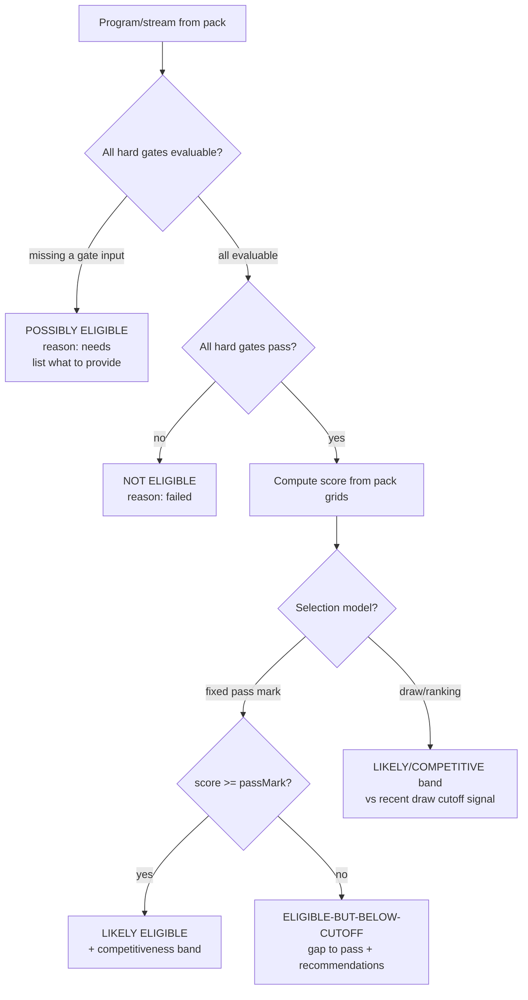
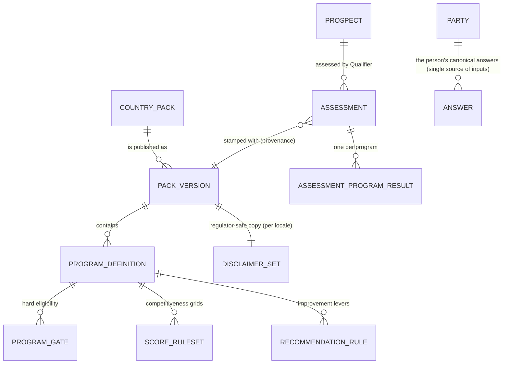

> **Document control** · Version **1.5** · **2026-10-21** · Status: **Baseline — not yet reviewed; AG7-D10 (no masking or reveal) applied; SA-06 v3.0 closing decision on assessment keys applied; AG-02 review decisions applied (20 Oct)**\
> Part of: *Agent (RCIC/Lawyer) Console — Functional Requirements* · Split from `FINAL-Agent-FR.md` lines 1645–2316 on 2026-09-16 · Previous version: `_archive/AG-03-pathway-assessment_v1.4_2026-10-07.md`\
>
> | Version | Date | Change | Decisions |
> |---|---|---|---|
> | 1.5 | 2026-10-21 | **AG-02 review decisions applied (the product owner, 20 Oct).** (1) The assessment is optional and never a gate: stated in §3.10 (S4). (2) No lead score and no next-best-action: the assessment publishes the verdict badge only; AG-02's next step comes from its fixed rules (diagram A, §1, §3.10, AG-3-36, §13 item 10). (3) Carry-forward runs on `case.created` (reading `sourceProspectId`), not on `prospect.converted` (diagram A, §1, §3.10, AG-3-37, BR-14, US-10). (4) A firm's own service under "Interested in" is ignored by the assessment (§3.3, AG-3-10). (5) The indicative result is staff only and is never shown to the inquirer (§3.11, AG-3-38); whether a reviewed share with the client is allowed in Release 1 stays open (AG02-P78). Pending block: P15, P75, P76 removed; P78 reduced to its open question. No requirement added, removed or renumbered. Final hand-over check (21 Oct): an "AG-02 suggests" line added to P77, which stays open. | AG02-D0 (S4), AG02-D2(6), AG02-D9(1), AG02-D9(3), AG02-D10(11) |
> | 1.4 (18 Oct, later) | 2026-10-18 | *18 Oct (later): consistency fixes after expert review — X-2.* The one `ContactProfile` is reworded to "the person's canonical answers (Party)" in the Visual Overview diagrams, §3.1, AG-3-2, BR-4, §7, the user story and §12; a "Decisions that change this epic" table is added. No requirement added, removed or renumbered. | X-2 |
> | 1.4 | 2026-10-07 | SA-06 v3.0 closing decision (the product owner, 7 Oct; owned by SA-06 v3.0): **one assessment key family.** The ERv2 code keys `agent/assessment:read` and `agent/assessment:create` are renamed to this document's `agent/assessment:view` and `agent/assessment:run`; no separate code family remains. Replaces the v1.3 note that kept the two sets separate (open question N9 in SA-06 is closed for these two keys). Changed: §10 (note under the table), §12 (permissions bullet). The permission table and requirements are unchanged; requirement IDs unchanged. This document has no "Applied from SA-06" table, so none was extended. | SA-06 v3.0 closing decisions (N9) |
> | 1.3 | 2026-10-07 | Key rename from SA-06 v3.0 Appendix B: the three mentions of today's prospect view key `agent/prospect:list` now give the canonical name `agent/prospect:view.own` (visibility qualifier rule, SA6-D10); the "today" wording is kept because it describes current code. **Unchanged by design:** `agent/assessment:view/run` stay canonical (Appendix B, open question N9: kept separate from the ERv2 `assessment:read/create` keys); no role names in this document. Requirement IDs unchanged. | SA6-D10 |
> | 1.2 | 2026-10-05 | Applied AG7-D10 (the product owner, 5 Oct: no masking and no reveal of personal data anywhere). Removed "masking-with-audited-reveal" from §11 (Assessment & input PII) and "masking" from the §12 NEW list; kept field-level encryption, PII-free logs/traces, and the audited advice-egress. Nothing else changed. Requirement IDs unchanged. | AG7-D10 |
> | 1.1 | 2026-08-28 | Baseline — complete document v1.1 | — |

## Decisions that change this epic (18 Oct; AG-02 rows added 21 Oct) *(new 18 Oct)*

Full text of each decision: `TEMPLATE-MAP-working_2026-10-10.md`.

| Decision | What was decided (one line) | What it changes in this epic | Where (requirement / card / section) |
|---|---|---|---|
| X-2 | One person record per real person; one place for the person's details (AG-02 is the home) | The assessment reads and writes the person's canonical answers (Party), not "the one `ContactProfile`" (retired); family members are their own person records linked by `PartyRelationship`; no requirement added or renumbered | Visual Overview diagrams · §3.1 · AG-3-2 · BR-4 · §7 · US-10 · §12 |
| AG02-D0 (S4) | The assessment is optional and is never a gate | The assessment never blocks an Engage, a stage move, a booking, a retainer, a signature or becoming a client | §3.10 |
| AG02-D10(11) (DEC:39; was AG02-P75) | No numeric lead score; the verdict badge and simple ordering replace it; AG-02's next step comes from fixed rules | The assessment publishes the verdict badge only; the lead score and next-best-action wording is removed | Diagram A · §1 · Module Index 3.10 · §3.10 · AG-3-36 · §13 item 10 |
| AG02-D2(6) (was AG02-P76) | `prospect.converted` is not used; becoming a client creates no case | Carry-forward runs when the case is created (`case.created`, reading `sourceProspectId`) | Diagram A · §1 · §3.10 · AG-3-37 · BR-14 · US-10 |
| AG02-D9(1) (was AG02-P15) | "Interested in" holds pack programmes and the firm's own services | A firm service is not a pack program: the assessment ignores it, and it never counts as an unanswered or failed program | §3.3 · AG-3-10 |
| AG02-D9(3) (DEC:28; part of AG02-P78) | The indicative result is staff only; the inquirer never sees it | The result is never shown to a lead or prospect (web form, booking page, automatic message). A consultant's reviewed share with the client stays open (AG02-P78) | §3.11 · AG-3-38 |

## Module AG-3: Pathway Assessment — Qualifiers & Calculators

### Module Index

Scan the whole module in ~30 seconds; jump to any part.

1. **Purpose & Goal**
2. **Users & Jobs-to-be-Done**
3. **Functional Design — How It Works** (core)
   - 3.0 The assessment model (Profile → Qualifier → Program results → Recommendations) · 3.1 Profile intake = the single-source applicant profile (no re-keying) · 3.2 The Country Pack (versioned reference data: programs, gates, grids, weights, disclaimer) · 3.3 Program-eligibility engine (likely / possibly / not-eligible, gates vs competitiveness) · 3.4 Score calculators (CRS, FSW-67… as pack-driven rule sets) · 3.5 Explainable per-factor breakdown · 3.6 Actionable recommendations ("CLB 8→9 = +X") · 3.7 Version-stamping, provenance & reproducibility · 3.8 Re-run vs a newer pack version (explicit, logged) · 3.9 No-guarantee disclaimer & consultant override/review · 3.10 Where the result flows (verdict badge, consult, SQR/case) · 3.11 Client-facing / shareable assessment
4. **Detailed Functional Requirements** (AG-3-x)
5. **Business Rules & Logic**
6. **States & Lifecycle**
7. **Key Entities & Fields**
8. **User Stories + Acceptance Criteria**
9. **Edge Cases & Validations**
10. **Permissions** (LOCAL `agent/*`)
11. **Scalability · Security · Performance**
12. **Reference Note** (exists / NEW / changed)
13. **Open Questions / Founder & SME Decisions**

### Visual Overview

**A. Assessment data-flow** — the single-source profile feeds the Qualifier, which runs every program in the **active Country Pack**, producing version-stamped results, an explainable breakdown, and recommendations; results fan out to the verdict badge (AG-2), the consult, and (when a case is created) the case:

```mermaid
flowchart LR
    subgraph SS[Single-source applicant profile]
      CP[The person's canonical answers (Party)<br/>family · education+ECA · language · work · NOC · funds]
    end
    CP --> Q{{Qualifier engine<br/>firm_id-scoped}}
    PK[(Active Country Pack<br/>version N: programs · gates · grids · weights · disclaimer)] --> Q
    Q --> ER[Eligibility results<br/>likely / possibly / not-eligible + reason]
    Q --> SC[Score breakdowns<br/>CRS · FSW-67 · PNP… per factor]
    Q --> RC[Recommendations<br/>"CLB 8→9 = +X"]
    ER --> AS[(Assessment<br/>version-stamped + provenance)]
    SC --> AS
    RC --> AS
    AS -->|staff only| LS[Verdict badge — AG-2]
    AS --> CN[Consult prep — AG-4]
    AS -->|carry-forward on case.created| CASE[SQR / Case — AG-7/AG-8]
    AS --> DISC[/No-guarantee disclaimer<br/>+ rulesAsOf + packVersion/]
```

**B. Per-program eligibility decision flow** — every program in the pack is evaluated the same way: **hard gates first** (eligibility), **then competitiveness** (score vs the program's selection signal), with a third **"possibly — missing data"** outcome when a gate-deciding input is absent:



**C. Reference-data hierarchy** — the eligibility brain is *data*, versioned and country-scoped, not code:



> `Note · Task · Reminder · Activity · AuditLog · Notification · Document` attach to an `ASSESSMENT`, a `CONTACT`, or a `PROSPECT` via the polymorphic `(entityType, entityId)` pattern — defined once (Part 2), reused here, never redefined. The Qualifier **reads** the Contact profile (AG-2/AG-8) and **writes** Assessment results; it does not own the person.

---

### 1. Purpose & Goal

**What it is.** AG-3 is the **eligibility and scoring brain** of Expat Ready — the in-house **Qualifier** that, given an applicant's profile, evaluates them against every immigration program and stream in the firm's one destination country and returns a ranked, explainable, regulator-safe answer to the only question a prospect ever really asks: *"Do I qualify, for what, and how strong am I?"* It is the single most differentiating module in the product and the firm's competitive moat.

**The business outcome it must produce.** Immigration firms win or lose on the quality and speed of the *first* credible answer. Today that answer lives in a senior consultant's head or in a fragile spreadsheet, takes a paid consult to produce, and cannot be reproduced six months later when the rules have moved. AG-3 makes that answer **instant, consistent, explainable, reproducible, and safe**:
- **Instant & consistent** — the same profile yields the same result regardless of which staff member runs it; a junior intake rep can triage as accurately as a senior RCIC.
- **Explainable** — not a black-box number but a **per-factor breakdown** ("age 100, language 124, transferability 50…") and **actionable recommendations** ("improve language CLB 8→9 = +X; that crosses the recent draw cutoff").
- **Reproducible & auditable** — every assessment is **stamped with the exact pack/rules version** it was computed under, so it can be defended to a client or a regulator even after IRCC changes the grid; re-running against a newer version is an explicit, logged decision, never a silent overwrite.
- **Safe** — every result carries the regulator-mandated **no-guarantee disclaimer** and supports **consultant override/review**, because an RCIC's professional judgement, not an algorithm, is ultimately accountable.

**Why it matters / world-class positioning.** A generic CRM (GoHighLevel et al.) **cannot do this at all** — it has a lead form, not an eligibility engine. AG-2's moat *is* AG-3: eligibility is the verdict badge staff see on the lead and the prospect, the triage signal in the work-queue, and the substance of the first consult. There is no numeric lead score (AG02-D10(11), DEC:39). The world-class bar is three things no competitor combines: (1) **a real, multi-program eligibility engine** with proper hard-gate-vs-competitiveness logic and a "you're missing X" tri-state, not a toy quiz; (2) **explainability and what-if recommendations** that turn an assessment into a *sales and advisory* instrument ("here's exactly how to become eligible"); and (3) **regulatory defensibility** — version-stamped reproducibility, no-guarantee framing, and human override — so a regulated RCIC firm can rely on it without professional risk.

**How it ties to the revenue & delivery journey.** Lead captured (AG-2) → **assessed by the Qualifier (AG-3)** → eligibility shows as the verdict badge (AG-2) → consult booked with the assessment already in hand (AG-4) → proposal scoped to the recommended pathway (AG-5) → when the case is created the **profile and the chosen pathway carry forward** into the SQR and case (AG-7/AG-8) with no re-keying. The Qualifier sits at the hinge of the funnel: it is what converts an inquiry into an *informed* pursuit.

**Global ambition (founder's core point).** This is the module where "global by construction" is non-negotiable. **The eligibility brain is the active Country Pack — versioned reference data, not code.** Canada ships first (CRS, FSW-67, and PNP streams as pack rule-sets). Australia (points test + occupation lists), the UK (Skilled Worker thresholds), or any future destination are added as **new packs by the Super-Admin/SME — without a code deployment**. The engine is generic; the rules are data. A solo RCIC provisioned for Canada and a large firm provisioned for Australia use the *same engine* against different packs — the platform is multi-country, a firm is not (FD-68), so within any one firm there is exactly one pack in play. The Canada-hardcoded calculators that exist today (§12) are precisely the thing this rebuild **must** generalise.

> **SME boundary (stated up front).** This document defines the **structure and behaviour** of the Qualifier. The *immigration values themselves* — the exact program set per country, the precise gate conditions, the grid point values and weights, the selection/cutoff signals, and the exact regulator-safe disclaimer wording — are **routed to the Immigration-SME; the founder is the final authority**. Throughout, immigration values are marked **SME-to-confirm** and consolidated in §13. The build proceeds against the *structure*; the SME fills the *pack content*.

---

### 2. Users & Jobs-to-be-Done

The "Agent" persona uses AG-3 very differently by sub-role. JTBD framing keeps the design honest about what each person is actually trying to accomplish.

| Role | Primary job in AG-3 | Jobs-to-be-done (representative) |
|---|---|---|
| **Intake / Sales Rep** (heaviest *trigger* of assessments) | Triage instantly: is this lead worth a consult, and for what? | "When a new lead arrives, I want a one-click preliminary assessment from the profile they gave me, so I can tell in seconds whether they're hot, and route/prioritise them." · "When the profile is incomplete, I want the system to tell me *exactly which field* would unlock a real answer, so I know what to ask on the first call." |
| **RCIC / Consultant** (the accountable expert) | Give credible, defensible advice; choose the pathway; close. | "When I open a lead before a consult, I want the eligibility already computed across all programs with a per-factor breakdown, so I walk in credible." · "When the numbers don't match my judgement, I want to **override** a result with a documented reason — my professional opinion is what's on the line." · "When I advise improvements, I want the system to quantify them ('CLB 8→9 = +X, crosses the cutoff'), so my advice is concrete and sells the retainer." |
| **Manager** | Trust the engine and keep advice consistent & compliant. | "When my team assesses leads, I want consistency — the same profile scores the same way regardless of who ran it — and every result carrying the disclaimer and the rules version." · "When IRCC changes a grid, I want to know which open leads' assessments are now stale and re-runnable." |
| **Owner / Principal RCIC** | Own the firm's compliance posture; the engine is the moat. | "When I rely on these assessments commercially, I want every one reproducible to the exact rules it used and clearly framed as indicative-not-guaranteed, so the firm carries no regulatory risk." · "When Expat Ready enters a new market, I want that to be a Country Pack someone publishes, not a code project — and if my practice ever needs a second market, I want that to be a second account, not a mode inside this one (FD-68)." |
| **Super-Admin (platform/country owner)** | Author and version the Country Packs. | "When immigration rules change, I want to edit programs, gates, grids, weights, and the disclaimer as **versioned data**, publish a new pack version, and have new assessments use it while old ones stay reproducible." (Pack *authoring UI* is a CENTRAL-plane surface; AG-3 here is the LOCAL *consumer*.) |
| **Client** (read-only, downstream) | Understand where they stand. | "When my consultant shares my assessment, I want a clear, plain-language summary of what I qualify for and what would improve my chances — with the honest disclaimer." (Rendered via the client portal; AG-3 produces the shareable artifact.) |

**Design implication.** The Intake Rep gets a **one-click "Assess"** that works off whatever profile exists and clearly flags missing inputs. The RCIC gets the **deep, explainable, override-capable** assessment surface. The Manager/Owner get **consistency, reproducibility, and staleness visibility**. The Super-Admin gets **versioned pack authoring** (a CENTRAL surface; AG-3 consumes its output). Permissions (§10) separate "run an assessment," "override a result," and "author a pack" into distinct keys.

---

### 3. Functional Design — How It Works (core)

This is the heart of the spec. Each sub-function is designed in depth: **how it works**, the **smart / world-class behaviour** that beats a toy eligibility quiz, the **key screens & interactions** (functional, not pixel-level), and the **data flow**.

#### 3.0 The assessment model — Profile → Qualifier → Program results → Recommendations (the spine everything sits on)

**Design decision: an Assessment is an immutable, version-stamped *snapshot* of running the Qualifier over a profile at a moment in time.** This is the single most important structural decision in the module and it is the reason the engine is defensible.

- **Inputs** = the single-source **canonical answers of the person (Party)** (§3.1). *(fixed 18 Oct — X-2)* The Qualifier never owns or re-collects the person's data; it *reads* the canonical answers that AG-2 captured and AG-8/SQR will reuse.
- **The engine** = a generic evaluator that loads the **active Country Pack version** (§3.2) for the lead's `destinationCountry` and runs each program's gates and grids.
- **An `Assessment`** = the result of one run: a set of per-program results (eligibility outcome + score + breakdown + reasons), recommendations, and — critically — the **provenance** (pack id + version + `rulesAsOf` + disclaimer text) under which it was computed. An Assessment is **append-only/immutable**: re-running produces a **new** Assessment (§3.8), it never mutates an old one.
- **Why immutable snapshots, not a single mutable score row?** Because the rules change. Today's code mutates a single `ProspectProgramScore` per program (upsert in place) and stores the rules date only as a transient response constant — so once IRCC updates the grid and someone re-runs, the *old* answer is gone and cannot be defended. The rebuild keeps a history of version-stamped Assessments so "what did we tell this client, under which rules, on which date" is always answerable (§3.7). *(This is the one structural change vs current code — see §12.)*

> **Why not collapse it for the demo?** Even in the demo we keep the snapshot model but present it simply: the rep/consultant mostly sees "the latest assessment," and the history is one click away. The data model is correct from day one (cheap), and the UI hides the versioning machinery until a re-run actually happens.

#### 3.1 Profile intake = the single-source applicant profile — "enter once; assess, consult, and file from the same data"

**How it works.** The Qualifier's inputs are the **person's canonical answers (Party)** *(fixed 18 Oct — X-2)* captured in AG-2 (§3.3 of AG-2) and reused by AG-8 SQR — *not* a separate evaluation form. The assessment surface renders the profile fields the active pack actually needs (age/DOB, marital status & accompanying spouse, family unit, highest education + ECA status, first/second official-language test + per-skill scores, Canadian & foreign skilled-work years, occupation/NOC classification, job offer details, province connections, settlement funds, and pack-specific extras). Where a field is missing, the surface shows it as a **gap** (not a zero) and lets the rep fill it inline — writing back to the **one** profile, so the consult and the eventual file inherit it.

**The single-source guarantee (the no-re-keying principle).** A field entered for the assessment is the *same* field the SQR and the form-mapping (AG-7) will read. There is **no** assessment-only data island. This is both a UX win (enter once) and a correctness win (the assessment and the filing can never silently disagree). The current code's `ProspectEvaluationProfile.data` JSON blob (a parallel store keyed by `prospectId`) is exactly the island to eliminate — the rebuild routes intake into the person's canonical answers (Party) *(fixed 18 Oct — X-2)* (§12).

**Pack-aware field requirements (NEW).** *Which* fields are required for a *useful* answer is **pack-driven**, not hardcoded: the Canada pack needs CLB-bearing language scores and NOC/TEER; an Australia pack would need a SkillSelect occupation and a points-test age band. The surface asks the active pack "what inputs do your programs read?" and renders/validates accordingly. Adding a field for a new program is **pack configuration**, not a code change.

**World-class behaviour.**
- **Assess with whatever you have.** The Qualifier *never refuses* to run on an incomplete profile — incomplete inputs surface as **"possibly eligible — needs X"** (§3.3), not an error. (This mirrors today's "missing inputs become `gateFailures`, not HTTP 400s" instinct, made explicit and structured.)
- **Tell me exactly what to ask.** For each program that can't be decided, the surface lists the **specific missing inputs** — so the rep knows precisely what to collect on the call to unlock a firm answer.
- **Derive, don't re-ask.** Age derives from DOB; CLB derives from raw test scores (the existing `clb.ts` conversion is correct and reusable); "with spouse" derives from marital status + accompanying + spouse-is-PR. The rep enters facts; the engine derives scoring inputs.

**Key screens & interactions.** *Assessment panel* on the lead/contact detail (profile fields grouped by factor, with per-field "needed by N programs" hints and inline edit), *missing-inputs checklist* ("3 fields would unlock a firm answer for OINP & SINP"), *Assess* button (one click; re-renders results live).

**Data flow.** Read the person's canonical answers (Party; each family member is their own person record) *(fixed 18 Oct — X-2)* for the lead → map to the active pack's input schema → flag missing pack-required inputs → on **Assess**, pass the resolved input set to the engine (§3.3/§3.4) → persist any inline edits back to the person's **single** set of canonical answers (not a parallel blob).

#### 3.2 The Country Pack — "the entire eligibility brain is versioned reference data, not code"

**How it works.** A **Country Pack** is the versioned bundle of immigration knowledge for one destination country. Each **published pack version** contains, as data:
- **Program/stream definitions** — the set of programs the engine evaluates (Canada: Express Entry/CRS, FSW-67, and PNP streams such as OINP, AAIP, SINP, BCPNP, MPNP; other countries: their equivalents). Each has a stable `programKey`, a localised label, a selection model (`FIXED_PASS_MARK` vs `DRAW_RANKING`), and a `maxScore`.
- **Hard eligibility gates** — the binary pre-conditions a program *requires* (e.g. "≥1 year post-secondary," "CLB 4+ in all four skills," "an in-province job offer for the FW stream"), each expressed as a structured, evaluable condition over profile fields, with a human-readable failure message and the input(s) it depends on.
- **Score rule-sets (grids)** — the point tables/weights per factor (age, education, language, work, transferability, additional, province connection…), expressed as data (lookup tables + caps + combination rules), not as transcribed TypeScript.
- **Recommendation levers** — the improvement rules ("language CLB band → Δpoints," "+1 year Canadian experience → Δpoints," "PNP nomination → +600") that power §3.6.
- **Selection/cutoff signals** — for draw-ranking programs, a reference cutoff (e.g. a recent CRS draw score) used only to band competitiveness, clearly labelled as indicative.
- **Disclaimer set** — the regulator-safe no-guarantee copy **per locale** (EN/FR…), stamped onto every result computed under this version.
- **`rulesAsOf` per program** + a pack-level version id and effective date.

**World-class behaviour.**
- **A new country is a pack, not a code project.** Serving Australia means the *platform* publishing an Australia pack and provisioning firms into that country; the engine evaluates it unchanged. This is the literal expression of "global by construction" — and it is a platform act, never a firm-side switch (FD-68).
- **Versioned and immutable-once-published.** A pack version is frozen once published; rule changes create a **new version**. Old assessments keep pointing at the version that produced them (§3.7). Draft versions are editable; published ones are not.
- **Authored centrally, consumed locally.** Pack *authoring* (the editor for programs/gates/grids/weights/disclaimer) is a **CENTRAL/Super-Admin surface** (a country owner maintains the knowledge once for all firms). AG-3 in the firm console is the **consumer**: a firm reads the active pack for its one `destinationCountry` (FD-68 — resolved at provisioning, never selected); firms do **not** edit immigration rules (that would be a compliance hazard and a per-tenant maintenance nightmare). *(Whether a firm may ever fork/override a pack value is an open question — §13.)*
- **No hardcoding, ever.** A grep of the engine should find **zero** literal point values, zero program names, zero pass marks — all of it comes from the loaded pack. (Today's calculators are the opposite; §12.)

**Key screens & interactions (consumer side).** *Active-pack indicator* on the assessment surface ("Canada pack v2026.05 — rules as of 2026-05-01"), *pack version picker* for a deliberate re-run (§3.8, permissioned), *"new pack version available" banner* when a firm's open assessments are stale. *(Pack authoring screens belong to the CENTRAL Super-Admin module; cross-referenced, not specified here.)*

**Data flow.** On assess, resolve `destinationCountry` → load the **active published pack version** for that country (cached) → hand the engine the program definitions + gates + grids + recommendation levers + disclaimer → stamp the chosen version's id/`rulesAsOf`/disclaimer onto the resulting Assessment (§3.7).

#### 3.3 Program-eligibility engine — "for every program: likely, possibly (missing data), or not — with the reason"

**How it works.** This is the core evaluator. For **each** program/stream in the active pack, the engine performs a strict two-stage evaluation and returns one of **four** outcomes (a deliberate refinement of today's boolean `eligible`):

1. **Evaluate the hard gates** (eligibility, binary). For each gate, the engine checks whether the deciding profile input is **present**:
   - If a gate-deciding input is **missing/insufficient to decide** → the program outcome is **`POSSIBLY_ELIGIBLE` (missing data)**, annotated with the **exact field(s)** to provide. The engine does *not* guess and does *not* mark not-eligible on absent data.
   - If all gate inputs are present and **any gate fails** → **`NOT_ELIGIBLE`**, annotated with the **specific failed gate** ("No post-secondary education," "No in-province job offer").
   - If all gates **pass** → proceed to stage 2.
2. **Compute competitiveness** (the score, §3.4) and band the outcome by the program's **selection model**:
   - **Fixed-pass-mark** programs (e.g. FSW-67 pass 67; SINP pass 60): `score ≥ passMark` → **`LIKELY_ELIGIBLE`** with a competitiveness band; `score < passMark` → **`ELIGIBLE_BELOW_CUTOFF`** with the **gap to pass** and the recommendations that would close it.
   - **Draw-ranking** programs (e.g. CRS/Express Entry, EOI-based PNPs): there is no fixed pass; the outcome is **`LIKELY_ELIGIBLE`** (the applicant can enter the pool/EOI) **banded by competitiveness** against the pack's indicative recent-draw signal ("strong / competitive / below recent cutoffs"), clearly labelled indicative.

*(added 21 Oct — AG02-D9(1))* A lead or prospect may be "Interested in" a firm's own service (e.g. Canadian passport, OCI card, translation) as well as a pack programme (AG-02). A firm service is not a pack program. The assessment ignores it. It never counts as an unanswered or failed program.

**Hard gates vs competitiveness signals — the distinction the engine is built around.** A *gate* answers "are you allowed in?" (binary, eligibility). A *competitiveness signal* answers "how strong are you among those allowed in?" (graded). Conflating them is the classic toy-quiz error. The engine keeps them separate: a high CRS score does not make someone *eligible* for a PNP stream whose gate they fail; a passed gate with a low score is *eligible but not competitive*. Results render the two as distinct facts.

**Ranking & recommendation across programs.** Results are **ranked** so the consultant sees the best pathways first: `LIKELY_ELIGIBLE` (by competitiveness/score) → `ELIGIBLE_BELOW_CUTOFF` (by smallest gap) → `POSSIBLY_ELIGIBLE` (by fewest missing inputs) → `NOT_ELIGIBLE` (with reasons). The Qualifier surfaces a **recommended pathway** (the strongest likely-eligible program) and the **near-misses worth pursuing** (smallest gaps / fewest missing inputs) — turning a list of scores into advice.

**World-class behaviour.**
- **The tri-state (likely / possibly / not) is the product.** "Possibly — you're missing your language scores" is *vastly* more useful than a false "not eligible," and it tells the rep what to collect. (Today's engine only has eligible true/false, and PNP calculators mark `eligible:false` only on the one job-offer gate — the rebuild generalises gate-vs-missing-vs-fail.)
- **Every "not eligible" carries a reason, and every "below cutoff" carries a gap + a fix.** No dead ends without an explanation and, where possible, a path forward (§3.6).
- **Engine is firm-scoped and deterministic.** Same inputs + same pack version = same outputs, always (pure function over inputs + pack), which is what makes results consistent across staff and reproducible across time.

**Key screens & interactions.** *Program-results panel*: ranked cards, one per program, each showing the outcome badge (Likely / Possibly / Below cutoff / Not eligible), the score vs max (and pass mark or draw-band), the **top reason** (missing field / failed gate / gap), and an expander for the breakdown (§3.5) and recommendations (§3.6). *Recommended-pathway callout* at the top. *Filter* (show only likely / include near-misses).

**Data flow.** For each program in the pack: evaluate gates against the resolved inputs → branch to POSSIBLY (collect missing inputs) / NOT (collect failed gate) / compute score → band by selection model → assemble per-program result → rank → return + persist as an `Assessment` with `AssessmentProgramResult` rows (§3.7).

#### 3.4 Score calculators — "CRS, FSW-67, and PNP grids as pack-driven rule-sets, not hardcoded code"

**How it works.** A calculator is the **scoring half** of a program: given the resolved inputs and the program's **grid rule-set from the pack**, it computes a total score, capped and combined per the pack's rules, and emits a **per-factor breakdown** (§3.5). The logic that the current Canada calculators express in TypeScript — the CRS age/education/language/transferability/additional sections (incl. the 100-point transferability cap and the with-spouse split), the FSW-67 six-factor grid, the PNP EOI factor maxima and province-connection rules — is **correct domain content** that the rebuild **lifts out of code and into pack data** so the same evaluator runs Canada today and Australia tomorrow.

**Shared, reusable mechanics (kept from current code, generalised).**
- **Language conversion (CLB).** Raw IELTS/CELPIP/PTE/TEF/TCF scores → CLB per ability → min-CLB where a program needs it. The existing `clb.ts` conversion tables are sound, well-tested, and reusable; in the rebuild the *conversion tables themselves* become pack reference data (so a country with a different language framework plugs in its own), but the conversion *mechanism* is shared.
- **With-spouse mode, caps, and combination rules** (e.g. CRS transferability cap 100; second-language caps; spouse-factor caps) are expressed as pack parameters the evaluator honours — not magic numbers in code.
- **Derived inputs** (age from DOB, min-CLB, "with spouse") are computed once and shared across all programs in a run (consistency + performance).

**Canada calculators in scope (as pack rule-sets), SME-to-confirm values:** **CRS** (Express Entry, draw-ranking, max ~1200), **FSW-67** (fixed pass 67), **OINP**, **AAIP**, **SINP**, **BCPNP**, **MPNP** (PNP EOI/ranking with province-connection gates). These mirror the seven that exist today — preserved as the Canada pack's content, not as code. *(The exact grids/maxima/pass marks/stream coverage are immigration values → SME/founder, §13.)*

**World-class behaviour.**
- **Explainable by construction.** Every calculator returns the breakdown alongside the total — the breakdown is a first-class output, not a debug afterthought, because it powers both the consultant's explanation and the recommendations (§3.5/§3.6).
- **One evaluator, many countries.** Adding Australia's points test is authoring a grid rule-set in the Australia pack — the evaluator code is untouched.
- **Tested against known fixtures.** The existing calculator unit tests (verbatim-grid fixtures) become **pack-conformance tests**: a published pack must reproduce known reference profiles' scores, so a data-entry error in a grid is caught before publish.

**Key screens & interactions.** Surfaced *through* the program-results cards (§3.3) — the calculator is engine-internal; its output is the score + breakdown shown to the user.

**Data flow.** Resolved inputs + program grid (from pack) → derived inputs (CLB, with-spouse) → section-by-section scoring with caps/combinations → `{score, maxScore, passMark|null, breakdown}` → handed back to the eligibility engine (§3.3) for banding.

#### 3.5 Explainable per-factor breakdown — "not a number, an explanation"

**How it works.** Each program result carries a **structured breakdown**: a labelled list of factor → points (and, where useful, the max for that factor), e.g. for CRS `{ core: 460, spouse: 0, transferability: 50, additional: 30 }` and, one level deeper, the sub-factors (age 100, first-language 124, education 120…). The breakdown is the *evidence* behind the total. The UI renders it as an expandable, human-readable explanation: the consultant can point at exactly where the points came from and where they didn't.

**World-class behaviour.**
- **Drill-down to the factor that matters.** The breakdown highlights the **largest gaps to the next band** (e.g. "language is at 124/136 — one CLB band away from +N"), priming the recommendations (§3.6).
- **Plain-language factor labels, per locale.** "Skill transferability," "Provincial connection," "First official language" — pack-localised so a French-language assessment reads in French.
- **Honest about caps.** Where a factor is capped (CRS transferability at 100), the breakdown shows "100/100 (capped)" so the consultant doesn't chase points that won't count.

**Key screens & interactions.** *Breakdown expander* inside each program-results card (factor table with bars/values), *"where the points went" view* for the recommended pathway.

**Data flow.** Breakdown is emitted by the calculator (§3.4), persisted on the `AssessmentProgramResult`, and rendered read-only (it is part of the immutable snapshot).

#### 3.6 Actionable recommendations — "improve language CLB 8→9 = +X points (and it crosses the cutoff)"

**How it works.** From the breakdown plus the pack's **recommendation levers**, the Qualifier computes **what-if improvements**: for each lever that applies to this applicant (raise language band, add a year of experience, complete an ECA, obtain a PNP nomination, get a qualifying job offer), it shows the **point delta** and, where the program has a cutoff/pass, **whether the improvement crosses it**. Recommendations are ranked by impact (largest Δ that changes the outcome first).

**World-class behaviour.**
- **Quantified, not generic.** Not "improve your English" but **"CLB 8 → 9 across all abilities ≈ +X CRS points → above the recent draw cutoff."** This is the single most powerful *sales and advisory* feature in the product: it makes the retainer's value concrete.
- **Outcome-aware.** A recommendation that would move a program from `ELIGIBLE_BELOW_CUTOFF` to `LIKELY_ELIGIBLE`, or from `POSSIBLY` to a firm answer, is flagged as **decisive** and floated to the top.
- **Honest about effort and certainty.** Recommendations are framed as indicative levers ("would add approximately…"), never promises, and inherit the no-guarantee disclaimer (§3.9). Levers that don't apply (already maxed, already held) are not shown.
- **Feeds the consult and the proposal.** The recommended levers become the consultant's talking points and the scope of the engagement ("we'll help you re-test and re-file at the higher band").

**Key screens & interactions.** *Recommendations panel* per program (and an aggregated "fastest route to eligible" view): each item shows the action, the estimated Δpoints, the affected program(s), and a decisive-badge if it changes the outcome.

**Data flow.** Breakdown + pack recommendation levers + (for cutoff-bearing programs) the pass/draw signal → compute applicable deltas → rank by impact/decisiveness → persist on the Assessment (so the advice given is reproducible) → render.

#### 3.7 Version-stamping, provenance & reproducibility — "every assessment is defensible to the exact rules it used"

**How it works.** Every `Assessment` is **stamped at creation** with its full provenance:
- the **Country Pack id + version** and each program's **`rulesAsOf`** date,
- the exact **disclaimer text + locale** rendered,
- the **input snapshot reference** (which profile values, at which revision, fed the run),
- **who** ran it and **when**, and whether it was an auto/system run or a manual consultant run.

This provenance is **persisted on the assessment, not derived at read time** — so even after the pack advances or the profile changes, the historical assessment renders exactly as it was computed and defended.

**Why this is a NEW deliverable (honest).** Today the rules date lives only in a TypeScript constant (`RULES_AS_OF`) returned in the live response; the persisted `ProspectProgramScore` row has **no version/provenance column** and is **upserted in place**. So once rules change and someone re-runs, the prior answer is gone — there is no reproducibility. The rebuild adds an immutable, version-stamped `Assessment` + `AssessmentProgramResult` history and a `pack_version` reference (§12).

**World-class behaviour.**
- **"What did we tell this client, under which rules, on which day" is always answerable** — a hard requirement for a regulated profession and for defending advice if a refusal is later challenged.
- **Reproducible re-compute.** Given the stored input snapshot + the stamped pack version, the engine can **re-derive the identical result** — a strong audit and debugging property (and a test invariant).
- **Provenance travels.** When an assessment is shared with a client (§3.11) or carried into a case (§3.10), the provenance and disclaimer travel with it.

**Key screens & interactions.** *Provenance footer* on every result ("Computed under Canada pack v2026.05 · rules as of 2026-05-01 · by Client AH · 2026-06-20"), *assessment history* list on the lead (each prior run with its version + date + who).

**Data flow.** On assess → write `Assessment` (provenance + input-snapshot ref + actor) + `AssessmentProgramResult[]` (immutable) → AuditLog → mark as the lead's *current* assessment (a pointer; prior ones retained).

#### 3.8 Re-run vs a newer pack version — "re-assessing under new rules is an explicit, logged choice"

**How it works.** When rules change (a new pack version publishes) or the profile is updated, the assessment can be **re-run**. Re-running is **always explicit and always produces a new immutable `Assessment`** (it never overwrites the prior one), and the new run records *why* it ran (profile changed / newer pack version / manual refresh) and *who* triggered it. The lead's "current assessment" pointer advances to the newest run; the history keeps every prior run with its own provenance.

**Stale-assessment detection (NEW).** When a pack version newer than an open lead's latest assessment publishes, the lead's assessment is flagged **stale** ("assessed under v2026.05; current is v2026.07"). The consultant can **re-run against the newer version** (a deliberate action), or keep the prior one (e.g. to preserve the advice given at the time). A Manager can see, across the firm, which open leads have stale assessments — so a rules change doesn't silently leave advice out of date.

**World-class behaviour.**
- **Never a silent overwrite.** The defensibility of the whole module depends on old answers surviving; re-run is additive, logged, and attributable.
- **Diff the runs.** A re-run can show a **delta vs the prior assessment** ("CRS 539 → 547 under the new grid; OINP gate now passes") — instantly useful to the consultant and the client.
- **Version pinning for a deliberate reason.** A consultant can choose to assess under a specific (e.g. prior) pack version with a documented reason — supporting "we filed under the rules in force at submission."

**Key screens & interactions.** *Re-run button* (with reason + optional version picker), *stale banner* on the lead, *firm-wide stale-assessments queue* (Manager), *run-vs-run diff* view.

**Data flow.** Re-run request (reason, target pack version = active-newest or pinned) → run engine → write new `Assessment` (new provenance) → advance current pointer → optional diff vs prior → AuditLog (`assessment.reran`, reason, from/to version) → Notification if it changes a key outcome.

#### 3.9 No-guarantee disclaimer & consultant override/review — "an algorithm informs; an RCIC decides"

**How it works.** **Every** assessment result — on screen, in an export, in the client portal, carried into a case — renders the **regulator-safe no-guarantee disclaimer** ("Indicative eligibility — not a guarantee of approval," final wording **SME-to-confirm**), in the result's locale, sourced from the stamped pack version. The disclaimer is not dismissible and not separable from the result.

**Consultant override/review (NEW).** Because an RCIC is professionally accountable, the Qualifier supports **human override**:
- A consultant can **override a program's outcome** (e.g. mark a `LIKELY_ELIGIBLE` as "not advisable in practice," or flag a `NOT_ELIGIBLE` as "borderline — worth exploring") **with a mandatory documented reason**. The override is recorded **alongside** (never replacing) the engine result, version-stamped and attributed, so both the machine answer and the human judgement are preserved.
- An assessment can be marked **reviewed/approved by a consultant** before it is shared with a client — a quality gate so a junior rep's auto-assessment isn't sent out as advice without RCIC sign-off (whether review is *mandatory* before client-share is an open question, §13).

**World-class behaviour.**
- **The human is always on top.** The engine is decision-*support*; the override model makes the accountable expert's judgement first-class and auditable, which is exactly what a regulated firm and its insurer need.
- **Disclaimer is structural, not cosmetic.** It is part of the immutable snapshot and travels with every rendering — there is no code path that emits a bare score without it.
- **Overrides are visible and explained.** A shared/exported assessment shows "consultant note: …" next to any overridden outcome, so the client sees considered advice, not just a number.

**Key screens & interactions.** *Disclaimer banner/footer* on every result surface, *override action* per program (reason required), *"reviewed by" stamp* + reviewer note, *override/review audit* on the assessment history.

**Data flow.** Disclaimer text resolved from the stamped pack version + locale → rendered with every result. Override → write `AssessmentOverride` (program, fromOutcome, reason, actor) linked to the Assessment → AuditLog. Review → stamp reviewer + timestamp on the Assessment → AuditLog.

#### 3.10 Where the result flows — "the assessment is the spine of the funnel and the case"

**How it works.** An assessment is not a dead-end report; its outputs are consumed across the journey. The assessment is optional and is never a gate: it never blocks an Engage, a stage move, a booking, a retainer, a signature or becoming a client (AG02-D0 S4). *(added 21 Oct)*
- **Verdict badge (AG-2).** *(changed 21 Oct — AG02-D10(11), DEC:39)* The eligibility outcome shows to staff as the one verdict badge on the lead and the prospect. There is no numeric lead score and no next-best-action from the assessment. AG-02's suggested next step comes from its own fixed rules (AG-2-37).
- **Consult prep (AG-4).** The consult opens with the latest assessment, breakdown, and recommendations already in hand — the consultant is credible from minute one.
- **Proposal scope (AG-5).** The recommended pathway and improvement levers scope the engagement and the fee.
- **SQR / case carry-forward (AG-7/AG-8).** When the case is created, the **profile and the chosen pathway carry forward** into the SQR and form-mapping with no re-keying; the assessment's provenance travels so the case records the basis on which the pathway was chosen.

**World-class behaviour.**
- **One continuous spine.** Assess → advise → propose → file, all from the same profile and the same chosen pathway — the no-re-keying guarantee that is the product's structural advantage.
- **Eligibility-driven prioritisation.** Because a genuinely eligible lead is, by definition, a better lead, the assessment *is* the triage signal — not a separate scoring gimmick.

**Data flow.** Assessment current-pointer + recommended pathway → published to AG-2 as the verdict badge (event/read) → surfaced in consult (AG-4) and proposal (AG-5) → on `case.created` (reading `sourceProspectId`), the chosen pathway + profile + assessment provenance carry into the SQR and case (AG-7/AG-8). `prospect.converted` is not used (AG02-D2(6)). *(changed 21 Oct)*

#### 3.11 Client-facing / shareable assessment — "a clear, honest answer the client can hold"

**How it works.** A consultant can produce a **client-facing assessment artifact** — a plain-language summary of what the applicant likely qualifies for, the key factors, the recommended improvements, and the **no-guarantee disclaimer** — rendered in the **client's locale** and shareable via the client portal (or as a PDF). It shows the considered (post-override, post-review) view, not raw engine internals, and carries the provenance footer.

*(added 21 Oct — AG02-D9(3), DEC:28)* The indicative result is for staff only. It is never shown to a lead or a prospect: not on the web form, the booking page or in any automatic message. Whether a consultant may share a reviewed assessment with the client in Release 1 is open (§13, AG02-P78).

**World-class behaviour.**
- **Honest and reassuring at once.** Plain language + concrete next steps + an upfront disclaimer builds trust (and converts) without over-promising.
- **Gated by review where required.** A client-facing artifact can require consultant review/sign-off first (§3.9 / §13) so nothing goes out as advice unvetted.
- **Locale-correct.** A Quebec client receives the French summary and the French disclaimer (Law-25 alignment), from the same assessment.

**Key screens & interactions.** *"Share assessment" action* (choose locale, include/exclude recommendations, review-gate), *client-portal assessment view* (read-only, disclaimer-stamped), *PDF export*.

**Data flow.** Take the current (reviewed) Assessment → render the client-facing template in the client's locale with the stamped disclaimer + provenance → publish to portal / generate PDF → AuditLog (shared with whom, when) — a PII/advice-egress event, audited.

---

### 4. Detailed Functional Requirements

Numbered `AG-3-x`, granular, covering every function in §3, with the pack-driven / version-stamped / tri-state / override extensions made explicit.

**Assessment model & inputs**
- **AG-3-1.** The system SHALL model an **`Assessment`** as an **immutable, version-stamped snapshot** of running the Qualifier over an applicant profile at a moment in time; re-running SHALL create a **new** Assessment and SHALL NOT mutate a prior one.
- **AG-3-2.** The Qualifier's inputs SHALL be the **person's canonical answers (Party)** (AG-2/AG-8; X-2), not a separate evaluation-only store; edits made on the assessment surface SHALL write back to those same answers. *(fixed 18 Oct — X-2)*
- **AG-3-3.** The set of inputs *required for a useful answer* SHALL be **pack-driven** (the active Country Pack declares which profile fields its programs read); the surface SHALL render/validate accordingly and SHALL flag missing pack-required inputs as **gaps**, not zeros.
- **AG-3-4.** The engine SHALL **derive** scoring inputs from facts (age from DOB; CLB from raw test scores via the shared conversion; "with spouse" from marital status + accompanying + spouse-is-PR) rather than re-asking them.

**Country Pack (pack-driven engine)**
- **AG-3-5.** The eligibility/scoring brain SHALL be supplied entirely by the **active Country Pack version** — program definitions, hard gates, score grids/weights, recommendation levers, selection/cutoff signals, and disclaimer copy — as **versioned reference data**; the engine SHALL contain **no hardcoded** program names, point values, pass marks, or gate conditions.
- **AG-3-6.** The engine SHALL load the **active published pack version** for the firm's one `destinationCountry` (FD-68); an unpublished/draft version SHALL NOT be used for a real assessment.
- **AG-3-7.** A pack version SHALL be **immutable once published**; rule changes SHALL create a **new version** with its own id, effective date, and per-program `rulesAsOf`.
- **AG-3-8.** Pack **authoring** (programs/gates/grids/weights/disclaimer editor) SHALL be a **CENTRAL/Super-Admin** capability; firms SHALL **consume** packs (read the active pack for their one country — FD-68) and SHALL NOT edit immigration rules in the LOCAL console. *(Firm-level pack override = open question §13.)*
- **AG-3-9.** Adding a new destination country SHALL be achievable by **publishing/enabling a new Country Pack** with **no code change** to the engine.

**Program-eligibility engine (tri-state + gates)**
- **AG-3-10.** For each program/stream in the active pack, the engine SHALL return exactly one outcome from: **`LIKELY_ELIGIBLE`**, **`ELIGIBLE_BELOW_CUTOFF`**, **`POSSIBLY_ELIGIBLE` (missing data)**, **`NOT_ELIGIBLE`**. A firm's own service chosen under "Interested in" (AG-02) is not a pack program; the engine SHALL ignore it and SHALL NOT report it as unanswered or failed. *(added 21 Oct — AG02-D9(1))*
- **AG-3-11.** The engine SHALL evaluate **hard eligibility gates separately from competitiveness**: gates are binary eligibility; the score is competitiveness among the eligible. A high score SHALL NOT make an applicant eligible for a program whose gate they fail.
- **AG-3-12.** When a gate-deciding input is **absent/insufficient to decide**, the outcome SHALL be **`POSSIBLY_ELIGIBLE`** annotated with the **specific missing input(s)** — never a false `NOT_ELIGIBLE`.
- **AG-3-13.** When all gate inputs are present and any gate **fails**, the outcome SHALL be **`NOT_ELIGIBLE`** annotated with the **specific failed gate(s)** (human-readable).
- **AG-3-14.** For **fixed-pass-mark** programs, when gates pass: `score ≥ passMark` → **`LIKELY_ELIGIBLE`**; `score < passMark` → **`ELIGIBLE_BELOW_CUTOFF`** with the **gap to pass**.
- **AG-3-15.** For **draw-ranking** programs, when gates pass, the outcome SHALL be **`LIKELY_ELIGIBLE`** banded by competitiveness against the pack's **indicative** draw-cutoff signal (clearly labelled indicative, not a pass mark).
- **AG-3-16.** Results SHALL be **ranked** (likely by competitiveness → below-cutoff by smallest gap → possibly by fewest missing inputs → not-eligible with reasons) and SHALL surface a **recommended pathway** and the **near-misses worth pursuing**.

**Score calculators**
- **AG-3-17.** Each program's **score** SHALL be computed by the evaluator from the pack's **grid rule-set** (point tables, caps, combination/with-spouse rules) — not from hardcoded TypeScript grids.
- **AG-3-18.** The **CLB language conversion** mechanism SHALL be shared and reusable across programs; the conversion **tables** SHALL be pack reference data (so non-CLB frameworks plug in).
- **AG-3-19.** The Canada pack SHALL provide, as rule-sets, at minimum: **CRS** (Express Entry, draw-ranking), **FSW-67** (fixed pass), and the PNP streams **OINP / AAIP / SINP / BCPNP / MPNP** (ranking/EOI with province-connection gates). *(Exact grids/maxima/pass marks/coverage = SME/founder, §13.)*
- **AG-3-20.** Every score computation SHALL emit a **per-factor `breakdown`** alongside the total as a first-class output.

**Explainability & recommendations**
- **AG-3-21.** Each program result SHALL carry a **structured, labelled breakdown** (factor → points, with maxima and cap annotations) rendered as a human-readable, per-locale explanation.
- **AG-3-22.** The Qualifier SHALL compute **actionable recommendations** from the breakdown + pack recommendation levers, each with an **estimated point delta** and, for cutoff-bearing programs, **whether it crosses the cutoff**; recommendations SHALL be **ranked by impact/decisiveness**.
- **AG-3-23.** A recommendation that would change a program's outcome (POSSIBLY→firm, BELOW_CUTOFF→LIKELY) SHALL be flagged **decisive** and surfaced first.
- **AG-3-24.** Recommendations SHALL be framed as **indicative levers** (never promises) and SHALL inherit the no-guarantee disclaimer.

**Version-stamping, provenance & reproducibility**
- **AG-3-25.** Every Assessment SHALL be **stamped at creation** with: Country Pack id + version, per-program `rulesAsOf`, the disclaimer text + locale rendered, an **input-snapshot reference**, and the actor + timestamp + run-type (auto/manual). Provenance SHALL be **persisted**, not derived at read time.
- **AG-3-26.** Given the stored input snapshot and the stamped pack version, the engine SHALL be able to **re-derive the identical result** (reproducibility invariant).
- **AG-3-27.** Provenance and disclaimer SHALL **travel with** the result wherever it is rendered (screen, export, portal, case carry-forward).

**Re-run & staleness**
- **AG-3-28.** Re-running an assessment SHALL be **explicit**, SHALL create a **new immutable Assessment**, SHALL record the **reason** (profile changed / newer pack version / manual / pinned version) and the **actor**, and SHALL advance the lead's **current-assessment pointer** while **retaining** all prior runs.
- **AG-3-29.** When a pack version newer than a lead's latest assessment publishes, the assessment SHALL be flagged **stale**; a **firm-wide stale-assessments view** SHALL let a Manager see all affected open leads.
- **AG-3-30.** A re-run MAY render a **delta vs the prior assessment** (score/outcome changes per program).
- **AG-3-31.** A consultant MAY **pin** a re-run to a specific (e.g. prior) pack version **with a documented reason**.

**Disclaimer, override & review**
- **AG-3-32.** **Every** result rendering SHALL display the **regulator-safe no-guarantee disclaimer** (per-locale, from the stamped pack version); the disclaimer SHALL NOT be dismissible or separable from the result. *(Exact wording = SME/founder, §13.)*
- **AG-3-33.** A consultant with the override permission SHALL be able to **override a program's outcome** with a **mandatory documented reason**; the override SHALL be stored **alongside** (never replacing) the engine result, version-stamped and attributed.
- **AG-3-34.** An Assessment MAY be marked **reviewed/approved by a consultant** (reviewer + timestamp + note); whether review is **mandatory before client-share** is configurable. *(Default = open question §13.)*
- **AG-3-35.** Override and review actions SHALL be **audited** (actor, target, before/after).

**Flow-out & client-facing**
- **AG-3-36.** The eligibility outcome SHALL be published to AG-2 as the **verdict badge** only, version-stamped and disclaimer-bearing, shown to staff on the lead, the prospect and the board card. The assessment SHALL NOT publish a numeric lead score or a next-best-action (AG02-D10(11), DEC:39). *(changed 21 Oct)*
- **AG-3-37.** On `case.created` (reading `sourceProspectId`), the **chosen pathway + profile + assessment provenance** SHALL carry forward into the SQR/case (AG-7/AG-8) with no re-keying. `prospect.converted` is not used (AG02-D2(6)). *(changed 21 Oct)*
- **AG-3-38.** A consultant SHALL be able to produce a **client-facing assessment artifact** (plain-language, per the client's locale, disclaimer- and provenance-stamped, post-override/post-review), shareable via the portal or as a PDF; sharing SHALL be **audited**. The indicative result SHALL NOT be shown to a lead or prospect (AG02-D9(3), DEC:28). Whether this client share is in Release 1 is open (AG02-P78). *(changed 21 Oct)*

**Non-functional (functional statements)**
- **AG-3-39.** The Qualifier SHALL be a **deterministic pure function** over (resolved inputs, pack version): identical inputs + version ⇒ identical outputs.
- **AG-3-40.** Every read/list (assessment history, stale-assessments view) SHALL be **paginated and tenant-scoped**; no endpoint SHALL return an unbounded set.
- **AG-3-41.** Sensitive actions (override, review, client-share/export, pinned re-run) SHALL be **audited** with actor, target, and before/after.

---

### 5. Business Rules & Logic

- **BR-1 (Pack-driven, no hardcoding).** All programs, gates, grids, weights, pass marks, selection signals, recommendation levers, and disclaimer copy come from the **active Country Pack version**; the engine contains no hardcoded immigration values. A literal point value or program name in engine code is a defect.
- **BR-2 (Active published version only).** A real assessment uses the **active, published** pack version for the lead's `destinationCountry`; draft versions are never used for a live result.
- **BR-3 (Pack immutability).** A published pack version is immutable; changes create a **new version**. Assessments reference the version that produced them and never silently follow a later version.
- **BR-4 (Single-source inputs).** The Qualifier reads the person's canonical answers (Party) *(fixed 18 Oct — X-2)*; there is **no** assessment-only data island, and assessment-surface edits write back to those same answers (no divergence between what was assessed and what will be filed).
- **BR-5 (Four-state outcome).** Every program result is exactly one of `LIKELY_ELIGIBLE | ELIGIBLE_BELOW_CUTOFF | POSSIBLY_ELIGIBLE | NOT_ELIGIBLE`. Boolean-only eligibility is insufficient.
- **BR-6 (Gates ≠ competitiveness).** Hard gates determine eligibility (binary); the score determines competitiveness (graded). A score never overrides a failed gate; a passed gate never implies a competitive score.
- **BR-7 (Missing-data ≠ not-eligible).** Absent gate-deciding inputs yield `POSSIBLY_ELIGIBLE` with the named missing field(s); the engine never marks `NOT_ELIGIBLE` on missing data.
- **BR-8 (Reason mandatory on negatives).** Every `NOT_ELIGIBLE` names the failed gate(s); every `ELIGIBLE_BELOW_CUTOFF` names the gap to pass; every `POSSIBLY_ELIGIBLE` names the missing input(s).
- **BR-9 (Determinism / reproducibility).** Identical resolved inputs + identical pack version always produce identical results; the stored input snapshot + stamped version can re-derive the result exactly.
- **BR-10 (Immutable, version-stamped snapshots).** An Assessment is append-only; re-running creates a new Assessment and never overwrites a prior one. Provenance (pack id+version, `rulesAsOf`, disclaimer+locale, input-snapshot ref, actor, timestamp) is persisted on the snapshot.
- **BR-11 (No-guarantee, always).** No result is ever rendered — on screen, export, portal, or case — without the regulator-safe disclaimer in the result's locale, sourced from the stamped pack version. The product never presents an eligibility result as a promise (this is the AG-2 BR-10 obligation, owned here).
- **BR-12 (Human override is first-class and additive).** A consultant override is stored alongside, never instead of, the engine result, with a mandatory reason, version-stamp, and attribution; both the machine answer and the human judgement are preserved and visible.
- **BR-13 (Re-run is explicit and logged).** Re-assessing (profile change, newer version, manual, or pinned) is an explicit, attributed, reason-bearing action; staleness is flagged when a newer pack version exists.
- **BR-14 (Carry-forward honesty).** When the case is created (`case.created`) the chosen pathway + profile + provenance carry forward; only fields that actually exist are carried — nothing is fabricated or defaulted (consistent with AG-2 BR-13).
- **BR-15 (Tenant isolation).** Every assessment, profile read, and pack-consumption is scoped to the caller's `firm_id` (RLS-enforced target state); a cross-tenant read is an isolation breach. Country Packs are platform/shared reference data (read-only to firms); assessment *results* are firm-private.
- **BR-16 (Review gate, configurable).** A client-facing artifact may require consultant review/sign-off before sharing (configurable; default SME/founder, §13); an unreviewed auto-assessment is not silently published as advice.
- **BR-17 (Locale correctness).** The disclaimer, factor labels, and client-facing artifact render in the correct locale (the client's language for client-facing; the user's for internal), from pack-localised copy.
- **BR-18 (Conformance before publish).** A pack version must pass **conformance tests** (known reference profiles reproduce expected scores/outcomes) before it can be published — a grid data-entry error cannot reach production assessments.

---

### 6. States & Lifecycle

**Assessment lifecycle** — an Assessment is an immutable snapshot; the *lead* points at a current one and keeps the history. The "stale" and "reviewed/overridden" states are properties of the snapshot, not reversible stage drags.

```
   Assess (manual or auto on profile-complete)
   ─────►  [COMPUTED]  ──consultant override──►  [COMPUTED + OVERRIDDEN]
                │                                        │
                │ consultant review                      │ consultant review
                ▼                                        ▼
           [REVIEWED] ───────────── share ──────────► client-facing artifact (portal/PDF)
                │
                │  newer pack version publishes
                ▼
            [STALE]  ──explicit re-run──►  NEW [COMPUTED] Assessment (history retained)
                                              (current-pointer advances; prior snapshot kept forever)
```

**State summary.**

| State | Meaning | How entered | Notes |
|---|---|---|---|
| `COMPUTED` | Engine result produced, version-stamped | Assess / re-run | Immutable; the default state |
| `OVERRIDDEN` (flag) | A consultant override is attached to ≥1 program | Override action (reason required) | Additive — engine result preserved |
| `REVIEWED` (flag) | A consultant signed off | Review action | Quality gate for client-share (BR-16) |
| `STALE` (derived) | A newer pack version exists than this run used | New pack version publishes | Triggers re-run affordance + Manager view |
| `SHARED` (event) | Rendered to client (portal/PDF) | Share action | Audited PII/advice egress |
| `SUPERSEDED` (derived) | A newer Assessment exists for the lead | A re-run created a newer snapshot | Retained for history/provenance; never deleted |

**Per-program outcome states (within an Assessment):** `LIKELY_ELIGIBLE`, `ELIGIBLE_BELOW_CUTOFF`, `POSSIBLY_ELIGIBLE`, `NOT_ELIGIBLE` (BR-5) — fixed at compute, immutable on the snapshot; a human override is recorded as a separate, attributed annotation, not a mutation of the outcome.

**Lead-level pointer:** `currentAssessmentId` advances on each re-run; all prior assessments remain queryable. There is **no** "delete assessment" in the normal flow — history is the point (a retention-policy purge is a separate, audited admin action).

---

### 7. Key Entities & Fields

> Names follow the rebuild's conventions (`firm_id` tenant key, RLS, polymorphic cross-cutting). Where current code differs, the Reference Note (§12) maps it. **Immigration *values* inside packs are SME-to-confirm (§13); the *structure* is defined here.**

**Assessment-side (firm-private; NEW shape vs current code)**
- **`Assessment`** *(NEW — replaces the in-place `ProspectProgramScore` upsert with an immutable snapshot)* — `id`, `firm_id`, `prospectId` (and/or `contactId`), `destinationCountry`, **`packId` + `packVersion`** (provenance), **`rulesAsOfByProgram` (Json)**, **`disclaimerText` + `disclaimerLocale`** (the exact copy rendered), **`inputSnapshotRef`** (which profile values/revision fed the run — a reference or embedded snapshot), `runType` (`AUTO | MANUAL | RERUN`), `reason?` (re-run reason), `pinnedVersion?`, `reviewedByUserId?` + `reviewedAt?` + `reviewNote?`, `createdByUserId`, `createdAt`. The lead carries **`currentAssessmentId`** (pointer).
- **`AssessmentProgramResult`** *(NEW — the per-program rows, immutable; supersedes mutable `ProspectProgramScore`)* — `id`, `assessmentId`, `programKey`, `programLabel`, **`outcome`** (`LIKELY_ELIGIBLE | ELIGIBLE_BELOW_CUTOFF | POSSIBLY_ELIGIBLE | NOT_ELIGIBLE`), `score`, `maxScore`, `passMark?` (null for draw-ranking), `selectionModel` (`FIXED_PASS_MARK | DRAW_RANKING`), `competitivenessBand?` (strong/competitive/below — for draw programs), `gapToPass?` (for below-cutoff), **`failedGates` (Json[])**, **`missingInputs` (Json[])**, **`breakdown` (Json)**, **`recommendations` (Json[])** (each: lever, deltaPoints, affectedPrograms, decisive flag). *(Today's `ProspectProgramScore` has score/maxScore/passMark/eligible/gateFailures/breakdown only — no outcome enum, no missingInputs, no recommendations, no version, and it is upserted in place; §12.)*
- **`AssessmentOverride`** *(NEW)* — `id`, `assessmentId`, `programKey`, `fromOutcome`, `consultantOutcomeLabel`/note, `reason` (required), `overriddenByUserId`, `createdAt`. Stored alongside the engine result (BR-12).
- **Cross-cutting (Part 2, attached via `(entityType=ASSESSMENT|CONTACT|PROSPECT, entityId)`):** `Note`, `Task`, `Reminder`, `AuditLog`, `Notification` + `NotificationPreference`, `Document` (the client-facing PDF). Not redefined here — attached per the polymorphic doctrine.

**Country-Pack-side (CENTRAL/platform reference data; read-only to firms; mostly NEW)**
- **`CountryPack`** *(NEW)* — `id`, `country` (ISO), `name`, `isEnabled`, `ownerNote`. One per destination country.
- **`PackVersion`** *(NEW)* — `id`, `packId`, `version`, `effectiveDate`, `status` (`DRAFT | PUBLISHED | RETIRED`), `publishedAt`, `publishedByUserId`, `conformancePassed` (bool, BR-18). Immutable once `PUBLISHED` (BR-3).
- **`ProgramDefinition`** *(NEW)* — `id`, `packVersionId`, `programKey`, `label` (per-locale), `selectionModel` (`FIXED_PASS_MARK | DRAW_RANKING`), `passMark?`, `maxScore`, `drawCutoffSignal?` (indicative), `order`. **SME-to-confirm content.**
- **`ProgramGate`** *(NEW)* — `id`, `programDefinitionId`, `key`, `condition` (structured expression over profile fields), `dependsOnInputs` (field list — drives the missing-data branch), `failMessage` (per-locale). **SME-to-confirm content.**
- **`ScoreRuleset`** *(NEW)* — `id`, `programDefinitionId`, `factorKey`, `grid` (Json lookup tables/bands), `cap?`, `combinationRule?`, `withSpouseVariant?`. The grids that are TypeScript today become this. **SME-to-confirm content.**
- **`RecommendationRule`** *(NEW)* — `id`, `programDefinitionId`, `leverKey` (e.g. languageBandUp, addExperienceYear, eca, pnpNomination, jobOffer), `deltaModel` (how Δpoints is computed), `label` (per-locale). **SME-to-confirm content.**
- **`DisclaimerSet`** *(NEW)* — `id`, `packVersionId`, `locale`, `text`. **SME-to-confirm wording.**
- **`LanguageConversionTable`** *(reference; the `clb.ts` tables generalised to data)* — `id`, `packVersionId`, `framework` (CLB…), `test` (IELTS/CELPIP/PTE/TEF/TCF), per-ability band mappings. Conversion *mechanism* shared; *tables* are pack data.

**Consumed from elsewhere (not owned here):** the person record (`Party`) and its canonical answers, with `PartyRelationship` for family (AG-2/AG-8 — the single-source inputs; X-2 retired `Contact` / `ContactProfile` / `ContactFamilyMember`) *(fixed 18 Oct — X-2)*; the firm's one `destinationCountry` (AG-1, read-only from its `CountryEntitlement` — FD-68); `Prospect` (AG-2 — carries `currentAssessmentId`).

> **The one explicit §7 modelling pick:** an Assessment is a **version-stamped immutable snapshot with persisted provenance + input-snapshot**, and the lead holds a **pointer** to the current one (history retained) — chosen over the current single-mutable-row model precisely so reproducibility/defensibility (the module's whole reason to exist) is structurally guaranteed, not best-effort.

---

### 8. User Stories + Acceptance Criteria

> Given/When/Then. These become the QA agent's test cases.

**US-1 — Intake Rep: one-click triage from the profile they have.**
*As an Intake Rep, I want a one-click assessment from the lead's profile so I can triage in seconds.*
- **Given** a lead with a partial profile (no language scores), **When** I click **Assess**, **Then** an Assessment is produced (not an error), programs that need language are returned `POSSIBLY_ELIGIBLE` listing "language test scores" as the missing input, and programs decidable without it return a firm outcome.
- **Given** the assessment completes, **When** it renders, **Then** every result shows the no-guarantee disclaimer and the pack-version/`rulesAsOf` stamp, and the top eligibility signal appears on the lead's board card.

**US-2 — RCIC: credible, explainable advice before the consult.**
*As an RCIC, I want eligibility computed across all programs with a per-factor breakdown so I walk into the consult credible.*
- **Given** a complete profile, **When** I open the assessment, **Then** programs are ranked (likely → below-cutoff → possibly → not), a recommended pathway is highlighted, and each program expands to a per-factor breakdown.
- **Given** a draw-ranking program (CRS) with gates passed, **When** it renders, **Then** it shows `LIKELY_ELIGIBLE` with a competitiveness band against the pack's indicative draw signal (clearly labelled indicative, not a pass mark).

**US-3 — RCIC: quantified recommendations that sell the retainer.**
- **Given** a profile scoring just below a program's pass mark, **When** I view recommendations, **Then** I see ranked levers with estimated point deltas, and the lever that would cross the cutoff is flagged **decisive** and floated first.
- **Given** a `POSSIBLY_ELIGIBLE` program, **When** I view it, **Then** the recommendation is "provide <named missing input> to get a firm answer."

**US-4 — Gates vs competitiveness are not conflated.**
- **Given** an applicant with a very high CRS score but no in-province job offer (an FW-stream PNP gate), **When** assessed, **Then** that PNP stream is `NOT_ELIGIBLE` with reason "needs an in-province job offer" — the high score does **not** make them eligible.
- **Given** an applicant who passes a program's gates but scores below its pass mark, **When** assessed, **Then** the program is `ELIGIBLE_BELOW_CUTOFF` with the gap to pass, not `NOT_ELIGIBLE`.

**US-5 — Owner: reproducible to the exact rules used.**
*As an Owner, I want every assessment defensible to the rules it used so the firm carries no regulatory risk.*
- **Given** an assessment computed under Canada pack v2026.05, **When** Super-Admin later publishes v2026.07 and I reopen the old assessment, **Then** it still renders under v2026.05 with that version's disclaimer — unchanged.
- **Given** the stored input snapshot + the stamped version, **When** the engine re-derives the result, **Then** it produces the identical score and outcome (reproducibility).

**US-6 — Re-run is explicit and never overwrites.**
- **Given** an assessment flagged **stale** because a newer pack version exists, **When** I click **Re-run**, **Then** a **new** Assessment is created under the new version (with a recorded reason and my identity), the lead's current pointer advances, the prior assessment is retained, and I can see a per-program delta.
- **Given** I re-run, **When** I check the history, **Then** both runs exist with their own provenance — nothing was overwritten.

**US-7 — Consultant override is first-class and audited.**
- **Given** a `LIKELY_ELIGIBLE` result I judge impractical, **When** I override it with a documented reason, **Then** the override is stored **alongside** the engine result (both visible), version-stamped and attributed, and an audit entry records actor/target/before-after.
- **Given** an override exists, **When** the assessment is shared with the client, **Then** the consultant note shows next to the overridden program.

**US-8 — Global: the platform adds a country with no code change.** *(Re-expressed per FD-68: the actor is the platform, never the firm — a firm has one country and cannot switch one on.)*
*As a Super-Admin, I want to add Australia by publishing a Country Pack, not by shipping code.*
- **Given** an Australia `PackVersion` with its programs/gates/grids/disclaimer is published, **When** a firm **provisioned for Australia** assesses a lead, **Then** the same engine returns ranked Australia program outcomes with the Australia disclaimer — and **no engine code changed**.
- **Given** the engine source, **When** inspected, **Then** it contains no hardcoded program names, point values, or pass marks (BR-1).

**US-9 — Client-facing artifact is honest and locale-correct.**
- **Given** a reviewed assessment for a French-speaking client, **When** I share it, **Then** the client portal shows a plain-language French summary with the French no-guarantee disclaimer and the provenance footer, and the share is audited.
- **Given** the firm requires review before share and an assessment is unreviewed, **When** I attempt to share, **Then** sharing is blocked until a consultant reviews it (per BR-16 configuration).

**US-10 — Single-source: no re-keying into the case.**
- **Given** I edit a language score on the assessment surface, **When** I save, **Then** it writes to the person's canonical answers (Party) (not a separate evaluation blob) *(fixed 18 Oct — X-2)*, and the same value appears in the SQR after conversion.
- **Given** the person has become a client, **When** the case is created (`case.created`), **Then** the chosen pathway, profile, and assessment provenance carry forward with no fields fabricated (consistent with AG-2 BR-13).

**US-11 — Manager: see stale assessments across the firm.**
- **Given** a new pack version publishes, **When** I open the stale-assessments view, **Then** I see all open leads whose latest assessment predates the new version, paginated and tenant-scoped, so I can prompt re-runs.

---

### 9. Edge Cases & Validations

- **Empty / near-empty profile** → engine still runs; every program returns `POSSIBLY_ELIGIBLE` with its full missing-input list; nothing errors, nothing is falsely `NOT_ELIGIBLE` (BR-7).
- **A gate input present but ambiguous/invalid** (e.g. an out-of-range test score) → schema-validated at input; if it can't be normalised it is treated as missing for that gate (POSSIBLY), never silently scored as zero.
- **No active published pack for the `destinationCountry`** → assessment is blocked with a clear "no active <country> rules pack" message; no result is fabricated from a draft or another country (BR-2).
- **Pack version retired/superseded between load and persist** → the run pins to the version it loaded and stamps that version (no mid-run version switch); concurrency-safe.
- **Re-run produces an identical result** → still a new immutable Assessment (history is the point), but the delta view shows "no change"; the current pointer advances.
- **Draw-ranking program with a missing/stale cutoff signal** → still `LIKELY_ELIGIBLE` (gate-based), but the competitiveness band shows "cutoff signal unavailable" rather than inventing one (honest).
- **Override on a program then a re-run** → the override belongs to the *old* Assessment; the new Assessment starts without it (overrides are per-snapshot), and the UI makes clear the prior consultant note was on the prior run (no silent carry of human judgement onto new machine numbers).
- **Conflicting profile edits during assessment** (two staff) → last-write-wins on the single profile with an audit trail; the Assessment stamps the input snapshot it used, so the result is unambiguous regardless of later edits.
- **Capped factor chased by a recommendation** → a recommendation never suggests gaining points in a factor already at its cap; the breakdown marks "(capped)" so the consultant doesn't chase non-counting points.
- **Disclaimer/locale missing for a pack version** → publish is blocked (a pack version without its disclaimer set cannot be published); at runtime, fall back to the firm/default locale disclaimer but never render a result with **no** disclaimer (BR-11).
- **Client-share of an unreviewed assessment when review is required** → blocked until reviewed (BR-16).
- **Cross-tenant access attempt** (assessment id from another firm) → rejected; assessments are `firm_id`-scoped (BR-15); packs are shared read-only reference, never another firm's results.
- **Stale-view at scale** → paginated, tenant-scoped query (no unbounded fetch) (AG-3-40).
- **Pack conformance failure** → a draft version that fails the known-profile fixtures cannot be published (BR-18); the firm never assesses against an unvalidated grid.
- **PII in the input snapshot** → the snapshot is Confidential, stored within `firm_id`, never logged in traces; client-facing artifact renders considered outputs, not raw internal fields.

**Validation doctrine.** All input (profile edits on the assessment surface, re-run/override/review requests, share requests) is validated by **schema** (Zod/class-validator), not ad-hoc `if/else`. Missing *scoring* inputs are a domain outcome (POSSIBLY), not a 400; malformed *requests* are a 400. Reject early with a clear, localised message; never persist on validation failure.

---

### 10. Permissions (LOCAL `agent/*`)

Default-deny; additive; always evaluated within the caller's `firm_id`.

> **Honesty note.** Today there are **no assessment-specific permission keys** — the evaluation endpoints reuse the prospect view key (GET; today `agent/prospect:list`, canonical name `agent/prospect:view.own` *(changed v1.3 — SA6-D10)*) and `agent/prospect:edit` (PUT) on the prospect controller. The keys below are **NEW**: the assessment surface must get its own keys so "run an assessment," "override a result," and "share to a client" are separable from generic prospect editing. *(changed v1.4 — closing decision)* The ERv2 code keys `agent/assessment:read` and `agent/assessment:create` are renamed to `agent/assessment:view` and `agent/assessment:run`: one family, with `view` and `run` as named here.

| Permission Key | Status | Description |
|---|---|---|
| `agent/assessment:view` | **NEW** | View a lead's assessment(s), breakdown, history (read-only) |
| `agent/assessment:run` | **NEW** | Run / re-run the Qualifier (today rides on `agent/prospect:edit`) |
| `agent/assessment:override` | **NEW** | Override a program outcome (consultant judgement; reason required) |
| `agent/assessment:review` | **NEW** | Mark an assessment reviewed/approved (consultant sign-off) |
| `agent/assessment:share` | **NEW** | Produce/share the client-facing artifact (portal/PDF); audited |
| `agent/assessment:pin-version` | **NEW** | Re-run pinned to a specific pack version (with reason) |
| `agent/assessment:view-stale` | **NEW** | View the firm-wide stale-assessments queue (Manager) |

> **Out of scope here (CENTRAL plane):** authoring/publishing Country Packs (`superadmin/country-pack:*`) is a Super-Admin capability specified in the CENTRAL module, not under `agent/*`. AG-3 in the firm console only **consumes** packs.

**Enforcement.** Route-level (`@RequirePermissions`) **and** object-level (`firm_id` ownership on every Assessment/profile read). `run` must be checked against `agent/assessment:run`, not `agent/prospect:edit`. `override`/`review`/`share`/`pin-version` are each separately permissioned (privilege separation — a junior rep may `run` but not `override` or `share`). Entitlement gating (plan/feature, §11) layers on top.

---

### 11. Scalability · Security · Performance

**Scalability / Expandability.**
- **Config-driven, not code-driven — the headline.** Programs, gates, grids, weights, recommendation levers, selection signals, language-conversion tables, and disclaimer copy are **versioned pack data**; a new program or a rule change is **authoring**, not a deploy. The engine is a generic evaluator over pack data.
- **Country-aware & pack-driven by construction.** A new destination is a new Country Pack; the engine code is untouched (AG-3-9). Every firm is single-country (FD-68), so a firm only ever loads one active pack; the many-country dimension lives at the platform, across firms. This is the most pack-driven module in the product and the literal expression of "global by construction."
- **Polymorphic cross-cutting:** notes/tasks/audit/notifications/documents attach to an Assessment via `(entityType, entityId)` — extending is configuration, not migration.
- **Stateless engine + cached packs:** the Qualifier is a pure function; published pack versions are immutable and **cached** (load once per version), so assessments scale horizontally and a large firm assessing many leads stays fast.

**Security (security-by-design).**
- **Permission per action:** every endpoint carries the correct `agent/assessment:*` key (§10); `run`/`override`/`review`/`share` are separable. Pack authoring is CENTRAL-only.
- **Tenant isolation — honest TARGET state.** Assessment results are firm-private; isolation today is **application `clientId` filtering** (the tenant key is `clientId`, not `firm_id`) with no DB-enforced RLS. **TARGET/NEW:** rename to **`firm_id`** and add **PostgreSQL RLS (enabled + forced)** so an app role cannot read another firm's assessments even on a query bug; object-level checks back up RLS. Country Packs are **platform/shared reference data** (read-only to firms) — never another firm's data.
- **Assessment & input PII.** The applicant profile and assessment internals are Confidential (full immigration history). **Field-level encryption at rest and PII-free logs/traces** are **NEW/TARGET** (consistent with AG-2); the input snapshot is stored within `firm_id` and never logged. Personal data is never masked — anyone allowed to see an assessment sees it in full; there is no reveal action *(changed v1.2 — AG7-D10)*. Personal data is never written to system logs or traces, and passport and financial numbers are never put into the content of emails, WhatsApp messages or notifications.
- **Advice-egress is audited.** Client-share/export (a lot of PII + advice at once) and override/review are **audited** (actor, target, before/after, scope) — a regulated-profession requirement.
- **Input validation everywhere:** schema validation on every profile edit, run/override/review/share request — no manual chains; missing *scoring* inputs are a domain outcome, not a crash vector.

**Performance (highest priority — per function).**
- **Engine (run/re-run):** a **deterministic pure function** over (resolved inputs, cached pack version) — CPU-bound, no per-program DB round-trips; derived inputs (CLB, with-spouse) computed once and shared across all programs in a run. Target: a full multi-program assessment computes in **well under the write budget**; persistence of the snapshot is a single transactional write of `Assessment` + `AssessmentProgramResult[]`.
- **Pack loading:** published versions are **immutable and cached** (Redis/in-process), keyed by `(country, version)`; a pack load is a cache hit after the first use — never re-parsed per assessment.
- **Reads (history, breakdown, stale-view):** **indexed + paginated**; indexes on `(firm_id, prospectId, createdAt)` for history, `(firm_id, currentAssessmentId)` on the lead, and `(firm_id, packVersion)` for the stale-view. No unbounded fetches (AG-3-40).
- **Stale detection:** computed by comparing each open lead's stamped `packVersion` to the active version of the firm's one country pack — a cheap indexed query / cached count, not a per-row recompute.
- **Bulk re-run (if a firm re-runs many leads after a rules change):** runs **asynchronously on the Bull queue** (never a blocking request), producing new snapshots with progress — never an in-memory fan-out.
- **Conformance tests run at publish time** (CENTRAL), not per assessment — so runtime stays fast and correctness is gated before data reaches firms.
- **Plan / entitlement feature-gating (NEW):** advanced surfaces (e.g. what-if recommendations, bulk re-run, client-facing artifacts) MAY be entitlement-tiered; *(a "multi-country packs" tier is WITHDRAWN by FD-68 — a firm consumes exactly one country's packs, so there is no breadth to sell inside an account)* when a firm lacks an entitlement the feature is hidden or shown disabled with an upgrade affordance, and the server enforces the gate (UI hiding alone is not security).
- **Budgets:** read p95 ≤ 300 ms; a single assessment write (engine + persist) p95 ≤ 600 ms; lists/history paginated; bulk re-run async.

---

### 12. Reference Note — what exists today vs NEW vs CHANGED

> Kept scrupulously honest — no "already enforced" claim that isn't true today. (Grounded in a read-only audit of `DevAPI-main/src/prospect-evaluation/*` and the `ProspectProgramScore` / `ProspectEvaluationProfile` Prisma models.)

**EXISTING (current codebase — a real, demo-active foundation, but Canada-hardcoded).**
- A working **7-program eligibility engine** under `src/prospect-evaluation/`: calculators for **CRS, FSW-67, OINP, AAIP, SINP, BCPNP, MPNP**, an aggregator (`runAllCalculators`) that runs **all seven** and sorts by `eligible desc, score desc`, and a shared **CLB conversion** (`clb.ts`) with unit tests. The grids are **transcribed verbatim from `docs/calculator-logic.md`** into TypeScript constants.
- A **`CalculatorResult`** shape with `programKey, programLabel, score, maxScore, passMark (null = ranking), eligible (boolean), gateFailures (string[]), breakdown (Record<string,number>)`.
- A **`ProspectProgramScore`** Prisma model persisting those fields per `(prospectId, programKey)` (unique), **upserted in place** on each save, plus a **`ProspectEvaluationProfile`** model storing the whole input as a single **`data: Json`** blob keyed by `prospectId`.
- A **compliance block** returned on every response (`disclaimer: "Indicative eligibility — not a guarantee of approval."` + `rulesAsOf`) and a **`RULES_AS_OF`** TypeScript constant mapping each `programKey` to a rules date.
- Service-level **`clientId` scoping** (`clientIdFor(userId)` + `assertProspectBelongsToClient`) and `firstFirst`-style guards.

**CORRECTIONS to any prior over-claims (stated honestly).**
- **The engine is Canada-HARDCODED, not pack-driven.** Every program name, point grid, pass mark, and gate condition is a literal in TypeScript; there is **no** Country Pack, no versioned reference data, and no way to add a country without code. Pack-driven/global is **NEW** (the core of this rebuild).
- **There is NO version/provenance on the stored result.** `RULES_AS_OF` is a transient response constant; the persisted `ProspectProgramScore` row has **no version column** and is **upserted in place** — so re-running after a rules change **destroys the prior answer**. Version-stamped immutable snapshots + reproducibility are **NEW**.
- **Eligibility is BOOLEAN only.** `CalculatorResult.eligible` is true/false; PNP calculators set `eligible:false` on a single gate (e.g. OINP's job-offer check) and CRS is hardcoded `eligible:true`. The four-state outcome (likely / below-cutoff / **possibly-missing-data** / not) and the gate-vs-competitiveness separation are **NEW** (today there's no "possibly — missing X" state; missing inputs silently score zero in several calculators, which can mislead).
- **There are NO recommendations.** No what-if/improvement-lever engine exists; "CLB 8→9 = +X" is **NEW**.
- **There is NO consultant override or review.** **NEW.**
- **The profile is a parallel JSON island.** `ProspectEvaluationProfile.data` is an evaluation-only blob, **not** the person's canonical answers (Party); the single-source/no-re-keying guarantee is **NEW** (and depends on the AG-2/AG-8 person record, X-2).
- **Permissions reuse the prospect view key (today `agent/prospect:list`, canonical `agent/prospect:view.own` *(changed v1.3 — SA6-D10)*) and `agent/prospect:edit`.** There are **no `agent/assessment:*` keys**; they are **NEW** (and `run` must move off `:edit`). *(changed v1.4 — closing decision)* The code keys `agent/assessment:read` / `:create` are renamed to `agent/assessment:view` / `:run`; there is one family, not two.
- **Tenant isolation is `clientId` application-filtering** — `firm_id` + RLS (enabled+forced) is **NEW/TARGET**, not current.
- **The OINP-style "proxy" approximations are honesty debt.** Several PNP calculators use proxies (e.g. "has Canadian work years" as a proxy for a work permit, wage×2000 for earnings) noted in code comments as best-effort; in the pack model these become explicit, SME-confirmed gate/grid rules rather than buried proxies.

**NEW (requires build).**
- **The Country Pack model** (`CountryPack`, `PackVersion`, `ProgramDefinition`, `ProgramGate`, `ScoreRuleset`, `RecommendationRule`, `DisclaimerSet`, `LanguageConversionTable`) as versioned reference data, with a **CENTRAL/Super-Admin authoring/publish flow** and **conformance tests before publish** (BR-18). The existing Canada grids become the **Canada pack's content**.
- **A generic engine** that loads the active pack and evaluates gates/grids — **no hardcoded values** (BR-1).
- **Four-state outcome + gate-vs-competitiveness separation + "possibly — missing data" with named missing inputs** (BR-5/6/7).
- **Immutable, version-stamped `Assessment` + `AssessmentProgramResult` snapshots** with persisted provenance + input-snapshot + reproducibility (BR-9/10), replacing the in-place `ProspectProgramScore` upsert.
- **Explicit, logged re-run + stale-assessment detection + firm-wide stale view + run-vs-run diff** (BR-13).
- **Actionable recommendations** (Δpoints, decisive flag, crosses-cutoff) (AG-3-22/23).
- **Consultant override (additive, audited) + review/sign-off gate** (BR-12/16).
- **Single-source profile intake** (read/write the person's canonical answers (Party), kill the JSON island) (BR-4).
- **Client-facing shareable artifact** (plain-language, per-locale, disclaimer+provenance, audited share) (AG-3-38).
- **`agent/assessment:*` permission set** (§10); **PII field-level encryption + audited advice-egress** *(changed v1.2 — AG7-D10)*; **plan/entitlement gating**; **pagination on all reads**.

**CHANGED (deliberate corrections, summarised).**
- Eligibility brain **hardcoded TypeScript → versioned Country Pack data**; `RULES_AS_OF` constant → per-version `rulesAsOf` **stamped on snapshots**.
- `ProspectProgramScore` (mutable, upsert-in-place, no version, boolean eligible) → **immutable `AssessmentProgramResult`** (four-state outcome, version-stamped, with missingInputs + recommendations).
- `ProspectEvaluationProfile.data` JSON island → **the person's canonical answers (Party)** (no re-keying).
- Tenant key **`clientId` → `firm_id`** with **RLS enabled+forced**.
- Permissions **the prospect view key (`agent/prospect:view.own`) and `agent/prospect:edit` → dedicated `agent/assessment:*`** (run/override/review/share separable).
- CLB conversion **TypeScript tables → pack reference data** (mechanism shared; tables versioned per pack).

---

### 13. Open Questions / Founder & SME Decisions

**Pending from the AG-02 review (20 Oct 2026) — settle in this epic's review:** *(21 Oct: P15, P75 and P76 applied and removed; P78 reduced to its open question; line numbers refreshed to v1.5.)*
- **AG02-P11 — Profile re-run: automatic or explicit (AG02-D10(11)).** AG-02 decision row DEC:31 (`_archive/AG-02-decisions_2026-10-11.md:31`) says the assessment re-runs when staff fill or correct the immigration profile on the lead; AG-3-28 (`:398`) says a re-run SHALL be explicit, with a reason and an actor, and AG-3-29 (`:399`) only flags a newer pack version as stale. Decide which holds: re-run on every profile edit, or only when a person clicks. Open item 10 in this section (`:694`, "Auto-assess trigger": auto-run on profile-complete, or only on explicit "Assess") is the same question; settle both together.
- **AG02-P14 — Mandatory lead-form fields for a useful verdict (AG-02 DEC:77).** The 11 Oct list leaves open which lead-form fields are mandatory for a useful verdict (`_archive/AG-02-decisions_2026-10-11.md:77`); owner: the immigration expert. This is the same question as open item 6 in this section (`:688`, the minimum profile that avoids an all-POSSIBLY result), so settle them together.
- **AG02-P77 — The assessment is keyed on prospect or contact, but AG-02 reads it by person (X-2, AG02-D9(3)).** `Assessment` has `prospectId` and/or `contactId` (`:484`), the current pointer sits "at lead level" (`:475`, AG-3-28 at `:398`), and `:102` attaches notes and other items to `CONTACT`. AG-02 reads the assessment by person (`subjectPartyId`) and, when set, by prospect (AG02:2712), and "Assess" is offered on a lead before Engage. Key `Assessment` on `partyId` plus an optional `prospectId`, keep the current pointer on the person, and drop `contactId` (X-2) and the `CONTACT` host at `:102`.
  - AG-02 suggests: key `Assessment` on the person (`partyId`) with an optional `prospectId`, keep the current pointer on the person and drop `contactId`, because every real person has their own person record and the `Contact` table is retired (X-2). Confirm in this epic's review.
- **AG02-P78 — AG-3-38 client share in Release 1? (AG02-D9(3), DEC:28).** The decided part is applied: the indicative result is for staff only and is never shown to a lead or prospect (§3.11, AG-3-38 at `:412`). Still open: AG-3-38 (`:412`) and the client-facing artifact (`:339` to `:350`) let a consultant share a reviewed assessment with the client through the portal or as a PDF. Question for the product owner: is a reviewed share with the client allowed after Engage in Release 1, or is AG-3-38 Release 2?
- **AG02-P79 — No rule turns the per-program outcomes into the one verdict badge (AG02-D9(3)).** AG-3-10 (`:372`) gives one outcome per program (LIKELY_ELIGIBLE, ELIGIBLE_BELOW_CUTOFF, POSSIBLY_ELIGIBLE, NOT_ELIGIBLE). AG-02 shows one badge per person: likely eligible, close - missing X, not assessed, not eligible (AG02:2710, AG02:2595), and says AG-03 specifies it. State the roll-up rule here, including "not assessed", and which programs count given "Interested in" (a firm service is ignored, AG02-D9(1), §3.3).

**Immigration-domain values routed to the Immigration-SME; founder is final authority.** This BA spec defines the **structure and behaviour**; the following **immigration values** are confirmed by the SME and seeded into the Canada Country Pack — they are *not* assumed here:
1. **The exact program/stream set per country** (Canada: which PNP streams beyond the current seven; which EE categories) and each program's **selection model** (fixed pass vs draw-ranking).
2. **The precise hard-gate conditions** per program (e.g. SINP's "≥1 yr post-secondary + CLB 4 + ≥1 yr skilled work"; OINP-FW's "in-province job offer") and the **input each gate depends on** (drives the missing-data tri-state).
3. **The grid point values, maxima, caps, combination rules, and pass marks** (CRS sections + 100-pt transferability cap + with-spouse splits; FSW-67's six factors and pass 67; each PNP's factor maxima and province-connection rules) — replacing today's hardcoded grids with confirmed pack data.
4. **The recommendation levers and their Δ-point models** ("CLB band up," "+1 yr experience," "ECA," "PNP nomination," "qualifying job offer") and the **indicative draw-cutoff signals** used only to band competitiveness.
5. **The exact regulator-safe no-guarantee disclaimer wording**, per locale (EN/FR-CA), and any RCIC-required framing.
6. **Which profile fields are mandatory for a *useful* preliminary qualification** (the minimum to avoid an all-POSSIBLY result).
7. **The replacement of the current "proxy" approximations** (work-permit/earnings proxies) with correct, explicit gate/grid rules.

**Genuinely open (need a founder/product decision):**
8. **Firm-level pack override.** May a firm ever fork/override a pack value (e.g. a more conservative internal cutoff), or are immigration rules strictly platform-owned and read-only to firms? *(Default proposed: read-only platform packs; firm-level *display preferences* only.)*
9. **Mandatory review before client-share?** Is consultant review/sign-off **required** before any client-facing assessment is shared, or optional/configurable per firm? *(Affects BR-16 default.)*
10. **Auto-assess trigger.** Should an assessment auto-run on profile-complete (so the rep always has a fresh result), or only on explicit "Assess"? *(Affects AG-3-1 runType `AUTO` and verdict-badge freshness.)*
11. **Indicative draw-cutoff source.** For draw-ranking competitiveness bands, where does the cutoff signal come from — a manually maintained pack value, or a feed of recent draw results? *(Demo can seed a static value.)*
12. **Entitlement tiers.** Which AG-3 features sit behind which plan (what-if recommendations, client-facing artifacts, bulk re-run)? Needed to wire the feature-gates. *("Multi-country packs" is WITHDRAWN by FD-68 — no longer a sellable tier inside one account.)*

**Named deferrals (explicitly later phases, not the demo):**
- **Country Packs beyond Canada** (Phase-2/3) — the Canada pack ships first; the model supports others with no code change.
- **A visual pack-authoring UI for non-engineers** (Phase-2) — the demo can seed the Canada pack via structured data/seed; the rich Super-Admin editor follows.
- **Live draw-results feed** (Phase-2) — static indicative cutoff seeded now.
- **Proactive auto-re-run on every pack publish** (Phase-2) — staleness flag + manual/bulk re-run ships first.
- **Client portal interactive what-if calculator** (Phase-2/3) — internal recommendations ship first; a self-serve client-side what-if follows.

> **Domain-correctness boundary (restated).** Every immigration *value* above is SME-confirmed and founder-approved before it enters the Canada Country Pack. This module's contract is the **engine structure, the four-state outcome, the version-stamped reproducibility, the override/disclaimer safety, and the pack-driven globalism** — all of which are defined here and are independent of the specific numbers the SME supplies.
