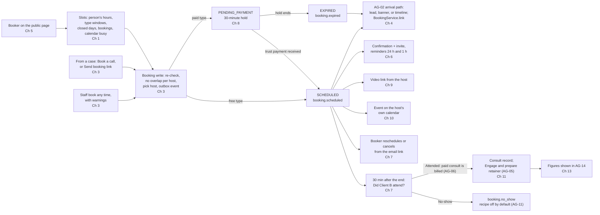

# AG-04 Consultations and booking

> **Document control** · Version **2.1** · **2026-10-25** · Status: **Money slice and AG-05 review applied (the product owner, 25 Oct): MS-D2, MS-D3, MS-D11, MS-D15, MS-D18, MS-D19, MS-D20 written in; MS-D24 follow-ups applied (25 Oct, later)**; earlier: **AG-04 review complete (the product owner, 21 Oct): AG04-D1 – D12 applied; rewritten to the X-1 format**
> Part of: *Agent (RCIC/Lawyer) Console — Functional Requirements* · Previous version: `_archive/AG-04-consultation-and-booking_v2.0_2026-10-21.md`
>
> | Version | Date | Change | Decisions |
> |---|---|---|---|
> | 2.0 | 2026-10-21 | AG-04 review complete. Rewritten to the X-1 format (Page 1, Parts A–D, a build card for every live requirement). AG04-D1 – D12 and S1 – S6 applied. The fix list F-1 – F-47 of the review applied where AG-04 is the home. An unpaid paid booking still makes a lead (`booking.expired`). Case calls start from the case. Attendance is asked, never guessed. Booking timings are firm defaults on the Timings screen, changeable per type. Video gaps closed. Staff may book any time with a warning. The consult record is lean and its next step is a button. Six permission keys. Group sessions and a full session make leads with no "Call now". The consent sentence is the firm's. The calendar event holds only what runs the meeting. English first; no FX; analytics shown in AG-14. Double-booking safety rewritten for PostgreSQL. Requirement IDs AG-4-1 – AG-4-61 kept; AG-4-13 withdrawn; AG-4-62 – AG-4-67 new. | AG04-D1 – D12, S1 – S6 |
> | 2.0 (22 Oct) | 2026-10-22 | X-6 applied (the product owner, 22 Oct): CAD and USD only. A paid type's price currency defaults to the firm default and staff may change it on the type (AG-4-44 rule 1, data); the consult invoice uses the type's price currency (AG-4-44 rule 3); the quoted fee on the consult record is pre-filled with the prospect's, case's or firm-default currency, CAD or USD only (AG-4-49 rule 6, data, test); booking revenue per currency, at most two figures (BR-18, edge cases, R18 row). Decisions row X-6 added. | X-6 |
> | 2.0 (22 Oct) | 2026-10-22 | AG04-D13 (a new paid booker gets a person record, no lead, when the booking starts; closes C11 Q1) and AG04-D14 (a refund outside the rule is made outside and recorded with "Record refund") applied: AG-4-44, AG-4-46, C11, D5, D7 item 5. | AG04-D13, AG04-D14 |
> | 2.0 (22 Oct) | 2026-10-22 | 2.0 (22 Oct): final cross-epic check fixes applied. Event payloads gain optional `invoiceId` and AG-06 consumes `booking.expired`; case timeline reads the booking (AG-7-37); consent uses AG-02's `ConsentWording`; the case booking link is a `BookingAccessToken` with purpose `CASE_LINK`; the firm resolver is the portal's CP-1-4; time off is My account out-of-office (no `PersonTimeOff`); `warningsAccepted` and `SELF_SERVICE_RESCHEDULE` dropped; refund window named "self-service limit" throughout; Zoom topic stated; WhatsApp-only booker; recipe name "Post-consult follow-up"; custom domain cite AG01-14; knock-on status marked applied; C10 rows for S4, S5/O2, O1, O3. No rule on refunds after a late staff cancel or on the consult-invoice person record changed (with the product owner). | Final check (orchestrator, 22 Oct) |
> | 2.0 (22 Oct) | 2026-10-22 | AG04-D15 – D19 applied (the product owner, 22 Oct). **D15:** O1 – O4 marked confirmed. **D16:** Part D7 items 1, 2, 3, 4, 6, 7 marked confirmed. **D17:** a person keeps one or more named sets of weekly hours, one default; a new person gets "Normal hours" copied from the office hours; each type's host row names which set it uses (AG-4-62 outcome, rules, example, data, access, test, non-goals; AG-4-1 rule 1; glossary "Person's hours"; BR-2; C4 `AvailabilitySchedule` replaces `PersonAvailability`, `AppointmentTypeHost.scheduleId`; C8 frontend row; Part D1 and D7 item 8 replaced). **D18:** C11 Q2 closed; AG-4-58 gains rule 6 (no video status on the Team list). **D19:** an Owner or Admin may enter a colleague's out-of-office dates (AG-4-62 rule 8 and access, C5); entering time off never moves bookings. Decisions rows D15 – D19 and test rows added. | AG04-D15, AG04-D16, AG04-D17, AG04-D18, AG04-D19 |
> | 2.0 (22 Oct) | 2026-10-22 | AG04-D21, AG04-D22 applied (the product owner, 22 Oct). **D21:** each set of hours has its own time zone, pre-filled with the office zone and changeable (Part A rule 4; glossary "Person's hours" and "Office time zone"; AG-4-62 rule 4, data, example, tests, non-goals; AG-4-1/2/3 outcome, why, rules 4 – 7, tests; AG-4-60 retitled to closed days and the starting zone; BR-1; C4 `AvailabilitySchedule.timezone`; edge cases of the display zone). **D22:** business hours no longer limit slots (AG-4-7 retitled "Slots respect the firm's closed days", outcome, rules 1 – 3, tests, data; AG-4-62 rule 1c and test; BR-2; bookable set and slot flow; flow diagram; build order; C "read from other epics"; preview reasons; staff-booking example and warnings list in AG-4-63; AG16-6 row marked amended). Decisions rows D21, D22 added. | AG04-D21, AG04-D22 |
> | 2.1 | 2026-10-25 | **25 Oct (money slice + AG-05 review).** (1) **MS-D3, MS-D20(19):** the consultation agreement starts on for Free consultation and Paid consultation types; a staff-made booking sends a no-login accept link and shows "Agreement accepted <time>" or "Not accepted yet" (a warning, never a block); the agreement and the payment are one page, accept first (AG-4-15, AG-4-63). The tick and the template are now called "consultation agreement". (2) **MS-D15, MS-D19, MS-D20(17), MS-D11:** paid consults rewritten. Each paid type chooses "Client pays: When booking · After the consult"; money at booking is a trust payment request, not a consult invoice; the person record holds it until a case exists; Attended bills it (from trust, in the same click) and sets `Booking.invoiceId`; No-show asks "Keep the fee · Refund"; the cancel rule gains "Never refund"; an expired hold numbers nothing (AG-4-44, AG-4-45, AG-4-46, AG-4-39, BR-4, BR-25, C2, C4, C6, C10). (3) **MS-D2, MS-D18(4):** "Engage and create proposal" and "Create proposal" become "Engage and prepare retainer" and "Prepare retainer"; `ConsultRecord.proposalId` removed; the quoted fee beats the Service price in AG-05's Fees panel (AG-4-49, AG-4-50, BR-13). (4) AG-14 paid-consult revenue counts at Attended (AG-4-52). (5) Open questions Q1 – Q3 added (C11). Requirement IDs unchanged. | MS-D2 · MS-D3 · MS-D11 · MS-D15 · MS-D18 · MS-D19 · MS-D20 |
> | 2.1 (25 Oct, later) | 2026-10-25 | **25 Oct (later): MS-D24 and writer follow-ups.** Applied in place, no version change. Settled under existing decisions, no new rule: (1) a new consultation type uses ExpatReady's "Consultation agreement" starter until the firm picks its own, so the tick works with zero setup (AG-4-15 rule 2, MS-D3, Rule 9); (2) changing Attended to No-show on a billed booking offers AG-06's one-action "Undo Attended" (AG-4-39 rules 4 and 10, MS-D20(19)); (3) the names AG-06 gives: its "trust request paid" fact, `Booking.trustRequestId` for the request and AG-06 billing at Attended when it consumes `booking.completed` (AG-4-44, C6, D5; AG-6-34). C11 now has no open question; its three questions are closed. | MS-D24 (settled items) · MS-D3 · MS-D20(19) |
> | 2.1 (25 Oct, final check) | 2026-10-25 | **25 Oct (final check): verification fixes.** AG-4-46: a late cancel or a "Never refund" type now shows AG-06's "Keep the fee (bill it from trust) · Refund" (MS-D15(4)(5)); text saying AG-06 does nothing on `NONE` removed. |
>
> Rows 1.1 – 1.9 of the change log are in Part D, section D2.

Build only from this file. Nothing here is decided unless it cites a logged decision (`FINAL-SuperAdmin-FR/TEMPLATE-MAP-working_2026-10-10.md`, "MAP"). A point not decided is listed in Part C, section C11, with owner the product owner. Do not guess.

---

# Page 1 — For developers: read this first

**What this epic is.** AG-04 is the firm's own booking system (the Scheduler). A person picks a time on the firm's booking page, or staff book a time for them. AG-04 offers only times the host can keep. It stops double bookings. It sends the booking messages, holds a paid slot until the booker pays, asks the host whether the person attended (which bills a paid consult), and keeps a short consult record. It hands every new booker to AG-02, which makes the lead. AG-04 never makes a lead itself.

**What is built today.** Very little. Check against these commits before you start.
- **ERv2 backend** (`ERv2-sanitized`, `origin/dev` at commit `22f1d12bd`, 19 Oct 2026): only the event contract `packages/contracts/src/events/scheduling.events.ts` with `booking.scheduled` and `booking.cancelled` (no emitter, `:9`). There is no booking module, no table, no key and no public route.
- **ERv2 frontend** (`ERv2-frontend`, `origin/dev` at commit `5ccd9faa`, 20 Oct 2026): staff screens under `src/features/scheduler/` (appointment types, availability, calendar view, booking-page builder). Every data call is a mock (`*-mock-api.ts`). There is no booker-facing page.
- **V1.5** (`Expat V1.5/DevAPI-main/src/booking`) is a legacy MySQL system. Use it as reference only. **Do not copy it.** It has five bugs, and each is a named test in C10: (1) a shared slot shows busy when any host is busy (`booking.service.ts:863-925`); (2) the host given is the least-booked that day, not one who is free (`:1077-1106`); (3) book and reschedule use the UTC date, so evening slots in western zones fail (`:1037`, `:1332`); (4) daily, weekly and monthly caps are never applied; (5) self-service works only from SCHEDULED, not RESCHEDULED (`:1254`, `:1305`).

**Build order.** Chapters 1 → 13 in Part B are already in build order. Chapter 1 (availability and slots) and Chapter 3 (the booking write) come first, because every later chapter books a slot. Part A, section A5, lists what each chapter needs from other epics.

**The eight things most likely to be built wrong.**
1. **Double bookings.** `SELECT … FOR UPDATE` protects nothing on PostgreSQL when no row exists yet. Use a database exclusion constraint, or a per-host advisory lock. Prove it with a live two-connection test (AG-4-26).
2. **Copying V1.5.** Its pooled slots, host pick, date handling, caps and self-service are wrong (the five bugs above).
3. **Making a lead in AG-04.** The booking transaction writes the booking and its answers and emits `booking.scheduled` through the outbox. AG-02 makes the lead and calls back `BookingService.link` (AG-4-22).
4. **Time zones.** *(changed 22 Oct — AG04-D21)* Each set of hours is read in its own time zone. A new set starts in the person's office zone (the firm zone if there is no office); the person may change it. The appointment type has no time zone. The booker's zone is for display only (AG-4-2, AG-4-60).
5. **Automatic no-show.** There is none. The host answers "Did Client B attend?". Only that click emits `booking.completed` or `booking.no_show` (AG-4-39).
6. **Paid consults.** *(changed 25 Oct — MS-D15)* Money taken at booking is trust money, not an invoice. The booking confirms when AG-06 records the payment of the trust payment request. The consult invoice is made only when the host clicks Attended, and `Booking.invoiceId` is set then (AG-4-44, AG-4-39).
7. **The self-service link.** Store only a hash. It expires when the meeting ends and is voided on cancel and on payment expiry (AG-4-36).
8. **Extra settings and keys.** There are exactly six booking permission keys. Timings have one home, the Timings screen. Team features appear only once a second user exists (C5, C3, X-4).

**Three rules.** This file wins over any other note about bookings. If something is missing, ask the product owner. The other epics change to match this file through the knock-on list in Part D, section D5.

---

# Decisions that change this epic

Full text of every decision: MAP. "Where" names the requirement (AG-4-n), business rule (BR-n), Part C section or chapter.

**The AG-04 review (the product owner, 21 Oct 2026).**

| Decision | What was decided (one line) | What it changes here | Where |
|---|---|---|---|
| **AG04-D1** | An unpaid paid booking still makes a lead. | When a slot hold ends unpaid, AG-04 emits `booking.expired` (same payload as `booking.scheduled`). AG-02 makes a lead with the note "Payment not completed". No lead while the hold runs. | AG-4-45, AG-4-47, C6 |
| **AG04-D2** | Case calls start from the case. | Follow-up and Case review types never show on the public page. Staff book from the case or click "Send booking link". The booking carries `caseId` and makes no lead. | AG-4-10, AG-4-64, BR-21 |
| **AG04-D3** | Attendance is asked, never guessed. | No automatic no-show. 30 minutes after the end: "Did Client B attend? Attended · No-show". Only that click emits `booking.completed` / `booking.no_show`. | AG-4-39, BR-11, BR-23, C2 |
| **AG04-D4** | Booking timings: firm defaults on Timings, changeable per type. | Six defaults on the Timings screen; each type may change them under "Advanced". Late self-service gets "reply to this email". | AG-4-66, AG-4-4, AG-4-5, AG-4-31, AG-4-37, C3 |
| **AG04-D5** | Video gaps closed. | (1) "Use for my video bookings" choice. (2) No source: Video still offered, "Your join link will follow", one home-screen item; a new host's link at handover. (3) Own Zoom on every plan. | AG-4-29, AG-4-30, AG-4-54, AG-4-58 |
| **AG04-D6** | Staff may book any time, with a warning. | Closed day, outside hours, inside notice or a clash: a warning, then continue. The public page stays strict. | AG-4-63, BR-22 |
| **AG04-D7** | Consult record: every field, nothing entered twice. | Time spent, notes, recommended items from "Interested in", optional quoted fee. The next step is the button clicked. | AG-4-49, AG-4-50, BR-13 |
| **AG04-D8** | Six booking permission keys. | Nine keys withdrawn; Billing holds no booking key. | C5, Part D3 |
| **AG04-D9** | Group session attendees become leads without "Call now". | Each new attendee becomes a lead, source "Booking: <session name>". | AG-4-65 |
| **AG04-D10** | A full group session takes details, no waitlist. | "This session is full. Leave your details and we'll contact you." The person becomes a lead, no "Call now". | AG-4-65 |
| **AG04-D11** | The booking consent sentence is the firm's. | English starter sentence the firm can edit. No French build in Release 1. | AG-4-19 |
| **AG04-D12** | The calendar event holds only what runs the meeting. | Title "<type> — <booker name>", time, video link, "Open in ExpatReady". Never answers, phone or notes. Booker not an attendee. | AG-4-42 |
| **AG04-D13** *(22 Oct; changed 25 Oct — MS-D15, MS-D19)* | A new paid booker gets a person record when the booking starts. | AG-02 makes the person record only (no lead, no "Call now") at `PENDING_PAYMENT`; the trust payment request sits on that person, and the money it brings is held on that person until a case exists; the lead follows on `booking.scheduled` or `booking.expired`. Closes C11 Q1. | AG-4-44 |
| **AG04-D14** *(22 Oct; changed 25 Oct — MS-D11, MS-D15)* | Refunds outside the rule are not offered by ExpatReady. | A late staff cancel or a payment after the hold ended gets no offered refund; a person with `agent/refund:create` may still refund the trust money with AG-06's Refund, or record a refund made in the firm's own bank (AG-6-58). | AG-4-44 rule 7 · AG-4-46 |
| **AG04-D15** *(22 Oct)* | Rulings O1 – O4 confirmed by the product owner. | O1 – O4 below stand as written; none is pending. | AG-4-65 · AG-4-46 · AG-4-64 · AG-4-26 |
| **AG04-D16** *(22 Oct)* | Author defaults confirmed. | Part D7 items 1, 2, 3, 4, 6, 7 stand as written. Item 5 was decided by D14; item 8 by D17. | Part D7 |
| **AG04-D17** *(22 Oct)* | A person keeps several named sets of hours, as built. | One or more named sets of weekly hours, exactly one default. A new person gets "Normal hours", copied from the office hours. Each type's host row names which of that host's sets it uses (default set if not chosen). Replaces D7 item 8. | AG-4-62 · AG-4-1 · BR-2 · C4 · C8 |
| **AG04-D18** *(22 Oct)* | The Team list shows no video status. | The Team list stays "Email / Calendar connected" (AG-01). A host with no video source is caught by D5(2). Closes C11 Q2. | AG-4-58 rule 6 · C11 |
| **AG04-D19** *(22 Oct)* | An Owner or Admin may enter a colleague's out-of-office dates. | Same key and screen as a colleague's hours (`agent/booking-event-type:configure-availability`); own dates need no key. Entering time off never cancels or moves bookings; staff move them (AG16-76). | AG-4-62 rule 8 · C5 |
| **AG04-D21** *(22 Oct)* | Each set of hours keeps its built time-zone picker, pre-filled with the office zone. | A new set starts in the person's office zone (firm zone with one office, AG16-45); the person may change it; the screen shows it ("Times in Asia/Kolkata"). The set's hours and the type's windows are read in the set's zone. Closed days stay in the host's office zone. Built: `availability-types.ts:73`, `schedule-editor-panel.tsx:65,161`. Narrows the rule "the person does not choose a zone". | AG-4-62 rule 4 · AG-4-1/2/3 · AG-4-60 · BR-1 · C4 |
| **X-6** *(22 Oct)* | Two currencies (CAD, USD); one per prospect or case; anything with no prospect or case uses the firm default. | A paid type's price is in the firm default currency unless staff change it on the type (CAD or USD only); the consult invoice before Engage uses the type's price currency; the quoted fee on the consult record takes the prospect's currency (case's on a case booking, firm default on a lead); booking revenue shows per currency, at most two figures. | AG-4-44 · AG-4-52 · AG-4-49 · BR-18 |
| **AG04-D22** *(22 Oct)* | Each person decides their own booking hours; business hours no longer cap slots. | A person may set hours on any day at any time. Bookable slots come from the person's set (∩ the type's windows), never capped by business hours. Business hours only seed a new person's "Normal hours". Closed days still block public slots; staff may book a closed day after a warning (D6). Staff warning "outside business hours" is dropped; "outside the host's hours" stays. Amends AG16-6. | AG-4-7 · AG-4-62 rule 1c · AG-4-63 · BR-2 |
| **S1** *(changed 25 Oct — MS-D15)* | Money for a paid consult before Engage sits with the person (`partyId`), per AG02-D15(1). | At booking it is a trust payment request on the person; the consult invoice is made at Attended and `Booking.invoiceId` is stored then. | AG-4-44, AG-4-39, C11 Q1 |
| **S2** *(changed 25 Oct — MS-D15)* | No AG-04 dashboard. | Consult volume, show-rate, no-show rate and paid-consult revenue per currency are defined here and shown in AG-14's Sales section. Paid-consult revenue counts at Attended. | AG-4-52 |
| **S3** | The booking page sits under the firm's one web address (AG01-1). | Address `https://<firm>.expatready.com/…`, for example `https://maple.expatready.com/book/free-consultation`. | AG-4-16, AG-4-17 |
| **S4** | The slot start interval stays a per-type field, default = meeting length. | `startTimeIncrementMins` (built in the frontend). Closes v1.9 Q9. | AG-4-1 |
| **S5** *(changed 25 Oct — MS-D15(5))* | Refunding a cancelled paid consult is Release 1: full or none, by the type's cancel rule "Refund if cancelled up to [4 h] before" (the self-service limit, default 4 h) or "Never refund". | AG-06 refunds from trust. | AG-4-46 |
| **O1** *(confirmed by the product owner 22 Oct — AG04-D15)* | (Review orchestrator, 21 Oct, applying D10 under "reuse what exists".) "Leave your details" on a full session is AG-02's existing web-form door, shown in place of the slot picker. | Source "Booking: session full", no "Call now"; AG-04 emits no event for it. | AG-4-65 |
| **O2** *(confirmed by the product owner 22 Oct — AG04-D15; changed 25 Oct — MS-D15)* | (Review orchestrator, 21 Oct, applying S5.) A refund is offered, never automatic. | On cancel of a booking paid when booking, AG-04 emits the built `booking.cancelled` with `trustRequestId`; AG-06 puts "Refund Client B CAD 150 from trust?" on the home screen of a holder of `agent/refund:create`, amount fixed by the type's cancel rule; one click confirms. | AG-4-46, C6 |
| **O3** *(confirmed by the product owner 22 Oct — AG04-D15)* | (Review orchestrator, 21 Oct, applying D8.) "Book a call" and "Send booking link" on a case use `agent/booking:create`. | No new key. | AG-4-64, C5 |
| **O4** *(confirmed by the product owner 22 Oct — AG04-D15)* | (Review orchestrator, 21 Oct.) D6 wins over F-1 for staff bookings only. | The no-overlap rule is enforced in the database for every booking except one a staff member saved after the clash warning; that row carries `overlapConfirmedByUserId` (audited) and the exclusion constraint skips it. Public and self-service bookings can never overlap. | AG-4-26, AG-4-63 |
| **S6** | Group and collective hosting stay Release 1; the per-type video provider is dropped; hosts in two offices read hours in their own office zone *(narrowed 22 Oct — AG04-D21: each set of hours has its own zone, pre-filled with the office zone)*. | Collective: all hosts free. Group: capacity N. | AG-4-12, AG-4-11, AG-4-60 |

**The money slice and AG-05 review (the product owner, 25 Oct 2026).** Rules for money live in AG-06; AG-05 holds the retainer. AG-04 is the home of booking-time payment choices (MS-D15) and the agreement (MS-D3).

| Decision | What was decided (one line) | What it changes here | Where |
|---|---|---|---|
| **MS-D2** | No separate proposal; the retainer is sent and stays editable until the client signs. | The consult record's buttons become "Engage and prepare retainer" (lead) and "Prepare retainer" (prospect), pre-filled from the record. `ConsultRecord.proposalId` is removed. | AG-4-50, AG-4-49, BR-13 |
| **MS-D3** | Consultation agreement on by default for first consults, free and paid. | The tick starts on for Free consultation and Paid consultation; a staff-made booking sends a no-login accept link; the booking shows "Agreement accepted <time>" or "Not accepted yet" (a warning); the accepted copy is emailed and filed on the person (AG-09). | AG-4-15, AG-4-63 |
| **MS-D11** | Refunds are Release 1 (AG-06). | A refund of paid-consult money is a refund from trust by a person; part refunds exist in AG-06, but the offer from AG-04 is full or none. | AG-4-46 |
| **MS-D15** | Paid consults: money at booking is trust money; the "Attended" click bills it. | Per type "Client pays: When booking · After the consult"; trust payment request instead of a consult invoice; Attended bills from trust; No-show asks "Keep the fee · Refund"; cancel rule gains "Never refund"; an expired hold numbers nothing; `Booking.invoiceId` is set at Attended; revenue counts at Attended. | AG-4-44, AG-4-45, AG-4-46, AG-4-39, AG-4-52, BR-4, BR-25 |
| **MS-D18(4)** | A quoted fee from the consult record beats the Service price. | The quoted fee goes to AG-05's Fees panel and overrides the Service default; the panel shows the source. Consult prices stay on the appointment type (MS-D18(9)). | AG-4-49, AG-4-50 |
| **MS-D19** | Trust is held per case; money before a case is held on the person or company. | Money from a paid booking is held on the booker's person record in the request's currency and moves to the case when it opens (AG-06). Every trust receipt records who paid. | AG-4-44 |
| **MS-D20(17)** | Trust is asked once, the first time it matters. | The first time an Owner sets a paid type to "When booking", AG-06 asks "Do you hold client money in a trust account? Yes · No". | AG-4-44 rule 3 |
| **MS-D20(19)** | One page for agreement and payment; a mistaken Attended is undone in one action. | The agreement and the payment are on one page, accept first. An Attended clicked by mistake is undone by AG-06 (credit note and return to trust). | AG-4-15 rule 3, AG-4-39 rule 10 |
| **MS-D24** (settled items, no new rule) | Writer follow-ups settled under existing decisions. | A new consultation type uses the ExpatReady "Consultation agreement" starter until the firm picks its own (MS-D3). Changing Attended to No-show on a billed booking offers AG-06's "Undo Attended" (MS-D20(19)). The paid event, the booking field and the Attended billing call are AG-06's names (AG-6-34, C4). | AG-4-15 rule 2 · AG-4-39 rules 4, 10 · AG-4-44 · C11 · D5 |

**Earlier decisions that still apply here (verified in MAP, 21 Oct).**

| Decision | What was decided (one line) | What it changes here | Where |
|---|---|---|---|
| **AG02-D1(2), (3), (4), (7), (9)** | Multi-host type: First free person or Round robin; one shared "next person" helper, each place its own list and turn; facts first; leavers drop out; a possible match skips the rotation. | The pick rule on multi-host types; the owner of a booking-born lead is AG-02's. | AG-4-12, AG-4-51, AG-4-24 |
| **AG02-D6, AG02-D17(1)** | Nothing links by itself; a known booker gets a new lead with the possible-match banner. | AG-04 never links a booker to a person. | AG-4-22, BR-7 |
| **AG02-D9(1), (3), (4), (5)** | "Interested in" holds programmes and firm services; the indicative result is staff only; no thanks email for bookings; Engage opens inline. | Consult record picks from "Interested in"; no assessment on the booking page; "Engage and prepare retainer" (MS-D2). | AG-4-49, AG-4-50, BR-17 |
| **AG02-D14(2)** | A booking made by staff counts as the reply to a lead; `booking.*` names; creator on the event. | `createdByUserId` on events. | AG-4-47, AG-4-63 |
| **AG02-D15(1)** *(changed 25 Oct — MS-D19)* | Money and documents for a paid consult raised before the person is a client stay with the person. | Basis of S1. | AG-4-44 |
| **AG02-D16(2)** | Under "own only", a person's file owner also sees their leads. | Booking visibility follows the record it hangs on. | AG-4-67 |
| **AG02-D10(7), R19** | One dashboard, in AG-14. | Basis of S2. | AG-4-52 |
| **R15** | Firm-editable timings include booking reminder timing per type and the paid hold. | With X-5 and D4: defaults on Timings, per-type override. | AG-4-66 |
| **R16** | Appointment-type options kept (group, collective, pool choice, caps per host, refund tiers, five categories); each person manages their own availability and connects their own calendar. | Per-person availability; group and collective rules; caps. | AG-4-62, AG-4-12, AG-4-6 |
| **R18** | Two currencies (CAD, USD; X-6); no FX feed, no conversion; totals per currency, never summed. | Paid-consult revenue per currency (at most two figures); no reporting currency. | AG-4-52, BR-18 |
| **Q23** *(changed 25 Oct — MS-D3, MS-D15)* | Paid consultations: per-type price, 30-minute hold, "Complete your payment" at 10 minutes, "Payment expired" at the end, per-type consultation agreement tick (firm's document template, on by default for first consults), accepted version recorded. | Paid flow and agreement. | AG-4-44, AG-4-45, AG-4-15 |
| **SA-Q1** | Connecting the firm's payment account and paid consultations work on every plan. | No plan gate on any Scheduler feature. | C7 |
| **MAP decision 5 (11 Oct)** | One sender per message: the booking module sends only the booking lifecycle; "Missed appointment" and "Thank you / next steps" come only from their recipes, off by default; `AFTER_MEETING` removed. | AG-4-31, BR-24. | AG-4-31 |
| **MAP decision 10 (11 Oct)** | Booking reminder rules point to a template; no wording stored. | `ReminderRule` = template + offset. | AG-4-31, AG-4-33 |
| **MAP:51** *(replaced 25 Oct — MS-D2)* | The next step from the consult record is the retainer, prepared from the record; there is no Proposal document. | AG-05 owns the retainer; AG-04 launches it. | AG-4-50 |
| **MAP:72** | The firm writes all of the consultation agreement from an ExpatReady starter. | Agreement is the firm's document template. | AG-4-15 |
| **AG16-6, AG16-46, AG16-79** | Business hours default Mon–Fri 9:00–17:00; closed days are the firm's own list (starts empty); "Add holidays for [province] [year]"; "Add these every year". | Slots respect closed days; business hours no longer limit slots *(amended 22 Oct — AG04-D22)*. | AG-4-7 |
| **AG16-7** | A reminder on a closed day moves to the open day before. | Booking reminders are exempt (exact time). | AG-4-61 |
| **AG16-11, AG16-12** | One Automatic messages page (AG-12); timings shown on rows. | On/off for booking messages is the AG-12 row. | AG-4-31 |
| **AG16-18** | Calendars are personal only; choose which calendars to check and where bookings go; invite on every confirmation. | Chapter 10. | AG-4-40 – AG-4-43, AG-4-56, AG-4-57 |
| **AG16-24** | Own calendar on every plan. | No plan gate. | AG-4-56 |
| **AG16-31** | ExpatReady suggests, the firm decides. | Holiday button; a refund is confirmed by a person's click. | AG-4-7, AG-4-46 |
| **AG16-42** | Quiet by default. | Home-screen items only for real work. | AG-4-39, AG-4-29 |
| **AG16-44** | Never quietly judge. | No automatic no-show; no automatic link. | AG-4-39, AG-4-22 |
| **AG16-45** | Office time zones once a second office exists. | The host's office zone reads closed days and is the starting zone of a new set of hours *(narrowed 22 Oct — AG04-D21)*. | AG-4-60, AG-4-2 |
| **AG16-49, AG16-56** | Client quiet hours 08:00–20:00; booking reminders and payment messages send at the exact time. | AG-4-61. | AG-4-61 |
| **AG16-52** | Connecting one's own calendar needs no permission. | No key. | AG-4-59 |
| **AG16-53, AG16-99, AG16-100** | Video links per person; no firm video account; "Connect Zoom" hidden until Zoom approves the app; the meeting-link fields are AG-04's. | Chapter 9. | AG-4-29, AG-4-58 |
| **AG16-60** | A duplicate beats a miss (for what staff see). | D1 lead on expiry; duplicate-safe events. | AG-4-45, AG-4-48 |
| **AG16-63, AG16-76** | Design checks; help people, don't replace them. | "Person decides" and "Clicks" on every card. | All cards |
| **AG16-82** | One rule for every broken connection: one email, one home-screen item until fixed. | Broken calendar or Zoom. | AG-4-43 |
| **AG16-88** | Release 1 is English first; French later; legal French flagged to the product owner. | No per-locale page or templates; `Booking.locale` kept. AG-04 is in the AG16-88 list (MAP:828). | AG-4-19, AG-4-33 |
| **AG16-92** | Email-first: every client action works from a no-login link. | Confirmation, reminders and "Booking updated" carry the current link, also for staff bookings. | AG-4-36, AG-4-63 |
| **AG16-105(2)** | The host is notified in "Work handed to me". | Notice on a new booking. | AG-4-47 |
| **AG01-1** | One firm web address. | Basis of S3. | AG-4-16 |
| **AG01-21** | Handover leftovers stay visible: "appointment needs a new host" on the "Needs attention" card. | "Needs a new host". | AG-4-54 |
| **AG01-24** | With two or more offices, a booking time is shown in its office zone, labelled "10:00 (Calgary)". | Staff views. | AG-4-60 |
| **AG01-29(3), (5)** | A suspended host has no bookable times; a handover moves a booking only if the new host is free. | Chapter 12. | AG-4-53, AG-4-54 |
| **AG1-D1, D4, D5, D6, D10, D13, D14** | Staff leaving: "(Inactive) Name"; removed as host; handover prompt; eligible staff only; no extra client email; ships in Release 1; no separate clash screen. | Chapter 12. | AG-4-53 – AG-4-55 |
| **SA6-D5, SA6-D10** | Six starter roles; one-resource-one-action key names. | C5 default roles. | C5 |
| **AG7-D10** | No masking and no reveal of personal data. | Booker details shown in full to those who may see the booking. | C7 |
| **X-2** | One person record per real person; "Contact" is a screen only. | `Booking.partyId`; no `contactId`. | C4 |
| **X-4** | Team features appear only when a second user or office exists. | Hosting choice, pickers, per-host caps, office labels. | AG-4-12, AG-4-6, AG-4-60 |
| **X-5** | The firm sets the timings that shape its work, on one Timings screen. | C3 Timings table. | AG-4-66 |
| **AG02-D0 (S1), AG-02 BR-22** | A lead has no type, stage or country. | No country on bookings. | AG-4-22 |
| **Rule 7** | Warn, never block; no regulator or statute names in product text. | Staff warnings; no regulator names. Code names such as `ciccAccepted` exist only in V1.5. | AG-4-63, all text |
| **Rule 9** | Zero setup, defaults first. | No setting where a fixed default works; Advanced collapsed. | All cards |

Decisions that were replaced (AG07-D20(j) "booking round robin withdrawn"; AG16-55 for questions 14–18; AG7-D7) are listed in Part D, section D1.

---
# Part A — Start here

## How this file is laid out

| Part | What it holds |
|---|---|
| **A. Start here** | Purpose, key terms, the main flow, one worked example (Maple Immigration and Client B), build order. |
| **B. Build cards** | Thirteen chapters in build order. One card per requirement, or one card for a few requirements that are one rule. |
| **C. Rules and tests** | C1 business rules, C2 states, C3 timings, C4 data model, C5 permissions, C6 events, C7 security and performance, C8 what is built today, C9 edge cases, C10 acceptance tests, C11 open questions. |
| **D. Appendix** | D1 replaced decisions, D2 history, D3 withdrawn items, D4 where each v1.9 section went, D5 knock-on for other epics, D6 closed questions, D7 author defaults, D8 dropped content. Nothing in Part D is a build instruction. |

The chapters:

| Ch | Chapter | Requirements |
|---|---|---|
| 1 | Availability and slots | AG-4-62, AG-4-1, AG-4-2, AG-4-3, AG-4-4, AG-4-5, AG-4-66, AG-4-6, AG-4-7, AG-4-60, AG-4-8 |
| 2 | Appointment types | AG-4-9, AG-4-10, AG-4-11, AG-4-12, AG-4-51, AG-4-14, AG-4-15 |
| 3 | The booking write and double-booking safety | AG-4-25, AG-4-26, AG-4-27, AG-4-63, AG-4-64 |
| 4 | Events and the hand-off to AG-02 | AG-4-47, AG-4-48, AG-4-22, AG-4-23, AG-4-24, AG-4-65 |
| 5 | The public booking page | AG-4-16, AG-4-17, AG-4-18, AG-4-19, AG-4-20, AG-4-21 |
| 6 | Booking messages | AG-4-31, AG-4-32, AG-4-57, AG-4-33, AG-4-34, AG-4-35, AG-4-61 |
| 7 | Self-service and attendance | AG-4-36, AG-4-37, AG-4-38, AG-4-39 |
| 8 | Paid consultations | AG-4-44, AG-4-45, AG-4-46 |
| 9 | Video links | AG-4-29, AG-4-30, AG-4-58, AG-4-59 |
| 10 | The person's own calendar | AG-4-40, AG-4-41, AG-4-42, AG-4-43, AG-4-56 |
| 11 | Consult record | AG-4-49, AG-4-50 |
| 12 | Staff who leave | AG-4-53, AG-4-54, AG-4-55 |
| 13 | Figures and visibility | AG-4-52, AG-4-67 |

## How to read a card

Every card has 14 fields: 1 Outcome, 2 Why, 3 Where, 4 Engine, 5 Rules, 6 States, 7 Data, 8 Access, 9 Events, 10 Safety, 11 Tests, 12 Edge cases, 13 Non-goals, 14 Mode. Field 5 gives numbered rules, each with an example `input → output`. Field 7 writes each field as `plain name (codeName: type)`. A word defined in A2 is not defined again in a card. The card header lists the decisions behind the card and the build status: Built, Partly built or Not built.

---

## A1 — Purpose in five lines

1. **What it is.** AG-04 lets a person book a meeting with the firm, and lets staff book one for them.
2. **What it covers.** Each person's sets of hours, appointment types, the public booking page, the booking itself, booking messages, self-service changes, paid consultations, video links, the person's own calendar, attendance, the consult record and the booking figures.
3. **The outcome.** A booker only sees times the host can keep. Two bookings for one host never overlap unless a staff member chose that after a warning. The booker gets a confirmation, a calendar invite and reminders. Every new booker reaches AG-02 as a lead.
4. **How.** The firm needs no setup. Hours start as the firm's business hours. Timings start at their defaults. A solo firm sees no team options.
5. **What it never does.** It never makes a lead, never links a booker to a person on its own, never marks a no-show on its own, and never sends a follow-up chain. It sends only the booking lifecycle messages, and each one is a row the firm controls on the Automatic messages page (AG-12).

**Who uses it.** The booker is a person on the public page, with no login. Client C, a Case Officer, books calls for leads and clients. Client F, the licensed Case Manager, hosts consultations and records the outcome. Maple's Owner sets up appointment types and the booking page. Billing / Finance holds no booking key; it sees paid consults as AG-06 invoices.

---

## A2 — Key terms

**Appointment type** (`AppointmentType`) — A kind of meeting the firm offers, with its length, hosts, price and options. *Example:* "Free consultation, 30 minutes, video, host Client F". *Not the same as:* a booking, which is one meeting at one time.

**Purpose** (`AppointmentType.category`) — What an appointment type is for: Free consultation (`FREE_CONSULT`), Paid consultation (`PAID_CONSULT`), Follow-up (`FOLLOW_UP`), Case review (`CASE_REVIEW`) or Other (`OTHER`). *Example:* "Document review call" has purpose Case review, so it never shows on the public page. *Not the same as:* the hosting choice.

**Booking** (`Booking`) — One meeting at one time, with one booker and one or more hosts. *Example:* Client B's free consultation on Tue 20 Oct 2026 at 14:00 with Client F. *Not the same as:* an event on someone's own calendar, which is a copy.

**Booker** (no code name) — The person a booking is for. They may be new, a lead, a prospect or a client. *Example:* Client B is the booker of his consultation. *Not the same as:* the host.

**Host** (`Booking.assignedHostUserId`) — The staff member who holds the meeting. *Example:* Client F hosts Client B's consultation. *Not the same as:* the lead owner, which AG-02 sets.

**Hosting choice** (`AppointmentType.hostingModel`) — How hosts are set for a type: One host (`ONE_ON_ONE`), Any available host (`ANY_AVAILABLE`), Group session (`GROUP`) or All hosts together (`COLLECTIVE`). *Example:* "Free consultation" at a firm with Client F and Farah is Any available host. *Not the same as:* the pick rule.

**Pick rule** (`AppointmentType.pickRule`) — For "Any available host" only: **First free person** (`FIRST_FREE`) or **Round robin** (`ROUND_ROBIN`). *Example:* under Round robin, Client F and Farah are both free at 10:00 and Client F had the last booking, so Farah gets it. *Not the same as:* "How new leads are shared", which is AG-02's setting for leads.

**Host list** (`AppointmentTypeHost`) — The staff who may host a type. One word, "host list", is used for every type. *Example:* the host list of "Free consultation" is Client F and Farah.

**Person's hours** (`AvailabilitySchedule`) *(changed 22 Oct — AG04-D17, AG04-D21, AG04-D22)* — The weekly hours a staff member can take bookings, set in My account → Availability. A person has one or more named sets of hours, and exactly one is the default. The first set is called "Normal hours" and starts as a copy of the firm's business hours. After that the person decides their own hours, on any day and at any time. Each set has its own time zone, pre-filled with the person's office zone. Each appointment type says which of the host's sets it uses. *Example:* Client C has "Normal hours" (Mon–Fri 09:00–17:00, the default) and "Evening calls" (Tue and Thu 18:00–20:00). *Not the same as:* type windows.

**Time off** (out-of-office dates, AG-16 My account) — Dates and times a staff member is away. They are the person's out-of-office dates in My account: one list, kept by AG-16; AG-04 only reads them. *Example:* Client F is away Fri 23 Oct, all day.

**Type window** (`TypeWindow`) — Optional hours that narrow one appointment type. *Example:* "Paid strategy session: mornings only, 09:00–12:00". With no type window, the type uses the host's set of hours that it names.

**Slot** (no code name) — A start time the booking page offers. *Example:* 14:00, 14:30 and 15:00 on Tue 20 Oct.

**Slot start interval** (`AppointmentType.startTimeIncrementMins`) — How far apart slot start times are. It defaults to the meeting length (S4). *Example:* a 60-minute type with interval 30 offers 09:00, 09:30, 10:00.

**Gap** (`bufferBeforeMins`, `bufferAfterMins`) — Free minutes kept before and after a booking. Defaults 0 before and 10 after (D4). *Example:* a 14:00–14:30 booking blocks until 14:40.

**Shortest notice** (`minNoticeMins`) — How soon a booker may book. Default 4 hours (D4). *Example:* at 10:00, the earliest slot is 14:00.

**Booking window** (`futureBookingDays`) — How far ahead a booker may book. Default 60 days (D4).

**Self-service limit** (`selfServiceNoticeMins`) — The latest time before the meeting a booker may cancel or reschedule from the email link. Default 4 hours (D4). After it, the page says "reply to this email".

**Timings screen** (AG-16 §3.13, Settings → Advanced → Timings) — The one screen where the firm changes timings. AG-04's six booking defaults sit there (D4). Each appointment type may change them under its own "Advanced".

**Office time zone** (`Office.timezone`, AG-01) *(changed 22 Oct — AG04-D21)* — The time zone of an office. It is the zone a host's closed days are read in, and the starting zone of each new set of hours the host adds (AG16-45); the person may change a set's zone. With one office, the firm's time zone is used.

**Slot hold** (`Booking.status = PENDING_PAYMENT`) — A booking of a paid type set to "When booking", waiting for the booker's payment. It holds the slot for 30 minutes by default (Q23, D4). *Example:* Client A picks 10:00 on a paid type; nobody else can take 10:00 for 30 minutes.

**Client pays** (`AppointmentType.paymentTiming`) *(MS-D15)* — The one choice on each paid appointment type: **When booking** (the booker pays a trust payment request to confirm the booking) or **After the consult** (the consult invoice is made when the host clicks Attended). *Example:* Maple's "Strategy session" is set to When booking. *Not the same as:* the price.

**Attendance prompt** (no code name) — The question "Did Client B attend?" with the buttons Attended and No-show, shown to the host 30 minutes after the meeting ends (D3). On a paid booking the Attended button names the bill: "Attended (bill CAD 150 from trust)" (MS-D15(3)).

**Consultation agreement** (`requireAgreement`) *(MS-D3)* — The firm's own agreement for a first consult, which the booker accepts before or after booking. *Example:* Maple's "Consultation agreement" template, version 3. *Not the same as:* the retainer (AG-05).

**Consult record** (`ConsultRecord`) — The short outcome of an attended meeting: time spent, notes, recommended programmes and services, optional quoted fee (D7). *Example:* Client F records "Work permit (employer-specific), translation service, quoted CAD 3,500".

**Self-service link** (`BookingAccessToken`) — A no-login link in every booking email that lets the booker reschedule or cancel. *Example:* "Reschedule or cancel" in Client B's confirmation.

**Case booking link** (`BookingAccessToken` with purpose `CASE_LINK`) — A no-login link that staff send from a case with "Send booking link". It offers only Follow-up and Case review types, and the booking lands on that case (D2).

**Calendar invite** (ICS file) — The file attached to the confirmation that adds the meeting to any calendar. A reschedule sends an update to the same entry.

**Video source** (`Booking.meetingProvider`) — Where a video booking's link comes from: Meet or Teams from the host's calendar, the host's Zoom, the host's "My meeting link", or a pasted link (AG16-53).

Terms owned by other epics and used here unchanged: **lead**, **prospect**, **client**, **person record** (`Party`), **arrival path**, **possible-match banner**, **Engage**, **"Interested in"**, **Unassigned leads** (AG-02); **home screen**, **My Tasks** (AG-11, AG-13); **Automatic messages page** (AG-12); **My account** (AG-16 §3.19); **trust payment request**, **trust receipt**, **trust balance**, **Pay from trust**, **consult invoice** (AG-06). Doers used: **Scheduler** (slots and bookings), **Mailer** (email), **Messenger** (WhatsApp), **Reminder** (timed sends), **Minder** (connection health), **Tasker** (tasks). None is AI.

---

## A3 — The main flow

**Reading the picture.** AG-04 owns every box except the AG-02 arrival path, the AG-05 retainer, the AG-06 billing at Attended, the AG-11 recipes and AG-14. A booking for a case (`caseId`) still emits `booking.scheduled`, but AG-02 makes no lead for it (D2).

---

## A4 — Worked example: Maple Immigration and Client B

Maple Immigration Services is in Toronto (America/Toronto). Business hours are Monday to Friday, 09:00–17:00. The firm has Client F (Case Manager, licensed), Client C (Case Officer) and Farah (Case Officer). Client B, his wife Client A and Maple's Owner appear below. The firm's web address is `maple.expatready.com`.

1. **Setup (one short form).** Maple's Owner opens Bookings → Appointment types and adds "Free consultation": 30 minutes, video, purpose Free consultation. Every other field keeps its default. Client F's hours start as 09:00–17:00, Monday to Friday. Client F narrows them to Monday–Thursday in My account → Availability. The Owner adds Farah to the host list and picks Round robin. That choice appears only because Maple has more than one user (X-4). → Ch 1, Ch 2.
2. **Client B books (Mon 19 Oct 2026, 21:10 Dubai time).** Client B opens `https://maple.expatready.com/book/free-consultation` from Dubai. The page shows times in Dubai time, labelled "Times shown in Asia/Dubai". He picks Tue 20 Oct, 22:00 Dubai time (14:00 Toronto). He types his name and email and leaves the marketing tick empty. The booking write re-checks the slot, picks Farah by Round robin (Client F had the last booking), saves the booking and emits `booking.scheduled`. → Ch 1, Ch 3, Ch 5.
3. **AG-02 makes the lead.** Client B's email is new. AG-02's arrival path makes lead L-00031 with source Booking, and calls `BookingService.link` to put Client B's person record and the lead on the booking. The lead owner follows Maple's "How new leads are shared" setting. The owner gets a "Call now" task. Client B gets no thanks email (AG02-D9(4)). → Ch 4.
4. **Messages.** Client B gets "Booking confirmed" by email with a calendar invite, the Meet link from Farah's Google calendar and a "Reschedule or cancel" link. Reminders go 24 hours and 1 hour before, at the exact time in Dubai. Farah's own calendar shows "Free consultation — Client B" with the link and "Open in ExpatReady". → Ch 6, Ch 9, Ch 10.
5. **Client B reschedules (Mon 19 Oct, 23:00 Dubai time).** He uses the email link and moves to Wed 21 Oct, 14:00 Toronto. The old link stops working. He gets "Booking updated" with a new link and an updated invite that replaces the old entry. → Ch 7.
6. **The meeting is held.** At 14:30 Toronto the meeting ends. At 15:00 Farah sees "Did Client B attend? Attended · No-show" on the booking and in My Tasks. She clicks Attended. `booking.completed` is emitted. The consult record opens with time spent pre-filled to 30 minutes. (Client B's free consultation bills nothing. Had it been a paid session, the button would read "Attended (bill CAD 150 from trust)".) → Ch 7, Ch 11.
7. **Outcome.** Farah picks "Work permit" from Client B's "Interested in", adds a quoted fee of CAD 3,500 and clicks "Engage and prepare retainer". The Engage box opens, then AG-05's retainer opens pre-filled, with the quoted fee in its Fees panel. → Ch 11.
8. **A paid session by Client A.** Client A books the paid "Strategy session, CAD 150" on Thu 22 Oct. The type is set to "Client pays: When booking". The slot is held for 30 minutes. She accepts the consultation agreement on the same page and gets a trust payment request. At 10 minutes she gets "Complete your payment" with a no-login pay link. She does not pay. At 30 minutes the booking becomes EXPIRED, the slot frees, she gets "Payment expired — time released", and AG-02 makes a lead with the note "Payment not completed" (D1). → Ch 8.
9. **A case call.** Client B is now a client with case C-2026-00012. Client C clicks "Send booking link" on the case. Client B books a "Document review call" from the email. The booking carries the case, lands on the case timeline, and makes no lead (D2). → Ch 3.
10. **Staff book for a hot lead.** Client C is on the phone with a lead on Saturday. He books Client F for Sunday 11:00. ExpatReady warns: "Sunday is outside Client F's hours — book anyway?" Client C clicks Book anyway. The lead still gets the confirmation, the invite and the no-login link (D6, AG16-92). → Ch 3.

---

## A5 — Build order and dependencies

Code paths are in `ERv2-sanitized` unless stated. "Built" means on `origin/dev` at `22f1d12bd`.

| Ch | Build after | Other epics and built code it needs | Pending (blocks or limits the chapter) |
|---|---|---|---|
| **1 Availability and slots** | none | AG-16 §3.14 `FirmClosedDay` (business hours are read only as the starting copy of a new person's "Normal hours", AG04-D22); AG-16 §3.13 Timings screen; AG-01 `Office.timezone` (AG-1-74). Frontend: availability screens (mock). | No `Office` model yet (`crm-spine.prisma:123` on the AG-02 branch). Until it exists every host uses the firm zone. |
| **2 Appointment types** | 1 | AG-02 "Interested in" list; AG-12 templates for the consultation agreement; AG-06 trust on or off (MS-D20(17)). Frontend: appointment-type editor (mock). | Frontend drift: hosting `ONE_ON_ONE | ROUND_ROBIN` and `priorityWeight` must change (C8). |
| **3 Booking write** | 1, 2 | Built: PostgreSQL with forced RLS (`apps/api/infra/02-rls-policies.sql`), `pg_advisory_xact_lock` precedent (`apps/api/src/spine/pack-tenant-extension.service.ts:723`) and its registry check (`apps/api/tools/check-advisory-lock-registry.ts`), outbox (`apps/api/src/events/domain-event-outbox.service.ts`). AG-07: "Book a call" and "Send booking link" buttons on the case. | None. |
| **4 Events and hand-off** | 3 | Built contracts `booking.scheduled`, `booking.cancelled` (`packages/contracts/src/events/scheduling.events.ts:11-65`). AG-02 AG-2-10 and AG-2-84 consume them. | Code: four new contracts and three optional fields (C6). AG-02 knock-on (`booking.expired`, case bookings, group rules): applied 21 Oct (AG-02 v2.1). |
| **5 Public page** | 3, 4 | Built: `@Public` with the `capability-token` and `rate-limit` controls (`apps/api/src/auth/public.decorator.ts:9-20`); Redis throttler tiers (`apps/api/src/app.module.ts:86-87`). AG-01 firm web address. | No booker-facing frontend exists. |
| **6 Booking messages** | 3, 4 | AG-12 rows and templates; SA-05 A.2 booking templates; AG-10 sending engine; AG-11 Reminder; WhatsApp from AG-10 / AG-16. | None. |
| **7 Self-service and attendance** | 6 | AG-11 home screen (My Tasks); AG-11 recipes "No-show recovery" and "Post-consult follow-up". | AG-11 trigger list (`booking.completed`, `booking.no_show`): applied 21 Oct (AG-11 v1.20). |
| **8 Paid consultations** | 3, 6 | AG-06 trust payment request, hosted pay link and trust receipt (MS-D6, MS-D15); AG-06's consult invoice and "Pay from trust" at Attended; the firm's payment accounts (AG-16). | Person record for a new paid booker: AG04-D13 (AG-02 v2.1). AG-06 v2.0 provides the trust payment request for a booking, its paid fact, billing at Attended and the refund from trust (AG-6-34, AG-6-58; MS-D24). |
| **9 Video links** | 3 | AG-16 §3.19 My account → Video; SA-08 Zoom app approval. | "Connect Zoom" stays hidden until Zoom approves the app (AG16-99). |
| **10 Own calendar** | 1, 3 | AG-16 §3.19 My account → Calendar; AG-16 broken-connection rule (AG-16-16); SA-08 Google and Microsoft. | None. |
| **11 Consult record** | 7 | AG-02 Engage box and "Interested in"; AG-05 "Prepare retainer" and Fees panel; AG-09 document request. | AG-05's key `agent/retainer:draft` (D8). |
| **12 Staff who leave** | 2, 3 | AG-01 handover prompt and "Needs attention" card (AG01-21). | None. |
| **13 Figures and visibility** | 7, 8 | AG-14 Sales section; AG-02 AG-2-64 visibility; AG-07 AG-7-90. | AG-14 Consultations figures: applied 21 Oct (AG-14 v1.13). |

---
# Part B — Build cards

Requirement lines and cards are one thing: the card **is** the requirement. Status "Not built" means no ERv2 backend code exists (C8). Where the ERv2 frontend has a mock screen, field 3 names it.

## Chapter 1 — Availability and slots

### What you build
The slot engine. It answers one question: "Which start times can this appointment type offer on this date?" Each layer only removes time. No layer can add a time.

**The bookable set (BR-2).** *(changed 22 Oct — AG04-D22)* Bookable = the host's hours, in the set the type names (AG-4-62) ∩ the type's windows, if any (AG-4-1) − closed days (AG-4-7) − time off (AG-4-62) − existing bookings with their gaps (AG-4-4, AG-4-27) − busy times on the host's own calendar (AG-4-41) − times inside the shortest notice or past the booking window (AG-4-5) − hosts at a cap (AG-4-6).

### Maple here
Client F's hours are Monday–Thursday, 09:00–16:00. "Free consultation" has no type window. On Tue 20 Oct, Client F has a booking 10:00–10:30, so 10:00 and 10:30 are not offered (the 10-minute gap blocks 10:30). Farah is free at 10:00, so under "Any available host" 10:00 is still offered.

### Screens
My account → Availability and → Out-of-office (each person; out-of-office is AG-16's). Appointment type → Availability tab (type windows) and → Advanced (timings, caps). Settings → Advanced → Timings (AG-16). Frontend mocks: `src/features/scheduler/availability-schedules-page.tsx`, `components/appointment-types/tabs/*`.

### Data flow
Slot request (type, date, viewer's zone) → load the type, its host list, each host's hours (with each set's zone) and time off, closed days, the hosts' bookings in a tight UTC window, and calendar busy times → build candidate slots per host in the zone of the host's set *(changed 22 Oct — AG04-D21)* → convert to UTC per calendar date → subtract → return `{startUtc, endUtc}[]`. The page renders each slot in the viewer's zone.

### Cards in build order

#### AG-4-62 — Each person sets their own hours and time off   Decision: R16, AG16-18, F-13, X-4, Rule 9, AG04-D17, AG04-D19, AG04-D21, AG04-D22   Status: Not built *(changed 22 Oct — AG04-D17, AG04-D19, AG04-D21, AG04-D22)*

- **1. Outcome.** Every staff member sets the weekly hours they take bookings in My account, with no permission key, as one or more named sets of hours *(changed 22 Oct — AG04-D17)*. Each appointment type uses one of the host's sets. No slot is offered in their out-of-office dates.
- **2. Why.** R16 (MAP:444): "each staff member manages their own availability". AG16-18: without a calendar, "booking works from the hours they set in ExpatReady". With hours only on each type, a Case Officer cannot block a morning, and a solo Owner edits every type. AG-16 §3.19 lists "availability" in My account; AG-16 says per-person hours are AG-04's.
- **3. Where.** My account → Availability (placement AG-16 §3.19). Time off is My account → out-of-office (AG-16 My account); AG-04 reads it and stores no time off of its own. Service: NEW `AvailabilityService` in a NEW `scheduling` module. Frontend mock: `availability-schedules-page.tsx`; types in `components/availability/availability-types.ts:4-9, 68-78` (per-person schedule, built as several named schedules, one default; built stays, `:72-74`, see field 13). The type's host row names the set: `appointment-types/appointment-type-types.ts:1-11` (built stays).
- **4. Engine.** Rules. Doer: Scheduler. No AI; identical with AI off.
- **5. Rules.**
   Example: Client F sets Monday–Thursday 09:00–16:00, and out-of-office on Fri 23 Oct in My account. No slot with Client F is offered on Fridays, after 16:00, or on 23 Oct.
   Example *(22 Oct — AG04-D17)*: Client C has "Normal hours" Mon–Fri 09:00–17:00 (the default) and "Evening calls" Tue and Thu 18:00–20:00. His type "Overseas client call" uses Evening calls, so it offers Client C only on Tue and Thu evenings. All his other types use Normal hours.
   1. **Default.** *(changed 22 Oct — AG04-D17)* A new staff member gets one set called "Normal hours", copied from the firm's business hours (AG-16 §3.14) when the person is created, and it is their default. e.g. Maple open Mon–Fri 09:00–17:00 → Client C's "Normal hours" start Mon–Fri 09:00–17:00. A person who never adds a second set sees one set and nothing more. Business hours are used only for this starting copy; they never limit slots *(changed 22 Oct — AG04-D22)*.
   1a. **Several sets.** *(new 22 Oct — AG04-D17)* A person may add more named sets, each with its own weekly hours (rules 2 – 4 apply to each set). Exactly one set is the default. The only set, and the default set while it is the default, cannot be deleted. e.g. Client C adds "Evening calls" and keeps "Normal hours" as the default.
   1b. **Which set a type uses.** *(new 22 Oct — AG04-D17)* Each appointment type's host row names which of that host's sets it uses. If none is chosen, the host's default set is used. If the chosen set is deleted, the type falls back to the default set. e.g. "Overseas client call" names Client C's "Evening calls".
   1c. **Any day, any time.** *(new 22 Oct — AG04-D22)* A person may set hours on any day and at any time in any set, including nights and weekends. The firm's business hours do not limit them. Closed days still block (AG-4-7). e.g. the firm is open Mon–Fri 09:00–17:00 and Client F adds Saturday 10:00–12:00 → Saturday slots are offered.
   2. **Weekly hours.** In each set, zero or more windows per weekday, each `{start, end}` in minutes since local midnight, `start < end`, no overlap within a day. e.g. Mon 09:00–12:00 and 13:00–17:00 → two windows.
   3. **Weekday encoding.** 0 = Sunday … 6 = Saturday, as in the frontend (`availability-types.ts:20`). The screen shows Monday first.
   4. **Zone.** *(changed 22 Oct — AG04-D21)* Each set has a time zone. A new set starts in the person's office zone (the firm's zone if the firm has one office, AG-4-60). The person may change it. The hours are read in that zone, and the screen shows it, e.g. "Times in Asia/Kolkata". Built: `availability-types.ts:73`, `schedule-editor-panel.tsx:65,161`.
   Example *(22 Oct — AG04-D21)*: Client I, a case officer at a Toronto firm, works from Delhi. Her set "Delhi hours" is Mon–Fri 09:00–17:00 in Asia/Kolkata. A Toronto viewer sees those slots as 23:30–07:30 (October), and Client I gets those bookings. Christmas, a firm closed day, is still blocked.
   5. **Time off.** The person's out-of-office dates (AG-16 My account), whole days or part days. A period removes every slot that overlaps it.
   6. **Only bookable time.** These hours limit public slots and the default slots staff see. Staff may still book outside them with a warning (AG-4-63).
   7. **Existing bookings stay.** Changing hours, changing which set a type uses, or adding time off never moves or cancels a booking. The booking detail shows "Outside Client F's hours" as information.
   8. **A colleague's time off.** *(new 22 Oct — AG04-D19)* An Owner or Admin may enter a colleague's out-of-office dates, on the same screen as that colleague's hours. Entering them never cancels or moves a booking; staff move any booking in those dates themselves (AG16-76). e.g. Farah is ill; the Owner enters Farah's out-of-office for Mon–Wed, and Farah's existing bookings stay until staff move them.
- **6. States.** None.
- **7. Data.** *(changed 22 Oct — AG04-D17)* A set of hours (`AvailabilitySchedule`: `id` uuid, `firm_id` uuid, `userId` uuid, `name` text, `isDefault` bool; exactly one default per person; `timezone` IANA text, pre-filled with the office zone *(changed 22 Oct — AG04-D21)*) with its weekly rows (`dayOfWeek` int 0–6, `startMinute` int, `endMinute` int). The type's host row holds `scheduleId` (C4). Tenant key `firm_id`, RLS forced. Time off: read from the person's out-of-office dates (AG-16 My account); no AG-04 table.
- **8. Access.** The person edits their own hours with no key, like AG16-52; own out-of-office dates need no key (AG-16 My account). Another person's hours, and another person's out-of-office dates *(changed 22 Oct — AG04-D19)*: `agent/booking-event-type:configure-availability` (Owner, Admin), so an Owner can set up a colleague. Which set a type uses is changed with the type's host row (`agent/booking-event-type:edit`). The API checks "own record, or holds the key" on the server.
- **9. Events.** None emitted. Audit "availability changed" (actor, target person).
- **10. Safety.** Zod schema for every window. A change never touches existing bookings (rule 7).
    Person decides: their own hours and time off. ExpatReady only applies them to slots.
- **11. Tests.**
    - Given Client F's hours Mon–Thu 09:00–16:00, when a visitor views Friday, then no Client F slot is offered.
    - Given time off Fri 23 Oct 12:00–17:00, then morning slots on 23 Oct stay and afternoon slots go.
    - Given a new user at a firm with default business hours, then their hours are Mon–Fri 09:00–17:00.
    - Failure: given a window 14:00–13:00, then it is refused with "End must be after start" and nothing is saved.
    - Given Client C (Case Officer, no extra keys) edits Client F's hours, then 403.
    - *(new 22 Oct — AG04-D17)* Given Client C's type "Overseas client call" uses his set "Evening calls" (Tue 18:00–20:00) and his default "Normal hours" is Mon–Fri 09:00–17:00, when a visitor views Tuesday, then only Client C's 18:00–20:00 times are offered for that type, and a type that names no set offers his 09:00–17:00 times.
    - *(new 22 Oct — AG04-D21)* Given a firm with one office in America/Toronto and a new set, then the set's zone is America/Toronto and the screen shows "Times in America/Toronto"; given the person changes it to Asia/Kolkata, then it saves and the screen shows "Times in Asia/Kolkata".
    - *(new 22 Oct — AG04-D21)* Given Client I's set "Delhi hours" Mon–Fri 09:00–17:00 in Asia/Kolkata, when slots are listed for Tue 20 Oct, then the first slot is 03:30Z (23:30 on Mon 19 Oct for a Toronto viewer).
    - *(new 22 Oct — AG04-D22)* Given Client F's set has Saturday 10:00–12:00 and the firm's business hours are Mon–Fri, when a visitor views a Saturday, then Saturday slots are offered.
    - *(new 22 Oct — AG04-D19)* Given an Admin enters out-of-office for Client F on Mon 26 Oct, then no slot with Client F is offered that day and her existing booking that day stays unchanged; given Client C (Case Officer) does the same, then 403.
- **12. Edge cases.** A day with no windows → no slots that day. Hours added after a booking → booking unchanged. A person with no hours at all → offers no public slots; staff can still book them with a warning. **Clicks:** adds 0 for a person who keeps the default; removes editing every type to block a morning.
- **13. Non-goals.** *(changed 22 Oct — AG04-D17, AG04-D21)* Built stays: the frontend's named sets (`availability-types.ts:72-74`) and the host row's pointer to a set (`appointment-type-types.ts:1-11`) are kept. A set holds weekly hours only; type windows (AG-4-1) stay the only other way to narrow one type. No approval of time off.
- **14. Mode.** HARDEN (time zones; schema).

#### AG-4-1, AG-4-2, AG-4-3 — How slots are computed   Decision: S4, AG16-45, F-2, F-14, AG01-24, AG04-D21   Status: Not built *(changed 22 Oct — AG04-D21, AG04-D22)*

- **1. Outcome.** The booking page offers only start times that fit the host's hours and the type's windows, correctly in every time zone and across daylight-saving changes.
- **2. Why.** This is the most common scheduler bug. V1.5 is per-date and DST-correct when it lists slots, but its book and reschedule paths use the UTC date (`booking.service.ts:1037`, `:1332`), so a Toronto evening slot past 00:00Z is rejected. The type's own time zone is dropped because each host's set of hours decides the zone (AG16-45, S6, AG04-D21).
- **3. Where.** NEW `SlotService.computeSlots(typeId, date, viewerZone)` in the `scheduling` module. Type windows on the type editor's Availability tab (frontend mock).
- **4. Engine.** Rules. Doer: Scheduler. No AI.
- **5. Rules.**
   Example: "Free consultation", 30 minutes, interval empty (= 30). Client F in Toronto, hours 09:00–16:00. On Tue 20 Oct (EDT, UTC−4) the first slot is 09:00 Toronto = 13:00Z. On Tue 8 Dec (EST, UTC−5) it is 14:00Z.
   1. **Type windows (AG-4-1).** A type may have windows per weekday, edited in a weekly grid with "copy to other days". With none, the type uses the host's set of hours that it names (AG-4-62). With some, slots must lie inside both. e.g. type window Mon–Fri 09:00–12:00 and Client F 09:00–16:00 → slots 09:00–11:30 only.
   2. **Interval (S4).** Slot starts are `startTimeIncrementMins` apart inside each window, starting at the window start. Empty means "same as the meeting length". e.g. 60-minute type, interval 30, window 09:00–11:00 → 09:00, 09:30, 10:00.
   3. **Fits whole.** A slot is offered only if start + length fits inside the window. e.g. window ends 12:00, length 60 → last start 11:00.
   4. **Zone per host (AG-4-2).** *(changed 22 Oct — AG04-D21)* Each host's windows are read in the zone of the host's set (pre-filled with the host's office zone, AG-4-62). The type's windows are read in that same zone. The type has no zone. e.g. pooled type with Client F (Toronto) and a Calgary host → Client F's 09:00 = 13:00Z, the Calgary host's 09:00 = 15:00Z (October).
   5. **UTC per date.** Each candidate's UTC instant is computed from its calendar date in the zone of the host's set, with that date's offset. e.g. 09:00 Toronto → 13:00Z on 20 Oct, 14:00Z on 8 Dec.
   6. **Weekday in the set's zone (AG-4-3).** The weekday comes from the date in the zone of the host's set, never from UTC. e.g. Mon 23:30 Vancouver is Tue 07:30Z, and Monday's windows apply.
   7. **Book with the zone date.** The booking write and reschedule recompute the slot from the date in the zone of the host's set (fixes V1.5 bug 3). e.g. Toronto 20:30 on Tue 20 Oct (= Wed 00:30Z) books on Tuesday's slots.
   8. **DST gap and overlap.** A wall-clock time that does not exist on the change night is skipped. A time that exists twice is offered once, at its first instance.
   9. **Display.** The public page shows slots in the viewer's zone (AG-4-18). Staff views show the host's office time, labelled when it differs from the viewer's, e.g. "10:00 (Calgary)" (AG01-24).
- **6. States.** None (stateless).
- **7. Data.** Type window (`TypeWindow`: `appointmentTypeId`, `dayOfWeek` int 0–6, `startMinute` int, `endMinute` int). `AppointmentType.startTimeIncrementMins` int? (empty = length). No `AppointmentType.timezone`.
- **8. Access.** Slot reads on the public page: none (public, rate-limited, C7). Type windows: `agent/booking-event-type:configure-availability`.
- **9. Events.** None.
- **10. Safety.** All maths in UTC with an IANA zone library; no server-local time anywhere. Zone strings validated against the IANA set.
    Person decides: the type's windows and interval. ExpatReady only computes slots.
- **11. Tests.**
    - Given Client F 09:00–16:00 Toronto, when slots are listed for Tue 20 Oct and Tue 8 Dec, then the first slot is 13:00Z and 14:00Z.
    - Given a 60-minute type with interval 30, then starts are 30 minutes apart and the last start leaves 60 minutes in the window.
    - **V1.5 bug 3:** given a Toronto host with a 20:30 window on Tue 20 Oct, when a visitor books 20:30 (00:30Z Wed), then the booking succeeds.
    - Given a Vancouver host and Mon 23:30 local, then Monday's windows apply.
    - *(new 22 Oct — AG04-D21)* Given a host set Mon–Fri 09:00–17:00 in Asia/Kolkata, when slots are listed for Tue 20 Oct, then the first slot is 03:30Z.
    - Failure: given a type window 12:00–09:00, then it is refused and nothing is saved.
- **12. Edge cases.** Slot spanning the DST change → its wall-clock start is kept; its length stays real minutes. A type window outside every host's hours → no slots; the type editor shows "No times: these windows are outside your hosts' hours". **Clicks:** adds 0.
- **13. Non-goals.** No type time zone. No booker time zone in slot identity. No per-date exceptions on a type (time off and closed days cover it).
- **14. Mode.** HARDEN (time and date maths).

#### AG-4-4, AG-4-5, AG-4-66 — Booking timings: firm defaults on the Timings screen, changeable per type   Decision: AG04-D4, X-5, R15, Q23, Rule 9   Status: Not built

- **1. Outcome.** The six booking timings work with no setup. The firm can change the defaults in one place, and any appointment type can change them under its "Advanced".
- **2. Why.** X-5: a firm may change a timing that affects its clients, on one Timings screen, with a stated default. R15 kept booking reminder timing per type. D4 reconciles both: defaults on Timings, override per type. The frontend already holds the per-type values (`appointment-type-types.ts:73-76`).
- **3. Where.** Settings → Advanced → Timings, a "Bookings" block (AG-16 §3.13 places the rows; AG-04 owns the values and behaviour). Appointment type → Advanced. NEW `BookingTimingsService.resolve(typeId)`.
- **4. Engine.** Rules. Doer: Scheduler (slots), Reminder (timed sends). No AI.
- **5. Rules.**
   Example: Maple keeps the defaults. Its paid "Strategy session" sets shortest notice to 24 hours under Advanced. A visitor at 10:00 Monday sees Strategy session slots from 10:00 Tuesday and Free consultation slots from 14:00 Monday.
   1. **The six defaults (D4).** Reminders 24 h and 1 h before. Shortest notice 4 h. Booking window 60 days. Gap before 0 min, gap after 10 min. Self-service cancel or reschedule up to 4 h before. Paid hold 30 min, with "Complete your payment" at 10 min (Q23). C3 lists each one with its field.
   2. **Resolve order.** For each timing: the type's own value if set; otherwise the firm's Timings value; otherwise the default. e.g. type notice empty, firm notice 4 h → 4 h.
   3. **Per-type override.** Under the type's Advanced, each timing shows "Uses firm default (4 hours)" with a "Change for this type" link. "Reset to firm default" clears it.
   4. **Gaps (AG-4-4).** A booking blocks from start − gap before to end + gap after. The padded span blocks neighbouring slots of the same host. e.g. 14:00–14:30 with gap after 10 → 14:30 is not offered with a 30-minute interval; 14:40 would be.
   5. **Shortest notice (AG-4-5).** A slot starting before now + notice is not offered. e.g. now 10:05, notice 4 h → earliest 14:05, so the first slot is 14:30.
   6. **Booking window (AG-4-5).** A slot starting after the end of today + window days, in the zone of the host's set, is not offered. *(changed 22 Oct — AG04-D21)*
   7. **Not on the Timings screen:** the attendance prompt (30 min after the end, D3), "Payment expired" (at the hold end), the self-service link expiry (at the meeting end). These are fixed (X-5).
   8. **A change applies to new slots and new bookings.** Reminders already scheduled keep their time. A changed hold length applies to holds started after the change.
- **6. States.** None.
- **7. Data.** Firm defaults: AG-16's `FirmAutomationTimings` gains `bookingReminderOffsetsMins` int[] (default [1440, 60]), `bookingMinNoticeMins` (240), `bookingWindowDays` (60), `bookingBufferBeforeMins` (0), `bookingBufferAfterMins` (10), `bookingSelfServiceNoticeMins` (240), `bookingHoldMins` (30), `bookingHoldPromptMins` (10). Per type, all nullable (empty = firm value): `AppointmentType.minNoticeMins`, `futureBookingDays`, `bufferBeforeMins`, `bufferAfterMins`, `selfServiceNoticeMins`, `holdMins`, `holdPromptMins`; reminder offsets on `ReminderRule` (AG-4-31).
- **8. Access.** Firm Timings: the key that guards the Timings screen (open in AG-16 §13, AG02-P35). Per type: gaps, shortest notice and booking window need `agent/booking-event-type:configure-availability`; reminders, the self-service limit and the hold need `agent/booking-event-type:edit` (C5). Both are Owner and Admin by default.
- **9. Events.** None. Audit each change (before, after).
- **10. Safety.** Zod ranges: whole numbers, not negative; hold prompt < hold length; the developer sets upper bounds (technical limits, not product choices). A value out of range is refused with the allowed range.
    Person decides: whether to keep the defaults. ExpatReady only applies them.
- **11. Tests.**
    - Given a new firm, when Timings opens, then the Bookings block shows reminders 24 h and 1 h, notice 4 h, window 60 days, gaps 0 / 10 min, self-service 4 h and hold 30 min with the prompt at 10 min.
    - Given the Strategy session sets notice 24 h, then its slots start 24 h ahead and other types keep 4 h.
    - Given "Reset to firm default", then the type uses the firm value again.
    - Failure: given a hold prompt of 40 min with a 30-min hold, then it is refused.
- **12. Edge cases.** Firm changes the default while a type has its own value → the type keeps its own. Notice longer than the window → no slots; the type editor warns. **Clicks:** adds 0 for a firm that keeps defaults.
- **13. Non-goals.** No third reminder row. No per-host timings. No per-booking timings.
- **14. Mode.** THIN SLICE.

#### AG-4-6 — Caps per host and group capacity   Decision: R16, X-4, F-2, F-24   Status: Not built

- **1. Outcome.** A host is never offered beyond their daily, weekly or monthly cap for a type, and a group session never takes more people than its capacity.
- **2. Why.** R16 kept "caps per day/week/month per host". V1.5 stores the caps but never applies them (bug 4). X-4: caps are a team tool, so they sit under Advanced and the per-host form shows only with a second user.
- **3. Where.** `SlotService` and the booking write (AG-4-25). Type → Advanced. Frontend fields `maxPerDay`, `maxPerWeek`, `maxPerMonth` (`appointment-type-types.ts:77-79`).
- **4. Engine.** Rules. Doer: Scheduler. No AI.
- **5. Rules.**
   Example: "Free consultation" has a cap of 4 per day per host. Client F has 4 on Tue 20 Oct; Farah has 2. On 20 Oct only Farah's free slots are offered.
   1. **Count.** Active bookings (PENDING_PAYMENT, SCHEDULED, RESCHEDULED) of this type for this host, by the host's local day, Monday-start week and calendar month. Cancelled and expired do not count.
   2. **At cap → skipped.** A host at a cap for that day, week or month offers no slot of this type then and is never assigned.
   3. **Re-check in the write.** The booking write counts again inside the transaction (AG-4-26), so the last place cannot be sold twice.
   4. **Group capacity.** A group session (AG-4-12) has `groupCapacity` N. A slot shows "3 places left" and is full at N.
   5. **Empty means no cap.** All caps start empty.
   6. **Team only (X-4).** The caps are under the type's Advanced. For a one-user firm the label reads "Most bookings per day / week / month"; with two or more users it reads "per host".
- **6. States.** None.
- **7. Data.** `AppointmentType.maxPerDay`, `maxPerWeek`, `maxPerMonth` int?; `groupCapacity` int? (group sessions only, at least 2).
- **8. Access.** `agent/booking-event-type:configure-availability`.
- **9. Events.** None.
- **10. Safety.** Staff booking past a cap gets a warning and may continue (AG-4-63).
    Person decides: whether to set caps.
- **11. Tests.**
    - **V1.5 bug 4:** given a cap of 4 per day and 4 bookings, when a visitor views that day, then that host offers no slot.
    - Given two concurrent bookings for the last place under a cap, then exactly one succeeds.
    - Given a group of 10 with 9 booked, then the slot shows "1 place left"; after the 10th it is not offered.
    - Failure: given `groupCapacity` 1, then it is refused ("A group session needs at least 2 places").
- **12. Edge cases.** A cancelled booking frees its place at once. A cap lowered below today's count → existing bookings stay; no more are offered. **Clicks:** adds 0 by default.
- **13. Non-goals.** No workload balancing. No caps across types.
- **14. Mode.** HARDEN (concurrency).

#### AG-4-7 — Slots respect the firm's closed days   Decision: AG16-6, AG16-46, AG16-79, AG16-31, AG16-42, F-36, AG04-D22   Status: Not built *(changed 22 Oct — AG04-D22)*

- **1. Outcome.** A booker is never offered a slot on a day the firm is closed. Business hours do not limit slots; the person's own hours decide *(changed 22 Oct — AG04-D22)*.
- **2. Why.** With an empty list, booking offers slots on Christmas Day (AG16-46). The list stays the firm's own because firms differ: one Ontario firm opens on Victoria Day, another closes (AG16-6).
- **3. Where.** `SlotService` (read only). The closed-days screen, "Add holidays for [province] [year]" and "Add these every year" are AG-16 §3.14 (AG-16-59, AG-16-74). The holiday reference list is pack content (SA-01).
- **4. Engine.** Rules. Doer: Scheduler. No AI.
- **5. Rules.**
   Example: Maple's closed-days list holds Fri 25 Dec 2026. No slot is offered on 25 Dec.
   1. **Business hours do not limit slots.** *(changed 22 Oct — AG04-D22)* Business hours do not limit slots; the person's hours decide (AG04-D22). Business hours only seed a new person's "Normal hours" (AG-4-62). e.g. firm business hours Mon–Fri and Client F's set has Saturday 10:00–12:00 → Saturday slots are offered.
   2. **Closed days.** A slot on a date in the closed-days list is not offered. The date is read in the host's office zone (AG-4-60). With a second office, the host's office's list applies.
   3. **Empty at the start.** The list starts empty. ExpatReady changes it only through the yearly add the firm ticked (AG16-79). e.g. new firm, 25 Dec not listed → slots inside the host's hours are offered on Fri 25 Dec.
   4. **AG-04 adds no control.** The firm fills the list on AG-16's screen; nothing is saved until it clicks Add (AG16-46, AG16-31).
   5. **Government and legal dates are never affected.** This card changes bookable slots only.
- **6. States.** None.
- **7. Data.** Reads `FirmClosedDay {firm_id, officeId?, date}`, owned by AG-16 §3.14. Reads no business hours (AG04-D22). Writes nothing.
- **8. Access.** None on the public page. Editing the list: AG-16's key.
- **9. Events.** None. List changes are audited by AG-16.
- **10. Safety.** Staff may still book a closed day with a warning (AG-4-63, D6).
    Person decides: which days are closed (AG-16). ExpatReady only reads the list.
- **11. Tests.**
    - Given the list holds 2026-12-25, when a visitor views 25 Dec, then no slot is offered.
    - Given an empty list, when a visitor views Fri 25 Dec, then slots inside the host's hours are offered.
    - *(changed 22 Oct — AG04-D22)* Given a host set with Saturday 10:00–12:00 and firm business hours Mon–Fri, when a visitor views a Saturday, then Saturday slots are offered.
    - *(new 22 Oct — AG04-D21)* Given Client I's set "Delhi hours" in Asia/Kolkata and 25 Dec on the closed-days list, when a visitor views 25 Dec, then no slot is offered.
    - Failure: given the firm closes the holiday dialog without Add, then slots are unchanged.
- **12. Edge cases.** A booking already made on a date later marked closed stays valid, with no cancellation and no alert (AG16-42). Closed in one office, open in another → the host's office decides. **Clicks:** none added in AG-04.
- **13. Non-goals.** No seeded holiday list. No per-type closed days. No change to government dates.
- **14. Mode.** HARDEN (dates).

#### AG-4-60 — The host's office decides closed days and a new set's starting zone, once a second office exists   Decision: AG16-45, AG01-24, S6, AG16-51, AG04-D21, AG04-D22   Status: Not built *(changed 22 Oct — AG04-D21, AG04-D22)*

- **1. Outcome.** A firm with offices in two time zones reads each host's closed days from that host's office, and a new set of hours starts in that office's time zone.
- **2. Why.** Per-office hours otherwise use the firm zone, and a Calgary host's 09:00 would be offered as Toronto's 09:00 (AG16-45). S6: hosts in two offices read their hours in their own office's zone, so a type needs no zone *(narrowed 22 Oct — AG04-D21: the office zone is the starting zone of each set, and the person may change it)*.
- **3. Where.** `SlotService`. `Office.timezone` is AG-01's (AG-1-74). The Offices screen is AG-16-75.
- **4. Engine.** Rules. Doer: Scheduler. No AI.
- **5. Rules.**
   Example: Maple opens a Calgary office (America/Edmonton). A Calgary host with hours 09:00–12:00 offers a winter first slot at 16:00Z. A Dubai booker sees it as 20:00.
   1. **Only with a second office.** Solo and one-office firms use the firm zone and never see "office" (AG01-10).
   2. **Host's office decides** the closed days for that host's slots, and the starting zone of each new set of hours the host adds *(changed 22 Oct — AG04-D21, AG04-D22)*. It does not decide business hours; hours belong to the person.
   3. **Host with no office** → firm zone.
   4. **Pooled type across offices** → each host's slots use their own set's zone and their own office's closed days (rule 2). A slot is offered if any host is free at that UTC instant.
   5. **Staff view label.** A booking shows its host's office time, labelled when it differs from the viewer's office, e.g. "10:00 (Calgary)"; no conversion (AG01-24).
- **6. States.** None.
- **7. Data.** Reads `Office.timezone` (IANA) and `User.officeId`. No new field.
- **8. Access.** None.
- **9. Events.** None.
- **10. Safety.** DST per date as in AG-4-2.
    Person decides: nothing at booking time; the firm sets each office's zone (AG-01).
- **11. Tests.**
    - Given Toronto and Calgary offices and a Calgary host with a set (zone America/Edmonton, the office default) of 09:00–12:00, when a visitor views a winter date, then the first slot is 16:00Z and a Dubai viewer sees 20:00.
    - Given a Toronto viewer opens that booking in the staff calendar, then it shows "09:00 (Calgary)".
    - Failure: given an office with an invalid zone, then the office save is refused (AG-01).
- **12. Edge cases.** Host moves office → future slots use the new zone; existing bookings keep their UTC time. **Clicks:** none.
- **13. Non-goals.** No escalation by office (AG16-51). One booking page per firm (S3), not one per office.
- **14. Mode.** HARDEN (time zones).

#### AG-4-8 — "Preview as a booker"   Decision: Rule 9   Status: Not built

- **1. Outcome.** The Owner sees exactly the slots a visitor will see for a chosen date and time zone, before sharing the link.
- **2. Why.** Non-technical owners need to check their setup without booking a test meeting (Rule 9).
- **3. Where.** Appointment type editor → "Preview as a booker". Uses `SlotService.computeSlots`.
- **4. Engine.** Rules. Doer: Scheduler. No AI.
- **5. Rules.**
   Example: the Owner picks Tue 20 Oct and Asia/Dubai and sees 17:00, 17:30, … in Dubai time.
   1. Same computation as the public page, with the same layers.
   2. The preview shows why a day is empty, in plain words: "Closed day", "No host hours", "Fully booked".
   3. Nothing is written.
- **6. States.** None.
- **7. Data.** None.
- **8. Access.** `agent/booking-event-type:list`.
- **9. Events.** None.
- **10. Safety.** Read only.
    Person decides: what to change after looking.
- **11. Tests.**
    - Given the closed day 25 Dec, when the Owner previews 25 Dec, then no slots show and the reason is "Closed day".
    - Failure: given a type with no host, then the preview shows "This type has no host".
- **12. Edge cases.** None. **Clicks:** adds 1 optional click; removes test bookings.
- **13. Non-goals.** No test booking. No preview of messages here (AG-12 previews templates).
- **14. Mode.** THIN SLICE.

---
## Chapter 2 — Appointment types

### What you build
The appointment type: the template every booking is made from. It holds the name, purpose, length, ways to meet, hosts and pick rule, price, "Client pays" (paid types), intake questions, the consultation agreement tick and the Advanced options. A later edit never changes bookings already made (BR-19).

### Maple here
Maple has three types: "Free consultation" (30 minutes, video, Any available host: Client F and Farah, Round robin), "Strategy session" (60 minutes, CAD 150, Client pays: When booking, Client F only, agreement tick on) and "Document review call" (purpose Case review, 20 minutes, phone). Only the first two appear on the public page.

### Screens
Bookings → Appointment types (list with active switch and "Duplicate"). Type editor tabs: Details · Availability · Hosts · Questions · Payment · Reminders · Advanced. Frontend mocks: `appointment-types-list-page.tsx`, `components/appointment-types/tabs/*`.

### Data flow
Save type → Zod validation → persist the type and its child rows (windows, hosts, questions, reminder rows) → a unique slug per firm → the type appears on the public page if its purpose allows and it is active.

### Cards in build order

#### AG-4-9 — Create, edit, duplicate and retire appointment types   Decision: AG04-D8, Rule 9   Status: Not built

- **1. Outcome.** The Owner or an Admin creates, edits, duplicates, switches off and deletes appointment types.
- **2. Why.** Each kind of meeting the firm offers needs its own length, hosts and options, set once and reused.
- **3. Where.** NEW `AppointmentTypeService` and routes; frontend mock `appointment-types-list-page.tsx`, `appointment-type-types.ts:56-87`.
- **4. Engine.** Rules. Doer: none (settings). No AI.
- **5. Rules.**
   Example: the Owner duplicates "Free consultation" as "Free consultation — Punjabi speakers", changes the host list to Farah and saves. The copy gets slug `free-consultation-punjabi-speakers`.
   1. **Fields.** Name (1–80 characters), description (up to 1,000), colour from the closed palette of eight (`appointment-type-types.ts:101-110`), purpose (AG-4-10), length 5–480 minutes, active on or off.
   2. **Slug.** Made from the name, lower case, words joined by `-`, unique in the firm. A clash adds `-2`, `-3`. The Owner may edit it; a used slug is refused.
   3. **Duplicate** copies every field and child row except bookings, and adds "(copy)" to the name.
   4. **Switch off.** An inactive type is hidden from the public page and from staff pickers. Its bookings stay.
   5. **Delete.** Soft delete: hidden everywhere, history kept, slug freed. Future bookings of a deleted type stay valid and manageable.
   6. **Edits never change past bookings.** A booking keeps the length, price and questions it was made with (BR-19).
   7. **Optimistic save.** A save with an old `version` is refused with "Someone else changed this type. Reload to see their changes." (`appointment-type-types.ts:86`).
- **6. States.** Active → Inactive → Active; any → Deleted (soft).
- **7. Data.** `AppointmentType`: `id`, `firm_id`, `slug` (unique per firm among not-deleted), `name`, `description`, `color`, `category`, `durationMins` int, `isActive` bool, `deletedAt`?, `version` int, `createdByUserId`, timestamps. Other fields in C4.
- **8. Access.** List and view: `agent/booking-event-type:list`. Create, edit, duplicate, delete: `agent/booking-event-type:edit`.
- **9. Events.** None. Audit create, edit (before / after), delete.
- **10. Safety.** Delete asks "Delete 'Free consultation'? 3 future bookings stay booked." and needs a click.
    Person decides: every field. ExpatReady only fills defaults.
- **11. Tests.**
    - Given the Owner creates "Free consultation", then the slug is `free-consultation` and it is active.
    - Given an edit of the length from 30 to 45, then existing bookings stay 30 minutes.
    - Failure: given a save with an old version, then it is refused and nothing changes.
    - Given a deleted type with a future booking, then the booking still shows and can be rescheduled.
- **12. Edge cases.** Two types with the same name → slugs differ by `-2`. **Clicks:** "Duplicate" removes re-typing a similar type.
- **13. Non-goals.** No free colour picker. No type templates shipped by ExpatReady.
- **14. Mode.** THIN SLICE.

#### AG-4-10 — Purpose decides what a type does; case types never show publicly   Decision: AG04-D2, R16   Status: Not built

- **1. Outcome.** Each type has one of five purposes, and the purpose decides whether it shows on the public page, whether it takes payment and where its bookings land.
- **2. Why.** R16 kept five categories. D2: Follow-up and Case review calls belong to a case, so a client booking one publicly would wrongly make a lead.
- **3. Where.** `AppointmentType.category`; the public page (AG-4-16); the case actions (AG-4-64). Frontend: `appointment-type-types.ts:13-26`.
- **4. Engine.** Rules. Doer: Scheduler. No AI.
- **5. Rules.**
   Example: "Document review call" has purpose Case review. It is not on `maple.expatready.com/book`. Client C books it from Client B's case, or sends Client B a case booking link.
   1. **Free consultation** (`FREE_CONSULT`): public; no payment.
   2. **Paid consultation** (`PAID_CONSULT`): public; takes payment (Chapter 8); price required.
   3. **Follow-up** (`FOLLOW_UP`) and **Case review** (`CASE_REVIEW`): never public (D2). Booked only from a case or through a case booking link (AG-4-64). The booking carries `caseId`.
   4. **Other** (`OTHER`): public; no payment unless a price is set.
   5. Changing a public type to Follow-up or Case review removes it from the public page at once. Its existing bookings stay.
- **6. States.** None.
- **7. Data.** `AppointmentType.category` enum `FREE_CONSULT | PAID_CONSULT | FOLLOW_UP | CASE_REVIEW | OTHER`.
- **8. Access.** `agent/booking-event-type:edit`.
- **9. Events.** None.
- **10. Safety.** The type editor says, for a case purpose: "Clients book this from their case. It is not on your booking page."
    Person decides: each type's purpose.
- **11. Tests.**
    - Given a Case review type, when a visitor opens `/book`, then it is not listed, and its direct link returns the generic not-found page.
    - Given a Paid consultation type with no price, then the save is refused ("Add a price").
- **12. Edge cases.** A public direct link to a case type → the same not-found page as any miss (BR-5). **Clicks:** none.
- **13. Non-goals.** No firm-made purposes.
- **14. Mode.** THIN SLICE.

#### AG-4-11 — Ways to meet: in person, phone, video   Decision: S6, AG16-53, F-25   Status: Not built

- **1. Outcome.** Each type offers one or more ways to meet, and the booker picks one when there are several.
- **2. Why.** The booking message and the calendar event need the address, the number or the link. The per-type video provider is dropped: the link comes from the host (S6, AG16-53).
- **3. Where.** `AppointmentType.locationTypes`; booking form; messages (Chapter 6). Frontend `appointment-type-types.ts:54, 71`.
- **4. Engine.** Rules. Doer: Scheduler. No AI.
- **5. Rules.**
   Example: "Free consultation" offers Video and Phone. Client B picks Phone and types +971 50 123 4567. His confirmation says "Client F will call you on +971 50 123 4567."
   1. **In person** (`IN_PERSON`): the type shows the office address (the host's office, or the firm address). The confirmation carries the address.
   2. **Phone** (`PHONE`): the booking form asks for the booker's phone number (required for this way). Staff call the booker.
   3. **Video** (`VIDEO`): the link comes from the host (Chapter 9). The type has no provider choice.
   4. **One way** → no question is asked. **Several** → the booker picks one; the first in the type's list is pre-selected.
- **6. States.** None.
- **7. Data.** `AppointmentType.locationTypes` (`IN_PERSON | PHONE | VIDEO`)[] at least one. `Booking.locationType`, `Booking.address`?, `Booking.guestPhone`?.
- **8. Access.** `agent/booking-event-type:edit`.
- **9. Events.** None.
- **10. Safety.** The phone number is personal data: never logged (C7).
    Person decides: which ways the type offers; the booker picks one.
- **11. Tests.**
    - Given a type with Video and Phone, when Client B picks Phone without a number, then the form shows "Enter your phone number" and nothing is booked.
    - Given In person, then the confirmation shows the office address.
- **12. Edge cases.** A type with no way → save refused. **Clicks:** none.
- **13. Non-goals.** No per-type video provider. No maps integration beyond the address text.
- **14. Mode.** THIN SLICE.

#### AG-4-12, AG-4-51 — Hosting choice, host list and pick rule   Decision: R16, S6, AG02-D1(2), (3), (7), X-4, F-2, F-22, F-23, F-24, F-35, AG01-21   Status: Not built

- **1. Outcome.** Each type is hosted by one person, by any available host from a list (First free person or Round robin), as a group session, or by several hosts together, and the right host is always free at the booked time.
- **2. Why.** R16 kept every hosting model. AG02-D1(2) gives multi-host types the choice First free person or Round robin, with one shared "next person" helper. V1.5 marks a pooled slot busy when any host is busy and gives the least-booked host, who may not be free (bugs 1 and 2). X-4: these choices appear only once the firm has a second user.
- **3. Where.** Type → Hosts tab; `SlotService`; the booking write (AG-4-26). The shared helper `NextPersonService` is built once with AG-02 (AG-2-85) and used here with this type's own list and turn. Frontend `appointment-type-types.ts:41-52` (drift: see field 13).
- **4. Engine.** Rules. Doer: Scheduler. No AI.
- **5. Rules.**
   Example: "Free consultation", Any available host, Round robin, list Client F and Farah. At 10:00 both are free and Client F had the last booking of this type, so Farah gets it. At 11:00 only Client F is free, so Client F gets it.
   1. **One host** (`ONE_ON_ONE`). One person on the list. The only choice for a one-user firm (X-4: the Hosts tab shows no choice then).
   2. **Any available host** (`ANY_AVAILABLE`). Two or more people. A slot is offered if **at least one** listed host is free at that instant (fixes bug 1).
   3. **First free person** (`pickRule = FIRST_FREE`, the default). Among hosts free at the slot, the first in list order. e.g. list Client F, Farah; both free → Client F.
   4. **Round robin** (`pickRule = ROUND_ROBIN`). Among hosts free at the slot, the one least recently given a booking of this type; a host never given one goes first; ties follow list order (AG02-D1(3)). The helper reads and moves the turn inside the booking transaction (AG-4-26). e.g. Client F last given 19 Oct, Farah 18 Oct, both free → Farah.
   5. **The host given is free at that slot** (fixes bug 2), and is not at a cap (AG-4-6).
   6. **Group session** (`GROUP`). One host, `groupCapacity` N places, many bookers in one slot. Each booker has their own booking row in the same session. AG-4-65 says what each booker becomes in AG-02.
   7. **All hosts together** (`COLLECTIVE`). Every listed host must be free at the slot; the booking holds all of them. The first host on the list is the main host (`assignedHostUserId`): their video source and calendar make the meeting link. Every host gets the event on their own calendar. For AG-02 it counts as multi-host (AG-2-10 rule 6).
   8. **Ownership check.** At assignment, every host ID is checked to be an active member of the firm and on this type's list. A host who fails the check is skipped.
   9. **No usable host.** If no listed host is usable (all removed, deactivated or invalid), the type offers no slots and shows "Needs a new host" in the type list and on the AG-01 "Needs attention" card (AG01-21). It never falls back to the type's creator.
   10. **X-4.** Hosting choices, the pick rule and host pickers appear only once the firm has two or more users.
- **6. States.** None (the turn is data, rule 4).
- **7. Data.** `AppointmentType.hostingModel` enum `ONE_ON_ONE | ANY_AVAILABLE | GROUP | COLLECTIVE`; `pickRule` enum `FIRST_FREE | ROUND_ROBIN` (only for `ANY_AVAILABLE`); `groupCapacity` int?. Host list (`AppointmentTypeHost`: `appointmentTypeId`, `userId`, `position` int, `lastAssignedAt` timestamptz?). `Booking.assignedHostUserId`; `BookingHost` rows (C4).
- **8. Access.** `agent/booking-event-type:edit`.
- **9. Events.** None. Audit "host given: Farah (round robin)" on the booking.
- **10. Safety.** The turn moves only when a booking commits; a rolled-back booking leaves it unchanged.
    Person decides: the hosting choice, the list and the pick rule. ExpatReady only applies them.
- **11. Tests.**
    - **V1.5 bug 1:** given Client F busy and Farah free at 10:00 on an Any available type, when a visitor views slots, then 10:00 is offered.
    - **V1.5 bug 2:** given Client F has fewer bookings that day but is busy at 10:00 and Farah is free, when a visitor books 10:00, then Farah is given and there is no 409.
    - Given Round robin with Client F last given 19 Oct and Farah 18 Oct, both free, then Farah is given and her `lastAssignedAt` moves.
    - Given All hosts together with Client F and Farah, when Farah is busy at 10:00, then 10:00 is not offered.
    - Given a one-user firm, when the Owner opens the Hosts tab, then no hosting choice is shown.
    - Failure: given a stored host ID from another firm, then it is skipped and, if none remain, the type shows "Needs a new host".
- **12. Edge cases.** A host deactivated → removed from every list at once (AG-4-53). A collective host leaves → the type needs a new host. Two bookings at the same moment under Round robin → the transaction order decides; each gets a free host. **Clicks:** removes choosing a host by hand for each booking.
- **13. Non-goals.** No weighting, no priority order beyond list order, no workload limits (AG02-D1(1)); the frontend's `priorityWeight` is dropped. No conditions on who gets which booking.
- **14. Mode.** HARDEN (concurrency).

#### AG-4-14 — Intake questions   Decision: X-2, AG02-D9(1)   Status: Not built

- **1. Outcome.** Each type asks its own short questions, and chosen answers fill fields on the booker's person record.
- **2. Why.** The host arrives prepared. Answers that map to person-record fields save re-typing.
- **3. Where.** Type → Questions tab (frontend mock, `appointment-type-types.ts:119-148`). NEW `IntakeQuestion`, `BookingAnswer`.
- **4. Engine.** Rules. Doer: Scheduler. No AI.
- **5. Rules.**
   Example: "Free consultation" asks "Which country do you live in?" (dropdown), mapped to the person record's country of residence. Client B picks UAE; when AG-02 makes his person record, it fills that field.
   1. **Always asked:** first name, last name, email. Phone only when the Phone way is picked (AG-4-11) or the type asks for it.
   2. **Question types:** text, email, phone, dropdown, multiselect, long text, number, date. Dropdown and multiselect need at least one option.
   3. **Required** flag per question. Order by `order`.
   4. **Field map.** A question may map to one person-record field (`personFieldKey`) or to "Interested in". AG-02 applies the map when it makes or links the person (AG-2-84); AG-04 stores the answers only.
   5. **Delete with answers.** A question with answers shows "12 people answered this" before delete; answers stay on past bookings.
   6. **Answer ownership.** See AG-4-21.
- **6. States.** None.
- **7. Data.** `IntakeQuestion`: `id`, `appointmentTypeId`, `order` int, `label` (1–200), `type`, `required` bool, `options` text[]?, `personFieldKey` text?. `BookingAnswer`: `bookingId`, `questionId`, `answer` text, `labelAtBooking` text.
- **8. Access.** `agent/booking-event-type:edit`.
- **9. Events.** None.
- **10. Safety.** Answers are personal data: shown to those who may see the booking (AG-4-67); never logged; never written to the host's own calendar (D12).
    Person decides: which questions to ask.
- **11. Tests.**
    - Given a required dropdown, when Client B submits without it, then the form shows the error and nothing is booked.
    - Given a question mapped to country of residence, then the booking stores the answer and AG-02 receives the map key.
    - Failure: given a dropdown with no options, then the save is refused.
- **12. Edge cases.** A question edited after bookings → past answers keep `labelAtBooking`. **Clicks:** removes re-typing answers into the person record.
- **13. Non-goals.** No branching logic. No file upload on the booking form. No translated labels (AG16-88).
- **14. Mode.** THIN SLICE.

#### AG-4-15 — Consultation agreement   Decision: Q23, MAP:72, Rule 7, F-15, MS-D3, MS-D20(19)   Status: Not built *(changed 25 Oct — MS-D3, MS-D20(19))*

- **1. Outcome.** A first consult comes with the firm's own consultation agreement: the booker accepts it on the booking page, or from a no-login link when staff made the booking. The accepted version and the time are recorded on the booking.
- **2. Why.** MS-D3: the tick is on by default for first consults, free and paid; a staff-made booking carries an accept link; a missing acceptance warns and never blocks (Rule 7). MS-D20(19): the agreement and the payment share one page, accept first. Q23, MAP:72: the firm writes the wording from an ExpatReady starter.
- **3. Where.** Type → Payment tab (also on free types). The document template is AG-12's (starter in SA-05 A.2 #9). The booking form shows a link and a tick. The staff-booking confirmation email carries the accept link. The booking detail shows the status.
- **4. Engine.** Rules. Doers: Scheduler, Mailer. No AI.
- **5. Rules.**
   Example: Maple's "Free consultation" has the tick on from the day the type was created. Client C books Client B by phone. Client B's confirmation email carries "Read and accept the consultation agreement". Until Client B accepts, the booking shows "Not accepted yet". At 14:05 he accepts; the booking shows "Agreement accepted 14:05", and a copy of version 3 is emailed to Client B and filed on his person record.
   1. The tick "Client must accept our consultation agreement" starts on for types with purpose Free consultation or Paid consultation. It starts off for Follow-up, Case review and Other. The firm may switch it off for any type.
   2. When on, the type uses one AG-12 document template. A new type uses ExpatReady's "Consultation agreement" starter until the firm picks its own template, so the tick works with zero setup (MS-D24; Rule 9). A type with the tick on always has a template.
   3. **Public booking page.** The form shows "Read our consultation agreement" (opens the current version) and an unticked box. Booking is refused until it is ticked. On a paid type set to When booking, the agreement and the payment are on one page: accept first, then pay (MS-D20(19)).
   4. **Staff-made booking.** The confirmation email carries a no-login "Read and accept the consultation agreement" link. The booking shows "Agreement accepted <time>" or "Not accepted yet". "Not accepted yet" is a warning on the booking and never blocks anything. On a paid type set to When booking, the pay page shows the agreement first.
   5. The booking stores the template version and the acceptance time.
   6. The accepted copy (that version, with the time) is emailed to the client and filed on the person (AG-09).
   7. Editing the template later never changes what a past booking accepted.
- **6. States.** Booking agreement: Not accepted yet → Accepted.
- **7. Data.** `AppointmentType.requireAgreement` bool (starts true for `FREE_CONSULT` and `PAID_CONSULT`, false for the others), `consultAgreementTemplateId` uuid?. `Booking.acceptedTemplateVersion` int?, `agreementAcceptedAt` timestamptz?. `BookingAccessToken.purpose` gains `AGREEMENT` (C4).
- **8. Access.** `agent/booking-event-type:edit`. The template: AG-12's key. The booker needs no login.
- **9. Events.** None. Audit "agreement accepted, version 3" on the booking.
- **10. Safety.** ExpatReady supplies a starter only; the firm owns the wording (Rule 7). No regulator names in product text. The accept link stores only a hash and ends with the booking (AG-4-36).
    Person decides: whether a type needs it, and its wording.
- **11. Tests.**
    - Given a new Free consultation type, then the tick is on; given a new Follow-up type, then it is off.
    - Given the tick on, when Client A submits the public form without ticking, then booking is refused with "Please accept the consultation agreement".
    - Given acceptance, then the booking stores the version and time, and the copy is emailed and filed on the person.
    - Given Client C books Client B, then the confirmation email has the accept link and the booking shows "Not accepted yet"; when Client B accepts, it shows "Agreement accepted <time>".
    - Given a paid type set to When booking, then the page shows the agreement before the payment.
    - Failure: given a staff-made booking never accepted, then it still confirms and the reminders still go.
- **12. Edge cases.** Template deleted later → past bookings keep the version number; the type shows "Choose an agreement". **Clicks:** adds 1 tick for the booker on these types.
- **13. Non-goals.** No e-signature of the agreement. No wording supplied by ExpatReady beyond the starter. No block when the agreement is not accepted on a staff-made booking.
- **14. Mode.** THIN SLICE.

---
## Chapter 3 — The booking write and double-booking safety

### What you build
One booking write used by every door: the public page, staff booking, the case actions and self-service reschedule. It re-checks the slot, guarantees that two active bookings for one host never overlap, gives the host, saves the booking and its answers, and writes the event to the outbox, all in one short transaction. It makes no lead.

### Maple here
Client B and another visitor both click Tue 20 Oct 14:00 with Client F at the same moment. One gets the booking. The other sees "This time was just booked. Please pick another." with fresh slots.

### Screens
Public page confirm step (Chapter 5). Staff: Bookings calendar → "New booking" (the frontend button `scheduler-calendar-page.tsx:135-138` has no handler yet); lead, prospect and client screens → "Book a meeting"; case → "Book a call" and "Send booking link" (buttons in AG-07).

### Data flow
Request → Zod → resolve the type → recompute the slot (AG-4-2) → open a transaction → take per-host advisory locks in sorted host order → re-check conflicts and caps → pick the host (AG-4-51) → insert `Booking`, `BookingHost` rows and answers → insert the outbox event → commit. A conflict → roll back → 409 with fresh slots.

### Cards in build order

#### AG-4-25, AG-4-26, AG-4-27 — Re-check at write time; two active bookings for one host never overlap   Decision: F-1, F-2, F-12, AG04-D6, O4, BR-3   Status: Not built

- **1. Outcome.** Two active bookings for one host can never overlap, even when many people click the last slot together. The one exception is a booking a staff member saved after the clash warning (AG-4-63, O4). Public and self-service bookings can never overlap.
- **2. Why.** A shared booking link means many people may pick the same time. ERv2 is PostgreSQL (`apps/api/prisma/schema.prisma:5`). Under READ COMMITTED, `SELECT … FOR UPDATE` on a free slot finds no row and locks nothing, so two inserts both commit. V1.5's concurrency test is a mock (`__tests__/booking-concurrency.spec.ts:16`).
- **3. Where.** NEW `BookingService.create()` and `.reschedule()` in the `scheduling` module. Built precedent for advisory locks: `apps/api/src/spine/pack-tenant-extension.service.ts:723`; every new lock family is registered for `apps/api/tools/check-advisory-lock-registry.ts`. Outbox: `apps/api/src/events/domain-event-outbox.service.ts`.
- **4. Engine.** Rules. Doer: Scheduler. No AI.
- **5. Rules.**
   Example: Client B and Lena both submit Client F at 14:00. Transaction A takes Client F's lock first and commits. Transaction B waits, re-checks, finds A's booking and rolls back. Lena gets 409 "This time was just booked" and the new slot list.
   1. **Re-check (AG-4-25).** Recompute the requested slot with every layer of Chapter 1 inside the write. The slot the booker saw may be gone.
   2. **One rule in the database (AG-4-26).** Write one `BookingHost` row per host of a booking, with `firm_id`, `hostUserId`, `blockRange` (start − gap before, end + gap after) and `sessionKey`. Enforce `EXCLUDE USING gist (firm_id WITH =, host_user_id WITH =, block_range WITH &&, session_key WITH <>) WHERE (status IN ('PENDING_PAYMENT','SCHEDULED','RESCHEDULED') AND overlap_confirmed_by_user_id IS NULL)` (needs the `btree_gist` extension). `sessionKey` is the booking ID, except in a group session, where all bookers share the session's key, so they may overlap each other and nobody else.
   3. **Lock too.** Before the re-check, take `pg_advisory_xact_lock` per candidate host, in sorted host-ID order (no deadlock), and per group session for its capacity count. The constraint is the guarantee; the lock gives a clean, early "just booked" answer and protects caps and the Round robin turn (AG-4-6, AG-4-51). If the constraint is not used, the lock alone must cover every write path; the live test below must pass either way.
   4. **Conflict set (AG-4-27).** Active bookings of the host (PENDING_PAYMENT, SCHEDULED, RESCHEDULED, padded by gaps) and busy times from the calendars the host chose to check (AG-4-41). Busy times are checked in the re-check; the constraint covers ExpatReady bookings only.
   5. **Pick the host inside the transaction** (AG-4-51): only among locked candidates that pass the re-check.
   6. **What one transaction writes:** the `Booking`, its `BookingHost` rows, its answers, its first self-service token (AG-4-36), and the outbox row for `booking.scheduled` (free types) or nothing yet (paid types, Chapter 8). It never writes a lead or a person record (AG-4-22).
   7. **Loser.** A conflict returns 409 with `{"code":"SLOT_TAKEN"}` and fresh slots. The page says "This time was just booked. Please pick another." Nothing is saved.
   8. **Short.** The transaction holds no external call: no calendar, video or email call inside it. Those run after commit (Chapters 6, 9, 10).
- **6. States.** Creates PENDING_PAYMENT (paid) or SCHEDULED (free). See C2.
- **7. Data.** `Booking` (C4). `BookingHost`: `id`, `firm_id`, `bookingId`, `hostUserId`, `blockRange` tstzrange, `sessionKey` text, `status` (copied from the booking and kept in step), `overlapConfirmedByUserId` uuid? (set only by a staff member who saved past the clash warning, AG-4-63; audited).
- **8. Access.** Public page: none (C7 controls). Staff: `agent/booking:create`.
- **9. Events.** Outbox `booking.scheduled` (free types) in the same transaction. Audit "booking created".
- **10. Safety.** The rule holds at the database, not only in code. A failure never leaves half a booking.
    Person decides: nothing; the booker picks the time.
- **11. Tests.**
    - **Live two-connection test** (real PostgreSQL, not a mock): two connections insert overlapping active bookings for one host at once; exactly one commits; the other gets the conflict and nothing is saved.
    - Given 20 parallel requests for the last slot, then exactly one booking exists.
    - Given a staff booking saved past the clash warning (`overlapConfirmedByUserId` set) overlapping Client F's 14:00, then the database accepts it; given a public or self-service request for the same 14:00, then it is refused by the constraint even if the slot check is skipped in the test.
    - Given a paid booking holding 10:00, when another visitor requests 10:00, then 10:00 is not offered and a direct request gets 409.
    - Given a group of 10, when 11 bookers submit at once, then 10 bookings exist.
    - Given the host's Google calendar shows busy 14:00–15:00, then a 14:00 request is refused.
    - Failure: given the outbox insert fails, then the whole transaction rolls back and no booking exists.
- **12. Edge cases.** A cancelled or expired booking leaves the constraint (its status is outside the WHERE), so the slot frees at once. A reschedule updates the `BookingHost` range in the same transaction. **Clicks:** none.
- **13. Non-goals.** No `SELECT … FOR UPDATE` design. No lead or person creation in this transaction. No external call inside it.
- **14. Mode.** HARDEN (concurrency, schema).

#### AG-4-63 — Staff book for someone, any time, with a warning   Decision: AG04-D6, AG02-D14(2), AG16-92, Rule 7, F-27   Status: Not built

- **1. Outcome.** A staff member books a meeting for a lead, prospect or client at any time, including times the public page would not offer, after a clear warning.
- **2. Why.** D6: closed day, outside hours, inside the notice limit or a clash with the host's other booking gives a warning, and the staff member may continue; the public page stays strict (Rule 7). AG16-92: the booker still gets every message and no-login link.
- **3. Where.** "New booking" on the Bookings calendar; "Book a meeting" on the lead, prospect and client screens. Same `BookingService.create()` with `source = STAFF`.
- **4. Engine.** Rules. Doer: Scheduler, Mailer. No AI.
- **5. Rules.**
   Example: Client C, on the phone with lead Lena on Saturday, books Client F for Sunday 11:00. ExpatReady shows "Sunday is outside Client F's hours. Book anyway?" Client C clicks "Book anyway". Lena gets the confirmation, the invite and the reschedule link.
   1. Staff pick the type, the host (pre-filled by the pick rule; changeable), the date and time and the way to meet. The person is already known from the screen they came from, so `partyId` and `leadId` or `prospectId` are set at insert.
   2. Free slots are shown first. "Pick another time" allows any time.
   3. **Warnings** (one dialog, every reason listed): closed day; outside the host's hours or in time off; inside the shortest notice; past a cap; overlaps the host's booking "Client B 11:00–11:30"; busy on the host's own calendar.
   4. "Book anyway" saves. An overlap with another booking is saved with `overlapConfirmedByUserId` = the staff member on the new booking's host row (audited), so the database rule (AG-4-26) skips that row (O4). "Cancel" saves nothing. Public and self-service bookings never set it.
   5. **Messages are the same as a public booking:** confirmation by email with the invite and the no-login link, reminders, and the rest (Chapter 6). A staff booking of a paid type set to When booking starts the same hold (Chapter 8). When the type's consultation agreement tick is on, the confirmation email also carries the accept link (AG-4-15).
   6. **The reply to a lead.** `booking.scheduled` carries `createdByUserId`; AG-02 counts it as the lead's first response (AG02-D14(2)).
   7. A staff booking needs a booker email or phone. Without email, messages go by WhatsApp if the person has it as their channel; otherwise the screen says "No email: Lena will get no confirmation".
- **6. States.** As AG-4-26.
- **7. Data.** `Booking.source` enum `PUBLIC | STAFF | CASE_LINK`; `Booking.createdByUserId` uuid?; `BookingHost.overlapConfirmedByUserId` uuid?. The reasons shown are kept in the audit entry only (field 9), not on the booking.
- **8. Access.** `agent/booking:create` (Owner, Admin, Case Manager, Case Officer). The staff member must be able to see the person (AG-4-67).
- **9. Events.** `booking.scheduled` with `createdByUserId`. Audit "booked with warnings: closed day, overlap".
- **10. Safety.** Warn, never block (Rule 7). The public page never shows these times.
    Person decides: whether to book despite each warning.
- **11. Tests.**
    - Given a closed day, when Client C books it, then the warning lists "Closed day" and "Book anyway" saves the booking and the audit entry records that reason.
    - Given an overlap with Client F's booking, when Client C clicks "Book anyway", then both bookings exist, the second's host row has `overlapConfirmedByUserId` = Client C, and the audit shows it.
    - Given a staff booking for Lena, then Lena gets the confirmation with the invite and a working self-service link, and the accept link when the type's agreement tick is on.
    - Failure: given Client C clicks "Cancel" on the warning, then nothing is saved.
    - Given a public visitor requests the same Sunday time, then it is not offered.
- **12. Edge cases.** Staff book a host who is deactivated → not offered (AG-4-53). Staff book for a person with no email and no WhatsApp → the booking saves with the "no confirmation" note. **Clicks:** adds 1 click per warning; removes sending a hot lead to the public page.
- **13. Non-goals.** No approval step. No override of the public page.
- **14. Mode.** HARDEN.

#### AG-4-64 — Case calls: "Book a call" and "Send booking link" from the case   Decision: AG04-D2, O3, AG16-92, AG02-D6, AG02-D17(1)   Status: Not built

- **1. Outcome.** Staff book a follow-up or case review call from the case, or send the client a no-login link to book one, and the booking lands on that case.
- **2. Why.** D2: case calls start from the case; the booking carries `caseId`, lands on the case and makes no lead, no banner and no "Call now". Staff made the link, so nothing links by itself (AG02-D6). A client who books a public consultation on their own still becomes a new lead with the banner (AG02-D17(1)).
- **3. Where.** Buttons on the case (AG-07 places them; AG-04 owns the booking). "Book a call" opens the staff booking form (AG-4-63) limited to Follow-up and Case review types. "Send booking link" sends the "Invitation to book a consultation" template (SA-05 A.1 #4) with a case booking link.
- **4. Engine.** Rules. Doer: Scheduler, Mailer (or Messenger on the client's channel). No AI.
- **5. Rules.**
   Example: Client C clicks "Send booking link" on case C-2026-00012. Client B gets an email "Book your call with Maple". The link opens a page with "Document review call" only. Client B books Wed 4 Nov 10:00. The booking shows on the case timeline.
   1. Both buttons offer only active Follow-up and Case review types. With none, the button says "Add a case call type first" and links to the type list.
   2. **Book a call** works like AG-4-63, with `caseId` and the client's `partyId` set at insert.
   3. **Send booking link** makes a case booking link: the same no-login token as the self-service link (`BookingAccessToken`, AG-4-36, hashed) with purpose `CASE_LINK`, bound to the firm, the case and the client's person record. No new token type (AG-10-85).
   4. The link opens the public page in case mode: only the case types, no intake questions already known, no marketing tick. Slots follow every public rule (no warnings, no overrides).
   5. A case booking link is spent when a booking is made with it, and is void when the case closes or staff send a new one (author default, D7).
   6. The booking carries `caseId`. `booking.scheduled` carries `caseId`. AG-02 makes no lead, no banner and no "Call now" for it.
   7. Messages are the normal booking messages (Chapter 6).
- **6. States.** Booking as C2. Case booking link: Sent → Spent | Void.
- **7. Data.** `Booking.caseId` uuid?, `Booking.source = CASE_LINK` for link bookings. The case booking link is a `BookingAccessToken` row (AG-4-36) with `purpose = CASE_LINK`, `bookingId` empty, `caseId` and `partyId` set, and `spentAt` set when a booking is made with it. The sender is in the audit entry.
- **8. Access.** Both buttons: `agent/booking:create` (O3) and the right to see the case (AG-7-90). No new key.
- **9. Events.** `booking.scheduled` with `caseId`. Audit "booking link sent", "booking made from case link".
- **10. Safety.** The link shows no case details, only the firm name and the case call types.
    Person decides: whether to book or to send the link; the client picks the time.
- **11. Tests.**
    - Given Client C clicks "Send booking link", then Client B gets the email and the link lists only Follow-up and Case review types.
    - Given Client B books from the link, then the booking has `caseId` and the case timeline shows it.
    - Given that `booking.scheduled`, then AG-02 creates no lead, no banner and no task (AG-02 knock-on, D5).
    - Failure: given the link is used a second time, then it shows "This link was already used. Reply to this email to book another time."
    - Given Client B books a public Free consultation himself, then he becomes a new lead with the banner (unchanged).
- **12. Edge cases.** Case closed after the link was sent → the link shows "This link has expired. Please reply to this email." A case call's consult record sits on the case (AG-4-49). **Clicks:** removes linking a client's booking to the case by hand.
- **13. Non-goals.** No case types on the public page. No automatic link of a public booking to a case.
- **14. Mode.** HARDEN (no-login token).

---
## Chapter 4 — Events and the hand-off to AG-02

### What you build
Six booking events, each written to the outbox in the same transaction as the change, and the write-back call AG-02 uses to link a booking to its person and lead. AG-04 makes no lead. C6 holds the full payload table.

### Maple here
Client B's booking emits `booking.scheduled` with `partyId` empty, because his email is new. AG-02 makes lead L-00031 and calls `BookingService.link(bookingId, partyId = Client B, leadId = L-00031)`. The booking now shows "Lead L-00031" with a link.

### Screens
Booking detail: "Lead L-00031" or "Prospect P-00017" or "Case C-2026-00012", or "Not linked yet" for the few seconds before AG-02 links it.

### Data flow
Change → outbox row in the same transaction → event bus → consumers (each idempotent) → AG-02 calls `BookingService.link` → booking shows its record.

### Cards in build order

#### AG-4-47, AG-4-48 — Six booking events, delivered at least once, safe to repeat   Decision: AG02-D14(2), AG04-D1, AG04-D2, AG04-D3, AG16-105(2), F-4, F-5, F-19, F-32, O2   Status: Partly built (two contracts, no emitter)

- **1. Outcome.** Every booking change other modules need is published once as an event, and a repeated event never acts twice.
- **2. Why.** AG-02, AG-06, AG-11 and webhooks react to bookings. The built contracts are `booking.scheduled` (key `bookingId`) and `booking.cancelled` (key `bookingId:sequence`) (`packages/contracts/src/events/scheduling.events.ts:11-65`). A key of "bookingId + transition" would drop a second reschedule.
- **3. Where.** `packages/contracts/src/events/scheduling.events.ts` (add four contracts and three optional fields); the outbox `apps/api/src/events/domain-event-outbox.service.ts`; publishability `packages/contracts/src/schemas/webhook-publishability.ts:503-512` (class the four new events PUBLISHABLE, like the built two).
- **4. Engine.** Rules. Doer: Scheduler. No AI.
- **5. Rules.**
   Example: Client B reschedules twice. The booking's `sequence` goes 0 → 1 → 2. Two `booking.rescheduled` events go out with keys `b-123:1` and `b-123:2`. Both are handled.
   1. **The six events** (payloads in C6):
      - `booking.scheduled` — a booking becomes SCHEDULED (free type at once; paid type after payment). Key `bookingId`.
      - `booking.expired` — a paid hold ends unpaid (D1). Same payload as `booking.scheduled`. Key `bookingId`.
      - `booking.rescheduled` — the time or host changes. Key `bookingId:sequence`.
      - `booking.cancelled` — cancelled by the booker or staff (built). Key `bookingId:sequence`.
      - `booking.completed` — the host answers Attended (D3). Key `bookingId:sequence`.
      - `booking.no_show` — the host answers No-show (D3). Key `bookingId:sequence`.
   2. **Sequence.** `Booking.sequence` starts at 0 and goes up by 1 on every reschedule, cancel and attendance answer. The calendar invite's SEQUENCE uses the same number (AG-4-32).
   3. **Outbox.** The event row is written in the same transaction as the change. No event is sent from memory.
   4. **Payload.** The built `booking.scheduled` payload, plus three optional fields `createdByUserId` (empty for a self-booking), `caseId` (empty unless a case booking) and `invoiceId` (paid types). The contracts owner decides whether the additive fields stay version 1. `booking.cancelled` keeps its built payload and adds optional `invoiceId` (O2).
   5. **`partyId` in the event** means "a person on file has this email" (exactly one match), else empty. It is not the booking's link; the link is written by AG-02 (AG-4-22).
   6. **Consumers** (C6): AG-02 (`scheduled`, `expired`, `cancelled`, `completed`, `no_show`), AG-06 (`cancelled` with `invoiceId`, O2; `expired` with `invoiceId`, to void the unpaid consult invoice), AG-11 recipes (`completed`, `no_show`), notifications (`scheduled`: the host is told in "Work handed to me", AG16-105(2)), search, reporting, webhooks. No consumer reads `rescheduled` except webhooks, search and reporting; AG-02's timeline reads the booking record.
   7. **Idempotent and non-fatal.** A consumer that sees a key twice does nothing the second time. A failed consumer retries; it never undoes the booking change.
- **6. States.** None.
- **7. Data.** `Booking.sequence` int. Outbox rows (built table).
- **8. Access.** None (system).
- **9. Events.** This card defines them.
- **10. Safety.** Payloads carry IDs and the booker's email only; never answers, phone or notes (built classification: email is Confidential, not Restricted).
    Person decides: nothing; events follow the person's actions.
- **11. Tests.**
    - Given two reschedules, then two `booking.rescheduled` events with keys `:1` and `:2`, and both reach consumers.
    - Given `booking.scheduled` delivered twice, then AG-02 makes one lead.
    - Given a free booking, then `booking.scheduled` is in the outbox in the same transaction; given a rollback, then no event exists.
    - Given the host answers Attended, changes to No-show, then back to Attended, then three events go out with three keys.
    - Failure: given the AG-02 consumer fails once, then the retry makes the lead once and the booking is unchanged.
- **12. Edge cases.** An event for a booking already cancelled arrives late → consumers treat it as history; nothing reopens. **Clicks:** none.
- **13. Non-goals.** No event for slot views or holds starting. No event for the "session full" form (O1). No new event names beyond these six.
- **14. Mode.** HARDEN (events, async).

#### AG-4-22, AG-4-23, AG-4-24 — AG-04 hands every booker to AG-02 and never makes a lead   Decision: AG02-D6, AG02-D17(1), AG02-D1, AG02-D9(4), AG04-D1, AG04-D2, F-6, F-12, F-30   Status: Not built

- **1. Outcome.** Every new booker reaches AG-02 as a lead through AG-02's arrival path, and each booking ends up linked to its person and its lead, prospect or case.
- **2. Why.** AG-02 is the one home of leads and person records (X-2, AG-2-84). AG-02 says "the link to the appointment is AG-04's record" (AG-2-10 data), so AG-04 must expose the write-back.
- **3. Where.** The rules for the lead are **AG-2-10** (pointer): new lead, possible-match banner, open prospect's timeline, owner, "Call now", no thanks email, no reply reminder. AG-04 builds the emit (AG-4-47) and NEW `BookingService.link()`.
- **4. Engine.** Rules. Doer: Scheduler. No AI.
- **5. Rules.**
   Example: Client B (new email) books. `booking.scheduled` has `partyId` empty. AG-02 makes lead L-00031 and calls `link(b-123, partyId = P-Ravi, leadId = L-00031)`.
   1. **AG-4-22 — no lead here.** AG-04 emits the event; AG-2-10 decides what AG-02 does. AG-04 never creates a person, a lead or a prospect, and never links a booker to a person by email.
   2. **AG-4-23 — retry-safe.** AG-02 keys its arrival on `booking:` + `bookingId` (AG-2-10). `booking.scheduled` and `booking.expired` share that key, so a paid booking that expires and then a later payment on the same booking never makes two leads (D1).
   3. **AG-4-24 — owner.** The owner of a booking-born lead is AG-2-10 rule 6 and AG-2-85: the host of a One host type (a fact), otherwise the firm's "How new leads are shared". All hosts together counts as multi-host. AG-04 only supplies the host.
   4. **Write-back.** `BookingService.link(bookingId, partyId, leadId | prospectId)` sets `Booking.partyId` and one of `leadId` or `prospectId`. It is idempotent: the same call twice changes nothing. A call with a different value after a link is refused unless it comes from AG-02's Link or Merge (staff decision). Every call is audited.
   5. **`partyId` is nullable at insert.** A public booking by a new email has no person yet. Staff bookings and case bookings set `partyId` at insert.
   6. **Case bookings** (`caseId` set) make no lead (D2); the case timeline reads it from the booking record (AG-7-37).
   7. **No lead while a hold runs** (D1). A paid booking reaches AG-02 only by `booking.scheduled` (paid) or `booking.expired` (unpaid).
   8. **Not linked yet.** Until `link` runs, the booking shows "Not linked yet" and is visible as AG-4-67 says.
- **6. States.** Link: Not linked → Linked.
- **7. Data.** `Booking.partyId` uuid? (nullable at insert), `leadId` uuid?, `prospectId` uuid?, `caseId` uuid?, `linkedAt` timestamptz?.
- **8. Access.** `BookingService.link` is an internal service call from AG-02 (system actor), not a public route.
- **9. Events.** Emits AG-4-47. Audit "booking linked to lead L-00031".
- **10. Safety.** Nothing links by email alone (AG02-D6). A changed link only by a person's Link or Merge in AG-02.
    Person decides: Link, Keep separate or Merge, in AG-02.
- **11. Tests.**
    - Given a new email books, then no lead row is written by AG-04, and after AG-02 runs the booking has `partyId` and `leadId`.
    - Given `link` called twice with the same values, then nothing changes and one audit entry exists for the first.
    - Given a paid booking expires (lead made), and later the same booking is paid by staff rebooking, then one lead exists (arrival key).
    - Given a case booking, then AG-02 makes no lead (AG-02 test; knock-on).
    - Failure: given `link` with a different `leadId` from a non-Link caller, then it is refused and audited.
- **12. Edge cases.** Two bookings by one new email → two leads, the second with the banner (AG-2-10). Booker with an open prospect → AG-02 links with `prospectId`. **Clicks:** removes typing every booker into the CRM.
- **13. Non-goals.** No country, type or stage on the booking (AG-02 BR-22). No "Call now" logic here. No email-based matching here.
- **14. Mode.** HARDEN.

#### AG-4-65 — Group sessions: each attendee, and a full session   Decision: AG04-D9, AG04-D10, O1, S6, R16   Status: Not built

- **1. Outcome.** Each new attendee of a group session becomes a lead without a "Call now" task, and a full session collects the person's details instead of turning them away.
- **2. Why.** D9: one-to-one bookings keep "Call now", but 30 seminar attendees must not make 30 call tasks. D10: "This session is full. Leave your details and we'll contact you." — no waitlist, no automatic seat offers. O1: the form is AG-02's existing web-form door.
- **3. Where.** Public page for `GROUP` types. AG-02's lead form (AG-2-5) shown in place of the slot picker for a full session.
- **4. Engine.** Rules. Doer: Scheduler. No AI.
- **5. Rules.**
   Example: Maple runs "Study in Canada — free webinar", 40 places, Thu 5 Nov 18:00. Client B books place 12; he becomes a lead with source "Booking: Study in Canada — free webinar" and no "Call now". When all 40 are taken, Client A sees "This session is full. Leave your details and we'll contact you." and the lead form.
   1. **Each attendee** has their own booking (AG-4-12 rule 6), their own messages and their own self-service link. Each emits its own `booking.scheduled`.
   2. **No "Call now" for group attendees** (D9). AG-02 shows the source as "Booking: <session name>" (AG-02 knock-on, D5).
   3. **Full session** (all places taken): the page shows the sentence above and AG-02's web-form door in place of the slot picker, with source "Booking: session full" and no "Call now" (O1). AG-04 emits no event for it; AG-02's form makes the lead.
   4. A full session still shows other dates of the same type, if any have places.
   5. A place freed by a cancel is offered again at once; nobody is told (no waitlist, D10).
- **6. States.** Session: Open (places left) → Full → Open (after a cancel).
- **7. Data.** None new (bookings share `sessionKey`, AG-4-26).
- **8. Access.** None (public).
- **9. Events.** `booking.scheduled` per attendee. None for the full-session form.
- **10. Safety.** No automatic seat offers or chains (AG16-76).
    Person decides: staff decide whom to contact from the "session full" leads.
- **11. Tests.**
    - Given a group session with places, when Client B books, then his lead has source "Booking: <name>" and no "Call now" (AG-02 side).
    - Given the session is full, then the page shows the full-session sentence and AG-02's form; submitting it makes a lead with source "Booking: session full".
    - Given one attendee cancels, then the session shows "1 place left" again and nobody is messaged.
    - Failure: given two people take the last place at once, then one books and the other sees the full-session form.
- **12. Edge cases.** An existing client books a webinar → a new lead with the banner (AG02-D17(1)). **Clicks:** removes 1 call task per attendee.
- **13. Non-goals.** No waitlist. No automatic seat offer. No per-attendee video link (one session link).
- **14. Mode.** THIN SLICE.

---
## Chapter 5 — The public booking page

### What you build
The page a booker uses with no login: pick a type, a way to meet, a time, answer the questions, tick what is needed, pay if the type is paid, and see the confirmation. It sits under the firm's one web address (S3). Release 1 is English (AG16-88). No booker-facing frontend exists today.

### Maple here
`https://maple.expatready.com/book` lists "Free consultation" and "Strategy session". Maple's site embeds the free consultation page in an iframe.

### Screens
Type list → type page (description, host name and photo, length, ways to meet) → date and slot picker (month view, "Times shown in Asia/Dubai" with a zone picker, "No times this week? See next week") → form (questions, consent sentence and tick, agreement tick) → pay step (paid types) → confirmation (add-to-calendar buttons, reschedule or cancel link, join details or "Your join link will follow"). Staff: Bookings → Booking page (frontend mock `booking-page-builder-page.tsx`): which types are public, brand colour and logo (from AG-16 branding), share link and embed code.

### Data flow
GET firm page (firm resolved from the web address) → GET slots → POST booking (Zod, answer ownership, re-check under lock, AG-4-26) → paid: AG-06 pay link (Chapter 8) → confirmation and messages (Chapter 6).

### Cards in build order

#### AG-4-16 — The booking page under the firm's web address, embeddable   Decision: S3, AG01-1, AG04-D2, F-31, Rule 9   Status: Not built

- **1. Outcome.** Each firm has a branded public booking page at its own ExpatReady address, and can embed any type's page on its website.
- **2. Why.** S3: the page sits under the firm's one web address (AG01-1, `maple.expatready.com`). One address means no extra DNS or certificate per firm. The frontend builds a different address (`booking-page-model.ts:77-100`), which changes.
- **3. Where.** NEW public routes `GET /book`, `GET /book/:typeSlug` on the firm's host name; NEW booker frontend; builder mock `booking-page-builder-page.tsx`.
- **4. Engine.** Rules. Doer: Scheduler. No AI.
- **5. Rules.**
   Example: `https://maple.expatready.com/book/free-consultation` opens the Free consultation page with Maple's logo and brand colour.
   1. **Address.** `https://<firm>.expatready.com/book` lists the public types; `/book/<typeSlug>` opens one. `<firm>` is the firm's web address name (AG01-1, read-only to the firm).
   2. **Which types.** Active types whose purpose is public (AG-4-10) and that the firm ticked "Show on booking page" (default on). Case types never show.
   3. **Branding** comes from the firm's existing branding (AG-16 §3.1): logo and brand colour. No separate booking-page branding.
   4. **Embed.** The builder shows the share link and an iframe code for each type. The iframe page is the same page.
   5. **The firm's brand only.** The page shows the firm's branding and no third-party branding.
   6. **Fixed protections** (AG-4-20) apply; there are no spam-protection settings.
- **6. States.** None.
- **7. Data.** `AppointmentType.showOnBookingPage` bool (default true). No separate page-config entity beyond what AG-16 branding holds.
- **8. Access.** Public view: none. Builder: `agent/booking-event-type:edit` (it covers the booking page, D8).
- **9. Events.** None.
- **10. Safety.** The page shows no internal IDs; it works from slugs only (AG-4-17).
    Person decides: which types are public.
- **11. Tests.**
    - Given Maple with two public types and one case type, when a visitor opens `/book`, then two types show.
    - Given the embed code on another site, then the page loads and books normally.
    - Failure: given an inactive type's slug, then the generic not-found page shows.
- **12. Edge cases.** No public types → "No bookings are available online. Please contact the firm." with the firm's email. **Clicks:** none.
- **13. Non-goals.** No custom domain for the booking page in Release 1 (Release 2, AG01-14). No per-office pages. No per-language pages (AG16-88).
- **14. Mode.** THIN SLICE.

#### AG-4-17, AG-4-21 — Public lookups that leak nothing; answers that belong to the type   Decision: F-8, BR-5, BR-6   Status: Not built

- **1. Outcome.** The public page finds the firm and type without exposing which firms or types exist, and refuses answers that do not belong to the booked type.
- **2. Why.** The public page is the main attack surface. ERv2 forces RLS (`apps/api/infra/02-rls-policies.sql`), so a public request has no firm context until one is set safely. V1.5 had slug-only lookup, generic not-found and answer ownership (`booking.service.ts:72-86, :961, :1021-1031`); keep the behaviour, not the code.
- **3. Where.** The shared host → firm resolver of CP-1-4 (`FINAL-ClientPortal-FR` CP-01; platform role, returns only `firmId`), used by the booking page and the portal; no booking-only resolver. `@Public` routes with the `rate-limit` control, and the `capability-token` control for token routes (`apps/api/src/auth/public.decorator.ts:9-20`).
- **4. Engine.** Rules. Doer: Scheduler. No AI.
- **5. Rules.**
   Example: a request to `notafirm.expatready.com/book` and a request to `maple.expatready.com/book/no-such-type` both get the same page, byte for byte: "This page is not available."
   1. **Resolver (AG-4-17).** The shared CP-1-4 resolver, a narrow platform-role function, takes the host name and returns only the `firmId` of an active firm, or nothing. It then sets the tenant for the rest of the request, so every later query runs under RLS for that firm.
   2. **Slugs only.** A raw firm or type UUID in the address is never accepted.
   3. **One not-found.** Unknown firm, unknown type, inactive type and case type give the identical response and the same status code.
   4. **Answer ownership (AG-4-21).** Every submitted answer's `questionId` must belong to the booked type. Otherwise the whole booking is refused and nothing is saved.
   5. **Schema.** Zod on every input: strip unknown fields, cap the body size (developer sets the cap), refuse on error.
- **6. States.** None.
- **7. Data.** None new.
- **8. Access.** Public, rate-limited (C7).
- **9. Events.** None. Refusals are counted, not logged with content.
- **10. Safety.** The resolver returns the firm ID only, never firm data.
    Person decides: nothing.
- **11. Tests.**
    - Given an unknown firm and an unknown type, then both responses are identical.
    - Given a firm UUID in place of the slug, then the not-found response.
    - Given an answer whose `questionId` belongs to another type, then the booking is refused and no row is written.
    - Given a public request for firm A, then no query can read firm B rows (RLS test).
- **12. Edge cases.** A suspended or closed firm → not-found. **Clicks:** none.
- **13. Non-goals.** No firm directory. No search across firms.
- **14. Mode.** HARDEN (security, tenancy).

#### AG-4-18 — Times shown in the visitor's time zone   Decision: BR-1   Status: Not built

- **1. Outcome.** A visitor sees open times in their own time zone, clearly labelled, and can change the zone.
- **2. Why.** Clients are often abroad. A time shown in the wrong zone is the most common cross-border booking error.
- **3. Where.** Booker frontend; `SlotService` returns UTC.
- **4. Engine.** Rules. Doer: Scheduler. No AI.
- **5. Rules.**
   Example: Client B in Dubai sees 22:00 for Client F's 14:00 Toronto slot, labelled "Times shown in Asia/Dubai (change)".
   1. The zone is detected from the browser; the visitor may pick another from the IANA list.
   2. The zone is display only; slots are identified by UTC (BR-1).
   3. The chosen zone is stored on the booking (`Booking.timezone`) and used for every message and the invite.
- **6. States.** None.
- **7. Data.** `Booking.timezone` (IANA).
- **8. Access.** Public.
- **9. Events.** None.
- **10. Safety.** An invalid zone string is refused.
    Person decides: their display zone.
- **11. Tests.**
    - Given a Dubai browser, then Client F's 14:00 Toronto slot shows as 22:00 with the label.
    - Given the visitor switches to Europe/London, then the same slot shows as 19:00 and the booked UTC time is unchanged.
- **12. Edge cases.** Browser gives no zone → the zone of the host's set is shown, labelled. **Clicks:** none.
- **13. Non-goals.** No zone-based slot rules.
- **14. Mode.** THIN SLICE.

#### AG-4-19 — English first; the consent sentence is the firm's   Decision: AG16-88, AG04-D11, F-17, F-33, AG-2-83   Status: Not built

- **1. Outcome.** The Release 1 booking page is in English, ready for translation later, and carries a consent sentence the firm can rewrite in its own words.
- **2. Why.** AG16-88: Release 1 screens are English only and translation-ready; legal French is flagged to the product owner. D11: the booking page carries an English starter consent sentence the firm can edit, so a Quebec firm can write French; no French build in Release 1.
- **3. Where.** Booker frontend (all text in one place for later translation). The booking page uses one of the firm's consent wordings (AG-2-83 `ConsentWording`, edited in AG-16 Legal settings), starting with an English starter (SA-05). No booking-only sentence store. Consent rows: AG-02's `ConsentRecord` through AG-2-83.
- **4. Engine.** Rules. Doer: Scheduler. No AI.
- **5. Rules.**
   Example: Maple keeps the starter. Client B sees an unticked box: "Yes, Maple Immigration may email me news and updates." He leaves it empty and still books.
   1. **English page.** Every label is English and comes from one text catalogue.
   2. **Consent sentence (D11).** One firm-editable sentence beside an unticked box. The starter is English (SA-05). The firm may write it in any language.
   3. **What the tick means (F-33, AG-2-83).** A tick is express consent for email marketing from the firm. No tick means no marketing consent. Booking never needs the tick.
   4. **Booking messages need no consent.** Confirmations, reminders, updates and payment messages are service messages.
   5. **Language stored.** `Booking.locale` keeps the browser language (language-neutral, AG16-88(4)); it does not change the page.
   6. **Consent evidence.** The booking passes the tick, the `consentWordingId` and the time to AG-02 with the booking record; AG-02 writes the consent row when it makes or links the person.
- **6. States.** None.
- **7. Data.** `Booking.locale` text; `Booking.marketingConsentGiven` bool; `Booking.consentWordingId` uuid? (AG-2-83 `ConsentWording`).
- **8. Access.** Editing the sentence: the AG-16 Legal settings key.
- **9. Events.** None.
- **10. Safety.** The sentence is never pre-ticked. The firm owns the wording (Rule 7).
    Person decides: the firm writes the sentence; the booker ticks or not.
- **11. Tests.**
    - Given the box unticked, when Client B books, then the booking succeeds and no marketing consent exists.
    - Given the box ticked, then the booking stores the tick and the `consentWordingId`, and AG-02 writes one email consent row.
    - Given the firm rewrote the sentence in French, then the page shows the French sentence and everything else in English.
- **12. Edge cases.** Wording changed after a booking → the booking keeps the `consentWordingId` it showed (wordings are versioned, AG-2-83). **Clicks:** adds 1 optional tick for the booker.
- **13. Non-goals.** No French page, labels, messages or invite in Release 1. No WhatsApp marketing tick here.
- **14. Mode.** THIN SLICE.

#### AG-4-20 — Accessible and protected without blocking real people   Decision: F-31, F-37, Rule 9   Status: Not built

- **1. Outcome.** Anyone can book with a keyboard, a screen reader or a phone, and bots are stopped without a puzzle for real people.
- **2. Why.** The page is the firm's first impression. A blocking CAPTCHA loses serious bookers. Fixed protections, like AG-02's form, need no setting (Rule 9).
- **3. Where.** Booker frontend; public routes (C7).
- **4. Engine.** Rules. Doer: Scheduler. No AI.
- **5. Rules.**
   1. **WCAG 2.1 AA** for every booker screen (contrast, keyboard use, focus order, labels, error text tied to fields, 44 × 44 px touch targets).
   2. **Phone first.** Every step works at 360 px wide.
   3. **Fixed protections:** per-IP and per-firm rate limits (C7), a hidden honeypot field, a minimum fill time, and the server checks of AG-4-17. No CAPTCHA puzzle. No firm setting.
   4. A blocked request gets "Please try again in a minute" and saves nothing.
- **6. States.** None.
- **7. Data.** None.
- **8. Access.** Public.
- **9. Events.** None.
- **10. Safety.** Nothing is saved on a refused request.
    Person decides: nothing.
- **11. Tests.**
    - An automated WCAG 2.1 AA check (axe) passes on each booker screen; a keyboard-only booking succeeds.
    - Given the honeypot is filled, then the request is refused and nothing is saved.
    - Given 21 requests in a minute from one IP, then the 21st is throttled.
- **12. Edge cases.** Shared office IP with many real bookers → the per-firm tier still allows them up to its limit. **Clicks:** none.
- **13. Non-goals.** No spam-protection toggles. No CAPTCHA.
- **14. Mode.** HARDEN (public surface).

---
## Chapter 6 — Booking messages

### What you build
The booking module sends only the booking lifecycle messages (MAP decision 5). Each one is an existing SA-05 template, a row on the Automatic messages page (AG-12) with Send automatically · Ask me first · Off, and goes through the existing sending engine (AG-10, AG-11). AG-04 decides when each one is due and what it carries.

### Maple here
Client B books at 21:10 Dubai time on Mon 19 Oct for 22:00 on Tue 20 Oct. He gets "Booking confirmed" with an invite at once. The 24-hour reminder would fire at 22:00 on Mon 19 Oct, which is after he booked, so it is sent then. The 1-hour reminder goes at 21:00 Dubai time on Tue 20 Oct.

### Screens
No new screen. Rows on the Automatic messages page (AG-12). Reminder timings on Timings and the type's Advanced (AG-4-66). Every send shows on the booking's timeline and the person's timeline.

### Data flow
Booking change → schedule or cancel Reminder jobs keyed `(bookingId, messageKey, fireAt)` → at fire time: check the booking is still in a state that needs it, check the AG-12 row → render the AG-12 template with the booking's data in the booker's time zone → Mailer (email with invite) or Messenger (WhatsApp template) → timeline entry.

### Cards in build order

#### AG-4-31 — The six booking messages, and nothing else   Decision: MAP decision 5, MAP decision 10, AG16-11, AG04-D4, AG04-D5(2), AG16-76, F-10, F-11, F-27   Status: Not built

- **1. Outcome.** The booker gets exactly the booking lifecycle messages, each from a template the firm controls, and no follow-up chain.
- **2. Why.** MAP decision 5: one sender per message; the booking module sends only the lifecycle; "Missed appointment" and "Thank you / next steps" come only from the AG-11 recipes, off by default; the timed after-meeting rule is removed. Decision 10: reminder rules point to a template. AG16-11: on/off is the AG-12 row.
- **3. Where.** NEW `BookingMessageService`; templates SA-05 A.2 #1–#4, #7, #8; rows on the Automatic messages page (AG-12).
- **4. Engine.** Rules. Doers: Reminder, Mailer, Messenger. No AI.
- **5. Rules.**
   Example: Lena's booking is moved by Client C from 10:00 to 11:00. She gets "Booking updated" with the new time, a new invite that replaces the old entry, and a new self-service link.
   1. **The six messages** (SA-05 A.2):
      - "Booking confirmed" (#1): at once when the booking becomes SCHEDULED. Carries the time in the booker's zone, the host, the way to meet (address, number, link, or "Your join link will follow" — D5(2)), the invite, and the self-service link.
      - "Appointment reminder" (#2): at each reminder offset before the start (default 24 h and 1 h, AG-4-66). Carries the join details and the current self-service link.
      - "Booking updated" (#3): at once when the time, host or video link changes (F-27). Carries the new details, the updated invite and a new self-service link.
      - "Booking cancelled" (#4): at once on cancel. Carries the rebook link and, for a paid booking, the refund line (AG-4-46).
      - "Complete your payment" (#7): at the hold prompt time (default 10 min). Carries the no-login pay link.
      - "Payment expired — time released" (#8): when the hold ends unpaid. Carries the rebook link.
   2. **Rows control sending.** Each message follows its AG-12 row: Send automatically (default for all six), Ask me first or Off. Off means nothing is sent and the timeline says "Not sent (Off)".
   3. **Reminder rules point to a template.** `ReminderRule` holds `templateId` and `offsetMinutes`; no wording is stored (decision 10). The type's two rows are created with the firm's defaults.
   4. **Not sent by AG-04:** "Missed appointment" and "Thank you / next steps". They come only from the AG-11 recipes "No-show recovery" and "Post-consult follow-up", which start on the host's attendance answer (AG-4-39) and are off by default. There is no timed after-meeting rule.
   5. **Staff bookings get the same messages** (AG16-92, AG-4-63).
   6. **A link added later** (D5(2)) reaches the booker by "Booking updated".
   7. **Recheck at fire time.** A reminder for a cancelled, expired or moved booking is not sent; the job is cancelled on the change, and the worker checks again before sending.
- **6. States.** Message job: Scheduled → Sent | Skipped (past due, row Off, booking changed) | Cancelled.
- **7. Data.** `ReminderRule`: `id`, `appointmentTypeId`, `templateId`, `offsetMinutes` int, `isActive` bool. Job key `(bookingId, messageKey, fireAt)`. No `templateVariantsByLocale`, no trigger type list.
- **8. Access.** Template choice and offsets per type: `agent/booking-event-type:edit`. Rows: AG-12's key.
- **9. Events.** Timeline entry per send (what, when, channel, or why not sent).
- **10. Safety.** Service messages; no marketing consent needed (AG-4-19). No new client automation (AG16-76).
    Person decides: each row's setting on the Automatic messages page.
- **11. Tests.**
    - Given a booking 3 days ahead, then reminders are scheduled at −24 h and −1 h with the reminder template.
    - Given the reschedule of a booking, then old jobs are cancelled, new ones scheduled, and "Booking updated" sent.
    - Given the "Appointment reminder" row is Off, then no reminder is sent and the timeline says "Not sent (Off)".
    - Given the host answers Attended, then AG-04 sends nothing; the Post-consult follow-up recipe (if on) sends "Thank you / next steps".
    - Failure: given a reminder fires after the booking was cancelled, then nothing is sent.
- **12. Edge cases.** Row set to "Ask me first" → it follows AG-11's approval and the 08:00–20:00 window (AG16-83 #20). **Clicks:** none.
- **13. Non-goals.** No timed after-meeting message. No SMS (Release 2). No third reminder. No wording inside rules.
- **14. Mode.** HARDEN (async worker, client messaging).

#### AG-4-32, AG-4-57 — Calendar invite on every confirmation and update   Decision: AG16-18, BR-9   Status: Not built

- **1. Outcome.** Every confirmation and every update email carries a calendar invite that adds, updates or removes the same entry in any calendar.
- **2. Why.** The meeting being in the booker's own calendar is the best way to get them to show. AG16-18: booking emails carry a calendar invite, which also covers iCloud and phone-only users.
- **3. Where.** NEW `IcsBuilder`; attached by `BookingMessageService`.
- **4. Engine.** Rules. Doer: Mailer. No AI.
- **5. Rules.**
   Example: Client B's invite has UID `b-123@maple.expatready.com`, SEQUENCE 0. After his reschedule the update has the same UID and SEQUENCE 1, so his calendar moves the entry.
   1. "Booking confirmed" carries `METHOD:REQUEST` with a stable `UID` per booking and `SEQUENCE` = `Booking.sequence`.
   2. "Booking updated" carries the same UID with the new SEQUENCE.
   3. "Booking cancelled" carries `METHOD:CANCEL` with the same UID.
   4. The invite holds title "<type> with <firm name>", start and end in UTC, the location or join link, and the self-service link in the description. No intake answers.
   5. The confirmation screen also shows "Add to Google / Outlook / Apple calendar" buttons.
- **6. States.** None.
- **7. Data.** None new (`Booking.sequence`).
- **8. Access.** None (system).
- **9. Events.** None.
- **10. Safety.** No answers or notes in the invite.
    Person decides: the booker adds it or not.
- **11. Tests.**
    - Given a reschedule, then the update's UID equals the first and SEQUENCE is higher by 1.
    - Given a cancel, then the email carries `METHOD:CANCEL` with the same UID.
    - Given an invite, then it validates against RFC 5545.
- **12. Edge cases.** WhatsApp-only booker → no invite file; the message carries an "Add to calendar" link. **Clicks:** none.
- **13. Non-goals.** No invite language other than English (AG16-88).
- **14. Mode.** THIN SLICE.

#### AG-4-33, AG-4-35 — Language and channels   Decision: AG16-88, AG11-D18(a), AG02-D11, F-17, F-26   Status: Not built

- **1. Outcome.** Booking messages go by email with the invite, and by WhatsApp with an approved template when that is the booker's preferred channel; their language is the AG-12 template's.
- **2. Why.** AG11-D18(a): proactive WhatsApp with approved templates is Release 1 for reminders; SMS is Release 2 (AG02-D11). AG16-88: English first; the template language field stays.
- **3. Where.** `BookingMessageService` → AG-10 sending (Mailer, Messenger).
- **4. Engine.** Rules. Doers: Mailer, Messenger. No AI.
- **5. Rules.**
   Example: Client A's preferred channel is WhatsApp and Maple has WhatsApp connected. Her 1-hour reminder goes by WhatsApp with the approved "Appointment reminder" template. Her confirmation also goes by email with the invite.
   1. **Email always** when the booker has an email: confirmation, updated and cancelled carry the invite.
   2. **WhatsApp** when the person's preferred channel is WhatsApp and the firm has WhatsApp connected: reminders and payment messages go by WhatsApp with the approved template; the confirmation, updated and cancelled also go by email. A booker with no email gets every message by WhatsApp (AG-4-63 rule 7).
   3. **No SMS** in Release 1.
   4. **Language (AG-4-33).** Each message uses the template its AG-12 row names. Its language is that template's language field (English in Release 1). `Booking.locale` is stored for later; it does not pick a template now.
- **6. States.** As AG-4-31.
- **7. Data.** None new.
- **8. Access.** None.
- **9. Events.** Timeline entry with the channel.
- **10. Safety.** WhatsApp sends follow AG-10's consent and template rules.
    Person decides: the booker's preferred channel (AG-02 person record).
- **11. Tests.**
    - Given a booker with email only, then every message goes by email.
    - Given WhatsApp preferred and connected, then the reminder goes by WhatsApp and the confirmation by email with the invite.
    - Failure: given WhatsApp preferred but not connected, then the reminder goes by email.
- **12. Edge cases.** No email and no WhatsApp → nothing sent; the booking shows "No way to reach this person". **Clicks:** none.
- **13. Non-goals.** No SMS. No per-locale templates.
- **14. Mode.** THIN SLICE.

#### AG-4-34 — Booking still succeeds when the queue is down   Decision: AG16-60   Status: Not built

- **1. Outcome.** A booking is saved even if message jobs cannot be scheduled at that moment, and the jobs are scheduled as soon as possible.
- **2. Why.** The booking is the record of truth; a message problem must not lose a booking.
- **3. Where.** `BookingMessageService`; jobs created from the outbox event after commit.
- **4. Engine.** Rules. Doer: Reminder. No AI.
- **5. Rules.**
   1. Jobs are created by a consumer of the booking events, not inside the booking transaction.
   2. A failed job creation retries with backoff.
   3. A reminder whose fire time passed while waiting is skipped and logged "skipped: past due"; the confirmation is still sent late.
   4. A job is never created twice for the same key.
- **6. States.** As AG-4-31.
- **7. Data.** None.
- **8. Access.** None.
- **9. Events.** Consumes AG-4-47 events.
- **10. Safety.** Duplicate-safe key (rule 4).
    Person decides: nothing.
- **11. Tests.**
    - Given the queue is down at booking time, then the booking commits, and when the queue returns the confirmation is sent once.
    - Failure: given the 1-hour reminder's time passed during the outage, then it is skipped and logged.
- **12. Edge cases.** None. **Clicks:** none.
- **13. Non-goals.** No polling sweep unless volume needs it (a swap, not a redesign).
- **14. Mode.** HARDEN (async).

#### AG-4-61 — Reminders and payment messages send at the exact time   Decision: AG16-56, AG16-49, AG16-7, AG16-60, AG16-76, F-9, F-34   Status: Not built

- **1. Outcome.** A booker anywhere gets the reminder before their call and the payment prompt while the hold is open, never after.
- **2. Why.** Under the 08:00–20:00 window (AG16-49), a 1-hour reminder for an 08:30 call, or a prompt 10 minutes into a 30-minute hold, could wait until too late (AG16-56).
- **3. Where.** Reminder jobs (AG-4-31). The window rules are AG-10's; the engine is AG-11's.
- **4. Engine.** Rules. Doers: Reminder, Mailer, Messenger. No AI.
- **5. Rules.**
   Example: a call at 23:00 Manila time → the 1-hour reminder at 22:00 Manila time; the 24-hour reminder at 23:00 Manila time the day before.
   1. Fire time = start − offset (reminders), hold start + prompt (payment prompt), hold end ("Payment expired"), computed in UTC.
   2. Send at that time, any hour. No 09:00 rule, no 08:00–20:00 window (AG16-56(2)).
   3. **Closed days do not move them** (F-34): the AG16-7 rule "moves to the open day before" does not apply to these.
   4. A fire time already past when the booking is made is skipped. e.g. booked 22:30 for 23:00 → both reminders skipped.
   5. Times in the message are rendered in the booker's zone (`Booking.timezone`), never the server's (F-9).
   6. Every other booking message (confirmed, updated, cancelled) sends at once. "Ask me first" rows follow the 08:00–20:00 window (AG16-83 #20).
- **6. States.** As AG-4-31.
- **7. Data.** None new.
- **8. Access.** None to trigger. Offsets: AG-4-66.
- **9. Events.** Timeline entry per send.
- **10. Safety.** Job key `(bookingId, messageKey, fireAt)` stops duplicates. These are existing messages at a defined time, not new automation (AG16-76).
    Person decides: each row's setting (AG-12).
- **11. Tests.**
    - Given a 23:00 Manila call, then the 1-hour reminder sends at 22:00 Manila time.
    - Given a hold starting 02:00 client time, then "Complete your payment" sends at 02:10.
    - Given the day before the call is a closed day, then the 24-hour reminder still sends at its exact time.
    - Given a server in UTC, then the message shows the booker's local time.
    - Failure: given a booking 30 minutes before the call, then the 1-hour reminder is skipped and logged.
- **12. Edge cases.** DST change between booking and call → computed from the UTC start. No booker zone → shown in the zone of the host's set. **Clicks:** none.
- **13. Non-goals.** No change to the window for other messages.
- **14. Mode.** HARDEN (time maths, async).

---
## Chapter 7 — Self-service and attendance

### What you build
The no-login reschedule and cancel pages, the safe link behind them, and the attendance prompt that replaces any automatic no-show.

### Maple here
Client B moves his consultation from his email. The next day Farah answers "Attended" 30 minutes after the call.

### Screens
Public: "Your booking" page from the email link (Reschedule · Cancel). Staff: booking detail with Reschedule, Cancel, change host, paste video link, and the attendance question; My Tasks item "Did Client B attend?".

### Data flow
Link → hash lookup → checks → reschedule (re-check under lock, AG-4-26) or cancel → new token, events, messages. Attendance: Reminder job at end + 30 min → item → host clicks → event.

### Cards in build order

#### AG-4-36, AG-4-37, AG-4-38 — The booker reschedules or cancels from the email, safely   Decision: AG16-92(2), AG04-D4, F-2, F-7, BR-10   Status: Not built

- **1. Outcome.** The booker reschedules or cancels from any booking email without logging in, up to the self-service limit, and an old or leaked link cannot be misused.
- **2. Why.** AG16-92: every client action works from a no-login link. V1.5 stores the token in plain text, never expires it and never voids it on cancel (`booking.service.ts:1110`, `:1272-1278`), and allows self-service only from SCHEDULED (bug 5).
- **3. Where.** NEW public routes under `/book/manage/:token` with the `capability-token` control (`public.decorator.ts`). NEW `BookingAccessToken`.
- **4. Engine.** Rules. Doer: Scheduler, Mailer. No AI.
- **5. Rules.**
   Example: Client B's reminder link opens "Your booking: Tue 20 Oct, 22:00 Dubai time, with Farah. Reschedule · Cancel". He reschedules. The old links stop working, and "Booking updated" brings a new one.
   1. **Token (AG-4-36).** Each booking email carries a fresh random token (at least 128 bits). Only its hash is stored. Several tokens of one booking may be live at once (one per email).
   2. **Expiry.** Every token expires when the meeting ends.
   3. **Voided** on cancel, on payment expiry, and on reschedule (AG-4-38): a reschedule voids all old tokens, and "Booking updated" carries a new one.
   4. **Self-service limit (AG-4-37).** Reschedule and cancel are allowed until the self-service limit before the start (default 4 h, AG-4-66), and only if the type allows them (`allowReschedule`, `allowCancellation`, default on, under Advanced).
   5. **After the limit**, the page says: "It is less than 4 hours before your meeting. Please reply to this email or call us on <firm phone>." The reply goes to the firm's mailbox (AG-10).
   6. **From SCHEDULED or RESCHEDULED** (fixes bug 5). Not from PENDING_PAYMENT (the pay link handles it), COMPLETED, NO_SHOW, CANCELLED or EXPIRED.
   7. **Reschedule** offers the same type's public slots, re-checks under the lock (AG-4-26), keeps the host if free, else picks by the pick rule; bumps `sequence`; sends "Booking updated"; emits `booking.rescheduled`.
   8. **Cancel** asks "Cancel this booking?" and an optional reason; sets CANCELLED; voids tokens; sends "Booking cancelled"; emits `booking.cancelled`.
   9. A bad, expired or voided token gets "This link is no longer valid. Please use the link in your latest email, or reply to it." — the same for all three.
- **6. States.** Token: Live → Expired | Voided. Booking: see C2.
- **7. Data.** `BookingAccessToken`: `id`, `firm_id`, `purpose` (`MANAGE | CASE_LINK | AGREEMENT`), `bookingId`? (empty for a case booking link), `caseId`?, `partyId`?, `tokenHash`, `createdAt`, `expiresAt`? (empty for a case booking link, which is voided instead, AG-4-64), `spentAt`?, `voidedAt`?. This card covers `MANAGE` tokens. `AppointmentType.allowReschedule`, `allowCancellation` bool.
- **8. Access.** Public with a live token. Staff do the same with `agent/booking:edit` at any time, with a warning inside the limit (AG-4-63 pattern).
- **9. Events.** `booking.rescheduled`, `booking.cancelled`. Audit "rescheduled by booker".
- **10. Safety.** Tokens never logged; the hash is compared in constant time.
    Person decides: the booker; staff for late changes.
- **11. Tests.**
    - **V1.5 bug 5:** given a booking already rescheduled once, when Client B uses the newest link, then he can reschedule again and cancel.
    - Given a reschedule, then every older link of that booking returns the invalid-link page.
    - Given 3 hours before the start, then the page shows the "reply to this email" message and no buttons.
    - Given the meeting has ended, then the link is invalid.
    - Given the database, then no plain token is stored.
    - Failure: given a cancelled booking's link, then the invalid-link page.
- **12. Edge cases.** Two tabs reschedule at once → the second gets "This time was just booked" or the invalid-link page. **Clicks:** removes phone calls for changes.
- **13. Non-goals.** No login. No change of type or host by the booker.
- **14. Mode.** HARDEN (no-login tokens).

#### AG-4-39 — Attendance is asked, never guessed   Decision: AG04-D3, AG16-44, AG16-42, MAP decision 5, BR-11, MS-D15, MS-D20(19)   Status: Not built *(changed 25 Oct — MS-D15, MS-D20(19))*

- **1. Outcome.** After each meeting the host is asked "Did Client B attend?" and one click records Attended or No-show; nothing is marked or sent by itself. On a paid booking the click also bills the consult (rules 8 and 9).
- **2. Why.** D3: no automatic no-show. An automatic mark is a quiet judgement (AG16-44) and could send "Sorry we missed you" to someone who came.
- **3. Where.** Booking detail; host's home screen, My Tasks (AG-11 home-screen home; AG-04 supplies the item). Reminder job at end + 30 minutes.
- **4. Engine.** Rules. Doer: Reminder (creates the item). No AI.
- **5. Rules.**
   Example: Farah's call with Client B ends 14:30. At 15:00 the booking and Farah's My Tasks show "Did Client B attend? Attended · No-show". She clicks Attended. `booking.completed` goes out and the consult record opens.
   1. **When.** 30 minutes after the meeting ends (fixed, not shown on Timings).
   2. **Where.** On the booking and as one home-screen item for the host (collective: the main host). Shown, not pushed (no email, no alert).
   3. **One click** records it. `Attended` emits `booking.completed`; `No-show` emits `booking.no_show`. Status becomes COMPLETED or NO_SHOW.
   4. **Change later.** The host (or anyone with `agent/booking:edit`) can change the answer on the booking. Each change bumps `sequence` and emits the matching event again. When a booking that was billed at Attended is changed to No-show, the screen offers "Undo Attended and return CAD 150 to trust?" (AG-06's one action, MS-D20(19)). Nothing is credited until a person clicks it.
   5. **No answer → nothing sent.** No status change, no event, no message. The item stays until answered (author default, D7). Unanswered meetings are left out of show-rate (AG-4-52).
   6. **What follows is elsewhere.** The AG-11 recipes "No-show recovery" ("Missed appointment") and "Post-consult follow-up" ("Thank you / next steps") may use these events; both are off by default. AG-02 shows the next step (AG-2-31).
   7. The prompt is not asked for cancelled or expired bookings, or before the meeting has ended.
   8. **Attended on a paid booking bills it** (MS-D15(3), (6)). Paid When booking: the button reads "Attended (bill CAD 150 from trust)". In that one click AG-06 issues the consult invoice for the booking's copied price and applies the money held on the person with Pay from trust, in one transaction (AG-06 sets what is sent to the client). Paid After the consult: the button reads "Attended (bill CAD 150)" and AG-06 issues the consult invoice with a no-login pay link. Either way `Booking.invoiceId` is set at this click. A free booking bills nothing.
   9. **No-show on a booking paid When booking** opens "Keep the fee (bill it from trust) · Refund". A person chooses; nothing is automatic (MS-D15(4)). "Keep the fee" bills the consult as in rule 8. "Refund" is AG-06's refund from trust. Until a person chooses, the money stays in trust. Whether a firm may keep a fee on a no-show is the firm's call under its own agreement (Rule 7). No-show on a booking paid After the consult bills nothing: the invoice is made only at Attended.
   10. **An Attended clicked by mistake** is undone in one action in AG-06 (credit note and return to trust, MS-D20(19)). Changing the answer in AG-04 (rule 4) does not itself bill or unbill; on a billed booking it offers that undo, and the person chooses (MS-D24).
- **6. States.** SCHEDULED / RESCHEDULED → COMPLETED | NO_SHOW; COMPLETED ↔ NO_SHOW by a later change (C2).
- **7. Data.** `Booking.attendance` enum `ATTENDED | NO_SHOW`?, `attendanceRecordedByUserId`, `attendanceRecordedAt`; `Booking.invoiceId` is written here for a paid booking.
- **8. Access.** `agent/booking:edit` (D8); the host always may answer for their own booking.
- **9. Events.** `booking.completed`, `booking.no_show`. Audit each answer and change, and each bill or refund choice.
- **10. Safety.** Nothing is inferred from silence (AG16-44). Quiet: one item, no push (AG16-42).
    Person decides: whether the person attended.
- **11. Tests.**
    - Given a meeting ended 30 minutes ago, then the host sees the item; given 29 minutes, then not yet.
    - Given Attended, then status COMPLETED and one `booking.completed`.
    - Given no answer for a week, then status unchanged, no event, no message.
    - Given Attended then changed to No-show, then status NO_SHOW and a `booking.no_show` with a new key.
    - Given Farah clicked Attended on a booking billed from trust and then changes it to No-show, then "Undo Attended and return CAD 150 to trust?" is offered and nothing is credited until she clicks it.
    - Given a booking paid When booking (CAD 150 in trust on Client A's person record), when the host clicks Attended, then the prompt read "Attended (bill CAD 150 from trust)", invoice INV-0042 exists and is paid from trust, and `Booking.invoiceId` = INV-0042.
    - Given a booking paid After the consult, when the host clicks Attended, then an invoice with a pay link exists and `Booking.invoiceId` is set; given No-show, then no invoice exists.
    - Given No-show on a booking paid When booking, then the host sees "Keep the fee (bill it from trust) · Refund" and nothing is billed or refunded until a person chooses.
    - Failure: given a cancelled booking, then no item is created.
- **12. Edge cases.** Host deactivated before answering → the question stays on the booking, where anyone with `agent/booking:edit` can answer it. **Clicks:** adds 1 click per meeting; removes fixing wrong automatic marks.
- **13. Non-goals.** No automatic no-show. No grace setting. No message from AG-04 on either answer. No automatic fee on a no-show.
- **14. Mode.** THIN SLICE.

---
## Chapter 8 — Paid consultations

### What you build
A paid type has one choice, "Client pays: When booking · After the consult" (MS-D15). When booking, the slot is held while the booker pays a trust payment request, and the payment confirms the booking. After the consult, the booking confirms at once and the consult invoice is made when the host clicks Attended. A booking that is not paid in time releases the slot and still hands the person to AG-02. A cancel in time offers a refund from trust to staff, who confirm it.

### Maple here
Client A books "Strategy session, CAD 150", set to When booking. The slot is held 30 minutes. She accepts the consultation agreement, then pays at minute 6: the booking becomes SCHEDULED, she gets "Booking confirmed" and a numbered trust receipt, and CAD 150 is held on her person record. Had she not paid, at minute 30 the booking would be EXPIRED, nothing would be numbered, and AG-02 would make her a lead with "Payment not completed". After the meeting Farah clicks "Attended (bill CAD 150 from trust)", and the consult invoice is made and paid from that money.

### Screens
Public page: agreement and pay step on one page (AG-06's hosted pay page). Staff booking detail shows "Waiting for payment until 10:30" and the trust payment request link, then the invoice link once it exists. The appointment type's Payment tab holds the price, "Client pays", the cancel rule and the agreement tick.

### Data flow
Book a paid type set to When booking → PENDING_PAYMENT (slot held) → AG-06 makes the trust payment request on the person and returns the pay link → booker accepts the agreement and pays → AG-06 records the payment, emails the trust receipt and tells AG-04 → AG-04 sets SCHEDULED and emits `booking.scheduled` → messages. Hold ends unpaid → EXPIRED → `booking.expired`, nothing numbered. Host clicks Attended → AG-06 issues the consult invoice and applies Pay from trust (AG-4-39). Type set to After the consult → SCHEDULED at once → invoice at Attended.

### Cards in build order

#### AG-4-44 — A paid booking: pay when booking holds the slot; pay after the consult bills at Attended   Decision: Q23, SA-Q1, S1, AG02-D15(1), F-16, F-19, AG04-D13, AG04-D14, MS-D15, MS-D19, MS-D20(17), MS-D20(19), MS-D10   Status: Not built *(changed 25 Oct — MS-D15, MS-D19, MS-D20)*

- **1. Outcome.** A booker of a paid type either pays a trust payment request to confirm the booking (When booking), or is confirmed at once and billed when the host clicks Attended (After the consult). Money paid at booking is trust money, held on the booker's person record.
- **2. Why.** MS-D15: money at booking is trust money and the Attended click bills it. MS-D19: money before a case exists is held on the person. Q23: a per-type price on every plan (SA-Q1). S1: the money sits with the person.
- **3. Where.** `BookingService`; AG-06 trust payment request, hosted pay link and trust receipt (MS-D6); AG-06's consult invoice at Attended. The type's Payment tab (frontend mock, disabled today).
- **4. Engine.** Rules. Doers: Scheduler, Biller (AG-06). No AI.
- **5. Rules.**
   Example: Client A books at 10:00. The type is set to When booking. The booking is PENDING_PAYMENT with hold end 10:30. AG-06 makes a trust payment request for CAD 150 on Client A's person record; `Booking.trustRequestId` is set. She accepts the consultation agreement and pays at 10:06. AG-06 records the payment, emails trust receipt TR-0007, and tells AG-04; the booking becomes SCHEDULED and `booking.scheduled` goes out. After the meeting Farah clicks "Attended (bill CAD 150 from trust)": invoice INV-0042 is issued and paid from trust, and `Booking.invoiceId` = INV-0042.
   1. **Price.** "Charge [amount] [currency] to book" on the type. The currency is the firm default unless staff change it on the type; only CAD or USD is offered (X-6). Shown only when the firm has connected its payment account (AG-16); otherwise "Connect your payment account to charge for bookings". The price stays on the type, never on a Service (MS-D18(9)).
   2. **Client pays.** Each paid type has one choice, "Client pays: When booking · After the consult" (MS-D15(1)). The default is After the consult (author default, D7 item 9).
   3. **When booking needs trust.** The choice works only when trust is on and a trust card account is connected (MS-D1, MS-D10). The first time an Owner sets a type to When booking, AG-06 asks "Do you hold client money in a trust account? Yes · No" (MS-D20(17); the rule is AG-06's). Otherwise the type uses After the consult and the screen shows the nudge "Connect your trust payment account to take card payment when booking".
   4. **Hold.** A booking of a type paid When booking starts PENDING_PAYMENT; it blocks the slot like any active booking (AG-4-27). Hold length and prompt from AG-4-66 (30 and 10 minutes).
   5. **The request.** AG-04 first asks AG-02 for the booker's person record: AG-02 finds it by email, or makes the person record only — no lead, no "Call now", nothing in New leads (AG04-D13). Then AG-04 asks AG-06 for a trust payment request on that person for the type's price in the type's price currency (a person has no prospect or case yet, so the firm default applies unless staff changed it on the type; X-6) and stores `Booking.trustRequestId`. AG-06 returns the hosted pay link (no login, AG16-92) and shows the estimated tax on the request (MS-D21(4)). The money it brings is held on the person in that currency and moves to a case when one opens; every trust receipt records who paid (MS-D19(2), (4)).
   6. **Paid.** On AG-06's event for a paid trust request with a matching `trustRequestId`, a booking still in PENDING_PAYMENT becomes SCHEDULED and emits `booking.scheduled`; messages follow (Chapter 6). AG-06 emails the numbered trust receipt (MS-D6(5)). The request carries no number until payment arrives, so an expired hold numbers nothing (MS-D15(7)).
   7. **Paid after expiry.** If the payment arrives for an EXPIRED booking, the slot is re-checked: still free → SCHEDULED and `booking.scheduled` (AG-02's arrival key makes no second lead); taken → the booking stays EXPIRED and a home-screen item "Client A paid after her hold ended — rebook her, or refund her" goes to holders of `agent/refund:create` (AG16-60). ExpatReady offers no refund by itself: a person refunds the trust money with AG-06's Refund, or records a refund made in the firm's own bank (AG-6-58, AG04-D14).
   8. **After the consult.** The booking confirms at once, like a free type: no hold, no request, nothing numbered at booking. The consult invoice, with a no-login pay link, is made when the host clicks Attended (AG-4-39 rule 8); `Booking.invoiceId` is set then.
   9. **Staff booking of a paid type** set to When booking starts the same hold and sends "Complete your payment" (AG-4-63). The pay page shows the agreement first (AG-4-15 rule 4).
   10. **Every plan.** No plan gate on paid consultations (SA-Q1).
- **6. States.** PENDING_PAYMENT → SCHEDULED | EXPIRED (C2).
- **7. Data.** `AppointmentType.paymentTiming` enum `WHEN_BOOKING | AFTER_CONSULT`, `priceAmountMinor` int?, `priceCurrency` (`CAD` or `USD`; defaults to the firm default). `Booking.priceAmountMinor`, `priceCurrency` (copied at booking), `trustRequestId` uuid? (AG-06's trust payment request; AG-06 holds the booking on `TrustRequest.bookingId`, AG-6-61), `invoiceId` uuid? (set at Attended), `holdEndsAt` timestamptz?.
- **8. Access.** Price and "Client pays": `agent/booking-event-type:edit`. Payment accounts and the trust question: Owner (AG-16, AG-06).
- **9. Events.** Consumes AG-06's "trust request paid" fact (AG-6-34 rule 2; the backend lead sets the exact name). Emits `booking.scheduled`.
- **10. Safety.** No card data in ExpatReady (AG-06's provider holds it). Paid amounts never summed across currencies (R18). ExpatReady never holds money.
    Person decides: whether to charge, how much, and when the client pays.
- **11. Tests.**
    - Given a paid type set to When booking, when Client A books, then status PENDING_PAYMENT, the slot is blocked and `trustRequestId` is set and no consult invoice exists.
    - Given Client A is new, when she starts a paid booking, then a person record exists for her, the trust request is on it, and no lead and no "Call now" exist until she pays or the hold ends (AG04-D13).
    - Given the paid event for that request, then SCHEDULED, one `booking.scheduled`, "Booking confirmed" and a numbered trust receipt sent.
    - Given the paid event twice, then one transition.
    - Given a type set to After the consult, when Client A books, then SCHEDULED at once and nothing is requested or numbered.
    - Given trust is off or no trust card account is connected, then When booking is not usable and the nudge shows.
    - Failure: given the firm has no payment account, then the price field is not offered.
- **12. Edge cases.** Price changed during a hold → the booking keeps its copied price. **Clicks:** removes invoicing a consult by hand.
- **13. Non-goals.** No Stripe code in AG-04. No partial payments. No discount codes. No per-type or per-service "advance payments go to" choice: trust on or off decides (MS-D15(8)).
- **14. Mode.** HARDEN (payment).

#### AG-4-45 — A hold that ends unpaid frees the slot and still makes a lead   Decision: AG04-D1, Q23, AG16-56, AG16-60, MS-D15(7)   Status: Not built *(changed 25 Oct — MS-D15)*

- **1. Outcome.** When a hold ends unpaid, the slot frees, the booker gets "Payment expired — time released", and AG-02 makes them a lead.
- **2. Why.** D1: the booker showed real interest; a missed booker is a lost client. No lead while the hold runs.
- **3. Where.** Reminder job at `holdEndsAt`; `BookingService.expire()`.
- **4. Engine.** Rules. Doers: Reminder, Scheduler, Mailer. No AI.
- **5. Rules.**
   Example: Client A's hold ends 10:30 unpaid. At 10:30 the booking is EXPIRED, the slot is offered again, she gets "Payment expired — time released" with a rebook link, and `booking.expired` goes out. AG-02 makes lead L-00052 with the note "Payment not completed".
   1. At `holdEndsAt`, a booking still PENDING_PAYMENT becomes EXPIRED (exact time, AG-4-61).
   2. Its host rows leave the active set, so the slot frees at once.
   3. Its tokens are voided; AG-06 drops the unpaid trust request. Nothing was numbered, so no number is lost (MS-D15(7)).
   4. Emit `booking.expired` with the `booking.scheduled` payload. AG-02 uses the same arrival key, so one booking never makes two leads.
   5. Send "Payment expired — time released" (SA-05 A.2 #8), subject to its AG-12 row.
- **6. States.** PENDING_PAYMENT → EXPIRED.
- **7. Data.** `Booking.holdEndsAt`, `expiredAt`.
- **8. Access.** None (system).
- **9. Events.** `booking.expired`. Audit.
- **10. Safety.** The lead is for staff to see (AG16-60); only the one existing message goes to the booker.
    Person decides: staff decide whether to follow up the lead.
- **11. Tests.**
    - Given a hold ends unpaid, then EXPIRED, the slot is offered again, one `booking.expired` and one message.
    - Given payment at minute 29, then no expiry happens.
    - Given a hold ends unpaid, then the trust request is dropped and no receipt or document number was used.
    - Failure: given the expiry job runs twice, then one transition and one event.
- **12. Edge cases.** Payment lands in the same second as expiry → the transaction that commits first wins; AG-4-44 rule 5 covers a late payment. **Clicks:** none.
- **13. Non-goals.** No lead while the hold runs. No second "Complete your payment".
- **14. Mode.** HARDEN (payment, async).

#### AG-4-46 — Cancelling a paid consultation: a refund from trust is offered, confirmed by a person   Decision: S5, O2, R16, AG16-31, AG16-76, MS-D15(5), MS-D11(1), MS-D19(4)   Status: Not built *(changed 25 Oct — MS-D15, MS-D11)*

- **1. Outcome.** When a booking paid When booking is cancelled in time, a person with refund rights sees "Refund Client B CAD 150 from trust?" and confirms it with one click.
- **2. Why.** S5: refunding a cancelled paid consult is Release 1, full or none. MS-D15(5): the type's cancel rule is "Refund if cancelled up to [4 h] before" (default) or "Never refund". O2: it is offered, never automatic (AG16-31).
- **3. Where.** AG-04 emits the built `booking.cancelled` with `trustRequestId`. AG-06 consumes it (built consumer `billing`, `scheduling.events.ts:45`) and owns the home-screen item and the refund.
- **4. Engine.** Rules. Doers: Scheduler, Biller (AG-06). No AI.
- **5. Rules.**
   Example: Client B cancels his paid session 2 days ahead from the email link. AG-04 emits `booking.cancelled` with `trustRequestId` and `refundInstruction = FULL`. The Owner sees "Refund Client B CAD 150 from trust?" and clicks Refund.
   1. **The cancel rule is a choice on each paid type:** "Refund if cancelled up to [4 h] before" (the default; the limit is the self-service limit, AG-4-66) or "Never refund".
   2. **The window rule.** On a type with the default rule, a cancel at or before the limit → full refund. Later → no refund. On a type set to Never refund → no refund at any time.
   3. **Who cancels does not change the rule:** the booker in time, or staff at any time (O2). A staff cancel after the limit gives "No refund" by the rule. If the firm still wants to refund (for example the host was ill), a person refunds the trust money with AG-06's Refund, or records a refund made in the firm's own bank (AG-6-58, AG04-D14).
   4. AG-04 sets `refundInstruction` (`FULL` or `NONE`) and `paidContext` on the built payload and adds `trustRequestId`. `NONE` means "the rule gives no refund", not "do nothing".
   5. AG-06 acts on every `booking.cancelled` event with a `trustRequestId`. On `FULL` it shows one home-screen item for a holder of `agent/refund:create`, amount fixed by the rule; one click refunds from trust (MS-D11(1)). On `NONE` (a late cancel, or a type set to Never refund) the booking shows "Keep the fee (bill it from trust) · Refund", as for a no-show, and a person chooses (MS-D15(4)(5); AG-06 rule AG-6-34). Money never stays unbilled in trust. AG-06 decides how the money goes back; the refund defaults to the person who paid (MS-D19(4)).
   6. "Booking cancelled" includes the refund line from the template's paid section (SA-05 A.2 #4): "Your payment of CAD 150 will be refunded" or "This booking is not refundable".
- **6. States.** Refund (AG-06): Offered → Refunded | Dismissed.
- **7. Data.** `AppointmentType.cancelRefundRule` enum `REFUND_BEFORE_LIMIT | NEVER` (default `REFUND_BEFORE_LIMIT`). On the event: `trustRequestId`, `refundInstruction`.
- **8. Access.** The refund click: `agent/refund:create` (AG-06). The cancel rule on the type: `agent/booking-event-type:edit`.
- **9. Events.** `booking.cancelled` (built) with `trustRequestId`. AG-06 emits its own refund event.
- **10. Safety.** Never automatic. The amount is fixed by the rule, so the person only confirms.
    Person decides: whether to send the refund.
- **11. Tests.**
    - Given a cancel 2 days ahead, then `booking.cancelled` has `trustRequestId` and `FULL`.
    - Given a staff cancel 1 hour ahead, then `refundInstruction = NONE` and AG-06 shows "Keep the fee (bill it from trust) · Refund".
    - Given a type set to Never refund and a cancel 2 days ahead, then `refundInstruction = NONE`, the email says "This booking is not refundable" and AG-06 shows "Keep the fee (bill it from trust) · Refund".
    - Given a late staff cancel and the firm refunds Client B in its bank, when staff record that refund, then it shows as an offline refund and nothing is sent through the payment account (AG04-D14).
    - Given a free booking cancel, or a booking paid After the consult, then no `trustRequestId` and AG-06 does nothing.
    - Failure: given the refund click fails at the provider, then AG-06's item stays with the error; AG-06 offers "Record an offline refund instead" (MS-D20(19)).
- **12. Edge cases.** Cancel of an unpaid hold → no refund (nothing paid). **Clicks:** adds 1 click per refund; removes refunding by hand in the provider.
- **13. Non-goals.** No partial refund offered from AG-04. No automatic refund.
- **14. Mode.** HARDEN (payment).

---
## Chapter 9 — Video links

### What you build
Each video booking gets its join link from its host's own tools. There is no firm video account and no in-house video room in Release 1 (AG16-53).

### Maple here
Farah has a Google calendar connected, so Client B's booking gets a Meet link. Client F uses Zoom but Zoom has not yet approved ExpatReady's app, so she saved her personal room as "My meeting link" and picked it under "Use for my video bookings".

### Screens
My account → Video (placement AG-16 §3.19, AG-16-73): "Connect Zoom" (hidden until Zoom approves the app), "My meeting link", "Use for my video bookings". Booking detail: the link, and "Paste a link".

### Data flow
Booking SCHEDULED → after commit, a worker makes the link from the host's chosen source → stores `meetingLink` and `meetingProvider` → if made after the confirmation was sent, "Booking updated".

### Cards in build order

#### AG-4-29, AG-4-30 — The link comes from the host's chosen source; a pasted link always works   Decision: AG16-53, AG16-99, AG04-D5(1), (2), AG16-42, AG16-60   Status: Not built

- **1. Outcome.** Every video booking gets a join link from its host, and a booking with no link is still made, with the host asked once to add one.
- **2. Why.** Meet and Teams links are made on the host's own calendar event and Zoom licences are per person, so one firm account puts meetings under the wrong person (AG16-53). D5(1): the person chooses the source. D5(2): with no source Video is still offered.
- **3. Where.** NEW `VideoLinkService` (worker after commit). My account → Video (AG-16).
- **4. Engine.** Rules. Doer: Scheduler. No AI.
- **5. Rules.**
   Example: Client F's choice is "My meeting link" `https://zoom.us/j/1234567890`. Her video bookings carry that link, `meetingProvider = MY_LINK`.
   1. **Only for Video bookings.** The host is `assignedHostUserId` (collective: the main host).
   2. **The host's choice wins** ("Use for my video bookings": Meet/Teams · Zoom · My meeting link, AG-4-58).
   3. **Meet/Teams:** create the event on the calendar the host adds bookings to (AG-4-56) with a Meet (Google) or Teams (Microsoft) link. `GOOGLE_MEET` or `TEAMS`.
   4. **Zoom:** create a meeting on the host's own Zoom. `ZOOM`. The Zoom meeting topic is "<type> — <booker name>"; nothing else (as D12).
   5. **My meeting link:** use it. `MY_LINK`.
   6. **If the chosen source fails** (for example an expired token), try the host's other sources in the fixed order Meet/Teams → Zoom → My meeting link. The booking is never rolled back for a link.
   7. **No source (D5(2)).** Video is still offered. The confirmation says "Your join link will follow". The host gets one home-screen item "Add a video link for Client B's 10:00 call", cleared when a link is added.
   8. **Paste (AG-4-30).** Anyone with `agent/booking:edit` may paste an `https` link on any booking at any time; it replaces the earlier link (`MANUAL`). A link added or changed after the confirmation reaches the booker by "Booking updated".
   9. **Reschedule** updates the meeting and the invite. **Cancel** voids the link and deletes the calendar event or Zoom meeting made for it. **New host** (handover or staff change) → the new host's link is made (D5(2)).
- **6. States.** Link: None → Set (source) → Voided (cancel).
- **7. Data.** `Booking.meetingLink` text?, `Booking.meetingProvider` enum `GOOGLE_MEET | TEAMS | ZOOM | MY_LINK | MANUAL`?, `Booking.externalMeetingId` text?.
- **8. Access.** System. Paste: `agent/booking:edit`.
- **9. Events.** Audit "video link set (source: calendar | zoom | my link | pasted)" without the URL. A change sends "Booking updated".
- **10. Safety.** `https` only. Links never logged. Quiet: one item only when there is real work (AG16-42).
    Person decides: their source; whether to paste a link.
- **11. Tests.**
    - Given a host with Google connected and choice Meet/Teams, then the booking holds a Meet link.
    - Given choice My meeting link and a Google calendar, then the saved link is used.
    - Given no source, then the booking is made, the confirmation says "Your join link will follow", and the host has one item; pasting a link clears it and sends "Booking updated".
    - Given the Zoom token revoked and a saved link, then the saved link is used.
    - Given the host changes at handover, then the new host's link replaces the old one.
    - Failure: given a pasted `http://` link, then it is refused.
- **12. Edge cases.** Webex or another provider → paste it. Group session → one link for the session, from the host. **Clicks:** removes pasting a link per booking for hosts with a source; adds 1 paste when there is none.
- **13. Non-goals.** No firm video account. No in-house video room (not in Release 1). No recording.
- **14. Mode.** HARDEN (OAuth, external calls).

#### AG-4-58 — Each person sets up their own video in My account   Decision: AG16-53, AG16-99, AG16-100, AG04-D5(1), (3)   Status: Not built

- **1. Outcome.** A staff member connects their own Zoom, saves one "My meeting link", and chooses which one their video bookings use.
- **2. Why.** See AG-4-29. D5(3): a person's own Zoom is on every plan, like the calendar (AG16-24).
- **3. Where.** My account → Video (AG-16-73). NEW `MeetingAccountConnection`; ExpatReady's Zoom app (SA-08).
- **4. Engine.** Rules. Doer: Scheduler. No AI.
- **5. Rules.**
   Example: Client F saves `https://zoom.us/j/1234567890`. "Use for my video bookings" was pre-set to Meet/Teams (she has Google); she changes it to My meeting link.
   1. **Connect Zoom:** OAuth to the person's own Zoom. **Hidden until Zoom approves ExpatReady's app** (SA8-D43(5), AG16-99).
   2. **My meeting link:** one `https` URL, at most 2,048 characters. e.g. `zoom.us/j/1234` → "Enter a full link starting with https://".
   3. **"Use for my video bookings"** lists only the sources the person has. Pre-set to the first in the order Meet/Teams → Zoom → My meeting link. The person may change it.
   4. Disconnecting Zoom or clearing the link moves the choice to the next source they have.
   5. **Every plan;** no permission key (AG16-52, D5(3)).
   6. **No video status on the Team list.** *(new 22 Oct — AG04-D18)* The Team list stays "Email / Calendar connected" (AG-01). A host with no video source is caught at booking time by D5(2) ("Your join link will follow").
- **6. States.** Zoom connection: AG-16's `ConnectionStatus` (NotConnected → Pending → Connected → Degraded | Failed; Disconnected).
- **7. Data.** `MeetingAccountConnection`: `id`, `firm_id`, `userId`, `provider` (`ZOOM`), encrypted tokens, `status`, `lastCheckedAt`, `brokenNotifiedAt`?, `connectedAt`. On the staff profile: `myMeetingLink` text?, `videoSourceChoice` enum `CALENDAR | ZOOM | MY_LINK`?.
- **8. Access.** Own account only; no key.
- **9. Events.** Audit "Zoom connected / disconnected", "meeting link changed", "video choice changed" (no URL, no token).
- **10. Safety.** Tokens encrypted at rest, never logged.
    Person decides: whether to connect Zoom, which link to save and which to use.
- **11. Tests.**
    - Given Google connected and nothing else, then the choice shows Meet/Teams only.
    - Given Zoom not yet approved, then "Connect Zoom" is not shown and "My meeting link" is.
    - Failure: given `zoom.us/j/1234`, then the error shows and nothing is saved.
    - Given an entry-plan firm, then Connect Zoom (once approved) is available.
    - *(new 22 Oct — AG04-D18)* Given the Team list, then it shows "Email / Calendar connected" and no video column; given a host with no video source, then the booking still shows "Your join link will follow" (D5(2)).
- **12. Edge cases.** Person deactivated → connection and saved link are dropped (AG-4-53). Two people share a personal room link → allowed. **Clicks:** adds 1 save, once per person.
- **13. Non-goals.** No firm Zoom. No Webex connector.
- **14. Mode.** HARDEN (OAuth).

#### AG-4-59 — Connecting your own calendar or Zoom needs no permission   Decision: AG16-52, AG16-53, AG16-37   Status: Not built

- **1. Outcome.** Any signed-in staff member connects, changes or disconnects their own calendar and Zoom without asking an Owner or Admin.
- **2. Why.** Everyone connects their own email and calendar in My account (AG16-52); `agent/integration-calendar:create` was withdrawn (AG16-53).
- **3. Where.** My account → Calendar and Video; the connect routes check "is this my own connection".
- **4. Engine.** Rules. Doer: none. No AI.
- **5. Rules.**
   1. Connect, change and disconnect act only on the caller's own `userId`. e.g. user A disconnecting user B's calendar → 403.
   2. No `agent/*` key is checked.
   3. Firm-level connections stay restricted and are not in this card (AG-16).
- **6. States.** None.
- **7. Data.** None new.
- **8. Access.** Signed-in staff, own record only.
- **9. Events.** Audit on connect and disconnect; actor = target.
- **10. Safety.** The own-record check is on the server.
    Person decides: whether to connect.
- **11. Tests.**
    - Given a Case Officer with no extra keys, when they connect their Google calendar, then it succeeds.
    - Failure: given they call disconnect for another user, then 403 and nothing changes.
- **12. Edge cases.** The Owner cannot disconnect a colleague's calendar; deactivating the colleague stops syncing (AG16-37). **Clicks:** removes asking an Admin.
- **13. Non-goals.** No new key.
- **14. Mode.** HARDEN (auth).

---
## Chapter 10 — The person's own calendar

### What you build
Each person may connect their own Google or Microsoft calendar in My account → Calendar. ExpatReady reads busy times from the calendars they choose and writes their bookings to the calendar they choose. Everything works without it (AG16-18).

### Maple here
Farah connects Google. She checks "Farah (work)" and "Family" for busy times and adds bookings to the shared "Maple Consultations" calendar. Her dentist visit on Thu 22 Oct 14:00 blocks that slot.

### Screens
My account → Calendar (AG-16 §3.19): Connect Google · Connect Microsoft; "Check these calendars for busy times"; "Add my bookings to"; status and last sync. Team screen shows "Calendar: connected" per person.

### Data flow
Connect → OAuth → encrypted tokens → slot computation reads free/busy (cached briefly) → after each booking change, a worker creates, updates or deletes the event → a broken connection triggers AG-16's broken-connection rule.

### Cards in build order

#### AG-4-40, AG-4-56 — Connect your own calendar, on every plan   Decision: AG16-18, AG16-24, AG16-52, SA-3-69   Status: Not built

- **1. Outcome.** Any staff member on any plan connects their own Google or Microsoft calendar and chooses which calendars to check and where bookings go.
- **2. Why.** A solo firm on the entry plan must not get double bookings (AG16-24). Calendars are personal only (AG16-18).
- **3. Where.** My account → Calendar; NEW `CalendarConnection`; providers per SA-08 (Google and Microsoft, both Release 1). The frontend's firm-level Settings → Integrations calendar (`settings-page.tsx:73`) moves here.
- **4. Engine.** Rules. Doer: Scheduler. No AI.
- **5. Rules.**
   1. Only the person connects their own calendar (AG-4-59).
   2. After OAuth, the person ticks one or more calendars "Check for busy times" (pre-ticked: their main calendar) and picks one "Add my bookings to" (pre-set: their main calendar; a shared calendar is allowed).
   3. No plan check on connect, read or write. A plan change never disconnects it (SA-3-69).
   4. Without a calendar, slots use the person's hours in ExpatReady (the set the type names, AG-4-62), and the team sees bookings in ExpatReady's calendar view.
- **6. States.** AG-16's `ConnectionStatus`.
- **7. Data.** `CalendarConnection`: `id`, `firm_id`, `userId`, `provider` (`GOOGLE | MICROSOFT`), encrypted tokens, `scopes`, `busyCalendarIds` text[], `bookingCalendarId` text, `status`, `lastSyncedAt`, `lastCheckedAt`, `brokenNotifiedAt`?, `connectedAt`.
- **8. Access.** Own account; no key; every plan.
- **9. Events.** Audit connect and disconnect.
- **10. Safety.** Minimal scopes; tokens encrypted, never logged.
    Person decides: whether to connect, which calendars to check, where bookings go.
- **11. Tests.**
    - Given an entry-plan firm, then Connect is available.
    - Given two calendars ticked, then busy times from both block slots.
    - Failure: given OAuth is cancelled, then nothing is stored and the screen says "Not connected".
- **12. Edge cases.** Plan downgrade → stays connected. **Clicks:** adds 1 connect, once.
- **13. Non-goals.** No firm-wide calendar. No paid calendar tier.
- **14. Mode.** HARDEN (OAuth).

#### AG-4-41 — Busy times on your calendar block slots   Decision: AG16-18   Status: Not built

- **1. Outcome.** The booking page never offers a time the host is busy on the calendars they chose to check.
- **2. Why.** A consultation must not clash with the host's other commitments.
- **3. Where.** `SlotService` (free/busy read); booking write re-check (AG-4-26).
- **4. Engine.** Rules. Doer: Scheduler. No AI.
- **5. Rules.**
   1. Busy blocks from the ticked calendars are subtracted from that host's slots.
   2. Free/busy is read once per slot request per host and cached for at most 60 seconds; the booking write reads it fresh.
   3. Events ExpatReady wrote itself are ignored (they are already bookings).
   4. If the read fails, slots use ExpatReady data only, and AG-4-43 applies.
- **6. States.** None.
- **7. Data.** None stored (busy times are not saved).
- **8. Access.** None.
- **9. Events.** None.
- **10. Safety.** Busy blocks carry no titles into ExpatReady.
    Person decides: which calendars count.
- **11. Tests.**
    - Given a busy block 14:00–15:00, then no slot overlaps it.
    - Failure: given the provider times out, then slots still show from ExpatReady data.
- **12. Edge cases.** All-day "free" events do not block. **Clicks:** none.
- **13. Non-goals.** No storing of external events.
- **14. Mode.** HARDEN.

#### AG-4-42 — Bookings appear on your calendar, with only what runs the meeting   Decision: AG04-D12, AG16-18, BR-14   Status: Not built

- **1. Outcome.** Each booking appears on the host's chosen calendar and stays in step with changes, showing only what the meeting needs.
- **2. Why.** Hosts live in their own calendar. D12: title, time, link and "Open in ExpatReady"; never intake answers, phone or notes; the booker is not an attendee.
- **3. Where.** Worker after commit; `CalendarConnection.bookingCalendarId`.
- **4. Engine.** Rules. Doer: Scheduler. No AI.
- **5. Rules.**
   Example: the "Maple Consultations" calendar shows "Free consultation — Client B", Tue 20 Oct 14:00–14:30, the Meet link and "Open in ExpatReady".
   1. **Event content (D12):** title "<type> — <booker name>"; start and end; video link (or address); a link "Open in ExpatReady" that works only for signed-in staff. Nothing else.
   2. The booker is **not** added as an attendee (ExpatReady sends its own invite).
   3. Create on SCHEDULED; update on reschedule or host change; delete on cancel or expiry.
   4. Best-effort with retries. A failed write never rolls back the booking; ExpatReady is the record of truth.
   5. Collective: each host's calendar gets the event.
- **6. States.** None.
- **7. Data.** `BookingHost.externalEventId` text?.
- **8. Access.** None (system).
- **9. Events.** Consumes the booking events.
- **10. Safety.** No answers, phone or notes ever leave ExpatReady this way.
    Person decides: which calendar receives bookings.
- **11. Tests.**
    - Given a booking, then the event has exactly the title, time, link and the ExpatReady link; the description has no answers and no phone.
    - Given a reschedule, then the same event moves.
    - Failure: given the write fails, then the booking stays and a retry follows.
- **12. Edge cases.** Host changes → old host's event deleted, new host's created. **Clicks:** removes copying bookings by hand.
- **13. Non-goals.** No sync of edits made in the external calendar back to the booking.
- **14. Mode.** HARDEN.

#### AG-4-43 — Disconnect, or a broken connection, never stops booking   Decision: AG16-82, AG16-60, F-28   Status: Not built

- **1. Outcome.** Booking keeps working without a calendar, and a broken connection is told once to the person who can fix it.
- **2. Why.** AG16-82: one email at the moment it breaks to that person, and one home-screen item until fixed.
- **3. Where.** Minder health check (AG-16-16 owns the rule); My account → Calendar.
- **4. Engine.** Rules. Doers: Minder, Mailer. No AI.
- **5. Rules.**
   1. **Disconnect** by the person drops the tokens; slots use ExpatReady data only.
   2. **Broken** (token revoked or expired, provider refuses): status Failed; one email to that person only; one home-screen item "Calendar disconnected — Reconnect" until reconnected. No repeat email, no "fixed" email.
   3. While broken, busy times are not read and events are not written; booking continues.
   4. On reconnect, events for future bookings are written again.
- **6. States.** Connected → Failed → Connected (reconnect); Disconnected.
- **7. Data.** `CalendarConnection.brokenNotifiedAt`.
- **8. Access.** Own account.
- **9. Events.** Audit "calendar connection broken".
- **10. Safety.** Booking never fails because of the calendar.
    Person decides: whether to reconnect.
- **11. Tests.**
    - Given a revoked token, then one email, one item, and booking still works.
    - Given a second failure check, then no second email.
    - Given reconnect, then the item clears and future events are written.
- **12. Edge cases.** None. **Clicks:** adds 1 reconnect when broken.
- **13. Non-goals.** No reconnect prompts beyond the one item.
- **14. Mode.** HARDEN.

---
## Chapter 11 — Consult record

### What you build
A short panel on an attended booking: time spent, notes, recommended programmes and services, an optional quoted fee, and the buttons that are the next step (D7). Nothing is typed twice. A paid consult has already been billed by the Attended click (AG-4-39).

### Maple here
After Farah answers Attended, the panel shows Attended (from her answer), time spent 30 minutes, an empty notes box, Client B's "Interested in" items to pick from, and an optional fee. She picks "Work permit", types CAD 3,500 and clicks "Engage and prepare retainer".

### Screens
Booking detail → Consult record panel. The same record shows on the lead's, prospect's or case's timeline.

### Data flow
`booking.completed` → panel opens → host fills → button → AG-02 Engage box (on a lead) → AG-05 retainer pre-filled from the record.

### Cards in build order

#### AG-4-49 — The consult record   Decision: AG04-D7, AG02-D9(1), AG02-D9(3), X-2, F-30   Status: Not built

- **1. Outcome.** The host records the outcome of an attended meeting once, in a few fields, and it shows on the person's lead, prospect or case.
- **2. Why.** D7: every field, nothing entered twice; recommended items come from "Interested in" (AG02-D9(1)); the next step is the button clicked; a case call's record sits on the case.
- **3. Where.** NEW `ConsultRecordService`; booking detail panel.
- **4. Engine.** Rules. Doer: none. No AI.
- **5. Rules.**
   Example: Farah's record for Client B: time spent 35 minutes (changed from 30), notes "Has a job offer in Calgary; needs LMIA check", recommended "Work permit" and "Translation", quoted CAD 3,500.
   1. **Opens** when the host answers Attended (AG-4-39). It is not offered for No-show.
   2. **Attended** is shown from the answer; it is not stored again.
   3. **Time spent** (minutes) is pre-filled with the booked length; the host may change it.
   4. **Notes:** one free-text box.
   5. **Recommended:** items picked from the person's "Interested in" list (programmes and firm services), with "+ Add" to add an item to that list too (AG-02 rules).
   6. **Quoted fee** (optional): amount and currency. The currency is pre-filled with the prospect's currency, the case's currency on a case booking, or the firm default on a lead; it is CAD or USD only (X-6). The quoted fee goes to AG-05's Fees panel and beats the Service's default price; the panel shows its source (MS-D18(4)).
   7. **The assessment** result (AG-03's current assessment for the person) is shown read-only to staff on the panel when one exists. It is never shown to the booker (AG02-D9(3)).
   8. **Where it sits:** on the lead or prospect the booking is linked to; for a case booking, on the case. The record keeps the same links as its booking.
   9. **Edit later** by anyone with `agent/booking:edit`; each save is audited.
- **6. States.** None (a record exists or not).
- **7. Data.** `ConsultRecord`: `id`, `firm_id`, `bookingId` (unique), `partyId`, `leadId`?, `prospectId`?, `caseId`?, `timeSpentMins` int, `notes` text?, `recommendedItemIds` uuid[] ("Interested in" items), `quotedFeeAmountMinor` int?, `quotedFeeCurrency` (`CAD` or `USD`)?, `updatedByUserId`, timestamps.
- **8. Access.** `agent/booking:edit` (D8). Seeing it follows the booking (AG-4-67).
- **9. Events.** None emitted. Audit each save.
- **10. Safety.** The assessment is staff only; no disclaimer is forced into the record (Rule 7).
    Person decides: every field.
- **11. Tests.**
    - Given Attended, then the panel opens with time spent = booked length.
    - Given No-show, then no panel.
    - Given a case booking, then the record shows on the case timeline and offers no Prepare retainer button.
    - Failure: given a quoted fee with no currency, then the save is refused.
    - Given a quoted fee on a lead, then the currency is pre-filled with the firm default; given a USD prospect, then it is pre-filled USD; any other currency is refused *(changed 22 Oct — X-6)*.
- **12. Edge cases.** Attendance changed to No-show after a record exists → the record stays, marked "Attendance changed to No-show". **Clicks:** removes re-typing the outcome into the retainer.
- **13. Non-goals.** No next-step list (the buttons are the next step). No pathway IDs separate from "Interested in".
- **14. Mode.** THIN SLICE.

#### AG-4-50 — The next step is a button   Decision: AG04-D7, AG02-D9(5), MS-D2, MS-D18(4), F-20   Status: Not built *(changed 25 Oct — MS-D2, MS-D18)*

- **1. Outcome.** From the consult record the host starts the next step in one click: engage and prepare a retainer, prepare a retainer, request documents, or close the lead.
- **2. Why.** D7: the next step is the button clicked. AG02-D9(5): Engage opens inline. MS-D2: there is no separate proposal; the retainer is prepared from the consult record and stays editable until the client signs; AG-05 owns it.
- **3. Where.** Buttons on the consult record panel. Engage box: AG-02. Retainer: AG-05. Document request: AG-09. Close lead: AG-02.
- **4. Engine.** Rules. Doer: none here. No AI.
- **5. Rules.**
   Example: on Client B's lead, Farah clicks "Engage and prepare retainer". The Engage box opens; she picks Individual; AG-05's retainer opens with "Work permit, Translation, CAD 3,500" in its Fees panel.
   1. **On a lead:** "Engage and prepare retainer" (Engage box first; then AG-05's retainer pre-filled), "Request documents", "Close lead" (with a reason).
   2. **On a prospect:** "Prepare retainer", "Request documents".
   3. **On a case:** "Request documents" only. Prepare retainer on a case is AG-07's button.
   4. **Pre-fill:** the recommended items and the quoted fee go to AG-05's Fees panel. The quoted fee beats the Service's default price and the panel shows "Quoted at the consultation" (MS-D18(4)). AG-04 stores nothing the retainer returns.
   5. Cancel in the Engage box → nothing is created.
- **6. States.** None.
- **7. Data.** None.
- **8. Access.** Engage: AG-02's rules. Prepare retainer: `agent/retainer:draft` (AG-05). Documents: AG-09's key. Close lead: `agent/prospect:lose`.
- **9. Events.** None from AG-04.
- **10. Safety.** Each button opens the owning epic's own screen; nothing is sent from here.
    Person decides: which step, and everything on the next screen.
- **11. Tests.**
    - Given a lead, when "Engage and prepare retainer" is clicked and Engage completed, then AG-05's retainer opens pre-filled with the recommended items and the quoted fee.
    - Given the Engage box is cancelled, then no prospect and no retainer exist.
    - Given a case booking, then only "Request documents" shows.
- **12. Edge cases.** A user without the AG-05 key → the retainer buttons are hidden. **Clicks:** removes 3–5 clicks of re-entry.
- **13. Non-goals.** No retainer logic in AG-04. No separate proposal (MS-D2).
- **14. Mode.** THIN SLICE.

---

## Chapter 12 — Staff who leave

### What you build
What happens to bookings and types when a host is deactivated or suspended. The handover prompt itself is AG-01's.

### Cards in build order

#### AG-4-53 — A deactivated or suspended host is never offered   Decision: AG1-D1, AG1-D4, AG01-29(3)   Status: Not built

- **1. Outcome.** No new booking can be made with a deactivated or suspended person, and history keeps their name.
- **2. Why.** AG1-D4: no new work to a deactivated person. AG01-29(3): a suspended host has no bookable times but keeps their open bookings.
- **3. Where.** `SlotService`, host pickers, the pick rule; AG-01 user status.
- **4. Engine.** Rules. Doer: Scheduler. No AI.
- **5. Rules.**
   Example: Client H is deactivated. She is removed from every host list at once. Her past bookings show "(Inactive) Client H", or "(Deleted) Client H" once the firm deletes her.
   1. **Deactivated:** removed from every host list; not offered or assigned anywhere; her calendar and Zoom connections and saved link are dropped.
   2. **Suspended:** no bookable times and not offered in staff pickers; open bookings and seat stay; nothing moves by itself.
   3. **History** shows "(Inactive) Name" or "(Deleted) Name" (AG1-D1).
   4. The person drops out of every Round robin turn (AG02-D1(7)).
- **6. States.** None here.
- **7. Data.** Reads AG-01 user status.
- **8. Access.** None.
- **9. Events.** None.
- **10. Safety.** Nothing is cancelled by itself.
    Person decides: AG-01 handover choices.
- **11. Tests.**
    - Given Client C is suspended, when a visitor opens the page or staff open the host picker, then Client C is not offered and his bookings stay.
    - Given Client H is deactivated, then she is removed from both her types at once and the shared type keeps its other host.
- **12. Edge cases.** None. **Clicks:** none.
- **13. Non-goals.** No automatic reassignment.
- **14. Mode.** HARDEN.

#### AG-4-54, AG-4-55 — Handover of future bookings and only-host types   Decision: AG1-D5, AG1-D6, AG1-D10, AG1-D13, AG1-D14, AG01-29(5), AG01-21, AG04-D5(2), AG04-D8   Status: Not built (frontend handover mock matches, `handover-rules.ts:238-243`)

- **1. Outcome.** A leaver's future bookings and the types they hosted alone appear in AG-01's handover, and each booking moves only to someone free.
- **2. Why.** AG1-D5: the prompt lists future consultations and sole-host types. AG01-29(5): a booking moves only if AG-04's availability check says the new host is free.
- **3. Where.** AG-01 handover prompt (AG-1-48); AG-04 supplies the list and the check. The frontend uses `agent/note:write` for appointments (`handover-rules.ts:24,33`), which becomes `agent/booking:edit` (D8).
- **4. Engine.** Rules. Doer: Scheduler. No AI.
- **5. Rules.**
   Example: Client H leaves with 3 future bookings. The admin picks Farah. Two move; Farah is busy at the third, so it shows "Needs a new host" on the "Needs attention" card (AG01-21).
   1. **AG-4-54.** Future bookings of a deactivated host are listed; one new host is chosen per prompt (eligible staff only, AG1-D6).
   2. A booking moves only if the new host is free: ExpatReady bookings plus the calendars they check (AG-4-27, AG-4-41). Otherwise "Needs a new host". Never cancelled silently.
   3. A moved booking gets the new host's video link (D5(2)), the new host's calendar event, and "Booking updated" to the booker. No other client email (AG1-D10).
   4. **AG-4-55.** A type whose only host left shows "Only host — choose new host" in the handover and offers no slots until a new host is chosen.
   5. Moving needs `agent/booking:edit`.
- **6. States.** Booking: host changes; `booking.rescheduled` emitted (host change).
- **7. Data.** None new.
- **8. Access.** `agent/booking:edit` for moving bookings; type host change: `agent/booking-event-type:edit`.
- **9. Events.** `booking.rescheduled` for each moved booking.
- **10. Safety.** Busy new host → no move.
    Person decides: the new host, or cancel.
- **11. Tests.**
    - Given Farah busy at one of three bookings, then two move and one shows "Needs a new host".
    - Given a moved video booking, then the link is Farah's and the booker gets "Booking updated".
    - Given a sole-host type, then it shows "Only host — choose new host" and offers no slots.
- **12. Edge cases.** No eligible staff → all show "Needs a new host". **Clicks:** none beyond AG-01's prompt.
- **13. Non-goals.** No separate clash screen (AG1-D14).
- **14. Mode.** HARDEN.

---

## Chapter 13 — Figures and visibility

### Cards in build order

#### AG-4-52 — Booking figures, defined here, shown in AG-14   Decision: S2, R18, R19, AG02-D10(7), AG04-D3, AG04-D8, F-18, F-37   Status: Not built

- **1. Outcome.** The firm sees consult volume, show-rate, no-show rate and paid-consult revenue per currency in AG-14's Sales section, from one definition.
- **2. Why.** S2: no AG-04 dashboard; the figures are defined here and shown in AG-14. R18: totals per currency, never summed. D3: attendance comes from the host's answers.
- **3. Where.** Definitions here; AG-14 Sales section shows them. NEW read queries in the `scheduling` module (or AG-14's read model).
- **4. Engine.** Rules. Doer: none. No AI.
- **5. Rules.**
   Example: in October Maple had 20 meetings: 15 Attended, 3 No-show, 2 not answered. Show-rate = 15 / 18 = 83%. Paid revenue: CAD 900, USD 150 (shown separately).
   1. **Consult volume:** bookings whose start falls in the period, excluding CANCELLED and EXPIRED, by type.
   2. **Upcoming:** bookings in the next 7 days.
   3. **Show-rate** = Attended ÷ (Attended + No-show). **No-show rate** = No-show ÷ (Attended + No-show). Unanswered meetings are left out and shown as a count "2 not answered".
   4. **Paid-consult revenue** *(changed 25 Oct — MS-D15)*: sum of the consult invoices issued at Attended in the period (`Booking.invoiceId` set in the period), **per currency**, never added across currencies (R18), less refunds of those invoices. Money held in trust before Attended is not revenue; AG-14 shows it apart as "Trust received" (MS-D20(15)).
   5. **Period** compared with the previous period of the same length.
   6. **By type** and **by host** (by host only when the firm has two or more users, X-4).
- **6. States.** None.
- **7. Data.** None new; read from `Booking`, `ConsultRecord` and AG-06 invoices.
- **8. Access.** Counts: AG-14's dashboard keys ("mine / everyone"). Revenue: `agent/report:view-financial` (D8).
- **9. Events.** None.
- **10. Safety.** No converted totals.
    Person decides: nothing.
- **11. Tests.**
    - Given 15 Attended, 3 No-show and 2 unanswered, then show-rate 83% and "2 not answered".
    - Given CAD 900 and USD 150 billed at Attended, then two figures and no total.
    - Given a paid booking whose host has not yet answered, then its fee is not in revenue.
    - Failure: given a user without `agent/report:view-financial`, then revenue is not shown.
- **12. Edge cases.** No answered meetings → show-rate "—". **Clicks:** none.
- **13. Non-goals.** No AG-04 dashboard page, no per-host utilisation, no campaign conversion, no cache layer specific to bookings, no reporting currency.
- **14. Mode.** THIN SLICE.

#### AG-4-67 — Who sees a booking   Decision: SA6-D1, AG02-D16(2), AG7-D10, F-38   Status: Not built

- **1. Outcome.** A staff member sees a booking if they may see the record it hangs on, and the host always sees their own bookings.
- **2. Why.** F-38: bookings follow the visibility of the lead, prospect or case (AG-2-64, AG-7-90). A host must see what they host.
- **3. Where.** Booking list and calendar queries; booking detail.
- **4. Engine.** Rules. Doer: none. No AI.
- **5. Rules.**
   1. A booking linked to a lead or prospect follows AG-2-64; to a case, AG-7-90.
   2. The host (and every host of a collective booking) always sees it.
   3. A booking not linked yet follows AG-2-64's rule for an unassigned new lead.
   4. `agent/booking:list` is needed to open booking lists at all.
   5. Booker details are shown in full to those who may see the booking; no masking (AG7-D10).
- **6. States.** None.
- **7. Data.** None.
- **8. Access.** `agent/booking:list` plus the record rule.
- **9. Events.** None.
- **10. Safety.** Server-side filters (RLS for the firm, the record rule in the query).
    Person decides: nothing.
- **11. Tests.**
    - Given a Case Officer with "own only" and a booking on someone else's lead, then they do not see it unless they host it.
    - Given Farah hosts it, then she sees it.
- **12. Edge cases.** Host changed → the old host no longer sees it unless the record rule allows. **Clicks:** none.
- **13. Non-goals.** No booking-level sharing.
- **14. Mode.** HARDEN (access).

---
# Part C — Rules and tests

## C1 Business rules

BR numbers are kept from v1.9; other epics cite them.

- **BR-1 Slot identity is UTC; display is the viewer's.** A slot is computed in the zone of the host's set *(changed 22 Oct — AG04-D21)* and stored as UTC. The booker's zone is display only. Offsets apply per calendar date.
- **BR-2 Availability only subtracts.** Bookable = host's hours (the set the type names) ∩ type windows − closed days *(changed 22 Oct — AG04-D22)* − time off − padded bookings − calendar busy − notice − window − caps. No layer adds time.
- **BR-3 No overlap per host.** Two active bookings (PENDING_PAYMENT, SCHEDULED, RESCHEDULED) for one host never overlap, enforced in the database. The only exception is a staff booking saved after the clash warning (`overlapConfirmedByUserId`, O4). Public and self-service bookings never overlap. A loser gets 409 and fresh slots.
- **BR-4 Types paid When booking confirm on payment.** PENDING_PAYMENT holds the slot until AG-06 records the payment of the trust payment request; the hold ends at `holdEndsAt` as EXPIRED. Free types, and paid types set to After the consult, go straight to SCHEDULED.
- **BR-5 Public lookups leak nothing.** Firm from the web address only; no raw UUIDs; one identical not-found for every miss.
- **BR-6 Answers belong to the type.** An answer whose question is not on the booked type refuses the whole booking.
- **BR-7 AG-04 makes no lead.** Every public booking emits `booking.scheduled` (or `booking.expired`); AG-02's arrival path decides (AG-2-10). Nothing links by itself.
- **BR-8 Language comes from the template.** Messages use the AG-12 template the row names; Release 1 is English. `Booking.locale` is stored only.
- **BR-9 One calendar entry per booking.** The invite keeps one UID; SEQUENCE = `Booking.sequence`; a cancel sends CANCEL.
- **BR-10 Self-service is safe.** Hashed tokens; expire at the meeting end; voided on cancel, expiry and reschedule; allowed from SCHEDULED and RESCHEDULED up to the self-service limit.
- **BR-11 No-show only by a person.** `booking.no_show` is emitted only by the host's No-show answer. What follows is AG-11's recipe, off by default.
- **BR-12 Events are at least once and safe to repeat.** Keys: `bookingId` for `scheduled` and `expired`; `bookingId:sequence` for the rest. A failed consumer never undoes the booking change.
- **BR-13 Captured once.** The consult record's recommended items and fee pre-fill AG-05's retainer; nothing is re-typed. The quoted fee beats the Service price (MS-D18(4)).
- **BR-14 Own accounts only, never required.** Calendar and video connections are the person's own; a failed external call never rolls back a booking.
- **BR-15 Caps.** A host at a cap is not offered or assigned; a group session stops at its capacity.
- **BR-16 Host given inside the transaction.** The pick rule reads and moves the turn inside the locked write; the host is free at the slot and belongs to the firm and the list.
- **BR-17 The assessment is staff only.** It may show on the consult record panel for staff; never on the booking page or in a message (AG02-D9(3)).
- **BR-18 Money per currency.** Paid-consult figures are shown per currency (at most two: CAD, USD) and never summed across currencies (R18, X-6). A paid type's price uses the firm default currency unless staff change it on the type. *(changed 22 Oct — X-6)*
- **BR-19 Edits do not change past bookings.** A booking keeps the length, price, questions and agreement version it was made with.
- **BR-20 No new work for leavers.** A deactivated or suspended person is never offered or assigned; history keeps "(Inactive) Name" / "(Deleted) Name".
- **BR-21 Case bookings make no lead.** A booking with `caseId` lands on the case; AG-02 makes no lead, banner or "Call now" (D2).
- **BR-22 Staff may book any time with a warning; the public page is strict** (D6, Rule 7).
- **BR-23 Attendance is asked.** 30 minutes after the end; no answer means nothing happens (D3).
- **BR-24 One sender per message.** AG-04 sends only the six lifecycle messages; each follows its AG-12 row (MAP decision 5).
- **BR-25 Money at booking is trust money; Attended bills it.** A paid booking is never invoiced at booking. When booking: a trust payment request. After the consult: nothing. The consult invoice is made when the host clicks Attended, and `Booking.invoiceId` is set then. An expired hold numbers nothing (MS-D15).

## C2 States

**Booking.**

| From | To | When | Side effects |
|---|---|---|---|
| (new, free type) | SCHEDULED | write succeeds | `booking.scheduled`; confirmation; reminders; link; calendar |
| (new, paid type, After the consult) | SCHEDULED | write succeeds | as a free type; the invoice is made at Attended |
| (new, paid type, When booking) | PENDING_PAYMENT | write succeeds | trust payment request and pay link; "Complete your payment" job; expiry job |
| PENDING_PAYMENT | SCHEDULED | AG-06 records the trust payment | `booking.scheduled`; trust receipt; as above |
| PENDING_PAYMENT | EXPIRED | hold ends | slot frees; tokens voided; request dropped, nothing numbered; `booking.expired`; "Payment expired" |
| PENDING_PAYMENT | CANCELLED | booker or staff cancels | slot frees; `booking.cancelled` |
| SCHEDULED, RESCHEDULED | RESCHEDULED | time or host change (booker within the limit, staff any time) | `sequence`+1; tokens replaced; "Booking updated"; invite update; `booking.rescheduled` |
| SCHEDULED, RESCHEDULED | CANCELLED | booker within the limit, or staff | tokens voided; "Booking cancelled"; refund line; `booking.cancelled` (with `trustRequestId` when paid When booking) |
| SCHEDULED, RESCHEDULED (meeting ended) | COMPLETED | host answers Attended | `booking.completed`; consult record opens; a paid booking is billed and `invoiceId` is set (AG-4-39 rule 8) |
| SCHEDULED, RESCHEDULED (meeting ended) | NO_SHOW | host answers No-show | `booking.no_show` |
| COMPLETED | NO_SHOW, and back | host changes the answer | `sequence`+1; matching event |
| EXPIRED | SCHEDULED | late payment and slot still free (AG-4-44 rule 7) | `booking.scheduled` |
| CANCELLED | — | terminal | — |

**Appointment type.** Active ↔ Inactive; any → Deleted (soft).
**Self-service token.** Live → Expired | Voided.
**Case booking link.** Sent → Spent | Void.

## C3 Timings

Each firm-changeable timing has its default on the Timings screen (AG-16 §3.13) and a per-type override under the type's Advanced (D4).

| Timing | Default | Field (firm / type) | Changeable |
|---|---|---|---|
| Reminders before the meeting | 24 h and 1 h | `bookingReminderOffsetsMins` / `ReminderRule.offsetMinutes` | Timings; per type |
| Shortest notice | 4 h | `bookingMinNoticeMins` / `minNoticeMins` | Timings; per type |
| Booking window | 60 days | `bookingWindowDays` / `futureBookingDays` | Timings; per type |
| Gap before / after | 0 min / 10 min | `bookingBufferBeforeMins`, `bookingBufferAfterMins` / `bufferBeforeMins`, `bufferAfterMins` | Timings; per type |
| Self-service cancel or reschedule up to | 4 h before | `bookingSelfServiceNoticeMins` / `selfServiceNoticeMins` | Timings; per type |
| Paid hold, and "Complete your payment" | 30 min; prompt at 10 min | `bookingHoldMins`, `bookingHoldPromptMins` / `holdMins`, `holdPromptMins` | Timings; per type |
| Attendance prompt | 30 min after the end | — | Fixed, not shown |
| "Payment expired" | at the hold end | — | Fixed |
| Self-service link expiry | at the meeting end | — | Fixed |
| Slot start interval | = meeting length | `startTimeIncrementMins` (type field, S4) | Per type (not a timing) |
| Calendar free/busy cache | at most 60 s | — | Fixed (engineering) |
| Public rate limit | 20 requests per minute per IP, plus a per-firm tier | — | Fixed (security) |

## C4 Data model

Tenant key `firm_id` on every table; RLS enabled and forced (built pattern, `apps/api/infra/02-rls-policies.sql`). Timestamps UTC.

- **`AppointmentType`** — `id`, `firm_id`, `slug`, `name`, `description`, `color`, `category` (`FREE_CONSULT | PAID_CONSULT | FOLLOW_UP | CASE_REVIEW | OTHER`), `durationMins`, `startTimeIncrementMins`?, `hostingModel` (`ONE_ON_ONE | ANY_AVAILABLE | GROUP | COLLECTIVE`), `pickRule` (`FIRST_FREE | ROUND_ROBIN`)?, `groupCapacity`?, `locationTypes`[], `minNoticeMins`?, `futureBookingDays`?, `bufferBeforeMins`?, `bufferAfterMins`?, `selfServiceNoticeMins`?, `holdMins`?, `holdPromptMins`?, `maxPerDay`?, `maxPerWeek`?, `maxPerMonth`?, `allowReschedule`, `allowCancellation`, `priceAmountMinor`?, `priceCurrency`? (`CAD` or `USD`), `paymentTiming` (`WHEN_BOOKING | AFTER_CONSULT`)?, `cancelRefundRule` (`REFUND_BEFORE_LIMIT | NEVER`), `requireAgreement` (starts true for `FREE_CONSULT` and `PAID_CONSULT`), `consultAgreementTemplateId`?, `showOnBookingPage`, `isActive`, `deletedAt`?, `version`, `createdByUserId`, timestamps. **No** `timezone`, `destinationCountry`, `localeVariants` or `roundRobinMode`.
- **`AppointmentTypeHost`** — `appointmentTypeId`, `userId`, `position`, `lastAssignedAt`?, `scheduleId`? *(22 Oct — AG04-D17: the host's set of hours this type uses; empty = the host's default set)*.
- **`TypeWindow`** — `appointmentTypeId`, `dayOfWeek`, `startMinute`, `endMinute`.
- **`AvailabilitySchedule`** *(changed 22 Oct — AG04-D17, AG04-D21)* — `id`, `firm_id`, `userId`, `name`, `isDefault` (exactly one per person), `timezone` (IANA string, pre-filled with the office zone; built: `availability-types.ts:73`), with weekly rows `dayOfWeek`, `startMinute`, `endMinute`.
- **Time off** is not an AG-04 table: it is the person's out-of-office dates in My account (AG-16 My account), read by the slot engine (AG-4-62).
- **`IntakeQuestion`** — `id`, `appointmentTypeId`, `order`, `label`, `type`, `required`, `options`?, `personFieldKey`?.
- **`ReminderRule`** — `id`, `appointmentTypeId`, `templateId`, `offsetMinutes`, `isActive`. Nothing else.
- **`Booking`** — `id`, `firm_id`, `appointmentTypeId`, `partyId`? (nullable at insert; written by `BookingService.link`), `leadId`?, `prospectId`?, `caseId`?, `trustRequestId`? (paid When booking), `invoiceId`? (set at Attended), `createdByUserId`?, `source` (`PUBLIC | STAFF | CASE_LINK`), `assignedHostUserId`, `guestFirstName`, `guestLastName`, `guestEmail` (lower-cased), `guestPhone`?, `startAt`, `endAt`, `timezone` (booker display), `locale`, `locationType`, `address`?, `meetingLink`?, `meetingProvider`?, `externalMeetingId`?, `status` (`PENDING_PAYMENT | SCHEDULED | RESCHEDULED | COMPLETED | NO_SHOW | CANCELLED | EXPIRED`), `sequence`, `holdEndsAt`?, `expiredAt`?, `cancelledAt`?, `cancelReason`?, `attendance`?, `attendanceRecordedByUserId`?, `attendanceRecordedAt`?, `priceAmountMinor`?, `priceCurrency`?, `acceptedTemplateVersion`?, `agreementAcceptedAt`?, `marketingConsentGiven`, `consentWordingId`? (AG-2-83 `ConsentWording`), attribution (`utmSource`, `utmMedium`, `utmCampaign`, `utmTerm`, `utmContent`, `referrer`)?, `linkedAt`?, timestamps.
- **`BookingHost`** — `id`, `firm_id`, `bookingId`, `hostUserId`, `blockRange` tstzrange, `sessionKey`, `status`, `overlapConfirmedByUserId`?, `externalEventId`?. Holds the exclusion constraint (AG-4-26).
- **`BookingAnswer`** — `bookingId`, `questionId`, `answer`, `labelAtBooking`.
- **`BookingAccessToken`** — `id`, `firm_id`, `purpose` (`MANAGE | CASE_LINK | AGREEMENT`), `bookingId`? (empty for a case booking link), `caseId`?, `partyId`?, `tokenHash`, `createdAt`, `expiresAt`?, `spentAt`?, `voidedAt`?. One token table for the self-service link (AG-4-36), the case booking link (AG-4-64) and the agreement accept link (AG-4-15).
- **`ConsultRecord`** — as AG-4-49.
- **`CalendarConnection`**, **`MeetingAccountConnection`** — as AG-4-40, AG-4-58; `status` uses AG-16's `ConnectionStatus`. `myMeetingLink`, `videoSourceChoice` on the staff profile.
- **Read from other epics:** `FirmClosedDay` (AG-16 §3.14); business hours, only to seed a new person's "Normal hours" (AG04-D22); `Office.timezone` (AG-01); `FirmAutomationTimings` booking fields (AG-16, values here); "Interested in" (AG-02); AG-03's current assessment for the person; AG-06 trust payment requests and invoices.
- **Notes, tasks, documents, audit** attach through the shared `(entityType, entityId)` pattern with entity types `BOOKING` and `CONSULT_RECORD`, and through the person, lead, prospect or case the booking is linked to.

## C5 Permissions

Exactly six keys (D8). Default roles from SA-06 §10b (SA6-D5). Billing / Finance holds no booking key.

| Key | Covers | Owner | Admin | Case Manager | Case Officer | Billing | Read-only |
|---|---|---|---|---|---|---|---|
| `agent/booking-event-type:list` | See appointment types; preview | Y | Y | Y | Y | – | Y |
| `agent/booking-event-type:edit` | Create, edit, duplicate, delete types; questions; reminder rows; hold and self-service limit; price; agreement; booking page | Y | Y | – | – | – | – |
| `agent/booking-event-type:configure-availability` | Type windows, gaps, notice, window, caps; another person's hours and out-of-office dates *(22 Oct — AG04-D19)* | Y | Y | – | – | – | – |
| `agent/booking:list` | See bookings and the calendar (subject to AG-4-67) | Y | Y | Y | Y | – | Y |
| `agent/booking:create` | Staff booking (any time, with warnings); "Book a call" and "Send booking link" on a case (O3) | Y | Y | Y | Y | – | – |
| `agent/booking:edit` | Reschedule, cancel, change host, paste a link, attendance, consult record, handover moves | Y | Y | Y | Y | – | – |

**No key needed:** own sets of hours (AG-4-62) and own out-of-office dates (AG-16 My account); own calendar and Zoom (AG-4-59). **Other epics' keys used here:** `agent/retainer:draft` (AG-05, Prepare retainer); `agent/refund:create` (AG-06); `agent/report:view-financial` and AG-14's dashboard keys; `agent/prospect:lose` (AG-02). **Enforcement:** route-level and object-level (`firm_id`, AG-4-67) on the server. Withdrawn keys are listed in Part D3.

## C6 Events

All six go through the outbox in the same transaction as the change, and are classed PUBLISHABLE for webhooks.

| Event | Built? | Fired when | Key | Payload | Consumers |
|---|---|---|---|---|---|
| `booking.scheduled` | Yes (contract, `scheduling.events.ts:11-37`) | becomes SCHEDULED | `bookingId` | `firmId`, `bookingId`, `partyId`? (one person on file with this email), `appointmentTypeId`, `startsAt`, `endsAt`, `attendeeEmail`, `occurredAt` + optional `createdByUserId`, `caseId`, `trustRequestId` (types paid When booking) | AG-02 (arrival path, AG-2-10), notifications (host, "Work handed to me"), messages, search, reporting, webhooks |
| `booking.expired` | New | hold ends unpaid | `bookingId` | same as `booking.scheduled` (D1) | AG-02 (arrival path, note "Payment not completed"), AG-06 (drop the unpaid trust request), reporting, webhooks |
| `booking.rescheduled` | New | time or host changes | `bookingId:sequence` | `booking.scheduled` payload + `sequence` | search, reporting, webhooks |
| `booking.cancelled` | Yes (contract, `:39-65`) | cancelled | `bookingId:sequence` | built: `firmId`, `bookingId`, `sequence`, `cancelledByScope`, `paidContext`?, `refundInstruction`?, `occurredAt` + optional `trustRequestId` (O2) | AG-02 (timeline, suggested task), AG-06 (refund offer when `trustRequestId` set), search, reporting, webhooks |
| `booking.completed` | New | host answers Attended | `bookingId:sequence` | `booking.scheduled` payload + `sequence`, `recordedByUserId` | AG-02 (next step), AG-11 (Post-consult follow-up recipe), reporting, webhooks |
| `booking.no_show` | New | host answers No-show | `bookingId:sequence` | as `booking.completed` | AG-02 (next step "Rebook no-show"), AG-11 (No-show recovery recipe), reporting, webhooks |

**Consumed:** AG-06's "trust request paid" fact, matched on `trustRequestId` (AG-6-34 rule 2; the backend lead sets the exact name). **Called by AG-02:** `BookingService.link` (AG-4-22).

## C7 Security and performance

- **Tenancy.** Every table has `firm_id`; RLS enabled and forced. Public routes set the tenant through the narrow resolver (AG-4-17).
- **Public routes.** `@Public` with the `rate-limit` control; token routes with `capability-token` (`apps/api/src/auth/public.decorator.ts:9-20`). Per-IP 20 per minute and a per-firm tier on the built Redis throttler tiers (`apps/api/src/app.module.ts:86-87`). Zod on every input (strip unknown, size cap). Nothing saved on a refused request.
- **No personal data in logs.** Names, emails, phones, answers, links and tokens never appear in logs or traces. The V1.5 reminder processor logs the guest email and body (`processors/booking-reminder.processor.ts:39-55`); this must not be copied. Test: the built check `apps/api/tools/check-no-restricted-in-logs.ts` covers the scheduling module.
- **Messages.** Passport and financial numbers never in email, WhatsApp or notification content.
- **Tokens.** Hashed; constant-time compare; at least 128 bits.
- **OAuth tokens.** Encrypted at rest, minimal scopes, refreshed in the background, never logged.
- **No masking.** Booker details shown in full to those who may see the booking (AG7-D10); exports are audited.
- **Audit.** Type changes, staff warnings accepted, overlaps confirmed, attendance, consult record saves, link writes, calendar and Zoom connections, refunds offered.
- **Every plan.** No Scheduler feature is plan-gated. The built capability seed `scheduler` (`defaultTier: 'growth'`, default off, `packages/contracts/src/schemas/capability.ts:194-199`) changes to every plan (DEV-TASKS knock-on).
- **Performance budgets.** Slot read p95 ≤ 300 ms; booking write p95 ≤ 600 ms under contention; the write holds no external call. Conflict reads use a tight UTC window; lists are paginated.

## C8 What is built today

| Area | V1.5 (`Expat V1.5/DevAPI-main`, MySQL) — reference only | ERv2 (`origin/dev`: backend `22f1d12bd`, frontend `5ccd9faa`) |
|---|---|---|
| Types, slots, booking write, self-service, reminders, analytics | `src/booking` (service 1,415 lines) and the older `src/calendar-management` | None in the backend |
| Five bugs (do not copy) | pooled slot busy if any host busy `:863-925`; least-booked host `:1077-1106`; UTC date `:1037`, `:1332`; caps not applied; self-service from SCHEDULED only `:1254`, `:1305` | — |
| Lock | `SELECT … FOR UPDATE` on MySQL `:1123-1140` | Advisory-lock precedent `pack-tenant-extension.service.ts:723` |
| Events | none | `booking.scheduled`, `booking.cancelled` contracts, no emitter (`scheduling.events.ts:9`) |
| Tenancy | app-side `clientId` filter | RLS enabled and forced |
| Keys | old-form keys | none for booking |
| Frontend | — | Staff scheduler screens on mocks: types, availability (per-person named schedules; built stays, AG04-D17), calendar view, booking-page builder. Drift to fix: hosting `ONE_ON_ONE | ROUND_ROBIN` plus `priorityWeight` (`appointment-type-types.ts:41-52`); GROUP/COLLECTIVE removed (`:36-41`); reminder triggers include `AFTER_MEETING`, channel `SMS` (`:150-165`); status list lacks `expired` (`calendar-types.ts:12-18`); calendar under firm Settings → Integrations (`settings-page.tsx:73`); "ExpatReady meeting room" copy (`settingsIntegrations.json:35-36`); booking address `{subdomain}.book…` (`booking-page-model.ts:77-100`); handover key `agent/note:write` (`handover-rules.ts:24,33`); lead source `CALENDAR` (`pipeline-lead-sources.ts:22-31`) |

## C9 Edge cases

- **DST** → UTC per date in the zone of the host's set; a missing local time is skipped; a repeated one is offered once.
- **Booker and host in different zones** → identity UTC; display in the booker's zone, labelled; invite carries UTC.
- **Two people, last slot** → one wins (database rule); the other gets 409 and fresh slots.
- **Paid booking abandoned** → EXPIRED at hold end; slot frees; lead made (D1).
- **Late self-service change** → "reply to this email"; staff can change it any time.
- **Old link reused** → invalid-link page.
- **Attendance never answered** → nothing happens; excluded from show-rate.
- **Event delivered twice or late** → keys stop double effects; terminal bookings never reopen.
- **Calendar broken** → booking continues; one email and one item (AG16-82).
- **Calendar write fails** → booking unaffected; retried.
- **Host at a cap** → skipped; group session full → "Leave your details" (AG-02 form).
- **Pooled type, nobody free** → slot not offered; no hosts at all → "Needs a new host".
- **Host deactivated or suspended** → AG-4-53, AG-4-54.
- **Bad host ID stored** → skipped; "Needs a new host"; never the type's creator.
- **Unknown firm or type, raw UUID** → one identical not-found.
- **Foreign answer** → booking refused.
- **Type edited or deleted with future bookings** → bookings keep their terms and stay manageable.
- **Known email books publicly** → AG-02 decides (new lead with banner, or the open prospect's timeline).
- **Client books a case call** → only through the case (D2); a case type's public link is not-found.
- **Queue down** → booking commits; jobs scheduled later; past-due reminders skipped.
- **Payments in two currencies** → two figures (CAD and USD), no total; there are only two (X-6).
- **Ways to meet** → in person shows the address; phone needs the booker's number.

## C10 Acceptance tests

Given / When / Then. Card tests are in each card; these cross cards.

**US-1 Book a free consultation from abroad.** Given Maple's Free consultation (Client F in Toronto), when Client B opens it from Dubai, then slots show in Dubai time with the label. When he books, then he sees the confirmation with add-to-calendar buttons and gets "Booking confirmed" by email in English with an invite at the right time and the join link or "Your join link will follow". Given his email is new, then AG-02 makes a lead with source Booking and links it to the booking.

**US-2 Reschedule from the email.** Given a booking 3 days ahead, when Client B reschedules from the email, then the booking is RESCHEDULED, old links stop working, the invite updates the same entry and reminders move. Given 3 hours to go, then the page says "reply to this email".

**US-3 No double booking.** Given one free slot, when two bookers submit together, then one booking exists and the other gets 409. Given a slot held by a paid booking, then nobody else can book it until payment or expiry.

**US-4 Paid session.** Given Strategy session at CAD 150 set to When booking, when Client A books, then PENDING_PAYMENT, the agreement and a trust payment request on one page, and a no-login pay link; on payment → SCHEDULED, confirmation and a trust receipt; when Farah clicks Attended, then the consult invoice is made and paid from trust and `Booking.invoiceId` is set. Given she does not pay, then at 30 minutes EXPIRED, slot free, nothing numbered, "Payment expired" and a lead with "Payment not completed" (D1).

**US-5 Host records the outcome.** Given an attended consultation on a lead, when Farah clicks Attended and fills the record, then `booking.completed` goes out and "Engage and prepare retainer" opens Engage then AG-05's retainer pre-filled.

**US-6 No-show is a person's answer.** Given a meeting ended 30 minutes ago, then the host sees "Did Client B attend?". Given No-show, then `booking.no_show` goes out; AG-04 sends nothing; the No-show recovery recipe sends only if the firm switched it on. Given no answer, then nothing happens.

**US-7 Own calendar.** Given Client F connected Google with a personal 14:00–15:00 block, then 14:00 is never offered; a booking appears on her chosen calendar with only the D12 content. Given she disconnects, then booking works from her ExpatReady hours.

**US-8 Figures.** Given a month of bookings, when the Owner opens AG-14's Sales section, then consult volume, show-rate, no-show rate and paid revenue per currency show as AG-4-52 defines.

**US-9 Booking page setup.** Given the Owner picks public types and copies the embed code, then the page shows Maple's branding at `maple.expatready.com/book` and works embedded. Given a question mapped to country of residence, then AG-02 fills that person-record field.

**US-10 Hardened public page.** Given a raw UUID as the firm, then the identical not-found. Given a flood, then throttled and nothing saved. Given a foreign `questionId`, then refused.

**US-11 Staff book a hot lead.** Given Client C books Lena on a Sunday, then a warning, then the booking saves, Lena gets the confirmation, invite and link, and AG-02 counts it as the first response.

**US-12 A host leaves.** Given Client C is suspended, then he is not offered anywhere and his bookings stay. Given Client H (sole host of one type, shared host of another) is deactivated, then she is removed from both, the shared type works, the sole-host type offers nothing, and her future bookings are in the handover; each moves only to a free host, otherwise "Needs a new host".

**The five V1.5 bugs (named tests).** Bug 1: AG-4-12 test "V1.5 bug 1". Bug 2: AG-4-12 "V1.5 bug 2". Bug 3: AG-4-1 "V1.5 bug 3". Bug 4: AG-4-6 "V1.5 bug 4". Bug 5: AG-4-36 "V1.5 bug 5".

**Every decision tested.**

| Decision | Test |
|---|---|
| D1 | US-4 second part; AG-4-45 tests |
| D2 | AG-4-64 tests; AG-4-10 "Case review not listed" |
| D3 | US-6; AG-4-39 tests |
| D4 | AG-4-66 "new firm Timings shows…"; AG-4-36 "3 hours before" |
| D5 | AG-4-29 "no source"; AG-4-58 "choice"; AG-4-54 "moved video booking" |
| D6 | US-11; AG-4-63 tests |
| D7 | US-5; AG-4-49, AG-4-50 tests |
| D8 | Given the role seeds, then exactly the six keys of C5 exist for booking, with the C5 roles, and Billing holds none |
| D9 | AG-4-65 "no Call now" |
| D10 | AG-4-65 "session full" |
| D11 | AG-4-19 tests |
| D12 | AG-4-42 "exactly the title, time, link" |
| O4 | AG-4-26 staff-overlap test and public-overlap test |
| D13 | AG-4-44 "new paid booker: person record, no lead" |
| D14 | AG-4-46 "late staff cancel, refund recorded offline" |
| MS-D2 | AG-4-50 tests; US-5 |
| MS-D3 | AG-4-15 tests |
| MS-D11, MS-D15 | AG-4-44, AG-4-45, AG-4-46, AG-4-39 tests; US-4; AG-4-52 "billed at Attended" |
| MS-D18(4) | AG-4-49 rule 6; AG-4-50 rule 4 |
| MS-D19, MS-D20 | AG-4-44 rules 3 and 5; AG-4-15 rule 3; AG-4-39 rule 10 |
| D15 | Tests of O1 – O4 below |
| D16 | Tests of D7 items 1, 2, 3, 4, 6, 7 (AG-4-64, AG-4-39, AG-4-12, AG-4-62, AG-4-19, AG-4-16) |
| D17 | AG-4-62 "type uses Evening calls, offers only that set's times" |
| D18 | AG-4-58 rule 6: Team list shows no video column |
| D19 | AG-4-62 "Admin enters Client F's out-of-office; booking stays" |
| S4 | AG-4-1 "60-minute type with interval 30" |
| S5 / O2 | AG-4-46 tests (cancel 2 days ahead → `FULL`; staff cancel 1 hour ahead → `NONE`) |
| O1 | AG-4-65 "session full" |
| O3 | AG-4-64 access (`agent/booking:create`, no new key) |

## C11 Open questions

No question is open. The questions below are closed. Owner: the product owner unless stated.

1. ~~Q1 — person record for a new paid booker.~~ **Closed 22 Oct — AG04-D13:** AG-02 makes the person record (no lead) when the paid booking starts; the consult invoice sits on that person; the lead follows on `booking.scheduled` or `booking.expired`.
2. ~~Q2 — Team list video status.~~ **Closed 22 Oct — AG04-D18:** no; the Team list stays "Email / Calendar connected" (AG-01); a host with no video source is caught by D5(2). See AG-4-58 rule 6.

3. Q1 — A new type has the agreement tick on but no template yet. **Closed 25 Oct — MS-D24:** a new type uses ExpatReady's "Consultation agreement" starter until the firm picks its own (AG-4-15 rule 2).
4. Q2 — Attended changed to No-show after a consult was billed. **Closed 25 Oct — MS-D24:** AG-04 offers AG-06's one-action "Undo Attended" (AG-4-39 rules 4 and 10).
5. Q3 — Names AG-06 must give. **Closed 25 Oct — MS-D24:** AG-06 v2.0 names them: the "trust request paid" fact, `TrustRequest.bookingId` with `Booking.trustRequestId`, and billing at Attended when AG-06 consumes `booking.completed` (AG-6-34, C4). The backend lead sets the exact event name.

---
# Part D — Appendix

Nothing in Part D is a build instruction.

## D1 Decisions that were replaced

| Decision | Was | Replaced by |
|---|---|---|
| AG07-D20(j) | Booking round robin withdrawn; "any available" = first free person | AG02-D1(2): First free person or Round robin |
| F-13 wording (one set of hours per person, D7 item 8) | One set of hours per person plus optional type windows | AG04-D17 (22 Oct): several named sets, one default, as built |
| AG16-55 (questions 14–18) | No stated default; kept open | Q14 by F-14 / S6; Q15–Q17 by AG04-D5; Q18 by AG04-D6 |
| AG16-11 / AG16-12 open question 12 | Per-type reminder editor vs the Automatic messages page | MAP decision 10 and AG04-D4 |
| AG7-D7 | Booker personal data masked, reveal key | AG7-D10: no masking, no reveal |
| AG1-D14 "the new host's calendar is not checked" | — | AG01-29(5): moves only if the new host is free |
| X-2 first row (`contactId?` → Party) | `contactId?` kept | X-2 / AG02-D2: `contactId` retired; `partyId`, `leadId?`, `prospectId?` |
| SA6-D10 key renames of 7 Oct | 16 live keys | AG04-D8: six keys |
| AG04-D7 "Engage and create proposal" / "Create proposal"; MAP:51 Proposal document | The next step was a proposal | MS-D2 (25 Oct): "Engage and prepare retainer" / "Prepare retainer" |
| AG-4-44 consult invoice at booking; AG-4-45 void of the unpaid invoice | The booker paid a consult invoice to confirm | MS-D15 (25 Oct): a trust payment request when booking; the invoice at Attended; nothing numbered on expiry |
| S5 refund "full or none by the self-service limit" for every paid type | One refund rule | MS-D15(5) (25 Oct): the type's cancel rule, "Never refund" included |
| AG-4-15 tick off by default | Off by default | MS-D3 (25 Oct): on for Free consultation and Paid consultation |

## D2 History

Change log rows of v1.1 – v1.9, carried unchanged from `_archive/AG-04-consultation-and-booking_v1.9_2026-10-21.md`. Section numbers (§n) and line numbers in these rows refer to v1.9 and earlier files.

| Version | Date | Change | Decisions |
|---|---|---|---|
| 1.9 | 2026-10-21 | **AG-02 review decisions applied (the product owner, 20 Oct).** (1) Multi-host ("any available") types choose **First free person** or **Round robin** (AG02-D1(2)); §3.13, AG-4-12, AG-4-51, BR-16, §3.2, §3.5 rewritten. (2) `AssignmentRule` and "speed-to-lead playbook" removed: a one-to-one host owns the booking-born lead, otherwise the firm's "How new leads are shared" setting; the lead gets a "Call now" task, no thanks email, no reply reminder (AG02-D1, AG02-D9(4), AG02-D7(2)); §3.4, AG-4-24, §12. (3) A booking by a known person is never linked by itself: with an open prospect it goes on that prospect's timeline; otherwise a new lead with the possible-match banner (AG02-D6, AG02-D17(1)); §3.4, AG-4-22, AG-4-23, BR-7, §9, §13. (4) One Consult trigger: `booking.scheduled` moves a person's one open prospect to Consult; `booking.completed` moves no stage (AG-2-26 rule 6); §2, §3.11, §3.12, §6, US-5, §9. (5) The `appointment.*` event names renamed to the built `booking.*` events; `booking.completed`, `booking.no_show` and the creator `createdByUserId` added (AG02-D14(2)); AG-4-47, BR-11, BR-12. (6) `Booking` and `ConsultRecord` get `partyId`, `leadId?`, `prospectId?`; `contactId?` retired (X-2); §7. (7) No country stamp and no "Lead/Contact": the lead is made by AG-02's arrival path (AG-02 BR-22, AG-2-84); §3.0, §3.4, US-1. Pending items AG02-P6, P7, P80, P81, P82, P83 closed; AG02-P8 kept for its open part (case-attach). Final hand-over check (21 Oct): the two "round robin not carried to ERv2 — AG07-D20(j)" notes in §12 now point to AG02-D1(2). | AG02-D1 · AG02-D6 · AG02-D7 · AG02-D9 · AG02-D12 · AG02-D14 · AG02-D17 · X-2 |
| 1.8 (18 Oct, later) | 2026-10-18 | *18 Oct (later): §7 `CalendarConnection` and `MeetingAccountConnection` use AG-16's shared `ConnectionStatus` (AG-16 §7), replacing `ACTIVE|REVOKED|ERROR`.* *18 Oct (later): consistency fixes after expert review — AG07-D12, SA6-D5, X-2.* Persona "Case Officer / Paralegal" renamed "Case Officer"; a one-line X-2 pointer on `Booking.contactId?` and an X-2 row in the decisions table. No requirement added, removed or renumbered. *18 Oct (final): AG07-D17 – D21 applied — AG07-D20(j): booking round robin withdrawn (§3.13, AG-4-51, BR-16, entitlement list, persona line); "Any available" picks the first free person; round robin is not built in ERv2 (no match in `apps` or `packages`, 18 Oct).* *18 Oct (later): AG01-29 / AG16-105 and gap-check fixes applied — (1) **AG01-29(3):** a suspended host has no bookable times; their open bookings stay (AG-4-53, BR-20, §9). (2) **AG01-29(5):** a handover moves an appointment only if AG-04's availability check says the new person is free (ExpatReady bookings plus the calendars they chose to check, AG-4-27, AG16-18); otherwise "Needs a new host" (§3.13, AG-4-54, US-12, §9). AG1-D14's old line "the new host's calendar is not checked" is corrected. (3) **AG16-105(2):** the host is notified of a booking in the notification group "Work handed to me" (§3.7, AG-4-47; home AG-16). **Added requirements:** none.* *18 Oct (later): check fix applied — US-12 test for a suspended host (AG01-29(3)).* | AG07-D12, SA6-D5, X-2, AG07-D20(j), AG01-29, AG16-105 |
| 1.8 | 2026-10-17 | **Second pass (AG16-54 – AG16-82, the product owner, 17 Oct) applied to AG-04.** (1) **Rule 7 (AG16-54 #7):** regulator and statute names in product text replaced with plain words in §1 (opening positioning paragraph), §3.3, BR-8, §11 and the §13 domain-correctness note; code field names such as `ciccAgreementUrl` are kept (built stays). (2) **When consult messages send (AG16-56):** booking reminders and the payment-hold messages ("Complete your payment", "Payment expired") send at the exact time, any hour, because they are tied to a time the booker chose or to a payment hold; new **AG-4-61** with a build card; the sending-window rule itself stays in AG-10. (3) **Closed days (AG16-79):** the per-day "Same date every year" tick and the December item are gone; one "Add these every year" tick on the Add holidays dialog is specified in AG-16 §3.14. AG-4-7 and its card now point to it; `sameEveryYear` removed from the card's data line. (4) **AG16-55:** questions 14–18 have **no stated default**, so they **stay open** (reported to the product owner). **Added:** AG-4-61, question 19. **Changed:** AG-4-7 (card), §3.1 item 8 (pointer). *Same-day fixes (17 Oct): AG16-83 – AG16-88 — Q19 closed: the after-meeting follow-up and "Ask me first" rows follow the 08:00–20:00 window (AG16-83 #20). The per-locale EN/FR public booking page (§3.3, AG-4-19) is not in the AG16-88 file list; listed for the product owner.* *Same-day fixes (18 Oct): AG16-90 — cards AG-4-29, AG-4-56, AG-4-58, AG-4-59 and AG-4-60 gain "Person decides:" and "Clicks:"; the AG-4-29 citation of the old v1.6 passage now names the archived file and the current §3.6.* *18 Oct: new section 'Decisions that change this epic' (index of AG16 decisions; no requirement changed).* *Same-day fixes (18 Oct): AG16-99 — "Connect Zoom" is hidden until Zoom approves ExpatReady's app (Zoom Marketplace approval, SA8-D43(5)); until then Zoom users save their personal room as "My meeting link"; Meet and Teams links come from the calendar (§3.6, AG-4-58).* | AG16-54 · AG16-55 · AG16-56 · AG16-60 · AG16-76 · AG16-79 · AG16-90 · AG16-99 |
| 1.7 | 2026-10-17 | **AG-16 review round 2 applied (the product owner, 17 Oct).** (1) **Video links are per person (AG16-53):** §3.6 rewritten. Each video booking gets its link in this order: Meet or Teams from the host's connected Google or Microsoft calendar; the host's own Zoom ("Connect Zoom" in My account); the host's saved "My meeting link"; a link pasted on the booking. There is no firm video account. The in-house video room is **not in Release 1** (the product owner accepted, 17 Oct). `agent/integration-calendar:create` is **withdrawn** (§10). AG-4-28 withdrawn; AG-4-29 and AG-4-30 changed; AG-4-58 new; build cards written. (2) **Connecting one's own calendar or Zoom needs no permission (AG16-52):** AG-4-59 new; §13 Q13 closed. (3) **Bookable slots use the firm's closed-days list (AG16-46)**, which the firm can fill with "Add holidays for [province] [year]"; the list is still the firm's own and starts empty. Screen and reference list: AG-16 §3.14 and SA-01. AG-4-7 changed with a build card. (4) **Slots use the host office's time zone (AG16-45)** once a second office exists; `Office.timezone` is specified in AG-01. (5) **Calendar connection is on every plan (AG16-24)**; not a paid extra. §11 gating line corrected. Changed: §1, §3.1, §3.2, §3.6, §3.9, AG-4-7, AG-4-29, AG-4-30, AG-4-56, BR-2, BR-14, §7, §10, §11, §12, §13 (Q1, Q5, Q6, Q13). New: AG-4-58, AG-4-59, AG-4-60, Build cards section; open questions 14–18. Closed: Q13 (AG16-52), Q5 (AG16-53). | AG16-24 · AG16-45 · AG16-46 · AG16-52 · AG16-53 |
| 1.6 | 2026-10-14 | **AG-16 review decisions applied (the product owner, 14 Oct).** (1) **AG-04 is the single home for calendars (AG16-18):** personal calendars are connected only in My account → Calendar (optional); on connecting, the person chooses which calendar(s) to check for busy times and which calendar new bookings are added to (may be a shared calendar, such as a firm "Consultations" calendar). The firm-wide calendar connection is removed; the firm's own video account stays in Settings → Connections. Without a calendar, booking works from the hours the person sets in ExpatReady. Booking confirmation emails carry a calendar invite. (2) **Office closures come from the firm's closed-days list (AG16-6):** firm-maintained, starts empty, ExpatReady seeds no holiday list; "holidays seeded from the country pack" is removed (AG-4-7, §3.1, BR-2, §7, §11). Open question 8 is closed for business hours: default Mon–Fri 9:00–17:00 in the firm timezone, per-office hours under Advanced (the auto-no-show grace period stays open). (3) **Consult reminders are rows on the Automatic messages page (AG-12) (AG16-11):** one-line pointer in §3.7; new open question 12 asks how this fits the per-type reminder editor. Changed: §1, §3.1, §3.7, §3.9 (retitled), BR-2, BR-14, AG-4-7, §7, §8 (US calendar), §10 (`agent/integration-calendar:create` description), §11, §12, §13 (Q1, Q8). New: AG-4-56, AG-4-57; open questions 12–13. *Same-day audit corrections (14 Oct): AG-4-7 now only points to AG-16 §3.14; AG-4-40 says each person connects their own calendar; change-log quote prefix fixed.* | AG16-6 · AG16-11 · AG16-18 |
| 1.5 | 2026-10-07 | Applied from SA-06 v3.0 (RBAC, 7 Oct). **Changed:** §10 — all 16 live permission keys renamed to the single-segment canonical form (`agent/booking/event-types:*` → `agent/booking-event-type:*`; `agent/booking/bookings:*` → `agent/booking:*`; `agent/booking/consult:*` → `agent/booking-consult:*`; `agent/booking/page:configure` → `agent/booking-page:configure`; `agent/booking/analytics:view` → `agent/booking-analytics:view`; `agent/booking/calendar:connect` → `agent/integration-calendar:create`, a merged calendar key); a "Default roles" column added from SA-06 §10b; the Honesty note, §11 permission-set mention and persona/user-story role names aligned (Manager → Case Manager; Accounts / Billing → Billing / Finance). Withdrawn rows `agent/booking/bookings:reveal-pii` and `agent/pii:export-unmasked` stay marked withdrawn (AG7-D10). No requirement, BR, US or edge-case meaning changed. | SA6-D10, SA6-D5 |
| 1.4 | 2026-10-05 | Knock-on from AG-07 v2.3 (sensitive data — AG7-D7, the product owner, 5 Oct): booker PII is shown to users who may see the booking. Changed: §10 (`agent/booking/bookings:reveal-pii` withdrawn v1.4), §11 (Booking PII handling; audit of sensitive actions). No requirement, BR, US or edge-case text changed (none mentions reveal). Same day (AG7-D10): masking and reveal removed everywhere — booker PII is never masked (screens, lists, search, exports, reports, audit viewers); `agent/pii:export-unmasked` withdrawn (§10 row kept, marked withdrawn); reworded: §10 reveal-pii row and Enforcement, §11 (Booking PII handling — no masking, no reveal; the "PII reveal" and "unmasked export" audit event types removed, exports are audited as exports), §12 PII-masking item. Kept: no PII in system logs or traces; passport and financial numbers never in the content of emails, WhatsApp messages or notifications; field-level encryption at rest. | AG7-D7 (replaced by AG7-D10), AG7-D10 |
| 1.3 | 2026-10-01 | Knock-on from AG-01 v1.3 (decisions revised 1 Oct): host history reads "(Inactive) Name" or "(Deleted) Name" after a firm deletes a deactivated user; the handover prompt (future consultations, sole-host appointment types, eligible hosts only) ships in the MVP, so the deferral markers and interim wording are removed. Changed: §3.13 "Staff who leave", AG-4-53, AG-4-54, AG-4-55, BR-20, US-12, one §9 edge case, Applied-from table. | AG1-D1, AG1-D13 |
| 1.2 | 2026-10-01 | Knock-on from AG-01 v1.2 (staff leaving): deactivated staff are removed as host everywhere at once, their future consultations and sole-host appointment types go to the AG-01 handover (deferred), clients get existing update/cancellation emails, no calendar-clash check on moved bookings. Added: AG-4-53, AG-4-54, AG-4-55, BR-20, US-12, one edge case; changed: §3.13 behaviour list. | AG1-D1, AG1-D4, AG1-D5, AG1-D6, AG1-D10, AG1-D13, AG1-D14 |
| 1.1 | 2026-08-28 | Baseline — complete document v1.1 | — |

## D3 Withdrawn items

**Requirements.** Withdrawn IDs are never reused.

| ID | v1.9 text (short) | Withdrawn by |
|---|---|---|
| AG-4-13 | Per-locale public copy variants; `destinationCountry` stamped from the firm's country | AG16-88 (English first) and F-31 (a lead has no country, AG-02 BR-22) |
| AG-4-28 | In-house video room link by default | AG16-53 (v1.7; not in Release 1) |

**Permission keys** (never seeded; SA-06 marks them withdrawn).

| Key | Withdrawn by | Now covered by |
|---|---|---|
| `agent/booking-event-type:create` | AG04-D8 | `agent/booking-event-type:edit` |
| `agent/booking-event-type:delete` | AG04-D8 | `agent/booking-event-type:edit` |
| `agent/booking-event-type:configure-reminders` | AG04-D8 | `agent/booking-event-type:edit` |
| `agent/booking-page:configure` | AG04-D8 | `agent/booking-event-type:edit` |
| `agent/booking:reschedule` | AG04-D8 | `agent/booking:edit` |
| `agent/booking:mark-attendance` | AG04-D8 | `agent/booking:edit` |
| `agent/booking-consult:write` | AG04-D8 | `agent/booking:edit` |
| `agent/booking-consult:create-proposal` | AG04-D8 | `agent/retainer:draft` (AG-05, Prepare retainer) |
| `agent/booking-analytics:view` | AG04-D8 | AG-14's dashboard keys; revenue `agent/report:view-financial` |
| `agent/integration-calendar:create` | AG16-53 (v1.7) | No key (AG16-52) |
| `agent/booking/bookings:reveal-pii` | AG7-D10 (v1.4) | No masking |
| `agent/pii:export-unmasked` | AG7-D10 (v1.4) | Exports audited, never masked |

**Fields and values dropped (25 Oct — MS-D2).** `ConsultRecord.proposalId`; the buttons "Engage and create proposal" and "Create proposal".

**Fields and values dropped.** `AppointmentType.timezone` (F-14), `destinationCountry` (F-31), `localeVariants` (AG16-88), `roundRobinMode` (F-22), per-type video provider (S6), `preConsultAgreementUrl` resolved from the country pack (F-15, MAP:72), `ReminderRule.triggerType` with `AFTER_MEETING` and `templateVariantsByLocale` (MAP decisions 5 and 10), channel `BOTH` and `SMS` (F-26), `selfServiceToken` plain single-use (F-7), `ConsultRecord.attended`, `actualDurationMins` naming, `recommendedPathwayIds`, `nextStep` enum (D7), `BookingPageConfig` locales and spam settings (F-17, F-31), `meetingProvider` values `IN_HOUSE`, `WEBEX` (AG16-53), firm `reportingCurrency` (R18), `contactId` (X-2), `paymentId` (replaced by `invoiceId`, F-19), `cancelNoticeHours` / `rescheduleNoticeHours` as two values (one self-service limit, D4).

## D4 Where each v1.9 part went

| v1.9 | v2.0 |
|---|---|
| "Decisions that change this epic", "Applied from" tables | The decisions table after Page 1; replaced rows in D1 |
| §1 Purpose (positioning prose, global ambition) | A1; the prose is dropped (D8) |
| §2 Users and jobs | A1 "Who uses it"; C10 user stories |
| Visual overview A, B, C | A3 flow; C2 states; C4 data model |
| §3.0 Revenue spine | A1, A2 |
| §3.1 Availability | Chapter 1 (AG-4-62, AG-4-1 – AG-4-8, AG-4-60, AG-4-66) |
| §3.2 Appointment types | Chapter 2 |
| §3.3 Public page | Chapter 5 |
| §3.4 Lead hand-off | Chapter 4 (AG-4-22 – AG-4-24, pointer to AG-2-10) |
| §3.5 Double-booking safety | Chapter 3 (AG-4-25 – AG-4-27) |
| §3.6 Video | Chapter 9 |
| §3.7 Confirmations and reminders | Chapter 6 |
| §3.8 Self-service, no-show | Chapter 7 |
| §3.9 Own calendar | Chapter 10 |
| §3.10 Paid consults | Chapter 8 |
| §3.11 Events | Chapter 4 (AG-4-47, AG-4-48); C6 |
| §3.12 Consult record | Chapter 11 |
| §3.13 Any available; staff who leave | AG-4-12 / AG-4-51; Chapter 12 |
| §3.14 Analytics | Chapter 13 (AG-4-52), shown in AG-14 (S2) |
| §4 Requirements | Cards in Part B; each ID kept (AG-4-13, AG-4-28 withdrawn, D3) |
| Build cards AG-4-7, -29, -56, -58, -59, -60, -61 | Rewritten in Chapters 1, 9, 10, 6 |
| §5 BR-1 – BR-20 | C1 (numbers kept; BR-21 – BR-24 new) |
| §6 States | C2 |
| §7 Entities | C4 |
| §8 US-1 – US-12 | C10 (rewritten in English; US-6 rewritten for D3) |
| §9 Edge cases | C9 and card field 12 |
| §10 Permissions | C5; withdrawn keys D3 |
| §11 Security, performance | C7 |
| §12 Reference note | C8 (two columns: V1.5 reference, ERv2) |
| §13 Open questions | C11 (open); D6 (closed) |
| US-11 staff booking (no ID in v1.9) | AG-4-63 (new ID) |

**New IDs:** AG-4-62 (person's hours), AG-4-63 (staff booking any time), AG-4-64 (case calls), AG-4-65 (group sessions), AG-4-66 (booking timings), AG-4-67 (visibility).

## D5 Knock-on for other epics

Every item below was applied on 21 Oct, in the version named after it, under the product owner's instruction of 21 Oct; the final cross-epic check of 22 Oct applied the remaining fixes.

- **AG-02:** add `booking.expired` to AG-2-10 (same path, note "Payment not completed", same arrival key, no lead during a hold); a booking with `caseId` makes no lead, no banner, no "Call now"; group session attendees: source "Booking: <session name>", no "Call now" (D9); "session full" form = the web-form door with source "Booking: session full", no "Call now" (O1, D10); collective counts as multi-host; event payloads as C6; name `BookingService.link`; label "Engage and create proposal"; `booking.completed` / `booking.no_show` come only from the host's answer; replace citations of AG-04 line numbers with requirement IDs. *Applied 21 Oct (AG-02 v2.1).*
- **AG-05:** own "Prepare retainer" pre-filled from the consult record, quoted fee in the Fees panel beating the Service price (MS-D2, MS-D18(4)); key `agent/retainer:draft`. *From 25 Oct: written in AG-05 v2.0 by its writer.*
- **AG-02:** make the person record only (no lead) when a new booker starts a paid booking (AG04-D13). *Applied 22 Oct (AG-02 v2.1).*
- **AG-06:** trust payment request on the person for a booking paid When booking; AG-04 confirms on its paid event and stores `trustRequestId`; drop the request on expiry with nothing numbered; bill the consult at Attended with Pay from trust and set `invoiceId`; consume `booking.cancelled` with `trustRequestId` and `FULL` → home-screen "Refund Client B CAD 150 from trust?" for `agent/refund:create` (S5, O2); no-show "Keep the fee · Refund" (MS-D15). *From 25 Oct: written in AG-06 v2.0 (AG-6-34); the names are those of AG-6-34 and its C4 (MS-D24).*
- **AG-12 / SA-05:** the starter template and the document name become "Consultation agreement" (MS-D3); the Amendment and refund templates are AG-12's (MS-D5, MS-D11). *Pending, not in this file's scope.*
- **AG-07:** case actions "Book a call" and "Send booking link" (`agent/booking:create`); case timeline shows bookings and case-call consult records. *Applied 21 Oct (AG-07 v3.3).*
- **AG-11:** add `booking.completed` and `booking.no_show` to the trigger list; the two recipes start on the host's answer; home-screen items "Did Client B attend?" and "Add a video link for Client B's 10:00 call" in My Tasks. *Applied 21 Oct (AG-11 v1.20).*
- **AG-12:** booking reminder defaults decided (24 h, 1 h; hold 30 min with prompt at 10 min). *Applied 21 Oct (AG-12 v2.7).*
- **AG-14:** Sales section "Consultations": volume, show-rate, no-show rate, paid revenue per currency (AG-4-52); paid-consult revenue counts at Attended (MS-D15). *Applied 21 Oct (AG-14 v1.13); the Attended rule is pending.*
- **AG-16:** Timings screen "Bookings" block with the six defaults and their fields; My account → Video choice "Use for my video bookings"; own Zoom on every plan; booking reminders exempt from "moves to the open day before"; webhook count includes four new events; booking consent sentence is one of the Legal settings consent wordings; time off is My account out-of-office. *Applied 21 Oct (AG-16 v1.21); final-check fixes 22 Oct.* *(22 Oct — AG04-D17, D19)* My account "availability" reads "your named sets of booking hours (one default)"; the out-of-office line adds that an Owner or Admin may enter dates for a colleague. *Applied 22 Oct (AG-16 v1.21).*
- **AG-01:** handover moves appointments with `agent/booking:edit`; a moved video booking gets the new host's link. *Applied 21 Oct (AG-01 v1.25).*
- **SA-03:** own Zoom on every plan; Scheduler on every plan (SA3-X15, X16 applied). *Applied 21 Oct (SA-03 v2.26).*
- **SA-05:** A.2 recipients "Booker (lead, prospect or client)"; reminder timing "24 h and 1 h by default, changeable per type"; "Missed appointment" and "Thank you" fire on the host's answer; "Booking updated" includes a video link change; "Your join link will follow"; A.1 #4 used by "Send booking link". *Applied 21 Oct (SA-05 v3.8).*
- **SA-06:** nine booking keys withdrawn; descriptions of the six kept keys as C5; bundle counts. *Applied 21 Oct (SA-06 v3.12); final-check fixes 22 Oct.* *(22 Oct — AG04-D19)* `configure-availability` also covers a colleague's out-of-office dates; no count changes. *Applied 22 Oct (SA-06 v3.12).*
- **SA-08:** Zoom test reads the person's choice; calendar event content (D12). *Applied 21 Oct (SA-08 v2.12).*
- **SA-11:** audit entities `booking` and `consult_record`; calendar event content (D12). *Applied 21 Oct (SA-11 v2.15); Zoom added as a sub-processor 22 Oct.*
- **DEV-TASKS:** the six keys and role seeds; Scheduler capability on every plan; four new event contracts and the optional fields; the exclusion constraint; the frontend drift list in C8. *Applied 21 Oct (DEV-TASKS section J); final-check fixes 22 Oct.* *(22 Oct — AG04-D17)* Row J16 keeps the named sets of hours and the host row's pointer. *Applied 22 Oct (DEV-TASKS section J).*
- **00-Overview / 99-Phasing:** AG-04 Release 1 scope line; glossary terms Consult record, Case booking link, Attendance prompt. *Applied 21 Oct (00-Overview v1.18, 99-Phasing v1.11).*

## D6 Closed questions

| v1.9 question | Closed by |
|---|---|
| AG02-P8 (case-attach path) | AG04-D2 |
| Locked 1 (in-house Scheduler, own accounts only) | Kept as a rule (A1, BR-14) |
| Locked 2 (consolidate onto `src/booking`) | Dropped: ERv2 has no booking module; V1.5 is reference only (F-3) |
| Locked 3 (email-only confirmations and reminders at first) | F-26: email and invite plus WhatsApp templates in Release 1; SMS Release 2 |
| Locked 4 (lead source Booking, flagged, owned via AG-02) | Kept (AG-4-22) |
| Q5 in-house video room | AG16-53 (v1.7) |
| Q6 calendar and video providers | Google and Microsoft both Release 1 (AG16-18, SA-08); video by AG16-53 |
| Q7 paid-consult policy | Q23 (hold 30 min, prompt 10 min); refund S5; agreement per type (Q23) |
| Q8 auto-no-show grace; business hours | AG04-D3; AG16-6 |
| Q9 slot interval | S4 |
| Q10 reporting currency and FX | R18 (no FX) |
| Q11 group sessions in Release 1 | R16, S6 |
| Q12 per-type reminder editor vs Automatic messages page | MAP decision 10, AG04-D4 |
| Q13 who may connect a calendar | AG16-52 (v1.7) |
| Q14 type zone vs office zone | F-14, S6 |
| Q15 provider choice | AG04-D5(1) |
| Q16 video booking with no source | AG04-D5(2) |
| Q17 own Zoom on every plan | AG04-D5(3) |
| Q18 staff booking on a closed day | AG04-D6 |
| Q19 messages at the exact time; the no-show message | AG16-83 #20; MAP decision 5 ("Missed appointment" only via its recipe, which follows the 08:00–20:00 window) |
| AG-4-56 "confirm with SA-03" (plan downgrade) | SA-3-69 |
| §3.7 / §7 "partyId required at insert?", "payload of the three new events" | F-6, F-5 (AG-4-22, C6) |

## D7 Author defaults *(confirmed 22 Oct — AG04-D16)*

Small points no decision settled, filled with the simplest choice. The product owner confirmed items 1, 2, 3, 4, 6, 7 on 22 Oct (AG04-D16); item 5 was decided by D14 and item 8 by D17. Each can be changed without touching anything else.

1. A case booking link is spent by one booking and void when the case closes or staff send a new one (AG-4-64). **Confirmed 22 Oct — AG04-D16.**
2. The attendance item stays in My Tasks until answered (AG-4-39). **Confirmed 22 Oct — AG04-D16.**
3. In a collective booking the first host on the list is the main host (video link source) (AG-4-12). **Confirmed 22 Oct — AG04-D16.**
4. An Owner or Admin may edit a colleague's hours with `agent/booking-event-type:configure-availability` (AG-4-62). **Confirmed 22 Oct — AG04-D16.**
5. A payment that arrives after the hold expired confirms the booking if the slot is still free; otherwise refund holders see "paid after the hold ended — rebook her, or refund her" (AG-4-44 rule 7). **Decided 22 Oct — AG04-D14; changed 25 Oct — MS-D11:** a person refunds the trust money with AG-06's Refund, or records a refund made outside.
6. The booking consent sentence is one of the firm's consent wordings (AG-2-83 `ConsentWording`), edited in AG-16 Legal settings (AG-4-19). **Confirmed 22 Oct — AG04-D16.**
7. The booking page address path is `/book/<type-slug>` under the firm's web address (S3 gives the host name only) (AG-4-16). **Confirmed 22 Oct — AG04-D16.**
8. **Replaced 22 Oct — AG04-D17:** a person keeps several named sets of hours, one default, as built (AG-4-62).
9. Paid types start with "Client pays: After the consult", because it needs no trust account (AG-4-44 rule 2). **Author default, 25 Oct; not yet confirmed.**

## D8 Deliberately dropped content

- v1.9 positioning prose ("not a Calendly clone", "world-class behaviour" blocks, "global ambition"): no build rule inside them that is not in a card.
- Booking analytics dashboard, per-host utilisation, rollups and Redis cache, campaign conversion (S2; per-campaign is Release 2 in AG02-D10(7)).
- Plan / entitlement tiering of paid consults, pools and bilingual templates (SA-Q1, F-16).
- "Two-way conflict-resolution niceties", "multiple calendar providers beyond the first", "per-office booking pages", "materialized analytics tables", "group waitlists" deferrals (replaced by decisions: AG16-18, S3, S2, D10).
- Domain-correctness routing note to the immigration expert (MAP:387 wording clean-up; the firm writes its agreement, MAP:72).
- "Reconnect prompt" for a broken calendar (AG16-82).
- The disclaimer forced into consult outputs (Rule 7; BR-17 now staff-only display).
