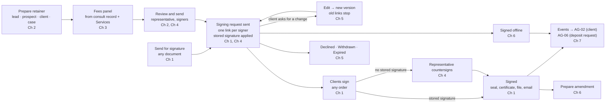
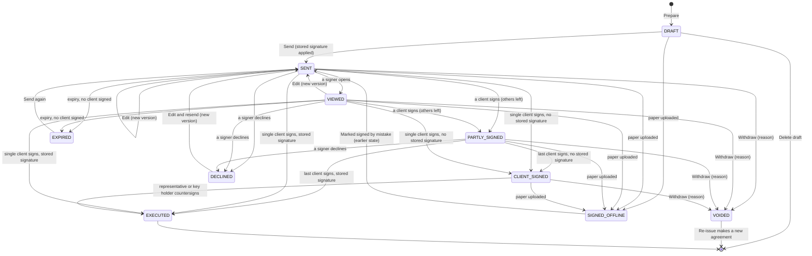

# AG-05 Retainer, agreements and signing

> **Document control** · Version **2.1** · **2026-10-27** · Status: **CC-8 applied: only emails a person writes are copied; system emails go to their usual recipient with no Cc (the product owner, 26 Oct)**; earlier: **AG-05 review complete and money-slice decisions applied (the product owner, 22–25 Oct): AG05-D1 – D4 and the AG-05 parts of MS-D2 – MS-D24 applied; rewritten to the X-1 format**
> Part of: *Agent (RCIC/Lawyer) Console — Functional Requirements* · Previous version: `_archive/AG-05-retainer-and-agreements_v2.0_2026-10-25.md`
>
> | Version | Date | Change | Decisions |
> |---|---|---|---|
> | 2.1 | 2026-10-27 | **CC-8 applied (the product owner, 26 Oct): only emails a person writes are copied.** Every signing and retainer email is a system email and is never copied. The outcome is unchanged; only the reason changes. Removed wording: "Signing emails are never copied to a case's copy list (AG-10-89 rule 2)" and "never copied to a copy list (AG-10-89 rule 2)" in AG-5-60, and the matching "Earlier decisions" row. Changed: AG-5-60 (why, rule 2), the decisions table (CC-8 row added; AG-10 row reworded). No requirement ID added or removed. | CC-8 |
> | 2.0 | 2026-10-25 | AG-05 review and money slice (25 Oct). Rewritten to the X-1 format: Page 1, Parts A–D, a build card for every new or changed requirement. AG-05 is now the one signing tool for any document; retainer-only rules are named. Several client signers in Release 1. The representative's stored signature is applied at send; countersign only when none is stored. The retainer has a structured Fees panel, pre-filled from Services. A sent retainer stays editable until it is signed, with versions. "Prepare amendment" on a signed retainer. "Marked signed by mistake". No expiry once a client has signed. Decline, delete a draft, second open retainer, corporate signatory warning. Two new events (client signed, signed offline). Removed: the proposal, pack-locked required clauses and the refusal to send, the French block and dual-language PDF, the pack retention horizon, the stuck alert, plan tiering, the portal opt-in flag, regulator names, "Conductor", "demo". Invoicing an unsigned retainer is a warning (AG-06). Requirement IDs AG-5-1 – AG-5-60 kept or withdrawn (Part D4); AG-5-61 – AG-5-69 new. | AG05-D1 – D4, MS-D2, MS-D4, MS-D5, MS-D13, MS-D16(3), MS-D18, MS-D20(3)(8)(9)(10)(11), MS-D21(1)(2)(3)(20), MS-D22(2), MS-D23(8); pointers MS-D3, MS-D6, MS-D15, MS-D19 |
> | 2.0 (25 Oct, later) | 2026-10-25 | **25 Oct (later): MS-D24 and writer follow-ups.** Applied in place, no version change. (1) MS-D24(1): which signed retainer counts for a case is one rule in AG-07 (AG-7-1 rule 14); AG-5-51 rule 7, AG-5-55 rule 12 and A5 point to it; C11 Q1 closed. (2) MS-D24(3): automatic reminders to a client signer who has not signed stop after 3, and the case lead (or file owner) gets one item in My Tasks (AG-5-33, C3, C9, US-14). (3) MS-D24(4): the old `agent/e-sign:*` keys are withdrawn (C5, D5, D6); C11 Q6 closed. (4) MS-D24(6): the writer readings in this file are accepted as written. (5) Settled by existing decisions, no new rule: no edit once any client has signed (AG05-D4(6); AG-5-65, BR-7, C9; C11 Q2 closed); after "Marked signed by mistake" the retainer returns to its earlier state, staff click **Send again** for fresh links and nothing is sent automatically (AG-5-67, AG-5-32; C11 Q3 closed), and a prospect already WON stays WON with "Retainer not signed" showing again; the case keeps the "Needs a signed agreement" setting it copied when it opened (MS-D18(3); AG-5-51; C11 Q5 closed); the decline item sits in My Tasks (AG-5-68). C11 now holds only the French consent text for Quebec. | MS-D24(1)(3)(4)(6) · MS-D18(3) · AG05-D4(5)(6) |
>
> Rows 1.1 – 1.14 of the change log are in Part D, section D2.

Build only from this file. Nothing here is decided unless it cites a logged decision in `FINAL-SuperAdmin-FR/TEMPLATE-MAP-working_2026-10-10.md` ("MAP"). A point not decided is listed in Part C, section C11, with owner the product owner. Do not guess.

---

# Page 1 — For developers: read this first

**What this epic is.** AG-05 is ExpatReady's own signing tool. Staff send any document for signature: a retainer, an amendment, a letter, a job offer or any PDF in a client's Documents. The client signs from a no-login link. AG-05 records consent, seals the signed PDF, makes a certificate, emails the signed copy and files it in Documents. For a **retainer** AG-05 also prepares the document from a template, holds its Fees panel, adds the firm's signature, and tells AG-02 and AG-06 when it is signed. No third-party e-sign vendor is used.

**What is built today.** Very little. Check against these commits before you start.
- **ERv2 backend** (`ERv2-sanitized`, local copy at commit `a01197278`, 20 Oct 2026): only the event contract `envelope.signed` (`packages/contracts/src/events/agreements.events.ts:15-51`). It has no emitter (`:50`). Its payload requires `fxSnapshotId` (`:45`), which DEV-TASKS J20 deletes (`FINAL-SuperAdmin-FR/DEV-TASKS_2026-10-12.md:315`). There is a capability row `signer` (`apps/api/infra/07-capability-seed.sql:40-42`) with tier `growth` and default OFF; Release 1 puts signing on every plan (SA-03 #16), so that row must change. There is no agreement table, no envelope table, no `agent/retainer:*` or `agent/e-sign:*` key, and no route.
- **ERv2 frontend** (`ERv2-frontend`, local copy at commit `5db3f2f0`, 20 Oct 2026): mock screens only. The e-sign area (`src/features/esign/`: hub, builder, templates, clauses, signed list, detail; routes at `esign-page.tsx:36-46`), the lead's Quote and Retainer tabs (`src/features/pipeline/accounting/`), and a portal signing room (`src/zones/portal/routes.tsx:131-132`). Every data call is a mock. Part D, section D7, lists the screens to keep and the screens to change.
- **V1.5** (legacy NestJS e-sign module) is reference only. **Do not copy it.** Its known defects are listed in Part C, section C8.

**Build first.**
1. **Contract fixes.** Land DEV-TASKS J20 first, so `envelope.signed` no longer needs an exchange-rate snapshot. Then add the new events of C6 and seed the keys of C5. Change the `signer` capability row to every plan.
2. **Chapter 1 — the signing tool.** Signing request, signers, consent, the no-login signing page, fields, seal, certificate, filing. Everything else uses it.
3. **Chapters 2 – 4 — the retainer.** Prepare retainer, the Fees panel, the firm's signature.
4. **Chapters 5 – 7 — after sending.** Edit until signed, reminders, expiry, decline, void, signed offline, amendment, events and hand-offs.
5. **Chapter 8** rules (storage, access) apply from the first line of Chapter 1.

**The ten things most likely to be built wrong.**
1. **Copying V1.5.** It does not enforce signing order on submit, it does not finish signing in one transaction, and nothing ever sets an envelope to expired (C8).
2. **Emitting `envelope.signed` before J20.** The built payload requires `fxSnapshotId` (`agreements.events.ts:45`). There is no conversion in ExpatReady (X-6).
3. **Signed offline sent as `envelope.signed`.** It has no sealed file. It has its own event that carries no file (AG05-D4(10), C6).
4. **"Signed" too early.** A retainer counts as signed only when every client signer has signed and the firm's signature is on it (AG05-D2(4), BR-20).
5. **Expiring a half-signed retainer.** A retainer never expires once any client has signed (AG05-D4(6)).
6. **Editing after a signature.** Before any client signs, an edit makes a new version. Once any client has signed, an edit is refused: staff wait until everyone has signed and prepare an amendment, or withdraw and re-issue (MS-D2, MS-D20(10), MS-D5, AG05-D4(6)).
7. **Locked "required clauses" and a refusal to send.** They are gone. Starter clauses are ordinary text; only the firm's Owner may lock the firm's own clauses (MAP:99).
8. **A separate portal signing room.** There is one signing page, opened from the email link or from a portal to-do (CP1-D4).
9. **An invoice made at signing.** Signing prepares nothing in AG-05. AG-06 prepares a deposit request ("Ask me first") and invoices come from "Bill this" (MS-D6, MS-D8).
10. **A proposal or Quote step.** There is no proposal. Staff prepare the retainer directly from the consult record (MS-D2).

**Open items.** C11 holds one item: the French consent text for Quebec, which waits for review before selling to Quebec firms. These items wait for people outside the product team (MAP, "Open after the money-slice questions"):
- **For the immigration expert:** (a) may a disbursement be paid straight from trust with the client's written permission before it is invoiced (MS-D9)? If yes, the Fees panel gains one permission line (AG-5-64). (b) May a firm keep a consult fee on a no-show or late cancel (MS-D15)? (c) Are employer-paid LMIA costs refunded to the employer, and may any be recovered from the worker (MS-D19(4))? Items (b) and (c) touch AG-04, AG-06 and AG-17, not this file.
- **For SA-08 (payment rail):** can the trust processor account bill fees, refunds and disputes to the operating account (MS-D20(4))? No effect on this file.
- **For the firm's accountant** (not a product decision): tax timing for the tax-collected report (MS-D21(9)). No effect on this file.

**Three rules.** This file wins over any other note about retainers and signing. If something is missing, ask the product owner. Other epics change to match this file through the knock-on list in Part D, section D5.

---

# Decisions that change this epic

Full text of every decision: MAP. "Where" names the requirement (AG-5-n), business rule (BR-n), chapter (Ch) or Part C section.

**The AG-05 review (the product owner, 22–25 Oct 2026).** Home of each is AG-05.

| Decision | What was decided (one line) | What it changes here | Where |
|---|---|---|---|
| **AG05-D1** | One signing tool for every document; no new settings, no new keys. | "Send for signature" on any document. The sender picks the signers. A retainer comes with the firm's signature pre-added; other documents have none unless added. Same link, consent, certificate, reminders, expiry, void and "signed offline" for all. Retainers keep `agent/retainer:*`; any other document uses `agent/portal:request-work`. Retainer-only: the firm's signature, the "Retainer not signed" warning, becoming a client, the invoice warning. Government forms keep AG-07's rule. | AG-5-61, AG-5-1 – AG-5-3, AG-5-18, AG-5-39, C5 |
| **AG05-D2** | Several client signers on one retainer in Release 1. | Signers from the people on the case or prospect, or an organisation signatory. Clients sign in any order, each with their own link. The firm signs after all clients. Signed only when all have signed. Reminders to those who have not signed; "1 of 2 signed". One decline declines the whole retainer. No witness in Release 1. | AG-5-62, AG-5-25, AG-5-26, AG-5-68, BR-20, C2 |
| **AG05-D3** | The representative's stored signature is applied at send. | With a stored signature (and consent), the firm's signature is applied when staff send; the retainer is signed when all clients have signed. With none, the representative countersigns after the clients; another key holder may sign instead. An edit re-applies it. The certificate states it. | AG-5-63, AG-5-27, AG-5-30, AG-5-65 |
| **AG05-D4 (1)(2)(3)** | The representative may countersign their own retainer without the key; only the representative is notified; every retainer has the firm's signature. | No "no countersignature" switch. Other key holders see the request on the retainer, without a notification. | AG-5-27, BR-9, BR-19, C5 |
| **AG05-D4 (4)** | A corporate retainer with no organisation signatory warns, never blocks. | "Pine Bakery has no signatory. Add one or choose who signs." | AG-5-50 |
| **AG05-D4 (5)** | "Marked signed by mistake" on a signed-offline retainer. | Reason required; `agent/retainer:offline-sign`; only while nothing is billed from it and no deposit is received; returns it to its earlier state; recorded. Closes AG02-P2. | AG-5-67 |
| **AG05-D4 (6)** | No expiry once any client has signed. | A wait for the firm shows on the representative's Needs you. | AG-5-32, BR-21, C2 |
| **AG05-D4 (7)** | A never-sent draft can be deleted; a decline reason is optional. | Delete replaces void for a draft. | AG-5-34, AG-5-68 |
| **AG05-D4 (8)** | A decline shows "Declined" and gives the case lead (or file owner) one home-screen item. | No other notice. | AG-5-68 |
| **AG05-D4 (9)** | A second open retainer for the same client is allowed with "A retainer for Client B is already out. Open it?" | Closes old question 12 (AG16-60). | AG-5-55 |
| **AG05-D4 (10)** | A "client signed, waiting for the firm" event and a separate "signed offline" event that carries no file; names by the backend lead. | Closes AG02-P85 and AG02-P87. | AG-5-37, C6 |
| **AG05-D4 (11)** | AG-05 becomes v2.0 in the X-1 format; Page 1 lists the frontend screens to keep and to change. | This file; the frontend list. | Page 1, D7 |

**Applied as already decided (AG05-D4, "no new decision").**

| Decision | What was decided (one line) | What it changes here | Where |
|---|---|---|---|
| MAP:99 (rule 7), Q13 (MAP:405), O21, O17 | Starter clauses are ordinary editable text. The firm's Owner may lock the firm's own clauses (`agent/legal-settings:manage`). An Owner lock or edit on an unedited starter creates the firm's own version. `agent/retainer:configure-template` is kept, narrowed. | No pack clause set, no "required" badges, no refusal to send. Clause locks screen is AG-05's (AG-16-66). Template editing is AG-12's. | AG-5-45, AG-5-4, AG-5-16; AG-5-5, AG-5-6 withdrawn; BR-3 withdrawn |
| MAP:25 | Missing French: "… It will be sent in English. Send anyway?" No block setting. | Language rule rewritten. | AG-5-12, AG-5-14, BR-6 |
| AG16-88 | Release 1 is English first; no French-specific build. | Dual-language PDF removed. Quebec consent text flagged for the product owner, not changed. | AG-5-13 withdrawn, C11 |
| MAP:97, R15 | Automatic signing reminders: 3 days after sending, then every 4 days; firm may change or switch off; manual Remind stays. | Reminders become automatic. | AG-5-33 |
| SA-Q2, X-5 | Signing-link expiry is a firm timing, default 14 days, on the Timings screen; new requests only; "Send again" re-sends an expired link with a fresh period. | Expiry rewritten. | AG-5-32, C3 |
| SA8-D28, SA8-D29 | The certificate is ExpatReady-owned, fixed and factual. The consent text is an ExpatReady default the firm may replace; versioned; new requests only. | Certificate and consent source rewritten; no legal recital. | AG-5-30, AG-5-54 |
| R32 | E-sign evidence is fixed in code: time, IP, device, consent. | No evidence setting. | AG-5-54 |
| Q19 | One firm keep-period; deleting inside it is a warning plus a reason; no automatic deletion. | Pack retention horizon removed. | AG-5-43, BR-12 |
| SA8-D8 | All data stays in Canada; per-country routing deferred. Built: platform storage per region, firm-prefixed keys, per-firm keys. | "Firm's own bucket" replaced by storage as built. | AG-5-41, BR-11 |
| AG16-42 | Quiet by default. | No stuck-retainer alert; the signing list shows age instead. | AG-5-36 withdrawn, AG-5-69 |
| SA-03 #16 | Signing on every plan. | No plan tiering. | C5, C7 |
| R17 | What staff send is visible in the portal. | No per-agreement portal flag. | AG-5-44 |
| Rule 7 (MAP:21), Q24 | No regulator or statute names in product text; "licence number"; a lawyer's law-society number counts. | Wording throughout; licence check accepts any representative type. | All; AG-5-55 rule 9 |

**The money slice (the product owner, 22–25 Oct 2026).**

| Decision | What was decided (one line) | What it changes here | Where |
|---|---|---|---|
| **MS-D2** | No separate proposal; a sent retainer stays editable until the client signs. Home: AG-05. | Proposal, its email and "Create proposal" withdrawn. Buttons: "Engage and prepare retainer" (lead's consult record), "Prepare retainer" (prospect). Edit makes a new version; old link stops; one "Updated agreement — please sign this version" email. Void and re-issue stay for a true withdrawal. | AG-5-59 withdrawn, AG-5-65, AG-5-55, AG-5-60 |
| MS-D3 (pointer) | Consultation agreement on by default for first consults. Home: AG-04. | Accepted on AG-04's booking page or link; not signed through AG-05. | AG-5-61 field 13 |
| **MS-D4** | The retainer holds structured money terms. Home: AG-05. | The Fees panel replaces the free-text fee schedule. | AG-5-64, AG-5-2, C4 |
| **MS-D5** | "Prepare amendment" on a signed retainer. Home: AG-05. | Amendment document, same signing flow, editable until signed; agreed terms = original plus signed amendments; "above the agreed fees" warning. | AG-5-66, BR-7 |
| MS-D6 (pointer) | Deposit request on signing; "Ask me first". Home: AG-06. | AG-05 emits the signed and signed-offline events; AG-06 prepares the deposit request. | AG-5-40, AG-5-37 |
| **MS-D13** | Invoicing a client whose retainer is not signed is a warning. Home: AG-06. | AG-05's billing gate removed (old AG-5-40, BR-14). The case warning stays. | AG-5-40, BR-1, BR-14 |
| MS-D15 (pointer) | Paid consult money; "Attended" bills it. Home: AG-04, AG-06. | Nothing in AG-05. | AG-5-40 |
| **MS-D16(3)** | A firm-service case needs no retainer by default; refined by MS-D18(2). | Exception to the "Retainer not signed" warning. | AG-5-51 |
| **MS-D18** | The Services model. AG-05 consumes the defaults. | One Fees panel component; copied on use; quoted fee wins; one combined schedule; "Save these fees as the default"; same currency only; a retainer template per service; "Needs a signed agreement". | AG-5-64, AG-5-4, AG-5-51 |
| MS-D19 (pointer) | Trust per case; money before a case is held on the person or company. Home: AG-06. | A deposit on a prospect's retainer is held on the person until a case opens. | AG-5-40 |
| **MS-D20 (3)** | Currency locks at the first money document sent. | Sending a retainer that has fees locks the prospect's or case's currency. | AG-5-55, AG-5-64 |
| MS-D20 (8) (pointer) | Deposit and close-out items go to the case lead, or the file owner before a case. Home: AG-06. | Pointer only. | AG-5-40 |
| **MS-D20 (9)** | One deposit request per retainer version; "Signed offline" ends the open signing link. | Events carry the version; offline ends the links. | AG-5-37, AG-5-39 |
| **MS-D20 (10)** | A signature on an old version is refused when an edit landed first; an edit after the client signed is refused. | Version race rules. | AG-5-65 |
| **MS-D20 (11)** | An amendment below what is billed offers a credit note or refund; an unpaid deposit request offers "Update to the new amount?". | AG-05 signals; AG-06 acts. | AG-5-66 |
| **MS-D21 (1)(2)(3)** | Rows come only from a signed retainer or amendment on cases that need one; "Request payment" warns the same way; the deposit row is still billed by "Bill this". | Fees panel and warning rules. | AG-5-64, AG-5-51, BR-14 |
| MS-D21 (20) (pointer) | The first retainer invoice suggests a consultation credit line. Home: AG-06. | Pointer only. | AG-5-40 |
| **MS-D22 (2)** | A schedule row says when it is due. | "When" on every row. | AG-5-64 |
| MS-D23 (8) (pointer) | Disbursements above the agreed estimate warn. Home: AG-06. | AG-05 supplies the agreed estimate. | AG-5-66 |
| **MS-D24 (1)** (pointer) | When a case opens, it links that person's (or company's) most recent signed retainer that no other case uses; staff may change the link. Home: AG-07 (AG-7-1 rule 14). | AG-05 holds no copy of the rule. The case warning and the schedule rows read the retainer linked to the case. A retainer prepared on the case counts for that case. | AG-5-51, AG-5-55 |
| **MS-D24 (3)** | Automatic reminders to a client signer who has not signed stop after 3. The case lead (or the file owner) then gets one item, "Client A hasn't signed Client B's retainer". | The reminder chain ends; the item is a My Tasks item. | AG-5-33, C3, C9, US-14 |
| **MS-D24 (4)** | The old `agent/e-sign:*` keys are withdrawn. Home: SA-06. | AG-05 uses `agent/retainer:*` and `agent/portal:request-work` only. | C5, D5 |
| **MS-D24 (6)** | The writer readings in this file are accepted as written. | No card changes. | — |
| **MS-D24 (writer follow-ups)** | Points the writers raised that existing decisions already settle (no new rule). | Once any client has signed, no edit (AG05-D4(6)). After "Marked signed by mistake": earlier state, **Send again** by staff, no automatic message; a WON prospect stays WON (AG05-D4(5)). The case keeps the "Needs a signed agreement" setting it copied when it opened (MS-D18(3)). | AG-5-65, AG-5-67, AG-5-32, AG-5-51 |

**Copy on emails (the product owner, 26 Oct 2026).**

| Decision | What was decided (one line) | What it changes here | Where |
|---|---|---|---|
| **CC-8** (26 Oct; home AG-10-89) | Only emails a person writes are copied. Every system email goes to its usual recipient with no Cc. | Every signing and retainer email (request, reminders, updated agreement, signed copy, withdrawn, expired) is a system email. It goes to the signer only and is never copied. | AG-5-60 |

**Earlier decisions still in force.**

| Decision | What was decided (one line) | What it changes here | Where |
|---|---|---|---|
| AG07-D3, AG07-D3(3) | Retainer from a lead, a client or a case; representative pre-filled in a fixed order, never forced; the "No active licensed consultant" block kept. | One engine; four starts (lead, prospect, client, case). | AG-5-55 – AG-5-58, AG-5-49 |
| AG07-D20(c) | The representative countersigns by default; another key holder may sign instead; recorded. Amended by AG05-D3 and AG05-D4(1)(2). | Countersign only when no stored signature. | AG-5-27 |
| AG07-D20(f), AG07-D6 | Only the named person is notified. | Countersign notice to the representative only. | AG-5-27 |
| AG01-20, AG01-23 | Stored signature, applied at send; with none, the representative is asked to e-sign after the client. | Settled against old AG-5-27 by AG05-D3. | AG-5-63 |
| AG01-5, SA6-D20 | The lead representative drives the retainer; the retainer lists the rest of the case team as "people who will assist". | Merge token for the team. | AG-5-8 |
| X-2 | One person record per real person. | Merge fields read `Party` and `PartyProfile`. | AG-5-8 |
| SA-Q3 | No licence marking on approvals. | No "preferred" countersigner. | AG-5-27 |
| AG02-D2 (1)(2)(4), AG-2-28a, AG-2-48a | Three ways to become a client; WON once; AG-02 owns WON and the one "Retainer signed" notice. | AG-05 emits events; AG-02 acts. | AG-5-38, BR-2 |
| AG02-D9(5), AG02-D10(6) | "Prepare retainer" on a lead opens Engage inline; nothing re-parented. | Start rules. | AG-5-55, BR-15 |
| AG02-D2, AG-02 C4b.2 | Retainer state events sent, voided, expired, declined. | Kept; names by the backend lead. | AG-5-37 |
| AG04-D7 | Consult record; the next step is a button. Button wording replaced by MS-D2. | Pre-fill from the consult record. | AG-5-55, AG-5-64 |
| AG04-D8 | Six booking keys; the proposal key withdrawn. The proposal itself is withdrawn by MS-D2. | `agent/retainer:draft` covers preparing a retainer only. | C5 |
| X-6, R18, AG04-D20 | CAD and USD; one currency per prospect or case; no conversion. Rule 4 amended by MS-D20(3). | Retainer currency; no currency picker. | AG-5-10, AG-5-64 |
| AG-10 BR-1, AG-10-89, AG-10-63 | One send path; signing emails are system emails and are never copied (CC-8). | All signing emails go through AG-10. | AG-5-60 |
| AG1-D1, AG1-D8 | A deactivated person's licence or signature is never used on new documents. | Licence and signature checks. | AG-5-49, AG-5-63 |
| AG17-D4 | Corporate is a client type, not a separate source. | Two link columns removed. | AG-5-2, C4 |
| AG17-D39, AG17-D62, AG17-D66 | Unsigned retainer is a warning, never a block; staff never sign for a client. Invoice block of AG17-D62 reversed by MS-D13. | Warning and offline rules. | AG-5-51, AG-5-39, AG-5-50 |
| AG17-D50 | No master agreement. | Kept. | AG-5-52 |
| SA6-D2, SA6-D5, SA6-D9 | Countersign key on Owner and Case Manager; six starter roles; Owner signs when no holder exists. | Keys and fallback. | AG-5-27, C5 |
| CP1-D4 | One signing page for portal and email; returns the client to the portal. | Kept, for every document. | AG-5-53 |
| AG-07 BR-26 | We work for the firm, not the regulator. | Neutral wording. | All |
| AG16-11, AG16-31, AG16-60, AG16-63, AG16-76, AG16-92 | One home per rule; ExpatReady suggests, the firm decides; a duplicate beats a miss; design checks; help people, don't replace them; email first, no-login links. | Card fields 10 and 12; signing links. | All cards |

---

# Part A — Start here

## How this file is laid out

| Part | What it holds |
|---|---|
| **A. Start here** | Purpose, key terms, the main flow, one worked example (Maple Immigration and Client B), build order. |
| **B. Build cards** | Eight chapters in build order. One card per requirement, or one card for a few requirements that are one rule. Requirements kept without change are listed at the end of their chapter. |
| **C. Rules and tests** | C1 business rules, C2 states, C3 timings, C4 data model, C5 permissions, C6 events, C7 security and performance, C8 what is built today, C9 edge cases, C10 acceptance tests, C11 open questions. |
| **D. Appendix** | D1 replaced decisions, D2 history, D3 withdrawn items, D4 where every v1.14 item went, D5 knock-on for other epics, D6 closed questions, D7 frontend keep and change list. Nothing in Part D is a build instruction. |

The chapters:

| Ch | Chapter | Requirements |
|---|---|---|
| 1 | The signing tool | AG-5-61, AG-5-1, AG-5-2, AG-5-3, AG-5-18, AG-5-20, AG-5-54, AG-5-62, AG-5-25, AG-5-26, AG-5-28 – AG-5-31; kept: AG-5-19, AG-5-21, AG-5-22, AG-5-23, AG-5-24, AG-5-53 |
| 2 | Preparing a retainer | AG-5-55, AG-5-56, AG-5-57, AG-5-58, AG-5-49, AG-5-4, AG-5-7, AG-5-45, AG-5-16, AG-5-8 – AG-5-11, AG-5-12, AG-5-14, AG-5-15, AG-5-17 |
| 3 | The Fees panel | AG-5-64 |
| 4 | The firm's signature | AG-5-63, AG-5-27, AG-5-50 |
| 5 | After sending | AG-5-65, AG-5-33, AG-5-32, AG-5-68, AG-5-34, AG-5-35, AG-5-69 |
| 6 | Signed on paper, mistakes and amendments | AG-5-39, AG-5-67, AG-5-66; kept: AG-5-52 |
| 7 | Events and hand-offs | AG-5-37, AG-5-38, AG-5-40, AG-5-51, AG-5-60 |
| 8 | Storage, access and security | AG-5-41 – AG-5-44; kept: AG-5-46, AG-5-47, AG-5-48 |

Withdrawn: AG-5-5, AG-5-6, AG-5-13, AG-5-36, AG-5-59 (Part D, section D3).

## How to read a card

Every card has 14 fields: 1 Outcome, 2 Why, 3 Where, 4 Engine, 5 Rules, 6 States, 7 Data, 8 Access, 9 Events, 10 Safety, 11 Tests, 12 Edge cases, 13 Non-goals, 14 Mode. Field 5 gives numbered rules, each with an example. Field 7 writes each field as `plain name (codeName: type)`; the backend lead confirms names. A word defined in A2 is not defined again in a card. The card header lists the decisions behind it and the build status. "Not built" means no ERv2 backend code exists (C8).

---

## A1 — Purpose in five lines

1. **What it is.** AG-05 lets staff send any document for signature and lets the client sign it from an email, without logging in.
2. **What it covers.** Signing requests, signers, consent, the signing page, sealing, the certificate and filing, for every document. For a retainer: preparing it, its Fees panel, the firm's signature, editing until signed, amendments, signed on paper, and the events AG-02 and AG-06 read.
3. **The outcome.** A retainer goes out in minutes with the fee already filled in. The client signs on a phone. The signed copy is emailed and filed. The firm can prove who signed what and when.
4. **How.** Zero setup. A starter retainer template, a 14-day link, automatic reminders and an ExpatReady consent text work from day one. Services defaults are optional.
5. **What it never does.** It never signs for a client. It never blocks work or invoicing because a retainer is unsigned; it warns. It never creates an invoice or sends a payment request. It never names a regulator.

**Who uses it.** Client C, a Case Officer at Maple, prepares and sends retainers. Client F, the licensed Case Manager, is the representative on most retainers; her stored signature is on file. Maple's Owner locks the firm's own clauses and may replace the consent text. Client B (client) and his wife Client A sign. Billing / Finance holds no AG-05 key; it reads signed fees through AG-06.

---

## A2 — Key terms

**Signing request** (`ESignEnvelope`) — One document sent to one or more signers. *Example:* Client B's retainer, sent to Client B and Client A. *Not the same as:* the document itself, which is the agreement or a file in Documents.

**Agreement** (`RetainerAgreement`) — A retainer or an amendment prepared in AG-05, with its fees and versions. *Example:* "Retainer — Client B — Work permit". *Not the same as:* a letter or PDF sent for signature, which stays a Documents file (AG-09).

**Kind** (`RetainerAgreement.kind`) — `RETAINER` or `AMENDMENT`. A letter or PDF has no agreement row; its signing request points at the Documents file.

**Retainer** — The firm's service agreement with a client. Only a retainer carries the firm's signature by default, the "Retainer not signed" warning, becoming a client, and the invoice warning (AG05-D1(5)).

**Amendment** — A short document linked to a signed retainer that shows only what changes: services, fees, schedule rows, disbursement estimate (MS-D5).

**Signer** (`ESignRecipient`) — A person who signs. Role `CLIENT` (a person on the case or prospect), `ORGANISATION_SIGNATORY` (the person who signs for a company), or `FIRM_SIGNER` (the firm). *Example:* Client B and Client A are `CLIENT` signers; Client F is the `FIRM_SIGNER`.

**Representative** (`RetainerAgreement.representativeUserId`) — The licensed person whose licence is on the retainer and who gives the firm's signature. *Example:* Client F, licence number on her profile.

**Firm's signature** — The firm's side of a retainer. It is either the representative's **stored signature**, applied at send, or a **countersign** after the clients when none is stored (AG05-D3).

**Stored signature** — A representative's saved signature image, kept in My profile → Signature with consent (AG01-20, AG-01 home).

**Version** (`RetainerAgreement.version`) — Each edit of a sent retainer before signing makes a new version. Every version is kept and readable (MS-D2).

**Fees panel** — The money terms of a retainer, amendment or case: services, fee type, price, schedule rows, disbursement estimate, tax (MS-D4). One component everywhere (MS-D18).

**Service** — One thing the firm sells: a pack programme or a firm service, listed in Settings → Services (MS-D18; AG-02 owns the list). Its defaults pre-fill the Fees panel.

**Schedule row** (`ScheduleRow`) — One amount the client pays, with a label and a "When". *Example:* "Deposit on signing, CAD 1,000, On signing".

**Disbursement estimate** — Expected costs on top of the fee, as lines. *Example:* "Courier CAD 50 · Translation CAD 120".

**Signed** (`EXECUTED`) — Every signer has signed and the firm's signature is on the retainer. Shown as "Signed".

**Signed offline** (`SIGNED_OFFLINE`) — Staff uploaded a paper copy the client signed. It counts as signed. No certificate is made.

**Certificate** (`certificateKey`) — A one-page PDF made by ExpatReady when signing completes: who signed, when, how, and the document fingerprint.

**Consent text** — The sentence a signer accepts before signing electronically. ExpatReady's default, or the firm's own text (AG-5-54).

**Signing link** — The private no-login link in a signing email. One per signer.

**Clause lock** — A mark the firm's Owner puts on one of the firm's own clauses so staff cannot change it on a draft (MAP:99).

**Keep-period** — The firm's one setting "Keep closed client files for ___ years" (Q19, SA-11 home).

**Signing list** — The list of everything out for signature and everything signed (AG-5-69).

Terms owned by other epics and used here unchanged: **lead, prospect, client, Engage, person record (`Party`), "Interested in", Services list** (AG-02); **consult record** (AG-04); **deposit request, trust balance, Ready to bill, Bill this, Request payment** (AG-06); **case, case lead representative, Government forms** (AG-07); **Documents** (AG-09); **send path, copy list** (AG-10); **home screen, Needs you** (AG-11); **templates, Automatic messages page** (AG-12); **Timings screen, Legal settings, Getting paid** (AG-16). Doers used: **Drafter** (fills the template), **Signer** (signing), **Mailer** (email, through AG-10), **Reminder** (timed sends). None is AI.

---

## A3 — The main flow

**Reading the picture.** AG-05 owns every box. AG-02 makes the person a client; AG-06 prepares the deposit request and invoices. Those epics react to AG-05's events and add no rule here.

---

## A4 — Worked example: Maple Immigration and Client B

Maple Immigration Services is in Toronto. Tax is HST 13%. The firm's currency is CAD. Client F (Case Manager, licensed) is the firm's default lead representative and has a stored signature. Client C is a Case Officer. Maple's Services list has "Work permit — employer-specific": Fixed CAD 3,500; rows "Deposit on signing CAD 1,000 (On signing)", "Application submitted CAD 1,500 (When submitted)", "Decision received CAD 1,000 (When decided)"; disbursement estimate "Courier CAD 50", "Translation CAD 120"; retainer template "Work permit retainer".

1. **Consult.** On Wed 4 Nov 2026 Client F holds Client B's consult. She records "Work permit — employer-specific" and a quoted fee of CAD 3,500 (AG-04). She clicks **Engage and prepare retainer**. The Engage box opens; Client B becomes a prospect. → Ch 2.
2. **The retainer opens pre-filled.** The template is "Work permit retainer" (from the Service). Client F is the representative (firm default). The Fees panel shows Fixed CAD 3,500 "From consult record", the three rows and the estimate "From Services: Work permit — employer-specific", and HST 13% from Getting paid. Merge fields show Client B's name and email; "Address: missing" shows on the preview. → Ch 2, Ch 3.
3. **Signers.** Client C adds Client A, Client B's wife, from the prospect's people. Signers: Client B (client), Client A (client), Client F (firm). Client C clicks **Send**. Client F's stored signature is applied at once. Client B and Client A each get "Please sign your agreement" with their own link. The prospect's currency CAD is now locked (MS-D20(3)). → Ch 1, Ch 4.
4. **A change before signing.** On Thu 5 Nov Client B replies: "Can the deposit be CAD 800?" Client C opens the retainer, changes the first row to CAD 800 and the second to CAD 1,700, and saves. Version 2 is made. The old links stop ("This agreement was updated. Please use the latest email."). Client B and Client A each get one "Updated agreement — please sign this version" email. Client F's signature is re-applied. → Ch 5.
5. **Signing.** Client A signs on Fri 6 Nov ("1 of 2 signed"). On Mon 9 Nov the automatic reminder goes to Client B only. Client B signs on Mon 9 Nov. Both clients have signed and Client F's signature is already on it, so the retainer is **Signed**. The sealed PDF and certificate ("Client F's signature applied, sent by Client C, 5 Nov") are emailed to Client B and Client A and filed in Documents. → Ch 1.
6. **Hand-offs.** AG-05 emits `envelope.signed`. AG-02 makes Client B a client (WON). AG-06 prepares deposit request DR-… for CAD 800 plus estimated HST and puts it on the file owner's Needs you, because no case exists yet ("Ask me first", MS-D6, MS-D20(8)). AG-05 does nothing more. → Ch 7.
7. **Amendment.** In January Client A needs her own open work permit. Client F clicks **Prepare amendment** on the signed retainer and adds the Service "Open work permit — spouse" (CAD 1,200; rows "On signing this amendment CAD 600", "Decision received CAD 600"). It goes through the same signing. Once signed, Client B's agreed terms are the retainer plus the amendment: CAD 4,700. → Ch 6.
8. **A paper retainer.** Pine Bakery's owner signs a paper retainer at Maple's office. Client C uploads the scan and clicks **Signed offline** with the reason "Signed in person". The open signing link stops. AG-05 emits the signed-offline event; AG-06 prepares the deposit request. → Ch 6.

---

## A5 — Build order and dependencies

| Ch | Build after | Other epics and built code it needs | Pending (blocks or limits the chapter) |
|---|---|---|---|
| **1 Signing tool** | none | AG-10 send path (AG-10 BR-1); AG-09 Documents (`ClientDocument`, `ERv2-sanitized/apps/api/prisma/models/firm-records.prisma:8`); storage rail (`events-rails.prisma:93-122`); AG-15 portal to-do (AG-15-24); AG-12 templates for the five signing emails. | DEV-TASKS J20 before the first emit. Entity registry lacks `RETAINER_AGREEMENT` (C8). |
| **2 Preparing a retainer** | 1 | AG-02 Engage box, prospect people, Services list; AG-04 consult record; AG-07 case lead representative; AG-01 licence on the profile and default lead representative; AG-12 retainer template and must-fill fields; AG-16 Legal settings. | None. The link rule is AG-07's (AG-7-1 rule 14). |
| **3 Fees panel** | 2 | AG-02 Services list and `ServiceDefaults`; AG-16 Getting paid (tax); AG-01 firm currency. | None. |
| **4 Firm's signature** | 1, 2 | AG-01 stored signature (AG-1-72); AG-11 Needs you. | Stored-signature storage not built (C8). |
| **5 After sending** | 1, 2 | AG-16 Timings screen; AG-12 Automatic messages rows; AG-11 home screen. | None. |
| **6 Paper, mistakes, amendments** | 1, 2, 3 | AG-12 Amendment starter template (MS-D5, SA-05). | None. |
| **7 Events and hand-offs** | 1 | AG-02 become-a-client step; AG-06 deposit request, invoice warning; AG-07 case header. | Event names by the backend lead. |
| **8 Storage and security** | — | SA-08 storage rail; SA-11 keep-period. | None. |

---

# Part B — Build cards

Requirement lines and cards are one thing: the card **is** the requirement. Where the ERv2 frontend has a mock screen, field 3 names it (local copy `5db3f2f0`).

## Chapter 1 — The signing tool

### What you build
One signing engine for every document. A signing request has one document, one or more signers, one private link per signer, a consent step, signature fields, a seal and a certificate. The same engine serves a retainer, an amendment, a generated letter, a job offer or any PDF in Documents (AG05-D1).

### Maple here
Client C generates an employer letter for Client B in AG-12 and clicks **Send for signature**. He picks Client B as the signer and adds no firm signer. Client B signs from the email. The signed letter and its certificate are emailed to Client B and filed in his Documents.

### Screens
"Send for signature" button where the document is (Documents list, generated letter, agreement detail). Send screen: signers, message, expiry shown read-only. Public signing page (token link; no login). Agreement detail with the audit and certificate. Frontend mocks: `src/features/esign/envelope-builder-page.tsx`, `envelope-detail-page.tsx`, `governance/certificate-panel.tsx`.

### Data flow
Document → signing request (signers, fields, consent-text version, expiry) → one email per client signer through AG-10 → signer opens (viewed) → consents → signs → when every signer has signed: embed signatures, hash, certificate, file in Documents, email the signed copy → event (C6).

### Cards in build order

#### AG-5-61 — Send any document for signature   Decision: AG05-D1, AG16-92, AG17-D66, CP1-D4, AG01-20   Status: Not built (frontend mock: builder)

- **1. Outcome.** Staff send any document to the client for signature from where the document is, and get it back signed and filed.
- **2. Why.** The product owner (AG05-D1): one signing tool for every document; no new settings, no new keys. Firms send letters, job offers and forms as well as retainers. AG-15 (AG-15-24, AG-15-45) and AG-17 already expect "Send for signature" and "signed offline" for non-retainer items.
- **3. Where.** AG-05 Signer. Buttons on: a Documents file (AG-09), a generated letter or job offer (AG-12), an agreement (this file). NEW `SigningRequestService` (working name). The send screen and signing page are the same for every document. Frontend mock: `src/features/esign/envelope-builder-page.tsx` (builder, kept, D7).
- **4. Engine.** Rules. Doers: Signer; Mailer (through AG-10). No AI; identical with AI off.
- **5. Rules.**
  1. **What can be sent.** A retainer or amendment (Chapters 2 – 6), a letter or job offer generated from a firm template, or any PDF in the client's Documents. e.g. "Employment offer — Pine Bakery.pdf" in Client B's Documents → button shown.
  2. **Who signs is picked at send** (AG05-D1(2)): one or more people on the case or prospect (principal, spouse, sponsor), an organisation signatory, and optionally one firm person. e.g. Client C picks Client B only.
  3. **Firm signer.** A retainer or amendment comes with the firm's signature pre-added (Chapter 4). Any other document has no firm signer unless the sender adds one. A firm signer who is the case's lead representative and has a stored signature with consent gets it applied at send (AG01-20, AG01-23); any other firm signer signs from their own link after the clients.
  4. **Same flow for every document** (AG05-D1(3)): no-login link by email (AG16-92); the same page from a portal to-do (AG-5-53); consent (AG-5-20); automatic reminders (AG-5-33); expiry (AG-5-32); void (AG-5-34); "signed offline" by uploading the paper (AG-5-39); the signed copy and certificate are emailed and filed in Documents (AG-5-31).
  5. **Retainer-only** (AG05-D1(5)): the firm's signature by default, the "Retainer not signed" warning (AG-5-51), becoming a client (AG-5-38), the invoice warning (AG-06). A signed letter changes no client or case state.
  6. **Government forms** keep AG-07's own rule: a "Signed by client" tick or an upload, and the representative's stored signature (AG05-D1(6); AG-07 rule 7). They are not sent through this button.
  7. **Staff never sign for a client** (AG17-D66). There is no way to type, draw or upload a client's signature except the client's own link or a paper upload marked "signed offline".
- **6. States.** The signing request follows C2. A non-retainer request has no agreement row; its states are the request's own (`SENT` … `EXECUTED`, `SIGNED_OFFLINE`, `DECLINED`, `VOIDED`, `EXPIRED`).
- **7. Data.** Signing request (`ESignEnvelope`): source document (`sourceType`: `AGREEMENT` | `DOCUMENT` | `GENERATED_LETTER`; `sourceId`: id); the client or case it belongs to (`partyId`: id; `caseId`: id, optional; `prospectId`: id, optional). Firm-scoped (`firm_id`). Full list in C4.
- **8. Access.** Retainer and amendment: `agent/retainer:*` (C5). Any other document: whoever may send it to the client (`agent/portal:request-work`, AG-15) may send it for signature, remind, void it and mark it signed offline (AG05-D1(4)). No new key.
- **9. Events.** Audit per C6 (created, sent, viewed, consent, signed, completed, declined, voided, expired, reminder sent, signed copy sent). Domain events for a non-retainer document: `envelope.signed` with `kind = DOCUMENT` (C6); AG-02 ignores it.
- **10. Safety.** Nothing is sent until a person clicks Send (AG16-31). No notice to staff when a letter is signed; it shows on the record (AG16-42). Person decides: what to send, who signs, whether a firm person signs. Duplicate beats a miss (AG16-60): every open request shows in the signing list (AG-5-69). Never extra automatic client messages beyond the five signing rows (AG-5-60).
- **11. Tests.**
  - Given a PDF in Client B's Documents, when Client C clicks Send for signature, picks Client B and sends, then Client B gets one "Please sign your agreement" email with a no-login link; when Client B signs, the signed PDF and certificate are emailed to him and filed in Documents next to the original.
  - Given a generated letter, when Client C adds Client F as firm signer and Client F is the case's lead representative with a stored signature, then her signature is applied at send and the request completes when Client B signs.
  - Failure: given a user without `agent/portal:request-work`, when they open a Documents file, then no Send for signature button shows and the API refuses.
  - Given a government form, then no Send for signature button shows on it (AG-07 rule).
- **12. Edge cases.** A PDF with a password → refused at send: "This PDF is protected. Upload an open copy." A document deleted after sending → the request keeps its own copy of the original (AG-5-41). A signer with no email → cannot be picked; add an email first.
  Clicks: adds 1 (the button) where a firm had no way to e-sign a letter; removes printing and scanning.
- **13. Non-goals.** No bulk send. No signing order editor on the main path. No witness. No identity check beyond the link and consent. The consultation agreement at booking is AG-04's tick or link (MS-D3), not a signing request.
- **14. Mode.** HARDEN (legal document, PII, public endpoint).

#### AG-5-1, AG-5-2, AG-5-3 — The agreement, its versions and its signing request   Decision: AG05-D1, MS-D2, MS-D4, MS-D5, AG07-D3, AG17-D4, X-6, MAP:30   Status: Not built

- **1. Outcome.** Each retainer or amendment is one agreement with numbered versions; each sent version has one signing request.
- **2. Why.** v1.14 had three objects and two ways to re-issue (G-35). MS-D2 makes edits before signing new versions of the same agreement. MS-D5 adds amendments. AG05-D1 lets non-agreement documents use the same signing request.
- **3. Where.** AG-05 data model (C4). NEW tables. Frontend types to change: `src/features/esign/esign-types.ts:14` (statuses), `:30` (roles) (D7).
- **4. Engine.** Rules. Doer: Drafter (fills the version), Signer. No AI.
- **5. Rules.**
  1. **Agreement** (AG-5-1). One row per retainer or amendment. It has one source (lead's prospect, prospect, client or case; AG-5-55), one representative, one currency and a current version. e.g. "Retainer — Client B", source prospect P-0042.
  2. **Version** (AG-5-2). A version holds the filled document, the template version it came from, the Fees panel (AG-5-64), the bound merge values (AG-5-11), the signers and the language. Version 1 is made at Prepare. Each edit after send makes version n+1 (AG-5-65). e.g. Client B's deposit change → version 2.
  3. **Signing request** (AG-5-1). Each sent version has exactly one signing request. An edit ends the old request and opens a new one. A non-agreement document has a signing request and no agreement.
  4. **Snapshot** (AG-5-3). Merge values and fees are copied into the version when it is made. A later change to the client's record or to a Service never changes a sent or signed version (MS-D18(3)). e.g. Client B's address changes after signing → the signed PDF keeps the old one.
  5. **Signed never changes** (BR-7). A signed (or signed offline) agreement is never edited. A change is an amendment (AG-5-66).
  6. **Amendment** links to its retainer (`amendsAgreementId`). It has its own versions and signing request.
  7. **Withdrawn and re-issued** (AG-5-35). Re-issue after a withdrawal makes a new agreement linked to the old one (`reissuedFromAgreementId`).
- **6. States.** Agreement status: C2. One closed list for agreement and signing request.
- **7. Data.** Agreement (`RetainerAgreement`): id; firm (`firm_id`); kind (`kind`: `RETAINER` | `AMENDMENT`); source (`sourceEntityType`: `PROSPECT` | `CLIENT` | `CASE`; `sourceId`); links (`prospectId?`, `clientPartyId?`, `caseId?`); representative (`representativeUserId`); currency (`currency`: `CAD` | `USD`); current version (`currentVersion`: int); status (`status`, C2); amends (`amendsAgreementId?`); re-issued from (`reissuedFromAgreementId?`); created by and at. Version (`AgreementVersion`): agreement id; number (`version`: int); template id and version (`templateId`, `templateVersion`); language (`language`); merge map (`mergeMapJson`); Fees panel (`FeeTerms`, AG-5-64); rendered file key (`renderedOriginalKey`); hash (`originalSha256`); envelope (`envelopeId`); made by and at. Removed: `destinationCountry` as a choice (kept as data only, firm's country), `packVersion`, `clauseSetVersion`, `feeSchedule` text, `corporateProspectId`, `corporateCaseId`, `retainUntil`.
- **8. Access.** `agent/retainer:list`, `agent/retainer:show` to read. Writes per AG-5-55 and AG-5-65.
- **9. Events.** Audit "version n made by <user>"; none to other epics.
- **10. Safety.** Every version is kept; nothing is deleted except a never-sent draft (AG-5-34). Person decides: when to edit and send. Duplicate beats a miss: every version stays readable on the agreement.
- **11. Tests.**
  - Given version 1 is sent, when Client C edits a row, then version 2 exists, version 1 is readable, and only version 2 has a live signing request.
  - Given a signed retainer, when anyone tries to edit it, then the edit is refused and "Prepare amendment" is offered.
  - Failure: given a Service price changes after a retainer was sent, then the sent version's Fees panel is unchanged.
- **12. Edge cases.** Two staff edit at once → the second save fails with "Client C changed this agreement a moment ago. Reload." (version check). An agreement with 10 versions → all listed, newest first.
  Clicks: none added.
- **13. Non-goals.** No branching versions. No merge of two agreements. No pack clause-set version.
- **14. Mode.** HARDEN (schema, legal document).

#### AG-5-18, AG-5-20, AG-5-54 — Signers, consent text and evidence   Decision: AG05-D1, AG05-D2, SA8-D28, SA8-D29, R32, Q13, Q16, AG16-88, Rule 7   Status: Not built

- **1. Outcome.** Each signer gives consent to sign electronically, using the firm's consent text or ExpatReady's default, and ExpatReady records fixed evidence.
- **2. Why.** v1.14 took the consent text, evidence and expiry from ExpatReady settings "published by the Owner" and used a country legal recital. Decided since: the consent text is ExpatReady's default, published by ExpatReady's content author; the firm may replace it (SA8-D28, SA8-D29, Q16); evidence is fixed in code (R32); expiry is a firm timing (AG-5-32).
- **3. Where.** Signing page (public). Firm's consent text: Settings → Advanced → Legal settings (AG-16-66, `agent/legal-settings:manage`). ExpatReady's default: SA-08 e-sign defaults. Frontend: `src/features/client-portal/sign/consent-step.tsx:11` hard-codes a consent version; change it to read the version (D7).
- **4. Engine.** Rules. Doer: Signer. No AI.
- **5. Rules.**
  1. **Signers** (AG-5-18). Roles `CLIENT`, `ORGANISATION_SIGNATORY`, `FIRM_SIGNER`. A retainer has at least one `CLIENT` or `ORGANISATION_SIGNATORY` and always the firm's signature (BR-19). No witness (AG05-D2(7)).
  2. **Which consent text.** The firm's own text if the firm saved one; otherwise ExpatReady's current default. e.g. Maple never changed it → ExpatReady default v3.
  3. **Version per request.** Each signing request stores the consent-text version it was sent with. A later change applies only to new requests (SA8-D29). e.g. Maple saves new text on 10 Nov → Client B's open request keeps v3.
  4. **Consent is required** (AG-5-20). The signer ticks "I agree to sign electronically" before any field is accepted. No tick → nothing is saved.
  5. **Evidence, fixed in code** (R32): time, IP address, device (user agent) and consent, with the consent-text version, at view, consent, sign and decline. No setting.
  6. **Language.** The consent text is English in Release 1 (AG16-88). A firm may write its own text in any language.
- **6. States.** Signer: `PENDING → SENT → VIEWED → SIGNED` or `DECLINED`.
- **7. Data.** Signer (`ESignRecipient`): request id; person (`partyId?`) or user (`userId?` for the firm signer); name, email; role (`role`); status; viewed at, consent at, signed at; IP; user agent; consent-text version (`consentTextVersion`); signature image key (`signatureKey?`); decline reason (`declineReason?`, optional); link token hash. Firm consent text (`FirmConsentText`): firm, text, version, saved by and at. Removed: `allowedSignatureMethods` setting per firm; `ESignSettings` country version stamp.
- **8. Access.** Signing page: the link token only. Firm consent text: `agent/legal-settings:manage` (Owner by default; grantable).
- **9. Events.** Audit `VIEWED`, `CONSENT_GIVEN` (with version), `SIGNED`, `DECLINED`. Firm consent text change: audit "consent text v4 saved by <user>".
- **10. Safety.** Consent is a hard gate on data, not a legal claim; the page names no law (Rule 7). Person decides: the firm decides its own consent text. No email to clients when the text changes.
- **11. Tests.**
  - Given Maple has no own text, when Client B opens his link, then ExpatReady's default shows and his signature records that version.
  - Given Maple's Owner saves new text while Client B's request is open, then Client B's page still shows the old text; a request sent after the save shows the new text.
  - Failure: given Client B submits without ticking consent, then nothing is saved and the page says "Please agree to sign electronically first."
- **12. Edge cases.** Consent given, then the link expires before signing → consent stays in the audit; no signature. A firm deletes its own text → new requests use ExpatReady's default.
  Clicks: none added for staff; the client ticks one box.
- **13. Non-goals.** No country legal recital. No consent-text approval step. No evidence options. No SMS code.
- **14. Mode.** HARDEN (public endpoint, PII, consent).

#### AG-5-62, AG-5-25, AG-5-26 — Several client signers, in any order; the firm last   Decision: AG05-D2, AG05-D3, AG10-BR-1   Status: Not built

- **1. Outcome.** A retainer can be signed by several clients, each from their own link, in any order, and counts as signed only when all have signed.
- **2. Why.** Spouses, a sponsor and an applicant, or a family sign one retainer. v1.14 deferred this to Release 2 (v1.14:911). The product owner (AG05-D2): Release 1.
- **3. Where.** Send screen (signer picker); signing page; agreement detail (status per person). Frontend: `RecipientRole` at `src/features/esign/esign-types.ts:30` has `SPOUSE` and `WITNESS`; change to the three roles (D7).
- **4. Engine.** Rules. Doer: Signer. No AI.
- **5. Rules.**
  1. **Picking signers** (AG05-D2(1)). From the people on the case or prospect (principal, spouse, sponsor), or an organisation signatory (AG-5-50). e.g. Client B (principal) and Client A (spouse).
  2. **Any order for clients** (AG-5-25, AG05-D2(2)). Every client signer gets their own link at send. Each signs when they like. e.g. Client A signs Friday, Client B Monday.
  3. **The firm last** (AG05-D2(3)). A stored signature is applied at send (AG-5-63). Without one, the countersign request opens only after every client has signed (AG-5-27).
  4. **Signed only when all have signed** (AG05-D2(4)). The retainer becomes Signed (`EXECUTED`) only then. Before that: "1 of 2 signed" (`PARTLY_SIGNED`) or "Waiting for the firm" (`CLIENT_SIGNED`).
  5. **Order is checked on the server** (AG-5-26). A firm signer's link or button works only when every client has signed. Each signature and the completion check run in one database transaction; two signers finishing at once complete the request once.
  6. **Status per person** (AG05-D2(5)). The agreement shows each signer: "Client B — not signed · Client A — signed 6 Nov".
  7. **One email per signer** through AG-10 (AG-5-60). No signer is copied on another's email.
- **6. States.** `SENT → VIEWED → PARTLY_SIGNED → CLIENT_SIGNED → EXECUTED` (C2). With a stored signature: `PARTLY_SIGNED → EXECUTED`.
- **7. Data.** Signer rows as AG-5-18. Request: signers count and signed count are derived, not stored.
- **8. Access.** As AG-5-55 (send). No new key.
- **9. Events.** `envelope.client_signed` (working name) when the last client signs and the firm has not signed yet (C6). `envelope.signed` at `EXECUTED`.
- **10. Safety.** Person decides: who signs. Only unsigned signers are reminded (AG-5-33). Duplicate beats a miss: the agreement and the signing list show who has not signed.
- **11. Tests.**
  - Given Client B and Client A are signers and Client F's signature is stored, when Client A signs, then the status is "1 of 2 signed" and no event is emitted; when Client B signs, then the retainer is Signed and `envelope.signed` is emitted once.
  - Given no stored signature, when both clients have signed, then the status is "Waiting for the firm" and `envelope.client_signed` is emitted.
  - Failure: given Client B and Client A submit at the same second, then the request completes once, one sealed PDF exists and one event is emitted.
- **12. Edge cases.** A signer's email bounces → AG-10 reports it (AG-10-29a); staff fix the email and use Remind. The same person added twice → refused at send. A minor child → not offered as a signer unless staff add them as a person with an email.
  Clicks: adds 1 per extra signer picked; removes a second retainer per spouse.
- **13. Non-goals.** No witness (AG05-D2(7)). No fixed order among clients. No signing for another person.
- **14. Mode.** HARDEN (concurrency, legal document).

#### AG-5-28, AG-5-29, AG-5-30, AG-5-31 — Seal, audit, certificate and the signed copy   Decision: SA8-D28, AG05-D3, MAP:93, AG16-92, AG-10 BR-1, R32   Status: Not built (frontend mock: certificate panel)

- **1. Outcome.** When signing completes, ExpatReady seals the PDF, makes a factual certificate, emails both to each client signer and files them in Documents.
- **2. Why.** v1.14 printed a country legal recital on the certificate and emailed the copy "per policy". Decided: the certificate is ExpatReady-owned, fixed and factual (SA8-D28); "Your signed agreement" is a Must message with no switch (MAP:93); the signed copy is filed in Documents (AG05-D1(3)).
- **3. Where.** Signer worker job (queue). Documents filing (AG-09). Frontend: `src/features/esign/governance/certificate-panel.tsx` (kept, D7).
- **4. Engine.** Rules. Doers: Signer (seal and certificate), Mailer (through AG-10). No AI.
- **5. Rules.**
  1. **Seal** (AG-5-28). Each signer's image goes in that signer's own fields. The original is hashed (SHA-256) when the version is made (AG-5-2); the signed PDF is hashed at completion. Both hashes are stored.
  2. **Audit** (AG-5-29). Append-only, firm-scoped events written inside the signing transaction (C6 list).
  3. **Certificate** (AG-5-30). One page: document title and id, both hashes, a table of signers (name, email, role, signed at, IP, device, consent-text version), the timeline of events, and, when a stored signature was used, the line "Client F's signature applied, sent by Client C, 5 Nov" (AG05-D3(4)). It makes no claim of legal effect and names no law. Firms cannot edit it.
  4. **Signed copy** (AG-5-31). "Your signed agreement" (signed PDF and certificate) goes to each client and organisation signer automatically, through AG-10 (AG-5-60). It cannot be switched off.
  5. **Filed.** The signed PDF and the certificate are filed in the client's Documents (AG-09) on the case, client or prospect the document belongs to. A retainer filed on a prospect stays there (BR-15).
  6. **Heavy work on the queue.** Embedding, hashing and the certificate run on a worker. The signer sees "Thank you — your signed copy will arrive by email" at once.
- **6. States.** `EXECUTED` is set when the seal job succeeds. A failed job retries; the status stays the last signing state and the agreement shows "Finishing signing…" until it succeeds. Alerting on a job that keeps failing is platform monitoring (SA-09), not a firm notice.
- **7. Data.** Request: `signedDocKey`, `signedSha256`, `originalSha256`, `certificateKey`, `completedAt`. Documents: two `ClientDocument` rows (signed PDF, certificate) linked to the request.
- **8. Access.** Download: `agent/retainer:download` (agreements) or document access (AG-09) for other documents.
- **9. Events.** Audit `COMPLETED`, `SIGNED_COPY_SENT` per signer. `envelope.signed` after the seal (C6).
- **10. Safety.** Never logged: signature images, document content. Person decides: nothing; this is a record. The firm signer gets no email copy by default; staff download it from the agreement.
- **11. Tests.**
  - Given Client B and Client A sign and Client F's signature was stored, then the certificate lists all three, shows "Client F's signature applied, sent by Client C, 5 Nov", and both hashes; Client B and Client A each get "Your signed agreement"; Documents holds the signed PDF and certificate.
  - Given someone re-hashes the downloaded signed PDF, then the hash equals the certificate's.
  - Failure: given the seal job fails twice and then succeeds, then one signed PDF, one certificate and one event exist.
- **12. Edge cases.** The original PDF was replaced in storage → impossible: the original hash is taken at version time and checked before sealing; a mismatch stops the seal, is audited, and the agreement shows "Signing could not be finished". Signed offline → no certificate (AG-5-39).
  Clicks: removes emailing the signed copy by hand.
- **13. Non-goals.** No legal recital. No PDF/A archival format in Release 1. No certificate wording setting.
- **14. Mode.** HARDEN (worker, legal record).

### Kept without change (plain wording)

| ID | Requirement |
|---|---|
| AG-5-19 | Each signer gets a unique, single-use link. Opening it records "viewed" with time, IP and device. |
| AG-5-21 | A link becomes dead once its signer signs or declines, and when its version is replaced, withdrawn or expires. A forwarded link cannot be reused. |
| AG-5-22 | Signature, initials, date and text fields are placed per signer by page and 0–100% position; positions outside the page are refused. |
| AG-5-23 | A default placement (signature and date for each signer on the last page) is used unless staff place fields. Every signer, the firm signer included, gets fields. |
| AG-5-24 | A signer cannot finish while a required field of theirs is empty; a signature field needs a real signature image (PNG or JPEG, up to 2 MB). |
| AG-5-53 | A signing request opened from a portal to-do uses the same signing page and returns the client to the portal with the to-do shown done. The portal has no signing step of its own (CP1-D4). This applies to every document. |

## Chapter 2 — Preparing a retainer

### What you build
"Prepare retainer" from a lead, a prospect, a client or a case. It picks the template, the representative and the currency, fills the merge fields and the Fees panel, shows what is missing, and lets staff review and send. One engine for every start (AG07-D3).

### Maple here
Client F clicks **Engage and prepare retainer** on Client B's consult record. The Engage box opens, Client B becomes prospect P-0042, and the draft opens on "Work permit retainer" with Client F as representative and the Fees panel filled. The preview shows "Address: missing". Client C fixes the address on Client B's record and sends.

### Screens
Buttons: lead detail and consult record (AG-02, AG-04), prospect, client and case screens (AG-02, AG-07). Draft screen: template, representative, signers, Fees panel (Chapter 3), preview with "missing" marks, language notice, Send. Clause locks screen (opened from Legal settings, AG-16-66). Frontend mocks: `src/features/pipeline/accounting/retainer-tab.tsx` and `components/retainer-draft-form.tsx` (change, D7); `src/features/esign/envelope-builder-page.tsx` (keep).

### Data flow
Start (source) → resolve representative → resolve currency → pick template → copy Fees panel defaults → bind merge values → version 1 (DRAFT) → staff edit → Send → signing request (Chapter 1).

### Cards in build order

#### AG-5-55, AG-5-56, AG-5-57, AG-5-58, AG-5-49 — Prepare retainer from a lead, a prospect, a client or a case   Decision: AG07-D3, AG07-D3(3), MS-D2, MS-D16(3), MS-D18, MS-D20(3), AG05-D4(9), AG02-D9(5), AG01-5, AG01-6, AG1-D8, Q24, X-6, AG16-60   Status: Not built

- **1. Outcome.** Staff prepare a retainer from wherever the client is, with the representative, the client's details and the fees already filled in, and see what is missing before sending.
- **2. Why.** AG07-D3: "cover every way to send a retainer". MS-D2 removes the proposal step: the retainer is prepared straight from the consult record. AG05-D4(9) settles a second open retainer.
- **3. Where.** AG-05 `RetainerStartService` (NEW, working name). Buttons are screens of AG-02 (lead, prospect), AG-04 (consult record) and AG-07 (client, case); they add no rule. Person details from `Party` and `PartyProfile` (X-2).
- **4. Engine.** Rules. Doer: Drafter. No AI.
- **5. Rules.**
  1. **Starts** (AG-5-55; MS-D2(1)).
     - Lead: "Prepare retainer" on the lead, or **"Engage and prepare retainer"** on its consult record. AG-02's Engage box opens inline; the retainer attaches to the new prospect. Nothing is made if the person cancels. Nothing is re-parented when the prospect becomes a client (AG02-D9(5)).
     - Prospect: **"Prepare retainer"**, pre-filled from the consult record when one exists.
     - Client or case: "Prepare retainer"; attaches to that client or case.
     - A firm-service case keeps "Prepare retainer" (MS-D16(3)).
     e.g. Client F clicks "Engage and prepare retainer" on Client B's consult record → Engage → retainer on P-0042.
  2. **Representative, in this order** (AG-5-57): the case's lead representative (case start); else the firm's default lead representative (AG01-5); else the person preparing, if licensed; else staff pick from licensed users. Staff may change it before sending. e.g. no case yet, firm default Client F → Client F.
  3. **Different person = warning, never a block.** Only when the case has a lead representative and the chosen person differs: "Client A is this case's lead representative. Client G will sign this retainer."
  4. **The one kept block** (AG-5-49, AG01-6, MAP:23). If the firm has no active licensed person, "No active licensed consultant — add one" shows and no draft is made. Any representative type counts, a lawyer's law-society number included (Q24). A deactivated person's licence is never used on a new retainer (AG1-D8).
  5. **Currency** (X-6, MS-D20(3)). The prospect's or case's currency. A client with no prospect or case uses the firm default; staff may change it on the draft until it is sent (X-6 rule 5). Sending a retainer that has fees locks that currency on the prospect or case. e.g. P-0042 is CAD → CAD; after Send, P-0042's currency can no longer change.
  6. **Template.** The retainer template named on the Service, if any (MS-D18(2)); else the firm's default retainer template (AG-12). When the services picked name different templates, staff pick one of them. Staff may always pick another firm retainer template.
  7. **Fees and merge fields.** The Fees panel is copied from the consult record and Services (AG-5-64). Merge fields are filled from what ExpatReady holds (AG-5-58, AG-5-8). Values it does not hold show as "missing" on the preview, e.g. "Address: missing".
  8. **Second open retainer** (AG05-D4(9)). If the same client already has a retainer that is sent and not signed: "A retainer for Client B is already out. Open it?" with **Open it** and **Prepare another**. Both stay visible (AG16-60).
  9. **Outcomes recorded the same way for every start** (AG-5-56): signed, signed offline, edited (versions), declined, withdrawn, re-issued, expired.
- **6. States.** Creates version 1 in `DRAFT` (C2).
- **7. Data.** Agreement fields of AG-5-1 (`sourceEntityType` ∈ `PROSPECT | CLIENT | CASE`, `representativeUserId`, `currency`). Audit records which rule picked the representative.
- **8. Access.** Prepare: `agent/retainer:draft`. Send: `agent/retainer:send`. The user must also be able to see the lead, prospect, client or case. No new key.
- **9. Events.** Audit "retainer prepared from <lead | prospect | client | case> by <user>; representative <name> (<case lead | firm default | preparer | picked>)"; "representative changed from <A> to <B>". No domain event until Send.
- **10. Safety.** Warn, never block (Rule 7), except the kept licence block. Nothing goes to the client until Send. Person decides: the representative, the fees, the template and when to send. Duplicate beats a miss: a second retainer is allowed and both are shown.
- **11. Tests.**
  - Given Client B's consult record with "Work permit — employer-specific" and quoted CAD 3,500, when Client F clicks Engage and prepare retainer and confirms Engage, then the draft sits on the new prospect, uses "Work permit retainer", shows CAD 3,500 "From consult record" and Client F as representative.
  - Given case C-2026-00041 with lead representative Client A, when Client C prepares a retainer on the case and picks Client G, then the warning shows and Client C can still send.
  - Given a client with no prospect or case and firm default CAD, when Client C changes the draft to USD and sends, then the retainer is in USD.
  - Given Client B already has a sent, unsigned retainer, when Client C clicks Prepare retainer, then "A retainer for Client B is already out. Open it?" shows; Prepare another makes a second draft.
  - Failure: given the firm has no active licensed person, then "No active licensed consultant — add one" shows and no draft exists. Given the Engage box is cancelled, then no prospect and no draft exist.
- **12. Edge cases.** Prospect becomes a client by Convert to client while its retainer is sent → the retainer stays on the prospect and keeps working; signing then only clears the warning (AG02-D2). Representative deactivated before send → treated as absent; pick another. A client with two cases → the retainer attaches where it was prepared; which retainer counts for each case is AG-07's link rule (AG-7-1 rule 14).
  Clicks: adds 0 on a lead (the proposal step is gone: removes "Create proposal", its edit and its email); adds 1 (the button) on a client or case.
- **13. Non-goals.** No proposal or quote. No automatic sending. No automatic case creation. No rule for government forms (AG-07).
- **14. Mode.** HARDEN (legal document, PII).

#### AG-5-4, AG-5-7, AG-5-45, AG-5-16 — Retainer templates and the firm's clause locks   Decision: MAP:99, Q13, O17, O21, AG16-11, AG-16-66, MS-D18(2), Rule 7   Status: Not built (frontend mock: clause library)

- **1. Outcome.** A retainer starts from the firm's template, whose clauses are ordinary text; the firm's Owner can lock the firm's own clauses so staff cannot change them on a draft.
- **2. Why.** v1.14 locked a pack "required clause set" and refused to send without it. MAP:99 (rule 7): starter clauses are ordinary editable text; no required list, no badges, no refusal; the Owner may lock the firm's own clauses. AG-16-66 puts the locks under Legal settings and says the screen is AG-05's.
- **3. Where.** Template editing: AG-12 (Documents list, AG-12-96; single home, AG16-11). Clause locks screen: AG-05, opened from Settings → Advanced → Legal settings and from the retainer template. Frontend: `src/features/esign/governance/clause-library-page.tsx` (change into the locks screen); `refuse-to-send-check.tsx` and `country-defaults-panel.tsx` removed (D7).
- **4. Engine.** Rules. Doer: Drafter. No AI.
- **5. Rules.**
  1. **Templates** (AG-5-4). A retainer template is a firm document template of type retainer (AG-12). ExpatReady's starter carries the usual clauses (scope, fees, refund, dispute, confidentiality, termination) as ordinary text (MAP:99). A firm may keep several, e.g. one per type of matter.
  2. **Template version** (AG-5-7). Each version of an agreement records the template id and template version it came from.
  3. **Clauses on a draft** (AG-5-16). Staff may edit, merge or delete any clause that is not locked. Nothing is required; send is never refused for a missing clause.
  4. **Locks** (AG-5-45). A holder of `agent/legal-settings:manage` (Owner by default, grantable) may lock a clause of the firm's own retainer template. On a draft, a locked clause shows a lock and its text cannot be changed or deleted by staff without that key. e.g. Maple's Owner locks "Refund policy"; Client C cannot edit it on Client B's draft.
  5. **First lock or edit makes the firm's own version** (O21). Locking or editing an unedited ExpatReady starter creates the firm's own copy; later ExpatReady starter updates do not overwrite it (AG-12 publishing).
  6. **Signed agreements never change** (MAP:99, BR-7). A lock added later does not touch sent or signed versions.
- **6. States.** Clause: unlocked → locked → unlocked.
- **7. Data.** Template clause (`RetainerClause`): template id; key; title; text; order; locked (`locked`: bool); locked by and at. Removed: `regulator`, `packVersion`, pack-supplied clauses, `category` list as a rule.
- **8. Access.** Locks: `agent/legal-settings:manage`. Editing a retainer or amendment template on AG-12's screens: `agent/retainer:configure-template` (narrowed, O17; scope in C5).
- **9. Events.** Audit "clause <title> locked/unlocked by <user>".
- **10. Safety.** ExpatReady never says a clause is required or correct (Rule 7). Person decides: the firm writes and locks its own clauses. Quiet: no notice to staff when a lock changes.
- **11. Tests.**
  - Given Maple's Owner locks "Refund policy", when Client C edits Client B's draft, then that clause cannot be changed and other clauses can.
  - Given Client C deletes the "Dispute" clause on a draft, then the draft sends without it; no warning is shown.
  - Failure: given a user without `agent/legal-settings:manage`, when they open the locks screen, then it is read-only and the API refuses a lock.
- **12. Edge cases.** A locked clause holds a merge field → the value still fills; only the text is locked. The Owner unlocks a clause while a draft is open → the draft becomes editable on reload.
  Clicks: removes the refuse-to-send stop; adds 1 per clause the Owner chooses to lock.
- **13. Non-goals.** No pack clause set. No "required" badges. No clause library across firms. No per-country templates.
- **14. Mode.** THIN SLICE.

#### AG-5-8, AG-5-9, AG-5-10, AG-5-11 — Merge fields from the one record   Decision: X-2, AG01-5, SA6-D20, Q24, X-6, MS-D4, MS-D18, AG-12 must-fill fields, Rule 7   Status: Not built

- **1. Outcome.** The draft fills names, the representative's licence, the fees and the people who will assist from what ExpatReady holds, and shows "missing" for the rest.
- **2. Why.** Zero retyping. v1.14 named a regulator in its messages and held a free-text fee. Decided: neutral licence wording (SA6-D20, Q24); structured fees (MS-D4); the retainer lists the rest of the case team as "people who will assist" (AG01-5).
- **3. Where.** Drafter. Token names: AG-12's field catalogue (single home). AG-05 supplies the values.
- **4. Engine.** Rules. Doer: Drafter. No AI.
- **5. Rules.**
  1. **Sources** (AG-5-8). The client's person record (`Party`, `PartyProfile`); the organisation for a corporate client; the firm and office; the representative's name and licence number; the Fees panel (total, schedule table, disbursement estimate, tax); the services; the people who will assist (the case team other than the representative; empty when there is no case); today's date.
  2. **Must-fill fields** (AG-5-9). A field the template marks must-fill (AG-12; the starter marks client name and fee) blocks Send while empty, with a link to fix the source: "Fee is missing. Open the Fees panel." Every other empty field shows "missing" on the preview and does not block.
  3. **Money** (AG-5-10). Amounts render in the agreement's currency, CAD or USD. No currency picker on the draft except rule 5 of AG-5-55.
  4. **Stored** (AG-5-11). The bound values are saved on the version (AG-5-3).
  5. **Licence wording.** "Licence number", never a regulator's name. e.g. Client F's profile says "Licence number R123456" → `{{representative.licenceNumber}}` = R123456.
- **6. States.** None.
- **7. Data.** Version `mergeMapJson` (token → value, with "missing" list).
- **8. Access.** As AG-5-55.
- **9. Events.** None.
- **10. Safety.** Never logged: merge values (PII). Person decides: whether to fix a missing value or send without it (unless must-fill).
- **11. Tests.**
  - Given Client B has no address, then the preview shows "Address: missing" and Send works.
  - Given the Fees panel is empty and the template marks fee must-fill, then Send is disabled with "Fee is missing. Open the Fees panel."
  - Given case C-2026-00041 has Client F (lead representative) and Client C (officer), then "people who will assist" reads "Client C".
- **12. Edge cases.** Representative with no licence number on the profile → cannot be the representative (licensed users only, AG-5-57). Client's name changes after send → the sent version keeps the old name; an edit makes a new version with the new name.
  Clicks: removes retyping names, licence and fees.
- **13. Non-goals.** No token editor here (AG-12). No calculated clauses.
- **14. Mode.** THIN SLICE.

#### AG-5-12, AG-5-14 — Language: English first, French when the firm has it   Decision: MAP:25, AG16-88, Rule 7   Status: Not built (frontend mock: bilingual preview, to remove)

- **1. Outcome.** The client gets the template in their preferred language when the firm has that version; otherwise staff are told and may send in English.
- **2. Why.** v1.14 blocked a missing French version "per firm policy" and claimed legal compliance. Decided: no block setting; "Send anyway?" (MAP:25); Release 1 is English first (AG16-88).
- **3. Where.** Draft screen. Frontend `src/features/esign/governance/bilingual-preview.tsx` removed (D7).
- **4. Engine.** Rules. Doer: Drafter. No AI.
- **5. Rules.**
  1. **Version by language** (AG-5-12). If the template has a version in the client's preferred language, it is used. e.g. Client X prefers French and the template has French → French.
  2. **Missing language** (AG-5-14). Otherwise the draft shows "Client X's preferred language is French, but this template has no French version. It will be sent in English. Send anyway?" Staff continue.
  3. **Release 1 ships English starters only** (AG16-88). The template language field stays.
- **6. States.** None.
- **7. Data.** Version `language`. Removed: `dualLanguagePair`.
- **8. Access.** As AG-5-55.
- **9. Events.** Audit "sent in English; client prefers French" when rule 2 applied.
- **10. Safety.** Never a block; no legal claim. Person decides: send in English or wait for a translation.
- **11. Tests.** Given Client X prefers French and the template has no French version, then the notice shows and Send works; given it has one, then French is used and no notice shows.
- **12. Edge cases.** Client has no preferred language → English, no notice. Clicks: adds 1 confirm only when a version is missing.
- **13. Non-goals.** No dual-language PDF. No French content in Release 1.
- **14. Mode.** THIN SLICE.

#### AG-5-15, AG-5-17 — Review and send   Decision: AG16-31, MS-D2, MS-D20(3), Rule 9   Status: Not built (frontend mock: builder, proofing panel)

- **1. Outcome.** Staff read the filled retainer, change what they need, and send it; who approved and who sent are recorded.
- **2. Why.** Nothing goes to a client unread (AG16-31). v1.14 tied the draft to locked pack clauses; those are gone.
- **3. Where.** Draft screen. Frontend `src/features/esign/governance/proofing-gate-panel.tsx` (adapt).
- **4. Engine.** Rules. Doers: Drafter, Signer. No AI.
- **5. Rules.**
  1. **Draft review** (AG-5-15). Staff read the rendered PDF, edit unlocked text, change the Fees panel and signers, and fix missing values.
  2. **Approve and send** (AG-5-17). A holder of `agent/retainer:draft` approves; a holder of `agent/retainer:send` sends. When one person holds both, one button "Approve and send" writes both records. e.g. "Approved by Client C · Sent by Client C, 5 Nov 10:12".
  3. **What Send does.** Applies the stored signature (AG-5-63), opens the signing request, sends one email per client signer (AG-5-60), locks the currency if the retainer has fees (MS-D20(3)), emits `envelope.sent` (C6).
- **6. States.** `DRAFT → SENT`.
- **7. Data.** Version `approvedBy`, `approvedAt`; request `sentBy`, `sentAt`.
- **8. Access.** `agent/retainer:draft` (approve), `agent/retainer:send` (send).
- **9. Events.** Audit `SENT`; `envelope.sent`.
- **10. Safety.** Confirm-before-commit: Send is the commit. Person decides: everything on the draft.
- **11. Tests.** Given Client C holds both keys, when he clicks Approve and send, then both records show his name and the clients get their emails. Failure: given a user with `agent/retainer:draft` only, then Send is not offered; the approved draft shows "Approved, not sent" on the signing list (AG-5-69).
- **12. Edge cases.** A draft left for 30 days → stays a draft; no reminder. Clicks: one click for a person with both keys.
- **13. Non-goals.** No second approver. No scheduled send.
- **14. Mode.** THIN SLICE.

## Chapter 3 — The Fees panel

### What you build
One Fees panel component. It holds the money terms: services and their fees, fee type, schedule rows with "When", a disbursement estimate and tax. The same component appears on Settings → Services (defaults), on a retainer, on an amendment and on a case (MS-D18). This card is its home; AG-02, AG-07 and AG-16 place it and add no rule.

### Maple here
Client B's draft shows: "Work permit — employer-specific · Fixed · CAD 3,500 (From consult record)". Rows: "Deposit on signing CAD 1,000 · On signing", "Application submitted CAD 1,500 · When submitted", "Decision received CAD 1,000 · When decided" (From Services). Estimate: "Courier CAD 50 · Translation CAD 120". HST 13% from Getting paid.

### Screens
Fees panel on the retainer draft, the amendment draft and the agreement detail (read-only once signed). Frontend: replace the single fee block in `src/features/pipeline/accounting/components/retainer-draft-form.tsx` and the one fee field of the e-sign builder (D7).

### Data flow
Consult record services + quoted fee → Services defaults (closest programme level) → copied into the draft's Fees panel with a source label → staff edit → saved on the version → on signing, AG-06 reads the rows (deposit request, Ready to bill).

### Cards in build order

#### AG-5-64 — The Fees panel   Decision: MS-D4, MS-D18, MS-D21(1)(3), MS-D22(2), MS-D20(3), MS-D2, X-6, MS-D9 (open item)   Status: Not built

- **1. Outcome.** Staff see the retainer's money terms already filled from the consult record and Services, change them in one place, and billing later uses them without retyping.
- **2. Why.** v1.14 held a free-text fee schedule; AG-06 had unbacked milestone fields (MS-D4). Firms sell the same services at the same prices; typing them on every retainer wastes time and causes mistakes. The product owner (MS-D18): one Services list whose defaults are copied on use.
- **3. Where.** AG-05 component `FeesPanel` (NEW). Placed by: AG-16 (Settings → Services), AG-07 (case), this file (retainer, amendment). Defaults storage: AG-02 `ServiceDefaults` (MS-D18 Home). Billing use: AG-06.
- **4. Engine.** Rules. Doer: Drafter. No AI.
- **5. Rules.**
  1. **What it holds** (MS-D4). Services, one line each, with fee type **Fixed** (default) or **Hourly** (rate × estimated hours) and the price; **schedule rows** (label, amount, When); a **disbursement estimate** (lines); **tax** from the firm's settings (Getting paid). Refund policy and payment terms stay the firm's clause text. e.g. Hourly: "Judicial review · CAD 300/h × 20 h = CAD 6,000 estimate".
  2. **First row.** A new panel starts with one row labelled "Deposit on signing", When "On signing". Staff may change or delete it.
  3. **When** (MS-D22(2)). Each row has one of: **On signing** · **On a date** (with the date) · **When submitted** · **When decided** (programme cases) or **When done** (firm services). At that moment AG-06 shows the row in Ready to bill; nothing is billed by itself.
  4. **Copied on use** (MS-D18(3)). Preparing a retainer, an amendment or a case copies the defaults into the panel. Later edits to the Service never change a sent or signed retainer, an open case or an invoice.
  5. **Where values come from** (MS-D18(4), (6)). The services come from the consult record's recommended items. A quoted fee on the consult record beats the Service price. Programme defaults may sit at any level of the pack's programme tree; the closest level up wins. Each value shows its source: "From consult record", "From Services: <name>", or "Typed". e.g. Service price CAD 3,800, quoted CAD 3,500 → CAD 3,500 "From consult record".
  6. **Disbursement estimate** (MS-D18(2)). The pack's government fees for the programme (current until copied) plus the firm's own lines. Each line says whether it is a government fee.
  7. **Several services** (MS-D18(5)). One combined schedule; each row and each estimate line is tagged with its service. e.g. Work permit + Open work permit — spouse → five rows, each tagged.
  8. **Same currency only** (MS-D18(10)). Prices pre-fill only when the Service's currency equals the agreement's currency. Otherwise only labels pre-fill, with "Prices on this service are in CAD. Type the USD amounts."
  9. **Adds up?** (MS-D4). When the rows do not add up to the fee (or the hourly estimate), the panel warns: "The schedule adds up to CAD 3,300. The fee is CAD 3,500." Never a block.
  10. **Save as default** (MS-D18(7)). After a retainer is prepared, each service line whose values differ from its Service offers **"Save these fees as the default for <service>"**, one click, for holders of `agent/billing-config:terms`.
  11. **Editable until signed** (MS-D2). On a sent retainer a change is an edit and makes a new version (AG-5-65). After signing, changes go through an amendment (AG-5-66).
  12. **What billing uses** (MS-D4, MS-D21(1)(3)). AG-06 prepares the deposit request from the deposit row of a signed retainer (MS-D6) and bills every row, the deposit row included, with "Bill this". On a case that needs a retainer, schedule rows come only from signed retainers and signed amendments; a firm-service case whose service does not need an agreement takes its rows from the Service (MS-D21(1)). Billing never retypes the rows.
  13. **Currency lock** (MS-D20(3)). Sending a retainer whose panel has any amount locks the currency of its prospect or case.
  14. **Pending expert item** (MS-D9). Paying a disbursement straight from trust is not in Release 1. If the immigration expert says yes, the panel gains one permission line; nothing is built for it now.
- **6. States.** Follows the agreement: editable in `DRAFT`, `SENT`, `VIEWED` (AG-5-65); read-only once `EXECUTED` or `SIGNED_OFFLINE`. No editing once any client has signed (AG-5-65).
- **7. Data.** Fee terms (`FeeTerms`, one per version): fee type of the whole (`feeType`: `FIXED` | `HOURLY`); currency (`currency`); service lines (`FeeServiceLine`: `serviceRef` = `programNodeKey` or `firmServiceId`; `label`; `feeType`; `priceMinor?`; `hourlyRateMinor?`; `estimatedHours?`; `source`: `CONSULT` | `SERVICE` | `TYPED`); schedule rows (`ScheduleRow`: `id`; `label`; `amountMinor`: int; `when`: `ON_SIGNING` | `ON_DATE` | `WHEN_SUBMITTED` | `WHEN_DECIDED` | `WHEN_DONE`; `dueDate?`; `serviceRef?`; `agreementId`; `version`); estimate lines (`DisbursementLine`: `label`; `amountMinor`; `isGovernmentFee`: bool; `serviceRef?`). Tax is read from Getting paid at render and stored on the version as shown. Firm-scoped. Replaces `feeAmount`, `feeCurrency`, `feeSchedule` text.
- **8. Access.** On a draft or sent retainer: `agent/retainer:draft`. "Save as default": `agent/billing-config:terms`. Services page: AG-02 and AG-16 keys (MS-D18(8)).
- **9. Events.** Audit "fees changed (version n)"; "service defaults saved from retainer <id> by <user>".
- **10. Safety.** Defaults only pre-fill; the person decides every amount (AG16-31). The adds-up check is a warning (Rule 7). Person decides: services, amounts, rows, When. No client message from the panel itself.
- **11. Tests.**
  - Given the Service "Work permit — employer-specific" with three rows and a consult quote of CAD 3,500, when the retainer is prepared, then the panel shows CAD 3,500 "From consult record" and the three rows "From Services".
  - Given a USD prospect and a CAD-priced Service, then the panel shows the row labels with empty amounts and the note about currency.
  - Given rows adding to CAD 3,300 and a fee of CAD 3,500, then the warning shows and Send works.
  - Given Client C changes the deposit to CAD 800 and he holds `agent/billing-config:terms`, when he clicks "Save these fees as the default for Work permit — employer-specific", then the Service default changes and Client B's retainer is unaffected.
  - Failure: given a signed retainer, when anyone edits its panel, then it is read-only and "Prepare amendment" is offered.
- **12. Edge cases.** A Service is deleted after the retainer was prepared → the copied values stay; the tag shows the old name. A row of CAD 0 → allowed. Hourly with no estimated hours → no estimate and no adds-up check.
  Clicks: removes typing the fee and every instalment on each retainer; adds 0.
- **13. Non-goals.** No percentage rows, bundles or per-office prices. No payment plans (withdrawn, MS-D21(19)). No tax setting on the panel. No pay-from-trust permission line in Release 1.
- **14. Mode.** HARDEN (money, schema).

## Chapter 4 — The firm's signature

### What you build
Every retainer and amendment carries the firm's signature. The representative's stored signature is applied at send; without one, the representative countersigns after the clients (AG05-D3). The organisation signatory for a corporate client.

### Maple here
Client F has a stored signature. Client C sends Client B's retainer; Client F's signature is applied at once and Client B's retainer is Signed when Client B and Client A have signed. For Pine Bakery, Client G (no stored signature) is the representative: when Lena Park signs, Client G gets one notice "Countersign Pine Bakery's retainer" and signs from his Needs you.

### Screens
Send screen (signature status line). Countersign step on the agreement and in Needs you. Frontend: `src/features/esign/governance/countersign-dialog.tsx`, `countersign-panel.tsx` (keep, D7).

### Data flow
Send → stored signature? yes: apply, firm signer marked signed → clients sign → Signed. No: clients sign → `CLIENT_SIGNED` → one notice to the representative → representative (or another key holder) signs → Signed.

### Cards in build order

#### AG-5-63, AG-5-27 — Stored signature at send; countersign only when none is stored   Decision: AG05-D3, AG05-D4(1)(2)(3)(6), AG01-20, AG01-23, AG07-D20(c)(f), SA6-D2, SA6-D9, SA-Q3, AG1-D8   Status: Not built

- **1. Outcome.** The firm's signature goes on every retainer without an extra click when the representative has a stored signature; otherwise the representative countersigns after the clients, or another key holder signs instead.
- **2. Why.** AG01-20 applied the stored signature at send; v1.14 AG-5-27 applied it only at a countersign click. The product owner (AG05-D3) settled it: applied at send. AG05-D4 closed old questions 1, 13 and 14.
- **3. Where.** Signer (send and countersign). Stored signature: AG-01 My profile → Signature (AG-1-72; AG-01 home). Needs you: AG-11. Frontend countersign dialog and panel (keep).
- **4. Engine.** Rules. Doer: Signer. No AI.
- **5. Rules.**
  1. **Always a firm signature** (AG05-D4(3), BR-19). Every retainer and amendment includes it. There is no "no countersignature" switch. e.g. the frontend's `requireCountersign` setting is removed (D7).
  2. **Stored signature at send** (AG-5-63, AG05-D3(1)). If the representative is active, has a stored signature and has ticked "Use my signature on documents I'm the lead representative for" (AG01-20), the signature is applied when staff click Send. The retainer is Signed the moment all client signers have signed. No countersign click and no countersign request. e.g. Client C sends; Client F's signature is on the PDF; Client B and Client A sign → Signed.
  3. **No stored signature** (AG05-D3(2), AG01-23). The send screen says:
     - when the representative is sending: an "Add your signature" box (draw or upload) with "Save for next time" ticked, or "Sign electronically instead";
     - when someone else is sending: "Client G hasn't added a signature. Send anyway — Client G will be asked to e-sign after the client signs."
     The retainer goes out at once. Nothing waits.
  4. **Countersign** (AG-5-27). After every client has signed, the representative gets one notification "Countersign <client>'s retainer" (AG01-23(b)) and an item on their Needs you (AG05-D4(6)). The representative may countersign without holding `agent/retainer:countersign` (AG05-D4(1)).
  5. **Someone else signs instead** (AG07-D20(c), AG05-D4(2)). Any active holder of `agent/retainer:countersign` sees the request on the retainer and the signing list, is not notified, and may sign instead. No reason is typed. The record says "countersigned by Client H instead of Client G Mehta (representative)". The licence on the retainer stays the representative's.
  6. **Signatures stay personal.** A stored signature is applied only for its owner. A person signing instead signs as themselves.
  7. **One request.** The first countersignature closes it; others see who signed and when. Two clicks at once: the second sees "Already countersigned by Client H."
  8. **No holder and no representative.** If the representative is deactivated and no active user holds the key, the Owner sees the request and may countersign, recorded "countersigned by Owner — no active holder of the countersign permission" (SA6-D9).
  9. **Edit re-applies** (AG05-D3(3)). A new version (AG-5-65) re-applies the stored signature at its send.
  10. **Deactivated representative** (AG1-D8). A deactivated person's stored signature is never applied to a new version. A version already sent keeps it.
  11. **No licence marking** (SA-Q3). Holders are not sorted or marked by licence.
- **6. States.** Stored signature: `SENT → … → PARTLY_SIGNED → EXECUTED`. Countersign: `… → CLIENT_SIGNED → EXECUTED`. `CLIENT_SIGNED` never expires (AG-5-32).
- **7. Data.** Firm signer row (`ESignRecipient`, role `FIRM_SIGNER`): `userId`; `signatureSource`: `STORED` | `DRAWN_AT_SEND` | `COUNTERSIGNED`; `signedAt`; `signedInsteadOfUserId?`. No signature image is copied into AG-05 logs; the sealed PDF holds it.
- **8. Access.** Countersign: the representative of that retainer, or a holder of `agent/retainer:countersign` (Owner and Case Manager by default; grantable; SA6-D2). Every use audited.
- **9. Events.** Audit "firm signature applied at send (stored, Client F)"; "countersigned by <user> (instead of <representative>: yes | no)". `envelope.client_signed` when waiting for the firm (C6).
- **10. Safety.** Only a person's click sends or countersigns (AG16-31). Quiet: one notification, to the representative only (AG07-D20(f)). A stored signature is never logged. Person decides: whether to countersign, and who signs instead. Duplicate beats a miss: the request stays visible to every key holder until someone signs.
- **11. Tests.**
  - Given Client F has a stored signature with consent, when Client C sends and both clients sign, then the retainer is Signed with no countersign step and the certificate reads "Client F's signature applied, sent by Client C, 5 Nov".
  - Given Client G has no stored signature and is not a key holder, when Lena signs, then Client G gets one notification and can countersign; Client H (key holder) is not notified but sees the request.
  - Given Client G is away, when Client H countersigns, then the record reads "countersigned by Client H instead of Client G Mehta (representative)".
  - Failure: given a user who is neither the representative nor a key holder, when they try to countersign, then it is refused.
  - Given Client F is deactivated, when a retainer naming her is edited, then her signature is not applied and the draft asks for another representative.
- **12. Edge cases.** The representative is also the sender with no stored signature and saves one at send → applied at once. A key holder's countersign while the representative is drawing theirs → first wins.
  Clicks: removes the countersign click on every retainer when a signature is stored; adds 0.
- **13. Non-goals.** No "away" switch, no automatic re-routing. No countersign on letters unless a firm signer is added (AG-5-61). No change to who holds the key.
- **14. Mode.** HARDEN (signature, legal document).

#### AG-5-50 — The organisation signatory; a warning when there is none   Decision: AG17-D39, AG05-D4(4), AG05-D2(1), Rule 7   Status: Not built

- **1. Outcome.** A company's retainer is signed by the person who can bind the company; if none is on file, staff are warned and choose who signs.
- **2. Why.** AG17-D39: the employer's authorised signatory signs. AG-02 expected AG-05 to "handle the block" when none exists. The product owner (AG05-D4(4)): a warning, never a block.
- **3. Where.** Send screen. The signatory is AG-02's `SIGNATORY` contact role on the company.
- **4. Engine.** Rules. Doer: Signer. No AI.
- **5. Rules.**
  1. A signer may have role `ORGANISATION_SIGNATORY`, with the same link, consent and audit as any signer.
  2. For a corporate client, the company's signatory is pre-picked.
  3. With no signatory on file: "Pine Bakery has no signatory. Add one or choose who signs." Staff add one (AG-02) or pick another person. Never a block.
- **6. States.** None of its own.
- **7. Data.** Signer `role = ORGANISATION_SIGNATORY`, `partyId` of the person, `organisationPartyId` of the company.
- **8. Access.** As AG-5-55.
- **9. Events.** Audit "sent with no organisation signatory on file" when rule 3 applied.
- **10. Safety.** Warn, never block. Person decides: who signs for the company.
- **11. Tests.** Given Pine Bakery has Lena Park as signatory, then Lena is pre-picked. Given none, then the warning shows and Client C can pick Client T (office manager) and send.
- **12. Edge cases.** Two signatories → both offered; staff pick one or both. Clicks: 0 when a signatory exists.
- **13. Non-goals.** No master agreement (AG-5-52). No check of signing authority.
- **14. Mode.** THIN SLICE.

## Chapter 5 — After sending

### What you build
What happens between Send and Signed: edits that make new versions, automatic and manual reminders, expiry and "Send again", decline, withdraw, re-issue, delete a draft, and the signing list.

### Maple here
Client B asks for a smaller deposit. Client C edits the row; version 2 goes out and version 1's links stop. Client A signs; three days after the new send Client B gets one automatic reminder; Client B signs. A retainer Client C sent to another prospect expires after 14 days; Client C clicks **Send again** and the prospect gets a fresh link.

### Screens
Agreement detail: Edit, Remind, Send again, Withdraw, Re-issue, Delete draft, version history, status per signer. Signing list. Signing page messages. Frontend: `src/features/esign/envelope-hub-page.tsx`, `governance/signed-vault-page.tsx`, `governance/reason-dialog.tsx`, `src/features/pipeline/accounting/components/retainer-actions.tsx` (edit only in DRAFT today at `:33`; change, D7).

### Data flow
Edit → new version → new signing request → old request ended → "Updated agreement" emails. Timer → reminders to unsigned signers; expiry when no client has signed. Decline or Withdraw → ended; event to AG-02.

### Cards in build order

#### AG-5-65 — Edit a sent retainer until it is signed; every version kept   Decision: MS-D2(2)(3), MS-D20(9)(10), AG05-D2(6), AG05-D3(3), AG-10 BR-1   Status: Not built

- **1. Outcome.** When the client asks for a change before signing, staff edit the sent retainer and the client gets one updated version to sign.
- **2. Why.** The product owner (MS-D2): "as long as a retainer is not signed shouldn't it be editable?" v1.14 forced void-then-re-issue, which sent "withdrawn" and a new request (G-45).
- **3. Where.** Agreement detail → Edit. Signing page (old link). Frontend `retainer-actions.tsx:33` allows edit only in DRAFT; change to SENT and VIEWED.
- **4. Engine.** Rules. Doers: Drafter, Signer, Mailer (through AG-10). No AI.
- **5. Rules.**
  1. **When.** A retainer or amendment may be edited while `SENT` or `VIEWED` (MS-D2(2)), and after `DECLINED` with **Edit and resend** (AG05-D2(6)). e.g. Client B viewed it, did not sign → Edit is offered.
  2. **New version.** Saving an edit makes version n+1 and a new signing request. The old request ends at once.
  3. **Old link.** Opening an old link shows "This agreement was updated. Please use the latest email." A signature on an old version is refused when the edit landed first (MS-D20(10)).
  4. **One email per client signer**: "Updated agreement — please sign this version", with the new link. No "Agreement withdrawn" email for an edit (MS-D2(2)).
  5. **Firm signature.** A stored signature is re-applied at the new send (AG05-D3(3)).
  6. **Fresh timers.** The new request gets its own expiry (AG-5-32) and its own reminder schedule (AG-5-33).
  7. **Once any client has signed, refused** (MS-D2(3), MS-D20(10), AG05-D4(6)). With one client signer: "Client B just signed. Prepare an amendment." With several signers when only some have signed: "Client A has already signed. Withdraw and re-issue, or wait until everyone has signed and prepare an amendment." A signature already given is never lost. e.g. Client C had the draft open while Client B signed → Client C's save is refused.
  8. **Every version readable.** The agreement lists each version: who made it, what changed, when, and which version was signed.
  9. **One deposit request per version** (MS-D20(9)) is AG-06's rule; AG-05 sends the version number on every event.
- **6. States.** `SENT | VIEWED | DECLINED → SENT` (new version). `PARTLY_SIGNED` and `CLIENT_SIGNED` are not edited (rule 7).
- **7. Data.** New `AgreementVersion`; old request `endedReason = SUPERSEDED`; change summary (`changeSummaryJson`: fields changed).
- **8. Access.** `agent/retainer:draft` to edit; `agent/retainer:send` to send the new version.
- **9. Events.** Audit "version n+1 made; version n superseded"; `envelope.sent` with the new version.
- **10. Safety.** The client is told once per edit. Person decides: what to change and when to resend. Duplicate beats a miss: old versions stay readable.
- **11. Tests.**
  - Given version 1 is VIEWED, when Client C changes the deposit to CAD 800, then version 2 is sent, Client B and Client A each get one "Updated agreement" email, version 1's links show "This agreement was updated. Please use the latest email.", and no "Agreement withdrawn" email is sent.
  - Given Client B submits his signature on version 1 one second after version 2 was saved, then his signature is refused and the page shows the updated message.
  - Failure: given Client B signed first, when Client C saves an edit, then it is refused with "Client B just signed. Prepare an amendment."
  - Failure: given Client A signed and Client B did not, when Client C saves an edit, then it is refused with "Client A has already signed. Withdraw and re-issue, or wait until everyone has signed and prepare an amendment." and Client A's signature stays.
- **12. Edge cases.** Edit that changes only a signer's email → still a new version (the document is the same; the audit says "signer email changed"). Edit while the seal job runs → refused as signed.
  Clicks: removes Withdraw + Re-issue + re-entering terms for a correction; adds 0.
- **13. Non-goals.** No tracked-changes view for the client. No edit once any client has signed.
- **14. Mode.** HARDEN (concurrency, legal document).

#### AG-5-33 — Signing reminders: automatic, and Remind   Decision: MAP:97, R15, X-5, AG05-D2(5), AG-10-8, AG16-11   Status: Not built (frontend mock: expiry and reminder panel)

- **1. Outcome.** Clients who have not signed get reminders automatically; staff can also remind them with one click.
- **2. Why.** v1.14 had manual reminders only. Decided (MAP:97): automatic, 3 days after sending, then every 4 days; the firm may change the days or switch them off; manual Remind stays.
- **3. Where.** Reminder (timed job). Days: Settings → Advanced → Timings (X-5). On/off: the "Signing reminder" row on the Automatic messages page (AG-12, AG16-11). Frontend `governance/expiry-reminder-panel.tsx` and `esign-store.ts:33` (`reminderOffsets [3, 7, 10]`) change to "3, then every 4" and move to Timings (D7).
- **4. Engine.** Rules. Doers: Reminder, Mailer (through AG-10). No AI.
- **5. Rules.**
  1. **Automatic.** 3 days after the request was sent, then every 4 days, while the request is open, up to 3 reminders per signer (rule 7). e.g. sent Thu 5 Nov → reminders Sun 8 Nov, Thu 12 Nov, Mon 16 Nov.
  2. **Only those who have not signed** (AG05-D2(5)). Never the firm signer; the firm's wait shows on the representative's Needs you.
  3. **Stops** when the retainer is signed, signed offline, declined, withdrawn, expired or replaced by a new version.
  4. **Time of day.** Sent at the hour AG-10 uses for client reminders, in the client's time zone (AG-10-8).
  5. **Remind.** Staff click Remind to send the same reminder at once to those who have not signed. The automatic schedule continues.
  6. **Firm choices.** The firm changes the days on Timings or switches the row off on Automatic messages.
  7. **Stops after 3** (MS-D24(3)). Automatic reminders to one client signer stop after the 3rd. Then the case lead, or the file owner when there is no case, gets one item in My Tasks: "Client A hasn't signed Client B's retainer." There is one item per signer who has not signed. Remind by hand still works and is not counted. A new version (AG-5-65) is a new request and starts a new count. e.g. sent Thu 5 Nov → reminders Sun 8, Thu 12 and Mon 16 Nov; on Mon 16 Nov Client A has still not signed, so Client C gets "Client A hasn't signed Client B's retainer" and no more automatic reminders go to Client A.
- **6. States.** None.
- **7. Data.** Timings: `signingReminderFirstDays` (default 3), `signingReminderEveryDays` (default 4). Request: `lastReminderAt`. Signer: `reminderCount` (automatic reminders sent; the limit, 3, is fixed and is not a setting).
- **8. Access.** Remind: `agent/retainer:send` (agreements) or `agent/portal:request-work` (other documents). Timings: AG-16's key.
- **9. Events.** Audit `REMINDER_SENT` per signer; audit "reminders stopped after 3" with the item raised.
- **10. Safety.** Only signers who still must act get mail. Person decides: the firm decides the days and whether to send automatically. No staff notification per reminder.
- **11. Tests.** Given Client A signed and Client B did not, then the day-3 reminder goes to Client B only. Given the firm switched the row off, then no automatic reminder goes and Remind still works. Given Client A has still not signed after the 3rd automatic reminder, then no 4th goes to her, Client C (the case lead) gets one item "Client A hasn't signed Client B's retainer", and Remind by hand still sends. Failure: given AG-10 fails to send, then the reminder is reported by AG-10 and the request stays open.
- **12. Edge cases.** A partly signed retainer never expires (AG-5-32). Automatic reminders to the unsigned client stop after 3 (rule 7); the retainer stays open, the case lead has the item, and staff may Remind by hand or withdraw it. Clicks: removes manual chasing.
- **13. Non-goals.** No SMS. No escalating wording. No reminder to the firm by email.
- **14. Mode.** THIN SLICE.

#### AG-5-32 — Expiry and "Send again"   Decision: SA-Q2, X-5, AG05-D4(6), MAP:95, AG16-42   Status: Not built (frontend mock: expiry defaults dialog)

- **1. Outcome.** An unsigned signing link expires after the firm's number of days, and staff can send it again with a fresh period.
- **2. Why.** SA-Q2: a firm timing, default 14 days; "Send again" re-sends an expired link. AG05-D4(6): once a client has signed, the retainer never expires. V1.5 never set expired.
- **3. Where.** Expiry job (scheduled). Timings screen (X-5). Agreement detail → Send again. Frontend `governance/expiry-defaults-dialog.tsx` moves to Timings (D7).
- **4. Engine.** Rules. Doers: Signer (job), Mailer. No AI.
- **5. Rules.**
  1. **Days.** Firm timing "Signing link expires after ___ days", default 14, on Timings. A change applies to new requests only. Staff cannot change one request's expiry.
  2. **When.** Each signing request expires at its send time plus the days. e.g. sent 5 Nov 10:12 → expires 19 Nov 10:12.
  3. **Only while no client has signed** (AG05-D4(6)). `PARTLY_SIGNED` and `CLIENT_SIGNED` never expire.
  4. **On expiry.** Status `EXPIRED`; links dead; the client signers get "Agreement expired" (a Good-to-have row the firm may switch off, MAP:95); `envelope.expired` is emitted. No staff notification (AG16-42); the prospect or case shows "Expired".
  5. **Send again.** On an expired request, **Send again** sends the same version with new links and a fresh full period. Status `SENT`; `envelope.sent`. The same action is offered on a retainer returned to `SENT`, `VIEWED` or `PARTLY_SIGNED` by "Marked signed by mistake" (AG-5-67); it then goes to the client signers who have not signed.
- **6. States.** `SENT | VIEWED → EXPIRED → SENT` (Send again).
- **7. Data.** Request `expiresAt`, `expiredAt`. Timings `signingLinkExpiryDays` (default 14).
- **8. Access.** Send again: `agent/retainer:send` or `agent/portal:request-work`.
- **9. Events.** Audit `EXPIRED`; `envelope.expired`; `envelope.sent` on Send again.
- **10. Safety.** Quiet. Person decides: whether to send again, edit, or let it go.
- **11. Tests.** Given a request sent 14 days ago with no signature, when the job runs, then it is EXPIRED and the client gets "Agreement expired". Given Client A signed and Client B did not after 30 days, then it is not expired. Given Client C clicks Send again, then new links go out and expire 14 days later.
- **12. Edge cases.** Expiry passes while a signer is on the page → their submit is refused: "This link has expired. Ask the firm to send it again." Clicks: Send again is 1.
- **13. Non-goals.** No per-request expiry editing. No business-hours clock.
- **14. Mode.** THIN SLICE.

#### AG-5-68 — A client declines   Decision: AG05-D2(6), AG05-D4(7)(8), MS-D2, AG16-42, AG07-D6   Status: Not built

- **1. Outcome.** A signer can decline; staff see "Declined" and one item tells the responsible person to act.
- **2. Why.** v1.14 required a reason and "notified the owner" without naming who (G-32, G-41). AG05-D4(7)(8) settle both.
- **3. Where.** Signing page → Decline. Prospect and case screens show the status (AG-02, AG-07). Home screen (AG-11).
- **4. Engine.** Rules. Doers: Signer, Tasker (home-screen item). No AI.
- **5. Rules.**
  1. **Decline.** The signer clicks Decline. A reason box is optional (AG05-D4(7)).
  2. **One decline declines all** (AG05-D2(6)). Every link stops. Signatures already given stay in the history. Other signers get no email.
  3. **Shown.** "Declined" on the prospect or case (AG05-D4(8)).
  4. **One item.** The case lead, or the file owner when there is no case, gets one home-screen item, in My Tasks (AG-11): "Client B declined the retainer. Edit and resend, or withdraw it."
  5. **Next.** Staff **Edit and resend** (new version, AG-5-65) or **Withdraw** (AG-5-34).
  6. **Other documents.** A declined letter shows "Declined" on the document; no home-screen item.
- **6. States.** `SENT | VIEWED | PARTLY_SIGNED → DECLINED`.
- **7. Data.** Signer `declineReason?`, `declinedAt`.
- **8. Access.** Signing page: link only.
- **9. Events.** Audit `DECLINED`; `envelope.declined`.
- **10. Safety.** One item, to the person who owns the work (AG07-D6). Person decides: edit, resend or withdraw.
- **11. Tests.** Given Client B declines with no reason, then the retainer is Declined, Client A's link stops, and the file owner gets one item. Given Client C clicks Edit and resend, then version 2 goes to both.
- **12. Edge cases.** Decline after a partner signed → still declines all. Clicks: 1 to act from the item.
- **13. Non-goals.** No decline notification email to the firm. No forced reason.
- **14. Mode.** THIN SLICE.

#### AG-5-34, AG-5-35 — Withdraw, re-issue, and delete a draft   Decision: AG05-D4(7), MS-D2(2), MAP:94, BR-7   Status: Not built (frontend mock: void dialog)

- **1. Outcome.** Staff withdraw a sent agreement with a reason, re-issue it as a new one when needed, and delete a draft that was never sent.
- **2. Why.** Corrections are now edits (MS-D2); withdraw and re-issue stay for a true withdrawal. A never-sent draft needs no reason (AG05-D4(7)).
- **3. Where.** Agreement detail. Frontend `src/features/pipeline/accounting/components/retainer-void-dialog.tsx`, `governance/reason-dialog.tsx` (keep).
- **4. Engine.** Rules. Doers: Signer, Mailer. No AI.
- **5. Rules.**
  1. **Delete a draft.** A `DRAFT` never sent can be deleted. No reason. Audited.
  2. **Withdraw** (AG-5-34). From `SENT`, `VIEWED`, `PARTLY_SIGNED` or `CLIENT_SIGNED`, with a required reason. Links stop. Refused on `EXECUTED`, `SIGNED_OFFLINE`, `DECLINED`, `VOIDED`, `EXPIRED`.
  3. **Client told.** Client signers get "Agreement withdrawn" (a Good-to-have row the firm may switch off, MAP:94). Never for an edit.
  4. **Re-issue** (AG-5-35). On a withdrawn agreement, **Re-issue as new retainer** copies the last version into a new draft agreement linked to the old one. The old one is never reopened (BR-7).
- **6. States.** `DRAFT → (deleted)`; `SENT | VIEWED | PARTLY_SIGNED | CLIENT_SIGNED → VOIDED`.
- **7. Data.** Agreement `voidReason`, `voidedAt`, `voidedBy`; new agreement `reissuedFromAgreementId`.
- **8. Access.** `agent/retainer:void` (withdraw, re-issue); `agent/retainer:draft` (delete a draft). Other documents: `agent/portal:request-work`.
- **9. Events.** Audit `VOIDED`, "draft deleted"; `envelope.voided`.
- **10. Safety.** Withdraw needs a reason; delete only before anything was sent. Person decides: withdraw or edit.
- **11. Tests.** Given a sent retainer, when Client C withdraws it with "Client chose another firm", then links stop and Client B gets "Agreement withdrawn". Given a draft never sent, when Client C deletes it, then it is gone and audited. Failure: given a signed retainer, then Withdraw is not offered.
- **12. Edge cases.** Re-issue twice → two linked new agreements, both visible. Clicks: delete a draft is 1.
- **13. Non-goals.** No undo of a withdrawal.
- **14. Mode.** THIN SLICE.

#### AG-5-69 — The signing list   Decision: AG16-42, AG07-D6, AG05-D4(11), AG16-60   Status: Not built (frontend mock: hub and signed list)

- **1. Outcome.** Staff see, in one list, everything out for signature and everything signed, with how long each has waited.
- **2. Why.** v1.14 had a stuck-retainer alert (withdrawn, AG16-42). Firms still need to see what is waiting. AG05-D4(11) keeps the frontend hub and signed list.
- **3. Where.** Signing list page (sidebar). Frontend `src/features/esign/envelope-hub-page.tsx`, `governance/signed-vault-page.tsx` (keep).
- **4. Engine.** Rules. Doer: none (a list). No AI.
- **5. Rules.**
  1. **Rows.** One row per agreement or document request: client, title, kind, representative, status, "Sent 6 days ago — 1 of 2 signed".
  2. **Tabs.** Drafts · Out for signature · Signed · Ended (declined, withdrawn, expired).
  3. **Filters.** Status, kind (retainer, amendment, document), representative, sent date.
  4. **Show, don't push.** No alert for age. The age is the cue.
  5. **Who sees what.** Rows for clients and cases the person may see.
  6. **Empty state.** "Nothing is out for signature. Prepare a retainer from a prospect, client or case."
- **6. States.** None.
- **7. Data.** Read model over agreements and requests; paginated.
- **8. Access.** `agent/retainer:list` (agreements); document rows follow document access.
- **9. Events.** None.
- **10. Safety.** Quiet. Person decides: what to chase. Duplicate beats a miss: an open request is listed until it ends.
- **11. Tests.** Given 3 open requests, then the list shows them with ages and counts. Given a user who sees own cases only, then other cases' rows are hidden.
- **12. Edge cases.** 5,000 signed rows → paginated, newest first. Clicks: 1 to open the list.
- **13. Non-goals.** No time-to-sign report here (AG-14 if wanted). No SLA setting.
- **14. Mode.** THIN SLICE.

## Chapter 6 — Signed on paper, mistakes and amendments

### What you build
"Signed offline" for a paper signature, its correction "Marked signed by mistake", and "Prepare amendment" on a signed retainer.

### Maple here
Pine Bakery signs on paper; Client C uploads the scan and marks it signed offline. A week later Client C sees he uploaded Lena's unsigned copy; nothing is billed yet, so he clicks **Marked signed by mistake** with the reason "Uploaded the unsigned copy". In January Client F prepares an amendment for Client A's open work permit.

### Screens
Agreement detail: Signed offline (upload + reason), Marked signed by mistake, Prepare amendment. Amendment draft with the Fees panel in change mode. Frontend `src/features/esign/governance/offline-sign-dialog.tsx` (keep, D7).

### Data flow
Upload + reason → `SIGNED_OFFLINE` → links end → signed-offline event. Mistake → earlier state → reverted event. Amendment → own versions and signing request → on signing, agreed terms = retainer + signed amendments.

### Cards in build order

#### AG-5-39 — Signed offline   Decision: AG17-D66, AG02-D2, AG05-D1(3)(4), AG05-D4(10), MS-D6(1), MS-D20(9), AG16-76   Status: Not built (frontend mock: offline-sign dialog)

- **1. Outcome.** When a client signs on paper, staff upload it and the retainer counts as signed, without ExpatReady pretending it sealed anything.
- **2. Why.** Some clients sign in the office or by post. Staff never sign for a client (AG17-D66). v1.14 named no event and no state for it (AG02-P87, G-30).
- **3. Where.** Agreement detail and document request → **Signed offline**. Frontend dialog (keep).
- **4. Engine.** Rules. Doer: Signer. No AI.
- **5. Rules.**
  1. **Upload and reason.** Staff upload the signed paper copy (PDF) and type a reason. e.g. "Signed in person at our office, 12 Nov".
  2. **From** `DRAFT`, `SENT`, `VIEWED`, `PARTLY_SIGNED` or `CLIENT_SIGNED`. The upload stands for every signer.
  3. **Ends the open signing request** (MS-D20(9)). Links stop. No email is sent to the client (AG16-76).
  4. **Counts as signed.** Status `SIGNED_OFFLINE`. For a retainer, AG-02 runs its become-a-client step (`wonVia = SIGNED_OFFLINE`, AG02-D2) and AG-06 prepares the deposit request (MS-D6(1)).
  5. **No fake seal.** No certificate and no hashes are made. The upload is filed in Documents as "Signed on paper".
  6. **Event.** A separate signed-offline event that carries no file (AG05-D4(10)).
- **6. States.** `DRAFT | SENT | VIEWED | PARTLY_SIGNED | CLIENT_SIGNED → SIGNED_OFFLINE`.
- **7. Data.** Offline record (`OfflineSignRecord`): agreement or request id; version; uploaded document id; reason; recorded by and at; earlier status (`previousStatus`, for AG-5-67).
- **8. Access.** Retainer and amendment: `agent/retainer:offline-sign`. Other documents: `agent/portal:request-work` (AG05-D1(4)).
- **9. Events.** Audit `OFFLINE_SIGN_RECORDED`; `envelope.signed_offline` (working name; C6).
- **10. Safety.** Reason required; audited. Person decides: that the paper is genuine. Never a typed or drawn client signature.
- **11. Tests.** Given a SENT retainer, when Client C uploads the scan with a reason, then it is Signed offline, the link shows it is no longer valid, AG-02 makes the prospect a client, and no certificate exists. Failure: given a non-PDF upload, then it is refused.
- **12. Edge cases.** Paper signed by only one of two clients → staff decide; ExpatReady records what staff state. Clicks: 2 (upload, confirm).
- **13. Non-goals.** No OCR or signature check of the paper. No certificate for paper.
- **14. Mode.** HARDEN (legal record).

#### AG-5-67 — Marked signed by mistake   Decision: AG05-D4(5), AG02-P2, AG16-76   Status: Not built

- **1. Outcome.** Staff undo a wrong "Signed offline" with a reason, as long as no money has used it.
- **2. Why.** AG02-P2: a wrong "Signed offline" could not be undone anywhere. The product owner (AG05-D4(5)) added the correction.
- **3. Where.** Agreement detail of a signed-offline retainer.
- **4. Engine.** Rules. Doer: Signer. No AI.
- **5. Rules.**
  1. **Who.** Holders of `agent/retainer:offline-sign`. Reason required.
  2. **Only while no money used it.** Nothing billed from the retainer (no invoice from its schedule rows) and no deposit received. AG-06 answers both. Otherwise the action is disabled: "Not available: an invoice or a deposit already uses this retainer."
  3. **Returns to the earlier state** (`previousStatus`). The upload stays in Documents, marked "Marked signed by mistake".
  4. **No client email, no automatic link.** Links ended by Signed offline stay ended. Staff click **Send again** (AG-5-32 rule 5): same version, fresh links, fresh full period, to the client signers who still must sign. A retainer returned to `DRAFT` is sent as usual; one returned to `CLIENT_SIGNED` needs only the firm's countersign.
  5. **Recorded** in the audit and on the agreement.
- **6. States.** `SIGNED_OFFLINE → <previous status>`.
- **7. Data.** Offline record `revertedAt`, `revertedBy`, `revertReason`.
- **8. Access.** `agent/retainer:offline-sign`.
- **9. Events.** Audit "signed offline undone"; a reverted event so AG-02 and AG-06 can follow (C6; name by the backend lead).
- **10. Safety.** Blocked only by money integrity, not by a legal rule. Person decides: that it was a mistake.
- **11. Tests.** Given a signed-offline retainer with nothing billed, when Client C marks it signed by mistake with a reason, then it returns to SENT and the audit shows the reason. Given Client C then clicks Send again, then Client B gets fresh links; until then nothing is sent to him. Failure: given a deposit was received, then the action is disabled with the message.
- **12. Edge cases.** The prospect became a client through this signature → it stays WON and "Retainer not signed" shows again; Undo convert follows AG-02's own rules (D5). Clicks: 2.
- **13. Non-goals.** No undo of an e-signed retainer.
- **14. Mode.** HARDEN (legal record, money link).

#### AG-5-66 — Prepare amendment   Decision: MS-D5, MS-D2, MS-D18(3), MS-D20(11), MS-D21(6), MS-D23(8), AG05-D1, AG17 open item (AG-17:207)   Status: Not built (frontend mock: envelope kind AMENDMENT)

- **1. Outcome.** When the deal changes after signing, staff prepare a short amendment that shows only what changes, the client signs it, and billing uses the new total.
- **2. Why.** Spouses join, services are added, fees change. v1.14 had no way to change a signed retainer (G-44). The product owner (MS-D5): "Prepare amendment".
- **3. Where.** Agreement detail of a signed retainer → **Prepare amendment**. Template: the firm's **Amendment** starter (SA-05, AG-12; Must).
- **4. Engine.** Rules. Doers: Drafter, Signer. No AI.
- **5. Rules.**
  1. **Where offered.** On a retainer that is `EXECUTED` or `SIGNED_OFFLINE` (MS-D5(1)). A retainer may have several amendments.
  2. **What it shows.** Only what changes: services, fees, schedule rows, disbursement estimate. "Add service" copies that Service's defaults (MS-D18(3)). e.g. Add "Open work permit — spouse" → CAD 1,200; rows CAD 600 (On signing) and CAD 600 (When decided).
  3. **Same signing flow** (MS-D5(2)): signers default to the retainer's signers; the firm's signature is included (Chapter 4); editable until the client signs (AG-5-65).
  4. **Agreed terms** (MS-D5(3)). Once signed, the agreed terms are the retainer plus its signed amendments. New schedule rows join the client's schedule. The original retainer never changes (BR-7). e.g. CAD 3,500 + CAD 1,200 = CAD 4,700 agreed.
  5. **Lower than billed** (MS-D20(11)). When a signed amendment brings the agreed total below what is already billed, AG-06 offers "Credit note or refund CAD 500?". When an unpaid deposit request exists, AG-06 offers "Update to the new amount?". AG-05 sends the new agreed totals on the event.
  6. **Above the agreed terms** (MS-D5(4), MS-D21(6), MS-D23(8)). AG-06 warns on an invoice draft above the agreed total: "This invoice is above the agreed fees. Prepare an amendment?"; for hourly work "above the estimate"; for government fees "Government fees are above the agreed estimate. Prepare an amendment?". Staff may continue. AG-05 supplies the agreed totals.
  7. **Retainer-only effects do not repeat.** An amendment does not make anyone a client and does not raise the "Retainer not signed" warning.
- **6. States.** As C2, kind `AMENDMENT`.
- **7. Data.** Agreement `kind = AMENDMENT`, `amendsAgreementId`. Agreed totals are derived: sum of the retainer's and signed amendments' Fees panels.
- **8. Access.** The retainer keys: `agent/retainer:draft`, `:send`, `:void`, `:offline-sign`.
- **9. Events.** `envelope.sent`, `envelope.signed` (or signed offline) with `kind = AMENDMENT`, `amendsAgreementId` and the new agreed totals (C6).
- **10. Safety.** Warnings, never blocks (Rule 7). Person decides: what changes and whether to bill above the agreed terms.
- **11. Tests.** Given Client B's signed retainer, when Client F prepares an amendment adding the spouse service and Client B and Client A sign it, then the agreed total is CAD 4,700 and two new rows are on the schedule; the original retainer PDF is unchanged. Failure: given an unsigned retainer, then Prepare amendment is not offered (Edit is).
- **12. Edge cases.** An amendment that only removes a row → allowed; rule 5 applies if already billed. Clicks: adds 1 (the button); removes a full new retainer for a change.
- **13. Non-goals.** No change to the original. No amendment to an amendment (amend the retainer again).
- **14. Mode.** HARDEN (money, legal document).

### Kept without change (plain wording)

| ID | Requirement |
|---|---|
| AG-5-52 | There is no master-agreement concept. A firm that uses a master uploads it as an employer document (AG-09) and uses its own short per-file retainer (AG17-D50). |

## Chapter 7 — Events and hand-offs

### What you build
The events other epics read, the hand-offs to AG-02, AG-06 and AG-07, the "Retainer not signed" warning, and the signing emails through AG-10.

### Maple here
Client B's retainer is signed. AG-02 makes him a client. AG-06 prepares deposit request DR-… on the file owner's Needs you. When Client F opens Client B's case, its header shows no "Retainer not signed" warning.

### Screens
None of its own: case and client headers (AG-07), deal (AG-02), Needs you (AG-11).

### Data flow
State change → outbox → event (at least once, safe to repeat) → AG-02, AG-06, AG-07, AG-15, AG-14 consumers.

### Cards in build order

#### AG-5-37, AG-5-38 — Signing events   Decision: AG05-D4(10), AG02-D2, AG-02 C4b.2, MS-D6, MS-D20(9), X-6(8), DEV-TASKS J20, R17   Status: Partly built (contract `envelope.signed` only, no emitter)

- **1. Outcome.** Other epics learn every change of a signing request from one event each, delivered at least once and safe to repeat.
- **2. Why.** AG-02 keeps `retainerStatus` from the agreement; AG-06 prepares the deposit request; AG-07 clears the warning. v1.14 lacked a client-signed event and a signed-offline event (AG02-P85, P87) and its contract still needs an exchange-rate id.
- **3. Where.** Signer emitter through the outbox. Built contract `ERv2-sanitized/packages/contracts/src/events/agreements.events.ts:15-51`; capability `emits` list `apps/api/infra/07-capability-seed.sql:40-42`.
- **4. Engine.** Rules. Doer: Signer. No AI.
- **5. Rules.**
  1. **Events** (working names; the backend lead names them, AG05-D4(10)):
     - `envelope.sent`: a version is sent, or sent again.
     - `envelope.client_signed`: every client has signed and the firm has not (no stored signature).
     - `envelope.signed`: signed (`EXECUTED`).
     - `envelope.signed_offline`: signed offline; carries no file.
     - `envelope.offline_sign_reverted`: marked signed by mistake (AG-5-67).
     - `envelope.declined`, `envelope.voided`, `envelope.expired`.
  2. **Every payload** carries: firm id, agreement id (when there is one), kind (`RETAINER` | `AMENDMENT` | `DOCUMENT`), version, envelope id, source type and id, the person or company the document is for (`partyId`), and `amendsAgreementId` for an amendment.
  3. **`envelope.signed` also carries** the signer person ids and names, the signed document key and certificate key, and the agreed fee total and currency. It no longer carries `fxSnapshotId` (DEV-TASKS J20, X-6(8)). The schedule is read from the agreement, not sent as text. `portalVisible` has no meaning now (R17); the backend lead removes it or sends `true`.
  4. **Safe to repeat.** Key: envelope id + event name. A repeated event changes nothing.
  5. **Who reacts** (AG-5-38). AG-02's core step makes the person a client once, for kind `RETAINER` only, on `envelope.signed` or `envelope.signed_offline` (AG02-D2); a later signature only clears the warning. AG-06 prepares the deposit request (MS-D6). AG-07 clears the warning. AG-15 marks the portal to-do done. A consumer that fails never undoes the signature; it retries.
  6. **AG-05 raises no invoice** and imports no billing or CRM code.
- **6. States.** Events map to C2 transitions.
- **7. Data.** Outbox rows; contract changes listed in C6.
- **8. Access.** None (system).
- **9. Events.** This card.
- **10. Safety.** Never in a payload: document content, signature images. Person decides: nothing; events record what people did.
- **11. Tests.** Given a signed retainer, then exactly one `envelope.signed` is stored with no `fxSnapshotId`. Given it is delivered twice, then AG-02 makes one client. Given a signed-offline retainer, then `envelope.signed_offline` has no document key. Given an amendment is signed, then AG-02 makes no client.
- **12. Edge cases.** Version 1 and version 2 events arrive out of order → consumers use the version number; the higher version wins. Clicks: none.
- **13. Non-goals.** No event per reminder. No webhook design here (SA-08).
- **14. Mode.** HARDEN (events, async).

#### AG-5-40 — Hand-offs to AG-06 and others   Decision: MS-D6, MS-D8, MS-D13, MS-D15, MS-D19, MS-D20(8)(9), MS-D21(2)(20), MS-D22(2), AG-15-24, AG16-11   Status: Not built

- **1. Outcome.** Signing a retainer starts the money steps in AG-06 without AG-05 billing anyone.
- **2. Why.** v1.14 gated all billing on signature and had AG-05 tell the Biller to raise the invoice. MS-D13 makes invoicing an unsigned retainer a warning; MS-D6 and MS-D8 move money steps to AG-06 with a person's click.
- **3. Where.** Pointers only. Each rule lives in its home epic (AG16-11).
- **4. Engine.** Rules. No AI.
- **5. Rules (one-line pointers).**
  1. **Deposit request** — AG-06 (MS-D6): on `envelope.signed` or `envelope.signed_offline`, AG-06 prepares it from the deposit row; one per version (MS-D20(9)); it goes to the case lead, or the file owner before a case (MS-D20(8)); money before a case is held on the person or company (MS-D19).
  2. **Invoice warning** — AG-06 (MS-D13): an invoice for a client or case whose retainer is not signed shows "<Client>'s retainer isn't signed. Invoice anyway?". "Request payment" shows it too unless the service does not need an agreement (MS-D21(2)). AG-05 provides only the fact "signed or not".
  3. **Schedule rows** — AG-06 (MS-D8, MS-D22(2)): rows reach Ready to bill at their "When" and are billed with "Bill this".
  4. **Consultation credit** — AG-06 (MS-D21(20)): the first retainer invoice suggests "Consultation credit −CAD 150" when the consult was paid.
  5. **Paid consults** — AG-04, AG-06 (MS-D15): nothing in AG-05.
  6. **Portal** — AG-15 (AG-15-24): sending creates the portal to-do; what staff send is visible (R17).
  7. **Case work is never gated** (AG-5-51).
- **6. States.** None.
- **7. Data.** None.
- **8. Access.** None.
- **9. Events.** Consumed: none. Emitted: AG-5-37.
- **10. Safety.** No automatic invoice or payment request from AG-05. Person decides: AG-06's "Ask me first" and "Bill this" keep a person in charge.
- **11. Tests.** Given a retainer is signed, then AG-05 creates no invoice and AG-06 shows one deposit request. Given a case's retainer is unsigned, when Client F drafts an invoice, then AG-06 warns and lets her continue.
- **12. Edge cases.** A retainer with no deposit row → AG-06 prepares nothing (MS-D6(2)). Clicks: none here.
- **13. Non-goals.** No billing code in AG-05.
- **14. Mode.** THIN SLICE.

#### AG-5-51 — "Retainer not signed" on the case   Decision: AG17-D39, AG17-D62, AG05-D2(4), MS-D16(3), MS-D18(2), MS-D21(2), MS-D13, AG02-D2   Status: Not built

- **1. Outcome.** A case whose retainer is not signed shows a CRITICAL warning that never stops work, unless the case's service does not need a signed agreement.
- **2. Why.** The firm needs a written agreement; ExpatReady warns, it does not block (Rule 7, AG17-D62). Firm services such as translation do not always need one (MS-D16(3)); MS-D18(2) puts that on the service.
- **3. Where.** The rule is here; AG-07 shows it on the case header and in the submission check (AG-7-28).
- **4. Engine.** Rules. No AI.
- **5. Rules.**
  1. **Shown** while the case's retainer is neither signed (`EXECUTED`) nor signed offline, for individual and corporate cases. A case with no retainer at all shows it too.
  2. **All signers** (AG05-D2(4)). Partly signed is still "not signed".
  3. **Never blocks.** Work may start. At submission it is a CRITICAL item a holder of `agent/case:waive-deficiency` passes with a reason (AG-7-28).
  4. **Service exception** (MS-D18(2), refining MS-D16(3)). Each Service has "Needs a signed agreement", on by default. When the case's service has it off, the case shows no warning, and AG-06's invoice and Request payment warnings do not apply (MS-D21(2)). The case keeps the setting it had when it opened; a later change on the Service does not change open cases (MS-D18(3)).
  5. **Prepared anyway** (MS-D16(3)). If staff prepare a retainer on such a case, the normal warnings apply to it.
  6. **Clears** when the retainer is signed or signed offline. An unsigned amendment never raises it.
  7. **Which retainer counts** is AG-07's rule (AG-7-1 rule 14, MS-D24(1)): the retainer linked to the case. A retainer prepared on the case counts for that case. This card reads that link and holds no copy of the rule.
- **6. States.** Derived: warning on/off.
- **7. Data.** Derived from the linked agreement (AG-7-1 rule 14). On a firm-service case only: a copy of the Service's "Needs a signed agreement" (`needsSignedAgreement`), written when the case opens; AG-07 holds the field (AG-7-111 rule 6).
- **8. Access.** Waive: `agent/case:waive-deficiency` (AG-07).
- **9. Events.** Read from AG-5-37.
- **10. Safety.** Warn, never block. Person decides: when to start work and whether to pass the warning.
- **11. Tests.** Given Client B's case with an unsigned retainer, then the header shows the warning and tasks can be done. Given an OCI card case whose service has "Needs a signed agreement" off, then no warning shows. Given Client B and Client A and only Client A signed, then the warning stays. Given the service's "Needs a signed agreement" is switched off after Client C opened Client B's case, then the open case still shows the warning until the retainer is signed.
- **12. Edge cases.** The service's "Needs a signed agreement" changes after the case opened → the open case keeps its copy (rule 4). Clicks: none.
- **13. Non-goals.** No block on work or on invoicing.
- **14. Mode.** THIN SLICE.

#### AG-5-60 — Signing emails, all through AG-10   Decision: CC-8, AG-10 BR-1, AG-10-89, AG-10-63, MAP:90-95, MS-D2, AG16-92   Status: Not built

- **1. Outcome.** Each signing email goes through AG-10's one send path, to the signer only, with a no-login link.
- **2. Why.** One send path, consent gate and log (AG-10 BR-1). Signing emails are system emails, and system emails are never copied (CC-8, AG-10-89). MS-D2 adds the updated-agreement email and removes the proposal email.
- **3. Where.** AG-10 send path; templates in SA-05 and AG-12; rows on the Automatic messages page (AG-12).
- **4. Engine.** Rules. Doer: Mailer. No AI.
- **5. Rules.**
  1. **The emails.**
     | Moment | Email | Firm may switch off? |
     |---|---|---|
     | Sent | Please sign your agreement (signing link) | No |
     | Not signed yet | Signing reminder (AG-5-33) | Yes |
     | Edited before signing | Updated agreement — please sign this version (MS-D2) | No |
     | All signed | Your signed agreement (signed copy and certificate) | No |
     | Withdrawn | Agreement withdrawn | Yes |
     | Expired | Agreement expired | Yes |
  2. **Through AG-10.** Classed transactional (AG-10-22); logged on the timeline of the prospect, client or case; a system email, so never copied to the case's copy list (CC-8, AG-10-89).
  3. **From line** (AG-10-63 rule 2). Sent by a person's click (Send, Remind, an edit, Send again): the sender's own mailbox, else the main firm mailbox, else shared sending. Sent by ExpatReady on its own (automatic reminders, signed copy, expired): the main firm mailbox, else shared sending.
  4. **The link** is AG-05's signing token (AG-5-19), the signing door of AG-10-85; it works without a portal login (AG16-92).
  5. **A failed send** is reported by AG-10 (AG-10-29a) and does not fail the AG-05 action.
- **6. States.** None.
- **7. Data.** None in AG-05 beyond audit.
- **8. Access.** None.
- **9. Events.** Audit `SENT`, `REMINDER_SENT`, `SIGNED_COPY_SENT`.
- **10. Safety.** No other client email from AG-05 (AG16-76). Person decides: the firm switches off the optional rows.
- **11. Tests.** Given Client B's retainer is on his case and Client F is on the copy list, when the request, a reminder and the signed copy are sent, then each is one email to Client B with no copy and shows on the case timeline.
- **12. Edge cases.** No mailbox connected → shared sending. Clicks: none.
- **13. Non-goals.** No proposal email. The channel follows AG-10 (email, or the client's preferred channel, AG16-92); AG-05 adds none.
- **14. Mode.** THIN SLICE.

## Chapter 8 — Storage, access and security

### What you build
Where signed files live, who can open them, how long they are kept, and the export. The rules apply from Chapter 1.

### Cards in build order

#### AG-5-41, AG-5-42, AG-5-43, AG-5-44 — Storage as built, short-lived links, keep-period, export   Decision: SA8-D8, Q19, R17, AG7-D10, Rule 7   Status: Partly built (storage rail)

- **1. Outcome.** Signed files are stored in ExpatReady's Canadian storage, opened only through short-lived links, kept under the firm's keep-period, and included in a client's data export.
- **2. Why.** v1.14 said "the firm's own bucket" and a pack retention horizon with blocked deletion. Built: one platform storage rail per region with firm-prefixed keys and per-firm keys (SA8-D8). Decided: one firm keep-period, warning plus reason (Q19).
- **3. Where.** Storage rail `ERv2-sanitized/apps/api/prisma/models/events-rails.prisma:93-122` (per region, `firm_id` null) and per-firm keys (`:124-135`); document keys `firms/<firmId>/…` (`apps/api/src/documents/documents.service.ts:392`). Keep-period: SA-11, shown under Legal settings (AG-16-66).
- **4. Engine.** Rules. No AI.
- **5. Rules.**
  1. **Storage** (AG-5-41). The original, each version's file, the signed PDF, the certificate and the signature images are stored in ExpatReady's Canadian storage under the firm's prefix. The database holds keys, hashes and metadata only. No third-party e-sign vendor holds any of it.
  2. **Links** (AG-5-42). Every download is a short-lived link issued after a firm and permission check. No public, lasting link.
  3. **Keep-period** (AG-5-43). The firm's one setting "Keep closed client files for ___ years" (default not set) covers signed agreements. Deleting one inside the period shows a warning and needs a reason, recorded. No automatic deletion in Release 1.
  4. **Export and portal** (AG-5-44). A client's signed agreements are in their personal-data export (audited). What staff send is visible in the portal (R17); there is no per-agreement switch.
- **6. States.** None.
- **7. Data.** Removed: `retainUntil`, pack retention horizon, `clientPortalVisible`.
- **8. Access.** Download: `agent/retainer:download`. Export: `agent/retainer:export`.
- **9. Events.** Audit download, export, delete with reason.
- **10. Safety.** No masking; exports audited (AG7-D10). Never in logs: document content. Person decides: deletion inside the keep-period.
- **11. Tests.** Given a signed retainer, then its files are under `firms/<firmId>/` and a download link expires within minutes. Given a keep-period of 7 years, when an Owner deletes a closed client's retainer inside it, then a warning asks for a reason.
- **12. Edge cases.** No keep-period set → delete has no warning beyond the normal confirm. Clicks: none.
- **13. Non-goals.** No per-firm bucket. No automatic disposal.
- **14. Mode.** HARDEN (storage, PII, export).

### Kept without change (plain wording)

| ID | Requirement |
|---|---|
| AG-5-46 | Every action (prepare, edit, send, sign, countersign, withdraw, re-issue, delete, offline-sign, lock, download, export) is audited with actor, target and before/after where it applies. |
| AG-5-47 | All input is checked by schema and refused early with a clear message. The public signing page is hardened: single-use links, rate limits, payload limits, PDF-only uploads, signature image type and size limits. |
| AG-5-48 | Every list is paginated and firm-scoped. Document bytes are never returned inline. |

---

# Part C — Rules and tests

## C1 Business rules

Numbers BR-1 – BR-18 are kept from v1.14; BR-3 and BR-17 are withdrawn (D3). BR-19 – BR-21 are new.

| ID | Rule |
|---|---|
| BR-1 | An unsigned retainer is a CRITICAL warning on the case, never a block on work (AG-5-51). Invoicing it is a warning in AG-06 (MS-D13). A service with "Needs a signed agreement" off has neither warning (MS-D18(2)). |
| BR-2 | The signature causes the client step, never the reverse. A person becomes a client once, by the first of: signed, signed offline, or Convert to client (AG02-D2). A stage move never makes a retainer signed. |
| BR-3 | *Withdrawn* (MAP:99): no required clause set. |
| BR-4 | The one kept block: no active licensed person → no new retainer ("No active licensed consultant — add one"). A deactivated person's licence or signature is never used on a new version (AG1-D8). |
| BR-5 | Merge values and fees are copied into each version when it is made; later changes to records or Services never change a sent or signed version (AG-5-3, MS-D18(3)). |
| BR-6 | The template version in the client's language is used when the firm has it; otherwise "Send anyway?" in English. Never a block (MAP:25). |
| BR-7 | A signed or signed-offline agreement never changes. Before any client signs, an edit makes a new version. Once any client has signed, no edit is made: after everyone has signed, a change is an amendment, or staff withdraw and re-issue (MS-D2, MS-D5, AG05-D4(6)). A withdrawn, expired or declined request is never reopened; "Send again" and "Edit and resend" make a new request. |
| BR-8 | No signature or field value is saved without consent; links are single-use (AG-5-20, AG-5-21). |
| BR-9 | The firm's signature is the representative's stored signature at send, or a countersign by the representative (no key needed) or a holder of `agent/retainer:countersign` (AG05-D3, AG05-D4(1)). |
| BR-10 | The original and signed PDFs are hashed; the certificate prints both (AG-5-28). |
| BR-11 | Files are kept in ExpatReady's Canadian storage, firm-prefixed; no third-party e-sign vendor (AG-5-41). |
| BR-12 | Signed agreements follow the firm's keep-period: a warning and a reason to delete inside it; no automatic deletion (Q19). |
| BR-13 | Events are delivered at least once and are safe to repeat; a failing consumer never undoes a signature (AG-5-37). |
| BR-14 | AG-05 never raises an invoice. On a case that needs a retainer, schedule rows come only from signed retainers and signed amendments (MS-D21(1)). Money is in the agreement's one currency, CAD or USD (X-6). |
| BR-15 | An agreement has one source and is never re-parented; an amendment links to its retainer (AG02-D9(5)). |
| BR-16 | Every read, write and download is firm-scoped; downloads use short-lived checked links. |
| BR-17 | *Withdrawn* (AG16-42): no stuck-retainer clock or business-hours rule. |
| BR-18 | Audit writes are part of the action and cannot be skipped. |
| BR-19 | Every retainer and amendment carries the firm's signature; there is no switch to turn it off (AG05-D4(3)). |
| BR-20 | A retainer with several signers counts as signed only when every signer has signed and the firm's signature is on it (AG05-D2(4)). |
| BR-21 | A signing request never expires once any client has signed (AG05-D4(6)). |

## C2 States

One closed list for the agreement and its signing request (G-26). Screen words in brackets.

| Code | Screen | Meaning |
|---|---|---|
| `DRAFT` | Draft | Prepared, never sent. |
| `SENT` | Sent | Sent; no signer has opened it. |
| `VIEWED` | Viewed | At least one signer opened it; nobody signed. |
| `PARTLY_SIGNED` | 1 of 2 signed | Some, not all, client signers signed. |
| `CLIENT_SIGNED` | Waiting for the firm | All clients signed; no stored signature; countersign open. |
| `EXECUTED` | Signed | Everyone signed and the firm's signature is on it. |
| `SIGNED_OFFLINE` | Signed offline | Paper copy uploaded. |
| `DECLINED` | Declined | A signer declined. |
| `VOIDED` | Withdrawn | Withdrawn by the firm. |
| `EXPIRED` | Expired | Link expired before any client signed. |

"Marked signed by mistake" returns to whichever state was recorded before Signed offline (`previousStatus`); the diagram shows one case. Nothing is sent automatically: staff click **Send again** (AG-5-67). A firm signer who countersigns from a document that is not a retainer follows the same `CLIENT_SIGNED → EXECUTED` step. The prospect's `retainerStatus` (AG-02) is derived from these states and events (AG02-D2).

## C3 Timings

All on Settings → Advanced → Timings (X-5), firm-editable, applied to new requests only.

| Timing | Default | Home | Card |
|---|---|---|---|
| Signing link expires after | 14 days | SA-Q2 | AG-5-32 |
| First signing reminder | 3 days after sending | MAP:97 | AG-5-33 |
| Then every | 4 days | MAP:97 | AG-5-33 |

The number of automatic reminders per signer, 3, is fixed and is not a timing (MS-D24(3)).

## C4 Data model

Names are working names; the backend lead confirms them. Every table carries `firm_id` with forced row-level security.

| Entity | Key fields | Notes |
|---|---|---|
| `RetainerAgreement` | `id`, `firm_id`, `kind` (`RETAINER` \| `AMENDMENT`), `sourceEntityType` (`PROSPECT` \| `CLIENT` \| `CASE`), `sourceId`, `prospectId?`, `clientPartyId?`, `caseId?`, `representativeUserId`, `currency` (`CAD` \| `USD`), `currentVersion`, `status` (C2), `amendsAgreementId?`, `reissuedFromAgreementId?`, `voidReason?`, created by and at | One row per retainer or amendment (AG-5-1). |
| `AgreementVersion` | `agreementId`, `version`, `templateId`, `templateVersion`, `language`, `mergeMapJson`, `renderedOriginalKey`, `originalSha256`, `envelopeId`, `approvedBy`, `approvedAt`, `changeSummaryJson` | AG-5-2, AG-5-65. |
| `FeeTerms`, `FeeServiceLine`, `ScheduleRow`, `DisbursementLine` | as AG-5-64 field 7 | Replaces `feeAmount`, `feeCurrency`, `feeSchedule` (MS-D4). |
| `ESignEnvelope` (signing request) | `id`, `firm_id`, `sourceType` (`AGREEMENT` \| `DOCUMENT` \| `GENERATED_LETTER`), `sourceId`, `partyId`, `caseId?`, `prospectId?`, `agreementId?`, `version?`, `status` (C2), `consentTextVersion`, `expiresAt`, `sentBy`, `sentAt`, `lastReminderAt`, `signedDocKey`, `signedSha256`, `certificateKey`, `completedAt`, `endedReason?` (`SUPERSEDED` \| `VOIDED` \| `EXPIRED` \| `DECLINED` \| `SIGNED_OFFLINE`) | One per sent version or document. |
| `ESignRecipient` (signer) | `envelopeId`, `role` (`CLIENT` \| `ORGANISATION_SIGNATORY` \| `FIRM_SIGNER`), `partyId?`, `organisationPartyId?`, `userId?`, name, email, `status`, `viewedAt`, `consentAt`, `signedAt`, IP, user agent, `consentTextVersion`, `signatureKey?`, `signatureSource?` (`STORED` \| `DRAWN_AT_SEND` \| `COUNTERSIGNED`), `signedInsteadOfUserId?`, `declineReason?`, link token hash | AG-5-18, AG-5-63. |
| `ESignField` | `envelopeId`, `recipientId`, `type` (`SIGNATURE` \| `INITIALS` \| `DATE` \| `TEXT`), page, x, y, width, height (0–100), `required`, `value?` | AG-5-22. |
| `ESignAuditEvent` | `envelopeId`, `recipientId?`, `eventType` (C6 list), IP, user agent, metadata, time | Append-only. |
| `OfflineSignRecord` | `agreementId` or `envelopeId`, `version`, `uploadedDocumentId`, `reason`, `recordedBy`, `recordedAt`, `previousStatus`, `revertedAt?`, `revertedBy?`, `revertReason?` | AG-5-39, AG-5-67. |
| `RetainerClause` | template id, key, title, text, order, `locked`, locked by and at | AG-5-45. |
| `FirmConsentText` | `firm_id`, text, `version`, saved by and at | AG-5-54. |

**Removed from v1.14:** `RetainerTemplateContent.dualLanguagePair`; `RetainerClause.regulator`, `packVersion`, pack-supplied clauses; agreement `destinationCountry` (as a selection), `clauseSetVersion`, `packVersion`, `feeSchedule`, `corporateProspectId`, `corporateCaseId`, `retainUntil`; envelope `clientPortalVisible`, `allowedSignatureMethods`; the Country Pack inputs (required clauses, recitals, retention horizon). `RetainerTemplate` editing moves to AG-12's template model.

## C5 Permissions

| Key | Seeded on | What it allows | Status |
|---|---|---|---|
| `agent/retainer:list` | Owner, Admin, Case Manager, Case Officer, Billing / Finance, Read-only | See the signing list and agreements | NEW |
| `agent/retainer:show` | as list | Open an agreement, its versions, audit and certificate | NEW |
| `agent/retainer:draft` | Owner, Admin, Case Manager, Case Officer | Prepare and edit a retainer or amendment; approve it; delete a draft | NEW (no longer covers a proposal) |
| `agent/retainer:send` | Owner, Admin, Case Manager, Case Officer | Send, Remind, Send again | NEW |
| `agent/retainer:countersign` | Owner, Case Manager (SA6-D2) | Countersign instead of the representative; the representative needs no key for their own retainer (AG05-D4(1)) | NEW |
| `agent/retainer:void` | Owner, Admin, Case Manager | Withdraw with a reason; re-issue | NEW |
| `agent/retainer:offline-sign` | Owner, Admin, Case Manager | Signed offline; Marked signed by mistake | NEW |
| `agent/retainer:download` | Owner, Admin, Case Manager, Case Officer, Billing / Finance | Download signed PDF and certificate | NEW |
| `agent/retainer:configure-template` | Owner, Admin | Narrowed (O17, SA6-X7): create and edit the firm's retainer and amendment templates on AG-12's screens (text, clauses, language versions) as ordinary editable text. Not clause locks or the consent text (`agent/legal-settings:manage`). Not needed to prepare or send a retainer | NEW |
| `agent/retainer:export` | Owner, Admin, Case Manager | Include agreements in a client's data export | NEW |
| `agent/portal:request-work` (AG-15) | per SA-06 | Send any non-agreement document for signature, remind, withdraw, mark signed offline (AG05-D1(4)) | defined in AG-15 / SA-06 |
| `agent/legal-settings:manage` (SA-06) | Owner (grantable) | Clause locks; the firm's consent text | defined in SA-06 |
| `agent/billing-config:terms` (SA-06) | Owner, Admin | "Save these fees as the default" (MS-D18(8)) | defined in SA-06 |
| `agent/case:waive-deficiency` (AG-07) | per SA-06 | Pass "Retainer not signed" at submission | defined in AG-07 |

Seeds are SA-06's (§10b, AG-05 table, v3.15); this table repeats them for convenience and SA-06 wins on any difference. The four old `agent/e-sign:*` keys (`create`, `list`, `manage`, `audit`) are withdrawn (MS-D24(4); SA-06 holds the catalogue); AG-05 v2.0 uses none of them (AG05-D1(4)). Every plan has every key (SA-03 #16). Enforcement: route check and firm-ownership check; countersign is checked against the representative or the countersign key, never against `send`.

## C6 Events

| Event (working name) | When | Payload beyond the common fields (AG-5-37 rule 2) | Consumers |
|---|---|---|---|
| `envelope.sent` | A version is sent or sent again | `expiresAt` | AG-02 (`retainerStatus = SENT`), AG-15 (to-do) |
| `envelope.client_signed` | All clients signed; firm not yet | — | AG-02 ("Client signed, waiting for countersign") |
| `envelope.signed` | `EXECUTED` | signer person ids and names, `executedDocKey`, `certificateKey`, agreed total (`feeAmountMinor`) and `feeCurrency`; no `fxSnapshotId` | AG-02 (client, `retainerStatus = SIGNED`), AG-06 (deposit request), AG-07 (warning), AG-15, AG-14 |
| `envelope.signed_offline` | `SIGNED_OFFLINE` | no file keys | AG-02, AG-06, AG-07, AG-15, AG-14 |
| `envelope.offline_sign_reverted` | Marked signed by mistake | `previousStatus` | AG-02, AG-06, AG-07 |
| `envelope.declined` | `DECLINED` | — | AG-02 |
| `envelope.voided` | `VOIDED` | — | AG-02, AG-15 |
| `envelope.expired` | `EXPIRED` | — | AG-02, AG-15 |

**Contract changes to the built `envelope.signed`** (`agreements.events.ts:33-48`): remove `fxSnapshotId` (`:45`, DEV-TASKS J20); add `kind`, `version`, `amendsAgreementId?`, signer person ids; `feeSchedule` (string) no longer carries the schedule; `portalVisible` removed or always `true` (R17); `sourceEntityType` becomes a closed list. Add the other seven events and list them in the `signer` capability's `emits` (`07-capability-seed.sql:40-42`). Idempotency key: `envelopeId` plus event name.

**Audit event types:** `CREATED`, `VERSION_MADE`, `SENT`, `VIEWED`, `CONSENT_GIVEN`, `SIGNED`, `FIRM_SIGNATURE_APPLIED`, `COUNTERSIGNED`, `COMPLETED`, `DECLINED`, `VOIDED`, `EXPIRED`, `SENT_AGAIN`, `REMINDER_SENT`, `SIGNED_COPY_SENT`, `OFFLINE_SIGN_RECORDED`, `OFFLINE_SIGN_REVERTED`, `DRAFT_DELETED`.

## C7 Security and performance

- **Firm isolation.** `firm_id` with forced row-level security on every table; object checks back it up.
- **Public signing page.** Link token stored as a hash; single-use; rate limits; payload limits; PDF-only uploads; signature images PNG or JPEG up to 2 MB; a signer completes only their own fields, checked before any state change, in one transaction.
- **Signing order and completion** are checked on the server inside one transaction; completion happens once (AG-5-62).
- **Personal data.** Shown in full to users who may see the record; no masking; exports audited (AG7-D10). Never in logs, traces or email bodies: document content, signature images, passport or financial numbers.
- **Heavy work on the queue.** Rendering, sealing and the certificate run on a worker (a worker lane exists in ERv2). Targets: prepare and render p95 ≤ 2 s (queued beyond that, with progress); send and sign actions p95 ≤ 600 ms; lists p95 ≤ 300 ms.
- **Indexes.** `(firm_id, status)`, `(firm_id, sourceEntityType, sourceId)`, `(firm_id, prospectId)`, `(firm_id, caseId)`, `(firm_id, expiresAt)`, `(envelopeId, time)` on audit.
- **Every plan.** No entitlement gate on signing (SA-03 #16).

## C8 What is built today

| Area | ERv2 (built) | V1.5 (reference only; do not copy) |
|---|---|---|
| Events | `envelope.signed` contract only, no emitter (`ERv2-sanitized/packages/contracts/src/events/agreements.events.ts:15-51`); requires `fxSnapshotId` (`:45`). | Emits `esign.envelope.completed`; its listeners set `retainerStatus` but never WON. |
| Capability | `signer` row, tier `growth`, default OFF, emits only `envelope.signed` (`apps/api/infra/07-capability-seed.sql:40-42`). Must become every plan. | — |
| Tables | None for agreements, envelopes, signers, fields, audit, offline records, consent text, clauses. Entity registry has no `RETAINER_AGREEMENT`. | Envelope, recipient, field and audit tables exist. |
| Keys | No `agent/retainer:*` or `agent/e-sign:*` in the permission catalogue. The frontend mocks `agent/retainer:countersign` (`ERv2-frontend/src/features/settings/components/role-catalog.ts:32, 47`). | `agent/e-sign:*` and `agent/accounting/retainer:*`. |
| Storage | One storage rail per region, firm-prefixed keys, per-firm keys (`apps/api/prisma/models/events-rails.prisma:93-135`). Documents table `ClientDocument` (`firm-records.prisma:8`). | Platform S3 by tenant id. |
| Stored staff signature | None in backend. | None. |
| Frontend | Mock e-sign area, lead Quote and Retainer tabs, portal signing room (D7). | — |

**V1.5 defects to avoid** (from the 22 Oct code check of AG-05 v1.13; the V1.5 folder is no longer in this workspace, so no lines are cited): signing order enforced only by who is invited, not on submit; "viewed" recorded without IP or device; the recipient marked signed before field ownership is checked, outside a transaction; completion counted without a lock, so two signers can complete twice; the original hash taken at completion, not at send; a second recipient (countersigner) given no fields; nothing ever sets an envelope to expired; reminders manual only; a Canadian legal recital hard-coded in the certificate; the legacy click-to-accept retainer page and its direct card checkout.

## C9 Edge cases

- **Client signs on an old version after an edit** → refused; "This agreement was updated. Please use the latest email." (AG-5-65).
- **Edit saved after the client signed** → refused; "Client B just signed. Prepare an amendment." (AG-5-65).
- **Edit while one of two signers has signed** → refused; "Client A has already signed. Withdraw and re-issue, or wait until everyone has signed and prepare an amendment." (AG-5-65).
- **Two signers finish at once** → one completion, one sealed PDF, one event (AG-5-62).
- **Two key holders countersign at once** → the first wins; "Already countersigned by Client H." (AG-5-27).
- **Representative deactivated after send** → a sent version keeps the applied signature; a countersign may be done by any key holder; a new version needs another representative (AG-5-63).
- **No active licensed person** → no new retainer (BR-4).
- **Corporate client with no signatory** → warning, never a block (AG-5-50).
- **A partly signed retainer left for weeks** → never expires; automatic reminders to the unsigned client stop after 3 and the case lead has one item in My Tasks; the signing list shows its age (AG-5-32, AG-5-33).
- **Expiry passes while a signer is on the page** → submit refused; "This link has expired. Ask the firm to send it again." (AG-5-32).
- **Signed offline while a link is open** → link ends; no client email (AG-5-39).
- **Wrong signed offline after a deposit arrived** → "Marked signed by mistake" disabled (AG-5-67).
- **Marked signed by mistake** → back to the earlier state; nothing is sent; staff click Send again for fresh links (AG-5-67).
- **Consent text changed while a request is open** → the open request keeps its version (AG-5-54).
- **Missing French version** → "Send anyway?" (AG-5-14).
- **Prospect converted while its retainer is out** → the retainer stays on the prospect; signing only clears the warning (AG02-D2).
- **Second retainer for the same client** → "A retainer for Client B is already out. Open it?" (AG-5-55).
- **Event delivered twice or out of order** → no double effect; higher version wins (AG-5-37).
- **Seal job fails** → retried; status unchanged until it succeeds (AG-5-28).
- **Email not delivered** → AG-10 reports it; the AG-05 action still stands (AG-5-60).
- **Forwarded link after signing** → dead (AG-5-21).
- **Cross-firm access attempt** → refused; no lasting public link (BR-16).

## C10 Acceptance tests

Rewritten from v1.14 US-1 – US-12 (numbers kept) plus new ones. Given / When / Then.

| ID | Test | Card |
|---|---|---|
| US-1 | Given Client B's consult record with a quoted CAD 3,500, when Client F clicks Engage and prepare retainer, then the draft uses the Service's template, Client F's licence number, CAD 3,500 "From consult record" and the Service's rows; given the only licensed person is deactivated, then "No active licensed consultant — add one" shows and no draft exists. | AG-5-55, AG-5-64 |
| US-2 | Given a draft, when Client C edits an unlocked clause, then it saves; when he tries to change a clause the Owner locked, then it is read-only; when he deletes the "Dispute" clause, then the draft still sends. | AG-5-45 |
| US-3 | Given Client B opens his link, then the consent text and its version show; without the tick nothing is saved; after signing his link is dead. | AG-5-18, AG-5-20 |
| US-4 | Given no stored signature, when both clients sign, then the status is "Waiting for the firm" and only Client G (representative) is notified; when Client H (key holder) countersigns instead, then the record says so. Given Client F's stored signature, then no countersign step exists. | AG-5-27, AG-5-63 |
| US-5 | Given a signed retainer, then the signed PDF and certificate (both hashes, signer table, applied-signature line) are emailed to each client signer through AG-10 with no copy-list copy, and filed in Documents. | AG-5-28 – AG-5-31, AG-5-60 |
| US-6 | Given a retainer becomes Signed, then one `envelope.signed` without `fxSnapshotId` is emitted, AG-02 makes the person a client once, AG-06 prepares a deposit request, and AG-05 creates no invoice. Given redelivery, then nothing happens twice. | AG-5-37, AG-5-40 |
| US-7 | Given 14 days pass with no client signature, then the request is Expired and the client gets "Agreement expired"; Send again makes new links. Given one of two clients signed, then it never expires. | AG-5-32 |
| US-8 | Given Maple's Owner locks "Refund policy" on an unedited starter, then Maple gets its own version of the template and the clause is locked on new drafts. | AG-5-45 |
| US-9 | Given a signed retainer, then its files sit under the firm's prefix and download links are short-lived; given a keep-period, deleting inside it asks for a reason. | AG-5-41 – AG-5-43 |
| US-10 | Given a paper signature, when Client C uploads it with a reason, then the retainer is Signed offline, no certificate exists, the open link stops and `envelope.signed_offline` carries no file; no staff member can type or draw a client's signature. | AG-5-39 |
| US-11 | Given a case with an unsigned retainer, then the CRITICAL warning shows and work can start; at submission a holder of `agent/case:waive-deficiency` passes it with a reason; given the service has "Needs a signed agreement" off, then no warning shows. | AG-5-51 |
| US-12 | Given a lead, when Client C clicks Prepare retainer, then the Engage box opens inline and the retainer attaches to the new prospect; given a client or a case, then it attaches there. | AG-5-55 |
| US-13 | Given version 1 is viewed, when Client C changes the deposit, then version 2 is sent with one "Updated agreement" email per client and no "withdrawn" email. | AG-5-65 |
| US-14 | Given Client B and Client A are signers, then each gets their own link; "1 of 2 signed" shows after one signs; reminders go only to the other, and after the 3rd none goes and the case lead has one item "Client A hasn't signed Client B's retainer". | AG-5-62, AG-5-33 |
| US-15 | Given a signed retainer, when Client F prepares and sends an amendment adding a service and it is signed, then the agreed total adds up and the original is unchanged. | AG-5-66 |
| US-16 | Given a PDF in Documents, when Client C sends it for signature to Client B only, then no firm signer is added and the signed copy is filed back in Documents. | AG-5-61 |
| US-17 | Given a signed-offline retainer with nothing billed, when Client C marks it signed by mistake with a reason, then it returns to its earlier state. | AG-5-67 |
| US-18 | Given Client B declines, then the retainer is Declined and the file owner gets one home-screen item. | AG-5-68 |

## C11 Open questions (owner: the product owner)

1. **Quebec consent text in French** (AG16-88(5)): flagged, not changed. Revisit before selling to Quebec-based firms. The firm may already replace the consent text in any language (AG-5-54).

Closed 25 Oct: the old questions 1 (which retainer counts), 2 (editing while partly signed), 3 (a fresh link after "Marked signed by mistake"), 5 ("Needs a signed agreement" changed later) and 6 (the `agent/e-sign:*` keys) are answered in D6; question 4 was closed earlier (SA6-X7).

---

# Part D — Appendix

Nothing in Part D is a build instruction.

## D1 Decisions that were replaced

| Decision | Was | Replaced by |
|---|---|---|
| AG04-D7 (button words), AG-5-59 | "Engage and create proposal" / "Create proposal"; a Proposal document and "Here is your proposal" email | MS-D2: "Engage and prepare retainer" / "Prepare retainer"; no proposal |
| AG07-D20(c) timing, old AG-5-27 rule 2 | Stored signature applied when the representative clicks Countersign | AG05-D3: applied at send; countersign only when none is stored |
| SA6-D9 (F4) notification part | Countersign request shown in the Needs you / notifications of every key holder | AG05-D4(2), AG07-D20(f): only the representative is notified; others see it on the retainer |
| v1.14 §3.7 policy | A firm may set "no countersignature required" | AG05-D4(3): every retainer has the firm's signature |
| AG17-D62 (invoice part), old BR-14, AG-5-40 billing gate | No invoice against an unsigned agreement | MS-D13: a warning in AG-06 |
| v1.14 deferral (v1.14:911) | Several signers beyond client + firm: Release 2 | AG05-D2: Release 1 (witness still out) |
| SA8-D21 / SA8-D22, old AG-5-54 | Consent text, certificate wording, evidence and expiry from ExpatReady settings "published by the Owner" | SA8-D28, SA8-D29, R32, SA-Q2, X-5 |
| SA5-D6 and v1.7 wording | Pack-supplied required clause set, locked | MAP:99 (rule 7): ordinary editable text; firm locks only |
| v1.14 §3.12 | Firm's own bucket; pack retention horizon; deletion blocked | SA8-D8 (storage as built); Q19 (keep-period warning) |
| v1.14 §3.10 | Stuck-retainer SLA alert | AG16-42; AG-5-69 signing list |
| MS-D16(3) default | Firm-service case: "No retainer needed" by default | MS-D18(2): "Needs a signed agreement", on by default, per service |
| MS-D17 | Direction only | MS-D18 |
| X-6 rule 4 | Currency locks at the first invoice sent | MS-D20(3): at the first money document sent (a retainer with fees included) |

## D2 History

Change log rows of v1.1 – v1.14, carried unchanged from `_archive/AG-05-retainer-and-agreements_v1.14_2026-10-25.md`. Section numbers (§n), line numbers and names in these rows refer to v1.14 and earlier files and may name rules or use words this file no longer uses.

| Version | Date | Change | Decisions |
|---|---|---|---|
| 1.14 | 2026-10-25 | **Knock-ons from the duplicates / copy-on-emails work closed (the product owner, 25 Oct).** AG-05's emails never said they go through AG-10, and the edge case on a missing SMTP implied AG-05 sends mail itself. New **AG-5-60**: AG-5 sends no email itself; the signing request, signing reminders, executed copy and certificate, and the "Here is your proposal" email go through AG-10's single send path (AG-10 BR-1), classed transactional by the consent gate (AG-10-22), logged on the timeline (AG-10-20), From line per AG-10-63, never copied to the case's copy list (AG-10-89 rule 2); the proposal has no case, so no list (rule 1 only if it carries a `caseId`). The signing token stays AG-5's (AG-5-19, AG-10-85). Changed: §3.7 data flow, §3.9 (how it works, data flow), §3.10 reminders bullet and data flow, AG-5-26, AG-5-31, AG-5-33, AG-5-59, §9 SMTP edge case (superseded), §11 queue line, §12 (build change: the legacy engine sends its own email). New test under US-5. ~~Open: §13 Q15 (which AG-10-63 case applies to the signing request).~~ §13 Q15 resolved (25 Oct). Requirement ID added: AG-5-60. 25 Oct final audit: changelog shows §13 Q15 resolved (AG-5-60). | AG-10 BR-1 · AG-10-89 · CC-2, CC-5 |
| 1.13 (22 Oct, X-6) | 2026-10-22 | X-6 (currency) applied, no new version. Proposal, retainer and fee snapshot use the prospect's or case's one currency, CAD or USD; no currency picker on a document. Changed: §3.2 merge-field money bullet, AG-5-10, AG-5-59, the fee-snapshot wording (§4 intro line, §5 BR-14, §7 data and firm config line), §12 `Currency` notes (closed `CAD | USD`). No ID or test changed. | X-6 |
| 1.13 (22 Oct) | 2026-10-22 | AG04-D20: R18 applied — reporting currency and exchange-rate conversion removed; every money total is per currency. One change in this file: §7 firm config no longer lists `reportingCurrency`. No requirement, test or ID changed. | AG04-D20, R18 |
| 1.13 | 2026-10-21 | **AG-04 review decisions applied (the product owner, 21 Oct).** (1) "Create proposal" is AG-05's: new AG-5-59, the Proposal document plus the "Here is your proposal" email (SA-05 A.1 #6, #7), pre-filled from AG-04's consult record; on a lead the consult record's "Engage and create proposal" runs Engage first (§3.13, AG-5-40, AG-5-59, Q10). (2) The proposal uses AG-05's key `agent/retainer:draft`; AG-04's `booking-consult:create-proposal` is withdrawn (§10). (3) A paid consult before Engage is invoiced to the person (`partyId`); the AG02-P1 addition is closed, P1 itself stays open (§13). | AG04-D7 · AG04-D8 · AG04 S1 · F-20 |
| 1.12 | 2026-10-21 | **AG-02 review decisions applied (the product owner, 20 Oct).** (1) A prospect becomes a client once, by the first of EXECUTED, Signed offline or a manual Convert to client; a later signature only clears the warning and enables invoicing; AG-02 stores `wonVia` and the signed date; Undo convert is AG-02's (AG02-D2); §1, §2 diagrams, §3.11, AG-5-38, BR-2, §6, US-6, US offline-sign, §9. (2) "Prepare retainer" on a lead opens the Engage box inline and the retainer attaches to the new prospect; nothing is re-parented at conversion (AG02-D9(5)); §3.13, AG-5-40, AG-5-55 (card), BR-15, US. (3) Retainer events `envelope.sent`, `envelope.voided`, `envelope.expired`, `envelope.declined` added, AG-02's working names (AG-02 C4b.2); §3.10, §3.11, AG-5-37, §6. (4) Retainer status is derived from the agreement, never set by a stage move (AG02-D2); §6. (5) WON and the owner's one "Retainer signed" notice are AG-02's core step (AG-2-28a, AG-2-48a); AG-05 keeps only the Biller hand-off (AG02-D2); §3.11, AG-5-38. Pending items AG02-P16, P84, P86, P88 closed; P85 kept for its open part (client-signed event or state); AG02-P1, P1 addition, P2, P87 kept open. Final hand-over check (21 Oct): an "AG-02 suggests" line added to the P1 addition, which stays open. | AG02-D2 · AG02-D9(5) |
| 1.11 | 2026-10-18 | *18 Oct (later): AG-01 gap check #13 — AG-5-49's "fall back to another active credential" removed; the representative follows AG07-D3(3) (AG-5-57); the block is kept.* **"Prepare retainer" on a lead, a client and a case (AG07-D3, the product owner, 18 Oct) and the people model (X-2).** (1) **New AG-5-55 – AG-5-58 with one build card (AG-5-55):** "Prepare retainer" is offered on a lead, a client and a case, with one Drafter, one Signer and one e-sign flow (AG-5-55). Every outcome — e-signed, signed on paper ("signed offline"), re-issued, expired, voided with a reason — is recorded the same way for all three starts (AG-5-56). The retainer names one **representative** (the licensed person who signs), pre-filled in this order: the case's lead representative, the firm's default lead representative, the person preparing it if licensed, otherwise staff pick. A different person shows a warning and never blocks; the one kept block is the firm with no active licensed person (AG-5-57, AG01-6). Merge fields are pre-filled from what the system holds, and anything missing shows as "missing" before sending (AG-5-58). (2) **Changed:** AG-5-2, AG-5-8, AG-5-40, BR-15, §3.0, §3.1, §3.2, §3.13, §7 `RetainerAgreement` (source `PROSPECT | CLIENT | CASE`; new `representativeUserId`), §11, §12; new US-12; two edge cases. (3) **People model (X-2):** merge fields read the client's person record (`Party` + `PartyProfile`); "Contact" is a screen name, not a table. (4) **New section** "Decisions that change this epic (14–18 Oct)" (this file had none). **Open questions added:** 9 – 12 (countersign versus the representative's stored signature; where fee and scope are typed for a client or case start; AG-01 knock-ons still pending here; several open retainers). **Closed:** none. Requirement IDs added: AG-5-55, AG-5-56, AG-5-57, AG-5-58. *18 Oct (later): consistency fixes after expert review — SA-Q3 ("preferred" countersign mark removed), AG01-5 / SA6-D20 / Rule 7 (merge tokens renamed to `{{representative.*}}`, "assigned RCIC" reworded; Q11 rename part closed).* *18 Oct (final): AG07-D17 – D21 applied — AG07-D20(c).* **The retainer's representative countersigns by default and their stored signature is applied; any holder of `agent/retainer:countersign` may sign instead when that person is away; recorded (AG07-D20(c)).** Changed: AG-5-27 (new build card), AG-5-57, §3.5, §3.7, BR-9, §6 transitions, US-4, countersign edge cases, §10, AG-5-55 card non-goals. **Open questions closed:** 9 and the rest of 11; **added:** 13 – 14. Requirement IDs unchanged. | AG07-D3 · X-2 · SA-Q3 · AG01-5 · AG07-D20(c) |
| 1.10 | 2026-10-10 | Applied from SA-08 v2.5 (SA8-X8; merge decided by the product owner, 10 Oct): the **e-sign consent text, the certificate wording, the evidence captured and the signing-link expiry come from Expat Ready's E-signature settings** (SA-8 §3.8), written by the content author and **approved and published by the Owner** — not from the country pack; a wording change applies to new signing requests only. New AG-5-54. Retainer wording and required clauses are unchanged here (the template management review covers retainer templates). | SA8-D21, SA8-D22 (SA8-X8) |
| 1.9 | 2026-10-07 | **SA-06 v3.0 closing decision F4 follow-up (the product owner, 7 Oct).** A retainer awaiting the firm's countersignature is a professional approval: the countersign request is **shown at once to every active holder of `agent/retainer:countersign`**; **active licensed holders are marked "preferred"** (a mark and sort order, not a restriction); **the first to countersign closes the request for everyone**, the others seeing who countersigned and when; **if no one holds the permission, the Owner countersigns**, recorded "countersigned by Owner — no active holder of the countersign permission". Replaces notifying one named countersignatory (the responsible RCIC). **Unchanged:** the regulator-credential rules (AG-5-49, BR-4, `{{rcic.*}}` merge tokens) — the licence is a person's attribute (SA6-D9); the permission key, its seeding on Owner and Case Manager, and every countersignature being audited (SA6-D2); the client-then-firm sequence. Requirement IDs unchanged. Changed: Document control, new row in "Applied from SA-06 v3.0" (SA6-D9 extended), §3.5 recipients text, §3.7 text and countersign bullets, AG-5-27, BR-9, §6 state-change rows for COUNTERSIGN_PENDING, US-4, one edge case, §10 `countersign` row. | SA6-D2, SA6-D9 |
| 1.8 | 2026-10-07 | Roles and permissions knock-on from SA-06 v3.0 (the product owner, 7 Oct; decisions owned by SA-06). **Changed:** `agent/retainer:countersign` is seeded on the **Owner and Case Manager** starter roles by default; the firm may grant it to any role; every countersignature is audited (SA6-D2). There is no licensed-representative (RCIC) role: BR-9, AG-5-27, §10, the countersign scenario and Open Question 7 no longer tie countersignature to the assigned RCIC. **Not changed:** the regulator-credential rules for retainers (AG-5-49, BR-4, the `{{rcic.*}}` merge tokens) — the licence credential is a person's attribute, not a role (SA6-D9). Persona "Manager" renamed "Case Manager" (SA6-D5). No permission key in this module is renamed by SA-06 Appendix B; `agent/retainer:*` keys are unchanged. | SA6-D2 · SA6-D5 · SA6-D9 |
| 1.7 | 2026-10-05 | Knock-on changes from AG-07 v2.3 and the client-portal document CP-01 v0.1 (5 Oct). **Added:** AG-5-53 and a "Return to the portal" paragraph in §3.5 — when the client opens a signing request from a portal to-do, the signing page returns them to the portal afterwards with the to-do shown done; the portal never renders its own signing step (CP-1-53). **Changed:** AG-5-31 — "a CICC requirement" replaced by a neutral statement of what the system does (the firm's required clause set, from the pack), per AG-07 BR-26 (we work for the firm, not the regulator). **Not changed:** this module has no `reveal-pii` key. Other requirement IDs unchanged. Same day (AG7-D10): masking and reveal removed everywhere — the §11 PII line no longer masks anything (sensitive fields are shown in full to users who may see the record; the `agent/pii:export-unmasked` mention is removed; exports are audited as exports) and the §12 "PII masking" item is withdrawn; kept: no PII in system logs or traces, passport and financial numbers never in the content of emails, WhatsApp messages or notifications, field-level encryption at rest. Same day (AG-07 BR-26, decided): every remaining claim of regulator authority is reworded neutrally to the AG-5-31 pattern (the firm's required clause set, from the pack) — §1 and §3 intro text, the clause panel badge, §3.12 (heading and retention text), AG-5-5, AG-5-43, BR-3, BR-12, the `RetainerClause` and Country Pack input lines, the required-clause and retention scenarios, the edge case on missing clauses, §11 config note, §12 NEW note, §13 SME note; the required clauses and retention horizons still exist in the pack, only the claim of regulator authority goes. | CP1-D4 · AG-07 BR-26 · AG7-D7 (replaced by AG7-D10) · AG7-D10 |
| 1.6 | 2026-10-03 | Consistency review fixes (3 Oct). Regulatory wording corrected: the regulator requires a written agreement, ExpatReady warns but does not block, and the firm decides when to start (AG17-D62) (§1). AG-5-50 now cites AG17-D39 only (masters are not a system feature, so D50 belongs to AG-5-52). "Corporate equivalents" replaced by "prospect or case; client type distinguishes corporate" (§3.0, §3.13). BR-1 sentence about what work may begin untangled. AG-5-51 and the BR-1 wording "neither executed nor signed offline". The v1.5 change-log row now lists §3.11 and BR-14 among the changed items, and its lost row marker is restored. "Phase-2 / Phase-3" deferrals restated as "Release 2 or later" (AG17-D60). No requirement added or removed. | AG17-D62 · AG17-D39, D60 |
| 1.5 | 2026-10-02 | Founder decisions applied (2026-10-02). **BR-1's hard gate is replaced by a CRITICAL warning** on the case, individual and corporate: work may start before signature and the warning is passed at submission with `agent/case:waive-deficiency` and a reason; invoicing still needs a signed agreement (BR-14 stays). New recipient role **"signs for the organisation"** (the employer's authorised signatory); **no master-agreement concept** (firms upload masters as employer documents and use a short per-file retainer). **Staff never sign on a client's behalf** — a paper signature is uploaded and marked "signed offline". Changed: §1, §3.11 and §3.13 wording, AG-5-39, AG-5-40, BR-1, BR-2, BR-14, US-10, §9, §12; added: AG-5-50, AG-5-51, AG-5-52, US-11, one edge case. | AG17-D39, AG17-D50, AG17-D62, AG17-D66 |
| 1.4 | 2026-10-02 | Applied AG17 terminology/consistency changes (safe set): separate corporate case / corporate prospect agreement sources collapsed to case / prospect + client type (AG-5-2, BR-15, data model). | AG17-D4 |
| 1.3 | 2026-10-01 | Knock-on from AG-01 v1.3 (decisions revised 1 Oct): only the Applied-from table row for AG1-D1 changed (a deactivated user can later be deleted); AG-5-49 still applies and past agreements stay unchanged; this module had no deferred staff-leaving items to remove. | AG1-D1 |
| 1.2 | 2026-10-01 | Knock-on from AG-01 v1.2 (staff leaving): a credential tied to a deactivated staff member is treated as absent for new documents (blocked with "No active licensed consultant — add one" if none remain); executed agreements untouched. Added: AG-5-49, one edge case, one acceptance criterion under US-1; changed: BR-4, §3.2 behaviour list. | AG1-D1, AG1-D8 |
| 1.1 | 2026-08-28 | Baseline — complete document v1.1 | — |

## D3 Withdrawn items

**Requirements.** Withdrawn IDs are never reused.

| ID | v1.14 text (short) | Withdrawn by |
|---|---|---|
| AG-5-5 | The pack's required clause set is locked and re-validated at generation and send | MAP:99 (rule 7); AG05-D4 "applied as already decided" |
| AG-5-6 | Refuse to send an agreement missing a required clause | MAP:99 (rule 7) |
| AG-5-13 | Dual-language (EN + FR) PDF per template | AG16-88(2) |
| AG-5-36 | Time-zone-aware stuck-retainer detection, a Notification and a manager view | AG16-42; replaced by AG-5-69 (signing list) |
| AG-5-59 | "Create proposal": Proposal document and "Here is your proposal" email | MS-D2(1) |

**Business rules.** BR-3 (required clauses structural; MAP:99) and BR-17 (time-zone SLA; AG16-42).

**Fields and values dropped.** `RetainerTemplateContent.dualLanguagePair`; `RetainerClause.regulator`, `.packVersion`, pack-supplied clauses; agreement `clauseSetVersion`, `packVersion`, `feeSchedule` (text), `corporateProspectId`, `corporateCaseId`, `retainUntil`, `destinationCountry` as a selection axis; envelope `clientPortalVisible`; statuses `PROOFING`, `APPROVED`, `COMPLETED` (engine word), `COUNTERSIGN_PENDING` (merged into `CLIENT_SIGNED`); recipient roles `Consultant`, `Witness`, `SPOUSE`; Country Pack inputs (required clauses, legal recitals, retention horizon); `ConsultRecord.proposalId` (AG-04, MS-D2).

**Text dropped.** Positioning prose of v1.14 §1 and §2 (vendor comparison, "moat", "global ambition"); regulator and statute names; "compliant / non-compliant"; "Conductor"; "demo"; plan-tier gating; the immigration-expert routing note for clauses, retention and recitals; the honesty notes about V1.5 permissions (now C8).

## D4 Where did it go?

**Sections.**

| v1.14 | v2.0 |
|---|---|
| Change log 1.1 – 1.14 | D2 |
| "Decisions that change this epic (14–18 Oct)" and the four "Applied from" tables | Decisions table after Page 1 (rewritten); replaced rows in D1 |
| Module index, visual overview A, B, C | A3 flow; C2 states; C4 data model |
| §1 Purpose | A1 (prose dropped, D3) |
| §2 Users and jobs | A1 "Who uses it"; C10 |
| §3.0 Model | AG-5-1 – AG-5-3 card |
| §3.1 Template and clauses | AG-5-4, AG-5-7, AG-5-45, AG-5-16 card |
| §3.2 Merge fields | AG-5-8 – AG-5-11 card |
| §3.3 Bilingual | AG-5-12, AG-5-14 card |
| §3.4 Review | AG-5-15, AG-5-17 card |
| §3.5 Recipients and consent | AG-5-18, AG-5-20, AG-5-54 card; AG-5-53 kept |
| §3.6 Field placement | Ch 1 kept list |
| §3.7 Order and countersign | AG-5-62 card; AG-5-63, AG-5-27 card |
| §3.8 – §3.9 Seal, audit, certificate | AG-5-28 – AG-5-31 card |
| §3.10 Expiry, reminders, void, re-issue | AG-5-32, AG-5-33, AG-5-34/35 cards; AG-5-65; AG-5-69 |
| §3.11 Events | AG-5-37, AG-5-38 card; AG-5-39 card |
| §3.12 Storage and retention | AG-5-41 – AG-5-44 card |
| §3.13 Hand-offs | AG-5-55 card; AG-5-40 card |
| §4 Requirements | Cards in Part B (table below) |
| Build cards AG-5-55, AG-5-27 | Rewritten in Ch 2 and Ch 4 |
| §5 BR-1 – BR-18 | C1 (numbers kept; BR-3, BR-17 withdrawn; BR-19 – BR-21 new) |
| §6 States | C2 (one closed list) |
| §7 Entities | C4 |
| §8 US-1 – US-12 | C10 (rewritten; US-13 – US-18 new) |
| §9 Edge cases | C9 and card field 12 |
| §10 Permissions | C5 |
| §11 Security, performance | C7 |
| §12 Reference note | C8 |
| §13 Open questions | C11 (open); D6 (closed) |

**Every requirement ID.**

| ID | v1.14 subject | v2.0 |
|---|---|---|
| AG-5-1 | Three entities | Changed — card AG-5-1, AG-5-2, AG-5-3 (agreement, version, signing request) |
| AG-5-2 | Agreement fields | Changed — same card; pack version and fee text dropped |
| AG-5-3 | Snapshot | Changed — same card |
| AG-5-4 | Template by matter and locale, pack clauses | Changed — card AG-5-4, AG-5-7, AG-5-45, AG-5-16 |
| AG-5-5 | Pack required clauses locked | Withdrawn (MAP:99) |
| AG-5-6 | Refuse to send | Withdrawn (MAP:99) |
| AG-5-7 | Provenance | Changed — template version only |
| AG-5-8 | Merge sources | Changed — card AG-5-8 – AG-5-11 |
| AG-5-9 | Required token blocks send | Changed — must-fill fields (AG-12) |
| AG-5-10 | Currency | Changed — X-6, MS-D20(3) |
| AG-5-11 | Merge map stored | Kept in the same card |
| AG-5-12 | Locale variant | Changed — card AG-5-12, AG-5-14 |
| AG-5-13 | Dual-language PDF | Withdrawn (AG16-88) |
| AG-5-14 | Missing locale blocks | Changed — "Send anyway?" |
| AG-5-15 | Draft review | Changed — card AG-5-15, AG-5-17 |
| AG-5-16 | Locked required clauses | Changed — firm locks (card AG-5-4 …) |
| AG-5-17 | Version bump, approver | Changed — card AG-5-15, AG-5-17; versions in AG-5-65 |
| AG-5-18 | Recipients and roles | Changed — card AG-5-18, AG-5-20, AG-5-54 |
| AG-5-19 | Single-use link, viewed | Kept (Ch 1 list) |
| AG-5-20 | Consent | Changed — same card as AG-5-18 |
| AG-5-21 | Token rotation | Kept (Ch 1 list; also dies on a new version, MS-D2) |
| AG-5-22 | Field placement | Kept (Ch 1 list) |
| AG-5-23 | Default placement, editor | Kept (Ch 1 list; every signer gets fields) |
| AG-5-24 | Required fields | Kept (Ch 1 list) |
| AG-5-25 | Parallel and sequential | Changed — card AG-5-62 (clients any order, firm last) |
| AG-5-26 | Order enforced; email via AG-10 | Changed — card AG-5-62; email in AG-5-60 |
| AG-5-27 | Countersign | Changed — card AG-5-63, AG-5-27 |
| AG-5-28 | Embed and hash | Changed — card AG-5-28 – AG-5-31 (original hashed at version time) |
| AG-5-29 | Audit trail | Changed — same card; event list in C6 |
| AG-5-30 | Certificate with legal recital | Changed — factual certificate |
| AG-5-31 | Signed copy emailed | Changed — always sent; filed in Documents |
| AG-5-32 | Expiry | Changed — card AG-5-32 |
| AG-5-33 | Remind | Changed — card AG-5-33 (automatic) |
| AG-5-34 | Void | Changed — card AG-5-34, AG-5-35 (delete a draft added) |
| AG-5-35 | Re-issue | Changed — same card (true withdrawal only) |
| AG-5-36 | Stuck detection | Withdrawn (AG16-42) → AG-5-69 |
| AG-5-37 | Events | Changed — card AG-5-37, AG-5-38 |
| AG-5-38 | AG-02 consumes; Biller | Changed — same card; no Biller hand-off |
| AG-5-39 | Signed offline | Changed — card AG-5-39 |
| AG-5-40 | Starts; billing gated | Changed — starts in AG-5-55; hand-offs card AG-5-40; gate removed (MS-D13) |
| AG-5-41 | Firm's own storage | Changed — card AG-5-41 – AG-5-44 (storage as built) |
| AG-5-42 | Presigned links | Kept in the same card |
| AG-5-43 | Retention horizon | Changed — keep-period (Q19) |
| AG-5-44 | Export; portal opt-in | Changed — no opt-in flag (R17) |
| AG-5-45 | Owner configures templates | Changed — clause locks (card AG-5-4 …); editing in AG-12 |
| AG-5-46 | Audit everything | Kept (Ch 8 list) |
| AG-5-47 | Schema validation, hardening | Kept (Ch 8 list) |
| AG-5-48 | Paginated, scoped | Kept (Ch 8 list) |
| AG-5-49 | Deactivated credential | Changed — card AG-5-55 … rule 4 (law-society number counts) |
| AG-5-50 | Signs for the organisation | Changed — card AG-5-50 (warning when none) |
| AG-5-51 | Unsigned warning | Changed — card AG-5-51 (service exception; all signers) |
| AG-5-52 | No master agreement | Kept (Ch 6 list) |
| AG-5-53 | Return to the portal | Kept (Ch 1 list; every document) |
| AG-5-54 | Settings from ExpatReady e-sign settings | Changed — card AG-5-18, AG-5-20, AG-5-54 |
| AG-5-55 | Prepare retainer | Changed — card AG-5-55 … |
| AG-5-56 | All outcomes recorded | Changed — same card, rule 9 |
| AG-5-57 | Representative order | Kept in the same card |
| AG-5-58 | Pre-filled merge fields, "missing" | Kept in the same card |
| AG-5-59 | Create proposal | Withdrawn (MS-D2) |
| AG-5-60 | Emails through AG-10 | Changed — card AG-5-60 (six emails; proposal removed; updated-agreement added) |

**New IDs:** AG-5-61 (any document), AG-5-62 (several client signers), AG-5-63 (stored signature at send), AG-5-64 (Fees panel), AG-5-65 (edit until signed), AG-5-66 (amendment), AG-5-67 (marked signed by mistake), AG-5-68 (decline), AG-5-69 (signing list).

**Business rules and stories.** BR-1, BR-5, BR-6, BR-7, BR-9, BR-11, BR-12, BR-14 changed; BR-2, BR-4, BR-8, BR-10, BR-13, BR-15, BR-16, BR-18 kept; BR-3, BR-17 withdrawn; BR-19 – BR-21 new. US-1 – US-12 rewritten in C10 (US-11's "invoice refused" is now AG-06's warning); US-13 – US-18 new.

## D5 Knock-on for other epics

To apply in each epic's own file (this file adds no rule to them). Some are being applied by parallel writers on 25 Oct.

- **AG-02:** button "Engage and prepare retainer" / "Prepare retainer" (MS-D2); consume `envelope.client_signed`, `envelope.signed_offline`, `envelope.offline_sign_reverted`; become-a-client only for kind `RETAINER`; after "Marked signed by mistake" the prospect stays WON and "Retainer not signed" shows again (AG-5-67; Undo convert follows AG-02's own rules); corporate signatory is a warning (AG05-D4(4)); Services list owns "Needs a signed agreement" and the retainer-template default (MS-D18(2)); stale AG-05 line cites.
- **AG-04:** consult record button "Engage and prepare retainer"; drop `ConsultRecord.proposalId` (MS-D2).
- **AG-06:** deposit request on `envelope.signed` and `envelope.signed_offline` (MS-D6); read schedule rows from the agreement (AG-5-64); agreed totals = retainer + signed amendments for the "above the agreed fees" and estimate warnings (MS-D5(4), MS-D21(6), MS-D23(8)); MS-D20(11) offers on amendment; answer "anything billed or deposit received?" for AG-5-67; drop the "RCIC notified on envelope.signed" line.
- **AG-07:** the "Retainer not signed" header and submission item follow AG-5-51 (service exception, all signers); AG-7-1 rule 14 decides which retainer counts (MS-D24(1)); case Fees panel uses the AG-5-64 component.
- **AG-09:** signed copy and certificate are filed by AG-05 (AG-5-31); use `envelope.signed`, not `esign.envelope.completed`; "Send for signature" on a Documents file (AG-5-61).
- **AG-10:** the "Updated agreement — please sign this version" email is a signing email (never copied, AG-10-89 rule 2); proposal email removed.
- **AG-11:** Needs you holds the countersign item for the representative only (AG05-D4(2)(6)); one home-screen item on decline (AG05-D4(8)).
- **AG-12:** Amendment starter template (MS-D5); "Updated agreement — please sign this version" template; retainer and amendment template editing uses `agent/retainer:configure-template`; Fees panel tokens (total, schedule table, disbursement table); "Send for signature" on generated letters (AG-5-61).
- **AG-14:** signed-offline counts with `wonVia`; no stuck report needed.
- **AG-15:** portal to-do for every signing request; one signing page (CP1-D4); `agent/portal:request-work` covers signing of non-agreement documents.
- **AG-16:** Timings rows for signing-link expiry and reminders (X-5); Legal settings links to the clause locks screen and the consent text (AG-16-66).
- **AG-17:** amendment closes "amendment if the fee changes" (AG-17:207); signed offline for job offers uses AG-5-61 / AG-5-39.
- **SA-05:** "Updated agreement — please sign this version" (new template, sent by a person's action); Amendment starter (Must); retire "Here is your proposal" and Proposal (A.1 #6, #7); A.3 #1 licence text = the retainer's representative.
- **SA-06:** keys as C5 (applied in v3.15); drop `agent/e-sign:*` (MS-D24(4)).
- **SA-08:** certificate line for an applied stored signature (AG05-D3(4)); signing-link expiry held on Timings.
- **00-Overview / 99-Phasing:** AG-05 scope line: one signing tool, several signers, Fees panel, amendments; drop "regulator clauses"; glossary entries for Signed offline, Amendment, Fees panel.
- **DEV-TASKS:** J20 before the signer emitter; seed retainer keys; the seven new events; capability row to every plan.

## D6 Closed questions

| v1.14 item | Closed by |
|---|---|
| AG02-P1 — billing without a signed retainer | MS-D13: a warning in AG-06 |
| AG02-P2 — correcting a wrong Signed offline | AG05-D4(5): AG-5-67 |
| AG02-P85 — client signed, waiting for countersign | AG05-D4(10): `envelope.client_signed` |
| AG02-P87 — signed offline names no event | AG05-D4(10): `envelope.signed_offline` |
| Q1 — countersign default / "no countersignature" | AG05-D4(3): always a firm signature |
| Q2 — signing channel "for the demo" | Dropped ("demo" removed); e-sign is the path, paper the exception (AG17-D66) |
| Q3 — expiry and stuck SLA | SA-Q2, X-5 (expiry); AG16-42 (no stuck alert) |
| Q4 — bilingual posture | MAP:25, AG16-88 |
| Q5 — storage rail | SA8-D8: storage as built |
| Q6 — standardise or bridge the completion event | `envelope.*` names (ERv2 has no old event); names by the backend lead (AG05-D4(10)) |
| Q7, Q9, Q11 | Already closed in v1.14 (SA6-D2, AG07-D20(c), AG01-5) |
| Q8 — entitlement tiers | SA-03 #16: every plan |
| Q10 — fee and scope for a client or case start | MS-D4, MS-D18: the Fees panel on every start |
| Q12 — several open retainers | AG05-D4(9) |
| Q13 — does the representative need the key? | AG05-D4(1): no |
| Q14 — request shown to every holder? | AG05-D4(2): only the representative is notified; others see it |
| Q15 — From line of the signing request | Closed in v1.14 (AG-10-63 rule 2) |
| C11 Q1 — which retainer counts for a case | MS-D24(1): AG-7-1 rule 14 |
| C11 Q2 — editing while one of two signers has signed | AG05-D4(6): no edit once any client has signed (AG-5-65) |
| C11 Q3 — a fresh link after "Marked signed by mistake" | AG05-D4(5): staff click Send again; nothing automatic (AG-5-67) |
| C11 Q5 — "Needs a signed agreement" changed after a case opened | MS-D18(3): copied when the case opens (AG-5-51) |
| C11 Q6 — the four `agent/e-sign:*` keys | MS-D24(4): withdrawn |

## D7 Frontend keep and change list (AG05-D4(11))

Paths under `ERv2-frontend/src/` (local copy `5db3f2f0`). All are mocks; "keep" means keep the screen and wire it, adjusting labels to this file.

**Keep.**

| Screen | Path |
|---|---|
| Hub (signing list) | `features/esign/envelope-hub-page.tsx` |
| Builder (send screen) | `features/esign/envelope-builder-page.tsx`, `components/builder/*` |
| Detail | `features/esign/envelope-detail-page.tsx`, `components/detail/*` |
| Signed list | `features/esign/governance/signed-vault-page.tsx` |
| Offline-sign dialog | `features/esign/governance/offline-sign-dialog.tsx` |
| Void (withdraw) | `features/esign/governance/reason-dialog.tsx`, `features/pipeline/accounting/components/retainer-void-dialog.tsx` |
| Certificate | `features/esign/governance/certificate-panel.tsx` |
| Countersign | `features/esign/governance/countersign-dialog.tsx`, `countersign-panel.tsx` |
| Retainer tab shell (status, history, e-sign line) | `features/pipeline/accounting/retainer-tab.tsx`, `components/retainer-status-section.tsx`, `retainer-history.tsx`, `retainer-esign-line.tsx` |

**Change or remove.**

| What | Path | Change |
|---|---|---|
| Quote tab | `features/pipeline/accounting/quote-tab.tsx`, `components/quote-composer.tsx`, `quote-schema.ts` | Remove (MS-D2). |
| Retainer needs an accepted quote | `features/pipeline/accounting/accounting-mock-api.ts:160-161` | Remove the gate. |
| Edit only in DRAFT | `features/pipeline/accounting/components/retainer-actions.tsx:33` | Edit while SENT or VIEWED; Edit and resend after DECLINED (AG-5-65). |
| One fee block | `features/pipeline/accounting/components/retainer-draft-form.tsx`; builder fee field | Replace with the Fees panel (AG-5-64). |
| Refuse-to-send check | `features/esign/governance/refuse-to-send-check.tsx` | Remove (MAP:99). |
| Country clause defaults | `features/esign/governance/country-defaults-panel.tsx` | Remove (MAP:99). |
| Clause library | `features/esign/governance/clause-library-page.tsx` and clause sheets | Becomes the clause locks screen (AG-5-45); editing is AG-12's. |
| Bilingual preview | `features/esign/governance/bilingual-preview.tsx` | Remove (AG16-88). |
| Separate portal signing room | `features/client-portal/sign/*`; routes `zones/portal/routes.tsx:131-132` | Replace with the one public signing page; the portal to-do opens it (CP1-D4). |
| Hard-coded consent version | `features/client-portal/sign/consent-step.tsx:11` | Read the request's consent-text version (AG-5-54). |
| Status and role types | `features/esign/esign-types.ts:14`, `:30` | Use C2 statuses; roles `CLIENT`, `ORGANISATION_SIGNATORY`, `FIRM_SIGNER`; drop `PROOFING`, `APPROVED`, `WITNESS`, `SPOUSE`. |
| Firm e-sign settings | `features/esign/esign-store.ts:31-33` | Remove `requireCountersign` (AG05-D4(3)); expiry 14 and reminders "3, then every 4" move to the Timings screen (X-5). |
| Expiry and reminder dialogs | `features/esign/governance/expiry-defaults-dialog.tsx`, `expiry-reminder-panel.tsx` | Move to Timings (AG-16). |
| WON notice on signature | `features/esign/governance/signature-won-notice.tsx` | Remove; AG-02 owns WON and its notice. |
| Proposal launch | `locales/en/scheduler.json` (`createProposal`); `booking-consult:create-proposal` in role capabilities | "Engage and prepare retainer"; key withdrawn. |
