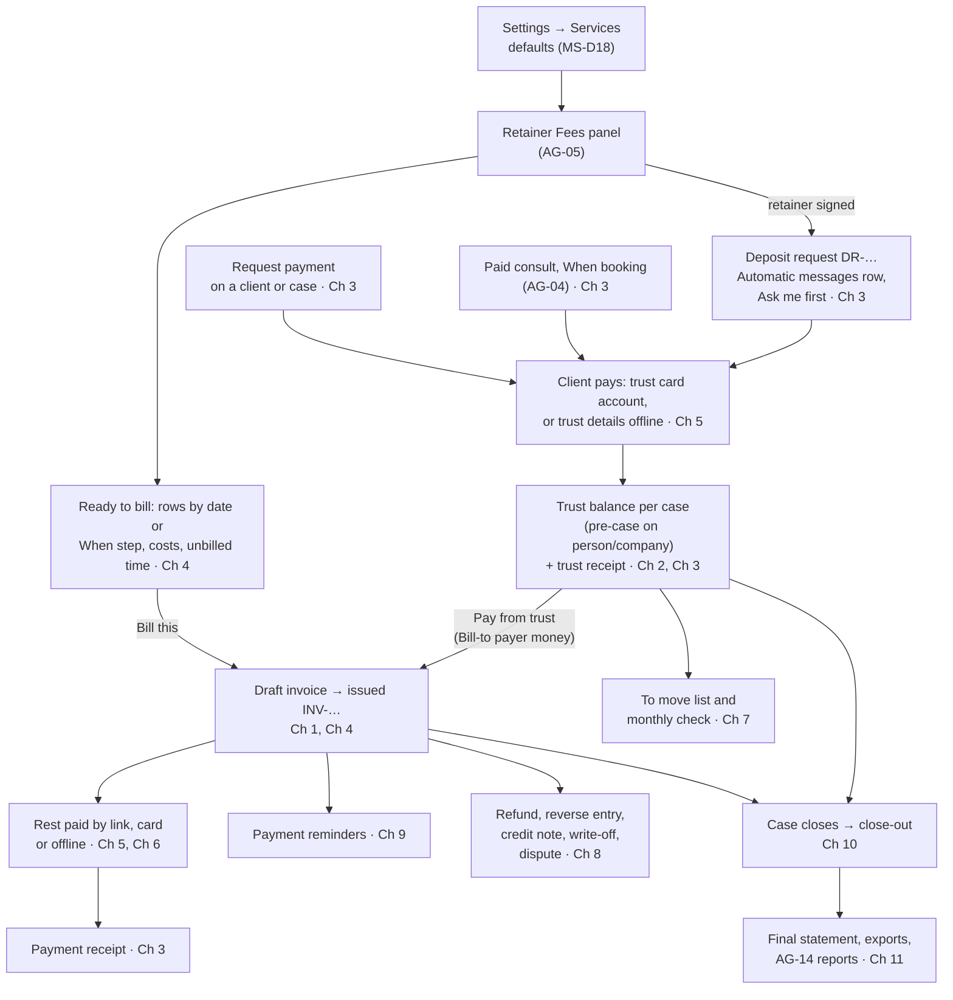

# AG-06 Billing and payments

> **Document control** · Version **2.1** · **2026-10-27** · Status: **CC-8 applied: only emails a person writes are copied; system emails go to their usual recipient with no Cc (the product owner, 26 Oct)**; earlier: **Money slice review applied (the product owner, 22–25 Oct): MS-D1 – MS-D24 (AG-06 parts) and the AG-06 parts of AG05-D1, AG05-D2, AG05-D4; rewritten to the X-1 format**
> Part of: *Agent (RCIC/Lawyer) Console — Functional Requirements* · Previous version: `_archive/AG-06-billing-and-payments_v2.0_2026-10-25.md`
>
> | Version | Date | Change | Decisions |
> |---|---|---|---|
> | 2.1 | 2026-10-27 | **27 Oct follow-up (the product owner), in place:** Credit note, Refund issued, Correction note and Statement emails are sent from AG-06 actions, so they are system emails, never copied. **CC-8 applied (the product owner, 26 Oct): only emails a person writes are copied.** Invoice, pay-link, reminder, receipt, deposit request, trust request and statement emails are system emails. They go To the Bill-to party with no Cc. **Withdrawn (CC-2, 24 Oct, and its decision Q2):** AG-6-41 rule 2 "Cc: the people on the case's copy list (AG-7-97), whoever is Bill to. This is deliberate; do not 'fix' it" and rule 4 "A bouncing Cc is skipped; the rest still send"; AG-6-63 rule 5 "Cc the case's copy list (AG-6-41)"; AG-6-12 rule 6 "(Bill to, Cc the copy list)". Changed: AG-6-41 (outcome, why, rules, test, edge case), AG-6-63 rule 5, AG-6-12 rule 6, the A6 chapter 1 needs (copy list no longer needed), the decisions tables (CC-8 added; CC-2 moved to D1). No requirement ID added or removed. | CC-8 |
> | 2.0 | 2026-10-25 | **Money slice review applied; rewritten to the X-1 format** (Page 1, decisions table, Parts A–D, a 14-field build card for every live requirement). A simple trust ledger is Release 1, held per case, with pre-case money on the person or company. Trust is asked once, just in time. Deposit request (an Automatic messages row, "Ask me first"). Request payment. Trust receipt and payment receipt in one series, with "Cleared". Ready to bill (rows by date or "When" step, costs, unbilled time), Bill this, Add cost, Bill unbilled time. Pay from trust (Bill-to payer money only, uncleared warning, one transaction). Every payment records "received into: Trust · Operating"; invoice payments go to Operating or Trust first; optional trust card account; two offline detail blocks; bank-notice matching of DR references; overpayment accepted. To move list and monthly check. Refunds, reverse entry, part credit note, write-off and disputes are Release 1. Close-out per case. Opening balances (what they are; import in AG-18). Paid consult money goes to trust; "Attended" bills it. Payment reminders: three rows, eligibility rules. Due date of an issued invoice may change. Exports per period. Send statement. Unsigned retainer: a warning, not a block. Currency locks at the first money document sent. **Withdrawn:** deposit invoice at signing, payment plans and the plan builder (two modes, `PaymentPlan`, `Installment`, `agent/payment-plan:manage`), saved-card instalments, refunds Phase-2, overpayment refusal, the invoice block on an unsigned retainer (AG17-D62, AG17-D79), "not a trust system", `fundsNature`, French invoices, plan gating, Conductor wording, demo wording, regulator names, the firm tax-profile editor, firm-wide dashboards (now AG-14). Requirement IDs AG-6-1 – AG-6-58 kept or traced in Part D, section D4; new IDs AG-6-59 – AG-6-84. | MS-D1, MS-D6 – MS-D16 (money parts), MS-D18 (money parts), MS-D19 – MS-D23, AG05-D1(5), AG05-D2(4), AG05-D4(5), R18, SA-Q1, AG16-88, AG16-90 |
> | 2.0 (25 Oct, later) | 2026-10-25 | **25 Oct (later): MS-D24 and writer follow-ups.** Applied in place, no version change. (1) MS-D24(4): the keys the first draft left open are named (C5; AG-6-48, AG-6-63, AG-6-76, AG-6-77, AG-6-78, AG-6-79, AG-6-28): part credit note and write-off `agent/invoice:void`; "Client disputes" `agent/invoice:edit`; Mark settled, opening balance and the cheque tick `agent/payment:record`; Send statement `agent/invoice:issue`; the Case Officer also gets `agent/invoice:list` and `agent/invoice:show`; the old `agent/e-sign:*` keys are withdrawn. (2) MS-D24(5): the client sees the trust balance per case in the portal and on statements (AG-6-60 rule 10, AG-6-28 rule 3). (3) MS-D24(6): the author defaults of D7 are accepted as written; each stays marked in its card. (4) Settled under existing decisions, no new rule: Off on the deposit request row means the deposit row is billed as the first invoice once earned (AG-6-61); a non-Owner who needs the trust answer sees "Ask <Owner> to answer the trust question" (AG-6-59); a retainer signed before the Owner answers Yes gets its deposit request when the Owner answers Yes, and a signed amendment's "On signing" row gets one (AG-6-61 rules 13, 14); trust off and unrequested money is "Refund · Keep as credit" by a person (AG-6-72); the receipt prefix is editable under Advanced (AG-6-44); no part card payment (AG-6-14); refunds and credit notes in figures, disputed invoices in ageing, a "No service" group (AG-6-29); the dunning escalation notification is dropped (AG-6-36); export on every plan (AG-6-31); ExpatReady maintains the bank-notice formats (AG-6-50); the statement email is the library template "Your statement" (AG-6-28); balances imported through AG-18 follow five rules (AG-6-79); `invoice.paid` covers an invoice paid from trust (C4); the deferrals register is updated (D5). C12 now holds only the expert, SA-08, accountant and onboarding questions, and how a deposit request is sent when the case lead lacks `agent/payment:record`. | MS-D24(4)(5)(6) · MS-D6(2) · MS-D20(14)(17) · MS-D5(3) · SA-03 #17 |
> | 2.0 (25 Oct, final check) | 2026-10-25 | **25 Oct (final check): verification fixes.** C5: Case Officer `agent/invoice:list` and `:show` reach only invoices and trust records on cases and people the user can already see (MS-D24(4)); Case Manager also gets `agent/invoice:create` and `agent/expense:create` (MS-D21(10)). Deposit item shows to the case lead and every holder of `agent/payment:record`; any holder may send it (AG16-60, MS-D20(8), MS-D21(11)); C12 Q4 closed. | MS-D20(8), MS-D21(10)(11), MS-D24(4) |
>
> Rows 1.1 – 1.14 of the change log are in Part D, section D2.

Build only from this file. Nothing here is decided unless it cites a logged decision (`FINAL-SuperAdmin-FR/TEMPLATE-MAP-working_2026-10-10.md`, "MAP"). A point not decided is listed in Part C, section C12, with owner the product owner. Do not guess.

---

# Page 1 — For developers: read this first

**What this epic is.** AG-06 is the firm's money system for its own clients (the Biller). It takes money in before the work (trust), bills the work when it is earned, records every payment, and settles what is left when a case ends. ExpatReady never holds the money. Card money goes to the firm's own payment account. Offline money goes to the firm's own bank.

**What is built today.** Nothing of firm invoicing is built in the ERv2 backend. Check against these commits before you start.
- **ERv2 backend** (`ERv2-sanitized`, `origin/dev` at `2617f7f4b`, 22 Oct 2026):
  - `apps/api/src/billing` is ExpatReady's own subscription billing, not this epic (`apps/api/src/billing/invoices/firm-invoices.controller.ts:25-33`: "the firm's own recorded SaaS invoices"). `SaasInvoice` (`apps/api/prisma/models/saas-billing.prisma:256`) is ExpatReady's invoice to the firm.
  - The only firm-money code is an event contract with no emitter: `packages/contracts/src/events/billing.events.ts` (seven events, list at `:226`; "no live emitter yet" at `:14`; `invoice.paid` at `:73`).
  - The payment rail port exists but is not wired (`apps/api/src/rails/payment-rail.module.ts:21`).
  - Three keys exist in the catalogue: `agent/payment-rail:connect` (`apps/api/infra/08-permission-catalog-seed.sql:697`), `agent/billing-config:numbering` (`:752`), `portal/invoice:pay` (reserved, `:157`). No `agent/invoice*`, `agent/payment:*`, `agent/refund*` key exists yet.
- **ERv2 frontend** (`ERv2-frontend`, `origin/dev` at `31f36e99`, 23 Oct 2026): a full in-memory mock of the Biller under `src/features/invoicing/` ("MOCK BOUNDARY", `src/features/invoicing/invoicing-types.ts:5-9`) and a mock Quote and Retainer tab under `src/features/pipeline/accounting/`. Nothing is wired to an API. The mock is a UI design only; it is not built money logic. Part C, section C9 lists each screen as Reuse, Adapt or Remove.
- **V1.5** (`Expat V1.5/DevAPI-main/src/accounting`) is a legacy system. Use it as reference only. It numbers drafts at creation, has no refunds and no trust, and uses the firm's pasted secret key instead of a connected account. **Do not copy it.**

**Frontend mock: what to do with it (summary; detail in C9).**
- **Reuse:** invoice list, issue dialog, collections page, reason dialog, statement CSV, payment-account card (`src/features/settings/integrations/payment-account-panel.tsx`), portal invoice list, pay sheet and receipt dialog.
- **Adapt:** invoice builder (add Pay from trust, unsigned-retainer warning, schedule-row source), invoice detail, record-payment dialog (the "Type of funds" label becomes "Received into: Trust · Operating"), receipt dialog (two receipt kinds, one series), refund dialog, reports page (trust and monthly check), billing settings page (becomes the Getting paid page in AG-16), money tab, Fee tab (becomes Settings → Services, MS-D18).
- **Remove:** the Quote tab and its accepted-quote gate (`src/features/pipeline/accounting/accounting-mock-api.ts:160-161`, MS-D2), the plan builder, plans list and plan detail (`plan-builder-page.tsx`, `plans-page.tsx`, `plan-detail-page.tsx`; `PlanMode` at `invoicing-types.ts:242`; MS-D21(19)), the tax-profile dialog (R18), the reporting-currency screen (R18), the Expense tab (MS-D18), and the hint "This is not a trust account" (`src/locales/en/invoicing.json:236`, MS-D1).

**Build order.** Chapters 1 → 12 in Part B are in build order. Chapter 1 (invoices) and Chapter 2 (trust set-up and balances) come first, because every later chapter writes invoices or trust entries. Part A, section A6, lists what each chapter needs from other epics.

**The ten things most likely to be built wrong.**
1. **Treating a deposit as revenue.** A deposit request is not an invoice. Money from it goes to the case's trust balance. It counts as a fee only when an invoice is paid from trust (AG-6-61, AG-6-68).
2. **One trust balance per client.** Trust is held per case, in the case's one currency. Money before a case exists is held on the person or company and moves to the case when it opens (AG-6-60).
3. **Spending someone else's money.** Pay from trust uses only money paid by the invoice's Bill-to party, on the invoice's own case. Anything else is a deliberate pick, recorded (AG-6-68).
4. **Assuming where money landed.** Every payment records "received into: Trust · Operating", from the route the money took. A mismatch goes to the To move list (AG-6-69, AG-6-73).
5. **A check that never balances.** The monthly check is bank = case balances + waiting to move − fees not covered − in transit, per currency (AG-6-74).
6. **Billing by itself.** No invoice is created or sent without a person. Ready to bill shows rows; Bill this makes a draft (AG-6-64, AG-6-65). The only automatic client message here is the Deposit request row, when the firm switches it to "Send automatically" (AG-6-61).
7. **Editing money.** Payments, refunds and trust entries are never edited or deleted. A mistake is a reverse entry; an issued invoice changes only by credit note, write-off or a new due date (AG-6-6, AG-6-75).
8. **Two writes for one action.** The trust balance check and the application are one database transaction (AG-6-68). The payment and the invoice recompute are one transaction (AG-6-20).
9. **Blocking the firm.** An unsigned retainer, a cheque not yet cleared, an amount above the estimate: each is a warning the person may pass. Nothing here blocks case work (AG-6-42, Rule 7).
10. **Showing trust to a firm without trust.** Until the Owner answers "Yes" to the trust question, no trust screen, word or button appears (AG-6-59).

**Open items you may meet (full list in C12).** (1) SA-08: can the trust card account bill processor fees, refunds and disputes to the operating account? (2) For the immigration expert: may a disbursement be paid straight from trust with written permission (MS-D9); may a firm keep a consult fee on a no-show (MS-D15); are employer-paid LMIA costs refunded to the employer (MS-D19(4)). (3) For the firm's accountant, not the product: tax timing for the tax-collected report (AG-14). (4) Engineering with SA-08: the onboarding type of the connected accounts (C12 Q11).

**Three rules.** This file wins over any other note about client money. If something is missing, ask the product owner. Other epics change to match this file through the knock-on list in Part D, section D5.

---

# Decisions that change this epic

Full text of every decision: MAP. "Where" names the requirement (AG-6-n), business rule (BR-n), Part C section or chapter. Decisions that were replaced are in Part D, section D1.

**Standing rules** (apply here as everywhere; home: Agent `00-Overview` → "Product rules every epic follows"): AG16-11 single home, AG16-31 ExpatReady suggests and the firm decides, AG16-33 AI reads and a person confirms, AG16-42 quiet by default, AG16-44 never quietly judge, AG16-60 a duplicate beats a miss, AG16-76 help people and don't replace them, AG16-92 email-first, Rule 7 (the firm owns its compliance; warn, never block; no regulator names in product text), Rules 8 and 9 (small firms; zero setup; defaults first), X-1 (written to be understood), X-4 (grows with the firm), X-5 (the firm sets its timings), X-6 (two currencies).

**The money slice review (the product owner, 22–25 Oct 2026).**

| Decision | What was decided (one line) | What it changes here | Where |
|---|---|---|---|
| **MS-D1** | A simple trust ledger is Release 1. ExpatReady never holds money. | Trust request, trust receipt, Pay from trust, refund from trust, monthly check, trust ledger and export. Replaces "trust-adjacent, not a trust system". "Per-client" amended by MS-D19; "default on" replaced by MS-D20(17); the 30-day item replaced by the To move list (MS-D20(6)). | AG-6-59, AG-6-60, AG-6-68, AG-6-73, AG-6-74, BR-13, Ch 2, Ch 6 |
| **MS-D6** | Deposit request: an Automatic messages row, "Ask me first". | Replaces the deposit invoice at signing. DR-… reference, no-login pay link, trust receipt. One receipt series (with MS-D21(12)). Owner of the item amended by MS-D20(8). | AG-6-61, AG-6-63, AG-6-32 |
| **MS-D7** | Invoice payments go to: Operating (default) · Trust first. | One Owner choice, shown only when trust is on; applies to payments recorded after a change; "Last changed" line (MS-D20(16)). | AG-6-69 |
| **MS-D8** | A schedule row is billed by a click; Pay from trust is pre-ticked. | Bill this; Ready to bill; Pay from trust up to the balance. Replaces plan draw mode and closes old open item 11. Row "When" added by MS-D22(2). | AG-6-64, AG-6-65, AG-6-68 |
| **MS-D9** | Government fees: the firm pays, then bills and reimburses from trust. | No "pay government fee from trust" action in Release 1. Expert question open. | AG-6-40, C12 Q2 |
| **MS-D10** | Card payment for trust money through an optional second (trust) payment account. | Trust card account; card fee is the firm's cost; invoices stay on the main account (amended by MS-D20(1) for Trust first). | AG-6-70, AG-6-14 |
| **MS-D11** | Refunds, corrections, credit notes and write-offs are Release 1. | Refund any payment (card, offline, from trust); reverse entry; part credit note; write-off; overpayment accepted (trust off amended by MS-D20(14)). "Refund issued" and "Credit note" starters, sent by a person. | AG-6-23, AG-6-75, AG-6-48, AG-6-76, AG-6-21 |
| **MS-D12** | Close-out when a case ends. | Close-out item and screen, final statement, Mark settled; Pay from trust on any issued unpaid invoice; dispute turns off Pay from trust. Per case (MS-D19(5)); owner amended by MS-D20(8). | AG-6-78, AG-6-68, AG-6-77 |
| **MS-D13** | Invoicing on an unsigned retainer: a warning, not a block. | Replaces the refusal of AG-6-42 and BR-17 (AG17-D62, AG17-D79). Narrowed by MS-D21(1)(2). | AG-6-42, AG-6-62 |
| **MS-D14** | Opening balances are Release 1; old invoice history stays Release 2. | What an opening trust balance, amount owed and credit are. Import lives in AG-18. Per case (MS-D19(7)); owed items OB-… with no due date (MS-D20(18)). | AG-6-79 |
| **MS-D15** | Paid consults: money at booking is trust money; "Attended" bills it. | Consult payment is a trust request on the person; Attended issues and pays the consult invoice from trust in one click; No-show keep or refund; "Never refund" choice. Replaces the consult invoice at booking and the void on hold expiry. | AG-6-34, AG-6-58 |
| **MS-D16** | A simple case for a firm service; **Request payment** on any client or case. | Request payment (money parts). The case kind is AG-07's. | AG-6-62 |
| **MS-D18** | The Services model (Settings → Services). | Schedule rows, fee type and disbursement estimate come from the case's Fees panel, which copies Service defaults; each row and line carries `serviceRef`; "Needs a signed agreement" decides the unsigned-retainer warning. AG-16 places the screen; AG-02 owns the list. | AG-6-64, AG-6-65, AG-6-42, A2 |
| **MS-D19** | Trust is held per case; money before a case is on the person or company. | Per-case balance in the case currency; pre-case money moves to the case; Pay from trust uses the invoice's case and Bill-to payer money; payer on every receipt; close-out per case; person totals; opening balances per case. | AG-6-60, AG-6-68, AG-6-63, AG-6-78, AG-6-79 |
| **MS-D20** | Trust correctness fixes (19). | (1) received into; (2) two detail blocks; (3) currency locks at the first money document sent; (4) card fees and chargebacks are the firm's cost; (5) reversal undoes applications; (6) To move list and monthly check; (7) trust off while money is held; (8) items go to the case lead; (9) one deposit request per retainer version; (10) version checks (AG-05); (11) amendment below billed; (12) dispute returns to trust; (13) DR matching; (14) overpayment notice; (15) trust received apart from fees (AG-14); (16) "Last changed"; (17) trust asked once; (18) opening owed items; (19) Attended undo, one transaction, one page, offline refund fallback. | AG-6-69, AG-6-71, AG-6-46, AG-6-73, AG-6-74, AG-6-75, AG-6-59, AG-6-61, AG-6-81, AG-6-77, AG-6-51, AG-6-21, AG-6-79, AG-6-34, AG-6-23 |
| **MS-D21** | Consistency fixes (20). | (1)(2) unsigned warning narrowed; (3) deposit row still billed by Bill this; (4) requests include estimated tax; (5) deal value prompt (AG-02); (6) Bill unbilled time, "above the estimate"; (7) Add cost; (9) dashboards and tax report in AG-14; (10) Case Officer drafts; (11) keys; (12) one receipt series; (13) reminder rows and eligibility; (14) due date change; (15) exports; (16) Send statement; (17) line tax; (18) Getting paid page (AG-16); (19) payment plans withdrawn; (20) consultation credit. | AG-6-42, AG-6-61, AG-6-62, AG-6-65, AG-6-66, AG-6-67, AG-6-29, C5, AG-6-63, AG-6-12, AG-6-46, AG-6-31, AG-6-28, AG-6-45, AG-6-82, D3 |
| **MS-D22** | No saved-card autopay; schedule rows can say when they are due. | AG-6-49(c) withdrawn. Row "When": On signing · On a date · When submitted · When decided · When done. Nothing is billed by itself. | AG-6-64, AG-6-49 |
| **MS-D23** | Eleven scenario gaps closed. | (1) unrequested money; (2) in transit; (3) Cleared and bounced cheques; (4) other-currency payment; (5) payer name; (6)(7) owed figures for AG-07; (8) disbursements above estimate; (9) government fee refunded; (10) payments with no matching row; (11) payment after close-out. | AG-6-72, AG-6-74, AG-6-63, AG-6-68, AG-6-75, AG-6-65, AG-6-80, AG-6-78 |
| **MS-D24 (4)** | Keys, existing ones only: part credit note and write-off `agent/invoice:void`; "Client disputes" `agent/invoice:edit`; Mark settled, opening balance and the cheque-cleared tick `agent/payment:record`; Send statement `agent/invoice:issue`; the Case Officer also gets `agent/invoice:list` and `agent/invoice:show` and sees the drafts they create. The old `agent/e-sign:*` keys are withdrawn (SA-06 holds the catalogue). | C5 and the Access line of each card now state the key. | C5, AG-6-48, AG-6-63, AG-6-76, AG-6-77, AG-6-78, AG-6-79, AG-6-28 |
| **MS-D24 (5)** | The client sees their trust balance per case in the portal and on statements: "Held in trust for your work permit: CAD 1,500". | New rule 10 of AG-6-60 and a line on the statement. AG-15 and CP-01 place the screen. | AG-6-60, AG-6-28 |
| **MS-D24 (6)** | The author defaults of D7 are accepted as written; each stays marked in its card. | D7 is now "accepted"; the marks stay in the cards. | D7 |
| **MS-D24 (writer follow-ups)** | Points that existing decisions already settle (no new rule): Off on the deposit request row (MS-D6(2)); a non-Owner needing the trust answer (MS-D20(17)); a retainer signed before the Owner answers Yes, and an amendment's "On signing" row (MS-D5(3), MS-D6, MS-D20(9)); trust off and unrequested money (MS-D20(14)); receipt prefix editable (MS-D21(12)); no part card payment; refunds, disputed invoices and lines with no Service in AG-14's figures; dunning escalation dropped; export on every plan (SA-03 #17); notice formats kept by ExpatReady; statement email; imported balances (MS-D14); `invoice.paid` covers trust. | AG-6-61, AG-6-59, AG-6-72, AG-6-44, AG-6-14, AG-6-29, AG-6-36, AG-6-31, AG-6-50, AG-6-28, AG-6-79, C4, D5. | as listed |
| **Open after the money slice** (MAP:1182) | Expert, SA-08 and accountant questions. | Listed, not resolved. | C12 Q1 – Q3 |

**Copy on emails (the product owner, 26 Oct 2026).**

| Decision | What was decided (one line) | What it changes here | Where |
|---|---|---|---|
| **CC-8** (26 Oct; home AG-10-89) | Only emails a person writes are copied. Every system email goes to its usual recipient with no Cc. | Invoice, pay-link, reminder, receipt, deposit request, trust request and statement emails go To the Bill-to party with no Cc. Replaces CC-2 here (D1). | AG-6-41, AG-6-63, AG-6-12 |

**AG-05 review decisions that touch money (the product owner, 22–25 Oct).**

| Decision | What was decided (one line) | What it changes here | Where |
|---|---|---|---|
| **AG05-D1(5)** | Retainer-only behaviours: countersign, the "Retainer not signed" warning, becoming a client, the invoice gate. | Only a retainer (or its amendment) starts a deposit request and drives the unsigned-retainer warning; other signed documents do not. | AG-6-61, AG-6-42 |
| **AG05-D2(4)** | A retainer with several client signers counts as signed only when everyone has signed. | The deposit request and the end of the unsigned warning wait for the last signer. | AG-6-61, AG-6-42 |
| **AG05-D4(5)** | "Marked signed by mistake" is allowed only while nothing is billed from the retainer and no deposit is received. | AG-06 tells AG-05 whether anything is billed or received for that retainer. | AG-6-61, C6 |

**Earlier decisions still in force here.**

| Decision | What was decided (one line) | What it changes here | Where |
|---|---|---|---|
| **R18** (MAP:446) | Billing settings: one firm default due date; tax from the province with per-client or per-invoice "Taxable · Zero-rated · Exempt"; no tax-profile editor; one currency per case; no conversion; offline payment instructions. Numbering clause replaced by AG16-13. | Tax treatment choice; no rate editor; money shown per currency. | AG-6-45, AG-6-27, BR-8 |
| **SA-Q1** (MAP:577) | The firm's own payment account is on every plan; no payment-plan extra; application fee not taken. | No plan gating of AG-06 features (only the AI Sorter is plan-gated, AG16-34). | AG-6-14, C7 |
| **AG16-13** (MAP:862-867) | Getting paid defaults; AG-06 is the single home of the invoicing rules. | Numbering, tax, due date, cancel. Rule 14 ("no receipt series") replaced by MS-D21(12); "language EN or FR" replaced by AG16-88; "instalments" removed by MS-D21(19). | AG-6-44 – AG-6-48 |
| **AG16-17** (MAP:871) | Payment account down: money never falls back. | Offline instructions shown; reminders still send. Its saved-card item (2) withdrawn by MS-D22(1). | AG-6-49 |
| **AG16-30** (MAP:884), **AG16-68** (MAP:920), **AG16-69** (MAP:921) | Payment notices become suggestions; amount-only is a candidate; "Record all" for invoice-number matches only; samples before build; Interac line. | Kept. AG16-68's "more than the balance refused" replaced by MS-D20(14); matching extended to DR references (MS-D20(13)). | AG-6-50 – AG-6-56 |
| **AG16-44** (MAP:895) | Never quietly judge. | "Not a client payment" is a person's choice; Stripe senders listed under "Not brought in". | AG-6-56 |
| **AG16-90** (MAP:943) | Payment account broken: Owner only is emailed. | AG-6-49(e) says Owner only. | AG-6-49 |
| **AG16-88** (MAP:940) | Release 1 is English-first. | Invoices, receipts and messages render in English; the `language` field is kept. French wording questions closed. | AG-6-47 |
| **AG16-14** (MAP:868), **AG16-105(2)** (MAP:1000), **AG01-30(2)** (MAP:1001) | Who is told is decided by the product; Payments notification group; dunning escalation was in-app only and is now dropped. | Billing notifications go to billing holders; "optionally the owner" removed; the dunning escalation notification is dropped (MS-D24). | AG-6-11, AG-6-36 |
| **AG16-106** (MAP:1002) | `agent/billing-config:currency` withdrawn. | Row kept withdrawn in C5. | C5 |
| **X-6** (MAP:1058), **X-6(8)** (MAP:1059), **AG04-D20** | CAD and USD; one currency per prospect or case; no conversion; the built exchange-rate code is removed. X-6 rule 4 amended by MS-D20(3). | Currency rules; no `fxSnapshotId`. | AG-6-25 – AG-6-27, AG-6-46 |
| **X-2** | One person record per real person. | The billed person is the `Party`; the client's language is read from `PartyProfile`. | AG-6-2 |
| **AG02-D2** (MAP:1010) | Retainer status is derived from the agreement. | AG-06 reads the retainer status from AG-05. | C2 |
| **AG02-D14(11)** (MAP:1022), **AG02-D10(7)** (MAP:1018) | Revenue per source and per person is found through the client's original prospect; the sales dashboard is AG-14's. | `invoice.paid` keeps its built payload. | AG-6-33 |
| **AG02-D15(1)** (MAP:1023) | A paid consult before the person became a client does not block Undo convert. | Trust money and the consult invoice stay with the person. | AG-6-34 |
| **AG04 S1, S5** (MAP:1047), **AG04-D14** (MAP:1049), **AG04-D15 (O2)** (MAP:1050) | Consult invoice on the person; refund of a cancelled paid consult is Release 1 and confirmed by a person; refunds outside the rule are recorded with "Record refund". | Kept; the refund now comes from trust when the consult was paid when booking (MS-D15(5)). | AG-6-34, AG-6-58 |
| **AG04-D3** (MAP:1037) | Attendance is asked, never guessed. | The Attended click is the person's click that bills the consult (MS-D15(3)). | AG-6-34 |
| **AG04-D8** | Six booking keys; Billing holds none. | No booking key in C5. | C5 |
| **AG17-D4, D13, D20, D43, D66** (AG-17 §0) | One case core; government fee line from the case; Bill to; fee billed after submission; payments recorded on the client's behalf. | Kept. AG17-D62's invoice block and AG17-D79 replaced by MS-D13 (D1). | AG-6-40, AG-6-41, AG-6-43 |
| **SA6-D10, SA6-D5, SA-06 closing decisions, AG7-D10** | Key naming; six starter roles; `billing-config:terms`; no masking and no reveal. | C5. | C5, C7 |

---

# Part A — Start here

## How this file is laid out

| Part | What it holds |
|---|---|
| **A. Start here** | Purpose, key terms, the main flow, one worked example (Maple Immigration and Client B), two short variants, build order. |
| **B. Build cards** | Twelve chapters in build order. One card per requirement, or one card for a few requirements that are one rule. Pointer requirements have no card. |
| **C. Rules and tests** | C1 business rules, C2 states, C3 data model, C4 events, C5 permissions, C6 hand-offs with other epics, C7 security and performance, C8 edge cases, C9 what is built today and what to do with the frontend mock, C10 acceptance tests, C11 scenario coverage (56 scenarios), C12 open questions. |
| **D. Appendix** | D1 replaced decisions, D2 history, D3 withdrawn items, D4 "Where did it go?" (every v1.14 ID and section), D5 knock-on for other epics, D6 closed questions, D7 author defaults (accepted). Nothing in Part D is a build instruction. |

The chapters:

| Ch | Chapter | Requirements |
|---|---|---|
| 1 | Invoices | AG-6-1 – AG-6-8 (one card), AG-6-44, AG-6-4 + AG-6-45, AG-6-46, AG-6-47, AG-6-48, AG-6-41, AG-6-42, AG-6-25 – AG-6-27 |
| 2 | Trust set-up and balances | AG-6-59, AG-6-60 |
| 3 | Money in before the work | AG-6-61, AG-6-62, AG-6-63, AG-6-34, AG-6-58 |
| 4 | Billing the work | AG-6-64, AG-6-65, AG-6-66, AG-6-67, AG-6-40, AG-6-80, AG-6-81, AG-6-68 |
| 5 | Taking payments | AG-6-14 – AG-6-17, AG-6-70, AG-6-19 + AG-6-20 + AG-6-43, AG-6-69, AG-6-71, AG-6-21, AG-6-72, AG-6-49 |
| 6 | Payment notices | AG-6-50 – AG-6-56, AG-6-57 (pointer) |
| 7 | Trust housekeeping | AG-6-73, AG-6-74 |
| 8 | Corrections | AG-6-23 (with AG-6-18), AG-6-75, AG-6-76, AG-6-77 |
| 9 | Reminders and collections | AG-6-11, AG-6-12, AG-6-13, AG-6-36 |
| 10 | Close-out | AG-6-78 |
| 11 | Statements, reports, exports and opening balances | AG-6-28, AG-6-29 (pointer), AG-6-30, AG-6-31, AG-6-79 |
| 12 | Events, audit and settings placement | AG-6-32, AG-6-33, AG-6-35, AG-6-37, AG-6-38, AG-6-39, AG-6-82 – AG-6-84 (pointers) |

Withdrawn IDs (kept, never reused): AG-6-9, AG-6-10 (payment plans), AG-6-24 (trust-adjacent tag). Part D, section D4, says where every v1.14 ID went.

## How to read a card

Every card has 14 fields: 1 Outcome, 2 Why, 3 Where, 4 Engine, 5 Rules, 6 States, 7 Data, 8 Access, 9 Events, 10 Safety, 11 Tests, 12 Edge cases, 13 Non-goals, 14 Mode. Field 5 gives numbered rules, each with an example `input → output`. Field 7 writes each field as `plain name (codeName: type)` where a new field is named. A word defined in A2 is not defined again in a card. The card header lists the decisions behind the card and the build status. Every card is **Not built** in the ERv2 backend (Page 1); field 3 names the frontend mock screen where one exists.

---

## A1 — Purpose in five lines

1. **What it is.** AG-06 is the firm's money system for its clients: trust money in, invoices, payments, corrections, close-out and statements.
2. **What it covers.** The trust question, trust balances per case, deposit requests and payment requests, receipts, Ready to bill and Bill this, Pay from trust, payments by card and offline, payment notices, the To move list and the monthly check, refunds and corrections, payment reminders, close-out, statements and exports.
3. **The outcome.** Every dollar earned is billed, every invoice is paid or chased, every payment is tied to the right case, and money held for a client is never spent for someone else.
4. **How.** A new firm needs no setup. Defaults come from the firm's Services and its Getting paid page (AG-16). Trust is asked only when it first matters. Staff click; ExpatReady prepares.
5. **What it never does.** It never holds money, never bills or sends an invoice by itself, never edits a payment, never converts currencies, and never blocks case work.

**Who uses it.** Client C is Maple's Owner and licensed representative; he sends retainers. Client F is a case officer who also holds the billing keys. Client B is a client. Billing / Finance is the heaviest user in a larger firm. The client pays by link, card or e-Transfer, with no login (AG16-92).

---

## A2 — Key terms

**Trust account** (no code name) — The firm's own bank account for money it holds for clients before the work is earned. ExpatReady never touches it; it keeps the record. *Example:* Maple's trust account at its bank. *Not the same as:* the operating account, which holds the firm's own earned money.

**Trust question** (`FirmMoneySettings.trustAnswer`) — "Do you hold client money in a trust account? Yes · No", asked once, the first time it matters (AG-6-59). *Example:* Client C answers Yes when he first sets a paid consult to "When booking".

**Trust balance** (derived from `TrustLedgerEntry`) — The money held for one case, in the case's one currency. Money received before a case exists is held on the person or company (**pre-case money**) and moves to the case when it opens (AG-6-60). *Example:* Client B's work permit case holds CAD 169.50. *Not the same as:* credit, which is money the firm holds as a reduction of a future invoice when trust is off or by choice.

**Trust request** (`TrustRequest`) — A request for money to hold in trust. It is not an invoice. It has a DR-… reference, a no-login pay link and the firm's trust payment details. Three kinds: **deposit request** (from a signed retainer's deposit row, AG-6-61), **Request payment** (typed by staff on a client or case, AG-6-62) and the **consult payment request** (a paid consult set to "When booking", AG-6-34). *Example:* DR-0001 for CAD 1,130.

**Trust receipt** and **payment receipt** (`Receipt.kind`) — The receipt for money received into a trust balance, and the receipt for money paid against an invoice. Both are numbered from one firm series and emailed automatically (AG-6-63). *Example:* R-0002 (trust receipt for DR-0001).

**Cleared** (`Payment.cleared`) — Whether money is safely in the bank. Card and e-Transfer are cleared at once; a cheque is cleared by a tick (AG-6-63).

**Services** (Settings → Services, AG-16 places it; AG-02 owns the list) — Each thing the firm sells, with optional defaults: fee type, price, schedule rows, disbursement estimate (MS-D18). *Example:* "Work permit — LMIA-based, Fixed 4,500".

**Fees panel** (AG-05 owns it) — The money terms on a retainer, an amendment or a case: services with fees, fee type Fixed or Hourly, schedule rows, disbursement estimate, tax. It is copied from Service defaults when used. *Example:* Client B's case Fees panel.

**Schedule row** (`ScheduleRow`, AG-05 owns it) — One line of the agreed payment schedule: label, amount, and **When** (On signing · On a date · When submitted · When decided · When done). The first row is the deposit. *Example:* "Application submitted — CAD 2,500, When submitted".

**Ready to bill** (AG-6-64) — One list of everything earned and not yet billed: schedule rows whose "When" has come, costs, and unbilled time. It shows; it never bills.

**Bill this** (AG-6-65) — The button on a Ready to bill item that makes a draft invoice pre-filled from it.

**Add cost** (AG-6-66) — Records a cost the firm paid for a client (courier, translation, job ads) so it shows in Ready to bill.

**Pay from trust** (AG-6-68) — Applies money from the case's trust balance to an invoice. On a draft it is pre-ticked up to the balance paid by the invoice's Bill-to party.

**Received into** (`Payment.receivedInto`: `TRUST | OPERATING`) — The account the money actually reached, set from the route and editable when recording (AG-6-69).

**Trust card account** (AG-6-70) — An optional second payment account connected to the firm's trust bank account. The **main payment account** is connected to operating.

**To move list** (AG-6-73) — Money that must move between the firm's trust and operating accounts: trust applied to invoices and not yet moved, card fees to cover, and money that reached the wrong account. One "I moved these" click records the bank transfer the firm made.

**Monthly check** (AG-6-74) — Staff type the bank's trust balance; ExpatReady compares it with case balances + waiting to move − fees not covered − in transit, per currency, and saves the result.

**Reverse entry** (AG-6-75) — Undoes a payment recorded by mistake, with a reason. Nothing is deleted.

**Credit note** (`CreditNote`, CN-…) — Reduces an issued invoice, in part or in full (AG-6-48). **Write-off** (`WriteOff`) settles a small balance the firm will not collect (AG-6-76).

**Close-out** (AG-6-78) — Settling a case's money after it closes: final invoice, refunds, final statement, or "Mark settled".

**Getting paid** (AG-16 places the page) — The one settings page for how clients pay, tax, trust and numbering (MS-D21(18)).

**Bill to** (AG-7-52) — Who the case's invoices go to: the case's client by default, or another client of the firm such as the employer.

Terms owned by other epics and used here unchanged: **retainer**, **amendment**, **signed offline**, **countersign** (AG-05); **case**, **case lead**, **file owner**, **firm-service case**, **Government fees section** (AG-07); **person record** (`Party`), **company**, **Interested in** (AG-02); **appointment type**, **attendance prompt**, **slot hold** (AG-04); **time entry** (AG-13); **home screen**, **Needs you** (AG-11); **Automatic messages page** (AG-12); **copy list** (AG-7-97). Doers used: **Biller** (money), **Mailer** (email), **Reminder** (timed sends), **Minder** (connection health). AI: **Sorter** (optional, payment notices only).

---

## A3 — The main flow

**Reading the picture.** AG-06 owns every box except Services (AG-02 list, AG-16 screen), the Fees panel (AG-05), the paid consult booking (AG-04) and AG-14's reports. With trust off, the trust boxes do not exist: rows are billed by Bill this after the work and paid by link or offline.

---

## A4 — Worked example: Maple Immigration and Client B

Maple Immigration is in Toronto (HST 13%). **Client C** is the Owner and licensed representative; he sends retainers and is Client B's case lead. **Client F** is a case officer with the billing keys. **Client B** is the client. Amounts are illustrative. The receipt series starts at R-0001 (author default, D7).

**Maple's Service (set once, MS-D18):** "Work permit — LMIA-based": Fixed CAD 4,500; schedule rows "Deposit on signing 1,500 (On signing)", "Application submitted 2,000 (When submitted)", "Decision received 1,000 (When decided)"; disbursement estimate Courier 50, Translation 120.

1. **Trust is asked once (Mon 19 Oct).** Client C sets the appointment type "Paid consult, 45 min, CAD 150" to "Client pays: When booking". This is the first time trust matters, so ExpatReady asks: "Do you hold client money in a trust account? Yes · No". Client C clicks Yes. He connects the trust card account and fills the trust payment details block on Getting paid. → AG-6-59, AG-6-70, AG-6-71.
2. **Consult paid when booking (Mon 26 Oct).** Client B books and pays CAD 169.50 (150 + estimated HST) by card through the trust card account. A consult payment request is paid. Trust receipt **R-0001** is emailed. Client B has no case, so the money is held on his person record: pre-case CAD 169.50. → AG-6-34, AG-6-60, AG-6-63.
3. **Attended.** 30 minutes after the call Client C sees "Did Client B attend? Attended (bill CAD 169.50 from trust) · No-show". He clicks Attended. One transaction issues **INV-0001** (consultation 150 + HST 19.50) and pays it from trust. Pre-case balance: 0. The To move list gets "CAD 169.50 applied, not yet moved". → AG-6-34, AG-6-68, AG-6-73.
4. **Retainer from the Service (Tue 27 Oct).** Client C clicks "Engage and prepare retainer" (AG-05). The Fees panel copies the Service. Client C sends it. Sending a retainer with fees locks the prospect's currency to CAD (MS-D20(3)). Client B asks for a smaller deposit; Client C edits the rows to 1,000 / 2,500 / 1,000 before Client B signs (AG-05, MS-D2). → AG-6-46.
5. **Signed (Mon 2 Nov).** Client B signs. He becomes a client and Client C opens the case. A **deposit request DR-0001** for **CAD 1,130** (1,000 + estimated HST 130) is prepared and waits in Client C's Needs you ("Ask me first"). Client C clicks Send. Client B gets an email with a no-login pay link and Maple's trust e-Transfer details. → AG-6-61.
6. **Paid by e-Transfer (Wed 4 Nov).** Client B sends CAD 1,130 to Maple's trust e-Transfer email with "DR-0001" in the message. The bank notice becomes "Record CAD 1,130 on DR-0001 (Client B)?". Client F clicks Record. Received into: Trust. Trust receipt **R-0002**. Case trust balance: CAD 1,130. → AG-6-51, AG-6-63, AG-6-69.
7. **Deposit row billed (Thu 5 Nov).** The row "Deposit on signing" has been in **Ready to bill** since 2 Nov. Client F clicks **Bill this**. Draft INV-0002: Work permit — deposit 1,000; suggested line "Consultation credit −150" (MS-D21(20)), which she keeps; HST 13% on 850 = 110.50; total CAD 960.50. "Pay from trust" is pre-ticked at CAD 960.50. She sends it. Trust balance: CAD 169.50. Balance due: 0. The To move list now shows CAD 1,130 waiting to move. → AG-6-64, AG-6-65, AG-6-68.
8. **Money moved (Fri 20 Nov).** Client F transfers CAD 1,130 from trust to operating at her bank, then ticks both To move lines and clicks "I moved these". → AG-6-73.
9. **Monthly check (Tue 1 Dec, for 30 Nov).** Client F types the bank's trust balance: CAD 164.28. ExpatReady shows: case balances CAD 169.50 + waiting to move 0 − fees not yet covered CAD 5.22 (the card fee on R-0001) − in transit 0 = CAD 164.28. Difference 0. Saved with her name and the date. The To move list shows "Cover CAD 5.22 into trust from operating". → AG-6-74.
10. **Submission (Thu 10 Dec).** Client F records the submission in the case. The row "Application submitted" (When submitted) appears in Ready to bill. Bill this → INV-0003: 2,500 + HST 325 = 2,825. Pay from trust pre-ticked CAD 169.50. CAD 2,655.50 is due by 24 Dec with a pay link. Payment reminders follow the three rows (AG-12). Client B pays by card on 22 Dec through the main account. Received into: Operating. Payment receipt **R-0003**. → AG-6-12, AG-6-63.
11. **Costs and government fee.** Client C pays the government fee with the firm card; the case's Government fees section creates a non-taxable line on INV-0004 (AG-6-40). Client F clicks **Add cost**: "Courier" (suggested from the Service), CAD 50, receipt photo. It waits in Ready to bill. → AG-6-66.
12. **Decision and close (Feb 2027).** The approval arrives. "Decision received" appears in Ready to bill with the courier cost. Bill this → INV-0005: 1,000 + courier 50, HST on 1,050 = 136.50; total CAD 1,186.50. Client B pays. Client C closes the case. Nothing is unbilled and no money is held, so no close-out item appears. Had CAD 200 been left in trust, Client C would get one item "Settle Client B's money: CAD 200 in trust, by 31 Mar". → AG-6-78.

---

## A5 — Two short variants

**A firm with no trust (North Star Visas, Client L, solo).** Client L answers No to the trust question. No trust screen, button or word appears again. Her paid consult can only be "After the consult": the invoice with a pay link is issued at Attended. Her retainer still has a deposit row, but no deposit request is prepared; the row shows in Ready to bill on signing and she bills it when she has earned it. All payments are received into operating. Close-out appears only for unbilled items, credit or an open balance.

**An employer pays (Pine Bakery, LMIA).** The LMIA file's client and Bill to is Pine Bakery. DR-0006 goes to its contact; the trust receipt records "Paid by Pine Bakery". The worker's work permit case has Bill to set to Pine Bakery for some invoices. "Pay from trust" on an invoice to Pine Bakery uses only money Pine Bakery paid on that case. Money the worker paid is never used for Pine Bakery's invoice unless a person picks it deliberately ("Use CAD 500 held for Client B – Work permit?"), recorded. Whether employer-paid costs are refunded to the employer is an open expert question (C12 Q2).

---

## A6 — Build order and dependencies

| Ch | Build after | Other epics and built code it needs | Pending (blocks or limits the chapter) |
|---|---|---|---|
| **1 Invoices** | none | AG-07 case (currency, Bill to AG-7-52); AG-02 person record (`Party`); AG-10 single send path (AG-10-89); AG-16 Getting paid page. | No firm invoice model exists (Page 1). |
| **2 Trust set-up and balances** | 1 | AG-16 Getting paid (trust answer placement); AG-11 home screen (Owner item). | None. |
| **3 Money in before the work** | 2 | AG-05 signed retainer and its deposit row (MS-D4) and version (MS-D2); AG-12 Automatic messages row "Deposit request" (AG12-D21) and receipt rows; AG-04 paid consult and attendance prompt; SA-05 starters. | AG-04 knock-on: consult payment is a trust request; booking confirms when it is paid (D5). |
| **4 Billing the work** | 1, 2 | AG-05 / AG-07 Fees panel and schedule rows with "When"; AG-07 submission and decision events; AG-07 Government fees section (AG-7-51); AG-13 time entries (AG-13-52). | None. |
| **5 Taking payments** | 1, 2 | AG-16 Connections (main and trust card accounts, Owner, AG16-90); SA-08 payment rail (two connected accounts); AG-15 / CP-01 no-login pay page. | SA-08 processor question (C12 Q1). |
| **6 Payment notices** | 5 | AG-10 brings notice emails in; AG-11 home screen section. | Real notice samples before build (AG16-69); ExpatReady keeps the format list. |
| **7 Trust housekeeping** | 2, 5 | AG-11 home screen item. | None. |
| **8 Corrections** | 5 | SA-05 / AG-12 "Refund issued" and "Credit note" starters. | None. |
| **9 Reminders and collections** | 1 | AG-12 rows Payment reminder, Payment overdue, Final notice; Timings −3 / 0 / +3 / +7 (X-5). | None. |
| **10 Close-out** | 4, 7, 8 | AG-07 case close and reopen; AG-11 home screen. | None. |
| **11 Statements, reports, exports, opening balances** | 1, 2 | AG-14 Money section (dashboards, ageing, tax-collected report); AG-18 import (opening balances). | Accountant's tax timing (C12 Q3). |
| **12 Events, audit, settings placement** | all | Outbox (`apps/api/src/events/domain-event-outbox.service.ts` per AG-04 v2.0 A5); built contract `billing.events.ts`. | New event names by the backend lead (C4). |

---

# Part B — Build cards

The card **is** the requirement. Every card is Not built in the ERv2 backend (Page 1, C9). Where the ERv2 frontend has a mock screen, field 3 names it.

## Chapter 1 — Invoices

### What you build
The invoice: a numbered statement of what a billing party owes on one case (or on a person, for a paid consult), in one currency. It is a draft until a person issues it. Once issued, it never changes, except by credit note, write-off, a payment, or a new due date.

### Maple here
Client F's draft INV-0002 has a service line (1,000), a consultation credit line (−150) and HST. It has no number until she sends it. After sending, a wrong amount is fixed with a credit note, never an edit.

### Screens
Invoice list, invoice builder, issue dialog, invoice detail (frontend mock `src/features/invoicing/`: `invoice-list-page.tsx`, `invoice-builder-page.tsx`, `components/dialogs/issue-invoice-dialog.tsx`, `invoice-detail-page.tsx`). Numbering, tax and due days are placed on the Getting paid page (AG-16).

### Data flow
Bill this, Add cost, Government fees section or a blank "New invoice" → draft (no number) → person issues → number taken atomically from the firm sequence, lines and tax frozen, currency locked → email through AG-10 → `invoice.issued`.

### Cards in build order

#### AG-6-1 – AG-6-8 — The invoice: lines, states, draft and issue   Decision: AG16-13, MS-D8, MS-D11, MS-D18, MS-D21(17), BR-1, BR-2, BR-5   Status: Not built

- **1. Outcome.** Staff build an invoice from typed lines, see the tax and total live, and issue it; the issued invoice is a fixed record.
- **2. Why.** A firm must be able to show exactly what it billed and when (AG16-13: number at issue; corrections by credit note). Rows, costs and time come from the work, so nobody retypes amounts (MS-D8, MS-D21(6)(7)).
- **3. Where.** NEW `InvoiceService` (Biller). Frontend mock: builder, issue dialog, detail. The previous system's `get-next-invoice-number` and `calculate-amount` endpoints are reference only (V1.5); ERv2 needs its own preview endpoints (AG-6-8).
- **4. Engine.** Rules. Doer: Biller. No AI.
- **5. Rules.**
   1. **Who is billed.** An invoice is on a case (most invoices) or on a person or company with no case (a paid consult before a case, AG-6-34; a Request payment balance billed before a case, AG-6-62). On a case it is addressed to the case's Bill to (AG-6-41). There is no invoice on a prospect: money before signing is a trust request (AG-6-62). *Example:* INV-0003 is on Client B's case, Bill to Client B.
   2. **Line kinds** (`InvoiceLine.kind`): `SERVICE_FEE` (a schedule row, a fee typed by staff, or the consult fee), `DISBURSEMENT` (a cost from Add cost), `GOVERNMENT_FEE` (from the Government fees section, never taxed), `TIME_BASED` (one line from unbilled time), `DISCOUNT` (a negative line, such as "Consultation credit −CAD 150"). Each line has a description, quantity, unit price, tax treatment, and an optional source (schedule row, cost, time entries, government fee) and `serviceRef`. *Example:* Bill this on "Application submitted" → one `SERVICE_FEE` line 2,500 with `scheduleRowId` and `serviceRef` "Work permit — LMIA-based".
   3. **Totals.** Per-line tax, subtotal, discount, tax total and grand total in the invoice currency, in integer minor units (BR-16). Tax is rounded per line, then summed. *Example:* 850 taxable at 13% → 110.50; total 960.50.
   4. **Draft.** A draft is fully editable and has no number. A deleted draft uses no number. Only a draft is editable (BR-2).
   5. **Issue.** "Send" (or "Issue") takes the next number atomically from the firm sequence (AG-6-44), freezes the lines and the tax, locks the currency of the case if not already locked (AG-6-46), applies a ticked Pay from trust in the same transaction (AG-6-68), and sends the invoice email with the pay link (AG-6-41). *Example:* two people issue at the same second → INV-0007 and INV-0008, no gap, no clash.
   6. **Fixed after issue.** An issued invoice's lines, amounts, tax, currency, party and number never change. Allowed afterwards: a payment, Pay from trust, a credit note (AG-6-48), a write-off (AG-6-76), a dispute mark (AG-6-77), a new due date (AG-6-46). Any other edit shows "Issued invoices can't be edited — use a credit note."
   7. **Status is derived from facts** (BR-5): `DRAFT`, `ISSUED`, `PARTIALLY_PAID` (0 < due < total), `PAID` (due = 0 by payments or trust), `OVERDUE` (issued, past the due date, due > 0), `CANCELLED` (fully credited), `VOID` (deleted draft), `PARTIALLY_REFUNDED`, `REFUNDED`, `WRITTEN_OFF` (settled by a write-off). A dispute is a flag, not a status (AG-6-77).
   8. **Preview.** Before issue the builder shows the next number ("Will be INV-0008") and the computed totals (AG-6-8).
- **6. States.** See C2 "Invoice".
- **7. Data.** NEW `Invoice` (`id`, `firm_id`, `caseId?`, `partyId` — the Bill to party, `invoiceNumber?` assigned at issue, `invoiceDate`, `dueDate`, `currency` `CAD | USD`, `language` stored, `status` derived, `subTotalMinor`, `discountMinor`, `taxMinor`, `totalMinor`, `paidMinor`, `trustAppliedMinor`, `creditedMinor`, `writtenOffMinor`, `dueMinor` derived, billed-to snapshot `name/email/address`, `officeId?` numbering only, `disputed` bool, `unsignedRetainerConfirmedBy?/At?`, `issuedAt?`, `issuedBy?`). NEW `InvoiceLine` (`kind`, `description`, `quantity`, `unitPriceMinor`, `taxTreatment`, `taxRateBp`, `taxMinor`, `totalMinor`, `scheduleRowId?`, `costId?`, `timeEntryIds?`, `governmentFeeId?`, `serviceRef?`). Withdrawn fields: `feesMethod` (fee type lives on the Fees panel, MS-D4), `paymentPlanId` (MS-D21(19)), `MILESTONE_DRAW` kind (a row bills as a service line, MS-D8). Firm-scoped by `firm_id`.
- **8. Access.** List and open: `agent/invoice:list`, `agent/invoice:show` (a Case Officer reaches only invoices on cases and people they can already see, C5). Create and edit a draft: `agent/invoice:create`, `agent/invoice:edit`. Issue: `agent/invoice:issue`. Delete a draft: `agent/invoice:void`.
- **9. Events.** Emits `invoice.issued` (built contract, `billing.events.ts`). Audit: issued (number, total, by whom).
- **10. Safety.** Issued records are never edited (BR-2). Payer names and amounts never go to logs (C7). Person decides: every line and when to issue. Nothing is issued by itself.
- **11. Tests.**
   - Given a draft with a service line 1,000 and a discount −150 for an Ontario Bill to, when Client F issues it, then the number is the next in the sequence, HST is 110.50 and the total 960.50.
   - Given an issued invoice, when anyone edits a line, then it is refused with "Issued invoices can't be edited — use a credit note."
   - Failure: given two concurrent issues, then two distinct consecutive numbers result.
- **12. Edge cases.** A draft deleted after preview → no number used. A draft left open for months → issued with today's date unless staff change the invoice date. **Clicks:** removes retyping of every amount that has a source; adds 0.
- **13. Non-goals.** No hand-typed invoice numbers (AG16-13 rule 11). No invoice on a prospect. No recurring invoices. No proforma invoices.
- **14. Mode.** HARDEN (payment, schema).

#### AG-6-44 (with AG-6-5) — Numbering   Decision: AG16-13 (numbering rules 1–13, 15, 16), MS-D21(12), MS-D6(3), MS-D20(18), R18   Status: Not built (key `agent/billing-config:numbering` exists, `08-permission-catalog-seed.sql:752`)

- **1. Outcome.** Every invoice, credit note, receipt, trust request and opening-balance item gets a number from a firm series that never repeats and never skips.
- **2. Why.** Accountants ask about gaps and repeats (AG16-13). A firm moving from another system continues its count.
- **3. Where.** NEW `NumberSequenceService`. Placed on Getting paid → Advanced (MS-D21(18)); "Next invoice number" is offered there. Frontend mock: numbering preview in `src/features/invoicing/settings-page.tsx` (adapt).
- **4. Engine.** Rules. Doer: Biller. No AI.
- **5. Rules.**
   1. **Series.** Invoices `INV-0001`; credit notes `CN-0001`; receipts one series for trust and payment receipts (prefix `R-` by default, editable under Advanced like the invoice prefix; MS-D24); trust requests `DR-0001`; opening-balance owed items `OB-0001`. Each grows past 9999. *Example:* INV-9999 → INV-10000.
   2. **Next number editable** for invoices (and each series under Advanced): a firm moving from another system types 2418 → next is INV-2418.
   3. **Lower than used is refused:** "INV-0042 already exists".
   4. **Advanced:** "Include year and restart each year" → INV-2026-0001, INV-2027-0001; monthly restart → INV-2026-03-001. A restart is offered only with the year in the number. The year is the invoice date's calendar year. Switching back to continuous continues from the current number.
   5. **Prefix change** applies to the next number only.
   6. **Per-office sequence** only under Advanced, only once a second office exists, and only with a different prefix (`TOR-`, `VAN-`).
   7. **Assigned at issue or send.** A draft never takes a number. A trust request takes its DR number when it is sent; a consult payment request takes its number only when paid, so an expired hold numbers nothing (MS-D15(7)). A receipt is numbered when the payment is recorded. A sent request that is cancelled keeps its number and shows "Cancelled".
   8. **Imported old invoices** (Release 2) keep their own numbers and do not move the sequence.
   9. **Atomic.** The next number is taken inside the issue transaction.
- **6. States.** None.
- **7. Data.** NEW `NumberSequence` (`firm_id`, `kind` `INVOICE | CREDIT_NOTE | RECEIPT | TRUST_REQUEST | OPENING_BALANCE`, `officeId?`, `prefix`, `restartCycle` `NONE | YEARLY | MONTHLY`, `nextNumber`, `lastResetAt?`), unique per (`firm_id`, `kind`, `officeId`).
- **8. Access.** `agent/billing-config:numbering` (Owner, Admin).
- **9. Events.** Audit: sequence changed (before, after, by whom).
- **10. Safety.** No gaps, no repeats (BR-3). Person decides: the prefix and next number. Nothing to send.
- **11. Tests.**
   - Given next number 2418, when the next invoice is issued, then it is INV-2418.
   - Failure: given INV-0042 exists, when the next number is set to 40, then it is refused with "INV-0042 already exists".
   - Given yearly restart, when the first invoice of 2027 is issued, then it is INV-2027-0001.
- **12. Edge cases.** Two offices but no Advanced choice → one firm sequence. **Clicks:** 0 for a new firm (defaults work).
- **13. Non-goals.** No hand-typed numbers. No per-user sequences. No separate trust-receipt series (one receipt series, MS-D21(12)).
- **14. Mode.** HARDEN (schema, concurrency).

#### AG-6-4, AG-6-45 — Tax   Decision: AG16-13 (tax), R18, MS-D21(4)(17)(18), Rule 7   Status: Not built

- **1. Outcome.** Each line is taxed correctly by default, the firm can change it, and government fees are never taxed.
- **2. Why.** AG16-13 tax defaults; R18 adds a firm choice "Taxable · Zero-rated · Exempt" per client or invoice and rules out a tax-profile editor; MS-D21(17) sets line defaults.
- **3. Where.** `InvoiceService` tax step. Tax and the tax number sit on Getting paid main (their one home, MS-D21(18)); "Prices include tax" under Advanced. Rate table: ExpatReady data (provincial rates), not firm-editable.
- **4. Engine.** Rules. Doer: Biller. No AI.
- **5. Rules.**
   1. **Region.** The rate comes from the Bill to party's address province, falling back to the firm's province. *Example:* Bill to in Ontario → HST 13%. Quebec → GST 5% + QST 9.975%, both tax numbers printed.
   2. **Treatment.** Per client and per invoice: Taxable (default) · Zero-rated · Exempt, chosen by the firm (R18). The invoice's choice wins over the client's. *Example:* an exempt client → no tax lines.
   3. **Line defaults** (MS-D21(17)): government fees never taxed (no override); every other cost line taxable by default, changeable per line on a draft.
   4. **Outside Canada.** Bill to outside Canada → hint "Client is outside Canada — check whether tax applies". The firm decides; never blocked.
   5. **Not registered for tax** (Getting paid) → no tax lines and no tax number on invoices.
   6. **On top by default;** "Prices include tax" under Advanced.
   7. **Frozen at issue.** A later rate change never alters an issued invoice.
   8. **Estimated tax on requests** (MS-D21(4)): a trust request shows the amount with estimated tax, e.g. "CAD 1,130 incl. estimated HST". The final tax is computed on the invoice.
   9. **One firm tax number.** No per-office tax set-up.
- **6. States.** None.
- **7. Data.** `FirmMoneySettings.taxRegistered` bool, `taxNumber`, `qstNumber?`, `pricesIncludeTax` bool. `Party.taxTreatment?` (`TAXABLE | ZERO_RATED | EXEMPT`), `Invoice.taxTreatment`. `InvoiceLine.taxTreatment`, `taxRateBp`. Pack rate table `ProvinceTaxRate` (ExpatReady data).
- **8. Access.** Getting paid tax fields: `agent/billing-config:tax` (Owner, Admin). Per-line or per-invoice treatment on a draft: `agent/invoice:edit`.
- **9. Events.** Audit: tax settings changed.
- **10. Safety.** Warn, never block (Rule 7, BR-18). Person decides: the treatment and any per-line change.
- **11. Tests.**
   - Given an Ontario Bill to and a government fee line 255 plus a service line 1,000, then tax is 130 and the government line has no tax.
   - Given the client is Exempt, then the draft has no tax lines.
   - Failure: given a government fee line, when staff try to tax it, then no option is offered.
- **12. Edge cases.** Bill to with no address → the firm's province. **Clicks:** 0 by default.
- **13. Non-goals.** No tax-profile editor (R18). No rate editing by firms. No multi-country tax engine.
- **14. Mode.** HARDEN (payment).

#### AG-6-46 — Due date and currency   Decision: AG16-13, R18, X-6, MS-D20(3), MS-D21(14)(18)(19)   Status: Not built

- **1. Outcome.** Every invoice has a due date that staff can set and later change, and every money document on a case uses the case's one currency.
- **2. Why.** R18 and AG16-13 set "Due in 14 days". MS-D21(14) allows a payment arrangement. MS-D20(3): money arriving before the first invoice must not leave the currency open.
- **3. Where.** `InvoiceService`. "Due in N days" on Getting paid → Advanced (MS-D21(18)).
- **4. Engine.** Rules. Doer: Biller. No AI.
- **5. Rules.**
   1. **Default** "Due in 14 days", changeable by the firm. "Due on receipt" is one click per invoice.
   2. **Change after issue** (MS-D21(14)): an issued invoice's due date may be changed; audited (old, new, who); reminders follow the new date (AG-6-12). *Example:* due 24 Dec changed to 15 Jan → the overdue reminder moves.
   3. **Currency** (X-6): an invoice on a case uses the case's currency; an invoice with no case uses the firm default, which staff may change before sending; only CAD or USD.
   4. **Lock** (MS-D20(3)): the case's (or prospect's) currency locks when the first money document is sent on it: a retainer with fees, a trust request, or an invoice. *Example:* Client C sends Client B's retainer in CAD → the prospect and the case it becomes are CAD; changing to USD is refused.
   5. Payments, refunds, credit notes, write-offs and trust entries on a case are in its currency.
- **6. States.** None.
- **7. Data.** `Invoice.dueDate`, `dueDateChangedBy?/At?` (audit). `Case.currencyLockedAt?` (AG-07 owns the field; AG-06 sets it).
- **8. Access.** Firm default: `agent/billing-config:terms`. Change an issued due date: `agent/invoice:issue`.
- **9. Events.** Audit: due date changed.
- **10. Safety.** Person decides: the due date and any change.
- **11. Tests.**
   - Given an issued invoice due 24 Dec, when Client F changes it to 15 Jan, then the Payment overdue reminder is planned for 15 Jan and the audit shows both dates.
   - Failure: given a case with a sent trust request in CAD, when staff change the case to USD, then it is refused.
- **12. Edge cases.** A due date set in the past → allowed with the hint "This date has passed; the invoice shows overdue." **Clicks:** a due-date change is 1 click instead of cancel and reissue.
- **13. Non-goals.** No instalment dates on one invoice (MS-D21(19)). No currency conversion.
- **14. Mode.** THIN SLICE.

#### AG-6-47 — Invoice language   Decision: AG16-88, AG16-13   Status: Not built

- **1. Outcome.** Invoices, receipts, requests and statements render in English in Release 1, with the client's language stored for later.
- **2. Why.** AG16-88: Release 1 is English-first; missing French never blocks.
- **3. Where.** Document rendering (Drafter, the non-AI document generator).
- **4. Engine.** Rules. Doer: Drafter, Mailer. No AI.
- **5. Rules.**
   1. Every money document is produced in English. *Example:* Client B's language is French → his invoice is in English.
   2. `Invoice.language` stores the client's language from `PartyProfile` (X-2), for a later French release.
   3. The footer and both payment-detail blocks are firm text, empty by default; a message that needs payment details waits until they are filled (Guard 1, AG-6-71).
- **6. States.** None.
- **7. Data.** `Invoice.language` (`EN | FR`).
- **8. Access.** Footer: `agent/billing-config:terms`.
- **9. Events.** None.
- **10. Safety.** Person decides: the footer wording.
- **11. Tests.** Given a client whose language is French, when an invoice is issued, then it is in English and `language` is `FR`. Failure: given an empty operating details block, then the invoice email waits with "Add your payment details".
- **12. Edge cases.** None. **Clicks:** 0.
- **13. Non-goals.** No French templates or French build in Release 1.
- **14. Mode.** THIN SLICE.

#### AG-6-48 — Cancel and credit notes   Decision: AG16-13 (rules 8, 13), MS-D11(3), MS-D20(11), MS-D23(9)   Status: Not built

- **1. Outcome.** Staff fix an issued invoice by a full cancel or a part credit note; the invoice is never edited or deleted.
- **2. Why.** AG16-13 rule 8 (cancel keeps the number, issues a credit note); MS-D11(3) adds a part credit note (a fee reduced after issue, goodwill, a government fee refunded).
- **3. Where.** `CreditNoteService`. Invoice detail actions "Cancel invoice" and "Credit note". Frontend mock: `components/dialogs/reason-dialog.tsx` (reuse).
- **4. Engine.** Rules. Doer: Biller, Mailer. No AI.
- **5. Rules.**
   1. **Part credit note:** amount (≤ the invoice total less earlier credit notes) and a reason; optionally against one line. Numbered CN-…. It reduces the invoice's balance. *Example:* INV-0003 2,825, credit note CN-0001 for 282.50 "Goodwill" → balance falls by 282.50.
   2. **Cancel = a credit note for the whole remaining amount.** The invoice keeps its number and shows "Cancelled". A corrected invoice takes the next number.
   3. **Money already received** stays received. If the credit leaves the invoice overpaid, the extra follows the overpayment rule (AG-6-21): to trust when trust is on, otherwise "Refund · Keep as credit", chosen by a person.
   4. **Trust already applied** to the credited part is returned to the case's trust balance when it is still waiting to move; otherwise the person chooses refund or keep (with AG-6-77 rule 3).
   5. **Email:** the "Credit note" starter (SA-05, AG-12) is sent by a person from this action, with the PDF. It is a system email, To the Bill-to person, never copied (AG-10-89, CC-8).
   6. **Tax** on the credit note follows the original line's tax.
- **6. States.** Credit note: ISSUED (fixed). Invoice: → PARTIALLY_PAID, PAID or CANCELLED by the facts.
- **7. Data.** NEW `CreditNote` (`id`, `firm_id`, `invoiceId`, `creditNoteNumber`, `amountMinor`, `taxMinor`, `lineId?`, `reason`, `issuedBy`, `issuedAt`, `mediaId?`).
- **8. Access.** `agent/invoice:void` for cancel and part credit note (MS-D24(4)).
- **9. Events.** Emits a credit-note fact (name by the backend lead) consumed by AG-14; `invoice.voided` stays for a full cancel. Audit: credit note issued (amount, reason).
- **10. Safety.** Person decides: the amount, reason and whether to email it. Nothing is sent automatically.
- **11. Tests.**
   - Given INV-0007 with a wrong amount and no payment, when Client F cancels it, then CN-0001 is issued, INV-0007 shows "Cancelled" and keeps its number.
   - Given INV-0003 paid in full by card, when a credit note of 282.50 is issued and trust is on, then CAD 282.50 goes to the case trust balance as a `RETURN` entry (no new receipt; the credit note is the client's record).
   - Failure: given a credit note above the remaining total, then it is refused.
- **12. Edge cases.** Credit note on a written-off invoice → refused ("Already settled by write-off"). **Clicks:** replaces cancel-and-reissue for a part change (2 clicks instead of about 6).
- **13. Non-goals.** No editing of issued invoices. No automatic credit notes.
- **14. Mode.** HARDEN (payment).

#### AG-6-41 — Bill to and who gets the money emails   Decision: AG17-D20, CC-8, AG16-92   Status: Not built

- **1. Outcome.** A case's invoices, requests, reminders, receipts and statements go to the case's Bill to party. Nobody is copied.
- **2. Why.** Employers and relatives often pay (AG17-D20). These are system emails, and system emails are never copied (CC-8, 26 Oct; home AG-10-89).
- **3. Where.** AG-06 decides the recipients; AG-10's single send path sends (AG-10-89). Bill to is set on the case (AG-7-52).
- **4. Engine.** Rules. Doer: Mailer. No AI.
- **5. Rules.**
   1. To: the Bill to party (default the case's client; any other client of the same firm; the linked employer is a quick pick).
   2. No Cc. Invoice, pay-link, reminder, receipt, deposit request, trust request and statement emails are system emails. The case's copy list (AG-7-97) is not added (CC-8).
   3. A document with no case (a paid consult on the person, a pre-case request) goes to its party alone.
   4. Staff may write their own email about an invoice from the composer. That email is staff-written, so AG-10-89 copies the case's copy list.
   5. Pay links need no login (AG16-92).
   6. Bill to changed after an invoice was issued → the issued invoice keeps its party; later documents use the new Bill to.
   7. Receipts show who paid (AG-6-63 rule 4).
- **6. States.** None.
- **7. Data.** `Invoice.partyId` (Bill to at issue). `TrustRequest.partyId`.
- **8. Access.** Bill to: AG-07 case edit. No AG-06 key.
- **9. Events.** None new.
- **10. Safety.** Bill to must be a party of the same firm. Person decides: Bill to (on the case).
- **11. Tests.** Given Bill to Maple Foods and Client A on the copy list, when INV-0042, a reminder and a receipt are sent, then each is To Maple Foods with no Cc. Failure: given a party of another firm, then it cannot be Bill to.
- **12. Edge cases.** A deposit request on a case with Client A on the copy list → To the Bill to party only; Client A is not copied. **Clicks:** 0.
- **13. Non-goals.** No split billing of one invoice to two parties.
- **14. Mode.** THIN SLICE.

#### AG-6-42 — Invoicing on an unsigned retainer: a warning, not a block   Decision: MS-D13, MS-D21(1)(2), MS-D18(2), AG05-D1(5), AG05-D2(4), Rule 7   Status: Not built

- **1. Outcome.** Staff may invoice a client whose retainer is not signed after one warning; the choice is recorded.
- **2. Why.** MS-D13 reverses the refusal of v1.14 (AG17-D62's invoice block and AG17-D79): the firm decides (Rule 7).
- **3. Where.** Invoice builder and issue step; also Request payment (AG-6-62).
- **4. Engine.** Rules. Doer: Biller. No AI.
- **5. Rules.**
   1. **When it shows.** A new invoice for a client or case that needs a signed agreement and whose retainer is neither signed nor signed offline (with several signers: not all have signed, AG05-D2(4)). *Example:* "Client B's retainer isn't signed. Invoice anyway?" [Invoice anyway] [Cancel].
   2. **Who needs a signed agreement.** A programme case always; a firm-service case only when its Service has "Needs a signed agreement" on (the default, MS-D18(2)), or when staff prepared a retainer for it.
   3. **Recorded.** "Invoice anyway" stores who and when on the invoice.
   4. **Government fee lines too.** The warning applies to them (MS-D13). The fee is no longer refused.
   5. **Rows** (MS-D21(1)): on a case that needs a retainer, schedule rows come only from a signed retainer or amendment; without one, lines are typed by staff. A firm-service case whose Service does not need an agreement takes rows from the Service.
   6. The case's own "Retainer not signed" warning stays (AG-5-51). Case work never waits for billing.
   7. Deposit requests still come only from a signed retainer (AG-6-61).
- **6. States.** None.
- **7. Data.** `Invoice.unsignedRetainerConfirmedBy?`, `unsignedRetainerConfirmedAt?`.
- **8. Access.** As invoice create and issue.
- **9. Events.** Audit: "invoiced on an unsigned retainer" (who, when).
- **10. Safety.** Warn, never block (Rule 7). Person decides: whether to invoice.
- **11. Tests.**
   - Given Client B's retainer is sent but unsigned, when Client F creates an invoice, then the warning shows; after "Invoice anyway" the draft opens and the confirmation is stored.
   - Given a firm-service case whose Service has "Needs a signed agreement" off, then no warning shows.
   - Failure: given an unsigned retainer, then the case has no Ready to bill rows from that retainer.
- **12. Edge cases.** Retainer signed while the draft is open → the warning is not shown again. **Clicks:** adds 1 only on unsigned retainers.
- **13. Non-goals.** No block. No warning on a paid consult (no retainer).
- **14. Mode.** THIN SLICE.

#### AG-6-25, AG-6-26, AG-6-27 — Two currencies, one total per currency   Decision: X-6, X-6(8), R18, AG04-D20   Status: Not built

- **1. Outcome.** Money is kept and shown in CAD or USD, never converted and never added across currencies.
- **2. Why.** R18 and X-6: no exchange rates; at most two totals.
- **3. Where.** Every AG-06 list, statement, export and roll-up; AG-14 reports.
- **4. Engine.** Rules. No AI.
- **5. Rules.**
   1. `Currency` is `CAD | USD` (AG-6-25).
   2. No exchange rate is captured or stored; no `fxSnapshotId` on any AG-06 record or event (AG-6-26; the built contract field is removed, X-6(8)).
   3. Every total is per currency: "Collected this month: CAD 42,000 · USD 3,500" (AG-6-27). Drill-down shows each item in its own currency.
   4. A payment received in another currency is recorded at the amount that arrived in the case currency (AG-6-72).
- **6. States.** None.
- **7. Data.** `Currency` enum `CAD | USD`.
- **8. Access.** None.
- **9. Events.** Money fields on events are `amountMinor` + `currency`.
- **10. Safety.** Summing two currencies is a bug (BR-8).
- **11. Tests.** Given CAD and USD payments this month, then two totals show and none is converted. Failure: given a USD invoice, when a CAD trust balance exists on another case, then Pay from trust offers nothing.
- **12. Edge cases.** One currency only → one total. **Clicks:** 0.
- **13. Non-goals.** No third currency in Release 1. No conversion.
- **14. Mode.** THIN SLICE.

## Chapter 2 — Trust set-up and balances

### What you build
The trust question, asked once, and the trust ledger: one balance per case, in the case currency, plus money held on a person or company before a case exists. Every movement is an entry; nothing is edited.

### Maple here
Client C answers Yes on 19 Oct. Client B's CAD 169.50 is held on his person record until Attended uses it. Later Client B's case holds CAD 1,130 from DR-0001, then CAD 169.50 after INV-0002.

### Screens
The trust question (inline for the Owner, and on Getting paid, AG-16). Case → Money: trust balance and ledger. Person or company → Money: totals. Frontend: no trust screen exists; the money tab (`src/features/invoicing/money-tab.tsx`) is the seed.

### Data flow
Payment received into a trust balance → `TrustLedgerEntry` (+) → balance. Pay from trust, refund, reversal → entries (−). Case opens → pre-case money moves (− on the person, + on the case).

### Cards in build order

#### AG-6-59 — Trust is asked once, just in time; trust off   Decision: MS-D20(17), MS-D1, MS-D20(7), MS-D6(2), MS-D15(2), MS-D16(4), MS-D7, MS-D10, X-4, Rule 9   Status: Not built

- **1. Outcome.** The Owner says once whether the firm holds client money in trust; until the answer is Yes, no trust screen, word or button appears.
- **2. Why.** MS-D20(17) replaces MS-D1's default-on: a solo firm with no trust account must never be asked for advance money it may not hold. Rule 9: zero setup.
- **3. Where.** `FirmMoneySettingsService`. Inline question for the Owner; AG-11 home-screen item for the Owner; Getting paid page (AG-16 places it, main).
- **4. Engine.** Rules. Doer: Biller. No AI.
- **5. Rules.**
   1. **When it is asked:** the first time it matters: (a) a retainer with a deposit row is signed, or (b) someone sets a paid appointment type to "Client pays: When booking". It also shows on Getting paid at any time.
   2. **Wording:** "Do you hold client money in a trust account? Yes · No". One line under it: "Yes lets you take deposits before the work. No means you bill after the work." No regulator is named.
   3. **Who answers:** the Owner. When the Owner is the person acting (setting "When booking"), the question opens inline. When someone else is acting (a case officer setting a paid type to "When booking"), the screen says "Ask <Owner> to answer the trust question"; one click gives the Owner the home-screen item below, and the action waits: the type stays "After the consult" until the Owner answers. Otherwise the Owner gets one home-screen item "Tell ExpatReady whether you hold client money in a trust account" with Yes · No. *Example:* Client B signs at 22:00 and Maple has not answered → Client C's home screen shows the item next morning.
   4. **Until answered, the firm behaves as trust off.** *Example:* "When booking" cannot be saved until the answer is Yes; the type stays "After the consult".
   5. **Trust off** (No, or not answered): no trust balance, trust request, Request payment, deposit request (MS-D6(2)), trust card account, trust details block, "Invoice payments go to" (MS-D7), To move list or monthly check. Paid types use only "After the consult" (MS-D15(2)). Deposit rows are billed by Bill this after the work. Extra money is "Refund · Keep as credit" (AG-6-21).
   6. **Yes → No while money is held** (MS-D20(7)): if any case or person holds trust money or the To move list is not empty, the switch shows "CAD 600 is held for 1 case. Trust screens stay visible until it is settled." The answer changes; trust screens stay with refund, Pay from trust, To move and monthly check only, until every balance and list is zero. A warning, never a block.
   7. **No → Yes:** allowed at any time; trust screens appear.
   8. Every change is audited and shows "Last changed <date> by <person>".
- **6. States.** `UNANSWERED → YES | NO`; `YES ⇄ NO` (Owner). Trust screens visible when `YES`, or when `NO` with money still held.
- **7. Data.** `FirmMoneySettings.trustAnswer` (`UNANSWERED | YES | NO`), `trustAnsweredBy`, `trustAnsweredAt`.
- **8. Access.** Owner only (MS-D21(11)).
- **9. Events.** Audit: trust answer changed (old, new, who). Home-screen item raised and cleared.
- **10. Safety.** Quiet by default: one item, only when it matters (AG16-42). Person decides: Yes or No. No regulator named (Rule 7).
- **11. Tests.**
   - Given an unanswered firm, when a retainer with a deposit row is signed, then the Owner gets one home-screen item and no deposit request is prepared.
   - Given the Owner answers No, then Request payment, trust screens and "When booking" are absent everywhere.
   - Given Client F (not the Owner) sets a paid type to "When booking" while the answer is unanswered, then she sees "Ask Client C to answer the trust question", Client C gets the home-screen item, and the type stays "After the consult".
   - Failure: given CAD 600 held, when the Owner switches to No, then the warning shows and the trust screens stay visible with refund and Pay from trust.
- **12. Edge cases.** Two retainers signed before the answer → one item, not two. A retainer signed before the Owner answers Yes → when the Owner answers Yes, its deposit request is prepared (AG-6-61 rule 13). **Clicks:** 1 click once per firm; removes trust set-up for firms that do not need it.
- **13. Non-goals.** No regulator check, no per-office or per-service trust choice (MS-D15(8)).
- **14. Mode.** HARDEN (money, settings).

#### AG-6-60 — Trust balance per case; pre-case money on the person or company   Decision: MS-D19, MS-D1, MS-D20(5), X-6   Status: Not built

- **1. Outcome.** Each case holds its own trust balance in its own currency, money before a case is held on the person or company, and every movement is a visible entry.
- **2. Why.** MS-D19: one balance per client breaks with two cases, two currencies or an employer payer (money must be used for the purpose it was paid). MS-D1: a per-client ledger and export.
- **3. Where.** NEW `TrustLedgerService`. Case → Money tab (balance, ledger, export); person or company → Money (totals). Frontend: money tab (adapt).
- **4. Engine.** Rules. Doer: Biller. No AI.
- **5. Rules.**
   1. **Holder.** A trust entry belongs to a case, or to a person or company when no case exists (pre-case). *Example:* Client B's consult money before his case → held on Client B.
   2. **Currency.** A case balance is in the case currency (X-6). Pre-case money is in the currency of the request that brought it. One holder may have a CAD and a USD pre-case balance; they are never added.
   3. **Entries** (`TrustLedgerEntry.type`): `RECEIPT` (+), `APPLICATION` to an invoice (−), `REFUND` (−), `REVERSAL` (± the undone entry), `MOVE_TO_CASE` (− on the person, + on the case), `OPENING_BALANCE` (+, AG-6-79), `RETURN` from a disputed or credited invoice (+). Balance = sum of entries. Entries are never edited or deleted.
   4. **Payer.** Every receipt entry records who paid (a party, or a typed name, AG-6-72). The balance is also shown per payer, because Pay from trust uses only the Bill-to party's money (AG-6-68). *Example:* Client B's case: CAD 1,000 paid by Client B, CAD 500 paid by Pine Bakery.
   5. **Pre-case money moves** when a case opens for that person or company: money held on them in the case's currency moves to that case, recorded on both ledgers ("CAD 150 held for Client B moved to case Work permit"). With two cases opening in the same currency, it moves to the first one (author default D7). Money in another currency stays on the person.
   6. **Totals.** The person's and company's Money view shows a total per currency across their cases and pre-case money: "Trust held: CAD 1,300 (2 cases, CAD 150 before a case)".
   7. **Never quietly negative** (MS-D20(5)): a balance below zero (only after a reversal) shows in red on the case, in the monthly check and as one item in the Owner's Needs you: "Client B's case trust is short CAD 1,500".
   8. **Ledger view and export.** Per case: date, entry, reference (DR, INV, R, refund), payer, amount, running balance. Export to CSV for a period (AG-6-31).
   9. **Undo convert** (AG02-D15(1)) never moves or deletes pre-case money; it stays with the person.
   10. **The client sees it** (MS-D24(5)). The client sees their trust balance per case, in plain words, in the portal and on every statement: "Held in trust for your work permit: CAD 1,500". The client sees only their own cases. AG-15 and CP-01 place the screen.
- **6. States.** None (balances are derived).
- **7. Data.** NEW `TrustLedgerEntry` (`id`, `firm_id`, `caseId?`, `holderPartyId` (the person or company; set on every entry), `currency`, `type`, `amountMinor` (signed), `payerPartyId?`, `payerName?`, `paymentId?`, `invoiceId?`, `refundId?`, `trustRequestId?`, `relatedEntryId?`, `cleared` bool (copied from the payment), `createdBy`, `createdAt`). Index (`firm_id`, `caseId`, `currency`), (`firm_id`, `holderPartyId`, `currency`).
- **8. Access.** View the case's trust: anyone who may see the case's money (`agent/invoice:show`); a Case Officer reaches only cases and people they can already see (C5). Ledger export: `agent/billing:export`.
- **9. Events.** Emits trust facts (receipt recorded, applied, refunded, moved to case; names by the backend lead), consumed by AG-14 ("Trust received" apart from fees, MS-D20(15)), AG-07 (billing panel) and AG-15 (portal). Audit: every entry.
- **10. Safety.** A balance never goes below zero by an application (AG-6-68). Person decides: every application and refund. A shortfall is shown, never hidden (AG16-60).
- **11. Tests.**
   - Given Client B has CAD 150 pre-case, when his CAD case opens, then the person shows 0 and the case shows CAD 150, with one move entry on each.
   - Given a USD pre-case balance and a CAD case, then the USD money stays on the person.
   - Given Client B's work permit case holds CAD 1,500 in trust, then his portal and his statement show "Held in trust for your work permit: CAD 1,500".
   - Failure: given a reversal of a receipt already applied and moved, then the case shows "−CAD 1,500" in red and the Owner gets one item.
- **12. Edge cases.** A company with cases for three workers → one total per currency, three case balances. A case reopened → its ledger continues. **Clicks:** 0 (balances are automatic).
- **13. Non-goals.** No bank feeds, statement import or three-way reconciliation (MS-D1). No firm float ledger. No holding money for a purpose other than fees and disbursements (scenario 56).
- **14. Mode.** HARDEN (payment, schema).

## Chapter 3 — Money in before the work

### What you build
Three trust requests (deposit request, Request payment, consult payment request), their pay pages and the receipts for all money in. A trust request is never an invoice.

### Maple here
DR-0001 waits in Client C's Needs you after Client B signs; Client C sends it; Client B pays by e-Transfer; trust receipt R-0002 goes out automatically.

### Screens
Needs you item "Send Client B's deposit request (CAD 1,130)?"; "Request payment" on a client or case; request detail (amount, status, payments, pay link); the client's no-login pay page (AG-15 / CP-01); receipt PDF. Frontend: none; portal pay sheet and receipt dialog are shells (`src/features/client-portal/invoices/pay-sheet.tsx`, `receipt-dialog.tsx`); the portal work item `INVOICE_EXPOSE` pattern (`src/features/portal-management/portal-store-work.ts`) is the closest request pattern.

### Data flow
Signed retainer (AG-05) / staff click / paid booking (AG-04) → `TrustRequest` → email with pay link (Send) → payment (card on the trust card account, or offline with trust details) → `Payment` (received into Trust) → `TrustLedgerEntry` RECEIPT → trust receipt.

### Cards in build order

#### AG-6-61 — Deposit request   Decision: MS-D6, MS-D20(2)(8)(9)(11), MS-D21(3)(4), MS-D10(3), AG05-D1(5), AG05-D2(4), AG05-D4(5), AG16-76   Status: Not built

- **1. Outcome.** When a retainer is signed, a deposit request for the deposit row is prepared and, by default, waits for one click from the case lead before it goes to the client.
- **2. Why.** MS-D6 replaces the automatic deposit invoice at signing: a deposit is money to hold, not an earned fee. The product owner approved this as a client-facing automatic message under AG16-76, with "Ask me first" as the default.
- **3. Where.** NEW `TrustRequestService`. AG-12 Automatic messages row "Deposit request" (AG12-D21). AG-11 Needs you. Consumes AG-05's signed and signed-offline facts.
- **4. Engine.** Rules. Doers: Biller, Mailer. No AI.
- **5. Rules.**
   1. **Trigger.** A retainer becomes signed: e-signed by every client signer with the firm's signature (AG05-D2(4), AG05-D3), or signed offline. Only a retainer or its amendment starts it (AG05-D1(5)).
   2. **Conditions.** Trust answer is Yes (AG-6-59) and the signed retainer has a deposit row (its first schedule row) above zero. Otherwise nothing is prepared, and the deposit row is billed later by Bill this (MS-D6(2)).
   3. **Prepared.** Amount = the deposit row + estimated tax (MS-D21(4)): *Example:* row 1,000, Ontario → "CAD 1,130 incl. estimated HST". Currency = the case's (or prospect's). Holder = the case, or the person or company if no case exists yet (moves later, AG-6-60). Addressed to the case's Bill to, or the retainer's client before a case exists.
   4. **The Automatic messages row** has three choices: Send automatically · Ask me first (default) · Off.
      - **Ask me first:** one item in the Needs you of the case lead, or the file owner before a case exists (MS-D20(8)); the item follows the AG01-29 handover. It also shows to every holder of `agent/payment:record`, and any of them may send it (AG16-60). "Send Client B's deposit request (CAD 1,130)? [Send] [Edit amount] [Don't send]". *(Edit amount and Don't send: author default D7.)*
      - **Send automatically:** sent at signing.
      - **Off:** nothing is prepared, and the deposit row is billed as the first invoice once it is earned, by Bill this, as when trust is off (rule 2; MS-D6(2)).
   5. **Number and content.** On Send it takes the next DR number (AG-6-44). The email (SA-05 starter, AG-12 row) holds: DR-0001, amount incl. estimated tax, a no-login pay link, and the trust payment details block (AG-6-71). Card is offered only when the trust card account is connected (MS-D10(3)).
   6. **Trust details missing** (MS-D20(2)): if the trust details block is empty, the request waits in the Needs you item with "Add your trust payment details", even under Send automatically.
   7. **One per retainer version** (MS-D20(9)). A retainer signed offline ends the open signing link (AG-05), so a later e-signature never prepares a second request.
   8. **Payments.** Card through the trust card account, or offline (recorded by staff or from a bank notice, AG-6-51). Money is received into Trust and goes to the holder's trust balance. Part payment leaves the request open with its balance. More than requested stays in trust with the note "CAD 200 more than requested".
   9. **Billing.** The deposit row is still billed by Bill this, and paid from trust (MS-D21(3)); billed equals agreed.
   10. **Changes.** An amendment that changes the deposit offers "Update DR-0009 to CAD 1,500?" while the request is unpaid (MS-D20(11), AG-6-81).
   11. **Cancel.** An unpaid request may be cancelled by a person with a reason; it keeps its number and shows "Cancelled". *(Author default D7.)*
   12. **AG-05 check** (AG05-D4(5)): AG-06 answers "money received on this retainer's deposit request?" so AG-05 can allow or refuse "Marked signed by mistake".
   13. **A retainer signed before the Owner answers Yes** (MS-D20(17), MS-D6). When the Owner answers Yes, one deposit request is prepared for each signed retainer whose deposit row is unpaid and has no request, as Ask me first, in the case lead's Needs you. *Example:* Client C answers Yes on Monday; Client B's retainer, signed on Friday, gets its request that day.
   14. **A signed amendment with an "On signing" row** (MS-D5(3), MS-D20(9)) prepares a deposit request for that row, through the same Automatic messages row (Send automatically · Ask me first · Off), one per amendment version.
- **6. States.** `PREPARED` (waiting for Ask me first) → `SENT` → `PART_PAID` → `PAID`; `PREPARED | SENT | PART_PAID` → `CANCELLED` (with reason; a part-paid request keeps its money in trust).
- **7. Data.** NEW `TrustRequest` (`id`, `firm_id`, `kind` `DEPOSIT | PAYMENT | CONSULT`, `number?` (DR-…), `caseId?`, `holderPartyId`, `addresseePartyId`, `retainerId?`, `retainerVersionId?` (unique with kind DEPOSIT), `bookingId?`, `amountMinor`, `estimatedTaxMinor`, `currency`, `status`, `paidMinor`, `note?`, `payLinkTokenHash`, `preparedAt`, `sentAt?`, `sentBy?`, `cancelledReason?`).
- **8. Access.** Send, edit, cancel: `agent/payment:record` (a deposit request is a trust request, MS-D21(11)). Automatic messages row: AG-12's key. The item shows to the case lead and to every holder of `agent/payment:record`; any holder may send it (AG16-60, MS-D20(8), MS-D21(11)).
- **9. Events.** Consumes AG-05 retainer signed / signed offline (names in AG-05; idempotent on `retainerVersionId`). Emits trust request sent and paid facts (names by the backend lead). Audit: prepared, sent (by whom or automatically), cancelled.
- **10. Safety.** Ask me first by default (AG16-76). Quiet: one Needs you item, no alert. No regulator wording. Person decides: whether and when to send (unless the firm chose Send automatically).
- **11. Tests.**
   - Given trust Yes and a signed retainer with deposit row 1,000 (Ontario), then one PREPARED request for CAD 1,130 appears in the case lead's Needs you; on Send it becomes DR-0001 and the email holds the pay link and trust details.
   - Given the same retainer signed offline and then e-signed, then only one request exists.
   - Given the row is set to Send automatically and the trust details block is empty, then the request waits with "Add your trust payment details".
   - Given the row is Off, when the retainer is signed, then nothing is prepared and the deposit row shows in Ready to bill.
   - Given a retainer was signed while trust was unanswered, when the Owner answers Yes, then one PREPARED request for it appears in the case lead's Needs you.
   - Given a signed amendment adds an "On signing" row of CAD 500, then one PREPARED request for that row appears.
   - Failure: given trust No, when the retainer is signed, then no request is prepared and the deposit row shows in Ready to bill.
- **12. Edge cases.** Case lead deactivated before sending → the item moves with the AG01-29 handover. Retainer with no deposit row → nothing prepared. Several services on one retainer → one deposit row, one request. **Clicks:** Ask me first adds 1 click per signed retainer; removes typing a deposit invoice.
- **13. Non-goals.** No deposit invoice. No follow-up chain for unpaid requests beyond the firm's own Automatic messages rows (AG16-76). No saved-card charge (MS-D22(1)).
- **14. Mode.** HARDEN (payment, worker, client message).

#### AG-6-62 — Request payment   Decision: MS-D16(4), MS-D21(2)(4), MS-D13, MS-D18(2), MS-D1   Status: Not built

- **1. Outcome.** Staff ask a client for money to hold in trust at any time, from a client or a case, without an invoice.
- **2. Why.** MS-D16(4): firm services are often paid upfront; trust runs low on hourly work; there is no other way to take advance money outside the retainer's deposit row.
- **3. Where.** `TrustRequestService`. "Request payment" button on a client (person or company) and on a case.
- **4. Engine.** Rules. Doers: Biller, Mailer. No AI.
- **5. Rules.**
   1. **Shown only when trust is Yes** (AG-6-59). With trust off there is no button: the firm bills after the work (MS-D1).
   2. **Form.** Amount (typed; author default D7: a pick-list of unbilled schedule rows fills it), optional note, estimated tax shown: "CAD 395.50 incl. estimated HST" (MS-D21(4)).
   3. **Unsigned retainer** (MS-D21(2)): on a client or case that needs a signed agreement (AG-6-42 rule 2) and has none signed, the warning shows: "Client B's retainer isn't signed. Request anyway?"; the choice is recorded.
   4. **Holder.** On a case → the case. On a client with no case → the person or company (pre-case).
   5. **Send.** DR number, email with no-login pay link and trust details (AG-6-71); card only with the trust card account; same payment, receipt and cancel rules as AG-6-61 rules 6, 8, 11.
- **6. States.** As AG-6-61, without `PREPARED` (a request is created and sent in one step).
- **7. Data.** `TrustRequest` with `kind = PAYMENT`.
- **8. Access.** `agent/payment:record` (MS-D21(11)).
- **9. Events.** As AG-6-61. Audit: request sent (by whom), unsigned-retainer confirmation.
- **10. Safety.** Warn, never block. Person decides: amount and timing.
- **11. Tests.**
   - Given trust Yes and Client B's firm-service case "OCI card" (Service needs no agreement), when Client F requests CAD 395.50, then DR-0003 is sent with no warning.
   - Given a programme case with an unsigned retainer, then the warning shows before sending.
   - Failure: given trust No, then no Request payment button exists.
- **12. Edge cases.** A request on a company → money held on the company. **Clicks:** 2 (open, send).
- **13. Non-goals.** No recurring requests. No automatic top-up when trust runs low.
- **14. Mode.** HARDEN (payment).

#### AG-6-63 (with AG-6-22) — Trust receipt and payment receipt, one series; Cleared   Decision: MS-D6(5), MS-D21(12), MS-D23(3)(5), MS-D19(4), CC-8   Status: Not built

- **1. Outcome.** Every payment gets a numbered receipt from one firm series, emailed automatically: a trust receipt for money into trust, a payment receipt for money paid against an invoice.
- **2. Why.** MS-D6(5) settles the numbered-versus-unnumbered conflict; MS-D21(12) replaces AG16-13 rule 14. MS-D23(3): staff must know whether money is safely in the bank before spending it.
- **3. Where.** `ReceiptService`. AG-12 rows "Trust receipt" and "Payment receipt". Frontend mock: `components/dialogs/receipt-dialog.tsx` (adapt to two kinds).
- **4. Engine.** Rules. Doers: Biller, Drafter, Mailer. No AI.
- **5. Rules.**
   1. **Trust receipt** for every payment received into a trust balance: a deposit request, Request payment, consult payment request, overpayment to trust, money with no request (AG-6-72), opening balance excluded. *Example:* R-0002 for DR-0001, CAD 1,130.
   2. **Payment receipt** for every payment against an invoice, by card or offline, including under Trust first; it names the invoice. *Example:* R-0003 for INV-0003, CAD 2,655.50.
   3. **One series per firm**, numbered at the moment the payment is recorded (AG-6-44).
   4. **Content:** firm name, address and tax number; receipt number and date; kind (Trust receipt / Payment receipt); paid by (party or typed name, MS-D23(5)); method and reference; amount and currency; what it is for (DR-… or INV-…); after this payment: the invoice balance (payment receipt) or the case trust balance (trust receipt); "Not yet cleared" for an uncleared cheque.
   5. **Sent automatically** by email (rows Trust receipt and Payment receipt) to the request's or invoice's party, with no Cc (AG-6-41), with the PDF. Also in the portal (AG-15).
   6. **Pay from trust** sends no separate receipt; the invoice shows "Paid from trust: CAD X · Balance due: CAD Y". *(Author default D7.)*
   7. **Cleared.** Each payment has `cleared`. Card, e-Transfer, cash and bank transfer are cleared when recorded; a cheque is cleared by a tick "Cleared on <date>". *(Cash and bank transfer: author default D7; card, e-Transfer and cheque: MS-D23(3).)* Applying uncleared money warns (AG-6-68 rule 5).
   8. A receipt is never edited. A reversed payment keeps its receipt; the reversal is shown on the ledger and statement (AG-6-75).
- **6. States.** Receipt: issued (fixed). Payment `cleared`: false → true (cheque tick).
- **7. Data.** NEW `Receipt` (`id`, `firm_id`, `receiptNumber`, `kind` `TRUST | PAYMENT`, `paymentId`, `invoiceId?`, `trustRequestId?`, `issuedAt`, `mediaId`). `Payment.cleared` bool, `clearedAt?`, `clearedBy?`.
- **8. Access.** Automatic. Cheque tick: `agent/payment:record` (MS-D24(4)).
- **9. Events.** Audit: receipt issued; cheque cleared (who, when).
- **10. Safety.** Receipts are transactional messages. Person decides: when a cheque has cleared.
- **11. Tests.**
   - Given DR-0001 paid by e-Transfer, then trust receipt R-0002 is emailed, cleared, with the case trust balance CAD 1,130.
   - Given a cheque recorded on DR-0002, then the receipt says "Not yet cleared" and the ledger entry is uncleared until the tick.
   - Failure: given two payments recorded at the same moment, then two distinct consecutive receipt numbers.
- **12. Edge cases.** Payment with no email address on the party → receipt stored on the case and in the portal; timeline "not emailed: no address". **Clicks:** 0 for receipts; 1 per cheque to clear.
- **13. Non-goals.** No separate trust-receipt series. No receipt for Pay from trust.
- **14. Mode.** HARDEN (payment).

#### AG-6-34 — Paid consult money   Decision: MS-D15, MS-D20(19), AG04 S1, AG04-D3, AG02-D15(1), MS-D21(20)   Status: Not built

- **1. Outcome.** Money paid when booking a consult is held in trust; the host's "Attended" click bills it and pays it from trust in one step.
- **2. Why.** MS-D15: advance consult money is trust money; an invoice comes only after the service. It also removes the void of a numbered invoice on an expired hold.
- **3. Where.** `TrustRequestService` and `InvoiceService`. AG-04 owns the type choice, the booking, the attendance prompt and the one-page accept-and-pay step.
- **4. Engine.** Rules. Doers: Biller, Scheduler (AG-04), Mailer. No AI.
- **5. Rules.**
   1. **Type choice (AG-04):** "Client pays: When booking · After the consult". "When booking" exists only when trust is Yes and the trust card account is connected; otherwise the type uses "After the consult", with the nudge "Connect your trust payment account to take card payment when booking".
   2. **When booking.** The paid booking creates a consult payment request (`TrustRequest.kind = CONSULT`) on the booker's person record (pre-case), for the price + estimated tax, payable by card on the trust card account. The consultation agreement and the payment are on one page, accept first (AG-04). Paid → trust receipt; AG-06 emits the trust-request-paid fact and AG-04 confirms the booking.
   3. **Expired hold** numbers nothing: the request takes a DR number only when paid (MS-D15(7)).
   4. **Attended** (AG04-D3): the prompt reads "Did Client B attend? Attended (bill CAD 169.50 from trust) · No-show". Attended, in one transaction: issues the consult invoice on the person (`SERVICE_FEE` line), pays it from trust, and sets `Booking.invoiceId` (AG-04). Revenue counts at Attended (AG-14).
   5. **No-show** opens "Keep the fee (bill it from trust) · Refund". A person chooses; nothing is automatic. Keep → as rule 4. Refund → AG-6-58.
   6. **Client cancels.** In time under the type's rule "Refund if cancelled up to [4 h] before" (default) → AG-6-58 offers "Refund from trust?". Type set to "Never refund", or a late cancel → the booking shows "Keep the fee (bill it from trust) · Refund", as for a no-show. *(Author default D7 for the "Never refund" prompt.)*
   7. **After the consult.** No money before. Attended issues the consult invoice on the person with a pay link (AG-6-1). With trust off this is the only choice.
   8. **Attended by mistake** (MS-D20(19)): one action "Undo Attended" issues a credit note for the consult invoice and returns the money to trust.
   9. **Undo convert** (AG02-D15(1)) does not move the money or the invoice; they stay with the person.
   10. **Consultation credit.** When the person paid a consult, their first invoice billed from retainer rows suggests "Consultation credit −CAD 150" (MS-D21(20); AG-6-65 rule 4).
- **6. States.** Consult request: `SENT` (hold running) → `PAID` | `CANCELLED` (hold expired, no number). Booking states are AG-04's.
- **7. Data.** `TrustRequest.kind = CONSULT`, `bookingId`. `Booking.invoiceId` set at Attended (AG-04).
- **8. Access.** Attended / No-show: AG-04's host action. The billing done by the Attended click needs no billing key: it is the host's confirmation that the consult took place (MS-D15(3)). Refund: `agent/refund:create`.
- **9. Events.** Emits trust-request-paid (consumed by AG-04 to confirm the booking; replaces AG-04's wait on `invoice.paid` for "When booking" types), `invoice.issued`, `invoice.paid`. Consumes AG-04's attendance answer (`booking.completed`, `booking.no_show`) and `booking.cancelled` with `refundInstruction`.
- **10. Safety.** No invoice and no refund without a person (AG16-31). Person decides: Attended, No-show, keep or refund.
- **11. Tests.**
   - Given a "When booking" type at CAD 150 in Ontario, when Client B pays, then a trust receipt for CAD 169.50 exists on Client B's person record and the booking is confirmed.
   - Given Client C clicks Attended, then INV-0001 is issued and paid from trust in one transaction and Client B's pre-case balance is 0.
   - Given the hold expires unpaid, then no DR or INV number is used.
   - Failure: given trust Yes but no trust card account, then "When booking" cannot be chosen and the nudge shows.
- **12. Edge cases.** Paid after the hold ended → money in trust on the person; AG-04 re-checks the slot; staff keep or refund (AG04-D14). Attended clicked twice → one invoice. **Clicks:** Attended bills in the same click; 0 added.
- **13. Non-goals.** No per-type "advance payments go to" choice (MS-D15(8)). No consult invoice at booking.
- **14. Mode.** HARDEN (payment, cross-epic event).

#### AG-6-58 — Refund of a cancelled or not-held paid consult   Decision: AG04 S5, AG04-D14, AG04-D15 (O2), MS-D15(4)(5), MS-D11(1)   Status: Not built

- **1. Outcome.** When a paid consult is cancelled in time, refund holders see one home-screen item and refund the money with one click; refunds outside the rule are recorded.
- **2. Why.** AG04 S5 (Release 1 refund of a cancelled consult) and AG04-D15 (O2: offered, confirmed with one click); MS-D15: the money is in trust.
- **3. Where.** `RefundService`. AG-11 home screen; consult request or invoice detail.
- **4. Engine.** Rules. Doers: Biller, Mailer. No AI.
- **5. Rules.**
   1. AG-06 learns of the cancel from `booking.cancelled` with `refundInstruction` `FULL` or `NONE` (AG-04 computes the window; AG-06 never recomputes it).
   2. `FULL` and the money is in trust → one home-screen item for holders of `agent/refund:create`: "Refund Client B CAD 169.50 from trust?". One click refunds to the payer (card refund on the trust card account, or an offline refund recorded), reason pre-filled "Consultation cancelled", changeable.
   3. `FULL` but nothing was paid (an "After the consult" type) → no item.
   4. `NONE`, a late firm cancel, or a payment after the hold ended → no refund is offered. If the firm refunds in its own payment account or bank, staff click **"Record refund"** on the request or invoice (amount, date, reason, optional reference) (AG04-D14).
   5. No partial amount from the rule; a person may refund less by typing it (AG-6-23).
   6. The "Refund issued" email (SA-05 starter) is sent by a person from this action (MS-D11(6)). It is a system email, never copied (AG-10-89, CC-8).
- **6. States.** Refund item: open → done | dismissed.
- **7. Data.** `Refund` (AG-6-23).
- **8. Access.** `agent/refund:create`.
- **9. Events.** Consumes `booking.cancelled`. Emits the refund fact (`payment.refunded`, built contract).
- **10. Safety.** Nothing is refunded by itself (AG16-31). Person decides: refund or not.
- **11. Tests.** Given `booking.cancelled` FULL for a consult paid when booking, then one item appears for refund holders; after the click a trust REFUND entry exists and Client B's pre-case balance is 0. Failure: given `NONE`, then no item appears.
- **12. Edge cases.** The processor refuses the card refund → "Record an offline refund instead" (AG-6-23). **Clicks:** 1.
- **13. Non-goals.** No automatic refunds. No cancel-fee calculation.
- **14. Mode.** HARDEN (payment).

## Chapter 4 — Billing the work

### What you build
Ready to bill, Bill this, Add cost and Bill unbilled time: everything earned reaches a draft invoice by a click, with nothing retyped. Pay from trust applies held money. Government fees, refunded government fees and amendments are handled here.

### Maple here
"Application submitted" appears in Ready to bill the day Client F records the submission. She clicks Bill this; INV-0003 is pre-filled; Pay from trust is pre-ticked at CAD 169.50.

### Screens
Ready to bill (firm-wide list and the case's Fees panel); Bill this → invoice builder; "Add cost" on a client or case; Pay from trust box on the builder and on an issued invoice. Frontend mock: invoice builder (adapt); plan detail "Generate invoice" (`src/features/invoicing/plan-detail-page.tsx`) shows the per-row button pattern but is removed with the plans; case time tab (`src/features/tasker/case-tabs/case-time-tab.tsx`) is the time source.

### Data flow
Fees panel schedule rows (AG-05 / AG-07) + "When" moment (signing, date, submission, decision, done) → Ready to bill item. Add cost → `Expense` → item. Billable time entries (AG-13) → item. Bill this → draft invoice with source links → issue with Pay from trust → row, cost or entries marked billed.

### Cards in build order

#### AG-6-64 — Ready to bill   Decision: MS-D8(2), MS-D22(2), MS-D21(1)(6)(7), MS-D18(5), AG16-42, AG16-60   Status: Not built

- **1. Outcome.** Billing staff see in one list everything earned and not yet billed, for every client, and nothing is billed by itself.
- **2. Why.** Work done but never invoiced is the first place firms lose money (v1.14 §1). MS-D22(2): rows with no date reached the list only at close-out; "When" fixes that.
- **3. Where.** NEW `ReadyToBillQuery`. Money → Ready to bill (firm-wide); the case's Fees panel shows the same items for that case.
- **4. Engine.** Rules. Doer: Biller. No AI.
- **5. Rules.**
   1. **Schedule rows** of a case's Fees panel appear when their "When" moment comes (MS-D22(2)):
      - On signing → when the retainer (or amendment) is signed.
      - On a date → from that date.
      - When submitted → when AG-07 records the submission (programme cases).
      - When decided → when AG-07 records the decision (programme cases).
      - When done → when a firm-service case is marked done.
      *Example:* Client F records Client B's submission on 10 Dec → "Application submitted — CAD 2,500" appears that day.
   2. **Only agreed rows** (MS-D21(1)): on a case that needs a signed agreement, rows come only from a signed retainer or a signed amendment. A firm-service case whose Service does not need an agreement takes its rows from the Service.
   3. **Costs** added with Add cost and not yet billed (AG-6-66).
   4. **Unbilled time** on an hourly case: one item "Unbilled time — Judicial review: 8.5 h, CAD 2,550" (AG-6-67).
   5. **Each item shows** client, case, label, amount, currency, service (`serviceRef`), since when, and [Bill this]. Several items of one case may be ticked and billed on one draft. *(Multi-select: author default D7.)*
   6. **Billed items leave the list** when their invoice is issued; a deleted draft returns them.
   7. **Show, don't push** (AG16-42): no alert, no email, no home-screen item. Filters: my cases, case lead, currency, age.
   8. Totals per currency (BR-8).
- **6. States.** Item: `WAITING` (When not reached) → `READY` → `ON_DRAFT` → `BILLED`.
- **7. Data.** Reads `ScheduleRow` (`label`, `amountMinor`, `when` `ON_SIGNING | ON_DATE | WHEN_SUBMITTED | WHEN_DECIDED | WHEN_DONE`, `date?`, `serviceRef?`, `billedInvoiceLineId?` — written by AG-06), `Expense.billedInvoiceLineId?`, time entries' invoice state (AG-13).
- **8. Access.** See the list and Bill this: `agent/invoice:create` (includes the Case Manager and, for drafts, the Case Officer, MS-D21(10); C5).
- **9. Events.** Consumes AG-05 retainer and amendment signed; AG-07 submission recorded, decision recorded, firm-service case done (names in AG-07).
- **10. Safety.** Nothing is billed by itself (MS-D8, AG16-31). Person decides: what to bill and when.
- **11. Tests.**
   - Given a row "When submitted", when the submission is recorded, then the row appears in Ready to bill that day.
   - Given an unsigned retainer, then none of its rows appear.
   - Failure: given a row billed on an issued invoice, then it is not in the list.
- **12. Edge cases.** A row whose case closed unbilled → also listed on close-out (AG-6-78). A submission recorded twice → the row appears once. **Clicks:** removes searching for what to bill; Bill this is 1 click.
- **13. Non-goals.** No automatic invoices or milestone emails (MS-D8). No saved-card charge (MS-D22(1)). No percent rows or packages.
- **14. Mode.** THIN SLICE.

#### AG-6-65 — Bill this: the pre-filled draft   Decision: MS-D8(1)(3), MS-D21(3)(6)(10)(17)(20), MS-D5(4), MS-D23(8), MS-D18(4)(5), MS-D13   Status: Not built

- **1. Outcome.** One click turns a Ready to bill item into a draft invoice with the right line, amount, tax and trust already filled in.
- **2. Why.** MS-D8: billing never retypes the agreed terms. MS-D5(4), MS-D23(8), MS-D21(6): staff must see when billing passes what was agreed.
- **3. Where.** `InvoiceService.createFromSources`. Invoice builder (adapt).
- **4. Engine.** Rules. Doer: Biller. No AI.
- **5. Rules.**
   1. **Pre-fill.** A row → `SERVICE_FEE` line with the row label, amount, `scheduleRowId`, `serviceRef`; a cost → `DISBURSEMENT` line; unbilled time → `TIME_BASED` line. Tax per AG-6-45 (costs taxable by default, government fees never, MS-D21(17)). *Example:* "Application submitted 2,500" → line 2,500 + HST 325.
   2. **Staff may add lines** (e.g. a government fee the firm paid, typed) and change amounts on the draft.
   3. **Pay from trust** is pre-ticked when the case has money from the Bill-to party (AG-6-68).
   4. **Consultation credit** (MS-D21(20)): when the person paid a consult, the first invoice billed from that case's retainer rows suggests a `DISCOUNT` line "Consultation credit −CAD 150" (the consult fee before tax). Staff may remove it. It is suggested once per person.
   5. **Above the agreed fees** (MS-D5(4)): when the fee lines billed on the case (issued plus this draft, less credit notes) pass the agreed total (the signed retainer plus signed amendments), the draft shows "This invoice is above the agreed fees. Prepare an amendment?". On an hourly case the text is "above the estimate" (MS-D21(6)). Staff may continue.
   6. **Disbursements above the estimate** (MS-D23(8)): when government-fee and disbursement lines billed on the case pass the agreed disbursement estimate, the draft shows "Government fees are above the agreed estimate. Prepare an amendment?". Staff may continue.
   7. **Unsigned retainer** → AG-6-42.
   8. **Case Officer drafts** (MS-D21(10)): a Case Officer may create the draft; issuing needs `agent/invoice:issue`. The draft waits in the invoice list under "Drafts" with "Created by Client C — waiting to be sent"; no alert.
   9. **Several services on one retainer** (MS-D18(5)): each row keeps its own `serviceRef`; one draft may hold rows of several services.
- **6. States.** Invoice draft (AG-6-1).
- **7. Data.** `InvoiceLine` source fields (AG-6-1). `Invoice.createdBy`.
- **8. Access.** Create: `agent/invoice:create`. Issue: `agent/invoice:issue`.
- **9. Events.** None until issue.
- **10. Safety.** Warnings only (Rule 7). Person decides: lines, amounts, the credit line, and whether to continue past a warning.
- **11. Tests.**
   - Given Client B paid a consult of CAD 150 and the deposit row is billed, then the draft holds "Consultation credit −CAD 150", removable.
   - Given agreed fees 4,500 and 4,500 already billed, when another fee row draft is made, then "This invoice is above the agreed fees. Prepare an amendment?" shows and Continue works.
   - Failure: given a Case Officer without `agent/invoice:issue`, when they open their draft, then Send is not offered.
- **12. Edge cases.** The case currency differs from the Service's price currency → rows were copied as labels only (MS-D18(10)); amounts typed. **Clicks:** removes typing each line (about 6 fields per invoice).
- **13. Non-goals.** No automatic sending. No interest or card-surcharge lines (scenarios 39, 40: the firm may type a line).
- **14. Mode.** THIN SLICE.

#### AG-6-66 — Add cost   Decision: MS-D21(7)(17), MS-D18(2), MS-D21(10)   Status: Not built (previous system had `Expense`; not in ERv2)

- **1. Outcome.** Staff record a cost paid for a client in a few seconds, and it waits in Ready to bill until billed.
- **2. Why.** Courier, translation and job-ad costs had no path to an invoice (MS-D21(7)).
- **3. Where.** `ExpenseService`. "Add cost" on a client or case. Replaces the frontend Expense tab (`src/features/firm-templates/components/other-templates/expense-management-tab.tsx`, removed, MS-D18).
- **4. Engine.** Rules. Doer: Biller. No AI.
- **5. Rules.**
   1. Fields: amount, date, receipt (file, optional), label. *Example:* "Courier", CAD 50, 14 Jan, photo.
   2. **Label suggestions:** first the case Service's disbursement-estimate labels, then labels used before in the firm (type-ahead). No list to maintain.
   3. Taxable by default when billed; changeable per line (MS-D21(17)).
   4. The cost appears in Ready to bill and on close-out (AG-6-64, AG-6-78).
   5. An unbilled cost may be edited or removed (audited); a billed cost is fixed.
   6. The receipt file is filed in the client's documents (AG-09).
- **6. States.** `UNBILLED → ON_DRAFT → BILLED`; `UNBILLED → REMOVED`.
- **7. Data.** NEW `Expense` (`id`, `firm_id`, `caseId?`, `partyId`, `label`, `amountMinor`, `currency`, `date`, `receiptDocumentId?`, `serviceRef?`, `billedInvoiceLineId?`, `removedAt?`, `createdBy`).
- **8. Access.** Add: `agent/expense:create` (includes the Case Manager and the Case Officer, MS-D21(10)). Edit or remove: `agent/expense:edit`.
- **9. Events.** Audit: cost added, edited, removed.
- **10. Safety.** Person decides: whether to bill it.
- **11. Tests.** Given Client B's case with Service estimate "Courier", when Client F clicks Add cost, then "Courier" is the first suggestion; the cost appears in Ready to bill. Failure: given a billed cost, when someone edits it, then it is refused.
- **12. Edge cases.** Cost on a client with no case → on the person; billed on an invoice with no case. **Clicks:** 1 to add, 0 extra to bill.
- **13. Non-goals.** No firm expense accounting (office rent etc.). No mileage rates.
- **14. Mode.** THIN SLICE.

#### AG-6-67 — Bill unbilled time   Decision: MS-D21(6), MS-D4   Status: Not built

- **1. Outcome.** On an hourly case, staff bill all unbilled time as one line with one click.
- **2. Why.** MS-D21(6): hourly fees had no billing step; AG-13 already records billable time.
- **3. Where.** `InvoiceService`. Ready to bill item; AG-13 owns time entries and the rate pre-fill from the case's hourly rate.
- **4. Engine.** Rules. Doer: Biller. No AI.
- **5. Rules.**
   1. Item: "Unbilled time — <service>: <hours> h, CAD <amount>" from the case's billable, not-invoiced time entries. *Example:* 8.5 h × 300 = CAD 2,550.
   2. Bill this → one `TIME_BASED` line; the PDF lists each entry (date, person, hours, note).
   3. On issue the entries are marked Invoiced (AG-13); deleting the draft returns them.
   4. "Above the estimate" warning (AG-6-65 rule 5).
- **6. States.** Time entry: not invoiced → on draft → invoiced (AG-13 field).
- **7. Data.** `InvoiceLine.timeEntryIds`.
- **8. Access.** `agent/invoice:create`.
- **9. Events.** Tells AG-13 the entries are invoiced (AG-13-52).
- **10. Safety.** Person decides: which entries to bill (untick on the draft).
- **11. Tests.** Given 8.5 billable hours at 300, then the item shows CAD 2,550 and billing marks the entries invoiced. Failure: given a non-billable entry, then it is not in the item.
- **12. Edge cases.** Entries in two rates → one line per rate. **Clicks:** 1.
- **13. Non-goals.** No timer, no rate tables per person (AG-13).
- **14. Mode.** THIN SLICE.

#### AG-6-40 — Government fee line from the case   Decision: AG17-D13, AG17-D43, MS-D9, MS-D13   Status: Not built

- **1. Outcome.** When the firm has paid a government fee for a client, one click on the case puts a non-taxable line on the client's invoice.
- **2. Why.** AG17-D13: the fee is never keyed twice. MS-D9: the firm pays, then bills and reimburses from trust.
- **3. Where.** AG-07 Government fees section (AG-7-51) calls `InvoiceService`.
- **4. Engine.** Rules. Doer: Biller. No AI.
- **5. Rules.**
   1. "Create invoice line" on a fee marked paid by the firm → a `GOVERNMENT_FEE` line on a new or open draft for the case's Bill to, linked to the fee record, never taxed. The same action records the cost once.
   2. The fee is billed when the firm has paid it, usually after submission (AG17-D43); AG-06 warns nothing before.
   3. Pay from trust can reimburse it (AG-6-68). There is no "pay the government fee straight from trust" action in Release 1 (MS-D9; C12 Q2).
   4. Unsigned retainer → warning, not refusal (AG-6-42).
   5. A second click is a no-op: the fee record holds the line reference.
- **6. States.** Fee record states are AG-07's.
- **7. Data.** `InvoiceLine.governmentFeeId`.
- **8. Access.** `agent/invoice:create`.
- **9. Events.** None new.
- **10. Safety.** Person decides: when to bill the fee.
- **11. Tests.** Given a fee CAD 255 paid by the firm, when staff click "Create invoice line", then one non-taxable line and one cost exist. Failure: given the line exists, when clicked again, then nothing new is created.
- **12. Edge cases.** The client paid the government directly → nothing to bill. **Clicks:** 1.
- **13. Non-goals.** No government-fee payment from trust; no fee warnings before submission.
- **14. Mode.** THIN SLICE.

#### AG-6-80 — A government fee refunded to the firm   Decision: MS-D23(9), MS-D11   Status: Not built

- **1. Outcome.** When the government refunds a fee the client was billed for, staff credit that line and then refund the client or keep the money for them.
- **2. Why.** MS-D23(9) (scenario 30: a returned application).
- **3. Where.** Invoice detail; AG-07 marks the fee refunded.
- **4. Engine.** Rules. Doer: Biller. No AI.
- **5. Rules.**
   1. Billed fee: a part credit note for that line (AG-6-48).
   2. Then a person chooses: refund the client (AG-6-23), keep it in the case's trust balance (trust Yes), or keep it as credit.
   3. Not yet billed: AG-07 marks the fee refunded; nothing changes in AG-06.
- **6. States.** None new.
- **7. Data.** None new.
- **8. Access.** Credit note: AG-6-48. Refund: `agent/refund:create`.
- **9. Events.** As AG-6-48 and AG-6-23.
- **10. Safety.** Person decides every step.
- **11. Tests.** Given a billed and paid government fee of CAD 255, when the firm credits it and chooses "Keep in trust", then a credit note and a trust `RETURN` entry of 255 exist. Failure: none (each step is a person's choice).
- **12. Edge cases.** None. **Clicks:** 2.
- **13. Non-goals.** No automatic detection of government refunds.
- **14. Mode.** THIN SLICE.

#### AG-6-81 — Money effects of an amendment   Decision: MS-D5(3)(4), MS-D20(11)   Status: Not built

- **1. Outcome.** When a signed amendment changes the fees, new rows join the case's schedule and any over-billing or unpaid request is offered for correction.
- **2. Why.** MS-D5(3): agreed terms are the original plus signed amendments. MS-D20(11): an amendment below what was billed, or a changed deposit, must not leave the money wrong.
- **3. Where.** `ScheduleSyncService` (consumes AG-05 amendment signed).
- **4. Engine.** Rules. Doer: Biller. No AI.
- **5. Rules.**
   1. New rows of the amendment join the case's schedule and reach Ready to bill by their "When" (AG-6-64). Billed rows can never be removed, only credited.
   2. The agreed total (used by AG-6-65 rules 5–6) becomes the original plus every signed amendment.
   3. Billed above the new agreed total → "Billed CAD 3,000 is above the new agreed CAD 2,500. Credit note or refund CAD 500?" A person chooses (AG-6-48, AG-6-23) or dismisses.
   4. An unpaid deposit request on the case → "Update DR-0009 to CAD 1,500?"; on Yes the request amount changes and the client gets the request email again. *(Re-send: author default D7.)*
   5. A signed amendment's "On signing" row starts a deposit request through the same Automatic messages row, one per amendment version (AG-6-61 rule 14).
- **6. States.** None new.
- **7. Data.** `ScheduleRow.amendmentId?` (AG-05).
- **8. Access.** Prompts shown to holders of `agent/invoice:issue`; actions need their own keys.
- **9. Events.** Consumes AG-05 amendment signed.
- **10. Safety.** Person decides; nothing is credited or refunded by itself.
- **11. Tests.** Given 3,000 billed and an amendment to 2,500, when it is signed, then the prompt offers a credit note or refund of CAD 500. Failure: given a billed row removed by the amendment, then the row stays billed and only the prompt appears.
- **12. Edge cases.** Amendment in the same currency only (X-6). **Clicks:** 1 per prompt.
- **13. Non-goals.** No automatic credit notes.
- **14. Mode.** THIN SLICE.

#### AG-6-68 — Pay from trust   Decision: MS-D8(3), MS-D12(4)(5), MS-D19(3), MS-D20(19), MS-D23(3), MS-D21(11), MS-D1   Status: Not built

- **1. Outcome.** Staff pay an invoice from the money held for that case, by that payer, in one step that can never overspend.
- **2. Why.** MS-D8(3) and MS-D1: never more than the balance. MS-D19(3): money is used only for the purpose and payer it came from. MS-D20(19): two staff at once must not overdraw.
- **3. Where.** `TrustLedgerService.apply`. Invoice builder (pre-ticked box) and issued-invoice action "Pay from trust".
- **4. Engine.** Rules. Doer: Biller. No AI.
- **5. Rules.**
   1. **Available** = the case's trust balance paid by the invoice's Bill-to party, in the invoice currency. For an invoice on a person (no case), the person's pre-case money paid by that person. *Example:* case holds Client B 1,130 → available for an invoice to Client B: 1,130; for an invoice to Pine Bakery: 0.
   2. **On a draft**, "Pay from trust" is pre-ticked at the lower of available and the invoice total. Staff may untick or lower it. It is applied when the invoice is issued.
   3. **On any issued unpaid invoice** (MS-D12(4)): "Pay from trust" up to the lower of available and the balance due.
   4. **Other money is a deliberate pick** (MS-D19(3)): money of another case or another payer, same currency only: "Use CAD 500 held for Client B – PR?". Recorded with person and time.
   5. **Uncleared money** (MS-D23(3)): "CAD 1,500 is a cheque not yet cleared. Apply anyway?" The person may continue.
   6. **Disputed invoice** (MS-D12(5)): Pay from trust is off for it until the dispute is cleared (AG-6-77).
   7. **One transaction** (MS-D20(19)): read the balance, write the `APPLICATION` entry and recompute the invoice in one database transaction with a lock on the holder's balance. A second person at the same moment sees the new balance.
   8. **Never more than the balance; never negative.** Refused with "Only CAD 169.50 is available."
   9. Each application adds a line to the To move list (AG-6-73).
   10. The invoice shows "Paid from trust: CAD X · Balance due: CAD Y".
- **6. States.** Invoice recompute (AG-6-1 rule 7).
- **7. Data.** `TrustLedgerEntry` `APPLICATION` (`invoiceId`, `amountMinor`, `pickedOtherFundsBy?`), `Invoice.trustAppliedMinor`.
- **8. Access.** `agent/invoice:issue` (MS-D21(11)).
- **9. Events.** Emits the trust-applied fact (name by the backend lead); `invoice.paid` when it settles the invoice. Audit: applied (amount, by whom, deliberate pick).
- **10. Safety.** Never overspend; never use other money silently (AG16-44). Person decides: whether and how much.
- **11. Tests.**
   - Given a case holding CAD 1,130 from Client B and a draft of CAD 960.50 to Client B, then Pay from trust is pre-ticked at 960.50 and after issue the balance is 169.50.
   - Given an invoice to Pine Bakery and money only from Client B, then nothing is pre-ticked and "Use CAD 1,130 held for Client B?" is a separate choice.
   - Failure: given two people apply CAD 1,000 each from a CAD 1,130 balance at once, then one succeeds and the other is refused with "Only CAD 130 is available."
- **12. Edge cases.** Invoice in USD, trust in CAD → nothing available. A reversed receipt that funded an application → AG-6-75. **Clicks:** 0 when pre-ticked; 1 on an issued invoice.
- **13. Non-goals.** No paying third parties from trust (MS-D9). No automatic application without a person.
- **14. Mode.** HARDEN (payment, concurrency).

## Chapter 5 — Taking payments

### What you build
Card payments through the firm's own connected accounts (main, and optionally trust), offline payments recorded by staff, the "received into" record on every payment, the two blocks of payment details, partial and extra payments, payments not tied to one document, and the behaviour when a payment account is down.

### Maple here
Client B pays DR-0001 by e-Transfer to the trust email (received into Trust) and INV-0003 by card on the main account (received into Operating).

### Screens
No-login pay page (AG-15 / CP-01); "Record payment" dialog (frontend mock `components/dialogs/record-payment-dialog.tsx`, adapt); payment detail; Getting paid page blocks (AG-16 places them).

### Data flow
Card: pay page → `PaymentIntent` on the right connected account → verified webhook → `Payment` (+ ledger entry or invoice recompute) → receipt. Offline: staff record → same `Payment` path in one transaction.

### Cards in build order

#### AG-6-14, AG-6-15, AG-6-16, AG-6-17 — Card payments on the firm's own account   Decision: SA-Q1, AG16-17, AG16-92, MS-D10(4), MS-D20(1), BR-10, BR-13   Status: Not built (rail port not wired, `payment-rail.module.ts:21`)

- **1. Outcome.** A client pays by card from a no-login link; the money goes to the firm's own account; the payment is recorded once, from the processor's signed notice.
- **2. Why.** ExpatReady never holds client money (BR-13, BR-19); payment account on every plan (SA-Q1); email-first (AG16-92).
- **3. Where.** NEW `OnlinePaymentService` on the payment rail (SA-08 owns the rail and the connected-account model). Pay page: AG-15 / CP-01.
- **4. Engine.** Rules. Doer: Biller. No AI.
- **5. Rules.**
   1. **Which account.** An invoice → the main payment account (MS-D10(4)). A trust request → the trust card account (AG-6-70). Under "Trust first", an invoice → the trust card account when connected, otherwise the main account (MS-D20(1)).
   2. **Intent** for the amount due and the document's currency, never a fixed currency, with metadata (`firm_id`, document id) and an idempotency key (AG-6-14). The client pays the full amount due; the pay page offers no part payment. A part payment is made offline and recorded by staff (AG-6-19, AG-6-21).
   3. **Pay link** needs no login (AG-6-15, AG-10-85); the processor handles 3-D Secure.
   4. **Webhook** verified against the account's secret; processed once per event id and intent id; a repeat is a no-op (AG-6-16).
   5. **Paid by the webhook, not the redirect** (AG-6-17). A reconciliation poll finds intents that succeeded but whose webhook was missed.
   6. The payment writes the `Payment`, the ledger entry or invoice recompute, and the receipt (AG-6-63), in one transaction.
- **6. States.** `Payment.status`: `PENDING → SUCCEEDED | FAILED` (online). Never edited after `SUCCEEDED`.
- **7. Data.** `Payment` (C3): `method = STRIPE_CONNECT`, `processorEventId`, `processorPaymentIntentId`, `processorChargeId`, `paymentAccount` `MAIN | TRUST`.
- **8. Access.** Client: no login (token link). Staff starting a card payment for the client by link: `agent/payment:online`.
- **9. Events.** Emits `payment.succeeded`, `payment.failed` (built contracts), `invoice.paid` or `invoice.partially_paid`.
- **10. Safety.** Card data never touches ExpatReady. No fallback to ExpatReady processing (AG-6-49). Person decides: nothing (the client pays).
- **11. Tests.**
   - Given INV-0003 and a connected main account, when Client B pays, then a `PaymentIntent` exists on the firm's main account in CAD and the invoice is paid only after the verified webhook.
   - Given the webhook is delivered twice, then one payment exists.
   - Failure: given a webhook with a bad signature, then nothing is written and the event is logged.
- **12. Edge cases.** Tab closed before the redirect → still paid by the webhook. **Clicks:** 0 for staff.
- **13. Non-goals.** No application fee on client payments (SA-Q1). No saved cards (MS-D22(1)). No partial card payment of an invoice.
- **14. Mode.** HARDEN (payment, worker).

#### AG-6-70 — The optional trust card account; card fees and disputes on trust money   Decision: MS-D10, MS-D20(4), SA-Q1, AG16-90, Rule 7   Status: Not built

- **1. Outcome.** A firm may connect a second payment account for its trust bank account so clients can pay trust requests by card; the client's balance gets the full amount and card costs stay the firm's.
- **2. Why.** MS-D10: card payments for trust money must reach the trust bank account. MS-D20(4): fees and chargebacks on trust deposits must never come out of other clients' money.
- **3. Where.** `PaymentAccountService`. AG-16 places "Connect your trust payment account" on Getting paid (shown when trust is Yes); SA-08 rail.
- **4. Engine.** Rules. Doer: Biller, Minder. No AI.
- **5. Rules.**
   1. Optional; Owner only; every plan.
   2. Connected → trust requests offer "Pay by card". Not connected → trust requests show only offline methods (e-Transfer, bank transfer, wire, cheque) with the trust details (MS-D10(3)).
   3. **Full amount to the client.** A CAD 1,130 card payment credits CAD 1,130 to the case's trust balance.
   4. **Firm-side costs** (MS-D20(4)): the processor fee, a fee the processor keeps on a refund, a chargeback and its fee on the trust card account are recorded as firm-side entries, never as client entries. Each adds a "Cover CAD X into trust from operating" line to the To move list, and the monthly check shows "Not yet covered from your own funds: CAD X". *Example:* R-0001 card fee CAD 5.22 → cover line CAD 5.22.
   5. How the firm covers these at its bank is the firm's responsibility (Rule 7). The screen names no regulator.
   6. Whether the processor can bill these costs to the operating account instead: open for SA-08 (C12 Q1).
- **6. States.** Connection: not connected → connected → broken (AG-6-49).
- **7. Data.** `FirmMoneySettings.trustPaymentAccountId?`. NEW `FirmSideEntry` (`firm_id`, `currency`, `kind` `CARD_FEE | REFUND_FEE | CHARGEBACK | CHARGEBACK_FEE`, `amountMinor`, `paymentId?`, `processorRef`, `coveredByMoveBatchId?`).
- **8. Access.** Connect, disconnect: Owner only (MS-D21(11), AG16-90).
- **9. Events.** Consumes processor fee, refund and dispute facts for the trust account. Audit: account connected or disconnected.
- **10. Safety.** Card costs never reduce a client's balance. Person decides: whether to connect; when to cover.
- **11. Tests.**
   - Given the trust card account is connected, when Client B pays DR-0001 CAD 1,130 by card with a fee of 32.77, then the case trust balance is 1,130 and the To move list shows "Cover CAD 32.77".
   - Given a chargeback of CAD 1,130 on that payment, then a firm-side chargeback entry exists, the client's balance is not changed by it, and the monthly check shows it as not covered.
   - Failure: given no trust card account, then the DR pay page shows only offline methods.
- **12. Edge cases.** Trust card account disconnected after a request was sent → the pay page shows trust details only (AG-6-49). **Clicks:** 1 connection, once.
- **13. Non-goals.** No pooled ExpatReady account. No per-service accounts.
- **14. Mode.** HARDEN (payment, external rail).

#### AG-6-19, AG-6-20, AG-6-43 — Recording a payment by hand   Decision: AG17-D66, MS-D20(1), MS-D23(3)(5), BR-6   Status: Not built (previous system `recordReceipt` is reference only)

- **1. Outcome.** Staff record a cheque, transfer, e-Transfer, cash or card-terminal payment in seconds, against an invoice, a trust request or a case, and the records are correct in one step.
- **2. Why.** Many clients pay outside the card link, often from abroad (v1.14 §3.4). AG17-D66: staff record payments made on the client's behalf.
- **3. Where.** `PaymentService.recordOffline`. "Record payment" on an invoice, a trust request, a case or a client.
- **4. Engine.** Rules. Doer: Biller. No AI.
- **5. Rules.**
   1. **Fields:** method (`BANK_TRANSFER | WIRE | CHEQUE | CASH | E_TRANSFER | CARD_TERMINAL | OTHER`; `WIRE` added for MS-D10(3)), amount, date, reference, paid by (a party or a typed name), received into (AG-6-69), cleared (AG-6-63), note.
   2. **Target:** an invoice, a trust request, or "the case / the client" with no document (AG-6-72).
   3. **One transaction:** the `Payment`, its ledger entry or invoice recompute, and the receipt number (AG-6-20). An idempotency key stops a double click from recording twice.
   4. **Duplicate reference warning:** "A payment with reference 4471 is already recorded on this invoice. Record anyway?"
   5. **On behalf:** the payment records that staff entered it (who, when); the portal shows it as received (AG-6-43).
   6. **Currency:** the document's currency; another currency follows AG-6-72 rule 3.
- **6. States.** `Payment.status = RECORDED` (fixed).
- **7. Data.** `Payment` (C3) with `recordedOnBehalf`, `recordedBy`.
- **8. Access.** `agent/payment:record`.
- **9. Events.** `payment.succeeded` with a surrogate external id for offline facts (the built contract requires one, `billing.events.ts` header); `invoice.paid` / `invoice.partially_paid`; trust receipt fact.
- **10. Safety.** Never edited; mistakes use reverse entry (AG-6-75). Person decides: every field.
- **11. Tests.**
   - Given INV-0003 CAD 2,655.50, when Client F records a cheque of 1,000, then the invoice is PARTIALLY_PAID with 1,655.50 due, a payment receipt is issued, and the payment is not cleared until ticked.
   - Given a double click, then one payment exists.
   - Failure: given a currency different from the document, then the amount is entered in the document currency with a note (AG-6-72).
- **12. Edge cases.** Payment recorded on a cancelled invoice → refused; record on the case instead. **Clicks:** about 4 fields.
- **13. Non-goals.** No bank feed. No editing of recorded payments.
- **14. Mode.** HARDEN (payment).

#### AG-6-69 — Received into Trust or Operating; where invoice payments go   Decision: MS-D20(1)(16), MS-D7, MS-D10(4), Rule 7   Status: Not built

- **1. Outcome.** Every payment records the account it actually reached, and the firm chooses once whether invoice payments go to operating or through trust.
- **2. Why.** MS-D20(1): the ledger must follow where money really is, or the monthly check never balances. MS-D7: firms that put all client payments through trust first need that choice.
- **3. Where.** `PaymentService`; Getting paid → Advanced (AG-16 places "Invoice payments go to").
- **4. Engine.** Rules. Doer: Biller. No AI.
- **5. Rules.**
   1. **Default "received into"** from the route: trust card account → Trust; main card account → Operating; offline against a trust request → Trust; offline against an invoice → Operating, or Trust under "Trust first". Staff may change it when recording an offline payment.
   2. **Purpose versus account.** Money for a trust request, an overpayment kept in trust, or money with no request (AG-6-72) belongs in trust. An invoice payment belongs to the invoice. When the account it reached differs from where it belongs, one To move line is added (AG-6-73). *Example:* Client B sends DR-0001 money to the operating e-Transfer email → received into Operating → "Move CAD 1,130 from operating to trust for Client B – Work permit".
   3. **"Invoice payments go to: Operating account (default) · Trust first"** (MS-D7): Owner only; shown only when trust is Yes; applies to payments recorded after a change; shows "Last changed 3 Jun 2026 by Client C" (MS-D20(16)); audited.
   4. **Operating:** an invoice payment is recorded to operating and settles the invoice.
   5. **Trust first:** the payment is recorded into the case's trust balance (trust receipt entry) and applied to the invoice in the same step; the receipt is a payment receipt naming the invoice; the applied amount joins the To move list.
   6. **Trust first by card:** through the trust card account when connected; otherwise recorded into operating and applied to the invoice, with no trust entry (MS-D20(1)).
- **6. States.** None.
- **7. Data.** `Payment.receivedInto` (`TRUST | OPERATING`). `FirmMoneySettings.invoicePaymentsGoTo` (`OPERATING | TRUST_FIRST`), `invoicePaymentsChangedBy`, `invoicePaymentsChangedAt`.
- **8. Access.** The setting: Owner only (MS-D21(11)). "Received into" on a recorded payment: `agent/payment:record`.
- **9. Events.** Audit: setting changed (old, new, who).
- **10. Safety.** No regulator wording. Person decides: the setting and the account on a recorded payment.
- **11. Tests.**
   - Given Trust first and no trust card account, when Client B pays INV-0003 by card, then the payment is received into Operating, settles the invoice, and no trust entry exists.
   - Given Trust first and an e-Transfer recorded on INV-0003, then a trust receipt entry and an application are written in one step and one To move line is added.
   - Failure: given trust No, then the "Invoice payments go to" setting is not shown.
- **12. Edge cases.** Setting changed mid-month → earlier payments unchanged. **Clicks:** 0 per payment.
- **13. Non-goals.** No per-service or per-type choice (MS-D15(8)).
- **14. Mode.** HARDEN (payment, settings).

#### AG-6-71 — Two blocks of payment details   Decision: MS-D20(2), MS-D21(18), R18, AG16-69, AG16-13 (Guard 1)   Status: Not built

- **1. Outcome.** The firm writes one block of operating payment details and one block of trust payment details; each document shows the right block.
- **2. Why.** MS-D20(2): a deposit request carrying operating details sends unearned money to the wrong account.
- **3. Where.** Getting paid main (AG-16 places both blocks); document rendering.
- **4. Engine.** Rules. Doer: Drafter, Mailer. No AI.
- **5. Rules.**
   1. **Operating details**: free text (bank details, payee) plus "Interac e-Transfer email". Printed on invoices, invoice emails, payment reminders, statements and the invoice pay page.
   2. **Trust details** (shown when trust is Yes): free text plus "Interac e-Transfer email". Printed on deposit requests, Request payment and consult payment requests.
   3. **Empty operating block** → invoice messages wait until it is filled (Guard 1).
   4. **Empty trust block** → the request waits in Needs you with "Add your trust payment details" (AG-6-61 rule 6).
   5. **Interac line** (AG16-69): when a block's Interac e-Transfer email is filled, the document shows "Interac message: INV-0042 [Copy]" (or "DR-0001"). *(Filled email = the firm accepts e-Transfer: author default D7, closes old item 22.)*
   6. English in Release 1 (AG16-88).
- **6. States.** None.
- **7. Data.** `FirmMoneySettings.operatingDetails`, `operatingInteracEmail?`, `trustDetails`, `trustInteracEmail?`.
- **8. Access.** `agent/billing-config:terms`.
- **9. Events.** Audit: blocks changed.
- **10. Safety.** Person decides: the wording.
- **11. Tests.** Given both blocks filled, then DR-0001 shows the trust block and INV-0003 the operating block. Failure: given an empty trust block, then DR-0001 is not sent and the item says "Add your trust payment details".
- **12. Edge cases.** Same e-Transfer email in both blocks → allowed with the hint "Both blocks use the same e-Transfer email." *(Author default D7.)* **Clicks:** 0 per document.
- **13. Non-goals.** No bank-account validation.
- **14. Mode.** THIN SLICE.

#### AG-6-21 — Part payments, extra money and credit   Decision: MS-D11(5), MS-D20(14), MS-D23(10), BR-7   Status: Not built

- **1. Outcome.** A client may pay less or more than asked; less leaves a balance, more is kept in trust or, with trust off, refunded or kept as credit by a person's choice.
- **2. Why.** MS-D11(5) replaces the old overpayment refusal: the money is already in the bank. MS-D20(14): with trust off, a person chooses.
- **3. Where.** `PaymentService`.
- **4. Engine.** Rules. Doer: Biller. No AI.
- **5. Rules.**
   1. **Less** → the invoice is PARTIALLY_PAID; a trust request is PART_PAID.
   2. **More on an invoice, trust Yes** → the extra goes to the case's trust balance (a `RECEIPT` entry for the extra). The one payment receipt says "CAD 200 kept in trust". *Example:* CAD 1,700 on a CAD 1,500 invoice → 1,500 settles it; CAD 200 to trust.
   3. **More on an invoice, trust No** → the recording screen asks "CAD 200 extra: Refund · Keep as credit"; a person chooses.
   4. **More on a trust request** → all of it is trust money; the request notes "CAD 200 more than requested".
   5. **Credit** is held on the case (or the person with no case) in its currency. The next draft invoice for that party offers "Apply credit CAD 200", pre-ticked and removable. *(Author default D7.)* Credit can be refunded (AG-6-23) and is listed at close-out.
   6. A receipt is sent in every case (AG-6-63).
- **6. States.** Invoice recompute; `Credit` balance derived from `CreditEntry`.
- **7. Data.** NEW `CreditEntry` (`firm_id`, `caseId?`, `partyId`, `currency`, `type` `ADDED | APPLIED | REFUNDED | REVERSED`, `amountMinor`, `paymentId?`, `invoiceId?`, `createdBy`).
- **8. Access.** `agent/payment:record`; applying credit on a draft: `agent/invoice:issue`.
- **9. Events.** Credit facts (names by the backend lead) to AG-14.
- **10. Safety.** Person decides: refund or keep with trust off; whether to apply credit.
- **11. Tests.**
   - Given trust Yes and CAD 1,700 paid on a CAD 1,500 invoice, then the invoice is PAID, the case trust balance rises by 200, and the payment receipt says "CAD 200 kept in trust".
   - Given trust No, then the person must choose Refund or Keep as credit before saving.
   - Failure: given credit of 200 and a new draft, when staff untick "Apply credit", then the credit stays.
- **12. Edge cases.** Two payments for one invoice arrive at once (card and e-Transfer) → the second becomes extra with the note "Paid twice?". **Clicks:** 1 choice only with trust off.
- **13. Non-goals.** No refusal of money already received.
- **14. Mode.** HARDEN (payment).

#### AG-6-72 — Payments not tied to one document   Decision: MS-D23(1)(4)(5)(10), MS-D19(4), X-6   Status: Not built

- **1. Outcome.** Money that arrives with no request, in the wrong currency, from someone else, or not matching any row is still recorded correctly.
- **2. Why.** MS-D23 scenarios 6, 17, 19 and 38.
- **3. Where.** `PaymentService`. "Record payment" on a case or client.
- **4. Engine.** Rules. Doer: Biller. No AI.
- **5. Rules.**
   1. **Recorded on a case or client with no document** (MS-D23(10)): it goes to the oldest open invoice first (by due date), then the next; anything left goes to trust (trust Yes) or credit (trust No). The screen shows the split before saving; a person confirms. *Example:* CAD 1,000 on a case with INV-0003 owing 655.50 → 655.50 to INV-0003, 344.50 to trust.
   2. **No request and no signed retainer** (MS-D23(1)): the money is recorded as trust on the person or company (pre-case), with the warning "No signed retainer". With trust off, the screen asks "Refund · Keep as credit", chosen by a person (as AG-6-21 rule 3).
   3. **Another currency** (MS-D23(4)): record the amount that arrived in the case currency, with a note. *Example:* "Paid USD 1,100, received CAD 1,480" → CAD 1,480 recorded. No conversion by ExpatReady.
   4. **Paid by** a party or a typed name (MS-D23(5)); refunds default to that payer (MS-D19(4)).
- **6. States.** As AG-6-19.
- **7. Data.** `Payment.payerPartyId?`, `payerName?`, `currencyNote?`.
- **8. Access.** `agent/payment:record`.
- **9. Events.** As AG-6-19.
- **10. Safety.** The split is previewed (AG16-31). Person decides: the split and the payer.
- **11. Tests.** Given CAD 1,000 recorded on Client B's case with INV-0003 owing 655.50, then the preview shows 655.50 and 344.50 to trust, and after confirming both entries exist. Failure: given a USD amount typed on a CAD case, then the form asks for the CAD amount received.
- **12. Edge cases.** No open invoice and trust off → all to credit. **Clicks:** 1 confirm.
- **13. Non-goals.** No exchange rates. No automatic matching without a preview.
- **14. Mode.** HARDEN (payment).

#### AG-6-49 — A payment account is down   Decision: AG16-17, AG16-82, AG16-90, MS-D22(1), MS-D10   Status: Not built

- **1. Outcome.** When a payment account breaks, clients see how to pay offline, reminders still go, the Owner is told once, and money never passes through ExpatReady.
- **2. Why.** AG16-17: no fallback. AG16-82, AG16-90: one rule for every broken connection; Owner only.
- **3. Where.** Pay page; reminder rendering; AG-16 connection health (AG-16-16).
- **4. Engine.** Rules. Doer: Minder, Mailer. No AI.
- **5. Rules.**
   1. **(a)** The pay page shows "Online payment is temporarily unavailable" with the matching offline details block (operating for invoices, trust for trust requests).
   2. **(b)** No details filled → "Please contact [firm name, phone, email] to arrange payment".
   3. **(c)** *Withdrawn* (saved-card instalments, MS-D22(1)).
   4. **(d)** Payment reminders still send, with the pay link replaced by the offline details.
   5. **(e)** The Owner gets one email when it breaks and one home-screen item "Payment account disconnected — Reconnect" until fixed (AG-16-16).
   6. Applies to the main and the trust card account separately.
- **6. States.** Connection health is AG-16's.
- **7. Data.** None new.
- **8. Access.** Reconnect: Owner only.
- **9. Events.** Consumes connection health changes.
- **10. Safety.** No fallback (BR-19). Person decides: reconnect.
- **11. Tests.** Given the main account disconnected, when Client B opens INV-0003's pay page, then he sees the offline operating details and no card form. Failure: given no details, then he sees the firm's contact line.
- **12. Edge cases.** Trust card account down, main up → only trust requests change. **Clicks:** 0.
- **13. Non-goals.** No ExpatReady processing.
- **14. Mode.** HARDEN (payment).

## Chapter 6 — Payment notices

### What you build
Interac e-Transfer and bank-deposit notice emails become suggested payment records in a "Payments to record" list. A person clicks to record each one. Matching covers invoices and trust requests (DR-…).

### Maple here
Client B's e-Transfer notice with "DR-0001" in the message becomes "Record CAD 1,130 on DR-0001 (Client B)?". Client F clicks Record.

### Screens
Home screen section "Payments to record" (AG-11 owns the section). No frontend mock exists.

### Data flow
AG-10 brings the notice email in → `PaymentNoticeMatcher` reads it by rule → suggestion → a person clicks Record → AG-6-19 path (received into from the target, AG-6-69) → receipt.

### Cards in build order

#### AG-6-50 – AG-6-56 — Payment notices become suggested payment records   Decision: AG16-30, AG16-42(5), AG16-44, AG16-55, AG16-68, AG16-69, MS-D20(13)(14), MS-D11(5)   Status: Not built

- **1. Outcome.** Any holder of `agent/payment:record` sees each Interac or bank-deposit notice as a ready-made suggestion and records the payment in one click, instead of reconciling by eye.
- **2. Why.** 98 payment notices in 14 days (Interac 30, bank deposit alerts 22, Stripe 46), no per-client label, payers often relatives or employers (`research_notes/Mailbox connection design for ExpatReady/inbox_mix_snapshot.md`, section 2 and section 4 item 4). MS-D20(13): deposits are paid the same way.
- **3. Where.** AG-10 brings the notice in and files it; AG-06 owns the suggestion, the rows and the record action; AG-11 owns the home screen. NEW `PaymentNoticeMatcher`, `PaymentNotice`, `ClientRememberedPayer`, `PaymentNoticeFormat` (platform content: ExpatReady maintains the bank-notice formats).
- **4. Engine.** Rules + AI. Doers: Mailer (brings the notice in), Biller (records). AI: Sorter, optional, plan-gated (AG16-34), locked until the provider is recorded (AG11-D13). **AI OFF:** a notice in a format not on the list is not recognised and stays ordinary mail, recorded by hand (AG-6-19); payer names match only exactly after normalisation. With AI on, the Sorter may read new bank formats and near-miss names; its result is labelled "Suggested by AI", shows its source, and is never recorded without a click.
- **5. Rules** (execution order; examples are synthetic and de-identified).
   1. **Recognise** (AG-6-50). Sender and wording match a `PaymentNoticeFormat` entry (Interac e-Transfer; a listed bank's deposit alert). Entries are written only from de-identified real samples, never from memory (AG16-69). Not on the list → ordinary mail.
   2. **Read** amount, currency, payer name, transfer message, date and reference. Amount `\$\s?\d{1,3}(?:,\d{3})*(?:\.\d{2})?` → integer cents; `$` and `CAD` read as CAD. *Example:* `$1,500.00 (CAD)` → 150000 cents CAD.
   3. **Step 1 — reference** (AG-6-51; MS-D20(13)). Look for the number of each open invoice (ISSUED, PARTIALLY_PAID, OVERDUE) **or open trust request** (SENT, PART_PAID) in the transfer message, ignoring case, allowing a space or no hyphen, with a non-letter non-digit on both sides. `inv 0042 retainer` matches INV-0042; `dr0001` matches DR-0001; `INV-00421` does not. Credit notes (`CN-`) and receipts are never matched.
   4. **Step 2 — payer name.** Normalise (lower case, accents removed, punctuation removed, words sorted). Equal to exactly one client or Bill to party with an open invoice or trust request → that document when it is the only one, or the one whose balance equals the amount. `Client B (surname first)` = `Client B`; `Client AF` ≠ `Client B`.
   5. **Step 3 — remembered payer** (AG-6-53). Same normalisation against remembered payers. One name remembered for two clients → candidates, none pre-selected.
   6. **Step 4 — exact amount** (AG16-68). The amount equals the balance of exactly one open invoice or trust request of the firm, in the same currency. A **candidate, never pre-selected**: "Amount matches INV-0060 (Client A Shah) — check the payer". The person picks it, then records.
   7. **Several at a step** → listed with those candidates, nothing pre-selected; later steps are not used. **None at a step** → next step. **None at all** → listed with no candidates.
   8. **Record** (AG-6-52). [Record] writes the payment through AG-6-19 (method `E_TRANSFER` for Interac, `BANK_TRANSFER` for a bank deposit; date, reference and payer from the notice; recorded on behalf; received into from the target, AG-6-69) and issues the receipt. Duplicate reference on that document → warning "A payment with reference X is already recorded. Record anyway?".
   9. **More than the balance** (MS-D20(14), replaces AG16-68's refusal): the row reads "Record CAD 1,700 (CAD 200 extra goes to trust or credit)?". With trust Yes the extra goes to trust; with trust No the person chooses "Refund · Keep as credit" (AG-6-21).
   10. **Remember** (AG-6-53). After a confirmation whose payer name is not the client's own and not already remembered: "Remember Client AF as a payer for Client B?", pre-ticked. Removable by a holder of `agent/payment:record`; audited.
   11. **Bulk** (AG-6-54; AG16-68). "Record all N exact matches" covers step-1 reference matches whose amount equals the balance. *(Including DR references: author default D7.)* Payer-name, remembered-payer and amount-only rows are recorded one by one. One confirmation writes N separate payments, each with its receipt, and reports any failure.
   12. **Interac line** (AG-6-55; AG16-69): see AG-6-71 rule 5. The one-off go-live replay test is a DEV-TASKS item.
   13. **Stripe notices** (AG-6-56; AG16-44): not brought in; the webhook records those payments (BR-21). The sender is listed under the mailbox's "Not brought in" list (AG-10); "Bring these in" makes them ordinary mail with no suggestion (closed by AG16-55).

   Worked examples (fixture set `fixtures/payment-notices/PN-01.eml` – `PN-10.eml`; synthetic now, to be replaced by de-identified real samples):

   | Fixture | Notice | Open documents | Expected |
   |---|---|---|---|
   | PN-01 | Interac CAD 1,500.00, payer "Client B", message "INV-0042 retainer" | INV-0042, Client B, balance 1,500.00 | Suggest "Record $1,500.00 on INV-0042 (Client B)?", source "Invoice number found in the message" |
   | PN-02 | Interac 750.00, payer "Client AG", message "for Client B" | Client B has one open invoice INV-0043 (750.00); "Client AG" remembered for Client B | Suggest INV-0043, source "Remembered payer" |
   | PN-03 | Interac 1,500.00, payer "Maple Foods Ltd", no message | INV-0051 for Client O, Bill to Maple Foods Ltd, 1,500.00 | Suggest INV-0051, source "Payer name matches the billing party" |
   | PN-04 | Interac 1,500.00, payer "Client AI", no message | exactly one open document at 1,500.00: INV-0060 (Client A Shah) | Candidate "Amount matches INV-0060 (Client A Shah) — check the payer"; not pre-selected; not in "Record all" |
   | PN-05 | as PN-04 | two open documents at 1,500.00 | Listed, nothing pre-selected, both candidates |
   | PN-06 | Bank alert in a format not on the list | any | Not recognised; ordinary mail (AI OFF) |
   | PN-07 | Stripe "payment received" email | any | Not brought in; under "Not brought in" |
   | PN-08 | Interac 2,000.00, message "INV-0042" | INV-0042 balance 1,500.00, trust Yes | "Record CAD 2,000 (CAD 500 extra goes to trust or credit)?"; on Record: INV-0042 PAID, CAD 500 to the case trust balance |
   | PN-09 | "USD 1,500.00", message "INV-0042" | INV-0042 in CAD | No suggestion on INV-0042 (currency differs); listed with nothing pre-selected |
   | PN-10 | Interac CAD 1,130.00, payer "Client B", message "DR-0001" | DR-0001 sent, 1,130.00 | Suggest "Record CAD 1,130 on DR-0001 (Client B)?"; on Record: received into Trust, trust receipt |
- **6. States.** `PaymentNotice`: `BROUGHT_IN → SUGGESTED` (one match from step 1, 2 or 3) | `LISTED` (none, several, or an amount-only candidate) `→ RECORDED | DISMISSED` ("Not a client payment"). Only `RECORDED` creates a payment. A dismissed notice stays a filed email; no undo (AG16-55); the payment can be recorded by hand.
- **7. Data.** `PaymentNotice` (`id`, `firm_id`, `messageId`, `mailboxConnectionId`, `kind` `INTERAC | BANK_DEPOSIT`, `amountMinor`, `currency`, `payerName`, `noticeDate`, `reference?`, `memoText`, `state`, `suggestedInvoiceId?`, `suggestedTrustRequestId?`, `suggestionSource` `REFERENCE | PAYER_NAME | REMEMBERED_PAYER | AMOUNT | AI`, `recordedPaymentId?`, `decidedBy?`, `decidedAt?`). `ClientRememberedPayer` (`id`, `firm_id`, `partyId`, `payerName`, `payerNameNormalised`, `createdBy`, `createdAt`). `PaymentNoticeFormat` (pack content: kind, sender patterns, wording patterns, field patterns, version). Amounts in minor units. A notice follows the retention of its email.
- **8. Access.** Every action in the list, Remember and Remove: `agent/payment:record`. The section is hidden from everyone else and when empty (AG16-40, AG16-42). AI part: plan-gated (AG16-34).
- **9. Events.** Consumes `message.received` (AG-10). Emits the normal payment facts through AG-6-19. Audit: "payment recorded from a notice (source: reference)", "payer remembered / removed", "marked not a client payment", one summary entry for a bulk confirm plus one per payment.
- **10. Safety.** ExpatReady suggests, the firm decides (AG16-31): "Suggested" until the click; the matched text is always shown. Quiet by default (AG16-42). Never quietly judge (AG16-44). Payer names, memo text and amounts are never written to logs or traces. Person decides: every payment and whether the payer is right (AG16-68, AG16-76). Duplicate beats a miss (AG16-60): every recognised notice stays listed until recorded or dismissed.
- **11. Tests.**
   - Given PN-01 and open INV-0042 for 1,500.00, then the suggestion shows with its source and no payment exists until [Record]; after the click one payment (E_TRANSFER, 150000 CAD, recorded on behalf) exists, INV-0042 is PAID and a receipt is issued.
   - Given PN-10, then DR-0001 is suggested; after Record the case trust balance is 1,130 and a trust receipt is issued.
   - Given PN-08 and trust Yes, then the row offers the extra to trust; after Record the trust balance rises by 500.
   - Given a user without `agent/payment:record`, then no "Payments to record" section shows.
   - Given AI OFF and PN-06, then no row exists.
   - Given three reference matches with amount equal to the balance, when "Record all 3" is clicked, then three payments and receipts exist; if one document was already paid, two are recorded and the third is reported failed.
   - Given PN-04 plus a payer-name row and two reference rows, then "Record all 2 exact matches" is offered and PN-04 has nothing pre-selected.
   - Failure: given PN-09, then nothing is pre-selected on INV-0042.
- **12. Edge cases.** One reference row only → no "Record all". The same notice forwarded by staff → listed again; the duplicate-reference warning stops a double record. The same email in two mailboxes → one notice (AG-10-64). One transfer paying two invoices → record against one, the rest by hand (AG16-55). Notice dated before the invoice → still suggested. Part payment → PARTIALLY_PAID or PART_PAID. **Clicks:** adds 1 on each amount-only row and 1 per payer-name or remembered-payer row; removes reconciling every transfer by eye.
- **13. Non-goals.** No automatic recording, ever. No bank feed or open banking. No Stripe emails. No cheque, cash or card-terminal notices. No refund or credit-note matching. No splitting one transfer across documents. No accounting-software sync.
- **14. Mode.** HARDEN (payment, PII, worker).

#### AG-6-57 (pointer) — Home screen section "Payments to record"   Decision: AG16-40

"Payments to record" is a home-screen section shown only to holders of `agent/payment:record` and hidden when empty. The home screen is specified in AG-11. AG-06 owns the content and the actions in AG-6-50 – AG-6-56 and adds no other control. No card.

## Chapter 7 — Trust housekeeping

### What you build
The To move list (what must move between the firm's trust and operating accounts) and the monthly check (does the bank's trust balance match the records?). Both exist only when trust is Yes, or while money is still held after trust was turned off.

### Maple here
After INV-0001 and INV-0002, the To move list shows CAD 1,130 waiting. Client F moves it at her bank on 20 Nov and clicks "I moved these". On 1 Dec the monthly check balances at CAD 164.28.

### Screens
Money → To move; Money → Monthly check (history and "Do the check"). Linked from Getting paid (AG-16). Frontend: none; the reports page (`src/features/invoicing/reports-page.tsx`) can host it.

### Data flow
Applications, mismatches and firm-side costs → `ToMoveLine` → "I moved these" → `MoveBatch`. Monthly check reads ledger totals, open lines and in-transit payouts → staff type the bank figure → `MonthlyCheck` saved.

### Cards in build order

#### AG-6-73 — The To move list   Decision: MS-D20(6)(1)(4), MS-D1, AG16-42   Status: Not built

- **1. Outcome.** Staff see in one list every amount that must move between trust and operating, with a total, and record a batch of bank transfers with one click.
- **2. Why.** MS-D1's 30-day item had no way to clear; one item per invoice breaks quiet by default (MS-D20(6), AG16-42). Mismatches and card costs need the same place (MS-D20(1)(4)).
- **3. Where.** NEW `ToMoveService`. Money → To move. One AG-11 home-screen item.
- **4. Engine.** Rules. Doer: Biller. No AI.
- **5. Rules.**
   1. **Lines are added automatically** for: (a) trust applied to an invoice (Pay from trust, Trust first): "Move CAD 960.50 from trust to operating — INV-0002, Client B"; (b) money received into the wrong account (AG-6-69 rule 2), in either direction; (c) firm-side costs on the trust card account: "Cover CAD 5.22 into trust from operating" (AG-6-70).
   2. **Shown** per currency with a total in each direction: "Trust → operating: CAD 1,130 · Operating → trust: CAD 5.22".
   3. **"I moved these":** the person ticks lines (or "all"), types the date of the bank transfer, and clicks once. One `MoveBatch` records it. ExpatReady moves no money; the firm does the bank step.
   4. **Returned before moving:** a line whose trust application was returned (dispute or credit note, AG-6-77, AG-6-48) is removed.
   5. **One home-screen item** for holders of `agent/payment:record`, only when a line is older than 25 days: "CAD 1,130 has waited more than 25 days to move to operating". It clears when no line is older than 25 days. *(Audience: author default D7.)*
   6. **A move batch is never edited.** A mistake is undone by "Undo this batch" with a reason (lines return to the list), audited. *(Author default D7.)*
- **6. States.** `ToMoveLine`: `OPEN → MOVED` (batch) | `REMOVED` (returned before moving). `MoveBatch`: recorded | undone.
- **7. Data.** NEW `ToMoveLine` (`id`, `firm_id`, `currency`, `direction` `TRUST_TO_OPERATING | OPERATING_TO_TRUST`, `kind` `APPLIED | MISMATCH | FEE_COVER`, `amountMinor`, `caseId?`, `invoiceId?`, `paymentId?`, `firmSideEntryId?`, `createdAt`, `moveBatchId?`, `removedAt?`). NEW `MoveBatch` (`id`, `firm_id`, `transferDate`, `createdBy`, `createdAt`, `undoneReason?`).
- **8. Access.** See and "I moved these": `agent/payment:record` (MS-D21(11)).
- **9. Events.** Emits a moved fact (name by the backend lead) for AG-14 and the monthly check. Audit: batch recorded or undone.
- **10. Safety.** Quiet: one item, only past 25 days. Person decides: when to move and what. Duplicate beats a miss: lines are never hidden.
- **11. Tests.**
   - Given INV-0001 (169.50) and INV-0002 (960.50) paid from trust, then the list shows CAD 1,130 trust → operating; after "I moved these" with date 20 Nov, the lines are MOVED.
   - Given a line older than 25 days, then one home-screen item shows; after moving, it clears.
   - Failure: given a dispute returns CAD 960.50 before the move, then that line is removed and the total is 169.50.
- **12. Edge cases.** CAD and USD lines → separate totals and separate batches. **Clicks:** 2 per batch (tick all, I moved these), usually monthly.
- **13. Non-goals.** No bank connection, no automatic transfers, no per-invoice home items.
- **14. Mode.** HARDEN (money).

#### AG-6-74 — The monthly check   Decision: MS-D1, MS-D20(6)(4), MS-D23(2), MS-D20(5), Rule 7   Status: Not built

- **1. Outcome.** Once a month staff type the bank's trust balance; ExpatReady shows what it should be, part by part, and saves the result.
- **2. Why.** MS-D1: compare the bank with the client balances. MS-D20(6) and MS-D23(2): without "waiting to move", "fees not covered" and "in transit" every month shows a false difference.
- **3. Where.** NEW `MonthlyCheckService`. Money → Monthly check.
- **4. Engine.** Rules. Doer: Biller. No AI.
- **5. Rules.**
   1. **Per currency.** A firm with a USD trust account types two figures.
   2. **Staff type** the bank's trust balance and the statement date. *Example:* CAD 164.28 at 30 Nov.
   3. **ExpatReady shows, at that date:**
      - Case balances: the total of every case's and pre-case trust balance. *(CAD 169.50)*
      - Waiting to move: open To move lines of kind APPLIED or MISMATCH, trust → operating added, operating → trust subtracted. *(0)*
      - Fees not yet covered: open FEE_COVER lines. *(CAD 5.22)*
      - In transit: card payments into trust whose payout has not reached the bank, from the trust card account's payout facts. *(0)*
      - **Expected bank balance = case balances + waiting to move − fees not yet covered − in transit.** *(169.50 + 0 − 5.22 − 0 = 164.28)*
      - Difference = typed − expected. *(0)*
   4. **Saved** with the date, the person and the parts. A difference needs a short note from the person ("Bank fee not yet recorded"). Never blocks anything (Rule 7).
   5. **Shortfalls** (MS-D20(5)): any case below zero is listed in red.
   6. **History:** every saved check, readable and exportable.
   7. **In transit with no payout facts** from the rail: staff may type the in-transit amount. *(Author default D7; depends on SA-08.)*
- **6. States.** None (each check is a saved record).
- **7. Data.** NEW `MonthlyCheck` (`id`, `firm_id`, `currency`, `statementDate`, `bankBalanceMinor`, `caseBalancesMinor`, `waitingToMoveMinor`, `feesNotCoveredMinor`, `inTransitMinor`, `expectedMinor`, `differenceMinor`, `note?`, `savedBy`, `savedAt`).
- **8. Access.** `agent/payment:record` (MS-D21(11)).
- **9. Events.** Audit: check saved.
- **10. Safety.** A difference is shown, never hidden. Person decides: the note and what to fix.
- **11. Tests.**
   - Given the A4 figures at 30 Nov, when Client F types 164.28, then expected 164.28 and difference 0 are saved.
   - Given a card payout of CAD 300 not yet in the bank, then in transit shows 300 and the expected balance is 300 lower.
   - Failure: given a difference of CAD 20 and no note, then Save asks for a note.
- **12. Edge cases.** Check done for an earlier date → parts computed at that date. **Clicks:** 1 figure and Save, monthly.
- **13. Non-goals.** No bank statement import, bank feed or three-way reconciliation journal (MS-D1).
- **14. Mode.** HARDEN (money).

## Chapter 8 — Corrections

### What you build
Refunds of any payment, reverse entries for mistakes, write-offs of small balances, and disputes. Every correction is a new record with a reason; nothing is edited or deleted.

### Maple here
A cheque Client B gave bounces. Client F opens it, clicks "Reverse entry", picks "Returned", sees that INV-0005 goes back to CAD 1,186.50 due, and confirms.

### Screens
Invoice detail and payment detail actions: Refund, Reverse entry, Write off, Client disputes this invoice. Frontend mock: `components/dialogs/refund-dialog.tsx` and `reason-dialog.tsx` (adapt and reuse).

### Data flow
Action → preview (what changes) → person confirms → new fact (`Refund`, `PaymentReversal`, `WriteOff`, dispute flag) → ledger and invoice recompute in one transaction → events.

### Cards in build order

#### AG-6-23 (with AG-6-18) — Refunds   Decision: MS-D11(1)(6), MS-D19(4), MS-D20(4)(19), AG04 S5, AG04-D14, BR-9, BR-11   Status: Not built

- **1. Outcome.** A refund holder refunds any payment, trust money or credit, by card through the processor or recorded as an offline refund, with a reason, to the payer by default.
- **2. Why.** MS-D11(1): refunds are day-to-day (withdrawal, refusal, overpayment); they are Release 1.
- **3. Where.** NEW `RefundService`. Actions on a payment, a trust balance and a credit balance. Frontend mock: refund dialog (adapt; today only on fully paid invoices).
- **4. Engine.** Rules. Doers: Biller, Mailer. No AI.
- **5. Rules.**
   1. **What can be refunded:** a payment on an invoice; trust money of a case or a person (`REFUND` entry); credit (AG-6-21).
   2. **How:** card payments → a card refund through the processor on the account the payment used, full or part (AG-6-18); otherwise an offline refund recorded with amount, date, method and reference. *Example:* "Refund CAD 600 from trust to Client B by e-Transfer, ref 88213".
   3. **To whom:** the payer of that money by default (MS-D19(4)); changeable with a reason.
   4. **Reason** required; a person always confirms. Never more than the payment, the trust balance of that payer, or the credit.
   5. **Processor refuses** (window passed) → "Record an offline refund instead" (MS-D20(19)).
   6. **Trust card account fee kept by the processor** on a refund → a firm-side entry and a cover line (AG-6-70).
   7. **Invoice state:** a refund of an invoice payment moves the invoice to PARTIALLY_REFUNDED or REFUNDED; it does not make the invoice due again. A fee the firm gives up should also get a credit note if the firm wants its billed totals reduced. *(Author default D7.)*
   8. **Email:** the "Refund issued" starter (SA-05, AG-12) is sent by a person after the refund (MS-D11(6)). It is a system email, never copied (AG-10-89, CC-8).
   9. Refunds are separate from recording payments (BR-11): a clerk can take money but not return it.
- **6. States.** `Refund`: `PENDING` (card refund sent to the processor) → `SUCCEEDED | FAILED`; offline → `RECORDED`.
- **7. Data.** `Refund` (`id`, `firm_id`, `paymentId?`, `invoiceId?`, `caseId?`, `holderPartyId`, `source` `PAYMENT | TRUST | CREDIT`, `amountMinor`, `currency`, `payeePartyId?`, `payeeName?`, `reason`, `method`, `processorRefundId?`, `offlineReference?`, `status`, `refundedBy`, `createdAt`).
- **8. Access.** `agent/refund:create` (refund from trust included, MS-D21(11)).
- **9. Events.** Emits `payment.refunded` (built contract) for card refunds and a refund fact for offline and trust refunds (name by the backend lead); AG-14 consumes. Audit: refund (amount, reason, by whom).
- **10. Safety.** Never edits the original payment (BR-9). Person decides: every refund.
- **11. Tests.**
   - Given Client B's case holds CAD 600 paid by Client B, when a refund holder refunds 600 offline, then a REFUND entry exists, the balance is 0, and "Refund issued" is offered to send.
   - Given a card payment past the processor's window, when a card refund is refused, then "Record an offline refund instead" is offered.
   - Failure: given a user with `agent/payment:record` but not `agent/refund:create`, then no refund action is shown.
- **12. Edge cases.** Employer-paid trust money → refund defaults to the employer (expert question C12 Q2 for LMIA costs). **Clicks:** 2 (amount, confirm).
- **13. Non-goals.** No automatic refunds. No refund to a third party not named by a person.
- **14. Mode.** HARDEN (payment).

#### AG-6-75 — Reverse entry   Decision: MS-D11(2), MS-D20(5), MS-D23(3), BR-1   Status: Not built

- **1. Outcome.** A payment recorded by mistake, or a cheque that bounced, is reversed with a reason, and everything it paid is undone after a preview.
- **2. Why.** MS-D11(2): mistakes are not refunds. MS-D20(5): a reversal of money already spent must not leave a hidden negative balance.
- **3. Where.** NEW `PaymentReversalService`. Action on a recorded payment.
- **4. Engine.** Rules. Doer: Biller. No AI.
- **5. Rules.**
   1. **For** payments recorded by staff or from a notice. A card payment is never reversed this way; use a refund (author default D7).
   2. **Reason** required: "Recorded by mistake", "Wrong client", "Returned" (bounced cheque), or typed.
   3. **Preview** (MS-D20(5)): the screen lists what will be undone first: invoices it paid return to due; trust applications it funded are undone (those invoices return to due); To move lines it created are removed if still open. *Example:* "Reversing R-0007 (CAD 1,500, Returned) will put INV-0005 back to CAD 1,186.50 due."
   4. **Shortfall:** if money it funded was already moved, the case trust balance goes below zero; it shows in red on the case, in the monthly check and as one Owner Needs you item.
   5. **Wrong client:** reverse, then record on the right client.
   6. **Bounced cheque:** reason "Returned"; the bank's fee may be billed as a cost (AG-6-66).
   7. The receipt already emailed is not recalled; the statement shows the reversal. A message to the client is a person's choice.
- **6. States.** Payment: `RECORDED → REVERSED` (flag; the payment row is never deleted).
- **7. Data.** NEW `PaymentReversal` (`id`, `firm_id`, `paymentId`, `reason`, `undoneApplicationIds[]`, `createdBy`, `createdAt`).
- **8. Access.** `agent/payment:record` (MS-D11(2)).
- **9. Events.** Emits a reversal fact (name by the backend lead) for AG-14. Audit: reversed (reason, preview result).
- **10. Safety.** Preview before commit (AG16-31). Shortfalls shown, never hidden (AG16-60). Person decides: whether to reverse.
- **11. Tests.**
   - Given a cheque that paid INV-0005, when it is reversed as "Returned", then INV-0005 is due again and the payment shows Reversed.
   - Given a trust receipt of 1,500 applied to an invoice and moved, when it is reversed, then the application is undone, the case shows −CAD 1,500 in red and the Owner gets one item.
   - Failure: given a card payment, then "Reverse entry" is not offered.
- **12. Edge cases.** Reversal of a payment on a written-off invoice → the write-off stays; the invoice shows the reversed amount due. **Clicks:** 2 (reason, confirm).
- **13. Non-goals.** No deleting payments.
- **14. Mode.** HARDEN (payment).

#### AG-6-76 — Write off a small balance   Decision: MS-D11(4), MS-D21(13)   Status: Not built

- **1. Outcome.** Staff settle a small balance the firm will not collect, with a reason; reminders stop and reports show it.
- **2. Why.** MS-D11(4): CAD 25 lost to wire fees should not keep reminding.
- **3. Where.** NEW `WriteOffService`. Invoice action "Write off".
- **4. Engine.** Rules. Doer: Biller. No AI.
- **5. Rules.**
   1. Writes off the remaining balance of one issued invoice, with a reason. *Example:* INV-0009 CAD 25 due, reason "Wire fee" → WRITTEN_OFF.
   2. Payment reminders stop (AG-6-12).
   3. AG-14 shows write-offs apart from collected fees.
   4. A payment after a write-off is extra money (AG-6-21).
- **6. States.** Invoice → `WRITTEN_OFF`.
- **7. Data.** NEW `WriteOff` (`id`, `firm_id`, `invoiceId`, `amountMinor`, `reason`, `createdBy`, `createdAt`).
- **8. Access.** `agent/invoice:void` (MS-D24(4)).
- **9. Events.** Write-off fact (name by the backend lead) to AG-14. Audit.
- **10. Safety.** Person decides.
- **11. Tests.** Given INV-0009 with CAD 25 due, when written off, then its status is WRITTEN_OFF and no reminder is planned. Failure: given a draft, then Write off is not offered.
- **12. Edge cases.** None. **Clicks:** 2.
- **13. Non-goals.** No automatic write-off threshold.
- **14. Mode.** THIN SLICE.

#### AG-6-77 — Client disputes this invoice   Decision: MS-D12(5), MS-D20(12), MS-D21(13)   Status: Not built

- **1. Outcome.** Staff mark an invoice as disputed; trust stops paying it, reminders pause, and trust already applied can be returned while it has not moved.
- **2. Why.** MS-D12(5) and MS-D20(12): money held for a client must not pay an amount the client contests.
- **3. Where.** Invoice action "Client disputes this invoice" / "Clear dispute".
- **4. Engine.** Rules. Doer: Biller. No AI.
- **5. Rules.**
   1. Mark with an optional note. The invoice shows "Disputed".
   2. Pay from trust is off for it until cleared (AG-6-68 rule 6).
   3. Payment reminders pause (AG-6-12).
   4. "Return CAD X to trust" is offered for trust applied to this invoice whose To move line is still open; returning writes a `RETURN` entry and removes the line.
   5. "Clear dispute" resumes reminders from the current date and allows Pay from trust again.
   6. A card chargeback is not this; it is a processor fact (AG-6-70).
- **6. States.** `Invoice.disputed`: false ⇄ true.
- **7. Data.** `Invoice.disputed`, `disputedNote?`, `disputedBy?`, `disputedAt?`.
- **8. Access.** `agent/invoice:edit` (MS-D24(4)).
- **9. Events.** Audit: disputed, cleared, money returned.
- **10. Safety.** Person decides.
- **11. Tests.** Given INV-0002 paid CAD 960.50 from trust and not yet moved, when marked disputed and "Return" is clicked, then the case trust balance is back to 1,130 and the To move line is gone. Failure: given a disputed invoice, then no Pay from trust is offered.
- **12. Edge cases.** Money already moved → no return offered; refund or credit note instead. **Clicks:** 1–2.
- **13. Non-goals.** No dispute workflow with the client.
- **14. Mode.** THIN SLICE.

## Chapter 9 — Reminders and collections

### What you build
When an invoice counts as overdue, which invoices get payment reminders and when they stop, the collections list, and the billing notifications. The reminder wording and timings live on AG-12 rows and the Timings screen.

### Maple here
INV-0003 is due 24 Dec. Client B gets the Payment reminder rows' messages at −3 and 0 days. He pays on 22 Dec, so nothing more is sent.

### Screens
Money → Collections (frontend mock `src/features/invoicing/collections-page.tsx`, reuse; its local reminder toggles are removed: they belong to AG-12).

### Data flow
Daily overdue job (office time zone) → OVERDUE → Payments notification. Reminder (Doer) plans sends from the AG-12 rows and Timings for each eligible invoice; any payment, credit, write-off, cancel or dispute re-checks eligibility before each send.

### Cards in build order

#### AG-6-11 — When an invoice is overdue   Decision: AG16-14, AG16-105(2), BR-12   Status: Not built

- **1. Outcome.** An issued invoice with a balance becomes Overdue the day after its due date, in the firm's time, and billing holders are told once.
- **2. Why.** BR-12: "past due" in the firm's zone, not UTC. AG16-14: who is told is decided by the product.
- **3. Where.** A fixed daily system job (not a firm automation recipe).
- **4. Engine.** Rules. Doers: Biller, Reminder. No AI.
- **5. Rules.**
   1. At 00:00 in the office's time zone (the firm's with one office), each issued invoice with a balance whose due date has passed becomes OVERDUE. *Example:* due 24 Dec → OVERDUE on 25 Dec 00:00 Toronto.
   2. One "Invoice overdue" notification in the Payments group to billing holders (AG-6-36). No "optionally the owner".
   3. Disputed, written-off, cancelled and fully paid invoices are never overdue.
- **6. States.** ISSUED or PARTIALLY_PAID → OVERDUE (derived).
- **7. Data.** None new.
- **8. Access.** System.
- **9. Events.** Emits `invoice.overdue` (built contract).
- **10. Safety.** Quiet: one notification per invoice.
- **11. Tests.** Given due 24 Dec and a balance, then on 25 Dec 00:00 Toronto it is OVERDUE and one notification exists. Failure: given it is disputed, then it does not become OVERDUE.
- **12. Edge cases.** Due date moved later (AG-6-46) → back to ISSUED. **Clicks:** 0.
- **13. Non-goals.** No late interest.
- **14. Mode.** THIN SLICE (worker).

#### AG-6-12 — Payment reminders   Decision: MS-D21(13)(14), AG16-11, AG16-12, MS-D20(18), AG16-17, CC-8, AG16-88   Status: Not built

- **1. Outcome.** Clients with an unpaid issued invoice get the firm's payment reminders at the firm's chosen days, and the reminders stop the moment nothing is owed.
- **2. Why.** MS-D21(13) gives AG-06 the reminder rules that had no home (eligibility, rows, stop conditions).
- **3. Where.** AG-12 rows **Payment reminder**, **Payment overdue**, **Final notice** (wording, on/off; SA-05 starters); Timings screen (days); AG-06 eligibility.
- **4. Engine.** Rules. Doers: Reminder, Mailer. No AI.
- **5. Rules.**
   1. **Eligible:** an issued invoice with a balance above zero, not disputed, not written off, not cancelled.
   2. **Timing:** −3 / 0 / +3 / +7 days around the due date (SA-05 defaults), changeable on the Timings screen (X-5). Which row sends on which day is SA-05's.
   3. **Stop:** balance zero, cancelled, written off. **Pause:** disputed. A changed due date re-plans them (AG-6-46).
   4. **Opening-balance owed items** (OB-…) get none until staff set a due date (MS-D20(18)).
   5. **Content:** the invoice number, balance, pay link and the operating details block, with the Interac line when filled (AG-6-71). While the payment account is down, the pay link is replaced by the offline details (AG-6-49).
   6. **Recipients:** AG-6-41 (Bill to, no Cc). English in Release 1.
   7. **Manual reminder:** "Send reminder" on an invoice or in Collections, by a person, any time.
   8. Payment reminders are transactional messages, sent without marketing consent.
- **6. States.** Planned send: planned → sent | skipped (not eligible at send time).
- **7. Data.** `ReminderPlan` rows are AG-11's Reminder data; AG-06 supplies eligibility.
- **8. Access.** Rows: AG-12's key. Manual reminder: `agent/payment:record`. *(Author default D7.)*
- **9. Events.** Consumes invoice paid, credited, written off, cancelled, disputed. Audit: reminder sent or skipped (reason).
- **10. Safety.** Only the firm's own rows send (AG16-76). Re-check eligibility at send time. Person decides: rows and days (AG-12, Timings).
- **11. Tests.**
   - Given INV-0003 due 24 Dec, then sends are planned for 21 Dec, 24 Dec, 27 Dec and 31 Dec; when Client B pays on 22 Dec, then only the 21 Dec send happened.
   - Given INV-0003 disputed on 23 Dec, then no send on 24 Dec.
   - Failure: given an OB- item with no due date, then no reminder is planned.
- **12. Edge cases.** Part payment → reminders continue with the new balance. **Clicks:** 0.
- **13. Non-goals.** No reminder chains beyond the three rows. No reminders for trust requests in Release 1 (no row exists). *(Author default D7.)*
- **14. Mode.** THIN SLICE (worker, client message).

#### AG-6-13 — Collections list   Decision: MS-D21(9), BR-8   Status: Not built

- **1. Outcome.** Billing staff see every overdue invoice, oldest first, and send a reminder or record a payment in one click.
- **2. Why.** MS-D21(9): AG-06 keeps the collections list; the ageing report and dashboards are AG-14's.
- **3. Where.** Money → Collections (reuse the frontend mock page).
- **4. Engine.** Rules. Doer: Biller. No AI.
- **5. Rules.**
   1. Lists overdue invoices: client, case, number, due date, days overdue, balance, currency, last reminder, disputed flag.
   2. Actions: Send reminder, Record payment, Open.
   3. Totals per currency.
- **6. States.** None.
- **7. Data.** Reads `Invoice`.
- **8. Access.** `agent/invoice:list`.
- **9. Events.** None.
- **10. Safety.** Show, don't push.
- **11. Tests.** Given INV-0003 is 12 days overdue, then it shows "12 days" and both actions work. Failure: given a written-off invoice, then it is not listed.
- **12. Edge cases.** None. **Clicks:** 1 per action.
- **13. Non-goals.** No ageing buckets here (AG-14).
- **14. Mode.** THIN SLICE.

#### AG-6-36 — Billing notifications   Decision: AG16-105(2), AG01-30(2), AG16-14   Status: Not built

- **1. Outcome.** Billing holders get the money notifications they need, quiet by default.
- **2. Why.** AG16-105(2): Payments group; AG01-30(2): the dunning escalation was in-app only; it is dropped because nothing triggers it (MS-D24).
- **3. Where.** Notification module; Payments group (AG-16 §3.3).
- **4. Engine.** Rules. Doer: Mailer. No AI.
- **5. Rules.**
   1. Events: invoice sent, payment received, payment failed, invoice overdue, refund done.
   2. Email on by default for payment failed and invoice overdue only; the rest in-app only. Each person may change their own switches.
   3. Only billing holders see the group.
   4. There is no "dunning escalation" notification: it is dropped, because nothing triggers it (MS-D24).
- **6. States.** None.
- **7. Data.** None new.
- **8. Access.** Billing holders (`agent/invoice:list`).
- **9. Events.** Consumes AG-06 facts.
- **10. Safety.** Quiet by default (AG16-42).
- **11. Tests.** Given a payment failed, then billing holders get an email and an in-app notice. Failure: given a Case Officer without billing keys, then no Payments notification.
- **12. Edge cases.** None. **Clicks:** 0.
- **13. Non-goals.** No firm-wide notification matrix (AG16-14).
- **14. Mode.** THIN SLICE.

## Chapter 10 — Close-out

### What you build
When a case closes with money left to settle, one dated item and one screen to settle it: final invoice, trust refunds, credit refunds, final statement, or "Mark settled".

### Maple here
Had Client B's case closed with CAD 200 in trust, Client C would get "Settle Client B's money: CAD 200 in trust, by 31 Mar". On the Close out screen he refunds CAD 200 to Client B and sends the final statement; the item clears.

### Screens
Case → Close out (NEW); home-screen item. Frontend: none (statement CSV `src/features/invoicing/invoicing-export.ts` is the base of the final statement).

### Data flow
Case closed (AG-07) → check unbilled items and balances → item for the case lead → Close out screen actions → item clears when nothing is left or "Mark settled".

### Cards in build order

#### AG-6-78 — Close-out   Decision: MS-D12, MS-D19(5), MS-D20(8), MS-D23(11), AG16-60, Rule 7   Status: Not built

- **1. Outcome.** When a case closes with unbilled work or money left, the case lead gets one item dated 30 days later and settles everything on one screen.
- **2. Why.** MS-D12: money left after a case ends is easily forgotten; MS-D19(5): per case.
- **3. Where.** NEW `CloseOutService`. AG-07 shows the item on the case; AG-11 home screen.
- **4. Engine.** Rules. Doers: Biller, Drafter. No AI.
- **5. Rules.**
   1. **Trigger:** a case closes (any close outcome) and has any of: unbilled schedule rows, unbilled costs, unbilled time, government fees the firm paid and has not billed, a trust balance, a credit, or an open invoice balance.
   2. **One item** for the case lead (the file owner when no lead), dated 30 days after closing (MS-D20(8)); it follows the handover (AG01-29). *Example:* "Settle Client B's money: CAD 600 in trust, by 24 Nov".
   3. **Close out screen:** every unbilled item with [Bill this]; a final invoice; Pay from trust; refund of trust money and of credit (to the payer by default); open invoices with their balance; **final statement PDF** (everything received, invoiced, paid from trust, refunded, credited and written off); "Send statement"; **"Mark settled"** with a reason ("Client unreachable", "Settled outside ExpatReady", or typed).
   4. **The item clears** when nothing is left or the case is marked settled.
   5. **Never blocks** closing the case (Rule 7).
   6. **Reopened case** keeps its history; a new close starts a new check.
   7. **Payment after settled** (MS-D23(11)): recorded to the case and re-opens the item: "CAD 200 received after closing".
- **6. States.** Close-out item: `OPEN → CLEARED | SETTLED`; `SETTLED | CLEARED → OPEN` (payment after closing).
- **7. Data.** NEW `CloseOut` (`id`, `firm_id`, `caseId`, `openedAt`, `dueDate`, `status`, `settledReason?`, `settledBy?`, `finalStatementMediaId?`).
- **8. Access.** See the item and screen: the case lead and billing holders. Each action uses its own key. "Mark settled": `agent/payment:record` (MS-D24(4)).
- **9. Events.** Consumes case closed and reopened (AG-07). Audit: settled (reason).
- **10. Safety.** One item, dated (AG16-42); never hidden (AG16-60). Person decides: every action and whether to mark settled.
- **11. Tests.**
   - Given a closed case with CAD 600 in trust, then one item for the case lead dated 30 days later exists; after refunding 600 it clears.
   - Given a closed case with nothing left, then no item exists.
   - Given a settled close-out, when CAD 200 is received, then the item re-opens with "CAD 200 received after closing".
   - Failure: given money left, when staff close the case, then closing succeeds.
- **12. Edge cases.** The client has another open case → the item still appears for this case (per case). Client unreachable → Mark settled; money stays on the ledger and in the monthly check. **Clicks:** removes searching for leftover money; settle in 2–4 clicks.
- **13. Non-goals.** No automatic refunds or write-offs at close.
- **14. Mode.** HARDEN (money).

## Chapter 11 — Statements, reports, exports and opening balances

### What you build
The client statement (any time and at close-out), the owed figures other epics show, the exports per period, the definition of opening balances, and a pointer to AG-14 for dashboards.

### Maple here
Client F clicks "Send statement" on Client B; a PDF with invoices, payments, trust movements and the balance goes to Client B after her click.

### Screens
Client or case → Money → Send statement; Money → Exports. Frontend mock: statement and CSV builders in `src/features/invoicing/invoicing-export.ts` (reuse as base).

### Cards in build order

#### AG-6-28 — Money summary and client statement   Decision: MS-D21(16), MS-D19(6), MS-D23(6)(7), MS-D12(3)   Status: Not built

- **1. Outcome.** Staff see what a client and each case owe, hold and have paid, and send a statement PDF at any time.
- **2. Why.** MS-D21(16): a statement on request, not only at close-out. MS-D23(6)(7): AG-07 shows what the client owes.
- **3. Where.** `StatementService`. Client and case Money views; AG-07 billing panel (AG-7-81) reads it.
- **4. Engine.** Rules. Doers: Drafter, Mailer. No AI.
- **5. Rules.**
   1. **Summary per case and per client** (per currency): billed, paid, paid from trust, credited, written off, refunded, owed, days the oldest invoice is overdue, trust balance, credit, unbilled items.
   2. **Owed figures for AG-07** (MS-D23(6)(7)): "Owes CAD 2,000 · 12 days overdue" (case header) and "Client B owes CAD 2,000" (submission check information line) come from this summary (pointer AG-6-84).
   3. **Send statement** on a client or a case: a PDF for a period (default: everything), including trust movements, emailed by a person with the library template "Your statement" (AG-12, SA-05; AG-6-41 recipients). It shows each case's trust balance in plain words: "Held in trust for your work permit: CAD 1,500" (MS-D24(5)).
   4. The final statement at close-out uses the same builder (AG-6-78).
- **6. States.** None.
- **7. Data.** Derived.
- **8. Access.** View: `agent/invoice:show` (a Case Officer: only cases and people they can already see, C5). Send: `agent/invoice:issue` (MS-D24(4)).
- **9. Events.** Audit: statement sent.
- **10. Safety.** Sent only by a person. Person decides: when to send.
- **11. Tests.** Given Client B's case at A4 step 10, then the summary shows owed CAD 2,655.50 and trust 0. Given a case holds CAD 1,500 in trust, then the statement shows "Held in trust for your work permit: CAD 1,500". Failure: given a USD and a CAD case, then two currency columns and no sum.
- **12. Edge cases.** Person with only a paid consult → statement on the person. **Clicks:** 2.
- **13. Non-goals.** No automatic monthly statements.
- **14. Mode.** THIN SLICE.

#### AG-6-29 (pointer) — Dashboards, ageing and the tax-collected report live in AG-14   Decision: MS-D21(9), MS-D20(15), R19, AG02-D10(7)

Firm-wide money dashboards, overdue ageing, revenue by service (`serviceRef`), collection rate, the **tax-collected report** (GST/HST) and the split of **"Trust received"** from **"Fees collected"** are specified in AG-14. AG-06 supplies the facts (C4): fees count when billed from trust or paid; refunds, credit notes, write-offs and trust movements are separate facts. Paid-consult revenue counts at Attended. Refunds and credit notes reduce the figures they reverse. A disputed invoice stays in the ageing, marked "Disputed". A line with no Service falls in a "No service" group. Tax timing for the tax report is the firm's accountant's question (C12 Q3). No card.

#### AG-6-30 — Lists and reads are fast and bounded   Decision: BR-16, AG-6-37   Status: Not built

- **1. Outcome.** Every AG-06 list, ledger and statement opens quickly and never loads unbounded data.
- **2. Why.** A firm of 20 people issues a few thousand invoices a year; indexed queries suffice. Dashboards (and any roll-ups) are AG-14's.
- **3. Where.** All AG-06 reads.
- **4. Engine.** Rules. No AI.
- **5. Rules.** 1. Lists are paginated and filtered server-side. 2. Indexes as C7. 3. Exports run as background jobs and stream (AG-6-31). 4. No in-memory scan of all invoices or ledger entries. *Example:* the invoice list for 5,000 invoices returns page 1 in under 300 ms.
- **6. States.** None.
- **7. Data.** Indexes (C7).
- **8. Access.** As each list.
- **9. Events.** None.
- **10. Safety.** Firm-scoped reads only.
- **11. Tests.** Given 10,000 invoices, then the list returns page 1 within the read budget (C7). Failure: given a request without a page size, then the default page size applies.
- **12. Edge cases.** None. **Clicks:** 0.
- **13. Non-goals.** No report cache contract in AG-06 (AG-14 owns dashboards).
- **14. Mode.** THIN SLICE.

#### AG-6-31 — Exports per period   Decision: MS-D21(15), MS-D1, R18, AG7-D10   Status: Not built

- **1. Outcome.** The firm's bookkeeper gets one CSV each for invoices, payments, refunds, credit notes, write-offs and the trust ledger, for any period.
- **2. Why.** MS-D21(15): exports had no defined content.
- **3. Where.** NEW `MoneyExportService`. Money → Exports.
- **4. Engine.** Rules. Doer: Biller. No AI.
- **5. Rules.**
   1. Pick a period and one or more files: Invoices, Payments, Refunds, Credit notes, Write-offs, Trust ledger.
   2. Columns (minimum): date, number or reference, client, case, Bill to, amount, tax, currency, method, received into, related document. Trust ledger: date, case or person, entry type, reference, payer, amount, running balance.
   3. Amounts in their own currency; no conversion.
   4. Built in the background; the person gets a download link; every export is audited (who, period, row counts).
- **6. States.** Export job: queued → ready | failed.
- **7. Data.** `ExportJob` (`firm_id`, `kinds[]`, `periodFrom`, `periodTo`, `status`, `mediaId?`, `createdBy`).
- **8. Access.** `agent/billing:export`. Every plan includes it (SA-03 #17).
- **9. Events.** Audit: export created.
- **10. Safety.** Personal data in full, governed by the key only (AG7-D10); never in logs.
- **11. Tests.** Given November, when Client F exports Payments and Trust ledger, then two CSVs with November rows only and per-row currency. Failure: given no export key, then no Exports page.
- **12. Edge cases.** Empty period → files with headers only. **Clicks:** 3.
- **13. Non-goals.** No accounting-software sync (Release 2 wish-list).
- **14. Mode.** HARDEN (export).

#### AG-6-79 — Opening balances: what they are   Decision: MS-D14, MS-D19(7), MS-D20(18)   Status: Not built

- **1. Outcome.** A firm moving to ExpatReady starts each client with the right trust balance, amount owed and credit.
- **2. Why.** MS-D14: switching firms is day-to-day; old invoice history stays Release 2.
- **3. Where.** AG-18 imports (three columns) or staff type "Add opening balance" on a client or case; AG-06 defines and stores the balances.
- **4. Engine.** Rules. Doer: Biller. No AI.
- **5. Rules.**
   1. **Opening trust balance:** an `OPENING_BALANCE` trust entry dated the go-live day (the import date, which staff may edit), per case, or on the person when no case is imported (MS-D19(7)). A balance on a person keeps its own currency, CAD or USD.
   2. **Amount owed:** one opening-balance item numbered OB-…, payable like an invoice (pay link, Pay from trust, record payment). It starts with **no due date** and gets no reminders until staff set one (MS-D20(18)).
   3. **Credit:** a credit entry (AG-6-21).
   4. Each in the case's currency (or the person's chosen CAD or USD).
   5. Old invoices and payments are not imported in Release 1; the old system's statement may be uploaded as a document (AG-09).
   6. **Importing a trust balance asks the trust question** (AG-6-59): when it is unanswered, the Owner is asked it at the import.
   7. "Paid by" is optional on an imported balance.
   8. A second opening trust balance for a case that already has one warns "This case already has an opening balance. Add anyway?"; it never blocks (AG16-60).
   9. Service defaults are not applied to imported amounts.
- **6. States.** OB item: as an invoice (ISSUED, PARTIALLY_PAID, PAID, WRITTEN_OFF).
- **7. Data.** `Invoice` with `kind = OPENING_BALANCE` and number from the OB series; `TrustLedgerEntry.type = OPENING_BALANCE`; `CreditEntry`.
- **8. Access.** Import: AG-18 (Owner, Admin), and importing balances also uses `agent/payment:record`. "Add opening balance": `agent/payment:record` (MS-D24(4)).
- **9. Events.** Audit: opening balance added (by import or by hand).
- **10. Safety.** No reminders on go-live day. Person decides: due dates.
- **11. Tests.** Given an import row "trust 1,200 · owed 300 · credit 0" for Client B's case, then a trust entry of 1,200 and OB-0001 for 300 with no due date exist and no reminder is planned. Failure: given OB-0001, when a due date is set, then reminders are planned.
- **12. Edge cases.** Owed amount on a client with trust → Pay from trust may settle it. **Clicks:** 0 by import.
- **13. Non-goals.** No old invoice history (MS-D14(3)).
- **14. Mode.** HARDEN (import, money).

## Chapter 12 — Events, audit and settings placement

### Cards in build order

#### AG-6-32 — From a signed retainer to money   Decision: MS-D6, MS-D8, AG02-D2, AG05-D1(5), AG05-D2(4), MS-D20(9)   Status: Not built

- **1. Outcome.** When a retainer becomes signed (e-signed or signed offline), AG-06 prepares the deposit request and makes its schedule rows billable, exactly once.
- **2. Why.** v1.14 started billing only on `envelope.signed` and cut an invoice; MS-D6 replaces the invoice; AG02-D2 adds "signed offline".
- **3. Where.** `RetainerSignedConsumer`.
- **4. Engine.** Rules. Doer: Biller. No AI.
- **5. Rules.**
   1. Consumes AG-05's "retainer signed" (all signers, AG05-D2(4)) and "signed offline" facts (names in AG-05, AG05-D4(10)).
   2. Idempotent on the retainer version id: a repeat does nothing (MS-D20(9)).
   3. Starts AG-6-61 (deposit request) and marks the On signing rows Ready (AG-6-64).
   4. No invoice is created.
- **6. States.** None.
- **7. Data.** Processed-event record (`retainerVersionId`).
- **8. Access.** System.
- **9. Events.** Consumes AG-05 facts.
- **10. Safety.** At-least-once with idempotent handling.
- **11. Tests.** Given the signed fact delivered twice, then one deposit request exists. Failure: given a signed non-retainer document, then nothing happens.
- **12. Edge cases.** Signed offline then e-signed → one request. **Clicks:** 0.
- **13. Non-goals.** No deposit invoice.
- **14. Mode.** HARDEN (worker).

#### AG-6-33, AG-6-35 — Events out of AG-06   Decision: AG02-D14(11), MS-D20(15), X-6(8), BR-15   Status: Partly built (contract only, `billing.events.ts`)

- **1. Outcome.** Every money fact is published once, safely repeatable, for AG-02, AG-04, AG-07, AG-14, AG-15 and AG-11.
- **2. Why.** One source of truth for revenue and trust (BR-15).
- **3. Where.** Outbox; built contract `packages/contracts/src/events/billing.events.ts`.
- **4. Engine.** Rules. No AI.
- **5. Rules.**
   1. Built contracts kept: `invoice.issued`, `invoice.overdue`, `invoice.paid`, `invoice.voided`, `payment.succeeded`, `payment.refunded`, `payment.failed`. `invoice.paid` keeps its payload (no `prospectId`, no `caseId`, AG02-D14(11)); revenue per source reads `ClientFile.originProspectId`.
   2. Remove `fxSnapshotId` from the contract (X-6(8)).
   3. New facts (names by the backend lead): trust receipt recorded, trust applied, trust refunded, trust moved to case, trust request sent, trust request paid, credit note issued, write-off, payment reversed, moved to operating, close-out settled.
   4. Delivered at least once; every consumer is idempotent (AG-6-35).
- **6. States.** None.
- **7. Data.** Outbox rows.
- **8. Access.** System.
- **9. Events.** As listed.
- **10. Safety.** No personal data beyond ids and amounts in payloads.
- **11. Tests.** Given `invoice.paid` delivered twice to AG-14, then revenue counts once. Failure: given a payload with `fxSnapshotId`, then the contract test fails.
- **12. Edge cases.** None. **Clicks:** 0.
- **13. Non-goals.** No synchronous calls between epics for money facts.
- **14. Mode.** HARDEN (events).

#### AG-6-37, AG-6-38, AG-6-39 — Paging, audit and validation   Decision: AG7-D10, BR-11, global standard (schema validation)   Status: Not built

- **1. Outcome.** Every list is paged, every sensitive money action is audited, and every input is checked by a schema.
- **2. Why.** Money is the most sensitive data the firm keeps.
- **3. Where.** All AG-06 endpoints.
- **4. Engine.** Rules. No AI.
- **5. Rules.**
   1. Every read, list, report and export is paged or streamed and firm-scoped (AG-6-37).
   2. Audited with who, what and before/after (AG-6-38): issue, cancel, credit note, write-off, record payment, reverse entry, refund, Pay from trust (incl. deliberate picks), trust answer, invoice-payments setting, payment accounts, numbering, tax, payment details, move batches, monthly checks, close-out settled, dispute, due-date change, unsigned-retainer confirmation, export.
   3. All input validated by schema (Zod / class-validator), rejected early with a clear message, never saved on failure (AG-6-39).
- **6. States.** None.
- **7. Data.** Audit log (shared).
- **8. Access.** As each action.
- **9. Events.** Audit entries.
- **10. Safety.** No masking, no reveal (AG7-D10); personal data never in logs or traces.
- **11. Tests.** Given a refund, then an audit entry with actor, amount and reason exists. Failure: given a negative payment amount, then the request is rejected and nothing is saved.
- **12. Edge cases.** None. **Clicks:** 0.
- **13. Non-goals.** None.
- **14. Mode.** HARDEN.

#### AG-6-82 (pointer) — Getting paid settings placement   Decision: MS-D21(18), MS-D10, MS-D7, AG16-11

AG-16 places the **Getting paid** page and documents no rule of its own. **Main:** how clients pay (main payment account; operating payment details incl. Interac e-Transfer email; trust payment details), tax and the tax number (their one home), trust (the trust answer, the trust card account, links to To move and Monthly check). **Advanced:** invoice payments go to (AG-6-69), numbering (AG-6-44), due days (AG-6-46), prices include tax (AG-6-45), invoice footer (AG-6-47). AG-01's checklist gains an optional item "Set up getting paid". The rules are in this file. No card.

#### AG-6-83 (pointer) — Services and the Fees panel   Decision: MS-D18, MS-D4

Settings → **Services** (AG-16 places it; AG-02 owns the list) holds optional defaults per Service: fee type, price, schedule rows with "When", disbursement estimate. AG-05 copies them into the retainer's Fees panel, and AG-07 into a case's Fees panel; later edits to a Service never change sent or signed retainers, open cases or invoices (MS-D18(3)). AG-06 reads schedule rows (AG-6-64), uses the disbursement labels for Add cost (AG-6-66), the "Needs a signed agreement" tick for AG-6-42, and stamps `serviceRef` on lines. Defaults key: `agent/billing-config:terms` (MS-D18(8)). No card.

#### AG-6-84 (pointer) — Owed figures shown by AG-07   Decision: MS-D23(6)(7)

AG-07 shows "Owes CAD 2,000 · 12 days overdue" in the case header and the information line "Client B owes CAD 2,000" in the submission check (not a warning to pass). Both figures come from AG-6-28's summary. No card.

---

# Part C — Rules and tests

## C1 Business rules

BR numbers BR-1 – BR-21 are kept from v1.14; other epics cite them. BR-22 – BR-28 are new.

- **BR-1 Facts are never edited.** What is owed lives on the invoice. Money in and out lives on append-only facts: payments, refunds, reversals, trust entries, credit entries, credit notes, write-offs, move batches. A correction is a new fact.
- **BR-2 Only a draft is editable.** An issued invoice changes only by payment, Pay from trust, credit note, write-off, dispute flag or a new due date.
- **BR-3 Numbering integrity.** Numbers are taken at issue or send from the firm's series, atomically, with no gaps and no repeats; a deleted draft never had a number; a cancelled invoice keeps its number. One receipt series per firm (MS-D21(12)).
- **BR-4 Tax is data, frozen at issue.** Rate from the Bill to party's province (fallback the firm's); per client or invoice Taxable · Zero-rated · Exempt (R18); government fees never taxed; other cost lines taxable by default; no firm rate editor.
- **BR-5 Status is derived from facts** (AG-6-1 rule 7).
- **BR-6 Two rails, one fact.** Card and offline payments are the same `Payment` fact.
- **BR-7 Part payments allowed; extra money accepted.** *(Changed v2.0 — MS-D11(5), MS-D20(14).)* Extra goes to trust when trust is Yes; otherwise a person chooses refund or credit.
- **BR-8 Two currencies, one total per currency, never converted** (R18, X-6).
- **BR-9 Refunds are reversing facts, separately authorised,** and Release 1 *(changed v2.0 — MS-D11)*.
- **BR-10 Webhook integrity.** Signed, idempotent, paid by the webhook not the redirect.
- **BR-11 Separation of duties.** Issue, record payment and refund are different keys.
- **BR-12 Overdue in the firm's zone; reminders are transactional and stop** at zero balance, cancel or write-off, and pause on dispute.
- **BR-13 ExpatReady never holds client money.** *(Changed v2.0 — MS-D1.)* Card money settles to the firm's own accounts; offline money goes to the firm's bank. ExpatReady keeps the trust record; it is not the bank.
- **BR-14 Who is billed.** An invoice is on a case, addressed to its Bill to, or on a person or company with no case. No invoice on a prospect.
- **BR-15 One source of truth for revenue and trust.** AG-06 facts feed AG-14; trust received is never revenue.
- **BR-16 Money in integer minor units;** tax rates in basis points.
- **BR-17 An unsigned retainer is a warning, never a block.** *(Changed v2.0 — MS-D13; replaces "no invoice against an unsigned retainer".)* Case work never waits for billing.
- **BR-18 The firm decides tax** (Rule 7).
- **BR-19 Client money never falls back** to ExpatReady processing.
- **BR-20 A payment notice never records money** without a person's click.
- **BR-21 One source per card payment:** the webhook; processor notice emails are not brought in.
- **BR-22 Trust is held per case** in the case's currency; money before a case is held on the person or company (MS-D19).
- **BR-23 Pay from trust never overspends** and uses only the invoice's case and Bill-to payer's money unless a person picks other money deliberately (MS-D19(3)); the check and the application are one transaction (MS-D20(19)).
- **BR-24 Nothing is billed or sent by itself.** Exceptions, all the firm's own Automatic messages rows: the Deposit request row when the firm chose "Send automatically", the trust and payment receipts, and the payment reminders (AG16-76).
- **BR-25 "Received into" records where money really landed;** a mismatch goes to the To move list (MS-D20(1)).
- **BR-26 Trust off means no trust anywhere,** except while money is still held (MS-D20(7), MS-D20(17)).
- **BR-27 The currency locks at the first money document sent** (MS-D20(3)).
- **BR-28 Card costs on trust money are the firm's,** never a client's (MS-D20(4)).

## C2 States

**Invoice** (status derived; only DRAFT editable).

| From | To | When |
|---|---|---|
| — | DRAFT | created (Bill this, Add cost line, government fee line, blank) |
| DRAFT | ISSUED / PARTIALLY_PAID / PAID | issued; number taken; Pay from trust applied in the same transaction |
| DRAFT | VOID | draft deleted (no number used) |
| ISSUED, OVERDUE, PARTIALLY_PAID | PARTIALLY_PAID / PAID | payment, Pay from trust, credit note, credit applied |
| ISSUED, PARTIALLY_PAID | OVERDUE | past due date with a balance (daily job, AG-6-11), not disputed |
| any issued with balance | WRITTEN_OFF | write-off of the remaining balance |
| any issued | CANCELLED | credit note for the whole remaining amount |
| PAID, PARTIALLY_PAID | PARTIALLY_REFUNDED / REFUNDED | refund of its payments |
| any issued | (disputed flag on/off) | "Client disputes this invoice" / "Clear dispute" |
| any issued | (same status, due again) | a payment reversed, an application undone, trust returned |

**Trust request** (`PREPARED → SENT → PART_PAID → PAID`; `→ CANCELLED`). Consult requests have no `PREPARED` and are numbered only when paid.

**Payment.** Online `PENDING → SUCCEEDED | FAILED`; offline `RECORDED`; `cleared` false → true (cheque); `REVERSED` flag by reverse entry. Never edited.

**Refund.** `PENDING → SUCCEEDED | FAILED` (card); `RECORDED` (offline, trust, credit).

**To move line.** `OPEN → MOVED | REMOVED`. **Move batch:** recorded → undone (with reason).

**Close-out item.** `OPEN → CLEARED | SETTLED`; back to `OPEN` when money arrives after closing.

**Payment notice.** `BROUGHT_IN → SUGGESTED | LISTED → RECORDED | DISMISSED`.

**Trust answer.** `UNANSWERED → YES | NO`; `YES ⇄ NO`.

**Retainer status (read from AG-05).** NONE, SENT, SIGNED, VOIDED, EXPIRED, DECLINED, derived from the latest agreement (AG02-D2). Signed offline counts as signed. With several signers, SIGNED only when all have signed (AG05-D2(4)).

## C3 Data model

Firm-scoped by `firm_id` with forced RLS. Amounts in minor units. Names are proposals; the backend lead confirms.

| Entity | Status | Purpose and key fields |
|---|---|---|
| `Invoice` | NEW | AG-6-1 field 7. Adds `kind` (`STANDARD | OPENING_BALANCE`), `trustAppliedMinor`, `creditedMinor`, `writtenOffMinor`, `disputed`, unsigned-retainer confirmation, `dueDateChangedBy/At`. No `feesMethod`, no `paymentPlanId`. |
| `InvoiceLine` | NEW | Kinds `SERVICE_FEE | DISBURSEMENT | GOVERNMENT_FEE | TIME_BASED | DISCOUNT`; sources `scheduleRowId`, `costId`, `timeEntryIds`, `governmentFeeId`; `serviceRef`; `taxTreatment`, `taxRateBp`. |
| `NumberSequence` | NEW | Kinds `INVOICE | CREDIT_NOTE | RECEIPT | TRUST_REQUEST | OPENING_BALANCE`. |
| `TrustRequest` | NEW | AG-6-61 field 7. |
| `Payment` | NEW (one fact) | `invoiceId?`, `trustRequestId?`, `caseId?`, `holderPartyId`, `amountMinor`, `currency`, `method` (`STRIPE_CONNECT | BANK_TRANSFER | WIRE | CHEQUE | CASH | E_TRANSFER | CARD_TERMINAL | OTHER`), `status`, `paymentDate`, `receivedInto`, `paymentAccount?`, `payerPartyId?`, `payerName?`, `cleared`, `clearedAt?`, `clearedBy?`, `currencyNote?`, processor ids, `offlineReference?`, `recordedOnBehalf`, `recordedBy`, `reversed`. No `fundsNature` (replaced by `receivedInto`, MS-D20(1)). |
| `Receipt` | NEW | AG-6-63 field 7. |
| `TrustLedgerEntry` | NEW | AG-6-60 field 7. |
| `CreditEntry` | NEW | AG-6-21 field 7. |
| `CreditNote` | NEW | AG-6-48 field 7. |
| `WriteOff` | NEW | AG-6-76 field 7. |
| `PaymentReversal` | NEW | AG-6-75 field 7. |
| `Refund` | NEW | AG-6-23 field 7. |
| `Expense` | NEW in ERv2 | AG-6-66 field 7 (costs for clients only). |
| `ToMoveLine`, `MoveBatch` | NEW | AG-6-73 field 7. |
| `FirmSideEntry` | NEW | AG-6-70 field 7. |
| `MonthlyCheck` | NEW | AG-6-74 field 7. |
| `CloseOut` | NEW | AG-6-78 field 7. |
| `ExportJob` | NEW | AG-6-31 field 7. |
| `FirmMoneySettings` | NEW | `trustAnswer` (+ by, at), `invoicePaymentsGoTo` (+ changed by, at), `mainPaymentAccountId?`, `trustPaymentAccountId?`, `operatingDetails`, `operatingInteracEmail?`, `trustDetails`, `trustInteracEmail?`, `dueDays` (14), `taxRegistered`, `taxNumber`, `qstNumber?`, `pricesIncludeTax`, `invoiceFooter`. |
| `PaymentNotice`, `ClientRememberedPayer`, `PaymentNoticeFormat` | NEW | Chapter 6 card field 7. |
| `ScheduleRow` | read (AG-05 / AG-07 own) | `label`, `amountMinor`, `when`, `date?`, `serviceRef?`, `amendmentId?`; AG-06 writes `billedInvoiceLineId`. |
| `Party.taxTreatment` | CHANGED (AG-02 owns `Party`) | `TAXABLE | ZERO_RATED | EXEMPT`, default Taxable (R18). |
| `ProvinceTaxRate` | pack data | ExpatReady's rate table. |
| **Withdrawn** | — | `PaymentPlan`, `Installment` (MS-D21(19)); `TaxProfile` editor (R18); `fundsNature`; `FxRateSnapshot` / `fxSnapshotId` (R18, X-6(8)); `Receipt` without a series (MS-D21(12)). |

**Indexes.** (`firm_id`, `status`), (`firm_id`, `dueDate`), (`firm_id`, `caseId`), (`invoiceId`) on payments, (`firm_id`, `paymentDate`), (`processorEventId`), (`processorPaymentIntentId`), (`firm_id`, `caseId`, `currency`) and (`firm_id`, `holderPartyId`, `currency`) on trust entries, (`firm_id`, `moveBatchId`) on To move lines.

**Retention.** Money records follow the firm's keep period (SA-11); payment notices follow their email.

## C4 Events

| Event | Built? | Emitted when | Consumers |
|---|---|---|---|
| `invoice.issued` | contract (`billing.events.ts`) | invoice issued | AG-14, AG-15, AG-07 |
| `invoice.overdue` | contract | daily job marks OVERDUE | AG-11, AG-14 |
| `invoice.paid` | contract (`:73`); payload unchanged | balance reaches zero by payment or by Pay from trust (MS-D24) | AG-02 / AG-14 (revenue through `originProspectId`), AG-15 |
| `invoice.voided` | contract | full cancel | AG-14 |
| `payment.succeeded` | contract | card or offline payment (offline with a surrogate external id) | AG-14, AG-15 |
| `payment.refunded` | contract | card refund | AG-14 |
| `payment.failed` | contract | card payment failed | AG-6-36 notifications |
| trust receipt recorded, trust applied, trust refunded, trust moved to case, trust request sent, trust request paid, credit note issued, write-off, payment reversed, moved to operating, close-out settled, credit added / applied | **NEW** (names by the backend lead) | as named | AG-14 (trust apart from fees, refunds, credits, write-offs), AG-04 (trust request paid → confirm a "When booking" booking), AG-07 (billing panel, owed figures), AG-15 / CP-01 (portal), AG-11 (items) |
| Consumed | — | AG-05 retainer signed and signed offline (and amendment signed); AG-07 case closed / reopened, submission, decision, firm-service done; AG-04 `booking.cancelled` (with `refundInstruction`), `booking.completed`, `booking.no_show`, `booking.expired`; AG-10 `message.received`; AG-13 time entries | — |

Remove `fxSnapshotId` from the built contract (X-6(8)). Every consumer is idempotent; delivery is at least once.

## C5 Permissions

Default-deny, firm-scoped. Key text follows SA-06 naming (SA6-D10). Default roles per SA-06 §10b; SA-06 records the changes marked †.

| Key | Status | What it allows here | Default roles |
|---|---|---|---|
| `agent/invoice:list` | NEW (legacy `agent/accounting/invoice:list`) | Invoice list, collections, Ready to bill view | Owner, Admin, Case Manager, Billing / Finance, **Case Officer† (MS-D24(4))**. Reaches only invoices and trust records on cases and people the user can already see; record visibility follows the parent record (SA6-D6, AG-9-53 pattern) |
| `agent/invoice:show` | NEW | Invoice detail; case money summary and trust ledger | Owner, Admin, Case Manager, Billing / Finance, **Case Officer† (sees the drafts they create, MS-D24(4))**. Reaches only invoices and trust records on cases and people the user can already see (record visibility follows the parent record, SA6-D6, AG-9-53 pattern) |
| `agent/invoice:create` | NEW | Create drafts: blank, Bill this, Bill unbilled time, government fee line | Owner, Admin, Case Manager†, Billing / Finance, **Case Officer† (drafts, MS-D21(10))** |
| `agent/invoice:edit` | NEW | Edit a draft; mark and clear "Client disputes this invoice" (MS-D24(4)) | Owner, Admin, Billing / Finance |
| `agent/invoice:issue` | NEW | Issue; **Pay from trust** (MS-D21(11)); change an issued due date; apply credit; Send statement (MS-D24(4)) | Owner, Admin, Billing / Finance |
| `agent/invoice:void` | NEW | Delete a draft; cancel; part credit note; write-off (MS-D24(4)) | Owner, Admin, Billing / Finance |
| `agent/payment:record` | NEW | Record payments; payment notices; **trust requests (deposit request, Request payment) and receipts; monthly check; "I moved these"** (MS-D21(11)); reverse entry (MS-D11(2)); cheque cleared tick; Mark settled; Add opening balance (MS-D24(4)) | Owner, Admin, Billing / Finance |
| `agent/payment:online` | NEW | Start a card payment link for a client | Owner, Admin, Billing / Finance |
| `agent/refund:create` | NEW | Refunds of payments, **trust money** (MS-D21(11)) and credit; "Record refund" | Owner, Admin, Billing / Finance |
| `agent/expense:list`, `:create`, `:edit` | NEW (legacy `agent/accounting/expense:*`) | Add cost and manage unbilled costs | Owner, Admin, Billing / Finance, Case Manager† (`:create`), **Case Officer† (`:create`, MS-D21(10))** |
| `agent/billing-config:numbering` | **exists** (`08-permission-catalog-seed.sql:752`) | Numbering | Owner, Admin |
| `agent/billing-config:tax` | NEW | Tax settings | Owner, Admin |
| `agent/billing-config:terms` | NEW | Due days, payment details blocks, footer; **Service defaults** (MS-D18(8)) | Owner, Admin |
| `agent/billing-report:view` | NEW | AG-06 money views beyond the case (AG-14 has its own keys) | Owner, Admin, Billing / Finance |
| `agent/billing:export` | NEW | Exports | Owner, Admin, Billing / Finance |
| `agent/payment-rail:connect` | **exists** (`:697`) | Connect the main and trust card accounts (Owner only, AG16-90) | Owner |
| Owner only (no key; role check) | — | Trust answer, "Invoice payments go to", both payment accounts (MS-D21(11)) | Owner |
| `agent/payment-plan:manage` | **WITHDRAWN v2.0 — MS-D21(19)** | — (row kept, ID stable) | none |
| `agent/billing-config:currency` | **WITHDRAWN — AG16-106** | — | none |
| `agent/billing/reveal-financial` | **WITHDRAWN — AG7-D10** | — | none |

The built role `firm-billing-finance` is a placeholder until these keys ship (`apps/api/infra/09-role-matrix-seed.sql:796`). Billing holds no booking key (AG04-D8). Separation of duties: issue, record payment and refund are different keys (BR-11). No AG-06 feature is plan-gated except the AI Sorter (SA-Q1, AG16-34).

## C6 Hand-offs with other epics

| Epic | AG-06 needs | AG-06 gives |
|---|---|---|
| AG-01 | Firm province, office time zones, default currency | Optional checklist item "Set up getting paid" (AG-01 places it) |
| AG-02 | `Party`, companies, `FirmService` list, `originProspectId` | `invoice.paid`; "Update deal value to CAD 4,500?" is AG-02's prompt (MS-D21(5)) |
| AG-04 | Type choice "Client pays", attendance answer, `booking.cancelled` with `refundInstruction`, one-page accept-and-pay | Consult payment request, trust-request-paid fact, consult invoice at Attended (`Booking.invoiceId`), refund item |
| AG-05 | Fees panel and schedule rows, retainer versions, signed / signed offline / amendment facts, retainer status | Deposit request; "anything billed or received on this retainer?" for "Marked signed by mistake" (AG05-D4(5)) |
| AG-07 | Case, currency (AG-06 sets the lock), Bill to, copy list, submission / decision / done events, Government fees section, close and reopen | Billing panel figures, owed line, submission information line, close-out item, trust balance |
| AG-09 | Document storage for receipts, statements and cost receipts | Files to store |
| AG-10 | Single send path; payment notice emails | Emails to send |
| AG-11 | Home screen and Needs you; Reminder Doer | Items: deposit request, trust question, To move (25 days), shortfall, close-out, refund, Payments to record |
| AG-12 / SA-05 | Rows Deposit request, Trust receipt, Payment receipt, Invoice sent, Payment reminder, Payment overdue, Final notice; starters Refund issued, Credit note, Amendment | Data for each row |
| AG-13 | Billable time entries and rates | Invoiced marks |
| AG-14 | — | All money facts; trust apart from fees |
| AG-15 / CP-01 | No-login pay page, portal money views | Requests, invoices, receipts, statements, trust balance |
| AG-16 | Getting paid and Services pages, connection health | Rules for every setting |
| AG-18 | Import of opening balances | Definitions (AG-6-79) |
| SA-06 | Keys and default roles | C5 |
| SA-08 | Payment rail with two connected accounts, payout and dispute facts | Requirements (C12 Q1) |

## C7 Security and performance

- **Money integrity.** Append-only facts; one transaction per money action; idempotency keys on every money write and webhook; no endpoint edits a paid amount.
- **Webhooks.** Signature verified per connected account; idempotent on event id and intent id; missed-webhook poll.
- **Tenancy.** `firm_id` with forced RLS on every money table; object checks (Bill to and payer parties belong to the firm; no client-supplied firm id).
- **Personal data.** Payer names, references, memo text and amounts are never written to logs or traces; passport and financial numbers never in email, WhatsApp or notification text; no masking and no reveal (AG7-D10).
- **Card data** never touches ExpatReady (processor-hosted pay page).
- **Concurrency.** Pay from trust, receipts numbering and issue use row locks on the holder balance and the sequence.
- **Performance.** Reads p95 ≤ 300 ms, writes p95 ≤ 600 ms; lists paged; exports streamed in the background; indexes as C3. Dashboards and their caching are AG-14's.
- **Plans.** No plan gating except the AI Sorter (SA-Q1, AG16-34).

## C8 Edge cases

- Webhook repeated or out of order → one payment; a late failure never undoes a recorded payment.
- Redirect without webhook → not paid until the webhook or the poll.
- Two staff record or apply at once → one transaction each; the second sees fresh balances.
- Overpayment → AG-6-21. Payment above a trust request → stays in trust with a note.
- Issued invoice edit → refused; credit note path.
- Tax rate change after issue → issued invoices unchanged.
- Government fee taxed → impossible.
- Mixed currencies → never summed; Pay from trust only within one currency.
- Currency change after the first money document → refused (BR-27).
- Refund above the payment, the payer's trust money or the credit → refused.
- Cheque not cleared → warning on Pay from trust; bounced → reverse entry "Returned".
- Payment to the wrong account → To move mismatch line.
- Payment from an employer for a worker's case → payer recorded; Pay from trust only for invoices to that employer unless picked.
- Retainer signed offline then e-signed → one deposit request.
- Retainer edited after the client signed → refused by AG-05 ("Client B just signed. Prepare an amendment.", MS-D20(10)).
- Trust turned off with money held → screens stay until zero.
- Case lead leaves → items follow the handover.
- Payment after close-out settled → item re-opens.
- Bill to changed after issue → issued invoice keeps its party.
- Copy-list address bouncing → skipped and logged.
- Payment details block empty → the message waits (Guard 1 / "Add your trust payment details").
- Payment account down → offline details shown; no fallback.
- Notice in an unknown format, a Stripe email, or another currency → AG-6-50 – AG-6-56 rules.
- Opening owed item → no reminders until a due date is set.
- Attended clicked by mistake → one-action undo.
- Export of a large period → background job, streamed.

## C9 What is built today, and what to do with the frontend mock

**Backend** (`ERv2-sanitized` `origin/dev` `2617f7f4b`): no firm money model, service, route or key beyond those on Page 1. `apps/api/src/billing` and `SaasInvoice` are ExpatReady's own subscription billing. The event contract `billing.events.ts` has seven events and no emitter (`:14`, `:226`). The payment rail port is not wired (`payment-rail.module.ts:21`). The deferrals register lists "full Biller" as deferred out of the Release 1 native-core slice (`docs/DEFERRALS-REGISTER.md:537`); this conflicts with the Release 1 scope principle and is listed for the product owner (C12 Q12).

**Frontend** (`ERv2-frontend` `origin/dev` `31f36e99`): every money screen is an in-memory mock (`src/features/invoicing/invoicing-types.ts:5-9`). Paths below are under `src/features/`.

| Screen or file | Verdict | What changes |
|---|---|---|
| `invoicing/invoice-list-page.tsx` | Reuse | Add trust request and opening-balance rows; totals per currency (no reporting currency) |
| `invoicing/invoice-builder-page.tsx` | Adapt | Pay from trust box, unsigned-retainer warning, Bill this sources, consultation credit, above-agreed warnings; drop office tax profiles |
| `invoicing/components/dialogs/issue-invoice-dialog.tsx` | Reuse | — |
| `invoicing/invoice-detail-page.tsx` | Adapt | Actions: credit note, write-off, dispute, Pay from trust, reverse entry, due-date change, refund on any payment |
| `invoicing/components/dialogs/record-payment-dialog.tsx` | Adapt | "Type of funds" → "Received into: Trust · Operating"; target choice; paid by name; cleared; extra money accepted (today refused, `invoicing-store.ts:248`) |
| `invoicing/components/dialogs/receipt-dialog.tsx` | Adapt | Two kinds, one series |
| `invoicing/components/dialogs/refund-dialog.tsx` | Adapt | Any payment, trust and credit; payee; offline fallback |
| `invoicing/components/dialogs/reason-dialog.tsx` | Reuse | For cancel, reverse entry, write-off, Mark settled |
| `invoicing/collections-page.tsx` | Reuse | Remove the local reminder-step toggles (AG-12 owns rows) |
| `invoicing/reports-page.tsx` | Adapt | Host To move and Monthly check; dashboards move to AG-14 |
| `invoicing/settings-page.tsx` | Adapt → AG-16 Getting paid | Remove reporting currency and tax profiles; add trust answer, two detail blocks, invoice-payments setting |
| `invoicing/money-tab.tsx` | Adapt | Case and client money summary with trust and Ready to bill |
| `invoicing/invoicing-export.ts` | Reuse | Base of statements and exports |
| `invoicing/plan-builder-page.tsx`, `plans-page.tsx`, `plan-detail-page.tsx`, `invoicing-plans.ts` | **Remove** | Payment plans withdrawn (MS-D21(19)); `PlanMode` (`invoicing-types.ts:242`) goes |
| `invoicing/components/dialogs/tax-profile-dialog.tsx` | **Remove** | No tax-profile editor (R18) |
| `FundsNature` (`invoicing-types.ts:79`) and the hint "This is not a trust account" (`src/locales/en/invoicing.json:236`) | **Remove** | Replaced by `receivedInto` and the trust ledger |
| `pipeline/accounting/quote-tab.tsx`, `components/quote-composer.tsx`, `quote-schema.ts` | **Remove** | MS-D2 (no proposal; accepted-quote gate at `accounting-mock-api.ts:160-161`) |
| `pipeline/accounting/retainer-tab.tsx` and its components | Adapt (AG-05) | Fees panel; editable until signed |
| `firm-templates/components/other-templates/fee-management-tab.tsx` | Adapt → Settings → Services (MS-D18) | Minor units, fee type, rows with When, estimate (today `feeAmount: string`, `settings/components/settings-types.ts:58-63`) |
| `firm-templates/components/other-templates/expense-management-tab.tsx` | **Remove** | Add cost suggests labels instead (MS-D18) |
| `settings/integrations/payment-account-panel.tsx`, `rail-card.tsx` | Reuse / Adapt | One card per account; add the optional trust card account; drop the duplicate toggle in invoicing settings |
| `client-portal/invoices/pay-sheet.tsx`, `receipt-dialog.tsx`, `invoice-detail-page.tsx` | Reuse / Adapt | Share the firm model; add trust requests and receipts |
| `portal-management/portal-store-work.ts` (`INVOICE_EXPOSE`) | Reuse pattern | For showing a trust request to the client |
| `scheduler/components/appointment-types/tabs/appointment-type-payment-tab.tsx` | Adapt (AG-04) | "Client pays: When booking · After the consult" |
| `tasker/case-tabs/case-time-tab.tsx` | Reuse (AG-13) | Source of unbilled time |
| `case-management/case-logic.ts` | Reuse | Readiness finding for unsigned retainer stays a warning |
| `firm-setup/components/setup-hint.tsx` | Reuse | Place the card-payment hint on payment screens |
| `firm-dashboard/firm-dashboard-fixtures.ts` | Adapt (AG-14) | Read real totals |
| `settings/firm-controls/firm-controls-view.tsx` | Adapt (AG-12) | Automatic messages page with "Ask me first" |

**V1.5** (reference only): invoices numbered at creation, free-text receipts, no refunds, no trust, firm-pasted secret key with one checkout per retainer.

## C10 Acceptance tests

End-to-end tests, Maple data (A4). Card tests are in each card.

| # | Given | When | Then |
|---|---|---|---|
| E1 | New firm, nothing set up | Staff issue an invoice with a typed line | Works on defaults (INV-0001, Due in 14 days, tax from the firm's province); no trust word appears |
| E2 | Trust unanswered | A retainer with a deposit row is signed | Owner gets one item; no deposit request |
| E3 | Trust Yes, trust card account | Client B pays a "When booking" consult; Client C clicks Attended | Trust receipt; then INV-0001 issued and paid from trust in one transaction |
| E4 | Signed retainer with deposit row 1,000 | Client C clicks Send on the Needs you item; Client B pays by e-Transfer; Client F records the notice | DR-0001 CAD 1,130 sent with trust details; trust receipt; case trust 1,130 |
| E5 | Case trust 1,130 | Client F bills the deposit row | Draft pre-filled with consultation credit; Pay from trust pre-ticked 960.50; after send trust 169.50; To move 1,130 |
| E6 | To move 1,130 | Client F clicks "I moved these" (20 Nov) | Lines MOVED; monthly check at 30 Nov balances with fees not covered 5.22 |
| E7 | Row "When submitted" | Submission recorded | Row in Ready to bill; Bill this; Pay from trust 169.50; reminders planned |
| E8 | Trust first, no trust card account | Card payment on an invoice | Received into Operating; no trust entry |
| E9 | DR paid into the operating email | Client F records it as received into Operating | To move line "operating → trust" |
| E10 | Cheque on DR, not cleared | Pay from trust | Warning; continue possible; bounced → reverse entry undoes the application with preview |
| E11 | Two invoices, CAD 1,000 recorded on the case | Confirm split | Oldest invoice first; rest to trust |
| E12 | Unsigned retainer | Create invoice | Warning; "Invoice anyway" recorded |
| E13 | Disputed invoice with trust applied, not moved | Return to trust | Balance restored; line removed; reminders paused |
| E14 | Case closes with CAD 600 in trust | — | One item for the case lead dated +30 days; refund clears it |
| E15 | Trust Yes with CAD 600 held | Owner switches to No | Warning; trust screens stay until zero |
| E16 | Import opening balances | — | Trust entry and OB item with no due date; no reminder |
| E17 | Employer Bill to, money from the worker only | Draft to the employer | Nothing pre-ticked; deliberate pick recorded |
| E18 | Amendment lowers fees below billed | Amendment signed | Prompt "Credit note or refund CAD 500?" |
| E19 | Trust off firm | Retainer signed | No deposit request; deposit row in Ready to bill; no Request payment button |
| E20 | Export November | Payments + trust ledger | Two CSVs, own currency per row, audited |

## C11 Scenario coverage (56 scenarios)

Source: the money-slice scenario catalogue (session analysis, 25 Oct; MS-D23 closes its gaps). "Out" means deliberately not built; the firm handles it.

| # | Scenario | Where handled |
|---|---|---|
| 1 | Free consult, agreement not accepted (phone booking) | AG-04 (MS-D3); no AG-06 money |
| 2 | Paid consult paid at booking | AG-6-34 rules 2, 4 |
| 3 | Hold expires unpaid | AG-6-34 rule 3 (nothing numbered) |
| 4 | Pays after the hold expired | AG-6-34 edge case; AG04-D14; AG-6-58 rule 4 |
| 5 | No-show, late cancel, "Never refund" type | AG-6-34 rules 5–6; AG-6-58 |
| 6 | Money before any request or signed retainer | AG-6-72 rule 2 (trust off: Refund · Keep as credit) |
| 7 | Retainer edited while unsigned | AG-05 (MS-D2); AG-6-61 rule 7 (one request per version) |
| 8 | Edit and sign at the same second | AG-05 (MS-D20(10)) |
| 9 | Signed offline, then e-signed | AG-6-61 rule 7; AG-6-32 |
| 10 | Deposit by card | AG-6-70 |
| 11 | Deposit by e-Transfer, wire, cheque | AG-6-71; AG-6-51 (DR matching) |
| 12 | Card paid at month end, payout not in bank | AG-6-74 (in transit) |
| 13 | Cheque not cleared, Pay from trust | AG-6-63 rule 7; AG-6-68 rule 5 |
| 14 | Cheque bounces | AG-6-75 rules 2–6 |
| 15 | Client pays less than the deposit | AG-6-61 rule 8; AG-6-21 rule 1 |
| 16 | Client pays twice | AG-6-21 edge case and rules 2–4 |
| 17 | Wrong currency | AG-6-72 rule 3 |
| 18 | Wire arrives short | AG-6-76 (write-off) or ask the client |
| 19 | Someone else pays | AG-6-72 rule 4; AG-6-60 rule 4 |
| 20 | Money matched to the wrong client | AG-6-75 rule 5 |
| 21 | Chargeback on a trust deposit | AG-6-70 rule 4 |
| 22 | Milestone reached | AG-6-64 rule 1 |
| 23 | Client pays only after submission | AG-6-12; AG-6-84 (case header) |
| 24 | Submission while money is owed | AG-6-84 (information line, AG-07) |
| 25 | Trust covers part of an invoice | AG-6-68 rule 2 |
| 26 | Hourly work | AG-6-67; AG-6-65 rule 5 |
| 27 | Courier or translation cost | AG-6-66 |
| 28 | Government fee paid by the firm | AG-6-40; AG-6-68 |
| 29 | Government raises its fee | AG-6-65 rule 6 |
| 30 | Government refunds a fee | AG-6-80 |
| 31 | Fee change agreed | AG-05 (MS-D5); AG-6-81 |
| 32 | Amendment below billed | AG-6-81 rule 3 |
| 33 | Invoice on unsigned retainer | AG-6-42 |
| 34 | Client disputes an invoice | AG-6-77 |
| 35 | Wrong "Attended" click | AG-6-34 rule 8 |
| 36 | Employer pays part, worker the rest | AG-6-60 rule 4; AG-6-68 rules 1, 4 |
| 37 | Two staff apply trust at once | AG-6-68 rule 7 |
| 38 | Monthly amounts not matching rows | AG-6-72 rule 1 |
| 39 | Late-payment interest | **Out:** staff may type an "Interest" line; no automatic interest |
| 40 | Card surcharge to the client | **Out:** not supported; staff may type a line |
| 41 | Refund after the card window | AG-6-23 rule 5 |
| 42 | Refund to a payer who is not the client | AG-6-23 rule 3 |
| 43 | Client withdraws mid-case | AG-6-78 (bill work done, refund the rest) |
| 44 | Application refused | AG-6-23; AG-6-48 (the firm's refund policy; a person decides) |
| 45 | Client stops paying; firm ends the engagement | AG-6-78; AG-6-76 |
| 46 | Payment after close-out settled | AG-6-78 rule 7 |
| 47 | Client unreachable, money left | AG-6-78 rule 3 (Mark settled) |
| 48 | Case reopened | AG-6-78 rule 6; AG-6-60 edge case |
| 49 | Trust turned off with money held | AG-6-59 rule 6 |
| 50 | Staff member leaves | AG-6-61 rule 4; AG-6-78 rule 2 |
| 51 | Monthly check differs | AG-6-74 rule 4 |
| 52 | Money applied but not moved | AG-6-73 |
| 53 | Tax return period | AG-14 tax-collected report (AG-6-29); timing: accountant (C12 Q3) |
| 54 | Trust money in reports | AG-6-29 (trust received apart from fees) |
| 55 | Switching firm mid-year | AG-6-79 |
| 56 | Holding money for a third purpose (e.g. proof of funds) | **Out:** trust here is for fees and disbursements only |

## C12 Open questions (owner the product owner unless stated)

| # | Question | Source | Recommendation |
|---|---|---|---|
| Q1 | **SA-08:** can the trust card account bill processor fees, refunds and disputes to the operating account? If not, say so plainly to the firm when it connects. | MS-D20(4), MAP:1182 | SA-08 to answer; AG-6-70 works either way |
| Q2 | **Immigration expert:** (a) may a disbursement be paid straight from trust with the client's written permission before it is invoiced; (b) may a firm keep a consult fee on a no-show or late cancel; (c) are employer-paid LMIA costs refunded to the employer, and may any be recovered from the worker? | MS-D9, MS-D15, MS-D19(4), MAP:1182 | Not a product call |
| Q3 | **Firm's accountant (not a product decision):** tax timing for the tax-collected report (AG-14). | MS-D21(9), MAP:1182 | — |
| Q11 | Connected-account onboarding type for the firm's payment accounts. | old Q1 | Engineering with SA-08 |

Closed 25 Oct (MS-D24 and writer follow-ups): the keys of the old Q4; the case-lead deposit item (shows to the case lead and every holder of `agent/payment:record`; any holder may send it: AG16-60, MS-D20(8), MS-D21(11)), Q5 (AG-6-61 rule 13), Q6 (AG-6-50), Q7 (AG-6-61 rule 14), Q8 (AG-6-72), Q9 (dropped), Q10 (AG-6-31), Q12 (D5, DEV-TASKS) and Q13 (D7 accepted). The numbers are not reused.

---

# Part D — Appendix

Nothing in Part D is a build instruction.

## D1 Decisions that were replaced

| Earlier rule | Replaced by | Effect here |
|---|---|---|
| AG17-D62 (invoice block on an unsigned retainer), AG17-D79 (no invoice of any kind without a signed retainer) | MS-D13, narrowed by MS-D21(1)(2) | AG-6-42 is a warning; BR-17 changed; government fees no longer refused |
| AG16-13 rule 14 ("payment receipts have no series") | MS-D21(12), MS-D6(5) | One receipt series (AG-6-63) |
| AG16-13 language ("EN or FR; footer and instructions in both") | AG16-88 | English in Release 1 (AG-6-47) |
| AG16-13 "payment-plan instalments carry their own dates"; R18 "an invoice per instalment" | MS-D21(19), MS-D8 | No plans; schedule rows |
| R18 numbering ("never resets") | AG16-13 (later, approved) | Yearly or monthly restart under Advanced |
| AG16-17 item 2 (saved-card instalment waits and runs on reconnect) | MS-D22(1) | AG-6-49(c) withdrawn |
| AG16-68 rule 3 "more than the balance refused" | MS-D20(14) | Extra money accepted (AG-6-21, notices rule 9) |
| AG16-105(2) "instalment due" notification | MS-D21(19) | Removed from AG-6-36 |
| MS-D1 "per-client trust balance" | MS-D19 | Per case; pre-case on the person or company |
| MS-D1 trust on by default ("a firm with no trust account turns trust off once") | MS-D20(17) | Asked once, just in time (AG-6-59) |
| MS-D1 "home-screen item when invoiced trust money has not been moved after 30 days" | MS-D20(6) | To move list, one item past 25 days |
| MS-D6(1), MS-D12(2) "the person who sent the retainer" | MS-D20(8) | Case lead, or file owner before a case |
| MS-D7 "online and offline follow the same choice" vs MS-D10(4) | MS-D20(1) | Received into; Trust first card rule |
| MS-D8(3), MS-D12(1) per client | MS-D19(3)(5) | Bill-to payer money on the invoice's case; close-out per case |
| MS-D11(5) trust off → credit | MS-D20(14) | Person chooses refund or credit |
| MS-D13 last sentence ("no schedule rows without a signed retainer") | MS-D21(1) | Firm-service cases take rows from the Service |
| MS-D16(3) "No retainer needed" by default | MS-D18(2) "Needs a signed agreement" (on by default) | AG-6-42 rule 2 |
| MS-D17 (direction) | MS-D18 | Services model |
| X-6 rule 4 (lock at the first invoice sent) | MS-D20(3) | Lock at the first money document sent |
| AG04 S5 refund "on the firm's own payment account" for a consult paid at booking | MS-D15(5) | Refund from trust (AG-6-58) |
| AG-04 consult invoice at booking; void on hold expiry | MS-D15 | Consult payment request; invoice at Attended; expired hold numbers nothing |
| CC-2 (24 Oct) and its decision Q2: the case's copy list is Cc on every invoice, reminder, receipt, request and statement email, whoever is Bill to | CC-8 (26 Oct) | Money emails go To the Bill-to party with no Cc (AG-6-41) |

## D2 History

### D2.1 Change log rows of v1.1 – v1.14 (verbatim)

> | Version | Date | Change | Decisions |
> |---|---|---|---|
> | 1.14 | 2026-10-25 | Version bump only: carries the 25 Oct in-place follow-ups already logged in the 1.13 row (no content change). | — |
> | 1.13 | 2026-10-24 | **Duplicates + copy on emails applied (the product owner, 24 Oct).** AG-6-41 (the home of invoice, reminder and receipt recipients) now also says: the case's copy list ("Copy on emails", AG-7-97) is Cc on every invoice email, reminder (AG-6-12) and receipt (AG-6-22) of a case, whoever is Bill to, deliberately; Bill to stays To; an invoice with no case has no list; a bouncing Cc address is skipped and the rest still send (AG-10-89). §3.0 Bill to paragraph points to it. New test under US-13 (Client E family, employer-paid case). New edge case (bouncing Cc). No requirement ID added or removed. Fix pass (24 Oct): cross-epic audit findings and decisions F1-F13 applied. | CC-2 · E2 items 2, 3, 23 · F5 · G13 · G16 |
> | 1.12 | 2026-10-21 | **AG-04 review decisions applied (the product owner, 21 Oct).** (1) A paid consult before Engage is invoiced to the person (`partyId`); "prospect/contact" wording replaced in §3.0, §3.8 (two places), AG-6-34, §7 `Invoice` billing party and §13; the AG02-P1 addition is closed, P1 itself stays open. (2) AG-04 links the booking to the consult invoice (`Booking.invoiceId`) and confirms the booking on AG-06's built `invoice.paid` (§3.8, AG-6-34); AG-06 consumes only `booking.cancelled` for a booking with an invoice, to start AG-6-58. (3) New AG-6-58: refunding a cancelled paid consult is Release 1, full or none by the appointment type's cancel notice, on the firm's own payment account, with a reason, under `agent/refund:create`; all other refunds stay as written (§3.4, §7 `Refund`, AG-6-58, §13 item 9 note). (4) Paid-consult revenue is shown per currency, never summed (§3.8). (5) Billing / Finance holds no booking key (§10). *22 Oct: AG-04 final cross-epic check fixes applied in place (marked "changed 22 Oct — final check").* | AG04 S1 · AG04 S5 · AG04-D8 · F-18 · F-19 |
> | 1.12 (22 Oct, R18) | 2026-10-22 | AG04-D20: R18 applied — reporting currency and exchange-rate conversion removed; every money total is per currency. `FxRateSnapshot`, `fxSnapshotId` (on `Invoice`, `Payment`, `Refund`, and the `invoice.paid` fact) and the firm `reportingCurrency` are gone. Changed: §3.0 (Payment fact), §3.3 and §3.4 data flows, §3.6 (heading and all text), §3.7, §3.8 (`invoice.paid` fact and AG-14 hand-off), AG-6-25 to AG-6-27 (AG-6-26 now says no exchange rate is stored; AG-6-27 is the per-currency rule), AG-6-29, AG-6-31, BR-8, §6 transitions, §7 (`Invoice`, `Payment`, `Refund`; `FxRateSnapshot` removed), US-6 and its second test (rewritten to a per-currency test), the aged-receivables and export tests, §9 edge cases, §11, §12, §13 item 2 (closed), the Phase-2 FX-provider deferral removed. No requirement ID added or removed. | AG04-D20, R18 |
> | 1.12 (22 Oct, X-6) | 2026-10-22 | X-6 applied — two currencies (CAD and USD), one per prospect or case, no mixing. **AG-6-46** rewritten (the "billing party's currency" rule is gone: an invoice on a prospect or case uses its one currency; an invoice with neither uses the firm default, changeable before sending; the first sent invoice locks the prospect's or case's currency; payments, refunds and credit notes follow the invoice's currency). **AG-6-25** (`Currency` = `CAD | USD`), AG-6-2, AG-6-19, AG-6-41; §1 and §2 wording; §3.0 and §3.1 (builder, data flow); §3.3 and §3.4 (payment currency); §3.6 (heading and text: no open currency list, no "any currency"); §3.7; §6 diagram; §7 (`Invoice.currency`, `Currency`, firm config; no party currency); US-6 rewritten to CAD and USD; two new tests under US-8 (lock; case invoice uses the case's currency); §9 edge cases; §10 (`billing-config:currency` note); §11; §12; §13 item 8 wording. No requirement ID added or removed. | X-6 |
> | 1.12 (22 Oct) | 2026-10-22 | AG04-D14: a refund outside the rule (late firm cancel, payment after the hold ended) is made outside ExpatReady and recorded with "Record refund" on the consult invoice (AG-6-58). | AG04-D14 |
> | 1.11 | 2026-10-21 | **AG-02 review decisions applied (the product owner, 20 Oct).** (1) Revenue per source and per person is found through the client's original prospect (`ClientFile.originProspectId`); `invoice.paid` is not changed (AG02-D14(11)); AG02-P17 withdrawn; diagram, §3.7, §3.8, AG-6-33, BR-15. (2) The sales dashboard and its revenue views are AG-14's; revenue per campaign is Release 2 (AG02-D10(7)); "AG-2 owns the attribution view" and "rep/campaign" removed; §3.7, §3.8. (3) An invoice raised before the person became a client (a paid consult) does not block AG-02's Undo convert and stays with the person (AG02-D15(1)); §3.8, AG-6-34. (4) The retainer status mirror follows AG-05 v1.12: derived from the agreement, never from a stage move (AG02-D2); §6. AG02-P1 and its paid-consult addition kept open (home AG-05 §13). Final hand-over check (21 Oct): §0 revenue sentence corrected (revenue shown in AG-14 through the client's original prospect; per campaign Release 2 — AG02-D10(7), AG02-D14(11)); an "AG-02 suggests" line added to the P1 addition, which stays open. | AG02-D2 · AG02-D10(7) · AG02-D14(11) · AG02-D15(1) |
> | 1.10 (18 Oct, later) | 2026-10-18 | *18 Oct (later): consistency fixes after expert review — X-2.* One-line X-2 pointer where the reminder template variant was keyed by `Contact.language` (now the person's language on `PartyProfile`) and an X-2 row in the decisions table. No requirement added, removed or renumbered. *18 Oct (later): AG01-29 / AG16-105 and gap-check fixes applied — AG16-105(2): AG-6-36 now says the billing notifications are the **Payments** group of AG-16 §3.3, shown only to billing holders, with email on by default for payment failed and invoice overdue only and in-app only for payment received, invoice sent, refund and instalment due; open question 23 added (dunning escalation is not named in the decision). Gap check #13: the description of `agent/billing-config:currency` no longer says reporting currency or FX (withdrawn, R18) and says the firm's default currency for new cases is `agent/settings:edit` (AG-16 §10). No requirement added, removed or renumbered.* *18 Oct (later): AG01-30(2) applied — dunning escalation is in the Payments group, in-app only (AG-6-36); open question 23 closed; the `agent/billing-config:currency` row is marked for withdrawal unless a rule is named.* *18 Oct (last): AG16-106 — `agent/billing-config:currency` withdrawn.* | X-2 · AG16-105(2) · AG01-30 · AG16-106 |
> | 1.10 | 2026-10-17 | **Second pass (AG16-54 – AG16-82, the product owner, 17 Oct) applied to AG-06.** (1) **Amount-only match (AG16-68):** step 4 of AG-6-51 gives a **candidate, never pre-selected** ("Amount matches INV-0060 (Client A Shah) — check the payer"); the person picks it, then records. (2) **"Record all" (AG16-68):** covers **invoice-number matches only** (invoice number in the message and amount equals the balance); payer-name, remembered-payer and amount-only rows are recorded one by one. AG-6-51, AG-6-52, AG-6-54, card rules 6, 7, 10, PN-04, tests, §3.4 text and edge cases changed. (3) **Evidence before build (AG16-69):** `PaymentNoticeFormat` entries are written only from de-identified real samples, never from memory; the one-off go-live replay test is in DEV-TASKS. (4) **Interac line (AG16-69, closes item 21 in part):** when the firm accepts e-Transfer, every invoice, payment reminder and the portal Pay screen show "Interac message: INV-0042 [Copy]"; AG-6-55 changed. (5) **Broken payment account (AG16-82):** AG-6-49 (e) points to the one rule for every broken connection (AG-16-16); the client-side behaviour stays here. (6) **AG16-55:** items 14, 17, 18, 19, 20 closed with the defaults already stated; 16 by AG16-68; 21 by AG16-69; **15 stays open** (no default). **Added:** none. **Changed:** AG-6-49, AG-6-51, AG-6-52, AG-6-54, AG-6-55, card AG-6-50 – AG-6-56. **Open questions added:** 22. *Same-day fixes (18 Oct): AG16-90 — payment-account test: only the Owner is emailed once when the account breaks (AG16-83 #19; AG-16-16).* *Same-day fixes (18 Oct): AG16-92 — AG-6-15 states the hosted pay link needs no login (rule in AG-10-85); "portal (AG-12)" corrected to AG-15 in AG-6-15 and the online-payment paragraph (M4).* *18 Oct: new section 'Decisions that change this epic' (index of AG16 decisions; no requirement changed).* | AG16-55 · AG16-60 · AG16-68 · AG16-69 · AG16-76 · AG16-82 · AG16-90 · AG16-92 |
> | 1.9 | 2026-10-17 | **AG-16 review round 2 (AG16-24 – AG16-53, the product owner, 15–17 Oct) applied to AG-06.** **Payment notices become suggested payment records (AG16-30):** Interac e-Transfer and bank-deposit notice emails are recognised; ExpatReady suggests an invoice in this order — invoice number in the message, payer name, remembered payer, exact amount; a **"Payments to record"** list on the home screen shows each suggestion with [Record] [Pick another invoice] [Not a client payment]; **nothing is recorded without a click** (AG16-31); after a confirmation the payer can be remembered on the client (`rememberedPayer`); **bulk confirm** "Record all N exact matches" (AG16-42(5)); **Stripe notice emails are not brought in** because the firm's own webhook already records those payments (AG-6-16, AG-6-17); invoices and payment instructions say "Put INV-0042 in your e-Transfer message". New: AG-6-50 – AG-6-57, BR-20, BR-21, US-18, §7 `PaymentNotice`, `ClientRememberedPayer`, `PaymentNoticeFormat`, §13 items 14–21. **Build card** (new section at the end of §4): AG-6-50 – AG-6-56. **Pointer:** the home screen section is owned by AG-11 (AG16-40; AG-6-57). **Standing rules cited:** AG16-31, AG16-33, AG16-42. **Unchanged:** all AG-6-1 – AG-6-49. **Open questions closed: none** (§13 items 9–13 are not answered by AG16-24 – AG16-53). | AG16-30 · AG16-31 · AG16-33 · AG16-40 (pointer) · AG16-42 · AG16-44 |
> | 1.8 | 2026-10-14 | AG-16 review (the product owner, 14 Oct). **AG-06 is the single home of the invoicing rules; AG-16 only places the Getting paid screen.** **Changed:** AG-6-4 (tax now from the billing party's address, fallback the firm's province; government fees never taxed; one firm tax number); **AG-6-5** (one numbering sequence for the whole firm, default `INV-0001`; a per-office sequence only under Advanced with a different prefix — replaces the mandatory per-office sequence); BR-3, BR-4, §3.1 numbering and tax text, §3.2 overdue reminders (the "Invoice overdue" row of the Automatic messages page, AG-12), §3.3 (payment account down), §7 `InvoiceNumberSequence` and `Invoice`, §9 edge cases, §10 numbering key text, §12 wording (the existing numbering is the previous system, not built in ERv2), §13. **Added:** AG-6-44 (16 numbering rules), AG-6-45 (tax), AG-6-46 (due date, currency), AG-6-47 (invoice language), AG-6-48 (cancel and credit note), AG-6-49 (payment account down: no fallback to ExpatReady processing), BR-18, BR-19, US-16, US-17. **Withdrawn:** the fallback of online payment to ExpatReady processing (never in this file; stated here so no later edit adds it); the Phase-2 deferral of credit notes (credit notes CN-0001 are Release 1, rule 13). **Open questions added (not resolved):** refunds Phase 2 conflict first, trust / unearned retainer, milestone billing by case event, small-balance write-off (§13 items 9–12), plus whether the firm may edit provincial tax rates (item 13). *Same-day audit corrections (14 Oct): AG-6-12, §3.2 and §13 Q7 hand the overdue reminder and its timing to the AG-12 "Invoice overdue" row; `reportingCurrency` removed from the firm-config line (AG01-9); change-log quote prefix fixed.* | AG16-13, AG16-17 (AG16-1, AG16-11 and AG01-9 cited) |
> | 1.7 | 2026-10-07 | SA-06 v3.0 closing decisions (the product owner, 7 Oct; owned by SA-06 v3.0). **Added:** `agent/billing-config:terms` — set the firm's payment-terms defaults; Owner and Admin (§10). **Retired:** the legacy `agent/accounting/retainer:{list,create,edit}` keys — ERv2 has no screen for them (retainers are AG-05), so they are not mapped and no longer "unmapped"; the §10 honesty note is reworded. Requirement IDs unchanged. | SA-06 v3.0 closing decisions |
> | 1.6 | 2026-10-07 | Applied from SA-06 v3.0 (RBAC, 7 Oct). **Changed:** §10 — all 18 live permission keys renamed to the single-segment canonical form (`agent/billing/invoice:*` → `agent/invoice:*`; `agent/billing/expense:*` → `agent/expense:*`; `agent/billing/payment:*` → `agent/payment:*`; `agent/billing/refund` → `agent/refund:create`; `agent/billing/plan:manage` → `agent/payment-plan:manage`; `agent/billing/config:*` → `agent/billing-config:*`; `agent/billing/report:view` → `agent/billing-report:view`; `agent/billing/export` → `agent/billing:export`); a "Default roles" column added from SA-06 §10b; the Honesty note (legacy `agent/accounting/*` keys now mapped per SA-06 Appendix B), AG-6-23, §3 Refunds, US-7 and US-11 permission wording, the §11 separation-of-duties line, §12 mentions and persona/user-story role names aligned (Manager → Case Manager; Accounts / Billing → Billing / Finance). `agent/billing/reveal-financial` stays marked withdrawn (AG7-D10). No requirement meaning changed. | SA6-D10, SA6-D5 |
> | 1.5 | 2026-10-05 | Applied AG7-D10 (the product owner, 5 Oct: no masking and no reveal of personal data anywhere). **Withdrawn:** the permission `agent/billing/reveal-financial` (row kept), the "Financial-PII reveal" edge case, and every reveal/masking mention. **Changed:** AG-6-38 (audit list no longer has "PII/financial reveal"); `agent/billing/export` (no masked/unmasked split — governed by this key only, audited); §11 Financial-PII handling (never masked; never written to system logs or traces; passport and financial numbers never in the content of emails, WhatsApp messages or notifications); §10 enforcement list, §12 and §13 wording. Requirement IDs unchanged. | AG7-D10 |
> | 1.4 | 2026-10-03 | Consistency review fixes (3 Oct). **No invoice of any kind without a signed retainer — government fees passed through to the client included (AG17-D79):** a refused government fee line stays recorded on the case as "not yet invoiced" (AG-07 GovernmentFee status `NOT_YET_INVOICED`, AG-7-51), not "to be invoiced". Wording aligned in §3.1 (government fee line), AG-6-42 and §9; AG-6-42 also says "neither executed nor signed offline". References to the unsigned-retainer warning corrected to AG-5-51 (the AG-7 hand-off paragraph, AG-6-42, BR-17). BR-16 and BR-17 put back in order. Status line updated. New "Applied from AG-17" table added. Requirement IDs unchanged. | AG17-D79 · AG17-D4, D13, D20, D43, D62, D66 |
> | 1.3 | 2026-10-02 | Founder decisions from the corporate-cases (AG-17) review applied (2026-10-02). A case's **Government fees** section can create a non-taxable `GOVERNMENT_FEE` invoice line (the fee is usually paid after submission, when the government's request arrives, so it is billed then). New optional **Bill to** on a case: invoices go to the case's own client by default, or to any other client of the firm (the linked employer is a quick pick); AG-06 gains a third-party payer. **No invoice against an unsigned retainer** stays, and case work never waits for billing. Staff record payments a client made outside the portal as an **offline payment** (how "done on behalf" works for payments). No new permissions. Changed: §3.0, §3.1, §3.4, §3.8, AG-6-2, AG-6-19, BR-14, §7 (`Invoice`, `Payment`), §9, §10, §12. Added: AG-6-40 – AG-6-43, BR-17, US-12 – US-15. | AG17-D13, AG17-D20, AG17-D43, AG17-D62, AG17-D66 |
> | 1.2 | 2026-10-02 | Applied AG17 terminology/consistency changes (safe set): billing party loses separate corporate case / corporate prospect (client stays). | AG17-D4 |
> | 1.1 | 2026-08-28 | Baseline — complete document v1.1 | — |

### D2.2 The v1.14 "Decisions that change this epic" table (verbatim, historical)

Product-wide rules (apply here as everywhere; home: Agent `00-Overview` → "Product rules every epic follows"): AG16-11, AG16-31, AG16-33, AG16-42, AG16-44, AG16-60, AG16-76, AG16-92.

The "AG16" prefix is historical: these decisions began in the AG-16 review and apply across the product. Full text: `TEMPLATE-MAP-working_2026-10-10.md`.

| Decision | What was decided (one line) | What it changes in this epic | Where (requirement / card / section) |
|---|---|---|---|
| AG16-1 | Settings structure | Referenced only (no change here) (cited in the 14 Oct audit note of the change log) | Change log, row 1.8 |
| AG16-11 | One Automatic messages page, documented in one place only | The overdue reminder and its timing move to the AG-12 "Invoice overdue" row; the dunning-sequence config is withdrawn here | AG-6-12 · §3.2 · §13 item 7 |
| AG16-12 | Where timings live | Overdue-reminder timing and wording are set on the AG-12 row, not in AG-06; AG-06 sets no cadence | AG-6-12 · §3.2 · §13 item 7 |
| AG16-13 | "Getting paid" defaults and scenarios | AG-06 is the single home of the invoicing rules: tax from the billing party's address, government fees never taxed, one firm-wide numbering sequence (default INV-0001), due date, language, cancel | §3.1 · AG-6-4 · AG-6-5 · AG-6-44 – AG-6-48 · BR-3 · BR-4 · BR-18 · §7 · §9 · §12 · §13 items 9–13 |
| AG16-15 | Mailboxes: firm and personal, nothing required | Referenced only (no change here) (states that email and other connections keep their own fallback; payment does not) | §3.3 (payment account down) |
| AG16-17 | Payment account down: money never falls back | No fallback to ExpatReady processing; the payment page shows "Online payment is temporarily unavailable" with the firm's offline instructions; overdue reminders still send with the Pay link replaced | §3.3 · AG-6-49 · BR-19 · US-17 · §9 |
| AG16-24 | Own mailbox and own calendar on every plan | Referenced only (no change here) (named only in the round-2 range in the change log) | Change log, row 1.9 |
| AG16-30 | Payment emails become a suggested payment record | Interac and bank-deposit notice emails are recognised and suggested against an invoice; "Payments to record" list; nothing recorded without a click; remembered payer; Stripe notices not brought in; "Put INV-0042 in your e-Transfer message" | §3.4 · AG-6-50 – AG-6-56 · BR-20 · BR-21 · US-18 · §7 (PaymentNotice, ClientRememberedPayer, PaymentNoticeFormat) · §13 items 14–21 · build card |
| AG16-31 | Standing rule: ExpatReady suggests, the firm decides | The screen says "Suggested" until a person confirms, never "Payment recorded" | AG-6-52 · BR-20 · build card |
| AG16-33 | Standing rule: AI reads, rules check, a person confirms | Rules recognition is the floor on every plan; a person confirms every suggested payment | AG-6-52 · BR-20 · build card |
| AG16-34 | AI is included in higher plans, not sold as an add-on | The AI (Sorter) part of payment-notice recognition is plan-gated; rules recognition is not | Build card AG-6-50 – AG-6-56 (items 4, 8) · §13 item 14 |
| AG16-40 | The home screen is the one place to start | "Payments to record" is section 4 of the home screen, shown only to holders of the payment-recording permission and hidden when empty (section owned by AG-11) | AG-6-57 |
| AG16-42 | "Quiet by default", plus telling the client | A new suggestion raises no alert, email or banner; bulk confirm "Record all N exact matches" | AG-6-54 · build card |
| AG16-44 | ExpatReady never quietly judges for the firm | "Not a client payment" is a person's choice; Stripe notice senders are listed so the choice can be reversed | AG-6-56 · build card |
| AG16-53 | Video links are per person; no firm video account | Referenced only (no change here) (named only in the round-2 range in the change log) | Change log, row 1.9 |
| AG16-54 | 25 consistency fixes after the 17 Oct write | Referenced only (no change here) (named only in the second-pass range in the change log) | Change log, row 1.10 |
| AG16-55 | Writers' recommended defaults accepted for the detail questions | Open questions 14, 17, 18, 19, 20 closed with the defaults already stated; 15 stays open (no default) | §13 items 14 – 20 |
| AG16-68 | Payment notices: amount-only is a candidate; "Record all" covers invoice-number matches only | An amount-only match is a candidate, never pre-selected; "Record all" covers invoice-number matches only; payer-name, remembered-payer and amount-only rows are recorded one by one | AG-6-51 · AG-6-52 · AG-6-54 · card rules 6, 7, 10 · PN-04 · §3.4 · §13 item 16 |
| AG16-69 | Evidence before build for payment notices | Notice formats are written only from de-identified real samples; every invoice, reminder and the portal Pay screen show "Interac message: INV-0042 [Copy]" when e-Transfer is accepted | AG-6-55 · card rule 1 and fixtures · §13 item 21 |
| AG16-82 | One rule for every broken connection | The firm is told by the one rule (one email when it breaks, one home-screen item until reconnected); client-side behaviour stays in AG-06 | AG-6-49 (e) |
| AG16-83 | 26 follow-through fixes after the second pass | Cited as the source of item 19 (only the Owner can reconnect the payment account); the change itself is recorded under AG16-90 | US-17 payment-account test |
| AG16-90 | Batch C: consistency fixes from the 17 Oct audit | Payment-account test: only the Owner is emailed once when the account breaks | US-17 payment-account test |
| AG16-92 | Email-first: the portal is optional | The hosted pay link needs no login; "portal (AG-12)" corrected to AG-15 | AG-6-15 · §3.3 online-payment paragraph |
| X-2 | One person record per real person; AG-02 is the home | The client's language for overdue reminders is read from the person's `PartyProfile`, not `Contact.language` (retired); no requirement added or renumbered | §3.2 overdue reminders (template variant) |
| AG16-105(2) | Notification groups: a fixed list of eight (the product owner, 18 Oct). Home: AG-16 §3.3. | Billing notifications fall in group 7, **Payments**, shown only to billing holders. Email on by default: payment failed, invoice overdue. In-app only: payment received, invoice sent, refund, instalment due. Security emails stay always on. | AG-6-36 *(changed 18 Oct — AG16-105(2))* · §13 item 23 (closed by AG01-30(2)) |
| AG01-30(2) | Dunning escalation (the product owner, 18 Oct: "A, B, apply fixes"). Home: AG-16 §3.3. | Dunning escalation is in the Payments group (7), in-app only; the "invoice overdue" email for the same invoice has already gone (AG16-42). Closes open question 23. | AG-6-36 *(changed 18 Oct — AG01-30(2))* · §13 item 23 (closed) |
| Gap check (18 Oct) | AG-16 gap audit #13 (verified): two keys claimed the firm's default currency. | `agent/settings:edit` holds the default currency for new cases; `agent/billing-config:currency` is for invoice currency rules only. | §10 *(withdrawn 18 Oct — AG16-106: the key no longer exists.)* |
| AG16-106 | `agent/billing-config:currency` withdrawn (the product owner, 18 Oct: "ok"). Home: SA-06. | Not built. An invoice's currency follows X-6 (AG-6-46). The §10 row is marked withdrawn. | §10 |
| AG02-D14(11) *(21 Oct)* | Revenue per source and per person is found through the client's original prospect; no AG-06 event change (the product owner, 20 Oct). Home: AG-02. | AG02-P17 withdrawn: `invoice.paid` keeps its built payload (no `prospectId`, no `caseId`); attribution reads `ClientFile.originProspectId` | §2 diagram · §3.7 · §3.8 · AG-6-33 · BR-15 |
| AG02-D10(7) *(21 Oct)* | The sales dashboard lives in AG-14; revenue per source and per person in Release 1, per campaign Release 2. Home: AG-02. | "AG-2 owns the attribution view" and "rep/campaign" replaced by AG-14 revenue per source and per person | §3.7 · §3.8 |
| AG02-D15(1) *(21 Oct)* | An invoice raised before the person became a client (a paid consult) does not block Undo convert; it stays with the person. Home: AG-02. | Stated on the paid-consult hand-off | §3.8 · AG-6-34 |
| AG04 S1 *(21 Oct)* | A paid consult invoice before Engage sits with the person (`partyId`), per AG02-D15(1). Home: AG-04 / AG-06. | "Prospect/contact" replaced by the person in six places; the AG02-P1 addition closed | §3.0 · §3.8 · AG-6-34 · §7 `Invoice` · §13 |
| AG04 S5 *(21 Oct)* | Refunding a cancelled paid consult is Release 1: full or none by the self-service limit (`selfServiceNoticeMins`, default 4 h) *(changed 22 Oct — final check)*. Home: AG-04 (the rule) / AG-06 (the refund). | New AG-6-58, the one Release 1 refund case; other refunds unchanged | §3.4 · AG-6-58 · §7 `Refund` · §10 · §13 item 9 |
| AG04-D14 *(22 Oct)* | A refund outside the rule (late firm cancel, payment after the hold ended) is made outside ExpatReady and recorded with "Record refund" | The offline refund record of AG-6-58 is used for these cases | AG-6-58 |
| AG04 F-19 *(21 Oct; applies AG04-D1)* | The payment fact AG-04 waits for is AG-06's built `invoice.paid`. Home: AG-04. | `Booking.invoiceId` named; AG-06 consumes only `booking.cancelled` for a booking with an invoice (to start AG-6-58) | §3.8 · AG-6-34 · AG-6-58 |
| AG04-D20, R18 *(22 Oct)* | AG-14 follows R18: no reporting currency, no exchange rates, no conversion; every money figure is one total per currency (the product owner, 22 Oct). Home: R18. | The rest of this file now follows R18: `FxRateSnapshot`, `fxSnapshotId` and `reportingCurrency` removed; roll-ups, financial reports, exports and the `invoice.paid` fact carry money per currency; the FX-source open question is closed | §3.0 · §3.3 · §3.4 · §3.6 · §3.7 · §3.8 · AG-6-25 – AG-6-27 · AG-6-29 · AG-6-31 · BR-8 · §6 · §7 · US-6 · §9 · §11 · §12 · §13 item 2 |
| X-6 *(22 Oct)* | Two currencies, CAD and USD. Each prospect and case has one currency; no mixing; it locks when the first invoice is sent; an invoice with neither uses the firm default, changeable before sending. No currency on a person or company. Home: Agent 00-Overview "Product rules every epic follows". | AG-6-46 replaces the billing-party rule; `Currency` is `CAD | USD`; payments, refunds and credit notes follow the invoice's currency; US-6 uses CAD and USD; two new tests | AG-6-2 · AG-6-19 · AG-6-25 · AG-6-41 · AG-6-46 · §3.6 · §7 · US-6 · US-8 · §9 |
| AG04 F-18 *(21 Oct; applies R18)* | Paid-consult revenue is per currency, never summed. Home: AG-04 / AG-14. | Stated on the paid-consult hand-off | §3.8 |
| AG04-D8 *(21 Oct)* | Six booking keys; Billing holds none. Home: SA-06. | No booking key for Billing; revenue under `agent/report:view-financial` | §10 |
| AG02-D2 *(21 Oct)* | Retainer status is derived from the agreement, never set by a stage move (applied in AG-05 v1.12 §6). Home: AG-02 / AG-05. | AG-06's mirror of the retainer status lists the AG-05 states | §6 |
| CC-2 *(24 Oct)* | Copy on emails: a case's copy list is Cc on every client-facing email of that case, invoices, reminders and receipts included, even when Bill to is another client (the product owner, 24 Oct). Home: AG-7-97 (the list), AG-10-89 (sending). | Bill to stays To; the case's copy list is Cc; no case, no list; a bouncing Cc is skipped | AG-6-41 · §3.0 · US-13 · §9 |

### D2.3 The v1.14 "Applied from" tables (verbatim, historical)

**Applied from SA-06 v3.0 (2026-10-07)** (decisions owned by `SA-06-rbac` v3.0 §0; key map in its Appendix B):

| ID | Decision | Applied here |
|---|---|---|
| **SA6-D10** | Naming rule: one kebab-case resource and one action per key, grammar `^(system\|agent\|portal)/[a-z0-9-]+:[a-z0-9.-]+$`; old → new map in SA-06 Appendix B | §10 — `agent/billing/invoice:list` → `agent/invoice:list`, `agent/billing/invoice:show` → `agent/invoice:show`, `agent/billing/invoice:create` → `agent/invoice:create`, `agent/billing/invoice:edit` → `agent/invoice:edit`, `agent/billing/invoice:issue` → `agent/invoice:issue`, `agent/billing/invoice:void` → `agent/invoice:void`, `agent/billing/payment:record` → `agent/payment:record`, `agent/billing/payment:online` → `agent/payment:online`, `agent/billing/refund` → `agent/refund:create`, `agent/billing/plan:manage` → `agent/payment-plan:manage`, `agent/billing/expense:list` → `agent/expense:list`, `agent/billing/expense:create` → `agent/expense:create`, `agent/billing/expense:edit` → `agent/expense:edit`, `agent/billing/config:numbering` → `agent/billing-config:numbering`, `agent/billing/config:tax` → `agent/billing-config:tax`, `agent/billing/config:currency` → `agent/billing-config:currency`, `agent/billing/report:view` → `agent/billing-report:view`, `agent/billing/export` → `agent/billing:export` · Honesty note (legacy `agent/accounting/invoice:*` / `expense:*` → `agent/invoice:*` / `agent/expense:*`; `agent/accounting/retainer:*` UNMAPPED, SA-06 N8) · §3 Refunds · AG-6-23 · US-7 · US-11 · §11 (separation of duties) · §12 Reference Note |
| **SA6-D5** | Six starter roles: Owner, Admin, Case Manager, Case Officer, Billing / Finance, Read-only; defaults per SA-06 §10b | §10 "Default roles" column · persona and user-story role names |
| **SA-06 v3.0 closing decisions (v1.7)** | Add `agent/billing-config:terms` (payment-terms defaults; Owner + Admin). Legacy `agent/accounting/retainer:*` retired (no ERv2 screen). | §10 — new row after `agent/billing-config:currency`; honesty note reworded |
| **AG7-D10** | (unchanged) Withdrawn reveal key stays withdrawn | §10 row `agent/billing/reveal-financial` (SA-06: WITHDRAWN) |

**Applied from AG-16 review (the product owner, 14 Oct 2026)** (decisions owned by the decision log, `TEMPLATE-MAP-working_2026-10-10.md`):

| ID | Decision | Applied here |
|---|---|---|
| **AG16-13** | "Getting paid" defaults and scenarios; AG-06 is the single home of the invoicing rules (AG16-11 single-home rule) | §3.1 · AG-6-4 · AG-6-5 · AG-6-44 – AG-6-48 · BR-3 · BR-4 · BR-18 · §7 · §9 · §12 · §13 items 9–13 |
| **AG16-17** | Payment account down: money never falls back to ExpatReady processing | §3.3 · AG-6-49 · BR-19 · US-17 · §9 |

*Pending knock-ons owned elsewhere (not decided here):* AG-16 (places Settings section 4 "Getting paid" and owns the payment-connection health and alert, AG16-17; its line 229 "exists today" and lines 271 and 281 are corrected in AG-16's own review), AG-12 (the "Invoice overdue" row on the Automatic messages page, AG16-11), AG-18 (imported old invoices keep their numbers, AG18-D3), AG-04 (paid consults use these rules), AG-01 (default currency CAD, switchable to USD, and the firm's province from its address, AG01-9).

**Applied from AG-16 review round 2 (the product owner, 15–17 Oct 2026)** (decisions recorded in the Super Admin template map, section "AG-16 review — decisions"):

| ID | Decision | Applied here |
|---|---|---|
| **AG16-30** | Payment emails → suggested payment record: recognise Interac and bank notices; suggestion order; "Payments to record" list; nothing recorded without a click; remember the payer; Stripe emails not brought in; "Put INV-0042 in your e-Transfer message" | §3.4 · AG-6-50 – AG-6-56 · BR-20 · US-18 · §7 · card |
| **AG16-42 (5)** · **AG16-68** | Bulk confirm for repetitive suggestions: "Record all N exact matches" (deadlines stay one by one); **AG16-68:** exact = invoice-number matches only | AG-6-54 · card |
| **AG16-68** | Amount-only match is a candidate, never pre-selected | AG-6-51 · AG-6-52 · card rules 6, 7 · PN-04 · item 16 |
| **AG16-69** | Samples before build; the "Interac message: INV-0042 [Copy]" line | AG-6-55 · card rule 1 and fixtures · item 21 |
| **AG16-82** | One rule for every broken connection | AG-6-49 (e) |
| **AG16-31** · **AG16-33** | Standing rules: ExpatReady suggests, the firm decides; AI reads, rules check, a person confirms. The screen says "Suggested" until a person confirms, never "Payment recorded" | AG-6-52 · BR-20 · card |
| **AG16-40** | The home screen is the one place to start; "Payments to record" is section 4, shown only to holders of the payment-recording permission, hidden when empty (home AG-11) | AG-6-57 (pointer) |

*Pending knock-ons owned elsewhere (v1.9, not decided here):* AG-10 (recognising the notice email and filing it; the "Not brought in" list shows Stripe notice senders, AG16-44), AG-11 (the home screen section), AG-07 (the client's Billing panel, AG-7-81, lists remembered payers with Remove; AG-07 adds no rule), SA-01 or another pack-content home for the payment notice format list (§13 item 15), AG-12 and SA-05 (the "Interac message: INV-0042 [Copy]" line, AG16-69, where it appears in a payment reminder).

**Applied from AG-17 v0.1 (corporate decisions, 2026-10-02/03)** (decisions owned by `AG-17-corporate-cases-and-lmia` §0):

| ID | Decision | Applied here |
|---|---|---|---|
| **AG17-D4** | One shared case core; billing party loses the separate corporate case / corporate prospect (client stays) | §3.0 · AG-6-2 · BR-14 |
| **AG17-D13** | No separate corporate billing; a case's Government fees section creates a non-taxable `GOVERNMENT_FEE` line | §3.1 · AG-6-40 · US-12 |
| **AG17-D20** | Optional "Bill to" on a case: invoices go to the case's client by default or to any other client of the firm | §3.1 · AG-6-2 · AG-6-41 · BR-14 · US-13 |
| **AG17-D43** | Government fees are billed after submission, when the government's request arrives | §3.1 · AG-6-40 · US-12 |
| **AG17-D62** | Unsigned retainer is a warning on the case, never a block; no invoice against an unsigned retainer | §3.8 · AG-6-42 · BR-17 · US-14 |
| **AG17-D66** | "Done on behalf": staff record an offline payment for a client who paid outside the portal | §3.4 · AG-6-19 · AG-6-43 · US-15 |
| **AG17-D79** | No invoice of any kind without a signed retainer, government fees included; the fee stays "not yet invoiced" on the case | §3.1 · AG-6-42 · BR-17 · §9 |

## D3 Withdrawn items

| Item (v1.14) | Withdrawn by | Replaced by |
|---|---|---|
| Deposit invoice cut automatically at signing (AG-6-32, US-1, §1, §2 job story, §3.8) | MS-D6 | Deposit request (AG-6-61) |
| Payment plans: `PaymentPlan`, `Installment`, draw and single-invoice modes, plan builder, plan detail, instalment states, `installment.due` event, plan/instalment notification, `agent/payment-plan:manage` (AG-6-9, AG-6-10, §3.2, §7, §10, old Q3) | MS-D8, MS-D21(19), R18, SA-Q1(b) | Schedule rows, Ready to bill, Bill this (AG-6-64, AG-6-65) |
| Saved-card instalment charging (AG-6-49(c), US-17 second test) | MS-D22(1) | Pay by link, card or e-Transfer each time |
| "Refunds Phase-2" everywhere (diagram, §3.0, §3.4, AG-6-18, AG-6-23, §6, §7, §10, deferrals, old Q4) | MS-D11 | AG-6-23, AG-6-75, AG-6-76 |
| Overpayment refused (BR-7, AG-6-21, AG-6-52, PN-08 expectation, edge cases) | MS-D11(5), MS-D20(14) | AG-6-21 |
| Invoice refused on an unsigned retainer (AG-6-42, BR-17, US-14, §3.1, §3.8, §9) | MS-D13 | Warning (AG-6-42) |
| "Trust-adjacent records, not a trust system" (§3.5, AG-6-24, BR-13 trust part, `fundsNature`, deferral of full trust accounting, old Q5) | MS-D1 | Chapter 2, Chapter 7 |
| French invoices, bilingual footer and instructions, French reminder test (AG-6-47, §3.2, US-5) | AG16-88 | English in Release 1 |
| Plan and entitlement gating of AG-06 features (§11, old Q8) | SA-Q1 | Every plan; only the AI Sorter is plan-gated |
| "Conductor" sweeps and recipes ("payment-received", "plan-advance") | AG16-11, AG16-76 | Fixed system job (AG-6-11); AG-12 rows only |
| "Demo" and "Phase-1/2/3" wording | Release 1 scope principle | Release 1 / Release 2 only |
| Regulator and statute names in product text (§1, §3.5, §11, §13 note) | Rule 7 | None in product text |
| Firm tax-profile editor, multi-country tax examples (§3.1, §7 `TaxProfile` "firm-editable", old item 13) | R18 | ExpatReady rate table; Taxable · Zero-rated · Exempt |
| Firm-wide financials in AG-06 (AG-6-29 content, §3.7 dashboard) | MS-D21(9), R19 | AG-14 (pointer AG-6-29) |
| `MILESTONE_DRAW` line kind; `Invoice.feesMethod` | MS-D8, MS-D4 | Service line from a row; fee type on the Fees panel |
| Reading `UnifiedRetainerAgreement.paymentMilestone[]` | MS-D4 | Fees panel schedule rows |
| Receipt with no number series | MS-D21(12) | One series |
| Void of an issued consult invoice on `booking.expired` (AG-6-34) | MS-D15(7) | Nothing numbered on an expired hold |
| "Owner and Admins" emailed when the payment account breaks (AG-6-49(e)) | AG16-90 | Owner only |
| "Dunning sequence" wording; "optionally the owner" on overdue notices | AG16-11, AG16-14 | Payment reminder rows; billing holders |
| Webhook health admin screen (§3.3) | AG16-82 (AG-16 owns connection health) | AG-16 connection health |
| Reconciliation view of unmatched offline payments (§3.4) | duplicate of AG16-30 "Payments to record" | Chapter 6 (dropped as a duplicate; see report) |
| Report roll-ups and cache contract in AG-06 (AG-6-30, §11) | MS-D21(9) moves dashboards to AG-14 | Bounded indexed reads (AG-6-30) |
| Domain items "routed to the Immigration-SME" and "regulator-safe" wording (§13 note, old Q7) | Rule 7 (publishing) | Firm-owned starter wording (SA-05); expert questions in C12 Q2 only |
| "Live SMS / WhatsApp dunning Phase-2" (§13 deferrals) | R25 (WhatsApp versions of short client messages, SA-05) | AG-06 adds no channel rule; reminder channels follow AG-12 / SA-05 |

## D4 Where did it go?

### D4.1 Every v1.14 requirement ID

| v1.14 ID | v2.0 | Note |
|---|---|---|
| AG-6-1 | Ch 1, card AG-6-1 – AG-6-8 | Refunds now Release 1 |
| AG-6-2 | same card, rule 1 | No invoice on a prospect; Bill to |
| AG-6-3 | same card, rule 2 | `MILESTONE_DRAW` removed |
| AG-6-4 | Ch 1, card AG-6-4, AG-6-45 | R18 treatment added |
| AG-6-5 | Ch 1, card AG-6-44 | — |
| AG-6-6 | card AG-6-1 – AG-6-8, rule 6 | Allowed changes listed |
| AG-6-7 | same card, rule 7 | `WRITTEN_OFF` added; Phase-2 removed |
| AG-6-8 | same card, rule 8 | Previous-system endpoints are reference only |
| AG-6-9 | **Withdrawn** (D3) | → AG-6-64, AG-6-65 |
| AG-6-10 | **Withdrawn** (D3) | → AG-6-64, AG-6-65 |
| AG-6-11 | Ch 9, card AG-6-11 | Fixed job; billing holders |
| AG-6-12 | Ch 9, card AG-6-12 | Rewritten (MS-D21(13)) |
| AG-6-13 | Ch 9, card AG-6-13 | — |
| AG-6-14 – AG-6-17 | Ch 5, one card | Account choice added |
| AG-6-18 | merged into Ch 8, card AG-6-23 | Release 1 |
| AG-6-19, AG-6-20, AG-6-43 | Ch 5, one card | Target, payer name, cleared, received into |
| AG-6-21 | Ch 5, card AG-6-21 | Extra money accepted |
| AG-6-22 | merged into Ch 3, card AG-6-63 | Numbered, two kinds |
| AG-6-23 | Ch 8, card AG-6-23 | Release 1 |
| AG-6-24 | **Withdrawn** (D3) | → AG-6-59, AG-6-60, AG-6-69 |
| AG-6-25 – AG-6-27 | Ch 1, one card | — |
| AG-6-28 | Ch 11, card AG-6-28 | Send statement; owed figures |
| AG-6-29 | Ch 11, pointer | Content moved to AG-14 |
| AG-6-30 | Ch 11, card AG-6-30 | Roll-ups dropped |
| AG-6-31 | Ch 11, card AG-6-31 | Files per period defined |
| AG-6-32 | Ch 12, card AG-6-32 | Deposit request, not invoice; signed offline included |
| AG-6-33, AG-6-35 | Ch 12, one card | `fxSnapshotId` removed; new facts |
| AG-6-34 | Ch 3, card AG-6-34 | Trust at booking; Attended bills |
| AG-6-36 | Ch 9, card AG-6-36 | Instalment notification removed |
| AG-6-37, AG-6-38, AG-6-39 | Ch 12, one card | Audit list extended |
| AG-6-40 | Ch 4, card AG-6-40 | Warning instead of refusal |
| AG-6-41 | Ch 1, card AG-6-41 | Extended to requests and statements |
| AG-6-42 | Ch 1, card AG-6-42 | Warning (MS-D13) |
| AG-6-44 | Ch 1, card AG-6-44 | Receipt, DR and OB series added |
| AG-6-45 | Ch 1, card AG-6-4, AG-6-45 | — |
| AG-6-46 | Ch 1, card AG-6-46 | Due-date change; lock at first money document |
| AG-6-47 | Ch 1, card AG-6-47 | English in Release 1 |
| AG-6-48 | Ch 1, card AG-6-48 | Part credit note |
| AG-6-49 | Ch 5, card AG-6-49 | (c) withdrawn; (e) Owner only |
| AG-6-50 – AG-6-56 | Ch 6, one card | DR matching; extra money |
| AG-6-57 | Ch 6, pointer | — |
| AG-6-58 | Ch 3, card AG-6-58 | Refund from trust |

**New in v2.0:** AG-6-59 trust question · AG-6-60 trust per case · AG-6-61 deposit request · AG-6-62 Request payment · AG-6-63 receipts · AG-6-64 Ready to bill · AG-6-65 Bill this · AG-6-66 Add cost · AG-6-67 Bill unbilled time · AG-6-68 Pay from trust · AG-6-69 received into · AG-6-70 trust card account · AG-6-71 two detail blocks · AG-6-72 payments not tied to a document · AG-6-73 To move list · AG-6-74 monthly check · AG-6-75 reverse entry · AG-6-76 write-off · AG-6-77 disputes · AG-6-78 close-out · AG-6-79 opening balances · AG-6-80 government fee refunded · AG-6-81 amendment effects · AG-6-82 – AG-6-84 pointers. There is no AG-6-43 card of its own (merged with AG-6-19) and no AG-6-22 card of its own (merged with AG-6-63).

### D4.2 Business rules

BR-1 – BR-6, BR-8, BR-10 – BR-12, BR-14 – BR-16, BR-18 – BR-21: C1, same numbers (wording updated). **Changed:** BR-7 (extra money accepted), BR-9 (Release 1), BR-13 (trust record, not "not a trust ledger"), BR-17 (warning). **New:** BR-22 – BR-28.

### D4.3 User stories

| v1.14 | v2.0 |
|---|---|
| US-1 deposit invoice on signature | Replaced: AG-6-61 tests, C10 E2, E4 |
| US-2 taxed invoice | AG-6-1 and AG-6-45 tests |
| US-3 offline payment | AG-6-19 tests (overpayment test changed to AG-6-21) |
| US-4 pay online | AG-6-14 tests |
| US-5 overdue reminders | AG-6-11, AG-6-12 tests (French test dropped, AG16-88) |
| US-6 two currencies | AG-6-25 tests |
| US-7 separation of duties | AG-6-23 tests |
| US-8 milestone draw from the case | AG-6-64, AG-6-65 tests; currency tests in AG-6-46 |
| US-9 numbering | AG-6-44 tests |
| US-10 aged receivables | AG-6-13 (collections); ageing is AG-14's |
| US-11 export | AG-6-31 tests |
| US-12 government fee | AG-6-40 tests |
| US-13 Bill to and copy list | AG-6-41 tests |
| US-14 unsigned retainer refused | Replaced: AG-6-42 tests (warning) |
| US-15 paid outside the portal | AG-6-19 tests |
| US-16 numbering and cancel | AG-6-44, AG-6-48 tests |
| US-17 payment account down | AG-6-49 tests (saved-card test withdrawn) |
| US-18 payment notices | Ch 6 card tests |

### D4.4 Sections

| v1.14 section | v2.0 |
|---|---|
| Document control, change log | Header; rows 1.1 – 1.14 in D2.1 |
| "Decisions that change this epic" (14–18 Oct) | New decisions table; old table in D2.2 |
| "Applied from" tables (SA-06, AG-16, AG-17) | Decisions table rows; old tables in D2.3 |
| Module index | Part A "How this file is laid out" |
| Visual overview A (lifecycle), B (payment flow), C (data model) | C2, A3, C3 |
| §1 Purpose (incl. "global ambition", positioning prose) | A1; prose dropped (multi-country framing replaced by one country per firm, X-6) |
| §2 Users and jobs | A1 "Who uses it" |
| §3.0 Money model | Ch 1; C1 BR-1 |
| §3.1 Invoices | Ch 1 |
| §3.2 Plans, overdue, dunning | Plans withdrawn (D3); Ch 9 |
| §3.3 Online payments | Ch 5 |
| §3.4 Offline, partial, receipts, refunds, payment notices | Ch 5, Ch 3 (receipts), Ch 6, Ch 8 |
| §3.5 Trust-adjacent records | Replaced by Ch 2, Ch 7 |
| §3.6 Two currencies | Ch 1 currency card |
| §3.7 Financial reports | AG-6-28; AG-6-29 pointer (AG-14) |
| §3.8 Hand-offs | Ch 3, Ch 12; C6 |
| §4 Requirements and build card AG-6-50 – AG-6-56 | Part B |
| §5 Business rules | C1 |
| §6 States | C2 |
| §7 Entities | C3 |
| §8 User stories | Card tests; C10 |
| §9 Edge cases | Card field 12; C8 |
| §10 Permissions | C5 |
| §11 Scalability, security, performance | C7 |
| §12 Reference note | Page 1; C9 |
| §13 Open questions | C12; closed ones in D6 |

## D5 Knock-on for other epics (one line each; each epic's own writer applies it)

- **AG-01:** optional checklist item "Set up getting paid" (MS-D21(18)).
- **AG-02:** `Party.taxTreatment` (R18); "Update deal value to CAD 4,500?" after signing (MS-D21(5)); Services list with defaults (MS-D18).
- **AG-04:** "Client pays: When booking · After the consult"; "Never refund" choice; consult payment request on the person; booking confirms on trust-request paid; Attended prompt bills from trust; agreement and payment on one page (MS-D15, MS-D20(19)).
- **AG-05:** Fees panel and schedule rows with "When"; one deposit request per retainer version; "Marked signed by mistake" asks AG-06 whether money was billed or received (AG05-D4(5)); invoice block on unsigned retainer removed (MS-D13).
- **AG-07:** case Fees panel; owed line in the header and information line in the submission check (AG-6-84); close-out item on the case; Government fees: warning instead of refusal; billing panel shows trust, rows and unbilled items; currency lock set by AG-06 (MS-D20(3)).
- **AG-09:** stores receipts, statements, cost receipts and the final statement.
- **AG-10:** sends every money email through the single send path; brings in payment notices.
- **AG-11:** home items: deposit request (case lead), trust question (Owner), To move past 25 days, trust shortfall (Owner), close-out (case lead), consult refund, Payments to record.
- **AG-12 / SA-05:** rows Deposit request (Send automatically · Ask me first · Off), Trust receipt, Payment receipt, Payment reminder, Payment overdue, Final notice; starters Refund issued, Credit note, Amendment, and the new library template "Your statement" (sent by a person); "Invoice overdue" row name aligned to MS-D21(13).
- **AG-13:** time entries marked invoiced by AG-6-67; rate pre-fill from the case's hourly rate (MS-D21(6)).
- **AG-14:** money dashboards, ageing, tax-collected report, "Trust received" apart from "Fees collected", refunds, credit notes, write-offs, revenue by `serviceRef`, paid consults at Attended.
- **AG-15 / CP-01:** no-login pay page for trust requests and invoices; receipts; statement; the client's trust balance per case (MS-D24(5)); firm-service case status.
- **AG-16:** Getting paid page (MS-D21(18)); Settings → Services; trust card account connection (Owner).
- **AG-17:** Bill to employer uses payer-bound trust; AG17-D62 invoice block and AG17-D79 replaced; employer refund question to the expert.
- **AG-18:** import of opening trust balance (per case or person), owed (OB-…, no due date) and credit.
- **SA-03:** trust card account on every plan (MS-D10).
- **SA-06:** keys and default roles in C5 (Case Officer drafts and `agent/invoice:list` and `:show` †; the old `agent/e-sign:*` keys withdrawn (MS-D24(4)); `agent/payment-plan:manage` withdrawn; `agent/refund:create` no longer Phase-2; `billing-config:terms` widened to Service defaults).
- **SA-08:** second connected account per firm; payout and dispute facts; C12 Q1.
- **Agent 00-Overview and 99-Phasing:** money model paragraph (simple trust ledger, Bill this, Services); glossary terms in A2; Release 1 rows for trust, refunds, opening balances.
- **DEV-TASKS:** update `docs/DEFERRALS-REGISTER.md` so "full Biller" is Release 1, not deferred (Release 1 scope principle; MS-D24); frontend Remove/Adapt list (C9); backend entities (C3); remove `fxSnapshotId` from `billing.events.ts`; go-live replay test for payment notices (AG16-69).

## D6 Closed questions

| v1.14 item | Closed by |
|---|---|
| AG02-P1 (work done without a signed retainer) | MS-D13 (warning) |
| 9 Refunds Phase 2 | MS-D11 |
| 10 Unearned fees / trust | MS-D1, MS-D19 |
| 11 Milestone billing by a case event | MS-D8 (no automatic invoice) and MS-D22(2) (row "When" puts it in Ready to bill) |
| 12 Small-balance write-off | MS-D11(4) |
| 13 May the firm edit tax rates | R18 (no; ExpatReady keeps the table) |
| 14, 16 – 21 | Closed in v1.10 (AG16-55, AG16-68, AG16-69); text kept in the v1.14 archive |
| 15 Home of the notice format list | MS-D24: ExpatReady maintains the bank-notice formats (platform content) |
| 22 How the firm accepts e-Transfer; French wording | French: AG16-88. Acceptance: the Interac email field on Getting paid (MS-D21(18)), author default D7 |
| 23 Dunning escalation group | AG01-30(2); dropped, no trigger exists (MS-D24) |
| Old 1 Processor rail and application fee | Application fee not taken (SA-Q1); onboarding type C12 Q11 |
| Old 2 Reporting currency | R18 |
| Old 3 Plan default mode | MS-D21(19) (plans withdrawn) |
| Old 4 Refund scope | MS-D11 |
| Old 5 Trust posture | MS-D1 |
| Old 6 Tax values; which lines are taxable | AG16-13, R18, MS-D21(17) |
| Old 7 Overdue wording | Firm-owned SA-05 starter (Rule 7) |
| Old 8 Entitlement tiers | SA-Q1 (every plan); export: SA-03 #17 (every plan) |

## D7 Author defaults (accepted as written, MS-D24(6))

Each is the writer's simplest reading where the decisions left a detail open. The product owner accepted them as written on 25 Oct (MS-D24(6)). Each stays marked in its card.

1. Receipt series prefix `R-`, editable under Advanced like the invoice prefix (AG-6-44, AG-6-63; MS-D24).
2. The deposit request item offers [Edit amount] and [Don't send] beside [Send] (AG-6-61).
3. An unpaid trust request may be cancelled with a reason and keeps its number (AG-6-61).
4. Pre-case money moves to the first case that opens in its currency (AG-6-60).
5. Request payment offers a pick-list of unbilled schedule rows to fill the amount (AG-6-62).
6. Pay from trust sends no separate receipt; the invoice shows the trust payment (AG-6-63).
7. Cash, bank transfer and wire count as cleared when recorded; only cheques need a tick (AG-6-63).
8. For a "Never refund" type or a late cancel, the booking shows "Keep the fee (bill it from trust) · Refund" (AG-6-34).
9. Several Ready to bill items of one case may be billed on one draft (AG-6-64).
10. Updating a deposit request after an amendment re-sends the request email (AG-6-81).
11. A filled Interac e-Transfer email means the firm accepts e-Transfer, so the Interac line shows (AG-6-71).
12. The same e-Transfer email in both blocks shows a hint, not a block (AG-6-71).
13. Credit is offered on the next draft, pre-ticked and removable (AG-6-21).
14. The To move item goes to holders of `agent/payment:record` (AG-6-73).
15. A move batch can be undone with a reason (AG-6-73).
16. Staff may type the in-transit amount when the rail gives no payout facts (AG-6-74).
17. A refund of an invoice payment does not make the invoice due again; a credit note is the firm's choice (AG-6-23).
18. Reverse entry is for payments recorded by staff or from a notice, not card payments (AG-6-75).
19. "Record all" includes DR reference matches whose amount equals the balance (Chapter 6 rule 11).
20. No reminders for trust requests (no AG-12 row exists) (AG-6-12).
21. Keys for actions MS-D21(11) did not name, now settled by MS-D24(4): `agent/invoice:void` (part credit note, write-off); `agent/invoice:edit` (dispute); `agent/invoice:issue` (Send statement); `agent/payment:record` (Mark settled, opening balance, cheque tick, manual reminder).
