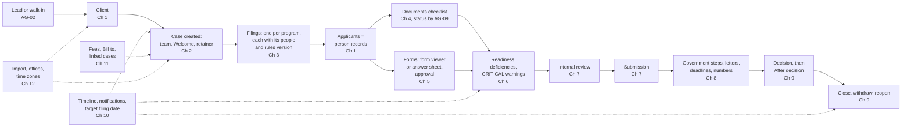
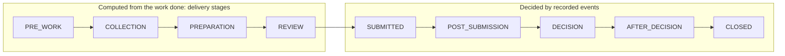
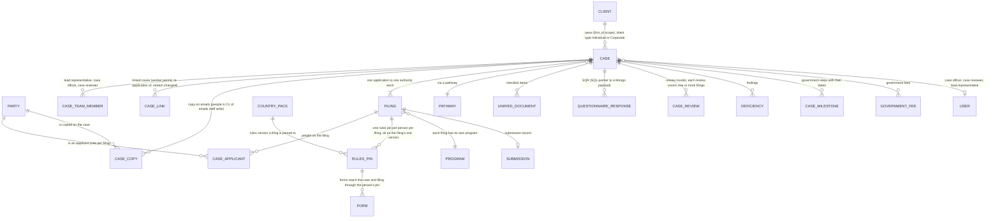
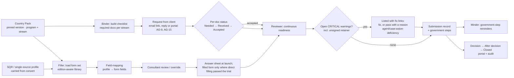
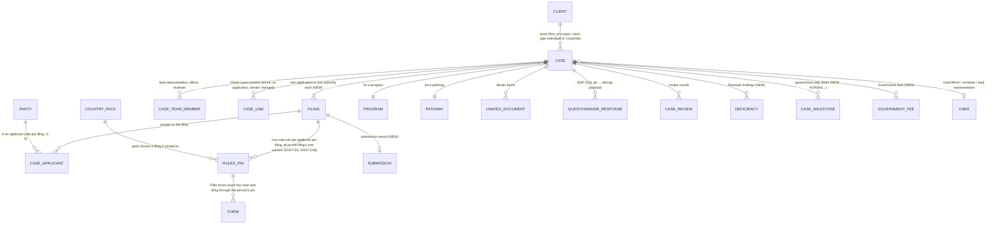
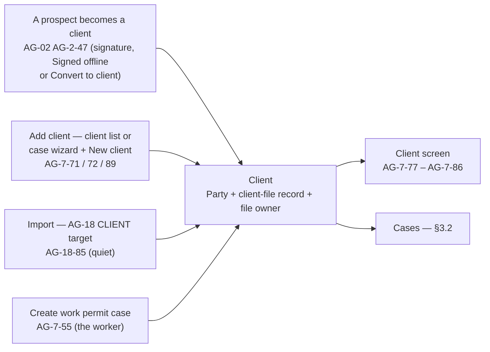

# AG-07 Case Core & Delivery

Version 3.12 · 28 Oct 2026 · Status: build review decisions applied where they affect AG-07 (BUILD-1, BUILD-2, BUILD-3, BUILD-5, BUILD-7 to BUILD-13, BUILD-17 A7 to A16, BUILD-18, BUILD-19, BUILD-25, BUILD-26, BUILD-27; the product owner, 27–28 Oct): the client file is AG-02's `ClientFile`, one client-file step for every AG-07 way in, Add client keeps "Create anyway", a firm-service case closes as Completed, withdraw and correction rules per filing, an acknowledged CRITICAL warning still counts, a reopened case stays open, On hold freezes the target filing date, imported matters with no programme; earlier: CC-8 applied: only emails a person writes are copied; system emails go to their usual recipient with no Cc (the product owner, 26 Oct); earlier: AG-7-15 pointers aligned with AG-19 v1.10 and AG-09 v1.26 (AG19-D71 Accept new files; rule 11: the note counts files that are not government forms, no button when every file is a government form, the document-edit key; the product owner, 26 Oct 2026: approved); earlier: AG-7-15 rule 11 aligned with AG-19 v1.7 (AG-19-4 rule 5, AG-19-18 rule 3; pointer only; the product owner, 25 Oct 2026: "yes" to the PDF Studio review fixes); earlier: MS-D24 and writer follow-ups applied in place (25 Oct, later); money slice and AG-05 review applied in place (the product owner, 25 Oct: firm-service case kind AG-7-111, Fees panel, trust, close-out and owes line pointer AG-7-112, case header balance, currency lock, invoicing an unsigned case is a warning, several signers and the stored signature); earlier: Duplicates + copy on emails applied (the product owner, 24 Oct); earlier: AG-19 decisions D29, D32, D33 and D34 applied as pointers (the product owner, 23 Oct, later); earlier: AG-19 decisions D18 and D21 applied as pointers (the product owner, 23 Oct); AG-19 PDF Studio decisions applied (the product owner, 22 Oct); AG-04 review decisions applied (the product owner, 21 Oct)
Replaces v3.11, which is frozen in `_archive/`. Do not build from v3.11 or earlier. v3.12 is the only build source.
Previous version: `_archive/AG-07-case-core-and-delivery_v3.11_2026-10-27.md`
v3.12 is the only build source (AG07-D21). v3.12 applies the build review decisions that affect AG-07 (D1.12; change log D4.3): AG-7-69 rule 8 (the client-file step), AG-7-70, AG-7-71, AG-7-72, AG-7-73, AG-7-87, AG-7-88, AG-7-111, AG-7-26 to AG-7-28, AG-7-62, AG-7-49, AG-7-50, AG-7-58, AG-7-13, AG-7-91, AG-7-63, AG-7-53, AG-7-55, AG-7-75 (Unassigned clients), AG-7-34, AG-7-39 (events now, notices later), C1 to C4 and C6, and ten new questions in D9 (Q133 to Q142; Q141 and Q142 answered by BUILD-18 and BUILD-19). A2 re-copied from `99-Phasing-and-Glossary_v1.22_2026-10-28.md`. v3.11 applied CC-8: only emails a staff member writes on the case are copied to the case's copy list; the Welcome goes to the client only, with its portal set-up line (A2, AG-7-1 rule 12, AG-7-97, AG-7-103, C3.8a, D1.10; change log D4.3). v3.10 aligns the AG-7-15 pointers with AG-19 v1.10 and AG-09 v1.26: Accept new files (AG19-D71) and rule 11 (change log D4.3). v3.9 aligned the AG-7-15 rule 11 pointer with AG-19 v1.7: no button on a line with no file, and the quiet note's two links (change log D4.3). Requirement IDs, decision IDs and permission keys are the same as in v2.13. v3.1 added AG07-D28 and card AG-7-109. v3.2 applies the AG-02 review decisions (D1.5; change log D4.3). v3.3 applies the AG-04 review decisions: pointer card AG-7-110, booking a call from the case (D1.6; change log D4.3). v3.4 applies the AG-19 PDF Studio decisions: AG-7-15 rule 11, "Open in PDF Studio" and the quiet "N files – combine into one PDF?" note on a Binder line (D1.7; change log D4.3). v3.5 adds pointers for AG19-D18 (Replace and Remove a file; a client upload always adds) and AG19-D21 (the case's To file list): AG-7-15 rule 12, AG-7-17, AG-7-18 (D1.8; change log D4.3). v3.6 adds pointers for AG19-D29 (until submissions record their files, only Accepted files are kept as evidence; cross-link to D9 Q55), AG19-D32 (a reply to a request for several documents waits on the To file list with one-click targets), AG19-D33 (the To file list carries over from the prospect) and AG19-D34 (Replace, Remove and File to line use `agent/document:edit`): AG-7-15 rule 12 and field 8, AG-7-18 rule 2, AG-7-31 rule 6, D9 Q55 (D1.9; change log D4.3). v3.7 applies the duplicate checks and Copy on emails (DUP-1, DUP-2, DUP-9, CC-1 to CC-7; the product owner, 24 Oct): AG-7-1 rules 9 to 12, AG-7-97 rules 6 to 15, AG-7-103 rule 4, AG-7-107 rules 9 to 16, AG-7-89 field 7, new data section C3.8a `CaseCopy` (D1.10; change log D4.3).

---

# Part A — Start here

**Read Part A, then only your chapter.** Part A is about 4,000 words. A chapter in Part B is 4,000 to 10,000 words. You do not need the rest of the file to build one chapter.

This file is longer than v2.13. That is on purpose. Every requirement now has a full build card, so a developer or a coding agent can build from one card without asking a question. The size is not the problem to fix; the reading path is. Part A gives you the story, the words and the build order. One chapter gives you everything for your slice.

## How this file is laid out

| Part | What it holds |
|---|---|
| **A. Start here** | Purpose, key terms, the main flow, one worked example (the Client E family), build order. |
| **B. Build cards** | Twelve chapters, one card per requirement, in build order inside each chapter. |
| **C. Rules and tests** | C1 business rules, C2 state tables, C3 data model, C4 permissions, C5 non-functional rules, C6 what is built today, C7 acceptance tests that cross cards. |
| **D. Appendix** | Decisions, author defaults, knock-on status, history, closed questions, withdrawn items, the "Where did it go?" table, background. Nothing in D is a build instruction. |

The twelve chapters:

| Ch | Chapter | Ch | Chapter |
|---|---|---|---|
| 1 | Clients and people | 7 | Review and submission |
| 2 | Case creation and team | 8 | Government steps, letters, deadlines and numbers |
| 3 | Filings, rules versions and stages | 9 | Decision, after decision, close, withdraw, reopen |
| 4 | Documents | 10 | Timeline, notifications, target filing date and audit |
| 5 | Forms | 11 | Government fees, Bill to, linked cases, evidence bundle |
| 6 | Deficiencies and readiness | 12 | Import, offices and time zones |

## How to read a card

Every card has 14 fields, in this order: 1 Outcome, 2 Why, 3 Where, 4 Engine, 5 Rules, 6 States, 7 Data, 8 Access, 9 Events, 10 Safety, 11 Tests, 12 Edge cases, 13 Non-goals, 14 Mode. Field 5 starts with a Client E example, then numbered rules with `input → output`. Field 7 writes each field as `plain name (codeName: type)`. A word in a card that is a key term is defined once in A2 and is not redefined in the card. The card header shows the decision IDs that decide the rule and the build status: Built, Partly built, Not built, or Pointer.

---

## A1 — Purpose in five lines

1. **What it is.** AG-07 is where a retained client becomes a delivered application. It is the workspace a firm lives in for the months a case runs.
2. **What it covers.** Clients, cases, filings, documents, forms, readiness, internal review, submission, government steps, the decision, the work after the decision, and closing the case.
3. **The outcome.** No case is submitted with an unseen critical problem, and no government deadline is missed.
4. **How.** The checklist, the forms and the government steps come from the country pack, per program. Nothing is hard-coded per country. One module delivers a Canada PR file, an Australia skilled file or a UK Skilled Worker file with no code change.
5. **What it never does.** It never blocks the firm: it warns, and the person decides (BR-19, BR-26). The only hard stops are BR-26's five product floors, one of which is a government form that fails its own Validate (AG07-D28). It never sends anything to a government itself (AG11-D1). It sends no automatic client message on a submission, a government step or a decision. Each is a class-2 box that a person ticks and sends (AG16-42). Two kinds of message do go out by themselves: class-1 messages such as "Document needs replacing", and the firm's own chase rows on the Automatic messages page (AG-12).

**Who uses it.** The case officer does the daily work. The lead representative (a licensed user) owns correctness and signs. The case reviewer checks the case before submission. The Case Manager watches workload and target filing dates. The Owner sets the firm's rules and holds the professional approvals. Billing / Finance sees an overdue invoice on the case header; it is not a deficiency (AG07-D7). The client sees progress by email and, if the firm uses it, the portal (AG-15, AG16-92), never on this screen.

**Rule box — we work for the firm, not the regulator (BR-26).**
  > **BR-26** (copied from Part C1): <!-- br:BR-26 -->ExpatReady ships safe defaults and keeps a record of what happened. The firm decides. ExpatReady never reports to a regulator, never declares a firm non-compliant and never blocks the firm's own licensed judgement. A CRITICAL warning is passed with a reason, not enforced (AG17-D17). Copy in this module talks about protecting the practice. It never cites a regulator's code section as a rule. Five product floors stay fixed because they protect ExpatReady's own product. A person approves AI-written text before it reaches a client. Nothing is ever fabricated (BR-7). ExpatReady submits nothing to an authority. AI processing waits until the provider terms are recorded (AG11-D13). A government form that fails its own Validate cannot be sent for approval or approved, because a form without its barcodes is broken; a draft can still be downloaded. This is the one stated exception to "warn, never block" (AG07-D28(23)).<!-- /br -->

---

## A2 — Key terms

<!-- KEY-TERMS: copied by script from 99-Phasing-and-Glossary; do not edit here -->

<!-- term:case -->
**Case** (`Case`) — A case is the firm's work for one client in one destination country. It holds one or more filings and the people on them. *Example:* Case C-2026-00012 is the Client E family's move to Canada. It holds three filings. They are Client B's employer-specific work permit, Client A's open work permit and Client D's study permit. *Not the same as:* a filing, which is one application inside a case.
<!-- /term -->

<!-- term:client -->
**Client** (client file record and `Party`) — A client is the person or employer the firm works for. It is a person record, or an employer record, with a client file record added. *Example:* Client B became client CL-00001 when his retainer was signed by him and by the firm (one of the three ways to become a client, AG02-D2). *Not the same as:* an applicant, who is any person named on a filing.
<!-- /term -->

<!-- term:client-file-record -->
**Client file record** (`ClientFile`) — The client file record holds the firm's own details for one person or employer who is a lead or client: the lifecycle stage, the client number, the file owner and the office. It is AG-02's table; client fields never go on the person record (BUILD-1). It is created when a person becomes a lead, or when a person becomes a client directly through Add client, the client import, a work-permit case or "make this person a client" (BUILD-3). *Example:* Client B becomes a client. His record shows client number CL-00001, file owner Client C and his office. *Not the same as:* the person record, which holds name, email, phone and language.
<!-- /term -->

<!-- term:person-record -->
**Person record** (`Party`) — Every real person on a case has one person record, kept once and reused on all their cases. Their details, answers and consent are stored with it. *Example:* Client D, age 8, gets her own person record when she is added to the case. Her record gives her no portal login and no emails. *Not the same as:* the client file record, which holds the firm's own fields.
<!-- /term -->

<!-- term:contact-screen -->
**Contact** (no code name) — Contact is only the name of a screen where staff see a person. It is not a record type and not a second table. *Example:* Staff open Client B on the Contact screen. What they see comes from his person record and his client file record. *Not the same as:* a Contact table. None exists, so older text about a Contact table means the person record.
<!-- /term -->

<!-- term:client-type -->
**Client type** (`clientType`) — The client type is Individual or Corporate. It comes from the program's pathway. Both types use the same case design, not two separate ones. *Example:* The Client E case is Individual. An employer's LMIA file is Corporate. LMIA means labour market impact assessment. *Not the same as:* a separate corporate case type. None exists; it is a case with client type Corporate.
<!-- /term -->

<!-- term:filing -->
**Filing** (`Filing`) — A filing is one application to one government authority. It has its own program, forms, fees, deadlines, rules version, people and decision. *Example:* Client B's employer-specific work permit is one filing. Client A's open work permit and Client D's study permit are two more, in the same case. *Not the same as:* a case, which can hold several filings.
<!-- /term -->

<!-- term:applicant -->
**Applicant** (`CaseApplicant`) — An applicant is a person named on a filing, with a role: principal, spouse, child or other. The role belongs to the filing, so one person can be principal on one filing and spouse on another. *Example:* Client B is the principal applicant on his work permit filing. Client A is the principal applicant on her own filing, and Client D on hers. Spouse or child is used when a family member is included in someone else's filing. *Not the same as:* the client, who is the person or employer that hired the firm.
<!-- /term -->

<!-- term:related-contact -->
**Related contact** (`PartyRelationship`) — A related contact is a person linked to one case who is not an applicant. Examples are a brother, an HR contact or an agent. Staff who can edit cases add one, with a relationship. It uses the person record, so there is no separate table. *Example:* Client C adds Client Q, Client B's brother, with the relationship "brother". His email address now counts as linked to the case when mail is filed. *Not the same as:* an applicant, who is named on a filing.
<!-- /term -->

<!-- term:firm-service-case -->
**Firm-service case** (`Case.kind = FIRM_SERVICE`) — A firm-service case is a simple case for something the firm sells that is not a pack programme. It has no pack programme, filing, government form, government fee table, government deadline or readiness. Its states are Open and Done. It has tasks, documents, notes, messages, a Fees panel, invoices, trust and close-out. It needs no retainer unless the service says so. **Mark done** closes it as Closed with the outcome Completed (BUILD-7). It is reopened with the same key as Mark done, a reason and an audit entry (BUILD-26). *Example:* Maple opens "Firm service: Resume review" for Client B's wife and marks it done. *Not the same as:* a case on a pack programme.
<!-- /term -->

**Fees panel** (pointer, AG-7-112) *(MS-D4, MS-D18)* — The panel on a client or a case that shows what was agreed: the services with fees, the schedule rows, the disbursement estimate and what is already billed. It is one component, also used by the retainer, an amendment and a Service's defaults (AG-05). Each schedule row has **Bill this** (AG-06). *Example:* Client B's panel shows "Deposit on signing CAD 1,000" and "On submission CAD 2,000". *Not the same as:* the Government fees section (AG-7-51).

**Close-out** (pointer, AG-7-112) *(MS-D12)* — The money step when a case ends: a final statement, every unbilled item, a final invoice, "Pay from trust", refunds, and "Mark settled". It is AG-06's; the case only shows the item. *Example:* "Settle Client B's money: CAD 600 in trust, by 24 Nov". *Not the same as:* closing the case (AG-7-34), which it never blocks.

<!-- term:people-on-this-case -->
**People on this case** (no code name) — People on this case is a panel on the case screen that lists everyone on the case, with a **Copy on emails** tick beside each person (AG-7-97 field 3). Everyone on the case means the client, the applicants, the employer contacts of an employer client, the related contacts and the people on the copy list (AG-7-97 rule 1). *Example:* The Client E panel lists Client B, Client A, Client D and Client Q (brother). Client C ticks Copy on emails beside Client A. *Not the same as:* the case team (case officer, case reviewer, lead representative), which is firm staff; firm staff are never labelled "Not on this case" (AG-7-97 rule 1). *(added 25 Oct — CC-5)*
<!-- /term -->

<!-- term:copy-on-emails -->
**Copy on emails** (`CaseCopy`) — Copy on emails is the case's list of people who get a copy (Cc) of the emails staff write on the case. System emails (Welcome, links, reminders, invoices, signing, portal invitation) go to their usual recipient only, never copied (AG-10-89). The list is kept on the case (AG-7-97 rule 6, C3.8a). Staff add a person with the tick on People on this case or on the Add to case form, and "How did the client ask?" is offered, never required (AG-7-97 rules 7, 8). *Example:* Client B emails Client C with his brother Client Q in Cc. Client C clicks Add to case for Client Q; Copy on emails is already ticked and the source reads "Client copied them". From then on, every email Client C writes to Client B on C-2026-00012 has Client Q in Cc. Client B's questionnaire link and reminders still go to Client B alone. *Not the same as:* a consent or authorisation record; it is a firm instruction to send copies, kept on the case only, with no list on a lead, prospect or client (AG-7-97 rule 6). Nor is it a related contact: a copy creates no `PartyRelationship` (AG-7-97 rule 9). *(added 25 Oct — CC-1, CC-2, CC-5; changed 26 Oct — CC-8)*
<!-- /term -->

<!-- term:stop-copying-someone -->
**Stop copying someone** (no code name) — Stop copying someone is the no-login link at the end of the footer "Copied on this case: <full names>. Stop copying someone", which every email a staff member writes with copy-list people in Cc carries (AG-10-89 rule 6). System emails are never copied, so they never carry it (AG-10-85 rule 7). It opens a small page listing the copied people named in that footer, each with a "Stop copying <name>" button; a click removes that person from the case's copy list at once, and earlier emails are unchanged (AG-10-85 rule 7). Anyone holding the email may use it. *Example:* Client A, copied on an email Client C wrote to Client B, taps "Stop copying someone", then "Stop copying Client A". She gets no further emails on that case. *Not the same as:* **Stop copying** on the People on this case panel, which staff use; both end the same copy-list row (AG-7-97 rule 10). *(added 25 Oct — CC-4; changed 26 Oct — CC-8)*
<!-- /term -->

<!-- term:file-owner -->
**File owner** (`fileOwnerUserId`) — The file owner is the staff member who owns a client. It is set on the client file record, not on a case. It is set from the facts: an existing file owner stays; otherwise the person who adds the client, the person who makes someone a client, the employer's file owner for a work-permit case, or the owner the import gives (BUILD-18). A client with no file owner shows in **Unassigned clients**, where anyone who can edit clients can **Take it** or **Assign** it, even with own-only visibility (BUILD-25). *Example:* Client C is file owner of client CL-00001. *Not the same as:* the case officer, who does the day-to-day work on one case.
<!-- /term -->

<!-- term:case-number -->
**Case number** (`caseCode`) — The case number is the firm's reference for a case, such as C-2026-00001. It is the letter C, the year and a 5-digit counter that restarts each year. *Example:* The Client E case is C-2026-00012, the 12th case the firm opened in 2026. The server sets it; it is never edited or reused. *Not the same as:* the client number or the government's application number.
<!-- /term -->

<!-- term:client-number -->
**Client number** (`clientCode`) — The client number is the firm's reference for a client, such as CL-00001. It is CL and a 5-digit counter for the firm, with no year. The screens show it as "Client code". *Example:* Client B is client CL-00001, and all his cases show that number. It is never edited or reused. *Not the same as:* the case number, which includes a year.
<!-- /term -->

<!-- term:lead-representative -->
**Lead representative** (`LEAD_REPRESENTATIVE`) — The lead representative is the licensed person whose licence backs the case. It is filled in from the signed retainer or the firm's default, and a case may have none. *Example:* Client F is lead representative on the Client E case because she signed the retainer. If Client G were to sign instead, a warning shows: "Client F is this case's lead representative. Client G will sign this retainer." It never blocks. *Not the same as:* the case officer, who does the day-to-day work.
<!-- /term -->

<!-- term:licensed-user -->
**Licensed user** (no code name) — A licensed user is an active user whom the firm has linked to a professional credential. ExpatReady does not check the licence. Only licensed users are offered as lead representative. *Example:* Client F is a licensed user. Client C is not, so he is never offered as lead representative. *Not the same as:* a role such as Owner or Admin, which says what a user may do.
<!-- /term -->

<!-- term:case-officer -->
**Case officer** (`OFFICER`) — The case officer does the day-to-day work on a case: documents, forms and getting it ready. A paralegal does this job too, so there is no separate paralegal role. *Example:* Client C is case officer on the Client E case and collects the family's documents. *Not the same as:* the lead representative, who is accountable for the file.
<!-- /term -->

<!-- term:case-reviewer -->
**Case reviewer** (`REVIEWER`) — The case reviewer is the team member who checks a case before it is submitted. A case may have none, and a missing reviewer does not make it Unassigned. *Example:* Client I is the case reviewer on the Client E case and approves it before Client F records the submission. *Not the same as:* the Reviewer Doer, which works out what is missing on a case by fixed rules.
<!-- /term -->

<!-- term:unassigned -->
**Unassigned** (no code name) — A case is Unassigned when it has no case officer. A missing reviewer or lead representative does not make it Unassigned. *Example:* The Client E case has no case officer yet, so it appears in the Unassigned list. *Not the same as:* "Needs a lead representative", a separate filter for cases with no lead representative.
<!-- /term -->

<!-- term:take-it -->
**Take it** (`agent/case:edit`) — Take it is one click that makes you the case officer of an unassigned case. Anyone who can edit cases may use it, for themselves only. *Example:* Client C clicks Take it on the Client E case and becomes its case officer. Adding a colleague instead needs the permission to assign cases. *Not the same as:* Take it on a mailbox conversation, which makes you the owner of an email thread.
<!-- /term -->

<!-- term:needs-a-lead-representative -->
**Needs a lead representative** (no code name) — Needs a lead representative is a filter for cases that have no lead representative. It is separate from Unassigned. A missing lead representative warns at submission and never blocks. *Example:* A walk-in case has no retainer and the firm has no default, so it shows under Needs a lead representative. *Not the same as:* Unassigned, which means no case officer.
<!-- /term -->

<!-- term:welcome-message -->
**Welcome message** (no code name) — The Welcome is an email offered in a ticked box when a case is created. It is one email, even for a family case, To the case's client only. It is a system email, so it is never copied (AG-10-89). It carries the no-login links for the first to-dos and one optional portal set-up line (AG-7-103 rules 4, 6). *Example:* Client C creates the Client E case, and "Send Welcome — your case has started" to Client B is ticked. The one Welcome goes to Client B alone. Client A is on the copy list but gets no copy, and Client D gets none. *Not the same as:* a portal invitation, because the Welcome needs no login. *(changed 25 Oct — AG-7-103 rules 4 and 6, CC-2; changed 26 Oct — CC-8: To the client only, never copied)*
<!-- /term -->

<!-- term:class-2-message-box -->
**Class-2 message box** (no code name) — A class-2 message box is a ticked "Send …" box offered when staff record an event. The message goes only on the person's click, and unticked sends nothing. *Example:* Client F records the submission, and the box "Send 'Application submitted' to Client B" is ticked. She clicks Save, and the email goes. The firm may set a box to start unticked. *Not the same as:* an automatic message, which sends with no person's click.
<!-- /term -->

<!-- term:country-pack -->
**Country pack** (`CountryPack`) — The pack is the set of programs, forms, document lists and government steps that ExpatReady keeps for one country. Firms use it but cannot change it. They can only add document requests to a case. *Example:* The Client E case runs on the Canada pack, so its forms and government steps come from there. *Not the same as:* a Playbook, which is a ready-made automation.
<!-- /term -->

<!-- term:rules-version -->
**Rules version** (`PackWorkPin`) — The rules version is the version of the country pack that a filing follows. Each person on a filing has their own rules pin. All the pins on one filing are on the filing's one version. *Example:* Client B's filing started on rules version 3. It stays on version 3 while in progress, even after version 4 is published. *Not the same as:* a form edition, which is the version of one government form.
<!-- /term -->

<!-- term:use-newer-rules -->
**Use newer rules** (`agent/pack:adopt`) — Use newer rules moves a filing to the current rules version with one click. It needs a reason, pre-filled as "Adopting the current rules". It moves every person's pin on that filing together. *Example:* Client F clicks Use newer rules on Client B's filing. His pin moves to version 4, and his added document requests move too. *Not the same as:* adding a filing later in the same case, which starts on the case's current rules version. If filings differ, it uses the principal's filing version.
<!-- /term -->

<!-- term:stage -->
**Stage** (`CaseStageDef`) — A stage is one position on the case board. There are nine kinds of stage, from PRE_WORK to CLOSED. ExpatReady works out a case's stage, and before submission staff may move it forward by hand. *Example:* The Client E family has started uploading documents but no forms, so the case is at Uploads. After submission, the stage follows the latest recorded event. *Not the same as:* a government step, which is an event recorded for one person, not a board position.
<!-- /term -->

<!-- term:delivery-stage -->
**Delivery stage** (`kind` PRE_WORK to REVIEW) — A delivery stage is a stage before submission, such as Questionnaire, Uploads or File preparation. It is the firm's own delivery work. The platform sets these stages, and the country pack does not. *Example:* Client C starts Client B's first form, so the Client E case moves on from Uploads to File preparation. *Not the same as:* a government step, which comes from the authority, not from the firm's own work.
<!-- /term -->

<!-- term:stage-kind -->
**Stage kind** (`kind`) — The kind of a stage tells ExpatReady how the stage behaves, whatever its label says. The nine kinds are PRE_WORK, COLLECTION, PREPARATION, REVIEW, SUBMITTED, POST_SUBMISSION, DECISION, AFTER_DECISION and CLOSED. A stage of kind SUBMITTED or later is reached only by recording an event. *Example:* Client C cannot drag the Client E card into a post-submission stage. He records "Biometrics requested", and the card moves. *Not the same as:* a stage label, which the wording of a pack may change.
<!-- /term -->

<!-- term:board-placement -->
**Board and manual placement** (`agent/case:edit`) — The board shows one card per case, at the stage ExpatReady works out. Before submission only, staff may move a card forward, never back. The card then reads "Placed manually by <name>, <date>", with "Back to automatic". *Example:* Client C moves the Client E card forward to File preparation. The placement clears itself when the work catches up. *Not the same as:* dragging after submission, which is not allowed. A case with several filings is still one card, with one chip per filing.
<!-- /term -->

<!-- term:on-hold -->
**On hold** (no code name) — On hold is a label on an open case. While it is on, the queue shows "On hold" in place of the target filing date colour, and no target filing date reminder is sent. The date does not change (BUILD-12). When the hold ends, the colour and the later reminders return. Reminders missed during the hold are not sent; if the date has passed or is amber, one "back from hold" item appears in Needs you (BUILD-19). It is not a board column, so the card stays in its stage. *Example:* The Client E case is On hold from 9 to 23 Nov 2026. Its target filing date stays 20 Nov, and on 23 Nov Client C gets one item: "back from hold … Keep or change it?". *Not the same as:* Closed, because an On hold case is still open.
<!-- /term -->

<!-- term:checklist -->
**Checklist** (`CaseDocument`) — A checklist is the list of documents a filing needs, one line per document and person. It comes from the pack plus any document requests staff add, and each line shows its document status. *Example:* Client A's line "Passport copy" shows Needed until a file arrives. *Not the same as:* the review checklist, which the reviewer ticks before submission.
<!-- /term -->

<!-- term:document-request -->
**Document request** (`agent/pack:extend`) — A document request adds one more document to a filing's checklist for one person. Staff pick a type from the pack or Other, then choose the person; the default is the principal. *Example:* Client C picks Other, types "School letter", chooses Client D and leaves "Ask the client now" ticked. He can delete it until it is sent or a file arrives. After that it can only be set to Not needed. *Not the same as:* hiding a standard checklist item on a new case, which is `agent/case:configure-pack`.
<!-- /term -->

<!-- term:document-status -->
**Document status** (no code name) — Every checklist document has one of five statuses: Needed, Received, Accepted, Needs replacing or Not needed. The words match the client emails "Document received" and "Document needs replacing". *Example:* Client B's passport goes from Needed to Received, and Client C sets Accepted. Client A's marriage certificate is set to Needs replacing with the reason "photo is blurred", and the client is asked again. *Not the same as:* "Superseded" and "Quarantined", which are states of the file, not statuses.
<!-- /term -->

<!-- term:binder -->
**Binder** (Doer) — The Binder is the Doer that builds a filing's checklist from the pack. A Doer is one of ExpatReady's helpers that does a fixed job. The Binder shows each document's status but stores none. *Example:* The Binder lists "Passport copy" for each of the three Client E family members. *Not the same as:* the document module, which stores the files and their statuses.
<!-- /term -->

<!-- term:filler -->
**Filler** (no code name) — The Filler prepares government forms from the person's verified details. Its output depends on the form. A form whose edition passed the trial opens pre-filled in the form viewer. Every other mapped form gets an answer sheet (AG07-D28). The Filler is on every plan. *Example:* Client C runs the Filler on Client B's forms. IMM 5257 opens in the form viewer, and IMM 0008 shows an answer sheet. Client F must still approve each form. *Not the same as:* the Drafter, a separate non-AI document generator.
<!-- /term -->

<!-- term:answer-sheet -->
**Answer sheet** (no code name) — An answer sheet lists every value of a government form, in the form's own order. Each value has a copy button, so staff paste it into the PDF or portal form themselves. It is the output for every mapped form that is not on the form viewer: a portal web form, or a PDF whose edition has not passed the trial (AG07-D28). *Example:* Client C opens the answer sheet for Client B's IMM 0008 and copies each value into the government site. He stays responsible for the final form. When he attaches the final form, he ticks "Signed by client". *Not the same as:* the form viewer, which shows the real government form, filled.
<!-- /term -->

<!-- term:form-viewer -->
**Form viewer** (no code name) — The form viewer shows the real government form inside ExpatReady. The form is pre-filled by the Filler, staff can edit it, and the form's own rules validate it. It is used only for a form whose edition passed the trial (AG07-D28). Approval produces the final PDF: the filled, validated government form. *Example:* Client C opens Client B's IMM 5257 in the form viewer, corrects "Employer" on the page and clicks **Send for approval**. Client F clicks **Approve & download** and gets the final PDF. *Not the same as:* the answer sheet, which is a list of values to copy, and not a flattened file, which would lose the live form and its barcodes.
<!-- /term -->

<!-- term:form-approval -->
**Form approval** (`agent/case:form-approve`) — Form approval is a person with the form-approve permission accepting a prepared government form. Every form needs it, and a person may approve a form they prepared; it is recorded as self-approved. *Example:* Client C prepares Client B's form and Client F approves it, from the case screen or from Needs you. *Not the same as:* internal review, which checks the whole case.
<!-- /term -->

<!-- term:form-edition -->
**Form edition** (`FormEdition`) — A form edition is the version of one government form, with an effective date from the pack. A newer edition makes the form show "form out of date" and offers a re-bind. A retired edition is a CRITICAL warning, never a stop. *Example:* A newer edition appears. Client B's form shows "form out of date", and a re-bind carries his values forward. *Not the same as:* a rules version, which is the version of the whole country pack.
<!-- /term -->

<!-- term:override -->
**Override** (no code name) — An override is a staff correction to one auto-filled value on one form. The person's own answers do not change. Pushing the correction back to the person's answers is a separate, explicit action. *Example:* Client C corrects Client B's employer name on the form only. Client B's answers still show the old name. *Not the same as:* verifying a value, which makes it usable by the Filler.
<!-- /term -->

<!-- term:verified-value -->
**Verified value** (`agent/sqr:verify`) — A value from the Reader or an import is unverified until a person checks it. Only verified values fill forms. An unverified value shows beside the field as "unverified — verify to use". *Example:* An imported passport number shows "unverified — verify to use". Client C verifies it, and the Filler can then use it. *Not the same as:* accepting a document, which is a different act.
<!-- /term -->

<!-- term:must-verify-before-filing -->
**Must verify before filing** (`mustVerifyBeforeFiling`) — Must verify before filing is a yes/no flag on a library canonical field, default no, set only by ExpatReady's content team with the Immigration-SME; firms have no setting (SA-01B SA-1B-1, SA1B-D42). An unverified fact on a flagged field is a CRITICAL deficiency at the filing step, passed only with `agent/case:waive-deficiency` and a reason; nothing is locked (AG-8-27, BR-9, AG17-D25). *Example:* The passport-number field is flagged yes. Until Client C verifies Client B's passport number, the filing step lists it as a CRITICAL deficiency. *Not the same as:* the immigration-significant flag, which only controls whether a value may go into a message (SA1B-D42). *(added 25 Oct — SA1B-D42)*
<!-- /term -->

<!-- term:immigration-significant -->
**Immigration-significant** (no code name) — Immigration-significant is a flag on a library canonical field and on a template fill-in field (dates, status, numbers, program): such a field renders in a message only from a verified value, otherwise the send drops to Ask me first with the field flagged (SA-1B-1, SA1B-D37; SA-5-64; AG-11-97). Which fields carry it is pack content, set with the Immigration-SME (AG-11-97). *Example:* An automatic message to Client B would fill in an unverified immigration-significant date, so it waits in Needs you instead of sending. *Not the same as:* must verify before filing, a separate flag that raises a CRITICAL deficiency at the filing step and has nothing to do with messages (SA1B-D42). *(added 25 Oct — SA1B-D42)*
<!-- /term -->

<!-- term:self-approved -->
**Self-approved** (`selfApproved`) — Self-approved is recorded when the person who approves a form also prepared it. It is never blocked. The approver's name, time and the self-approved flag show in the form's history. *Example:* Client F prepares and approves Client D's form, so it shows "self-approved". *Not the same as:* a rule that needs a second approver. No such rule exists.
<!-- /term -->

<!-- term:needs-you -->
**Needs you** (no code name) — Needs you is each person's list of drafts and proposals waiting for their approval. Nothing in it runs by itself, and a draft is approved inline when the approver is already acting. *Example:* A Filler draft for Client B's form waits in Client F's Needs you until she approves it. *Not the same as:* the whole Home screen, because Needs you is only section 1 of it.
<!-- /term -->

<!-- term:deficiency -->
**Deficiency** (`Deficiency`) — A deficiency is a gap found on a case, such as a missing document or an unsigned retainer. Each has a severity: critical, major, minor or info. Only critical ones must be fixed or passed with a reason. *Example:* Client D's school letter is not accepted yet, so a critical warning shows on her filing. At review approval Client I passes it with a reason, and nothing is blocked. *Not the same as:* an overdue invoice, which shows on the case header instead.
<!-- /term -->

<!-- term:deficiency-library -->
**Deficiency library** (`DeficiencyLibraryItem`) — The deficiency library is ExpatReady's list of checks for each country and program. Firms cannot edit it, but staff can add a one-off deficiency to a case by hand. The checks are on every plan. *Example:* The library raises "Passport copy missing" for Client A. Client C adds a one-off item, "Translate Client D's school letter". *Not the same as:* the Checker, which compares values across documents and forms.
<!-- /term -->

<!-- term:readiness -->
**Readiness** (`NOT_READY`, `ATTENTION`, `READY`) — Readiness shows how close a filing is to submission: Not ready, Attention or Ready, plus a percentage score. Not ready means a critical deficiency is open and not passed. Attention means an open major one; otherwise Ready. The case shows the lowest. *Example:* Client B's filing is Ready, Client A's is Attention and Client D's is Not ready, so the Client E case shows Not ready. A gap passed with a reason counts as finished in the score. *Not the same as:* a lock, because readiness never blocks any action.
<!-- /term -->

<!-- term:severity -->
**Severity** (`Deficiency` severity) — Every deficiency has a severity: CRITICAL, MAJOR, MINOR or INFO. The pack sets the severity of each check. Only an open CRITICAL deficiency needs to be fixed or passed. *Example:* The Checker finds a name mismatch on Client A's certificate. It is MAJOR, so it is shown and nothing more is needed. *Not the same as:* readiness, which is worked out from the severities.
<!-- /term -->

<!-- term:critical-warning -->
**CRITICAL warning** (`agent/case:waive-deficiency`) — A CRITICAL warning is a deficiency of severity CRITICAL that is open or acknowledged. Acknowledging it only records that someone has seen it; it still counts until it is resolved or passed (BUILD-9). It is listed when the case goes into review and at submission. An unapproved or unsigned form is one. It is fixed or passed with a reason, and it never locks the case. *Example:* Client I passes Client D's warning with the reason "Original sent by courier". The pass holds until the underlying fact changes. *Not the same as:* a block. ExpatReady warns and never blocks.
<!-- /term -->

<!-- term:checker -->
**Checker** (Doer) — The Checker is an AI Doer. It compares names, dates and numbers across documents, answers and forms. Each mismatch becomes a warning on the case, with the values compared. A Checker warning never locks the case. *Example:* "Client E" on the passport and "Client U" on the certificate give a warning. *Not the same as:* the deficiency library, which holds fixed checks written by ExpatReady.
<!-- /term -->

<!-- term:internal-review -->
**Internal review** (`CaseReview`) — Internal review is a colleague's check of one or more filings before they are submitted. Each filing has its own review status. One review may cover several filings. Anyone who can edit cases may send filings for review. The reviewer approves them or sends them back with reasons. *Example:* On Wed 18 Nov 2026 Client C sends the three Client E filings for review in one request. Client I approves it after confirming one unticked checklist item. *Not the same as:* form approval, which covers one form only.
<!-- /term -->

<!-- term:changed-since-review -->
**Changed since review** (no code name) — Changed since review is a note on a filing that changed after its review was approved. It is worked out when the case is read, and no field stores it. It does not undo the approval. At submission it asks for one confirmation. *Example:* After Client I's approval, Client C replaces Client D's school letter on Thu 19 Nov 2026. Her filing shows "Changed since review: school letter replaced, Client C, 19 Nov". *Not the same as:* a review sent back, because the approval stands.
<!-- /term -->

<!-- term:submission -->
**Submission** (`Submission`) — A submission is the record that a filing was sent to the government authority. It keeps the date, the authority, the application number of each filing and each person's UCI as sent. *Example:* On Fri 20 Nov 2026 Client F records the submission of all three Client E filings. No critical warning is open, because Client I passed Client D's at review approval. *Not the same as:* a government step, because steps are recorded after the submission.
<!-- /term -->

<!-- term:government-step -->
**Government step** (`CaseMilestone`) — A government step is an event from the authority, such as acknowledgement of receipt or biometrics. Staff record each one with its date, for one person and one filing, and most come after submission. *Example:* On Wed 2 Dec 2026 Client C records "Biometrics requested" for Client A, due Fri 1 Jan 2027. That is one government step. *Not the same as:* a stage, which is a position on the board.
<!-- /term -->

<!-- term:step-done -->
**Step done** (`CaseMilestone.doneAt`) — Step done marks a government step as finished, with a date. Anyone who can edit cases may use it. It stops the reminders of that step. *Example:* On Mon 14 Dec 2026 Client A gives her biometrics, so Client C clicks Step done on "Biometrics requested". Its reminders stop. *Not the same as:* "Mark done" on a letter task, which closes only the task.
<!-- /term -->

<!-- term:deadline -->
**Deadline** (`dueDate`, `dueStatus`) — A government deadline is a calendar date by which something must be done. It sits on the government step. It is Suggested until a person confirms it, and reminders start only once it is Confirmed. *Example:* Client A's biometrics letter of Wed 2 Dec 2026 says "within 30 days". ExpatReady suggests Fri 1 Jan 2027. Client C confirms it, so the reminders start. *Not the same as:* the target filing date, which is the firm's own goal.
<!-- /term -->

<!-- term:government-date -->
**Government date** (no code name) — A government date is a calendar date that never moves for the firm's closed days. A reminder counted back from it lands on the last open day on or before the computed day. The case shows the date with its weekday. *Example:* The firm has closed 1 Jan. Client A's deadline stays Fri 1 Jan 2027. The "2 working days before" reminder lands on Wed 30 Dec 2026. *Not the same as:* the target date, which follows the firm's closed days.
<!-- /term -->

<!-- term:business-hours -->
**Business hours and closed days** (no code name) — Business hours are the days and hours the firm is open. The default is Monday to Friday, 9:00 to 17:00. The closed days are the firm's own list, empty at first, so every weekday counts as open. *Example:* The firm adds 1 Jan as a closed day. ExpatReady offers suggested holidays but saves nothing until the firm clicks Add. *Not the same as:* a government date, which closed days never move.
<!-- /term -->

<!-- term:application-number -->
**Application number** (`Filing.applicationNumber`) — An application number is the number a government authority gives to a filing. Each filing keeps its own. Mail that quotes one is matched to that filing. *Example:* A letter quotes application number W345678901, so ExpatReady files it to Client D's filing in the Client E case. *Not the same as:* the case number, which is the firm's own number.
<!-- /term -->

<!-- term:uci -->
**UCI** (`ClientCanonicalAnswer`) — The UCI is the 10-digit number Canada's immigration authority gives to one person. Every family member has their own, kept as an answer on that person's record. *Example:* Client B, Client A and Client D each have a different UCI. The submission keeps a copy of each as sent. *Not the same as:* the application number, which belongs to a filing.
<!-- /term -->

<!-- term:provincial-file-number -->
**Provincial file number** (`Case.provincialFileNumbers`) — A provincial file number is a number that a province gives to a filing. A case keeps a free-text list of them. Mail that quotes one is matched to the case. *Example:* Client C types the number a province gave a filing into the case's list. Later mail that quotes it is filed to that case. *Not the same as:* the application number, which the filing's authority gives.
<!-- /term -->

<!-- term:letter-library -->
**Letter library** (no code name) — The letter library is ExpatReady's list of known government letter types. Each entry gives the phrases that identify the letter, the standard action and the deadline rule. It also gives a suggested note to the client. It runs on mail and on uploaded PDFs. *Example:* Client A's biometrics letter is recognised from its phrases, and the library suggests a 30-day deadline. *Not the same as:* the deficiency library, which lists checks, not letters.
<!-- /term -->

<!-- term:tell-the-client -->
**Tell the client** (no code name) — Tell the client is the button on a letter task that sends the letter note to the client. It goes only on the person's click. It completes the letter task. *Example:* Client C confirms Client A's biometrics step and clicks Tell the client. Client B gets the letter note with the letter attached. *Not the same as:* a class-2 message box, which staff get when they record an event. A step recorded from a letter has no such box.
<!-- /term -->

<!-- term:decision -->
**Decision** (`Decision`) — A decision is the authority's answer on a filing, recorded with its outcome and date. Outcomes are Approved, Refused or others the pack defines; withdrawn is not a decision outcome. *Example:* On Wed 3 Mar 2027 Client F records Approved for Client B's and Client A's filings and Refused for Client D's. *Not the same as:* Withdraw, which staff record on the case before any decision and which closes it.
<!-- /term -->

<!-- term:after-decision -->
**After decision** (`AFTER_DECISION`) — After decision is the period after the decisions when the case stays open for follow-up work. The case enters it when every filing has a decision. It closes itself when that work is done, or staff close it with a reason. *Example:* After the decisions of 3 Mar 2027, the Client E case stays open until its follow-up items are done. Client B's permit-expiry reminder keeps working. *Not the same as:* Closed, which has no more work; reminders on recorded dates still run after it.
<!-- /term -->

<!-- term:reopen -->
**Reopen** (`agent/case:reopen`) — Reopening puts a closed case back at the stage it was closed from, on the same case. It needs the reopen permission and a reason, and keeps all history. *Example:* Client C reopens the closed Client E case with the reason "Late document". *Not the same as:* a linked case, which is a new case for a follow-on matter.
<!-- /term -->

<!-- term:linked-case -->
**Linked case** (`CaseLink`) — A linked case is a new case joined to an earlier one, for a follow-on matter. The link has a kind: worker permit, re-application of or stream changed. *Example:* After Client D's refusal, her re-application is a new case, linked to C-2026-00012. *Not the same as:* reopening, which continues the same case.
<!-- /term -->

<!-- term:withdraw -->
**Withdraw** (`agent/case:record-decision`) — Withdraw ends a filing before its decision. Staff record a date and a reason. Withdrawing the last open filing closes the case as Withdrawn, unless another filing of the case is decided; then the case enters After decision (BUILD-8). It is not offered for a filing that has its decision. *Example:* Suppose the family drops Client D's study permit before submission. Client F withdraws that filing alone, and the other two continue. *Not the same as:* a decision outcome, because withdrawn is not an outcome of a decision.
<!-- /term -->

<!-- term:close-outcome -->
**Close outcome** (`closeOutcome`) — A closed case keeps how it closed: Withdrawn, Stream changed, Completed or Closed by staff. *Example:* The Client E case closes itself when its follow-up items are done, with the outcome Completed. *Not the same as:* a decision outcome such as Approved or Refused, which belongs to a filing.
<!-- /term -->

<!-- term:change-stream -->
**Change stream** (`agent/case:create`) — Change stream is a button that opens a new linked case for a different program. It closes the old case with the outcome Stream changed. It needs only the create-case permission. *Example:* Suppose a one-filing case was opened under the wrong program. Client C clicks Change stream, and the new case is linked to the old one. *Not the same as:* reopening, which keeps the same case.
<!-- /term -->

<!-- term:target-filing-date -->
**Target filing date** (`targetFilingDate`) — The target filing date is the day the firm aims to submit its filings. It is optional and empty at first. Anyone who can edit cases sets it, and ExpatReady never fills it from processing times. A case has one date. It counts calendar days, not the firm's business hours. Reminders and colours stop when every filing that is not withdrawn is submitted or later. *Example:* Client C creates the Client E case on Thu 5 Nov 2026 and sets "Target filing date: Fri 20 Nov 2026". *Not the same as:* a government deadline, which comes from the authority and never moves.
<!-- /term -->

<!-- term:early-warning -->
**Early warning** (no code name) — The early warning turns a case amber in the last 20 % of its time. That time runs from creation to the target filing date and counts calendar days. The 20 % is fixed, and there is no setting for it. The case officer is reminded 2 days before the date and on the day. After the date the case is red, and Needs you shows "Past target filing date". There is no escalation. *Example:* The Client E window, 5 Nov to 20 Nov 2026, is 15 days. The last 20 % is 3 days, so the case turns amber on Tue 17 Nov. Client C is reminded on Wed 18 Nov and Fri 20 Nov. He files on the day, so nothing turns red, and the case then shows "Submitted 20 Nov · N days waiting". *Not the same as:* an alert. The colour sends nothing; only the two reminders and the Needs you line do.
<!-- /term -->

<!-- term:expiry-watch -->
**Expiry watch** (no code name) — Expiry watch reminds staff before a person's status expires, such as a work permit, study permit, visitor record or PR card. Staff get reminders 30, 15, 7 and 2 days before. For a closed case, one more comes 90 days before. The watch keeps running after the case closes. It stops by itself when a new expiry is recorded for the same status, or when a renewal or extension is submitted. Staff may also click "Stop watching" and give a reason. Clients get reminders 30 and 7 days before: on by default for an open case, off for a closed one, with an unsubscribe link in every email. *Example:* Client B's work permit expiry is recorded, so Client F gets reminders before it, even after the Client E case closes. *Not the same as:* a government deadline, which sits on a government step. The full list of status dates is specified in the AG-11 review.
<!-- /term -->

<!-- term:government-fees -->
**Government fees** (no code name) — Each case has a Government fees section. It lists every government fee of its filings with the amount, the payer, the status and the receipt. The payer is the client, or the firm on the client's behalf. When the firm paid, one action adds the fee to the invoice as a non-taxable line. *Example:* The firm pays the fee for Client D's study permit. One action adds it to the invoice, so it is recorded once. *Not the same as:* the firm's own professional fees.
<!-- /term -->

<!-- term:bill-to -->
**Bill to** (no code name) — Bill to is the client who receives the case's invoices. It is optional and defaults to the case's own client. Staff may pick another client of the firm. *Example:* Bill to defaults to Client B on the Client E case. *Not the same as:* the case's client, because Bill to can be a different client.
<!-- /term -->

<!-- term:shareable-document -->
**Shareable document** (no code name) — A shareable document is a document type that the pack marks as shareable. Only these cross a case link, and only as copies. A new version is offered with one click and never pushed. Financial and business documents never cross. *Example:* Suppose the pack marks "Passport copy" as shareable. It is then copied into a linked case. *Not the same as:* a live link, because the linked case keeps its own copy.
<!-- /term -->

<!-- term:handover -->
**Handover** (`agent/case:assign`) — When someone leaves, "Hand all open work to" moves their open cases to one colleague. ExpatReady pre-selects the colleague who shares most of their cases, otherwise the Owner. *Example:* Client H leaves, and the screen suggests Client C, "already on 6 of Client H's 8 cases". Skipped cases land in Unassigned tagged "From Client H", and closed cases stay with her. *Not the same as:* Take it, which claims one unassigned case for yourself.
<!-- /term -->

<!-- term:not-started -->
**Not started** (`automationState` QUIET) — Not started means the client's automatic messages have not been started. An imported client, lead or case begins as Not started. Internal work runs, but no client message goes out until the firm starts it. *Example:* The firm imports an old case. It shows "Not started", and its imported values stay unverified until a person verifies them. *Not the same as:* client quiet hours, which are the 08:00 to 20:00 sending window.
<!-- /term -->

<!-- term:office -->
**Office** (`Office`) — An office is a branch of the firm with its own time zone. It stays hidden until the firm adds a second office. *Example:* The firm adds a Calgary office, and the Client E case belongs to it because a case takes its client's office. Changing a case's office recalculates unsent reminders; government dates never move. *Not the same as:* the person time zone, which is the person's own time zone.
<!-- /term -->

<!-- term:office-time -->
**Office time** (`Office.timezone`) — A time tied to an office is shown in that office's time zone. It is labelled, such as "10:00 (Calgary)", when it differs from yours; nothing is converted. *Example:* Client C in Toronto sees the Client E booking as "10:00 (Calgary)". *Not the same as:* the person time zone, which decides when messages reach the client.
<!-- /term -->

<!-- term:person-time-zone -->
**Person time zone** (`PartyProfile.timezone`) — The person time zone is the person's own IANA time zone, held on their details. ExpatReady fills it from the address, else a phone code that covers one zone, else the case's office. It shows "(auto)", and staff can edit it. *Example:* Client B's address is in Dubai, so his details show "Time zone: Dubai (auto)". *Not the same as:* office time, which is shown in the office's time zone.
<!-- /term -->

<!-- term:timeline -->
**Timeline** (no code name) — The timeline is a case's history in one paged list. It shows stage changes, documents, forms, deficiencies, submissions, government steps, decisions, notes, tasks, messages, reminders and appointments (bookings on the case, AG-7-110). It is built from the other modules and is not a log of its own. *Example:* Client C opens the Client E timeline and sees "Biometrics requested" for Client A on 2 Dec 2026. *Not the same as:* the audit log, which is the compliance record.
<!-- /term -->

<!-- term:audit-log -->
**Audit log** (`AuditLog`) — The audit log is the record of sensitive actions, and it cannot be changed. Each entry shows who did what, to what, and the values before and after. *Example:* Client I passes Client D's warning. The audit log records Client I, the reason and the time. *Not the same as:* the timeline, which is a readable history for staff.
<!-- /term -->

<!-- term:notification -->
**Notification** (`Notification`) — A notification alerts a staff member only when someone hands them work. AG-07 raises four: assigned to me, review requested from me, my review sent back and approval waiting. The notice itself is sent by AG-11's Notification Doer once it is built; until then the work shows in the queues and Needs you (BUILD-27). Everything else shows on the case, the timeline and the queue, with no alert. *Example:* Client I is notified "review requested from me" when Client C sends the Client E case for review. A document arriving sends no alert. *Not the same as:* a class-2 message box, which writes to the client.
<!-- /term -->

<!-- term:starter-roles -->
**Starter roles** (`firm-owner` to `firm-read-only`) — A firm starts with six roles: Owner, Admin, Case Manager, Case Officer, Billing / Finance and Read-only. They say what a user may do. *Example:* Client C holds the Case Officer role, so he can edit cases. On the Client E case he is also its case officer. *Not the same as:* the case officer team slot, which is one person on one case.
<!-- /term -->

---

## A3 — The main flow

One case, left to right. Each box names the chapter that builds it. Dotted lines are the rails that run alongside.

**Where a case sits.** The stage `kind` line below shows how a case moves. Before submission, the stage is computed from the work done. From submission on, only recorded events move the case. Withdraw is allowed from any stage before DECISION, and it closes the case with outcome `WITHDRAWN`. "On hold" is a label on any open case, not a stage.

---

## A4 — How a case moves: the Client E family

One worked example runs through every chapter. Client B is the client. He brings his wife Client A and their daughter Client D (8). Client Q is Client B's brother. The firm's people are Client F (licensed user, lead representative), Client C (case officer), Client I (case reviewer) and Client H (who later leaves). The case is C-2026-00012; the client is CL-00001. Each moment below ends with where it is built.

1. **Client B becomes a client (1 Nov 2026).** Client B came in as a lead, and Client C engaged him, so he is a prospect. Client F sends him a retainer. He signs it on 1 Nov 2026 and the firm countersigns. The signature makes him a client; nobody clicks a button (AG02-D2). His person record and client file record, both made when he became a lead, move to stage CLIENT. He gets client number CL-00001 now, when he becomes a client; a lead or prospect has no client number (AG07-D22 Q65). Client C owned his first lead, so Client C is the file owner (AG07-D20(k), AG02-D7(1)). → Ch 1, AG-7-69, AG-7-70.

2. **Client C creates the case (Thu 5 Nov 2026).** Client C opens the new-case wizard and picks Client B. The destination country is the firm's own, so the wizard does not ask for it. The lead representative is filled in for him: Client F, taken from the retainer Client B signed. The Welcome box is ticked: "Send 'Welcome — your case has started' to Client B". Client C sets "Target filing date: Fri 20 Nov 2026", the day the firm aims to submit. Nothing fills it in; the field is optional and empty until a person sets it. The window from 5 Nov to 20 Nov is 15 days, and the last 20 % is 3 days, so the case turns amber on Tue 17 Nov 2026. Client C is reminded on Wed 18 Nov and on Fri 20 Nov. → Ch 2, AG-7-1, AG-7-3, AG-7-103, AG-7-104; Ch 10, AG-7-91.

3. **Three filings in one case.** The case holds three filings. Client B's is an employer-specific work permit. Client A's is a spouse's open work permit. Client D's is a study permit. The role is stored per filing: Client B, Client A and Client D are each the principal on their own filing. The case's client is Client B, and Client B is also the case's principal: the person who sees the family's answers and receives the Welcome (AG07-D22 Q43). Client A and Client D each get their own person record. Client D is a minor, so her answers show to both parents: Client B and Client A see them on the staff case screen and in each parent's portal, and no "Keep private from the principal" tick is offered for her (AG07-D23). Each person has their own rules pin on their filing, and every pin on a filing is on that filing's one rules version. → Ch 3, AG-7-45, AG-7-56; Ch 1, AG-7-107.

4. **The team and a related contact.** The case starts with no case officer, so it sits in the Unassigned queue. Client C clicks **Take it** and becomes case officer. Client I is named case reviewer. Client C adds Client B's brother Client Q as a related contact with the relationship "brother", so Client Q's emails reach this case. → Ch 2, AG-7-106, AG-7-35; Ch 1, AG-7-97.

5. **Documents.** Client B's passport goes from Needed to Received to Accepted. Client A's marriage certificate goes to Needs replacing with the reason "photo is blurred", and the client gets the "Document needs replacing" email with a no-login link to upload it again. Client C also adds a document request for Client D, "School letter". → Ch 4, AG-7-17, AG-7-18; AG-7-16, which points to AG-9-63.

6. **Forms.** The Filler pre-fills each mapped form. Client B's IMM 5257 has passed the trial, so it opens in the form viewer. Client C corrects "Employer" on the page; this is an override, and Client B's own answers do not change. Client C clicks **Send for approval**, and Client F clicks **Approve & download** to get the final PDF. A form not on the viewer, such as IMM 0008, shows the answer sheet instead. Client F prepares and approves Client D's form herself, so it is recorded as self-approved. Form names are pack content; the examples here are illustrative until the immigration expert confirms them. → Ch 5, AG-7-109, AG-7-108, AG-7-23, AG-7-59, AG-7-66.

7. **Readiness.** Client B's filing is Ready. Client A's is Attention: the Checker finds "Client E" on her passport and "Client U" on her certificate, a MAJOR finding. Client D's is Not ready because a CRITICAL warning is open: "Required document not accepted: School letter". BR-30 says the score is computed per filing. The state (Ready, Attention, Not ready) is also computed per filing and shows on each filing's chip. The case screens show the lowest readiness, the lowest score and the earliest stage (AG07-D22 Q59, Q77). → Ch 6, AG-7-27, AG-7-61.

8. **Internal review (Wed 18 Nov 2026).** Client C sends the three filings for review in one "Send for review". Client I is notified "review requested from me" (once AG-11's Notification Doer is built; until then the item shows in Needs you; AG-7-39 rule 8, BUILD-27) and checks them in one review (AG07-D26). Each filing keeps its own review status. Approving lists Client D's open CRITICAL warning, "Required document not accepted: School letter". Client I holds `agent/case:waive-deficiency`, so she passes it with the reason "Original sent by courier" (AG-7-29, BR-19). One unticked item on the review checklist asks for one confirmation, with no reason. Client I then approves. → Ch 7, AG-7-29; Ch 10, AG-7-39.

9. **Submission (Fri 20 Nov 2026).** Client F records the submission of the three filings. One submit action creates one submission record per filing, with one confirmation and one "Application submitted" box for the case (AG07-D22 Q52). The retainer was signed on 1 Nov, so there is no unsigned-retainer warning. Client D's CRITICAL warning was passed at review approval, so no CRITICAL warning is open. The submission keeps the passed warning in `passedWarnings`. The box "Application submitted" to Client B is ticked. Each filing has its own application number, saved on that filing: W123456789 for Client B, W234567890 for Client A and W345678901 for Client D (AG07-D26). The filing is submitted on the target filing date, so the case never turns red, and the reminders stop. The case then shows "Submitted 20 Nov · N days waiting". The submission keeps a snapshot of each person's UCI. → Ch 7, AG-7-31; Ch 8, AG-7-95; Ch 10, AG-7-91.

10. **A government letter (Wed 2 Dec 2026).** A biometrics letter arrives for Client A: "within 30 days". The suggested due date is Fri 1 Jan 2027, because the letter's own day is not counted. Client C confirms it, and the government step "Biometrics requested" is recorded for Client A. The firm has marked 1 Jan as a closed day, but the government date stays 1 Jan. A reminder set to "2 working days before" lands on Wed 30 Dec 2026, because Thu 31 Dec is day 1. On Wed 2 Dec the case shows "Submitted 20 Nov · 12 days waiting". → Ch 8, AG-7-96 rule 7, AG-7-94.

11. **Decisions (Wed 3 Mar 2027).** Client B's and Client A's filings are Approved. Client D's is Refused. The class-2 message boxes are offered for each decision. The case enters After decision because every filing now has a decision (BR-31). Client D's re-application is a new case, joined to this one by a link of kind *re-application of*. → Ch 9, AG-7-33, AG-7-49; Ch 11, AG-7-53.

12. **The case closes.** When the after-decision items are done, the case closes itself with `closeOutcome` `COMPLETED`. Client B's permit-expiry reminder keeps working after the case is closed. → Ch 9, AG-7-34, AG-7-49.

**Side moments used by later chapters.** Client H leaves the firm and the Owner hands all her open cases to Client C in one click (Ch 2, AG-7-43). The firm adds a Calgary office, and a new case takes the office of its client (Ch 12, AG-7-102). The firm imports an old case; it starts as Not started and sends nothing to the client (Ch 12, AG-7-63).

---

## A5 — Build order and dependencies

Build the chapters in this order. A chapter needs the chapters in "Build after" and the other epics listed. "Pending" is work v2.13 records as not done yet; it blocks or limits the chapter.

| Ch | Build after | Other epics and built code it needs | Pending (blocks or limits the chapter) |
|---|---|---|---|
| **1 Clients and people** | none for AG-7-69 to AG-7-93; AG-7-4, AG-7-97, AG-7-107 and the cases panel AG-7-78 after Ch 2 and Ch 3 (they need the `Case` and `Filing` tables) | AG-02: person record, client file record (`ClientFile`, AG-02 C3.2; BUILD-1), duplicate check (AG7-D9, X-2, AG-2 §3.2). AG-01: offices (AG01-10). SA-06: client keys. AG-15: invite and portal panel (AG-15-1, AG-15-9). AG-06: billing summary (AG-6-28). AG-13: timeline (AG-13-30). AG-18: automation state (AG-18-62, AG-18-65, AG-18-71, AG-18-76). AG-08: answers. AG-17: corporate panels (AG-17-57). AG-10: bounce warning (AG-10-60). | Backend: the person details of X-2, and `PartyRelationship.caseId`. AG-02: `ClientFile` and its person row (none) → `CLIENT` (AG-02 v2.6; BUILD-1, BUILD-3). AG-11: `client.created` trigger. CP-01 refresh (note only). Clients were not re-checked against `dev`. |
| **2 Case creation and team** | 1 | SA-01 / SA-01B: pack rows and delivery stages (SA-1B-46). AG-05: retainer (AG-5-55, AG-5-35, AG-5-39) and the retainer's `caseId`. AG-01: licensed user, default lead representative (AG01-5), deactivation screen (AG01-8). AG-12: Welcome box. SA-05 A.5 #3. AG-10: no-login link (AG-10-85). AG-13: tasks (AG-7-44). | There is no `Case` table. AG-12: the Welcome box is pending. |
| **3 Filings, rules versions and stages** | 2 | Built: `PackWorkPin`, `pack-pin-adoption.service.ts`, `agent/pack:adopt`. SA-1B-45, SA-1B-64 to SA-1B-69. AG-11: Conductor (`case.stage_changed`). AG-17: corporate journey (AG-17 §3.3). | Backend: a "case delivery" rules pin keyed by filing and person; the exact key is the backend lead's. |
| **4 Documents** | 3 | AG-09: statuses (AG-9-26), "Request a document" (AG-9-63), AG-9-6, AG-9-7. AG-12: chasing. SA-05 A.7. Built: `agent/pack:extend`. | None. |
| **5 Forms** | 3 | Built: Filler engine, `FormEdition`, `FormFieldMap`. Built locally, not wired to cases: the XFA form engine for the form viewer (`ERv2-sanitized/packages/xfa-engine`, branch `feat/xfa-viewer`; C6.2). AG-08 and `agent/sqr:verify`. AG-11: Needs you and `ApprovalItem`. AG-05: `envelope.signed`. AG-01: stored signature (AG01-20). AG-18: "Verify imported values". | SA-01B: the pack form-line fields `signedBy` and `signatureMethod` (who signs and how). SA-01: mappings for the most-filed forms (SME content). Backend lead: the per-edition trial that switches a form to the form viewer, the exact field for its result (on the pack's form edition, AG07-D28(28); D9 Q127) and where the viewer's saved working copy is stored (D9 Q126) (AG07-D28). |
| **6 Deficiencies and readiness** | 4, 5 | SA-01: deficiency library (pack content). AG-11: Checker and `deficiency.detected` (AG11-D5). AG-05: retainer state. AG-06: overdue invoice on the header. | Library content, pending the immigration expert. |
| **7 Review and submission** | 6 | AG-11: Needs you. AG-12: class-2 boxes. Chapter 8: numbers. | None. |
| **8 Government steps, letters, deadlines and numbers** | 3, 7 | AG-10: letter matcher (AG-10-73, AG-10-78). SA-01: letter library. AG-9-61. AG-11: Minder and reminders (AG16-77). AG-16 and AG-01: business hours and closed days. Built: `ClientCanonicalAnswer`. | `CaseMilestone` is not built. |
| **9 Decision, after decision, close, withdraw, reopen** | 7, 8 | AG-12: boxes. AG-11: reminders (`cancelPendingForCase`). | AG-01: seed of `agent/case:reopen`. |
| **10 Timeline, notifications, target filing date and audit** | 2 (grows with 3 to 9) | AG-13. AG-16: notification choices (AG-16 §3.3). AG-11: home screen. SA-11: audit. | AG-14: queue colours. AG-7-40 and AG-7-41 apply from the first endpoint. |
| **11 Government fees, Bill to, linked cases, evidence bundle** | 2, 9 | AG-06 (AG-6-42). AG-05: signed state. SA-1B-52. SA-01B: shareable flag. AG-17: positions (AG-17 §3.7, AG-17-88). | None. |
| **12 Import, offices and time zones** | 1, 2, 8 | AG-18: import engine. AG-01: `Office.timezone`. AG-16: screens. AG-11: clocks. AG-10: 08:00–20:00 window. AG-15-54. | AG-18: submission date on an imported case. AG-11: `client.created` trigger. |

**Content the immigration expert must supply, with the founder as final authority.** AG-07 defines structure and behaviour. These values are pack data, entered and versioned by the expert:

- The government steps for each country and program.
- The government-form set and the form editions for each program.
- The document checklist for each program path.
- The deficiency list and each check's default severity.
- The set of government steps after submission for each country (for example AOR, biometrics, medical, ADR, PPR, COPR, PAL, or the equivalents).
- The submission references each authority needs (file number, UCI, or the country equivalent).
- The decision outcomes for each country and program.
- The mappings for the design-partner firm's most-filed forms.

# Part B — Build cards

One chapter per area, in build order. Each card is complete on its own.

## Chapter 1 — Clients and people

### What you build

You build the firm's view of the people it works for: the client list, Add client, and one client screen for individual and corporate clients. You also build the people model under every case: one person record per real person, with the role stored on the filing.

A client is a person record (`Party`, kind `PERSON` or `ORGANISATION`) plus its client file record, AG-02's `ClientFile` table (AG-02 C3.2; BUILD-1). The client file record holds the client number, the file owner and the office. AG-07 adds no person table and no client table of its own.

The client screen is a reading room plus a launch pad. It shows the whole relationship in one place and sends every action to the module that owns it: a case action opens the case, a payment opens AG-06, a portal action runs AG-15, and a document action runs AG-09. The screen recomputes none of their rules. What the client sees after logging in is the client portal app, `FINAL-ClientPortal-FR/CP-01-client-portal-app` (AG7-D2). It is never this screen (see A2 for the terms used here).

Build state: the person record (`Party`) exists in code, last recorded 3 Oct 2026 (`client-spine.prisma:20`). Only CSV import writes clients today. Re-check on same-day `dev` before building this chapter (details in AG-7-69).

### The Client E family here

Client B is a prospect. His person record and client file record already exist from the lead stage (AG07-D20(k)). When his retainer is signed, he becomes a client (AG02-D2). The records move to stage CLIENT, he gets client number **CL-00001** (assigned when he becomes a client; a lead or prospect has none, AG07-D22 Q65), and Client C is the file owner (AG-7-69, AG-7-70). The client screen then shows his cases, his family, his billing and his portal state in one place (AG-7-77 to AG-7-84).

Client A and Client D get their own person records when Client C adds them to the case (AG-7-107). On the case, Client B, Client A and Client D are each the principal on their own filing, and Client B, the case's client, is also the case's principal (AG07-D22 Q43). If Client D was on file from an earlier case, ExpatReady offers her first and Client C decides. Client B's brother Client Q is added to the case as a related contact with the relationship "brother" (AG-7-97). Client Q is not an applicant.

### Screens

- **Client list.** Individual, Corporate or All view; search, filter, sort, export; count tiles (AG-7-75, AG-7-76).
- **Add client.** An individual form and a corporate form; a duplicate banner with "use existing client"; Save and Save and invite to the portal (AG-7-71 to AG-7-74). Also opened from the "Who is this" panel on an email or WhatsApp conversation (AG02-D5).
- **Client screen.** A header and panels. The panels depend only on the person record's kind (BR-27):

| Panel | Individual | Corporate | Card |
|---|---|---|---|
| Header: name, Client code, type badge, file owner, office, date added, labels with "+ Label", portal status chip, "Retainer not signed" warning, **Prepare retainer** and **Open case → Firm service** actions, "Not started" badge with Start / Pause client automations, "Verify imported values" | yes | yes | AG-7-77 |
| Cases, with the "Copied on: C-…" line and **Remove** (changed 24 Oct, fix pass F12) | yes | yes (LMIA files with stage and status) | AG-7-78 |
| Family & dependants | yes | no | AG-7-79 |
| Contacts & roles | no | yes | AG-7-80 |
| Locations and Workers across all files | no | yes | AG-7-86 |
| Billing | yes | yes | AG-7-81 |
| Client portal | yes | yes | AG-7-82 |
| Documents | yes | yes (employer documents) | AG-7-83 |
| Timeline, notes, tasks | yes | yes | AG-7-84 |
| Linked: a worker's employer and LMIA position; an employer's workers | yes (worker) | yes | AG-7-85 |

- **Edit client details.** Audited (AG-7-87).

### Data flow

1. A client comes into being in one of four ways: a prospect becomes a client in AG-02 (AG02-D2), Add client (AG-7-71, AG-7-72, AG-7-89), import (AG-18), or "Create work permit case" for the worker (AG-7-55). A prospect becomes a client by whichever comes first: the retainer is executed in ExpatReady Signer, staff record **Signed offline**, or staff click **Convert to client**.
2. Every path runs a duplicate check first (AG-7-73).
3. The result is one person record, one client file record and a file owner. A lead already has both records; becoming a client moves them to stage CLIENT (AG07-D20(k)). A lead has its own owner. A brand-new person's file owner is the owner of their first lead, and a later lead owner never changes the file owner (AG02-D7(1)).
4. Every AG-07 way in (Add client, "make this person a client", the client import and "Create work permit case") runs the one client-file step of AG-7-69 rule 8. It sets the client number, `becameClientAt` and the file owner, and raises `client.created` with its `path` (BUILD-3). The client appears in the client list.
5. The client screen reads cases (Chapters 2 and 3), family (AG-08), contacts (AG-02), the billing summary (AG-06), portal state (AG-15), documents (AG-09) and the timeline (AG-13).
6. Every action goes to its owning module, and an audit entry is written.

### Cards in build order

AG-7-4, AG-7-69, AG-7-70, AG-7-73, AG-7-71, AG-7-72, AG-7-74, AG-7-87, AG-7-93, AG-7-75, AG-7-76, AG-7-77, AG-7-78, AG-7-79, AG-7-107, AG-7-97, AG-7-80, AG-7-85, AG-7-86, AG-7-81, AG-7-82, AG-7-83, AG-7-84. The cards AG-7-88 and AG-7-90 (who sees which clients, and attached records follow their parent) sit after AG-7-87. They apply to every list, count, search, export and detail view below.

---

#### AG-7-4 — Applicants: one case, many people   Decision: X-2, AG07-D8(a), AG07-D26 (6)   Status: Not built

- **1. Outcome.** Staff can put a principal applicant and their spouse and children on one case. Each is a real person with their own person record and a role on the filing.
- **2. Why.** A family applies together, but each person has their own details, answers and privacy rights. Consent, erasure, legal hold, keys and export are keyed to the person record (X-2 evidence). Separate rows for each family member would split one family's work across several cases.
- **3. Where.** Chapter 1 people model. The case screen panel "Family & dependants" (AG-7-79) and the case wizard step "add spouse/children" (AG-7-107). The person record is AG-02's (AG7-D9). Built: `Party` (`client-spine.prisma:20`). To build: the `CaseApplicant` row.
- **4. Engine.** Rules. Doer: none. No AI step. AI OFF: identical.
- **5. Rules.** Example: case C-2026-00012 has three people, Client B, Client A and Client D. Each has one person record, and each is an applicant on their own filing: Client B on his work-permit filing, Client A on her spouse's open work permit, Client D on her study permit.
  1. Each filing has exactly one applicant with the role `PRINCIPAL` (AG07-D22 Q78). The case's principal is the case's client: Client B (AG07-D22 Q43). A spouse, a child or another person is another applicant of the same case, not a separate case. Changing the principal and removing a filing are in AG-7-45.
  2. Every applicant is a person record (`Party`, kind `PERSON`). The role (`PRINCIPAL | SPOUSE | CHILD | OTHER`) is stored per filing on the `CaseApplicant` row. A person can be `PRINCIPAL` on one filing and `SPOUSE` on another.
  3. One person keeps one set of details and answers across all their cases. Input: Client A on two cases → output: one person record, one set of answers.
  4. The Binder, the Filler and deficiencies work per applicant inside the one case. Readiness is computed per filing, not added up across applicants (AG07-D22 Q59).
  5. A worker of an employer has no applicant role on the employer's file. The worker has a linked individual case (AG17-D12). There is no `EMPLOYEE` role.
- **6. States.** None here. The applicant states are in AG-7-107.
- **7. Data.** Writes `CaseApplicant` (owner AG-07; firm-scoped by `firm_id`: id): applicant id (`id`: id); case (`caseId`: id); filing (`filingId`: id; the row is per filing); person record (`partyId`: id, → `Party` of kind `PERSON`); role (`role`: `PRINCIPAL`, `SPOUSE`, `CHILD` or `OTHER`); accompanying (`accompanying`: yes/no, optional); questionnaire link (no code name: link, one per applicant, owner AG-08); rules pin (`workPinId`: id, → this person's `PackWorkPin` on the filing, purpose "case delivery"); status (`status`: `ACTIVE | REMOVED`; history kept, AG-7-107). Reads `Party` (owner AG-02, built; `kind`: `PERSON` or `ORGANISATION`). A person's answers sit in `AnswerSubject` on their `Party` (owner AG-08, built). No retention rule of its own.
- **8. Access.** `agent/case:edit` to add or change an applicant. Make principal and Remove filing: AG-7-45.
- **9. Events.** Audit and timeline entries are written by AG-7-107.
- **10. Safety.** A person's answers sit under that person, not under the case or the principal. Names, dates of birth and numbers are never logged.
  **Person decides:** who is on the case and in which role (AG16-76).
  **Duplicate beats a miss (AG16-60):** a possible duplicate person is offered, never merged silently (AG-7-107).
- **11. Tests.**
  - Given a filing where Client B is the principal applicant, when staff add a spouse to that filing, then the spouse has their own person record and an applicant row with role `SPOUSE` on that filing.
  - Failure state: given a user without `agent/case:edit`, when they try to add an applicant, then the server refuses.
  - Failure state: given a filing that already has a `PRINCIPAL`, when staff add a second `PRINCIPAL` to it, then the server refuses. (AG07-D22 Q78)
  - Given a person is `PRINCIPAL` on filing 1, when they are added to filing 2 as `SPOUSE`, then two applicant rows exist with different roles and one set of answers.
  - AI OFF: same results.
- **12. Edge cases.** Several applicants or family members: the Binder, the Filler and deficiencies are per applicant inside one case. Readiness is computed for each filing; the case shows the lowest readiness (AG07-D22 Q59, Q77). A family member's missing required document raises a warning on the case at the severity the pack sets. **Clicks:** adds 0; the clicks for adding a person are in AG-7-107.
- **13. Non-goals.** No separate cases for family members joined by a parent case. No `EMPLOYEE` role. No applicant without a person record, except an expected child (AG-7-107).
- **14. Mode.** HARDEN (schema, PII).
<!-- src: 756, 1434, 1595, 1431 -->

#### AG-7-69 — The client record   Decision: AG7-D1, AG7-D4, AG7-D9, AG7-D18, X-2 (5), AG01-10, AG07-D20(k), AG02-D2, AG02-D7(1), AG02-D10(1), AG02-D13(8), AG02-D14(6), BUILD-1, BUILD-3, BUILD-17 (A7, A8), BUILD-18   Status: Partly built

- **1. Outcome.** The firm has one client record per client: a person record plus a client file record with a client number, a file owner and an office.
- **2. Why.** A case is one application; a client outlives all of them. Staff need one place to find a client, and the spreadsheet requires a client ID distinct from the case ID (`Corporate LMIA/Screen Expat ready - Agent v2.3 (1).xlsx`, sheet "Add a new Client").
- **3. Where.** AG-02 owns the person record (`Party`, AG7-D9) and the client file record, its `ClientFile` table (AG-02 C3.2; BUILD-1). AG-07's client file service runs the client-file step of rule 8 for every AG-07 way in. Built: `Party` with `kind` PERSON / ORGANISATION in `ERv2-sanitized/apps/api/prisma/models/client-spine.prisma:20` (last recorded 3 Oct 2026, `AG-17:303`). Only CSV import writes clients and people today (`ERv2-sanitized/Docs/BUILD-ORDER.md`, Wave 5). To build: the client-file step of rule 8. Client fields do not go on `PartyProfile`, and AG-07 keeps no client-number counter of its own: an AG-07 branch's client columns on `PartyProfile` and its own `ClientCodeCounter` are removed (BUILD-1). Not checked on same-day `origin/dev`; re-check before building.
- **4. Engine.** Rules. Doer: none. No AI step. AI OFF: identical.
- **5. Rules.** Example: when Client B becomes a client (his retainer is signed, AG02-D2), his person record and client file record (both made when he became a lead) move to stage CLIENT. He gets client number CL-00001, and Client C, who owned his first lead, is the file owner.
  1. A client is the person record (kind `PERSON` or `ORGANISATION`, AG-2-1) with its one-per-person client file record at `lifecycleStage` = `CLIENT` (AG-02 §7). "Contact" is the name of a screen, not a table (X-2 (5)). AG-07 does not define a person or organisation table.
  2. The client file record is AG-02's `ClientFile` (C3.2). AG-07 shows and sets `clientCode`, `fileOwnerUserId?` and `officeId?` on it, and the client-file step (rule 8) also sets `lifecycleStage` and `becameClientAt`.
  3. The client number is `CL-<5-digit sequence>`, per firm. It is unique per firm and distinct from any case number. The server assigns it when the person or employer becomes a client; a lead or prospect has no client number (AG07-D22 Q65). Every number comes from the firm's one client-number counter. AG-02's become-a-client step, Add client (AG-7-71, AG-7-72) and the client import (AG-18) all draw from it (AG02-D14(6)). A number is never edited and never given to anyone else. After Undo convert (AG-2-47) the person keeps no number; if the same person becomes a client again, they get their earlier number back from `previousClientCodes` (AG02-D13(8)). The prefix is fixed in Release 1 (AG7-D18). Input: the firm's first client → output: `CL-00001`.
  4. The file owner is the staff member who owns the client. None means unassigned. Any staff member may be file owner. The UI label is "File owner" on every screen; the label "Authorized Rep" is not used (AG7-D4, question 14). Representation on a case stays with the case's lead representative (Chapter 2). A lead has its own owner (`Lead.ownerUserId`, AG-02), separate from the file owner. A brand-new person's file owner is set to the owner of their first lead. A later lead owner never changes the file owner: assigning a returning client's new enquiry to Client A leaves Client C as file owner (AG02-D7(1)). When a prospect becomes a client and the file owner is still empty, the prospect's owner becomes the file owner (AG-2-47).
  5. The office is stored from day one and shown only once a second office exists (AG01-10).
  6. A person's answers stay single-source on the person record (AG-08). They are never copied onto the client.
  7. Read here, owned elsewhere: `automationState` / `activatedBy` / `activatedAt` (AG-18), portal status and sessions (AG-15), family and answers (AG-08), contact roles (`PartyRelationship` of type `CLIENT_CONTACT` with a role, AG-02; AG02-D10(1)), labels on the person (AG-2-73 rule 8), employer locations (AG-17 `EmployerLocation`), the financial summary (AG-06). One client has many cases (`Case.clientId`).
  8. **The client-file step** (BUILD-3, BUILD-17 A8). Every AG-07 way to make a client uses this one step: Add client (AG-7-71, AG-7-72), "make this person a client" (AG-7-73), the client import (AG-7-70, AG-18) and "Create work permit case" for the worker (AG-7-55). AG-02's become-a-client step (AG-2-47) does the same for a prospect. The step runs in one transaction:
     (a) If the person or employer has no client file record, one is created. No lead and no prospect is created.
     (b) The record moves to `lifecycleStage` = `CLIENT`.
     (c) The client number is set: the earlier number from `previousClientCodes` if there is one, otherwise the next number from the firm's one counter (rule 3).
     (d) `becameClientAt` is set to the time of the step.
     (e) The file owner is set, facts first (BUILD-18). An existing file owner stays. Otherwise: Add client sets the person adding the client, who may pick another in the File owner field; "make this person a client" sets the person clicking; "Create work permit case" sets the employer's file owner; the client import uses the owner column, and for rows with none the import preview asks once "Clients with no owner go to: Me · a person · Leave unassigned" (default Me; AG-18). In a one-user firm the one user owns every client (X-4). A client left without a file owner appears in Unassigned clients (AG-7-75 rule 9).
     (f) `originProspectId` stays empty. Only AG-02's step sets it.
     (g) `client.created` is raised with its `path`: `ADD_CLIENT` for Add client and for "make this person a client", `IMPORT` for the client import, `WORK_PERMIT` for "Create work permit case" (C3.2).
     A person who is already a client is not changed, and no second `client.created` is raised.
     Example: Client AC is the worker named on an LMIA position, and he has no client file record. "Create work permit case" creates his record at stage `CLIENT`, gives him the next client number, sets `becameClientAt` and raises `client.created` with `path` `WORK_PERMIT`. No lead or prospect is made for him.
- **6. States.** None on the record. The client lifecycle stage is AG-02's.
- **7. Data.** Writes the client file record `ClientFile`, one per person record (owner AG-02, C3.2; AG-07 sets the fields below through the client-file step of rule 8; tenant key `firm_id`: id): client number, shown as "Client code" (`clientCode`: text, `CL-<5-digit sequence>`, optional: empty for a lead or prospect and set by the server when the person becomes a client, from the firm's one counter (AG02-D14(6)); unique per `firm_id`; never edited, never given to anyone else (AG02-D13(8)), distinct from `caseCode`); file owner (`fileOwnerUserId`: id, optional, empty = unassigned); office (`officeId`: id, optional, → AG-01 `Office`); lifecycle stage (`lifecycleStage`: AG-02's field; the value here is `CLIENT`); previous client numbers (`previousClientCodes`: text list; a number given back by rule 8 (c) leaves the list); became client at (`becameClientAt`: date-time, set by rule 8 (d)). Index `(firm_id, clientCode)` unique where `clientCode` is set and `mergedAt` is empty (C3.2). Reads the person record `Party` (owner AG-02, built; `kind`: `PERSON` or `ORGANISATION`). Reads, does not write: `Case.clientId` (id, the client the firm works for); `automationState` (`QUIET` or `ACTIVE`), `activatedBy`, `activatedAt` (owner AG-18).
- **8. Access.** Create: `agent/client:create`. Edit: `agent/client:edit`. See: `agent/client:view.own` / `agent/client:view.all` (AG-7-88).
- **9. Events.** `client.created` with its `path`, raised by the client-file step (rule 8; C3.2). Editing raises `client.updated` only (AG-7-87 rule 5; AG7-D23). Audit entries per AG-7-87.
- **10. Safety.** Passport and financial numbers are never written to logs or traces (AG7-D10).
  **Person decides:** who the file owner is and which office the client belongs to (AG16-76).
  **Duplicate beats a miss (AG16-60):** a possible duplicate client is offered, not blocked (AG-7-73).
- **11. Tests.**
  - Given Client B's retainer is executed, when he becomes a client, then Client B is at stage `CLIENT`, the client number is `CL-00001` and the file owner is Client C. A second client in the same firm gets `CL-00002`, whether made by Convert or by Add client (one counter, AG02-D14(6)).
  - Given Client B is a lead, then he has no client number. When he becomes a client, then the server assigns `CL-00001`. (AG07-D22 Q65)
  - Given Client B became CL-00001 and Undo convert removed his client status, when he becomes a client again, then he gets `CL-00001` back, and the next new client gets `CL-00002` (AG02-D13(8)).
  - Given Client C is Client B's file owner, when a new lead of Client B's is assigned to Client A, then the file owner is still Client C (AG02-D7(1)).
  - Failure state: when a request tries to edit the client number, then it is refused and the number is unchanged.
  - Given Client AC has no client file record, when "Create work permit case" runs for him, then a client file record at `CLIENT` exists with the next client number and `becameClientAt` set, no lead or prospect exists, and one `client.created` with `path` `WORK_PERMIT` is raised. (BUILD-3)
  - Given a person whose `previousClientCodes` holds CL-00007, when Add client makes that person a client again, then they get CL-00007 back and the counter does not move. (BUILD-3)
  - Given a firm with one office, when staff open a client, then no office is shown; the `officeId` is still stored.
  - AI OFF: same results.
- **12. Edge cases.** File owner deactivated → the client shows "(Inactive) Name" until someone reassigns it; the staff-leaving handover rules apply as for cases (AG1-D1, AG-7-42). **Clicks:** adds 0; the file owner is one field with no second "Authorized Rep" field.
- **13. Non-goals.** No separate person or organisation table. No copy of the person's answers onto the client. No "Authorized Rep" field.
- **14. Mode.** HARDEN (schema, tenancy, PII).
<!-- src: 463-510 (client-file paragraph), 844, 1431, 326, 1732, 1778, 1640, 309-318 -->

#### AG-7-70 — One record, four ways in   Decision: AG7-D1, AG7-D9, X-2 (5), AG07-D20(k), AG07-D20(l), AG02-D2, AG02-D5, BUILD-3, BUILD-17 (A8, A14)   Status: Not built

- **1. Outcome.** Whichever way a client arrives, staff find one client and one record.
- **2. Why.** Without one rule, a lead, an import and a hand-typed client would create three records for the same person.
- **3. Where.** Four entry points: AG-02's become-a-client step (AG-2-47, AG-2-28a, AG-2-54), Add client (AG-7-71, AG-7-72), AG-18 CLIENT import (AG-18-85), "Create work permit case" (AG-7-55). Result: AG-7-69.
- **4. Engine.** Rules. Doer: none. No AI step. AI OFF: identical.
- **5. Rules.** Example: Client B arrives as a lead, so his person record and client file record already exist (AG07-D20(k)). Client C engages him, and he signs his retainer. The signature makes him one client, CL-00001, numbered at that moment. Had he walked in, Client C would have used Add client, with the same result.
    > **BR-28** (copied from Part C1): <!-- br:BR-28 -->One person record (`Party`) is one client, whichever way it arrived (AG-7-70). Every creation path checks for duplicates first, and a deliberate second record is audited. A client or case with any history (cases, documents, messages, invoices) is closed, not deleted. It can be reopened and stays searchable (AG-7-34, AG-7-13). Delete is offered only for an empty client, for example a duplicate or a mistake. A deleted client goes to Recently deleted for 30 days (AG16-21). A client is never deleted by revoking portal access (AG-15 BR-6). An approved "delete my data" request is separate and skips the bin (G-Q1). A legal hold blocks it (G-Q5).<!-- /br -->
  1. A client is created only in one of four ways: (a) a prospect becomes a client in AG-02; (b) Add client; (c) the AG-18 CLIENT import target; (d) "Create work permit case" for the worker.
  1a. Way (a) happens once, by whichever comes first (AG02-D2): the retainer is executed in ExpatReady Signer (every client signer has signed and the firm's signature is on it; AG05-D2, AG05-D3); staff record **Signed offline** with a reason (AG-5-39); or staff click **Convert to client** and confirm "Retainer not signed. Work can start. Invoices will warn you, and the case will show a warning." Nobody clicks after a signature: the signature itself makes the client. A later signature only clears the warnings; it makes no second client. The rules are AG-02's (AG-2-47); AG-07 does not repeat them.
  1b. **Undo convert** (AG-2-47) works only while the client is empty: no case, no invoice and no signed retainer. An invoice issued before the person became a client (before `becameClientAt`) does not block it (BUILD-17 A14). Trust money held on the person before a case exists does not block it and stays on the person (MS-D19). It removes client status only if this sale made the client. After a case exists, staff use Withdraw (AG-7-50) and the client stays. If a signed-offline retainer is later marked signed by mistake (AG-5-67), the client stays and "Retainer not signed" shows again.
  1c. Way (b) can also start from the "Who is this" panel on an email or WhatsApp conversation with an unknown sender: **Add client** or **Add client and start case** (AG02-D5; AG-7-71, AG-7-72, AG-7-89). The panel opens the same form and the same duplicate check. It creates nothing by itself and sends nothing.
  2. Every path produces the record of AG-7-69. Ways (b), (c) and (d) run AG-7-69's client-file step (rule 8); way (a) runs AG-02's become-a-client step (AG-2-47), which does the same (BUILD-3).
  3. Every path applies the duplicate check of AG-7-73. Becoming a client from a prospect and import apply their own equivalent (AG-2-14 and AG-2-68, AG02-D6; AG-18 duplicate detection). An import row whose email exactly matches an existing client defaults to "Use existing", shown in the dry run. It is never merged unseen (AG07-D20(l)).
  4. A client from a quiet lead or an import is **Not started** (AG-18-68, AG-18-65). A client added by hand is active.
  5. The client list shows each client once. When a convert and an import produce the same person, the AG-18 and AG-02 merge rules apply and the client screen shows one client with both histories (AG-18-67).
- **6. States.** None here. "Not started" (`automationState` = `QUIET`) is AG-18's.
- **7. Data.** Writes the client file record `ClientFile`, one per person record (owner AG-02, C3.2; tenant key `firm_id`: id): client number, shown as "Client code" (`clientCode`: text, `CL-<5-digit sequence>`, optional: empty for a lead or prospect and set by the server when the person becomes a client, AG07-D22 Q65; one counter per firm, AG02-D14(6); unique per `firm_id`, never edited, never given to anyone else, AG02-D13(8)); file owner (`fileOwnerUserId`: id, optional, empty = unassigned); office (`officeId`: id, optional, → AG-01 `Office`); lifecycle stage (`lifecycleStage`: AG-02's field; the value here is `CLIENT`). Reads the person record `Party` (owner AG-02, built; `kind`: `PERSON` or `ORGANISATION`). Reads `automationState` (`QUIET` or `ACTIVE`; the screen word for `QUIET` is "Not started"; owner AG-18). No new fields.
- **8. Access.** Convert to client and Undo convert: `agent/prospect:convert` (AG-02). Signed offline: `agent/retainer:offline-sign` (AG-05). Add client: `agent/client:create`. Import: `agent/import:run` (AG-18).
- **9. Events.** `client.created` from each path, with the payload and `path` value in C3.2 (AG7-D23, AG02-D2). AG-02 also raises `prospect.won` for way (a). `prospect.converted` is not used (AG02-D2(6)).
- **10. Safety.** Nothing is sent to the client by creating the record.
  **Person decides:** which path to use (AG16-76).
  **Duplicate beats a miss (AG16-60):** two imports, or an import and a convert, that produce one person are merged by the AG-18 and AG-02 rules, or kept visible as two until staff merge them.
- **11. Tests.**
  - Given a quiet lead whose prospect becomes a client in AG-02, when the client is created, then it is Not started.
  - Given Client B's prospect in Retainer Sent, when the retainer is executed in Signer, then Client B is a client with no click by staff, and a later Convert to client is not offered (AG02-D2).
  - Given Client B became a client by Convert to client and has no case, invoice or signed retainer, when a holder of `agent/prospect:convert` clicks Undo convert with a reason, then Client B is no longer a client and no client number is given to anyone else (AG02-D2(4), AG02-D13(8)).
  - Given Client B's paid consultation was invoiced before he became a client, and he has no case, no other invoice and no signed retainer, when a holder of `agent/prospect:convert` clicks Undo convert with a reason, then Undo convert works. (BUILD-17 A14)
  - Given a client added by hand, then it is active.
  - Failure state: given an import row whose email matches an existing client, then the dry run shows the match with "Use existing" preselected. No second client is created unless staff change it (AG07-D20(l)).
  - AI OFF: same results.
- **12. Edge cases.** Two imports, or a convert and an import, produce the same person → AG-18 and AG-02 merge rules apply; the client screen shows one client with both histories. **Clicks:** adds 0.
- **13. Non-goals.** No fifth way in. No separate client entity for corporate clients.
- **14. Mode.** HARDEN (schema, tenancy).
<!-- src: 845, 1646, 1371-1373 -->

#### AG-7-73 — No duplicate clients   Decision: AG7-D1, AG7-D9, AG02-D6, AG02-D14(4), BUILD-2, BUILD-3, BUILD-5   Status: Not built

- **1. Outcome.** Staff adding a client are shown the client who already exists, and make a second record only on purpose.
- **2. Why.** The same person must not become two clients (BR-28). Lead capture already has this check; Add client reuses it.
- **3. Where.** Add client forms (AG-7-71, AG-7-72), including when they are opened from the "Who is this" panel (AG02-D5), and the case wizard "+ New client" (AG-7-89). The check is AG-02's: AG-2-14 for people and AG-2-79 for companies. To build: the Add client call to it.
- **4. Engine.** Rules. Doer: none. No AI step. AI OFF: identical.
- **5. Rules.** Example: Client C types Client B's email, and a client with that email already exists. Client C sees Client B, CL-00001, and can open him.
    > **BR-28** (copied from Part C1): <!-- br:BR-28 -->One person record (`Party`) is one client, whichever way it arrived (AG-7-70). Every creation path checks for duplicates first, and a deliberate second record is audited. A client or case with any history (cases, documents, messages, invoices) is closed, not deleted. It can be reopened and stays searchable (AG-7-34, AG-7-13). Delete is offered only for an empty client, for example a duplicate or a mistake. A deleted client goes to Recently deleted for 30 days (AG16-21). A client is never deleted by revoking portal access (AG-15 BR-6). An approved "delete my data" request is separate and skips the bin (G-Q1). A legal hold blocks it (G-Q5).<!-- /br -->
  1. Before saving, Add client runs the same duplicate check as lead capture. It uses AG-02's match keys and lists none of its own: AG-2-14 for a person, AG-2-79 for an employer. A match never links, merges or hides a record by itself (AG02-D6).
  2. On a possible match to a client, the screen shows the existing client and offers to open it.
  3. On a possible match to a person who is not yet a client (a closed lead, a lost prospect, or a person-only import row), the screen offers "make this person / employer a client". It runs AG-7-69's client-file step (rule 8): the person's client file record is created, or moved to `CLIENT`, and the history stays attached (BUILD-3).
  4. On a match, staff open the existing record, make that person a client (rule 3), or click **Create anyway**. **Create anyway** makes a second record and is audited with the user and the matched record. Add client writes no `DuplicateFlag` (BUILD-2; closes AG02-P58).
- **6. States.** None.
- **7. Data.** Nothing new is stored by the check. It reads, from the person record and details (owner AG-02, built `Party` and `PartyProfile`; code names are AG-02's), the match keys of AG-2-14 (person) and AG-2-79 (employer); `Party.kind` (`PERSON` or `ORGANISATION`). The indexes for email and phone are listed in AG-7-75. On "make this person / employer a client" it runs AG-7-69's client-file step on the existing person record, which writes `ClientFile` (C3.2): `lifecycleStage` (value `CLIENT`), `clientCode` (text, `CL-<5-digit sequence>`, unique per `firm_id`), `becameClientAt` (date-time), `fileOwnerUserId` (id, optional), `officeId` (id, optional). Audit entry for **Create anyway**: the user and the matched record. No `DuplicateFlag` is written (BUILD-2). Tenant key `firm_id`: id.
- **8. Access.** `agent/client:create`.
- **9. Events.** Audit: **Create anyway** with the user and the matched record. "Make this person a client" raises `client.created` with `path` `ADD_CLIENT` (AG-7-69 rule 8).
- **10. Safety.** The banner never blocks the save.
  **Person decides:** open the existing client, add the client file record to the existing person, or "create anyway" (AG16-76).
  **Duplicate beats a miss (AG16-60):** "create anyway" always works, and the second record can be repaired later by merge. Link has its own simple route (AG02-D14(4)). Merge is AG-02's (AG-2-16) and ships in AG-02's third build round (AG02-ME3); until then AG-02 offers Link and Keep separate (BUILD-5).
- **11. Tests.**
  - Given a client with email client-b@example.com, when Client C adds a client with the same email, then the existing client shows and Client C can open it. (US-20)
  - Given Client C chooses **Create anyway**, then a second client is created, the audit shows Client C and the matched record, and no `DuplicateFlag` is written. (US-20; BUILD-2)
  - Failure state: given the match is a person who is not a client, then the offer is "make this person a client", no second person record is created, and one `client.created` with `path` `ADD_CLIENT` is raised. (BUILD-3)
  - AI OFF: same results.
- **12. Edge cases.** Add client matches a person who is not a client (a closed lead, a lost prospect, or a person-only import row) → the offer above; the history stays attached. Add client matches an existing client → no second record unless **Create anyway**, audited. **Clicks:** adds 1 only when a possible match exists (open the existing client); removes creating and merging a duplicate later.
- **13. Non-goals.** No automatic merge. No new matching engine; AG-02's check is reused.
- **14. Mode.** HARDEN (PII, tenancy).
<!-- src: 848, 1633, 1634, 1566, 1567 -->

#### AG-7-71 — Add client (individual)   Decision: AG7-D1, AG7-D6, AG01-10, AG02-D5, AG02-D14(6), BUILD-3, BUILD-17 (A8)   Status: Not built

- **1. Outcome.** Staff can add an individual client from the client list in one short form.
- **2. Why.** A walk-in has no lead, and the firm still needs a client record (AG7-D3, AG7-D6).
- **3. Where.** Client list → Add client (individual form); also reached from the case wizard (AG-7-89) and from the "Who is this" panel on an email or WhatsApp conversation (AG02-D5; AG-10, AG-2-95). The form is the spreadsheet's pop-up (sheet "Add a new Client") minus what the model holds elsewhere.
- **4. Engine.** Rules. Doer: none. No AI step. AI OFF: identical.
- **5. Rules.** Example: had Client B walked in with no lead, Client C would enter first name Client B, last name Client E and an email. Save creates CL-00001 and sends nothing.
  1. Required: first name and last name. Required: at least one of email and phone. Phone is stored as E.164.
  2. Optional: salutation, preferred language, file owner. The office is shown only once a second office exists (AG01-10); `officeId` is still stored.
  3. Gender is not required and has no default (AG-2-47a forbids defaulting it).
  4. Input is checked against a schema before saving. Input: name only, no email, no phone → output: refused with a message on the missing contact method.
  5. The duplicate check of AG-7-73 runs before the save.
  6. Family, education and language scores are captured through AG-08, not on this form.
  7. Plain Save sends nothing to the client (AG-7-74).
  8. From the "Who is this" panel, an unknown sender offers **Add client** and **Add client and start case** under "More" (AG02-D5). Both open this form with the sender's name, email or WhatsApp number pre-filled. **Add client and start case** opens the case wizard (AG-7-89) after Save. The same duplicate check runs (AG-7-73). The panel creates nothing by itself and sends nothing.
  9. Save runs AG-7-69's client-file step (rule 8): the client number (from the firm's one counter, the same counter AG-02 uses, or the person's earlier number), `becameClientAt`, the file owner, and `client.created` with `path` `ADD_CLIENT` (AG02-D14(6); BUILD-3).
- **6. States.** None.
- **7. Data.** Writes the person record `Party` (`kind` = `PERSON`) and the person details `PartyProfile` (owner AG-02, built; code names are AG-02's): first name (text, required), last name (text, required), salutation (text, optional), email (text), phone (text, E.164), preferred language (optional), gender (optional, no default). At least one of email and phone is required. Writes the client file record `ClientFile` through the client-file step (AG-7-69 rule 8; C3.2): `clientCode` (text, `CL-<5-digit sequence>`, unique per `firm_id`, server-assigned from the firm's one counter, AG02-D14(6)), `fileOwnerUserId` (id, optional), `officeId` (id, optional, → AG-01 `Office`), `lifecycleStage` (AG-02's field, value `CLIENT`), `becameClientAt` (date-time, set at save; C3.2). Audit entry: client created. Tenant key `firm_id`: id.
- **8. Access.** `agent/client:create`. **Add client and start case** also needs `agent/case:create` for the wizard step.
- **9. Events.** `client.created` with `path` `ADD_CLIENT` (AG7-D23; payload in C3.2). Audit: client created.
- **10. Safety.** Nothing is sent to the client.
  **Person decides:** whether to add the client, and who owns the file (AG16-76).
  **Duplicate beats a miss (AG16-60):** a possible duplicate is shown but never blocks (AG-7-73).
- **11. Tests.**
  - Given I hold `agent/client:create`, when I add an individual client with first name, last name and email, then the client is created with a firm-unique client number, appears in the client list in the Individual view, and nothing is sent to them. (US-20)
  - Given I leave gender empty, then the client is saved without a gender; no default is written. (US-20)
  - Failure state: given no email and no phone, then the save is refused.
  - Given a user without `agent/client:create`, then Add client is not offered.
  - Given an email from an unknown sender, when staff choose **Add client** in the "Who is this" panel, then this form opens pre-filled and nothing is saved until Save (AG02-D5).
  - AI OFF: same results.
- **12. Edge cases.** The email matches an existing client → AG-7-73. **Clicks:** one form and one Save; adds 0 to the case wizard.
- **13. Non-goals.** No gender default (AG-2-47a forbids it). No required sales representative or required office. No family or education fields.
- **14. Mode.** HARDEN (PII).
<!-- src: 846, 1562-1568, 309-318 (AG7-D6), 1743 -->

#### AG-7-72 — Add client (corporate)   Decision: AG7-D1, AG7-D8, AG07-D16, AG17-D1, AG02-D5, AG02-D10(1), AG02-D10(2), AG02-D14(6), AG02-D14(14), BUILD-3, BUILD-17 (A8)   Status: Not built

- **1. Outcome.** Staff can add an employer as a corporate client with only a legal name, add one primary contact when known, and fill in the rest later.
- **2. Why.** AG-17 relies on a direct corporate create while the corporate pipeline is not in use (`AG-17:304`).
- **3. Where.** Client list → Add client (corporate form); also the case wizard (AG-7-89) and the "Who is this" panel on a conversation (AG02-D5, as in AG-7-71 rule 8). Fields come from the spreadsheet, V1.5 and AG-17-3. This card is the one owner of the company field list.
- **4. Engine.** Rules. Doer: none. No AI step. AI OFF: identical.
- **5. Rules.** Example: an employer, "Maple Ridge Foods Ltd" (illustrative), is added with its legal name and one primary contact. The business number is added later.
  1. Required at save: legal name. A primary contact (first name, last name, and at least one of email and phone) is asked for. A corporate client with no primary contact is saved, and the contacts panel prompts to add one; this warns and never blocks (AG07-D22 Q48). A contact that is entered needs first name, last name, and at least one of email and phone.
  2. Optional, prompted later: operating (business) name; business number (label from the pack, AG17-D1); registered address; company size (an optional headcount number, AG07-D16); website; office; file owner; logo.
  3. Optional for the primary contact: salutation and a second channel. The contact is linked to the employer once, as a `PartyRelationship` of type `CLIENT_CONTACT` with a role: Primary, Signatory, HR, Billing or Other (AG02-D10(1), AG02-D14(14)). The link is never copied. There is no Hiring manager role: AG02-D14(14) lists the roles exhaustively *(21 Oct, final hand-over check)*.
  4. A missing business number raises a CRITICAL warning when the client's first LMIA file is opened (AG-17-3). It never blocks the save.
  5. The employer's locations (AG-17-57) may be added on the client screen afterwards.
  6. The duplicate check of AG-7-73 runs first (for an organisation, on AG-02's company keys, AG-2-79).
  7. Input is checked against a schema before saving.
  8. The employer gets its client file record at this save, because it is created as a client (AG02-D10(2)). Save runs AG-7-69's client-file step (rule 8), as for a person (AG02-D14(6); BUILD-3).
- **6. States.** None.
- **7. Data.** Writes the organisation record `Party` (`kind` = `ORGANISATION`; owner AG-02, built) with these details (this card owns the list; AG-02 stores them and AG-17-3 uses them; code names are AG-02's): legal name (text, required); operating name; business number (label from the pack, AG17-D1); registered address; company size (an optional headcount number, AG07-D16); website; logo. Writes the primary contact, when one is entered, as a person record `Party` (`kind` = `PERSON`): first name (required), last name (required), email, phone (at least one of the two), salutation (optional), second channel (optional). Links the contact with a `PartyRelationship` (owner AG-02, built, `client-spine.prisma:167`): from the employer (`fromPartyId`: id) to the contact person (`toPartyId`: id), type (`relationshipType`: `CLIENT_CONTACT`), role (`role`: `PRIMARY`, `SIGNATORY`, `HR`, `BILLING` or `OTHER`; AG02-D14(14)). Writes the client file record `ClientFile` through the client-file step (AG-7-69 rule 8; C3.2): `clientCode` (text, `CL-<5-digit sequence>`, unique per `firm_id`; set by the server at save from the firm's one counter, because this record is created as a client, AG07-D22 Q65, AG02-D14(6)), `fileOwnerUserId` (id, optional), `officeId` (id, optional), `lifecycleStage` (AG-02's field, value `CLIENT`), `becameClientAt` (date-time, set at save; C3.2). Tenant key `firm_id`: id.
- **8. Access.** `agent/client:create`.
- **9. Events.** `client.created` with `path` `ADD_CLIENT` (AG7-D23; payload in C3.2). Audit: client created.
- **10. Safety.** Nothing is sent by Save.
  **Person decides:** when to add the business number and the other optional fields (AG16-76).
  **Duplicate beats a miss (AG16-60):** a possible duplicate organisation is shown, never blocking.
- **11. Tests.**
  - Given I hold `agent/client:create`, when I add a corporate client with a legal name and a primary contact with an email, then the client is saved and appears in the Corporate view.
  - Given the business number is empty, when the first LMIA file is opened, then a CRITICAL warning shows; the save was not blocked.
  - Failure state: given no legal name, then the save is refused.
  - Given a legal name and no primary contact, then the client is saved and the contacts panel prompts to add one. (AG07-D22 Q48)
  - Given the Corporate view is on, when I open the client list, then it shows corporate clients, with a chip I can clear to see all. (US-22)
  - AI OFF: same results.
- **12. Edge cases.** Primary contact with a phone but no email → saved; "Save and invite to the portal" is not offered until a contact with an email exists. Corporate client added with no primary contact details at all → saved, with a prompt to add one (rule 1). **Clicks:** adds 0 to the save; the optional fields are prompted later, not at save.
- **13. Non-goals.** No spreadsheet roles Manager / Owner / Third Party (AG-02's roles are used). No block at save on a missing business number.
- **14. Mode.** HARDEN (schema, PII).
<!-- src: 847, 1635, 1562-1579 (US-22), 309-318 (AG7-D8), 1813-1820 (Q16) -->

#### AG-7-74 — Save and invite to the portal   Decision: AG7-D1, AG02-D10(1)   Status: Not built

- **1. Outcome.** Staff can add a client and send the portal invitation in one action.
- **2. Why.** The spreadsheet's "Save & Send Client Login Access" (sheet "Add a new Client"). The portal is optional (AG16-92), so plain Save must stay silent.
- **3. Where.** Add client forms. The invitation is AG-15's (AG-15-1). The button is to build.
- **4. Engine.** Rules. Doer: none (AG-15 sends). No AI step. AI OFF: identical.
- **5. Rules.** Example: had Client B walked in with no lead, Client C would add him and choose **Save and invite to the portal**. Client B would get the AG-15 invitation in his preferred language.
  1. Add client offers **Save** and **Save and invite to the portal**.
  2. Plain Save sends nothing to the client.
  3. **Save and invite to the portal** performs the AG-15 invitation (AG-15-1). It is shown only to a user holding `agent/portal:invite`.
  4. For a corporate client, the invite option is not offered until a contact with an email exists.
- **6. States.** None here. Portal access states are AG-15's.
- **7. Data.** Writes what AG-7-71 and AG-7-72 write; nothing new. Reads the client's email (text) and preferred language from the person details (owner AG-02, built `PartyProfile`) to address the invitation. For a corporate client, reads whether a contact with an email exists (a `PartyRelationship` of type `CLIENT_CONTACT` to a person record, owner AG-02; AG02-D10(1)). The invitation record and portal status are AG-15's; this card defines no field for them. Audit entry written by AG-15. Tenant key `firm_id`: id.
- **8. Access.** `agent/client:create` to add; `agent/portal:invite` to see the second button.
- **9. Events.** `client.created`. AG-15 writes the invitation entries.
- **10. Safety.** The invitation is sent only on the person's click (AG16-42).
  **Person decides:** whether to invite (AG16-76).
  **Duplicate beats a miss (AG16-60):** a resend stays available in the portal panel (AG-7-82).
- **11. Tests.**
  - Given I also hold `agent/portal:invite`, when I choose "Save and invite to the portal", then the client is created and the AG-15 invitation is sent in their preferred language. (US-20)
  - Given plain Save, then nothing is sent.
  - Failure state: given a corporate client with no contact email, then the invite option is not offered.
  - Given I do not hold `agent/portal:invite`, then the second button is not shown.
  - AI OFF: same results.
- **12. Edge cases.** Corporate client with no contact email → "Save and invite to the portal" is not offered until a contact with an email exists. A corporate client with no contact at all is saved with a prompt to add one (AG-7-72; AG07-D22 Q48). **Clicks:** removes 1 trip to the portal panel; adds 0.
- **13. Non-goals.** No invitation on plain Save. No client login handling here (AG-15).
- **14. Mode.** HARDEN (auth, PII).
<!-- src: 849, 1562-1568, 1635 -->

#### AG-7-87 — Edit client details   Decision: AG7-D1, AG7-D23, AG7-D24, AG07-D15, CP1-D5, BUILD-17 (A9)   Status: Not built

- **1. Outcome.** Staff can correct a client's details, file owner and office, and every change is on record.
- **2. Why.** A wrong email is also the portal login and the duplicate key, so a change needs a trail and a safe hand-over.
- **3. Where.** Client screen → Edit. Portal login rule confirmed by AG-15-58 (AG-15 v1.11, 18 Oct; question 19 closed).
- **4. Engine.** Rules. Doer: none. No AI step. AI OFF: identical.
- **5. Rules.** Example: Client C changes Client B's email. The audit shows the old and new value, and Client B's portal login moves only after he confirms a code.
  1. A user with `agent/client:edit` can edit the client's details, file owner and office. Every change is audited with the before and after values.
  2. Changing the email or phone re-runs the duplicate check of AG-7-73.
  3. For a client with portal access, a changed email becomes the portal login only after the client confirms a code sent to the new address. Until then the old address keeps working (AG7-D24).
  4. A client's own email-change request from the portal arrives as a task for the file owner (CP1-D5).
  5. Editing a client raises `client.updated` only. `client.created` is raised only when a person becomes a client (AG-7-69 rule 8; AG7-D23; BUILD-17 A9).
  6. Correcting a bouncing address clears the warning of AG-7-93.
- **6. States.** None on the record.
- **7. Data.** Writes the person details (owner AG-02, built `PartyProfile`; code names are AG-02's): name, email (text), phone (text, E.164), preferred language, and the other details of AG-7-71 and AG-7-72. Writes on the client file record: `fileOwnerUserId` (id, optional, empty = unassigned) and `officeId` (id, optional, → AG-01 `Office`). Reads `clientCode` (text, never edited). A changed email waiting for the client's code: the pending new address and its confirmation (field not defined — open question; the rule is AG7-D24, owner AG-15). The client's email-change request from the portal arrives as a `Task` for the file owner (owner AG-13). Audit entry: the user, and the old and new value of each changed field. Tenant key `firm_id`: id.
- **8. Access.** `agent/client:edit`.
- **9. Events.** `client.updated` (AG7-D23); audit: before and after.
- **10. Safety.** The old login keeps working until the code is confirmed.
  **Person decides:** every edit, and the task from a client's email-change request (AG16-76).
  **Duplicate beats a miss (AG16-60):** the duplicate check is a banner, never a block.
- **11. Tests.**
  - Given a client with portal access, when staff change the email, then the old address still logs in until the client confirms the code sent to the new address.
  - Given a change of email, then the duplicate check runs and the audit holds the old and new value.
  - Given Client C edits Client B's phone, then one `client.updated` is raised and no `client.created`. (BUILD-17 A9)
  - Failure state: given a user without `agent/client:edit`, then the edit is not offered and the server refuses.
  - AI OFF: same results.
- **12. Edge cases.** The new email matches another client → AG-7-73. **Clicks:** adds 0.
- **13. Non-goals.** No client edit of their own email in the portal (the client sends a request; CP1-D5). No masking or reveal step (AG7-D10).
- **14. Mode.** HARDEN (auth, PII, audit).
<!-- src: 862, 1813-1820 (Q19), 329-332 (AG7-D23, D24) -->

#### AG-7-88 — Who sees which clients and cases   Decision: AG7-D5, AG7-D10, AG7-D11, SA6-D1, SA6-D10, AG07-D20(u), BUILD-17 (A12), BUILD-25   Status: Not built

- **1. Outcome.** A staff member sees the clients and cases they are meant to see, and only those. By default everyone sees everything, and a firm switches a role to own-only by removing one key from it.
- **2. Why.** Firms differ: a solo owner wants one open view, a larger firm wants each person to see their own work. The product owner decided that visibility is open by default and own-only by choice (SA6-D1, AG7-D5). He also decided that personal data is never masked and has no reveal step, because that is "unnecessary functionality to build" (AG7-D10).
- **3. Where.** AG-07 owns the rule. SA-06 owns the key catalogue and the seeding. One server-side check serves every client list, case list, board, count, search, export, client screen and case detail (the same check AG-7-90 uses for attached records). Existing code: none. No `Case` table exists, and the client build state was not checked on `dev` (Part C, C6).
- **4. Engine.** Rules. Doer: none. No AI step; the result is identical with AI off.
- **5. Rules.** Example: the firm switches the Case Officer role to own-only by removing `agent/client:view.all` and `agent/case:view.all` from it. Client C is file owner of CL-00001 and case officer of C-2026-00012, so he still sees both. A new case officer who owns no client and sits on no case team sees neither.
  1. Every check runs on the server, inside the caller's `firm_id`, at object level (C4). Hiding a row in the screen is not enough.
  2. A user with `agent/client:view.own` must see the clients they own (file owner) or are on the case team of (`CaseTeamMember` in any case-team role, lead representative, case officer or case reviewer, on any of the client's cases; BUILD-17 A12). Example: Client C, file owner of CL-00001 → CL-00001 is in his client list.
  3. A user who also holds `agent/client:view.all` must see every client of the firm.
  4. A user with `agent/case:view.own` and without `agent/case:view.all` must see only the cases they own (case officer, reviewer or lead representative on the case team, `CaseTeamMember`) or are on the case team of. This holds in lists, the board, counts, search and export. Example: Client I, case reviewer on C-2026-00012 → the case is on her board.
  5. A user holding `agent/case:view.all` must see every case of the firm, and the dashboard, queue and workload aggregates (AG07-D20(u)).
  6. `agent/client:view.all` and `agent/case:view.all` are seeded on all six starter roles, so by default every user sees every client and case. A firm switches a role to own-only by removing the key.
  7. The same scope applies to the client screen, the counts, search and export.
  8. Personal data is not masked on the client screen, list, search or export. No reveal step exists (AG7-D10).
  9. Passport and financial numbers are never written to system logs or traces. They are never put into the content of emails, WhatsApp messages or notifications.
  10. The **Unassigned clients** view (AG-7-75 rule 9) is shown to anyone who holds `agent/client:edit`, even with `agent/client:view.own` only. Once a person takes a client, it is that person's own (BUILD-25). This is the same as Unassigned leads (AG-2-85).
- **6. States.** None. The check runs on every request.
- **7. Data.** No new table. Nothing is stored or retained. The check reads: file owner on the client file record (`fileOwnerUserId`: id, optional); team member `CaseTeamMember` (owner AG-07): `caseId` (id), `userId` (id), `role` (`LEAD_REPRESENTATIVE`, `OFFICER` or `REVIEWER`); case (`Case.id`: UUID; `Case.clientId`: id, the client of the case); tenant (`firm_id`: id). The caller's permission keys are those in field 8.
- **8. Access.** `agent/client:view.own`, `agent/client:view.all`, `agent/case:view.own`, `agent/case:view.all`. Both view.all keys are seeded on all six starter roles (SA6-D1). Exports use `agent/client:export` and `agent/case:export`.
- **9. Events.** None of its own. Exports are audited (AG-7-40).
- **10. Safety.** Passport and financial numbers stay out of logs, traces, emails, WhatsApp messages and notifications (rule 9). ExpatReady sends no client message from this card (AG16-42).
  **Person decides:** the firm decides which roles see all and which see own work only; ExpatReady seeds the open default and enforces the choice (AG16-76).
  **Duplicate beats a miss (AG16-60):** the open default means nobody misses a client or a case unless the firm chooses own-only. The check never creates a record.
- **11. Tests.**
  - Given a role with `agent/client:view.own` only, and Client C is file owner of CL-00001 but not of CL-00002, when he opens the client list, then he sees CL-00001 and not CL-00002.
  - Failure state: given the same user, when he requests CL-00002 directly by link or API, then the server refuses and returns nothing about it.
  - Given Client I is case reviewer on C-2026-00012 of CL-00001, holds `agent/client:view.own` without `agent/client:view.all`, and owns no client, when she opens the client list, then CL-00001 is in it. (BUILD-17 A12)
  - Given Client I is case reviewer on C-2026-00012 and holds `agent/case:view.own` without `agent/case:view.all`, when she opens the board, counts, search and export, then C-2026-00012 is in each and other cases are in none.
  - Given default seeding, when a Read-only user opens the client list and the case list, then every client and case of the firm shows.
  - Given a role switched to own-only that holds `agent/client:edit`, when Client C opens Unassigned clients, then he sees every client with no file owner; a role without `agent/client:edit` does not see the view. (BUILD-25)
  - Given a passport number on a client, when the client screen, list, search or export shows it, then it shows in full; and the logs, traces, emails, WhatsApp messages and notifications of that client contain no passport or financial number.
  - The journey test US-20 (Part C, C7.3) covers the own-only lines.
- **12. Edge cases.** Sensitive fields: shown in full everywhere to users who may see the record; no masking, no reveal step; exports follow `agent/case:export` and are audited. One exception: AG-17's inspection pack shows candidate names in full under `agent/case:export` (AG17-D42). A client with no cases and no file owner is visible only with `agent/client:view.all`, or in Unassigned clients to a holder of `agent/client:edit` (rule 10; BUILD-25). A user in any case-team role on one of a client's cases, but not file owner, sees the client. **Clicks:** removes 0; adds 0 (the default is open).
- **13. Non-goals.** No masking, no reveal action, no reveal key, no per-field hiding, no per-record sharing, no visibility rule of any other module's own.
- **14. Mode.** HARDEN (tenancy, auth, PII).
<!-- src: 863, 1568, 1569, 1604, 1660, 1661, 1687, 1688, 1696, 118, 316, 313, 319 -->

#### AG-7-90 — Attached records follow their parent   Decision: SA6-D6, SA6-D1, AG02-D10(6), AG02-D14(5)   Status: Not built

- **1. Outcome.** A document, note, task, reminder or time entry is seen by exactly the staff who can see the client or case it is attached to.
- **2. Why.** Without one shared check, each list could show a note from a client the user cannot see, or count a task that belongs to a hidden case. The product owner decided (SA6-D6) that attached records follow their parent, with one shared-core check.
- **3. Where.** The shared core: one visibility function that every module calls before it returns an attached record. Callers: the document lists (AG-09), the notes, tasks, reminders and timeline (AG-13), and every search, count, export and detail view. Records attach through `(entityType, entityId)`. The function is to build; the `documents/` and `notes/` modules exist and their depth was not re-audited (Part C, C6.2).
- **4. Engine.** Rules. Doer: none. No AI step; the result is identical with AI off.
- **5. Rules.** Example: Client C adds a note to C-2026-00012. A staff member who holds `agent/case:view.own` without `agent/case:view.all`, and who is not on that case's team, does not see the note in the case, in search, in a count or in an export.
  1. A document, note, task, reminder or time entry attached to a client or a case must be visible to exactly the users who can see that client or case (AG-7-88): no more and no fewer.
  2. One shared-core visibility check must be used by every list, search, count, export and detail view that returns such a record. Example: a task-due count for that staff member leaves out the task on C-2026-00012.
  3. No module may apply its own separate rule.
  4. A record attached to a client who is not visible to the user, or to a case that is not visible to the user, must not appear and must not be counted.
  5. **Items on a person before they are a client.** Notes, tasks, calls, messages and documents sit on the person record with a context tag (`contextType`: `LEAD`, `PROSPECT` or `CASE`; `contextId`) (AG02-D10(6)). An item tagged to a lead or prospect has that lead or prospect as its parent. It is visible to exactly the users who can see that lead or prospect under AG-2-64 rules 2 and 3. An item tagged to a case follows the case (AG-7-88). AG-02 adds no visibility rule of its own (AG02-D14(5)). Open — see D9 AG02-P57 (the product owner to confirm).
- **6. States.** None. The check runs on every request.
- **7. Data.** No new field. Nothing is stored. The check reads the record's parent (`entityType`: text, `entityId`: id; for an item on a person, the context tag `contextType` and `contextId`, owner AG-02), the lead and prospect visibility inputs of AG-2-64 (owner AG-02), the tenant (`firm_id`: id) and the inputs of AG-7-88: file owner (`fileOwnerUserId`: id, optional); `CaseTeamMember` (`caseId`: id, `userId`: id, `role`: `LEAD_REPRESENTATIVE`, `OFFICER` or `REVIEWER`); `Case.id` (UUID) and `Case.clientId` (id). Records covered, each owned by its own module: `Note` / `UnifiedNote`, `Task`, `Reminder`, `TimeAndActivity`, `Document`.
- **8. Access.** No key of its own. The result follows `agent/client:view.own`, `agent/client:view.all`, `agent/case:view.own` and `agent/case:view.all`.
- **9. Events.** None.
- **10. Safety.** A hidden record never shows up in a count, so no count discloses it. Passport and financial numbers stay out of logs and traces.
  **Person decides:** the firm decides who sees all, exactly as in AG-7-88 (AG16-76).
  **Duplicate beats a miss (AG16-60):** the rule hides records on purpose, so it offers no hidden alternative. The visible alternative is that the firm grants `agent/case:view.all` or `agent/client:view.all` to a role.
- **11. Tests.**
  - Given a note on C-2026-00012, and a user without `agent/case:view.all` who is not on the case team, when the user opens the case notes, searches, counts notes or exports, then the note is in none of them.
  - Failure state: given the same user, when they request the note directly by id, then the server refuses.
  - Given the user is then added to the case team, when they reload, then the note appears and is counted.
  - Given a user with `agent/case:view.all`, then they see the note.
  - Given a reminder and a time entry attached to a client the user cannot see, then neither appears or counts anywhere.
  - The journey test US-20 (Part C, C7.3) covers the last line of that story.
- **12. Edge cases.** A user who leaves the case team loses the records on the next request. A module that returns attached records without calling the check fails this card. **Clicks:** removes 0; adds 0.
- **13. Non-goals.** No per-record sharing or permissions. No separate rule in any module. No masking.
- **14. Mode.** HARDEN (tenancy, auth, PII).
<!-- src: 865, 863, 121, 1569 -->

#### AG-7-93 — Email delivery warning on the client record   Decision: SA8-D6, SA8-X5, AG16-60   Status: Not built

- **1. Outcome.** Staff see on the client record that emails to the client's address are bouncing or marked as spam, and sending stops until the address is fixed.
- **2. Why.** Mail to a bad address is lost without anyone knowing. SA-08 applied the warning (SA8-D6, SA8-X5).
- **3. Where.** Client record header. The bounce comes from the shared email service or the firm's own mailbox (AG-10-60, SA-8-40).
- **4. Engine.** Rules. Doer: none. No AI step. AI OFF: identical.
- **5. Rules.** Example: emails to client-b@example.com bounce. Client B's record shows the warning and no more mail goes to that address.
  1. When an email to a client's address bounces, or the client marks one as spam, the client record shows "⚠ Emails to <address> bouncing since <date>" or, for spam, "marked as spam since <date>".
  2. Sending to that address stops.
  3. A user with `agent/client:edit` corrects the address (AG-7-87). Correcting it clears the warning and sending resumes.
- **6. States.** Warning shown → cleared when the address is corrected.
- **7. Data.** Reads and clears a delivery-problem flag on the client record: the address (text), the kind (bouncing, or marked as spam) and the date it started (date) (field not defined — open question; AG-10-60 and SA-8-40 own the signal). Reads the client's email address from the person details (owner AG-02). Audit entry when the address is corrected: the user, the old and new address. Tenant key `firm_id`: id.
- **8. Access.** See: anyone who can see the client. Correct: `agent/client:edit`.
- **9. Events.** Audit: address corrected. The bounce events are AG-10's.
- **10. Safety.** The warning is visible to staff; it never sends anything to the client.
  **Person decides:** how to correct the address, or whether to reach the client another way (AG16-76).
  **Duplicate beats a miss (AG16-60):** the warning stays visible on the client record until the address is corrected.
- **11. Tests.**
  - Given a bounce on client-b@example.com, then the record shows the warning with the date, and sending to that address stops.
  - Given the address is corrected by a user with `agent/client:edit`, then the warning clears and sending resumes.
  - Failure state: given a user without `agent/client:edit`, then the address cannot be corrected.
  - AI OFF: same results.
- **12. Edge cases.** The client marks a message as spam → the same warning with "marked as spam". **Clicks:** adds 0; removes hunting for lost mail.
- **13. Non-goals.** No automatic address repair. No message to the client.
- **14. Mode.** HARDEN (PII).
<!-- src: 868 -->

#### AG-7-75 — Client list   Decision: AG7-D1, AG7-D10, AG17-D6, AG01-10, SA6-D1, AG07-D14, AG02-D9(2), BUILD-18, BUILD-25   Status: Not built

- **1. Outcome.** Staff find any client they may see by searching, filtering and sorting one list.
- **2. Why.** The spreadsheet's "Clients" sheet lists individual and corporate clients. One list follows the Individual / Corporate view (AG17-D6).
- **3. Where.** Client list screen. List indexes in field 7.
- **4. Engine.** Rules. Doer: none. No AI step. AI OFF: identical.
- **5. Rules.** Example: Client C opens the list in the Individual view and searches "Client E". He sees Client B, CL-00001, with 1 case, file owner Client C.
  1. The list follows the user's Individual / Corporate / All view (AG17-D6, AG-16-30). The Corporate view opens filtered to corporate clients, the Individual view to individual clients, and All shows both. The default filter shows as a clearable chip.
  2. Columns: Client code, name (corporate: business name and primary contact), email, phone, number of cases, file owner, office, date added, portal status (AG-15-9), Not started badge (AG-18-65). The office column is hidden until a second office exists (AG01-10).
  3. Search: name, Client code, email, phone.
  4. Filter: type, file owner, office (once a second office exists), portal status, Not started, label. Labels are the person's labels from AG-02 (AG-2-73 rule 8; AG02-D9(2)). "Add label to selected" works on the selected rows, under the same rules as in AG-02.
  5. Sort and keyset pagination.
  6. Export under `agent/client:export`, audited.
  7. Only the clients the user may see are listed (AG-7-88). Personal data is not masked in the list, search or export (AG7-D10).
  8. Revenue tiles are not on this list; revenue reporting belongs to AG-14 (AG7-D22).
  9. **Unassigned clients** (BUILD-18). A view of the clients with no file owner. **Take it** makes the person clicking the file owner; **Assign** picks a colleague; both need `agent/client:edit` and are audited. If someone else took it first, the click shows "<name> already owns this client" and changes nothing. People who can assign see a count badge on the view. Nothing is sent as a notification. The view does not show in a one-user firm (X-4). Example: an import leaves CL-00031 with no owner; Client C clicks **Take it** → Client C is its file owner.
- **6. States.** None.
- **7. Data.** Reads the fields below. Writes only the file owner (`fileOwnerUserId`: id) on **Take it** and **Assign** in Unassigned clients, audited (rule 9; BUILD-18). From the client file record: client number, shown as "Client code" (`clientCode`: text, `CL-<5-digit sequence>`); file owner (`fileOwnerUserId`: id, optional); office (`officeId`: id, optional); lifecycle stage (`lifecycleStage`: AG-02's field, value `CLIENT`); date added (`becameClientAt`: date-time, owner AG-02; the moment the record became a client; D9 Q66, closed 21 Oct). From the person record and details (owner AG-02): `Party.kind` (`PERSON` or `ORGANISATION`), name (corporate: business name and primary contact), email, phone (E.164). Number of cases: a count of `Case.clientId` (id). Portal status (`portalStatus`, AG-15-9). Not started badge: `automationState` (`QUIET` or `ACTIVE`, owner AG-18). Labels on the person (owner AG-02, AG-2-73 rule 8; built `Tag` and `PartyTag`). Tenant key `firm_id`: id. Indexes: `(firm_id, clientCode)` unique, `(firm_id, lifecycleStage, becameClientAt)`, `(firm_id, fileOwnerUserId)`, `(firm_id, officeId)`; normalised email and E.164 phone for search. A cache only when measured (AG07-D14). Client screen panels read at p95 ≤ 300 ms each.
- **8. Access.** `agent/client:view.own` (own clients only, unless `agent/client:view.all` is held); `agent/client:view.all`; `agent/client:export`. Unassigned clients, **Take it** and **Assign**: `agent/client:edit`, which also shows the view to a holder of `agent/client:view.own` only (AG-7-88 rule 10; BUILD-25).
- **9. Events.** Audit: export; file owner set by Take it or Assign.
- **10. Safety.** The list never shows a client the user may not see.
  **Person decides:** which filter to use and whether to export (AG16-76).
  **Duplicate beats a miss (AG16-60):** a possible duplicate client stays visible in the list.
- **11. Tests.**
  - Given I am in the Corporate view, when I open the client list, then it shows corporate clients with a clearable chip. (US-22)
  - Given I hold `agent/client:view.own` but not `agent/client:view.all`, when I open the list, then I see only clients I own or whose cases I am on. (US-20)
  - Failure state: given a user without `agent/client:export`, then Export is not offered.
  - Given CL-00031 has no file owner and Client C holds `agent/client:edit`, when Client C clicks **Take it** in Unassigned clients, then Client C is its file owner, the change is audited and the count badge drops by one. Given Client F took it a moment earlier, then Client C sees "Client F already owns this client" and nothing changes. (BUILD-18)
  - Given Client C holds `agent/client:view.own` and `agent/client:edit` but not `agent/client:view.all`, when he opens Unassigned clients, then he sees CL-00031; after he takes it, it is in his own list. (BUILD-25)
  - AI OFF: same results.
- **12. Edge cases.** A firm with one office → no office column or filter. Unassigned clients in a one-user firm → not shown; the one user owns every client (X-4). **Clicks:** adds 0; Take it is 1 click.
- **13. Non-goals.** No revenue tiles. No masking or reveal.
- **14. Mode.** HARDEN (PII, export).
<!-- src: 850, 1721, 1687-1692, 309-318, 329-332 -->

#### AG-7-76 — Client counts   Decision: AG7-D1, AG7-D22   Status: Not built

- **1. Outcome.** Staff see how many clients the current view holds, and how many are new.
- **2. Why.** The spreadsheet's "Clients" sheet shows count tiles; its revenue tiles belong to AG-14.
- **3. Where.** Tiles above the client list (AG-7-75).
- **4. Engine.** Rules. Doer: none. No AI step. AI OFF: identical.
- **5. Rules.** Example: in the Individual view, the tiles show total clients, added this month, added this year, and Not started.
  1. The tiles follow the current view: Individual, Corporate or All.
  2. The tiles are: total clients; clients added this month; clients added this year; clients Not started.
  3. The counts cover only clients the user may see (AG-7-88).
  4. The counts are database-side aggregates.
  5. Revenue tiles are not here (AG7-D22).
- **6. States.** None.
- **7. Data.** Nothing stored; read-only counts over the client file record, limited to the clients the user may see: lifecycle stage (`lifecycleStage`: AG-02's field, value `CLIENT`); date added (`becameClientAt`: date-time, owner AG-02; the moment the record became a client; D9 Q66, closed 21 Oct); `Party.kind` (`PERSON` or `ORGANISATION`, for the Individual and Corporate views); `automationState` (`QUIET` or `ACTIVE`, owner AG-18) for "Not started"; file owner (`fileOwnerUserId`: id, optional) and tenant key `firm_id` (id) for the visibility check (AG-7-88).
- **8. Access.** `agent/client:view.own` / `agent/client:view.all`.
- **9. Events.** None.
- **10. Safety.** A count never includes clients the user cannot see.
  **Person decides:** nothing; the tiles only show numbers (AG16-76).
  **Duplicate beats a miss (AG16-60):** not applicable; the tiles show what the list shows.
- **11. Tests.**
  - Given 10 clients, 2 added this month, 4 this year, 1 Not started, then the tiles show 10, 2, 4, 1.
  - Failure state: given a user with `agent/client:view.own` only, then the counts cover only their own clients.
  - AI OFF: same results.
- **12. Edge cases.** Empty firm → all counts are 0. **Clicks:** adds 0.
- **13. Non-goals.** No revenue tiles.
- **14. Mode.** THIN SLICE.
<!-- src: 851, 329-332 (AG7-D22), 1721 -->

#### AG-7-77 — Client screen header   Decision: AG7-D1, AG7-D21, AG7-D4, AG02-D2, AG02-D9(2), AG02-D14(1), MS-D13, MS-D16, MS-D18(2), MS-D23(6), AG-5-55   Status: Not built

- **1. Outcome.** Staff open one client and see who it is, who owns it, and its portal and automation state at a glance.
- **2. Why.** The spreadsheet's "Client Main Screen" is the one place for the whole client. A returning client needs no re-keying.
- **3. Where.** Top of the client screen. Reads AG-15-9 (portal status), AG-18-62, AG-18-65, AG-18-71, AG-18-76 (automation state).
- **4. Engine.** Rules. Doer: none. No AI step. AI OFF: identical.
- **5. Rules.** Example: Client B's header shows "Client B", CL-00001, Individual, file owner Client C, portal status, and "Time zone: Dubai (auto)".
    > **BR-27** (copied from Part C1): <!-- br:BR-27 -->Individual and corporate clients share one list, one Add client flow and one client screen. Only the panels differ, by the kind of the person record (`Party`). No second client screen, list or client entity is built for either type.<!-- /br -->
    > **BR-29** (copied from Part C1): <!-- br:BR-29 -->The client screen is a firm-staff screen under `agent/*` permissions. The client's own view is the client portal app (`FINAL-ClientPortal-FR/CP-01`), never this screen (AG-15 §3.0 boundary). The client screen reads each panel from its owning module and routes every action to it: money from AG-06, the portal from AG-15, documents from AG-09, the timeline from AG-13. It recomputes none of their rules.<!-- /br -->
  1. The header shows: name, Client code, type badge, file owner, office (once a second office exists), date added, portal status chip (AG-15-9).
  2. The sales representative credited when the client was won is shown read-only (AG7-D21; AG-2-47). It is read from the prospect that made the client (`ClientFile.originProspectId` → `Prospect.creditedSalesUserId`, owner AG-02). A client made by Add client or import has no origin prospect and shows none. It cannot be set on Add client.
  3. The client's time zone line: "Time zone: Dubai (auto)" (AG-7-98).
  4. The Not started badge shows with **Start client automations** / **Pause client automations** (AG-18-62, AG-18-71), with the same permissions as there.
  5. **Verify imported values** shows whenever the client has unverified imported values (AG-18-76).
  6. The screen is for firm staff only. The client's own view is the client portal app (CP-01).
  7. **Labels** (AG02-D9(2)). The header shows the person's labels and a "+ Label" button: at most 2 chips, then "+n". Labels are the same ones the person had as lead and prospect; they are AG-02's (AG-2-73 rule 8). Staff only; never shown in the portal.
  8. **Retainer not signed.** A client made by **Convert to client** before any signature shows "Retainer not signed" on the header, as on the case (AG02-D2(1); AG-2-47). A later signature or **Signed offline** clears it. The warning is not shown for a client whose only cases are firm-service cases of a service that needs no signed agreement (MS-D16(3), MS-D18(2)). Invoicing a client with this warning asks "<Client>'s retainer isn't signed. Invoice anyway?" and never blocks (MS-D13; AG-06).
  9. **Prepare retainer on the client screen.** The header's action bar offers **Prepare retainer** for the client. It opens AG-05's retainer form with the client and billing details pre-filled, with the same engine, representative pre-fill and signing flow as on a case (AG-5-55; AG-7-105). It needs `agent/retainer:draft`, and the button is shown only to holders.
  10. **Open case → Firm service.** The action bar also offers **Open case → Firm service: <service>**, which opens a firm-service case for this client (AG-7-111).
  11. **What the client owes.** When a client has issued invoices with a balance, the header shows the total across the client's cases, for a user who may see billing, in each currency on its own line (AG-06 supplies the figures; MS-D19(6)). The case header has its own line (AG-7-1 field 3).
- **6. States.** None here.
- **7. Data.** Reads, writes nothing. Client file record: client number, shown as "Client code" (`clientCode`: text); file owner (`fileOwnerUserId`: id, optional); office (`officeId`: id, optional); date added (`becameClientAt`: date-time, owner AG-02; the moment the record became a client; D9 Q66, closed 21 Oct). Person record and details (owner AG-02): name, `Party.kind` (`PERSON` or `ORGANISATION`, for the type badge). Time zone (`timezone`: text, IANA, optional; `timezoneSource`: `ADDRESS`, `PHONE`, `OFFICE` or `MANUAL`; owner AG-02, AG-7-98). Portal status (`portalStatus`, AG-15-9). Automation state (`automationState`: `QUIET` or `ACTIVE`, with `activatedBy`, `activatedAt`; owner AG-18). The sales representative credited when the client was won, shown read-only: `ClientFile.originProspectId` (id, optional) → `Prospect.creditedSalesUserId` (id, optional), both owner AG-02 (D9 Q68, closed 21 Oct). Labels: the person's labels (owner AG-02). Retainer state for the warning: `Prospect.signedAt` of the origin prospect (owner AG-02). Whether the client has unverified imported values (owner AG-18, AG-18-76; no field defined here).
- **8. Access.** `agent/client:show`; each panel still checks its owner's permission.
- **9. Events.** None.
- **10. Safety.** Personal data is shown in full to anyone allowed to see the client (AG7-D10).
  **Person decides:** whether to start or pause automations (AG16-76).
  **Duplicate beats a miss (AG16-60):** not applicable; read-only.
- **11. Tests.**
  - Given the client came from an import and is Not started, then the header shows the badge, **Start client automations** (if I may) and **Verify imported values**. (US-21)
  - Failure state: given a user without `agent/client:show`, then the screen is not opened.
  - Given Client B became a client by Convert to client before signing, then the header shows "Retainer not signed"; when his retainer is executed, then the warning clears (AG02-D2).
  - Given Client B's only case is a firm-service case of "OCI card", whose service needs no signed agreement, then the header shows no "Retainer not signed" (MS-D16(3)).
  - Given a client with no retainer and a holder of `agent/retainer:draft`, then the header offers **Prepare retainer**; given a user without the key, then it is not shown.
  - Given Client B had the label "VIP" as a lead, when staff open his client screen, then the header shows "VIP" (AG02-D9(2)).
  - AI OFF: same results.
- **12. Edge cases.** A firm with one office → no office. **Clicks:** adds 0.
- **13. Non-goals.** No sales representative on Add client. No label colours, groups or automation (AG02-D9(2)).
- **14. Mode.** THIN SLICE.
<!-- src: 852, 1371, 1373, 329-332 (AG7-D21) -->

#### AG-7-78 — Cases panel   Decision: AG7-D1, BUILD-17 (A16)   Status: Not built

- **1. Outcome.** Staff see every case of a client and can start a new one with the client already chosen.
- **2. Why.** A returning client is one click from a new case with their details already there.
- **3. Where.** Client screen panel. The case wizard is Chapter 2.
- **4. Engine.** Rules. Doer: none. No AI step. AI OFF: identical.
- **5. Rules.** Example: Client B's panel lists C-2026-00012 with its current stage, status and case officer Client C.
  1. The panel lists every case of the client. Closed cases show behind a filter.
  2. Each row shows: case number, program (derived from the principal's filing; for an LMIA file: occupation and location), current stage (Chapter 3), status, case officer. Each row opens the case.
  3. **New case** opens the case wizard (Chapter 2) with this client already chosen. It needs `agent/case:create`.
  4. **Copied on** (changed 24 Oct, fix pass F12). When the person is on other cases' copy lists, the panel shows one line: "Copied on: C-2026-00012, C-2026-00031", each case number with **Remove**. **Remove** ends that row (`removedVia` `STAFF`, audited as AG-7-97 field 9). Only cases the viewer may open are listed (AG-7-88); the others show as a nameless line on the pattern of AG-2-68 rule 11 ("Copied on 1 case you can't open"), with no number or name. Example: Client A, a client of her own, sees "Copied on: C-2026-00012" for Client B's case.
- **6. States.** None.
- **7. Data.** For rule 4, reads `CaseCopy` (C3.8a): case (`caseId`: id) of each active row (`removedAt` empty) for this person (`partyId`: id); **Remove** writes `removedAt` and `removedVia` on that row. No new data. Reads `Case` (owner AG-07; tenant key `firm_id`: id), writes nothing else: client (`clientId`: id); case number (`caseCode`: text, `C-<year>-<5-digit sequence>`); program path (`pathwayId`, `categoryId`, `subCategoryId`: ids; the program shown for a case is derived from the principal's filing and is not stored on the case, AG07-D26; for an LMIA file the occupation and location come from AG-17); current stage (`currentStageId`: id, → `CaseStageDef`, whose `label`: text, is shown); case officer (`caseOfficerId`: id); closed at (`closedAt`: date-time, optional, for the closed-cases filter); status (field not defined — open question: `Case` has no field named status).
- **8. Access.** `agent/client:show`; `agent/case:show` to open a case; `agent/case:create` for New case. **Remove** on the Copied on line: `agent/case:edit` on that case, the copy list's key (AG-7-97 field 8).
- **9. Events.** None, except **Remove** on the Copied on line: audit "copy removed" with the user (AG-7-97 field 9). No `case.updated` is raised: no consumer is named for it (BUILD-17 A16; Open — see D9 Q139).
- **10. Safety.** Only cases the user may see are listed (AG-7-88).
  **Person decides:** whether to open a case or start a new one (AG16-76).
  **Duplicate beats a miss (AG16-60):** not applicable.
- **11. Tests.**
  - Given an individual client with two cases (one closed), when I open the client screen, then both cases show, the closed one behind the filter. (US-21)
  - Given I press New case, then the wizard opens with this client chosen. (US-21)
  - Given the Client E case has Client B's work permit as the principal's filing and Client D's study permit as another, then the row shows the work permit as the program (AG07-D26).
  - Failure state: given a user without `agent/case:create`, then New case is not offered.
  - Given Client A is on the copy list of Client B's C-2026-00012, when Client F opens Client A's client screen, then "Copied on: C-2026-00012" shows; when she clicks **Remove**, then the row ends with `removedVia` `STAFF` and the audit names Client F. (rule 4)
  - Given Client A is also copied on a case Client F may not open, then that case shows only as "Copied on 1 case you can't open". (rule 4)
  - AI OFF: same results.
- **12. Edge cases.** Client with no cases → an empty panel with "New case"; the client still counts in the list. A person copied on no case → no Copied on line. **Clicks:** removes re-picking the client in the wizard; adds 0.
- **13. Non-goals.** No case actions here; they run on the case.
- **14. Mode.** THIN SLICE.
<!-- src: 853, 1636 -->

#### AG-7-79 — Family & dependants panel (individual)   Decision: AG7-D1, X-2, AG07-D23   Status: Not built

- **1. Outcome.** Staff see the people on an individual client's applications and add a family member from the same panel.
- **2. Why.** Family sits on the person records, so one panel can show them across every case.
- **3. Where.** Client screen panel (individual only). Reads `PartyRelationship` and `CaseApplicant`.
- **4. Engine.** Rules. Doer: none. No AI step. AI OFF: identical.
- **5. Rules.** Example: Client B's panel shows Client A (spouse) and Client D (child), and the case each is an applicant on.
  1. The panel shows relationship, name, and the cases each person is an applicant on (`CaseApplicant` role).
  2. Adding a family member creates that person's own person record, or offers one already on file (AG-7-107).
  3. Editing goes through AG-08's rules (provenance, verification), not a separate store.
  4. What a person sees of a family member's answers follows X-2 (4); its home is AG-02. "The principal" is the case's principal, the case's client: Client B (AG07-D22 Q43). A minor's answers are shown to both parents on the case: the case's client and the other parent, when that parent is on the case. Client B and Client A see Client D's answers on the staff case screen and in each parent's portal (AG07-D23). There is no "Keep private from the principal" tick for a minor.
- **6. States.** None here.
- **7. Data.** Reads, writes nothing here (adding goes through AG-7-107). `PartyRelationship` (owner AG-02, built): from person and to person (`fromPartyId`, `toPartyId`: ids); relationship (`relationshipType`: text, at most 60 characters); role (`role`: text); added on and removed on (`validFrom`, `validTo`: dates); case (`caseId`: id, optional). `CaseApplicant` (owner AG-07): `caseId` (id), `filingId` (id), `partyId` (id, → `Party` of kind `PERSON`), `role` (`PRINCIPAL`, `SPOUSE`, `CHILD` or `OTHER`). Person record `Party` (owner AG-02) for each name shown. A parent is a person linked to the child as a parent in `PartyRelationship` (`relationshipType`: free text today). Tenant key `firm_id`: id.
- **8. Access.** `agent/client:show`; adding uses `agent/case:edit` (AG-7-107).
- **9. Events.** See AG-7-107.
- **10. Safety.** A minor's answers are shown to both parents on the case, and no tick hides them (AG07-D23).
  **Person decides:** who to add and in which role (AG16-76).
  **Duplicate beats a miss (AG16-60):** an existing family member is offered, not merged (AG-7-107).
- **11. Tests.**
  - Given an individual client with a spouse on the open case, when I open the client screen, then the spouse shows in Family & dependants. (US-21)
  - Given Client D (a child) is an applicant on Client B's case and Client A, her mother, is on the case, when Client C opens the staff case screen, then Client D's answers show. (AG07-D23)
  - Given the same case, when Client A, logged in to the portal, opens it, then she sees Client D's answers. Client B sees them in his portal too. (AG07-D23)
  - Failure state: given Client D is a child, then no "Keep private from the principal" tick is offered for Client D. (AG07-D23)
  - Failure state: given a corporate client, then the panel is not shown.
  - AI OFF: same results.
- **12. Edge cases.** None beyond AG-7-107. **Clicks:** adds 0; removes retyping family details on each new case.
- **13. Non-goals.** No separate family store. No login for a family member.
- **14. Mode.** THIN SLICE.
<!-- src: 854 -->

#### AG-7-107 — A family member is a person   Decision: X-2 (1) – (3), AG07-D8(a), (c), AG07-D20(m), AG07-D23, AG16-44, DUP-2, DUP-9   Status: Not built

- **1. Outcome.** Staff add a spouse or child to a case in one step, and ExpatReady gives them their own record or reuses one already on file.
- **2. Why.** Before X-2 a family member could exist only as an answer subject with no person record, so their details, UCI and privacy requests had no home. The built answer store allows an `AnswerSubject` without a `Party` (`client-spine.prisma:210-222`); consent, erasure, legal hold, keys and export are keyed to the `Party` (X-2 evidence).
- **3. Where.** The case screen "Family & dependants" (AG-7-79) and the wizard step "add spouse/children". The person record is AG-02's; answers are AG-08's. Built: `Party` (`client-spine.prisma:20`), `PartyRelationship` (`:125`), `AnswerSubject` (`:210`). To build: the `CaseApplicant` row per filing.
- **4. Engine.** Rules. Doer: none. No AI step; identical with AI off.
- **5. Rules.** Example: Client C adds Client D to the Client E case. ExpatReady first checks Client B's family on file. If Client D is there, Client C sees "Client D, daughter, already on file — use her?".
  1. Staff choose **Add family member** on the case (or the questionnaire adds one). They give the relationship (spouse, child, other) and the filing or filings the person is on.
  2. Before creating anyone, ExpatReady lists the client's existing family members who are not yet on this filing: "Client D, daughter, already on file — use her?" with **Use her** and **Add as new**. Staff decide. Matches from the rest of the firm follow them (rule 9) (changed 24 Oct, DUP-9).
  3. **Add as new** creates a person record (`Party`, kind `PERSON`) and a `PartyRelationship` from the client. No email is required.
  4. A `CaseApplicant` row is added for each chosen filing, with the person's role on that filing (principal, spouse, child, other).
  5. The person's answers are stored under them (their `AnswerSubject` on their `Party`). Export and erasure requests work per person.
  6. Someone who does not exist yet (an unborn child) is added as "Expected child" with no `Party`. Staff turn it into a `Party` once the child exists.
  7. Merge stays the repair path (AG-02) if a duplicate is made.
  8. What a person sees of a family member's answers follows X-2 (4). A minor's answers are shown to both parents on the case: the case's client and the other parent, when that parent is on the case. Client B and Client A see Client D's answers on the staff case screen and in each parent's portal (AG07-D23). There is no "Keep private from the principal" tick for a minor. For an adult, answers show by default, and staff may tick "Keep private from the principal", one tick per adult on the case's applicant list (AG07-D20(m)). The home is AG-02 and CP-01; AG-07 adds no control. "The principal" is the case's principal, the case's client: Client B (AG07-D22 Q43).
   9. **Matching** (changed 24 Oct, DUP-9). An email or phone typed for the new person runs AG-2-14 (email and phone). The first name, last name and date of birth run AG-2-14 rule 12 (family add): same normalised first and last name and same date of birth, firm-wide; a swapped given name and surname counts; the date of birth must be on both records. The offer of rule 2 lists the client's family on file first, then anyone else in the firm who matches (a client, lead, prospect or related contact). It is an offer only. Nothing links, merges or hides by itself.
   10. An email or phone match to the case's client, or to someone already linked to the client as family, is information only, for example "shares an email with Client B". Families often share one email, so this is never an offer to use or merge that person; a spouse is never merged into the principal. Rule 2's list stays the way to reuse a family member.
   11. A person already linked to this case (an applicant or a related contact) → "Already on this case as brother", with an offer to add them as an applicant on the same record.
   12. **Use existing** on someone outside the client's family also creates the missing `PartyRelationship` from the client, with the relationship given in rule 1.
   13. **Add as new** despite a match is allowed. It is audited ("added as new despite a match"), and nothing reminds anyone later.
   14. The same checks run when the questionnaire adds a family member (AG-8-28), when an import adds one (AG-18-94, AG-18 v1.9), and when an expected child becomes a real person (rule 6).
   15. A match on a record the user may not open shows a nameless line on the pattern of AG-2-68 rule 11, with no name.
   16. **Filing check** (changed 24 Oct, DUP-2). When a person is put on a filing, the filing check of AG-7-1 rule 11 runs: "Client A already has an open filing for this program on C-…" with **Open it** and **Continue anyway** (audited). It never blocks.
- **6. States.** Applicant on a filing: ACTIVE → REMOVED (history kept).
- **7. Data.** Writes `CaseApplicant` (owner AG-07): `id` (id), `caseId` (id), `filingId` (id), `partyId` (id, → `Party` of kind `PERSON`), `role` (`PRINCIPAL`, `SPOUSE`, `CHILD` or `OTHER`), `accompanying` (yes/no, optional), `workPinId` (id, → this person's `PackWorkPin` on the filing), `status` (`ACTIVE | REMOVED`: ACTIVE, then REMOVED with history kept); the per-applicant questionnaire link is AG-08's. Writes `Party` (owner AG-02, built: `kind` = `PERSON`) and `PartyRelationship` from the client (built: `fromPartyId`, `toPartyId`: ids; `relationshipType`: text, at most 60 characters). Writes `AnswerSubject` (owner AG-08, built) on the person's `Party`; for an expected child, an `AnswerSubject` with no `Party`. The "Keep private from the principal" tick, one per adult and none for a minor (field not defined — open question; C3.5 leaves its place to AG-08 and AG-02, AG07-D20(m)). Audit and timeline entries. Tenant key `firm_id`: id. The matching of rules 9 to 16 stores nothing new; the date of birth is read from the person's profile answer `personal.dateOfBirth` (AG-08), the single source of truth (X-2) (changed 24 Oct, DUP-9).
- **8. Access.** `agent/case:edit`. The person record is created by the system as part of this action.
- **9. Events.** Audit "family member added: Client D (daughter), filing 1". Timeline entry. Audit "added as new despite a match" (rule 13) and "filing: continue anyway" (rule 16) (changed 24 Oct).
- **10. Safety.** Nothing merges silently: the offer is shown and staff choose (AG16-44). A minor's answers are shown to both parents on the case, and no tick hides them (AG07-D23). Names, dates of birth and numbers are never logged.
  **Person decides:** use the existing person or add a new one, and the role (AG16-76).
  **Duplicate beats a miss (AG16-60):** a possible duplicate (the same email or phone, AG-2-14; or the same normalised first name, last name and date of birth firm-wide, AG-2-14 rule 12) is an offer, never an automatic link or merge. **Add as new** is allowed and audited, and merge repairs it (D9 AG02-P12). The filing warning never blocks (changed 24 Oct, DUP-9: this line now describes rules 9 to 16).
- **11. Tests.**
  - Given Client B has Client D (daughter) on file from an earlier case, when staff add a child to a new case, then the offer "Client D, daughter, already on file — use her?" shows. When they choose **Use her**, then no new `Party` is created and Client D is an applicant with role child on this filing.
  - Given Client D (a child) is added to Client B's case and Client A is on the case, then Client B and Client A both see Client D's answers on the staff case screen and in each one's portal. (AG07-D23)
  - Given Client A is logged in to the portal, then she sees Client D's answers. (AG07-D23)
  - Failure state: when staff add Client D, a child, then no "Keep private from the principal" tick is offered for her. Client A, an adult, gets one tick. (AG07-D20(m), AG07-D23)
  - Failure state: when staff add a family member with no relationship, then save is refused with "Say how this person is related" and nothing is saved.
  - Given a person who is the principal on one filing, when staff add them to a second filing as spouse, then two applicant rows exist with different roles and there is one set of answers.
  - Given a user without `agent/case:edit`, then **Add family member** is not offered.
  - Given a person in the firm recorded as "Client E Client D" with Client D's date of birth (names swapped), when staff add Client D with her date of birth, then that person is offered. (rule 9; AG-2-14 rule 12)
  - Given no date of birth is typed, then no name match runs; only an email or phone can match. (rule 9)
  - Given staff add a new child, Arjun, with Client B's email, then the line "shares an email with Client B" shows and Client B is not offered as Arjun. (rule 10)
  - Given Client Q is a related contact on this case, when staff add him as an applicant, then "Already on this case as brother" shows with the offer to use the same record. (AG-7-107 rule 11)
  - Given staff choose **Add as new** despite a match, then a new person is created, the audit shows the choice, and no later reminder appears. (rule 13)
  - Given a match on a record the user may not open, then the nameless line shows with no name. (rule 15)
  - Given Client A has an open filing of the same program on another case, when she is added to this filing, then the warning shows and **Continue anyway** is audited. (rule 16)
  - AI OFF: same results (no AI step).
- **12. Edge cases.** The same person on two cases → one `Party`, one set of answers. A family member who later becomes a client → the same `Party`. A child has no email or phone, so only AG-2-14 rule 12 can find them; with no date of birth there is no name match (changed 24 Oct). **Clicks:** adds 0 for a new person; adds 1 only when ExpatReady offers an existing person (a "Use her" click that replaces retyping); removes retyping family details on each new case.
- **13. Non-goals.** No automatic merge. No data migration of V1.5 family cases here (AG-18). No login for a family member (a child's record gives no login or emails). No consent record. No name matching except AG-2-14 rule 12 (changed 24 Oct).
- **14. Mode.** HARDEN (schema, PII, privacy).
<!-- src: 884, 1276-1307, 1434 -->

#### AG-7-97 — Related contact with a relationship ("Add to case")   Decision: AG16-35, AG16-54 #15, AG16-55, AG16-60, AG07-D16, AG02-D10(1), CC-1, CC-3, CC-4, CC-5, CC-7, CC-8, BUILD-17 (A16)   Status: Not built

- **1. Outcome.** Staff can add the person who wrote (a brother, an HR contact, an agent) to the case as a related contact in one step, and the "⚠ Not on this case" label stops showing for them. Staff can also put a person on the case's **Copy on emails** list, so that person gets a copy of the emails staff write on the case (changed 26 Oct, CC-8).
- **2. Why.** In 14 days two threads had a relative writing for a client, and staff once had to refuse information to someone not on the retainer (`inbox_mix_snapshot.md`, section 3 line 57 and section 4 item 7). A client often asks the firm to copy a spouse, a relative or an HR contact. The copy list keeps that instruction on the case, so every email staff write on the case carries it (CC-5, CC-8).
- **3. Where.** AG-10 shows the label and the "Add to case" button on the email (AG-10-78). AG-07 owns the related contact and shows it in a "People on this case" panel. **Built stays:** the related contact is a row of the built `PartyRelationship` (`client-spine.prisma:125`: `fromPartyId`, `toPartyId`, open `relationshipType` and `role`, `validFrom` / `validTo`) with one optional column `caseId` to build. No `CaseRelatedContact` table. `Party` (`client-spine.prisma:20`) and `PartyProfile.contactChannelsJson` (`client-spine.prisma:106`) hold the person. The edge runs from the case's client (`fromPartyId`) to the related person (`toPartyId`). **People on this case** is a panel on the case screen. It lists everyone on the case (rule 1) and has a **Copy on emails** tick beside each person. The copy list is the new table `CaseCopy` (C3.8a); this card is its home. AG-10 sends the copies (AG-10-89). The questionnaire question is AG-8-51; corporate files and worker cases: AG-17-96 (changed 24 Oct, CC-5).
- **4. Engine.** Rules. Doer: none (screen). No AI step. AI OFF: identical.
- **5. Rules.** Example: an email arrives from `s.example@example.com` (Client Q, Client B's brother), who is linked to nobody on case C-2026-00012. The email shows "⚠ Not on this case". Staff click Add to case with relationship "brother". A `PartyRelationship` (`relationshipType` "brother", `caseId` = C-2026-00012) is created, and the next email from that address has no label.
  1. A person is **on the case** when they are the case's client, a `CaseApplicant` (principal, spouse, child, other), an employer contact of the case's employer client (`PartyRelationship` of type `CLIENT_CONTACT`, AG-7-72, AG-7-80), or a related contact added here. A person on the case's copy list (rule 6) is also on the case (AG-10-78) (changed 24 Oct). Firm staff are never labelled.
  2. **Add to case** opens one form with name and email pre-filled from the email, and a **relationship** (required, short text up to 60 characters; examples: brother, HR, agent). Save finds or creates the person through AG-02's duplicate check (an email that matches an existing person offers that person). It then writes a `PartyRelationship` from the case's client to that person, with the relationship text as `relationshipType` and the `caseId`. The form also has a **Copy on emails** tick, pre-ticked when the person was in the Cc of the client's own email (rule 8) (changed 24 Oct).
  3. After saving, the label does not show for that address on that case's emails and drafts.
  4. **Remove** ends the link (audited), and the label shows again.
  5. Filing is unaffected: mail from a person not on the case is still filed so the history is complete (AG16-35 (3)). A related contact's email address counts as "linked to the case" for AG-10's filing order, for that case only (question 29, closed by AG07-D16; AG16-60).
   Copy on emails (rules 6 to 15, changed 24 Oct, CC-1 to CC-7). Example: Client B emails Client C with his brother Client Q in Cc. Client C clicks Add to case for Client Q; **Copy on emails** is already ticked and the source reads "Client copied them" with that email. From then on, every email staff write to Client B on C-2026-00012 has Client Q in Cc. The Welcome and the reminders still go to Client B alone (changed 26 Oct, CC-8).
  6. **Copy on emails** is the case's list of people who get a copy (Cc) of the emails staff write on the case. System emails go to their usual recipient only, never copied (rule 11; AG-10-89) (changed 26 Oct, CC-8). One active `CaseCopy` row per (case, person) (C3.8a). It exists on the case only: no list on a lead, prospect or client. It is a firm instruction to send copies, not an authorisation or consent record.
  7. Staff add a person with the **Copy on emails** tick on People on this case, or on the Add to case form. Every person is found or created through AG-2-14 (email or phone, AG-2-14 rules 1 to 6). AG-2-14 rule 12 (name and date of birth) does not run for a copy-list add; it runs only on the family-add paths (AG-7-107) (changed 24 Oct, fix pass G9). There are no loose typed addresses. Adding a person already on the list opens the existing row.
  8. On add, ExpatReady offers "How did the client ask?": email, call, in person, in the retainer (`CLIENT_EMAIL`, `CLIENT_CALL`, `CLIENT_IN_PERSON`, `RETAINER`). It is never required and never blocks the save; skipped = `NOT_RECORDED`. When the person was in the Cc of the client's own email, the source fills in itself as `CLIENT_COPIED_THEM`, with that message as `sourceRef`. A questionnaire answer (AG-8-51) writes `QUESTIONNAIRE`, with the answer as `sourceRef` and no `addedByUserId`.
  9. Staff may type a relationship (optional, up to 60 characters, for example "spouse" or "HR") on the row. A copy creates no `PartyRelationship`.
  10. **Stop copying** on the panel ends the row (`removedAt`, `removedVia` `STAFF`). The copied person can end it with the no-login "Stop copying someone" page (AG-10-85 rule 7; `removedVia` `OPT_OUT_LINK`). **Remove** on the person's own record ends it the same way (`STAFF`; AG-7-78 rule 4). A re-submitted questionnaire answer that drops a person ends only a row the questionnaire created (`removedVia` `QUESTIONNAIRE`; AG-8-51); it never ends a row staff added. A merge ends the doubled row (`MERGE`; rule 14). Removal stops copies at once; earlier emails are unchanged. A removed person may be added again as a new row (changed 24 Oct, fix pass F1).
  11. Which emails carry the Cc (home AG-10-89, which also owns the footer, replies and bounces) (changed 26 Oct, CC-8):
      (a) **Copied:** an email a staff member writes and sends on the case from the composer, including a template the staff member picks there. The list is pre-filled as Cc, and the sender may remove a person for that one email.
      (b) **Never copied:** every system email, that is anything ExpatReady sends or prepares, even when a person confirms it. It goes to its usual recipient with no Cc. Examples: the Welcome (AG-7-103 rule 4), links, reminders, invoices, signing emails, the portal invitation. An email with no case is never copied either.
      When a staff member types a message on the case to a client who uses WhatsApp, the people on the list get the email version of the same message, with the same footer; the client is not also emailed (AG-10-89; fix pass F10).
  12. **Worker's own case** (a case reached by a `CaseLink` of kind worker permit from an LMIA position): employer contacts are never added automatically. When staff add an employer contact, the panel shows one cue: "This is <Worker>'s own case. Add <name> only if <Worker> asked." The source pick is offered as always, and nothing blocks (AG-17-96 rules 3 and 4). A worker who names an employer contact in their own questionnaire (AG-8-51) gets the row with no cue.
  13. **Employer's LMIA file:** the panel refuses to add a worker on that file (definition: AG-17-96 rule 5) with "<Name> is a worker on this file. Workers are not copied on the employer's LMIA emails." The employer's primary contact is the To recipient; a copied employer colleague is not also linked as an `OTHER` employer contact. The employer onboarding answer adds its people as AG-17-96 says.
  14. A person gets copies only on the cases that list them. Client A, a client of her own, is copied on Client B's case only if Client B's case lists her. On a merge, AG-2-16 rule 2 re-points `CaseCopy.partyId`; when the surviving person is already on that case's list, the other row is ended with `removedVia` `MERGE` (kept for history), not doubled.
  15. Copies are transactional, like the email they copy: no consent step for the copied person (AG-10-22). A bouncing or suppressed Cc address is skipped, the other recipients still get the email, and the timeline says "not copied: address bouncing" (AG-10-89).
- **6. States.** ACTIVE → ENDED. A copy row: active → removed (`removedAt` set; history kept) (changed 24 Oct).
- **7. Data.** No new table for the related contact. Writes `PartyRelationship` (owner AG-02, built, `client-spine.prisma:125`; firm-scoped by `firmId`): from person (`fromPartyId`: id, the case's client); to person (`toPartyId`: id, the related person); relationship (`relationshipType`: text, at most 60 characters, schema-checked, for example "brother"); role (`role`: text); added on (`validFrom`: date); removed on (`validTo`: date); case (`caseId`: id, optional, → the case, same firm; owner AG-07, the one column to build). One active row per (case, related person). Added-by and removed-by are in the audit entry. Reads and writes the person: `Party` (`kind` = `PERSON`) and `PartyProfile.contactChannelsJson` (JSON, `client-spine.prisma:106`, holds email and phone). Reads `CaseApplicant.role` (`PRINCIPAL`, `SPOUSE`, `CHILD` or `OTHER`) and the employer's `CLIENT_CONTACT` links (`PartyRelationship`, owner AG-02) to decide who is on the case. Existing `PartyRelationship` rows have `caseId` empty and are unchanged (the `CORPORATE_SEAT` vocabulary is untouched). The copy list writes the new table `CaseCopy` (owner AG-07, C3.8a; firm-scoped by `firm_id`): `id`; `firm_id`; case (`caseId`: id); person (`partyId`: id, → `Party` of kind `PERSON`); source (`source`: `CLIENT_EMAIL`, `CLIENT_CALL`, `CLIENT_IN_PERSON`, `RETAINER`, `QUESTIONNAIRE`, `CLIENT_COPIED_THEM` or `NOT_RECORDED`); source reference (`sourceRef?`: the message id or the answer id, optional); relationship (`relationship?`: text, at most 60 characters, optional); added by (`addedByUserId?`: id, optional, empty when the questionnaire added it); added at (`addedAt`: date-time); removed at (`removedAt?`: date-time, optional); removed via (`removedVia?`: `STAFF`, `OPT_OUT_LINK`, `MERGE` or `QUESTIONNAIRE`, optional; fix pass F1). One active row per (case, person) (changed 24 Oct, CC-5).
- **8. Access.** Add, change, remove: `agent/case:edit`. Seen by anyone who can see the case. The copy list uses the same key; the copied person removes themself with the no-login "Stop copying someone" page, no login (AG-10-85 rule 7) (changed 24 Oct).
- **9. Events.** Audit: "related contact added / removed" with relationship and user (AG-7-40). Audit "copy added / removed" with source and user, or "removed via email link" (anyone holding the email may use the page; fix pass G7). No domain event: `case.updated` is not raised, because no consumer is named for it (BUILD-17 A16; Open — see D9 Q139).
- **10. Safety.** The label is a reminder; it never blocks a reply or filing (Rule 7: remind, never enforce). It is not a consent or authorisation record: the firm keeps the client's written consent in its retainer or documents. The copy list is a firm instruction to send copies, with an optional note of how the client asked; the source pick never blocks (changed 24 Oct, CC-1). The emails that carry the no-login questionnaire, upload, signing and payment links are system emails, so a copied person never receives them (rule 11; AG-10-89) (changed 26 Oct, CC-8). Names and addresses are never logged.
  **Person decides:** staff choose to add the person and say how they are related (AG16-76).
  **Duplicate beats a miss (AG16-60):** adding a person who is already related to this case opens the existing link instead of creating a second one. Mail from a person not on the case is still filed so nothing is missed (AG16-35 (3)).
- **11. Tests.**
  - Given a case with applicant Client B and an email from an address linked to nobody, when AG-10 shows the thread, then the label shows. When staff Add to case with relationship "brother", then a `PartyRelationship` with that `caseId` exists and the label no longer shows for that address on this case.
  - Failure state: when the relationship is empty, then the save is refused with "Say how this person is related".
  - Given a user without `agent/case:edit`, then the button is not offered.
  - When staff remove the related contact, then the label shows again and the audit shows who removed it.
  - Given Client B emails Client C with Client Q in Cc, when Client C clicks Add to case for Client Q, then **Copy on emails** is pre-ticked and the saved `CaseCopy` row has source `CLIENT_COPIED_THEM` with that message as `sourceRef`. (rules 7, 8)
  - Given Client C ticks **Copy on emails** for Client A and skips "How did the client ask?", then the row is saved with source `NOT_RECORDED`; nothing blocks. (rule 8)
  - Given the typed address belongs to a person already in the firm, then AG-2-14 offers that person and no second person record is made. (rule 7)
  - Given Client Q clicks "Stop copying Client Q" on the page of AG-10-85 rule 7, then his row gets `removedAt` and `removedVia` `OPT_OUT_LINK`, the audit says "removed via email link", and the next case email has no Cc for him. (rule 10)
  - Given Client A was added by Client B's questionnaire answer and Client C added Client Q, when Client B re-submits the answer without either, then Client A's row ends with `removedVia` `QUESTIONNAIRE` and Client Q's row stays. (rule 10)
  - Given Client C adds a family member's address to the copy list, then only AG-2-14 rules 1 to 6 (email, phone) run; no name and date-of-birth offer shows. (rule 7)
  - Given a worker's own case linked from an LMIA position, when Client C adds the employer's HR contact, then the cue "This is <Worker>'s own case. Add <name> only if <Worker> asked." shows and the save works. (AG-7-97 rule 12)
  - Failure state: given an employer's LMIA file, when Client C tries to copy a worker on that file, then the panel refuses with "<Name> is a worker on this file. Workers are not copied on the employer's LMIA emails." (rule 13; AG-17-96 rule 5)
  - Given Client A is on the copy list, then an email from her address on this case shows no "Not on this case" label. (rule 1)
  - AI OFF: same results.
- **12. Edge cases.** The email already belongs to a person in the firm (a client) → the form offers that person; no second record. The same person related to two cases of one client → added per case (AG16-55, question 29: per case). A related contact who later becomes a client → the same `Party`. A person who is both an employer HR contact and typed as related → one label rule, no duplicate. Adding a person already related to this case opens the existing row ("Already on this case as brother"). A spouse who is a client of her own → copied only on the cases that list her (rule 14). A copied address that bounces → skipped, the rest still send (rule 15). **Clicks:** one (Add to case) replaces opening the contact record and linking it; added: none. One tick puts a person on the copy list and replaces retyping them on every email (changed 24 Oct).
- **13. Non-goals.** The "Not on this case" label is not an authorisation record, and there are no consent records. The copy list is a firm instruction to send copies, with an optional note of how the client asked (changed 24 Oct, C-R1). No "Send anyway" dialog. No extra logging (AG16-35). No new `CaseRelatedContact` table. No copy list on a lead, prospect or client.
- **14. Mode.** HARDEN (schema, PII).
<!-- src: 874, 1060-1087, 1437, 1589, 1832 -->

#### AG-7-80 — Contacts & roles panel (corporate)   Decision: AG7-D1, X-2, AG02-D10(1), AG02-D14(14)   Status: Not built

- **1. Outcome.** Staff see an employer's people and their roles, and can add, edit and end a contact's role.
- **2. Why.** The corporate prospect already has its contacts and roles; the client screen reads the same links (AG-2-54).
- **3. Where.** Client screen panel (corporate only). Roles are stored once by AG-02 as `PartyRelationship` links of type `CLIENT_CONTACT` (AG02-D10(1)). `ProspectContactRole` is retired.
- **4. Engine.** Rules. Doer: none. No AI step. AI OFF: identical.
- **5. Rules.** Example: an employer's panel lists its HR contact and its signatory, each with a role.
  1. The panel shows the employer's people and their roles: Primary, Signatory, HR, Billing or Other (AG02-D14(14)). It reads the same `CLIENT_CONTACT` links the prospect screen uses; nothing is copied when the employer becomes a client (AG02-D10(1), AG-2-54). There is no Hiring manager role: AG02-D14(14) lists the roles exhaustively *(21 Oct, final hand-over check)*.
  2. A user may add a contact, edit a contact's role, and end it.
  3. Each contact is a person record. The role sits on the link, not on the person (X-2).
  4. Portal seats are shown in the portal panel (AG-7-82), not here.
- **6. States.** None here.
- **7. Data.** Writes `PartyRelationship` (owner AG-02, built, `client-spine.prisma:167`; code names are AG-02's): from the employer (`fromPartyId`: id, `Party` of `kind` = `ORGANISATION`) to the contact person (`toPartyId`: id, `Party` of `kind` = `PERSON`); type (`relationshipType`: `CLIENT_CONTACT`); role (`role`: `PRIMARY`, `SIGNATORY`, `HR`, `BILLING` or `OTHER`); valid from and to (`validFrom`, `validTo`). Ending a role sets `validTo`. Ending a role is audited. Nothing new is added. Tenant key `firm_id`: id.
- **8. Access.** `agent/client:show`; `agent/client:edit` to add, edit and end.
- **9. Events.** Audit: contact role added / edited / ended.
- **10. Safety.** No role change reaches the client.
  **Person decides:** who the contacts are and what role each has (AG16-76).
  **Duplicate beats a miss (AG16-60):** a contact who matches an existing person is offered, not duplicated.
- **11. Tests.**
  - Given an employer with an HR contact and a signatory, when I open the client screen, then both show with their roles. (US-22)
  - Failure state: given a user without `agent/client:edit`, then Add, Edit and End are not offered.
  - AI OFF: same results.
- **12. Edge cases.** A client who is both a worker and an employer contact (a business owner who also applies for a permit) → one person record; their individual client screen shows their own cases and the employer link, and they appear in the employer's contacts. One record, two roles (BR-28). **Clicks:** adds 0.
- **13. Non-goals.** No portal seats here.
- **14. Mode.** HARDEN (PII).
<!-- src: 855, 1638 -->

#### AG-7-85 — Worker and employer links   Decision: AG7-D1, AG17-D12, AG17-D6   Status: Not built

- **1. Outcome.** Staff move between an employer and its workers' individual clients in one click.
- **2. Why.** A worker has an individual case linked to the employer's LMIA file (AG17-D12). The links already exist as `CaseLink`; the client screen shows them.
- **3. Where.** Client screen panel "Linked". Links come from `CaseLink` (AG-7-53, AG-7-55).
- **4. Engine.** Rules. Doer: none. No AI step. AI OFF: identical.
- **5. Rules.** Example: a worker's individual client screen shows the employer and the LMIA position their case is linked to.
  1. For a worker's individual client, the screen shows the employer and the LMIA position their case is linked to.
  2. For an employer, the **Workers across all files** panel opens each worker's individual client and case.
  3. Links follow `CaseLink` and show whatever the user's view is (AG17-D6).
- **6. States.** None here. `CaseLink` states: ACTIVE / ENDED (Chapter 11).
- **7. Data.** Reads `CaseLink` (owner AG-07), writes nothing: `id` (id); `firm_id` (id); `fromCaseId`, `toCaseId` (ids); `kind` (worker permit, re-application of, or stream changed); `sourceRef` (optional, for example the AG-17 position); `status` (`ACTIVE` or `ENDED`); `endedAt` (optional); `createdBy`, `createdAt`. Reads `Case.clientId` (id) to find the client of each linked case. The employer and the LMIA position come from AG-17 (§7).
- **8. Access.** `agent/client:show`; `agent/case:show` to open a case.
- **9. Events.** None.
- **10. Safety.** Only linked records the user may see are shown (AG-7-88).
  **Person decides:** which worker or case to open (AG16-76).
  **Duplicate beats a miss (AG16-60):** not applicable.
- **11. Tests.**
  - Given an employer with three workers with their own cases, when I open the employer's client screen, then a worker's row opens that worker's individual client. (US-22)
  - Given I open a worker's individual client screen, then it shows the employer and the LMIA position their case is linked to. (US-22)
  - Failure state: given a worker whose linked case I may not see, then the row is not shown.
  - AI OFF: same results.
- **12. Edge cases.** Worker is also an employer contact → AG-7-80. **Clicks:** adds 0.
- **13. Non-goals.** No link editing here (Chapter 11).
- **14. Mode.** THIN SLICE.
<!-- src: 860, 1562-1579 (US-22) -->

#### AG-7-86 — Corporate panels   Decision: AG17-D4, AG7-D1   Status: Not built

- **1. Outcome.** Staff see an employer's whole business on its client screen.
- **2. Why.** AG-17-57 specifies the corporate panels. They are shown on this one screen, not a second one (AG7-D1, BR-27).
- **3. Where.** Client screen (corporate). Panels to build. AG-17 owns their content.
- **4. Engine.** Rules. Doer: none. No AI step. AI OFF: identical.
- **5. Rules.** Example: an employer's screen shows its locations, its two LMIA files with stage and status, and its workers.
    > **BR-27** (copied from Part C1): <!-- br:BR-27 -->Individual and corporate clients share one list, one Add client flow and one client screen. Only the panels differ, by the kind of the person record (`Party`). No second client screen, list or client entity is built for either type.<!-- /br -->
  1. For a corporate client the client screen shows the panels of AG-17-57: profile and locations; LMIA files with stage and status; workers across all files with their government step lines; employer documents; billing summary.
  2. They are panels of this one screen. AG-17 owns their content.
- **6. States.** None here.
- **7. Data.** Reads, writes nothing. `EmployerLocation` (owner AG-17, AG-17-57; its fields are AG-17's). The employer's LMIA files: `Case` with `clientType` = `CORPORATE` (`clientType`: `INDIVIDUAL` or `CORPORATE`), `clientId` (id), `currentStageId` (id, → `CaseStageDef`). Workers: individual cases linked by `CaseLink` (`fromCaseId`, `toCaseId`: ids; `status`: `ACTIVE` or `ENDED`). Employer documents (AG-09), the billing summary (AG-06) and the portal panel (AG-15) are read through their own cards. Tenant key `firm_id`: id.
- **8. Access.** `agent/client:show`; each panel checks its owner's permission.
- **9. Events.** None.
- **10. Safety.** Panels show only records the user may see.
  **Person decides:** nothing; read-only (AG16-76).
  **Duplicate beats a miss (AG16-60):** not applicable.
- **11. Tests.**
  - Given an employer with two LMIA files and three workers with their own cases, when I open its client screen, then I see its contacts and roles, locations, both LMIA files with stage and status, the workers across both files, billing and the portal panel. (US-22)
  - Failure state: given a user without billing permission, then the billing panel is not shown.
  - AI OFF: same results.
- **12. Edge cases.** An employer with no LMIA files → empty panels. **Clicks:** adds 0.
- **13. Non-goals.** No second client screen. No corporate content defined here.
- **14. Mode.** THIN SLICE.
<!-- src: 861, 1562-1579 (US-22), 1371 -->

#### AG-7-81 — Billing panel   Decision: AG7-D1, MS-D19(6), MS-D21(19)   Status: Not built

- **1. Outcome.** Staff answer "what does this client owe us across everything" without opening each case.
- **2. Why.** The spreadsheet asks for the consolidated billing information of all the client's cases.
- **3. Where.** Client screen panel. Money is AG-06's (AG-6-28).
- **4. Engine.** Rules. Doer: none. No AI step. AI OFF: identical.
- **5. Rules.** Example: Client B's panel shows billed, collected, outstanding and payment history across all his cases.
  1. The panel shows the per-client financial summary of AG-6-28: billed, collected, outstanding (aged), payment history, and linked retainers, across all the client's cases.
  2. It reads from AG-06. It does not recompute money.
  3. It shows only to users holding AG-06's view permission.
  4. **Trust money.** The panel also shows the client's trust money: a total across the client's cases and, apart, the money held on the person before a case exists, each in its own currency. Each case's own trust balance is on the case (AG-7-112; MS-D19(1), (2), (6)). AG-06 supplies the figures.
- **6. States.** None.
- **7. Data.** Stores nothing. Reads AG-06's per-client financial summary (AG-6-28; field names are AG-06's): billed, collected, outstanding (aged), payment history, linked retainers, trust totals (across cases, and money held on the person before a case), across all of the client's cases. Reads the client's cases through `Case.clientId` (id). Tenant key `firm_id`: id.
- **8. Access.** AG-06's view permission (the key is AG-06's). `agent/client:show` for the screen.
- **9. Events.** None.
- **10. Safety.** No amounts leak through counts or exports to a user without the permission.
  **Person decides:** nothing; read-only (AG16-76).
  **Duplicate beats a miss (AG16-60):** not applicable.
- **11. Tests.**
  - Given a client with an unpaid invoice and I may view billing, then the outstanding amount shows. (US-21)
  - Failure state: given a user without billing permission, then the panel is not shown and no amounts appear.
  - AI OFF: same results.
- **12. Edge cases.** User without billing permission opens the client screen → the panel is not shown; no amounts leak through counts or exports. **Clicks:** removes opening each case to add up money; adds 0.
- **13. Non-goals.** No money logic here.
- **14. Mode.** HARDEN (money data, permission).
<!-- src: 856, 1639 -->

#### AG-7-82 — Client portal panel   Decision: AG7-D1, AG7-D2   Status: Not built

- **1. Outcome.** Staff manage a client's portal access from the client screen.
- **2. Why.** The portal is AG-15's. The client screen embeds its panel so staff stay on one screen.
- **3. Where.** Client screen panel. Embed of AG-15 §3.1 (for an employer, AG-15 §3.2: the roster and the seats). The employer panel shows the roster and the seats in Release 1 (AG07-D22 Q49).
- **4. Engine.** Rules. Doer: none. No AI step. AI OFF: identical.
- **5. Rules.** Example: Client B's panel shows his access state with invite, resend, suspend and revoke.
    > **BR-29** (copied from Part C1): <!-- br:BR-29 -->The client screen is a firm-staff screen under `agent/*` permissions. The client's own view is the client portal app (`FINAL-ClientPortal-FR/CP-01`), never this screen (AG-15 §3.0 boundary). The client screen reads each panel from its owning module and routes every action to it: money from AG-06, the portal from AG-15, documents from AG-09, the timeline from AG-13. It recomputes none of their rules.<!-- /br -->
  1. The client screen embeds AG-15's client portal panel.
  2. Every portal action is AG-15's, under `agent/portal:*`.
  3. Revoking portal access ends only access. The client, their cases and history remain (AG-15 BR-6, BR-28).
- **6. States.** AG-15's.
- **7. Data.** Stores nothing here. Reads AG-15's portal access state and sessions for the client (`portalStatus`, AG-15-9; states and fields are AG-15's). For an employer, AG-15 §3.2: the roster and the seats, in Release 1 (AG07-D22 Q49). Tenant key `firm_id`: id.
- **8. Access.** `agent/client:show`; `agent/portal:*`.
- **9. Events.** AG-15's.
- **10. Safety.** The client's own view is the portal app, never this screen.
  **Person decides:** every portal action (AG16-76).
  **Duplicate beats a miss (AG16-60):** AG-15 keeps resend available.
- **11. Tests.**
  - Given a client with portal access, when I open the client screen, then the portal panel shows access state and actions.
  - Given an employer client, when I open the client screen, then the portal panel shows the roster and the seats. (AG07-D22 Q49)
  - Failure state: given a user without the matching `agent/portal:*` key, then that action is not offered.
  - AI OFF: same results.
- **12. Edge cases.** Portal access revoked → the client, their cases and history remain; only access ends. **Clicks:** adds 0.
- **13. Non-goals.** No portal rules here.
- **14. Mode.** THIN SLICE.
<!-- src: 857, 1639 -->

#### AG-7-83 — Documents panel   Decision: AG7-D1   Status: Not built

- **1. Outcome.** Staff see all documents held on a client, in one place.
- **2. Why.** Documents live on the client and on each case; staff need not open each one.
- **3. Where.** Client screen panel. Documents are AG-09's (owner `CLIENT`).
- **4. Engine.** Rules. Doer: none. No AI step. AI OFF: identical.
- **5. Rules.** Example: Client B's panel shows his client-level documents and, grouped under C-2026-00012, the case documents with their status.
  1. The panel shows documents owned by the client itself (AG-09, owner `CLIENT`).
  2. It shows each case's documents, read-only and grouped by case, with their status.
  3. Managing a case document happens on the case (Chapter 4).
- **6. States.** None here. Document statuses are AG-09's.
- **7. Data.** Stores nothing. Reads AG-09 documents owned by the client (owner type `CLIENT`; fields and statuses are AG-09's). Reads each case's checklist items `CaseDocument` (owner AG-07): `id` (id), `firm_id` (id), `caseId` (id), `filingId` (id, optional), `applicantId` (id, optional), `documentTypeId` (id), `isRequired` (yes/no), `isCustom` (yes/no), `documentRef` (reference to the AG-09 document record). The status is read from AG-09 (AG-9-26). Cases come from `Case.clientId` (id). Documents attach through `(entityType, entityId)`.
- **8. Access.** `agent/client:show`; each panel still checks its owner's permission: AG-09's for client documents, `agent/case:show` for case rows (AG-7-90).
- **9. Events.** None.
- **10. Safety.** A document on a case the user cannot see is not shown (AG-7-90).
  **Person decides:** nothing; read-only (AG16-76).
  **Duplicate beats a miss (AG16-60):** not applicable.
- **11. Tests.**
  - Given a client with a client-level document and a case document, then both show, the case document grouped under its case.
  - Failure state: given a case the user cannot see, then its documents are not shown.
  - AI OFF: same results.
- **12. Edge cases.** None beyond visibility. **Clicks:** adds 0.
- **13. Non-goals.** No document actions here.
- **14. Mode.** THIN SLICE.
<!-- src: 858 -->

#### AG-7-84 — Timeline, notes and tasks on the client   Decision: AG7-D1   Status: Not built

- **1. Outcome.** Staff read one story for the client and add a note or task on it.
- **2. Why.** Messages, notes, tasks and case events are spread across modules; one timeline answers "what happened with this client".
- **3. Where.** Client screen panel. The timeline is AG-13-30; communications are AG-10; notes and tasks are AG-13.
- **4. Engine.** Rules. Doer: none. No AI step. AI OFF: identical.
- **5. Rules.** Example: Client B's timeline shows an email, a note by Client C, a task, and the key events of C-2026-00012.
  1. The panel shows the unified timeline for the client (AG-13-30): its communications (AG-10), notes and tasks (AG-13), and its cases' key events (submission, decision, closure).
  2. Staff can add a note or a task on the client `(CLIENT, id)`.
- **6. States.** None here.
- **7. Data.** Reads the unified timeline (AG-13-30), read-time aggregation with a keyset cursor `{occurredAt, sourceType, sourceId}`: communications (AG-10), notes and tasks (AG-13), and the key events of the client's cases (submission, decision, closure). Writes a note or a task (owner AG-13) that attaches through `(entityType: text, entityId: id)` = `(CLIENT, the client's id)`. Cases come from `Case.clientId` (id). Tenant key `firm_id`: id.
- **8. Access.** `agent/client:show`; note and task keys are AG-13's.
- **9. Events.** AG-13's.
- **10. Safety.** Records attached to a case the user cannot see are not shown or counted (AG-7-90).
  **Person decides:** what to note and which task to add (AG16-76).
  **Duplicate beats a miss (AG16-60):** not applicable.
- **11. Tests.**
  - Given an individual client with two cases, a spouse and an unpaid invoice, when I open the client screen, then one timeline shows across the client and both cases. (US-21)
  - Failure state: given a case the user cannot see, then its events are not shown.
  - AI OFF: same results.
- **12. Edge cases.** None. **Clicks:** adds 0.
- **13. Non-goals.** No timeline rules here (AG-13).
- **14. Mode.** THIN SLICE.
<!-- src: 859, 1571-1574 -->

## Chapter 2 — Case creation and team

### What you build

You build the way a case is born and the way a team owns it. A case is created on purpose, by a person, for a client who came through a sale or directly in a wizard. It opens already pre-built from the country pack: the document checklist, the form set, the questionnaire and the delivery stages are laid out for the chosen program, and nothing the firm collected at the lead stage is asked for twice. The case then carries a team of three roles (lead representative, case officer, case reviewer), a queue for cases nobody owns, and a one-click way to hand all of a leaver's open work to a colleague. The chapter also holds the two case-opening actions that touch the client: the Welcome and **Prepare retainer**. It also holds the simple case for a firm's own service, which has no pack programme and no filing (AG-7-111).

### The Client E family here

Client B became client CL-00001 on 1 Nov 2026, when his retainer was signed (AG02-D2). On Thu 5 Nov 2026 Client C opens the new-case wizard, picks Client B, picks the program and creates case C-2026-00012. The lead representative is already filled in: Client F, taken from the retainer she signed on 1 Nov. The last wizard step shows the Welcome box, ticked: "Send 'Welcome — your case has started' to Client B". He may set a target filing date, which is optional and empty until he does (Chapter 10). The case holds three filings (Chapter 3), proposed by the pack's program and confirmed by Client C in the wizard: Client B's work permit, Client A's spouse's open work permit and Client D's study permit. Client A and Client D get their own person records (Chapter 1, AG-7-107). Client C clicks **Take it** and becomes case officer; Client I is the case reviewer. Later, when Client H leaves the firm, the Owner hands all her open cases to Client C in one click.

### Screens

- **New-case wizard.** Pick the client (or **+ New client**, which opens Add client inline, AG-7-89). Pick the program path: pathway, program, category, sub-category. The destination country is the firm's one country; it is stamped, not chosen (FD-68). Pick the lead representative, pre-filled and changeable (AG-7-104). Confirm "what will be assembled: N documents, M forms, the SQR, the lifecycle for this program" and see the Welcome box (AG-7-103). For a firm's own service, pick **Firm service** and a service from Settings → Services instead of a program path; the wizard then asks no program path, no filings and no pack assembly (AG-7-111). For a family, add the spouse and children; people already on file are offered first (AG-7-107). Before **Create case**: the duplicate-case banner and the filing warning when they apply, and the one-click copy offers (AG-7-1 rules 9, 11 and 12) (changed 24 Oct, DUP-1, DUP-2, CC-6).
- **Convert-to-case hand-off.** Started from AG-02 ("Open a case?" on the prospect or client, or **Start case** in the "Who is this" panel, AG02-D5), pre-filled, showing the person details and answers already on the person and the documents and forms that will be reused. Nothing is moved (AG02-D10(6)).
- **Case screen.** A header and panels, one click and pre-filled from the case; the case officer never re-keys the applicant's details. The header is described in card AG-7-1. The panels are the checklist (Chapter 4), the forms (Chapter 5), readiness (Chapter 6), the delivery stages and government steps (Chapters 3 and 8), the team (this chapter), **People on this case** with the **Copy on emails** ticks (AG-7-97) (changed 24 Oct, CC-5), and the timeline with its composer for a note, a task, a document request and a message (Chapter 10).
- **Team panel.** Lead representative, case officer and case reviewer, with assign and reassign.
- **Unassigned queue.** Cases with no case officer, with **Take it** on each row and a count badge for people who can assign.
- **Caseload by case officer.** The Case Manager view of cases per case officer.
- **Hand all open work to ___.** On the AG-01 deactivation screen, with a preview line.

### Data flow

1. A start from AG-02 (or a direct start) resolves the client. A start from AG-02 reads the destination country and the person details and answers already on the person; nothing is moved or re-keyed (AG02-D10(6)).
2. `createCase` runs as an explicit, permissioned action (BR-1).
3. The case binds to the current version of the country pack. Each filing gets one rules version record per person, all on the filing's version (Chapter 3; AG07-D18).
4. The checklist, the form set, the questionnaire and the first delivery stage are assembled. Items the person already has are linked by their context tag, not requested again; answers stay on the person and are read, never copied or re-linked (AG02-D10(6), X-2).
5. The `case.created` event fires (idempotent). The Welcome box is shown (AG-7-103).
6. The lead representative is pre-filled (AG-7-104). No assignment rule exists, so the case officer and the case reviewer are set by someone who holds `agent/case:assign`, or the case waits in the Unassigned queue (a badge, no notification).
7. Anyone who holds `agent/case:edit` may **Take it**. A notification "assigned to me" goes out only when someone else assigns the case.
8. Every step writes an audit entry.

### Cards in build order

AG-7-8, AG-7-3, AG-7-1, AG-7-2, AG-7-111, AG-7-5, AG-7-6, AG-7-7, AG-7-89, AG-7-103, AG-7-104, AG-7-105, AG-7-35, AG-7-106, AG-7-36, AG-7-42, AG-7-43, AG-7-44.

---

#### AG-7-8 — Every case belongs to one firm   Decision: None   Status: Not built

- **1. Outcome.** Every case belongs to one firm, and no one in another firm can read or change it.
- **2. Why.** A case holds personal data about clients. Tenant isolation is a rule for every case and every child record (BR-18).
- **3. Where.** The `Case` table and every table that hangs off it; row-level security on `firm_id` (non-functional rules, C5). Existing code: no `Case` table exists in the new backend (C6); NEW.
- **4. Engine.** Rules. Doer: none. No AI step; identical with AI off.
- **5. Rules.**
   Example: Client C works at the Client E firm; case C-2026-00012 carries that firm's `firm_id`, so a user at another firm who asks for it gets "not found".
   1. Each case has a `firm_id`, set by the server from the signed-in user. The server ignores any `firm_id` the client sends. Example: a request that carries another firm's `firm_id` → the server uses the caller's firm.
   2. Row-level security on `firm_id` is on for the case and for every child record. A read or write across firms is refused.
   3. Each case links to the client and applicant record, to the program path, and, optionally, to the prospect it came from (`convertedFromProspectId`), kept for attribution. The `case.created` event carries the same link as `sourceProspectId` (C3.3).
   4. Sensitive actions write audit entries (AG-7-40, Chapter 10).
   Business rule:
     > **BR-18** (copied from Part C1): <!-- br:BR-18 -->Every case and every child record is scoped to `firm_id`, and row-level security (RLS) enforces that scope. Sensitive actions are audited. Nobody reads or writes across tenants. The system trusts no tenant id sent by a client.<!-- /br -->
- **6. States.** None.
- **7. Data.** Every case and every child record carries a firm (`firm_id`: id), set by the server from the signed-in user. On `Case`: client (`clientId`: id); program path (`pathwayId`, `categoryId`, `subCategoryId`: ids, from the country pack; the program shown for a case is derived from the principal's filing and is not stored on the case, and filtering by program searches every filing, AG07-D26); originating prospect (`convertedFromProspectId`: id, optional). Row-level security is new.
- **8. Access.** No permission key. The rule applies to every request.
- **9. Events.** Audit entry on each sensitive action. No domain event.
- **10. Safety.** No tenant id from the client is trusted. Cross-firm access is refused and writes no data.
    Person decides: nothing; this is a platform rule (AG16-76).
    Duplicate beats a miss (AG16-60): not applicable. This card shows no client, deadline or money item; it only limits who can see a case.
- **11. Tests.**
    - Given a user in firm A, when they open a case of firm B by its UUID, then the result is "not found" and no data is returned.
    - Failure state: given a create request that carries firm B's `firm_id` from a firm A user, then the case is created in firm A, or refused; it is never created in firm B.
    - Given a child record (a checklist line) of a firm B case, then a firm A user cannot read it.
    - AI OFF: same results (no AI step).
- **12. Edge cases.** A case with no originating prospect → `convertedFromProspectId` is empty; the case is valid. **Clicks:** removes 0; adds 0.
- **13. Non-goals.** No per-office isolation (offices are Chapter 12). No sharing of a case across firms.
- **14. Mode.** HARDEN (tenancy, schema).
<!-- src: 760, 1362, 1432 -->

#### AG-7-3 — Case id and case number   Decision: AG7-D18   Status: Not built

- **1. Outcome.** Every case gets a stable id for the system and a short number for people, assigned by the server and never changed.
- **2. Why.** Staff and clients quote the case number; the system links records by the id. Both must never move. Today `caseId` is an autoincrement integer (`Int @id @default(autoincrement())`), not a UUID (C6).
- **3. Where.** `Case` table and the numbering service (server side). Existing code: `caseId` as `Int @id @default(autoincrement())` in today's schema; the move to a UUID `id` on `Case` and its child foreign keys is a NEW deliverable (C6).
- **4. Engine.** Rules. Doer: none. No AI step; identical with AI off.
- **5. Rules.**
   Example: Client C creates the Client E family's case on Thu 5 Nov 2026. It is the firm's 12th case of 2026 → the case number is C-2026-00012.
   1. A case carries a stable `id` (UUID). The UUID is the key for the API and for cross-references.
   2. A case also carries a readable case number (`caseCode`). Its format is `C-<year>-<5-digit sequence>`. Example: year 2026, sequence 12 → `C-2026-00012`.
   3. The sequence is counted per firm per calendar year. The server assigns it when the case is created.
   4. `caseCode` is unique within the firm, is never reused and is never edited. The prefix `C-` is fixed in Release 1.
   5. The client number (`clientCode`, shown as "Client code", format `CL-<5-digit sequence>`) is a separate number owned by Chapter 1 (AG-7-69).
- **6. States.** None.
- **7. Data.** On `Case`, firm-scoped (`firm_id`: id): case id (`id`: UUID, the API and cross-reference key); case number (`caseCode`: text, `C-<year>-<5-digit sequence>`, sequence per firm per calendar year, server-assigned, unique per firm, never reused, never edited). Read only, owned by AG-02 and set by AG-07 (AG-7-69): client number (`clientCode`: text, `CL-<5-digit sequence>`, shown as "Client code").
- **8. Access.** No key. The server assigns both; no user edits them.
- **9. Events.** Audit "case created" carries the case number (see AG-7-1). No other event.
- **10. Safety.** The number is never edited and never reused, so a quoted number always points to the same case.
    Person decides: nothing; the numbers are assigned by the server (AG16-76).
    Duplicate beats a miss (AG16-60): a number is never reused, so two cases never share one number.
- **11. Tests.**
    - Given the firm's 12th case of 2026, when Client C creates it, then `caseCode` is `C-2026-00012` and the `id` is a UUID.
    - Failure state: given a request that sends its own `caseCode`, then the server ignores it and assigns the next number.
    - Given two cases created at the same moment, then their numbers differ.
    - Given a case edit that tries to change `caseCode`, then the change is refused.
    - AI OFF: same results (no AI step).
- **12. Edge cases.** The sequence is counted per calendar year, so the first case of a new year starts a new count. **Clicks:** removes 0; adds 0.
- **13. Non-goals.** No editable case number. No custom prefix in Release 1. No client number here (AG-7-69).
- **14. Mode.** HARDEN (schema migration from integer to UUID, tenancy).
<!-- src: 755, 326, 1432, 1754, 1769 -->

#### AG-7-1 — Create a case   Decision: AG7-D3, AG07-D3, FD-68, AG07-D26 (5), AG02-D2, AG02-D5, AG02-D10(6), DUP-1, DUP-2, CC-6, MS-D16, MS-D23(6), MS-D24(1)   Status: Not built

- **1. Outcome.** A person with permission creates a case for a client who came through a sale, or directly, with the firm's country stamped and a program path taken from the country pack.
- **2. Why.** The firm's work starts with a case. A hard-coded Canada list would lock the product to one country (FD-68: the country arrives with the account). A walk-in client must be addable without leaving the wizard (AG7-D3).
- **3. Where.** The new-case wizard and the convert-to-case hand-off (screens above); `createCase` in the case service; the case header. Case header contents: case number, applicant, program, destination-country badge, rules-version badge (the pack/edition badge), stage, team, key government step dates and readiness score, and what the client owes ("Owes CAD 2,000 · 12 days overdue", MS-D23(6)). Existing code (reference only, C6): `createCase`, `createSingleCase`, `convertToFamilyCase` in `src/case/*`. No `Case` table exists in the new backend; NEW. One server-side duplicate check (rule 9) serves the wizard, **Start case** and the convert-to-case hand-off (changed 24 Oct, DUP-1).
- **4. Engine.** Rules. Doer: none. No AI step; identical with AI off.
- **5. Rules.**
   Example: Client C, who holds `agent/case:create`, creates C-2026-00012 for Client B (CL-00001) on Thu 5 Nov 2026. The country is the firm's, and the program path comes from the pack.
   1. Two ways in. (a) From a sale: a prospect becomes a client in AG-02 (signature, Signed offline or Convert to client; AG02-D2), then a person starts a case for that client from the prospect or client screen, or with **Start case** in the "Who is this" panel (AG02-D5). (b) Direct: for an existing client, or for a new client added inline in the wizard (AG-7-89). A case imported from another system arrives through AG-18, not here (Chapter 12).
   2. The destination country (`destinationCountry`) is the firm's one entitled country (FD-68). It is stamped at creation and never selected. A submitted value that disagrees is rejected on the server, not changed to match.
   3. The program path (pathway, program, category, sub-category) is drawn from the active country pack, never from a hard-coded Canada list. A case of kind Firm service has no program path (AG-7-111). A path that is not valid for the pack is rejected by schema validation and nothing is saved.
   4. A case started from a sale reads the country, the program selection, and the person details and answers already on the person; nothing is moved (AG-7-7; AG02-D10(6)).
   5. Creating the case fires `case.created` (Conductor event, idempotent). Its `sourceProspectId` is the case's `convertedFromProspectId` (C3.3).
   6. The pack's program proposes the case's filings, and the case officer confirms them in the wizard. Creating the case with those filings needs `agent/case:create` (AG-7-45; AG07-D22 Q47).
   7. Creating a case does not invent a submission, skip stages or assign the case by a rule (AG16-89).
   8. The wizard offers an optional "Target filing date", empty unless the person sets it. Nothing fills it in. A holder of `agent/case:edit` can also set it later (AG-7-91; AG07-D26).
   9. **Duplicate-case check** (changed 24 Oct, DUP-1). Before **Create case**, ExpatReady looks for an open case of the same client on the same program. The key: same client (`clientId`), same pathway, program and sub-category; the earlier case is not closed (`closedAt` empty) and not in Recently deleted (BR-28); and its filing for that program is `OPEN` or `SUBMITTED` (C2.11). The check never blocks.
      (a) A match → banner: "C-… is already open for this program. Open it, or create another." **Create another** is audited as "create anyway" with the matched case.
      (b) The same-path case is closed, or its filing is decided (approved or refused) or withdrawn → no banner. The wizard offers to link the new case as *re-application of* that case (`CaseLink`, AG-7-53). Staff may skip the offer.
      (c) A case that is not closed was already opened from this prospect (same `convertedFromProspectId`) → banner naming it: "C-… was already opened from this prospect. Open it, or create another." Audited as in (a).
      (d) A matching case the user may not open (AG-7-88) → "A matching case exists that you can't open. Ask a manager." No case number or name shows (a nameless line on the pattern of AG-2-68 rule 11).
      (e) A different program path → nothing.
      (f) A Corporate client (`clientType` `CORPORATE`) → this rule does not run. The LMIA file check of AG-17-95 replaces it.
   10. **Create-request key** (changed 24 Oct, DUP-1). The wizard sends one create-request key per wizard session. A repeat of the same request (a double click, a network retry) returns the case the first request made: no second case, no question. The key never joins two people's separate actions. When two staff create the same case at once, the second sees the banner of rule 9. The key applies to every create through this card, a Corporate client's included.
   11. **Filing check** (changed 24 Oct, DUP-2). For each person on a filing the wizard confirms, ExpatReady checks whether that person (`partyId`) is an active applicant on an `OPEN` or `SUBMITTED` filing of the same program (`Filing.programRef`) on another case. A match → "Client A already has an open filing for this program on C-…" with **Open it** and **Continue anyway** (audited). A filing on a case the user may not open shows the nameless line of AG-7-1 rule 9(d). The same check runs when a person is added to a filing later (AG-7-107 rule 16). A Corporate client (`clientType` `CORPORATE`) → this rule does not run; AG-17-95 covers LMIA files (changed 24 Oct, fix pass F7).
   12. **Copy offers** (changed 24 Oct, CC-6). Nothing is copied automatically on a new case, except on an employer's LMIA file: the employer's own onboarding answer writes rows on its new LMIA files (AG-17-96 rule 2), and Change stream carries the old file's list to the new one. Re-apply of an LMIA file gets the one-click offer of AG-17-96, not this rule (changed 24 Oct, fix pass G3, F11). Before **Create case**, the wizard offers, one click each:
      (a) when the client's earlier case has people on its copy list: "Copy the same people as on C-…? Client A (spouse)". It reads the client's most recently created other case that has active `CaseCopy` rows.
      (b) when the case starts from a prospect whose earlier emails had Cc recipients (AG-10, `EmailMessage.cc`): "<Name> was copied on the consult emails. Copy them on this case?" It is worked out when the wizard opens. Nothing is stored on the prospect.
      A click adds `CaseCopy` rows through AG-7-97 rules 7 and 8: each person is found through AG-2-14, and the source pick is offered. The source fills in itself as `CLIENT_COPIED_THEM` when the person was in the Cc of the prospect's own email. An offer lists only people not already on this case's list. An ignored offer adds nothing. On a worker's own case, an employer contact in an offer shows the cue of AG-7-97 rule 12.
   13. **What the client owes** (MS-D23(6)). The case header shows "Owes CAD 2,000 · 12 days overdue" when the case has issued invoices with a balance, to a user who may see billing. The balance and the overdue days are AG-06's figures; the header reads them and recomputes nothing. With nothing owed the line is not shown. It is information, never a warning to pass.
   14. **Which signed retainer the case uses** (MS-D24(1)). This card is the one home of the rule; AG-05 and AG-06 read it. When a case opens, ExpatReady links to it the most recent signed retainer of that client (the person or the company, including a retainer made while the client was still a prospect) that no other case uses. Signed means signed or signed offline (AG-5-39); an amendment follows its retainer. A retainer prepared on this case belongs to it from the moment it is prepared (AG-5-55). If there is no such retainer, nothing is linked and the case shows "Retainer not signed" (AG-7-30 rule 3), unless the case is a firm-service case whose service needs no signed agreement (AG-7-111 rule 6). Staff may change the link at any time with **Change retainer** on the case: they pick another signed retainer of the client, and the audit records who changed it and when. A retainer that becomes signed after the case opened is linked in the same way, by staff. The linked retainer clears the warning (AG-5-51) and supplies the schedule rows and the agreed estimate (AG-5-64; AG-06). e.g. Client B signed his retainer as a prospect. Client C opens Client B's work-permit case, and the case links that retainer. When Client C later opens a second case for Client B, that retainer is already used, so the second case shows "Retainer not signed" until Client C links another signed retainer or a new one is signed.
   Business rule:
     > **BR-11** (copied from Part C1): <!-- br:BR-11 -->A case's `destinationCountry` must equal the firm's one entitled country (FD-68). The system stamps it at creation and nobody chooses it. The program path must be valid for that country's pack. A value that disagrees is rejected on the server. It is never changed to fit.<!-- /br -->
- **6. States.** None at creation. The case starts in its first delivery stage (AG-7-2).
- **7. Data.** Case (`Case`), written at creation, firm-scoped (`firm_id`: id): case id (`id`: UUID) and case number (`caseCode`: text), see AG-7-3; client (`clientId`: id); client type (`clientType`: `INDIVIDUAL` or `CORPORATE`, from the pathway, AG-7-5); destination country (`destinationCountry`: text, always the firm's one country, stamped at creation, BR-11); program path (`pathwayId`, `categoryId`, `subCategoryId`: ids, from the pack; the program shown for a case is derived from the principal's filing and is not stored on the case, and filtering by program searches every filing, AG07-D26); originating prospect (`convertedFromProspectId`: id, optional); target filing date (`targetFilingDate?`: date, optional; AG-7-91); current stage (`currentStageId`: id, references `CaseStageDef`, computed, AG-7-2). The case header reads: the team (`CaseTeamMember`, AG-7-35); the key government step dates (`CaseMilestone`: type (`type`: text), due date (`dueDate`: calendar date, optional); Chapter 8); the rules version of each filing (held by the rules pins of its people, Chapter 3); the readiness score (computed per filing, Chapter 6; not stored here). Audit entry on `AuditLog` (cross-cutting record; owner SA-11; not defined in C3). The checks of AG-7-1 rules 9 and 11 store nothing. They read `Case` (`clientId`, `clientType`, `pathwayId`, `subCategoryId`, `closedAt`, `convertedFromProspectId`), `Filing` (`programRef`, `status`) and `CaseApplicant` (`partyId`, `status`). The create-request key of AG-7-1 rule 10 has no code name; its storage and lifetime are the backend lead's. The copy offers of AG-7-1 rule 12 write `CaseCopy` (C3.8a, AG-7-97) (changed 24 Oct, DUP-1, DUP-2, CC-6). The retainer link of rule 14 is AG-05's `RetainerAgreement.caseId` (AG-5 C4): it is set when the case opens, when a retainer is prepared on the case, or when staff change it; the retainer's source (`sourceEntityType`, `sourceId`) never changes (AG-5 BR-15).
- **8. Access.** `agent/case:create` (a broad key that exists today). The same key covers "Create work permit case" from an LMIA position (AG-7-55) and "Change stream", which opens a linked new case and closes the old one as Stream changed (AG17-D47, AG17-D77). **Create another**, **Continue anyway**, the *re-application of* link and a copy offer clicked in the wizard are part of the create action and use `agent/case:create`, as a link made at creation does (C2.7) (changed 24 Oct). **Change retainer** (rule 14) uses `agent/case:edit`.
- **9. Events.** `case.created` (Conductor, idempotent). Audit "case created" with actor, case number and client. Audit "create anyway" with the matched case (AG-7-1 rule 9); "filing: continue anyway" with the matched filing (AG-7-1 rule 11); "copy added" per person (AG-7-97). A repeated create request writes nothing new (AG-7-1 rule 10) (changed 24 Oct, DUP-1, DUP-2). Audit "retainer linked" and "retainer link changed" with the retainer and the actor (rule 14).
- **10. Safety.** Creation is always an explicit click by a person (AG16-31, BR-1). Nothing is created in the background.
    Person decides: whether to open a case, for which client, and which program path; whether to open the existing case or create another; whom to copy (AG16-76).
    Duplicate beats a miss (AG16-60): creating a case never hides or replaces an existing one; the client's Cases panel lists all of them (AG-7-78). The duplicate banner and the filing warning never block, and create no task, notification or follow-up; every "create anyway" is audited (changed 24 Oct, DUP-1, DUP-2).
- **11. Tests.**
    - Given Client C holds `agent/case:create` and the client CL-00001 exists, when he picks the program path from the pack, then the case is created with the firm's country stamped and `case.created` fires once.
    - Given the pack's program proposes three filings, when Client C confirms them in the wizard, then the case is created with those three filings. (AG07-D22 Q47)
    - Given Client C leaves the target filing date empty, then the case is created with none; given he enters Fri 20 Nov 2026, then it is saved on the case (AG-7-91).
    - Failure state: given a path that is not in the pack, then the request is rejected by schema validation and no case row exists.
    - Failure state: given a submitted `destinationCountry` that is not the firm's, then the request is rejected and the value is not changed to match.
    - Given a user without `agent/case:create`, then the wizard is not offered and the server refuses.
    - Given the same wizard form is sent twice with one create-request key, then one case exists and the second response returns it. (rule 10)
    - Given C-2026-00012 has an issued invoice with a balance of CAD 2,000 that is 12 days overdue and the user may see billing, then the header shows "Owes CAD 2,000 · 12 days overdue"; given nothing is owed, then the line is not shown.
    - Given Client B signed a retainer as a prospect, when Client C opens Client B's work-permit case, then the case shows that retainer as its retainer and no "Retainer not signed" warning. (rule 14)
    - Given that retainer is already used by C-2026-00012, when Client C opens a second case for Client B, then nothing is linked and the case shows "Retainer not signed"; when Client C clicks **Change retainer** and picks another signed retainer, then the warning clears and the audit shows who changed it. (rule 14)
    - Given Client B has C-2026-00012 open for the work permit, when Client F starts another work-permit case for Client B, then the banner "C-2026-00012 is already open for this program. Open it, or create another." shows. When she clicks **Create another**, then the case is created and the audit shows "create anyway". (rule 9)
    - Given Client C and Client F each open the wizard for Client B's work permit and Client C creates first, when Client F clicks **Create case**, then she sees the banner; no case is merged or returned silently. (rules 9, 10)
    - Given Client D's earlier study-permit case is closed after a refusal, when Client C starts a new study-permit case for her, then no banner shows and the link "re-application of C-…" is offered. (rule 9(b))
    - Given a matching open case that Client C may not open, then "A matching case exists that you can't open. Ask a manager." shows with no case number. (AG-7-1 rule 9(d))
    - Given a Corporate client, then the duplicate-case banner of rule 9 does not show; AG-17-95 applies. (rule 9(f))
    - Given a Corporate client's new LMIA file, then the filing check of rule 11 does not run; AG-17-95 applies. (AG-7-1 rule 11)
    - Given Client A is an applicant on an open filing of the same program on another case, when the wizard confirms that filing for her, then "Client A already has an open filing for this program on C-…" shows; **Continue anyway** is audited. (AG-7-1 rule 11)
    - Given Client B's earlier case copies Client A, when Client C creates Client B's new case, then "Copy the same people as on C-2026-00012? Client A (spouse)" is offered, and nobody is copied until Client C clicks. (AG-7-1 rule 12)
    - AI OFF: same results (no AI step).
- **12. Edge cases.** Missing inputs at creation → the request is rejected at schema validation; nothing is saved. A submitted country that differs from the firm's → rejected, not changed (FD-68). Two staff create the same case at once → the second sees the banner (rule 9). A case in Recently deleted → not counted. **Clicks:** removes the re-keying of country, program and person details for a case that came from a sale; adds 0. Adds 1 only when a match exists (Open it or Create another); a copy offer replaces retyping each copied person (changed 24 Oct).
- **13. Non-goals.** No country selector. No hard-coded program list. No automatic case on conversion or payment (AG-7-2). No assignment by a rule. No automatic copy list on a new case, except AG-17-96 rule 2 (the employer's own onboarding answer on its new LMIA files) and Change stream (fix pass G3, F11). No duplicate warning creates a task, notification or follow-up (changed 24 Oct).
- **14. Mode.** HARDEN (schema, tenancy, event).
<!-- src: 514, 515, 524, 537, 539, 715, 753, 1355, 1585, 1663 -->

#### AG-7-2 — Creating a case is a deliberate act   Decision: AG17-D64, SA-1B-46, AG02-D2   Status: Not built

- **1. Outcome.** A case is only ever opened by a person who chooses its scope; it then starts in the first delivery stage.
- **2. Why.** Becoming a client prepares a client; it does not decide what work the firm will do. A signature or a payment must not create work the firm has not chosen.
- **3. Where.** The case service (`createCase`) and AG-02's become-a-client step (AG-2-47). Delivery stages: platform-standard (SA-1B-46; AG-17's corporate journey for a corporate case). Existing code: none for the stage (today's start stage `RETAINER_AGREEMENT` is hard-coded and is not carried forward, C6).
- **4. Engine.** Rules. Doer: none. No AI step; identical with AI off.
- **5. Rules.**
   Example: Client B signs his retainer on 1 Nov 2026 and becomes client CL-00001. No case exists until Client C creates C-2026-00012 on Thu 5 Nov 2026.
   1. A prospect becoming a client (signature, Signed offline or Convert to client) makes or promotes a client. It never creates a case (AG02-D2(3)).
   2. A payment or a signature never creates a case.
   3. A case is created only by the explicit, permissioned action of AG-7-1, with a chosen program path.
   4. On creation the case enters the first delivery stage of the platform-standard stages (for a corporate case, AG-17's journey). It does not start at a hard-coded `RETAINER_AGREEMENT`.
   5. Creation does not submit, skip stages or assign the case (AG16-89).
   Business rule:
     > **BR-1** (copied from Part C1): <!-- br:BR-1 -->A case is never created automatically, neither when a prospect converts nor when a payment arrives. A person with `agent/case:create` opens it. It is an explicit, permissioned action with a chosen program path. Converting a prospect prepares the client. A person opens the case.<!-- /br -->
- **6. States.** (no case) → first delivery stage.
- **7. Data.** No new field. On `Case`: current stage (`currentStageId`: id, references `CaseStageDef`, computed, never set freely, BR-2). Stage definition (`CaseStageDef`, Chapter 3), read: id (`id`: id); order (`order`: number); kind (`kind`: `PRE_WORK`, `COLLECTION`, `PREPARATION`, `REVIEW`, `SUBMITTED`, `POST_SUBMISSION`, `DECISION`, `AFTER_DECISION` or `CLOSED`). The delivery stages are the stages before `SUBMITTED`. Client file record (AG-02), read: stage (`lifecycleStage`: AG-02's stage; value `CLIENT` for a client).
- **8. Access.** `agent/case:create`.
- **9. Events.** `case.created` (see AG-7-1). Audit "case created".
- **10. Safety.** No background process may create a case (AG16-42).
    Person decides: whether and when to open the case (AG16-76).
    Duplicate beats a miss (AG16-60): a new client with no case stays visible in the client list with an empty Cases panel, so a client is not left without a case unseen.
- **11. Tests.**
    - Given a prospect's retainer is executed, when the prospect becomes a client, then a client exists and no case exists.
    - Given a payment is recorded for a client, then no case is created.
    - Given Client C creates the case, then its stage is the first delivery stage, not `RETAINER_AGREEMENT`.
    - Failure state: given a user without `agent/case:create` calls create, then the server refuses.
    - AI OFF: same results (no AI step).
- **12. Edge cases.** A new client whose case is never opened → the client shows no cases; nothing is created for it. **Clicks:** removes 0; adds 0 (the click to open a case already existed).
- **13. Non-goals.** No auto-created case on becoming a client, signature or payment. No assignment rule.
- **14. Mode.** HARDEN (schema, state).
<!-- src: 513, 535, 754, 1345 -->

#### AG-7-111 — A case for a firm's own service (case kind Firm service)   Decision: MS-D16, MS-D18, MS-D21(8), MS-D12, MS-D19, MS-D20(3), AG02-P9, BUILD-7, BUILD-13, BUILD-17 (A10), BUILD-26   Status: Not built

- **1. Outcome.** Staff open a simple case for something the firm sells that has no pack programme, such as an OCI card, a passport renewal or a translation. The case holds the work (tasks, documents, notes, messages) and the money (Fees panel, invoices, trust, close-out), with no filing, no pack rules, no government forms, no government-fee table and no government deadlines.
- **2. Why.** After the sale of a firm's own service there was nowhere to do the work, because a case needed a pack programme (AG02-P9). The product owner decided a simple case (MS-D16): the firm's day-to-day work is not only pack programmes.
- **3. Where.** The new-case wizard (pick **Firm service**), and **Open case → Firm service: <service>** on a client (AG-7-77) and on a prospect (AG-2-47 rule 23). The service list is Settings → Services (AG-02 AG-2-92; AG-16 places the screen). Data: `Case` (C3.3). Existing code: none.
- **4. Engine.** Rules. Doer: Biller (AG-06) for the money. No AI step; identical with AI off.
- **5. Rules.**
   Example: Client C opens "Firm service: OCI card" for Client B (CL-00001). The case opens as Open. Its Fees panel shows CAD 450, pre-filled from the service price, and Client C may change it. The service's task template is applied. The case shows no "Retainer not signed" warning, because "OCI card" does not need a signed agreement. Client C clicks "Request a document" for Client B's old passport; Client B gets a no-login upload link. Two weeks later Client C clicks **Mark done**.
   1. **How it opens.** From the wizard, or from **Open case → Firm service: <service>** on a client or a prospect. On a prospect, the person first becomes a client in the same step as Convert (AG-2-47 rule 23; AG02-D2).
   2. **What it has not got.** The case has no pathway, filing, rules version, stage from the pack, government form, government-fee table or government deadline (MS-D16(1)). A government fee may still be added by hand as an invoice line (AG-06). Its pathway ids (`pathwayId`, `categoryId`, `subCategoryId`) are empty. It is left out of BR-31's filing-based closing, of the filing-based deadlines (the target filing date of AG-7-91 and the government deadlines of AG-7-96) and of readiness (AG-7-27) (BUILD-7).
   3. **States.** Open and Done. **Mark done** closes the case: it moves to `CLOSED` with `closeOutcome` = `COMPLETED` (C2.10; BUILD-7). "Done" is the word the screens show for that state. Nothing closes the case by itself. A Done case can be reopened as AG-7-13 describes, with `agent/case:edit` (the Mark done key), a reason and an audit entry (BUILD-26); a reopened case keeps its history (MS-D12(6)). On the case board an Open firm-service case sits in the Open column and a Done one in the Closed column (MS-D24). The state table is C2.1a.
   4. **Same case screen.** The case has tasks, notes, messages, the **Fees panel**, invoices, trust and close-out (AG-7-112). Documents are one **case-level document list**: "Request a document" works with no filing and no checklist line (AG-9-63; MS-D21(8)).
   5. **Copied from the service when the case opens** (MS-D18(3)): the fee and schedule rows, the disbursement estimate, the documents to ask for, and the task template, applied once when the case opens and anchored to the case's open date (MS-D16(5); AG-13-4). Later edits to the service never change an open case. A price pre-fills only when its currency is the client's currency (the firm default for a client with no case); otherwise only the labels are filled (MS-D18(10)).
   6. **Needs a signed agreement** comes from the service (on by default; AG-2-92 rule 13) and is copied to the case when it opens; a later change on the service does not change the open case (MS-D18(3)). When it is off, the case shows no "Retainer not signed" warning and the invoice warning of MS-D13 does not apply to it. **Prepare retainer** stays available. Once a retainer is prepared for this case, the normal warnings apply (MS-D16(3), MS-D18(2)).
   7. **Request payment** on this case is AG-06's: a trust request when trust is on, otherwise bill after the work (MS-D16(4)).
   8. **Board, reports and portal.** The case board and AG-14 group these cases by service (MS-D16(6)). The client's portal shows In progress or Done (AG-15, CP-01). An imported matter with no pack programme becomes a firm-service case when it matches one of the firm's services. A matter that matches nothing is not imported as a case, and its client is still imported (AG-7-63 rule 9; BUILD-13).
   9. **Currency.** The case has one currency, CAD or USD, and it locks at the first money document sent (BR-16).
   10. **Team.** A firm-service case uses the same team roles as any case, and the team panel works as AG-7-35 describes. No lead representative is required to open or close it (MS-D24).
- **6. States.** Open → Done (`CLOSED`, `closeOutcome` = `COMPLETED`); Done → Open (reopen, AG-7-13). Table: C2.1a.
- **7. Data.** On `Case` (C3.3): kind (`kind`: `PACK` or `FIRM_SERVICE`; `PACK` for every case that exists today); firm service (`firmServiceId?`: id, to AG-02's `FirmService`; set only when the kind is `FIRM_SERVICE`); needs a signed agreement (`needsSignedAgreement`: yes/no; copied from the service when the case opens; set only when the kind is `FIRM_SERVICE`). A firm-service case has no `Filing`, no `CaseApplicant` filing link and empty pathway ids (`pathwayId`, `categoryId`, `subCategoryId`; C3.3). **Mark done** sets `closedAt` and `closeOutcome` = `COMPLETED`, and the case is `CLOSED` (BUILD-7). Where its client type (`clientType`) comes from: Open — see D9 Q135. Which stage and bucket an Open firm-service case holds: Open — see D9 Q136. Firm-scoped.
- **8. Access.** Open: `agent/case:create`. Opening it from a prospect also needs `agent/prospect:convert`, because the person becomes a client in the same step (AG-2-47 rule 23; BUILD-17 A10). **Mark done**: `agent/case:edit` (the key that already covers changing a case; MS-D24). Reopen: `agent/case:edit`, a reason and an audit entry (BUILD-26). Seen by `agent/case:show` and the visibility rules of AG-7-88. Money keys are AG-06's.
- **9. Events.** `case.created` (with the kind); a case of kind `FIRM_SERVICE` raises no filing or government events. Audit "case opened", "marked done" and "reopened", with the actor.
- **10. Safety.** The case is opened and marked done only by a person (BR-1). Nothing is sent to the client when it is marked done.
    Person decides: whether to open it, the fee, and when it is done (AG16-76).
    Duplicate beats a miss (AG16-60): the client's Cases panel lists a firm-service case beside the pack cases (AG-7-78).
- **11. Tests.**
    - Given a client and a service "OCI card" with the default fee CAD 450, when Client C opens "Firm service: OCI card", then the case is `FIRM_SERVICE`, Open, with the fee CAD 450 in the Fees panel and the service's task template applied.
    - Given the service's "Needs a signed agreement" is off, then the case shows no "Retainer not signed" warning; given it is on, then the warning shows until the retainer is signed.
    - Given Client C clicks the action on a prospect, then the person becomes a client in the same step and the case opens (AG-2-47 rule 23).
    - Given the service's fee changes afterwards, then the open case keeps its fee.
    - Given the service's "Needs a signed agreement" is switched off after Client C opened the case, then the open case keeps the setting it copied.
    - Given a firm-service case, then it has no filing, no program path, no government forms and no government-fee section.
    - Given Client C clicks **Mark done**, then the case is `CLOSED` with `closeOutcome` = `COMPLETED` and shows Done; given he reopens it with a reason, holding `agent/case:edit` but not `agent/case:reopen`, then it is Open, `closeOutcome` is empty, the reopen is audited, and it keeps its history. (BUILD-7, BUILD-26)
    - Given a firm-service case, then it shows no readiness, has no target filing date, and never closes itself by BR-31. (BUILD-7)
    - Failure state: given a user without `agent/case:create`, then the action is not offered and the server refuses it.
    - Failure state: given Client C holds `agent/case:create` but not `agent/prospect:convert`, then **Open case → Firm service** is not offered on a prospect. (BUILD-17 A10)
- **12. Edge cases.** A service price in another currency than the client's → only labels pre-fill (MS-D18(10)). A client with no signed agreement and a service that needs one → the warning shows; invoicing asks "Invoice anyway?" and never blocks (MS-D13). **Clicks:** adds 0 beyond opening the case; removes retyping the fee.
- **13. Non-goals.** No pack programme, filing, forms, rules version, deadlines or government-fee table on this case. No automatic case when a service is sold (BR-1).
- **14. Mode.** HARDEN (schema, state, money).
<!-- src: new, MS-D16 -->

#### AG-7-5 — One case shape for individual and corporate   Decision: AG17-D4, AG17-D12, AG17-D24   Status: Not built

- **1. Outcome.** An employer's case (an LMIA file) and an individual case are the same kind of case, with a client type that sets what is shown.
- **2. Why.** Two parallel code trees, one for cases and one for corporate cases, copy each other. A single shared core avoids two sets of forms, documents, notes, tasks and timeline code (BR-17).
- **3. Where.** Shared case services parameterised by client type; AG-17 §3.2 for corporate set-up (employer location, job details, positions, wage check and stream). Existing code (reference only, C6): `src/case/*` and `src/corporate-case/*` are near-identical parallel trees; consolidating them is NEW.
- **4. Engine.** Rules. Doer: none. No AI step; identical with AI off.
- **5. Rules.**
   Example: the Client E case is Individual. An employer's LMIA file is Corporate; it uses the same checklist, forms, review, stages and timeline.
   1. Client type (`clientType`) is `INDIVIDUAL` or `CORPORATE`, taken from the program's pathway (SA-1B-50, SA-1B-51). There is no separate corporate case type and no `CORPORATE_CASE`.
   2. Both client types assemble the same way from the pack (AG-7-6).
   3. An individual case has one case and one or more applicants who share the case. Each applicant has a role on each filing: principal, spouse, child or other (Chapter 3).
   4. A corporate case holds the employer-level data (AG-17), stored once. Workers are not applicants of the corporate case. Each worker gets a linked individual case (AG-7-55).
   5. The checklist, forms, review, notes, tasks and timeline are one set of services, parameterised by client type.
   Business rules:
     > **BR-13** (copied from Part C1): <!-- br:BR-13 -->An individual case has one or more applicants (a principal and dependants, with role spouse, child or other) who share the case. A corporate case is a case with client type Corporate. AG-17 holds its employer-level data, stored once. Workers are not applicants of the corporate case. Each worker has their own linked individual case (AG-7-55). The Binder, the Filler, the Reviewer and the lifecycle are shared code, set by client type. They are not two forked code trees (BR-17).<!-- /br -->
     > **BR-17** (copied from Part C1): <!-- br:BR-17 -->Individual and corporate cases share one set of case sub-modules: the Binder, the Filler, the Reviewer, notes, tasks and the timeline. The parallel `case/*` and `corporate-case/*` code trees are merged into shared services set by client type. There is no separate `CORPORATE_CASE` type (C6).<!-- /br -->
- **6. States.** None.
- **7. Data.** On `Case`: client type (`clientType`: `INDIVIDUAL` or `CORPORATE`, taken from the program's pathway, SA-1B-50, SA-1B-51). Applicant (`CaseApplicant`), read: case (`caseId`: id); filing (`filingId`: id); person record (`partyId`: id, references `Party` of kind `PERSON`); role (`role`: `PRINCIPAL`, `SPOUSE`, `CHILD` or `OTHER`, per filing; there is no `EMPLOYEE` role). Case link (`CaseLink`), read: from case (`fromCaseId`: id); to case (`toCaseId`: id); kind (`kind`: worker permit, re-application of or stream changed). Corporate data is held in AG-17's entities (AG-17 §7).
- **8. Access.** `agent/case:create` (AG-7-1). Corporate-only keys are AG-17's.
- **9. Events.** None new.
- **10. Safety.** No client-facing message is sent by this card.
    Person decides: which pathway, and so which client type, the case uses (AG16-76).
    Duplicate beats a miss (AG16-60): a worker never appears as an applicant on the corporate case, so a worker's case is not hidden inside the employer's.
- **11. Tests.**
    - Given a pathway whose type is Corporate, when Client C creates the case, then `clientType` is `CORPORATE` and the case uses the same checklist, forms, review and timeline services.
    - Given a corporate case, then its applicants list holds no workers; each worker has a linked individual case.
    - Given an individual and a corporate case, then both use the same services; no `CORPORATE_CASE` type exists.
    - AI OFF: same results (no AI step).
- **12. Edge cases.** An individual case with several applicants → they share the one case (Chapter 3 for filings). **Clicks:** removes 0; adds 0.
- **13. Non-goals.** No separate corporate case table. No corporate set-up here (AG-17).
- **14. Mode.** HARDEN (schema, shared services).
<!-- src: 526, 757, 1357, 1361, 1432, 1756, 1769 -->

#### AG-7-6 — The case is pre-built from the country pack   Decision: AG17-D64, FD-68   Status: Not built

- **1. Outcome.** A new case opens with its document checklist, its government-form set, its questionnaire and its delivery stages already laid out for the chosen program.
- **2. Why.** The platform knows the pack, so the case officer does not have to remember what a program needs. The same assembly works for any country (a firm provisioned for Australia gets Australian checklists and forms with no special setup, FD-68).
- **3. Where.** The case service assembly step; the Binder (checklist, Chapter 4), the Filler (forms, Chapter 5), the questionnaire (AG-08). Existing code (reference only, C6): `handleCaseRelatedData` reads `smartQuestionnaireConfiguration`, keyed by `(category, subCategory, program, pathway)`, and creates `UnifiedDocument` rows (status `PENDING`), `Form` rows and `QuestionnaireResponse` rows (SQL pointer plus Mongo payload). The rebuild changes that configuration into the country pack. NEW in the new backend.
- **4. Engine.** Rules. Doers: Binder (checklist), Filler (forms). No AI step; identical with AI off.
- **5. Rules.**
   Example: Client C confirms the Client E case. The wizard has shown "what will be assembled: N documents, M forms, the SQR, the lifecycle for this program". After he confirms, the case holds exactly that.
   1. The case binds to the current version of the country pack for its destination country. Each filing then gets one rules version record per person, all on the filing's version (Chapter 3; AG07-D18).
   2. From the chosen program path the case builds: (a) the document checklist (one line per required document); (b) the government-form set; (c) the questionnaire (SQR) forms for the program, with empty responses; (d) the filing's government steps for the program. The delivery stages before submission are platform-standard, not pack content.
   3. A document line starts as Needed. In today's code it is stored as `UnifiedDocument` with status `PENDING` and shown as Needed.
   4. Items the person already has are linked, not created again (AG-7-7).
   5. Both client types assemble the same way (AG-7-5). Corporate set-up is AG-17 §3.2.
- **6. States.** Each checklist line starts at Needed (statuses are AG-09's).
- **7. Data.** All firm-scoped (`firm_id`: id). Checklist line (`CaseDocument`, one per required document per person): id (`id`: id); case (`caseId`: id); filing (`filingId`: id, optional); applicant (`applicantId`: id, optional); document type (`documentTypeId`: id, a pack document type or a custom label); required (`isRequired`: yes/no); custom (`isCustom`: yes/no); document record (`documentRef`: reference, AG-09). The status is not stored here; it is read from AG-09 (AG-9-26), and a new line starts as Needed. Form instance (`FormInstance`): id (`id`: id); rules pin (`workPinId`: id, the pin of the person the form is for, on the filing; there is no `caseId` or `filingId` column); applicant (`applicantId`: id, optional); form definition (`formDefId`: id, from the pack); form edition (`formEditionId`: id); status (`status`: `NOT_STARTED`, `IN_PROGRESS`, `READY`, `READY_FOR_APPROVAL`, `GENERATED`, `SIGNED` or `FILED`; C2.3). Questionnaire response (`QuestionnaireResponse`, owner AG-08): SQL pointer plus Mongo payload, empty at creation. Read from the pack: the filing's pack row (`Filing.packRowRef`: reference), the program's `DocumentType`, `FormDef` and `FormEdition` rows, and the delivery stages (`CaseStageDef`, Chapter 3).
- **8. Access.** `agent/case:create` (assembly runs inside creation).
- **9. Events.** `case.created` (AG-7-1). Audit entry on creation (AG-7-1).
- **10. Safety.** No client is messaged by assembly. The wizard shows the counts before the case is saved.
    Person decides: whether to confirm the case after seeing the counts (AG16-76).
    Duplicate beats a miss (AG16-60): the wizard shows the counts before the case is saved, so an empty set is seen and not hidden.
- **11. Tests.**
    - Given a program with 12 documents and 4 forms in the pack, when Client C creates the case, then the checklist has 12 lines at Needed, 4 form instances exist and the questionnaire is created with empty responses.
    - Failure state: given the pack has no entry for the program path, then creation is rejected (AG-7-1) and nothing is saved.
    - Given a firm provisioned for another country, then the checklist and forms come from that country's pack.
    - AI OFF: same results (no AI step).
- **12. Edge cases.** A pack that changes after creation → each filing keeps its rules version until someone who holds `agent/pack:adopt` adopts a newer one (Chapter 3, AG-7-56). **Clicks:** removes building the checklist, forms and questionnaire by hand; adds 0.
- **13. Non-goals.** No country-specific code. No hard-coded checklist. No government step content here (Chapter 3 and Chapter 8).
- **14. Mode.** HARDEN (writes many records at once, tenancy).
<!-- src: 518-524, 533, 539, 758, 1747 -->

#### AG-7-7 — Reuse what the lead already gave   Decision: AG02-D10(6), X-2 (3)   Status: Not built

- **1. Outcome.** When a case is created for a client who came through a sale, what was collected at the lead and prospect stage is linked to the case, and the client is not asked again.
- **2. Why.** Delivery should continue the relationship, not restart it. Documents, forms and questionnaire answers gathered during sales carry into the case (BR-8: one source of truth, no re-keying).
- **3. Where.** The convert-to-case hand-off; the case service. Existing code (reference only, C6): when a `prospectId` is supplied, `handleCaseRelatedData` skips documents and forms the prospect already has and re-links the prospect's questionnaire responses to the case (`responseType: 'prospect' → 'SQR'`); `linkProspectQuestionnaireResponsesToCase`. The rebuild keeps the skip and drops the re-link: documents and answers stay on the person (AG02-D10(6), X-2 (3)). Document hosting is AG-09's (with AG02-P22 there). NEW in the new backend.
- **4. Engine.** Rules. Doer: none. No AI step; identical with AI off.
- **5. Rules.**
   Example: Client B answered the questionnaire when he was a lead. On Thu 5 Nov 2026 Client C creates C-2026-00012 for Client B. The case reads Client B's answers where they are, on Client B's person record. Client C re-keys nothing and Client B is not asked again.
   1. A case created for a client who came through a sale reuses the documents, prepared forms and answered questionnaire responses already held for that person.
   2. Reuse is de-duplicated: an item the person already has is not created again on the case.
   3. Nothing moves and nothing is re-keyed (AG02-D10(6)). Documents stay on the person record with their context tag (`contextType` `LEAD` or `PROSPECT`, `contextId`; AG-09). The case's checklist line points to the document (`documentRef`). Answers stay under the person they describe (X-2 (3)), and the case reads them. There is no re-parent and no `responseType` rewrite. A form reaches the case through the rules pin of the person it is for (AG07-D2, AG07-D18).
   4. Pack items the person does not have are created as in AG-7-6.
   5. The case keeps the link to the prospect (`convertedFromProspectId`) for attribution.
   Business rule: BR-8 (source of truth, no re-keying). Full text is in C1.
- **6. States.** None.
- **7. Data.** On `Case`: originating prospect (`convertedFromProspectId`: id, optional). Documents: the stored document record (AG-09) stays on the person (`entityType = party`, with its context tag `contextType` and `contextId`, owner AG-02 / AG-09) and keeps its own id; its checklist line (`CaseDocument`) holds document record (`documentRef`: reference) and source (`sourceProvenance`: reference, optional; the prospect or case a document was reused from). Forms: a `FormInstance` keeps its own id (`id`: id) and reaches the case through its rules pin (`workPinId`: id; no `caseId` column). Questionnaire response (`QuestionnaireResponse`, owner AG-08): unchanged; its response type is not rewritten. The answers sit in `AnswerSubject` on the person's `Party` (owner AG-08). The case reference, if any (field not defined — open question: the code name of the case reference on `QuestionnaireResponse`, D9 Q75).
- **8. Access.** `agent/case:create`.
- **9. Events.** Audit entry on creation (AG-7-1).
- **10. Safety.** Nothing is sent to the client. Reuse moves no record; it links records inside one firm only.
    Person decides: whether to open the case from the conversion (AG16-76).
    Duplicate beats a miss (AG16-60): not applicable. Reuse sends nothing to the client; items the person had stay visible on the case.
- **11. Tests.**
    - Given a prospect with answered questionnaire responses, when the case is created for the client, then the case reads the same responses on the person; none is copied, moved or re-keyed, and `responseType` is unchanged.
    - Given a prospect with an uploaded document that the program also needs, then the case checklist shows that document once, not twice, and the document keeps its context tag on the person.
    - Given a prospect document that matches no line in the pack, when the case is created for the client, then the document stays on the case as an extra line. (AG07-D22 Q73)
    - Failure state: given a case created directly (no prospect), then no reuse runs and the checklist is built from the pack alone.
    - AI OFF: same results (no AI step).
- **12. Edge cases.** A prospect item with no matching line in the pack → the item stays on the case as an extra line (AG07-D22 Q73). **Clicks:** removes asking the client again for each reused item; adds 0.
- **13. Non-goals.** No copy of questionnaire responses. No re-parent of documents and no re-link of answers. No reuse across firms. No new request to the client.
- **14. Mode.** HARDEN (links records, PII).
<!-- src: 514, 534, 759, 1752 -->

#### AG-7-89 — Add a new client inside the case wizard   Decision: AG7-D1, AG7-D3, AG02-D5   Status: Not built

- **1. Outcome.** A user who is starting a case for a walk-in client adds that client in the wizard and carries on, without leaving.
- **2. Why.** A walk-in client is not a lead, and a case does not need a lead first (AG7-D3). Add client from the client list stays available.
- **3. Where.** The "Pick client" step of the new-case wizard; Add client of AG-7-71 (individual) and AG-7-72 (corporate); the duplicate check of AG-7-73. Also **Add client and start case** in the "Who is this" panel on a conversation (AG02-D5). Existing code: none.
- **4. Engine.** Rules. Doer: none. No AI step; identical with AI off.
- **5. Rules.**
   Example: if Client B had walked in instead of coming from a lead, Client C would click **+ New client** in the wizard, fill in Add client, and return to the wizard with Client B already chosen.
   1. The "Pick client" step shows **+ New client** to a user who holds both `agent/case:create` and `agent/client:create`.
   2. It opens the Add client form of AG-7-71 or AG-7-72, for the client type of the chosen pathway.
   3. It runs the duplicate check of AG-7-73 and offers the existing client instead when one matches.
   4. On save the wizard resumes with the new client chosen.
   5. A user without `agent/client:create` sees only existing clients.
   6. **Add client and start case** from the "Who is this" panel of an unknown sender opens the same steps in the other order: Add client first, pre-filled from the conversation, then this wizard with the new client chosen (AG02-D5; AG-7-71 rule 8). It needs the same two keys. Nothing is created until each Save, and nothing is sent.
- **6. States.** Wizard: pick client → (add client → back to) pick client chosen → program path.
- **7. Data.** No new field. On `Case`: client (`clientId`: id); client type (`clientType`: `INDIVIDUAL` or `CORPORATE`, from the chosen pathway). Add client (Chapter 1; AG-02 owns the records) saves the person record and the client file record: client number (`clientCode`: text, `CL-<5-digit sequence>`, shown as "Client code"); file owner (`fileOwnerUserId`: id, optional); office (`officeId`: id, optional). The duplicate check (AG-7-73) matches on the email and phone entered (AG-2-14), as in the tests below (changed 24 Oct, E2.21).
- **8. Access.** `agent/case:create` and `agent/client:create`, both required for **+ New client**.
- **9. Events.** The events and the audit entries of Add client (Chapter 1). No new event.
- **10. Safety.** The duplicate check runs before the client is saved, so the same person is not created twice (BR-28).
    Person decides: whether to add the client or pick the existing one (AG16-76).
    Duplicate beats a miss (AG16-60): a possible duplicate is offered, not hidden, and the person can still add a new client.
- **11. Tests.**
    - Given Client C holds both keys, when he clicks **+ New client** and saves, then the wizard resumes with the new client chosen.
    - Given the email matches client CL-00001, then the existing client is offered instead. (changed 24 Oct: AG-2-14 matches on email and phone, not on name)
    - Failure state: given a user without `agent/client:create`, then **+ New client** is not shown and the server refuses a direct call.
    - AI OFF: same results (no AI step).
- **12. Edge cases.** A duplicate match → the existing client is offered instead (AG-7-73). **Clicks:** removes leaving the wizard to add the client; adds 0.
- **13. Non-goals.** No second Add client form. No lead needed first.
- **14. Mode.** THIN SLICE (the wizard entry; Add client and its personal data are Chapter 1).
<!-- src: 515, 537, 864, 311, 309 -->

#### AG-7-103 — Welcome at case opening   Decision: SA5-X25(a), SA5-D48, AG16-92 (1), AG16-42, AG16-76, CC-2, CC-8   Status: Not built

- **1. Outcome.** The person who opens a case can send the client one Welcome email, ticked by default, that carries the no-login links for the first to-dos.
- **2. Why.** Creating a case used to "send the SQR link and portal-access email" through an onboarding playbook. Many clients never log in (AG16-92), so the Welcome must carry no-login links. A message tied to a staff action is a class-2 message box: offered, ticked, sent on the person's click (SA5-D22, SA5-D48).
- **3. Where.** The last step of the new-case wizard and the case screen (**Send welcome**). Wording: SA-05 A.5 #3. Sending and the Automatic messages page: AG-12. No-login links: AG-10-85. The questionnaire link: AG-08. The document-request link: AG-09. Existing code: none for the box; today's code sends the SQR link and the portal-access email on creation (C6).
- **4. Engine.** Rules. Doer: Mailer (sends through AG-12). No AI step; identical with AI off.
- **5. Rules.**
   Example: Client C creates C-2026-00012 on Thu 5 Nov 2026. The screen shows the box, ticked. Client B gets one email with his questionnaire link and his document-request link.
   1. After **Create case** the screen shows: "☑ Send 'Welcome — your case has started' to <recipient name> [Preview] [Edit]"; here: "☑ Send 'Welcome — your case has started' to Client B [Preview] [Edit]". Who the recipient is: rule 4. It is ticked by default, unless the firm set it to start unticked (AG-12; SA5-X25).
   2. **Edit** changes this one send only. Unticked sends nothing now, and the case screen keeps **Send welcome** for later. A deliberate untick shows only in the case activity, never in the case header (AG07-D20(r)).
   3. A client with no earlier case gets "Welcome — your case has started". A returning client gets the shorter "Your new case has started" (no portal set-up).
   4. One Welcome is one email, even for a family case. To: the case's principal, who is the case's client: Client B (AG07-D22 Q43). It has no Cc. The Welcome is a system email, so the people on the case's copy list are never copied on it (AG-7-97 rule 11; AG-10-89) (changed 26 Oct, CC-8).
   5. No email address on the recipient → the box is greyed: "No email address — add one to send the welcome". Nothing is sent to anyone else instead, the people on the copy list included (changed 26 Oct, CC-8).
   6. The Welcome carries, for each first to-do, its no-login link: the questionnaire secure link per person, the document-request link with the checklist, and the line "or reply to this email with the documents attached". Portal set-up is one optional line. No separate questionnaire invitation goes at the same time (changed 26 Oct, CC-8).
   7. A stream change, re-application or corrected decision does not offer the box (SA5-X25(a)).
   8. An imported case with progress: the box is unticked by default in the "Start client automations" preview (SA5-D48). A Not started (`QUIET`) case sends nothing until the firm switches the client on (AG-7-63).
   9. If a firm detail the template needs is missing, nothing is sent and the firm sees a note (AG-12-109).
- **6. States.** Offered → Sent | Not sent (unticked) → Sent later; or Greyed (no email).
- **7. Data.** No new field. Read on `Case`: case id (`id`: UUID); case number (`caseCode`: text); client (`clientId`: id), to tell a first case from a returning client's; automation state (`automationState`: `QUIET` or `ACTIVE`, owner AG-18; UI word "Not started" for `QUIET`). Read on applicant (`CaseApplicant`): case (`caseId`: id); filing (`filingId`: id); person record (`partyId`: id); role (`role`: `PRINCIPAL`, `SPOUSE`, `CHILD` or `OTHER`, per filing). The recipient's email address is on the person record (AG-02; v2.13 gives no code name). The questionnaire link is one per person (AG-08); the document-request link is AG-09's; both are no-login links (AG-10-85). Whether the box starts ticked is the firm's setting (AG-12). The sent Welcome is a message on the case's conversation (AG-10). The case screen reads it to show "Welcome sent 5 Nov".
- **8. Access.** Creating the case: `agent/case:create`. Sending uses AG-10's permission to send client email. A creator who may not send does not see the box, and the case activity shows "Welcome not sent". The Welcome's portal set-up line (rule 6) also needs `agent/portal:invite` (AG-15-1, AG-15 §13 Q22). Without it, the Welcome goes without the portal line and someone with the key invites later (changed 25 Oct — follows AG-15 Q22; changed 26 Oct, CC-8).
- **9. Events.** `case.created` (Conductor, idempotent). Audit "Welcome sent" or "Welcome not sent". The message is logged on the conversation.
- **10. Safety.** The box is ticked by default and sends only on the person's click (AG16-31, AG16-42). Email addresses and links are never logged.
    Person decides: whether to send, and any edit to this one send (AG16-76).
    Duplicate beats a miss (AG16-60): if the send fails, the case header shows "Welcome not sent — Send welcome", so a client is not left without a Welcome unseen; a deliberate untick shows only in the case activity (AG07-D20(r)). No extra automatic message is added to the client.
- **11. Tests.**
    - Given a client's first case, when staff create it with the box ticked, then one "Welcome — your case has started" goes to the recipient with the questionnaire link and the document-request link, and no portal login is needed.
    - Given a returning client, then the short "Your new case has started" is offered.
    - Failure state: given the recipient has no email address, then the box is greyed with the message, **Create case** still succeeds, and nothing is sent.
    - Given staff untick the box, then nothing is sent and the case activity shows "Welcome not sent"; the case header shows nothing.
    - Failure state: given the send fails (for example the mail service refuses it), then the case is still created and the header shows "Welcome not sent: <reason> — Send welcome".
    - Given a family case with a spouse and a child on three filings, then exactly one Welcome is sent, to Client B, the case's principal (rule 4; AG07-D22 Q43).
    - Given Client A is on the case's copy list, then the one Welcome goes To Client B only, with no Cc and no copy footer. (rule 4; AG-10-89)
    - Given Client B has no email address and Client A is on the copy list, then the box is greyed and nothing is sent to Client A. (rule 5)
    - Given Client B's first case and Client A on the copy list, when Client C, who holds `agent/portal:invite`, sends the Welcome, then it carries the questionnaire and document-request links and the portal set-up line, it has no Cc, and no separate portal invitation is sent. (rules 4, 6)
    - Given a stream change, then no box is offered.
    - AI OFF: same results (no AI step).
- **12. Edge cases.** The recipient's email is bouncing → AG-7-93 shows its warning and the send is held by AG-10. The send fails → the case is still created and the header shows "Welcome not sent: <reason>". **Clicks:** removes 2 (no separate portal invitation and no separate questionnaire invitation to send); adds 0 (one tick, ticked by default).
- **13. Non-goals.** No portal invitation sent here. No Cc on the Welcome (CC-8). No separate questionnaire invitation. No follow-up chain beyond the firm's own Automatic messages rows (AG-12). No wording changes (SA-05 owns them).
- **14. Mode.** THIN SLICE.
<!-- src: 516, 535, 880, 1153-1187 -->

#### AG-7-104 — Lead representative at case creation   Decision: AG07-D3, AG01-5, AG01-6, AG01-4, SA5-X25(f), AG02-D13(9), AG02-D14(7)   Status: Not built

- **1. Outcome.** A new case opens with its lead representative already filled in, so the retainer, the representative form and the case name the same person.
- **2. Why.** AG01-5 makes the case's lead representative the person on the retainer and on the representative form. At retainer time no case exists, so the case must inherit the person (audit D3). The product owner (18 Oct): "ideally the same person, but we will not block the firm".
- **3. Where.** New-case wizard and the case team panel. The firm setting "Default lead representative for new cases" is AG-16's screen (AG01-5, Advanced). The retainer's representative is AG-05's. Existing code: none (no case).
- **4. Engine.** Rules. Doer: none. No AI step; identical with AI off.
- **5. Rules.**
   Example: Client F signed Client B's retainer on 1 Nov. The case opens on 5 Nov → Client F is pre-filled.
   1. Pre-fill order: (a) the representative on the signed retainer of the prospect or client the case came from (the latest signed one if there are several); (b) else the firm's "Default lead representative for new cases"; (c) else empty. The retainer stays on the prospect; the case reads it through `convertedFromProspectId` (AG02-D14(7)). An expired or voided retainer supplies no representative (AG02-D13(9)). Example: Client F signed Client B's retainer on 1 Nov; the case opens on 5 Nov → Client F is pre-filled.
   2. Only active licensed users are offered, of any representative type in the pack (AG01-4, SA5-X25(f)). A deactivated person's licence is never used on new documents (AG1-D8).
   3. The creator can change it in the wizard (`agent/case:create`). Later changes need `agent/case:assign` (AG-7-35).
   4. Empty is allowed. The case shows "Needs a lead representative" and appears under the filter of that name, not in the Unassigned queue (AG07-D19). At submission one warning shows with a one-click **Submit anyway** (AG-7-35, AG01-6, AG07-D20(b)). Nothing is blocked.
   5. The wizard names the source it used: "From Client B's retainer (signed 1 Nov)" or "Firm default".
- **6. States.** None (a field).
- **7. Data.** Team member (`CaseTeamMember`), written with role `LEAD_REPRESENTATIVE`: id (`id`: id); firm (`firm_id`: id); case (`caseId`: id); user (`userId`: id); role (`role`: `LEAD_REPRESENTATIVE`, `OFFICER` or `REVIEWER`); assigned at (`assignedAt`: date-time); assigned by (`assignedBy`: id). At most one active `LEAD_REPRESENTATIVE` per case, a licensed user only (AG7-D11). How a row ends has no field (Open — see D9 Q113). Read: the representative and the signing date on the signed retainer (AG-05; v2.13 gives no code names); the firm setting "Default lead representative for new cases" (AG-16 screen, AG01-5; default none); each user's active status, licence and representative type (AG-01; v2.13 gives no code names).
- **8. Access.** Set at creation: `agent/case:create`. Change later: `agent/case:assign`.
- **9. Events.** Audit "lead representative set (from retainer | firm default | by <name>)". If someone else created the case, the lead representative gets "assigned to me" (AG-7-39).
- **10. Safety.** The pre-fill is shown and editable, never hidden (AG16-31). No licence expiry is checked (AG01-5a).
    Person decides: who the lead representative is (AG16-76).
    Duplicate beats a miss (AG16-60): a case with no lead representative stays visible under the filter "Needs a lead representative" and warns at submission; when several signed retainers exist, the wizard names the one it used and the person can change it.
- **11. Tests.**
    - Given Client B's signed retainer names Client F and the firm default is Client G, when staff create the case, then Client F is pre-filled with "From Client B's retainer".
    - Given no retainer and the firm default Client G, then Client G is pre-filled with "Firm default".
    - Failure state: given no retainer and no firm default, then the field is empty, the case is created, shows "Needs a lead representative" and appears under that filter; no error is raised.
    - Given the retainer's representative has been deactivated, then the firm default is used.
    - Given staff pick another licensed person, then the pick is saved and the audit shows it.
- **12. Edge cases.** The lead representative is deactivated later → AG-7-43. The same person has two roles → allowed. **Clicks:** removes 1 (picking the lead representative on every case when a retainer or default names one); adds 0.
- **13. Non-goals.** No forced match between the retainer's signer and the lead representative. No licence-expiry check. No routing.
- **14. Mode.** THIN SLICE.
<!-- src: 514, 530, 881, 1189-1216, 92, 96 -->

#### AG-7-105 — "Prepare retainer" on a case   Decision: AG07-D3, AG01-5, AG01-6, AG01-20, AG07-D20(c), AG02-D14(7), AG05-D2, AG05-D3, AG05-D4(8), AG05-D4(9), MS-D2   Status: Not built

- **1. Outcome.** Staff prepare and send a retainer from the case screen, with the signing representative already filled in.
- **2. Why.** A case need not start from a lead; it can start from a client (the product owner, 18 Oct: "cover every way to send a retainer … in conjunction with e-sign"). A case may also need a second retainer (new scope, re-issue).
- **3. Where.** AG-07 case screen, button **Prepare retainer**. The engine, merge fields and e-sign flow are AG-05's (AG-5-55 (card), §3.13; one engine for lead, client and case, single home). Existing code: none for the case entry point.
- **4. Engine.** Rules. Doer: Signer (AG-05 e-sign). No AI step; identical with AI off.
- **5. Rules.**
   Example: Client C opens C-2026-00012 and clicks **Prepare retainer**. Client F, the case's lead representative, is already filled in as signer.
   1. **Prepare retainer** opens AG-05's retainer form with the client, billing details and scope pre-filled from the case (AG-05 merge fields). A missing value shows "missing" before sending.
   2. Representative pre-fill order: the case's lead representative; else the firm's default lead representative; else the preparer, if licensed; else staff pick.
   3. If the person who will sign differs from the case's lead representative, the screen shows the warning "Client F is this case's lead representative. Client G will sign this retainer." Sending is allowed.
   4. The one block: the firm has no active licensed person at all ("No active licensed consultant — add one", AG01-6).
   5. The retainer attaches directly to this case. Outcomes are recorded on the case via AG-05: e-signed, signed on paper (upload, "signed offline", AG-5-39), re-issued as a new version (AG-5-35), expired, voided with a reason.
   6. **The firm's signature.** When the retainer's representative has a stored signature with consent (AG01-20), it is applied when staff send, and the retainer is signed the moment every client signer has signed; no countersign click is needed (AG05-D3). With no stored signature, the representative countersigns after the clients, and another holder of `agent/retainer:countersign` may sign instead when that person is away, recorded. The rules are AG-05's (AG07-D20(c), AG05-D3, AG05-D4(1), (2)).
   7. **Several client signers.** The sender picks the client signers from the people on the case (principal, spouse, sponsor) or an organisation signatory; each signs with their own link. The retainer counts as signed only when everyone has signed (AG05-D2; AG-05 owns the rules).
   8. **Editable until signed.** A retainer that is sent but not signed is edited and resent, not replaced (MS-D2; AG-05).
   9. **A decline.** When a client declines, the case shows "Declined" and the case lead (or the file owner) gets one home-screen item, in My Tasks (AG05-D4(8); AG-11; AG-05).
   10. **An unsigned co-signer.** After the 3rd automatic reminder to a client signer who has not signed, the case lead (or the file owner) gets one item in My Tasks: "Client A hasn't signed Client B's retainer" (MS-D24(3); AG-05 owns the rule).
- **6. States.** AG-05's: draft → sent → signed | expired | voided; a new version replaces the old one.
- **7. Data.** AG-05's retainer record gains a nullable case reference (`caseId`: id, optional); AG-05 holds the table and its states (draft → sent → signed | expired | voided). The retainer's client, billing details, scope and representative are AG-05's merge fields; this card pre-fills them from the case. Read on `Case`: client (`clientId`: id); case number (`caseCode`: text). Read on `CaseTeamMember`: case (`caseId`: id); user (`userId`: id); role (`role`: `LEAD_REPRESENTATIVE`, `OFFICER` or `REVIEWER`; this card reads `LEAD_REPRESENTATIVE`). The firm's default lead representative is AG-16's setting (AG01-5). Each user's licence is AG-01's.
- **8. Access.** AG-05's retainer keys (`agent/retainer:draft`, `agent/retainer:send`). The button is shown only to holders.
- **9. Events.** AG-05's events. The case timeline shows "Retainer prepared / sent / signed".
- **10. Safety.** A different signer is a warning, never a block (BR-19, AG07-D3), except when no licensed person exists (AG01-6).
    Person decides: who signs, and the scope (AG16-76).
    Duplicate beats a miss (AG16-60): a case that already has an open retainer shows "A retainer for Client B is already out. Open it?" and still allows another; nothing is merged or hidden (AG05-D4(9)).
- **11. Tests.**
    - Given a case whose lead representative is Client F, when staff open **Prepare retainer**, then Client F is pre-filled as signer.
    - Given staff change the signer to Client G, then the warning "Client F is this case's lead representative. Client G will sign this retainer." shows and **Send** still works.
    - Failure state: given the firm has no active licensed person, then the screen says "No active licensed consultant — add one" and cannot send; the case and its forms are unaffected.
    - Given a case that already has a sent retainer, then the prompt "A retainer for Client B is already out. Open it?" shows and Prepare retainer still works.
    - Given the representative has a stored signature and the last client signs, then the retainer is signed with no countersign request (AG05-D3).
    - Given a retainer with two client signers and one has signed, then the case does not count it as signed (AG05-D2).
    - Given a retainer signed on paper and uploaded, then the timeline shows "Retainer signed offline" and the unsigned-retainer warning clears.
- **12. Edge cases.** A case created for a client who came through a sale already has the prospect's signed retainer. The retainer stays on the prospect and is not moved; the case links it when it opens (AG-7-1 rule 14, MS-D24(1); AG02-D14(7)). **Prepare retainer** on the case is for another one. **Clicks:** removes 2 (leaving the case to find the client or lead); adds 0.
- **13. Non-goals.** No forced match of signer and lead representative. No second e-sign engine. No retainer wording (AG-05).
- **14. Mode.** THIN SLICE (the AG-07 part is an entry point; AG-05 owns the data).
<!-- src: 530, 882, 1218-1246, 89, 69 -->

#### AG-7-35 — The case team: lead representative, case officer, case reviewer   Decision: AG7-D11, AG01-29, AG07-D12, AG07-D19, AG07-D20(b), AG07-D9, AG07-D3, AG01-4, AG01-5, AG01-6, AG01-21, AG1-D6, SA5-X25(f)   Status: Not built

- **1. Outcome.** Every case has a team of up to three people, each in one role, and the right people are the ones who can be picked, assigned and warned about.
- **2. Why.** The licensed lead representative is accountable for the case and has to be explicit on the file. The case officer does the daily work. The case reviewer checks it before submission. Assignment is done by people, not by rules (AG16-89).
- **3. Where.** The team panel on the case screen; the Unassigned queue (AG-7-36); the submission step (Chapter 7). Data: `CaseTeamMember` (C3). Existing code (reference only, C6): `assignOfficer`, `getEligibleOfficers`, a single `caseOfficerId` and a `reviewer` relation. The team table and the lead representative role are NEW.
- **4. Engine.** Rules. Doer: none. No AI step; identical with AI off.
- **5. Rules.**
   Example: on C-2026-00012 the lead representative is Client F (from the retainer), Client C is case officer (he clicked **Take it**) and Client I is case reviewer.
   1. The team has three roles: lead representative (`LEAD_REPRESENTATIVE`), case officer (`OFFICER`) and case reviewer (`REVIEWER`). A paralegal is a case officer. (AG07-D12)
   2. At most one active lead representative per case. Only a licensed user is offered, of any representative type in the pack (AG7-D11, AG01-4, SA5-X25(f)).
   3. A new case takes the representative on the signed retainer, else the firm's default (AG-7-104; AG01-5).
   4. `Case.caseOfficerId` and `Case.reviewerId` are convenience columns. They are kept in step with the `OFFICER` and `REVIEWER` team rows and never written separately.
   5. A case with no lead representative shows "Needs a lead representative" and appears under the filter **Needs a lead representative** (AG01-21), not in the Unassigned queue (AG07-D19).
   6. At submission, a case with no lead representative shows one warning: "No licensed representative on this case. Add one before submitting." It has a one-click **Submit anyway**, recorded on the case, with no reason and no waive permission (AG07-D20(b); AG01-6; BR-19). Forms are never blocked from being prepared.
   7. A case is Unassigned only when it has no case officer. A missing case reviewer does not count (AG07-D19).
   8. Assigning or reassigning needs `agent/case:assign` (new; today it rides on case edit). The assignee must be in the same `firm_id`. The change is audited and the new owner is notified "assigned to me" (once AG-11's Notification Doer is built; until then the item shows in Needs you; AG-7-39 rule 8, BUILD-27).
   9. Anyone who holds `agent/case:edit` may take an unassigned case for themselves with one click, which makes them its case officer (AG-7-106). Assigning someone else needs `agent/case:assign`.
   10. Who can be picked in everyday assignment is not changed by the staff-leaving rules: same firm, active, permitted. A deactivated user is never offered. The stricter handover eligibility (AG1-D6) applies to the handover only (AG-7-43).
- **6. States.** Case officer slot: empty (Unassigned) → set → reassigned. Lead representative slot: empty ("Needs a lead representative") → set → reassigned. Case reviewer slot: empty → set → cleared.
   11. When the licence record of a person who still leads cases is removed, nothing moves (AG01-29(4)). Each of their cases keeps them as lead representative and, at submission, shows the same warning as rule 6, "No licensed representative on this case. Add one before submitting.", with the same one-click **Submit anyway** (AG07-D20(b)). The default-setting message and the Owner's Needs you item belong to AG-01 (AG-1-51), not here.
   12. When the lead representative of a case already submitted changes, in a handover or later on the case screen, AG-7-44 creates the task for the new lead representative (AG01-29(2)).
- **7. Data.** Team member (`CaseTeamMember`), firm-scoped (`firm_id`: id): id (`id`: id); case (`caseId`: id); user (`userId`: id); role (`role`: `LEAD_REPRESENTATIVE`, `OFFICER` or `REVIEWER`); assigned at (`assignedAt`: date-time); assigned by (`assignedBy`: id). Convenience columns on `Case`: case officer (`caseOfficerId`: id) and case reviewer (`reviewerId`: id), kept in step with the `OFFICER` and `REVIEWER` rows and never written separately (AG7-D11). At most one active `LEAD_REPRESENTATIVE` per case, a licensed user only. How a row ends has no field (Open — see D9 Q113). There is no watcher role, and a paralegal is an `OFFICER` (AG07-D12). Read: each user's active status and licence (AG-01).
- **8. Access.** `agent/case:assign` (new) to assign or reassign. `agent/case:edit` to take a case for yourself.
- **9. Events.** Audit on every assign, reassign and take. Notification "assigned to me" to the new owner (AG-7-39). Audit "Submit anyway" at submission.
- **10. Safety.** No assignment happens by a rule. The submission warning never blocks (BR-19).
    Person decides: who is on the team (AG16-76).
    Duplicate beats a miss (AG16-60): a case with no lead representative stays visible under its own filter and warns at submission; a case with no case officer stays in the Unassigned queue with a count badge.
- **11. Tests.**
    - Given a case with Client F as lead representative, Client C as case officer and Client I as case reviewer, then the team panel shows all three and `Case.caseOfficerId` equals Client C's user id.
    - Given a case with no lead representative, then it shows "Needs a lead representative", appears under that filter and not in the Unassigned queue.
    - Given a case with no lead representative at submission, then the one warning shows and **Submit anyway** records the choice with no reason and no waive permission.
    - Given Client A leads a case and her licence record is removed, then the case still lists Client A as lead representative and, at submission, shows "No licensed representative on this case. Add one before submitting." with **Submit anyway**; no case moves.
    - Failure state: given a user without `agent/case:assign`, when they put another user on the case, then the server refuses.
    - Failure state: given an assignee from another firm, then the assignment is refused.
    - Given a deactivated user, then they are not offered in the picker.
    - AI OFF: same results (no AI step).
- **12. Edge cases.** Case with no lead representative → allowed; listed under its own filter, not in the Unassigned queue; one warning at submission; forms never blocked; only a licensed user can be chosen (any representative type in the pack). The same person in two roles → allowed. **Clicks:** removes 0; adds 0.
- **13. Non-goals.** No routing rules, no round robin, no out-of-office pool. No separate paralegal role.
- **14. Mode.** HARDEN (permissions, tenancy).
<!-- src: 690-694, 800, 1450, 1641, 319, 81, 88, 89 -->

#### AG-7-106 — "Take it" on an unassigned case   Decision: AG07-D9, AG07-D19, AG16-89   Status: Not built

- **1. Outcome.** Anyone who may edit cases takes a case that has no case officer, for themselves, in one click, and becomes its case officer.
- **2. Why.** Rule 8 (AG16-89) says: let the firm manage its own work — "assign, take it, file". The Unassigned queue existed (AG-7-36) but a case had no one-click claim, and rule-based routing is withdrawn, not deferred (AG-7-92; AG07-D15). Research: help desks use one owner and "Take it" (`reports/Shared inbox assign and tag.md`, cited in AG16-89).
- **3. Where.** The Unassigned queue rows and the case header. Data: `CaseTeamMember` (C3). Existing code: none.
- **4. Engine.** Rules. Doer: none. No AI step; identical with AI off.
- **5. Rules.**
   Example: C-2026-00012 has no case officer. Client C clicks **Take it** and is now its case officer.
   1. **Take it** is shown on a case that has no case officer (a case with an officer but no reviewer, or no lead representative, is not unassigned), to users who hold `agent/case:edit`.
   2. The click sets the clicker as case officer and records who and when. Example: Client C clicks **Take it** on C-2026-00012 → Client C is the case officer.
   3. If someone else got there first, the click shows "Client F already has this case" and changes nothing.
   4. **Take it** never changes the lead representative or the case reviewer. A case still without a lead representative keeps showing "Needs a lead representative" (AG-7-35).
   5. **Take it** is only for oneself. Putting a colleague on the case is an assignment and needs `agent/case:assign` (AG-7-35).
- **6. States.** No case officer → case officer set.
- **7. Data.** Team member (`CaseTeamMember`), written with role `OFFICER`: id (`id`: id); firm (`firm_id`: id); case (`caseId`: id); user (`userId`: id); role (`role`: `LEAD_REPRESENTATIVE`, `OFFICER` or `REVIEWER`); assigned at (`assignedAt`: date-time); assigned by (`assignedBy`: id). These two record who took it and when. On `Case`: case officer (`caseOfficerId`: id), kept in step with the `OFFICER` row (AG7-D11); read to see whether the case has an officer. Audit entry.
- **8. Access.** `agent/case:edit` to take a case for yourself; `agent/case:assign` to assign someone else.
- **9. Events.** Audit "taken by Client C". No notification (the person did it themselves).
- **10. Safety.** One person's click; nothing assigns automatically (AG16-89).
    Person decides: whether to take the case (AG16-76).
    Duplicate beats a miss (AG16-60): two people clicking at once → the first wins and the second sees who took it; the case is never left with no owner by the race.
- **11. Tests.**
    - Given an unassigned case and Client C holds `agent/case:edit`, when he clicks **Take it**, then he is case officer and the audit shows "taken by Client C".
    - Failure state: given Client F took it a second earlier, when Client C clicks **Take it**, then he sees "Client F already has this case" and nothing changes.
    - Given a user without `agent/case:edit`, then the button is not offered and the server refuses.
    - Given Client C holds `agent/case:edit` but not `agent/case:assign`, then he can take a case for himself and cannot put Client F on it.
- **12. Edge cases.** A case with an officer but no reviewer → no **Take it**. A case with an officer but no lead representative → no **Take it**; it shows under "Needs a lead representative". **Clicks:** removes at least 2 (asking a colleague who then assigns); adds 0.
- **13. Non-goals.** No routing rules, round robin or out-of-office pool. No automatic assignment. No notification to others who can assign. No taking of the lead-representative slot.
- **14. Mode.** THIN SLICE.
<!-- src: 883, 1248-1275, 78, 88, 1847 -->

#### AG-7-36 — Queues and workload   Decision: AG07-D9, AG07-D19, AG01-21, AG01-23, AG1-D7, AG7-D15, AG07-D26 (5)   Status: Not built

- **1. Outcome.** A case officer sees their own cases ranked by government deadline and target filing date, anyone who assigns sees the Unassigned queue, and a Case Manager sees cases per case officer.
- **2. Why.** Work has to be visible so people balance it themselves. The firm sees load; it does not automate it (AG16-89). Work skipped in a handover must stay visible (AG01-21).
- **3. Where.** The case officer's work queue, the Unassigned queue, the Case Manager workload view, and the home-screen badge. Existing code (reference only, C6): `getMyQueue`, `getSummary`, `getEligibleOfficers`. The new queues read DB-side aggregates, not unbounded in-memory scans (non-functional rules, C5).
- **4. Engine.** Rules. Doer: none. No AI step; identical with AI off.
- **5. Rules.**
   Example: before Client C clicked **Take it**, C-2026-00012 sat in the Unassigned queue. Managers saw a count badge and no notification went out.
   1. **Work queue.** Each case officer sees their cases ranked by the nearest government deadline first (AG-7-96), then by target filing date (`targetFilingDate`), then by the oldest case. Each has a red, amber or green queue colour as AG-7-91 defines. A case with no government deadline, or no target filing date, ranks after the cases that have one.
   2. **Unassigned queue.** A case with no case officer. A missing case reviewer does not count; a missing lead representative has its own filter, "Needs a lead representative" (AG07-D19).
   3. **Workload view.** The Case Manager sees cases per case officer.
   4. Cases skipped in the staff-leaving handover appear in the Unassigned queue tagged "From <name>", with a one-click filter, and in the home-screen card "Needs attention — from <name>" for holders of `agent/staff:manage` (Owner and Admin by default) (AG-7-43; AG01-21, AG01-23).
   5. The Unassigned queue shows a count badge to people who can assign. It raises no notification (AG1-D7).
   6. Each unassigned case offers **Take it** to anyone who holds `agent/case:edit` (AG-7-106).
   7. A case near or past its target filing date is flagged amber or red in the firm's time zone, and not merely because a weekend passed (BR-12).
- **6. States.** Queue colour: green → amber → red (computed from the target filing date; AG-7-91). A case is in the Unassigned queue while it has no case officer.
- **7. Data.** No new case field. Read on `Case`: case officer (`caseOfficerId`: id); case reviewer (`reviewerId`: id); target filing date (`targetFilingDate`: date, optional). Read on `CaseTeamMember`: case (`caseId`: id); user (`userId`: id); role (`role`: `LEAD_REPRESENTATIVE`, `OFFICER` or `REVIEWER`). The queue colour is computed from the target filing date in the firm's time zone (AG-7-91) and is not stored. The "From <name>" tag is read from the handover record of AG-7-43, which holds who handed over and when (field not defined — open question: where the handover record is stored). Counts come from database aggregates.
- **8. Access.** The officer's work queue: `agent/case:view.own`. The workload view and the other firm-wide aggregates (dashboard, queue and workload): `agent/case:view.all` (C4; AG07-D20(u)). The count badge is shown to people who hold `agent/case:assign`. **Take it** needs `agent/case:edit`.
- **9. Events.** No domain event. No notification.
- **10. Safety.** Queues show; they never push (AG16-42).
    Person decides: which case to work next, and who takes an unassigned case (AG16-76).
    Duplicate beats a miss (AG16-60): a skipped case is shown in two places (the queue with its tag and the home-screen card), and the tag never hides a case.
- **11. Tests.**
    - Given a case with no case officer, then it is in the Unassigned queue and a user who holds `agent/case:assign` sees the count badge; no notification is sent.
    - Given a case with a case officer and no case reviewer, then it is not in the Unassigned queue.
    - Given Client C has cases with different target filing dates, then his queue ranks them by nearest government deadline, then `targetFilingDate`, then oldest, with queue colours (US-7).
    - Given Client C has one case with a government deadline on Fri 1 Jan 2027 and a target filing date of Fri 20 Nov 2026, and another with no government deadline and a target filing date of Mon 9 Nov 2026, then the first ranks above the second.
    - Given a case with no target filing date and no government deadline, then it ranks after the cases that have one, and has no colour.
    - Given the Case Manager workload view loads, then it shows cases per case officer and the Unassigned queue from database aggregates, and a case past its `targetFilingDate` (in the firm's time zone) is amber or red, not flagged merely because a weekend passed (US-7, BR-12).
    - Given a handover skipped 3 of Client H's cases, then each shows "From Client H" with the one-click filter, and the home-screen card shows them to the holders of `agent/staff:manage` (Owner and Admin by default).
    - Failure state: given a user without `agent/case:edit`, then **Take it** is not shown and the server refuses.
    - AI OFF: same results (no AI step).
- **12. Edge cases.** A case skipped in a handover and then assigned → the tag disappears when the case is assigned. **Clicks:** removes asking a colleague to assign (**Take it**); adds 0.
- **13. Non-goals.** No assignment rules. No notification or email for the Unassigned queue. No in-memory scans of all cases.
- **14. Mode.** HARDEN (aggregates over a firm's cases, tenancy).
<!-- src: 694, 701, 801, 1499, 1500, 324, 78, 88 -->

#### AG-7-42 — A deactivated team member leaves every pool   Decision: AG1-D1, AG1-D4, AG1-D10, AG1-D13   Status: Not built

- **1. Outcome.** A person who is deactivated is never offered new work, their history stays on every case, and no client is emailed because a case changed hands.
- **2. Why.** A leaver's name must not appear in pickers, but the record of what they did must stay (AG1-D1, AG1-D4).
- **3. Where.** Every assignment picker (AG-7-35); the case timeline and audit; the AG-01 deactivation screen. Existing code: none (no case team model, C6).
- **4. Engine.** Rules. Doer: none. No AI step; identical with AI off.
- **5. Rules.**
   Example: the Owner deactivates Client H. She disappears from every picker at once. Her 8 open cases keep showing "(Inactive) Client H" until they are handed over (AG-7-43).
   1. A deactivated user is removed from every case assignment pool at once.
   2. A deactivated user is never auto-assigned a case (AG1-D4).
   3. Their history stays on the case, the timeline and the audit, shown as "(Inactive) Name". After the firm deletes the deactivated user it shows "(Deleted) Name" (AG1-D1).
   4. Their open cases (as case officer, case reviewer or lead representative) are handled through the handover (AG-7-43). Nothing moves by itself.
   5. No email goes to a client automatically because a case changes hands. Portal notifications follow the current case owner (AG1-D10).
- **6. States.** User: active → inactive → deleted (AG-01 owns it). On the case: "(Inactive) Name" → "(Deleted) Name".
- **7. Data.** No new field. Read on `CaseTeamMember`: case (`caseId`: id); user (`userId`: id); role (`role`: `LEAD_REPRESENTATIVE`, `OFFICER` or `REVIEWER`). Read on `Case`: case officer (`caseOfficerId`: id); case reviewer (`reviewerId`: id). The display name and the status of the user (active → inactive → deleted) are read from the user record (AG-01 owns it).
- **8. Access.** Deactivating and deleting a user are AG-01's keys. No new key.
- **9. Events.** Audit entries stay as they were; the case shows the "(Inactive)" or "(Deleted)" label.
- **10. Safety.** Nothing is deleted from history. No client email is sent.
    Person decides: when to deactivate, and who receives the work (AG16-76).
    Duplicate beats a miss (AG16-60): a case that still lists a deactivated person stays visible with the "(Inactive)" label, so it is not lost while it waits for a handover.
- **11. Tests.**
    - Given Client H is deactivated, when Client C opens an assignment picker, then Client H is not offered.
    - Given Client H is deactivated, then her open cases show "(Inactive) Client H" and the timeline still shows her past actions.
    - Given the firm deletes Client H, then the label becomes "(Deleted) Client H".
    - Failure state: given a case is reassigned in everyday use, then no client email is sent.
    - AI OFF: same results (no AI step).
- **12. Edge cases.** Case officer, case reviewer or lead representative deactivated while cases are open → they leave every pool at once; the cases stay with them, shown "(Inactive) Name" (or "(Deleted) Name"), until reassigned through the handover (AG-7-43). They are never offered for a new assignment; the case waits for the handover or for someone who holds `agent/case:assign` to reassign it. **Clicks:** removes 0; adds 0.
- **13. Non-goals.** No automatic reassignment. No client email. No removal of history.
- **14. Mode.** HARDEN (permissions, tenancy).
<!-- src: 696, 811, 1606, 146-157 -->

#### AG-7-43 — Hand all open work to one colleague   Decision: AG01-8, AG01-21, AG01-23, AG1-D5, AG1-D6, AG1-D7, AG07-D12, AG07-D20(v), AG01-29(6)   Status: Not built

- **1. Outcome.** When someone leaves, the Owner or an Admin hands all of that person's open cases to one colleague in one click, and sees the result before confirming.
- **2. Why.** The old picker asked for up to three choices per leaver; the product owner asked for a "one-click, no-brainer" handover that never blocks the lock-out (AG01-8, 13 Oct). Work that is skipped must stay visible (AG01-21).
- **3. Where.** AG-01 deactivation screen, "Staff Leaving & Work Handover" (home of the screen, AG01-8); the case effects are here; the Unassigned queue (AG-7-36); the home-screen card is AG-14's. Existing code: none (no case team model, C6).
- **4. Engine.** Rules. Doer: none. No AI step; identical with AI off.
- **5. Rules.**
   Example: Client H has 8 open cases and Client C is on 6 of them. The deactivation screen pre-selects "Client C — already on 6 of Client H's 8 cases". The Owner confirms and Client C takes the work.
   1. The pre-selected colleague is the active person who shares the most of the leaver's open cases in any team slot. Example: "Client C — already on 6 of Client H's 8 cases". If no one shares any, the Owner. A tie is broken by name order; the screen shows the choice and the Owner can change it.
   2. Only active staff whose role grants the case permission are offered (AG1-D6).
   3. Slots: case officer and case reviewer go to the chosen person (the case reviewer is cleared if the case is not in review). The lead representative goes to the chosen person if they are a licensed user (AG11-D11); else to the firm's default lead representative (AG01-5); else the case shows "Needs a lead representative".
   4. Only open cases move. Closed and withdrawn cases keep the departed owner.
   5. A preview line shows the result before confirming. Example: "Client C takes 8 cases. 2 need a lead representative."
   6. Collapsed options: **Choose per type**; **Skip for now**. Skipped cases land in the existing Unassigned queue tagged **"From Client H"** with a one-click filter. They are counted in the badge for holders of `agent/case:assign`, with no alert email and no repeat reminder (AG1-D7). The home-screen card "Needs attention — from Client H (left 14 Oct)" shows them to the Owner and Admins until they are assigned.
   7. When the lead representative of a case already submitted changes in the handover, AG-7-44 creates the task "Update representative with <authority>" for the new lead representative. A case that then shows "Needs a lead representative" gets the task when a lead representative is set later (AG-7-44; AG01-29(2)).
   8. No email goes to clients (AG1-D10). The lock-out is never blocked (AG1-D2).
   9. The handover also moves all of the leaver's clients' file ownership to the main choice, in the same click; the clients and the preview line are specified in AG-01 and AG-02 (AG01-29(6)).
- **6. States.** Case slot: Assigned → Reassigned. Skipped: Assigned → Unassigned (tagged "From <name>") → Assigned.
- **7. Data.** Team member (`CaseTeamMember`), firm-scoped (`firm_id`: id), rewritten per case (how a replaced row ends has no field, (Open — see D9 Q113)): id (`id`: id); case (`caseId`: id); user (`userId`: id); role (`role`: `LEAD_REPRESENTATIVE`, `OFFICER` or `REVIEWER`); assigned at (`assignedAt`: date-time); assigned by (`assignedBy`: id). On `Case`: case officer (`caseOfficerId`: id) and case reviewer (`reviewerId`: id), kept in step with the rows. Read on `Case` to decide which cases are open and whether the case is in review: closed at (`closedAt`: date-time, optional); close outcome (`closeOutcome`: `WITHDRAWN`, `STREAM_CHANGED`, `COMPLETED` or `CLOSED_BY_STAFF`; optional); current stage (`currentStageId`: id, references `CaseStageDef`, whose `kind` is `PRE_WORK`, `COLLECTION`, `PREPARATION`, `REVIEW`, `SUBMITTED`, `POST_SUBMISSION`, `DECISION`, `AFTER_DECISION` or `CLOSED`). Read from AG-01: each user's licence and the firm's "Default lead representative for new cases" (AG01-5). No new case field: the "From <name>" tag is read from the handover record (who handed over, and when) and disappears when the case is assigned (field not defined — open question: where the handover record is stored).
- **8. Access.** Deactivating a person is AG-01's key. Moving cases needs `agent/case:assign`.
- **9. Events.** Audit per case ("handed over from Client H to Client C"). One notification "assigned to me" to the colleague for the whole handover, not one per case. Skipped cases are counted in the Unassigned badge for holders of `agent/case:assign`, with no alert email and no repeat reminder (AG1-D7). The task of rule 7.
- **10. Safety.** The preview is shown before anything changes. Nothing is dropped silently.
    Person decides: who receives the work, and whether to skip (AG16-76).
    Duplicate beats a miss (AG16-60): skipped cases show in two places (the queue with its tag, and the home-screen card); the tag never hides a case; a case handed to someone who is also leaving appears in that person's own handover.
- **11. Tests.**
    - Given Client H has 8 open cases and Client C is on 6 of them, when the Owner deactivates Client H, then "Client C — already on 6 of Client H's 8 cases" is pre-selected; when confirmed, Client C is case officer or case reviewer on each case where Client H was.
    - Given Client C is not licensed and the firm default is Client F, then each lead-representative slot of Client H's goes to Client F.
    - Failure state: given no licensed colleague and no firm default, then those cases show "Needs a lead representative" and the handover still completes.
    - Given "Skip for now", then the 8 cases appear in the Unassigned queue tagged "From Client H" and the home-screen card shows them to the Owner.
    - Given a closed case, then it keeps Client H.
    - AI OFF: same results (no AI step).
- **12. Edge cases.** No eligible colleague (colleagues exist but none holds the case permission) → the screen says "Give someone a role that can take cases, or skip" and the cases go to Unassigned. A case where the leaver holds two slots → both move. Nobody eligible for a work type (for example no active licensed user for the lead representative) → the case falls back to the firm's default lead representative, else shows "Needs a lead representative"; skipped cases go to the Unassigned queue tagged "From <name>". A closed or withdrawn case whose owner has left → keeps the departed owner for the record; the handover never moves it. **Clicks:** removes up to 2 picks per leaver (one choice instead of three); adds 0.
- **13. Non-goals.** No new setting. No automatic client email. No moving closed cases. No rule-based reassignment.
- **14. Mode.** HARDEN (bulk change of ownership, tenancy).
<!-- src: 696, 697, 812, 930-960, 1607, 1608, 146-157, 94, 98, 99 -->

#### AG-7-44 — Task to update the representative with the authority   Decision: AG1-D9, AG01-29, AG17-D1   Status: Not built

- **1. Outcome.** When the lead representative of a case that was already submitted changes, in a handover or later on the case screen, the new lead representative gets one task to tell the authority.
- **2. Why.** An authority holds the name of the representative on a submitted case. When the name changes, someone must update it (AG1-D9). The product does not talk to the authority; the person does (AG11-D1).
- **3. Where.** The handover (AG-7-43) and the case team panel (AG-7-35) are where the lead representative changes; the task is created in AG-13. The authority is read from the submission record of the filing (pack data). Existing code: none.
- **4. Engine.** Rules. Doer: none (the task is created in AG-13). No AI step; identical with AI off.
- **5. Rules.**
   Example: Client H hands a case, already submitted, to Client F, who becomes its lead representative. Client F gets the task "Update representative with IRCC" (Canada pack example; the authority name is read from the submission record).
   1. The task is created whenever the lead representative of a case already submitted to an authority changes, in a handover (AG-7-43) or later on the case screen (AG-7-35) (AG01-29(2)). When the handover leaves the case with no lead representative ("Needs a lead representative"), the task is created when a lead representative is first set on that case. It is never created before submission: the new lead representative signs the IMM 5476 filed with the application.
   2. One task per such case. Its title is "Update representative with <authority>". The authority is the one recorded on the filing's submission (pack data); any authority, not one only (AG17-D1). When the case's filings went to different authorities, the one task names every authority (AG07-D22 Q74).
   3. The task is assigned to the new lead representative.
   4. No task is created for a case that has not been submitted, and none when the case officer or case reviewer changes.
- **6. States.** The task's states are AG-13's. No state here.
- **7. Data.** No new field in AG-07. The task is AG-13's task record, linked to the case: title "Update representative with <authority>", assigned to the new lead representative. Read: submission (`Submission`): case (`caseId`: id); filing (`filingId`: id); submitted at (`submittedAt`: date-time); authority (`authority`: pack data, read by this card). Read: team member (`CaseTeamMember`): case (`caseId`: id); user (`userId`: id); role (`role`: `LEAD_REPRESENTATIVE`, `OFFICER` or `REVIEWER`; this card reads `LEAD_REPRESENTATIVE`).
- **8. Access.** No new key. Changing the lead representative needs `agent/case:assign` (AG-7-43, AG-7-35).
- **9. Events.** Task created (AG-13). Audit on the handover or the change.
- **10. Safety.** No message goes to the authority or the client. The task is for the person.
    Person decides: whether and how to tell the authority (AG16-76).
    Duplicate beats a miss (AG16-60): the task shows in the new lead representative's tasks and is not merged or hidden. No extra message goes to the client or the authority.
- **11. Tests.**
    - Given a submitted case whose lead representative changes in a handover, then one task "Update representative with <authority>" exists for the new lead representative.
    - Given a case that is not yet submitted, then no task is created.
    - Given a case whose filings went to two authorities, when the lead representative changes in a handover, then one task exists and its title names both authorities. (AG07-D22 Q74)
    - Given a submitted case whose lead representative is changed later on the case screen, then one task exists for the new lead representative.
    - Given a handover that leaves a submitted case with no lead representative, when a lead representative is set later, then one task is created for that person at that time.
    - Failure state: given a case that is not yet submitted whose lead representative changes, then no task is created.
    - AI OFF: same results (no AI step).
- **12. Edge cases.** A case with several filings sent to different authorities → one task for the case, naming every authority recorded on its submissions (AG07-D22 Q74). **Clicks:** removes remembering to update the authority; adds 0.
- **13. Non-goals.** No contact with the authority. No task for a case that is not submitted. No unassigned task waiting for a representative.
- **14. Mode.** THIN SLICE.
<!-- src: 698, 813, 146-157 -->

## Chapter 3 — Filings, rules versions and stages

### What you build

You build the structure a case runs on. A case holds one or more filings. Each filing has its own program, its own applicants and its own rules version, held as one rules pin per person on the filing. You build the list of stages (nine kinds), the rule that computes where a case sits on the board, and the only manual move: a forward placement before submission. You also build the rules that keep stage labels and government steps as pack data, not code. Recording a submission, a government step, a decision or a close is built in Chapters 7, 8 and 9. This chapter only defines the stages those events move a case between.

### The Client E family here

On Thu 5 Nov 2026 Client C creates case C-2026-00012 with three filings: Client B's employer-specific work permit, Client A's spouse's open work permit and Client D's study permit. On each filing the person applying is its principal, so Client B, Client A and Client D are each principal on their own filing. Each person has a rules pin on their filing, and all pins on one filing are on that filing's version. Until Fri 20 Nov 2026 the case is one card on the board, at the earliest stage among its open filings, with one chip per filing. Client D's filing, still collecting documents, holds the card back.

### Screens

- **Stage rail on the case.** The current stage is highlighted. Items still open in earlier stages are shown inside the case. Government steps are shown with their dates. The next expected stage is shown.
- **Filing chips.** The case screen and the board card show one chip per filing with that filing's stage.
- **Case board.** One column per stage plus a **Closed** column, hidden by default. Cards sit at their computed position. A forward-only manual placement is allowed before submission, with **Back to automatic**. "On hold" is a label on the card. A saved filter **Placed manually** lists the placed cards. The manager view shows ageing and overdue flags.
- **Use newer rules.** A button on each filing that has a newer rules version. It asks for one reason, pre-filled "Adopting the current rules".
- The government-step date editor is built in Chapter 8. **Withdraw** and **Close with reason** are built in Chapter 9.

### Data flow

1. A person changes an item's status (a document, a form, a question, an action).
2. For each filing, recompute the stage: before submission, the furthest delivery stage where work has started.
3. Clear a manual placement that the computed stage has reached or passed.
4. Update the stage, its kind, the bucket (the coarse group derived from the kind, AG-7-14) and `stageEnteredAt`.
5. Emit `case.stage_changed` for the Conductor (non-fatal; consumers are idempotent). Write the timeline entry and the AuditLog entry.
6. A manual forward placement (before submission only): record who and when, mark the card, write the AuditLog entry.
7. A recorded event (submission, government step, decision, withdraw, close): move the case to the matching stage. Submission also clears any manual placement. If the government step has a deadline, schedule the Minder reminder (time zone and business-hours aware; it lands on an open day, AG-7-94). Write the timeline entry and the AuditLog entry.
8. At case creation, bind the current country pack version. Each filing starts on that version, recorded on each applicant's rules pin on the filing (AG-7-56).

### Cards in build order

AG-7-45, AG-7-56, AG-7-9, AG-7-10, AG-7-11, AG-7-12, AG-7-14, AG-7-47, AG-7-48, AG-7-46.

---

#### AG-7-45 — Filings   Decision: SA-1B-64, SA-1B-65, SA-1B-66, SA-1B-67, SA-1B-68, SA-1B-69, X-2, AG07-D2, AG07-D8(a), AG07-D8(c), AG07-D18, AG07-D26, AG07-D27, AG7-D12   Status: Not built

- **1. Outcome.** A case officer holds every application of one family in one case: the case has one or more filings, each with its own program, applicants and rules version.
- **2. Why.** Families file different permits at the same time or one after another. Several filings in one case, and family members on different programs in one case, are Release 1 (AG07-D8(a), AG07-D8(c)). The model of one sibling case per person is not carried forward (AG-7-4; C6).
- **3. Where.** AG-07 Chapter 3. Screens: the case screen (one chip per filing) and the board card (AG-7-47). Entity `Filing` (C3): NEW. No `Filing` table exists in code (`ERv2-sanitized/apps/api/src` listing, 17 Oct; C6). The route comes from the pack (SA-1B-64 to SA-1B-69, SA-01B).
- **4. Engine.** Rules. Doer: none. No AI step; identical with AI off.
- **5. Rules.**
   Example: case C-2026-00012 holds three filings: Client B's employer-specific work permit, Client A's spouse's open work permit and Client D's study permit. Each has its own questionnaire, checklist, forms, government fees, government steps, submission and decision.
   1. A case holds one or more filings. A filing is one application to one authority. It has its own pack-row reference (`packRowRef`), program (`programRef`), questionnaire, checklist, forms, government fees, deadlines and decision. A simple case has one filing. Where any card says "the case", it applies per filing when the case has several.
   2. Filings run side by side or in sequence, as the pack's route says. Example: a provincial nomination, then the federal application → two filings in sequence (`level`, `sequence`, `routeRef`). For a sequential route, when the earlier level is approved ExpatReady suggests **Start next stage** in Needs you, and the case screen also has a manual **Start next stage** button. A holder of `agent/case:edit` clicks it and the later filing is created (SA-1B-67, AG07-D22 Q47, AG07-D26(6)). The later filing reads the same person's answers; nothing is copied (X-2, AG07-D26(6) Q111).
   3. The delivery stages (AG-7-9) run inside each filing. Each filing's stage is computed by the rule in AG-7-11. Example: Client B's filing is at "File preparation" while Client D's is at "Uploads" (two of the seven delivery stage names in AG-7-9 rule 1). Where the filing's stage is stored is not fixed. Open — see D9 Q54: option 1, a stage field on `Filing`; option 2, computed each time it is read.
   4. Each filing has its own program, its own rules version and its own applicants with roles (X-2). Example: Client D's study permit is on a different program from Client B's work permit. The program shown for the case is the program of the principal's filing. It is read from that filing and not stored on the case. Filtering cases by program searches every filing (AG07-D26(6) Q100). Each applicant has their own rules pin on the filing, all on the filing's one version (AG07-D2, AG07-D18; AG-7-56). The filing has no rules-version column. Its version is the version of its people's pins. A person on two filings has one pin on each.
   5. Every filing-owned record carries its `filingId`: checklist item (`CaseDocument`), deficiency (`Deficiency`), government step (`CaseMilestone`), review (`CaseReview`, which lists the filings it covers in `filingIds`), submission (`Submission`), decision (`Decision`), government fee (`GovernmentFee`) and each applicant row (`CaseApplicant`). Case-level records (team, timeline, notes) have no `filingId`. A form reaches its filing through its person's rules pin, so a form has no `filingId` column. Application numbers sit on each filing (`Filing.applicationNumber`); `Case.provincialFileNumbers` keeps provincial file numbers only (AG07-D26(1)).
   6. The case's stage, bucket and board card follow BR-31 (AG7-D12). The bucket is the coarse group derived from the stage kind (AG-7-14). On the board the case is one card at the earliest stage among its open filings, with one chip per filing. Its bucket is that filing's. Readiness state and score are computed per filing (BR-30). The case header and the lists show the lowest readiness, the lowest score and the earliest stage of the case's filings (AG07-D22 Q59, Q77).
     > **BR-31** (copied from Part C1): <!-- br:BR-31 -->Delivery stages, readiness, review, submission and decision run per filing. The case is one board card at the earliest stage among its open filings, with a chip per filing. Its bucket is that filing's bucket. A chip reads "<person> · <filing type> · <status>", principal first. Decided or withdrawn filings are greyed and last. "+N" shows on the board only, and a click opens the filing (AG07-D26 Q85). Other case-level screens show the earliest stage, the lowest readiness state and the lowest score (AG07-D22 Q59, Q77). The case enters After decision when every filing's `status` is `DECIDED` or `WITHDRAWN`. It then closes itself when its after-decision items are done, or when staff close it with a reason (AG-7-49, AG-7-34). A filing may be withdrawn alone (AG-7-50), and its status becomes `WITHDRAWN` (AG07-D22 Q45). Withdrawing the last open filing closes the case with outcome `WITHDRAWN` when no filing of the case is `DECIDED`. When one is `DECIDED`, the case enters After decision and closes as `COMPLETED` when its after-decision items are done (AG-7-50; BUILD-8). A filing added by mistake is removed with **Remove filing** under `agent/case:edit`, not Withdraw. **Make principal** on another applicant swaps the role (AG07-D26 Q112). A filing's principal cannot be removed until another applicant is made principal (AG07-D27(6) Q123). Recording the submission of several filings together is one action. It creates one `Submission` per filing, with one confirmation and one "Application submitted" box for the case (AG07-D22 Q52), and offers to save each filing's application number on that filing (`Filing.applicationNumber`, AG07-D26(1)). Each filing has its own program, its own application number, its own review and its own rules version, and each applicant has their own pin on it (AG07-D2, AG07-D18, AG07-D8(c), AG07-D22 Q42). A filing's review status is the status of the latest review that includes it. When an earlier level is approved, ExpatReady suggests **Start next stage** in Needs you, and a manual button does the same. The next filing reads the same person's answers, and nothing is copied (AG07-D26 Q111, X-2). The case is created with the filings confirmed in the wizard under `agent/case:create`. Adding, editing or removing a filing afterwards needs `agent/case:edit` (AG07-D22 Q46, Q47). Every other case-level record (team, timeline, notes) has no `filingId`. A firm-service case has no filing, and this rule does not apply to it (AG-7-111; BUILD-7).<!-- /br -->
   7. A returning client who pursues a different program gets a new case on the same client by default, never a mutated old one (v2.13 `:453`). Adding a filing to the open case is also allowed (AG07-D2, AG07-D20(s); AG07-D22 Q44).
   8. The pack's program proposes a case's filings, and the case officer confirms them in the case wizard (AG07-D22 Q47).
   9. A filing has exactly one applicant with the role `PRINCIPAL`. There are no other hard limits on the number of filings in a case or applicants in a filing. Removing an applicant after documents or forms exist shows a warning and never blocks (AG07-D22 Q78). **Make principal** on another applicant swaps the role: that applicant becomes `PRINCIPAL` and the former principal takes that applicant's former role. A holder of `agent/case:edit` clicks it (AG07-D26(6) Q112). A filing added by mistake is removed with **Remove filing** (`agent/case:edit`), not **Withdraw**. A filing's principal cannot be removed directly. The Remove control is not shown for the principal, and the screen says "Make someone else principal first". The person clicks **Make principal** on another applicant and then removes the former principal (AG07-D27(6) Q123; AG07-D22 Q78 kept).
   10. Creating the case with the filings confirmed in the wizard needs `agent/case:create`. Adding, editing or removing a filing afterwards needs `agent/case:edit` (AG07-D22 Q46, Q47).
- **6. States.** A filing is open until it has a recorded decision or is withdrawn (BR-31). A filing may be withdrawn alone (AG-7-50); withdrawing the last open filing closes the case with `closeOutcome` `WITHDRAWN`. The case enters After decision when every filing's `status` is `DECIDED` or `WITHDRAWN`. It then closes itself when its after-decision items are done, or when staff close it with a reason (AG-7-49, AG-7-34, BR-31). Withdrawing one filing sets its `status` to `WITHDRAWN` (AG07-D22 Q45, Q46). `Filing.status` takes one of `OPEN`, `SUBMITTED`, `DECIDED` or `WITHDRAWN`. Whether `Filing.status` is separate from the filing's stage or the same thing is open (Open — see D9 Q54).
- **7. Data.** Filing (`Filing`, C3.11): id (`id`: id), firm (`firm_id`: id, row-level security), case (`caseId`: id → `Case`), pack row (`packRowRef`: reference), program (`programRef`: reference; each filing has its own program, AG07-D8(c)), route position (`level`, `sequence`: numbers), route (`routeRef`: reference, optional), status (`status`: `OPEN`, `SUBMITTED`, `DECIDED` or `WITHDRAWN`), application number (`applicationNumber?`: text, optional; the filing's own number, AG07-D26(1)). A filing has no rules-version column and no pin column of its own. Its rules version is held by its people's pins, one per person (`PackWorkPin`, purpose "case delivery", keyed by filing and person; the backend lead decides the exact key). The filing's stage: (field not defined — open question, D9 Q54).
  Applicant (`CaseApplicant`, C3.5): id (`id`: id), firm (`firm_id`: id), case (`caseId`: id), filing (`filingId`: id; the row is per filing), person record (`partyId`: id → `Party` of kind `PERSON`), role (`role`: `PRINCIPAL`, `SPOUSE`, `CHILD` or `OTHER`; per filing; there is no `EMPLOYEE` role), accompanying (`accompanying`: yes/no, optional), questionnaire link (no code name: link; one per applicant; owner AG-08; it opens that person's questionnaire), rules pin (`workPinId`: id → `PackWorkPin`, purpose "case delivery"), status (`status`: `ACTIVE | REMOVED`; history kept, AG-7-107), form signer (`signerPartyId?`: id → `Party`, optional; the parent staff pick to sign a child's forms, AG-7-21, AG07-D26(7)). A person who does not exist yet, such as an unborn child, is held as an `AnswerSubject` with no `Party` until they do (owner AG-08). A person's answers sit under their own person record, not under the case or another applicant.
  `filingId` on filing-owned records (C3): `CaseDocument.filingId` (id, optional), `Deficiency.filingId` (id, optional), `CaseMilestone.filingId` (id, optional), `CaseReview.filingIds` (list of filing ids, at least one, AG07-D26(3)), `Submission.filingId` (id), `Decision.filingId` (id), `GovernmentFee.filingId` (id, optional). A `FormInstance` has no `filingId`; its `workPinId` (id) is the pin of the person the form is for, on the filing.
  Read from `Case` (C3.3): stage (`currentStageId`: id → `CaseStageDef`), bucket (`bucket`: text, derived from the stage `kind`, never set on its own, BR-14). Stage kinds: `PRE_WORK`, `COLLECTION`, `PREPARATION`, `REVIEW`, `SUBMITTED`, `POST_SUBMISSION`, `DECISION`, `AFTER_DECISION`, `CLOSED`. Close outcome (`closeOutcome`: `WITHDRAWN`, `STREAM_CHANGED`, `COMPLETED` or `CLOSED_BY_STAFF`, optional). Retention: no separate rule.
- **8. Access.** `agent/case:create` creates the case with the filings confirmed in the wizard (AG07-D22 Q47). `agent/case:edit` adds, edits or removes a filing afterwards (AG07-D22 Q46, Q47). `agent/case:show` (open). `agent/case:view.own` and `agent/case:view.all` (lists and board). Plan entitlement: none.
- **9. Events.** Audit entry when a filing is opened or changed (BR-18). `case.stage_changed` when a filing's change moves the case card (AG-7-11). No new domain event.
- **10. Safety.** Nothing here sends a message to a client.
    Person decides: which programs and which people a case holds, when a filing is added, who the principal is, and when the next stage starts (AG16-76).
    Duplicate beats a miss (AG16-60): the card shows one chip per filing, so no filing's stage is hidden behind the earliest one.
- **11. Tests.**
    - Given a family case whose pack route has two permits side by side, when the case officer confirms the filings the pack proposes, then the case holds two filings, each with its own questionnaire, checklist, forms, fees, deadlines and decision, and the delivery stages run inside each. (US-12)
    - Given Client B's work permit, Client A's open work permit and Client D's study permit, when the case officer confirms the three filings the pack proposes, then the case holds three filings on different programs, each on its own rules version with its own forms and decision. Client D has her own person record, and her answers sit under her record, not under Client B's. (US-12, X-2)
    - Given a two-level route, when the first level is approved, then Needs you suggests **Start next stage**; when Client C clicks it, the second filing is created and reads the same person's answers, and no answer is copied. (US-12, AG07-D22 Q47, AG07-D26(6) Q111)
    - Failure state: given a user without `agent/case:edit`, when they click **Start next stage**, then the server refuses and no filing is created. (AG07-D26(6))
    - Given a case whose first level is not yet approved, when Client C clicks the manual **Start next stage** button, then the later filing is created. (AG07-D26(6) Q111)
    - Given Client D's study permit is on a different program from Client B's, then the case shows Client B's program, read from Client B's filing, and a filter by Client D's program finds the case. (AG07-D26(6) Q100)
    - Given Client B's filing holds application number W123456789, then the number shows on his filing, and `Case.provincialFileNumbers` lists provincial file numbers only. (AG07-D26(1))
    - Given Client A and Client B are applicants on a filing and Client C holds `agent/case:edit`, when he clicks **Make principal** on Client A, then Client A is `PRINCIPAL`, Client B takes Client A's former role, and the filing still has exactly one `PRINCIPAL`. (AG07-D26(6) Q112)
    - Given Client D's filing was added by mistake, when Client C clicks **Remove filing**, then the filing is removed and the case is not closed or withdrawn. (AG07-D26(6) Q112)
    - Failure state: given a user without `agent/case:edit`, when they click **Make principal** or **Remove filing**, then the server refuses. (AG07-D26(6) Q112)
    - Given Client B is the principal of his filing, then no Remove control is shown on his row and the screen says "Make someone else principal first". After Client C clicks **Make principal** on Client A, Client B's row shows Remove. (AG07-D27(6))
    - Failure state: given a request to remove the principal of a filing, then the server refuses it and the filing keeps its principal. (AG07-D27(6))
    - Given Client D (a child) is an applicant on the case and Client A is on the case, when Client C opens the staff case screen and Client B and Client A each open their portal, then all three show Client D's answers. (AG07-D23)
    - Given a returning client with an open case, when Client C starts a different program, then a new case is offered by default, and adding a filing to the open case is also offered. (AG07-D22 Q44)
    - Given a case with three filings, when Client D's filing is withdrawn alone, then its `status` is `WITHDRAWN` and the other two stay `OPEN`. (AG07-D22 Q45)
    - Given Client B's filing is at "File preparation" with score 90 and Client D's is at "Uploads" with score 40, then the case header shows the earliest stage "Uploads" and the lowest score 40. (AG07-D22 Q77)
    - Given a user who holds `agent/case:create` but not `agent/case:edit`, when they confirm the pack's filings in the new-case wizard, then the case and its filings are created.
    - Failure state: given a user without `agent/case:edit`, when they add, edit or remove a filing on an existing case, then the server refuses.
    - Failure state: given a filing that already has a `PRINCIPAL`, when a second applicant is saved as `PRINCIPAL`, then the server refuses. When an applicant with documents or forms is removed, the screen warns and does not block. (AG07-D22 Q78)
    - Failure state: given a user from another firm, when they open C-2026-00012, then they get "not found" and no filing data (BR-18).
- **12. Edge cases.** A person who is principal on one filing and a dependant on another → allowed; the role is stored per filing (X-2). One filing withdrawn → see rule 6 of this card, AG-7-50 and BR-31. **Clicks:** the whole family is entered in one case creation, so each family member beyond the first saves one case creation; adds 0 for a one-filing case; adds 1 (**Start next stage**) for each later level of a sequential route.
- **13. Non-goals.** No sibling cases joined by `parentCaseId`. No copy of answers between filings. No second case shape for corporate. Workers on an LMIA are linked cases (AG-7-53), not applicants.
- **14. Mode.** HARDEN (schema, tenancy).

<!-- src: 459, 816, 1375, 1434, 1440, 1517-1520, 320, 74, 76, 87, 68, 1736, 1738 -->

---

#### AG-7-56 — Rules version per filing   Decision: AG17-D65, SA1-D15(a), AG07-D2, AG07-D4, AG07-D18, AG07-D20(s), AG7-D27, AG18-D6, AG16-60   Status: Partly built

- **1. Outcome.** A case officer with `agent/pack:adopt` moves a filing to the current rules version in one click, and no filing changes version without a person's click.
- **2. Why.** A newer rules version must never change an open filing silently. A returning client's new case must start on the current version. Each person's rules pin, form and "Request a document" item are tied to one person by composite keys (`client-spine.prisma:505-509`, `:580`, `:705`), so the pin is per applicant per filing (AG07-D18).
- **3. Where.** Chapter 3; the **Use newer rules** button on a filing. Built: `PackWorkPin` with revision chains (`ERv2-sanitized/apps/api/prisma/models/client-spine.prisma:508-509`), the adoption service `spine/pack-pin-adoption.service.ts` (a reason is required, `:170`), the key `agent/pack:adopt` (`permission-catalog-rows.pack-bridge.ts:71`), `PackTenantExtension` (`client-spine.prisma:567`). NEW: a "case delivery" pin purpose keyed by filing and person.
- **4. Engine.** Rules. Doer: none. No AI step; identical with AI off.
- **5. Rules.**
   Example: on Thu 5 Nov 2026 rules version 3 is current. Client B's, Client A's and Client D's filings each start on version 3, and each person has a rules pin on their filing. On Mon 16 Nov 2026 version 4 is published. Client F clicks **Use newer rules** on Client B's filing with the reason "Adopting the current rules". Client B's filing moves to 4. Client A's and Client D's filings stay on 3.
   1. A new case, including a returning client's, starts each filing on the current version, recorded on each applicant's rules pin on the filing. Example: on Tue 10 Nov 2026, before 16 Nov, while 3 is current, Client B returns for a second case → it starts on version 3, and his first case keeps its own version.
   2. A case in progress keeps its versions. Example: version 4 appears → open filings stay on 3.
   3. A filing added later in the same case starts on the version of the principal's filing, not the newest (AG07-D20(s)). Example: version 4 is published and no one has adopted it on any filing yet, so all three filings are on 3 → a filing added now starts on 3. "The principal's filing" is the case's principal's filing: Client B's filing, because the case's principal is its client, Client B (AG07-D22 Q43). Example: Client B's filing is on 3 and Client D's has been moved to 4 → a filing added later starts on 3.
   4. **Use newer rules** needs `agent/pack:adopt`. It asks one reason, pre-filled "Adopting the current rules". It is audited.
   5. Adopting moves every applicant's pin on the filing together, with one reason. Example: a filing with two applicants → both pins move to 6 in one click.
   6. Each person's "Request a document" items move to that person's new pin (AG16-60). Example: Client D's "School letter" is still on her checklist after the move.
   7. Pinning is per applicant on a filing, never per client. Adopting on one filing never moves another filing.
   8. An imported case is pinned like any other, to the version current at import (BR-25, AG18-D6).
   9. BR-21 applies.
     > **BR-21** (copied from Part C1): <!-- br:BR-21 -->The rules version is pinned per filing, never per client: one rules version record per person on each filing, all on the filing's version (AG07-D18). A new case starts each filing on the current version. A case in progress keeps its own version. The record is each person's own rules pin (`PackWorkPin`, AG07-D2). Adopting a newer version is one click with a reason pre-filled "Adopting the current rules" (`agent/pack:adopt`), and it is audited. An imported case is pinned like any other, to the version current at import (BR-25).<!-- /br -->
- **6. States.** Rules pin: version N → version N+1 by adoption (a new revision in the pin's chain). Nothing moves back.
- **7. Data.** Rules pin (`PackWorkPin`, built; C3.11): purpose "case delivery", keyed by filing and person. The built unique key today is firm, party, country, purpose and revision (`client-spine.prisma:508-509`). The pin's filing key: (field not defined — open question). Adoption reason (`reasonRef`: reference, required; a reason is required, `pack-pin-adoption.service.ts:170`). The built `SnapshotPurpose` has only `ASSESSMENT` and `SQR_ADVANCE`; add "case delivery". The backend lead decides the exact key, NULL handling (NULLS NOT DISTINCT or a chain key) and the adoption foreign key or trigger.
  Applicant (`CaseApplicant`, C3.5): filing (`filingId`: id), person record (`partyId`: id → `Party` of kind `PERSON`), rules pin (`workPinId`: id → `PackWorkPin`). Filing (`Filing`, C3.11): id (`id`: id); it has no rules-version column, its version is held by its people's pins. Form (`FormInstance`, C3.13): rules pin (`workPinId`: id; the pin of the person the form is for, on the filing; no `caseId` or `filingId` column). "Request a document" row (`PackTenantExtension`, built, `client-spine.prisma:567`; kind `CHECKLIST_ADDITION`): tied to one person's pin; owner AG-09; its other fields are not defined here. Today these rows stay on the old pin (`pack-tenant-extension.service.ts:312-315`); that changes.
- **8. Access.** `agent/pack:adopt`. `agent/case:show` to see the version.
- **9. Events.** Audit entry on each adoption: who, when, reason. No domain event.
- **10. Safety.** Confirm-before-commit: the click asks for a reason (AG16-31). Nothing is sent to a client.
    Person decides: whether and when to adopt (AG16-76).
    Duplicate beats a miss (AG16-60): each person's "Request a document" items are carried to the new pin, never dropped.
- **11. Tests.**
    - Given a returning client whose earlier case is on an older version, when I open a new case, then it starts on the current version and the earlier case keeps its own. (US-11)
    - Given an open case on an older version, when I adopt the newer version, then it takes one click plus a reason pre-filled "Adopting the current rules", needs `agent/pack:adopt`, and is audited. (US-11)
    - Given Client A's and Client D's filings are both on version 3 and 4 is current, when Client F adopts on Client D's filing, then only Client D's pins move to 4 and Client A's stay on 3.
    - Failure state: given a user without `agent/pack:adopt`, then the button is not offered and the server refuses.
- **12. Edge cases.** Two filings pinned, in one case or in two → each applicant has their own pin chain, the pins of one filing are all on its one version, and adopting on one filing never moves the other. **Clicks:** removes N−1 adoptions for a filing with N applicants (one click moves all); adds 0.
- **13. Non-goals.** No automatic or scheduled adoption. No pin per client or per case. The pin's database key is the backend lead's.
- **14. Mode.** HARDEN (schema, tenancy, destructive move of versions).

<!-- src: 528, 827, 1365, 1440, 1645, 1513-1515, 335, 297, 1667, 1735, 1740, 87, 89, 68 -->

---

#### AG-7-9 — Stages and stage kinds   Decision: AG17-D63, AG17-D64, AG17-D76, SA-1B-45, SA-1B-46, SA-1B-69   Status: Not built

- **1. Outcome.** Staff see every case at one stage in a list of stages that is the same for every case before submission and comes from the pack after it.
- **2. Why.** Delivery is the same work in every country, so staff always know where a file stands. The government part differs by country and comes from the pack (AG17-D63, AG17-D64).
- **3. Where.** Chapter 3. Entity `CaseStageDef` (C3): NEW; no table in code (C6). Delivery stages: SA-1B-46. Government stages: SA-1B-45, SA-1B-69. Corporate delivery stages: AG-17 §3.3.
- **4. Engine.** Rules. Doer: none. No AI step; identical with AI off.
- **5. Rules.**
   Example: C-2026-00012 is at "Uploads" while Client C collects documents. After Client F records the submission on Fri 20 Nov 2026, it is at the stage of kind `SUBMITTED`.
   1. A case moves through stages in this order: the delivery stages (SA-1B-46: file started, questionnaire, document list, uploads, file preparation, representative review, submitted; for a corporate case, AG-17's corporate journey), then the filing's stages from submission on (SA-1B-45, SA-1B-69), then Decision, After decision and Closed.
   2. Each stage has a `kind`: `PRE_WORK | COLLECTION | PREPARATION | REVIEW | SUBMITTED | POST_SUBMISSION | DECISION | AFTER_DECISION | CLOSED`. The kind drives behaviour, whatever the label or the country. Example (Canada pack example): "Awaiting Biometrics" has kind `POST_SUBMISSION`.
   3. The delivery stages are platform-standard. They are not pack content.
   4. Each item (question, document, form, action) belongs to a delivery stage by its type ("step derived from item type", AG17-D64). Nothing in pack content tags items to stages. Exception: action lines carry their journey stage (AG17-D76; LMIA action lines, AG-17).
   5. A decision is not the end of a case. The case moves to After decision (AG-7-49), and only Closed has no outgoing moves (AG-7-13). Withdraw is allowed any time before the decision (AG-7-50). Reminders on recorded dates keep working after the case closes.
   6. Canada pack example of the stages from submission on (labels can be renamed by the firm, AG-7-10): Submitted to IRCC → AOR Received → Awaiting Biometrics / Medical → Awaiting Documents (ADR) → Awaiting Decision → Approved / Refused → After decision → Closed.
- **6. States.** The kinds in order: `PRE_WORK → COLLECTION → PREPARATION → REVIEW → SUBMITTED → POST_SUBMISSION → DECISION → AFTER_DECISION → CLOSED`. The guards for each move are in C2.
- **7. Data.** Stage definition (`CaseStageDef`, C3.10): id (`id`: id), key (`key`: text), staff name (`label`: text; ExpatReady's), plain client name (no code name: text; the firm may rename this one, AG-7-10, SR-Q9), order (`order`: number), kind (`kind`: `PRE_WORK`, `COLLECTION`, `PREPARATION`, `REVIEW`, `SUBMITTED`, `POST_SUBMISSION`, `DECISION`, `AFTER_DECISION` or `CLOSED`; drives behaviour). Case (`Case`, C3.3): current stage (`currentStageId`: id → `CaseStageDef`; computed, never set freely, BR-2). `CaseStageDef` replaces the hard-coded `CASE_VALID_TRANSITIONS`, `BUCKET_MAP` and `CaseProgress` (C6). There is no pack-owned stage template.
- **8. Access.** `agent/case:show` to see stages. `agent/case:configure-pack` to rename a plain client name (AG-7-10).
- **9. Events.** `case.stage_changed` (AG-7-11). Timeline entry and audit on each change.
- **10. Safety.** The order is a guide, not a lock (AG-7-10). A stage change sends nothing to a client.
    Person decides: the work itself; the stage follows it (AG16-76).
    Duplicate beats a miss (AG16-60): items open in earlier stages stay visible inside the case.
- **11. Tests.**
    - Given a new individual case, when it is created, then it shows the delivery stages in order, and each item sits in the stage for its type.
    - Given a pack row with government stages, when the submission is recorded, then the stages after submission apply.
    - Given an LMIA action line, then it sits in the journey stage it carries (AG17-D76).
    - Failure state: given a stage definition with a `kind` outside the nine values, then schema validation rejects it and nothing is saved.
- **12. Edge cases.** A corporate case uses AG-17's delivery stages; the kinds are the same. **Clicks:** removes 0; adds 0 (stages are computed).
- **13. Non-goals.** No hand-set stage. No pack-owned stage template. No Canada labels in code.
- **14. Mode.** HARDEN (schema, pack data).

<!-- src: 541-548, 763, 1383-1397, 1439, 1736, 300, 295, 296 -->

---

#### AG-7-10 — Stage labels and government steps are pack data   Decision: AG17-D64, SR-Q9, W-16, C-16   Status: Not built

- **1. Outcome.** The owner's firm renames the plain client name of a stage, and nothing else about the stages, while the government part comes from the pack with no code change.
- **2. Why.** A firm provisioned for Australia or the UK must not get a Canada-shaped funnel. The order carries logic, so firms cannot reorder it (AG17-D64, SR-Q9).
- **3. Where.** Chapter 3; the settings screen for plain client names. NEW. Today's hard-coded labels are described in C6.
- **4. Engine.** Rules. Doer: none. No AI step; identical with AI off.
- **5. Rules.**
   Example: the Owner renames the plain client name of "Uploads" to "Send us your documents". The client sees the new name. Client C still sees "Uploads".
   1. The labels and order of the stages from submission on, and the labels and dates of government steps, are pack data, not code. The Canada set (Submitted to IRCC → AOR Received → Awaiting Biometrics → Awaiting Decision) is one pack's example.
   2. The delivery stages are platform-standard, not pack content (AG-7-9).
   3. A firm may rename only the plain client name of a stage. The staff names stay ExpatReady's. This needs `agent/case:configure-pack`.
   4. A firm must not reorder or remove stages (SR-Q9, W-16).
   5. The order is a guide, not a lock: staff may work in any order (W-16).
   6. Hiding or showing ExpatReady's standard checklist items, and standard steps that have no deadline, works on new cases only and also needs `agent/case:configure-pack` (C-16). It is not "Request a document" (AG-9-63, `agent/pack:extend`), which adds one one-off line to one case. Only standard government steps that have no deadline may be hidden (W-15; AG07-D22 Q83).
   7. Which stages and government steps each country and program has is content from the immigration expert, entered as pack data.
- **6. States.** None.
- **7. Data.** Plain client name on `CaseStageDef` (C3.10; no code name: text; set per firm; the staff name `label`: text stays ExpatReady's). Government-step definitions come from the pack row (SA-1B-45): type, label, order. These fields are pack data, owned by SA-01B, and are not defined further in C3 (field not defined — open question: the exact field names). The pack versions all of it.
- **8. Access.** `agent/case:configure-pack` (Owner and Admin by default).
- **9. Events.** Audit entry for each rename (BR-18).
- **10. Safety.** Nothing is blocked. Renaming sends nothing to a client.
    Person decides: whether to rename a plain client name (AG16-76).
    Duplicate beats a miss (AG16-60): the staff name is never renamed, so staff can always see the true stage.
- **11. Tests.**
    - Given the Canada pack and an Australia pack, when cases are created, then each shows its own government stages from the same engine, with no code change.
    - Given the Owner renames the plain client name of "Uploads", then the client sees the new name and staff see "Uploads".
    - Failure state: given a user without `agent/case:configure-pack`, when they rename, then the server refuses.
    - Given an Admin, then there is no action to reorder or remove a stage.
- **12. Edge cases.** A pack update that adds a government step → new cases get it; open filings keep their rules version (AG-7-56). **Clicks:** removes 0; adds 0 (renaming is optional).
- **13. Non-goals.** No firm-built stage templates. No reordering or removal. No firm-written government steps.
- **14. Mode.** THIN SLICE.

<!-- src: 548, 559, 561, 764, 1682, 297, 1853, 1857 -->

---

#### AG-7-11 — The stage is computed   Decision: AG17-D32, AG17-D64   Status: Not built

- **1. Outcome.** Staff see each case at the stage its work and recorded events support, never at a stage someone typed.
- **2. Why.** A card that sits in a stale column hides risk. A computed position tells the truth (AG17-D32).
- **3. Where.** Chapter 3; the case service and the board (AG-7-47). NEW.
- **4. Engine.** Rules. Doer: none. The Conductor consumes the event. No AI step; identical with AI off.
- **5. Rules.**
   Example: Client C marks Client B's passport Received and starts Client B's form. The filing moves from "Uploads" to "File preparation". The timeline shows the move and `case.stage_changed` is emitted.
   1. Before submission, the stage is the furthest delivery stage where work has started, counting only the stages before submission. Example: a form started, a document still Needed → "File preparation".
   2. For a corporate case, count up to "Preparation & quality check". Naming a worker on a requested position before filing must not move the case to a later stage.
   3. Items still open in earlier stages are shown inside the case.
   4. From submission on, the stage is that of the latest recorded event (AG-7-47). The only manual move is AG-7-48.
   5. Every change of stage stamps `stageEnteredAt` and `previousStageId`, writes a timeline entry, and emits `case.stage_changed`. Times are stored in UTC and shown in the firm's time zone.
   6. A manual placement that the computed stage has reached or passed clears itself (AG-7-48).
   7. Moves are transactional. A redelivered event writes no duplicate timeline entry.
   8. BR-2 applies.
     > **BR-2** (copied from Part C1): <!-- br:BR-2 -->A case's stage is computed. Before submission, the case sits at the furthest delivery stage where work has started. From submission on, recorded events decide the stage. The only manual move is a forward placement before submission (AG-7-48), and it clears itself. Delivery stages are the same for every firm (SA-1B-46). Government stages come from the pack. A firm may rename only the plain client name of a stage (SR-Q9, W-16). A closed case has no outgoing move except an audited reopen (BR-15).<!-- /br -->
- **6. States.** The kinds and guards are in C2. Before submission the move is computed. After submission only a recorded event moves the case.
- **7. Data.** On `Case` (C3.3): current stage (`currentStageId`: id → `CaseStageDef`; computed), manual stage (`manualStageId`: id, optional), placed manually by (`manualPlacedBy`: id, optional), placed manually at (`manualPlacedAt`: date-time, optional), bucket (`bucket`: text, derived from the stage `kind`, AG-7-14). Stage entered at (`stageEnteredAt`: timestamp, UTC) and previous stage (`previousStageId`: id → `CaseStageDef`): (field not defined — open question: C3.3 does not list them). Where each filing's own stage is stored is not fixed. Open — see D9 Q54.
- **8. Access.** None to compute (system). `agent/case:show` to see.
- **9. Events.** `case.stage_changed` (emitted; non-fatal; consumers idempotent). Timeline entry. Audit entry.
- **10. Safety.** A stage change sends nothing to a client.
    Person decides: the work; the stage follows it (AG16-76).
    Duplicate beats a miss (AG16-60): the board reads the stage from the case, so a lost event still shows the right stage. A repeated event adds no second timeline entry.
- **11. Tests.**
    - Given Client B's filing has a form started, when Client C saves, then the stage is "File preparation", `stageEnteredAt` is set, and `case.stage_changed` is emitted. (US-4 is in C7.)
    - Given a corporate case, when a worker is named on a position, then the stage does not move.
    - Failure state: given two simultaneous changes, then one transaction wins and the stage is the furthest started; no duplicate timeline entry is written.
- **12. Edge cases.** Concurrent stage moves or a double submit → guarded in a transaction; a redelivered `case.stage_changed` or submission event is idempotent: no second submission and no second government step. **Clicks:** removes 1 manual move for each piece of work; adds 0.
- **13. Non-goals.** No hand-set stage. No stage for work on an item that belongs to a stage after submission.
- **14. Mode.** HARDEN (async event, tenancy).

<!-- src: 765, 1346, 551-552, 565-567, 572, 1602, 1403, 1432 -->

---

#### AG-7-12 — Some stages are reached only by an event   Decision: AG17-D64, AG17-D47, AG17-D77, AG07-D26   Status: Not built

- **1. Outcome.** A case reaches a stage of kind `SUBMITTED` or later only by recording the event, never by a free move.
- **2. Why.** A card in "Submitted" without a submission record would mislead everyone (BR-14).
- **3. Where.** Chapter 3; the stage guard in the case service. NEW. It generalises the V1.5 guard `SERVICE_CONTROLLED_STATUSES` (C6).
- **4. Engine.** Rules. Doer: none. No AI step; identical with AI off.
- **5. Rules.**
   Example: Client C tries to drag Client B's card into "Awaiting Decision". The server refuses and nothing changes. On Fri 20 Nov 2026 Client F records the submission; the card moves to the stage of kind `SUBMITTED`.
   1. Stages of kind `SUBMITTED`, `POST_SUBMISSION`, `DECISION`, `AFTER_DECISION` and `CLOSED` are reached only by recording the event.
   2. The events and the kinds they reach: submission → `SUBMITTED` (AG-7-31, `agent/case:submit`); a government step → `POST_SUBMISSION` (AG-7-32, AG-7-96, `agent/case:edit`; a SUGGESTED row is not a recorded government step until **Confirm**, so the stage changes only on Confirm, AG07-D26(6) Q99); a decision → `DECISION`, then `AFTER_DECISION` (AG-7-33, `agent/case:record-decision`); withdraw or close → `CLOSED` (AG-7-50, AG-7-34, `agent/case:record-decision`).
   3. "Change stream" closes a case from any stage before `SUBMITTED` with outcome `STREAM_CHANGED` and opens a linked new case (`agent/case:create`, AG17-D47, AG17-D77). This rule has no requirement ID (D9).
   4. From `CLOSED` no move is offered. Only an audited reopen (AG-7-13) returns the case.
   5. The bucket is derived from the stage kind and never set on its own (AG-7-14).
   6. BR-14 applies.
     > **BR-14** (copied from Part C1): <!-- br:BR-14 -->Moving a case to `SUBMITTED` or any later stage is the effect of recording the event. It is not a label set freely. The `bucket` comes from the stage's `kind` and is never set on its own.<!-- /br -->
- **6. States.** See C2.
- **7. Data.** Stage kind (`CaseStageDef.kind`: `PRE_WORK`, `COLLECTION`, `PREPARATION`, `REVIEW`, `SUBMITTED`, `POST_SUBMISSION`, `DECISION`, `AFTER_DECISION` or `CLOSED`). On `Case`: current stage (`currentStageId`: id → `CaseStageDef`), close outcome (`closeOutcome`: `WITHDRAWN`, `STREAM_CHANGED`, `COMPLETED` or `CLOSED_BY_STAFF`, optional).
- **8. Access.** The key of the event in rule 2. No key allows a free move to these kinds.
- **9. Events.** `case.stage_changed` (AG-7-11). Audit entry on each event.
- **10. Safety.** Recording an event asks the confirmations that its own card defines.
    Person decides: whether and when to record each event (AG16-76).
    Duplicate beats a miss (AG16-60): a repeated event creates no second submission and no second government step.
- **11. Tests.**
    - Given a case at "File preparation", when a user moves it to a `SUBMITTED` stage by hand, then the server refuses.
    - Given a recorded submission, then the case is at the `SUBMITTED` stage and the bucket follows.
    - Failure state: given the submission event arrives twice, then one submission exists.
    - Given a SUGGESTED deadline row on Client A's biometrics letter, then the case stays at the `SUBMITTED` stage and the step rail shows no recorded step; when Client C clicks **Confirm**, then the case moves to `POST_SUBMISSION`. (AG07-D26(6) Q99)
- **12. Edge cases.** A closed case accepts no move (BR-2). **Clicks:** removes 0; adds 0.
- **13. Non-goals.** No manual move into these kinds. No backward drag.
- **14. Mode.** HARDEN (state integrity).

<!-- src: 766, 1358, 1408-1415, 1390, 1413, 301, 1663 -->

---

#### AG-7-14 — The bucket   Decision: AG17-D63, AG07-D26   Status: Not built

- **1. Outcome.** Staff filter lists and dashboards by a coarse bucket that always follows the stage kind.
- **2. Why.** A second hard-coded map of buckets would disagree with the stages (AG17-D63).
- **3. Where.** Chapter 3; case lists and the board. NEW. It replaces today's separate `BUCKET_MAP` (C6).
- **4. Engine.** Rules. Doer: none. No AI step; identical with AI off.
- **5. Rules.**
   Example: while Client I reviews C-2026-00012 the bucket is `REVIEW`. After Client F records the submission it is `SUBMITTED`.
   1. Each case has a coarse `bucket`, derived from the current stage's kind. The values are `IN_PROCESS`, `REVIEW`, `SUBMITTED`, `AFTER_DECISION` and `CLOSED`, shown as In process, Review, Submitted, After decision and Closed (AG07-D22 Q84).
   2. Moving to review sets the bucket to `REVIEW` (the REVIEW kind). Recording the submission sets it to `SUBMITTED`.
   3. The bucket is never set by hand (BR-14).
   4. For a case with several filings, the bucket is that of the filing at the earliest stage (BR-31).
   5. A stage of kind `POST_SUBMISSION` falls in the bucket `SUBMITTED`. A stage of kind `DECISION` falls in the bucket `AFTER_DECISION` (AG07-D26(6) Q98). The built `StageKind` lacks the after-decision and closed kinds (`country-pack-rules.prisma:14-25`); DEV-TASKS adds them.
- **6. States.** None. The bucket is derived.
- **7. Data.** On `Case` (C3.3): bucket (`bucket`: text; derived from the stage's `kind`, never set on its own, BR-14; values `IN_PROCESS`, `REVIEW`, `SUBMITTED`, `AFTER_DECISION` or `CLOSED`). Read: `CaseStageDef.kind` (the nine values in AG-7-9).
- **8. Access.** `agent/case:view.own` and `agent/case:view.all` to filter.
- **9. Events.** None of its own; it changes with `case.stage_changed`.
- **10. Safety.** Nothing is sent.
    Person decides: nothing; the bucket follows the stage (AG16-76).
    Duplicate beats a miss (AG16-60): not applicable; the bucket hides no record.
- **11. Tests.**
    - Given a case moves to the REVIEW stage, then its bucket is `REVIEW`.
    - Given the submission is recorded, then the bucket is `SUBMITTED`.
    - Given a case at a stage of kind `POST_SUBMISSION`, then its bucket is `SUBMITTED`; given a stage of kind `DECISION`, then its bucket is `AFTER_DECISION`. (AG07-D26(6) Q98)
    - Given a stored bucket outside `IN_PROCESS`, `REVIEW`, `SUBMITTED`, `AFTER_DECISION` and `CLOSED`, then schema validation rejects it. (AG07-D22 Q84)
    - Failure state: given a request to set the bucket directly, then the server refuses.
- **12. Edge cases.** A case with several filings → the bucket of the earliest open filing. **Clicks:** removes 0; adds 0.
- **13. Non-goals.** No second map of buckets. No bucket set by hand.
- **14. Mode.** THIN SLICE.

<!-- src: 768, 1405, 1407, 1375, 1358, 1755 -->

---

#### AG-7-47 — Board position   Decision: AG17-D32, AG17-D64, AG7-D12, AG07-D26, BUILD-12   Status: Not built

- **1. Outcome.** A manager sees one card for each case on a board that always shows the computed stage.
- **2. Why.** A case with three filings must not appear three times, and must not look further along than its least-advanced filing (AG7-D12).
- **3. Where.** Chapter 3; the case board. NEW.
- **4. Engine.** Rules. Doer: none. No AI step; identical with AI off.
- **5. Rules.**
   Example: Client B's filing is at "File preparation" and Client D's is at "Uploads". C-2026-00012 is one card in "Uploads", with one chip each for Client B, Client A and Client D.
   1. The board shows one column per stage. Each card sits at the case's computed position (AG-7-11).
   2. Closed cases sit in a **Closed** column, hidden by default. A refused case passes through After decision like any decided case and moves to Closed when its after-decision items are done, at once if it has none (AG17-D63). A withdrawn case sits in Closed.
   3. Cards are not dragged, except as AG-7-48 allows.
   4. "On hold" is a label on the card, not a column. While it is on, the target filing date shows "On hold" in place of its colour and sends no reminders, and the date does not change (AG-7-91 rule 12; BUILD-12).
   5. A case with several filings is one card, placed per BR-31, with one chip per filing showing that filing's stage.
     > **BR-31** (copied from Part C1): <!-- br:BR-31 -->Delivery stages, readiness, review, submission and decision run per filing. The case is one board card at the earliest stage among its open filings, with a chip per filing. Its bucket is that filing's bucket. A chip reads "<person> · <filing type> · <status>", principal first. Decided or withdrawn filings are greyed and last. "+N" shows on the board only, and a click opens the filing (AG07-D26 Q85). Other case-level screens show the earliest stage, the lowest readiness state and the lowest score (AG07-D22 Q59, Q77). The case enters After decision when every filing's `status` is `DECIDED` or `WITHDRAWN`. It then closes itself when its after-decision items are done, or when staff close it with a reason (AG-7-49, AG-7-34). A filing may be withdrawn alone (AG-7-50), and its status becomes `WITHDRAWN` (AG07-D22 Q45). Withdrawing the last open filing closes the case with outcome `WITHDRAWN` when no filing of the case is `DECIDED`. When one is `DECIDED`, the case enters After decision and closes as `COMPLETED` when its after-decision items are done (AG-7-50; BUILD-8). A filing added by mistake is removed with **Remove filing** under `agent/case:edit`, not Withdraw. **Make principal** on another applicant swaps the role (AG07-D26 Q112). A filing's principal cannot be removed until another applicant is made principal (AG07-D27(6) Q123). Recording the submission of several filings together is one action. It creates one `Submission` per filing, with one confirmation and one "Application submitted" box for the case (AG07-D22 Q52), and offers to save each filing's application number on that filing (`Filing.applicationNumber`, AG07-D26(1)). Each filing has its own program, its own application number, its own review and its own rules version, and each applicant has their own pin on it (AG07-D2, AG07-D18, AG07-D8(c), AG07-D22 Q42). A filing's review status is the status of the latest review that includes it. When an earlier level is approved, ExpatReady suggests **Start next stage** in Needs you, and a manual button does the same. The next filing reads the same person's answers, and nothing is copied (AG07-D26 Q111, X-2). The case is created with the filings confirmed in the wizard under `agent/case:create`. Adding, editing or removing a filing afterwards needs `agent/case:edit` (AG07-D22 Q46, Q47). Every other case-level record (team, timeline, notes) has no `filingId`. A firm-service case has no filing, and this rule does not apply to it (AG-7-111; BUILD-7).<!-- /br -->
   6. The manager view shows ageing and overdue flags.
   7. The saved filter **Placed manually** lists cards placed by hand (AG-7-48).
   8. A chip reads "<person> · <filing type> · <status>", for example "Client B · Employer-specific work permit · Uploads". The principal's chip comes first. A decided or withdrawn filing is greyed and last. On the board a card shows the first chips and "+N" for the rest; the case screen shows all of them. A click on a chip opens that filing (AG07-D26(6) Q85).
- **6. States.** Open → Closed column when closed. "On hold" is a label on any open case.
- **7. Data.** On `Case` (C3.3): on hold (`onHold`: yes/no; a label on an open case; freezes the target filing date's colour and reminders, AG-7-91 rule 12), current stage (`currentStageId`: id → `CaseStageDef`), manual stage (`manualStageId`: id, optional), placed manually by (`manualPlacedBy`: id, optional), placed manually at (`manualPlacedAt`: date-time, optional). Per filing: its stage (see AG-7-45 rule 3; where it is stored is not fixed, Open — see D9 Q54).
- **8. Access.** `agent/case:view.own` and `agent/case:view.all`. A holder of `agent/case:edit` sets "On hold" (AG07-D22 Q85).
- **9. Events.** None of its own.
- **10. Safety.** Reading the board changes nothing.
    Person decides: how to work the board (AG16-76).
    Duplicate beats a miss (AG16-60): one chip per filing keeps every filing visible.
- **11. Tests.**
    - Given Client B's filing is at "File preparation" and Client D's at "Uploads", then the board shows one card at "Uploads" with three chips.
    - Given a case is closed, then it is not in the default board and appears under **Closed** when that column is shown.
    - Given Client B's filing is open, Client A's is decided and Client D's is withdrawn, then the chips read in this order: Client B's, then Client A's greyed, then Client D's greyed. (AG07-D26(6) Q85)
    - Given a case with six filings, then the board card shows its first chips and "+N", and the case screen shows all six. (AG07-D26(6) Q85)
    - Given Client C clicks Client A's chip, then Client A's filing opens. (AG07-D26(6) Q85)
    - Given a user with `agent/case:edit`, when they set "On hold" on C-2026-00012, then the card shows the "On hold" label. (AG07-D22 Q85)
    - Failure state: given a user without `agent/case:edit`, when they set "On hold", then the server refuses. (AG07-D22 Q85)
    - Failure state: given a user drags a card, then the server refuses unless it is a forward placement (AG-7-48).
- **12. Edge cases.** A refused case with no after-decision items → closes at once. **Clicks:** removes 0; adds 0.
- **13. Non-goals.** No drag-and-drop move. No column for "On hold". No card for each filing.
- **14. Mode.** THIN SLICE.

<!-- src: 818, 555, 570, 1375, 1403, 290, 295 -->

---

#### AG-7-48 — Manual forward placement   Decision: AG17-D64, AG07-D8(b)   Status: Not built

- **1. Outcome.** A case officer moves a card forward, before submission, when the work was done outside the system, and the card goes back to automatic on its own.
- **2. Why.** Staff sometimes work ahead of what the system has recorded. The move is forward only and visible, so the board stays honest. It is Release 1 (AG07-D8(b)).
- **3. Where.** Chapter 3; the board card. NEW.
- **4. Engine.** Rules. Doer: none. No AI step; identical with AI off.
- **5. Rules.**
   Example: on Tue 10 Nov 2026 Client C has finished Client B's preparation on paper. He moves the card from "Uploads" to "File preparation". The card shows "Placed manually by Client C, 10 Nov 2026" and **Back to automatic**.
   1. Only before submission, staff with `agent/case:edit` may move a card forward, never back. Target: a later delivery stage.
   2. The card shows "Placed manually by <name>, <date>" with **Back to automatic**. The saved filter **Placed manually** lists these cards.
   3. The placement clears itself when the computed position reaches or passes it, or when the submission is recorded.
   4. After submission, a card moves only by recording an event. A closed case accepts no move (BR-2).
   5. Placing and clearing are audited.
- **6. States.** Automatic → Placed manually → Automatic (by **Back to automatic**, by the computed stage catching up, or by the submission).
- **7. Data.** On `Case` (C3.3): manual stage (`manualStageId`: id → `CaseStageDef`, optional), placed manually by (`manualPlacedBy`: id → user, optional), placed manually at (`manualPlacedAt`: date-time, optional). Read: current stage (`currentStageId`: id → `CaseStageDef`).
- **8. Access.** `agent/case:edit`.
- **9. Events.** Audit entry on placing and on clearing. `case.stage_changed` when the displayed stage changes.
- **10. Safety.** The mark is always shown.
    Person decides: whether to place the card, and when to go back to automatic (AG16-76).
    Duplicate beats a miss (AG16-60): the computed stage is never hidden; the mark says the card was placed by hand.
- **11. Tests.**
    - Given Client C holds `agent/case:edit` and the case is at "Uploads", when he moves it forward, then the card shows "Placed manually by Client C, 10 Nov 2026".
    - Given the computed stage reaches the placement, then the mark disappears.
    - Failure state: given the case is submitted, or the move is backward, or the user lacks `agent/case:edit`, then the server refuses.
- **12. Edge cases.** Manual placement overtaken: the mark disappears and the card follows the computed position. **Clicks:** adds 1 per placement (optional); removes 0.
- **13. Non-goals.** No backward move. No placement after submission. No drag into `SUBMITTED` or later.
- **14. Mode.** THIN SLICE.

<!-- src: 819, 1592, 1609, 1404, 1432, 75 -->

---

#### AG-7-46 — Government steps before submission   Decision: AG17-D15, SA-1B-45   Status: Not built

- **1. Outcome.** A case officer sees a government step the pack places before submission run with its own clock and reminders, next to the delivery stages.
- **2. Why.** Some programs have a required period before filing. A missed date would stop the filing (AG17-D15).
- **3. Where.** Chapter 3 and Chapter 8. NEW. It uses the government step record `CaseMilestone` (C3; Chapter 8).
- **4. Engine.** Rules. Doer: Minder (reminders). No AI step; identical with AI off.
- **5. Rules.**
   Example (Canada pack example, not the Client E case): an employer's LMIA file has an advertising period before submission. It runs with its own due date while the case is at "Uploads".
   1. A government step the pack places before submission is recorded by a person; nothing starts it automatically (AG07-D22 Q86). Once recorded, it runs alongside the delivery stages, with its own clock, due dates and Minder reminders.
   2. This is in addition to the government steps after submission (SA-1B-45).
   3. Reminders are registered with the Minder. They are time zone and business-hours aware. The government date is a calendar date and never moves (AG-7-94).
   4. When the submission is recorded, the government steps after submission start as usual.
   5. An overdue step shows on the case and in the manager's caseload.
- **6. States.** Per step: see Chapter 8 (`SUGGESTED | CONFIRMED` for the deadline).
- **7. Data.** Government step (`CaseMilestone`, C3.7): id (`id`: id), case (`caseId`: id), filing (`filingId`: id, optional), person (`partyId`: id), type (`type`: text; pack-defined), happened on (`occurredAt`: date-time), due date (`dueDate`: calendar date, optional; a government date, never moved by closed days, AG-7-94), due status (`dueStatus`: `SUGGESTED` or `CONFIRMED`, optional). The other fields are in C3.7 and Chapter 8. A person records the step; nothing starts it automatically (AG07-D22 Q86).
- **8. Access.** `agent/case:edit` (record it, as for any government step, AG-7-32).
- **9. Events.** Timeline and audit entries. Reminders in the Minder.
- **10. Safety.** A reminder is for staff. Nothing is sent to a client.
    Person decides: whether and when the step is recorded, and whether it is done (AG16-76).
    Duplicate beats a miss (AG16-60): an overdue step shows on the case and in the manager's caseload, so it is not hidden.
- **11. Tests.**
    - Given a pack row with a government step before submission, when a person records the step, then it runs alongside the delivery stages with its own clock and due dates, and its reminders are registered with the Minder. (US-13)
    - Given the same case, when the submission is recorded, then the government steps after submission start as usual. (US-13)
    - Given a filing opens on a pack row with a government step before submission, then no step is started until a person records it. (AG07-D22 Q86)
    - Failure state: given a step is past its due date, then it shows the overdue flag on the case and in the manager's caseload. (v2.13 `:566`)
- **12. Edge cases.** A due date on a closed day stays on that day; the reminder moves earlier (AG-7-94). **Clicks:** removes 0; adds 0.
- **13. Non-goals.** No client message from this card. No step that blocks submission.
- **14. Mode.** HARDEN (deadlines, async).

<!-- src: 544, 817, 566, 1522-1524, 1436 -->

## Chapter 4 — Documents (the checklist; AG-09 owns document status)

**What you build.** Every filing gets a document checklist. The Binder (Doer, rules only) builds it from the country pack: one line per document, per person, per filing. The checklist shows AG-09's five document statuses (Needed, Received, Accepted, Needs replacing, Not needed) and stores none of them; AG-09 holds the document record, the files and the status rules (AG-9-26). This chapter builds the checklist, its completeness count, the client's upload routes into it, and reuse of documents the client already gave. One-off additions ("Request a document") are specified once, in AG-09 (AG-9-63); AG-7-16 here is a pointer. Chasing a client for a missing document follows the firm's Automatic messages page (AG-12; AG16-12); this chapter has no chase of its own.

**The Client E family here.** Client B was a lead before Client C created case C-2026-00012 on Thu 5 Nov 2026, so his language test result is already on file and the Binder links it instead of asking again. The Binder builds one checklist line per person per filing: a "Passport copy" for each of Client B, Client A and Client D. Client B's passport goes Needed → Received → Accepted as he sends it. Client A's marriage certificate arrives with a blurred photo; Client C marks it Needs replacing with the reason "photo is blurred", and the client gets the "Document needs replacing" email with a no-login link. Client C also adds a "School letter" for Client D with Request a document (AG-7-16 → AG-9-63). → AG-7-15, AG-7-17, AG-7-18, AG-7-20.

**Screens.**
- Binder panel on the case: checklist grouped by filing and person, a status chip on each line, a completeness summary, and filters (needed, received awaiting a check, needs replacing). Each line offers Open in PDF Studio (AG-7-15 rule 11; AG-19). Each file offers Replace and Remove, and the panel shows the case's To file list with File to line (AG-7-15 rule 12; AG-9-67, AG-9-68).
- Document detail: versions, language, status with its reason, translation and notarisation sub-items, age warning, expiry, and the actions Accept, Needs replacing and Not needed.
- Request from the client: pick lines, send the request email with a no-login link, track it. "Request all outstanding" sends in bulk.
- Request a document: a one-off line for this case (AG-9-63).
- Reuse picker: this applicant's accepted, in-date documents from other cases.

**Data flow.**
1. The pack gives the document types for each filing's program. The Binder creates the checklist lines (`CaseDocument`), shown as Needed. Documents already collected on the prospect are linked, not requested again.
2. The firm sends the request email with a no-login link. The client uploads by that link, by replying with the files attached, or in the client portal (AG-15).
3. The upload lands against its checklist line and the line becomes Received.
4. The officer checks it: Accepted, or Needs replacing (reason; the client is emailed), or Not needed (reason).
5. AG-09 updates the status; the case timeline gets an entry; readiness is recomputed (Ch 6).
6. The firm's Automatic messages chase what is still Needed.
7. Every status change writes an audit entry.
8. Reuse: ExpatReady lists the applicant's accepted, in-date documents from other cases; the officer attaches one; a reference is saved and audited.

**Cards in build order:** AG-7-15, AG-7-16, AG-7-17, AG-7-18, AG-7-19, AG-7-20.

#### AG-7-15 — Document checklist (the Binder)   Decision: AG07-D1, AG07-D8(a), AG7-D12, AG07-D26 (8), AG02-D10(6), AG19-D1, AG19-D6, AG19-D9, AG19-D18, AG19-D21, AG19-D32, AG19-D33, AG19-D34, AG19-D71   Status: Not built

- **1. Outcome.** A case officer opens one checklist per filing that lists exactly the documents each person must provide, with AG-09's status on every line.
- **2. Why.** The pack knows what a program needs; the officer does not have to remember it. The checklist is correct by pack, so a missing document shows before submission and not after. One status list, owned by AG-09, avoids two lists that disagree (AG07-D1).
- **3. Where.** AG-07 case screen, Binder panel; service `BinderService` (NEW). The document record and files live in AG-09 (AG-9-26). The polymorphic document pattern `(entityType, entityId)` exists today as `UnifiedDocument`, shared across case, corporate case, prospect and corporate prospect. The new backend has no checklist for cases yet (backend check in C6). Pack data: document types per program (SA-01).
- **4. Engine.** Rules. Doer: Binder. No AI step; identical with AI off.
- **5. Rules.** Example: when Client C creates C-2026-00012, the Binder builds a checklist for each of the three filings and puts a "Passport copy" line for Client B, one for Client A and one for Client D, each starting Needed.
  1. The pack lists the document types of the filing's program. The Binder creates one `CaseDocument` per type, per applicant, per filing. Each line carries: required or optional, the pack document type, the owning applicant, the `filingId`, and the link to the AG-09 document record. Example: Client B's work-permit filing → line "Passport copy", required, applicant Client B.
  2. A document already on file from the lead or prospect stage is linked and shown with its source; it stays on the person and is not moved or requested again (AG-7-20; AG02-D10(6)). Example: Client B's language test result collected while he was a lead → linked, status stays as AG-09 holds it.
  3. The checklist shows AG-09's five statuses and no others: Needed, Received, Accepted, Needs replacing, Not needed. It stores none. Needed → Received → Accepted, or Received → Needs replacing; Not needed removes the line from completeness. "Under review" is only Received that nobody has checked yet. An Accepted line with files that have no Accept yet shows **Accept new files (N)**; the rule is AG-09's (AG-9-26 rule 14; AG19-D71).
  4. A line can carry sub-requirements, so the file tracks the acceptable form and not only presence. Example: "Birth certificate — original" + "certified English/French translation" + "notarised true copy". Whether a document needs notarisation for a country is a pack value, owned by the immigration expert. The translation line comes from the document's language (rules 9 and 10). The file tracks not just "do we have the document" but "do we have it in the **acceptable form** for this country." So "we have it" means "we have it in the form this country accepts," which catches the deficiency before submission.
  5. Expiry is held on the AG-09 document record and shown on the line, on the document detail.
  6. The panel shows a completeness summary in words. Example: "8 of 14 accepted, 3 received awaiting a check, 2 needed, 1 needs replacing".
  7. Two different actions change what a checklist lists. (a) **Request a document** adds a one-off line to one filing, for example "Letter from previous employer": AG-9-63, key `agent/pack:extend`. (b) Hiding or showing ExpatReady's standard items that have no deadline: key `agent/case:configure-pack`, new cases only (W-15; AG07-D22 Q83). In an open case, staff mark the item Not needed instead.
  8. The line sits on the rules version record of the person it is for on the filing (AG07-D18).
  9. **Language.** The document's language is set when it is uploaded: staff pick it, or the Reader suggests it when AI is on and staff confirm (AG-9-64). AG-09 owns the language on each file of the document (`DocumentPart.language?`; *changed 22 Oct — AG19-D6*, was `DocumentVersion.language?`); AG-07 reads it. A language other than English or French adds the checklist line "Translation + translator's affidavit" for that document, automatically (AG07-D26). Example: Client A's marriage certificate is uploaded in Hindi, so her checklist gains "Translation + translator's affidavit" for it.
  10. **Age warning only.** A document older than the program allows shows a warning on its line and never blocks Accept, a form or a submission (Rule 7). Example: a police certificate issued 8 months ago, where the program says within 6 months, shows "Older than the program allows (6 months)". The issue date is (field not defined — AG-09 names it). The program's recency rule and the country guidance are SA-01B's (section "Country-specific requirements"); this card points to them and holds no copy.
  11. **PDF Studio (pointer).** For a person with `agent/document:edit`, each line whose document holds a file offers **Open in PDF Studio**, which opens AG-19 PDF Studio with that line's files loaded (AG19-D1, AG19-D9). A line with no file, or whose every file is an interactive government form (`isXfaForm` = yes), shows no button (AG-19-4 rule 5). When the line's document holds two or more files that are not interactive government forms (parts, AG-9-65; AG19-D6), the line shows the quiet note "4 files – combine into one PDF?"; the number counts only those files. The note has the same two links as AG-19-18 rule 3: **Combine in PDF Studio** and **Prepare for upload**. Only a person with `agent/document:edit` sees the note (AG-19-18 rules 1, 3). The note is shown, never pushed, and nothing is combined without a person (AG16-42, AG16-76). The tools and the save: AG-19 and AG-9-65.
  12. **Replace, Remove and the To file list (pointer).** *(new v3.5 — AG19-D18, AG19-D21)* Each file on a line offers **Replace**, and the line's files can be ticked and **Removed**; the rules are AG-09's (AG-9-67). The Binder panel shows the case's **To file list** (files the client sent that answer no specific request) with **File to line**, which makes the ticked files parts of the line staff pick (AG-9-68). Nothing is filed or removed without a person (AG16-31). Example: Client B uploads 6 files on the portal without picking a document; the 6 files show under the To file list on the Binder panel; Client C ticks 4 pay stubs, clicks File to line and picks "Pay stubs – Client B". *(changed v3.6 — AG19-D32, AG19-D33)* A reply to a request email that asked for several documents also waits on the To file list, and each file shows the requested lines as one-click targets ("File to: Passport / Pay stubs / Bank statement"). Files that waited on the prospect's To file list carry over with the person's history and show here when the case is opened from the prospect (AG-9-68; AG-2-47 rule 7).
  13. **Send for signature (pointer).** Any file or document on a line has a **Send for signature** button. The signing tool, its signers and its rules are AG-05's (AG05-D1). Government forms keep AG-07's own rule: a "Signed by client" tick or an upload (AG-7-21; AG05-D1(6)). A firm-service case has one case-level document list with no lines (AG-7-111 rule 4).
- **6. States.** None stored here. The status shown is AG-09's. Lifecycle for reference: Needed → Received → Accepted | Needs replacing; Not needed (reason).
- **7. Data.** `CaseDocument` (checklist line, C3.12; firm-scoped): id (`id`: id), firm (`firm_id`: id), case (`caseId`: id), filing (`filingId`: id, optional), applicant (`applicantId`: id, optional), document type (`documentTypeId`: id; a pack document type, or a custom label), required (`isRequired`: yes/no), one-off line (`isCustom`: yes/no), reject reason (`rejectReason`: text, optional) and not-needed reason (`notApplicableReason`: text, optional), both shown with the AG-09 status they belong to, document record (`documentRef`: reference, to the AG-09 record that holds the files), source (`sourceProvenance`: reference, optional; the prospect or case a reused document came from, or the source document and version of a shareable copy across a case link, AG-7-54), checked by (`reviewedBy`: id, optional), checked at (`reviewedAt`: date-time, optional). There is no status field. Read from AG-09 (AG-9-26): the status, one of Needed, Received, Accepted, Needs replacing, Not needed; the expiry date; the files. Their field names are AG-09's and are not defined here. Language of the file (rule 9): read from AG-09's document part (`DocumentPart.language?`; *changed 22 Oct — AG19-D6*). Files: the line's document may hold several files (parts, AG-9-65); AG-07 reads their count for the rule 11 note and stores none. The translation sub-requirement is a checklist line of its own, "Translation + translator's affidavit", added when the language is neither English nor French (rule 9). Notarisation and the acceptable form are pack values, read and not stored on the line (rule 4). Pack data read (SA-01, SA-01B): the document types of the program, whether a document needs notarisation, and the program's recency rule (rule 10); their field names are not defined here.
- **8. Access.** See the checklist: `agent/case:show`. Status actions: `agent/document:change-status` (Accept, Accept new files, Needs replacing) and `agent/document:waive` (Not needed), both AG-09's keys. One-off line: `agent/pack:extend`. Hide or show standard items: `agent/case:configure-pack`. Open in PDF Studio and save a result to the line's document: `agent/document:edit` (AG19-D9; no new key). Replace, Remove and File to line: `agent/document:edit`, AG-09's key (AG-9-67, AG-9-68; AG19-D34). *(changed v3.6)*
- **9. Events.** Audit entry on every status change (AG-09). Timeline entry on every status change. No new domain event.
- **10. Safety.** The checklist shows and never blocks (Rule 7, BR-19). Nothing is sent to a client from this card.
  **Person decides:** which lines apply to this case (Not needed, with a reason) and whether a document is good enough to accept (AG16-76).
  **Duplicate beats a miss (AG16-60):** a document that may repeat one already on file is shown, never hidden; linking it is an offer (AG-7-20).
- **11. Tests.**
  - Given C-2026-00012 is created for Client B, who came through a sale, with his language test result already collected, when Client C opens the Binder, then the checklist has a line per person per filing, the language result is linked with its source, and the other required lines show Needed. (US-1)
  - Given Client A's marriage certificate is uploaded and its language is set to Hindi, then the checklist gains "Translation + translator's affidavit" for that document; given the language is English or French, then no such line is added.
  - Warning case: given a police certificate issued 8 months ago and a program that says within 6 months, then the line shows the age warning, and Accept, forms and submission are still allowed.
  - Failure state: given a user without `agent/document:waive`, when they try to mark a line Not needed, then the action is not offered and the server refuses.
  - Given a line is marked Not needed with a reason, then it leaves the completeness count and the reason is audited. (US-1)
  - Given a user without `agent/case:show`, then the Binder panel is not offered and the server refuses.
  - Given Client B's "Pay stubs" line holds 4 files, then the line shows "4 files – combine into one PDF?", nobody is alerted, and nothing is combined until a person opens PDF Studio and saves (rule 11).
  - AI OFF: same results (no AI step).
- **12. Edge cases.** Case created for a client who came through a sale → documents already collected are linked, not moved or requested (AG-7-20). A line marked Needs replacing → AG-7-17. **Clicks:** removes typing the checklist for every case; adds 0.
- **13. Non-goals.** No status stored in AG-07. No separate chase (the Automatic messages page chases). No firm-level checklist screen and no firm checklist templates (W-17). Per-case additions only, through Request a document (AG-9-63).
- **14. Mode.** HARDEN (schema, tenancy).
<!-- src: 576-578, 582, 584, 589, 591, 595, 597, 771, 1417, 1441, 1665-1666, 1669, 1464-1474, 1771 -->

#### AG-7-16 — Request a document (pointer)   Decision: AG07-D20(d), AG07-D18, AG07-D4, AG07-D2, W-17, W-15   Status: Pointer

Request a document is specified once, in AG-09 (AG-9-63); AG-07 adds no rule of its own, and the item sits on the rules version record of the person it is for on the filing (AG07-D18).

Data: AG-07 adds no field. The item is a `PackTenantExtension` row of kind `CHECKLIST_ADDITION` (built, `client-spine.prisma:567`; owner AG-09) and a checklist line `CaseDocument` with `isCustom` (yes/no) set (C3.12). Its other fields are AG-09's.
<!-- src: 772, 891-894 -->

#### AG-7-17 — Request, upload, check, accept and Needs replacing   Decision: AG07-D1, AG07-D6, AG07-D20(e), AG16-92, AG16-12, AG17-D66   Status: Not built

- **1. Outcome.** A case officer asks the client for a document, receives it, checks it, and either accepts it or sends it back with a reason, without leaving the case.
- **2. Why.** Uploads land against the exact checklist line, so the officer checks and does not file. A blurred or wrong document costs a round trip; the reason and a no-login link make the second attempt easy for the client.
- **3. Where.** AG-07 Binder panel and document detail; request email through AG-12 and AG-10; statuses in AG-09 (AG-9-26). Email "Document needs replacing" is SA-05 A.7 (class 1). Existing code: none for the case workflow.
- **4. Engine.** Rules. Doer: Binder. No AI step; identical with AI off.
- **5. Rules.** Example: Client A's marriage certificate arrives with a blurred photo. Client C marks it Needs replacing with the reason "photo is blurred" → Client A's line shows Needs replacing, the client gets the "Document needs replacing" email with that reason and a no-login link, and the timeline shows the event.
  1. The Binder supports five transitions: request, staff-side upload, check, Accept, Needs replacing. AG-09 owns the statuses.
  2. Needs replacing needs a reason. With no reason the save is refused. Example: Client C leaves the reason empty → nothing changes.
  3. Needs replacing sends the client the "Document needs replacing" email with the reason and a no-login upload link (SA-05 A.7, class 1; AG16-92). The email words match the statuses: "Document received" and "Document needs replacing".
  4. Nothing is pushed to staff. The receipt or the send-back shows on the case, on the timeline and in the queue (AG07-D6).
  5. The client's new file arrives as Received, like any upload. It is added as a part of the line's document; it replaces nothing. The file sent back stays on the line until staff Replace or Remove it (AG-9-65 rule 2, AG-9-67; AG19-D18). *(changed v3.5)*
  6. Completeness is recomputed on every status change (AG-7-19). An automatically detected deficiency may open again (Ch 6).
  7. Requests are written in English first, and the screens are translation-ready (AG16-88; AG07-D22 Q88). "Request all outstanding" sends one request for every line still Needed. Chasing follows the Automatic messages page (AG12; AG16-12).
  8. Staff may complete an upload on the client's behalf. The record says it was done on the client's behalf, and it is never a signature (AG-15; AG17-D66).
- **6. States.** Needed → Received → Accepted | Needs replacing (reason) → replacement Received. Needed → Not needed (reason). States are AG-09's.
- **7. Data.** On `CaseDocument` (C3.12; firm-scoped): reject reason (`rejectReason`: text, optional), not-needed reason (`notApplicableReason`: text, optional), checked by (`reviewedBy`: id, optional), checked at (`reviewedAt`: date-time, optional), document record (`documentRef`: reference, to the AG-09 record). The status (Needed, Received, Accepted, Needs replacing, Not needed), the upload and its versions live in the AG-09 document record; AG-07 stores none of them. Their field names are AG-09's and are not defined here.
- **8. Access.** Request and check a document: `agent/case:edit`. Accept and Needs replacing: `agent/document:change-status`. Not needed: `agent/document:waive`.
- **9. Events.** Audit on every transition. Timeline entry. Email "Document needs replacing" (class 1). No staff notification (AG07-D6).
- **10. Safety.** The client email goes out only when a person marks Needs replacing. File names and contents are personal data: never logged.
  **Person decides:** whether the document is good enough, and the reason the client sees (AG16-76).
  **Duplicate beats a miss (AG16-60):** the client's new file and the original both stay visible on the line as parts, until staff Remove the original; a removed file stays in Recently deleted for 30 days (AG-9-67; AG19-D18). *(changed v3.5)*
- **11. Tests.**
  - Given Client A's marriage certificate is Received, when Client C marks it Needs replacing with "photo is blurred", then the line shows Needs replacing, the client email carries the reason and a working no-login link, and the timeline shows it. (US-1)
  - Failure state: given no reason, then the save is refused and no email is sent.
  - Given a user without `agent/document:change-status`, then Accept and Needs replacing are not offered and the server refuses.
  - Given a staff-side upload, then the record shows "uploaded on the client's behalf".
  - Given a client whose preferred language is not English, when Client C sends a request, then the request text is in English and the screen strings come from translation-ready keys. (AG07-D22 Q88)
  - AI OFF: same results (no AI step).
- **12. Edge cases.** A document marked Needs replacing → reason required, email sent, completeness recomputed, a deficiency may reopen. **Clicks:** removes 1 manual email per send-back; adds 1 (the reason).
- **13. Non-goals.** No push notification to staff. No chase sequence here. No signature on the client's behalf.
- **14. Mode.** HARDEN (client email, PII).
<!-- src: 573, 580, 773, 1464-1474, 1591, 1665-1666, 89 -->

#### AG-7-18 — The client uploads against a Needed line   Decision: AG16-92, AG07-D6, AG17-D66   Status: Not built

- **1. Outcome.** A client sends a requested document by link, by email reply or in the portal, and it lands on the right checklist line without staff filing it.
- **2. Why.** Staff check documents; they do not sort them. One record serves every route, so there is no second document store to reconcile.
- **3. Where.** Request link and reply handling in AG-10 (AG-10-85); upload and portal in AG-9-6, AG-9-7 and AG-15; checklist in AG-07. Existing code: none for the case workflow.
- **4. Engine.** Rules. Doer: Binder. No AI step; identical with AI off.
- **5. Rules.** Example: Client A replies to the request email with her new marriage certificate attached → the file lands on Client A's "Marriage certificate" line as Received and enters the check queue.
  1. Route 1: a no-login link, identified by a code. Route 2: a reply to the request email with the files attached. Route 3: the client portal (AG-15).
  2. Every route writes the same record against the specific checklist line, not a loose pile. An upload that answers no specific request waits on the case's To file list until staff file it to a line (AG-9-68; AG19-D21). A ZIP's files each follow this rule (AG-9-54). *(changed v3.5)* A reply to a request email that asked for one document lands on that line; a reply to a request email that asked for several documents waits on the To file list, each file showing the requested lines as one-click targets (AG-9-68; AG19-D32). *(changed v3.6)*
  3. The line becomes Received and enters the staff check queue (AG-9-6, AG-9-7, AG-10-85).
  4. The Binder is the only source all routes read and write. There is no parallel document store.
  5. A file that fails the virus check is a state of the file in AG-09, not a request status.
- **6. States.** Needed | Needs replacing → Received (on upload).
- **7. Data.** No new field. On `CaseDocument` (C3.12; firm-scoped): document record (`documentRef`: reference, to the AG-09 record), applicant (`applicantId`: id, optional), filing (`filingId`: id, optional). The upload is an AG-09 document version linked by `documentRef`. The line's status and the file's virus-check state live in AG-09; their field names are AG-09's and are not defined here. The no-login link and its code: AG-9-6 and AG-10-85 (field names not defined here).
- **8. Access.** The client needs no login for routes 1 and 2 (a code in the link). Portal sign-in is AG-15's. Staff check with `agent/document:change-status`.
- **9. Events.** Audit "document received". Timeline entry. No staff notification (AG07-D6).
- **10. Safety.** The link works by a code (AG-9-6). File names and contents are personal data: never logged.
  **Person decides:** whether the received file is the right document (the check, AG-7-17) (AG16-76).
  **Duplicate beats a miss (AG16-60):** two uploads on one line both stay as parts (AG-9-65, AG19-D6); the officer chooses.
- **11. Tests.**
  - Given a Needed line and a no-login link, when the client uploads a file, then the line shows Received and is in the check queue. (US-1)
  - Given an email reply with a file attached, then it lands on the same line.
  - Failure state: given a file that fails the virus check, then that is a state of the file in AG-09 and no request status changes.
  - AI OFF: same results (no AI step).
- **12. Edge cases.** A file that fails the virus check → a state of the file, not a request status (AG-09). **Clicks:** removes 1 filing action per upload; adds 0.
- **13. Non-goals.** No second document store. No sign-in required for the link.
- **14. Mode.** HARDEN (client input, PII).
<!-- src: 580, 774, 578 -->

#### AG-7-19 — Checklist completeness   Decision: AG07-D1   Status: Not built

- **1. Outcome.** Staff see at a glance how much of a checklist is accepted, and readiness uses the same number.
- **2. Why.** "8 of 14 accepted" tells the officer and the reviewer where the case stands without opening every line.
- **3. Where.** AG-07 Binder panel summary; read by readiness (AG-7-24 and Ch 6) and by the submission check (AG-7-31). Existing code: none.
- **4. Engine.** Rules. Doer: Binder. No AI step; identical with AI off.
- **5. Rules.** Example: Client B's filing has 14 required lines and 1 Not needed line. Of the 14: 8 Accepted, 3 Received, 2 Needed, 1 Needs replacing → "8 of 14 accepted, 3 received awaiting a check, 2 needed, 1 needs replacing".
  1. Completeness = required lines Accepted ÷ required lines in total.
  2. Optional lines and Not needed lines (with a reason) are removed from the total.
  3. The summary names the other statuses in words, as in the example.
  4. At submission, each required line not Accepted is listed as a CRITICAL warning, passed with a reason by a holder of `agent/case:waive-deficiency` (BR-4, BR-9, BR-3; AG-7-31).
    > **BR-4** (copied from Part C1): <!-- br:BR-4 -->At submission, required checklist items that are not Accepted are listed as CRITICAL warnings. Optional items and Not needed items are left out. A person passes each warning with a reason (BR-9). A filing with no review approval, or changed since its approval, asks for one confirmation only (AG17-D73, AG07-D26). Completeness is required items Accepted ÷ required items in total. A Not needed item, with its reason, leaves the total.<!-- /br -->
- **6. States.** None. Computed from the statuses AG-09 holds.
- **7. Data.** No stored field is named for completeness; it is computed from `CaseDocument` rows (C3.12): required (`isRequired`: yes/no), filing (`filingId`: id, optional), applicant (`applicantId`: id, optional), not-needed reason (`notApplicableReason`: text, optional), and each line's AG-09 status (Needed, Received, Accepted, Needs replacing, Not needed; AG-09's field). At submission each such line is a `Deficiency` row (C3.15): category (`category`: `document`, `form`, `sqr`, `financial` or `eligibility`), severity (`severity`: `CRITICAL`, `MAJOR`, `MINOR` or `INFO`), state (`state`: `OPEN`, `ACKNOWLEDGED`, `WAIVED` or `RESOLVED`), passed by (`waivedBy`: id, optional), reason (`waiveReason`: text, optional).
- **8. Access.** Seen with `agent/case:show`.
- **9. Events.** None. The audit trail is on the status changes that move the count.
- **10. Safety.** A count never blocks anything (BR-19).
  **Person decides:** whether to submit with lines open (AG16-76).
  **Duplicate beats a miss (AG16-60):** a line is counted as open until a person accepts it; a doubtful line is never counted as done.
- **11. Tests.**
  - Given 14 required lines with 8 Accepted, when the panel loads, then it shows "8 of 14 accepted" and the other counts.
  - Given one line is marked Not needed, then the total falls by one.
  - Failure state: given a required line is Received and not yet checked, then it is not counted as accepted.
  - AI OFF: same results (no AI step).
- **12. Edge cases.** Line Received and unchecked → counted as open. **Clicks:** adds 0 (the count appears by itself).
- **13. Non-goals.** No weighting of documents. No score here (readiness is Ch 6).
- **14. Mode.** THIN SLICE.
<!-- src: 775, 1348, 1441, 589 -->

#### AG-7-20 — Reuse a document the client already gave   Decision: BR-6, BR-8, AG02-D10(6)   Status: Not built

- **1. Outcome.** A client who already gave an accepted, in-date document never has to upload it again for another case.
- **2. Why.** Re-asking wastes the client's time and creates two copies that can disagree. The prospect and earlier cases are the firm's own history with the client.
- **3. Where.** AG-07 Binder panel, reuse picker; AG-09 holds the documents. Reuse at case creation from a sale is AG-7-7. Existing code: none for reuse across cases.
- **4. Engine.** Rules. Doer: Binder. No AI step; identical with AI off.
- **5. Rules.** Example: Client B's passport was Accepted on C-2026-00012 and is still in date. When Client C later creates a second case for Client B, the picker offers "this client already has a verified passport on file; attach it?" → Client C attaches it, no request is sent.
  1. A document accepted on another case for the same applicant can be reused where the pack document type matches. It is linked, not uploaded again, and its source is shown. A document collected on the prospect is linked when the checklist is built (AG-7-15 rule 2); the picker is not used for it.
  2. Only an Accepted document is offered. An expired document is not offered. Example: an expired police certificate → not offered.
  3. Reuse stays inside the firm and the same applicant. Cross-applicant and cross-firm reuse are forbidden.
  4. The picker lists this applicant's accepted, in-date documents from other cases.
  5. Attaching saves a reference, shows the source on the line and writes an audit entry.
  6. If the source document is later marked Needs replacing, the link shows the changed status and the case must re-check it. It does not trust the old acceptance.
    > **BR-6** (copied from Part C1): <!-- br:BR-6 -->A document or an answer already collected at the lead or prospect stage (it stays on the person, AG02-D10(6)), or on another case, for the same applicant within the firm can be reused. It is linked with its provenance. It is never requested again blindly. Reuse stays inside one `firm_id` and one applicant. Reuse across applicants or across firms is forbidden.<!-- /br -->
- **6. States.** Needed → linked (the status shown is the source document's).
- **7. Data.** On `CaseDocument` (C3.12): source (`sourceProvenance`: reference, optional; the prospect or case the document came from), firm (`firm_id`: id), applicant (`applicantId`: id, optional), document type (`documentTypeId`: id), document record (`documentRef`: reference, to the AG-09 record). Reuse is limited to the same `firm_id` and the same applicant. The status and the expiry date are read from the AG-09 record; their field names are AG-09's and are not defined here.
- **8. Access.** Attach: `agent/case:edit`.
- **9. Events.** Audit "document reused from <source>". Timeline entry.
- **10. Safety.** A document from another case is an offer; none attaches by itself.
  **Person decides:** whether to attach the offered document (AG16-76).
  **Duplicate beats a miss (AG16-60):** if staff prefer to ask again, the Needed line stays available; the offer is never forced.
- **11. Tests.**
  - Given an Accepted, in-date passport on Client B's case C-2026-00012, when Client C opens the picker on Client B's second case, then it is offered with its source.
  - Failure state: given an expired police certificate, then it is not offered.
  - Given the source document is marked Needs replacing later, then the linked line shows Needs replacing.
  - Given a document of another applicant, then it is never listed.
  - AI OFF: same results (no AI step).
- **12. Edge cases.** Reused document later marked Needs replacing on its source → the link surfaces it and the case re-checks. **Clicks:** removes 1 request and 1 upload per reused document; adds 1 (attach).
- **13. Non-goals.** No reuse across applicants or firms. No automatic attach of a document from another case.
- **14. Mode.** HARDEN (PII, tenancy).
<!-- src: 586, 593, 595, 776, 1350, 1352, 1598, 1441 -->

## Chapter 5 — Forms (the Filler, the answer sheet, override and approval)

**What you build.** Every filing has a set of government forms from the country pack. The Filler (Doer, rules only; no AI) loads the current form edition, fills each mapped field from verified answers, and shows where each value came from. Its output has two kinds (AG07-D28). A form whose edition passed the trial opens in the **form viewer**: the real government form, pre-filled, editable and checked by the form's own rules. Approval produces the **final PDF**, the filled and validated government form. Every other mapped form gets an **answer sheet**: each field's value in the form's own order, with a copy button per value. Staff paste those values into the government form and stay responsible for the final form. Portal web forms always get the answer sheet. A person reviews the draft, can override any value, and approves it with `agent/case:form-approve`. ExpatReady never submits a form to an authority. The Filler engine is built, and an XFA form engine for the viewer is built locally but not wired to cases (C6.2). This chapter builds the case workflow, the form viewer screens and the answer sheet. Which forms are mapped is pack content owned by the immigration expert.

**The Client E family here.** Before Client C sends case C-2026-00012 for review, the Filler pre-fills each mapped form on the three filings. Client B's IMM 5257 passed the trial, so **Open** takes Client C to the form viewer. He sees that "Employer" differs from the employer's offer letter and corrects it on the page. This is an override on the form only; Client B's person details do not change, and the **Where values came from** panel shows "Employer — hand-edited by Client C". Client C clicks **Send for approval**. Client F holds `agent/case:form-approve`, checks the form and the panel, and clicks **Approve & download**: the form is validated, approved and downloaded as the final PDF in one click. Client B's IMM 0008 is a portal web form, so it shows the answer sheet; Client F approves its values before Client C copies them into the government site, and the final completed form is then attached to the filing as a document (AG07-D22 Q41). When Client F prepares and approves Client D's form herself, it is recorded as "self-approved" and nothing is blocked. Form names in the examples are illustrative; the immigration expert confirms the real mappings. → AG-7-23, AG-7-59, AG-7-66, AG-7-108, AG-7-109.

**Screens.**
- Filler panel on the case (the Forms tab): the form list, each form with an edition badge and a fill and review status. **Open** on a viewer form goes to the form viewer; on any other mapped form it goes to today's review view and answer sheet. Drafts waiting for approval also show in Needs you.
- Form viewer (AG-7-109): the real government form, pre-filled and editable, with the read-only **Where values came from** panel beside it, **Send for approval**, **Approve & download**, **Download draft**, **Check form** and a "Saved 10:42" mark.
- Form review view (answer-sheet forms): fields with their mapped values and where each came from, inline override, validation against the form's rules, and an edition warning banner.
- Answer sheet: field values in the form's order under its section headings, with a copy button per value.
- Form library and editions (admin): the available editions, current and retired.

**Data flow.**
1. The pack gives the form set; the Filler loads the current edition of each form.
2. The field map binds verified answers to the form's fields. Unverified values are flagged, not filled.
3. The Filler renders the draft with provenance.
4. The draft is approved inline, or appears in Needs you (AG-7-59).
5. The reviewer overrides, then approves; it is one approval wherever it is given.
6. The form viewer (AG-7-109) and the answer sheet (AG-7-108) come from the same mapping. A form whose edition passed the trial opens in the viewer; on approval the server produces the final PDF from the saved form. Every other mapped form gets the answer sheet.
7. The output is attached to the case and the timeline.
8. The edition is checked on open and on submit (AG-7-23a).
9. Readiness counts unfilled and unapproved forms (Ch 6).
10. The audit log records overrides and the approval decision.

**Cards in build order:** AG-7-21, AG-7-22, AG-7-60, AG-7-108, AG-7-109, AG-7-23, AG-7-67, AG-7-23a, AG-7-24, AG-7-59, AG-7-66, AG-7-68.

#### AG-7-21 — The form set and its status   Decision: AG7-D17, AG07-D2, AG07-D18, AG7-D25, AG7-D26, AG01-20, SR-Q1b, R5, AG07-D26, AG07-D27, AG07-D28   Status: Partly built

- **1. Outcome.** A case officer sees every government form the filing needs, with the edition each is bound to and how far along it is.
- **2. Why.** The pack knows which forms a program needs and which edition is current. A visible status per form shows what is still open before review.
- **3. Where.** AG-07 Filler panel. Built: `FormInstance` generation record (`client-spine.prisma:655`), `FormEdition` (`country-pack-documents.prisma:163`), the Filler engine (`apps/api/src/spine/filler.service.ts`). NEW: the status values and workflow fields below. The pack form-line fields `signedBy` and `signatureMethod` are owned by SA-01B and are not built.
- **4. Engine.** Rules. Doer: Filler. No AI step; identical with AI off.
- **5. Rules.** Example: Client B's work-permit filing needs a form set from the pack; each form (illustrative: IMM 5257) is a `FormInstance` on the rules pin of the person the pack says it is for (here Client B), and starts `NOT_STARTED` on its current edition.
  1. The filing has one `FormInstance` per form in its form set from the pack, on the rules pin of the person the pack says it is for. Each is bound to one `FormEdition` (AG-7-23a). When the set is created is open (Open — see D9 Q93). For each form the pack states who completes it, how many copies (per application, per person or per couple), which people (principal, spouse, dependants, minimum age), the condition, the country variant, who signs it (`signedBy`) and how (`signatureMethod`). SA-01B owns these pack fields (AG07-D26(7) Q94, AG07-D27(5)); this card reads them.
  2. Status values: `NOT_STARTED`, `IN_PROGRESS`, `READY`, `READY_FOR_APPROVAL`, `GENERATED`, `SIGNED`, `FILED`.
  3. `READY` means the Filler has finished and the required fields are filled, but the draft is not approved. The acting approver may approve it inline (AG-7-59).
  4. `READY_FOR_APPROVAL` means the draft was routed to a different person's Needs you and waits for that approver (AG-7-59, AG-7-66). A draft an automation prepared with no human present waits in Needs you as `READY`, approvable by any form approver.
  5. A form needs a signature when its pack line says someone signs it: `signedBy` is anything other than `NONE`. A form line with `signedBy` not yet filled is treated as needing a signature (AG16-60). `signedBy` is one of `NONE`, `SUBJECT` (the person the form is about), `PARENT_FOR_MINOR`, `PRINCIPAL_FOR_FAMILY` or `SUBJECT_AND_REPRESENTATIVE`. `signatureMethod` is `ELECTRONIC` or `INK`. The immigration expert sets both in SA-01B. A case switch can override the need for one form on one case (rule 10). `SIGNED` is set only for a form that needs a signature. A form counts as signed when its e-signature envelope completes (AG-05 `envelope.signed`), or, for an answer-sheet form, when a holder of `agent/case:edit` ticks **Signed by client** while attaching the final form (AG07-D26(2), AG07-D27(5)). For a form that needs no signature, `SIGNED` is skipped.
  6. `FILED` is set on every form named in the submission's artefacts when the submission is recorded (AG-7-31), and at no other time. A named form that is not approved (not `GENERATED` or `SIGNED`), or that needs a signature and is not signed, is listed at submission as an ordinary CRITICAL warning. A holder of `agent/case:waive-deficiency` passes it with a reason (AG-7-28, AG07-D26(2) Q115). A form passed this way is still named in the artefacts and becomes `FILED`.
  7. Where the lead representative signs a government form, their stored signature is applied (AG01-20; the signature is kept in AG-01 "My profile → Signature"; AG-01 and AG-05 specify it).
  8. The form reaches its case and filing through the rules version record of the person it is for (`workPinId`). There is no `caseId` or `filingId` column (AG07-D2, AG07-D18).
  9. A child's forms are signed by a parent on the application or the parent with custody. Staff pick that parent for each child (`CaseApplicant.signerPartyId`, AG07-D26(7) Q94). A family member who is not accompanying completes forms only when the application lists them (for example, the non-accompanying spouse in Express Entry). People outside the case (a friend, a family member or an agent) fill a form using the client's own link; there is no third-party flow.
  10. **Signature needed switch.** A holder of `agent/case:edit` can switch **Signature needed** on or off for one form on one case. The screen asks for a short reason, for example "Signed in portal". The switch, the reason, the person and the time are saved and audited. The switch changes that one form on that one case. It wins over the pack line. There is no firm-wide setting for it (AG07-D27(5)).
  11. **A form in the form viewer (AG-7-109, AG07-D28(5), (6)).** No new status exists. The first edit of a `NOT_STARTED` viewer form moves it to `IN_PROGRESS`. **Send for approval** moves an `IN_PROGRESS` or `READY` form to `READY_FOR_APPROVAL` only when the form's own Validate passes; it runs automatically. **Approve & download** moves an `IN_PROGRESS`, `READY` or `READY_FOR_APPROVAL` form to `GENERATED` only when Validate passes; the server then produces the final PDF from the saved form. When Validate fails, nothing else happens and a problem list is shown. An edit to a `GENERATED` viewer form clears the approval and moves the form back to `IN_PROGRESS`; it must be approved again. A `SIGNED` viewer form may be edited after a warning and **Change anyway**: the edit clears the approval and the signature (`clientSignedConfirmedAt`, `clientSignedConfirmedByUserId`, `signedEnvelopeId`), and the form goes back to `IN_PROGRESS` (AG07-D28(19)). An edit while the form is `READY_FOR_APPROVAL` keeps that status and shows "Changed after sending" to the approvers (AG07-D28(20)). A viewer form is signed by rule 5, as an answer-sheet form is: no signing step for `signedBy` = `NONE`; for `INK`, the hand-signed scan is attached and **Signed by client** ticked; for `ELECTRONIC`, the e-sign envelope or the same attach-and-tick (AG07-D28(21)).
- **6. States.** `NOT_STARTED` → `IN_PROGRESS` → `READY` → `GENERATED` → `SIGNED` → `FILED`. A draft waiting in other approvers' Needs you: `READY` → `READY_FOR_APPROVAL` → `GENERATED`. `GENERATED` → `SIGNED` by the envelope or by the **Signed by client** tick. `SIGNED` is skipped when no client signature is required. `GENERATED` means the form is approved. For an answer-sheet form, the answer-sheet values are approved (AG07-D22 Q41). For a viewer form, the final PDF exists: the filled, validated government form produced by the server on approval (AG07-D28). Approval (`agent/case:form-approve`) is what moves a form to `GENERATED`. A viewer form also moves: `IN_PROGRESS` or `READY` → `READY_FOR_APPROVAL` on **Send for approval**; `IN_PROGRESS`, `READY` or `READY_FOR_APPROVAL` → `GENERATED` on **Approve & download**; `GENERATED` → `IN_PROGRESS` when a value is edited after approval; `SIGNED` → `IN_PROGRESS` when a value is edited after **Change anyway** (rule 11).
- **7. Data.** `FormInstance` (the built row, extended; no second form table; firm-scoped). Form instance id (`id`: id), firm (`firm_id`: id), rules pin (`workPinId`: id; the pin of the person the form is for, on the filing; built), applicant (`applicantId`: id, optional), form definition (`formDefId`: id; pack), form edition (`formEditionId`: id), status (`status`: `NOT_STARTED`, `IN_PROGRESS`, `READY`, `READY_FOR_APPROVAL`, `GENERATED`, `SIGNED` or `FILED`), edition state (`editionState`: `current`, `out-of-date` or `retired`), generated output (`generatedMediaId`: id, optional), signed envelope (`signedEnvelopeId`: id, optional; references e-sign, AG-05), auto-filled fields (`autoFilledFieldKeys`: list), overridden fields (`overriddenFieldKeys`: list), unverified fields (`unverifiedFieldKeys`: list), approval item (`approvalRef`: reference, optional), prepared by (`preparedByUserId`: id, optional), approved by (`approvedByUserId`: id, optional), approved at (`approvedAt`: date-time, optional), self-approved (`selfApproved`: yes/no), client signed confirmed at (`clientSignedConfirmedAt?`: date-time, optional) and by (`clientSignedConfirmedByUserId?`: id, optional); both are written by the **Signed by client** tick of an answer-sheet form (AG07-D26(2)); signature needed override (`signatureNeededOverride?`: yes/no, optional), override reason (`signatureOverrideReason?`: text, optional), overridden by (`signatureOverrideByUserId?`: id, optional) and overridden at (`signatureOverrideAt?`: date-time, optional); all four are written by the **Signature needed** switch (rule 10, AG07-D27(5)). The built `formFieldMapId`, `generationState` and the hashes stay as they are (types not stated in v2.13). A complete form carries no `case_id` (`ERv2-sanitized/apps/api/infra/04-spine-constraints.sql:263-264`).
  Also read: the pack fields for each form (who completes it, copies, people, minimum age, condition, country variant, who signs `signedBy`, how `signatureMethod`; owner SA-01B, read here); the signer of a child's forms (`CaseApplicant.signerPartyId?`, C3.5); the event `envelope.signed` (AG-05); `Submission` (C3.16; owner AG-07): id (`id`), filing (`filingId`), submitted at (`submittedAt`); the list of forms named in the submission's artefacts (field not defined — open question).
- **8. Access.** Seen with `agent/case:show`; a viewer form is seen read-only with it (AG-7-109). Prepare and generate, and edit a viewer form: `agent/form:create`. Approve: `agent/case:form-approve` (AG-7-59). The **Signed by client** tick, the **Signature needed** switch and the signer pick for a child: `agent/case:edit`. Passing the CRITICAL warning for an unapproved or unsigned form: `agent/case:waive-deficiency`; there is no separate key (AG07-D26(2)).
- **9. Events.** Consumes `envelope.signed` (AG-05). Audit on every status change. Timeline entry on `GENERATED`.
- **10. Safety.** A status shows and never blocks (Rule 7). Nothing is sent to an authority.
  **Person decides:** when a form is finished, who approves it, whether the client has signed, whether one form needs a signature on this case, and which parent signs a child's forms (AG16-76).
  **Duplicate beats a miss (AG16-60):** a re-rendered form returns to review and is flagged, never silently kept as approved (AG-7-67). An unapproved or unsigned form at submission is always listed, never skipped.
- **11. Tests.**
  - Given Client B's filing with a pack form set, then it has one `FormInstance` per form in that set, each on the rules pin of the person the pack says it is for, each `NOT_STARTED` on its current edition.
  - Given a form line with `signedBy` = `SUBJECT`, when its envelope completes, then the status becomes `SIGNED`.
  - Given a form line with `signedBy` = `NONE`, then `SIGNED` is skipped and `FILED` is set at submission. (AG07-D27(5))
  - Given a form line with `signedBy` not yet filled, then the form is treated as needing a signature and is not ready until it is signed. (AG07-D27(5))
  - Failure state: given no submission is recorded, then no form is `FILED`.
  - Given Client A's answer-sheet form needs a signature and Client C, who holds `agent/case:edit`, attaches the signed final form and ticks **Signed by client**, then the form is `SIGNED` and `clientSignedConfirmedAt` and `clientSignedConfirmedByUserId` hold the time and Client C. (AG07-D26(2))
  - Failure state: given a user without `agent/case:edit`, when they tick **Signed by client**, then the server refuses and the form keeps its status. (AG07-D26(2))
  - Given Client A's form needs a signature and has no tick, when Client F records the submission with that form named, then it is listed as a CRITICAL warning; Client C, who holds `agent/case:waive-deficiency`, passes it with the reason "Signed copy to follow", and the form becomes `FILED`. (AG07-D26(2) Q115)
  - Failure state: given a user without `agent/case:waive-deficiency`, when a named form is unapproved, then the warning is not passed by them and **Record submission** stays unavailable to them. (AG07-D26(2))
  - Given Client A's answer-sheet form needs a signature, when Client C, who holds `agent/case:edit`, switches **Signature needed** off for that form with the reason "Signed in portal", then the form no longer needs a signature on this case, and the override, reason, Client C and the time are saved and audited. (AG07-D27(5))
  - Failure state: given a user without `agent/case:edit`, when they switch **Signature needed**, then the server refuses and the form is unchanged; given Client C gives no reason, then the switch is refused. (AG07-D27(5))
  - Given Client D is 8 and Client A is on the application, when Client C picks Client A as Client D's signer, then `CaseApplicant.signerPartyId` on Client D's row holds Client A's person record. (AG07-D26(7))
  - Failure state: given a non-accompanying spouse whom the application does not list, then no form is created for that person. (AG07-D26(7))
  - Given Client B's IMM 5257 is a viewer form and `GENERATED`, when Client C changes a date in the viewer, then the approval is cleared, the form is `IN_PROGRESS`, and it must be approved again. (AG07-D28(5))
  - Failure state: given Client B's IMM 5257 fails the form's own Validate, when Client C clicks **Send for approval**, then the form stays `IN_PROGRESS` and a problem list is shown. (AG07-D28(6))
  - AI OFF: same results (no AI step).
- **12. Edge cases.** Form needs no signature → `SIGNED` is skipped; `FILED` is set at submission. **Clicks:** adds 1 (**Signed by client**) per answer-sheet form that needs a signature; adds 1 per child to pick the signer; adds 1 and a short reason to switch **Signature needed** for one form.
- **13. Non-goals.** No second form table. No `caseId` or `filingId` on the form. No submission by ExpatReady.
- **14. Mode.** HARDEN (schema, government forms).
<!-- src: 779, 1417-1419, 1441-1444, 1644, 333-334, 325, 616, 625, 1735 -->

#### AG-7-22 — Fill a form from the answers   Decision: AG07-D8(d), AG07-D17, AG07-D28, AG7-D26   Status: Partly built

- **1. Outcome.** The Filler pre-fills every mapped field of a form from answers entered once, and flags every required field it cannot fill.
- **2. Why.** Typing the same facts into every form is the largest source of delivery effort and of mistakes. Fill once, review, do not retype.
- **3. Where.** AG-07 Filler panel and form review view. Built: `apps/api/src/spine/filler.service.ts`, `pack-form-generation.service.ts`, `FormFieldMap` (`country-pack-documents.prisma:212`). NEW: the case workflow around them. The answers it maps from depend on the profile carry-forward of AG-2 and AG-8 (AG-2 §3.11), itself NEW.
- **4. Engine.** Rules. Doer: Filler (deterministic). No AI step; identical with AI off.
- **5. Rules.** Example: Client B's form has the field "Family name". His verified answers hold "Client E" → the field shows "Client E". The field "Place of birth" has no verified value → it stays empty and is flagged for human completion.
  1. The Filler loads the current edition of the form for the case's submission window (AG-7-23a).
  2. A field map (`FormFieldMap`) links pack data keys to the form's named fields. The sources are the person's answers, the questionnaire answers (SQR) and prior cases.
  3. The Filler fills only from verified values (AG-7-60). An unverified value is shown beside the field as "unverified — verify to use".
  4. Unmapped or empty required fields are flagged for human completion. Nothing is invented or defaulted.
  5. Every field shows where its value came from: the person's answers, a questionnaire answer, or "overridden by you".
  6. At launch only the forms the design-partner firm filed most in its last 12 months have mappings. The immigration expert (Content publisher) confirms the list before build. Every other form is completed by hand. More mappings are pack content added after launch, with no code release.
  7. A mapped form has one of two outputs from the same mapping. A form whose edition passed the trial opens pre-filled in the form viewer, and its approval produces the final PDF (AG-7-109). Every other mapped form, including every portal web form, gets the answer sheet (AG-7-108) (AG07-D28(1)).
    > **BR-7** (copied from Part C1): <!-- br:BR-7 -->The Filler fills a field only from a value that exists in the case's structured data. It never invents a value and never uses a default for a missing one. The banned pattern is the prospect module's `gender='MALE'` default. An unmapped or empty required field is flagged for a person to complete. BR-7 is the rule every AI Doer follows (the Filler, the Reader, the Sorter, the Writer and the Checker; AG11-D4, BR-23): an unreadable or missing value is flagged, never guessed.<!-- /br -->
- **6. States.** `NOT_STARTED` → `IN_PROGRESS` → `READY` (AG-7-21).
- **7. Data.** Field map (`FormFieldMap`, built; pack data): id (`id`), form edition (`formEditionId`), form field (`fieldKey`: the form's named field), source (`sourceKey`: pack data path: person answers, SQR or prior case), transform (`transform`, optional). Written on `FormInstance` (firm-scoped): status (`status`: `NOT_STARTED`, `IN_PROGRESS`, `READY`, `READY_FOR_APPROVAL`, `GENERATED`, `SIGNED` or `FILED`), auto-filled fields (`autoFilledFieldKeys`: list), unverified fields (`unverifiedFieldKeys`: list; fields left for a person because the only available value is unverified), form edition (`formEditionId`: id), edition state (`editionState`: `current`, `out-of-date` or `retired`). Read, owned by AG-08 and not in C3: the person's answers, the questionnaire (SQR) answers and prior cases, each with its verified state. "Stale" flag on a form: (field not defined — open question).
- **8. Access.** `agent/form:create` (prepare, auto-fill, generate).
- **9. Events.** Audit on generation. Timeline entry.
- **10. Safety.** The Filler fills and flags; it never decides. Answers and form values are personal data: never logged.
  **Person decides:** every value on the final form (AG16-76).
  **Duplicate beats a miss (AG16-60):** a field with no verified value stays visibly empty; it is never filled by a guess.
- **11. Tests.**
  - Given verified answers for Client B, when the Filler runs, then every mapped field shows its value and the auto-filled fields are marked.
  - Failure state: given a required field with no verified value, then it stays empty and is flagged; nothing is invented. (US-2)
  - Given a form with no mapping, then it shows "Fill by hand".
  - AI OFF: same results (no AI step).
- **12. Edge cases.** Auto-fill with no source value → field left empty and flagged. A person-detail field that changes after generation → the form is flagged stale for regeneration. **Clicks:** removes retyping every mapped value; adds 0.
- **13. Non-goals.** No mappings built by the firm. No filled government PDF for a form whose edition has not passed the trial (AG-7-109).
- **14. Mode.** HARDEN (PII, government forms).
<!-- src: 601-603, 604, 610, 616, 780, 1351, 1464-1474, 1597, 1759, 1771-1772, 77 -->

#### AG-7-60 — Only verified values fill a form   Decision: AG11-D4, AG18-D6, AG11-D10, AG11-D11(e), AG18-D10(e), AG11-D1   Status: Not built

- **1. Outcome.** A form field fills only from a value a person has verified; a value a machine read or an import brought in waits for a person to check it.
- **2. Why.** A wrong passport number on a government form costs a rejection. The Reader can misread; an import can carry old data. A person checks once, and the Filler can trust the result.
- **3. Where.** AG-07 Filler and form review view; the verify action and "Verify imported values" are AG-08's (AG18-D10(e)); the key is stated in AG-08 §10. Built: the answer store (`apps/api/src/spine/answer-store.service.ts`).
- **4. Engine.** Rules + AI. Doer: Filler (rules). The Reader (AI) proposes values from uploaded documents; AI is plan-gated (AG16-34) and locked until the provider is recorded (AG11-D13). AI OFF → no Reader proposals appear; values are entered or imported, stay unverified until a person verifies them, and the Filler works as before.
- **5. Rules.** Example: the Reader reads Client A's marriage certificate and proposes the marriage date. Until Client C approves it in the review view, the date is unverified and the form shows "unverified — verify to use" beside the field.
  1. A value proposed by the Reader, or imported from another system (AG-7-63), is unverified until a human verifies it.
  2. For a Reader value, approving it in its review view IS the verification. The view shows the document region beside the value. The approver is the verifier: one act, not two (AG11-D10).
  3. An imported value stays unverified until a user checks it against a source. The per-client **Verify imported values** action lists them. The verifier checks each against a document or their own records, an attestation is recorded, and they can confirm all shown at once.
  4. A later Reader-approved document value supersedes the imported value. A Reader value from an imported document is verified on approval like any upload.
  5. The Filler fills a field only from a verified value. An unverified value shows beside the field as "unverified — verify to use", and the field is flagged for human completion (AG-7-22).
  6. Verifying needs `agent/sqr:verify`. It is audited and records who verified it and when.
  7. Writing a value into the client's verified answers is itself a hard APPROVE floor (AG11-D1).
    > **BR-8** (copied from Part C1): <!-- br:BR-8 -->The applicant's answers and the questionnaire responses (SQR) are the single source for the checklist, the Filler and review. A correction made on the case is recorded as an override on that form only. Pushing the correction back to the person's answers is a separate, explicit action.<!-- /br -->
- **6. States.** Unverified → verified (by a person). A verified value is not overwritten by an unverified one.
- **7. Data.** On `FormInstance` (firm-scoped): unverified fields (`unverifiedFieldKeys`: list; fields left for a person because the only available value is unverified). Owned by AG-08 and not in C3: the answer store; a value's verified state, who verified it and when are stored with the answer (v2.13 :610); the attestation of "Verify imported values" (the card states only that one is recorded). The Reader's proposed value and its document region are AG-08's and AG-11's. The permission key `agent/sqr:verify` is AG-08's.
- **8. Access.** Verify: `agent/sqr:verify` (AG11-D11(e)).
- **9. Events.** Audit "value verified" with user and time.
- **10. Safety.** Nothing machine-read is written into the verified answers without a person (AG11-D1). Every model call is logged (AG11-D4). Values are never logged.
  **Person decides:** whether a proposed or imported value is right (AG16-76).
  **Duplicate beats a miss (AG16-60):** both the verified and the unverified value stay visible; the unverified one never replaces the verified one.
- **11. Tests.**
  - Given the Reader proposed a date on a certificate, when Client C approves it in the review view, then the value is verified and the form fills it. (US-16)
  - Failure state: given the only value for a required field is unverified, then the field stays empty, flagged "unverified — verify to use", and fills only after a person verifies it. (US-16, US-17)
  - Given a user without `agent/sqr:verify`, then verify is not offered and the server refuses.
  - Given AI is OFF, then no proposals appear and manual or imported values follow the same verify rule.
- **12. Edge cases.** Reader-proposed or imported value later contradicted by a verified value → the Checker raises a consistency warning; the unverified value never overwrites the verified one (AG-7-61). **Clicks:** adds 1 verify per Reader value (the approval already in the review view) and removes retyping; "confirm all shown" is 1 click for imported values.
- **13. Non-goals.** No automatic verification. No silent write into the verified answers.
- **14. Mode.** HARDEN (PII, AI, import).
<!-- src: 610, 833, 1464-1474, 1534-1543, 1620, 1621, 101, 100, 107 -->

#### AG-7-108 — Answer sheet for a mapped government form   Decision: AG07-D17, AG07-D28, AG07-D8(d), AG07-D26, AG07-D27, AG16-76   Status: Not built

- **1. Outcome.** For any mapped form that is not on the form viewer (AG-7-109), a case officer opens one sheet that lists every field's value in the form's own order, copies each value into the government form (PDF or portal web form), and stays responsible for the final form.
- **2. Why.** The 15 most common government forms are all XFA, inspected 18 Oct (`research_notes/IRCC form format/notes.md`). The built filler refuses XFA templates. 12 of them make their barcode only after "Validate" in Adobe Reader. Some are web forms in the PR Portal. An XFA form engine now exists in `ERv2-sanitized/packages/xfa-engine` (local branch `feat/xfa-viewer`), but it is not yet wired to cases (C6.2). A form whose edition passes the trial opens in the form viewer instead (AG-7-109, AG07-D28). A filled PDF still cannot be promised for every form: portal web forms never get the viewer, and some PDFs the engine cannot open yet. The answer sheet covers all of them (AG07-D17, amended by AG07-D28).
- **3. Where.** AG-07 Filler panel, button **Answer sheet** on each mapped form that is not on the form viewer. Built: the Filler render engine and field maps (`apps/api/src/spine/filler.service.ts`; `FormFieldMap`, `country-pack-documents.prisma`); the XFA refusal (`ERv2-sanitized/apps/api/src/spine/pdf-form.adapter.ts:17-21`). NEW: the sheet screen (section headings, copy per value) and the per-edition trial that switches a form to the form viewer (rule 8). The mappings are pack content (SA-01, SA-01B).
- **4. Engine.** Rules. Doer: Filler (deterministic). No AI step; identical with AI off.
- **5. Rules.** Example: Client B's IMM 5257 answer sheet has the section "Personal details" with the line "Family name — Client E" and a copy button beside the value.
  1. Every form with a field mapping in the pack that is not on the form viewer has an answer sheet from day one: a portal web form (for example IMM 0008, 5669, 5406 and 5562 in the PR Portal), and a PDF whose edition has not passed the trial (for example IMM 5476 until it is covered). No setting, no extra step (AG07-D28(1)).
  2. The sheet lists each form field's value in the form's own order, under the form's own section headings. Example: IMM 5257, section "Personal details", line "Family name — Client E".
  3. Each value has a copy button.
  4. A field with no verified value shows "Empty — fill by hand" with no copy button. An unverified value shows "unverified — verify to use" (AG-7-60). Nothing is guessed (BR-7).
  5. Overrides made in the review view (AG-7-23) show on the sheet and count as the value.
  6. The sheet comes from the same mapping as the form viewer: one mapping, two outputs.
  7. It works the same for a PDF form and a portal web form (IMM 0008, 5669).
  8. **The trial.** The form viewer is switched on for a form only after that form **edition** passes the trial. The filled fictitious sample must open; validate in Adobe Reader; have barcodes that match Adobe's; keep the Adobe usage-rights signature intact; and its safety copy must reproduce the form exactly (AG-7-109 rule 12). The backend lead owns the trial. A passed trial switches the viewer on for every firm at once; there is no firm setting. A new edition of a form repeats the trial, and until it passes, firms get the answer sheet for that edition. Example: IMM 5257 edition 2025-03 passes, so it opens in the viewer. A 2026-11 edition is published, so that edition shows the answer sheet until its own trial passes (AG07-D28(2)). Where the trial result is kept: recorded on the form edition in the pack, and the next pack publish switches the viewer on for every firm; a rollback switches it off (AG07-D28(28)). The exact field: (field not defined — open question, D9 Q127).
  9. An out-of-date form edition shows the warning of AG-7-23a on the sheet.
  10. The consultant approves the answer-sheet values (`agent/case:form-approve`) before staff copy them into the government form. The final completed form is then attached to the filing as a document (AG07-D22 Q41). When staff attach it, they tick **Signed by client** if the form needs a signature and the client has signed it (`agent/case:edit`, AG-7-21; AG07-D26(2), AG07-D27(5)). Whether the form needs a signature comes from the pack line (`signedBy`, `signatureMethod`; read, owned by SA-01B) or the case switch of AG-7-21.
- **6. States.** No state of its own: it shows the form's current values. The form's status is AG-7-21.
- **7. Data.** No new table. It reads, on `FormInstance` (firm-scoped): auto-filled fields (`autoFilledFieldKeys`: list), overridden fields (`overriddenFieldKeys`: list), unverified fields (`unverifiedFieldKeys`: list), form edition (`formEditionId`: id), edition state (`editionState`: `current`, `out-of-date` or `retired`), status (`status`: `NOT_STARTED`, `IN_PROGRESS`, `READY`, `READY_FOR_APPROVAL`, `GENERATED`, `SIGNED` or `FILED`). It reads the pack's `FormFieldMap`: id (`id`), form edition (`formEditionId`), form field (`fieldKey`: the form's named field), source (`sourceKey`: pack data path), transform (`transform`, optional). The override values and the verified answers it shows: stored as in AG-7-23 and AG-7-60. The form's own section headings and field order: (field not defined — open question). The backend lead decides whether the sheet is built on request or stored.
- **8. Access.** Building or refreshing the sheet: `agent/form:create` (AG07-D4). Seen by anyone who can see the case.
- **9. Events.** No new event. Overrides are audited as in AG-7-23. A copy click records nothing.
- **10. Safety.** The sheet shows personal data on screen only; names, dates of birth and numbers are never logged. Warn, never block.
  **Person decides:** every value pasted and the final form; ExpatReady never submits a form (AG-7-59, Ch 7) (AG16-76).
- **11. Tests.**
  - Given IMM 5257 has a mapping and the case has verified values, when the officer opens the answer sheet, then every field of the form is listed in the form's order under its section headings with its value and a copy button.
  - Failure state: given a required field has no verified value, then the line shows "Empty — fill by hand" with no copy button and nothing is invented; given a value is unverified, then it shows "unverified — verify to use".
  - Given a form with no mapping, then no sheet is offered and the form shows "Fill by hand".
  - Given a portal web form (IMM 0008), then the sheet is the same as for a PDF form.
  - Given a form whose edition has not passed the trial, then **Open** shows the answer sheet, and no form viewer and no filled PDF are offered for it. (AG07-D28(1), (2))
  - Given IMM 5257 edition 2025-03 passed the trial and a 2026-11 edition is published, then a form bound to the 2026-11 edition shows the answer sheet until that edition's trial passes. (AG07-D28(2))
  - Given Client F holds `agent/case:form-approve` and approves Client B's answer-sheet values, then the form is `GENERATED`; after Client C copies the values into the government form, he attaches the completed form to Client B's filing as a document. (AG07-D22 Q41)
  - Failure state: given a user without `agent/case:form-approve`, when they try to approve the answer-sheet values, then the server refuses. (AG07-D22 Q41)
  - Given Client C attaches Client B's completed form and ticks **Signed by client**, then the form is `SIGNED`. (AG07-D26(2))
  - AI OFF: same results (no AI step).
- **12. Edge cases.** The profile changes after the sheet was opened → the sheet shows the new value when reopened and the form is flagged stale (AG-7-67). A form edition retired → warning (BR-5). **Clicks:** removes retyping every mapped value; adds 1 (open the sheet) and 1 per value copied.
- **13. Non-goals.** No filled government PDF for a form whose edition has not passed the trial. No form viewer for a portal web form, ever (AG07-D28(17)). No submission by ExpatReady. No entering values into the PR Portal for the person. No mapping for a form the pack does not map.
- **14. Mode.** THIN SLICE (the sheet); the trial is HARDEN (government forms) and is owned by the backend lead.
<!-- src: 604, 616, 624, 626, 780, 781, 885, 1308-1340, 1417-1419, 1848 -->

#### AG-7-109 — Fill a government form in the viewer   Decision: AG07-D28, AG07-D17, BR-24, BR-26, AG16-88   Status: Not built (the engine is built locally; the screens and the case wiring are not)

- **1. Outcome.** A case officer opens a mapped government form as the real form inside ExpatReady, pre-filled from the case. They correct it on the page, and a form approver approves it and gets the final PDF: the filled, validated government form.
- **2. Why.** Copying every value from an answer sheet into Adobe Reader is retyping by another name. The 15 most common government forms are XFA, and 12 of them make their barcode only after "Validate" in Adobe Reader (AG-7-108). An XFA form engine now exists, so a form that passes the trial can be filled, checked and approved in one place. Autofill is back in Release 1 (the product owner, 20 Oct; AG07-D28).
- **3. Where.** AG-07 Filler panel (the Forms tab): **Open** on a viewer form goes to the form viewer, with the read-only **Where values came from** panel beside it. Built locally, not wired to cases: the XFA form engine (`ERv2-sanitized/packages/xfa-engine`, package `@expatready-eros/xfa-engine`, version 0.0.0, local branch `feat/xfa-viewer`; C6.2). Built: the Filler render engine and field maps (AG-7-22). NEW: the viewer screens, auto-save to the server, the case wiring, the server run that produces the final PDF, and the per-edition trial (AG-7-108 rule 8).
- **4. Engine.** Rules. Doer: Filler (deterministic) pre-fills the form; the form's own rules validate it. No AI step; identical with AI off.
- **5. Rules.** Example: Client B's IMM 5257 (edition 2025-03) passed the trial. Client C holds `agent/form:create` and clicks **Open** on the Forms tab. The real IMM 5257 opens with Client B's verified values filled in. Client C corrects "Employer" on the page. The panel shows "Employer — hand-edited by Client C", and Client B's own answers do not change. The corner shows "Saved 10:42". Client C clicks **Send for approval**: Validate runs and passes, and the form becomes `READY_FOR_APPROVAL`. Client F checks the form and the panel and clicks **Approve & download**. Validate runs again, the form is approved and becomes `GENERATED`, and Client F gets `IMM5257 Visitor Visa - Client B - C-2026-00012.pdf`. Client C then changes a date → the approval is cleared, the form is `IN_PROGRESS`, and Client F approves it again.
  1. **Which forms.** A mapped form whose edition passed the trial (AG-7-108 rule 8) opens in the viewer. Every other mapped form keeps the answer sheet (AG-7-108). These are PDFs the engine cannot open yet, and portal web forms (IMM 0008, 5669, 5406 and 5562 in the PR Portal), which never get the viewer. Example: on the Client E case IMM 5257 opens in the viewer, IMM 5476 shows the answer sheet until it is covered, and IMM 0008 is always the answer sheet (AG07-D28(1)).
  2. **Pre-fill.** The Filler fills the form from verified values only (AG-7-60). A field with no verified value stays empty and is flagged for a person; nothing is invented (AG-7-22, BR-7). A form whose edition has no box map in the pack still opens, empty, and staff type it; a box map is warned about at pack publish, never required (AG07-D28(26)).
  3. **One editing screen.** For a viewer form, **Open** on the Forms tab goes to the viewer. The review table of AG-7-23 becomes a read-only **Where values came from** panel beside the form. For each value it shows the value, its source, its verified state and an overridden mark. The approver uses it to approve. Answer-sheet forms keep today's path (AG07-D28(4)).
  4. **An edit is an override.** Every value typed or changed in the viewer is an override in the sense of AG-7-23. It is listed in `overriddenFieldKeys` and audited, and the person's own answers do not change (BR-8). Pushing a correction back to the answers stays a separate action. An approver who corrects a value does not become the preparer (AG-7-66).
  5. **Who may do what.** Anyone who can see the case (`agent/case:show`) sees the form in the viewer, with every box read-only. Editing needs `agent/form:create`. Approving needs `agent/case:form-approve`. There is no new key. `agent/form:read` does not exist; `agent/case:show` is its equivalent. Example: Client C, who holds `agent/form:create`, edits; a receptionist sees the form with every box read-only (AG07-D28(3)).
  6. **Auto-save to the server.** There is no Save button. Changes save to the server a few seconds after typing stops, and the corner shows "Saved 10:42". The form reopens where it was left, on any computer. No client data is kept in browser storage, because the values are Restricted data. Example: Client C's laptop dies; the next day, on another computer, the form is as he left it (AG07-D28(7)). Where the saved working copy is stored: (field not defined — open question, D9 Q126).
  7. **Validate runs by itself.** There is no separate Validate or Save step. The form's own Validate runs inside **Send for approval** and inside **Approve & download**. When it fails, nothing else happens: a problem list shows each problem with a link that jumps to the field, for example "Fix 1 problem: UCI (page 1)". A small **Check form** link lets anyone who can edit the form (`agent/form:create`) validate it early (AG07-D28(6)); it is not offered to a view-only user, because Validate changes the form. The form's own Validate button on the page behaves exactly like **Check form**. A failed Validate blocks **Send for approval** and **Approve & download**. This is a product floor, not a judgement of the firm: a form without its barcodes is broken and is returned unprocessed. **Download draft** stays available. It is the one stated exception to "warn, never block" (Rule 7), listed in BR-26 (AG07-D28(23)).
  8. **Statuses and clicks.** No new status exists; the moves are in AG-7-21 rule 11 and C2.3. The first edit moves the form to `IN_PROGRESS`. **Send for approval** with Validate passing moves it to `READY_FOR_APPROVAL`. Approval moves it to `GENERATED`. Example clicks: Client C edits, then clicks **Send for approval**. Client F may click **Check form**, then clicks **Approve & download**. On her own form Client F edits, then clicks **Approve & download**; it is recorded as self-approved (AG-7-66) (AG07-D28(6)).
  9. **Approve & download.** One click validates, approves and downloads the final PDF. The server produces the final PDF from the saved form. This approval is the one approval of AG-7-59 and BR-24: audited once, from the case or from Needs you, and self-approval is recorded as today. The final PDF is the filled, validated government form. It is never flattened, because flattening would remove the live form and its barcodes. It is the form's generated output (`generatedMediaId`, C3.13) (AG07-D28(5), (6)).
  10. **Draft any time, final after approval.** **Download draft** is always one click. Its file name ends " - DRAFT". If the form is not validated, a warning shows: "Not validated: no barcodes yet. Do not send this to <authority>." The authority's name comes from the pack, as in "Update representative with <authority>" (AG01-29). **Download final** is offered only after approval (BR-24) (AG07-D28(5)). **Download draft** needs `agent/form:create`. **Download final** is open to anyone who can see the case (`agent/case:show`), once the form is approved. Every download is audited, because the file holds the client's personal data. Example audit entry: "Client C downloaded the IMM 5257 draft, 10:42" (AG07-D28(22)).
  11. **An edit after approval clears the approval.** Any edit to a `GENERATED` viewer form moves it back to `IN_PROGRESS`. `approvedByUserId` and `approvedAt` are emptied and `selfApproved` is false again. The earlier approval stays in the audit and the form's history. The form must be approved again. The earlier final PDF is kept and marked "Replaced"; it is never deleted (AG07-D28(22)). Example: Client F approves; Client C then changes a date; the approval is cleared and Client F approves again (AG07-D28(5)).
  12. **Edit limit and the safety copy.** The engine keeps a safety copy of the form. A form whose safety copy cannot be trusted fails the trial (AG-7-108 rule 8) and stays on the answer sheet. Example: `imm5669e` has no form packet, so it never reaches the viewer. As a backup only, at 1,400 actions the officer sees "This form is near its change limit. Download a draft now." (AG07-D28(8)).
  13. **One form open at a time.** Opening a second form saves and closes the first, with no question. Example: Client C opens IMM 1295 while IMM 5257 is open; IMM 5257 saves and closes silently (AG07-D28(9)). Memory, browsers and the test laptop: C5.5.
  14. **Recovery names the field.** When the form stops responding, the message reads: "This form stopped responding. We restored your work except your last change to **Family name**. Please enter it again." with **Go to the field**. After a repeated failure: "This form cannot continue. Download a draft, or reopen it from the start." (AG07-D28(10)).
  15. **Screen sizes.** The viewer works on a desktop and on a tablet in landscape. A phone shows "Open this form on a larger screen" and the form's status (AG07-D28(11)).
  16. **File name.** `<form number> <form title> - <person name> - <case code>.pdf`, and a draft adds " - DRAFT". Example: `IMM5257 Visitor Visa - Client B - C-2026-00012.pdf` (AG07-D28(12)).
  17. **Clear Form and Print.** The form's own **Clear Form** works as in Adobe, after ExpatReady's warning first: "This erases all 84 values filled from Client B's case." The values can be restored by running the Filler again. The form's own **Print** button says "Download the form and print it from Adobe." (AG07-D28(13)). How a Clear Form is recorded: (Open — see D9 Q130).
  18. **Language.** Release 1 is English-first (AG16-88). The viewer's own screens and messages are translation-ready, like every other screen. The frontend's catalogue-parity gate still requires fr-CA keys in the files (`ERv2-frontend/AGENTS.md:284`), but French is not promised or reviewed for Release 1. A French edition of a form (for example IMM 5257 F) is a separate form, added through its own trial (AG07-D28(14), as replaced by AG07-D28(24)).
  19. **Dates are typed.** A date is typed in any pattern the form itself accepts, including the partial dates the form allows. Example: the IMM 5257 date of marriage accepts `2007-12-31`, `20071231` and `2007/12/31`, and the form's hint reads "e.g.: 2007 or 2007-12 or 2007-12-31". A calendar icon is optional, for full dates only. No new dependency is added (AG07-D28(16)).
  20. **Coverage order.** IMM 5476 is covered next, because it is uploaded with every represented application. The immigration expert orders the rest by case volume; the draft order is IMM 1294, 5710, 5708, 5709, 5645, 5409, 1344, 5532. Portal web forms are never planned (AG07-D28(17)).
  21. **The authority's acceptance.** Launch relies on the per-edition trial, with no pilot gate. A suggestion is recorded, not a condition: ask IRCC through its web form, in parallel, whether barcodes made outside Adobe Reader are accepted (AG07-D28(18)).
  22. **A signed form may be edited, after a warning.** Editing a `SIGNED` viewer form first shows: "<person> has signed this form. Changing it clears the approval and <person> must sign again." with **Change anyway**. The edit clears the approval as in rule 11 and also the signature: `clientSignedConfirmedAt`, `clientSignedConfirmedByUserId` and `signedEnvelopeId` are emptied. The form goes back to `IN_PROGRESS`; it must be approved and signed again. The earlier final PDF is kept and marked "Replaced". Example: Client C fixes a typo after Client B signed → Client F approves again and Client B signs again (AG07-D28(19)).
  23. **An edit while waiting for approval.** Editing a `READY_FOR_APPROVAL` viewer form is allowed and keeps the status. The item stays in the approvers' Needs you, and the approver sees "Changed after sending: Employer, by Client C, 10:42". Validate runs again inside **Approve & download** (AG07-D28(20)).
  24. **Signing follows the pack line, as for answer-sheet forms (AG-7-21 rule 5).** `signedBy` = `NONE`: there is no signing step, and the approved form counts as ready. `signatureMethod` = `INK` (wet signature): the final PDF is printed and signed by hand; staff attach the signed scan and tick **Signed by client** (`agent/case:edit`). `signatureMethod` = `ELECTRONIC`: the e-sign envelope (AG-05), or the same attach-and-tick. Both wet-signed and unsigned forms must work (AG07-D28(21)).
  25. **A withdrawn viewer.** A pack rollback that withdraws the viewer for an edition applies to cases already started. An unfinished viewer form keeps every value and continues on the answer sheet, with the note "The viewer was withdrawn for this form edition. Use the answer sheet." A form already `GENERATED` or later, with a final PDF from that edition, gets a CRITICAL warning: "Made with a withdrawn viewer. Check it before filing." Example: IMM 5257 is rolled back while Client B's form is half-filled; Client C continues on the answer sheet with his values intact (AG07-D28(30)).
    > **BR-24** (copied from Part C1): <!-- br:BR-24 -->A government form draft always waits for a person's approval. That approval is the consultant review and approve of AG-7-23, and it shows in Needs you (AG-7-59). No firm, recipe or role can lower this floor. ExpatReady never submits a form to an authority itself. A holder of `agent/case:form-approve` gives the approval once (AG11-D8). A draft waiting for an approver shows to every holder at once. Holding `agent/form:create` alone is not enough. Any holder may approve a draft they prepared. It is recorded as self-approved whenever the approver is the preparer (AG-7-66). There is no four-eyes rule (SR-Q1b). When no active user holds `agent/case:form-approve`, the Owner may approve even without that key, and the approval is recorded (AG-7-68).<!-- /br -->
- **6. States.** `NOT_STARTED` → `IN_PROGRESS` on the first edit. `IN_PROGRESS` or `READY` → `READY_FOR_APPROVAL` on **Send for approval** when Validate passes. `IN_PROGRESS`, `READY` or `READY_FOR_APPROVAL` → `GENERATED` on **Approve & download** when Validate passes; the server produces the final PDF. `GENERATED` → `IN_PROGRESS` when a value is edited after approval. `SIGNED` → `IN_PROGRESS` when a value is edited after **Change anyway**; the approval and the signature are cleared (rule 22). An edit in `READY_FOR_APPROVAL` keeps the status (rule 23). `GENERATED` → `SIGNED` and `FILED` follow AG-7-21 (rule 24). No new status (AG07-D28(6), (19), (20)).
- **7. Data.** No new table. On `FormInstance` (firm-scoped): status (`status`: `NOT_STARTED`, `IN_PROGRESS`, `READY`, `READY_FOR_APPROVAL`, `GENERATED`, `SIGNED` or `FILED`), form edition (`formEditionId`: id), edition state (`editionState`: `current`, `out-of-date` or `retired`), auto-filled fields (`autoFilledFieldKeys`: list), overridden fields (`overriddenFieldKeys`: list), unverified fields (`unverifiedFieldKeys`: list), prepared by (`preparedByUserId`: id, optional), approved by (`approvedByUserId`: id, optional), approved at (`approvedAt`: date-time, optional), self-approved (`selfApproved`: yes/no), generated output (`generatedMediaId`: id, optional; the final PDF), signed envelope (`signedEnvelopeId`: id, optional), client signed confirmed at (`clientSignedConfirmedAt?`: date-time, optional) and by (`clientSignedConfirmedByUserId?`: id, optional); the three signature fields are emptied by an edit after **Change anyway** (rule 22). The "Replaced" mark on an earlier final PDF, and the "Changed after sending" list (rule 23): (field not defined — open question, D9 Q132). The saved working copy of a viewer form: (field not defined — open question, D9 Q126; owner backend lead). Where the override values are stored: (field not defined — open question, D9 Q89). Whether a form edition passed the trial: recorded on the form edition in the pack, and the next pack publish switches the viewer on for every firm; a rollback switches it off (AG07-D28(28)). The exact field: (field not defined — open question, D9 Q127). The file name reads the pack's form number and title, the person's name (person record; code names open, D9 Q72) and the case number (`Case.caseCode`).
- **8. Access.** View: `agent/case:show` (read-only, every box). Edit, **Send for approval** and **Download draft**: `agent/form:create`. **Download final**: `agent/case:show`, once the form is approved. Approve: `agent/case:form-approve`, or the Owner when no active user holds it (AG-7-68). **Signed by client** tick: `agent/case:edit` (AG-7-21). The server checks every edit, download and approval; hiding a control is not security (C4.5) (AG07-D28(3), (22)).
- **9. Events.** No new event. Each override is audited as in AG-7-23. The approval is audited once with before and after (AG-7-59). A status change, including an approval or a signature cleared by an edit, is audited (AG-7-21). Every download, draft or final, is audited, for example "Client C downloaded the IMM 5257 draft, 10:42" (AG07-D28(22)). Timeline entry on `GENERATED`.
- **10. Safety.** Form values are Restricted personal data: never kept in browser storage, never logged. ExpatReady never submits a form to an authority. **Product floor (BR-26, AG07-D28(23)):** a failed Validate blocks **Send for approval** and **Approve & download**. A form without its barcodes is broken and is returned unprocessed, so this is not a judgement of the firm. It is the one stated exception to "warn, never block" (Rule 7). **Download draft** stays available, with its warning. An earlier final PDF is never deleted; it is marked "Replaced".
  **Person decides:** every value on the form, when to send it for approval, whether to approve it, and whether to change a signed form (AG16-76).
  **Duplicate beats a miss (AG16-60):** every hand edit shows in the **Where values came from** panel; an edit after sending shows as "Changed after sending"; the problem list shows every problem, each with a jump link.
- **11. Tests.**
  - Given Client B's IMM 5257 edition passed the trial, when Client C clicks **Open**, then the form viewer opens pre-filled from verified values and the panel shows each value's source, verified state and overridden mark. (AG07-D28(1), (4))
  - Given Client C changes "Employer" in the viewer, then `overriddenFieldKeys` includes it, Client B's answers are unchanged, and the panel shows "Employer — hand-edited by Client C". (AG07-D28(4))
  - Given Client C stops typing, then within a few seconds the corner shows "Saved <time>"; when he reopens the form on another computer, then his change is there, and nothing of the form was kept in browser storage. (AG07-D28(7))
  - Given a receptionist holds `agent/case:show` but not `agent/form:create`, when she opens IMM 5257, then every box is read-only. (AG07-D28(3))
  - Failure state: given a user without `agent/form:create`, when an edit reaches the server, then the server refuses it and the form is unchanged. (AG07-D28(3))
  - Failure state: given the form's own Validate fails, when Client F clicks **Approve & download**, then a problem list shows each problem with a jump link; nothing is approved, no final PDF is produced, nothing downloads, and the status is unchanged. (AG07-D28(6))
  - Failure state: given a user without `agent/case:form-approve`, then **Approve & download** is not offered and the server refuses the approval. (BR-24)
  - Given Client F prepared her own form, when she clicks **Approve & download** and Validate passes, then the form is `GENERATED`, `selfApproved` is true, and she receives the final PDF named by rule 16. (AG07-D28(6), (12))
  - Given the form is `GENERATED`, when Client C edits a date, then `approvedByUserId` and `approvedAt` are empty, `selfApproved` is false, the status is `IN_PROGRESS`, and the form must be approved again. (AG07-D28(5))
  - Given the form is not validated, when Client C clicks **Download draft**, then the file name ends " - DRAFT" and the warning "Not validated: no barcodes yet. Do not send this to <authority>." shows. (AG07-D28(5))
  - Given IMM 5257 is open, when Client C opens IMM 1295, then IMM 5257 is saved and closed with no question. (AG07-D28(9))
  - Given a phone, when Client C opens the form, then he sees "Open this form on a larger screen" and the form's status. (AG07-D28(11))
  - Given IMM 0008, then **Open** shows the answer sheet and no viewer is offered. (AG07-D28(1))
  - Given the IMM 5257 date of marriage, when Client C types `20071231`, then the form accepts it as it does `2007-12-31`. (AG07-D28(16))
  - Given Client B's form is `SIGNED`, when Client C starts to edit it, then the warning "Client B has signed this form. Changing it clears the approval and Client B must sign again." shows with **Change anyway**; when he clicks it and edits, then the form is `IN_PROGRESS`, `approvedByUserId`, `approvedAt`, `clientSignedConfirmedAt`, `clientSignedConfirmedByUserId` and `signedEnvelopeId` are empty, and the earlier final PDF is kept, marked "Replaced". (AG07-D28(19), (22))
  - Failure state: given Client C closes the warning without clicking **Change anyway**, then nothing changes: the form stays `SIGNED` with its approval and signature. (AG07-D28(19))
  - Given the form is `READY_FOR_APPROVAL`, when Client C changes "Employer", then the status stays `READY_FOR_APPROVAL`, the item stays in the approvers' Needs you, and Client F sees "Changed after sending: Employer, by Client C, 10:42". (AG07-D28(20))
  - Failure state: given Client C's change after sending makes Validate fail, when Client F clicks **Approve & download**, then Validate runs again, the problem list shows, and nothing is approved. (AG07-D28(20), (23))
  - Given the pack line has `signedBy` = `NONE`, when Client F approves, then there is no signing step and the form counts as ready. (AG07-D28(21))
  - Given `signatureMethod` = `INK`, when Client C attaches the hand-signed scan of the final PDF and ticks **Signed by client**, then the form is `SIGNED`. (AG07-D28(21))
  - Given `signatureMethod` = `ELECTRONIC`, when the e-sign envelope completes, then the form is `SIGNED`; and given instead Client C attaches the signed copy and ticks **Signed by client**, then the form is also `SIGNED`. (AG07-D28(21))
  - Failure state: given a user without `agent/case:edit`, when they tick **Signed by client**, then the server refuses and the form keeps its status. (AG-7-21)
  - Given Client C holds `agent/form:create`, when he clicks **Download draft**, then the draft downloads and the audit shows "Client C downloaded the IMM 5257 draft, 10:42". (AG07-D28(22))
  - Failure state: given a receptionist holds `agent/case:show` but not `agent/form:create`, when she asks for a draft, then **Download draft** is not offered and the server refuses. (AG07-D28(22))
  - Given the form is approved, when the receptionist clicks **Download final**, then the final PDF downloads and the download is audited; failure state: given the form is not approved, then **Download final** is not offered and the server refuses. (AG07-D28(22), BR-24)
  - Failure state: given Validate fails, when Client C clicks **Send for approval**, then the status stays `IN_PROGRESS`, the problem list shows "Fix 1 problem: UCI (page 1)", and **Download draft** is still offered. (AG07-D28(23))
  - AI OFF: same results (no AI step).
- **12. Edge cases.** A second form opened → the first saves and closes. Near the change limit (1,400 actions) → "Download a draft now". The form stops responding → the recovery message names the lost field; a repeated failure → "This form cannot continue". A new edition is published → that edition shows the answer sheet until its trial passes. An edit after approval → the approval is cleared and the earlier final PDF is marked "Replaced". A `SIGNED` form edited → a warning first; **Change anyway** clears the approval and the signature. An edit while waiting for approval → the item stays in Needs you with "Changed after sending". The viewer is withdrawn for the edition by a pack rollback → an unfinished form keeps its values and continues on the answer sheet; a form with a final PDF from that edition gets a CRITICAL warning (AG07-D28(30)). **Clear Form** → ExpatReady's warning first; the values come back by running the Filler again. The form's **Print** button → "Download the form and print it from Adobe." **Clicks:** removes copying every value from an answer sheet into Adobe, and the separate Validate and Save steps. Preparer: 1 (**Send for approval**). Approver: 1 (**Approve & download**), plus 1 optional (**Check form**). An approver's own form: 1 (**Approve & download**). Adds 1 (**Download draft**) only when a draft is wanted, and 1 (**Change anyway**) to change a signed form.
- **13. Non-goals.** No editing on a phone. No several forms open at once. No French screens promised or reviewed in Release 1 (AG16-88). No French edition of a form until its own trial passes. No deleting an earlier final PDF. No submission to IRCC or any authority. No printing from the form's own **Print** button. No viewer for a portal web form. No firm setting to switch the viewer on or off. No new permission key and no new status. No flattened final file.
- **14. Mode.** HARDEN (government forms, Restricted data, approvals).

#### AG-7-23 — Override a value and review the draft   Decision: AG07-D4, AG07-D17, AG07-D28, AG7-D17, SR-Q1b, SR-Q1c   Status: Not built

- **1. Outcome.** A case officer corrects any auto-filled value on one form, sees where every value came from, and the correction is recorded.
- **2. Why.** Auto-fill is a draft. The person who signs the form needs to see each source and to change a value for this form without altering the client's own answers.
- **3. Where.** AG-07 form review view (Filler panel); for a viewer form, the form viewer and its **Where values came from** panel (AG-7-109). Existing code: the Filler engine and `CaseAnswerOverride` exist in the answer store (`apps/api/src/spine/answer-store.service.ts`); v2.13 does not say form overrides use that table. NEW: the review view, the provenance display and the recording.
- **4. Engine.** Rules. Doer: Filler. No AI step; identical with AI off.
- **5. Rules.** Example: Client C corrects Client B's employer name on the form only → the field is marked hand-edited, the override is recorded with his name and the time, and Client B's person details do not change.
  1. Staff may override any auto-filled value at form level. The source answers are not changed unless the correction is explicitly pushed back; pushing back is a separate action (BR-8).
  2. The form tracks which fields were auto-filled and which were hand-edited, and marks them visibly.
  3. Every field shows its provenance: "this field came from the profile / from SQR answer X / overridden by you".
  4. The review view validates values against the form's rules and shows an edition warning banner when needed. A viewer form is validated by the form's own Validate (AG-7-109 rule 7).
  5. The answer sheet (AG-7-108) is built from the reviewed values, with overrides shown.
  6. An approver who corrects fields while reviewing does not become the preparer. Each correction is still an override (AG-7-66).
  7. Overriding does not approve. Approval is AG-7-59.
  8. **A viewer form is corrected in the viewer (AG07-D28(4)).** For a form on the form viewer (AG-7-109), values are corrected on the form itself. An edit there is an override under rules 1 to 3 and 6: the person's own answers do not change. The review table becomes the read-only **Where values came from** panel beside the form. It shows each value, its source, its verified state and an overridden mark, for example "Employer — hand-edited by Client C". The approver approves with it. Answer-sheet forms keep the review view of rules 3 to 5.
    > **BR-8** (copied from Part C1): <!-- br:BR-8 -->The applicant's answers and the questionnaire responses (SQR) are the single source for the checklist, the Filler and review. A correction made on the case is recorded as an override on that form only. Pushing the correction back to the person's answers is a separate, explicit action.<!-- /br -->
- **6. States.** A field: auto-filled → overridden (hand-edited). The form moves to `READY` once the Filler finishes (AG-7-21).
- **7. Data.** On `FormInstance` (firm-scoped): auto-filled fields (`autoFilledFieldKeys`: list), overridden fields (`overriddenFieldKeys`: list), status (`status`: `NOT_STARTED`, `IN_PROGRESS`, `READY`, `READY_FOR_APPROVAL`, `GENERATED`, `SIGNED` or `FILED`), edition state (`editionState`: `current`, `out-of-date` or `retired`). Where the override values are stored: (field not defined — open question); v2.13 does not name it. The provenance text of a field comes from `FormFieldMap` (`fieldKey`, `sourceKey`) and the three lists; no new field. The audit entry holds before and after values (cross-cutting `AuditLog`).
- **8. Access.** Prepare and correct a form: `agent/form:create`.
- **9. Events.** Audit entry per override with before and after values (values never logged in text). Timeline entry.
- **10. Safety.** An override changes the form only. Names, dates and numbers are never logged.
  **Person decides:** every override and whether to push a correction back to the answers (AG16-76).
  **Duplicate beats a miss (AG16-60):** an override is never silent. The field shows "overridden by you" and the override is audited.
- **11. Tests.**
  - Given an auto-filled field, when Client C overrides it, then the form shows the new value marked hand-edited and the source answers are unchanged. (US-2)
  - Failure state: given a user without `agent/form:create`, then the override is not offered and the server refuses.
  - Given an override, then the answer sheet shows it as the value. (US-2)
  - Given Client B's IMM 5257 is a viewer form, when Client C changes "Employer" on the form, then it is recorded as an override, Client B's answers are unchanged, and the **Where values came from** panel shows "Employer — hand-edited by Client C" and offers no editing. (AG07-D28(4))
  - Given a required field with no source value, then the Filler leaves it empty and flags it; it never fabricates one. (US-2, BR-7)
  - AI OFF: same results (no AI step).
- **12. Edge cases.** Approver corrects fields during review → each correction is an override; they do not become the preparer. **Clicks:** removes retyping a whole form; adds 1 per value changed.
- **13. Non-goals.** No push-back to the client's answers by default. No approval from this card.
- **14. Mode.** HARDEN (PII, government forms).
<!-- src: 605-606, 621, 624, 781, 1351-1352, 1464-1474, 1616, 1771-1772 -->

#### AG-7-67 — Overrides survive a re-render   Decision: BR-5   Status: Not built

- **1. Outcome.** A case officer's corrections to a form are not lost when the form is rebuilt.
- **2. Why.** A form is rebuilt when a person's details change or the edition is replaced. Losing an override silently would put a wrong value back on a government form.
- **3. Where.** AG-07 Filler panel; the Filler render path (`apps/api/src/spine/filler.service.ts`). NEW: the carry-forward of overrides.
- **4. Engine.** Rules. Doer: Filler. No AI step; identical with AI off.
- **5. Rules.** Example: Client C overrode Client B's employer name. Client B's phone number then changes in his person details and the form is re-rendered → the employer-name override stays and the form goes back to review.
  1. An override persists when the form is regenerated, refreshed after a change in the person's details, or re-bound to another edition (AG-7-23a).
  2. An override is dropped only when its field no longer exists in the new edition. It is then shown for re-entry and is never lost silently.
  3. A re-render that changes a draft already `READY` or `READY_FOR_APPROVAL` returns it to review.
  4. A draft pending when its edition is retired, or when a verified value changes, is marked stale. Its approval is refused until it is regenerated. No final PDF is produced from a stale draft.
  5. A form flagged stale after a person-detail change is regenerated by the officer.
    > **BR-5** (copied from Part C1): <!-- br:BR-5 -->A form instance (`FormInstance`) should be bound to a non-retired form edition (`FormEdition`). When a newer edition is published, the instance is flagged out-of-date. A form on a retired edition is a CRITICAL warning at review and at submission, and a person passes it with a reason. Re-binding to the current edition carries the mapped values forward. A value with no matching field in the new edition is shown for re-entry. It is never dropped silently.<!-- /br -->
- **6. States.** `READY` or `READY_FOR_APPROVAL` → back to review when a re-render changes the draft.
- **7. Data.** On `FormInstance` (firm-scoped): overridden fields (`overriddenFieldKeys`: list), status (`status`: `NOT_STARTED`, `IN_PROGRESS`, `READY`, `READY_FOR_APPROVAL`, `GENERATED`, `SIGNED` or `FILED`), form edition (`formEditionId`: id), edition state (`editionState`: `current`, `out-of-date` or `retired`). Read: the new edition's `FormFieldMap` (`formEditionId`, `fieldKey`). Where the override values are stored: (field not defined — open question; see AG-7-23). The "stale" mark on a draft: (field not defined — open question).
- **8. Access.** Regenerate: `agent/form:create`.
- **9. Events.** Audit "form re-rendered", listing any override shown for re-entry. Timeline entry.
- **10. Safety.** A stale draft cannot be approved, and no final PDF is produced from it.
  **Person decides:** how to re-enter a value whose field is gone (AG16-76).
  **Duplicate beats a miss (AG16-60):** a dropped override is always listed, never removed without trace.
- **11. Tests.**
  - Given an override on a field and a change in the person's details, when the form re-renders, then the override is kept.
  - Failure state: given the new edition has no such field, then the override is shown for re-entry and not lost.
  - Given a draft already `READY`, when a re-render changes it, then it returns to review.
  - Given a pending draft whose edition is retired, then approval is refused until it is regenerated.
  - AI OFF: same results (no AI step).
- **12. Edge cases.** Form re-rendered after a profile change or edition re-bind → overrides persist; a draft waiting for approval returns to review. Draft pending when a verified value changes → stale. **Clicks:** removes re-keying overrides; adds 1 (regenerate) only when the form is stale.
- **13. Non-goals.** No automatic re-approval after a re-render.
- **14. Mode.** HARDEN (government forms, data loss).
<!-- src: 840, 1349, 1597, 1619, 1620, 1631 -->

#### AG-7-23a — Form edition currency   Decision: AG17-D17, AG7-D26   Status: Partly built

- **1. Outcome.** A case officer is warned when a case would use a form edition that is no longer current, and can move to the current edition in one click.
- **2. Why.** Submitting on last year's form ("submitted on last year's form") is a known cause of rejection. A visible warning makes it hard to do by mistake.
- **3. Where.** AG-07 Filler panel and form review view. Built: `FormEdition` (`country-pack-documents.prisma:163`) and the edition advisory (`pack-form-edition-advisory.ts`, `FormInstance.newerEditionAvailable`). NEW: the case flag, re-bind and the warning at review and submission.
- **4. Engine.** Rules. Doer: Filler. No AI step; identical with AI off.
- **5. Rules.** Example (the Canada pack example from v2.13, not tied to a Client E form): a form is on the 2025-11 edition and the pack publishes 2026-05 → the form shows "form out of date" and the banner reads "IMM 0008 — a newer edition (2026-05) is available; this case is using 2025-11".
  1. A form is bound to one `FormEdition` (edition and effective date from the pack). Its `editionState` is `current`, `out-of-date` or `retired`.
  2. The edition is no longer current in two cases: a newer edition is published while the case is open, or the loaded edition's effective window has passed (v2.13 :602, :612). Then the form shows "form out of date" and offers **re-bind/regenerate**. Mapped values carry forward.
  3. A form on a retired edition raises a CRITICAL warning at review and submission. It is passed only with a reason (`agent/case:waive-deficiency`).
  4. A retired edition does not stop the form reaching `READY`. It is a status shown on the form.
  5. The edition is checked when the form is opened and when the case is submitted. The Filler warns prominently and offers to re-load the current edition, re-mapping the preserved answers.
  6. After a re-bind, values with no equivalent field in the new edition are shown for re-entry. None is dropped silently (AG-7-67).
  7. A case in review when its form is retired is flagged, not silently submitted.
    > **BR-5** (copied from Part C1): <!-- br:BR-5 -->A form instance (`FormInstance`) should be bound to a non-retired form edition (`FormEdition`). When a newer edition is published, the instance is flagged out-of-date. A form on a retired edition is a CRITICAL warning at review and at submission, and a person passes it with a reason. Re-binding to the current edition carries the mapped values forward. A value with no matching field in the new edition is shown for re-entry. It is never dropped silently.<!-- /br -->
- **6. States.** `editionState`: `current` → `out-of-date` → `retired`. Re-bind returns the form to `current`.
- **7. Data.** `FormEdition` (built; pack data): id (`id`), form definition (`formDefId`), edition (`edition`), effective from (`effectiveFrom`: date), retired at (`retiredAt`: date, optional), template (`templateRef`). The end of an edition's effective window: (field not defined — open question). On `FormInstance` (firm-scoped): form edition (`formEditionId`: id), edition state (`editionState`: `current`, `out-of-date` or `retired`), and the built flag `newerEditionAvailable` (type not stated in v2.13). The CRITICAL warning is a `Deficiency` row (C3.15; owner AG-07): state (`state`: `OPEN`, `ACKNOWLEDGED`, `WAIVED` or `RESOLVED`), severity (`severity`: `CRITICAL`, `MAJOR`, `MINOR` or `INFO`), category (`category`: `document`, `form`, `sqr`, `financial` or `eligibility`), passed by (`waivedBy`: id, optional), reason (`waiveReason`: text, optional).
- **8. Access.** Re-bind: `agent/form:create`. Pass the CRITICAL warning: `agent/case:waive-deficiency`.
- **9. Events.** Audit "form re-bound to edition X". The CRITICAL warning is listed at review and submission (Ch 6, Ch 7).
- **10. Safety.** Warn, never block (BR-19). The warning is listed, and a person passes it with a reason.
  **Person decides:** re-bind or keep the old edition with a reason (AG16-76).
  **Duplicate beats a miss (AG16-60):** an out-of-date form always shows its flag; the flag is never hidden.
- **11. Tests.**
  - Given a form on edition v3, when the pack publishes v4 and retires v3, then the form shows "retired edition" and a CRITICAL warning at review and submission. (US-8)
  - When Client C re-binds to v4, then mapped values carry forward and non-mapping values are shown for re-entry. (US-8)
  - Failure state: when Client C keeps v3, then he can pass the warning only with a reason. (US-8)
  - Given the loaded edition's effective window has passed, then the form shows "form out of date" and offers re-bind (:612).
  - AI OFF: same results (no AI step).
- **12. Edge cases.** Out-of-date or retired edition → flagged; a case mid-review is flagged, not silently submitted. **Clicks:** removes comparing editions by hand; adds 1 (re-bind) when needed.
- **13. Non-goals.** No automatic re-bind. No block on submission.
- **14. Mode.** HARDEN (government forms).
<!-- src: 602, 612, 782, 1349, 1417-1419, 1442-1444, 1502-1503, 1590, 1735 -->

#### AG-7-24 — Form readiness   Decision: AG17-D17, AG07-D26, AG07-D27   Status: Not built

- **1. Outcome.** Staff see whether every form of a filing is ready, next to the document checklist.
- **2. Why.** Unfilled or unapproved forms are a common reason a case is not ready to submit. One signal beside document completeness shows the whole picture.
- **3. Where.** AG-07 Filler panel summary; read by readiness (Ch 6). Existing code: none.
- **4. Engine.** Rules. Doer: Filler. No AI step; identical with AI off.
- **5. Rules.** Example: Client A's filing has 3 forms: 2 are `GENERATED` on the current edition and 1 is `IN_PROGRESS` → "2 of 3 forms ready".
  1. A form is ready when all four are true: the required fields are filled, the edition is current, it is generated (approved), and, if it needs a signature, it is signed (by the envelope or the **Signed by client** tick, AG-7-21). A form with `signedBy` = `NONE` counts as ready once approved. AG-7-27 and BR-30 count a form the same way: satisfied when approved and, if it needs a signature, signed (AG07-D27(5) Q122).
  2. Forms that are not ready count against readiness, the same way unaccepted documents do (AG-7-19).
  3. The signal feeds the deficiency tracking of AG-7-26. It never blocks (BR-19).
- **6. States.** None. Computed from the statuses of AG-7-21.
- **7. Data.** No stored field; computed from `FormInstance` (firm-scoped): status (`status`: `NOT_STARTED`, `IN_PROGRESS`, `READY`, `READY_FOR_APPROVAL`, `GENERATED`, `SIGNED` or `FILED`) and edition state (`editionState`: `current`, `out-of-date` or `retired`). "Required fields are filled" is the meaning of `READY` (v2.13 :779); there is no separate field. "Signed where needed" reads the form's signature need: the case switch `signatureNeededOverride?` on `FormInstance` if it is set, otherwise the pack field `signedBy` (read, owned by SA-01B; an unfilled `signedBy` needs a signature).
- **8. Access.** Seen with `agent/case:show`.
- **9. Events.** None.
- **10. Safety.** A signal shows and never blocks.
  **Person decides:** whether to submit with forms not ready (AG16-76).
- **11. Tests.**
  - Given 3 forms with 2 `GENERATED` and 1 `IN_PROGRESS`, then the panel shows 2 of 3 ready.
  - Failure state: given a form on a retired edition, then it is not counted ready and the CRITICAL warning is listed (AG-7-23a).
  - Given a form that needs a signature and is still `GENERATED`, then it is not ready.
  - Given a form with `signedBy` = `NONE` that is approved, then it counts as ready. (AG07-D27(5))
  - Given a form whose `signedBy` is not yet filled and that is approved but not signed, then it is not ready. (AG07-D27(5))
  - Given Client C switches **Signature needed** off for an approved, unsigned form with the reason "Signed in portal", then the form counts as ready. (AG07-D27(5))
  - Given an answer-sheet form that needs a signature, when Client C ticks **Signed by client**, then the form counts as ready. (AG07-D26(2))
  - AI OFF: same results (no AI step).
- **12. Edge cases.** None beyond AG-7-23a. **Clicks:** adds 0.
- **13. Non-goals.** No score here (readiness is Ch 6).
- **14. Mode.** THIN SLICE.
<!-- src: 783, 626, 1417-1419 -->

#### AG-7-59 — Approve a Filler draft: inline, or in Needs you   Decision: AG11-D1, AG11-D2, AG11-D8, AG11-D11, AG16-22, SA-Q3, AG07-D28   Status: Not built

- **1. Outcome.** The person who may approve a form draft approves it where they work, and a draft waiting on someone else appears in that person's Needs you.
- **2. Why.** A government form always needs a person's approval. Approving inline avoids a second approval for a solo representative, and Needs you catches only what is waiting on a different person or an automation.
- **3. Where.** AG-07 form review view; Needs you and `ApprovalItem` are AG-11's. Existing code: none for the approval workflow.
- **4. Engine.** Rules. Doers: Filler, then a person. No AI step; identical with AI off.
- **5. Rules.** Example: Client F, who holds `agent/case:form-approve`, runs the Filler on Client B's form and reviews it → she approves it right there; no Needs you item is created. If Client C prepares it instead → it appears in Client F's Needs you as `READY_FOR_APPROVAL`.
  1. Where the person who would approve is the person acting, the draft is approved inline on the case.
  2. Otherwise the draft appears in the Needs you of every active holder of `agent/case:form-approve` at once (the Owner when no one holds it, AG-7-68). This happens when it was prepared with no human present (an automation) or is waiting on a different person. It shows what will happen, why, and the source of every value.
  3. A government form carries the autonomy level `APPROVE` as a hard floor. No firm setting lowers it to `AUTO`.
  4. Approving in Needs you and approving on the case are one action. It needs `agent/case:form-approve`, is audited once with before and after, and no final PDF exists before it. The first holder to decide closes it for all.
  5. A finished, unapproved draft is `READY` and may be approved inline by the acting approver. A draft waiting in other approvers' Needs you is `READY_FOR_APPROVAL`. Either way the approval records who and when (AG-7-66).
  6. A pending draft is never approved, turned into a final PDF or acted on at a timeout. Its age is shown. Once it is overdue by 2 working days, everyone holding `agent/case:assign` is alerted when Escalation is on (AG16-22).
  7. A rejected or edited draft is recorded so the automation can be tuned.
  8. ExpatReady never submits a form to an authority. Only the representative records a submission (AG-7-31).
  9. For an answer-sheet form, this approval applies to the answer-sheet values, before staff copy them into the government form (AG07-D22 Q41). For a viewer form, it applies to the saved form and is given with **Approve & download**: it runs only when the form's own Validate passes, and the server then produces the final PDF (AG-7-109, AG07-D28(6)).
    > **BR-24** (copied from Part C1): <!-- br:BR-24 -->A government form draft always waits for a person's approval. That approval is the consultant review and approve of AG-7-23, and it shows in Needs you (AG-7-59). No firm, recipe or role can lower this floor. ExpatReady never submits a form to an authority itself. A holder of `agent/case:form-approve` gives the approval once (AG11-D8). A draft waiting for an approver shows to every holder at once. Holding `agent/form:create` alone is not enough. Any holder may approve a draft they prepared. It is recorded as self-approved whenever the approver is the preparer (AG-7-66). There is no four-eyes rule (SR-Q1b). When no active user holds `agent/case:form-approve`, the Owner may approve even without that key, and the approval is recorded (AG-7-68).<!-- /br -->
- **6. States.** `READY` → `GENERATED` (inline). `READY` → `READY_FOR_APPROVAL` → `GENERATED` (via Needs you).
- **7. Data.** On `FormInstance` (firm-scoped): approval item (`approvalRef`: reference, optional; the Needs you item), status (`status`: `NOT_STARTED`, `IN_PROGRESS`, `READY`, `READY_FOR_APPROVAL`, `GENERATED`, `SIGNED` or `FILED`), prepared by (`preparedByUserId`: id, optional), approved by (`approvedByUserId`: id, optional), approved at (`approvedAt`: date-time, optional). `ApprovalItem` and the Needs you queue are AG-11's; its fields are not in C3. The card states only that it has an age, closes for all holders when one decides, and shows what will happen, why and the source of every value. The firm's Escalation setting (AG16-22) is AG-16's.
- **8. Access.** `agent/case:form-approve`. `agent/form:create` alone does not approve.
- **9. Events.** Audit once per approval with before and after. The `ApprovalItem` closes for all holders.
- **10. Safety.** Nothing auto-executes on timeout. Nothing is submitted to any authority.
  **Person decides:** whether to approve, correct or reject the draft (AG16-76).
  **Duplicate beats a miss (AG16-60):** a draft is shown to every holder at once, so one absent person cannot hide it.
- **11. Tests.**
  - Given Client F holds `agent/case:form-approve` and runs the Filler, when she approves on the case, then no Needs you item is created and the audit shows one approval. (US-16)
  - Given an automation ran the Filler, then the draft is in every holder's Needs you; when one approves, the others see who decided. (US-16)
  - Failure state: given a user with only `agent/form:create`, then approve is refused.
  - Given the firm sets automations to `AUTO`, then a government form still waits for approval. (US-16)
  - AI OFF: same results (no AI step).
- **12. Edge cases.** Approved by two people at once, or on the case while pending in Needs you → one approval wins; the other sees it decided; the output is generated once. **Clicks:** removes 1 second approval; adds 0.
- **13. Non-goals.** No submission by ExpatReady. No approval on a timer.
- **14. Mode.** HARDEN (government forms, approvals).
<!-- src: 606, 608, 832, 98, 97, 1368, 1534-1543, 1614 -->

#### AG-7-66 — The form approval record and "self-approved"   Decision: AG11-D11, SR-Q1b   Status: Not built

- **1. Outcome.** Every approved form shows who prepared it, who approved it and when, and whether the same person did both.
- **2. Why.** A representative who signs off a government form needs a defensible record. A solo representative must be able to prepare and approve; the record shows it plainly instead of blocking it.
- **3. Where.** AG-07 form history and audit. The `ApprovalItem` (AG-11) references these fields and does not copy them. Existing code: none for these fields.
- **4. Engine.** Rules. Doers: Filler, then a person. No AI step; identical with AI off.
- **5. Rules.** Example: Client F prepares and approves Client D's form → `selfApproved` is true and the history reads "self-approved"; nothing is blocked.
  1. The form records: prepared by (the user who started the Filler, or who edited the draft before sending it for approval; empty only when an automation ran the Filler), approved by, approved at, self-approved.
  2. A form is approved from `READY` (inline, or from Needs you when no human was present) or from `READY_FOR_APPROVAL` (waiting for a different approver).
  3. `selfApproved` is set whenever approved by = prepared by, on every approval path.
  4. There is no four-eyes rule. Any holder of `agent/case:form-approve` may approve a draft they prepared.
  5. An approver who corrects fields while reviewing does not become the preparer. Each correction is an override (AG-7-23).
  6. A draft prepared by an automation has no preparer. Any holder may approve it, and `selfApproved` stays false.
  7. The approver's name, the time and the self-approved flag show on the form's history and in the audit.
- **6. States.** Approved: `selfApproved` false | true.
- **7. Data.** On `FormInstance` (firm-scoped; AG-07 owns these fields): prepared by (`preparedByUserId`: id, optional; the user who started the Filler or edited the draft before sending it for approval; empty only when an automation ran the Filler), approved by (`approvedByUserId`: id, optional), approved at (`approvedAt`: date-time, optional), self-approved (`selfApproved`: yes/no; true whenever the approver is the preparer), status (`status`: `NOT_STARTED`, `IN_PROGRESS`, `READY`, `READY_FOR_APPROVAL`, `GENERATED`, `SIGNED` or `FILED`). The `ApprovalItem` (AG-11) references these fields and does not copy them.
- **8. Access.** Shown with `agent/case:show`. Written by the approval of AG-7-59.
- **9. Events.** Audit "approved by Client F, self-approved" with time.
- **10. Safety.** Self-approval is recorded and never blocked.
  **Person decides:** who prepares and who approves (AG16-76).
  **Duplicate beats a miss (AG16-60):** the self-approved flag is always shown, so a reviewer can see it.
- **11. Tests.**
  - Given the only holder prepared the draft, when she approves it, then it is allowed and shows self-approved. (US-16)
  - Given an approver corrects a field while reviewing, then the preparer is unchanged and the correction is an override.
  - Given an automation ran the Filler, then `preparedByUserId` is empty and `selfApproved` is false.
  - Failure state: given a user without `agent/case:form-approve`, then the approval is refused and no fields are written.
  - AI OFF: same results (no AI step).
- **12. Edge cases.** Only one holder, and they prepared the draft → they may approve; shown self-approved. A form approver is suspended while a draft waits → the suspended user is not counted; if one active holder remains they may approve a draft they prepared, shown self-approved. **Clicks:** adds 0.
- **13. Non-goals.** No four-eyes rule. No second approver required.
- **14. Mode.** HARDEN (government forms, audit).
<!-- src: 606, 839, 1368, 1615, 1616, 1619, 1630, 1557-1560 -->

#### AG-7-68 — Approvals shown to every holder; the Owner route   Decision: AG11-D11(b), AG11-D11(d), SA6-D2, SA6-D5, SA6-D9, SA-Q3, AG11-D8   Status: Not built

- **1. Outcome.** An item waiting for a professional approval is shown at once to everyone who may decide it, and never gets stuck.
- **2. Why.** If one named person is away, the work must still move. The firm decides who approves; ExpatReady shows the item to all of them and records who decided.
- **3. Where.** AG-07 approvals (forms, review sign-off, passing a CRITICAL warning); Needs you is AG-11's; roles are AG-01's. Existing code: none for the routing.
- **4. Engine.** Rules. No AI step; identical with AI off.
- **5. Rules.** Example: a form draft waits and two active users hold `agent/case:form-approve`: Client F and the Case Manager. Both see it in Needs you at once. Client F approves; the Case Manager then sees "approved by Client F" with the time.
  1. `agent/case:form-approve` is seeded on the Owner and Case Manager starter roles. The firm may grant it to any role. Every use is audited. Granting is recorded and never blocked, and no licence note is shown.
  2. An item awaiting a professional approval is shown at once in the Needs you of every active, non-suspended holder of the relevant permission. The items are: a form draft (`agent/case:form-approve`), a review sign-off (`agent/case:review-approve`), passing a CRITICAL warning (`agent/case:waive-deficiency`). The one exception is the missing lead representative: a one-click "Submit anyway" with no permission (AG07-D20(b)).
  3. It is one item. The first holder to decide closes it for all; the others see who decided and when.
  4. With no active holder, the item is shown to the Owner. The Owner may approve it though they do not hold the permission. It is recorded "approved by Owner — no active holder of the approval permission". Nothing is blocked. This is the only exception to "only a holder approves".
  5. A suspended holder is not counted.
  6. `agent/case:form-approve` granted to a user with no licence link is allowed. They count as an approver while active and not suspended.
- **6. States.** Approval item: waiting → decided (by holder | by Owner).
- **7. Data.** No new field. The decision is recorded on one of three records. (a) `FormInstance` (firm-scoped): approved by (`approvedByUserId`: id, optional), approved at (`approvedAt`: date-time, optional), approval item (`approvalRef`: reference, optional), self-approved (`selfApproved`: yes/no). (b) `CaseReview` (C3.17; owner AG-07): status (`status`: `PENDING_REVIEW`, `UNDER_REVIEW`, `APPROVED` or `REJECTED`), reviewer (`reviewerId`). (c) `Deficiency` (C3.15; owner AG-07): severity (`severity`: `CRITICAL`, `MAJOR`, `MINOR` or `INFO`), state (`state`: `OPEN`, `ACKNOWLEDGED`, `WAIVED` or `RESOLVED`), passed by (`waivedBy`: id, optional), reason (`waiveReason`: text, optional). The text "approved by Owner — no active holder of the approval permission" is written to the audit and the form's history (v2.13 :1558); no field holds it. `ApprovalItem` and the Needs you queue are AG-11's. Whether a user is active or suspended, and which permissions a user holds, are AG-01's.
- **8. Access.** `agent/case:form-approve`, `agent/case:review-approve`, `agent/case:waive-deficiency`. The Owner route needs no key.
- **9. Events.** Audit "approved by Owner — no active holder of the approval permission" when the Owner route is used. A normal approval writes the audit entry of its own card.
- **10. Safety.** Nothing is blocked while the approval waits. ExpatReady protects the practice with a safe default and a record; the firm decides who approves (BR-26).
  **Person decides:** who holds the permission and whether to approve (AG16-76).
  **Duplicate beats a miss (AG16-60):** the item is shown to all holders, so a single absence cannot hide it.
- **11. Tests.**
  - Given three active holders, when a draft waits, then all three see it at once; when one approves, the others see who did. (US-16)
  - Given no active holder, when a draft needs approval, then the Owner sees it, may approve, and the record reads "approved by Owner — no active holder of the approval permission". (US-19)
  - Failure state: given two holders and one is suspended, then the suspended user does not see or count toward the item. (US-19)
  - Given the key is granted to a user with no licence link, then the grant is allowed with no licence note. (US-19)
  - AI OFF: same results (no AI step).
- **12. Edge cases.** No active user holds the key → Owner. Several holders → all see it; first decision closes it. Key granted to an unlicensed user → allowed and recorded. Approver suspended → not counted. **Clicks:** adds 0.
- **13. Non-goals.** No routing to licensed users first. No "preferred" mark. No licence check on permissions.
- **14. Mode.** HARDEN (permissions, approvals).
<!-- src: 606, 608, 841, 1557-1560, 1627, 1628, 1629, 1630, 1674, 107, 98 -->

### Chapter 6 — Deficiencies and readiness

**What you build.** The Reviewer (Doer) keeps one answer current on every case: what is missing or does not meet a requirement, and how ready each filing is. A deficiency is one gap found on a case. Most come from the deficiency library, which is ExpatReady content that firms cannot edit. Staff can add a one-off deficiency by hand. The Checker (Doer, AI) adds cross-document mismatches. Every open CRITICAL deficiency is a CRITICAL warning: the person fixes it or passes it with a reason. Nothing in this chapter ever locks a case. See A2 for the terms.

**The Client E family here.** (A4 moment 7.) After Client C and Client F work through the documents and forms, the readiness panel shows three different answers on case C-2026-00012. Client B's filing is Ready. Client A's filing shows Attention, because the Checker found that "Client E" on her passport is spelled "Client U" on her marriage certificate, and the pack marks that mismatch MAJOR. Client D's filing shows Not ready, because a CRITICAL warning is open, "Required document not accepted: School letter". The case header shows the lowest score, which is Client D's, and the lowest readiness, which is Not ready (AG07-D22 Q59, Q77). Client C can still send the case for review (Ch 7). Nothing is disabled.

**Screens.**
- *Readiness panel* on the case: score, grouped deficiencies with severity chips, actionable links, and "what's blocking Ready".
- *Ready-to-Submit check*: lists every open CRITICAL warning with its fix link. Each is fixed or passed with a reason. The action is never disabled.
- *Review surface*: send for review, then the case reviewer's checklist and deficiency findings, then approve or reject with reasons (Ch 7).
- *Add a deficiency*: a one-off item raised by hand on the case. The library has no firm screen.

**Data flow.**
1. Any case change (document status, form approval, questionnaire lock, retainer signature, person-details edit, stage change) reaches the Reviewer.
2. The Reviewer re-evaluates the library checks of the filing's rules version. The Checker, where the firm uses it, compares values across documents, person details and forms.
3. The result is a list of deficiencies (severity, category, action) and a readiness state and score for each filing.
4. The panel and the work queue show it.
5. Before review, at review approval and when the submission is recorded, the open CRITICAL warnings are listed. Each is fixed or passed with a reason under `agent/case:waive-deficiency`.
6. The review round (Ch 7) reads the findings and the passes.
7. Each newly raised deficiency emits `deficiency.detected` (AG11-D5).
8. Every pass writes an audit entry.

**Cards in build order.** AG-7-25, AG-7-26, AG-7-30, AG-7-28, AG-7-27, AG-7-62, AG-7-61.

---

#### AG-7-25 — Deficiency library      Decision: AG07-D7, W-17, SA1-D9   Status: Not built

- **1. Outcome.** Staff get a ready-made list of checks for the country and program on every case, and cannot edit it.
- **2. Why.** The old check was a fixed list in code (questionnaire not submitted, overdue task, invoice overdue more than 14 days), the same for every country. A Canada permanent residence file and an Australia skilled file have different "must be true" sets, so the checks must be data per country and program. ExpatReady adds checks with a pack update and no code change (AG07-D7).
- **3. Where.** Pack content owned by SA-01. AG-07 reads it through the Reviewer. NEW entity `DeficiencyLibraryItem`. No firm screen. Existing code: `getCriticalDeficiencies()` is a fixed heuristic that this library replaces (C6).
- **4. Engine.** Rules. Doer: Reviewer. No AI part; identical with AI off.
- **5. Rules.** Example: the Canada pack's library raises "Passport copy missing" on Client A's checklist; Client C adds a one-off item by hand on top (AG-7-26).
  1. The library is keyed by country pack and program. A case reads the items of its filing's rules version (pack data is versioned).
  2. Each item has a code, a label, a category, a default severity (`CRITICAL`, `MAJOR`, `MINOR` or `INFO`), guidance text and an optional auto-detect rule (AG-7-30). The pack sets each severity. A firm cannot change it.
  3. Firms write no rules and own no items. There is no rule screen. A firm provisioned into a country gets that country's library with nothing to switch on (FD-68).
  4. The items the pack marks CRITICAL form the list that the readiness view puts in front of the lead representative before review and submission (AG-7-27).
  5. An overdue invoice is not a library item. It shows on the case header (AG07-D7).
  6. Which checks are CRITICAL and which are advisory for each program is pack content owned by the Immigration-SME, founder final.
- **6. States.** None. A library item has no state. A deficiency raised from it has states (AG-7-26).
- **7. Data.** The card reads pack content and writes nothing. Pack content has no `firm_id` and no firm-owned rows (AG07-D7).
  - `DeficiencyLibraryItem` (reads; C3.15): `id`, `packId`, `code`, `label`, `guidance` (C3.15 states no type; read from the names as ids and text); `category` (`document | form | sqr | financial | eligibility`); `defaultSeverity` (`CRITICAL | MAJOR | MINOR | INFO`); `autoDetectRuleJson?` (optional; read from the name as JSON).
  - `Filing` (reads; C3.11): program (`programRef`: reference).
  - `CaseApplicant` (reads, because a filing has no rules-version column and its people's pins hold it; C3.5): rules pin (`workPinId`: id; a `PackWorkPin` with purpose "case delivery").
  - `Deficiency` (reads the link back to an item; C3.15): library item (`libraryItemId?`: id, optional); source (`source`: `LIBRARY_RULE | CHECKER | MANUAL`).
- **8. Access.** No firm permission key edits the library. Reading is internal to the Reviewer. Adding a one-off deficiency uses `agent/case:edit` (AG-7-26).
- **9. Events.** None here. A deficiency raised from an item emits `deficiency.detected` (AG-7-62).
- **10. Safety.** A library result is a warning, never a lock (BR-19).
  **Person decides:** whether to fix each deficiency or pass a CRITICAL one with a reason (AG16-76).
  **Duplicate beats a miss (AG16-60):** a library deficiency and a one-off deficiency about the same gap both show; nothing merges them.
- **11. Tests.**
  - Given the Canada pack has an item "Passport copy missing" with an auto-detect rule, when Client A's passport copy is still Needed, then Client A's filing shows that deficiency.
  - Failure state: given a firm user, when they look for a place to edit library rules, then no screen and no route exists for it.
  - Given a program with no library items, then no library deficiency is raised and staff can still add one by hand.
- **12. Edge cases.** An overdue invoice never appears as a library deficiency. **Clicks:** removes 0; adds 0 (no firm action).
- **13. Non-goals.** No firm rule screen, no firm-written rules, no firm-owned items, no invoice check in the library.
- **14. Mode.** HARDEN (new entity, pack data).

<!-- src: 640, 653, 786, 1446, 1758, 1773, 73 -->

---

#### AG-7-26 — Deficiency tracking      Decision: AG07-D7, AG07-D1, AG07-D26, W-17, AG17-D17, AG17-D62, BUILD-9, BUILD-17 (A16)   Status: Not built

- **1. Outcome.** Staff see every gap on a case as a deficiency with a severity and a state, and can add, assign, acknowledge and resolve them.
- **2. Why.** Gaps were scattered across documents, forms and the questionnaire, so a file could reach review with a problem nobody had seen. One list per case puts them in front of the team.
- **3. Where.** Case readiness panel and work queue. NEW entity `Deficiency`. Existing code: none (the old fixed heuristic returned a transient list with no stored rows).
- **4. Engine.** Rules. Doer: Reviewer. No AI part; identical with AI off. Checker findings arrive as deficiencies too (AG-7-61).
- **5. Rules.** Example: Client C adds a one-off deficiency on Client B's filing, "Employer letter has no signature", severity `MAJOR`, assigned to himself.
  1. A deficiency comes from a library item (AG-7-25), from the Checker (AG-7-61) or from staff holding `agent/case:edit`, who raise, assign and resolve them by hand.
  2. Each deficiency has a severity (`CRITICAL`, `MAJOR`, `MINOR`, `INFO`), a state, an owning applicant and area, an assignee and a resolution note. It also has a detail that names what is wrong, and a link to the fix where one exists ("Send SQR link", "Request missing document", "Approve form").
  3. The Reviewer raises deficiencies from these sources: documents (a required document still Needed, a document that Needs replacing, a missing translation or notarisation, an expired document); forms (unfilled, auto-fills not yet approved, out-of-date edition); the questionnaire (not submitted, or submitted but not locked); financials (retainer not signed, a CRITICAL warning, AG17-D62); person details a form or program needs but lacks (category `sqr`); and program rules from the pack (category `eligibility`). *(25 Oct — SA-01B v1.10)* Also: an unverified fact whose library field is marked "must verify before filing" (SA-01B v1.10 SA-1B-1, SA1B-D42; AG-08 v1.13 AG-8-27, BR-9) is a `CRITICAL` deficiency, passed only with `agent/case:waive-deficiency` and a reason (AG17-D25).
  4. An overdue invoice is not a deficiency. It shows on the case header (AG07-D7).
  5. Passing a CRITICAL warning, from `OPEN` or `ACKNOWLEDGED`, sets the state to `WAIVED`. The row stays with its history (AG-7-28; BUILD-9).
  6. Resolved by hand: `OPEN` to `ACKNOWLEDGED` to `RESOLVED`. Auto-detected rows move `OPEN` to `RESOLVED` and back (AG-7-30). Acknowledging records that a person has seen the deficiency; it does not clear it. An `ACKNOWLEDGED` deficiency still counts in readiness and is still listed at review and at submission until it is `RESOLVED` or `WAIVED` (BUILD-9).
  7. Program-specific rules come from the pack: pack-defined "must be true to submit" conditions for the program or stream. The Reviewer raises a deficiency when one is not true.
  8. A missing person detail is a questionnaire gap, category `sqr`. An unmet program rule is an `eligibility` gap. In both, the detail text names what is wrong, for example "Client A: date of marriage missing". The category list gets no new value and a deficiency gets no separate label field (AG07-D26(6) Q56).
- **6. States.** `OPEN → ACKNOWLEDGED → RESOLVED`; `OPEN` or `ACKNOWLEDGED` `→ WAIVED` (permission and reason, AG-7-28; BUILD-9). Auto-detected: `OPEN ↔ RESOLVED`.
- **7. Data.** The card writes `Deficiency` and reads the library item. Tenant key `firm_id`.
  - `Deficiency` (reads and writes; C3.15): deficiency id (`id`: id), firm (`firm_id`: id), case (`caseId`: id), filing (`filingId?`: id, optional), applicant (`applicantId?`: id, optional); library item (`libraryItemId?`: id, optional; empty for an ad-hoc deficiency); category (`category`: `document | form | sqr | financial | eligibility`); severity (`severity`: `CRITICAL | MAJOR | MINOR | INFO`; the pack sets it); state (`state`: `OPEN | ACKNOWLEDGED | WAIVED | RESOLVED`); assigned to (`assignedToUserId?`: id, optional); detail (`detail`: text) and resolution note (`resolutionNote?`: text, optional); passed by (`waivedBy?`: id, optional) and pass reason (`waiveReason?`: text, optional); auto-detected (`autoDetected`: yes/no); source (`source`: `LIBRARY_RULE | CHECKER | MANUAL`); evidence (`evidence?`: text, optional) and confidence (`confidence?`: number, optional); created (`createdAt`: date-time) and resolved (`resolvedAt`: date-time).
  - `DeficiencyLibraryItem` (reads; C3.15): `id` (read from the name as an id). A one-off deficiency has none.
  - A deficiency has `detail` only; the text names what is wrong (AG07-D26(6) Q56).
- **8. Access.** `agent/case:edit` to raise, assign, acknowledge and resolve. `agent/case:waive-deficiency` to pass (AG-7-28). `agent/case:show` to see.
- **9. Events.** Audit entry on a pass (BR-9). Timeline entry on raise, resolve and pass (AG-7-37). `deficiency.detected` each time a row opens, and `deficiency.cleared` when a row becomes `RESOLVED` (AG-7-62).
- **10. Safety.** Warn, never lock (BR-19).
  **Person decides:** who owns a deficiency and whether it is fixed, acknowledged or passed (AG16-76).
  **Duplicate beats a miss (AG16-60):** two rows for one gap stay visible.
- **11. Tests.**
  - Given Client C holds `agent/case:edit`, when he adds "Employer letter has no signature" as `MAJOR` on Client B's filing, then a row with `source` `MANUAL` appears and the timeline shows it.
  - Given a form needs Client A's date of marriage and the answer is missing, then the Reviewer raises a deficiency in category `sqr` whose detail names the missing date. (AG07-D26(6) Q56)
  - Given a program rule that Client B's filing does not meet, then the Reviewer raises a deficiency in category `eligibility` whose detail names the unmet rule. (AG07-D26(6) Q56)
  - Failure state: given a deficiency saved with a category outside `document`, `form`, `sqr`, `financial` and `eligibility`, then schema validation rejects it. (AG07-D26(6) Q56)
  - Failure state: given a user without `agent/case:edit`, then the add action is not offered and the server refuses it.
  - Given an invoice is overdue, then no deficiency is raised; the case header shows it.
  - Given Client C acknowledges Client D's CRITICAL warning, then her filing is still `NOT_READY` and the warning is still listed at submission; given Client I, who holds `agent/case:waive-deficiency`, then passes it with a reason, then it is `WAIVED`. (BUILD-9)
  - Given Client B's passport-number field is marked "must verify before filing" and staff have not verified it, then the Reviewer raises a `CRITICAL` deficiency at the filing step; Client C can pass it only with `agent/case:waive-deficiency` and a reason, and a user without that permission cannot. (SA-01B v1.10 SA1B-D42; AG17-D25)
- **12. Edge cases.** A one-off deficiency on a filing that is later withdrawn keeps its `filingId` and history. **Clicks:** removes 0; adds 0.
- **13. Non-goals.** No firm-written rules (AG-7-25). No deficiency for an overdue invoice. No separate permission key for deficiency work.
- **14. Mode.** HARDEN (new entity, audit).

<!-- src: 631, 632, 633, 634, 635, 636, 638, 640, 787, 1421, 1445, 1363, 1675 -->

---

#### AG-7-30 — Auto-detected deficiencies      Decision: AG07-D7, AG07-D1, AG17-D62, MS-D13, MS-D16(3), MS-D18(2), BUILD-17 (A16)   Status: Not built

- **1. Outcome.** The Reviewer raises and clears library deficiencies by itself as the case changes, so staff never maintain them by hand.
- **2. Why.** A list that staff must refresh goes stale. Library-defined detection turns the old ad-hoc heuristic into a governed check that follows the live state of the file.
- **3. Where.** Reviewer service, run on every case change. Library items with an auto-detect rule (AG-7-25). Existing code: none for rule-based detection.
- **4. Engine.** Rules. Doer: Reviewer. No AI part; identical with AI off.
- **5. Rules.** Example: Client C marks Client A's marriage certificate Needs replacing ("photo is blurred"). A deficiency "Required document needs replacing" opens at once. When the new upload is Accepted, the row moves to `RESOLVED` and the warning disappears.
  1. Where a library item has an auto-detect rule, the Reviewer raises the matching `Deficiency` when the rule matches and sets `autoDetected` to true. Rule examples: a required document still Needed; the questionnaire not locked; a form on a retired edition.
  2. When the rule stops matching, the row moves from `OPEN` to `RESOLVED`. When it matches again, it moves back to `OPEN`.
  3. An unsigned retainer is detected the same way, as a CRITICAL warning (AG17-D62). The retainer is the one linked to the case (AG-7-1 rule 14, MS-D24(1)). When it is signed, the row resolves. If the retainer lapses, it re-opens. Nothing is detected on a firm-service case whose service needs no signed agreement (MS-D16(3), MS-D18(2); the setting the case copied when it opened, AG-7-111 rule 6). The warning is never a block: not for work, not for submitting, and not for invoicing (MS-D13).
  4. A pass (`WAIVED`) holds until the underlying fact changes, for example a new document version. Then the row re-opens (BR-19).
  5. Required Binder items not Accepted are detected with the checklist rule (BR-4). Optional items and Not needed items are excluded.
  6. An overdue invoice is never detected (AG07-D7).
  7. Each row raised, and each row that re-opens, emits `deficiency.detected`. Each row that moves to `RESOLVED` emits `deficiency.cleared` (AG-7-62; BUILD-17 A16).
- **6. States.** `OPEN ↔ RESOLVED` automatically; `WAIVED` re-opens when the fact changes.
- **7. Data.** The card writes `Deficiency` rows and reads the case state that its rules test.
  - `Deficiency` (writes; C3.15): deficiency id (`id`: id), firm (`firm_id`: id), case (`caseId`: id), filing (`filingId?`: id, optional), applicant (`applicantId?`: id, optional); library item (`libraryItemId?`: id, optional; empty for an ad-hoc deficiency); category (`category`: `document | form | sqr | financial | eligibility`); severity (`severity`: `CRITICAL | MAJOR | MINOR | INFO`; the pack sets it); state (`state`: `OPEN | ACKNOWLEDGED | WAIVED | RESOLVED`); auto-detected (`autoDetected`: yes/no); source (`source`: `LIBRARY_RULE | CHECKER | MANUAL`); created (`createdAt`: date-time) and resolved (`resolvedAt`: date-time).
  - `DeficiencyLibraryItem` (reads; C3.15): `id`; `autoDetectRuleJson?` (optional; read from the name as JSON); `defaultSeverity` (`CRITICAL | MAJOR | MINOR | INFO`).
  - `CaseDocument` (reads; C3.12): required (`isRequired`: yes/no); status: read from AG-09, one of Needed, Received, Accepted, Needs replacing or Not needed (C2.2); AG-07 stores none.
  - `FormInstance` (reads; C3.13): edition state (`editionState`: `current | out-of-date | retired`).
  - `Case` (reads; C3.3): questionnaire locked (`sqrLocked`: yes/no).
  - The retainer state (signed or not) is derived and owned by AG-05; the card reads it and stores none (C2.1).
- **8. Access.** Runs as the system. No permission key.
- **9. Events.** Consumes document, form, questionnaire, retainer and person-details changes. Emits `deficiency.detected` and `deficiency.cleared` (AG-7-62). Timeline entry when a row is auto-raised or auto-cleared (AG-7-37).
- **10. Safety.** Raising a row never locks and never messages the client (BR-19, AG16-42).
  **Person decides:** whether to fix the cause or pass the warning (AG16-76).
  **Duplicate beats a miss (AG16-60):** if detection runs twice, the second run adds no second row; if in doubt, the row stays open and visible.
- **11. Tests.**
  - Given Client A's marriage certificate is set to Needs replacing, when detection runs, then one `OPEN` deficiency exists for it.
  - Given the new certificate is Accepted, then the row is `RESOLVED` and the warning is gone.
  - Failure state: given Client D's CRITICAL warning was passed, when a new version of the document arrives, then the row re-opens and `deficiency.detected` is emitted again.
- **12. Edge cases.** Two detections of one fact give one row. **Clicks:** removes the hand-keyed refresh; adds 0.
- **13. Non-goals.** No firm-written detection rules. No automatic message to the client.
- **14. Mode.** HARDEN (worker, event, audit).

<!-- src: 791, 1421, 1363, 1348, 1445, 835 -->

---

#### AG-7-28 — Pass a CRITICAL warning      Decision: AG17-D17, SA6-D2, AG07-D24, AG07-D25, AG07-D26, AG07-D27, BUILD-9   Status: Not built

- **1. Outcome.** A person who holds the pass permission accepts a CRITICAL warning on record, with a reason, and work goes on.
- **2. Why.** Firms decide for themselves what is acceptable. A pass with a reason keeps the firm's judgement and leaves a record of who decided and why (BR-26).
- **3. Where.** Ready-to-Submit check, review approval and submit action. NEW key `agent/case:waive-deficiency`. Existing code: none.
- **4. Engine.** Rules. Doer: Reviewer. No AI part; identical with AI off.
- **5. Rules.** Example: Client D's filing has an open CRITICAL warning, "Required document not accepted: School letter". Client I, who holds `agent/case:waive-deficiency`, passes it at review approval with the reason "Original sent by courier". The row becomes `WAIVED` and the approval goes on.
    > **BR-9** (copied from Part C1): <!-- br:BR-9 -->Passing a deficiency (waive) needs `agent/case:waive-deficiency`, which is separate from edit. It needs a reason and it writes an audit entry. A pass records a justified exception (state `WAIVED`). It never deletes the deficiency or its history.<!-- /br -->
  1. Passing needs `agent/case:waive-deficiency`, a reason and an audit entry. The pass is recorded on the case.
  2. The key is seeded on the Owner, Admin, Case Manager and Case Officer starter roles (SA6-D2, AG07-D24, AG07-D25). The firm may remove or grant it for any role. Every use is audited with actor, case and reason.
  3. A pass is allowed from `OPEN` or `ACKNOWLEDGED` (C2.4; BUILD-9). It does not delete the deficiency. State becomes `WAIVED` with `waivedBy` and `waiveReason`. The history stays.
  4. A pass holds until the underlying fact changes. Then the row re-opens (BR-19).
  5. A CRITICAL warning that a person cannot pass shows at once in the Needs you of every active holder of the key. If no active user holds the key, the Owner decides, and the record says so (AG-7-68).
  6. The panel shows "N passed with a reason".
  7. A form named in the submission that is not approved, or that needs a signature and is not signed, is an ordinary CRITICAL warning. It is listed at submission and passed with a reason by any holder of this key (AG-7-21; AG07-D26(2), AG07-D27(5)). A form that needs no signature (`signedBy` = `NONE`, or the case switch of AG-7-21) is never listed for a missing signature. The Case Officer holds the key by default. There is one key for every CRITICAL warning, and the firm restricts it by removing the key from a role in Settings → Roles. There is no separate key (Rule 9).
  8. A person who holds `agent/case:submit` but not `agent/case:waive-deficiency` cannot record a submission while a CRITICAL warning is open. **Record submission** is unavailable to them and the screen names the people who can pass the warning. The warning shows in those people's Needs you as waiting for a submission. After it is passed, the person clicks **Record submission** again and enters the real date the application was sent, which may be earlier than the recording. No pending-submission record is kept, and nothing is recorded or sent to the client automatically (AG07-D24); AG-7-31).
- **6. States.** `OPEN` or `ACKNOWLEDGED` `→ WAIVED`; `WAIVED → OPEN` when the fact changes.
- **7. Data.** The card changes three fields of `Deficiency`. Tenant key `firm_id`.
  - `Deficiency` (reads and writes; C3.15): deficiency id (`id`: id), firm (`firm_id`: id), case (`caseId`: id), filing (`filingId?`: id, optional), applicant (`applicantId?`: id, optional); state (`state`: `OPEN | ACKNOWLEDGED | WAIVED | RESOLVED`); passed by (`waivedBy?`: id, optional) and pass reason (`waiveReason?`: text, optional).
  - The pass writes an audit entry (actor, target, reason). `AuditLog` is a cross-cutting record and is not redefined here (C3.18).
- **8. Access.** `agent/case:waive-deficiency`, checked on its own, never against `agent/case:edit` (enforcement paragraph in C4).
- **9. Events.** Audit entry for every pass (actor, target, reason). Timeline entry.
- **10. Safety.** Nothing is locked (BR-19). A pass never sends anything to the client.
  **Person decides:** whether the exception is acceptable and what the reason says (AG16-76).
  **Duplicate beats a miss (AG16-60):** the pass request shows to every holder at once; two passes of one row leave one `WAIVED` row and two audit entries.
- **11. Tests.**
  - Given Client I holds the key, when she passes Client D's warning at review approval with a reason, then the row is `WAIVED`, the audit shows her and the reason, and the approval proceeds (US-3).
  - Failure state: given no reason, then the pass is refused and the row stays `OPEN`.
  - Given Client D's warning is `ACKNOWLEDGED`, when Client I passes it with a reason, then it is `WAIVED`. (BUILD-9)
  - Failure state: given the firm has removed the key from Client F's role and Client D's CRITICAL warning is open, then **Record submission** is unavailable to Client F and shows "Client C, Client I, Client G", and the warning shows in the Needs you of Client C, Client I and Client G as waiting for a submission. (AG07-D24)
  - Given a new firm's Case Officer holds the key, when she passes Client D's warning with a reason, then the row is `WAIVED` and the pass is audited with actor, case and reason; Client F, who holds `agent/case:submit`, then records the submission. (AG07-D24)
  - Given Client A's form needs a signature, is approved and is not signed at submission, then it is listed as a CRITICAL warning; given Client C switches **Signature needed** off for it with a reason (AG-7-21), then the warning is gone. (AG07-D27(5))
  - Given Client A's form is unapproved at submission and Client C holds the key, when he passes the warning with a reason, then the pass is audited. Failure state: given the firm has removed the key from the Case Officer role, then a Case Officer cannot pass it. (AG07-D26(2))
  - Given Client C lacks the key, then no pass option is offered and the server refuses it. Given no active user holds the key, then the Owner sees the request and may decide.
- **12. Edge cases.** The pass holds until the fact changes: a new document version re-opens the row. **Clicks:** adds 1 reason entry per warning passed; removes 0.
- **13. Non-goals.** No lock.
- **14. Mode.** HARDEN (permission, audit).

<!-- src: 638, 644, 655, 789, 1353, 1363, 1476, 1480, 1676 -->

---

#### AG-7-27 — Readiness state and score      Decision: AG17-D17, AG17-D23, AG17-D62, AG07-D14, AG07-D7, AG07-D1, AG07-D27, BUILD-7, BUILD-9   Status: Not built

- **1. Outcome.** Every case shows whether it is Not ready, needs Attention or is Ready, with a score. With several filings, each filing has its own state and score, and the case shows the lowest readiness and the lowest score.
- **2. Why.** The lead representative must see the true state of a file before review and submission. A visible state backs every submission (BR-26).
- **3. Where.** Readiness panel and Ready-to-Submit check on the case; work queue. NEW computation in the Reviewer. Existing code: none (the old method returned a fixed list with no score).
- **4. Engine.** Rules. Doer: Reviewer. No AI part; identical with AI off.
- **5. Rules.** Example: Client B's filing has 10 countable items, all satisfied: 100%, Ready. Client A's has 12 with 11 satisfied: 91%, Attention (one open `MAJOR`). Client D's has 9 with 8 satisfied: 88%, Not ready (an open CRITICAL). The case shows the lowest score, Client D's 88%, and the lowest readiness, Not ready. Counts are illustrative.
    > **BR-3** (copied from Part C1): <!-- br:BR-3 -->Every deficiency has a severity: `CRITICAL`, `MAJOR`, `MINOR` or `INFO`. The pack sets each check's severity. A `CRITICAL` deficiency that is `OPEN` or `ACKNOWLEDGED` is a CRITICAL warning; acknowledging it does not clear it (BUILD-9). In this epic an "open" CRITICAL warning is one in either state. It is listed when the case goes into review, at review approval and at submission. A person fixes it, or passes it with a reason under `agent/case:waive-deficiency` (BR-9). It never locks the case. `MAJOR`, `MINOR` and `INFO` deficiencies are shown and need nothing passed.<!-- /br -->
    > **BR-19** (copied from Part C1): <!-- br:BR-19 -->ExpatReady assists firms. It never regulates them and never blocks them; the only hard stops are the five product floors of BR-26. Every check that used to block is now a CRITICAL warning: open critical deficiencies, checklist completeness, a retired form edition, an unsigned retainer, and a form that is not approved or not signed when the application goes in. A holder of `agent/case:waive-deficiency` passes the warning with a reason, and the pass is recorded on the case. Every CRITICAL warning is a `Deficiency` row, including the unsigned retainer and required documents not Accepted. There is one key for all CRITICAL warnings. The firm restricts it by removing `agent/case:waive-deficiency` from a role in Settings → Roles (AG07-D26(2)). The system detects it (AG-7-30). A person passes it by setting it to `WAIVED`. A pass holds until the underlying fact changes, for example a new document version, or the retainer becomes signed and then lapses. Then the deficiency opens again. A missing review approval, a change since review approval, and unticked review-checklist items (the firm's own practice), ask for one confirmation only. "Changed since review" is derived when read, shows "Changed since review: <what>, <who>, <date>" on the case, undoes no approval, and sends no notification (AG16-42, AG07-D26(3)). One exception: a missing lead representative (AG7-D11). At submission it is one warning with a one-click **Submit anyway**, recorded on the case, with no reason and no waive permission (AG07-D20(b); AG01-6).<!-- /br -->
    > **BR-30** (copied from Part C1): <!-- br:BR-30 -->State: `NOT_READY` while any CRITICAL deficiency is `OPEN` or `ACKNOWLEDGED`. `ATTENTION` when none is, but a MAJOR deficiency is `OPEN` or `ACKNOWLEDGED`. `READY` otherwise. Acknowledging a deficiency does not clear it; it counts until it is `RESOLVED` or `WAIVED` (BUILD-9). Score = satisfied items ÷ countable items × 100, rounded down to a whole percent. The countable items are: - each required checklist item (satisfied = Accepted; a Not needed item leaves both the numerator and the denominator, AG07-D1); - each required form (satisfied = approved and its edition not retired and, if it needs a signature, signed; a form with `signedBy` = `NONE` is satisfied when approved; AG07-D27(5) Q122); - the questionnaire (satisfied = locked); - the retainer (satisfied = signed); - each pack library check marked CRITICAL or MAJOR (satisfied = RESOLVED or WAIVED).  All items weigh the same, and the pack cannot change that. Overdue invoices are not counted. They show on the case header (AG07-D7). A WAIVED item counts as satisfied, and the panel also shows "N passed with a reason". With several filings the state and the score are computed per filing. The case shows the lowest state (`NOT_READY` is lower than `ATTENTION`, and `ATTENTION` is lower than `READY`) and the lowest score (AG07-D22 Q59, Q77). The state and the score never gate any action (BR-19). A firm-service case has no readiness (AG-7-111; BUILD-7).<!-- /br -->
  1. State: `NOT_READY` while any `CRITICAL` deficiency is `OPEN` or `ACKNOWLEDGED`. `ATTENTION` when none is, but a `MAJOR` one is `OPEN` or `ACKNOWLEDGED`. `READY` otherwise. An acknowledged deficiency still counts until it is `RESOLVED` or `WAIVED` (BUILD-9).
  2. Score = satisfied ÷ countable items × 100, rounded down to a whole percent.
  3. Countable items: each required Binder item (satisfied = Accepted; a Not needed item leaves both sides); each required form (satisfied = approved and edition not retired and, if it needs a signature, signed; a form with `signedBy` = `NONE` is satisfied when approved; AG07-D27(5) Q122); the questionnaire (satisfied = locked); the retainer (satisfied = signed); each pack library check marked CRITICAL or MAJOR (satisfied = `RESOLVED` or `WAIVED`).
  4. All items weigh the same. The pack cannot change that. Overdue invoices are not counted.
  5. A `WAIVED` item counts as satisfied. The panel also shows "N passed with a reason".
  6. With several filings, the state and the score are computed for each filing. The case header and case-level screens show the lowest readiness and the lowest score (BR-30; AG07-D22 Q59, Q77). Example: Client B `READY` 100%, Client A `ATTENTION` 91%, Client D `NOT_READY` 88% → the case shows `NOT_READY` and 88%.
  7. Every `CRITICAL` deficiency that is `OPEN` or `ACKNOWLEDGED` is shown as a CRITICAL warning when the case is sent for review, at review approval and when the submission is recorded. It is fixed or passed (AG-7-28). `MAJOR`, `MINOR` and `INFO` are shown and need nothing passed.
  8. Readiness recomputes as documents are accepted, forms approved, the questionnaire locked, the retainer signed, person details edited or the stage changes.
  9. State and score never gate an action (BR-19).
  10. A firm-service case has no readiness: no panel, no state and no score (AG-7-111 rule 2; BUILD-7).
- **6. States.** `NOT_READY`, `ATTENTION`, `READY`, computed and never set by hand.
- **7. Data.** The result is computed when read and stored in no column. A cache is added only on measured need (AG07-D14). Readiness state per filing (no code name; `NOT_READY | ATTENTION | READY`) and score per filing (no code name; a whole percent, rounded down). The case shows the lowest of each. The card reads these fields:
  - `Deficiency` (reads; C3.15): deficiency id (`id`: id), firm (`firm_id`: id), case (`caseId`: id), filing (`filingId?`: id, optional), applicant (`applicantId?`: id, optional); severity (`severity`: `CRITICAL | MAJOR | MINOR | INFO`; the pack sets it); state (`state`: `OPEN | ACKNOWLEDGED | WAIVED | RESOLVED`).
  - `CaseDocument` (reads; C3.12): required (`isRequired`: yes/no); status: read from AG-09 (Accepted counts as satisfied; a Not needed item leaves both sides).
  - `FormInstance` (reads; C3.13): status (`status`: `NOT_STARTED | IN_PROGRESS | READY | READY_FOR_APPROVAL | GENERATED | SIGNED | FILED`); edition state (`editionState`: `current | out-of-date | retired`); approved by (`approvedByUserId?`: id, optional) and approved at (`approvedAt?`: date-time, optional); signature needed override (`signatureNeededOverride?`: yes/no, optional). It also reads the pack field `signedBy` of the form line (read, owned by SA-01B; an unfilled `signedBy` needs a signature).
  - `Case` (reads; C3.3): questionnaire locked (`sqrLocked`: yes/no).
  - `DeficiencyLibraryItem` (reads; C3.15): `defaultSeverity` (`CRITICAL | MAJOR | MINOR | INFO`).
  - The retainer state (signed or not) is owned by AG-05. An overdue invoice is not counted (AG07-D7).
- **8. Access.** `agent/case:show` to see the panel.
- **9. Events.** None. Reads deficiency, document, form, questionnaire and retainer changes.
- **10. Safety.** Warn, never lock (BR-19).
  **Person decides:** whether to fix or pass each CRITICAL warning and when to send for review (AG16-76).
  **Duplicate beats a miss (AG16-60):** a warning that shows twice (for example library and Checker) stays visible.
- **11. Tests.**
  - Given Client D's filing has an open CRITICAL deficiency, when the panel loads, then state is `NOT_READY`, and Client C can still send the case for review (US-3).
  - Given Client D's only CRITICAL deficiency is `ACKNOWLEDGED`, then her filing is still `NOT_READY`. (BUILD-9)
  - Given the new passport is Accepted, when the rule re-evaluates, then the row is `RESOLVED` and the warning is gone (US-3).
  - Given Client B's filing is `READY` at 100%, Client A's `ATTENTION` at 91% and Client D's `NOT_READY` at 88%, when Client C opens the case header, then it shows `NOT_READY` and 88%. (AG07-D22 Q59)
  - Failure state: given an invoice is overdue, then the score is unchanged and the case header shows the invoice.
  - Given Client A's form is approved and its `signedBy` is `NONE`, then it counts as satisfied. Given a form is approved, its `signedBy` is not yet filled and it is not signed, then it does not count as satisfied. Given Client C switches **Signature needed** off for an approved, unsigned form with the reason "Signed in portal", then it counts as satisfied. (AG07-D27(5))
  - Given the retainer is unsigned, when Client F records the submission, then "Retainer not signed" is listed as a CRITICAL warning that can be passed; work was never held back (US-3).
- **12. Edge cases.** A WAIVED item counts as satisfied but is still listed. **Clicks:** removes 0; adds 0.
- **13. Non-goals.** No weighting by the pack. No lock. No overdue invoice in the score.
- **14. Mode.** THIN SLICE.

<!-- src: 630, 644, 650, 651, 655, 788, 1347, 1363, 1374, 1375, 1476, 1478, 1479, 1480, 1481, 322 -->

---

#### AG-7-62 — The deficiency.detected event      Decision: AG11-D5, AG11-D1, BUILD-17 (A16)   Status: Not built

- **1. Outcome.** Automations can react the moment a deficiency opens or re-opens, and the moment one is resolved.
- **2. Why.** The Conductor needs a trigger for findings, not only for record changes (AG11-D5).
- **3. Where.** Case module event emitter; consumer is the Conductor (AG-11). NEW. Existing code: none.
- **4. Engine.** Rules. Doers: Reviewer and Checker raise the row; the event itself is plain. No AI part in the event; identical with AI off.
- **5. Rules.** Example: the Checker raises the "Client E" and "Client U" mismatch on Client A's filing. One `deficiency.detected` event goes out.
  1. When a `Deficiency` opens, the case emits `deficiency.detected` in the standard Conductor envelope. A row opens when the Checker, the Reviewer or a person raises it (AG-7-26, AG-7-30, AG-7-61), and again each time it re-opens (rule 4).
  2. The event carries the case, the deficiency, its severity and its source.
  3. The event is keyed per deficiency per opening: `deficiencyId:openedAt`, where `openedAt` is when the row last moved to `OPEN` (BUILD-17 A16). A redelivery of the same opening does not double-fire side effects; a new opening is a new event. Where `openedAt` is stored: Open — see D9 Q137.
  4. A deficiency that re-opens after a pass (BR-19) emits it again.
  5. Emitting sends nothing to a client. What a recipe does with the event, and at which autonomy level, belongs to AG-11 (AG11-D1).
  6. **`deficiency.cleared`.** This card is also its producer (BUILD-17 A16). When a row moves to `RESOLVED`, by a person (AG-7-26) or by auto-detect (AG-7-30), the case emits `deficiency.cleared` with the same payload, once for each time the row is resolved. The Conductor and the case timeline consume it (AG-7-37, AG-7-38). Whether a pass (`WAIVED`) also emits it: Open — see D9 Q138.
- **6. States.** None.
- **7. Data.** Event payload (AG-11 owns the envelope; v2.13 gives no code names for the payload). The payload carries these values:
  - case (`Case.id`: UUID).
  - deficiency (`Deficiency.id`: id).
  - severity (`Deficiency.severity`: `CRITICAL | MAJOR | MINOR | INFO`).
  - source (`Deficiency.source`: `LIBRARY_RULE | CHECKER | MANUAL`).
- **8. Access.** System event. No permission key.
- **9. Events.** Emits `deficiency.detected` and `deficiency.cleared`. Both are consumed by the Conductor (AG-7-38).
- **10. Safety.** Quiet by default (AG16-42): the event sends no client message.
  **Person decides:** every action a recipe proposes is still approved by a person where AG-11 requires it (AG16-76).
  **Duplicate beats a miss (AG16-60):** on doubt, emit; the idempotency key stops double side effects.
- **11. Tests.**
  - Given the Checker raises a mismatch, when the row is saved, then exactly one event is emitted (US-18).
  - Failure state: given the event is delivered twice, then the second delivery causes no second side effect.
  - Given a passed warning re-opens, then the event is emitted again with a new key, and a redelivery of the first event causes nothing. (BUILD-17 A16)
  - Given the new certificate is Accepted and the row becomes `RESOLVED`, then one `deficiency.cleared` is emitted. (BUILD-17 A16)
- **12. Edge cases.** A row raised while the Checker is off still emits for the Reviewer's rows. **Clicks:** removes 0; adds 0.
- **13. Non-goals.** No client message from the event. No automation logic here.
- **14. Mode.** HARDEN (worker, async).

<!-- src: 657, 835, 1553 -->

---

#### AG-7-61 — Checker findings      Decision: AG11-D4, AG11-D5, AG17-D17, AG16-33, AG16-34, AG11-D13   Status: Not built

- **1. Outcome.** Staff get a warning when names, dates of birth, document numbers or dates disagree across a case's documents, person details and forms.
- **2. Why.** A surname spelled two ways is the kind of gap a person misses on a long file. The Checker reads across every source and shows both values.
- **3. Where.** Reviewer service plus the Checker Doer (AG-11). Findings land in the readiness panel. NEW. Existing code: none.
- **4. Engine.** AI. Doer: Checker (AI), results read by the Reviewer. Optional per firm. Plan-gated as an AI helper (AG16-34; AG07-D16, question 9: only AI helpers are plan-gated). Locked until the provider is recorded (AG11-D13); the Owner switches AI on once. AI OFF: the Checker raises nothing; library rules and manual deficiencies work as before; nothing is locked (BR-23).
- **5. Rules.** Example: the passport shows "Client E" and Client A's marriage certificate shows "Client U". The Checker raises one `MAJOR` warning on Client A's filing, with both values and where each came from.
    > **BR-23** (copied from Part C1): <!-- br:BR-23 -->Every AI Doer working on a case produces a proposal with provenance and confidence. These are the Filler's auto-fill, the Reader, the Sorter, the Writer and the Checker. They follow BR-7: an unreadable or missing value is flagged, never guessed. Without a human approval they cannot write into the verified answers, send a client message or produce a government form (AG11-D1 hard floor). AI is optional per firm, and every AI path has a manual fallback. Every model call is logged with the model and the prompt version. Client data is never used to train models. The AI provider, the hosting region and the data-processing terms are Super Admin decisions (AG11-D4). AI Doers are off for every firm until those terms are recorded. Then the Owner switches them on once, with an audited acknowledgement: one firm switch for all four Doers (AG11-D13). Only the Owner turns it on. The Owner or an Admin may turn it off. ExpatReady may pause it for all firms (AG16-20). A staff member with the sending permission approves AI-written client text (SR-Q10, R5).<!-- /br -->
  1. The Checker cross-checks name, date of birth, document numbers and dates across the case's documents, person details and forms. Suggested start for the expert: name, date of birth and passport number across identity documents, person details and forms.
  2. Each finding is a `Deficiency` with `source` `CHECKER`, the values compared, where each came from, and a confidence.
  3. A finding never locks the case. It is fixed, acknowledged or resolved like any deficiency.
  4. A finding is a CRITICAL warning only where the pack marks the matching library check CRITICAL. Then it is passed only with a reason under `agent/case:waive-deficiency` (AG-7-28).
  5. A value the Checker cannot read or find is flagged as unreadable or missing. It is never guessed (BR-7).
  6. Which fields and document types are checked, the default severities and any confidence threshold are pack values owned by the Immigration-SME, founder final.
  7. Every Checker model call is logged with the model and the prompt version (AG11-D4). Client data is never used to train models.
  8. A Reader-proposed or imported value later contradicted by a verified value raises a consistency warning. The unverified value never overwrites the verified one.
  9. Each new finding emits `deficiency.detected` (AG-7-62).
- **6. States.** A finding follows the deficiency states (AG-7-26).
- **7. Data.** The card writes `Deficiency` rows with `source` `CHECKER`. The model-call log entry (model, prompt version) is owned by AG-11.
  - `Deficiency` (writes; C3.15): deficiency id (`id`: id), firm (`firm_id`: id), case (`caseId`: id), filing (`filingId?`: id, optional), applicant (`applicantId?`: id, optional); library item (`libraryItemId?`: id, optional; empty for an ad-hoc deficiency); category (`category`: `document | form | sqr | financial | eligibility`); severity (`severity`: `CRITICAL | MAJOR | MINOR | INFO`; the pack sets it); state (`state`: `OPEN | ACKNOWLEDGED | WAIVED | RESOLVED`); detail (`detail`: text) and resolution note (`resolutionNote?`: text, optional); auto-detected (`autoDetected`: yes/no); source (`source`: `LIBRARY_RULE | CHECKER | MANUAL`); evidence (`evidence?`: text, optional) and confidence (`confidence?`: number, optional); created (`createdAt`: date-time) and resolved (`resolvedAt`: date-time).
  - `CaseDocument` (reads; C3.12): document record (`documentRef`: reference; the AG-09 record, which holds the files and the status).
  - `FormInstance` (reads; C3.13): status (`status`: `NOT_STARTED | IN_PROGRESS | READY | READY_FOR_APPROVAL | GENERATED | SIGNED | FILED`).
  - Person details and answers are read from the person record (AG-02, AG-08); the card writes nothing into the verified answers (BR-23).
- **8. Access.** The Checker runs as the system once the Owner has switched AI on. Staff resolve with `agent/case:edit`. Pass with `agent/case:waive-deficiency`.
- **9. Events.** Emits `deficiency.detected`. Audit on pass. Model-call log.
- **10. Safety.** Findings are proposals, never decisions (BR-23). Quiet by default: no client message.
  **Person decides:** whether a mismatch is real, how to fix it, and whether to pass a CRITICAL one (AG16-76).
  **Duplicate beats a miss (AG16-60):** the same mismatch seen by a library rule and the Checker shows twice.
- **11. Tests.**
  - Given "Client E" on the passport and "Client U" on the certificate, when the Checker runs, then a warning shows both values and sources, the case is not locked, and `deficiency.detected` is emitted once (US-18).
  - Given the pack marks that check CRITICAL, when Client F records the submission, then it is listed as a CRITICAL warning to fix or pass with a reason. A check the pack does not mark CRITICAL needs nothing passed (US-18).
  - Failure state: given a document the Checker cannot read, then it is flagged unreadable and no value is guessed (US-18).
  - AI OFF: given the firm has AI off, when documents change, then no Checker finding appears and library rules still run.
- **12. Edge cases.** Checker unavailable or switched off: no consistency warnings from it; nothing is locked. **Clicks:** removes 1 manual comparison per mismatch; adds 0.
- **13. Non-goals.** No guessing. No writing into the verified profile. No client message.
- **14. Mode.** HARDEN (AI, PII, async).

<!-- src: 642, 834, 1367, 1553, 1554, 1555, 1621, 1622, 1809 -->

### Chapter 7 — Review and submission

**What you build.** Two actions that end the preparation of a case. First, *send for review*: a colleague checks the chosen filings of the case against a checklist and approves them or sends them back with reasons. Each filing has its own review status (AG07-D26(3)). Second, *record the submission*: a holder of `agent/case:submit` records that a filing was sent to the authority, with its reference numbers. Both actions list the open CRITICAL warnings from Ch 6 and let the person fix or pass them. **Send for review** is never disabled. **Record submission** is unavailable only to a person who cannot pass an open CRITICAL warning, and the screen names the people who can. ExpatReady never sends anything to an authority itself. See A2 for the terms.

**The Client E family here.** (A4 moments 8 and 9.) On Wed 18 Nov 2026 Client C sends the three filings of case C-2026-00012 in one review. Client I, the case reviewer, opens it, which moves it to Under review and shows her name. She sees the findings and approves. Approving lists Client D's open CRITICAL warning, "Required document not accepted: School letter". Client I holds `agent/case:waive-deficiency`, so she passes it with the reason "Original sent by courier". One checklist item is unticked, and she confirms once. On **Fri 20 Nov 2026** Client F records the submission of all three filings. The retainer was signed on 1 Nov, so no retainer warning appears. No CRITICAL warning is open, because Client D's was passed at review approval. The class-2 box "Application submitted" to Client B is ticked, and it is sent only when Client F clicks. Client F accepts the offer to save the numbers: W123456789 on Client B's filing, W234567890 on Client A's and W345678901 on Client D's. Each person's UCI is kept as a snapshot.

**Screens.**
- *Review surface*: send for review (tick the filings; every ready filing is ticked by default), the case reviewer's checklist and deficiency findings, approve or reject with reasons. Each round is recorded. A filing that changed after its approval shows "Changed since review: <what>, <who>, <date>".
- *Submit action*: lists open CRITICAL warnings to fix or pass with a reason, asks the one confirmation when a filing has no review approval or has changed since it, confirms the artefacts and the authority, and records the submission.
- *Submission record*: date, authority, reference numbers, submitted artefacts, who submitted.

**Data flow.**
1. The case is ready and reviewed. A holder of `agent/case:submit` opens the submit action.
2. Open CRITICAL warnings, including an unsigned retainer, are fixed or passed with a reason. A missing review approval, or a change after the approval, asks for one confirmation (AG17-D73, AG07-D26(3)).
3. The system creates a `Submission` record: date, authority, artefacts, reference, who submitted.
4. The case moves to the `SUBMITTED` stage. Any manual board placement clears.
5. Government steps are recorded after this (Ch 8). The decision follows (Ch 9).
6. The class-2 box for the client is offered at the submission. An audit entry is written throughout.

**Cards in build order.** AG-7-29, AG-7-31.

---

#### AG-7-29 — Internal review workflow      Decision: AG07-D4, AG07-D6, AG07-D20(f), AG07-D26, AG17-D17, AG17-D78, SA6-D2, SA-Q3, BUILD-9   Status: Partly built

- **1. Outcome.** A colleague checks a case against a checklist before it is submitted, and approves it or sends it back with reasons.
- **2. Why.** A second pair of eyes catches what the preparer no longer sees. The firm decides how strict its own checklist is, so an unticked item asks one confirmation and never stops the work (AG17-D78).
- **3. Where.** Review surface on the case; Needs you (AG-11); notifications (AG-7-39). Existing code: `CaseReview` with review rounds and `DEFAULT_REVIEW_CHECKLIST` is reused (C6). The `filingIds` field and the confirmation field are NEW.
- **4. Engine.** Rules. Doer: Reviewer (it supplies the deficiency findings). No AI part; identical with AI off.
- **5. Rules.** Example: on Wed 18 Nov 2026 Client C sends the filings of Client B, Client A and Client D on C-2026-00012 in one review. Client I is the case reviewer. Approving lists Client D's open CRITICAL warning, "Required document not accepted: School letter", and Client I, who holds `agent/case:waive-deficiency`, passes it with the reason "Original sent by courier". She approves with one unticked checklist item and confirms once.
  1. Sending for review needs only `agent/case:edit` (AG07-D4). One **Send for review** may cover several filings. All ready filings are ticked by default, and the person may untick any. A later filing may have its own review (AG07-D26(3)).
  2. It creates a review record for the ticked filings, with a checklist, kept from today's `CaseReview` and `DEFAULT_REVIEW_CHECKLIST`. The default checklist already includes "No open Critical Deficiencies" and "All required documents verified".
  3. The review shows at once in the Needs you of every active holder of `agent/case:review-approve` (seeded on the Owner and Case Manager starter roles, SA6-D2). With no active holder, the Owner sees it and may approve (AG-7-68). The "preferred" mark is not used (SA-Q3).
  4. The case reviewer named on the case is notified: "review requested from me" (once AG-11's Notification Doer is built; until then the item shows in Needs you; AG-7-39 rule 8, BUILD-27). Each filing in the review moves to the stage whose kind is `REVIEW`, and the case follows its earliest filing (BR-31).
  5. Approving with a `CRITICAL` deficiency that is `OPEN` or `ACKNOWLEDGED` lists it as a CRITICAL warning (BUILD-9). It is passed with a reason under `agent/case:waive-deficiency` (AG-7-28).
  6. Approving with unticked checklist items asks for one confirmation, recorded, with no reason. The old rule "all checklist items must be checked" no longer applies.
  7. Rejecting needs reasons. The filings in the review return to the stage they came from, and the case officer is notified: "my review sent back" (once AG-11's Notification Doer is built; until then the item shows in Needs you; AG-7-39 rule 8, BUILD-27).
  8. A review moves from `PENDING_REVIEW` to `UNDER_REVIEW` when any holder of `agent/case:review-approve` first opens it. The review then shows who opened it (AG07-D26(3) Q95).
  9. Each filing has its own review status and its own rounds. A filing's review status is the status of the latest review that includes it. It is not stored on `Filing`. An approval counts for the filings in that review only (AG07-D26(3) Q116).
  10. A change on a filing after its approval shows "Changed since review: <what>, <who>, <date>" on the case. The change is a form regenerated or overridden, a document on that filing's checklist replaced or its status changed, or an answer of a person on that filing changed. Notes, tasks and messages do not count. The flag is derived when read: a change on that filing after the approval time. No field stores it. It does not undo the approval, and it sends no notification (AG16-42). At submission it asks one confirmation (AG-7-31).
- **6. States.** Review status `PENDING_REVIEW`, `UNDER_REVIEW`, `APPROVED`, `REJECTED`. Case stage: `PREPARATION → REVIEW` on sending; `REVIEW →` the prior stage on rejection. A review is per filing: one review may cover several filings, and each filing has its own status and rounds (AG07-D26(3); replaces AG07-D22 Q57). The case moves with its earliest filing (BR-31).
- **7. Data.** The card writes `CaseReview` and reads the case, the team and the open deficiencies.
  - `CaseReview` (reads and writes; C3.17): `id`; `firm_id`; `caseId`; `filingIds` (list of filing ids, at least one); `reviewRound`; `status` (`PENDING_REVIEW | UNDER_REVIEW | APPROVED | REJECTED`); `checklist` (JSON); `submittedById`; `reviewerId` (the case reviewer); `reviewNotes?` (optional); `rejectionReason?` (optional); `confirmedUntickedItems?` (optional). The file-number and UCI fields of today's record move to `Submission` (AG-7-31). `confirmedUntickedItems` records the one confirmation (AG17-D78). The person who first opened the review: (field not defined — AG07-D26(3) names no field). "Changed since review" has no field: it is derived from the changes on the filing after the approval time (AG07-D26(3)).
  - `Case` (reads and writes; C3.3): current stage (`currentStageId`: id; references `CaseStageDef`); bucket (`bucket`: text; derived from the stage's `kind`, never set on its own); case reviewer (`reviewerId`: id); case officer (`caseOfficerId`: id).
  - `CaseTeamMember` (reads; C3.17): `role` (`LEAD_REPRESENTATIVE | OFFICER | REVIEWER`).
  - `Deficiency` (reads; C3.15): deficiency id (`id`: id), firm (`firm_id`: id), case (`caseId`: id), filing (`filingId?`: id, optional), applicant (`applicantId?`: id, optional); severity (`severity`: `CRITICAL | MAJOR | MINOR | INFO`; the pack sets it); state (`state`: `OPEN | ACKNOWLEDGED | WAIVED | RESOLVED`).
- **8. Access.** `agent/case:edit` to send. `agent/case:review-approve` to approve or reject. `agent/case:waive-deficiency` to pass a CRITICAL warning.
- **9. Events.** Audit on send, approve, reject and each confirmation. `case.stage_changed` on entering and leaving `REVIEW`. Notifications "review requested from me" and "my review sent back". Needs you item for the holders.
- **10. Safety.** Nothing is locked (BR-19). Only the named person is notified (once AG-11's Notification Doer is built; until then the item shows in Needs you; AG-7-39 rule 8, BUILD-27). With nobody named, the item shows in Needs you with no notification.
  **Person decides:** whether the case is ready, whether to approve or reject, and whether to pass a CRITICAL warning (AG16-76).
  **Duplicate beats a miss (AG16-60):** the review shows to every holder at once. Two approvals of one round leave one approved round and two audit entries.
- **11. Tests.**
  - Given Client C holds `agent/case:edit`, when he sends the three filings for review, then one review record with the checklist and the three filing ids exists, Client I is notified, and the three filings are at the `REVIEW` stage. (AG07-D26(3))
  - Failure state: given a review with no filing ticked, then schema validation rejects it. (AG07-D26(3))
  - Given Client I, who holds `agent/case:review-approve`, opens the review, then it is `UNDER_REVIEW` and shows her name. Failure state: given a user without `agent/case:review-approve` opens it, then the status stays `PENDING_REVIEW`. (AG07-D26(3) Q95)
  - Given Client I approves a review that covers Client B's and Client A's filings only, then both filings read `APPROVED` and Client D's filing keeps its own status. (AG07-D26(3) Q116)
  - Given Client B's filing was approved on Wed 18 Nov 2026 and Client C then regenerates one form on it, then the case shows "Changed since review: form regenerated, Client C, <date>", and the review is still `APPROVED`. (AG07-D26(3))
  - Given a note or a task is added to Client B's filing after its approval, then no "Changed since review" appears. (AG07-D26(3))
  - Given one checklist item is unticked, when Client I approves, then she is asked one confirmation, it is recorded, and no reason is asked.
  - Given Client D's CRITICAL warning is open and Client I holds `agent/case:waive-deficiency`, when she approves, then she passes it with the reason "Original sent by courier", the row is `WAIVED` and the review is `APPROVED`.
  - Failure state: given a `CRITICAL` deficiency that is `OPEN` or `ACKNOWLEDGED`, when she approves, then it is listed as a CRITICAL warning to fix or pass with a reason; the action is never disabled.
  - Given a rejection without reasons, then it is refused. Given a rejection with reasons, then the case returns to its previous stage and Client C is notified.
- **12. Edge cases.** No active holder of `agent/case:review-approve`: the Owner sees the review and decides, recorded. A case with no case reviewer named: the item shows in Needs you with no notification. **Clicks:** removes the forced ticking of every item; adds 1 confirmation only when items are unticked; one review for several filings saves one send per extra filing.
- **13. Non-goals.** No lock on unticked items. No separate key for sending for review. No notification for "Changed since review". No stored "changed" field.
- **14. Mode.** HARDEN (permission, audit, Needs you).

<!-- src: 644, 790, 1405, 1406, 1449, 1594, 1678, 72 -->

---

#### AG-7-31 — Record the submission      Decision: AG7-D12, AG01-29, AG17-D17, AG17-D46, AG17-D62, AG17-D64, AG17-D73, AG07-D20(b), AG07-D20(t), AG07-D24, AG07-D26, AG07-D27, AG16-27, AG01-6, SA5-D48, SA5-X25, MS-D13, MS-D23(7), BUILD-9   Status: Partly built

- **1. Outcome.** A holder of `agent/case:submit` records that a filing was sent to the authority, with the reference numbers, and the case moves to Submitted. The submission record is the authoritative "this was filed" event.
- **2. Why.** "What did we file, when, and under which reference" must be answerable at once. The old record was a status label plus loose date columns.
- **3. Where.** Submit action and Submission record on the case. Existing code: today the submission is captured loosely (a status label, a submitted date and file-number fields on the review record). The `Submission` entity is NEW (C6).
- **4. Engine.** Rules. Doer: none. No AI part; identical with AI off.
- **5. Rules.** Example: on Fri 20 Nov 2026 Client F records the submission of Client B's, Client A's and Client D's filings. Client D's CRITICAL warning was passed at review approval, so no CRITICAL warning is open, and the submission keeps the passed warning in `passedWarnings`. The application numbers W123456789, W234567890 and W345678901 are saved on Client B's, Client A's and Client D's filings, and each person's UCI is kept.
    > **BR-4** (copied from Part C1): <!-- br:BR-4 -->At submission, required checklist items that are not Accepted are listed as CRITICAL warnings. Optional items and Not needed items are left out. A person passes each warning with a reason (BR-9). A filing with no review approval, or changed since its approval, asks for one confirmation only (AG17-D73, AG07-D26). Completeness is required items Accepted ÷ required items in total. A Not needed item, with its reason, leaves the total.<!-- /br -->
    > **BR-10** (copied from Part C1): <!-- br:BR-10 -->Recording a submission needs `agent/case:submit`. Recording a decision, and withdrawing before the decision, need `agent/case:record-decision`. Neither is done under the general edit key `agent/case:edit`. At submission, open CRITICAL warnings are passed with a reason (BR-3, BR-4), and a filing with no review approval, or changed since its approval, needs one confirmation (AG17-D73, BR-19). Saving the application numbers offered at submission is part of this action. It needs `agent/case:submit` and no other key, and an existing UCI is never overwritten (AG07-D26 Q114). A person who holds `agent/case:submit` but not `agent/case:waive-deficiency` cannot record a submission while a CRITICAL warning is open. **Record submission** is unavailable to them and the screen names the people who can pass the warning. The warning shows in those people's Needs you as waiting for a submission. After it is passed, the person clicks **Record submission** again and enters the real date the application was sent, which may be earlier than the recording. No pending-submission record is kept, and nothing is recorded or sent to the client automatically (AG07-D24) (AG-7-28, AG-7-31). A decision needs the case to be at a stage of kind `SUBMITTED` or `POST_SUBMISSION`.<!-- /br -->
    > **BR-19** (copied from Part C1): <!-- br:BR-19 -->ExpatReady assists firms. It never regulates them and never blocks them; the only hard stops are the five product floors of BR-26. Every check that used to block is now a CRITICAL warning: open critical deficiencies, checklist completeness, a retired form edition, an unsigned retainer, and a form that is not approved or not signed when the application goes in. A holder of `agent/case:waive-deficiency` passes the warning with a reason, and the pass is recorded on the case. Every CRITICAL warning is a `Deficiency` row, including the unsigned retainer and required documents not Accepted. There is one key for all CRITICAL warnings. The firm restricts it by removing `agent/case:waive-deficiency` from a role in Settings → Roles (AG07-D26(2)). The system detects it (AG-7-30). A person passes it by setting it to `WAIVED`. A pass holds until the underlying fact changes, for example a new document version, or the retainer becomes signed and then lapses. Then the deficiency opens again. A missing review approval, a change since review approval, and unticked review-checklist items (the firm's own practice), ask for one confirmation only. "Changed since review" is derived when read, shows "Changed since review: <what>, <who>, <date>" on the case, undoes no approval, and sends no notification (AG16-42, AG07-D26(3)). One exception: a missing lead representative (AG7-D11). At submission it is one warning with a one-click **Submit anyway**, recorded on the case, with no reason and no waive permission (AG07-D20(b); AG01-6).<!-- /br -->
  1. Recording a submission needs `agent/case:submit`, a separate key from `agent/case:edit`. A submission belongs to one filing (BR-31, AG7-D12). When several filings are recorded together, one action creates one `Submission` per filing, with one confirmation and one "Application submitted" box for the case (AG07-D22 Q52).
  2. The submit action lists each `CRITICAL` deficiency that is `OPEN` or `ACKNOWLEDGED` (BUILD-9), including required Binder items not Accepted and an unsigned retainer, as a CRITICAL warning. Each is passed with a reason under `agent/case:waive-deficiency`. A warning that the person cannot pass shows at once in the Needs you of every active holder of that key (AG-7-28 rule 5). A person who holds `agent/case:submit` but not `agent/case:waive-deficiency` cannot record a submission while a CRITICAL warning is open. **Record submission** is unavailable to them and the screen names the people who can pass the warning. The warning shows in those people's Needs you as waiting for a submission. After it is passed, the person clicks **Record submission** again and enters the real date the application was sent, which may be earlier than the recording. No pending-submission record is kept, and nothing is recorded or sent to the client automatically (AG07-D24).
  3. If a filing being recorded has no approved review, the action asks one confirmation, "Submit without sign-off?", recorded on the case, with no reason. Review approval is per filing: the latest review that includes the filing decides (AG-7-29; AG07-D26(3) Q116). If a filing changed after its approval ("Changed since review"), the action asks one confirmation too, like a missing review approval (BR-19). It needs no permission and sends no notification (AG16-42). When both apply, or when several filings are recorded together, it is asked once.
  4. If the case has no lead representative, the action shows one warning, "No licensed representative on this case. Add one before submitting.", with a one-click **Submit anyway**. It is recorded on the case (field not defined — open question, D9 Q55). It asks no reason and needs no pass permission. When the case's lead representative has had their licence record removed, the same warning and the same **Submit anyway** apply (AG-7-35 rule 11; AG01-29(4)).
  5. Nothing locks. Work may start before the retainer is signed. Invoicing a case whose retainer is not signed shows a warning and never blocks (MS-D13; AG-06).
  6. The submission captures the submission date, the authority, the channel (pack: portal, e-app or paper), who submitted (the types of the channel and the authority, and whether the date is entered or the server time, are open (Open — see D9 Q106)), and the artefacts: the forms as filed (the final PDF for a viewer form, AG-7-109) and the document package references (field not defined — open question, D9 Q55). Until the package references exist, AG-09 keeps only Accepted files as evidence after Replace or Remove; "submitted" protection starts when they exist (AG-9-67 rule 4; AG19-D29). *(changed v3.6)*
  7. It captures the reference number the pack names (Canada pack example: the IRCC file number and the UCI). Each filing has its own application number (AG07-D22 Q42). The filing's application number is saved on that filing (`Filing.applicationNumber`), and `Case.provincialFileNumbers` keeps provincial file numbers only (AG07-D26(1) Q102, Q103). Each applicant's UCI is kept as a snapshot. The submission offers to save the numbers (AG-7-95). Saving them is part of the submit action under `agent/case:submit`, on the person's tick, and needs no other key. An existing UCI is never overwritten (AG07-D26(6) Q114).
  8. It stores the ids of the deficiencies that were `WAIVED` at that moment.
  9. It moves the filing to the pack's `SUBMITTED` stage, stamps the submission date and clears any manual board placement (AG-7-48). Open — see D9 Q54: `Filing` has no stage field in C3.11.
  10. Every form named in the artefacts becomes `FILED`, and no form becomes `FILED` at any other time (AG-7-21). A named form that is not approved (not `GENERATED` or `SIGNED`), or that needs a signature and is not signed (no completed envelope and no **Signed by client** tick), is listed as an ordinary CRITICAL warning. Whether a form needs a signature comes from its pack line (`signedBy`; an unfilled `signedBy` needs one) or from the **Signature needed** switch on that form on this case (AG-7-21; AG07-D27(5)). A form that needs no signature is never listed for one. A holder of `agent/case:waive-deficiency` passes the warning with a reason (AG-7-28, AG-7-21; AG07-D26(2) Q115), and the form then becomes `FILED`.
  11. It offers the class-2 box "Application submitted" for the client. The box is ticked by default. The firm may set it to start unticked on the Automatic messages page (AG-12). It is sent only on the person's click. The box goes to the case's client, Client B, and appears once for the case, however many filings are recorded together (AG07-D22 Q43, Q52).
  12. **What the client owes** (MS-D23(7)). The submit check shows one information line, "Client B owes CAD 2,000", when the case has an unpaid issued balance and the user may see billing. It is not a warning: nothing is passed, no reason is asked and nothing is held back. AG-06 supplies the figure.
- **6. States.** Stage: any delivery stage `→ SUBMITTED`. Form instance: `→ FILED`.
- **7. Data.** The card writes `Submission` and changes the fields below. A filing has a stage field in no C3 table (Open — see D9 Q54).
  - `Submission` (writes; C3.16): `id`; `firm_id`; `caseId`; `filingId`; `submittedByUserId`; `submittedAt`; `channel` (pack: portal, e-app or paper); `authority` (pack data; read by AG-7-44); `fileNumber?` (optional; the number entered at submission, also saved on the filing when the person accepts the offer); `authorityClientRef?` (optional; the authority's client identifier, pack-named, the UCI for Canada; one entry per person); `passedWarnings[]` (list; the ids of the `Deficiency` rows that were `WAIVED` at submission); `confirmedWithoutSignOff?` (optional); `note?` (optional). The submission keeps a snapshot of each applicant's identifier as sent, one entry per person (AG07-D20(t)); the backend lead names the field (Open — see D9 Q105). `confirmedWithoutSignOff` records the one confirmation (AG17-D73).
  - Submission artefacts (the forms as filed and the document package references): field not defined — open question (D9 Q55).
  - The record of a one-click **Submit anyway** (missing lead representative): field not defined — open question (D9 Q55).
  - `Case` (reads and writes; C3.3): provincial file numbers (`provincialFileNumbers`: list of text; no application number is kept here, AG07-D26(1)); current stage (`currentStageId`: id; references `CaseStageDef`); bucket (`bucket`: text; derived from the stage's `kind`, never set on its own); manual stage (`manualStageId?`: id, optional); placed manually by (`manualPlacedBy?`: id, optional); placed manually at (`manualPlacedAt?`: date-time, optional). The manual placement is cleared.
  - `Deficiency` (reads and writes; C3.15): deficiency id (`id`: id), firm (`firm_id`: id), case (`caseId`: id), filing (`filingId?`: id, optional), applicant (`applicantId?`: id, optional); severity (`severity`: `CRITICAL | MAJOR | MINOR | INFO`; the pack sets it); state (`state`: `OPEN | ACKNOWLEDGED | WAIVED | RESOLVED`); passed by (`waivedBy?`: id, optional) and pass reason (`waiveReason?`: text, optional).
  - `FormInstance` (reads and writes; C3.13): status (`status`: `NOT_STARTED | IN_PROGRESS | READY | READY_FOR_APPROVAL | GENERATED | SIGNED | FILED`). A form named in the artefacts becomes `FILED`. It also reads `signatureNeededOverride?` (yes/no, optional) and the pack field `signedBy` (read, owned by SA-01B) to decide whether the form needs a signature (AG-7-21).
  - `CaseReview` (reads; C3.17): `filingIds` (list of filing ids); `status` (`PENDING_REVIEW | UNDER_REVIEW | APPROVED | REJECTED`). The latest review that includes the filing gives the filing's review status.
  - `Filing` (reads and writes; C3.11): status (`status`: `OPEN | SUBMITTED | DECIDED | WITHDRAWN`); application number (`applicationNumber?`: text, optional). Recording the submission sets the status to `SUBMITTED` (AG07-D22 Q46) and, when the person accepts the offer, writes the application number.
  - `CaseTeamMember` (reads; C3.17): `role` (`LEAD_REPRESENTATIVE | OFFICER | REVIEWER`). `CaseTeamMember.role` must hold a `LEAD_REPRESENTATIVE` row, or the warning shows. How a team row ends is open (Open — see D9 Q113).
  - `CaseDocument` (reads; C3.12): required (`isRequired`: yes/no); status: read from AG-09 (Accepted or not).
  - `ClientCanonicalAnswer` (reads; C3.6): the UCI, a current answer of 10 digits stored, one per person record of kind `PERSON`; the offer to save it is AG-7-95.
  - The retainer state (signed or not) is owned by AG-05; the card reads it and stores none.
- **8. Access.** `agent/case:submit`. `agent/case:waive-deficiency` to pass warnings. Never `agent/case:edit` alone.
- **9. Events.** Audit entry with before and after. Timeline entry. `case.stage_changed`. `case.submitted`, which the timeline and the Conductor consume (AG-7-37, AG-7-38). Class-2 box offered (AG-12).
- **10. Safety.** Nothing locks the submission (BR-19). ExpatReady never submits a form to an authority on its own. The client message is sent only on the person's click (AG16-42).
  **Person decides:** whether the file is ready, which warnings to pass and why (a holder of `agent/case:waive-deficiency`), whether to save the application numbers, and whether to send the client message (AG16-76).
  **Duplicate beats a miss (AG16-60):** the passed-warning snapshot keeps every pass visible, even if a row later re-opens.
- **11. Tests.**
  - Given Client F holds `agent/case:submit`, when she records the submission, then a `Submission` exists, the filing is `SUBMITTED`, the forms named are `FILED`, and a manual placement is cleared (US-3, US-4).
  - Given Client D's CRITICAL warning was passed at review approval, when Client F records the submission, then none is listed and `passedWarnings` holds its id.
  - Given a CRITICAL warning is open at submission, then it is listed with its fix link and passes with a reason.
  - Given a filing has no approved review, then "Submit without sign-off?" is asked once and recorded. (AG07-D26(3))
  - Given Client I approved a review that covers Client B's and Client A's filings only and Client F records Client D's filing, then "Submit without sign-off?" is asked for Client D's filing and not for the other two. (AG07-D26(3) Q116)
  - Given Client B's filing shows "Changed since review", when Client F records the submission, then one confirmation is asked, with no reason and no permission, and no notification is sent. (AG07-D26(3))
  - Failure state: given a filing with no change after its approval, then no "changed" confirmation is asked.
  - Given Client A's form is unapproved and named in the artefacts, when Client F records the submission, then it is listed as a CRITICAL warning; after Client C passes it with a reason, the form is `FILED`. (AG07-D26(2) Q115)
  - Given Client A's form has `signedBy` = `NONE` and is approved, when Client F records the submission, then no signature warning is listed for it and it becomes `FILED`. (AG07-D27(5))
  - Given Client A's form is approved, its `signedBy` is not yet filled and it has no envelope and no tick, when Client F records the submission, then it is listed as a CRITICAL warning for a missing signature. Given Client C switched **Signature needed** off for it with the reason "Signed in portal", then it is not listed. (AG07-D27(5))
  - Given Client F ticks the offer, then W123456789 is saved on Client B's filing, W234567890 on Client A's and W345678901 on Client D's, `Case.provincialFileNumbers` is unchanged, and each UCI is kept. (AG07-D26(1))
  - Failure state: given Client F holds `agent/case:submit` and not `agent/client:edit`, when she ticks the offer, then the offer still saves the numbers and the UCI, because the save is part of the submit action; and given a person already has a UCI, then it is not overwritten. (AG07-D26(6) Q114)
  - Given Client B's, Client A's and Client D's filings are recorded together, then three `Submission` rows exist, one confirmation was asked, and one "Application submitted" box is offered, to Client B.
  - Given Client B owes CAD 2,000 on this case, when Client F opens the submit check, then it shows the line "Client B owes CAD 2,000", asks no reason and does not stop her recording the submission (MS-D23(7)).
  - Failure state: given the firm has removed `agent/case:waive-deficiency` from Client F's role and Client D's CRITICAL warning is open, then **Record submission** is unavailable to Client F and shows "Client C, Client I, Client G", and no `Submission` is created. After Client C passes the warning, Client F clicks **Record submission** again and enters the send date Fri 20 Nov 2026 10:00 at 14:20 that day; then a `Submission` is saved with the date Fri 20 Nov 2026 10:00. (AG07-D24)
  - Given a default Case Officer holds `agent/case:waive-deficiency` and a CRITICAL warning is open, when she passes it with a reason, then the row is `WAIVED` and the pass is audited with actor, case and reason; Client F, who holds `agent/case:submit`, then records the `Submission`. (AG07-D24)
  - Failure state: given a default Case Officer, who holds `agent/case:waive-deficiency` but not `agent/case:submit`, then **Record submission** is not offered to her and the server refuses it. (AG07-D24)
  - Failure state: given a user without `agent/case:submit`, then the action is not offered and the server refuses it.
- **12. Edge cases.** Several filings recorded together: one action creates one `Submission` per filing, with one confirmation and one "Application submitted" box for the case (AG07-D22 Q52). A person who can submit but cannot pass a CRITICAL warning: **Record submission** is unavailable to them, the screen names who can pass it, and they record again after the pass with the real send date (AG07-D24). Unsigned retainer: work may start; a CRITICAL warning at submission, passed with a reason. Submit with an OPEN CRITICAL deficiency: listed, fixed or passed. Submit without review approval, or with a change since the approval: one confirmation, no reason. An unapproved or unsigned form: a CRITICAL warning, passed with a reason. **Clicks:** adds 1 confirmation only when review approval is missing or a filing changed since it, and 1 reason per warning passed; removes the separate status change.
- **13. Non-goals.** No sending to an authority. No lock.
- **14. Mode.** HARDEN (new entity, permission, audit, PII).

<!-- src: 661, 685, 794, 1347, 1348, 1354, 1363, 1407, 1447, 1481, 1487, 1593, 1594, 1613, 1679, 89, 299 -->

## Chapter 8 — Government steps, letters, deadlines and numbers

**What you build.** After a filing is submitted, the authority sends letters and the firm records what happened as **government steps**. Each government step is one record per person (`CaseMilestone`), and the deadline for that government step sits on the same record. You build four things. One: the rule that a government date is a calendar date and that reminders move earlier, never later (AG-7-94). Two: the government numbers: an application number on each filing, a UCI on each person and provincial file numbers on the case (AG-7-95). Three: recording a government step by hand (AG-7-32). Four: a deadline suggested from a letter, confirmed by the case officer, which also records the government step (AG-7-96). Government step names, order and usual timelines are pack data; nothing is hard-coded per country. Canada pack example for permanent residence: AOR, biometrics, medical, ADR (additional-document request), PPR (passport request), COPR (confirmation of PR). Canada pack example for a study permit: PAL issuance, biometrics, decision. Each recorded date can drive a reminder from the Minder, so a government deadline does not lapse.

**Before you start.** None of this chapter is built: there is no `Case` table and no `CaseMilestone` table (see C6). `Party` (`client-spine.prisma:20`), `PartyProfile` (`client-spine.prisma:100`) and `ClientCanonicalAnswer` (`client-spine.prisma:245`) exist. This chapter needs the letter matcher and letter library of AG-10 (AG-10-73, AG-10-78) with the SA-01 letter library, AG-9-61 (copies of a letter), the Minder and reminders of AG-11 (AG16-77), and the business hours and closed days of AG-16 and AG-01. Chapter 3 (stages, AG-7-12) moves the case from SUBMITTED to POST_SUBMISSION when a government step is recorded; this chapter records the government step.

**The Client E family here.** On **Fri 20 Nov 2026** Client F records the submission of all three filings (Chapter 7). The submission offers to save each filing's application number and each person's UCI, so W123456789 sits on Client B's filing, W234567890 on Client A's and W345678901 on Client D's, and each person keeps a UCI snapshot (AG-7-95). On **Wed 2 Dec 2026** a biometrics letter arrives for Client A: "within 30 days". It carries her application number W234567890, so the matcher files it to her filing (AG-7-95). The letter library suggests a due date of **Fri 1 Jan 2027**. Client C confirms it, and the government step "Biometrics requested" is recorded for Client A in the same click (AG-7-96, rule 7). The date stays 1 Jan, even though the firm added 1 Jan as a closed day (AG-7-94). A reminder set "2 working days before" lands **Wed 30 Dec 2026**, because Thu 31 Dec is day 1.

**Screens.**
- *Step rail* on the case: the stages and the government steps with their dates. A government step with a deadline shows it on the government step: "Biometrics requested 2 Dec · due 1 Jan". "Step rail" is the screen name; it is not a code name.
- *Government-step editor* (button **Record step**): person, filing, government step, event date, due date, class-2 box for the client message. A step with no deadline can also be recorded in one click from the letter review (AG-7-96 rule 9).
- *Step done* on a government step: the date it was done (AG-7-101).
- *Deadlines* panel on the case screen: the suggested and confirmed deadlines, each with its source sentence.
- *Numbers* line on the case header: each filing's application number and the provincial file numbers. The person's UCI shows on the client screen and in each applicant's row of the Family panel (AG-7-79).
- The letter task and its **Confirm**, **Change date**, **Not a deadline** and **Tell the client** buttons live in AG-10; this chapter owns the suggestion and the confirmed deadline they act on.

**Data flow.**
1. At submission (AG-7-31), each filing's application number and each person's UCI are offered to the filing and the person (AG-7-95).
2. Government mail arrives. AG-10 looks up the numbers of AG-7-95 to file it to the right case, filing and person, and the letter library names the letter type and its deadline rule.
3. The rule's result is held on the government step record as `dueStatus` SUGGESTED, with the sentence of the letter that gave it (AG-7-96). Nothing is reminded yet.
4. The case officer confirms, changes or dismisses it. Confirm sets `dueStatus` CONFIRMED, records the government step for the person the letter names, and emits `case.deadline.confirmed`.
5. The Minder reads the record and sets reminders counted back in open days (AG-7-94).
6. Without a letter, the case officer uses **Record step**; Save confirms the due date (AG-7-32).
7. When a holder of `agent/case:edit` clicks **Step done** on a government step, its deadline reminders stop (AG-7-101).
8. Every government step is added to the timeline and the audit log.

**Cards in build order:** AG-7-94, AG-7-95, AG-7-32, AG-7-96, AG-7-100 (stub), AG-7-101.

---

#### AG-7-94 — Government dates are calendar dates; reminders move earlier   Decision: AG16-6, AG16-7, AG16-46, AG16-54 #1, AG16-83 #8, AG16-56, AG16-60, AG16-76   Status: Not built

- **1. Outcome.** A case shows every government date as a plain calendar date that never moves. A reminder or an approval due date counted back in working days lands on the last open day on or before the computed day.
- **2. Why.** A government deadline falls on the day the government says. A reminder that lands on a closed day is a missed reminder (AG16-7). Firms differ in their closed days, so ExpatReady cannot decide them (AG16-6).
- **3. Where.** The rule is here (AG-7-94). The Minder (AG-11) counts the reminders. Business hours and the closed-days list are AG-16's screen (Settings → Your firm; AG16-6, AG16-46). The case screen shows the date. Existing code: none (no `Case` model and no business-hours model; checked 17 Oct).
- **4. Engine.** Rules. Doer: Minder. No AI step; identical with AI off.
- **5. Rules.**
  Example: Client A's biometrics letter gives the deadline Fri 1 Jan 2027. The date stays Fri 1 Jan 2027, also after the firm adds 1 Jan to its closed days, when the case shows "Fri 1 Jan (closed day)". A reminder set "2 working days before" lands Wed 30 Dec 2026: Thu 31 Dec is day 1 and Wed 30 Dec is day 2.
  1. A government or legal date is a **calendar date**: a permit expiry, a government request or fairness-letter deadline, a biometrics deadline, any pack-stamped government step date. It is stored as a date, with no time and no time zone.
  2. Business hours and closed days never move it. Example: a permit expires Sun 7 Mar 2027 → it stays Sun 7 Mar 2027.
  3. The case shows the date with its weekday and marks it when it falls on a weekend or a closed day. Example: "Expires Sun 7 Mar (weekend)".
  4. An **open day** is a weekday inside the firm's business hours that is not on the firm's closed-days list. Defaults: Monday to Friday, 9:00–17:00. The closed-days list is empty at first, so every weekday is open until the firm adds days. ExpatReady seeds no closed days, and offers a suggested list the firm can add from (AG16-46).
  5. A reminder or an approval due date set as "N working days before" a government date is counted back over open days and lands on an open day. Example: expiry Sun 7 Mar 2027, "2 working days before" → Fri 5 Mar is day 1, Thu 4 Mar is day 2 → **Thu 4 Mar 2027**. Example with a closed day: expiry Mon 8 Mar 2027, the firm closed Fri 5 Mar, "1 working day before" → Thu 4 Mar 2027.
  6. A reminder never lands later than the computed day, and never after the government date.
  7. The case's office decides which hours and closed days apply (AG-7-99, in Chapter 12).
- **6. States.** None (a rule).
- **7. Data.** No new field. The card reads these fields:
  - `CaseMilestone` (reads; C3.7): due date (`dueDate?`: calendar date, optional). A government date is a calendar date, stored with no time and no time zone.
  - Answers such as permit expiry are answers about the person held in `ClientCanonicalAnswer` (C3.6). AG-08 owns them, and C3 defines no field for them.
  - `Case` (reads; C3.3): office (`officeId`: id). The case's office decides which hours and closed days apply (AG-7-99).
  - Business hours and the closed-days list are AG-16's settings (Settings → Your firm). C3 defines no field for them.
- **8. Access.** Seen by anyone who can open the case (`agent/case:show`; own or all cases per `agent/case:view.own` and `agent/case:view.all`, AG-7-88). The settings are AG-16's.
- **9. Events.** None new. The Minder records each reminder it sets (AG-11).
- **10. Safety.** ExpatReady never moves a government date (AG16-6). A reminder is never dropped because a day is closed. Warn, never block.
  **Person decides:** what to do about a deadline on a weekend; ExpatReady only marks it (AG16-76).
  **Duplicate beats a miss (AG16-60):** when the count is uncertain, the reminder is set earlier, not later. An empty closed-days list means more days count as open, which only moves reminders closer to the date; the firm adds its closed days to get earlier ones.
- **11. Tests.**
  - Given expiry Sun 7 Mar 2027 and "2 working days before", then the reminder day is Thu 4 Mar 2027 and the date still shows "Sun 7 Mar (weekend)".
  - Given expiry Mon 8 Mar 2027, closed day Fri 5 Mar 2027 and "1 working day before", then the reminder day is Thu 4 Mar 2027.
  - Failure state: when a user types 31 Feb 2027 as a government date, then it is refused with "That date does not exist" and nothing is saved.
  - Given an empty closed-days list, then every weekday counts as open.
- **12. Edge cases.** A government date on a closed day is shown "(closed day)" and not moved. A reminder counted in calendar days is outside this rule; AG-11 decides when it sends (AG16-56). Two offices → the case's office applies. **Clicks:** adds 0; removes 0 (no one adjusts weekend reminders by hand).
- **13. Non-goals.** No moving of government dates. No seeded closed days. No country holiday logic. No business-hours check on government dates.
- **14. Mode.** THIN SLICE (a date function with no schema change).

<!-- src: 869, 962-990, 876 -->

#### AG-7-95 — Application numbers, UCI and provincial file numbers   Decision: AG16-27, AG16-33, AG16-54 #10, AG16-73, AG16-55, AG16-44, AG16-60, AG16-76, AG07-D13, AG07-D20(t), AG17-D1, AG7-D10, AG7-D23, AG07-D26 (1), (6), Rule 7   Status: Not built

- **1. Outcome.** A case officer, or the mail matcher, can store every government reference a case has: an application number on each filing, each person's UCI, and provincial file numbers. Government mail then finds the right filing without a manual forward.
- **2. Why.** 456 of 780 incoming emails (58.5%) in 14 days were government mail, and staff made 44 manual forwards to colleagues (`inbox_mix_snapshot.md`, section 2 line 34 and section 3 line 63). One application can have several UCIs for family members. The UCI identifies the person and the application number identifies the application, which is the filing (`ircc_pdf_letters.md`, section 4 item 7).
- **3. Where.** AG-07 case header ("Numbers" line), each filing, and the client screen (the person's UCI, and each applicant's UCI in the Family panel, AG-7-79). Written at submission (AG-7-31), or by hand on the filing. Read by AG-10's government-mail matcher (AG-10 build card "Recognise and match government mail"). NEW fields. Existing code: none; `apps/api/prisma/models/` has no `Case` model (checked 17 Oct). `Party` (`client-spine.prisma:20`), `PartyProfile` (`client-spine.prisma:100`) and `ClientCanonicalAnswer` (`client-spine.prisma:245`) exist. The UCI is a canonical answer on the person; it is not a person details field, because `PartyProfile` is display-only, "NOT canonical answers" (`client-spine.prisma:97-99`).
- **4. Engine.** Rules. Doer: none for entry (a screen); the Mailer matches (AG-10). No AI step; identical with AI off. (The Reader finding a number inside a PDF is AG-10's.)
- **5. Rules.**
  Example: on Fri 20 Nov 2026 Client F records the submission of all three filings in one action (AG07-D22 Q52). She enters one application number for each filing. The one confirmation offers each, pre-ticked: "Save W123456789 on Client B's filing? Save the UCI on Client B?", and the same for Client A's number `W234567890` and Client D's number `W345678901`. Client F saves; each number now sits on its own filing (`Filing.applicationNumber`), and each person's UCI is on that person's record. Client A's UCI is her own value, not Client B's.
  1. **Application numbers** sit on each filing (`Filing.applicationNumber`): one number per filing, optional. They match `\b[A-Z]{1,2}\d{8,9}\b`. They are stored upper-case with spaces and hyphens removed. Examples: `w123456789` → `W123456789` (accepted); `EP12345678` accepted; `IMM5476` refused (a form code); `W1234567` refused (7 digits); `AB1234567890` refused (10 digits). The pattern is **pack content**, not code (AG16-54 #10, AG17-D1); the value above is the Canada pack's. A value that does not match is refused, not warned (AG16-55).
  2. **UCI** is 10 digits, or `NN-NNNN-NNNN`. Hyphens are removed on save and the value is shown as `NN-NNNN-NNNN`. Examples: `01-2345-6789` and `0123456789` both store `0123456789`, shown `01-2345-6789`; `123456789` (9 digits) is refused. There is one UCI per person, held as the person's canonical answer (keyed by person record and subject, `client-spine.prisma:245-266`). A correction supersedes the old value, and the old value stays in the history (AG16-73). A family case therefore holds one application number per filing and one UCI per person (AG07-D22 Q42, AG07-D8(a)). Every family member has their own person record (X-2), so their own UCI.
  3. **Provincial file numbers:** free text, trimmed, a list on the case, no pattern (programs differ). `Case.provincialFileNumbers` keeps provincial file numbers only; application numbers sit on each filing (`Filing.applicationNumber`).
  4. **Same number on another filing of the firm** → warning "Already on case C-2026-00012"; saving is allowed. **Same UCI on another person** → warning "Already on [name]" and a link to the duplicate check (AG-02 §3.2); saving is allowed.
  5. **At submission** (AG-7-31), each filing's application number and each person's UCI entered are offered, pre-ticked: "Save W123456789 on Client B's filing? Save the UCI on [name]?" (AG16-55). When several filings are recorded together, the one confirmation offers each filing's number and each person's UCI (AG07-D22 Q52). Saving them is part of the submit action, under `agent/case:submit` alone, on the person's tick (AG07-D26 Q114). An existing UCI is never overwritten; the offer leaves it as it is. **The submission keeps a snapshot of each applicant's UCI sent**, so a later correction never rewrites what was submitted (AG16-73, AG07-D20(t)). Nothing is added from incoming mail; a person types or confirms every number.
  6. **Use.** The AG-10 matcher looks up the application numbers it reads in a subject, body or file name against `Filing.applicationNumber`. A letter carrying an application number matches its filing, and the matcher returns the filing and, with it, the case. A letter with no number: staff pick the filing, and the pick is required when the case has more than one open filing (AG-7-96). Then the matcher looks up the UCI against the person, then provincial file numbers. Numbers are shown in full and never written to logs or notification text.
  7. **By hand.** A holder of `agent/case:edit` adds, changes or clears a filing's application number on that filing. The audit entry keeps the old value.
- **6. States.** None (fields).
- **7. Data.** The card writes the fields below. Everything is firm-scoped. Kept as long as the case or person.
  - `Filing` (reads and writes; C3.11): application number (`applicationNumber?`: text, optional; pattern `\b[A-Z]{1,2}\d{8,9}\b`, pack content, AG16-54 #10); firm (`firm_id`: id).
  - `Case` (reads and writes; C3.3 and C3.6): provincial file numbers (`provincialFileNumbers`: list of text; free text; no application number is kept here); firm (`firm_id`: id).
  - `ClientCanonicalAnswer` (reads and writes; C3.6): the UCI, a current answer of 10 digits stored, one per person record of kind `PERSON`; a correction supersedes the old value and history is kept (the table is built, `client-spine.prisma:245-266`; the UCI field is not built); status expiry (a date), held the same way as an answer about the person (X-2), so AG-7-96 can use it as an anchor. The keys of these two answers are not named (Open — see D9 Q109; the status dates each person holds are part of the expiry watch, X-3).
  - `Submission` (writes; C3.16): `authorityClientRef` (optional; the authority's client identifier, pack-named, the UCI for Canada; one entry per person), a snapshot of each applicant's UCI as sent (AG07-D20(t)); the backend lead names the final field (Open — see D9 Q105).
  - Build note: index the UCI answer for the mail matcher's lookup, and `(firm_id, applicationNumber)` on `Filing`. No uniqueness constraint (warnings only).
- **8. Access.** Application numbers and provincial file numbers: `agent/case:edit`. UCI: `agent/client:edit` (AG-7-87). The numbers and the UCI offered at submission are saved under `agent/case:submit` alone (AG07-D26 Q114). The matcher reads as the system. Seen by anyone who can see the case or client (AG-7-88).
- **9. Events.** Audit with before and after for every add, change and removal (AG-7-40). `client.updated` for a UCI change (AG7-D23); the superseded answer stays in the chain. No notification.
- **10. Safety.** Government identifiers are personal data. They are shown in full to those allowed to see the record (AG7-D10), and never copied to system logs or traces or put into notification text. A number never triggers an action alone; filing by number is AG-10's and is undoable (AG16-44). No regulator or statute names in product text (Rule 7).
  **Person decides:** the case officer types or confirms every number; nothing is added from mail (AG16-76).
  **Duplicate beats a miss (AG16-60):** the same number on another filing, or the same UCI on another person, warns and still saves; nothing is merged or hidden (AG16-44).
- **11. Tests.**
  - Given a filing, when staff add `w123456789` twice, then one value `W123456789` is stored on that filing.
  - Given the Client E case with three filings, when the three application numbers are saved, then Client B's filing holds `W123456789`, Client A's `W234567890` and Client D's `W345678901`, and `Case.provincialFileNumbers` holds provincial file numbers only (AG07-D26 (1)).
  - Failure state: when staff add `IMM5476`, then it is refused with "Application numbers look like W123456789 (1–2 letters, 8–9 digits)" and nothing is saved.
  - Given a person, when staff enter `01-2345-6789`, then `0123456789` is stored and shown `01-2345-6789`; when they enter `123456789`, then it is refused.
  - Given a submission recorded with file number `EP12345678` not yet on the filing, then the offer is shown pre-ticked and the number is added only after the click.
  - Given Client F holds `agent/case:submit` but neither `agent/case:edit` nor `agent/client:edit`, when she ticks the offer, then the numbers and the UCI are saved.
  - Warning case: given `W234567890` is already on Client A's filing, when staff add it to another filing, then the warning "Already on case C-2026-00012" shows and saving is allowed.
  - Given a person already has UCI `0123456789`, when a submission offers `0123456780`, then the existing UCI is not overwritten.
  - Given a UCI saved as `0123456789` and submitted, when staff later correct it to `0123456780`, then the current answer is the new value, the old value stays in the history, and the submission still shows `0123456789`.
  - Given a letter carrying `W234567890`, then the matcher returns Client A's filing. Given a letter with no number on a case with three open filings, then the filing must be picked before the step is recorded.
  - Given a user without `agent/case:edit`, then the numbers are read-only.
  - AI OFF: same results (no AI step).
- **12. Edge cases.** Lower-case or spaced input is normalised. A filing with no application number yet (before submission) is valid. A client with two UCIs (data error) → one UCI field; the second is refused with "This person already has a UCI". A number on a closed case, including one closed by a withdrawal, still matches mail (reminders on recorded dates keep working after closing, AG-7-34). A number or UCI in the wrong shape (the pattern is pack content) → refused with an example of the right shape; nothing saved. The same number on two filings → warning, allowed. **Clicks:** removed: retyping the application numbers and UCI at submission (one pre-ticked offer); added: none.
- **13. Non-goals.** No lookup or validation against the government portal. No check digit. No automatic adding of numbers from incoming mail or letters. No masking (AG7-D10).
- **14. Mode.** HARDEN (schema, personal identifiers, matcher index).

<!-- src: 872, 992-1022, 1435, 1447, 1586 -->

#### AG-7-32 — A government step recorded by hand   Decision: AG07-D11, AG07-D10, AG07-D4, AG07-D16, AG07-D20(q), AG07-D20(w), AG16-73, AG16-59, AG16-90, AG16-31, AG16-42, AG16-44, AG16-60, AG16-76, SA1B-D31, SA5-D48, X-2, AG07-D26 (4), (6)   Status: Not built

- **1. Outcome.** A case officer records a government step for one person on the case ("Biometrics requested, 2 Dec, due 1 Jan") in one form. The due date is pre-filled and is confirmed when they save.
- **2. Why.** Missed government deadlines are the costliest failure in delivery (§1). Typing the government step and its deadline in two places was removed (AG16-73, AG16-83 #9). The pack carries a usual timeline for a government step with a deadline (SA1B-D31). Saving confirms the pre-filled date, because the save is the person's click (AG07-D11, AG16-31).
- **3. Where.** AG-07 step rail, button **Record step**. The government step is also shown on the timeline and on the case header. Data: `CaseMilestone` (C3). The class-2 box is AG-12's (SA5-D48); reminders are AG-11's (the Minder). The letter path is the AG-7-96 card. Existing code: none (no `CaseMilestone` model; checked 17 Oct).
- **4. Engine.** Rules. Doers: Minder (reminders after save), Mailer (the class-2 message). No AI step; identical with AI off.
- **5. Rules.**
  Example, outside the A4 timeline (no letter has arrived): Client C records "Biometrics requested" for Client A with event date Wed 2 Dec 2026. The pack's usual timeline is 30 days, so the due date is pre-filled Fri 1 Jan 2027. Client C saves, and that confirms the date.
  The government step is one record per person with its deadline on the same record. There is no separate deadline table. Reminders, the home screen and the countdown read this one record.
  1. **Record step** asks for the person (default the case's principal, who is the case's client, Client B (AG07-D22 Q43); a family case has one government step per person), then the government step: a pack government step, or **Other government deadline** with a name (required; the name has no field yet, (Open — see D9 Q104)). Then the filing (`CaseMilestone.filingId`): staff pick it, and the pick is required when the case has more than one open filing (AG07-D26 Q102). Example: Client A's step is for her filing.
  2. Event date (`occurredAt`, default today). Example: 2 Nov.
  3. When the pack marks the government step "has a deadline", the due date is **required** and **pre-filled** from the pack's usual timeline, counted in calendar days from the event date like a letter deadline (AG-7-96 rule 2). Example: usual timeline 30 days, event Wed 2 Dec 2026 → due Fri 1 Jan 2027. Staff may change it (extensions). An **Other government deadline** always needs a due date. The pack's usual timelines count calendar days, and the immigration expert confirms them (AG07-D20(w)).
  4. **Save confirms the date:** `dueStatus` = CONFIRMED, `confirmedByUserId` = the saver, `confirmedAt` = now. No second click.
  5. Save also shows the class-2 box for the client message of that government step: "☑ Also send 'Biometrics required' to Client B [Preview] [Edit]". It is ticked by default; unticked sends nothing; there is no box when SA-05 has no message for the government step. The box is **not** offered for a government step recorded from a letter (AG-7-96 rule 7).
  6. After save, the Minder sets reminders from the confirmed due date (AG-7-94: counted in open days, landing on or before; the government date never moves). A government step can drive a reminder as the real-world event is stamped. Reminder examples: "biometrics due in 7 days," "ADR response deadline tomorrow."
  7. A government step the pack does not mark "has a deadline" has no due date field.
  8. **Step done** stops the step's reminders and marks it done (`doneAt`, `doneByUserId`; AG-7-101). "Open" in rule 8 of AG-7-96 and in field 10 below means not done.
  9. The step rail shows the deadline on its government step: "Biometrics requested 2 Dec · due 1 Jan". **Not a deadline** clears the due fields, keeps the recorded government step, cancels its reminders and leaves an audit entry (AG07-D26 Q108). The government step's `occurredAt` is the letter's or event's date.
- **6. States.** A hand-saved government step is CONFIRMED at once; it is never SUGGESTED. Staff may change the date later (audited); it stays CONFIRMED. "No date yet" is `dueStatus` SUGGESTED with no `dueDate`. A step is open until **Step done** (AG-7-101).
- **7. Data.** The card writes `CaseMilestone` (the government step). Firm-scoped (`firm_id`: id).
  - `CaseMilestone` (reads and writes; C3.7): step id (`id`: id); case (`caseId`: id); filing (`filingId?`: id, optional; set from the matched application number, else picked by staff, and required when the case has more than one open filing); person (`partyId`: id; the person the step is for); type (`type`: text; pack-defined (AOR, biometrics, medical, ADR, PPR, COPR, PAL or country equivalents), or "Other government deadline" with a name); happened on (`occurredAt`: date-time; the letter's or event's date); reference (`reference?`: text, optional); note (`note?`: text, optional); due date (`dueDate?`: calendar date, optional); due status (`dueStatus?`: `SUGGESTED | CONFIRMED`, optional); confirmed by (`confirmedByUserId?`: id, optional) and confirmed at (`confirmedAt?`: date-time, optional); done at (`doneAt?`: date, optional) and done by (`doneByUserId?`: id, optional), written by **Step done** (AG-7-101).
  - `CaseApplicant` (reads; C3.5): person record (`partyId`: id; references `Party` of kind `PERSON`); role (`role`: `PRINCIPAL | SPOUSE | CHILD | OTHER`; per filing). They supply the person picker.
  - `Case` (reads and writes; C3.3): current stage (`currentStageId`: id; references `CaseStageDef`). Recording a government step moves the case from `SUBMITTED` to `POST_SUBMISSION` (C2.1, AG-7-12).
- **8. Access.** `agent/case:edit` (the same key as a government step from a letter; AG07-D4). Seen by anyone who can see the case.
- **9. Events.** Emits `case.deadline.confirmed` (the Minder's one trigger, as in AG-7-96) when a due date is saved. A changed date moves the reminders and "Not a deadline" cancels them (AG07-D26 Q108); the Minder plans again from the step record (AG-11). Audit with before and after. Timeline entry.
- **10. Safety.** The pre-filled date is an editable field, never hidden (AG16-31); the save is the confirmation. The client message is the person's tick and click (AG16-42, SA5-D48). Dates are calendar dates (AG-7-94). Warn, never block.
  **Person decides:** the person, the government step, the event date, the due date, and whether to send the client message (AG16-76).
  **Duplicate beats a miss (AG16-60):** follows AG07-D10, as a letter does (AG-7-96 rule 8; AG07-D20(q)). If a government step of the same type already exists for that person, is open (not done) and has no deadline, Save adds the due date to that government step and records no second one. Otherwise the form shows "Biometrics already recorded for Client A on 2 Dec — record another?" and Save records a new one. Both show "Also recorded on [date]". Nothing is merged by judgement (AG16-44).
- **11. Tests.**
  - Given a biometrics government step whose pack timeline is 30 days, when the case officer records it for Client A with event date Wed 2 Dec 2026, then the due date is pre-filled Fri 1 Jan 2027. When they save without changing it, then `dueStatus` is CONFIRMED, the Minder schedules the reminders, and the class-2 box was shown ticked.
  - Failure state: when the case officer clears the due date of a deadline government step and saves, then save is refused with "Add the due date" and nothing is saved; an impossible date (31 Feb) is refused.
  - Given a family case, when the case officer records the government step for the spouse, then exactly one government step exists, for the spouse.
  - Given the case officer unticks the box, then no email is sent.
  - Given "Biometrics requested, 2 Dec" is open with no deadline for Client A, when the case officer records a biometrics government step for her with a due date, then the date is added to that government step and no second government step exists (AG07-D10). Given the first biometrics government step already has a deadline, then Save records a new government step and both show "Also recorded on [date]".
  - Given an "Other government deadline" with no name, then save is refused.
  - Failure state: given the Client E case has three open filings, when the case officer saves a step without picking a filing, then save is refused with "Pick the filing" and nothing is saved.
  - Given a recorded step with a confirmed due date, when the case officer changes the date, then the reminders move to the new date; given "Not a deadline" is clicked, then the reminders are cancelled and the step stays recorded.
  - Given a user without `agent/case:edit`, then Record step is not offered.
  - AI OFF: same results (no AI step).
- **12. Edge cases.** Due date already past → saved and marked overdue. Event date earlier than today → allowed. A second government step of the same type → as in field 10 (AG07-D10). "One government step per person" means a step is recorded for one person, not for the family; AG07-D10 allows a second step of the same type for that person. **Clicks:** removes 2 (confirming the pre-filled date, and the old "set a reminder?" offer); adds 0.
- **13. Non-goals.** No letter reading here (AG-10, AG-7-96). No automatic government step. No merge by judgement. No client reminder wording (AG-11, SA-05).
- **14. Mode.** HARDEN (schema, government deadlines, async reminders).

<!-- src: 541-573, 659-668, 795, 895-928, 1436 -->

#### AG-7-96 — Government deadline: set by rule, confirmed by the case officer, and its government step   Decision: AG16-27(5), AG16-31, AG16-33, AG16-73, AG16-59, AG16-60, AG16-55, AG16-64, AG16-83 #9, AG16-90, AG07-D10, AG07-D16, AG16-34, AG11-D13, X-2, AG07-D26 (1), (4), (6)   Status: Not built

- **1. Outcome.** The case officer sees a suggested government deadline from a letter, with the sentence that gave it, and confirms, changes or dismisses it. Only a confirmed deadline is tracked and reminded.
- **2. Why.** Government mail with deadlines or required action was about 12 messages in 14 days, judged by subject only (`inbox_mix_snapshot.md`, section 3 line 59). Of the deadline statements in the sample letters, about half need an anchor date that is not in the letter (`ircc_pdf_letters.md`, sections 3b and 5). A wrong date on a government deadline is costly, so a person confirms (AG16-31).
- **3. Where.** AG-10 identifies the letter and applies the deadline rule, using the letter library (SA-01 pack content). The fields of a library entry and the call that creates the SUGGESTED row are not defined (Open — see D9 Q110). AG-07 holds the suggestion and the confirmed deadline **on the government step record** `CaseMilestone`. They show on the step rail and in a "Deadlines" panel on the case screen. The Minder (AG-11, AG-17) reminds after confirmation. There is no separate deadline table. Existing code: none (no `Case` or `CaseMilestone` model, checked 17 Oct).
- **4. Engine.** Rules + AI. Doers: none in AG-07 for recognising the letter (the Mailer in AG-10 reads and matches it); Tasker (the letter task, AG-10); Minder (reminders after confirmation). AI: Reader, optional, plan-gated (AG16-34), locked until the provider is recorded (AG11-D13). **AI OFF:** only the library's rule phrases are read. A scanned or unrecognised letter shows "Letter — type not recognised" with no suggestion, and the case officer can add a deadline by hand. With AI on, the Reader reads deadlines in any wording and scans; the result is a suggestion with its sentence (AG16-33).
- **5. Rules.**
  Example: on Wed 2 Dec 2026 a biometrics letter for Client A says "within 30 days". The rule suggests Fri 1 Jan 2027, with the sentence and the word "Suggested". Client C clicks Confirm. The deadline is confirmed, and the government step "Biometrics requested" is recorded for Client A with that due date.
  1. The library entry for the letter type supplies the deadline rule: "within N days of the date of this letter", "on or before [date]", "seven (7) calendar days", or a labelled date.
  2. Computation: the anchor date plus N calendar days; the anchor day itself is not counted (AG16-55; the Immigration-SME may still correct it). An explicit date in the letter is used as written. When a letter gives both a number of days and an explicit date, the explicit date is suggested (as recommended in `ircc_pdf_letters.md`, section 3b; AG16-55).
     Examples: letter dated 2026-10-14, "within 30 days of the date of this letter" → 2026-11-13 (Fri). "seven (7) calendar days" on a letter dated 2026-10-14 → 2026-10-21. "on or before 2026-11-02" → 2026-11-02.
  3. The anchor is the letter date unless the rule names another. **Anchor not in the letter** (status expiry, PR landing date, date received): use the value stored for the person or case. Status expiry is an answer about the person (X-2, like the UCI). PR landing is the date of the after-decision government step on the case. "Date received" is the date the email arrived or the PDF was uploaded. The immigration expert confirms the list (AG07-D16). If the anchor is not stored, the item reads "Deadline rule found — add the status expiry date", with no date, and nothing is guessed. The keys of the UCI and of the status expiry, and the step type of the PR landing anchor, are not named (Open — see D9 Q109).
  4. The suggestion shows the source sentence, the rule, the date with its weekday ("Fri 13 Nov"), and the word "Suggested" (AG16-31), never "Deadline set".
  5. Case officer actions: [Confirm], [Change date] then confirm, [Not a deadline]. On a SUGGESTED date, [Change date] is followed by Confirm. A CONFIRMED date that is changed stays CONFIRMED and the change is audited. Confirm creates the government deadline: a calendar date that is never moved (AG-7-94). The Minder sets reminders counted back in working days to the last open day on or before (AG-7-94). Example: confirmed Fri 13 Nov; "2 working days before" → Wed 11 Nov.
  6. A suggestion never sets a deadline, a reminder or a client message on its own. The letter's task shows "deadline 13 Nov (suggested)".
  7. **One Confirm also records the government step** (AG16-59, AG16-73, AG16-90). On Confirm, find the letter type's government step in the library (SA-01 pack content) and record it for the person the letter names (principal, spouse or dependant, by UCI, else name), with the confirmed `dueDate` in the same record (AG-7-32). Example: Client A's biometrics letter dated Wed 2 Dec 2026 says "within 30 days" → government step "Biometrics requested, 2 Dec, due 1 Jan". The step's `occurredAt` is the letter's date and its due date comes from rule 2. A letter type with no government step → an "Other government deadline" government step. The client is told only through the letter note (AG-10-73) with the letter attached. The class-2 box (AG-12) and the date editor's "offer to set a reminder" are not offered for this government step. A government step recorded by hand with no letter works as before (AG-7-32). If the letter arrives after a hand-recorded government step, the letter task still offers "Tell the client" and shows "Client A was told about this on Mon 30 Nov" (AG-10); nothing is hidden. Dismissing or not confirming records no confirmed deadline and no step, and sends nothing. Until Confirm, the suggestion stays on the government step record as `dueStatus` SUGGESTED (field 6). A SUGGESTED row is not a recorded government step: it does not move the case to `POST_SUBMISSION` and does not show on the step rail. It shows in the Deadlines panel and on the letter's task, and only Confirm records the step (AG07-D26 Q99). The step's filing is the one the matched application number names. With no number, staff pick the filing, and the pick is required when the case has more than one open filing (AG07-D26 Q102). "Tell the client" completes the letter task. "Mark done" without sending asks "Client B hasn't been told about this letter"; it warns and never blocks (AG16-59).
  9. **A letter with no deadline** (for example an AOR) offers **Record step: <step>, <date>** in the letter review. One click records the government step for the person the letter names, with the letter's date as `occurredAt`, no due date, and the filing set by rule 7. A person clicks; nothing is recorded on its own (AG16-31, AG07-D26). Example: an AOR letter dated Mon 14 Dec 2026 for Client B offers "Record step: AOR, Mon 14 Dec 2026". The same-step rule 8 applies, and AG-10 owns the button.
  8. **A second letter for the same government step** (AG07-D10). If a government step of the same type already exists for that person, is open (not done) and has no deadline, Confirm adds the deadline to that government step and records no second one. Otherwise Confirm records a new government step, and both show "Also recorded on [date]". Example: Client C recorded "Biometrics requested, 30 Nov" for Client A by hand, with no deadline, and the biometrics letter of Wed 2 Dec is confirmed → the deadline is added to that government step. A second biometrics letter arrives on Mon 14 Dec after the first deadline was confirmed → a new government step "Biometrics requested, 14 Dec" is recorded, and the two government steps show "Also recorded on 14 Dec" and "Also recorded on 30 Nov" (AG16-44, AG16-60).
- **6. States.** `dueStatus` on the government step record: SUGGESTED → CONFIRMED (AG16-73). The case officer may change a CONFIRMED date (audited); it stays CONFIRMED. A government step with no date yet is `dueStatus` SUGGESTED with no `dueDate`, and shows "Deadline rule found — add the [date]". [Not a deadline] on a SUGGESTED row dismisses the suggestion and records no government step (AG16-59 (6)). On a CONFIRMED step it clears the due fields, keeps the recorded government step, cancels its reminders and leaves an audit entry. The government step's `occurredAt` is the letter's date (AG07-D16).
- **7. Data.** No new table. The card reads and writes the government step (`CaseMilestone`), and reads the answers that anchor a rule. A deadline with no pack government step is a step of type "Other government deadline" with a name (the name has no field yet, (Open — see D9 Q104)). A government step is for one person; a family case holds a step for each person who needs one (rule 8 allows a second step of the same type, AG07-D10). The source sentence is personal data and is kept with the government step.
  - `CaseMilestone` (reads and writes; C3.7): step id (`id`: id); case (`caseId`: id); filing (`filingId?`: id, optional; set from the matched application number, else picked by staff, and required when the case has more than one open filing); person (`partyId`: id; the person the step is for); type (`type`: text; pack-defined (AOR, biometrics, medical, ADR, PPR, COPR, PAL or country equivalents), or "Other government deadline" with a name); happened on (`occurredAt`: date-time; the letter's or event's date); reference (`reference?`: text, optional); note (`note?`: text, optional); due date (`dueDate?`: calendar date, optional); due status (`dueStatus?`: `SUGGESTED | CONFIRMED`, optional); source message (`sourceMessageId?`: id, optional) and source document (`sourceDocumentId?`: id, optional); letter type (`letterTypeCode?`: text, optional); rule text (`ruleText?`: text, optional); source sentence (`sourceSentence?`: text, optional); anchor kind (`anchorKind?`: `LETTER_DATE | DATE_RECEIVED | STATUS_EXPIRY | PR_LANDING | FIXED_DATE`; optional); anchor date (`anchorDate?`: date, optional); offset (`offsetDays?`: number, optional; calendar days); confirmed by (`confirmedByUserId?`: id, optional) and confirmed at (`confirmedAt?`: date-time, optional); done at (`doneAt?`: date, optional) and done by (`doneByUserId?`: id, optional), written by **Step done** (AG-7-101).
  - `ClientCanonicalAnswer` (reads; C3.6): status expiry, a date held as an answer about the person (X-2); the anchor of a rule such as "within 90 days from the expiry of your temporary resident status".
  - `CaseMilestone` (reads, for the PR landing anchor; C3.7): the date of the after-decision government step on the case (`occurredAt`: date-time).
  - `CaseApplicant` (reads; C3.5): person record (`partyId`: id; references `Party` of kind `PERSON`); role (`role`: `PRINCIPAL | SPOUSE | CHILD | OTHER`; per filing). The case officer picks the person from these when the letter names nobody on the case. A SUGGESTED row before a person is picked has no `partyId`, which the table requires (Open — see D9 Q107).
- **8. Access.** Confirm, change, dismiss: `agent/case:edit` (AG16-55). Seen by anyone who can see the case.
- **9. Events.** Emits `case.deadline.confirmed` (consumed by the Minder, which reads the government step record). A changed date moves the reminders and "Not a deadline" cancels them (AG07-D26 Q108); the Minder plans again from the step record (AG-11). Audit: suggested, confirmed, changed (before and after), dismissed, with the letter reference and the user.
- **10. Safety.** The case officer confirms before it becomes a government deadline (AG16-31). The source is always shown. An anchor that is not known is asked for, never invented (AG16-27(5)). The reminder is for the representative's duty to tell the client; it warns and never blocks (the product's Rule 7, not rule 7 of this card). Sentences from letters are personal data and are never logged.
  **Person decides:** the date (confirm, change or not a deadline) (AG16-76).
  **Duplicate beats a miss (AG16-60):** a second letter for the same government step is never hidden or merged silently (rule 8). Both government steps stay visible and show "Also recorded on [date]". A possible copy of a letter keeps its own task until someone answers (AG-9-61).
- **11. Tests.** Fixtures: `fixtures/government-letters/GL-01` to `GL-04` (de-identified PDFs from `ircc_pdf_letters.md`: a biometric instruction letter with both "30 days" and an explicit date, a medical letter "within 30 days of the date of this letter", an order with "seven (7) calendar days", and a refusal "within 90 days from the expiry of your temporary resident status").
  - Given GL-02 dated 2026-10-14 and AI OFF, when it is filed to the case, then a Suggested deadline 2026-11-13 (Fri) shows with the sentence and no reminder exists. When the case officer confirms, then a government deadline exists and the Minder schedules the reminder for Wed 11 Nov.
  - Given GL-04 and no status expiry stored on the case, then the item reads "Deadline rule found — add the status expiry date" and `dueDate` is empty.
  - Given a scanned letter and AI OFF, then "Letter — type not recognised", no suggestion, and the case officer adds a date by hand.
  - Given a suggested deadline falling on Sun 7 Mar, then it shows "Sun 7 Mar (weekend)" and is not moved (AG-7-94).
  - Failure state: given a user without `agent/case:edit`, then Confirm is not offered.
  - Given a suggested deadline not yet confirmed on the Client E case, then the case stays `SUBMITTED`, the step rail shows no step, and the Deadlines panel shows the suggestion; when the case officer clicks "Not a deadline", then no government step is recorded.
  - Given an AOR letter for Client B dated Mon 14 Dec 2026 with no deadline, then the letter review offers "Record step: AOR, Mon 14 Dec 2026"; when the case officer clicks it, then the step is recorded for Client B with no due date. Failure state: given a user without `agent/case:edit`, then the button is not offered.
  - Given a biometrics letter carrying `W234567890`, when the case officer confirms, then the step's filing is Client A's. Given a letter with no number on a case with three open filings, then Confirm asks for the filing first.
  - Given a confirmed step whose date is changed, then the reminders move; given "Not a deadline" on it, then the reminders are cancelled.
  - Given a biometrics letter for Client A on the Client E case, dated Wed 2 Dec 2026 and saying "within 30 days", when the case officer confirms, then the government step "Biometrics requested" with `dueDate` Fri 1 Jan 2027 exists for Client A and the class-2 box is not offered. The government step is for the spouse only: Client B and Client D get none. For a letter type with no government step the deadline shows as "Other government deadline".
  - Given the government step was recorded by hand and the client told, when the letter arrives, then the letter task shows "Client A was told about this on Mon 30 Nov" and "Tell the client" is still offered.
  - Given "Biometrics requested, 30 Nov" is open with no deadline for Client A, when a biometrics letter for Client A is confirmed, then the deadline is added to that government step and no second government step exists. Given the first biometrics government step already has a confirmed deadline, when a second biometrics letter is confirmed, then a new government step is recorded and both show "Also recorded on [date]" (AG07-D10).
- **12. Edge cases.** An identical file (same bytes) on the same case is stored once, with no extra task (AG-9-61). A possible copy of a letter (same person, type, date and application number) gets its own task and suggestion until someone answers "Same letter / Different letter" (AG-9-61, AG16-64). A letter naming a spouse or dependant records that person's own government step. A letter with "as soon as possible" and no date → no suggestion (`ircc_pdf_letters.md` section 3b). Ambiguous slash dates (8/12/2026) are not used. French letters: French month names are read by the library (not by this card). Deadline already past when suggested → still shown, marked overdue. The letter names nobody on the case → the case officer picks the person from the case's applicants. The same government step already recorded for that person → rule 8. Deadline later changed → the government step's `dueDate` changes (audited). A letter whose type names a government step → confirming its deadline also records that government step for the person the letter names; the class-2 box is not offered for it (rule 7). A letter whose deadline anchor is not stored → "Deadline rule found — add the [date]"; no date is computed. **Clicks:** none added; removed: typing the deadline and the government step separately (one confirm records both, rule 7).
- **13. Non-goals.** No automatic government deadline. No guessed anchor. No client message from the deadline (the case officer's "Tell the client" is AG-10's). No change to dates the case officer typed. No merge of hand-recorded and letter-recorded government steps by judgement (AG16-44); rule 8 is a fixed rule and shows its result.
- **14. Mode.** HARDEN (government deadlines, PII, worker).

<!-- src: 873, 1024-1058, 1436, 1587, 1588 -->

#### AG-7-100 — A government letter records its government step   Decision: AG16-59, AG16-73, AG16-90   Status: Merged

Merged into the AG-7-96 card, rule 7: one Confirm of a letter's deadline also records the matching government step for the person the letter names.

<!-- src: 877, 1123-1125 -->

#### AG-7-101 — Step done: a government step marked done stops its deadline reminders   Decision: AG16-77, AG16-50, AG16-83 #14, AG07-D26 (6), AG07-D27 (3)   Status: Not built

- **1. Outcome.** A case officer marks a government step done, with the date it was done, and the reminders of that step stop.
- **2. Why.** A reminder for a step that is already done is noise, and noise teaches staff to ignore reminders (AG16-77). The merge rule of AG-7-32 and AG-7-96 also needs to know whether a step is open.
- **3. Where.** Button **Step done** on a government step on the step rail. AG-07 owns the control and the two fields on `CaseMilestone`. The Minder reads them to stop the reminders (AG-11-125); the reminder rule, formula and wording stay in AG-11 and SA-05. Existing code: none (no `CaseMilestone` model; checked 17 Oct).
- **4. Engine.** Rules. Doer: Minder (stops the reminders). No AI step; identical with AI off.
- **5. Rules.**
  Example: Client A attends her biometrics appointment on Tue 15 Dec 2026. Client C clicks **Step done** on "Biometrics requested", enters Tue 15 Dec 2026, and saves. The reminders for the due date Fri 1 Jan 2027 stop.
  1. A holder of `agent/case:edit` clicks **Step done** on a government step and enters the date it was done.
  2. Saving writes `doneAt` and `doneByUserId` (the person who clicked) and stops the step's client and staff deadline reminders (AG-11-125).
  3. A done step is no longer open. A second letter or a hand-recorded step of the same type then records a new step and does not add its deadline to the done one (AG-7-32 field 10, AG-7-96 rule 8).
  4. The step stays on the step rail and shows "Done <date>". Nothing is hidden or deleted.
  5. **Step done** can be undone by a holder of `agent/case:edit` (AG07-D27(3) Q120). The step opens again and shows no "Done <date>". The audit keeps who marked it done, who undid it and when. Only the reminders of that step that are still to come start again. A reminder whose time has already passed does not fire late (AG-11-125).
  6. The "Mark done" on the letter task in AG-10 is a different control. It completes the task and does not mark the step done.
- **6. States.** A government step is open until **Step done**, then done.
- **7. Data.** The card writes two fields. Firm-scoped (`firm_id`: id).
  - `CaseMilestone` (reads and writes; C3.7): done at (`doneAt?`: date, optional) and done by (`doneByUserId?`: id, optional).
- **8. Access.** `agent/case:edit`, for **Step done** and for undoing it. Seen by anyone who can see the case.
- **9. Events.** Audit entry with the date and the user, for the click and for the undo. Timeline entry. The Minder stops the step's reminders when the step is done and restarts those still to come when it is undone (AG-11-125). No notification.
- **10. Safety.** The click stops reminders, so the step stays on the rail as done with its date and who did it, and the audit keeps it. Nothing is hidden (AG16-60).
  **Person decides:** that the step is done, the date, and whether to undo it (AG16-76).
  **Duplicate beats a miss (AG16-60):** a done step never absorbs a later letter; a later letter records its own step.
- **11. Tests.**
  - Given Client A's "Biometrics requested" with a confirmed due date Fri 1 Jan 2027, when Client C clicks Step done with Tue 15 Dec 2026, then `doneAt` and `doneByUserId` are saved and the step's reminders stop.
  - Failure state: given a user without `agent/case:edit`, then Step done is not offered and the server refuses.
  - Given Client C marked "Biometrics requested" done by mistake on Tue 15 Dec 2026, when he undoes it the same day, then the step is open again, the audit shows the click and the undo, and the reminders still to come before Fri 1 Jan 2027 start again. (AG07-D27(3))
  - Failure state: given a reminder of that step was due before the undo, then it does not fire after the undo. Given a user without `agent/case:edit`, then the undo is not offered and the server refuses. (AG07-D27(3))
  - Failure state: given Step done is saved without a date, then it is refused with "Add the date" and nothing is saved.
  - Given a done biometrics step for Client A, when a new biometrics letter is confirmed, then a new step is recorded and both show "Also recorded on [date]".
  - AI OFF: same results (no AI step).
- **12. Edge cases.** A step with no deadline can be marked done; there are no reminders to stop. **Clicks:** adds 1 per step; removes 0.
- **13. Non-goals.** No automatic done. No reminder wording or formula (AG-11, SA-05). No change to the AG-10 letter task.
- **14. Mode.** THIN SLICE (two fields and one control).

<!-- src: 878, 1123-1125 -->

### Chapter 9 — Decision, close, reopen

**What you build.** The end of a case's life, and the work that follows it. A person with the right key records the authority's decision on a filing. The case does not end there: it enters After decision, where its clocks, government steps and tasks keep running. The case closes itself when its after-decision items are done, or staff close it with a reason. Before a decision, a filing can be withdrawn. A recorded decision can be corrected whenever its filing is decided, and a closed case can be reopened. A reopened case stays open until a person closes it or new after-decision items are added and done. See A2 for the terms.

**The Client E family here.** (A4 moments 11 and 12.) On **Wed 3 Mar 2027** Client F records the decisions: Client B's and Client A's filings are Approved, and Client D's is Refused. The class-2 boxes "Decision: approved" and "Decision: refused" are offered, and each goes only when Client F clicks. When every filing has a decision, case C-2026-00012 enters After decision. Client D's re-application is a new case, joined to this one by a link of kind *re-application of* (AG-7-53). When the after-decision items are done, the case closes itself with outcome `COMPLETED`. Client B's permit-expiry reminder keeps working after the case closes.

**Screens.**
- *Decision capture*: the pack's decision outcomes, a reason, a date, and the class-2 box for the client message. A refusal also offers the next options.
- *After decision*: the open after-decision items, and *Close with reason*.
- *Withdraw*: before the decision only. A date, a reason, and an optional letter.
- *Decision and outcome on the case header*.

**Data flow.**
1. The filing is submitted (Ch 7) and its government steps are recorded (Ch 8).
2. The authority issues a decision. The person records it with `agent/case:record-decision`.
3. The decision moves the filing to the `DECISION` stage and then the case to `AFTER_DECISION` once every filing has a decision or is withdrawn.
4. Clocks, government steps and tasks keep running until the after-decision items are done.
5. The case closes itself (`COMPLETED`), or staff close it with a reason (`CLOSED_BY_STAFF`).
6. A class-2 box for the client is offered at each recorded event (AG-12). An audit entry is written throughout.
7. Withdraw before the decision closes the filing, or the case, as `WITHDRAWN`. Withdrawing one filing sets that filing's `status` to `WITHDRAWN` (AG07-D22 Q45). When the last open filing is withdrawn and another filing of the case is decided, the case enters After decision instead (BUILD-8).

**Cards in build order.** AG-7-33, AG-7-49, AG-7-34, AG-7-50, AG-7-58, AG-7-13.

---

#### AG-7-33 — Record a decision      Decision: AG17-D63, SA5-D48, SA5-X25, AG16-42   Status: Not built

- **1. Outcome.** A holder of `agent/case:record-decision` records the authority's decision on a filing, and the case moves on to After decision.
- **2. Why.** A decision is not the end of the work: the approval letter, the entry date and the permit check come next. A refusal needs next options. Until now the decision was a status label plus a date column.
- **3. Where.** Decision capture on the case and the decision on the case header. Existing code: none for a `Decision` record (C6). NEW entity `Decision`.
- **4. Engine.** Rules. Doer: none. No AI part; identical with AI off.
- **5. Rules.** Example: on Wed 3 Mar 2027 Client F records `APPROVED` for Client B's filing and for Client A's, and `REFUSED` for Client D's.
    > **BR-10** (copied from Part C1): <!-- br:BR-10 -->Recording a submission needs `agent/case:submit`. Recording a decision, and withdrawing before the decision, need `agent/case:record-decision`. Neither is done under the general edit key `agent/case:edit`. At submission, open CRITICAL warnings are passed with a reason (BR-3, BR-4), and a filing with no review approval, or changed since its approval, needs one confirmation (AG17-D73, BR-19). Saving the application numbers offered at submission is part of this action. It needs `agent/case:submit` and no other key, and an existing UCI is never overwritten (AG07-D26 Q114). A person who holds `agent/case:submit` but not `agent/case:waive-deficiency` cannot record a submission while a CRITICAL warning is open. **Record submission** is unavailable to them and the screen names the people who can pass the warning. The warning shows in those people's Needs you as waiting for a submission. After it is passed, the person clicks **Record submission** again and enters the real date the application was sent, which may be earlier than the recording. No pending-submission record is kept, and nothing is recorded or sent to the client automatically (AG07-D24) (AG-7-28, AG-7-31). A decision needs the case to be at a stage of kind `SUBMITTED` or `POST_SUBMISSION`.<!-- /br -->
  1. Recording a decision needs `agent/case:record-decision`, a separate key from `agent/case:edit`.
  2. The filing must be at a stage of kind `SUBMITTED` or `POST_SUBMISSION`. A decision on a filing that was not submitted is refused.
  3. The decision captures the outcome (`APPROVED`, `REFUSED` or another value from the pack), the decision date, and an outcome note or reference.
  4. The decision vocabulary comes from the pack. Canada permanent residence pack example: a passport request (PPR) and a confirmation of permanent residence (COPR) come before Approved. Canada study-permit pack example: PAL issuance (provincial attestation) is a first-class study government step, followed by biometrics and then the visa or permit decision.
  5. The decision moves the filing to `DECISION`, stamps the decision date, and moves the case to `AFTER_DECISION` when every filing has a decision or is withdrawn (BR-31). It sets the filing's `status` to `DECIDED` (AG07-D22 Q46). It never moves the case to a terminal stage (AG-7-49). Open — see D9 Q54: `Filing` has no stage field in C3.11.
  6. A refusal prompts, and does not force, next options per the pack: reconsideration, appeal or re-apply.
  7. The record offers the class-2 box "Decision: approved" or "Decision: refused" for the client. The firm may set the box to start unticked on the Automatic messages page. It is sent only on the person's click. ExpatReady sends no automatic client message on a decision or a refusal.
  8. Withdrawal is its own action, not a decision outcome (AG-7-50).
- **6. States.** Stage: `SUBMITTED` or `POST_SUBMISSION` `→ DECISION → AFTER_DECISION`.
- **7. Data.** The card writes `Decision` and changes the case stage. Tenant key `firm_id` through the case.
  - `Decision` (writes; C3.16): `id`; `firm_id`; `caseId`; `filingId`; `recordedByUserId`; `outcome` (`APPROVED | REFUSED | other-per-pack`; the pack names the other outcomes); `decisionDate`; `reference?` (optional); `note?` (optional); `nextStepSuggestion?` (optional). A withdrawal is recorded on the case, not as a decision outcome.
  - `Case` (reads and writes; C3.3): current stage (`currentStageId`: id; references `CaseStageDef`); bucket (`bucket`: text; derived from the stage's `kind`, never set on its own; `DECISION` falls in `AFTER_DECISION` and `POST_SUBMISSION` in `SUBMITTED`, AG07-D26, table in AG-7-14).
  - The filing's stage (`DECISION`): field not defined — open question (D9 Q54).
  - `Filing` (reads and writes; C3.11): filing id (`id`: id); case (`caseId`: id); status (`status`: `OPEN | SUBMITTED | DECIDED | WITHDRAWN`). Recording the decision sets `DECIDED`.
- **8. Access.** `agent/case:record-decision`.
- **9. Events.** Audit entry. Timeline entry. `case.stage_changed`. `case.decided` (consumed by the Conductor, AG-7-37 and AG-7-38). Class-2 box offered (AG-12).
- **10. Safety.** The client message is a class-2 box, sent only on a click (AG16-42).
  **Person decides:** the outcome, the date, whether to send the client message, and which next option to take on a refusal (AG16-76).
  **Duplicate beats a miss (AG16-60):** a second decision on the same filing is a correction (AG-7-58), never a silent overwrite.
- **11. Tests.**
  - Given Client D's filing is `SUBMITTED`, when Client F records `REFUSED` with the date, then the filing is at `DECISION`, the box "Decision: refused" is offered ticked, and next options are prompted (US-5).
  - Given every filing now has a decision, then the case is in `AFTER_DECISION` and its clocks keep running (US-5).
  - Given Client F records the decision on Client D's filing, then `Filing.status` of that filing is `DECIDED`.
  - Failure state: given a filing that was not submitted, when someone tries to record a decision, then it is refused. Given a user without `agent/case:record-decision`, then the action is not offered.
- **12. Edge cases.** Decision recorded on a non-submitted case: refused (BR-10). **Clicks:** removes 0; adds 0.
- **13. Non-goals.** No automatic client message. No terminal stage. No withdrawal as an outcome.
- **14. Mode.** HARDEN (new entity, permission, audit).

<!-- src: 664, 665, 666, 668, 796, 1409, 1448, 1493, 1600, 1680 -->

---

#### AG-7-49 — After decision      Decision: AG17-D30, AG17-D63, AG7-D12, BUILD-8, BUILD-10   Status: Not built

- **1. Outcome.** After a decision the case stays open, with its clocks and tasks running, until its after-decision items are done.
- **2. Why.** The work after a decision is real: notifying the client, landing, a card, a permit check. A case that ends at the decision goes silent exactly when these still matter.
- **3. Where.** New stage kind `AFTER_DECISION` on the board; items listed on the case. No new table. Existing code: none (the old case ended at the decision).
- **4. Engine.** Rules. Doer: Minder (reminders on recorded dates). No AI part; identical with AI off.
- **5. Rules.** Example: after 3 Mar 2027 all three Client E filings have a decision, so C-2026-00012 enters After decision. Client D's refusal adds a pack line about reconsideration or re-apply guidance.
    > **BR-20** (copied from Part C1): <!-- br:BR-20 -->A decision moves a case to After decision, not to an end. The case closes itself when its after-decision items are done, or staff close it with a reason. A reopened case closes itself again only after new after-decision items are added and done (BR-15). Withdraw is allowed only before the decision. Reminders on recorded dates keep working after the case closes.<!-- /br -->
  1. After a decision is recorded, the case enters After decision. Its clocks, government steps and tasks keep running.
  2. After-decision items are three kinds: open pack lines conditioned on the decision outcome (notify the client, reconsideration or re-apply guidance); the filing's government steps that the pack places after the decision (landing, PR card, permit check); and items a module registers for the case. For an LMIA file these are AG-17's open positions and the record-keeping end date.
  3. The case closes itself when no item is open, at once if it has none (AG-7-34). Staff may also close it with a reason. After a reopen, the case does not close itself again until new after-decision items are added and done; staff may still close it with a reason (AG-7-13 rule 8; BUILD-10).
  4. For plan limits, a case counts as active from creation until its decision or withdrawal. The after-decision period does not count.
  5. With several filings, the case enters After decision when every filing has a decision or is withdrawn (BR-31): every filing's `status` is `DECIDED` or `WITHDRAWN` (AG07-D22 Q46). This includes a case whose last open filing is withdrawn while another filing is `DECIDED` (AG-7-50 rule 4; BUILD-8). Not for a `FIRM_SERVICE` case (C2.1a; BUILD-7).
- **6. States.** `DECISION → AFTER_DECISION → CLOSED`.
- **7. Data.** After-decision items are derived and stored in no table (C3.4): open pack lines conditioned on the decision outcome, the filing's after-decision government steps, and items a module registers for the case. The card reads and writes these fields:
  - `Case` (reads and writes; C3.3): current stage (`currentStageId`: id; references `CaseStageDef`); bucket (`bucket`: text; derived from the stage's `kind`, never set on its own); close outcome (`closeOutcome?`: `WITHDRAWN | STREAM_CHANGED | COMPLETED | CLOSED_BY_STAFF`; optional); closed at (`closedAt?`: date-time, optional) and closed reason (`closedReason?`: text, optional). `closeOutcome` = `COMPLETED` when the case closes itself.
  - `Decision` (reads; C3.16): `outcome` (`APPROVED | REFUSED | other-per-pack`; the pack names the other outcomes).
  - `CaseMilestone` (reads; C3.7): type (`type`: text; pack-defined (AOR, biometrics, medical, ADR, PPR, COPR, PAL or country equivalents), or "Other government deadline" with a name); person (`partyId`: id; the person the step is for); happened on (`occurredAt`: date-time; the letter's or event's date). It reads the government steps that the pack places after the decision, such as landing, PR card or permit check.
- **8. Access.** `agent/case:show` to see. Closing uses `agent/case:record-decision` (AG-7-34). Plan entitlement counts active cases as rule 4 says.
- **9. Events.** `case.stage_changed` on entering. Timeline entry. Reminders on recorded dates are kept.
- **10. Safety.** Nothing is sent to the client because the case entered After decision.
  **Person decides:** whether an item is done and whether to close early with a reason (AG16-76).
  **Duplicate beats a miss (AG16-60):** if two sources register the same item, both show.
- **11. Tests.**
  - Given all filings are decided and one after-decision item is open, then the case is in `AFTER_DECISION` and the clocks keep running (US-5).
  - Given the last item is marked done, then the case closes itself with `COMPLETED`, and a permit-expiry reminder still fires (US-5).
  - Given C-2026-00012 was reopened at After decision with no open item, then it stays open; when a new after-decision item is added and later marked done, then it closes itself with `COMPLETED`. (BUILD-10)
  - Failure state: given a user without `agent/case:record-decision`, then the close action is not offered.
- **12. Edge cases.** Decided case with no after-decision items: it closes itself at the decision. Reopened case with no new item: it stays open until staff close it with a reason (BUILD-10). **Clicks:** removes 1 manual close per case; adds 0.
- **13. Non-goals.** No separate table for items. No counting of the after-decision period toward plan limits.
- **14. Mode.** HARDEN (stage, async reminders).

<!-- src: 670, 820, 1411, 1433, 1610, 1364, 1375, 290, 295 -->

---

#### AG-7-34 — Close a case      Decision: AG7-D13, AG17-D63, AG17-D47, AG17-D77, AG07-D4, MS-D12, MS-D19(5), BUILD-7   Status: Partly built

- **1. Outcome.** A case closes itself when its after-decision items are done, or staff close it with a reason, and clocks and case reminders stop.
- **2. Why.** An open case with nothing left to do clutters every queue. A recorded reason keeps the closing explainable.
- **3. Where.** After decision screen and the board's Closed column (hidden by default). Existing code: the behaviour `cancelPendingForCase('STOP_CASE_CLOSED')` is kept (C6).
- **4. Engine.** Rules. Doer: Minder. No AI part; identical with AI off.
- **5. Rules.** Example: on Fri 2 Apr 2027 the last after-decision item is done and C-2026-00012 closes itself. Had Client F closed it early, she would have given a reason such as "Client moved to another firm".
  1. When every filing is decided or withdrawn and no after-decision item is open, the case closes itself: `closeOutcome` = `COMPLETED`. Not for a `FIRM_SERVICE` case, which closes only by **Mark done** (C2.1a; BUILD-7).
  2. A holder of `agent/case:record-decision` closes a case in After decision with a reason: `closeOutcome` = `CLOSED_BY_STAFF`. Without a reason it is refused. Before the decision, use Withdraw (AG-7-50).
  3. On closing, the target filing date clock and pending case reminders stop. Reminders on recorded dates, such as a permit expiry, keep working.
  4. A closed case has no outgoing moves. Only an audited reopen returns it (AG-7-13).
  5. Change stream: before submission, from any stage of kind `PRE_WORK` to `REVIEW`, the "Change stream" action opens a linked new case and the system closes the old one with `closeOutcome` = `STREAM_CHANGED`. It needs `agent/case:create` and no new permission (AG17-D47, AG17-D77). The old case is read-only and linked to the new one.
  6. A client or case with any history is closed, never deleted (BR-28).
  7. **Close-out (pointer).** When a case closes with any outcome (including Withdraw, AG-7-50, and a firm-service case marked Done, AG-7-111) and it has unbilled items, or a trust, credit or open balance, AG-06's close-out item shows on the case and goes to the case lead, or the file owner before a case exists, as an item in My Tasks (MS-D12, MS-D19(5), MS-D20(8); AG-11). It never blocks closing, and a reopened case keeps its history (MS-D12(6)). The rules are AG-06's (AG-7-112).
- **6. States.** `AFTER_DECISION → CLOSED`; `PRE_WORK … REVIEW → CLOSED` (`STREAM_CHANGED`).
- **7. Data.** The card writes the closing fields of `Case` and the stream-change link. A refused case closes as `COMPLETED` or `CLOSED_BY_STAFF`; the decision outcome stays on `Decision`.
  - `Case` (reads and writes; C3.3): current stage (`currentStageId`: id; references `CaseStageDef`); closed at (`closedAt?`: date-time, optional) and closed reason (`closedReason?`: text, optional); close outcome (`closeOutcome?`: `WITHDRAWN | STREAM_CHANGED | COMPLETED | CLOSED_BY_STAFF`; optional). `Case.closeOutcome` is `STREAM_CHANGED` for a Change stream.
  - `CaseLink` (writes; C3.17): `id`; `firm_id`; `fromCaseId`; `toCaseId`; `kind` (worker permit, re-application of or stream changed); `sourceRef?` (optional; for example the AG-17 position); `status` (`ACTIVE | ENDED`); `endedAt?` (optional); `createdBy`; `createdAt`. `kind` *stream changed* joins the two cases of a Change stream. A link is marked ended, never deleted.
- **8. Access.** `agent/case:record-decision` to close with a reason. `agent/case:create` for Change stream.
- **9. Events.** `case.stage_changed`. Audit entry with the reason. Timeline entry. Pending case reminders cancelled.
- **10. Safety.** Closing sends nothing to the client.
  **Person decides:** whether to close early and why (AG16-76).
  **Duplicate beats a miss (AG16-60):** a reminder on a recorded date is kept, never cancelled by the close.
- **11. Tests.**
  - Given a case in After decision with open items, when Client F closes it with a reason, then it is `CLOSED_BY_STAFF`, clocks stop, and a permit-expiry reminder still fires (US-15).
  - Failure state: given no reason, then the close is refused (US-15).
  - Given the last item is done, then the case is `COMPLETED`.
  - Given a case closes while CAD 600 sits in trust for it, then the case shows AG-06's close-out item and closing was not blocked (MS-D12).
  - Given a case at `PREPARATION` and a user with `agent/case:create`, when Change stream runs, then the old case is `STREAM_CHANGED`, read-only and linked.
- **12. Edge cases.** Staff close from After decision only; before the decision they use Withdraw. **Clicks:** removes 1 manual close per completed case; adds 0.
- **13. Non-goals.** No deleting a case with history. No new permission for Change stream.
- **14. Mode.** HARDEN (state, async, destructive effects on reminders).

<!-- src: 797, 1390, 1411, 1413, 1415, 1531, 1364, 1372, 1680, 301, 321 -->

---

#### AG-7-50 — Withdraw      Decision: AG17-D30, AG17-D63, AG7-D12, BUILD-8   Status: Not built

- **1. Outcome.** Staff withdraw a filing, or the whole case, any time before the decision.
- **2. Why.** A client can drop an application before the authority answers. That is not a decision outcome and must not look like one.
- **3. Where.** Withdraw action on the case and filing. Existing code: none.
- **4. Engine.** Rules. Doer: none. No AI part; identical with AI off.
- **5. Rules.** Example, a different client and not the Client E case: on Fri 15 Jan 2027 a client with two filings drops her visitor-visa filing. Client F withdraws it with a date and the reason "Client no longer needs the visa". The client's other filing goes on.
    > **BR-20** (copied from Part C1): <!-- br:BR-20 -->A decision moves a case to After decision, not to an end. The case closes itself when its after-decision items are done, or staff close it with a reason. A reopened case closes itself again only after new after-decision items are added and done (BR-15). Withdraw is allowed only before the decision. Reminders on recorded dates keep working after the case closes.<!-- /br -->
  1. Withdraw is available any time before the decision, including before submission. It needs `agent/case:record-decision`.
  2. Staff record a date and a reason. A withdrawal letter is optional.
  3. The filing's `status` is set to `WITHDRAWN` (AG07-D22 Q45, Q46), and the filing closes alone. The case card then follows the earliest remaining open filing (BR-31).
  4. Withdrawing the last open filing closes the case with `closeOutcome` = `WITHDRAWN` only when no filing of the case is `DECIDED`. If any filing is `DECIDED`, the case enters After decision and closes as `COMPLETED` when its after-decision items are done (AG-7-49; BUILD-8). Example: Client B's filing is `DECIDED` (Approved) and Client D's is still open. Client F withdraws Client D's filing. The case enters After decision, not Closed.
  5. The case enters After decision when every filing has a decision or is withdrawn (rule 4).
  6. Withdraw is not offered for a filing after that filing's decision: a filing that is `DECIDED` cannot be withdrawn. When every filing is decided, staff close the case with a reason instead (AG-7-34; BUILD-8).
  7. When the case closes, its clocks stop. Withdrawing one filing leaves the case's clocks running. Reminders on recorded dates keep working.
- **6. States.** Any stage before `DECISION → CLOSED` (`WITHDRAWN`).
- **7. Data.** The card writes the withdraw status of `Filing` and the withdraw fields of `Case`.
  - `Case` (reads and writes; C3.3): withdraw date (`withdrawnAt?`: date-time, optional) and withdraw reason (`withdrawReason?`: text, optional); closed at (`closedAt?`: date-time, optional) and closed reason (`closedReason?`: text, optional); close outcome (`closeOutcome?`: `WITHDRAWN | STREAM_CHANGED | COMPLETED | CLOSED_BY_STAFF`; optional); current stage (`currentStageId`: id; references `CaseStageDef`). `closeOutcome` = `WITHDRAWN` when the last open filing is withdrawn and no filing is `DECIDED` (BUILD-8).
  - `Filing` (writes; C3.11): status (`status`: `OPEN | SUBMITTED | DECIDED | WITHDRAWN`). Withdrawing sets `WITHDRAWN`; a withdrawn filing closes alone (BR-31). The withdrawal date and reason of a single filing: field not defined — open question. Today `withdrawnAt` and `withdrawReason` are fields of `Case`; the audit entry holds the filing's date and reason.
- **8. Access.** `agent/case:record-decision`.
- **9. Events.** Audit entry. Timeline entry. `case.stage_changed` when the case itself closes.
- **10. Safety.** No client message goes out because of a withdrawal.
  **Person decides:** whether to withdraw, the date and the reason (AG16-76).
  **Duplicate beats a miss (AG16-60):** the withdrawal reason and date stay in the audit entry and on the case; nothing is deleted.
- **11. Tests.**
  - Given an undecided case, when Client F withdraws it with a date and reason, then it moves to Closed with outcome `WITHDRAWN` (US-5).
  - Given a filing that is `DECIDED`, then Withdraw is not offered for that filing (US-5; BUILD-8).
  - Given a case with three filings and one is withdrawn, then that filing's `status` is `WITHDRAWN`, it closes alone, and the card follows the earliest remaining open filing; withdrawing the last open filing closes the case as `WITHDRAWN` when no filing is `DECIDED`; otherwise the case enters After decision (BUILD-8).
  - Given Client B's filing is `DECIDED` and Client D's is the last open filing, when Client F withdraws Client D's filing, then the case is in After decision, not `WITHDRAWN`, and it closes as `COMPLETED` when its after-decision items are done. (BUILD-8)
  - Failure state: given a user without `agent/case:record-decision`, then the action is not offered.
- **12. Edge cases.** Withdraw after the decision: not offered; staff close the case with a reason. Several filings, one withdrawn: only that filing closes. **Clicks:** removes 0; adds 0.
- **13. Non-goals.** No withdrawal as a decision outcome. No withdraw after a decision.
- **14. Mode.** HARDEN (permission, state, audit).

<!-- src: 672, 821, 1412, 1495, 1611, 1643, 1375, 1364, 1680 -->

---

#### AG-7-58 — Correct a recorded decision      Decision: BUILD-11   Status: Not built

- **1. Outcome.** A holder of the decision key corrects the outcome, date or reference of a recorded decision, with a reason.
- **2. Why.** Decisions are keyed from a letter by hand, and a wrong date or outcome must be fixable without reopening the case.
- **3. Where.** The recorded decision on the filing, on the case screen. Existing code: none.
- **4. Engine.** Rules. Doer: none. No AI part; identical with AI off.
- **5. Rules.** Example, outside the A4 timeline (A4 dates Client D's decision Wed 3 Mar 2027): Client F keyed the decision date on a filing as Wed 3 Mar 2027. The letter says Tue 2 Mar 2027. She corrects it with the reason "Typed the letter's received date".
  1. A correction is made per filing. It is allowed whenever that filing's `status` is `DECIDED`, from the moment its decision is recorded. The case need not be in After decision (BUILD-11). Example: Client B's filing is decided on Mon 1 Mar 2027 while Client D's is still waiting; Client F can correct Client B's decision the same day.
  2. It needs `agent/case:record-decision` and a mandatory reason.
  3. It can change the outcome, the date and the reference. For a corporate case it can also change the positions approved.
  4. The correction is audited with before and after, and shown on the timeline.
  5. A calling module may restrict when a correction is allowed. For an LMIA file that is AG-17-88.
  6. A closed case is corrected only after an audited reopen (BR-15, AG-7-13).
  7. A correction re-evaluates the after-decision items that are still open. It never changes an item that is done (AG07-D22 Q63).
- **6. States.** The case stays at its stage, and the filing stays `DECIDED` (C2.1, C2.11).
- **7. Data.** The card changes three fields of `Decision`. The audit entry holds the before and after values.
  - `Decision` (reads and writes; C3.16): `id`; `outcome` (`APPROVED | REFUSED | other-per-pack`; the pack names the other outcomes); `decisionDate`; `reference?` (optional).
  - After-decision items depend on the outcome and are derived (C3.4); correcting a decision re-evaluates the open after-decision items only; items already done keep their state (AG07-D22 Q63).
- **8. Access.** `agent/case:record-decision`.
- **9. Events.** Audit entry (before and after). Timeline entry.
- **10. Safety.** A correction sends nothing to the client.
  **Person decides:** that the first entry was wrong and what the right value is (AG16-76).
  **Duplicate beats a miss (AG16-60):** the old value stays in the audit entry and the timeline.
- **11. Tests.**
  - Given a case in After decision with a wrong decision date, when a holder corrects it with a reason, then the decision is updated, and the before and after are audited and on the timeline (US-15).
  - Given Client D's decision is corrected from `REFUSED` to `APPROVED`, then the open after-decision items are re-evaluated for the new outcome and done items are unchanged (AG07-D22 Q63).
  - Failure state: given no reason, then the correction is refused.
  - Given Client B's filing is `DECIDED` and Client D's is still `SUBMITTED`, when Client F corrects Client B's decision with a reason, then it is corrected and audited. Given Client D's filing has no decision, then no correction is offered for it. (BUILD-11)
  - Given a user without `agent/case:record-decision`, then no correction is offered (US-15).
- **12. Edge cases.** A closed case: reopen first (AG-7-13). **Clicks:** removes 0; adds 1 reason entry.
- **13. Non-goals.** No correction on a closed case without a reopen. No client message.
- **14. Mode.** HARDEN (audit, permission).

<!-- src: 829, 1410, 1532, 1680 -->

---

#### AG-7-13 — Reopen a closed case      Decision: AG7-D13, AG7-D19, AG17-D63, AG07-D4, AG07-D26 (6), AG07-D27 (4), BUILD-10, BUILD-26   Status: Not built

- **1. Outcome.** An authorised person brings a closed case back to life, as the same case, with a recorded reason.
- **2. Why.** A decision is not the end, and neither is closing. A follow-up document or a late letter can arrive after a case closed.
- **3. Where.** Closed case screen. NEW action and key `agent/case:reopen`. Existing code: none.
- **4. Engine.** Rules. Doer: none. No AI part; identical with AI off.
- **5. Rules.** Example: C-2026-00012 closed on Fri 2 Apr 2027. On Mon 12 Apr 2027 Client F reopens it with the reason "Client sent a new document for the permit check". The case returns to the stage it was closed from.
    > **BR-15** (copied from Part C1): <!-- br:BR-15 -->Reopening a closed case is an explicit, permissioned, audited action that records why. It is not a backward move. A decided case is not closed until its after-decision items are done or staff close it (BR-20). Reopen needs `agent/case:reopen` and a reason; a firm-service case is reopened with `agent/case:edit` (BUILD-26). It continues the same case at the stage it was closed from. It clears `closedAt`, `closedReason`, `closeOutcome`, `withdrawnAt` and `withdrawReason`, and the audit entry keeps the old values (AG07-D22 Q64, AG07-D26 Q97). Reopening a withdrawn case offers to reopen its withdrawn filings. After a reopen, the case does not close itself again until new after-decision items are added and done, or staff close it with a reason (BUILD-10). A follow-on case is a new case joined by a case link (`CaseLink`) of kind re-application of (AG7-D13, AG7-D19).<!-- /br -->
  1. A decision is not terminal. A decided case enters After decision (AG-7-49). Only Closed has no outgoing moves.
  2. Reopening needs `agent/case:reopen` and a mandatory reason. It is an audited action, not a backward drag. A `FIRM_SERVICE` case is reopened with `agent/case:edit`, the key of **Mark done**, with the same reason and audit (C2.1a; BUILD-26).
  3. It continues the same case, returns it to the stage it was closed from, and keeps its history and lineage. It clears `closedAt`, `closedReason`, `closeOutcome`, `withdrawnAt` and `withdrawReason`. The audit entry keeps the old values (AG07-D22 Q64; AG07-D26).
  4. Reopening a withdrawn case offers to reopen its withdrawn filings. Staff choose which; nothing is reopened without the click (AG07-D26). A reopened filing becomes `OPEN`. Its old application number stays in the history, and a new one is entered at the next submission (AG-7-31). Its checklist, forms and documents are kept (AG07-D27(4) Q121).
  5. Reminders and the target filing date clock resume, for the filings that are not yet submitted (AG-7-91).
  6. A follow-on matter is a new case. A reconsideration or a re-apply is joined to this case by a `CaseLink` of kind *re-application of* (AG7-D19, AG-7-53). A Change stream matter is joined by a `CaseLink` of kind *stream changed* (AG-7-34). Example: Client D's re-application.
  7. A reopen without the key or without a reason is refused.
  8. After a reopen, the case does not close itself again until new after-decision items are added and done, or staff close it with a reason (AG-7-34; BUILD-10). Example: Client F reopens C-2026-00012 at After decision for a late document. No after-decision item is open, and the case stays open. When the document is filed, she closes the case with the reason "Late document filed". How the case tells new items from earlier ones: Open — see D9 Q140.
- **6. States.** `CLOSED →` the stage it was closed from.
- **7. Data.** The card reads and writes these fields. The audit entry holds the reason.
  - `Case` (reads and writes; C3.3): current stage (`currentStageId`: id; references `CaseStageDef`); closed at (`closedAt?`: date-time, optional) and closed reason (`closedReason?`: text, optional); close outcome (`closeOutcome?`: `WITHDRAWN | STREAM_CHANGED | COMPLETED | CLOSED_BY_STAFF`; optional); withdraw reason (`withdrawReason?`: text, optional) and withdraw date (`withdrawnAt?`: date-time, optional). A reopen clears `closedAt`, `closedReason`, `closeOutcome`, `withdrawnAt` and `withdrawReason`; the audit entry keeps the old values (AG07-D22 Q64; AG07-D26).
  - `Filing` (reads and writes, for a withdrawn case; C3.11): status (`status`: `OPEN | SUBMITTED | DECIDED | WITHDRAWN`). Reopening a withdrawn filing is offered, and staff choose (rule 4); a reopened filing takes the status `OPEN`.
  - `CaseLink` (writes, for the follow-on case; C3.17): `fromCaseId`, `toCaseId`; `kind` (worker permit, re-application of or stream changed).
- **8. Access.** `agent/case:reopen`, seeded on the Owner and Case Manager starter roles. A `FIRM_SERVICE` case: `agent/case:edit` (BUILD-26).
- **9. Events.** Audit entry with reason. Timeline entry. `case.stage_changed`.
- **10. Safety.** Reopening sends nothing to the client.
  **Person decides:** whether the case is the same case or a new linked one (AG16-76).
  **Duplicate beats a miss (AG16-60):** the closing and the reopen both stay in the audit and on the timeline.
- **11. Tests.**
  - Given a closed case and Client F holds `agent/case:reopen`, when she reopens it with a reason, then it returns to its previous stage with history intact, `closedAt`, `closedReason`, `closeOutcome`, `withdrawnAt` and `withdrawReason` are empty, and the audit shows the reason and the old values.
  - Given a case closed by withdrawing both of its filings, when Client F reopens it, then the reopen offers to reopen the two withdrawn filings, and a filing she does not tick stays `WITHDRAWN`. Each filing she ticks becomes `OPEN`, keeps its checklist, forms and documents, and keeps its old application number in the history. (AG07-D27(4))
  - Failure state: given a reopened filing is submitted again, then the old application number is not reused; a new one is entered at the submission (AG-7-31). (AG07-D27(4))
  - Given a reopened case whose filings are not submitted and whose target filing date has passed, then the case is red again.
  - Given C-2026-00012 closed as `COMPLETED` and Client F reopens it, then it stays open at After decision and does not close itself while no new after-decision item exists. (BUILD-10)
  - Failure state: given no reason or no key, then the reopen is refused.
  - Given a closed case, then no ordinary move is offered.
- **12. Edge cases.** Case reopened: reminders and the target filing date clock resume. A follow-on matter is a new linked case, not a reopen. **Clicks:** removes 0; adds 1 reason entry.
- **13. Non-goals.** No backward drag. No new case for a plain reopen.
- **14. Mode.** HARDEN (permission, audit, state).

<!-- src: 767, 1415, 1359, 1599, 1642, 321, 327, 1676 -->

## Chapter 10 — Timeline, notifications, target filing date, audit

### What you build

This chapter builds the record and the signals around a case. It builds the case timeline (one typed story of the file), the hand-offs between AG-07 and other modules, the events for the four staff notifications (AG-11's Notification Doer sends the notices once built; BUILD-27), the audit entries, the page limits every list obeys, and the target filing date with its queue colour and reminders. AG-07 does not own notes, tasks, messages, reminders or documents. It reads and starts the shared modules that do, attached to the case by `(entityType = CASE, entityId)`. A corporate case is a case, so there is no `CORPORATE_CASE` type (AG17-D4). The composer on the case screen is one box with four actions: note, task, request a document, message. Each action writes to its own module and adds a line to the timeline. Build order: AG-7-40 and AG-7-41 first, because they apply from the first endpoint; then the timeline, the hand-offs, the notifications and the target filing date.

Depends on: Chapter 2 (the case exists); the chapter grows as Chapters 3 to 9 add events. Other epics: AG-13 (notes, tasks, reminders, activity), AG-16 notification choices (AG-16 §3.3), AG-11 home screen, SA-11 audit. Pending outside AG-07: AG-11 sends the target filing date reminders, and AG-14 must read the queue colour of AG-7-91.

### The Client E family here

On Thu 5 Nov 2026 Client C creates case C-2026-00012 and sets "Target filing date: Fri 20 Nov 2026" (AG07-D26). From then on, every moment of the story adds a line to the timeline. Client A's marriage certificate is marked Needs replacing. Client C overrides one value on Client B's form. Client C sends the filings for review, and Client I, the named case reviewer, gets one notification: "review requested from me" (once AG-11's Notification Doer is built; until then the item shows in Needs you; AG-7-39 rule 8, BUILD-27). Nothing else pushes. Client A's Attention state, the CRITICAL warning on Client D's filing and Client I's pass at review approval all show on the case, on the timeline and in the queue colour. Each sensitive action writes an audit entry. From Tue 17 Nov 2026 the case turns amber in the queue. Client C is reminded on Wed 18 Nov and on Fri 20 Nov. Client F records the submission on Fri 20 Nov 2026, the target filing date, so the case never turns red and the reminders stop. The case then shows "Submitted 20 Nov · N days waiting".

### Screens

- Case screen: header plus the timeline panel (typed, filterable, paginated; never the whole history at once).
- Composer: note, task, request a document, message.
- Portal preview: what the client currently sees (AG-15 owns the client side).
- Activity export: the audited export of case data.
- Target filing date field on the case, and the queue colour in the officer queue and the manager workload view.

### Data flow

1. The person opens the case. The server returns the header, one page of the timeline, and the Binder, Filler and Reviewer summaries.
2. The timeline page is read at request time from the shared modules and the case's own events, ordered by the cursor `{occurredAt, sourceType, sourceId}`.
3. A composer action writes to the module that owns it (notes, tasks, requests, messages) and adds its line to the timeline.
4. The client side reads requests and status, and writes back uploads and questionnaire answers: by email link, by reply with attachments, or on the portal (AG-10-85, AG-15).
5. The Conductor reacts to case events and starts the Doers.
6. Every sensitive action writes an audit entry (AG-7-40).

### Cards in build order

#### AG-7-40 — Audit entries for sensitive actions      Decision: AG7-D10, AG17-D42, AG07-D14   Status: Not built

- **1. Outcome.** Every sensitive action on a case writes one audit entry that nobody can edit or delete, so the firm can show who did what, to what, and what changed.
- **2. Why.** A firm answers for its files to a regulator and to its clients. The record protects the practice (BR-18). In V1.5 several privileged actions ride on generic edit or review keys (honesty note, §10). The rebuild separates them and audits each.
- **3. Where.** `AuditLog` is a shared module attached by `(entityType = CASE, entityId)`; AG-07 writes to it and does not redefine it. Every case service calls it. Existing code: none in `ERv2-sanitized/apps/api/src` (no case module, listing of 17 Oct). V1.5 behaviour reference only: `Expat V1.5/DevAPI-main/src/case/*`.
- **4. Engine.** Rules. Doer: none. No AI step; identical with AI off.
- **5. Rules.** Example: Client I passes Client D's CRITICAL warning at review approval with the reason "Original sent by courier". The audit entry shows actor Client I, target that deficiency, before `OPEN`, after `WAIVED`.
  1. These actions write an entry: stage transition, assignment, pass with a reason (waive a deficiency), submission, decision, document accept or mark Needs replacing, form generation, export. Client F records Client B's submission → one "submission" entry.
  2. Each entry holds actor, target, before and after.
  3. An entry is immutable: no endpoint updates or deletes one.
  4. Every entry carries `firm_id`. A read never crosses firms, and a tenant id sent by the client is never trusted.
  5. No masking and no reveal exists. A person who may see a case sees its personal data in full (AG7-D10). Passport and financial numbers are never written to system logs or traces, and never put in the content of emails, WhatsApp messages or notifications.
  6. Other cards list their own audit entries in field 9. This card holds the list of actions and the shape of an entry.
    > **BR-18** (copied from Part C1): <!-- br:BR-18 -->Every case and every child record is scoped to `firm_id`, and row-level security (RLS) enforces that scope. Sensitive actions are audited. Nobody reads or writes across tenants. The system trusts no tenant id sent by a client.<!-- /br -->
- **6. States.** None. An entry never changes.
- **7. Data.** The audit entry (`AuditLog`) is a platform table. It is a cross-cutting record, attached by `(entityType = CASE, entityId)`, and C3 does not redefine it (C3.1, C3.18). The backend lead names the columns. An entry holds these values:
  - actor (no code name: user).
  - target (no code name: entity type and id).
  - before (no code name) and after (no code name).
  - firm (`firm_id`: id).
  - Retention: AG-07 states none.
- **8. Access.** The system writes the entry. The actions come from `agent/case:edit` (manual board placement), `agent/case:assign`, `agent/case:waive-deficiency`, `agent/case:submit`, `agent/case:record-decision`, `agent/document:change-status`, `agent/form:create`, `agent/case:form-approve` (a form's final PDF is produced only after approval) and `agent/case:export`. Who may read the audit log is not defined in AG-07.
- **9. Events.** Audit entries only. No domain event.
- **10. Safety.** The log records; it never blocks an action. Personal data stays in full on screen and in exports, and never in system logs.
  **Person decides:** nothing. The log records what people decided and did.
  **Duplicate beats a miss (AG16-60):** no entry is merged or dropped to remove a repeat. Staff can see every entry.
- **11. Tests.**
  - Given Client I passes Client D's CRITICAL warning, then one entry shows actor Client I, the deficiency, before `OPEN`, after `WAIVED`.
  - Given Client C exports the case with `agent/case:export`, then an "export" entry is written.
  - Failure state: given any user tries to change or delete an entry, then no endpoint exists and nothing changes.
  - Given a user of another firm, when they read C-2026-00012's entries, then they get none.
  - AI OFF: same results (no AI step).
- **12. Edge cases.** An entry whose before or after value is a passport or financial number: not decided in AG-07; listed as an open point for D9. **Clicks:** none added or removed.
- **13. Non-goals.** No masking, no reveal, no unmask permission (AG7-D10). No audit of actions outside the list in rule 1; other cards add their own. No edit or delete of an entry.
- **14. Mode.** HARDEN (tenancy, PII, export).
<!-- src: 807, 1362, 1683, 1711, 1713, 1648, 315-316, 731 -->

#### AG-7-41 — Every list is paginated and firm-scoped      Decision: AG07-D14   Status: Not built

- **1. Outcome.** Every list, checklist, form set, timeline, queue and export returns a bounded page or a stream, so a large firm's case screen stays fast.
- **2. Why.** The target is a large firm at 100,000 to 1,000,000 case-related rows with the Binder, lists and queues still fast (§11). V1.5 mixes raw SQL with in-memory enrichment (`getSummary`, `getMyQueue`).
- **3. Where.** Every case endpoint and worker job. NEW: the paging contract (cursor and limit) shared by all case endpoints. Existing code: none in `ERv2-sanitized` for the case module; V1.5 reference only.
- **4. Engine.** Rules. Doer: none. No AI step; identical with AI off.
- **5. Rules.** Example: Client C opens C-2026-00012. The server returns the header and the first page of the timeline, never all of its history.
  1. A list, Binder (checklist), form set, timeline, queue or export is paginated or streamed. No endpoint returns an unbounded set.
  2. The timeline, the Binder and the form set use keyset paging. The timeline cursor is `{occurredAt, sourceType, sourceId}`.
  3. Document and form files stream from storage. Bulk request, bulk status change and export run as queue jobs with progress. A blocking unbounded request is never used.
  4. Counts, queue colours and workload come from database-side aggregates, never from an in-memory scan of all cases.
  5. Indexes: `(firm_id, currentStageId)`, `(firm_id, caseOfficerId)`, `(firm_id, programRef)` on `Filing`, `(firm_id, bucket)`, `(firm_id, targetFilingDate)` and `(entityType, entityId, occurredAt)`.
  6. Budgets: read p95 ≤ 300 ms, write p95 ≤ 600 ms.
  7. A cache is added only when measured response times need it. If added: key `(firm_id, filter-hash)`, evicted by `case.stage_changed`, an assignment change, a document or form status change, a deficiency raised, resolved or passed, a submission or a decision. Home-screen aggregates may lag up to 60 seconds. The case detail and the Binder are always live.
  8. Every paging input (cursor, limit, filters) is checked by schema before it runs.
- **6. States.** None.
- **7. Data.** No new entity. Request inputs: cursor (no code name) and limit (no code name). The default and the maximum page size are set by the backend lead; AG-07 states no value. The indexes of rule 5 use these fields:
  - `Case` (reads; C3.3): firm (`firm_id`: id); current stage (`currentStageId`: id; references `CaseStageDef`); case officer (`caseOfficerId`: id); program path (`pathwayId`, `categoryId`, `subCategoryId`: ids; the program shown for a case is derived from the principal's filing and not stored, AG07-D26); bucket (`bucket`: text; derived from the stage's `kind`, never set on its own); target filing date (`targetFilingDate?`: date, optional).
  - Cross-cutting records (C3.18): `(entityType, entityId, occurredAt)`.
- **8. Access.** The key of the list being read: `agent/case:view.own` or `agent/case:view.all` for lists, `agent/case:show` for a case, `agent/case:export` for exports.
- **9. Events.** None.
- **10. Safety.** Every page is firm-scoped (BR-18). Page contents follow the reader's own view key.
  **Person decides:** nothing.
  **Duplicate beats a miss (AG16-60):** a page edge never hides an entry. Entries with the same `occurredAt` appear once each.
- **11. Tests.**
  - Given three timeline entries with the same `occurredAt` across a page edge, when the next page loads, then each appears exactly once.
  - Given a request with no limit, then the server returns the default page, not the full set.
  - Failure state: given a malformed cursor, then the schema refuses it and nothing runs.
  - Given an export of the firm's cases, then a queue job starts and progress is shown.
  - Given a cached count, when a case moves stage, then the cache entry is evicted.
  - AI OFF: same results.
- **12. Edge cases.** An export → a queue job with progress, streamed, never one blocking request. A user opens a very old case → the first page holds the newest entries; older entries load on request. **Clicks:** adds 0 for normal files; older entries need a scroll or one request for more.
- **13. Non-goals.** No cache or read replica until measured response times need one (AG07-D14). No pre-computed rollups before then.
- **14. Mode.** HARDEN (tenancy, worker, export).
<!-- src: 808, 1605, 1603, 1716-1719, 1721-1722, 1432 -->

#### AG-7-37 — Case timeline      Decision: AG17-D4, AG07-D14, AG04-D2   Status: Not built

- **1. Outcome.** Client C sees one typed, filterable, newest-first story of everything that happened on a case, on one screen.
- **2. Why.** A file's story is spread over notes, tasks, messages, documents, forms and stage changes. The timeline is the record that protects the practice and shows the next action (§3.9).
- **3. Where.** The timeline panel of the case screen. It reads the shared modules (notes, tasks, messages, reminders, documents, activity) attached by `(entityType = CASE, entityId)` plus the case's own events. NEW: the read-time aggregation. Existing code: none in `ERv2-sanitized/apps/api/src`. V1.5 reference only: separate activity, notes and task services per case, which the rebuild replaces with the shared modules.
- **4. Engine.** Rules. Doer: none. No AI step; identical with AI off.
- **5. Rules.** Example: C-2026-00012 on Wed 2 Dec 2026 shows "Biometrics requested for Client A" above "Client A's marriage certificate: Needs replacing", newest first.
  1. Entry types: stage changes; documents requested, received, accepted, Needs replacing; forms filled and approved; questionnaire submitted and locked; deficiencies raised and cleared; review rounds; the submission; government steps; decisions; notes; tasks; messages; reminders; team changes; appointments (bookings with this `caseId`, read from AG-04's booking record, AG-7-110).
  2. Order: newest first, by `occurredAt`.
  3. Filter by entry type.
  4. Read time: the server merges the sources at request time. No separate timeline table is built.
  5. Paging: the cursor is `{occurredAt, sourceType, sourceId}`, so equal timestamps never skip or duplicate an entry (AG-7-41).
  6. The detail load never fetches the full history.
  7. Composer: note, task, request a document, message. A note or task goes to AG-13; a message to AG-10; "Request a document" is AG-9-63 under `agent/pack:extend`. Each adds its own line.
  8. Entries are read-only. The timeline changes nothing; it shows.
- **6. States.** None.
- **7. Data.** No new table (C3.19). The timeline is read-time aggregation. The cursor holds these values:
  - occurred at (`occurredAt`: date-time).
  - source type (`sourceType`: text) and source id (`sourceId`: id).
  - Index `(entityType, entityId, occurredAt)`.
  - Shared modules, attached by `(entityType, entityId)` and not redefined here (C3.18): `Note`, `Task`, `Reminder`, `UnifiedCommunication`, `Document`, `TimeAndActivity`.
  - `Case` (reads; C3.3): case id (`id`: UUID). The case's own events come from its stage changes and from the `Submission`, `Decision`, `CaseMilestone` and `Deficiency` records.
- **8. Access.** Read: `agent/case:show`. Composer: the permission of the module that owns the action (AG-13, AG-10, `agent/pack:extend`).
- **9. Events.** Consumes all case events, including `case.created`, `case.stage_changed`, `document.received`, `deficiency.detected`, `deficiency.cleared`, `case.submitted`, `case.decided`. No audit entry; reading is not a sensitive action.
- **10. Safety.** Personal data is shown in full to a person who may see the case (AG7-D10). Entry text never carries passport or financial numbers into messages or notifications.
  **Person decides:** what to write or do from the composer (AG16-76).
  **Duplicate beats a miss (AG16-60):** an event delivered twice shows once, but no event is dropped from the page.
- **11. Tests.**
  - Given C-2026-00012 with 500 entries, when Client C opens it, then one page of newest entries returns, and older ones load on request.
  - Given the filter "Documents", then only document entries show.
  - Given two entries with the same `occurredAt`, then both show once on the page edge.
  - Failure state: given a user without `agent/case:show`, then the server refuses.
  - AI OFF: same results.
- **12. Edge cases.** Two sources report one event → the entry shows once. Timeline at scale → read-time merge paged by the cursor; equal timestamps never skip or duplicate an entry; the detail load never fetches the full history. **Clicks:** removes opening several lists to rebuild a file's story; adds 0.
- **13. Non-goals.** No bespoke per-case log. No separate timeline table in Release 1; the same cursor lets a later table replace the read-time merge (a swap, not a redesign). No editing of entries.
- **14. Mode.** THIN SLICE.
<!-- src: 713, 715, 729, 731, 802, 1455-1456, 1603 -->

#### AG-7-110 — Book a call from the case (pointer)   Decision: AG04-D2, AG04-D7   Status: Pointer

The booking rules live once, in AG-04 v2.0 (booking from the case). AG-07 adds two actions on the case screen and no rule of its own.
- **Book a call.** Staff pick a time for the client of this case. Only appointment types with purpose Follow-up or Case review are offered; these never show on the public booking page.
- **Send booking link.** An email to the client with a no-login link to book a call for this case (SA-05 A.1 #4, "Invitation to book a consultation"). It is sent like any other case message (AG-10) and adds its line to the timeline.

The booking carries `caseId`. It shows on the case timeline (AG-7-37), follows the case's visibility, and makes no lead, no banner and no "Call now" task (AG-2-10). The consult record of a case call sits on the case and offers no Prepare retainer button. Example: on Mon 7 Dec 2026 Client C clicks **Send booking link** on C-2026-00012; Client B books a Case review for Wed 9 Dec, and the timeline shows "Case review booked: Wed 9 Dec 10:00".

Data: AG-07 adds no field. `Booking.caseId` and the consult record are AG-04's. Keys: AG-04's booking keys (`agent/booking:create`, `agent/booking:edit`), with `agent/case:show` to see the case.

#### AG-7-38 — Hand-offs between modules and to the client      Decision: AG16-92, AG16-88, AG07-D7, AG11-D5, AG02-D2   Status: Not built

- **1. Outcome.** Each hand-off on a case is an audited event that carries its context forward, so nobody types the same details twice.
- **2. Why.** AG-07 is the hub other modules plug into. A client who must act reaches by email or their preferred channel, and many clients never log in (AG16-92).
- **3. Where.** The case screen and the event bus. NEW: the four hand-off events and the portal preview. Other sides: AG-02 (becoming a client, AG-2-47), AG-15 (portal), AG-10-85 (no-login links), AG-06 (billing), AG-11 (Conductor and Doers). Existing code: none.
- **4. Engine.** Rules. Doers: Mailer, Messenger (client messages), Binder (documents), Filler (forms), Reviewer (Doer; deficiencies), Minder (reminders), Signer (where a case-stage document needs signing). The Conductor starts them on case events. No AI step here; identical with AI off.
- **5. Rules.** Example: Client B signs his retainer and becomes client CL-00001 (the client number is assigned at that moment; a lead or prospect has none, AG07-D22 Q65). Client C creates C-2026-00012 for him. His name, email and documents are read from his person record with no re-keying.
  1. Four hand-offs are explicit and audited: prospect to case (AG-7-7), officer to case reviewer (AG-7-29), firm to client (AG-7-18), case to decision or closure (AG-7-33, AG-7-34).
  2. Each hand-off carries the relevant context. The person never re-keys applicant details.
  3. The hand-off to the client is email-first; English first, screens translation-ready (AG16-88). Anything the client must do or know goes by email or their preferred channel, with a no-login link. Every action works without logging in: reply with attachments, or use the link. Routine status stays on the portal (AG-15).
  4. The seam is two-way. Uploads and questionnaire answers flow back into the Binder and the questionnaire, whichever route the client used.
  5. Billing: the retainer state feeds the Reviewer and the submission warnings. An overdue invoice shows on the case header (AG07-D7). Government fees and Bill to feed AG-06 invoices (AG-7-51, AG-7-52). AG-07 does not own money.
  6. Linked cases: shareable document copies and worker government steps cross a case link (AG-7-53, AG-7-54).
  7. The Conductor consumes `case.created`, `case.stage_changed`, `document.received`, `document.extracted`, `deficiency.detected`, `deficiency.cleared`, `case.submitted`, `case.decided`. `document.extracted` and `deficiency.detected` are the triggers of AG11-D5; they are listed here, not defined.
  8. Portal preview shows what the client currently sees.
- **6. States.** None.
- **7. Data.** No new field. Each hand-off reads these fields:
  - `Case` (reads; C3.3): case id (`id`: UUID); client (`clientId`: id); case officer (`caseOfficerId`: id); case reviewer (`reviewerId`: id). Prospect to case also reads `convertedFromProspectId` (id, optional).
  - `CaseApplicant` (reads; C3.5): person record (`partyId`: id; references `Party` of kind `PERSON`); role (`role`: `PRINCIPAL | SPOUSE | CHILD | OTHER`; per filing).
  - `CaseDocument` (reads; C3.12): document type (`documentTypeId`: id); required (`isRequired`: yes/no); document record (`documentRef`: reference; the AG-09 record, which holds the files and the status).
- **8. Access.** The key of the action that starts the hand-off: `agent/case:create` (prospect to case; becoming a client is `agent/prospect:convert` in AG-02 and starts no case), `agent/case:edit`, `agent/case:review-approve`, `agent/case:record-decision`.
- **9. Events.** The eight events in rule 7. Audit entry for each hand-off.
- **10. Safety.** Client messages follow Quiet by default (AG16-42): a message needs a person's click or a firm automatic-message row. No passport or financial number in a message body.
  **Person decides:** whether and when to send the client anything (AG16-76).
  **Duplicate beats a miss (AG16-60):** a client request may reach the client by two routes (email and portal); staff see both. No extra automatic message goes to the client.
- **11. Tests.**
  - Given a client who came through a sale, when Client C creates the case, then the applicant's details and reused documents appear with no re-keying.
  - Given Client C sends Client D's school-letter request, then the client gets an email with a no-login link and can upload without logging in.
  - Given the client replies with an attachment, then it lands in the Binder.
  - Failure state: given the client's email bounces, then the case shows the warning of AG-7-93 and the hand-off stays visible.
  - AI OFF: same results.
- **12. Edge cases.** A client with no portal account → email and the link only. A redelivered event → handled once (consumers are idempotent, §11). **Clicks:** removes re-keying at each hand-off; adds 0.
- **13. Non-goals.** No sending to a government (AG11-D1). No client message without a person's click or a firm automatic-message row.
- **14. Mode.** HARDEN (async, PII, tenancy).
<!-- src: 717-722, 727, 731, 803, 1719 -->

#### AG-7-39 — Four staff notifications      Decision: AG07-D6, AG07-D20(f), AG07-D20(g), AG16-42, AG16-22, AG16-89, BUILD-27   Status: Not built

- **1. Outcome.** A staff member is notified only when someone hands them work; everything else is shown, not pushed.
- **2. Why.** Notifications that fire on every change are ignored. The routine is shown on the case, the timeline and the queue colour (AG16-42, AG16-22).
- **3. Where.** `Notification` and `NotificationPreference` belong to AG-11; AG-07 does not create them (BUILD-27). AG-07 raises four case events; the home screen "Needs you" (AG-11). Preferences: AG-16 §3.3. Existing code: none in `ERv2-sanitized/apps/api/src` (no notification module, listing of 17 Oct).
- **4. Engine.** Rules. Doer: none. No AI step; identical with AI off.
- **5. Rules.** Example: Client C sends C-2026-00012 for review and Client I is the named case reviewer. Client I gets one notification, "review requested from me".
  1. Four case notifications exist (the other notification groups are AG-16 §3.3) *(changed 25 Oct — final audit: scope made explicit; AG-16 v1.23 §3.3 / AG16-105(2) defines eight groups, including Payments)*: (1) assigned to me, a case assigned or reassigned to me; (2) review requested from me; (3) my review sent back, a review I sent was rejected; (4) approval waiting, a form draft, review sign-off or pass with a reason for which I hold the permission (it shows in Needs you, AG-7-68).
  2. One notification per person per item.
  3. Only the named person is notified. With nobody named, the item shows in Needs you to the holders of the permission, with no notification.
  4. A person who takes a case for themselves ("Take it") gets no notification.
  5. Not notified: a document received or Needs replacing, a deficiency raised or passed, a submission, a government step, a decision. These are shown on the case, on the timeline and in the queue colour. A target filing date sends Minder reminders to the case officer 2 days before and on the day (AG-7-91, AG-11-126); these are reminders, not one of the four notifications.
  6. Each person's own notification choices apply (AG-16 §3.3; AG16-89 (5)).
  7. Notifications are firm-scoped and never cross firms.
  8. **Events now, notices later** (BUILD-27). AG-07 raises the four events now. The notice itself is sent by AG-11's Notification Doer once it is built. Until then no notice is sent, and the work shows in the queues, the counts and Needs you. AG-07 creates no `Notification` or `NotificationPreference` table; AG-11 owns them.
- **6. States.** Created → Read (AG-11's notice).
- **7. Data.** The notification (`Notification`) and `NotificationPreference` are AG-11's records attached by `(entityType, entityId)`. AG-07 does not create them and C3 does not redefine them (C3.18; BUILD-27). A notification holds these values:
  - recipient (no code name: user).
  - notification type (no code name: assigned to me | review requested from me | my review sent back | approval waiting).
  - case id (no code name) and read state (no code name).
  - firm (`firm_id`: id).
  - `Case` (reads; C3.3): case officer (`caseOfficerId`: id); case reviewer (`reviewerId`: id). They name the person to notify.
  - `CaseTeamMember` (reads; C3.17): `role` (`LEAD_REPRESENTATIVE | OFFICER | REVIEWER`).
- **8. Access.** No key to receive. Each notification comes from the action's own key: `agent/case:assign`, `agent/case:edit` (send for review), `agent/case:review-approve`.
- **9. Events.** Consumes assignment, review-requested, review-rejected and approval-waiting events. Audit: none; a notification is not a sensitive action.
- **10. Safety.** No passport or financial number appears in a notification (AG7-D10). No notification goes to managers for a breach (AG16-22).
  **Person decides:** how to act on the item, and which notifications they receive (AG16-76).
  **Duplicate beats a miss (AG16-60):** if two events name the same person for the same item, one notification goes; the item still shows in Needs you.
- **11. Tests.**
  - Given Client C sends the case for review and Client I is named, then the event is raised, and Client I gets one "review requested from me" once AG-11's Notification Doer is built; until then the review shows in her Needs you. (BUILD-27)
  - Given Client I rejects the review, then Client C gets one "my review sent back".
  - Given a form draft waits and nobody is named, then holders of `agent/case:form-approve` see it in Needs you and nobody is notified.
  - Failure state: given a document is marked Needs replacing, then no notification goes to anyone.
  - Given Client C takes C-2026-00012 himself, then he gets no notification.
  - AI OFF: same results.
- **12. Edge cases.** A person is deactivated → no new notification goes to them (AG1-D4). A person turned a notification off in their own choices → no notification; an approval still shows in Needs you. **Clicks:** adds 0.
- **13. Non-goals.** No notification for a breach of the target filing date beyond the Minder's reminders and the Needs you item (AG-7-91). No email or push of case events beyond the four. Notifications that AG07-D20(g) keeps, and that other modules own (@mentions, reminders a person set for themselves, "client messaged me", "a deadline nobody is watching"), are unaffected.
- **14. Mode.** THIN SLICE.
<!-- src: 806, 709, 1664 -->

#### AG-7-91 — Target filing date and queue colour      Decision: AG07-D26 (5), AG07-D27 (1), (2), (7), AG07-D16 (Q23), AG07-D6, AG16-6, AG16-7, AG16-22, AG16-76, BUILD-7, BUILD-12, BUILD-19   Status: Not built

- **1. Outcome.** A case can carry the firm's own aim for submitting a filing, the target filing date. The queue shows red, amber or green against it, the case officer is reminded, and everything stops once the filings are submitted.
- **2. Why.** A manager sees which cases are slipping without opening each one. V1.5 compares days on a plain wall clock, with no business hours or time zone (§12). The date is the firm's own aim, so it is optional and a person sets it; nothing fills it in (AG07-D26).
- **3. Where.** The case (`targetFilingDate`), the officer queue and the manager workload view (AG-7-36), and the case officer's Needs you (AG-11). The reminders are the Minder's (AG-11). AG-14 reads the colour. Existing code: none in `ERv2-sanitized`.
- **4. Engine.** Rules. Doer: Minder (the two reminders). No AI step; identical with AI off.
- **5. Rules.** Example: Client C creates C-2026-00012 on Thu 5 Nov 2026 and sets "Target filing date: Fri 20 Nov 2026". The window from 5 Nov to 20 Nov is 15 days, and the last 20 % is 3 days, so the queue turns amber on Tue 17 Nov 2026. Client C is reminded on Wed 18 Nov and on Fri 20 Nov. Client F submits all three filings on Fri 20 Nov, so nothing goes red. After submission the case shows "Submitted 20 Nov · N days waiting".
  1. There is one target filing date per case. It is optional and empty by default. A holder of `agent/case:edit` sets, changes or clears it.
  2. Nothing pre-fills it. It is not computed from processing times.
  3. Red = past the date. Amber = within the last 20 % of the window from case creation to the date. Green otherwise. The 20 % is fixed; the pack has no value for it. The window counts calendar days: weekends and the firm's closed days are inside it (AG07-D27(7) Q124).
  4. Evaluated in the firm or office time zone. The target filing date is a calendar date, not a working-time clock: the firm's business hours and closed days do not move it, and they do not change how many days the window or the last 20 % has. A reminder that falls on a closed day moves to the open day before (AG16-7, AG-7-94; AG07-D27(7)).
  5. The Minder reminds the case officer 2 days before the date and on the date (AG-11-126). These are Minder reminders, not one of the four notifications (AG-7-39). With no case officer on the case, the lead representative gets the reminders, and the case also shows in the Unassigned queue to holders of `agent/case:assign` (AG07-D19; AG07-D27(1) Q118). After the date, the case is red and the officer's Needs you shows "Past target filing date".
  6. The reminders, the colour and the Needs you item stop once every filing that is not `WITHDRAWN` is `SUBMITTED` or later. They also stop at Closed. While the case is On hold, rule 12 applies.
  7. After that, the case shows a header in place of the colour. Each filing chip shows its own submission date. When the filings were submitted on the same day, the header reads "Submitted <date> · N days waiting". When the dates differ, it reads "N filings submitted · <first> – <last>" and shows no single waiting figure (AG07-D27(2) Q119).
  8. Changing the date recalculates the reminders not yet sent. Clearing it cancels them (AG-11-47).
  9. No date → no colour, and the case ranks last in the queue (AG-7-36).
  10. A breach never escalates (AG16-22). It is the reminders and the Needs you item only.
  11. A government or legal date is never moved by the firm's hours or closed days (AG-7-94).
  12. **On hold** (BUILD-12). While the case is On hold, the queue shows "On hold" in place of the colour, and no target filing date reminder is sent. The date does not change. When the hold ends, the colour and the reminders return. A date that passed during the hold shows red, and the officer may change it. Nothing moves the date by itself. Example: Client C puts C-2026-00012 On hold on Mon 9 Nov 2026 and takes it off on Mon 23 Nov 2026. The date stays Fri 20 Nov 2026, so on 23 Nov the case shows red, and Client C changes the date to Fri 4 Dec 2026. A reminder that fell due during the hold is not sent afterwards (BUILD-19). When the hold ends and the date has passed or is in its amber window, one item appears in the case officer's Needs you, or the lead representative's when the case has no case officer (as rule 5): "C-2026-00012 is back from hold. Target filing date Fri 20 Nov 2026 has passed. Keep or change it?", with one-click **Change date** (AG-11). When the date is still green, nothing appears. Later reminders follow the normal schedule.
  13. A firm-service case has no filing, so it has no target filing date (AG-7-111 rule 2; BUILD-7).
    > **BR-12** (copied from Part C1): <!-- br:BR-12 -->A case's target filing date (`targetFilingDate`) and its stage due dates are judged in the firm's or the office's time zone. The target filing date is a calendar date and counts calendar days; the firm's business hours and closed days never move it (AG07-D27(7)). Stage due dates are judged using business hours, and a stage is not flagged overdue only because a weekend or one of the firm's closed days passed (AG16-6). AG-7-91 defines the optional date, the colours, what On hold does (the queue shows "On hold", no reminders are sent and the date does not change; BUILD-12) and the case with no date. The date is empty until a holder of `agent/case:edit` sets it, and nothing fills it from processing times. The case officer is reminded 2 days before the date and on the day. With no case officer, the lead representative is reminded, and the case also shows in the Unassigned queue to holders of `agent/case:assign` (AG07-D27(1) Q118). A reminder that falls on a closed day moves to the open day before (AG16-7). After the date the case is red and the officer's Needs you shows "Past target filing date". The reminders are Minder reminders, not one of the four notifications (AG-7-39, AG-11-126). The amber window, the last 20 % of the days from case creation to the date, counts calendar days (AG07-D27(7) Q124). A breach raises no other notification and no escalation (AG07-D26(5)). A breach of the target filing date is not an Escalation trigger. The Escalation switch covers government deadlines and Needs you items only (AG16-22). Reminders and colours stop when every filing that is not `WITHDRAWN` is `SUBMITTED` or later. Reminders missed during On hold are not sent; when the hold ends with the date passed or amber, one "back from hold" item goes to the case officer's Needs you, or the lead representative's (BUILD-19). The firm's hours and closed days never move a government or legal date (AG-7-94).<!-- /br -->
- **6. States.** green → amber → red; On hold (shows "On hold", no reminders, date unchanged); stopped (every filing that is not `WITHDRAWN` is `SUBMITTED` or later, or the case is Closed).
- **7. Data.** Colours are computed and stored nowhere. Index `(firm_id, targetFilingDate)`.
  - `Case` (reads and writes; C3.3): target filing date (`targetFilingDate?`: date, optional; label "Target filing date"); on hold (`onHold`: yes/no); created at (`createdAt`: date-time); current stage (`currentStageId`: id; references `CaseStageDef`). Only `targetFilingDate` is written.
  - `Filing` (reads; C3.11): status (`status`: `OPEN | SUBMITTED | DECIDED | WITHDRAWN`), to find when every filing that is not `WITHDRAWN` is `SUBMITTED` or later.
- **8. Access.** Set, change or clear: `agent/case:edit`. See the colour: `agent/case:view.own` or `agent/case:view.all`.
- **9. Events.** No domain event. The Minder reads the date and the filing statuses (AG-11). No notification beyond the two reminders and the Needs you item.
- **10. Safety.** The colour and the reminders only inform. They block nothing (BR-19).
  **Person decides:** the target filing date, which staff can set, change or clear at any time (AG16-76).
  **Duplicate beats a miss (AG16-60):** the colour is shown and the date is reminded twice, so every late case stays visible in the queue and in Needs you. Nothing is hidden or silenced.
- **11. Tests.**
  - Given Client C sets "Target filing date: Fri 20 Nov 2026" on C-2026-00012 created Thu 5 Nov 2026, then the case is green on Mon 16 Nov, amber on Tue 17 Nov, and the Minder reminds Client C on Wed 18 Nov and on Fri 20 Nov.
  - Given the same window contains two weekends (Sat 7 to Sun 8 Nov and Sat 14 to Sun 15 Nov), then the window is still 15 days, the last 20 % is still 3 days, and amber still starts Tue 17 Nov. (AG07-D27(7))
  - Given the firm lists Fri 20 Nov 2026 as a closed day, then the reminder for that day moves to Thu 19 Nov, and the target filing date itself is not moved. (AG07-D27(7), AG16-7)
  - Given C-2026-00012 has no case officer and Client F is its lead representative, then Client F gets the reminders on Wed 18 Nov and Fri 20 Nov, and the case shows in the Unassigned queue to holders of `agent/case:assign`. (AG07-D27(1))
  - Failure state: given a case has a case officer, then the case officer gets the reminders and the case is not in the Unassigned queue. (AG07-D27(1))
  - Given all three filings are submitted on Fri 20 Nov, then the case never turns red, the reminders stop, and the case shows "Submitted 20 Nov · N days waiting".
  - Given Client B's filing is submitted on Fri 20 Nov and Client D's on Mon 23 Nov, then each filing chip shows its own date, and the header reads "2 filings submitted · 20 Nov – 23 Nov" with no single waiting figure. (AG07-D27(2))
  - Given no filing is submitted by Mon 23 Nov 2026, then the case is red and Client C's Needs you shows "Past target filing date", and nobody is escalated to.
  - Given one filing is `WITHDRAWN` and the other two are `SUBMITTED`, then the reminders and the colour stop.
  - Given only two of three filings are submitted, then the colour and the reminders continue.
  - Given a case created with no target filing date, then it is valid, it has no colour, it gets no reminder, and it ranks last.
  - Given Client C changes the date to Fri 27 Nov, then the reminders move to Wed 25 Nov and Fri 27 Nov; given he clears it, then they are cancelled.
  - Given the case is On hold, then the queue shows "On hold" in place of the colour, no reminder is sent, and the date is unchanged; given the hold ends after the date has passed, then the case is red and the reminders return. (BUILD-12)
  - Given C-2026-00012 is On hold from Mon 9 Nov to Mon 23 Nov 2026, then the reminders of Wed 18 Nov and Fri 20 Nov are not sent after the hold, and on 23 Nov one "back from hold" item appears in Client C's Needs you with **Change date**. (BUILD-19)
  - Given the hold ends while the date is still green, then no "back from hold" item appears and the later reminders follow the normal schedule. Given the case has no case officer, then the item goes to the lead representative. (BUILD-19)
  - Failure state: given a user without `agent/case:edit`, then the target filing date is read-only and the server refuses a change.
  - AI OFF: same results.
- **12. Edge cases.** The firm adds 1 Jan to its closed days → only the firm's working-time clocks change; government dates and the target filing date do not. The queue and workload colours are computed in the database (AG-7-41). A case reopened with filings still not submitted resumes its clock (AG-7-13). **Clicks:** removes typing a target date on every case; adds 0.
- **13. Non-goals.** No pre-fill from processing times (the pack field "usual processing time (days)" and SA-1B-101 are withdrawn). No per-pack amber value. No Escalation on a breach. No change to government dates (AG-7-94).
- **14. Mode.** HARDEN (time zone, tenancy).
<!-- src: 866, 1356, 1499-1500, 323, 89, 72, 1716, 1722 -->

## Chapter 11 — Government fees, Bill to, linked cases and the evidence bundle

**What you build.** Every case follows the same money and link rules. You build six things. One: **Bill to**, the person who receives the case's invoices (AG-7-52). Two: a **Government fees** section on each case, with a one-click path to a non-taxable invoice line (AG-7-51). Three: a **case link** between two cases of the same firm (AG-7-53). Four: **shareable documents** that cross a link as copies (AG-7-54). Five: **"Create work permit case"**, which opens a worker's individual case from an LMIA position (AG-7-55). Six: the **evidence bundle**, a download of a case's evidence documents (AG-7-57). AG-07 does not own money. It records the fee, picks the payer and passes the state to AG-06. AG-09 stores documents; AG-07 only copies and assembles them.

**Before you start.** None of this chapter is built: `GovernmentFee` and `CaseLink` do not exist (see C6). Build after Chapter 2 (the case) and Chapter 9 (close and reopen, which end links). It needs AG-06 (invoice lines; AG-6-42, which warns when the retainer is not signed and never blocks, MS-D13), the signed-retainer state of AG-05, the pack government fee table (SA-1B-52), the shareable flag on SA-01B master documents, and AG-17's LMIA positions (AG-17 §3.7, AG-17-88).

**The Client E family here.** Retainer for Client B was signed on **1 Nov 2026**, so an invoice on case C-2026-00012 shows no warning. Each of the three filings lists its government fee from the pack's fee table. When the firm pays Client B's fee on his behalf, one click puts a non-taxable government-fee line on his invoice. Bill to shows Client B, the case's own client, so every invoice goes to him. On **Wed 3 Mar 2027** Client D's study permit is refused. Her re-application is a new case, linked to C-2026-00012 with the kind "re-application of" (AG-7-53). Both cases show the link, and one click opens the other.

**Screens.**
- *Government fees* panel on the case: one row per fee, with amount, payer, status and receipt.
- *Bill to* field on the case header.
- *Linked cases* panel: kind, badge, **Open**.
- The prompt **"Share new version?"**: "<case> has a new <document> (vN) — share to <name>'s case?"
- **"Create work permit case"** on an LMIA position (the position screen is AG-17's).
- The evidence bundle action under export (`agent/case:export`).

**Data flow.**
1. Pack fee table → Government fees section of the case.
2. The firm paid → one click → AG-06 non-taxable government-fee line. With an unsigned retainer AG-06 asks "Invoice anyway?" and the person may continue (MS-D13); a paid fee that is not yet on an invoice shows in Ready to bill.
3. Bill to → the party that AG-06 addresses the case's invoices to.
4. "Create work permit case" → a new individual case, a link, copies of shareable documents, and Bill to for the worker → government steps on that case → the position shows the worker's dates.
5. A new version of a shareable document → offered to the owner of the linked case → copied only if accepted.
6. Every step above is written to the audit log.

**Cards in build order:** AG-7-52, AG-7-51, AG-7-112, AG-7-53, AG-7-54, AG-7-55, AG-7-57.

---

#### AG-7-52 — Bill to   Decision: AG17-D20, AG16-76, AG16-60   Status: Not built

- **1. Outcome.** A case officer sets who receives a case's invoices; until they choose, it is the case's own client.
- **2. Why.** Someone other than the person a case is for sometimes pays. For a worker's permit case, the employer is offered as a quick pick (AG17-D20). The payer is set once on the case, so staff do not retype it on each invoice.
- **3. Where.** *Bill to* field on the case header (AG-07 §3.10). AG-06 reads it when it raises an invoice from the case. Existing code: none (no `Case` table; see C6).
- **4. Engine.** Rules. Doer: Biller (AG-06 raises the invoice to the Bill to party). No AI step; identical with AI off.
- **5. Rules.**
  Example: on case C-2026-00012 Bill to shows "Client B", the case's own client. An invoice raised from the case is addressed to Client B. If Client B's employer were also a client of the firm and Client C picked it as Bill to, the next invoice raised from the case would go to the employer.
  1. Every case has an optional **Bill to**. Empty means the case's own client. → a new case shows its own client.
  2. A case officer may pick any other client of the firm. → the picked client is shown on the header.
  3. On a linked case (AG-7-53), the other case's client is offered as a quick pick. Example: on a worker's permit case, the employer of the linked LMIA file.
  4. Invoices raised from the case go to the Bill to party (AG-06).
- **6. States.** None (a field).
- **7. Data.** One field. Firm-scoped. Kept as long as the case.
  - `Case` (reads and writes; C3.3): Bill to (`billToPartyId?`: id, optional); client (`clientId`: id). Only `billToPartyId` is written. It names a person or organisation record (`Party`) of a client of the same firm. Empty means the case's own client (`clientId`).
- **8. Access.** Set or change: `agent/case:edit`. Seen by anyone who can see the case (`agent/case:show`; own or all cases per `agent/case:view.own` and `agent/case:view.all`, AG-7-88). Raising the invoice needs AG-06's permission.
- **9. Events.** Audit with before and after on every change (AG-7-40). No domain event, no notification.
- **10. Safety.** Nothing is sent to anyone when Bill to changes. The invoice is AG-06's own act. The same-firm limit holds: a client of another firm cannot be picked.
  **Person decides:** who receives the invoices; ExpatReady only pre-fills the case's own client and offers the quick pick (AG16-76).
  **Duplicate beats a miss (AG16-60):** an invoice is never left without an addressee, because an empty Bill to means the case's own client.
- **11. Tests.**
  - Given a new case, when I open it, then Bill to shows the case's own client; when I pick another client, then invoices raised from the case go to that client (US-9).
  - Given a case linked to another case, then the other case's client is offered as a quick pick (US-10).
  - Failure state: given a client of another firm, then it is not offered and a direct request is refused.
  - Given a user without `agent/case:edit`, then Bill to is read-only.
  - AI OFF: same results (no AI step).
- **12. Edge cases.** A person who is not yet a client (for example a lead) → not offered, because only clients of the firm can be picked. **Clicks:** adds 0 when the case's own client pays; adds 1 pick when another client pays; removes retyping the payer on each invoice.
- **13. Non-goals.** No split of one invoice between payers. No Bill to on a prospect. The payer of a single government fee is the fee's own payer field (AG-7-51), not Bill to.
- **14. Mode.** HARDEN (money, tenancy).

<!-- src: 823, 737, 1432, 1505-1507, 1683, 282-283 -->

#### AG-7-51 — Government fees   Decision: AG17-D13, AG17-D79, AG16-76, AG16-60, R18, AG01-9, MS-D13, MS-D9, MS-D20(3), MS-D23(8)   Status: Not built

- **1. Outcome.** A case officer sees each government fee of a case's filings with amount, payer, status and receipt. When the firm paid, one click creates a non-taxable government-fee line on the invoice, so the fee is never keyed twice.
- **2. Why.** Each filing carries government fees from the pack's government fee table (SA-1B-52). When the firm pays on the client's behalf, the same amount would otherwise be typed once as a fee and again on the invoice (AG17-D13). With an unsigned retainer, an invoice shows a warning and never blocks, a pass-through fee included (MS-D13, which replaces AG17-D79).
- **3. Where.** *Government fees* panel on the case (AG-07 §3.10); pack fee table (SA-1B-52); the invoice line is AG-06's (AG-6-42). Corporate fee rules (the LMIA processing fee per position, paid after submission) are in AG-17 §3.6. Existing code: none (no `GovernmentFee` table; see C6).
- **4. Engine.** Rules. Doer: Biller (AG-06 creates the line). No AI step; identical with AI off.
- **5. Rules.**
  Example: the retainer for the Client E case was signed on 1 Nov 2026. Client B's filing lists its fee from the pack table. Client C sets the payer to the firm, sets the status to paid and attaches the receipt. He clicks to create the invoice line. A non-taxable government-fee line appears on Client B's invoice, and the fee shows the invoice line it created.
  1. The section lists each government fee of each filing from the pack's government fee table. Each row shows amount, payer, status and receipt.
  2. Payer is one of: the client, or the firm on the client's behalf.
  3. Status moves due → paid → receipt. Staff set it by hand.
  4. Each fee carries the case's one currency.
    > **BR-16** (copied from Part C1): <!-- br:BR-16 -->Each case has one currency, CAD or USD (X-6). A case made from a prospect takes the prospect's currency; a case made directly takes the firm default (AG01-9). Staff may change the currency until the first money document on the case is sent (a retainer with fees, a deposit request or an invoice), then it locks (MS-D20(3), amending X-6 rule 4). Once the case exists, its currency is changed only on the case; the prospect's currency no longer changes. Case fees, invoices, trust money, payments, refunds and credit notes carry it. There is no exchange-rate feed and no conversion. Reports and totals are shown per currency (at most two) and are never added across currencies (R18). *(changed 22 Oct — X-6)*<!-- /br -->
  5. When the firm paid, one action creates a non-taxable government-fee line on the invoice through AG-06. The fee is recorded once: the row keeps the reference of the line it created.
  6. While the retainer is unsigned, creating the invoice line shows "<Client>'s retainer isn't signed. Invoice anyway?" and the person may continue; the choice is recorded with the person and the time (MS-D13; AG-06). A fee the firm has paid and that is not yet on an invoice is **not yet invoiced** (`NOT_YET_INVOICED`) and shows in Ready to bill (MS-D8(2); AG-06).
  7. **Above the estimate.** When the government fees billed exceed the agreed disbursement estimate, AG-06 warns "Government fees are above the agreed estimate. Prepare an amendment?" (MS-D23(8)); the person may continue.
  8. **Refunded to the firm.** A government fee refunded to the firm is handled by AG-06: a credit note for that line, then a person chooses to refund the client or keep the money as trust or credit (MS-D23(9)).
  9. **Paid from trust.** There is no "pay the government fee from trust" action in Release 1. The firm pays, then bills the fee, and "Pay from trust" reimburses it (MS-D9).
- **6. States.** Status: due → paid → receipt. `NOT_YET_INVOICED` is the extra status shown when the firm has paid a fee and it is not yet on an invoice. The exact enum spelling of the other values is the backend lead's.
- **7. Data.** The card writes `GovernmentFee`. Firm-scoped.
  - `GovernmentFee` (reads and writes; C3.17): `id`; `firm_id`; `caseId`; `filingId?` (optional); `feeRef` (pack government fee table, SA-1B-52); `amount`; `currency`; `payer` (client, or firm on the client's behalf); `status` (due, paid, receipt, or `NOT_YET_INVOICED`: paid by the firm, not yet on an invoice); `receiptDocumentId?` (optional); `invoiceLineRef?` (optional; AG-06). The currency is the case's one currency (BR-16). C3.17 states a type only for `payer` and `status`; the backend lead confirms the others.
  - `Case` (reads; C3.3): case currency (`caseCurrency`: currency, `CAD` or `USD`; locked once the first money document on the case is sent, X-6, MS-D20(3)).
  - `Filing` (reads; C3.11): filing id (`id`: id).
  - The retainer state (signed or not) is owned by AG-05; the invoice line is AG-06's (AG-6-42).
- **8. Access.** Edit fees: `agent/case:edit`. Seen by anyone who can see the case. The invoice line follows AG-06's permission.
- **9. Events.** Audit with before and after on every change, and an entry when the invoice line is created (AG-7-40). No domain event, no notification.
- **10. Safety.** The invoice is the firm's act, never automatic. Nothing is sent to the client from this section (AG16-42).
  **Person decides:** the payer, the status, and whether to create the invoice line (AG16-76).
  **Duplicate beats a miss (AG16-60):** a paid fee that is not yet invoiced is never dropped; it stays visible as not yet invoiced until it is on an invoice.
- **11. Tests.**
  - Given a filing with a government fee, when I open the Government fees section, then it shows the amount, payer and status. When the firm paid and I create the invoice line, then a non-taxable government-fee line is added to the invoice via AG-06, recorded once (US-9).
  - Given an unsigned retainer, when I create the invoice line, then "Invoice anyway?" shows; when I continue, then the line is created and the choice is recorded with my name and the time (MS-D13).
  - Given the firm paid a fee and no invoice line exists, then the fee shows `NOT_YET_INVOICED` and appears in Ready to bill.
  - Given a fee whose line was created, when I click again, then no second line exists.
  - Given a case in CAD, then each fee carries CAD.
  - Given a case made from a USD prospect, then the case is in USD. Given a case with no money document sent, when staff change its currency, then it changes. Given a case whose first retainer with fees, deposit request or invoice was sent, when staff try to change it, then the change is refused (X-6, MS-D20(3)).
  - Given a user without `agent/case:edit`, then the fees are read-only.
  - AI OFF: same results (no AI step).
- **12. Edge cases.** A corporate (LMIA) fee → the rules are in AG-17 §3.6; this section only shows the row. **Clicks:** adds 1 (create the invoice line); removes keying the fee a second time on the invoice.
- **13. Non-goals.** No currency conversion (R18). No payment collection. No automatic invoice line.
- **14. Mode.** HARDEN (money, schema, tenancy).

<!-- src: 822, 735, 1451, 1360, 1505-1507, 283, 1683 -->

#### AG-7-112 — Fees panel, trust and close-out on the case (pointer)   Decision: MS-D4, MS-D8, MS-D12, MS-D18, MS-D19, MS-D21(7), MS-D21(10), MS-D23(6)   Status: Pointer

The money rules live once, in AG-06; the Fees panel component is AG-05's (MS-D18). AG-07 shows the following on the case screen and adds no rule of its own.
- **Fees panel.** What was agreed for this case: services with fees, schedule rows, disbursement estimate, and what is billed. Each schedule row has **Bill this**, which makes a draft invoice in AG-06. A row with a date or an event ("On signing", "On a date", "When submitted", "When decided", "When done") shows in AG-06's **Ready to bill** list when it falls due; nothing is billed by itself (MS-D8, MS-D22). **Add cost** and **Request payment** sit on the same panel (MS-D21(7), MS-D16(4)).
- **Trust balance of this case.** Trust money is held per case, in the case's one currency. The panel shows the case's balance. The client screen shows the total across cases and, apart, the money held on the person before a case existed (MS-D19; AG-7-81).
- **What the client owes.** The case header line "Owes CAD 2,000 · 12 days overdue" (AG-7-1 rule 13) and the information line on the submit check (AG-7-31 rule 12) read AG-06's figures.
- **Close-out.** When the case closes with unbilled items, or a trust, credit or open balance, AG-06's close-out item shows on the case (AG-7-34 rule 7) and is an item in My Tasks of the case lead. It never blocks closing.

Example: on C-2026-00012 Client C clicks **Bill this** on "On submission CAD 2,000"; AG-06 opens a draft invoice with the amount and tax, and "Pay from trust" is ticked for the CAD 1,000 held for this case. When the case closes with CAD 600 still in trust, the case shows "Settle Client B's money: CAD 600 in trust, by 24 Nov".

Data: AG-07 adds no field. The figures are AG-06's. Keys: AG-06's and AG-05's (a Case Officer may create a draft from **Bill this** or **Add cost**; issuing stays with the billing keys, MS-D21(10)), with `agent/case:show` to see the case.

#### AG-7-53 — Case-to-case link   Decision: AG17-D12, AG17-D19, AG17-D48, AG17-D47, AG17-D77, AG16-76, BUILD-17 (A15)   Status: Not built

- **1. Outcome.** A case officer sees a link between two cases of the same firm on both cases and opens the other case with one click.
- **2. Why.** A worker's permit case depends on an employer's LMIA file; a refused filing may be re-applied; a stream change opens a new case (AG17-D12, D19). The core owns the link so every module uses the same one (AG-17 §7).
- **3. Where.** *Linked cases* panel on the case (kind, badge, **Open**) (AG-07 §3.10). Data: `CaseLink`. "Change stream" creates its link in AG-7-34 (AG17-D47, D77). Existing code: none (no `CaseLink` table; see C6).
- **4. Engine.** Rules. No Doer. No AI step; identical with AI off.
- **5. Rules.**
  Example: on Wed 3 Mar 2027 Client D's study permit is refused. Client C links the new re-application case to C-2026-00012 with the kind "re-application of". Both cases show the link, badged. One click on either opens the other.
  1. A case link joins two cases of the same firm. Its kind is *worker permit* (an LMIA position to the worker's individual case), *re-application of*, or *stream changed*.
  2. The link shows on both cases. It opens the other case directly, badged, whatever the user's Individual or Corporate view.
  3. Links never cross firms. → a link to a case of another firm is refused.
  4. A link is never deleted. It ends: its status moves ACTIVE → ENDED with an end date, for example when a worker drops out or the linked case is closed (AG-17 §9).
  5. A case officer links two cases by hand with `agent/case:edit`. The system creates a link for "Create work permit case" (AG-7-55) and for "Change stream" (AG-7-34).
  6. Opening the other case is a normal case open: the user's case visibility applies (AG-7-88, enforced on the server). A user who cannot open the other case sees the badge with the case number only (AG07-D22 Q60).
- **6. States.** `ACTIVE` → `ENDED` (end date set; never deleted).
- **7. Data.** The card writes `CaseLink`. A link is marked ended, never deleted.
  - `CaseLink` (reads and writes; C3.17): `id`; `firm_id`; `fromCaseId`; `toCaseId`; `kind` (worker permit, re-application of or stream changed); `sourceRef?` (optional; for example the AG-17 position); `status` (`ACTIVE | ENDED`); `endedAt?` (optional); `createdBy`; `createdAt`.
  - `Case` (reads; C3.3): case id (`id`: UUID); firm (`firm_id`: id).
- **8. Access.** Create by hand: `agent/case:edit`. Who ends a link by hand, and with which key: Open — see D9 Q133. Open the other case: `agent/case:show`. Seen by anyone who can see the case.
- **9. Events.** Audit when a link is created and when it ends (AG-7-40). No domain event, no notification.
- **10. Safety.** A link copies documents only through AG-7-54 (shareable types, as copies). Nothing is sent to a client.
  **Person decides:** which cases to link and what kind (AG16-76).
  **Duplicate beats a miss (AG16-60):** an ended link stays on record; nothing is deleted.
- **11. Tests.**
  - Given two cases of one firm, when a case officer links them, then both cases show the link with its kind and badge, and **Open** opens the other.
  - Failure state: given a case of another firm, then the link is refused.
  - Given a link, when the linked case is closed, then the link can be ended and stays on record.
  - Given a user viewing in Individual view and a link to a corporate case, then **Open** still opens it.
  - Failure state: given a user who may not see the linked case, then the badge shows the case number only and **Open** is refused by the server.
  - Given a user without `agent/case:edit`, then no link action is offered.
  - AI OFF: same results (no AI step).
- **12. Edge cases.** A user without access to the other case sees the badge with the case number only (AG07-D22 Q60). **Clicks:** adds 1 (the link, made by hand); removes searching for the other case.
- **13. Non-goals.** No cross-firm link. No deletion of a link. No live link of documents (AG-7-54 copies).
- **14. Mode.** HARDEN (schema, tenancy).

<!-- src: 824, 739, 1452, 1683, 282, 1509-1511 -->

#### AG-7-54 — Shareable documents   Decision: AG17-D19, AG17-D48, AG16-76, AG16-60, AG07-D26 (6)   Status: Not built

- **1. Outcome.** Only documents of a shareable type cross a case link, as copies. When a shared document gets a new version, the linked case is offered it with one click, and any holder of `agent/case:edit` on that case may accept.
- **2. Why.** A linked case needs some of the same documents, for example an LMIA's job offer, decision letter and employment contract. A filed case must keep what it filed, so copies are made, never live links (AG17-D19, D48).
- **3. Where.** SA-01B master documents carry the shareable flag (pack content, no code name). The copy lands on the linked case's checklist (`CaseDocument.sourceProvenance`). AG-09 stores the files. Prompt on the linked case. Existing code: none.
- **4. Engine.** Rules. No Doer. No AI step; identical with AI off.
- **5. Rules.**
  Example: Client D's re-application case is linked to C-2026-00012. A document type the pack flags shareable, such as her school letter, is copied into the new case. Her bank statements, a financial document, are not. Later Client C uploads version 2 of the school letter on the first case. The new case's owner sees "C-2026-00012 has a new School letter (v2) — share to Client D's case?" and the new case is unchanged until they accept. The shareable types are pack content; the school letter is an example.
  1. A document type crosses a link only if SA-01B marks it shareable. Example for an LMIA: job offer, decision letter, employment contract.
  2. On linking, each shareable document is **copied** into the linked case. It is not live-linked. The copy records its source document and version.
  3. When a shared document gets a new version on its source case, the linked case is offered it with one click: "<case> has a new <document> (vN) — share to <name>'s case?" Any holder of `agent/case:edit` on the receiving case may accept (AG07-D26). The offer shows in Needs you only while the filing the document belongs to is not submitted.
  4. The offer is never pushed. The linked case stays unchanged until the offer is accepted; on accept, the new version is copied.
  5. Financial and business documents never cross.
  6.
    > **BR-22** (copied from Part C1): <!-- br:BR-22 -->Only document types the pack marks shareable reach a linked case, and only as copies. A later version is offered to the receiving case, and any holder of `agent/case:edit` on that case accepts it with one click. The offer shows in Needs you only while that filing is not submitted (AG07-D26 Q58). It is never pushed, so a filed case keeps what was filed. Financial and business documents never cross.<!-- /br -->
- **6. States.** The offer: offered → accepted. Until it is accepted the new version is only offered; nothing is pushed.
- **7. Data.** No new table. The shareable flag is on the SA-01B master document type; C3 defines no field for it. Firm-scoped.
  - `CaseDocument` (reads and writes; C3.12): item id (`id`: id); case (`caseId`: id); applicant (`applicantId?`: id, optional); document type (`documentTypeId`: id); document record (`documentRef`: reference; the AG-09 record, which holds the files and the status); source provenance (`sourceProvenance?`: reference, optional). `sourceProvenance` holds the source document and version of a shareable copy across a case link.
  - `CaseLink` (reads; C3.17): `fromCaseId`; `toCaseId`; `status` (`ACTIVE | ENDED`).
- **8. Access.** Accept the offer: any holder of `agent/case:edit` on the receiving case (AG07-D26); this is the key that links cases by hand (AG-7-53). Seen by anyone who can see that case.
- **9. Events.** Audit entry for each copy and each accepted offer (AG-7-40). No notification.
- **10. Safety.** A filed case keeps what it filed (AG17-D48). Nothing is pushed to another case or to a client.
  **Person decides:** whether to accept a new version (AG16-76).
  **Duplicate beats a miss (AG16-60):** the offer stays visible until someone answers; it is not hidden.
- **11. Tests.**
  - Given an LMIA position with a named worker and the worker's case created, then the job offer, decision letter and contract are copied in and no financial document is (US-10).
  - Given the decision letter gets a v2 on the LMIA file, then the holders of `agent/case:edit` on the worker's case are offered "share to <worker>'s case?" and the worker's case is unchanged until one of them accepts (US-10).
  - Given the worker's filing is not submitted, then the offer shows in the Needs you of the holders of `agent/case:edit` on that case; given the filing is submitted, then the offer is not shown in Needs you.
  - Failure state: given a user without `agent/case:edit` on the worker's case, then they cannot accept the offer and the server refuses.
  - Given a document type not marked shareable, then it is not copied.
  - Given the linked case was already filed, when a new version arrives, then the linked case keeps the copy it filed with and the new version is only offered.
  - AI OFF: same results (no AI step).
- **12. Edge cases.** Shared document revised after the linked case was filed → the linked case keeps the copy it filed with; the new version is only offered. The offer to the receiving case stays until someone answers, but shows in Needs you only while that filing is not submitted. **Clicks:** adds 1 per accepted new version; removes re-uploading the document.
- **13. Non-goals.** No automatic push. No financial or business documents. No live link. No change to a filed case.
- **14. Mode.** HARDEN (documents, tenancy).

<!-- src: 825, 740, 1441, 1366, 1612, 1509-1511, 284 -->

#### AG-7-55 — "Create work permit case"   Decision: AG17-D12, AG17-D19, AG17-D20, AG17-D48, AG16-76, BUILD-3, BUILD-17 (A8, A15)   Status: Not built

- **1. Outcome.** From an LMIA position with a named worker, a user opens the worker's individual case in one action, linked to the position, with the job details carried in.
- **2. Why.** The worker is a person record on the position, and the worker's permit is a separate individual case. One action avoids re-keying the employer, occupation, wage and location (AG17-D12).
- **3. Where.** The position screen (AG-17 §3.7, AG-17-88) calls this action. AG-07 creates the case (AG-7-1), the link (AG-7-53) and the copies (AG-7-54). Existing code: none.
- **4. Engine.** Rules. No Doer. No AI step; identical with AI off.
- **5. Rules.**
  Example, with a worker outside the Client E family (illustrative): an employer's LMIA file has a position that names a worker, Client AC. Client C chooses "Create work permit case". A new individual case opens with Client AC as the client, linked to the position. The employer, occupation, wage, location, LMIA number and decision date are carried in. The Client E case itself starts from the retainer (AG-7-1); this action is the other way a worker's case can start.
  1. The action is offered on an LMIA position that names a worker. → a position with no named worker shows no action. When the worker already has a case, the action offers that existing case and links it, and opens no second case (AG07-D22 Q61).
  2. It needs `agent/case:create`.
  3. It opens an individual case with the worker as client. A worker who is not yet a client becomes one through AG-7-69's client-file step (rule 8), with `path` `WORK_PERMIT`; no lead or prospect is created (BUILD-3).
  4. It links the case to the position (AG-7-53, kind worker permit).
  5. It carries employer, occupation, wage, location, LMIA number and decision date into the case and into the worker's answers.
  6. It copies the shareable documents (AG-7-54).
  7. Bill to defaults to the worker, with the employer as a quick pick (AG-7-52).
  8. The case returns the worker's dates to the position: permit applied, approved, arrival, start, permit expiry, renewal due. They come from the worker's case and show on the position.
- **6. States.** None of its own. The link follows AG-7-53.
- **7. Data.** No new table. The card writes a case, a link, copies and carried values. Firm-scoped.
  - `Case` (writes; C3.3): client type (`clientType`: `INDIVIDUAL | CORPORATE`); client (`clientId`: id); Bill to (`billToPartyId?`: id, optional). `clientType` = `INDIVIDUAL`; `clientId` = the worker; `billToPartyId` defaults to the worker, with the employer as a quick pick.
  - `CaseLink` (writes; C3.17): `firm_id`; `fromCaseId`; `toCaseId`; `kind` (worker permit, re-application of or stream changed); `sourceRef?` (optional; for example the AG-17 position); `status` (`ACTIVE | ENDED`); `createdBy`; `createdAt`. `kind` = worker permit; `sourceRef` = the position; `status` = `ACTIVE`.
  - `CaseDocument` (writes; C3.12): case (`caseId`: id); document type (`documentTypeId`: id); document record (`documentRef`: reference; the AG-09 record, which holds the files and the status); source provenance (`sourceProvenance?`: reference, optional). Copies of shareable documents only (AG-7-54).
  - Carried values (employer, occupation, wage, location, LMIA number, decision date): written to the case and the worker's answers. C3 defines no field for them; AG-17 and AG-08 own them. Where each value lives: Open — see D9 Q134.
  - `ClientFile` (writes through AG-7-69 rule 8, when the worker is not yet a client; C3.2): `lifecycleStage`, `clientCode`, `becameClientAt`, `fileOwnerUserId`.
- **8. Access.** `agent/case:create`. Seen by anyone who can see the case.
- **9. Events.** Emits `case.created` for the new case, and `client.created` with `path` `WORK_PERMIT` when the worker becomes a client (AG-7-69 rule 8). Audit entries for the case, the link and each copy.
- **10. Safety.** Nothing is sent to the worker or the employer by this action.
  **Person decides:** to create the case; the values carried in stay editable.
  **Duplicate beats a miss (AG16-60):** nothing is merged by judgement (AG16-44).
- **11. Tests.**
  - Given an LMIA position with a named worker, when I choose "Create work permit case", then an individual case opens for the worker, linked and badged, with the job offer, decision letter and contract copied in and no financial documents. Bill to shows the worker with the employer as a quick pick, and the position shows the worker's dates (permit applied, approved, arrival, start, permit expiry, renewal due) from that case (US-10).
  - Failure state: given a user without `agent/case:create`, then the action is not offered.
  - Given a position with no named worker, then the action is not offered.
  - Given the named worker already has a case, when I choose "Create work permit case", then the existing case is offered and linked to the position, and no second case is created.
  - Given the named worker has no client file record, when I choose "Create work permit case", then the worker becomes a client with a client number, one `client.created` with `path` `WORK_PERMIT` is raised, and no lead or prospect exists. (BUILD-3)
  - AI OFF: same results (no AI step).
- **12. Edge cases.** The worker already has a case → the existing case is offered and linked (AG07-D22 Q61). **Clicks:** removes re-keying the job details and the link; adds 0.
- **13. Non-goals.** No automatic creation. No `EMPLOYEE` applicant on the employer's case: workers are linked individual cases. No corporate data stored here; AG-17 holds the position.
- **14. Mode.** HARDEN (schema, tenancy, documents).

<!-- src: 826, 741, 1452, 1683, 282, 1509-1511 -->

#### AG-7-57 — Evidence bundle   Decision: AG17-D42, AG17-D46, AG7-D10, AG16-76   Status: Not built

- **1. Outcome.** A user who holds `agent/case:export` downloads a bundle of a case's evidence documents, using the document list the calling module defines.
- **2. Why.** An LMIA file's inspection pack is a set of evidence documents, not the firm's internal record (AG17-D42, D46). The core assembles any such list the same way.
- **3. Where.** The export action on the case. The calling module defines the list; for an LMIA file this is AG-17's inspection pack. AG-09 stores the documents; AG-07 only assembles them. Existing code: none.
- **4. Engine.** Rules. No Doer. No AI step; identical with AI off.
- **5. Rules.**
  Example: on an employer's LMIA file, Client F holds `agent/case:export`. She generates the bundle. It holds a document index and AG-17's inspection-pack documents. It has no notes, no passed warnings with their reasons, no sign-off record and no timeline.
  1. The user holds `agent/case:export`. → without it the action is not offered.
  2. The calling module defines the list of evidence documents.
  3. The bundle holds a document index and those documents only. A listed document that is not on the case does not stop the export: the bundle is exported anyway and the index lists what is missing (AG07-D22 Q62).
  4. The bundle never includes the firm's internal record: notes, passed warnings and their reasons, sign-off record, timeline.
  5. Candidate names are shown in full: no masking (AG7-D10, AG17-D42).
  6. The export runs on the queue with progress and is audited.
- **6. States.** None of its own (an async job).
- **7. Data.** No new table. The bundle is a download built on the queue.
  - `CaseDocument` (reads; C3.12): case (`caseId`: id); document type (`documentTypeId`: id); document record (`documentRef`: reference; the AG-09 record, which holds the files and the status). Only the documents on the list the calling module defines.
- **8. Access.** `agent/case:export`. The documents are read from AG-09.
- **9. Events.** Audit entry for the export: who, which case, when (AG-7-40).
- **10. Safety.** The internal record never leaves in the bundle. The bundle contains personal data, shown in full to those who may export it (AG7-D10).
  **Person decides:** when to export and where the bundle goes (AG16-76).
  **Duplicate beats a miss (AG16-60):** not applicable; the bundle only reads documents and suppresses nothing.
- **11. Tests.**
  - Given a user with `agent/case:export` and a module-defined document list, when they generate the bundle, then it holds a document index and those evidence documents only, with no notes, passed warnings and their reasons, sign-off record or timeline (US-14).
  - Failure state: given the module's list names a document that is not on the case, when the user generates the bundle, then the bundle is exported and its index lists that document as missing (AG07-D22 Q62).
  - Given a user without `agent/case:export`, then the action is not offered (US-14).
  - AI OFF: same results (no AI step).
- **12. Edge cases.** A document on the module's list that is not on the case → exported anyway, listed as missing (AG07-D22 Q62). **Clicks:** adds 1 export; removes collecting the documents by hand.
- **13. Non-goals.** No internal record in the bundle. No masking. AG-07 does not store the documents.
- **14. Mode.** HARDEN (export, PII, async).

<!-- src: 828, 1526-1528, 1683, 292, 1719 -->

## Chapter 12 — Import, offices, time zones

### What you build

This chapter builds three things that make a case's clocks and messages right. First, what a case does once an import creates it: marked as imported, bound to a rules version, values unverified, key dates watched, silent to the client (AG-7-63), and the undo rule for it (AG-7-64). Second, the case's office (AG-7-102), which picks the time zone and closed days for that case's clocks. Third, the person's time zone (AG-7-98), which AG-10 uses to send automatic messages between 08:00 and 20:00 in the client's own time. AG-18 owns the import engine, the program mapping, the preview, duplicate detection and the undo screen. AG-01 owns `Office.timezone`, AG-16 the office screens and AG-11 the clocks.

Depends on: Chapters 1, 2 and 8. Other epics: AG-18 import engine, AG-01 `Office.timezone`, AG-16 screens, AG-11 clocks, AG-10 08:00–20:00 window, AG-15-54. Pending outside AG-07: AG-18 carries a submission date and dated government events only where the source has them; AG-11 adds the `client.created` and `client.updated` triggers.

### The Client E family here

Client B lives in Dubai. His person record shows "Time zone: Dubai (auto)", so AG-10 sends his automatic messages between 08:00 and 20:00 Dubai time, and Client C sees the cue "It's 23:40 for Client B (Dubai)" before he writes. The firm then adds a Calgary office, and Client B's client record gets office Calgary. A new case for Client B takes office Calgary, so its reminders use Calgary's time zone and closed days. C-2026-00012 already exists, so it keeps its office until a holder of `agent/case:edit` changes it. Fri 1 Jan 2027 stays 1 Jan: government dates never move. Separately, on Mon 9 Nov 2026 the firm imports an older case from its previous system, for a client outside the Client E family (illustrative). The case starts "Not started": its permit expiry is watched by staff reminders, and the client receives nothing until the firm switches client automations on.

### Screens

- Case header: badge "Not started" (client automations not started) on a case whose client automations are not started (`QUIET`). Office control: shown only once a second office exists.
- Client header and lead left rail: "Time zone: Dubai (auto)", editable (AG-7-77, AG-02 §3.3).
- Import preview, "Start client automations", "Verify imported values", undo: AG-18 screens. AG-07 supplies what the case does.

### Data flow

1. AG-18 maps each source row to a pack program, previews it and creates the case with `origin` = IMPORT and `importBatchRef`.
2. The case binds to the rules version current at import and records it like any new case.
3. Imported values are stamped "imported from <source>, <date>, by <user>" and stay unverified.
4. Each key date is registered with the Minder. The case is created Not started (`QUIET`), unless the firm switched the batch or the client on.
5. A case created without import takes `officeId` from its client's office. The case's office picks the time zone and closed days for its clocks.
6. A person's time zone fills from address, then single-zone phone code, then the case's office.

### Cards in build order

#### AG-7-102 — Case office and last client update      Decision: AG16-54 #16, AG16-45, AG16-51, AG07-D16, AG01-10, AG16-60, AG16-63, AG16-76   Status: Not built

- **1. Outcome.** Each case knows its office, so its clocks use that office's time zone and closed days, and it carries the date the client was last told something.
- **2. Why.** AG16-45 says the case's office drives the case's clocks, but `Case` had no office field. AG-15-54 needs a column for the "Last update" date.
- **3. Where.** `Case` (see C3). The default comes from the client's office (AG-7-69). `Office.timezone` is AG-01, the screens AG-16, the clocks AG-11. `clientLastUpdateAt` is specified in the AG-15-54 card; AG-07 only holds the column. Existing code: none (no `Case` model, checked 17 Oct).
- **4. Engine.** Rules. Doer: none. No AI step; identical with AI off.
- **5. Rules.** Example: the firm adds a Calgary office, and Client B's client record has office Calgary. Client C later opens a new case for Client B, and the new case gets office Calgary. C-2026-00012 existed before, so it keeps its office until a holder of `agent/case:edit` changes it (rule 4).
  1. At case creation `officeId` = the client's `officeId`. Client's office Calgary → case office Calgary.
  2. A firm with one office: the field holds that office and shows no choice (Rule 9, zero setup).
  3. `clientLastUpdateAt` is empty until a "Tell the client" message is sent (AG-15-54).
  4. Changing a case's office needs `agent/case:edit`. The control shows only once a second office exists.
  5. When the office changes, reminders not yet sent are recalculated for the new office's time zone and closed days. A reminder already sent is not sent again. Government dates never move (AG-7-94).
- **6. States.** None (fields).
- **7. Data.** Both fields are firm-scoped.
  - `Case` (reads and writes; C3.3): office (`officeId`: id); client last update (`clientLastUpdateAt?`: date-time, optional). `officeId` references AG-01 `Office` and defaults to the client's office. `Case.clientLastUpdateAt` is read by AG-15-54, and AG-07 only holds the column.
  - Client file record (C3.2): office (`officeId`: id, optional; references AG-01 `Office`). It is read at case creation.
- **8. Access.** The system sets it at creation. Changing it: `agent/case:edit`.
- **9. Events.** Audit on change (who, before, after). No new event.
- **10. Safety.** The office only picks a time zone and closed days for clocks. It never blocks an action (Rule 7).
  **Person decides:** nothing in the normal case, because the default is used. Staff decide when to change a case's office.
  **Duplicate beats a miss (AG16-60):** when the office changes, a reminder already sent is not sent again, and a reminder not yet sent is recalculated, never dropped.
- **11. Tests.**
  - Given a client whose office is Calgary, when a case is created, then `Case.officeId` is Calgary.
  - Given a one-office firm, then the case shows no office choice.
  - Given a case with no "Tell the client" yet, then `clientLastUpdateAt` is empty.
  - Given two offices and a case in Calgary, when a user with `agent/case:edit` changes its office to Toronto, then reminders not yet sent are recalculated for Toronto's time zone and closed days, a government date is unchanged, and the audit shows who changed it.
  - Failure state: given a user without `agent/case:edit`, then the control is not offered and the server refuses.
- **12. Edge cases.** The client has no office → the firm's time zone applies (the fallback of AG-7-99 before a second office exists). A person whose cases sit in two offices sees each case's times in that case's office time. Removing the second office hides the office again; `officeId` stays on the records (AG01-10). **Clicks:** added: none.
- **13. Non-goals.** No escalation by office (AG16-51). No office-based permissions.
- **14. Mode.** HARDEN (schema, tenancy).
<!-- src: 879, 1127-1151, 1432, 1833, 1836, 876 -->

#### AG-7-99 — The case's office drives the clocks      Decision: AG16-45, AG16-51, AG16-54 #16, AG01-10   Status: Pointer

Once a second office exists, the case's office (`Case.officeId`, AG-7-102) decides which time zone and closed days apply to that case's clocks, and escalation goes to everyone holding `agent/case:assign` (AG16-22), not by office (AG16-51). `Office.timezone` is defined in AG-01, the screens in AG-16 and the clocks in AG-11, and AG-07 adds no control.
<!-- src: 876 -->

#### AG-7-98 — Person time zone: auto-filled, shown, editable      Decision: AG16-49, AG16-45, AG16-72, AG16-55, AG16-44, AG07-D16, X-2, AG7-D23   Status: Not built

- **1. Outcome.** Every lead and client carries a time zone ("Time zone: Dubai (auto)") that staff can correct, so AG-10 can send automatic messages in the client's own 08:00–20:00.
- **2. Why.** Clients are often abroad, and an automatic chase at midnight their time reads as careless. Person details have no time zone today. In `apps/api/prisma/models/` the only `timezone` column is on `PlatformUser` (`identity-auth.prisma:32`, ExpatReady staff, not firm users). `FirmUser` (`identity-auth.prisma:95`) and the person-record tables have none.
- **3. Where.** The person details (`PartyProfile`, extended by AG-02; "Contact" is a screen name, X-2 (5)) carry the field. AG-07 owns the rule. It shows in the client header (AG-7-77) and the lead's left rail (AG-02 §3.3). AG-10 uses it (the 08:00–20:00 window and the composer cue "It's 23:40 for Client B (Dubai)") and so does AG-11 (sending engine). NEW: the fields `timezone` and `timezoneSource` (the backend lead places them) and the country, province or state → IANA lookup, which comes from a standard library (AG16-72). Existing code: none.
- **4. Engine.** Rules. Doer: none for the field (Mailer, Messenger and Reminder read it). No AI step; identical with AI off.
- **5. Rules.** Example: Client B's address is in Dubai, so his record gets `Asia/Dubai` and shows "Time zone: Dubai (auto)". Rules apply in this order and stop at the first that gives a zone:
  1. **Set by staff** (`timezoneSource` = MANUAL): kept, never overwritten by automatic fill.
  2. **Address**: country and province or state → IANA zone from ExpatReady's reference table. A country with one zone needs only the country. United Arab Emirates → `Asia/Dubai`; India → `Asia/Kolkata`; Calgary, Alberta, Canada → `America/Edmonton`; Lagos, Nigeria → `Africa/Lagos`. A province or state with two time zones uses the standard library's main zone, shown "(auto)" and editable (AG07-D16). Ontario → `America/Toronto` (a small north-west part uses Central; staff can edit).
  3. **Phone country code, only when that country has exactly one time zone.** `+91` → `Asia/Kolkata`; `+971` → `Asia/Dubai`; `+63` → `Asia/Manila`; `+234` → `Africa/Lagos`. Codes that cover several zones (`+1`, `+7`, `+61` and others) are skipped and the next rule applies. A Dubai client with no address and phone `+971` → `Asia/Dubai`. A Vancouver client with no address and phone `+1` → the office time zone.
  4. **The case's office time zone** (the office of the person's case, AG16-45). Before a second office exists, the firm's time zone. A person with no case uses the firm's time zone (AG16-55).
  5. **Display**: the city is the last part of the IANA name, with underscores as spaces. "America/Argentina/Buenos_Aires" → "Buenos Aires". Shown "Time zone: Dubai (auto)" when the source is not MANUAL, and "Time zone: Dubai" when staff set it.
  6. **Recompute** when the address country, province or state, or the phone, changes and the source is not MANUAL.
  7. A value must be a valid IANA name (schema). Anything else is refused. Daylight saving follows the zone, never a fixed offset (AG-10 BR-9).
- **6. States.** `timezoneSource`: ADDRESS | PHONE | OFFICE | MANUAL. A staff edit → MANUAL. "Back to automatic" clears MANUAL and refills.
- **7. Data.** Two fields on the person details (`PartyProfile`, extended by AG-02; the backend lead places them). The lookup is a standard library, so no `TimeZoneReference` table is built. Firm-scoped.
  - Person time zone (C3.9): time zone (`timezone?`: text (IANA), optional) and time zone source (`timezoneSource`: `ADDRESS | PHONE | OFFICE | MANUAL`; null when empty).
  - `Case` (reads; C3.3): office (`officeId`: id). The office of the person's case supplies the fallback zone.
  - The address country, province or state, and the phone, are read from the person record (AG-02). C3 defines no field for them.
- **8. Access.** Edit: `agent/client:edit` for clients (AG-7-87) and `agent/prospect:edit` for leads. No plan gate.
- **9. Events.** Audit on a manual change (before and after). `client.updated` (AG7-D23).
- **10. Safety.** The time zone only moves when automatic messages send. It never blocks a message a person writes and sends (AG16-49, Rule 7). Staff always see and can correct it (AG16-44). No tracking by IP or device.
  **Person decides:** staff can correct the zone at any time, and a corrected zone is never overwritten (AG16-76).
  **Duplicate beats a miss (AG16-60):** a message is never dropped because the zone is unknown. It falls back to the case's office zone (rule 4). The zone is always shown, so a wrong zone can be seen and corrected (AG16-44).
- **11. Tests.**
  - Given a person with a Dubai address and `+971` phone, then `timezone` = `Asia/Dubai`, source ADDRESS, shown "Time zone: Dubai (auto)".
  - Given only a `+91` phone, then `Asia/Kolkata`, source PHONE.
  - Given an address in Ontario, then `America/Toronto` is stored, source ADDRESS, shown "Time zone: Toronto (auto)" and editable.
  - Given only a `+1` phone and a case whose office is Toronto, then `America/Toronto`, source OFFICE (a `+1` code is skipped, AG16-72).
  - Given only a `+7` phone, then the phone code is skipped and the case's office zone applies.
  - Given staff set "Lagos", when the address later changes to Dubai, then the zone stays `Africa/Lagos`, source MANUAL, shown without "(auto)".
  - Failure state: when staff enter `Mars/Phobos`, then it is refused.
  - Given a user without the edit key, then the field is read-only.
- **12. Edge cases.** A multi-zone country with only the country known (for example the United States) → no zone from the address; move to the phone, then the office. A person who moves → staff edit. Several addresses → the primary address. A primary contact of an organisation → the organisation's address. **Clicks:** none added; the zone is filled with no click.
- **13. Non-goals.** No weekend rules, per-client quiet hours or smart send time (AG16-49). No IP or GPS detection. No time zone on related contacts.
- **14. Mode.** HARDEN (schema; read by the sending engine).
<!-- src: 875, 1089-1126, 1438, 1833, 1835 -->

#### AG-7-63 — Imported cases: bound, unverified, watched, silent      Decision: AG18-D3, AG18-D6, AG18-D7, AG18-D9, AG18-D10, AG7-D20, AG07-D15, AG07-D1, SA5-D48, BUILD-3, BUILD-13   Status: Not built

- **1. Outcome.** A case that an import creates is recorded as imported, bound to the current rules version, watched from day one, and silent to the client until the firm switches it on.
- **2. Why.** Firms arrive with existing files. A file must not lose a permit expiry, and the client must not get a surprise Welcome from a migration (AG18-D7, AG18-D9).
- **3. Where.** AG-07 case creation for rows AG-18 sends. AG-18 owns mapping, preview, duplicate detection, "Start client automations" and undo. The Minder registers key dates. Existing code: an import engine exists (`apps/api/src/import/`, permission `agent/firm:import`, to be migrated to `agent/import:*`; targets PARTY, DOCUMENT, NOTE; checked on `origin/dev` `313d6c6e`, 2026-10-04). It has no case target, so this card is NEW work.
- **4. Engine.** Rules. Doers: Minder (key dates). No AI step in this card; identical with AI off. An approved Reader value is verified by that approval (AG11-D10); that rule is AG-11's.
- **5. Rules.** Example: on Mon 9 Nov 2026 the firm imports an open case with a permit expiry on Tue 15 Jun 2027. The case is bound to the rules version current that day, the expiry is registered with the Minder, and the client gets nothing.
  1. The case is recorded as imported: `Case.origin` = IMPORT, with `importBatchRef`. `origin` is for audit only; `automationState` is the authoritative state.
  2. The case binds to the rules version current at import, recorded like any new case: one rules version record per person on each filing, all on the filing's version (AG-7-56).
  3. Every imported value carries "imported from <source>, <date>, by <user>" and stays unverified until a person verifies it (AG-7-60). Unverified values do not fill forms. "Verify imported values" verifies all at once and needs `agent/sqr:verify`.
  4. Each key date is registered with the Minder, also on a case imported already closed or as a summary record (AG-7-34).
  5. A key date already in the past is recorded only, flagged as past, with no reminder. If it sits on an OPEN case and is expired or due within the pack's lead time, it reminds staff, never the client. The import never triggers Escalation or at-risk marks. The Owner gets one "N past dates found — review" summary after the import (AG18-D10(d)).
  6. The case is created Not started (`automationState` = `QUIET`). No portal invite or questionnaire link goes out. The Welcome box (AG-7-103) is unticked by default for an imported case with progress. No later trigger or scheduled scan sends the client anything until the firm uses "Start client automations" (AG-18). Internal actions (Minder reminders, tasks, Done for you) still run. A message a person sends by hand works and does not switch the case on.
  7. A case created on a Not started client, or on a client made by converting or linking a Not started lead, is Not started too, even if not imported. A case imported under an ACTIVE client is ACTIVE unless its batch is Not started; a Not started batch wins. A client-facing action is skipped if any record it concerns, or the recipient, is `QUIET` (AG18-D10(a)).
  8. The import assigns no government step, submission, decision or document status that the source did not carry (BR-7). Imported documents start as Received, never Accepted. An imported open case enters only the stage its data supports: `SUBMITTED` when the source carries a submission date (later government steps only where it carries dated events), otherwise the first delivery stage.
  9. A source matter with no pack program becomes a firm-service case (AG-7-111) when AG-18's mapping matches it to one of the firm's services. If it matches nothing, the import preview shows "No program or service: not imported as a case", no case is created, and the client is still imported (BUILD-13). No case is created from a guess.
  10. A client that the import creates runs AG-7-69's client-file step (rule 8) with `path` `IMPORT` (BUILD-3).
    > **BR-25** (copied from Part C1): <!-- br:BR-25 -->An imported case is pinned to the rules version current at import. Its imported values stay unverified until a person verifies them, and they do not feed the Filler until then. Its key dates are registered with the Minder. It is quiet for client-facing automation, at creation and on every later trigger or scan, until the firm switches it on (AG18-D9). A case created on a quiet client inherits QUIET. An action is skipped if any record it concerns, or the recipient party, is QUIET (AG18-D10(a)).<!-- /br -->
- **6. States.** `automationState`: `QUIET` → `ACTIVE` (AG-18 switches it, audited). Imported value: unverified → verified. Key date: registered, or recorded only (past).
- **7. Data.** The card writes the import fields of `Case` and reads the others. The last three are owned by AG-18. Firm-scoped.
  - `Case` (reads and writes; C3.3): origin (`origin`: `CREATED | IMPORT`); import batch (`importBatchRef?`: id, optional); automation state (`automationState`: `QUIET | ACTIVE`; with `activatedBy?` and `activatedAt?`, whose types C3.3 does not state and AG-18 owns); current stage (`currentStageId`: id; references `CaseStageDef`).
  - `CaseApplicant` (writes; C3.5): rules pin (`workPinId`: id; a `PackWorkPin` with purpose "case delivery"). One rules version record per person on each filing, all on the filing's version (AG-7-56).
  - `CaseDocument` (writes; C3.12): document type (`documentTypeId`: id); document record (`documentRef`: reference; the AG-09 record, which holds the files and the status); source provenance (`sourceProvenance?`: reference, optional). An imported document starts as Received, never Accepted (the status is AG-09's).
  - `CaseMilestone` (writes; C3.7): due date (`dueDate?`: calendar date, optional); happened on (`occurredAt`: date-time; the letter's or event's date). Only dated events that the source carried.
  - Imported values carry "imported from <source>, <date>, by <user>" and stay unverified until verified (AG-7-60). AG-08 owns the answer store.
- **8. Access.** Running the import: `agent/import:run` (AG-18). Verifying values: `agent/sqr:verify`. Switching on: AG-18's key.
- **9. Events.** `case.created` (the Conductor skips client-facing recipes while the case is `QUIET`). Audit: imported case created; values verified; client automations started (AG-18).
- **10. Safety.** Quiet by default (AG16-42). Imported correspondence and notes are historical and never sent. Passport and financial numbers are never logged.
  **Person decides:** whether to verify each value, whether to send the Welcome, and when to start client automations.
  **Duplicate beats a miss (AG16-60):** a past date on an open case may remind staff once more than needed; a past date elsewhere stays visible as "flagged as past" and in the Owner's summary. No extra message goes to the client.
- **11. Tests.**
  - Given an import of an open case with a permit expiry, then the case shows "imported from <source>, <date>, by <user>", the values are unverified, the expiry is registered with the Minder, and the case is bound to the rules version current at import.
  - Given the client has an email address, then no Welcome, portal invite or questionnaire link is sent, and the Minder reminder on the expiry still fires.
  - Given a scheduled scan would chase a missing document on a `QUIET` case, then nothing is sent and the badge reads "Not started".
  - Given "Verify imported values" with `agent/sqr:verify`, then each value becomes available to the Filler and the audit shows it.
  - Given a case created on a Not started client, then the case is `QUIET` and shows "Not started".
  - Given a permit that expired Fri 30 Oct 2026 on a closed summary case, then the date is recorded and flagged as past with no reminder, and the Owner sees "2 past dates found — review" when two such dates exist.
  - Failure state: given a user without `agent/sqr:verify`, then the control is not offered and the server refuses.
  - Given an import row for a passport renewal with no pack program, and the firm has the service "Passport renewal", then the preview shows a firm-service case and the import creates one. Given a row that matches neither, then the preview shows "No program or service: not imported as a case", no case is created, and the client is imported. (BUILD-13)
  - AI OFF: same results.
- **12. Edge cases.** Client automations not started → every client-facing action skips the case, whatever the trigger; a manual message works and does not switch it on. A source matter with no pack program → a firm-service case when it matches a firm service; otherwise no case, and the client is still imported (BUILD-13). **Clicks:** removes entering each key date in the Minder by hand; adds 0 here (switching on is one click in AG-18).
- **13. Non-goals.** AG-07 does not map programs, preview, find duplicates or undo (AG-18). It infers no step, decision or document status. It does not switch a case on by itself.
- **14. Mode.** HARDEN (import, PII, worker, client-facing suppression).
<!-- src: 836, 516, 1545-1550, 1623-1626, 1370, 1432, 1829-1841, 317, 328, 382-383 -->

#### AG-7-64 — Undo an import without losing worked cases      Decision: AG18-D4, AG18-D10(c)   Status: Not built

- **1. Outcome.** When AG-18 undoes an import batch, AG-07 removes the imported cases nobody has worked on, and refuses the undo for any case a person has worked on.
- **2. Why.** Removing a case that holds a person's work would lose that work. A case that was only imported can go safely.
- **3. Where.** The AG-18 undo flow calls AG-07. Reads `Case.origin` and `Case.importBatchRef`. Existing code: none.
- **4. Engine.** Rules. Doer: none. No AI step; identical with AI off.
- **5. Rules.** Example: the firm imported a batch on Mon 9 Nov 2026. Client C accepts a document on one imported case. The firm then undoes the batch. The case Client C worked on stays and is listed for the user who imported; the untouched cases go, with their Minder reminders and tasks.
  1. The undo window is 14 days by default (AG18-D10(c)).
  2. For each imported case of the batch with no work done: remove the case, its Minder reminders and its tasks.
  3. A case has "had work done" if any of these happened: a document accepted, a form approved, a submission or decision recorded, a note added by a user, the case switched ACTIVE, any client-facing message sent, a portal account created, any inbound client message or upload.
  4. For such a case the undo is refused and the case is listed for the importing user.
  5. The refusal is audited.
- **6. States.** Imported case → removed (undone) | kept (undo refused).
- **7. Data.** No new field. The card reads these fields to decide whether work was done:
  - `Case` (reads; C3.3): origin (`origin`: `CREATED | IMPORT`); import batch (`importBatchRef?`: id, optional); automation state (`automationState`: `QUIET | ACTIVE`; with `activatedBy?` and `activatedAt?`, whose types C3.3 does not state and AG-18 owns).
  - `FormInstance` (reads; C3.13): approved by (`approvedByUserId?`: id, optional) and approved at (`approvedAt?`: date-time, optional).
  - A submission or decision recorded: the existence of a `Submission` or `Decision` row (C3.16).
  - A document accepted, a note added by a user, a client-facing message sent, a portal account created, or an inbound client message or upload: records of AG-09, AG-13, AG-10 and AG-15. C3 does not redefine them (C3.18).
- **8. Access.** The undo action and its key are AG-18's.
- **9. Events.** Audit "undo refused" with the case and the reason; audit for each removal.
- **10. Safety.** Destructive action: it removes only unworked cases and never a case with a person's work. Confirm-before-commit is AG-18's preview (AG16-31).
  **Person decides:** whether to undo; the importing user sees the list of kept cases.
  **Duplicate beats a miss (AG16-60):** in doubt, the case stays and is listed, never removed.
- **11. Tests.**
  - Given an imported case with no work, when the batch is undone within 14 days, then the case, its reminders and its tasks are removed.
  - Failure state: given Client C accepted a document on an imported case, when the batch is undone, then that case stays, the importing user sees it listed, and the refusal is audited.
  - Given a client uploaded a file through a link, then the case counts as worked on.
  - AI OFF: same results.
- **12. Edge cases.** An imported case later touched by a user, then the import is undone → refused for that case. "Touched" includes the case switched ACTIVE, a client-facing message sent, a portal account created, and any inbound client message or upload. **Clicks:** adds 0.
- **13. Non-goals.** No undo after 14 days. No partial removal of a case.
- **14. Mode.** HARDEN (destructive, import).
<!-- src: 837, 1632 -->

# Part C — Rules and tests

Part C holds what every chapter shares: the business rules, the state machines, the data model, the permission keys, the non-functional rules, what exists in code today, and the journey tests. Read it when a card points to it. A card never says "as in Part C" in place of a rule; the card names what it needs and copies its business rules by script from C1.

### C1 Business rules

There are 31 business rules, BR-1 to BR-31. Each sits under its own heading. The text between the `br` markers is the one text that cards copy, with its ID. "Used by" lists the cards that copy the rule (copied) and the cards that only cite it (cited). Decision IDs that shaped the rule are listed under "Decisions". Examples use the Client E family of Part A.

#### BR-1 Case creation is deliberate

<!-- br:BR-1 -->
A case is never created automatically, neither when a prospect converts nor when a payment arrives. A person with `agent/case:create` opens it. It is an explicit, permissioned action with a chosen program path. Converting a prospect prepares the client. A person opens the case.
<!-- /br -->

Example: Client B signs his retainer on 1 Nov 2026 and becomes client CL-00001 (AG02-D2). As a lead and a prospect he had no client number. No case exists until Client C creates C-2026-00012 on Thu 5 Nov 2026.
Used by: AG-7-2 (copied).

#### BR-2 Stages are computed, not dragged

<!-- br:BR-2 -->
A case's stage is computed. Before submission, the case sits at the furthest delivery stage where work has started. From submission on, recorded events decide the stage. The only manual move is a forward placement before submission (AG-7-48), and it clears itself. Delivery stages are the same for every firm (SA-1B-46). Government stages come from the pack. A firm may rename only the plain client name of a stage (SR-Q9, W-16). A closed case has no outgoing move except an audited reopen (BR-15).
<!-- /br -->

Decisions: AG17-D32, AG17-D64.
Used by: AG-7-11 (copied).

#### BR-3 Deficiency severity drives warnings

<!-- br:BR-3 -->
Every deficiency has a severity: `CRITICAL`, `MAJOR`, `MINOR` or `INFO`. The pack sets each check's severity. A `CRITICAL` deficiency that is `OPEN` or `ACKNOWLEDGED` is a CRITICAL warning; acknowledging it does not clear it (BUILD-9). In this epic an "open" CRITICAL warning is one in either state. It is listed when the case goes into review, at review approval and at submission. A person fixes it, or passes it with a reason under `agent/case:waive-deficiency` (BR-9). It never locks the case. `MAJOR`, `MINOR` and `INFO` deficiencies are shown and need nothing passed.
<!-- /br -->

Example: Client D's study-permit filing has an open CRITICAL warning, "Required document not accepted: School letter". Client C sees it listed when he sends the case for review.
Decisions: AG17-D17, AG17-D23, BUILD-9.
Used by: AG-7-27 (copied); AG-7-19 (cited).

#### BR-4 Checklist completeness

<!-- br:BR-4 -->
At submission, required checklist items that are not Accepted are listed as CRITICAL warnings. Optional items and Not needed items are left out. A person passes each warning with a reason (BR-9). A filing with no review approval, or changed since its approval, asks for one confirmation only (AG17-D73, AG07-D26). Completeness is required items Accepted ÷ required items in total. A Not needed item, with its reason, leaves the total.
<!-- /br -->

Decisions: AG17-D17, AG17-D73, AG07-D26.
Used by: AG-7-19, AG-7-31 (copied).

#### BR-5 Form-edition currency

<!-- br:BR-5 -->
A form instance (`FormInstance`) should be bound to a non-retired form edition (`FormEdition`). When a newer edition is published, the instance is flagged out-of-date. A form on a retired edition is a CRITICAL warning at review and at submission, and a person passes it with a reason. Re-binding to the current edition carries the mapped values forward. A value with no matching field in the new edition is shown for re-entry. It is never dropped silently.
<!-- /br -->

Decisions: AG17-D17.
Used by: AG-7-23a (copied); AG-7-67 (cited).

#### BR-6 Document and answer reuse

<!-- br:BR-6 -->
A document or an answer already collected at the lead or prospect stage (it stays on the person, AG02-D10(6)), or on another case, for the same applicant within the firm can be reused. It is linked with its provenance. It is never requested again blindly. Reuse stays inside one `firm_id` and one applicant. Reuse across applicants or across firms is forbidden.
<!-- /br -->

Used by: AG-7-20 (copied).

#### BR-7 Auto-fill never fabricates

<!-- br:BR-7 -->
The Filler fills a field only from a value that exists in the case's structured data. It never invents a value and never uses a default for a missing one. The banned pattern is the prospect module's `gender='MALE'` default. An unmapped or empty required field is flagged for a person to complete. BR-7 is the rule every AI Doer follows (the Filler, the Reader, the Sorter, the Writer and the Checker; AG11-D4, BR-23): an unreadable or missing value is flagged, never guessed.
<!-- /br -->

Decisions: AG11-D4.
Used by: AG-7-22 (copied); AG-7-61, AG-7-63, AG-7-108 (cited).

#### BR-8 Source of truth, no re-keying

<!-- br:BR-8 -->
The applicant's answers and the questionnaire responses (SQR) are the single source for the checklist, the Filler and review. A correction made on the case is recorded as an override on that form only. Pushing the correction back to the person's answers is a separate, explicit action.
<!-- /br -->

Example: Client C corrects Client B's employer name on the form only. Client B's answers do not change.
Used by: AG-7-23 (copied); AG-7-7, AG-7-20, AG-7-60 (cited).

#### BR-9 Waive authority is separated

<!-- br:BR-9 -->
Passing a deficiency (waive) needs `agent/case:waive-deficiency`, which is separate from edit. It needs a reason and it writes an audit entry. A pass records a justified exception (state `WAIVED`). It never deletes the deficiency or its history.
<!-- /br -->

Used by: AG-7-28 (copied).

#### BR-10 Submit and decision are distinct authorities

<!-- br:BR-10 -->
Recording a submission needs `agent/case:submit`. Recording a decision, and withdrawing before the decision, need `agent/case:record-decision`. Neither is done under the general edit key `agent/case:edit`. At submission, open CRITICAL warnings are passed with a reason (BR-3, BR-4), and a filing with no review approval, or changed since its approval, needs one confirmation (AG17-D73, BR-19). Saving the application numbers offered at submission is part of this action. It needs `agent/case:submit` and no other key, and an existing UCI is never overwritten (AG07-D26 Q114). A person who holds `agent/case:submit` but not `agent/case:waive-deficiency` cannot record a submission while a CRITICAL warning is open. **Record submission** is unavailable to them and the screen names the people who can pass the warning. The warning shows in those people's Needs you as waiting for a submission. After it is passed, the person clicks **Record submission** again and enters the real date the application was sent, which may be earlier than the recording. No pending-submission record is kept, and nothing is recorded or sent to the client automatically (AG07-D24) (AG-7-28, AG-7-31). A decision needs the case to be at a stage of kind `SUBMITTED` or `POST_SUBMISSION`.
<!-- /br -->

Decisions: AG17-D17, AG17-D63, AG07-D22, AG07-D24, AG07-D25, AG07-D26.
Used by: AG-7-31, AG-7-33 (copied).

#### BR-11 Country and program are constrained to the pack

<!-- br:BR-11 -->
A case's `destinationCountry` must equal the firm's one entitled country (FD-68). The system stamps it at creation and nobody chooses it. The program path must be valid for that country's pack. A value that disagrees is rejected on the server. It is never changed to fit.
<!-- /br -->

Used by: AG-7-1 (copied).

#### BR-12 Target dates are time-zone aware

<!-- br:BR-12 -->
A case's target filing date (`targetFilingDate`) and its stage due dates are judged in the firm's or the office's time zone. The target filing date is a calendar date and counts calendar days; the firm's business hours and closed days never move it (AG07-D27(7)). Stage due dates are judged using business hours, and a stage is not flagged overdue only because a weekend or one of the firm's closed days passed (AG16-6). AG-7-91 defines the optional date, the colours, what On hold does (the queue shows "On hold", no reminders are sent and the date does not change; BUILD-12) and the case with no date. The date is empty until a holder of `agent/case:edit` sets it, and nothing fills it from processing times. The case officer is reminded 2 days before the date and on the day. With no case officer, the lead representative is reminded, and the case also shows in the Unassigned queue to holders of `agent/case:assign` (AG07-D27(1) Q118). A reminder that falls on a closed day moves to the open day before (AG16-7). After the date the case is red and the officer's Needs you shows "Past target filing date". The reminders are Minder reminders, not one of the four notifications (AG-7-39, AG-11-126). The amber window, the last 20 % of the days from case creation to the date, counts calendar days (AG07-D27(7) Q124). A breach raises no other notification and no escalation (AG07-D26(5)). A breach of the target filing date is not an Escalation trigger. The Escalation switch covers government deadlines and Needs you items only (AG16-22). Reminders and colours stop when every filing that is not `WITHDRAWN` is `SUBMITTED` or later. Reminders missed during On hold are not sent; when the hold ends with the date passed or amber, one "back from hold" item goes to the case officer's Needs you, or the lead representative's (BUILD-19). The firm's hours and closed days never move a government or legal date (AG-7-94).
<!-- /br -->

Example: Client C sets "Target filing date: Fri 20 Nov 2026" on C-2026-00012, created Thu 5 Nov 2026. The window is 15 days and the last 20 % is 3 days, so the case is amber from Tue 17 Nov 2026. Client C is reminded on Wed 18 Nov and Fri 20 Nov. The filings go in on Fri 20 Nov, so nothing turns red. The case then shows "Submitted 20 Nov · N days waiting" because all three filings went in on the same day; if the dates differed, the header would read "N filings submitted · <first> – <last>" (AG07-D27(2)).
Decisions: AG16-22, AG07-D26, AG07-D27, BUILD-12, BUILD-19.
Used by: AG-7-91 (copied).

#### BR-13 Individual and corporate differences

<!-- br:BR-13 -->
An individual case has one or more applicants (a principal and dependants, with role spouse, child or other) who share the case. A corporate case is a case with client type Corporate. AG-17 holds its employer-level data, stored once. Workers are not applicants of the corporate case. Each worker has their own linked individual case (AG-7-55). The Binder, the Filler, the Reviewer and the lifecycle are shared code, set by client type. They are not two forked code trees (BR-17).
<!-- /br -->

Decisions: AG17-D4, AG17-D12.
Used by: AG-7-5 (copied).

#### BR-14 Event-driven stage integrity

<!-- br:BR-14 -->
Moving a case to `SUBMITTED` or any later stage is the effect of recording the event. It is not a label set freely. The `bucket` comes from the stage's `kind` and is never set on its own.
<!-- /br -->

Decisions: AG17-D64.
Used by: AG-7-12 (copied).

#### BR-15 Reopen a closed case

<!-- br:BR-15 -->
Reopening a closed case is an explicit, permissioned, audited action that records why. It is not a backward move. A decided case is not closed until its after-decision items are done or staff close it (BR-20). Reopen needs `agent/case:reopen` and a reason; a firm-service case is reopened with `agent/case:edit` (BUILD-26). It continues the same case at the stage it was closed from. It clears `closedAt`, `closedReason`, `closeOutcome`, `withdrawnAt` and `withdrawReason`, and the audit entry keeps the old values (AG07-D22 Q64, AG07-D26 Q97). Reopening a withdrawn case offers to reopen its withdrawn filings. After a reopen, the case does not close itself again until new after-decision items are added and done, or staff close it with a reason (BUILD-10). A follow-on case is a new case joined by a case link (`CaseLink`) of kind re-application of (AG7-D13, AG7-D19).
<!-- /br -->

Decisions: AG17-D63, AG07-D22, AG07-D26, BUILD-10, BUILD-26.
Used by: AG-7-13 (copied); AG-7-58 (cited).

#### BR-16 One currency per case

<!-- br:BR-16 -->
Each case has one currency, CAD or USD (X-6). A case made from a prospect takes the prospect's currency; a case made directly takes the firm default (AG01-9). Staff may change the currency until the first money document on the case is sent (a retainer with fees, a deposit request or an invoice), then it locks (MS-D20(3), amending X-6 rule 4). Once the case exists, its currency is changed only on the case; the prospect's currency no longer changes. Case fees, invoices, trust money, payments, refunds and credit notes carry it. There is no exchange-rate feed and no conversion. Reports and totals are shown per currency (at most two) and are never added across currencies (R18). *(changed 22 Oct — X-6)*
<!-- /br -->

Used by: AG-7-51 (copied); C3 `Case.caseCurrency`.

#### BR-17 Shared, not duplicated

<!-- br:BR-17 -->
Individual and corporate cases share one set of case sub-modules: the Binder, the Filler, the Reviewer, notes, tasks and the timeline. The parallel `case/*` and `corporate-case/*` code trees are merged into shared services set by client type. There is no separate `CORPORATE_CASE` type (C6).
<!-- /br -->

Decisions: AG17-D4.
Used by: AG-7-5 (copied).

#### BR-18 Audit and tenant isolation

<!-- br:BR-18 -->
Every case and every child record is scoped to `firm_id`, and row-level security (RLS) enforces that scope. Sensitive actions are audited. Nobody reads or writes across tenants. The system trusts no tenant id sent by a client.
<!-- /br -->

Used by: AG-7-8, AG-7-40 (copied).

#### BR-19 Warnings, not locks

<!-- br:BR-19 -->
ExpatReady assists firms. It never regulates them and never blocks them; the only hard stops are the five product floors of BR-26. Every check that used to block is now a CRITICAL warning: open critical deficiencies, checklist completeness, a retired form edition, an unsigned retainer, and a form that is not approved or not signed when the application goes in. A holder of `agent/case:waive-deficiency` passes the warning with a reason, and the pass is recorded on the case. Every CRITICAL warning is a `Deficiency` row, including the unsigned retainer and required documents not Accepted. There is one key for all CRITICAL warnings. The firm restricts it by removing `agent/case:waive-deficiency` from a role in Settings → Roles (AG07-D26(2)). The system detects it (AG-7-30). A person passes it by setting it to `WAIVED`. A pass holds until the underlying fact changes, for example a new document version, or the retainer becomes signed and then lapses. Then the deficiency opens again. A missing review approval, a change since review approval, and unticked review-checklist items (the firm's own practice), ask for one confirmation only. "Changed since review" is derived when read, shows "Changed since review: <what>, <who>, <date>" on the case, undoes no approval, and sends no notification (AG16-42, AG07-D26(3)). One exception: a missing lead representative (AG7-D11). At submission it is one warning with a one-click **Submit anyway**, recorded on the case, with no reason and no waive permission (AG07-D20(b); AG01-6).
<!-- /br -->

Example: Client I passes Client D's CRITICAL warning at review approval, with the reason "Original sent by courier". Nothing was locked before. If Client C then regenerates a form on Client D's filing, her filing shows "Changed since review" and submission asks Client F one confirmation.
Decisions: AG17-D17, AG17-D62, AG17-D73, AG17-D78, AG07-D26.
Used by: AG-7-27, AG-7-31 (copied); AG-7-35, AG-7-61, AG-7-62 (cited).

#### BR-20 After decision; withdraw before the decision

<!-- br:BR-20 -->
A decision moves a case to After decision, not to an end. The case closes itself when its after-decision items are done, or staff close it with a reason. A reopened case closes itself again only after new after-decision items are added and done (BR-15). Withdraw is allowed only before the decision. Reminders on recorded dates keep working after the case closes.
<!-- /br -->

Decisions: AG17-D30, AG17-D63, BUILD-10.
Used by: AG-7-49, AG-7-50 (copied).

#### BR-21 Rules pinned per person on each filing

<!-- br:BR-21 -->
The rules version is pinned per filing, never per client: one rules version record per person on each filing, all on the filing's version (AG07-D18). A new case starts each filing on the current version. A case in progress keeps its own version. The record is each person's own rules pin (`PackWorkPin`, AG07-D2). Adopting a newer version is one click with a reason pre-filled "Adopting the current rules" (`agent/pack:adopt`), and it is audited. An imported case is pinned like any other, to the version current at import (BR-25).
<!-- /br -->

Example: Client B's, Client A's and Client D's filings each start on the version current on Thu 5 Nov 2026. Adopting newer rules on Client D's filing moves her pin and leaves the other two filings alone.
Decisions: AG17-D65, SA1-D15(a), AG18-D6.
Used by: AG-7-56 (copied); AG-7-63 (cited).

#### BR-22 Only shareable types cross a case link, as copies

<!-- br:BR-22 -->
Only document types the pack marks shareable reach a linked case, and only as copies. A later version is offered to the receiving case, and any holder of `agent/case:edit` on that case accepts it with one click. The offer shows in Needs you only while that filing is not submitted (AG07-D26 Q58). It is never pushed, so a filed case keeps what was filed. Financial and business documents never cross.
<!-- /br -->

Decisions: AG17-D19, AG17-D48, AG07-D26.
Used by: AG-7-54 (copied).

#### BR-23 AI Doers propose; they never decide, never fabricate

<!-- br:BR-23 -->
Every AI Doer working on a case produces a proposal with provenance and confidence. These are the Filler's auto-fill, the Reader, the Sorter, the Writer and the Checker. They follow BR-7: an unreadable or missing value is flagged, never guessed. Without a human approval they cannot write into the verified answers, send a client message or produce a government form (AG11-D1 hard floor). AI is optional per firm, and every AI path has a manual fallback. Every model call is logged with the model and the prompt version. Client data is never used to train models. The AI provider, the hosting region and the data-processing terms are Super Admin decisions (AG11-D4). AI Doers are off for every firm until those terms are recorded. Then the Owner switches them on once, with an audited acknowledgement: one firm switch for all four Doers (AG11-D13). Only the Owner turns it on. The Owner or an Admin may turn it off. ExpatReady may pause it for all firms (AG16-20). A staff member with the sending permission approves AI-written client text (SR-Q10, R5).
<!-- /br -->

Decisions: AG11-D1, AG11-D4, AG11-D13, AG16-20, SR-Q10, R5.
Used by: AG-7-60, AG-7-61 (copied).

#### BR-24 Government forms are a hard APPROVE floor

<!-- br:BR-24 -->
A government form draft always waits for a person's approval. That approval is the consultant review and approve of AG-7-23, and it shows in Needs you (AG-7-59). No firm, recipe or role can lower this floor. ExpatReady never submits a form to an authority itself. A holder of `agent/case:form-approve` gives the approval once (AG11-D8). A draft waiting for an approver shows to every holder at once. Holding `agent/form:create` alone is not enough. Any holder may approve a draft they prepared. It is recorded as self-approved whenever the approver is the preparer (AG-7-66). There is no four-eyes rule (SR-Q1b). When no active user holds `agent/case:form-approve`, the Owner may approve even without that key, and the approval is recorded (AG-7-68).
<!-- /br -->

Decisions: AG11-D1, AG11-D2, AG11-D8, AG11-D9, AG11-D11, F4.
Used by: AG-7-59 (copied).

#### BR-25 Imported cases: pinned, unverified, watched, silent to the client

<!-- br:BR-25 -->
An imported case is pinned to the rules version current at import. Its imported values stay unverified until a person verifies them, and they do not feed the Filler until then. Its key dates are registered with the Minder. It is quiet for client-facing automation, at creation and on every later trigger or scan, until the firm switches it on (AG18-D9). A case created on a quiet client inherits QUIET. An action is skipped if any record it concerns, or the recipient party, is QUIET (AG18-D10(a)).
<!-- /br -->

Example: An old case the firm imports starts with the badge "Not started". The Minder still watches its permit expiry date.
Decisions: AG18-D3, AG18-D6, AG18-D7, AG18-D9, AG18-D10.
Used by: AG-7-63 (copied and cited).

#### BR-26 We work for the firm, not the regulator

<!-- br:BR-26 -->
ExpatReady ships safe defaults and keeps a record of what happened. The firm decides. ExpatReady never reports to a regulator, never declares a firm non-compliant and never blocks the firm's own licensed judgement. A CRITICAL warning is passed with a reason, not enforced (AG17-D17). Copy in this module talks about protecting the practice. It never cites a regulator's code section as a rule. Five product floors stay fixed because they protect ExpatReady's own product. A person approves AI-written text before it reaches a client. Nothing is ever fabricated (BR-7). ExpatReady submits nothing to an authority. AI processing waits until the provider terms are recorded (AG11-D13). A government form that fails its own Validate cannot be sent for approval or approved, because a form without its barcodes is broken; a draft can still be downloaded. This is the one stated exception to "warn, never block" (AG07-D28(23)).
<!-- /br -->

Decisions: AG17-D17, AG11-D13 (overriding principle, AG-11 §3.4).
Used by: the Part A rule box and C1.

#### BR-27 One client screen, two client types

<!-- br:BR-27 -->
Individual and corporate clients share one list, one Add client flow and one client screen. Only the panels differ, by the kind of the person record (`Party`). No second client screen, list or client entity is built for either type.
<!-- /br -->

Decisions: AG7-D1, AG17-D4.
Used by: AG-7-77 (copied).

#### BR-28 A client is created once

<!-- br:BR-28 -->
One person record (`Party`) is one client, whichever way it arrived (AG-7-70). Every creation path checks for duplicates first, and a deliberate second record is audited. A client or case with any history (cases, documents, messages, invoices) is closed, not deleted. It can be reopened and stays searchable (AG-7-34, AG-7-13). Delete is offered only for an empty client, for example a duplicate or a mistake. A deleted client goes to Recently deleted for 30 days (AG16-21). A client is never deleted by revoking portal access (AG-15 BR-6). An approved "delete my data" request is separate and skips the bin (G-Q1). A legal hold blocks it (G-Q5).
<!-- /br -->

Decisions: AG16-21.
Used by: AG-7-70, AG-7-73 (copied).

#### BR-29 Firm side only; reads, not re-implements

<!-- br:BR-29 -->
The client screen is a firm-staff screen under `agent/*` permissions. The client's own view is the client portal app (`FINAL-ClientPortal-FR/CP-01`), never this screen (AG-15 §3.0 boundary). The client screen reads each panel from its owning module and routes every action to it: money from AG-06, the portal from AG-15, documents from AG-09, the timeline from AG-13. It recomputes none of their rules.
<!-- /br -->

Decisions: AG7-D2.
Used by: AG-7-77, AG-7-82 (copied).

#### BR-30 Readiness state and score

<!-- br:BR-30 -->
State: `NOT_READY` while any CRITICAL deficiency is `OPEN` or `ACKNOWLEDGED`. `ATTENTION` when none is, but a MAJOR deficiency is `OPEN` or `ACKNOWLEDGED`. `READY` otherwise. Acknowledging a deficiency does not clear it; it counts until it is `RESOLVED` or `WAIVED` (BUILD-9). Score = satisfied items ÷ countable items × 100, rounded down to a whole percent. The countable items are:
- each required checklist item (satisfied = Accepted; a Not needed item leaves both the numerator and the denominator, AG07-D1);
- each required form (satisfied = approved and its edition not retired and, if it needs a signature, signed; a form with `signedBy` = `NONE` is satisfied when approved; AG07-D27(5) Q122);
- the questionnaire (satisfied = locked);
- the retainer (satisfied = signed);
- each pack library check marked CRITICAL or MAJOR (satisfied = RESOLVED or WAIVED).

All items weigh the same, and the pack cannot change that. Overdue invoices are not counted. They show on the case header (AG07-D7). A WAIVED item counts as satisfied, and the panel also shows "N passed with a reason". With several filings the state and the score are computed per filing. The case shows the lowest state (`NOT_READY` is lower than `ATTENTION`, and `ATTENTION` is lower than `READY`) and the lowest score (AG07-D22 Q59, Q77). The state and the score never gate any action (BR-19). A firm-service case has no readiness (AG-7-111; BUILD-7).
<!-- /br -->

Example: Client B's filing is `READY`, Client A's is `ATTENTION` (a MAJOR name mismatch) and Client D's is `NOT_READY` (a CRITICAL warning, "Required document not accepted: School letter"). The case shows `NOT_READY` and Client D's score, which is the lowest of the three.
Whether a form needs a signature comes from the pack line (`signedBy`; an unfilled `signedBy` needs one) or from the **Signature needed** switch on that form on that case (AG-7-21).
Decisions: AG7-D14, AG07-D22, AG07-D27, BUILD-7, BUILD-9.
Used by: AG-7-27 (copied and cited).

#### BR-31 A case with several filings

<!-- br:BR-31 -->
Delivery stages, readiness, review, submission and decision run per filing. The case is one board card at the earliest stage among its open filings, with a chip per filing. Its bucket is that filing's bucket. A chip reads "<person> · <filing type> · <status>", principal first. Decided or withdrawn filings are greyed and last. "+N" shows on the board only, and a click opens the filing (AG07-D26 Q85). Other case-level screens show the earliest stage, the lowest readiness state and the lowest score (AG07-D22 Q59, Q77). The case enters After decision when every filing's `status` is `DECIDED` or `WITHDRAWN`. It then closes itself when its after-decision items are done, or when staff close it with a reason (AG-7-49, AG-7-34). A filing may be withdrawn alone (AG-7-50), and its status becomes `WITHDRAWN` (AG07-D22 Q45). Withdrawing the last open filing closes the case with outcome `WITHDRAWN` when no filing of the case is `DECIDED`. When one is `DECIDED`, the case enters After decision and closes as `COMPLETED` when its after-decision items are done (AG-7-50; BUILD-8). A filing added by mistake is removed with **Remove filing** under `agent/case:edit`, not Withdraw. **Make principal** on another applicant swaps the role (AG07-D26 Q112). A filing's principal cannot be removed until another applicant is made principal (AG07-D27(6) Q123). Recording the submission of several filings together is one action. It creates one `Submission` per filing, with one confirmation and one "Application submitted" box for the case (AG07-D22 Q52), and offers to save each filing's application number on that filing (`Filing.applicationNumber`, AG07-D26(1)). Each filing has its own program, its own application number, its own review and its own rules version, and each applicant has their own pin on it (AG07-D2, AG07-D18, AG07-D8(c), AG07-D22 Q42). A filing's review status is the status of the latest review that includes it. When an earlier level is approved, ExpatReady suggests **Start next stage** in Needs you, and a manual button does the same. The next filing reads the same person's answers, and nothing is copied (AG07-D26 Q111, X-2). The case is created with the filings confirmed in the wizard under `agent/case:create`. Adding, editing or removing a filing afterwards needs `agent/case:edit` (AG07-D22 Q46, Q47). Every other case-level record (team, timeline, notes) has no `filingId`. A firm-service case has no filing, and this rule does not apply to it (AG-7-111; BUILD-7).
<!-- /br -->

Example: C-2026-00012 holds three filings. Its card sits at the earliest stage of the three, with a chip each for Client B, Client A and Client D. Client F records the three submissions in one action, which makes three `Submission` records. The application numbers W123456789 (Client B), W234567890 (Client A) and W345678901 (Client D) are saved on their own filings.
Decisions: AG7-D12, AG07-D22, AG07-D26, BUILD-7, BUILD-8.
Used by: AG-7-45, AG-7-47 (copied and cited).

### C2 State machines

Every table has the same columns: From, To, Who (permission key), Guard, Side effects. A state or a transition that the requirements do not name is not listed. "System" means no person acts. Words: a stage is any board position (`CaseStageDef`, nine kinds); a delivery stage is a stage before submission; a government step is a recorded event (`CaseMilestone`). See A2.

#### C2.1 Case stages

The behaviour of a stage comes from its `kind`. Before submission, delivery stages are the same for every firm (SA-1B-46; for a corporate case, AG-17's corporate journey). After submission, government stages are pack data. The Canada pack example below shows the labels; a firm may rename them.

| Kind | What puts a case here | Notes |
|---|---|---|
| `PRE_WORK` | Computed: the furthest delivery stage where work has started | Delivery stage; bucket `IN_PROCESS` |
| `COLLECTION` | Computed | Delivery stage; bucket `IN_PROCESS` |
| `PREPARATION` | Computed | Delivery stage; bucket `IN_PROCESS` |
| `REVIEW` | Sending filings for review (AG-7-29) | Delivery stage; bucket `REVIEW` |
| `SUBMITTED` | Recording the submission (AG-7-31) | Recorded event; bucket `SUBMITTED` |
| `POST_SUBMISSION` | Recording a government step | Recorded event; bucket `SUBMITTED` (AG07-D26 Q98) |
| `DECISION` | Recording the decision (AG-7-33) | Recorded event; bucket `AFTER_DECISION` (AG07-D26 Q98) |
| `AFTER_DECISION` | A decision is recorded | Case stays open until its after-decision items are done; bucket `AFTER_DECISION` |
| `CLOSED` | Closing, withdrawing or changing stream | Only an audited reopen leaves this stage; bucket `CLOSED` |

Canada pack example (labels a firm may rename): Submitted to IRCC → AOR Received → Awaiting Biometrics/Medical → Awaiting Documents (ADR) → Awaiting Decision → Approved / Refused → After decision → Closed.

Other rules of the board:

1. Before submission a person may place a card forward by hand (AG-7-48). The card shows "Placed manually". The mark clears when the computed position reaches the card, or when the submission is recorded.
2. Readiness never locks a stage: open CRITICAL warnings are fixed or passed with a reason (BR-19).
3. Withdraw is possible from any stage before `DECISION`, and the case goes to `CLOSED` with outcome `WITHDRAWN`. One filing may also be withdrawn alone; its status becomes `WITHDRAWN` (C2.11, BR-31). When the last open filing is withdrawn and another filing of the case is `DECIDED`, the case enters After decision instead (AG-7-50 rule 4; BUILD-8).
4. "Change stream" is possible from any stage before `SUBMITTED`. It opens a linked new case and closes this one with outcome `STREAM_CHANGED`.
5. After decision, the case closes itself when its after-decision items are done, or staff close it with a reason. After a reopen, it does not close itself again until new after-decision items are added and done (AG-7-13 rule 8; BUILD-10).
6. "On hold" is a label on any open case. It is not a stage. While it is on, the target filing date shows "On hold" in place of its colour and no target filing date reminder is sent; the date does not change (AG-7-91 rule 12; BUILD-12). A holder of `agent/case:edit` sets it (AG07-D22 Q85).
7. A case with several filings is one card at the earliest stage among its open filings (BR-31).
8. A firm-service case has no filing and follows C2.1a, not this table (BUILD-7).

| From (kind) | To (kind) | Who (permission key) | Guard | Side effects |
|---|---|---|---|---|
| `PRE_WORK` to `REVIEW` | a delivery stage | System | Computed: the furthest stage where work has started | Timeline entry and event `case.stage_changed` |
| `PRE_WORK` to `REVIEW` | a later delivery stage | `agent/case:edit` | Manual forward placement, before submission only (AG-7-48) | Card marked "Placed manually"; it clears when the computed position catches up or on submission |
| `PREPARATION` | `REVIEW` | `agent/case:edit` | One or more filings are sent for review, and all ready filings are ticked by default; open CRITICAL warnings are listed, then fixed or passed with a reason (BR-3) | Review record and checklist created; the item shows in the Needs you of every active holder of `agent/case:review-approve`; the named reviewer is notified (AG-7-29, AG-7-39 rule 8; BUILD-27); bucket = REVIEW |
| `REVIEW` | the previous stage | `agent/case:review-approve` | The review is rejected, with a reason | Previous stage restored for the filings in that review; the case officer is notified ("my review sent back", AG-7-39 rule 8; BUILD-27) |
| any delivery stage | `SUBMITTED` | `agent/case:submit` | Open CRITICAL warnings and an unsigned retainer are passed with a reason (BR-19); a form that is not approved or not signed is a CRITICAL warning, passed the same way (AG07-D26(2)); a filing with no review approval, or changed since its approval, needs one confirmation (AG17-D73, BR-19). **Record submission** is unavailable to a person who cannot pass a CRITICAL warning; the screen names the people who can, and the person records again after the pass, with the real send date (BR-10, AG07-D24) | File number, UCI and reference captured; each filing's application number saved on the filing, or left as it was (AG07-D26(1)); bucket = `SUBMITTED`; submission date stamped; manual placement cleared; events `case.stage_changed` and `case.submitted` (AG-7-37, AG-7-38). Several filings recorded together are one action: one `Submission` per filing, one confirmation, one "Application submitted" box for the case (AG07-D22 Q52) |
| `SUBMITTED` | `POST_SUBMISSION` | `agent/case:edit` | A government step is recorded (AOR, biometrics and so on). A SUGGESTED row is not a recorded step until Confirm (AG07-D26 Q99) | Dated `CaseMilestone`; timeline entry (shown, not pushed, AG07-D6) |
| `SUBMITTED` or `POST_SUBMISSION` | `DECISION`, then `AFTER_DECISION` | `agent/case:record-decision` | BR-10 | Outcome and date saved; after-decision items, clocks and tasks continue |
| any open stage, for a filing whose `status` is `DECIDED` | the same stage | `agent/case:record-decision` | Correct that filing's recorded decision, with a reason, at any time after it is recorded; a closed case is reopened first (AG-7-58; BUILD-11) | Before and after audited; timeline entry; the open after-decision items are re-evaluated and the done ones are left alone (AG07-D22 Q63) |
| `AFTER_DECISION` | `CLOSED` | System, or `agent/case:record-decision` | The after-decision items are done (automatic), or staff close the case with a reason. After a reopen, the system closes it only once new after-decision items were added and are done (AG-7-13 rule 8; BUILD-10) | Target filing date clocks stop; reminders on recorded dates continue |
| any stage before `DECISION` | `CLOSED` with outcome `WITHDRAWN` | `agent/case:record-decision` | Withdraw, with a date and a reason (AG-7-50); also when the last open filing is withdrawn and no filing of the case is `DECIDED` (BR-31; BUILD-8) | Target filing date clocks stop; reminders on recorded dates continue |
| any stage before `DECISION` | `AFTER_DECISION` | `agent/case:record-decision` | The last open filing is withdrawn and at least one filing of the case is `DECIDED` (AG-7-50 rule 4; BUILD-8) | The case closes itself as `COMPLETED` when its after-decision items are done (AG-7-49) |
| `PRE_WORK` to `REVIEW` | `CLOSED` with outcome `STREAM_CHANGED` | `agent/case:create` | System step when "Change stream" opens the linked new case (AG17-D47, AG17-D77) | `closeOutcome` = `STREAM_CHANGED`; the case becomes read-only and is linked to the new case |
| any open stage | "On hold" label | `agent/case:edit` | None (AG07-D22 Q85) | Label only. The target filing date shows "On hold" in place of its colour, its reminders are not sent, and the date does not change; when the label is removed, the colour and the reminders return (AG-7-91 rule 12; BUILD-12) |
| `CLOSED` | any stage | Not offered | A move is never offered | Reopen is a separate audited action: `agent/case:reopen`, a reason, the same case, back to the stage it was closed from. It clears `closedAt`, `closedReason`, `closeOutcome`, `withdrawnAt` and `withdrawReason`; the audit entry keeps the old values. Reopening a withdrawn case offers to reopen its withdrawn filings. After a reopen the case does not close itself again until new after-decision items are added and done, or staff close it with a reason (BR-15, AG7-D19, AG07-D22 Q64, AG07-D26 Q97; BUILD-10) |

The case-level path of a submission and a decision: the submission record (`Submission`) is captured at `SUBMITTED`. Government-step events pile up as dated events through `POST_SUBMISSION`. A decision (`APPROVED`, `REFUSED` or another outcome the pack names) moves the case to `AFTER_DECISION`. A withdrawal before the decision moves it to `CLOSED` with outcome `WITHDRAWN`. Retainer and payment statuses are derived states owned by AG-05 and AG-06. This module reads them. An unsigned retainer is a CRITICAL warning (AG17-D62).

#### C2.1a Firm-service case (`kind` = `FIRM_SERVICE`) *(new 28 Oct, BUILD-7)*

A firm-service case has no filing (AG-7-111). The rows of C2.1 that depend on filings do not apply to it: BR-31's closing, review, submission, decision, withdrawing a filing, readiness and the filing-based deadlines. Its states are Open and Done. Done is `CLOSED` with `closeOutcome` = `COMPLETED`. Which stage and bucket an Open firm-service case stores is open (D9 Q136).

| From | To | Who (permission key) | Guard | Side effects |
|---|---|---|---|---|
| (none) | Open | `agent/case:create`; from a prospect also `agent/prospect:convert` | A person opens it from the wizard or with **Open case → Firm service: <service>** (AG-7-111 rule 1; BUILD-17 A10) | The service's defaults are copied once (AG-7-111 rule 5); `case.created` with the kind |
| Open | Done: `CLOSED`, `closeOutcome` = `COMPLETED` | `agent/case:edit` | A person clicks **Mark done** (MS-D24; BUILD-7). Nothing closes it by itself | `closedAt` set; pending case reminders stop (AG-7-34 rule 3); AG-06's close-out item when money is open (AG-7-34 rule 7); audit "marked done"; nothing is sent to the client |
| Done | Open | `agent/case:edit` | Reopen with a reason (AG-7-13; BUILD-26); audited | `closedAt`, `closedReason` and `closeOutcome` cleared; history kept (BR-15) |

#### C2.2 Document status (owned by AG-09)

AG-07 shows the status and stores none. AG-09 owns the five words (AG-9-26). Use exactly these words: Needed, Received, Accepted, Needs replacing, Not needed.

| From | To | Who (permission key) | Guard | Side effects |
|---|---|---|---|---|
| Needed | Received | The client, or staff on the client's behalf | A file arrives by the email link, by reply with the file, or in the portal | Item appears in the check queue |
| Received | Accepted | `agent/document:change-status` | Staff checked the file | Completeness recomputed |
| Received | Needs replacing | `agent/document:change-status` | A reason is required | The client gets the email "Document needs replacing" with the reason and a no-login link; timeline entry; no push to staff; completeness recomputed; an auto-detected deficiency may open |
| Needs replacing | Received | The client | The replacement arrives | The item returns to the check queue |
| any | Not needed | `agent/document:waive` | A reason is required | The item leaves the completeness total; the reason is audited |

Stored values (a note for the backend): the stored enum (`DocumentStatus`) is `PENDING`, `UPLOADED`, `APPROVED`, `REJECTED`, `REQUESTED`. AG-09 maps the five staff words onto the stored values. Staff and screens never show the stored values.

#### C2.3 Form instance

States of `FormInstance.status`: `NOT_STARTED`, `IN_PROGRESS`, `READY`, `READY_FOR_APPROVAL`, `GENERATED`, `SIGNED`, `FILED`.
`READY` means the Filler has finished, the required fields are filled, and the form is not yet approved. The acting approver may approve it inline. `READY_FOR_APPROVAL` means the draft waits in other approvers' Needs you. `GENERATED` means the form is approved. For an answer-sheet form, the answer-sheet values are approved (AG07-D17). For a viewer form, the final PDF exists: the filled, validated government form, produced by the server from the saved form on approval; it is never a flattened file (AG07-D28). A viewer form adds no status. It moves by its first edit, **Send for approval** and **Approve & download**, each guarded by the form's own Validate, and an edit after approval returns it to `IN_PROGRESS` (rows marked "viewer form" below; AG-7-109). For an answer-sheet form, the consultant approves the answer-sheet values (`agent/case:form-approve`) before staff copy them into the government form. The final completed form is then attached to the filing as a document (AG07-D22 Q41). A form needs a signature when its pack line has `signedBy` other than `NONE`; an unfilled `signedBy` needs one too. The case switch **Signature needed** overrides that for one form on one case (AG07-D27(5)). For an answer-sheet form that needs a signature, staff tick **"Signed by client"** when they attach the final form. An e-signed form reads the e-sign envelope instead (AG07-D26(2)).

| From | To | Who (permission key) | Guard | Side effects |
|---|---|---|---|---|
| `NOT_STARTED` | `IN_PROGRESS` | `agent/form:create`, or an automation | The Filler starts | `preparedByUserId` is set to the user who started it; it stays empty when an automation ran the Filler |
| `IN_PROGRESS` | `READY` | System | The Filler has finished and the required fields are filled | None |
| `READY` | `GENERATED` | `agent/case:form-approve` | The acting approver approves inline on the case; the draft is not stale | `approvedByUserId`, `approvedAt` set; `selfApproved` = true when the approver is the preparer; output generated once; audited |
| `READY` | `READY_FOR_APPROVAL` | System | The draft is routed to a different person's Needs you (AG-7-21) | `approvalRef` set; item shown to every active holder of `agent/case:form-approve` at once, or to the Owner when no one holds it |
| `READY_FOR_APPROVAL` | `GENERATED` | `agent/case:form-approve`, or the Owner when no active user holds it | One approval wins; the other holders then see who approved | Output generated once; audited |
| `GENERATED` | `SIGNED` | System | The form needs a signature (`signedBy` is not `NONE` or is not filled, or the case switch is on); the e-sign envelope completes (event `envelope.signed`, AG-05) | `signedEnvelopeId` set |
| `GENERATED` | `SIGNED` | `agent/case:edit` | An answer-sheet form that needs a signature: staff attach the final form and tick "Signed by client". A child's form is signed by the parent picked for that child (`CaseApplicant.signerPartyId`) | `clientSignedConfirmedAt` and `clientSignedConfirmedByUserId` set |
| `READY`, `READY_FOR_APPROVAL`, `GENERATED` or `SIGNED` | `FILED` | System | Submission is recorded; when the form needs no signature (`signedBy` = `NONE`, or the case switch is off), `SIGNED` is skipped. A named form that is not approved (still `READY` or `READY_FOR_APPROVAL`), or needs a signature and is not signed, is listed as a CRITICAL warning. When a holder of `agent/case:waive-deficiency` has passed the warning with a reason, the form becomes `FILED` and the pass is recorded in the submission's `passedWarnings` (AG-7-21, AG-7-28, AG-7-31, AG07-D26 Q115) | None |
| a draft waiting for approval | back to review | System | The form edition is retired, a verified value changes, or the form is re-rendered after a change of answers or an edition re-bind (AG-7-67) | The draft is stale; approval is refused until it is regenerated; overrides persist |
| `NOT_STARTED` | `IN_PROGRESS` | `agent/form:create` | Viewer form: the first edit in the form viewer (AG-7-109) | `preparedByUserId` is set to the user who edited; the edit is recorded as an override (AG-7-23) |
| `IN_PROGRESS` or `READY` | `READY_FOR_APPROVAL` | `agent/form:create` | Viewer form: **Send for approval**; the form's own Validate runs automatically and passes. When it fails, nothing changes and a problem list is shown | `approvalRef` set; item shown to every active holder of `agent/case:form-approve` at once, or to the Owner when no one holds it (AG-7-59, AG-7-68) |
| `IN_PROGRESS`, `READY` or `READY_FOR_APPROVAL` | `GENERATED` | `agent/case:form-approve`, or the Owner when no active user holds it | Viewer form: **Approve & download**; the form's own Validate runs automatically and passes; the draft is not stale. When Validate fails, nothing is approved and a problem list is shown | The server produces the final PDF from the saved form (`generatedMediaId`); `approvedByUserId`, `approvedAt` set; `selfApproved` = true when the approver is the preparer; the final PDF downloads; audited once |
| `GENERATED` | `IN_PROGRESS` | `agent/form:create` | Viewer form: a value is edited after approval (AG07-D28(5)) | The approval is cleared: `approvedByUserId` and `approvedAt` emptied, `selfApproved` false; the earlier approval stays in the audit; the form must be approved again. The earlier final PDF is kept and marked "Replaced", never deleted (AG07-D28(22)); where the mark is stored is open (D9 Q132) |
| `SIGNED` | `IN_PROGRESS` | `agent/form:create` | Viewer form: the editor sees "<person> has signed this form. Changing it clears the approval and <person> must sign again." and clicks **Change anyway**, then edits (AG07-D28(19)) | The approval is cleared as in the row above, and the signature too: `clientSignedConfirmedAt`, `clientSignedConfirmedByUserId` and `signedEnvelopeId` emptied; the earlier final PDF is kept and marked "Replaced"; the form must be approved and signed again; audited |
| `READY_FOR_APPROVAL` | `READY_FOR_APPROVAL` (no change) | `agent/form:create` | Viewer form: a value is edited after **Send for approval** (AG07-D28(20)) | The item stays in the approvers' Needs you, which shows "Changed after sending: Employer, by Client C, 10:42"; Validate runs again inside **Approve & download**; where the list is stored is open (D9 Q132) |

The **Signature needed** switch is not a status change. A holder of `agent/case:edit` switches it on or off for one form on one case, with a short reason. It sets `signatureNeededOverride`, `signatureOverrideReason`, `signatureOverrideByUserId` and `signatureOverrideAt`, and is audited. It does not change `status` (AG07-D27(5), AG-7-21).

A viewer form is signed as an answer-sheet form is, by its pack line: `signedBy` = `NONE` has no signing step; `INK` uses the attached hand-signed scan and the **Signed by client** tick; `ELECTRONIC` uses the e-sign envelope or the same attach-and-tick (AG07-D28(21)). The `GENERATED` → `SIGNED` rows above apply to it unchanged.

The edition flag `editionState` is separate from the status. A retired edition does not stop a form reaching `READY`.

| `editionState` | Set when | What the person sees |
|---|---|---|
| `current` | The instance is bound to the current edition, or re-bound to it | Nothing |
| `out-of-date` | A newer edition is published | "form out of date"; re-bind is offered |
| `retired` | The bound edition is retired | A status on the form and a CRITICAL warning at review and submission (BR-5); re-bind, or pass the warning with a reason |

#### C2.4 Deficiency

| From | To | Who (permission key) | Guard | Side effects |
|---|---|---|---|---|
| `OPEN` | `ACKNOWLEDGED` | `agent/case:edit` | A person acknowledges it (AG-7-26) | None |
| `OPEN` or `ACKNOWLEDGED` | `RESOLVED` | `agent/case:edit`, or System | A person resolves it, or the auto-detect rule re-evaluates and the fault is gone (AG-7-30) | The warning disappears |
| `RESOLVED` | `OPEN` | System | The auto-detect rule finds the fault again as the case changes (AG-7-30) | The warning returns |
| `OPEN` or `ACKNOWLEDGED` | `WAIVED` | `agent/case:waive-deficiency` | A reason is mandatory (BR-9; BUILD-9) | Pass recorded on the case; audited; the deficiency and its history stay |
| `WAIVED` | `OPEN` | System | The underlying fact changes, for example a new document version, or the retainer becomes signed and then lapses (BR-19) | The warning returns |

`ACKNOWLEDGED` records that a person has seen the deficiency. It does not clear it. A deficiency that is `OPEN` or `ACKNOWLEDGED` counts in readiness (BR-30, C2.9) and is listed at review and at submission until it is `RESOLVED` or `WAIVED` (BR-3; BUILD-9).

A `Deficiency` row also holds `source` (`LIBRARY_RULE`, `CHECKER` or `MANUAL`). Raising and assigning a deficiency need `agent/case:edit`.

#### C2.5 Case review

A review covers one or more filings. Each filing has its own review status and rounds (AG07-D26(3)).

| From | To | Who (permission key) | Guard | Side effects |
|---|---|---|---|---|
| (none) | `PENDING_REVIEW` | `agent/case:edit` | One or more filings are sent for review (AG-7-29). All ready filings are ticked by default, and a later filing may have its own review | Review record and checklist created; Needs you item for every active holder of `agent/case:review-approve`; the named reviewer is notified (AG-7-39 rule 8; BUILD-27) |
| `PENDING_REVIEW` | `UNDER_REVIEW` | `agent/case:review-approve` | Any holder of the key first opens the review | The review shows who opened it |
| `UNDER_REVIEW` | `APPROVED` | `agent/case:review-approve` | Open CRITICAL warnings are listed and passed with a reason under `agent/case:waive-deficiency`; unticked review-checklist items ask for one confirmation, recorded, with no reason (`confirmedUntickedItems`) | Audited |
| `UNDER_REVIEW` | `REJECTED` | `agent/case:review-approve` | A rejection reason (`rejectionReason`) | The filings in the review return to the previous stage; the case officer is notified (AG-7-39 rule 8; BUILD-27) |

A filing's review status is the status of the latest review that includes it. It is not stored on `Filing`. A change after approval shows "Changed since review: <what>, <who>, <date>" on the case. It is derived when read and stored nowhere, and it undoes no approval. These changes count: a form regenerated or overridden, a document on that filing's checklist replaced or its status changed, and an answer of a person on that filing changed. Notes, tasks and messages do not count. At submission it asks one confirmation, like a missing review approval (BR-19), with no permission and no notification (AG16-42, AG07-D26(3)).

#### C2.6 Government step due status

| From | To | Who (permission key) | Guard | Side effects |
|---|---|---|---|---|
| (none) | `SUGGESTED` | System | The letter library's rule suggests a deadline from a government letter (AG-7-96); "No date yet" is `SUGGESTED` with no `dueDate` | The sentence of the letter is stored with it |
| `SUGGESTED` | `CONFIRMED` | `agent/case:edit` | The officer confirms the date | `confirmedByUserId`, `confirmedAt` set; the deadline is a government date (AG-7-94) and the Minder registers reminders |
| (none) | `CONFIRMED` | `agent/case:edit` | A step recorded by hand: saving the step confirms the date (AG-7-32) | Same as above |
| `SUGGESTED` or `CONFIRMED` | no deadline | `agent/case:edit` | The person picks "Not a deadline" | Due fields cleared; audit entry; the step's reminders are cancelled |
| `CONFIRMED` | `CONFIRMED` with a new date | `agent/case:edit` | The person changes the date | Reminders follow the new date |
| (none) | a recorded step with no deadline | `agent/case:edit` | The letter review offers "Record step: <step>, <date>" for a letter that carries no deadline (for example an AOR), and a person clicks it (AG16-31) | `CaseMilestone` with `occurredAt` the letter's date and no due fields; `filingId` from the application number, or picked by staff |
| an open recorded step | done | `agent/case:edit` | **Step done**, with a date | `doneAt` and `doneByUserId` set; the step's reminders stop (AG-11-125) |
| a step marked done | open | `agent/case:edit` | Undo **Step done** (AG07-D27(3) Q120) | `doneAt` and `doneByUserId` cleared; the audit keeps the click and the undo; only reminders still to come start again, and a reminder whose time has passed does not fire late (AG-11-125) |

A SUGGESTED deadline is not a recorded government step until Confirm. "Not a deadline" dismisses it (AG16-59(6), AG07-D26 Q99). A SUGGESTED row for a letter that names nobody on the case is open (Open — see D9 Q107). Reminders follow a changed date, and "Not a deadline" cancels them (AG07-D26 Q108).

#### C2.7 Case link

| From | To | Who (permission key) | Guard | Side effects |
|---|---|---|---|---|
| (none) | `ACTIVE` | `agent/case:edit`, or `agent/case:create` for a link made when a case is created | A link of kind worker permit, re-application of or stream changed (AG-7-53) | The link shows on both cases |
| `ACTIVE` | `ENDED` | System. Ending a link by hand: Open — see D9 Q133 | A worker drops out, or the linked case closes | `endedAt` set; the link is never deleted |

A user who cannot open the linked case sees the case number only on the badge (AG07-D22 Q60). When the worker already has a case, "Create work permit case" offers that case and links it, and opens no second case (AG07-D22 Q61).

#### C2.8 Automation state

`automationState` is owned by AG-18 and read here.

| From | To | Who (permission key) | Guard | Side effects |
|---|---|---|---|---|
| (none) | `QUIET` | System | The case is imported, or created on a quiet client, or on a client made by converting or linking a quiet lead (BR-25) | The badge "Not started" shows |
| `QUIET` | `ACTIVE` | The person who starts client automations (AG-18) | "Start client automations": preview, confirm, audited | `activatedBy`, `activatedAt` set; the case behaves like any other |
| (none) | `ACTIVE` | System | A case is imported under an ACTIVE client and its batch is not quiet | None |

A message a person sends by hand works on a `QUIET` case and does not switch it on.

#### C2.9 Readiness

Readiness is computed, never set by hand. See BR-30.

| State | When |
|---|---|
| `NOT_READY` | A CRITICAL deficiency is `OPEN` or `ACKNOWLEDGED` (not `RESOLVED` or `WAIVED`) (BUILD-9) |
| `ATTENTION` | No such deficiency, but a MAJOR deficiency is `OPEN` or `ACKNOWLEDGED` |
| `READY` | Otherwise |

With several filings the state and the score are computed per filing, and the case shows the lowest state and the lowest score (BR-30, AG07-D22 Q59, Q77). The state never gates any action. A firm-service case has no readiness (AG-7-111; BUILD-7).

#### C2.10 Close outcome

`closeOutcome` records how a case reached `CLOSED`. A refused case closes through After decision as `COMPLETED` or `CLOSED_BY_STAFF`. When the last open filing is withdrawn while another filing is `DECIDED`, the case goes through After decision and closes as `COMPLETED` or `CLOSED_BY_STAFF` (BUILD-8). The decision outcome stays on `Decision`.

| `closeOutcome` | How the case got there | Who (permission key) |
|---|---|---|
| `WITHDRAWN` | Withdraw before the decision; or withdrawing the last open filing when no filing of the case is `DECIDED` (BUILD-8) | `agent/case:record-decision` |
| `STREAM_CHANGED` | "Change stream" opened a linked new case; only from a stage before `SUBMITTED` | `agent/case:create` |
| `COMPLETED` | The after-decision items are all done and the case closes itself; or a person marks a firm-service case done (AG-7-111, C2.1a; BUILD-7) | System; **Mark done**: `agent/case:edit` |
| `CLOSED_BY_STAFF` | Staff close the case with a reason | `agent/case:record-decision` |

A reopen clears `closeOutcome` (BR-15).

#### C2.11 Filing status

`Filing.status` takes `OPEN`, `SUBMITTED`, `DECIDED` or `WITHDRAWN` (AG07-D22 Q45, Q46). Whether the status is also the filing's stage is open (D9 Q54).

| From | To | Who (permission key) | Guard | Side effects |
|---|---|---|---|---|
| (none) | `OPEN` | `agent/case:create` when confirmed in the wizard; `agent/case:edit` when added to an open case | A filing is added. The pack's program proposes it and the case officer confirms it in the wizard; or a filing is added to an open case (AG07-D22 Q44, Q46, Q47). For a sequential route, ExpatReady suggests **Start next stage** in Needs you when the earlier level is approved (SA-1B-67), and a manual button does the same; a holder of `agent/case:edit` clicks it (AG07-D26 Q111) | The filing and its applicants are created; the next filing reads the same person's answers, and nothing is copied (X-2) |
| `OPEN` | `SUBMITTED` | `agent/case:submit` | The filing's submission is recorded (BR-10, BR-31) | One `Submission` for the filing |
| `SUBMITTED` | `DECIDED` | `agent/case:record-decision` | The filing's decision is recorded (BR-10) | One `Decision` for the filing |
| `OPEN` or `SUBMITTED` | `WITHDRAWN` | `agent/case:record-decision` | Withdrawn alone, before its decision, with a date and a reason (AG-7-50, AG07-D22 Q45) | The other filings are not touched. Withdrawing the last open filing closes the case with outcome `WITHDRAWN` when no filing of the case is `DECIDED`; otherwise the case enters After decision (BR-31; BUILD-8) |
| `DECIDED` | `DECIDED` (corrected) | `agent/case:record-decision` | The filing's recorded decision is corrected with a reason, at any time while the filing is `DECIDED`; on a closed case, after a reopen (AG-7-58; BUILD-11) | Before and after audited; open after-decision items re-evaluated (AG07-D22 Q63) |

Editing or removing a filing needs `agent/case:edit` (AG07-D22 Q46). A filing added by mistake is removed with **Remove filing** under `agent/case:edit`, not Withdraw (AG07-D26 Q112). Reopening a withdrawn case offers to reopen its withdrawn filings (AG07-D26 Q97). A reopened filing becomes `OPEN`; its old application number stays in the history and a new one is entered at the next submission (AG07-D27(4) Q121). A filing's principal cannot be removed until another applicant is made principal (AG07-D27(6) Q123).

### C3 Data model

Names follow the rebuild conventions: `firm_id` is the tenant key, row-level security (RLS) enforces it, and cross-cutting records attach polymorphically. Where the code differs, C6 says so. Code names are exact. A question mark after a code name (`dueDate?`) means the field is optional. Plain names come from the controlled list. The Type column gives the type where the requirements state one; for a field with no stated type it reads the type from the name (ids are references, `...At` are date-times, flags are yes/no), and the backend lead confirms it. The Built column says what exists in code today; C6 gives the evidence.

#### C3.1 Relationships

A case is one application program for one destination country, and it holds one or more filings. Each filing has its own program. The program shown for a case is derived from the principal's filing and is not stored on the case. Filtering by program searches every filing (AG07-D26 Q100). Cross-cutting records attach to it polymorphically. Individual and corporate cases are one case shape, told apart by client type (AG17-D4). A returning client with a new program gets a new case by default. Adding a filing to an open case is also allowed (AG07-D22 Q44).

`Note`, `Task`, `Reminder`, `Activity`, `Communication`, `Document`, `AuditLog` and `Notification` attach to a case through the polymorphic pair `(entityType, entityId)`. A corporate case is a `CASE` with client type Corporate, not a separate `CORPORATE_CASE` type. Those records are defined once in Part 2 and reused here, never redefined. AG-07 shows and orchestrates them. It does not re-implement them.

#### C3.2 Client file record (`ClientFile`, AG-02's table)

A client is a person record (`Party`, `kind` `PERSON` or `ORGANISATION`, AG-2-1) plus its one client file record at `lifecycleStage` = `CLIENT`. The client file record is AG-02's `ClientFile` table (AG-02 C3.2; BUILD-1). AG-02 owns the table and its full field list. This section repeats the fields AG-07 reads or sets, with AG-02's names and rules. Client fields do not go on `PartyProfile`, and there is no second client table or client-number counter. AG-07's client-file step (AG-7-69 rule 8) writes it. "Contact" is a screen name, not a table. One client has many cases (`Case.clientId`).

| Field (plain name) | Code name | Type | Rule | Owner | Built? |
|---|---|---|---|---|---|
| Client number (shown as "Client code") | `clientCode?` | text, optional | `CL-<5-digit sequence>`, per firm; unique per `firm_id`; empty for a lead or prospect; server-assigned when the person becomes a client (AG-02's become-a-client step, Add client, or the client import); drawn from the firm's one counter (AG02-D14(6)); never edited; never given to anyone else, and the same person gets it back from `previousClientCodes` (AG02-D13(8)); set if and only if the stage is `CLIENT` on a record whose `mergedAt` is empty; distinct from `caseCode` (AG7-D18, AG07-D22 Q65) | AG-02 record, set by AG-07's client-file step | Not built on `dev`. The counter is AG-02's one counter row per firm (AG-02 C3.2). An AG-07 branch's client columns on `PartyProfile` and its own `ClientCodeCounter` are removed (BUILD-1) |
| File owner | `fileOwnerUserId?` | id, optional | Empty means unassigned (AG-18-85) | AG-02 record | Not checked in code |
| Office | `officeId?` | id, optional | References AG-01 `Office` | AG-02 record | Not checked in code |
| Became client at (shown as "date added") | `becameClientAt?` | date-time, optional | Set when the record becomes a client; cleared by Undo convert when that sale made the client (AG02-D14(1)). Read by AG-7-75, AG-7-76, AG-7-77 (D9 Q66, closed 21 Oct) | AG-02 record | Not built |
| Origin prospect | `originProspectId?` | id, optional | The prospect whose WON made the client; empty for Add client or import. Read by AG-7-77 for the credited sales user (`Prospect.creditedSalesUserId`, D9 Q68, closed 21 Oct). Cleared by Undo convert (AG02-D14(1)) | AG-02 record | Not built |
| Lifecycle stage | `lifecycleStage` | `LEAD`, `ACTIVE_PROSPECT` or `CLIENT` | Moves are AG-02's (AG-02 C2.1). The client-file step sets `CLIENT` (AG-7-69 rule 8; BUILD-3) | AG-02 record | Not built |
| Previous client numbers | `previousClientCodes` | text list | Filled when two clients merge and by Undo convert. The client-file step gives an earlier number back from it (AG-7-69 rule 8 (c); AG02-D13(8); BUILD-17 A7) | AG-02 record | Not built |
| Merged at | `mergedAt?` | date-time, optional | Set when Merge or Link retires the record. A retired record is left out of every count, list and stage filter, and of the `clientCode` check and unique index (AG-02 C3.2; BUILD-17 A7) | AG-02 record | Not built |
| From owner | `fileOwnerFromUserId?` | id, optional | The previous file owner after a skipped handover; shown as "From <name>" and cleared when the file is assigned (AG-02 C3.2; AG1-D7; BUILD-17 A7) | AG-02 record | Not built |

Indexes (AG-02 C3.2): unique `(firm_id, clientCode)` where `clientCode` is set and `mergedAt` is empty; `(firm_id, lifecycleStage)` where `mergedAt` is empty; `(firm_id, fileOwnerUserId)`. AG-07's client lists and counts read only records whose `mergedAt` is empty (BUILD-17 A7).

Read here, not owned here: `automationState`, `activatedBy`, `activatedAt` (AG-18); `portalStatus` and sessions (AG-15); the family unit and person details (AG-08); contact roles (`PartyRelationship` of type `CLIENT_CONTACT` with a role, AG-02; AG02-D10(1)), labels on the person (AG-2-73 rule 8); employer locations (`EmployerLocation`, AG-17); the financial summary (AG-06).

**`client.created` event** (AG7-D23; AG02-D2). Payload: `clientId` (= `Party.id`), `kind`, `clientCode`, `originProspectId` or null, and `path`: one of `E_SIGNED`, `SIGNED_OFFLINE`, `MANUAL`, `ADD_CLIENT`, `IMPORT`, `WORK_PERMIT`. There is no `clientFileId`. Business key: `clientId:becameClientAt`, so a person who becomes a client again after Undo convert raises a new event; the built key `clientId` alone must change. One producer per path: AG-02's become-a-client step (AG-2-47) for `E_SIGNED`, `SIGNED_OFFLINE` and `MANUAL`; AG-07's client file service, through the client-file step of AG-7-69 rule 8, for `ADD_CLIENT` (Add client and "make this person a client"), `IMPORT` and `WORK_PERMIT` (BUILD-3). A person who is already a client raises no second event. Editing a client raises `client.updated` only (AG-7-87 rule 5; BUILD-17 A9). Nothing client-facing fires; onboarding starts at case creation (AG-7-103; AG02-D2(3)). `prospect.converted` is not used (AG02-D2(6)).

#### C3.3 Case (`Case`)

| Field (plain name) | Code name | Type | Rule | Owner | Built? |
|---|---|---|---|---|---|
| Case id | `id` | UUID | The API and cross-reference key | AG-07 | Not built |
| Firm | `firm_id` | id | Tenant key (BR-18) | AG-07 | Not built |
| Case number | `caseCode` | text | `C-<year>-<5-digit sequence>`, the sequence per firm per calendar year; server-assigned; unique per firm; never reused; never edited (AG7-D18). Example C-2026-00012 | AG-07 | Not built |
| Client type | `clientType` | `INDIVIDUAL` or `CORPORATE` | Taken from the pathway (SA-1B-50, SA-1B-51); one case shape for both. A `FIRM_SERVICE` case has no pathway; where its client type comes from is open (D9 Q135) | AG-07 | Not built |
| Case kind | `kind` | `PACK` or `FIRM_SERVICE` | `PACK` for a case that follows a country programme; `FIRM_SERVICE` for a simple case with no filing (AG-7-111, MS-D16) | AG-07 | Not built |
| Firm service | `firmServiceId?` | id, optional | AG-02's `FirmService`; set only when `kind` is `FIRM_SERVICE` (AG-7-111) | AG-07 | Not built |
| Needs a signed agreement | `needsSignedAgreement?` | yes/no, optional | Copied from the service when a firm-service case opens; never follows a later change of the service (AG-7-111 rule 6, MS-D18(3)). The retainer the case uses is AG-05's `RetainerAgreement.caseId` (AG-7-1 rule 14) | AG-07 | Not built |
| Client | `clientId` | id | The client the firm works for | AG-07 | Not built |
| Destination country | `destinationCountry` | text | Always the firm's one country (FD-68); stamped at creation (BR-11) | AG-07 | Not built |
| Program path | `pathwayId`, `categoryId`, `subCategoryId` | ids; empty when `kind` is `FIRM_SERVICE` | From the pack; empty for a `FIRM_SERVICE` case (AG-7-111; BUILD-7). Each filing carries its own program (`Filing.programRef`). The case has no `programId`: the program shown is derived from the principal's filing (AG07-D26 Q100) | AG-07, pack data | Not built |
| Current stage | `currentStageId` | id | References `CaseStageDef`; computed, never set freely (BR-2). For an Open `FIRM_SERVICE` case: open (D9 Q136) | AG-07 | Not built |
| Manual stage | `manualStageId?` | id, optional | Forward placement before submission only (AG-7-48) | AG-07 | Not built |
| Placed manually by | `manualPlacedBy?` | id, optional | The user who placed the card | AG-07 | Not built |
| Placed manually at | `manualPlacedAt?` | date-time, optional | When the card was placed | AG-07 | Not built |
| On hold | `onHold` | yes/no | A label on an open case; freezes the target filing date's colour and reminders and never moves the date (AG-7-91 rule 12; BUILD-12); set by a holder of `agent/case:edit` (AG07-D22 Q85) | AG-07 | Not built |
| Bucket | `bucket` | `IN_PROCESS`, `REVIEW`, `SUBMITTED`, `AFTER_DECISION` or `CLOSED` | Derived from the stage's `kind`, never set on its own (BR-14, AG07-D22 Q84) | AG-07 | Not built |
| Case officer | `caseOfficerId` | id | Convenience column kept in step with the `OFFICER` team row; never written separately (AG7-D11) | AG-07 | Not built |
| Case reviewer | `reviewerId` | id | Convenience column kept in step with the `REVIEWER` team row; never written separately | AG-07 | Not built |
| Bill to | `billToPartyId?` | id, optional | Who receives the case's invoices (AG-7-52) | AG-07 | Not built |
| Provincial file numbers | `provincialFileNumbers` | list of text | Free text (AG-7-95). Application numbers sit on each filing (`Filing.applicationNumber`, C3.11; AG07-D26(1)) | AG-07 | Not built |
| Office | `officeId` | id | Defaults to the client's office (AG-7-102) | AG-07 | Not built |
| Client last update | `clientLastUpdateAt?` | date-time, optional | Read by AG-15-54 | AG-07 | Not built |
| Target filing date | `targetFilingDate?` | date, optional | The firm's own aim for submitting a filing. One date per case. Empty by default; set by a holder of `agent/case:edit`; never pre-filled from processing times. Label: "Target filing date". Reminders and colours stop when every filing that is not `WITHDRAWN` is `SUBMITTED` or later (AG-7-91, BR-12, AG07-D26(5)) | AG-07 | Not built |
| Converted from prospect | `convertedFromProspectId?` | id, optional | Set when the case is started for a client who came through a sale; the prospect the case came from. The `case.created` event carries the same link as `sourceProspectId` (built, `case-delivery.events.ts:14-38`): column name `convertedFromProspectId`, event field `sourceProspectId` | AG-07 | Not built |
| Questionnaire fields | `sqrLinkCode`, `sqrSubmittedAt`, `sqrLocked`, `sqrEditAccessGranted` | text, date-time, yes/no, yes/no | Reused from the questionnaire module (the V1.5 pattern; ERv2 has no `Case` table) | AG-08 | Not built |
| Case currency | `caseCurrency` | currency | One per case, `CAD` or `USD`. From the prospect when the case comes from one, else the firm default (AG01-9). Staff may change it until the first money document on the case is sent, then it locks (R18, X-6, MS-D20(3)) | AG-07 | Not built |
| Created at, updated at | `createdAt`, `updatedAt` | date-times | None | AG-07 | Not built |
| Withdraw date, withdraw reason | `withdrawnAt?`, `withdrawReason?` | date-time, text; optional | Set by Withdraw (AG-7-50) when the whole case is withdrawn. A reopen clears `withdrawnAt` and `withdrawReason` (BR-15). A filing withdrawn alone is recorded by `Filing.status` (C3.11) | AG-07 | Not built |
| Closed at, reason | `closedAt?`, `closedReason?` | date-time, text; optional | Set when the case closes. A reopen clears them (BR-15) | AG-07 | Not built |
| Close outcome | `closeOutcome?` | `WITHDRAWN`, `STREAM_CHANGED`, `COMPLETED` or `CLOSED_BY_STAFF`; optional | How the case reached Closed (C2.10). A firm-service case marked done is `COMPLETED` (BUILD-7). A reopen clears it (BR-15) | AG-07 | Not built |
| Origin | `origin` | `CREATED` or `IMPORT` | For audit only; `automationState` is the authoritative state | AG-07 | Not built |
| Import batch | `importBatchRef?` | id, optional | The AG-18 batch (AG-7-63, AG-7-64) | AG-18 | Not built |
| Automation state | `automationState` | `QUIET` or `ACTIVE` | UI word: "Not started" for `QUIET`; with `activatedBy?`, `activatedAt?` (AG18-D9, AG18-D10(a)) | AG-18 | Not built |

The rules version is not a column of the case. Each filing's rules version is held by the pins of its people, all on the filing's one version (AG07-D2, AG07-D18). The case header shows it. The lead representative is a team row (`CaseTeamMember`), not a column. Corporate-specific data (job, positions, recruitment) belongs to AG-17's entities (AG-17 §7).

#### C3.4 After-decision items (derived, no table)

Open pack lines conditioned on the decision outcome, the filing's after-decision government steps, and items a module registers for the case (for an LMIA file: open positions and the record-keeping end date, from AG-17). The case closes itself with `closeOutcome` = `COMPLETED` when none is open (AG-7-49).

#### C3.5 Applicant (`CaseApplicant`)

One case, many applicants. The checklist, the Filler and the deficiencies work per applicant inside one case. A person's answers sit under that person (`AnswerSubject` on their person record), not under the case or the principal applicant.

| Field (plain name) | Code name | Type | Rule | Owner | Built? |
|---|---|---|---|---|---|
| Applicant id | `id` | id | None | AG-07 | Not built |
| Firm | `firm_id` | id | Tenant key (BR-18) | AG-07 | Not built |
| Case | `caseId` | id | None | AG-07 | Not built |
| Filing | `filingId` | id | The applicant row is per filing | AG-07 | Not built |
| Person record | `partyId` | id | References `Party` of kind `PERSON`. Every real person on a case has their own `Party`. The only exception is someone who does not exist yet, such as an unborn child: held as an `AnswerSubject` with no `Party` until they do | AG-07 | Not built |
| Role | `role` | `PRINCIPAL`, `SPOUSE`, `CHILD` or `OTHER` | Per filing: one person can be principal on one filing and a spouse or child on another. Each filing has exactly one `PRINCIPAL`. There are no other hard limits. **Make principal** on another applicant swaps the role (AG07-D26 Q112). A filing's principal cannot be removed until another applicant is made principal (AG07-D27(6) Q123). Removing an applicant after documents or forms exist warns and never blocks (AG07-D22 Q78). There is no `EMPLOYEE` role; workers have linked individual cases | AG-07 | Not built |
| Accompanying | `accompanying?` | yes/no, optional | None | AG-07 | Not built |
| Questionnaire link | (no code name) | link | One per applicant | AG-08 | Not built |
| Rules pin | `workPinId` | id | This person's rules pin on the filing: a `PackWorkPin` with purpose "case delivery". All applicants on a filing are on the filing's one version (AG07-D18) | AG-07 | Not built |
| Status | `status` | `ACTIVE` or `REMOVED` | An applicant is `ACTIVE`, then `REMOVED` with history kept (AG-7-107) | AG-07 | Not built |
| Signer | `signerPartyId?` | id, optional | For a child: the parent on the application, or the parent with custody, that staff pick to sign the child's forms. References `Party` (AG07-D26(7)) | AG-07 | Not built |

For an adult the applicant list shows one "Keep private from the principal" tick (AG07-D20(m)). For a minor it shows no tick. The case's principal is the case's client: the person who sees the family's answers, the subject of that tick, the Welcome recipient, and the owner of "the principal's filing" in AG07-D20(s) (AG07-D22 Q43). A minor's answers are shown to both parents on the case: the case's client and the other parent, when that parent is on the case. They show on the staff case screen and in each parent's portal (AG07-D23). A parent is a person linked to the child as a parent in `PartyRelationship` (`relationshipType`: free text today; `client-spine.prisma:125-133`). Where the flag is stored is AG-08's and AG-02's decision.

#### C3.6 Government numbers

| Field (plain name) | Code name | Type | Rule | Owner | Built? |
|---|---|---|---|---|---|
| Application number | `Filing.applicationNumber?` | text, optional | The filing's own application number. Pattern `\b[A-Z]{1,2}\d{8,9}\b`; patterns are pack content (AG16-54 #10). One number for each filing (AG07-D22 Q42). A letter that carries the number matches its filing. With no number, staff pick the filing (AG07-D26(1)) | AG-07 | Not built |
| Provincial file numbers | `Case.provincialFileNumbers` | list of text | Free text | AG-07 | Not built |
| UCI | `ClientCanonicalAnswer` (current answer) | 10 digits stored | One per person record of kind `PERSON`; every family member has their own (X-2). A correction supersedes and history is kept. The submission keeps a snapshot of each applicant's UCI sent | AG-08 answer store, set by AG-07 | The table is built (`client-spine.prisma:245-266`); the UCI field is not built. The keys of the UCI and of the status expiry are not named (Open — see D9 Q109) |

AG-10's government-mail matcher reads the application numbers on the filings and returns the filing (AG07-D26(1)).

#### C3.7 Government step (`CaseMilestone`)

One record per government step with its deadline. A family case has one step per person. It replaces any separate deadline table and any country-specific date columns. `CaseMilestone` is the only record of government steps; `CaseEvent` is a leftover name and is not a record (AG07-D22 Q50). **Step done** writes `doneAt` and `doneByUserId` under `agent/case:edit`. AG-07 owns the control, and AG-11 reads the fields to stop reminders (AG07-D26 Q101, AG-11-125). A step the pack places before submission is recorded by a person. Nothing starts it automatically (AG07-D22 Q86).

| Field (plain name) | Code name | Type | Rule | Owner | Built? |
|---|---|---|---|---|---|
| Step id | `id` | id | None | AG-07 | Not built |
| Firm | `firm_id` | id | Tenant key (BR-18) | AG-07 | Not built |
| Case | `caseId` | id | None | AG-07 | Not built |
| Filing | `filingId?` | id, optional | Set from the matched application number. With no number, staff pick the filing; it is required when the case has more than one open filing (AG07-D26 Q102) | AG-07 | Not built |
| Person | `partyId` | id | The person the step is for. A letter that names nobody on the case is open (Open — see D9 Q107) | AG-07 | Not built |
| Type | `type` | text | Pack-defined (AOR, biometrics, medical, ADR, PPR, COPR, PAL or country equivalents), or "Other government deadline" with a name. The name has no field (Open — see D9 Q104) | AG-07, pack data | Not built |
| Happened on | `occurredAt` | date-time | The letter's or event's date (question 34) | AG-07 | Not built |
| Reference | `reference?` | text, optional | None | AG-07 | Not built |
| Note | `note?` | text, optional | None | AG-07 | Not built |
| Due date | `dueDate?` | calendar date, optional | A government date; never moved by the firm's closed days (AG-7-94) | AG-07 | Not built |
| Due status | `dueStatus?` | `SUGGESTED` or `CONFIRMED`, optional | "No date yet" is `SUGGESTED` with no `dueDate` (C2.6) | AG-07 | Not built |
| Source message, source document | `sourceMessageId?`, `sourceDocumentId?` | ids, optional | The letter that gave the deadline | AG-07 | Not built |
| Letter type | `letterTypeCode?` | text, optional | None | AG-07 | Not built |
| Rule text | `ruleText?` | text, optional | None | AG-07 | Not built |
| Source sentence | `sourceSentence?` | text, optional | The sentence of the letter that gave the deadline | AG-07 | Not built |
| Anchor kind | `anchorKind?` | `LETTER_DATE`, `DATE_RECEIVED`, `STATUS_EXPIRY`, `PR_LANDING` or `FIXED_DATE`, optional | The step type behind `PR_LANDING` is not named (Open — see D9 Q109) | AG-07 | Not built |
| Anchor date | `anchorDate?` | date, optional | None | AG-07 | Not built |
| Offset | `offsetDays?` | number, optional | Calendar days | AG-07 | Not built |
| Confirmed by, at | `confirmedByUserId?`, `confirmedAt?` | id, date-time; optional | None | AG-07 | Not built |
| Done on | `doneAt?` | date, optional | Written by **Step done** (`agent/case:edit`) | AG-07 | Not built |
| Done by | `doneByUserId?` | id, optional | Written by **Step done** | AG-07 | Not built |

#### C3.8 Related contact

A row of the built `PartyRelationship` (`client-spine.prisma:125`) plus one new nullable column. No `CaseRelatedContact` table exists.

| Field (plain name) | Code name | Type | Rule | Owner | Built? |
|---|---|---|---|---|---|
| From person, to person | `fromPartyId`, `toPartyId` | ids | None | AG-02 | Built |
| Relationship | `relationshipType` | text | At most 60 characters; holds the relationship, for example "brother" | AG-02 | Built |
| Role | `role` | text | None | AG-02 | Built |
| Added on, removed on | `validFrom`, `validTo` | dates | Mark added and removed | AG-02 | Built |
| Case | `caseId?` | id, optional | One active row per (case, related party) | AG-07 | Not built (the column is new) |

#### C3.8a Copy on emails (`CaseCopy`) *(new 24 Oct, CC-5)*

The case's list of people who get a copy (Cc) of the emails staff write on the case. System emails are never copied (AG-7-97 rule 11; CC-8, changed 26 Oct). Home card: AG-7-97 rules 6 to 15. Sending: AG-10-89. It is a firm instruction to send copies, not a consent or authorisation record. The backend lead decides the final placement.

| Field (plain name) | Code name | Type | Rule | Owner | Built? |
|---|---|---|---|---|---|
| Id | `id` | id | None | AG-07 | Not built |
| Firm | `firm_id` | id | Tenant key (BR-18) | AG-07 | Not built |
| Case | `caseId` | id | Same firm. One active row per (case, person) | AG-07 | Not built |
| Person | `partyId` | id | → `Party` of kind `PERSON`, found or created through AG-2-14; re-pointed by a merge (AG-2-16 rule 2) | AG-07 | Not built |
| Source | `source` | `CLIENT_EMAIL`, `CLIENT_CALL`, `CLIENT_IN_PERSON`, `RETAINER`, `QUESTIONNAIRE`, `CLIENT_COPIED_THEM` or `NOT_RECORDED` | Offered, never required; skipped = `NOT_RECORDED` (AG-7-97 rule 8) | AG-07 | Not built |
| Source reference | `sourceRef?` | id, optional | The message id (`CLIENT_COPIED_THEM`) or the answer id (`QUESTIONNAIRE`) | AG-07 | Not built |
| Relationship | `relationship?` | text, optional | At most 60 characters, for example "spouse" or "HR". Creates no `PartyRelationship` | AG-07 | Not built |
| Added by | `addedByUserId?` | id, optional | Empty when the questionnaire added the row | AG-07 | Not built |
| Added at | `addedAt` | date-time | None | AG-07 | Not built |
| Removed at | `removedAt?` | date-time, optional | Set by Stop copying; copies stop at once | AG-07 | Not built |
| Removed via | `removedVia?` | `STAFF`, `OPT_OUT_LINK`, `MERGE` or `QUESTIONNAIRE`, optional | `STAFF`: Stop copying on the panel or Remove on the person's record (AG-7-78 rule 4). `OPT_OUT_LINK`: the page of AG-10-85 rule 7, audited "removed via email link". `MERGE`: the doubled row after a merge (AG-2-16 rule 2). `QUESTIONNAIRE`: a re-submitted answer dropped a person the questionnaire added (AG-8-51) (changed 24 Oct, fix pass F1) | AG-07 | Not built |

#### C3.9 Person time zone

| Field (plain name) | Code name | Type | Rule | Owner | Built? |
|---|---|---|---|---|---|
| Time zone | `timezone?` | text (IANA), optional | Sits on the built person details (`PartyProfile`), extended by AG-02; the exact placement is the backend lead's | AG-02 | Not built |
| Time zone source | `timezoneSource` | `ADDRESS`, `PHONE`, `OFFICE` or `MANUAL` | The country-to-zone lookup is a standard library (no table) | AG-02 | Not built |

#### C3.10 Stage (`CaseStageDef`)

| Field (plain name) | Code name | Type | Rule | Owner | Built? |
|---|---|---|---|---|---|
| Stage id | `id` | id | None | AG-07 | Not built |
| Key | `key` | text | None | AG-07 | Not built |
| Label | `label` | text | The staff name; ExpatReady's | AG-07 | Not built |
| Client name | (no code name) | text | The plain client name; a firm may rename this one (SR-Q9) | AG-07 | Not built |
| Order | `order` | number | None | AG-07 | Not built |
| Kind | `kind` | `PRE_WORK`, `COLLECTION`, `PREPARATION`, `REVIEW`, `SUBMITTED`, `POST_SUBMISSION`, `DECISION`, `AFTER_DECISION` or `CLOSED` | Drives behaviour (C2.1) | AG-07 | Not built |

Delivery stages are the same for every firm (SA-1B-46; AG-17's corporate journey for corporate cases). Government stages come from the filing's pack row (SA-1B-45). Items map to delivery stages by their type, with no stage tagging in pack content, except action lines, which carry their journey stage (AG17-D76). There is no pack-owned stage template. This table replaces the hardcoded `CASE_VALID_TRANSITIONS`, `BUCKET_MAP` and `CaseProgress` (C6).

#### C3.11 Filing (`Filing`)

| Field (plain name) | Code name | Type | Rule | Owner | Built? |
|---|---|---|---|---|---|
| Filing id | `id` | id | None | AG-07 | Not built |
| Firm | `firm_id` | id | Tenant key (BR-18) | AG-07 | Not built |
| Case | `caseId` | id | None | AG-07 | Not built |
| Pack row | `packRowRef` | reference | None | AG-07 | Not built |
| Program | `programRef` | reference | Each filing has its own program (AG07-D8(c)) | AG-07 | Not built |
| Application number | `applicationNumber?` | text, optional | The filing's own application number (C3.6, AG07-D26(1)) | AG-07 | Not built |
| Route position | `level`, `sequence` | numbers | None | AG-07 | Not built |
| Route | `routeRef?` | reference, optional | None | AG-07 | Not built |
| Status | `status` | `OPEN`, `SUBMITTED`, `DECIDED` or `WITHDRAWN` | States and keys in C2.11. Withdrawing one filing sets `WITHDRAWN` (AG07-D22 Q45, Q46) | AG-07 | Not built |

A filing has no rules-version column of its own. Its rules version is held by its people's pins, one per person (`PackWorkPin`, purpose "case delivery", keyed by filing and person; the backend lead decides the exact key; AG07-D2, AG07-D18). A filing owns its questionnaire, checklist, forms, government fees, government steps, submission and decision. Its review status is the status of the latest `CaseReview` that includes it, and "Changed since review" is derived when read. Neither is stored on `Filing` (AG07-D26(3)).

The pack's program proposes a case's filings and the case officer confirms them in the wizard. For a sequential route, ExpatReady suggests **Start next stage** in Needs you when the earlier level is approved, and a manual button does the same (SA-1B-67, AG07-D22 Q47). The next filing reads the same person's answers, and nothing is copied (AG07-D26 Q111, X-2). The case is created with the filings confirmed in the wizard under `agent/case:create`. Adding, editing or removing a filing afterwards needs `agent/case:edit` (AG07-D22 Q46, Q47). The withdrawal date and reason of a filing withdrawn alone have no field (field not defined — open question).

#### C3.12 Checklist item (`CaseDocument`)

| Field (plain name) | Code name | Type | Rule | Owner | Built? |
|---|---|---|---|---|---|
| Item id | `id` | id | None | AG-07 | Not built |
| Firm | `firm_id` | id | None | AG-07 | Not built |
| Case | `caseId` | id | None | AG-07 | Not built |
| Filing | `filingId?` | id, optional | None | AG-07 | Not built |
| Applicant | `applicantId?` | id, optional | None | AG-07 | Not built |
| Document type | `documentTypeId` | id | Pack document type, or a custom label | AG-07, pack data | Not built |
| Required | `isRequired` | yes/no | None | AG-07 | Not built |
| Custom | `isCustom` | yes/no | A prospect item with no matching line in the pack stays on the case as an extra line (AG07-D22 Q73) | AG-07 | Not built |
| Status | (none stored here) | — | Read from AG-09 (AG-9-26; AG07-D1) | AG-09 | — |
| Replace reason, Not needed reason | `rejectReason?`, `notApplicableReason?` | text, optional | Shown with the AG-09 status they belong to; AG-09 holds the status change | AG-09 | — |
| Document record | `documentRef` | reference | The AG-09 document record, which holds the files | AG-09 | — |
| Source provenance | `sourceProvenance?` | reference, optional | The prospect or case a document was reused from, or the source document and version of a shareable copy across a case link (AG-7-54) | AG-07 | Not built |
| Reviewed by, at | `reviewedBy?`, `reviewedAt?` | id, date-time; optional | None | AG-07 | Not built |

The stored document record already attaches polymorphically through `(entityType, entityId)` and is reused.

Document language is owned by AG-09 on each file of the document, and AG-07 reads it (`DocumentPart.language?`, AG-9-64; *changed 22 Oct — AG19-D6*, was `DocumentVersion.language?`). A document may hold several files (parts) while it is worked (AG-9-65). A language other than English or French adds a "Translation + translator's affidavit" line to the checklist automatically. A document older than the program allows shows a warning only, never a block (Rule 7). Those rules sit in SA-01B, section "Country-specific requirements" (AG07-D26(8)).

#### C3.13 Form instance (`FormInstance`)

The built backend `FormInstance` row, extended with the workflow fields below. The code's `formEditionId`, `formFieldMapId`, `workPinId`, `generationState` and hashes stay as they are. The old spec name `FormVersion` reads as the code's `FormEdition`. AG-07 owns the new fields. `ApprovalItem` references them.

| Field (plain name) | Code name | Type | Rule | Owner | Built? |
|---|---|---|---|---|---|
| Form instance id | `id` | id | None | AG-07 | Built (thin row) |
| Firm | `firm_id` | id | None | AG-07 | Not checked in code |
| Rules pin | `workPinId` | id | The pin of the person the form is for, on the filing. The form reaches its case and filing through it. There is no `caseId` or `filingId` column (AG07-D2, AG07-D18) | AG-07 | Built |
| Applicant | `applicantId?` | id, optional | The person the form is for. Who completes each form, the copies, the people, the minimum age, the condition and the country variant are pack form fields owned by SA-01B (AG07-D26(7)) | AG-07 | Not built |
| Form definition | `formDefId` | id | Pack | pack data | Not checked in code |
| Form edition | `formEditionId` | id | The edition bound; the code's name | AG-07 | Built |
| Status | `status` | `NOT_STARTED`, `IN_PROGRESS`, `READY`, `READY_FOR_APPROVAL`, `GENERATED`, `SIGNED` or `FILED` | C2.3 | AG-07 | Not built |
| Edition state | `editionState` | `current`, `out-of-date` or `retired` | C2.3 | AG-07 | Not built |
| Generated output | `generatedMediaId?` | id, optional | For a viewer form, the final PDF produced by the server on approval (AG-7-109). When an approval is cleared, the earlier final PDF is kept and marked "Replaced", never deleted; where the mark is stored: (field not defined — open question, D9 Q132) (AG07-D28(22)) | AG-07 | Not built |
| Viewer working copy | (field not defined — open question, D9 Q126) | — | The saved state of a viewer form, written by auto-save to the server; never kept in browser storage (AG-7-109, AG07-D28(7)) | AG-07 | Not built |
| Signed envelope | `signedEnvelopeId?` | id, optional | References e-sign (AG-05) | AG-05 | Not built |
| Signed by client, at | `clientSignedConfirmedAt?` | date-time, optional | The "Signed by client" tick on an answer-sheet form (C2.3) | AG-07 | Not built |
| Signed by client, by | `clientSignedConfirmedByUserId?` | id, optional | The user who ticked it | AG-07 | Not built |
| Signature needed (case switch) | `signatureNeededOverride?` | yes/no, optional | Set by a holder of `agent/case:edit` for this form on this case. When set, it wins over the pack line's `signedBy`. Empty means the pack line decides (C2.3, AG07-D27(5)) | AG-07 | Not built |
| Switch reason | `signatureOverrideReason?` | text, optional | The short reason given when the switch was set, for example "Signed in portal" | AG-07 | Not built |
| Switch set by | `signatureOverrideByUserId?` | id, optional | The user who set the switch | AG-07 | Not built |
| Switch set at | `signatureOverrideAt?` | date-time, optional | When the switch was set | AG-07 | Not built |
| Auto-filled fields | `autoFilledFieldKeys` | list | None | AG-07 | Not built |
| Overridden fields | `overriddenFieldKeys` | list | None | AG-07 | Not built |
| Unverified fields | `unverifiedFieldKeys` | list | Fields left for a person because the only available value is unverified (AG-7-60) | AG-07 | Not built |
| Approval item | `approvalRef?` | reference, optional | The Needs you item (AG-7-59) | AG-07 | Not built |
| Prepared by | `preparedByUserId?` | id, optional | The user who started the Filler or edited the draft before sending it for approval; empty only when an automation ran the Filler (AG-7-66) | AG-07 | Not built |
| Approved by, at | `approvedByUserId?`, `approvedAt?` | id, date-time; optional | None | AG-07 | Not built |
| Self-approved | `selfApproved` | yes/no | True whenever the approver is the preparer (AG-7-66) | AG-07 | Not built |

The built row also carries `newerEditionAvailable` (`pack-form-edition-advisory.ts`).

The pack form-line fields `signedBy` (`NONE | SUBJECT | PARENT_FOR_MINOR | PRINCIPAL_FOR_FAMILY | SUBJECT_AND_REPRESENTATIVE`, optional; empty = treated as needing a signature) and `signatureMethod` (`ELECTRONIC | INK`, optional) are read here and owned by SA-01B (SA-1B-102, AG07-D27(5)).

#### C3.14 Form edition and field map

| Entity | Fields | Rule | Owner | Built? |
|---|---|---|---|---|
| `FormEdition` | `id`, `formDefId`, `edition`, `effectiveFrom`, `retiredAt` (optional), `templateRef` | Drives edition currency (BR-5) | pack data | Built (`country-pack-documents.prisma:163`) |
| `FormFieldMap` | `id`, `formEditionId`, `fieldKey` (the form's named field), `sourceKey` (pack data path: person answers, SQR or prior case), `transform` (optional) | Powers the Filler (AG-7-22) | pack data | Built (`country-pack-documents.prisma:212`) |

Whether a form edition passed the trial that opens it in the form viewer (AG-7-108 rule 8, AG07-D28(2)) is per edition and the same for every firm. Where it is kept: on `FormEdition` (pack data), recorded on the form edition in the pack, and the next pack publish switches the viewer on for every firm; a rollback switches it off (AG07-D28(28)). The exact field: (field not defined — open question, D9 Q127).

#### C3.15 Deficiency and library item

| Entity | Field (plain name) | Code name | Type | Rule |
|---|---|---|---|---|
| `Deficiency` | Deficiency id; firm; case; filing; applicant | `id`, `firm_id`, `caseId`, `filingId` (optional), `applicantId` (optional) | ids | None |
| | Library item | `libraryItemId` | id, optional | Empty for an ad-hoc deficiency |
| | Category | `category` | `document`, `form`, `sqr`, `financial` or `eligibility` | A missing person detail is an `sqr` gap. An unmet program rule is an `eligibility` gap. `detail` names what is wrong (AG07-D26 Q56) |
| | Severity | `severity` | `CRITICAL`, `MAJOR`, `MINOR` or `INFO` | The pack sets it (BR-3) |
| | State | `state` | `OPEN`, `ACKNOWLEDGED`, `WAIVED` or `RESOLVED` | C2.4 |
| | Assigned to | `assignedToUserId` | id, optional | None |
| | Detail, resolution note | `detail`, `resolutionNote` | text; `resolutionNote` is optional | None |
| | Passed by, reason | `waivedBy`, `waiveReason` | id, text; optional | Set by a pass (BR-9) |
| | Auto-detected | `autoDetected` | yes/no | None |
| | Source | `source` | `LIBRARY_RULE`, `CHECKER` or `MANUAL` | AG-7-61 |
| | Evidence | `evidence` | text, optional | The values compared and where each came from, for a Checker finding |
| | Confidence | `confidence` | number, optional | None |
| | Created, resolved | `createdAt`, `resolvedAt` | date-times | None |
| `DeficiencyLibraryItem` | Library item | `id`, `packId`, `code`, `label`, `category`, `defaultSeverity`, `guidance`, `autoDetectRuleJson` (optional) | mixed | Pack content only: no firm-owned items (AG07-D7) |

Both entities: owner AG-07, not built. Every CRITICAL warning, including the unsigned retainer and required documents not Accepted, is a `Deficiency` row. It is auto-detected (AG-7-30) and passed by setting it to `WAIVED`. A pass holds until the underlying fact changes. Then the row opens again (BR-19).

#### C3.16 Submission and decision

| Entity | Fields | Rule | Owner | Built? |
|---|---|---|---|---|
| `Submission` | `id`, `firm_id`, `caseId`, `filingId`, `submittedByUserId`, `submittedAt`, `channel` (pack: portal, e-app or paper), `authority` (pack data; read by AG-7-44), `fileNumber` (optional), `authorityClientRef` (optional), `passedWarnings` (list), `confirmedWithoutSignOff` (optional), `note` (optional) | `authorityClientRef` is the authority's client identifier, pack-named (the UCI for Canada). It keeps a snapshot of each applicant's identifier as sent, one entry per person, so a family filing keeps one UCI per person (AG07-D20(t)); the backend lead names the field (Open — see D9 Q105). The types of `channel` and `authority`, and whether `submittedAt` is entered or the server time, are open (Open — see D9 Q106). The application number offered at submission is saved on the filing (`Filing.applicationNumber`) when the person accepts it, under `agent/case:submit` only. An existing UCI is never overwritten (AG07-D26 Q114). `passedWarnings` is a snapshot of the ids of the `Deficiency` rows that were `WAIVED` at submission. `confirmedWithoutSignOff` records the one confirmation (AG17-D73). Recording several filings together creates one `Submission` per filing (AG07-D22 Q52). No field holds the artefacts or the **Submit anyway** record (Open — see D9 Q55) | AG-07 | Not built |
| `Decision` | `id`, `firm_id`, `caseId`, `filingId`, `recordedByUserId`, `outcome` (`APPROVED`, `REFUSED` or another outcome the pack names), `decisionDate`, `reference` (optional), `note` (optional), `nextStepSuggestion` (optional) | A withdrawal is recorded on the case, not as a decision outcome | AG-07 | Not built |

#### C3.17 Review, team, fee, link

| Entity | Fields | Rule | Owner | Built? |
|---|---|---|---|---|
| `CaseReview` | `id`, `firm_id`, `caseId`, `filingIds` (list of filing ids, at least one), `reviewRound`, `status` (`PENDING_REVIEW`, `UNDER_REVIEW`, `APPROVED` or `REJECTED`), `checklist` (JSON), `submittedById`, `reviewerId`, `reviewNotes` (optional), `rejectionReason` (optional), `confirmedUntickedItems` (optional) | A review covers one or more filings. A filing's review status is the status of the latest review that includes it; it is not stored on `Filing`. "Changed since review" is derived when read, with no stored field (AG07-D26(3)). The file-number and UCI fields move to `Submission`. Approval with open CRITICAL deficiencies lists them as warnings to pass with a reason. `confirmedUntickedItems` records the one confirmation (AG17-D78) | AG-07 | Not built (reused pattern; see C6) |
| `CaseTeamMember` | `id`, `firm_id`, `caseId`, `userId`, `role` (`LEAD_REPRESENTATIVE`, `OFFICER` or `REVIEWER`), `assignedAt`, `assignedBy` | At most one active `LEAD_REPRESENTATIVE` per case, a licensed user only (AG7-D11). How a row ends has no field (Open — see D9 Q113). There is no watcher role, and the paralegal role is folded into officer (AG07-D12). `Case.caseOfficerId` and `Case.reviewerId` are convenience columns kept in step with the rows | AG-07 | Not built |
| `GovernmentFee` | `id`, `firm_id`, `caseId`, `filingId` (optional), `feeRef` (pack government fee table, SA-1B-52), `amount`, `currency`, `payer` (client, or firm on the client's behalf), `status` (due, paid, receipt, or `NOT_YET_INVOICED`: paid by the firm, not yet on an invoice, AG-7-51), `receiptDocumentId` (optional), `invoiceLineRef` (optional; AG-06) | The currency is the case's one currency (BR-16) | AG-07 | Not built |
| `CaseLink` | `id`, `firm_id`, `fromCaseId`, `toCaseId`, `kind` (worker permit, re-application of or stream changed), `sourceRef` (optional; for example the AG-17 position), `status` (`ACTIVE` or `ENDED`), `endedAt` (optional), `createdBy`, `createdAt` | A link is marked ended, never deleted, for example when a worker drops out or the linked case is closed (AG-17 §9). Links never cross firms (AG-7-53) | AG-07 | Not built |

#### C3.18 Consumed pack references, corporate data, cross-cutting records

- Pack references (consumed, all pack-versioned): `CountryPack`, `Pathway`, `Program`, `Category`, `SubCategory`, `DocumentType`, `FormDef`, `FormEdition`, the filing's government steps (SA-1B-45) and `DeficiencyLibraryItem`. The program, government-step, checklist and form sets are data, not code. Delivery stages are platform-standard, not pack content.
- Corporate: a corporate case is a `Case` with `clientType` = `CORPORATE`. Employer, job, position and recruitment entities are in AG-17 §7. Workers are linked individual cases (`CaseLink`), not `CaseApplicant` rows.
- Cross-cutting records (`Note`/`UnifiedNote`, `Task`, `Reminder`, `TimeAndActivity`/timeline, `UnifiedCommunication`, `Document`, `AuditLog`, `Notification` with `NotificationPreference`) attach through `(entityType=CASE, entityId)` and are not redefined here. AG-07 does not create `Notification` or `NotificationPreference`; AG-11 owns them (BUILD-27).

#### C3.19 Case timeline

The case timeline is read-time aggregation with a composite keyset cursor `{occurredAt, sourceType, sourceId}`. It reads the typed cross-cutting sources plus the case's own events: stage changes, document, form, deficiency, submission, government step and decision events. Release 1 has no separate materialized table. The same shape can become a materialized append-only table behind the identical cursor contract if read cost grows. That is a swap, not a redesign.

### C4 Permissions

Permission keys of this module start with `agent/case:` and `agent/client:`. The rules: default-deny, additive, and always evaluated within the caller's `firm_id`. The starter roles are Owner, Admin, Case Manager, Case Officer, Billing / Finance and Read-only (`firm-owner`, `firm-admin`, `firm-case-manager`, `firm-case-officer`, `firm-billing-finance`, `firm-read-only`; SA6-D5). SA-06 owns the seeding of every key. The column "Seeded on" is copied from SA-06 v3.15 §10b, table "AG-07 — Case core and delivery (incl. client)" (BUILD-17 A11). A firm may change any role in Settings → Roles.

Everyday work (raising and resolving deficiencies, sending for review, recording government steps) stays under `agent/case:edit` by design. Document status actions keep AG-09's keys. The built keys `agent/pack:adopt`, `agent/form:create` and `agent/pack:extend` are used as they are. Only the professional approvals and the outcomes are separate keys (AG07-D4, AG07-D20(e)).

#### C4.1 Case keys

| Key | What it allows | Seeded on | Cards |
|---|---|---|---|
| `agent/case:view.own` | List and board access (paginated, tenant-scoped) for own cases: cases the user owns, or is on the case team of, unless `agent/case:view.all` is also held | All six starter roles (SA6-D1) | AG-7-88 |
| `agent/case:view.all` | See every case of the firm in lists, board, counts, search and export, and in the dashboard, queue and workload aggregates (AG07-D20(u)) | All six starter roles (SA6-D1) | AG-7-88 |
| `agent/case:show` | Open a case detail. Also see a viewer form in the form viewer, with every box read-only, and **Download final** once the form is approved; every download is audited (AG-7-109, AG07-D28(3), (22)) | All six starter roles | AG-7-77 to AG-7-86 (case rows on the client screen), AG-7-109 |
| `agent/case:create` | Create a case, with the filings confirmed in the wizard (AG-7-45): from a conversion, directly, or with "Create work permit case" from an LMIA position (AG-7-55). Also "Change stream", which opens a linked new case and closes the old one as Stream changed (AG17-D47, AG17-D77). Open a firm-service case (AG-7-111) | Owner, Admin, Case Manager and Case Officer | AG-7-1, AG-7-55, AG-7-89, AG-7-111 |
| `agent/case:edit` | Edit case fields. Forward-only manual board placement before submission (AG-7-48). Edit government fees (AG-7-51), set Bill to (AG-7-52), link cases by hand (AG-7-53), set `targetFilingDate` (AG-7-91). Also: request and check checklist documents (AG-7-17); take an unassigned case for yourself with **Take it** (AG-7-106, AG07-D19); raise, assign and resolve deficiencies (AG-7-26); send a case for internal review (AG-7-29); record government steps by hand or from a letter, and confirm their deadlines (AG-7-32, AG-7-96); add a related contact (AG-7-97); add or remove a person on the case's copy list (AG-7-97 rules 6 to 15; changed 24 Oct); change the case's office (AG-7-102); mark a government step done with **Step done** (AG-7-101, AG07-D26 Q101); record a step from a letter with one click ("Record step"); tick "Signed by client" on an answer-sheet form, switch **Signature needed** on or off for one form on one case with a reason, and pick the parent who signs a child's forms (AG-7-21, AG07-D26(2), (7), AG07-D27(5)); accept a shared-document offer on the receiving case (AG-7-54, AG07-D26 Q58). Add, edit or remove a filing on an existing case, with **Remove filing**, **Make principal** and **Start next stage** (AG-7-45, AG07-D22 Q46, Q47, AG07-D26 Q111, Q112). Put a case on hold or take it off (AG-7-47, AG07-D22 Q85). **Mark done** on a firm-service case, and reopening it with a reason (AG-7-111, BUILD-7, BUILD-26) | Owner, Admin, Case Manager and Case Officer | AG-7-17, AG-7-21, AG-7-26, AG-7-29, AG-7-32, AG-7-45, AG-7-47, AG-7-48, AG-7-51 to AG-7-54, AG-7-91, AG-7-96, AG-7-97, AG-7-101, AG-7-102, AG-7-106, AG-7-111 |
| `agent/case:assign` | Assign or reassign the case officer, case reviewer or team: putting someone else on a case. The one-click handover (AG-7-43). Taking an unassigned case for yourself is `agent/case:edit` (AG07-D9, AG07-D19) | Owner, Admin and Case Manager | AG-7-35, AG-7-43 |
| `agent/case:reopen` | Reopen a closed case: same case, reason required, audited (AG-7-13, BR-15). A `FIRM_SERVICE` case is reopened with `agent/case:edit` instead (BUILD-26) | Owner and Case Manager (AG7-D13, AG7-D19) | AG-7-13 |
| `agent/case:form-approve` | Approve a government form draft (the consultant approval of AG-7-23), on the case or in Needs you. One approval, never two (AG11-D8). Required before a form's final PDF is produced; for a viewer form it is given with **Approve & download** (AG-7-109). Every use is audited. Granting the key is recorded and never blocked (AG11-D11(b), AG-7-68). Any holder may approve a draft they prepared, and self-approval is recorded (AG-7-66). A draft waiting on an approver shows to every active holder at once. With no active holder, the Owner may approve without this key, recorded (AG11-D11(d), AG-7-68). The firm may grant the key to any role | Owner and Case Manager (SA6-D2) | AG-7-23, AG-7-59, AG-7-66, AG-7-68, AG-7-109 |
| `agent/case:waive-deficiency` | Pass a CRITICAL warning (waive a deficiency): reason and audit, recorded on the case. It covers every CRITICAL warning, including a form that is not approved or not signed at submission. There is no separate key (AG07-D26(2)). The firm may remove or grant it for any role in Settings → Roles. Every use is audited. A warning waiting on a holder shows to all holders at once, and to the Owner when no one holds the key (AG-7-68) | Owner, Admin, Case Manager and Case Officer (SA6-D2, AG07-D24, AG07-D25) | AG-7-27, AG-7-28, AG-7-31 |
| `agent/case:review-approve` | Approve or reject an internal review (the review sign-off). It is a professional approval like `agent/case:waive-deficiency` and `agent/case:form-approve`. The firm may grant it to any role. Every use is audited. The sign-off shows at once to all active holders, and to the Owner when no one holds the key (AG-7-68) | Owner and Case Manager. Admin does not hold it by default (SA6-D2) | AG-7-29, AG-7-68 |
| `agent/case:submit` | Record the submission to the authority. Open CRITICAL warnings are passed with a reason (AG17-D17). Saving the application numbers offered at submission is part of this action and needs no other key (AG07-D26 Q114). A holder of this key who cannot pass a warning cannot use **Record submission** while it is open; the screen names who can pass it (AG07-D24) | Owner, Admin and Case Manager | AG-7-31 |
| `agent/case:record-decision` | Record the decision or outcome. Withdraw before the decision, the whole case or one filing alone (AG-7-50, AG07-D22 Q45). Close a case with a reason (AG-7-34). Correct a recorded decision whenever its filing is decided (AG-7-58, BUILD-11) | Owner, Admin and Case Manager | AG-7-33, AG-7-34, AG-7-50, AG-7-58 |
| `agent/case:configure-pack` | Hide or show ExpatReady's standard checklist items and government steps that have no deadline (new cases only), and rename the plain client names of stages. No reordering. The firm's own additions to the checklist, form set and deficiency library do not exist | Owner and Admin | AG-7-10, AG-7-15 |
| `agent/case:export` | Export case data, audited. No masking (AG7-D10). Exception: AG-17's inspection pack shows candidate names in full (AG17-D42) | Owner, Admin and Case Manager | AG-7-57 |

#### C4.2 Client keys

| Key | What it allows | Seeded on | Cards |
|---|---|---|---|
| `agent/client:view.own` | See the client list and counts for own clients only: the file owner, or on the case team of one of the client's cases. Unless `agent/client:view.all` is also held (AG7-D5) | All six starter roles | AG-7-75, AG-7-76, AG-7-88 |
| `agent/client:view.all` | See every client of the firm in the list, counts, search and export (AG7-D5) | All six starter roles (SA6-D1) | AG-7-88 |
| `agent/client:show` | Open a client screen. Each panel still checks its owning module's permission: billing to AG-06, the portal to `agent/portal:*`, case rows to `agent/case:show` | All six starter roles | AG-7-77 to AG-7-86 |
| `agent/client:create` | Add a client, individual or corporate, including from the "Who is this" panel (AG02-D5). Converting a prospect keeps `agent/prospect:convert` (AG-02). Import keeps `agent/import:run` (AG-18) | Owner, Admin, Case Manager and Case Officer | AG-7-71, AG-7-72, AG-7-89 |
| `agent/client:edit` | Edit client details, file owner, office, corporate contacts and roles. Also the UCI and the person time zone on a client. Also **Take it** and **Assign** in Unassigned clients, which it shows even with `agent/client:view.own` only (BUILD-18, BUILD-25) | Owner, Admin, Case Manager and Case Officer | AG-7-75, AG-7-80, AG-7-87, AG-7-88 |
| `agent/client:export` | Export the client list, audited | Owner, Admin and Case Manager | AG-7-75 |

#### C4.3 Keys of other epics that cards use

| Key | What it allows | Owner and where it is used | Cards |
|---|---|---|---|
| `agent/document:change-status` | Accept a document, or mark it Needs replacing, on the checklist | AG-09 (AG-9-26) | AG-7-17 |
| `agent/document:waive` | Mark a document Not needed, with a reason | AG-09 (AG-9-26) | AG-7-15 |
| `agent/pack:adopt` | Adopt a newer rules version on a filing; asks for a reason. Built in code (`permission-catalog-rows.pack-bridge.ts:71`) | Pack bridge | AG-7-56 |
| `agent/form:create` | Prepare, auto-fill and generate form instances (the Filler). Edit a viewer form in the form viewer, click **Send for approval** and **Download draft**; every download is audited (AG-7-109, AG07-D28(3), (22)). It prepares drafts and does not approve them. Built in code (`permission-catalog-rows.pack-bridge.ts:84`) | Pack bridge | AG-7-22, AG-7-23, AG-7-109 |
| `agent/pack:extend` | "Request a document": add a one-off checklist item to one case (AG-7-16, AG-9-63). Built in code (`permission-catalog-rows.pack-bridge.ts:109`) | Pack bridge | AG-7-16 |
| `agent/sqr:verify` | Verify an imported or Reader-proposed value so it feeds the Filler (AG-7-60, AG11-D11(e)) | AG-08 §10 | AG-7-60, AG-7-63 |
| `agent/portal:invite` | "Save and invite to the portal" (AG-7-74); the invitation is AG-15-1 | AG-15 | AG-7-74 |
| `agent/prospect:convert` | Convert a prospect into a client (**Convert to client**) and **Undo convert** while the client is empty (AG02-D2(5)). A signature makes a client with no key; **Signed offline** is `agent/retainer:offline-sign` (AG-05). Opening a firm-service case from a prospect needs it together with `agent/case:create` (AG-7-111; BUILD-17 A10) | AG-02 | AG-7-70, AG-7-111 |
| `agent/prospect:edit` | Edit the UCI and the person time zone on a lead | AG-02 | AG-7-98 |
| `agent/import:run` | Run an import | AG-18 | AG-7-63 |
| `agent/template:configure` | Switch the case-created messages on or off on the Automatic messages page (SA05-R9b) | AG-12 | AG-7-103 |

#### C4.4 Which key covers what (no further keys exist)

- Case numbers, confirming a government deadline, adding a related contact or a person on the copy list, recording a step from a letter, marking a step done with **Step done**, and `Case.officeId` use `agent/case:edit` (AG16-55, question 32, AG07-D26 Q101). AG-07 owns the Step done control (AG-11-125).
- The UCI and the person time zone on a client use `agent/client:edit`. On a lead they use `agent/prospect:edit`. Saving the numbers offered at submission is part of the submit action. It needs only `agent/case:submit`, and an existing UCI is never overwritten (AG07-D26 Q114).
- Taking a case for yourself uses `agent/case:edit`. Putting someone else on it uses `agent/case:assign`.
- In the case wizard, **Create another**, **Continue anyway**, the *re-application of* link and a copy offer are part of the create action and use `agent/case:create` (AG-7-1 rules 9 to 12). The copied person's "Stop copying someone" page needs no login and no key (AG-10-85 rule 7) (changed 24 Oct).
- No key and no tick hides a minor's answers from a parent on the case. Both parents see them on the staff case screen and in their portal. The tick for an adult is one per adult (AG07-D20(m), AG07-D23).
- The "Signed by client" tick on an answer-sheet form and the **Signature needed** switch for one form on one case use `agent/case:edit`. Passing the CRITICAL warning for a form that is not approved or not signed uses `agent/case:waive-deficiency`. No new key exists for any of them (AG07-D26(2), AG07-D27(5)).
- The form viewer adds no key. Seeing a viewer form, read-only, uses `agent/case:show`; editing it and **Send for approval** use `agent/form:create`; **Approve & download** uses `agent/case:form-approve`. `agent/form:read` does not exist (AG07-D28(3), AG-7-109). **Download draft** uses `agent/form:create`; **Download final** uses `agent/case:show`, once the form is approved; every download is audited (AG07-D28(22)).
- Adding, editing or removing a filing on an existing case, Make principal, Start next stage, and setting On hold, use `agent/case:edit` (AG07-D22 Q46, Q85). Confirming the filings when the case is created uses `agent/case:create` (AG07-D22 Q47).
- Hiding or showing ExpatReady's standard checklist items and government steps that have no deadline (new cases only) uses `agent/case:configure-pack`. "Request a document" (adding a one-off item) uses `agent/pack:extend`. These are two different actions.
- **Mark done** on a firm-service case, and reopening it, use `agent/case:edit` (BUILD-26); a pack case keeps `agent/case:reopen`. Opening a firm-service case from a prospect needs `agent/prospect:convert` and `agent/case:create` (BUILD-7; BUILD-17 A10).
- Other epics' keys that cards use, besides C4.3 (BUILD-17 A13). Each is owned by its epic and seeded by SA-06: AG-04's `agent/booking:create` and `agent/booking:edit` (AG-7-110); AG-05's `agent/retainer:draft` (AG-7-77, AG-7-105), `agent/retainer:send` (AG-7-105), `agent/retainer:countersign` (AG-7-105) and `agent/retainer:offline-sign` (AG-7-70); AG-09's `agent/document:edit` (AG-7-15); AG-01's `agent/staff:manage` (AG-7-36). The import engine's built key `agent/firm:import` is named in C6 and AG-7-63 only as code; cards use `agent/import:run` (C4.3).

#### C4.5 Enforcement

Every endpoint is checked at route level (`@RequirePermissions`) and at object level (`firm_id` ownership; an assignee must be in the same firm). `agent/case:submit`, `agent/case:record-decision`, `agent/case:waive-deficiency` and `agent/case:form-approve` are checked against their own keys, never against `agent/case:edit`. `agent/case:form-approve` is never checked against the form-preparing key `agent/form:create`. Own-versus-all case visibility (whether `agent/case:view.all` is held, AG-7-88) is enforced on the server, and attached records follow their parent (AG-7-90). Plan and feature entitlement (C5) layers on top.

### C5 Non-functional rules

Every card follows these rules. They hold for every endpoint, list, screen and job in this epic.

#### C5.1 Validation

Every input is validated by a schema (Zod or class-validator), never by a manual if/else chain. Inputs include case creation, stage moves, document and form actions, deficiency actions, submission and decision, and export filters. Reject early with a clear, localised message. Never persist on a validation failure.

#### C5.2 Scalability and expandability

1. Pack-driven, not code-driven. Government stages (delivery stages are platform-standard), document checklists, form sets and form editions and mappings are pack or firm data. The deficiency library is ExpatReady pack data only (AG07-D7). A new country or a changed checklist is configuration, not a deploy.
2. One set of checklist, Filler, Reviewer and lifecycle services serves individual and corporate cases, set by client type (AG17-D4). It replaces the two parallel `case/*` and `corporate-case/*` trees (BR-17). Extending to a new case kind is a parameter, not a fork.
3. Cross-cutting records (notes, tasks, communications, documents, forms, audit, notifications) attach through `(entityType, entityId)`. Extending is configuration, not migration.
4. Services are stateless and work is queue-backed. Form generation, bulk document operations, exports and dashboard aggregation run on the Bull queue. Workers scale independently. Queries are read-replica friendly. Target: a large firm at 100k to 1M case-related rows with the checklist, the lists and the queues still fast.

#### C5.3 Security

1. Every endpoint carries the right permission key from C4. `agent/case:submit`, `agent/case:record-decision`, `agent/case:waive-deficiency` and `agent/case:export` are separately permissioned and audited.
2. Tenant isolation. The tenant key is `firm_id`. PostgreSQL row-level security (RLS) is enabled and forced, so the application role cannot read or write across tenants even on a query bug. Object-level checks back it up: no IDOR, and no client-supplied tenant id is trusted. Until RLS exists, application-side scoping is the only backstop (C6).
3. Personal data. Case personal data (passport numbers, financial records, medical references) is Confidential or Restricted. Field-level encryption at rest is a target (C6). Personal data is not masked anywhere and has no reveal step (AG7-D10). Passport and financial numbers are never written to system logs or traces. They are never put into the content of emails, WhatsApp messages or notifications. No personal data goes into logs or traces. Document files in S3 are access-controlled, and a reveal or download is audited. One exception: AG-17's inspection pack is an evidence record for the employer's own file. It shows candidate names in full under `agent/case:export` (AG17-D42).
4. Schema validation on every action and export filter (C5.1).
5. Audit of sensitive actions: stage transition, assignment, deficiency waive, submission, decision, document approve or reject, form generation and export. The entries are immutable and hold the actor, the target and the before and after.

#### C5.4 Performance (highest priority)

1. Target filing dates are judged in the firm's time zone and count calendar days; overdue flags for stage due dates use business hours (BR-12). Queue and workload views read DB-side aggregates, never unbounded in-memory scans. Pre-computed rollups and a read replica are added only when measured response times need them (AG07-D14, AG16-76).
2. The checklist, the form set and the timeline are keyset-paginated. Document and form files stream from S3. Bulk operations (bulk request, bulk status change, export) run asynchronously on the queue with progress. They are never a blocking unbounded request. No endpoint returns an unbounded set. The deficiency list, the queues and the exports are paginated or streamed.
3. Cache only on measured need (AG07-D14). Keep the indexes and the paging below. Add a cache and its invalidation contract only when measured response times need it. If a cache is added, it holds per-bucket case counts, officer-workload tiles and readiness summaries. It lives in Redis keyed by `(firm_id, filter-hash)`. Targeted eviction (never a global flush) happens on `case.stage_changed`, an assignment change, a document or form status change, a deficiency raise, resolve or waive, a submission and a decision. Dashboards may lag by up to 60 seconds. The case detail and the checklist are always live.
4. Conductor event delivery is at-least-once and idempotent. Case events to the Conductor (workflow) are at-least-once. Consumers (workflow triggers, notifications, reminder cancellation) are idempotent, so a redelivered `case.stage_changed` or submission never fires a side effect twice. Stage moves and double submission are guarded transactionally: no duplicate submission and no duplicate government step.
5. Plan and entitlement gating. The Filler and the deficiency checks are on every plan: they are day-to-day delivery work (AG16-86 pattern; AG07-D16, question 9). Only AI helpers are plan-gated (AG16-34). When a firm lacks an entitlement (for AI helpers), the feature is hidden or disabled with an upgrade hint. The server enforces the gate, because hiding it in the screen is not security. Corporate cases: see AG-17. A firm consumes exactly one country's packs (FD-68), so there is no multi-country tier.
6. Client list and client screen. The list is keyset-paginated, with indexes on `(firm_id, clientCode)` (unique where `mergedAt` is empty, C3.2), `(firm_id, lifecycleStage, becameClientAt)`, `(firm_id, fileOwnerUserId)` and `(firm_id, officeId)`. Email is normalised and phone is E.164 for search and the duplicate check. Counts (AG-7-76) are DB-side aggregates. A cache only when measured (AG07-D14). The client screen loads its panels independently and paginated (cases, documents, timeline). It reads the billing summary from AG-06's cached summary and never fetches the client's full history. Read p95 ≤ 300 ms per panel.
7. Indexes, always paginated: `(firm_id, currentStageId)`, `(firm_id, caseOfficerId)`, `(firm_id, programRef)` on filings, `(firm_id, bucket)`, `(firm_id, targetFilingDate)`, and `(entityType, entityId, occurredAt)` on cross-cutting tables. No unbounded fetches. Budgets: read p95 ≤ 300 ms, write p95 ≤ 600 ms.
8. The timeline is read-time aggregation paginated by the composite cursor `{occurredAt, sourceType, sourceId}`. Equal timestamps never skip or duplicate an entry. The detail load never fetches the full history.

#### C5.5 Form viewer (AG-7-109, AG07-D28)

1. **Auto-save to the server.** A viewer form has no Save button. Changes save to the server a few seconds after typing stops, and the corner shows "Saved 10:42". The form reopens where it was left, on any computer (AG07-D28(7)).
2. **No client data in browser storage.** Form values are Restricted data. None is kept in browser storage (AG07-D28(7)).
3. **Memory: no heavier than Adobe.** Release rule: in Chrome on an 8 GB laptop from about 2020, one open form uses no more memory than Adobe Acrobat uses for the same form, and typing feels instant. If the rule is not met, the engine is slimmed before release. Reference measurement (20 Oct, Acrobat DC, macOS): IMM 5257 adds about 390 MB to Acrobat; the engine's upper bound in Node is about 510 MB, including Node's own 43 MB. The browser figure is measured in W04-T23 (AG07-D28(9)).
4. **One form open at a time.** Opening a second form saves and closes the first, with no question (AG07-D28(9)).
5. **Supported browsers.** Current Chrome and Edge (Windows, macOS) and Safari (macOS). Firefox is not promised. The test floor is an 8 GB office laptop from about 2020 (AG07-D28(15)).
6. **Screen sizes.** Desktop and landscape tablet only. A phone shows "Open this form on a larger screen" and the form's status (AG07-D28(11)).
7. **File name.** `<form number> <form title> - <person name> - <case code>.pdf`; a draft adds " - DRAFT". Example: `IMM5257 Visitor Visa - Client B - C-2026-00012.pdf` (AG07-D28(12)).
8. **Language.** English-first, like every other screen (AG16-88). The viewer's screens are translation-ready; the frontend's catalogue-parity gate still requires fr-CA keys in the files (`ERv2-frontend/AGENTS.md:284`), but French is not promised or reviewed for Release 1 (AG07-D28(24)).
9. **Downloads are audited.** Every draft or final download is audited, because the file holds the client's personal data (AG07-D28(22)).

### C6 What is built today

This section says what exists in code, what does not, and what changes. It is read-only evidence. The cards cite it for "Built" status and for behaviour to keep. Paths are in `ERv2-sanitized` unless a path says `Expat V1.5`. Nothing here is a build instruction.

#### C6.1 What was checked, and when

| Date | What was read | Result |
|---|---|---|
| 3 Oct 2026 | `origin/dev` of `ERv2-sanitized` at `313d6c6e` (2 Oct) and `ERv2-frontend` at `313a7653` (3 Oct) | The new backend has no Case table. The row-and-line model of SA-01B is not built. The old `StagePipeline` and `StageTemplate` models are still present. The frontend has mock screens for AG-05 retainers and the client portal, on fixtures only, with no backend behind them |
| 4 Oct 2026 | `ERv2-sanitized` `origin/dev` `313d6c6e` | The import engine exists (see C6.2) |
| 7 Oct 2026 | Local checkout `ERv2-sanitized` `dev` at `4d9999e2` (commit dated 5 Oct; not fetched on 7 Oct, so a newer remote commit would not show). Method: read `apps/api/prisma/models/client-spine.prisma`, the `apps/api/src/` directory listing and the head of the Filler and pack-pin files | Findings in C6.2 and C6.3 |
| 17 Oct 2026 | `apps/api/prisma/models/` listed and searched; `client-spine.prisma` opened | Findings in C6.2 |
| 18 Oct 2026 | Files named in C6.2 opened | Findings in C6.2 and C6.3 |
| 20 Oct 2026 | Local checkout `ERv2-sanitized`, branch `feat/xfa-viewer` at `7e51fd58` (commit dated 20 Oct; not fetched). Method: listed `packages/xfa-engine`, read its `package.json`, searched `apps/` for the package name | The XFA form engine exists as a local package; it is not wired to cases (C6.2) |

Clients were not checked against same-day `dev`. No `git fetch` was run for the client work, so nothing in this section about clients is a claim about `dev`. Last recorded facts: `Party` with `kind` `PERSON` or `ORGANISATION` exists in `apps/api/prisma/models/client-spine.prisma` (AG-17 §3.0, `AG-17:303`, checked 3 Oct 2026). The programme build-order draft of 15 Sep 2026 records that only CSV import writes clients and parties today (`ERv2-sanitized/Docs/BUILD-ORDER.md`, Wave 5). Re-check on same-day `dev` before Chapter 1 is built.

#### C6.2 Exists in code

- `Party` and `PartyProfile`. `Party` is at `client-spine.prisma:20`, `PartyProfile` at `client-spine.prisma:100` (`contactChannelsJson` at line 106). The client file is AG-02's `ClientFile` table (C3.2; BUILD-1, BUILD-17 A15); no other client table is used.
- `PartyRelationship` at `client-spine.prisma:125`, with `fromPartyId`, `toPartyId`, `relationshipType`, `role`, `validFrom`, `validTo`. It has no `caseId`; that column is new.
- `ClientCanonicalAnswer` at `client-spine.prisma:245` (`client-spine.prisma:245-266`), with a supersede chain through `supersededById`. The UCI needs a new canonical field, not a new table.
- `AnswerSubject` (`client-spine.prisma:210-222`): `partyId` is optional and is null only for someone who is not yet a person record.
- The answer store (`spine/answer-store.service.ts`, `AnswerSnapshot`, `CaseAnswerOverride`).
- A pure, deterministic Filler render engine (`spine/filler.service.ts`).
- Form generation with output hashing and replay safety (`spine/pack-form-generation.service.ts`, `pack-form-output.service.ts`). The built Filler refuses XFA templates (`apps/api/src/spine/pdf-form.adapter.ts:17-21`). An XFA form engine for the form viewer exists on the local branch `feat/xfa-viewer`: `packages/xfa-engine` (package `@expatready-eros/xfa-engine`, version 0.0.0, private; "Country-neutral XFA PDF engine: PDF object parsing, XFA packet extraction and incremental write-back", per its `package.json`). It is not wired to cases: in `apps/`, only the gate tools `apps/api/tools/check-content-neutrality.ts`, `check-configurability.ts` and `check-country-literals.ts` name it. A government PDF opens in the viewer only after its edition passes the trial (AG-7-108 rule 8, AG07-D28).
- Form editions and field maps as pack masters: `FormEdition` (`country-pack-documents.prisma:163`) and `FormFieldMap` (`country-pack-documents.prisma:212`).
- An edition-currency advisory (`pack-form-edition-advisory.ts`, `FormInstance.newerEditionAvailable`).
- Pack pins with revision chains and adoption: `PackWorkPin`, `spine/pack-pin-adoption.service.ts`. The pin's unique key is firm, party, country, purpose and revision (`client-spine.prisma:508-509`). `reasonRef` is required for adoption (`pack-pin-adoption.service.ts:170`). `PackTenantExtension` is at `client-spine.prisma:567` (kind `CHECKLIST_ADDITION`, `client-spine.prisma:567-585`).
- `PackWorkPin.caseId` (`client-spine.prisma:466-467`) and `FormInstance.caseId` are bare UUIDs with no foreign key, with the comment "no Case table yet". A complete `FormInstance` must have `case_id IS NULL` (`apps/api/infra/04-spine-constraints.sql:263-264`).
- A thin `FormInstance` generation record; the pack assessment engine; `documents/` and `notes/` modules (depth not re-audited).
- The permission rows `agent/pack:adopt` (`permission-catalog-rows.pack-bridge.ts:71`), `agent/form:create` (`permission-catalog-rows.pack-bridge.ts:84`) and `agent/pack:extend` (`permission-catalog-rows.pack-bridge.ts:109`).
- An import engine (`apps/api/src/import/`, permission `agent/firm:import`, to be migrated to the `agent/import:*` keys by AG18-D10(l)). It targets PARTY, DOCUMENT and NOTE. It has no case target and no import marker on events; the single marker will be `IMPORT` (AG18-D10(a)). Importing cases is therefore still to build (see AG-18 §12).
- The only `timezone` column is on `PlatformUser` (`identity-auth.prisma:32`; ExpatReady staff).

#### C6.3 Does not exist

- No table and no module directory was found for: `Case`, `Filing`, `CaseApplicant`, `CaseStageDef`, `CaseTeamMember`, `Deficiency`, `DeficiencyLibraryItem`, `Submission`, `Decision`, `CaseMilestone`, `GovernmentFee`, `CaseLink`, `CaseReview`.
- No checklist (the Binder's list), and no case-level Filler workflow (override view, approval, Needs you). No form viewer screens, no viewer auto-save and no server run that produces a viewer form's final PDF (AG-7-109).
- No CRM, task, reminder, notification or workflow module under `apps/api/src`.
- No `Contact`, `Office` or related-contact model. No UCI, application-number or provincial-number column.
- No `ClientFile` on `dev`: AG-02 v2.5 records that `dev` has none of its CRM tables (AG-02 Chapter 1 build state). AG-02 builds it (C3.2; BUILD-1).
- The built `StageKind` has `PRE_WORK`, `COLLECTION`, `PREPARATION`, `READY`, `REVIEW`, `SUBMITTED`, `POST_SUBMISSION`, `DECISION`, `TERMINAL` and `ON_HOLD`. It lacks the after-decision and closed kinds (`country-pack-rules.prisma:14-25`). Adding them is a DEV-TASKS item (AG07-D26 Q98).
- Everything in AG-7-95 to AG-7-98 is therefore to build.
- The Filler's engine, editions, field maps and generation are built. What remains is the case workflow and the pack content (mappings are SME content). So the Filler is in Release 1 (AG07-D8, question 22).

#### C6.4 Three reconciliations the build must make

1. The extended `FormInstance` (AG7-D25): the existing row gains the workflow fields in C3.13.
2. The code's names win (AG7-D26): `FormEdition`, `FormFieldMap`. The spec's earlier names `FormVersion` and `FormFieldMapping` are not used.
3. A rules pin per person per filing (AG7-D27, AG07-D2, AG07-D18). `SnapshotPurpose` has only `ASSESSMENT` and `SQR_ADVANCE`, and the pin's unique key is per party. Two filings for one client would collide. A new purpose "case delivery", keyed by the filing and the person, is needed. One pin per filing fits the built design. A direct `caseId` on a form does not.

#### C6.5 Behavioural references (not requirements, not code to copy)

- Screen spreadsheet `Corporate LMIA/Screen Expat ready - Agent v2.3 (1).xlsx`: "Clients" (individual and corporate lists, YTD and MTD client and revenue tiles), "Add a new Client" (a unique client ID separate from the case ID; Authorized Rep, Sales & Marketing, Office Location; "Save & Send Client Login Access"), "Client Main Screen" (individual: Cases, Dependent, Billing, Add a New Case; corporate: Cases, Billing, Office Locations). Its draft line "This should be visible to Agent and Clients" is superseded by AG-15 §3.0 (the two planes never share a screen) and BR-29.
- In V1.5 (`Expat V1.5/DevUI-main/src/features/clients/`, `Expat V1.5/DevAPI-main/src/client-customer`, `client-corporate-customer`): individual and corporate client lists and detail pages. Individual tabs: Cases and Dependants. Corporate tabs: Cases and Office Locations (no billing tab built). Two separate trees for the two client types: this is what BR-27 replaces. The individual form requires gender and defaults it to MALE (`schemas/individual-client.schema.ts`), the defect AG-2-47a forbids. It also requires Authorized Rep, Sales & Marketing rep and office, which this design leaves open (§13 items 14 and 15; see D5).

#### C6.6 In V1.5 — reference only, not code to reuse

The new backend has no case, workflow, notification or reminder module (`ERv2-sanitized/apps/api/src` listing, 17 Oct 2026). The items below describe V1.5 behaviour (`Expat V1.5/DevAPI-main/src/case/*` and neighbours) that the rebuild follows as a pattern. Cards that say "preserving today's …" mean these.

- In V1.5 the case module (`src/case/*`) creates individual and family cases (`createCase`, `createSingleCase`, `convertToFamilyCase`). It has a review workflow (`CaseReview` and `DEFAULT_REVIEW_CHECKLIST`: submit, assign, start, checklist, approve or reject, with reviewer notifications and review rounds). It has officer assignment (`assignOfficer`, `getEligibleOfficers`), an officer queue (`getMyQueue`), a firm summary (`getSummary`), case status-label transitions with a guard, and post-submission status advancement.
- In V1.5 `case-workflow.constants.ts` holds `CASE_VALID_TRANSITIONS`, `TERMINAL_STATUSES`, `SERVICE_CONTROLLED_STATUSES`, `POST_SUBMISSION_STATUSES`, `BUCKET_MAP`, `isValidTransition` and `getCaseBucket`. The rebuild reuses their shape for the pack-driven engine.
- In V1.5 `handleCaseRelatedData` reads `SmartQuestionnaireConfiguration` (by category, sub-category, program and pathway) to create the case's documents (`UnifiedDocument`), forms (`Form`) and questionnaire responses. It already de-duplicates and re-links from the prospect on conversion (`linkProspectQuestionnaireResponsesToCase`, which skips existing document and form sets). This is the seed of the reuse rules.
- In V1.5 `unified-documents` and `unified-forms` resolve a polymorphic `entityType` (`case`, `corporate-case`, `prospect`, `corporate-prospect`). Case documents and forms already attach polymorphically and are reused, not redefined.
- In V1.5 the smart questionnaire (`src/smart-questionnaire/*`), the workflow engine (`src/workflow/*`), notifications, reminders (including `cancelPendingForCase('STOP_CASE_CLOSED')` on closure), audit log, and cross-cutting notes, tasks, activity and communications exist and attach to cases. `WorkflowTriggerService.triggerCaseWorkflow` is already called on create and on status change. These are a behaviour reference, not reused as code.
- In V1.5 `UnifiedDocument` already attaches polymorphically through `(entityType, entityId)`.

#### C6.7 Known gaps between today and the design

- In V1.5 `caseId` is `Int @id @default(autoincrement())`, not a UUID. Moving `Case` and its child foreign keys to a UUID `id` is a deliverable.
- In V1.5 the case stages are hardcoded and Canada-specific, in three overlapping forms: the `CaseProgress` enum (`RETAINER_AGREEMENT` to `FINAL_CASE_STATUS`); the `caseStatusLabel` string with `CASE_VALID_TRANSITIONS` (literally "Submitted to IRCC", "AOR Received"); and the `CaseBucket` enum with `BUCKET_MAP` (the current buckets are `IN_PROCESS | REVIEW | SUBMITTED | TERMINAL`). Merging them into one `CaseStageDef` stage machine is a deliverable.
- In V1.5 `src/case/*` and `src/corporate-case/*` are near-identical parallel trees (separate forms, documents, notes, activity, tasks, retainer and accounting services). Merging them into shared services set by client type is a deliverable (BR-17).
- In V1.5 a family case is N separate `Case` rows joined by `parentCaseId`. There is no `CaseApplicant`. Each dependant is a full sibling case.
- In V1.5 the deficiency library does not exist. `getCriticalDeficiencies()` is a hardcoded heuristic (SQR not submitted, overdue task, invoice overdue more than 14 days) that returns a transient computed list. There is no `Deficiency` or `DeficiencyLibraryItem` entity, no severity gating and no waive.
- In V1.5 `Form` is upload-based (`uploadedFormUrl`, media, `isCustomForm`, status) with no auto-fill, field-mapping or versioning engine. The new backend already has the engine. The case workflow around it is to build.
- In V1.5 post-submission dates are Canada-specific columns (`aorDate`, `biometricDate`, `medicalDate`, `decisionDate`, `submittedToIrccAt`) plus an `IrccEntry` list. Replacing them with `CaseMilestone` is a deliverable.
- In V1.5 `Submission` and `Decision` are not entities. A submission is captured loosely as `submittedToIrccAt` plus the review's `fileNumber` and `uciNumber`. A decision is a status label plus `decisionDate`.
- In V1.5 permissions are under-separated. The review sign-off key exists only in V1.5 and is not in the new backend code. Assignment, status-label changes, deficiency handling, submission and decision recording ride on generic case edit and review permissions. The keys that must become distinct in the rebuild are: assign, waive-deficiency, submit, record-decision, form-approve, review-approve, reopen, export and configure-pack. The dashboard is folded into `agent/case:view.all` (AG07-D20(u)). Everyday work uses `agent/case:edit`. Document status actions keep AG-09's keys. The built `agent/pack:adopt`, `agent/form:create` and `agent/pack:extend` cover rules adoption, form preparation and per-case additions (AG07-D4).
- In V1.5 tenant isolation is application filtering on `clientId`, with no database-enforced RLS. Every case service re-derives `clientId` from the user. Renaming the tenant key to `firm_id` and enabling and forcing RLS is a deliverable. Until it lands, application-side scoping is the only backstop and is the gap to close. Field-level encryption at rest is not present.
- In V1.5 target dates are a naive wall-clock day difference in `getMyQueue`. Time-zone and business-hours awareness is a deliverable. `getSummary` and `getMyQueue` mix raw SQL with in-app enrichment.
- In V1.5 `Currency` is a closed enum (`USD`, `CAD`, `GBP`, `EUR`, `AUD`, `NZD`, `CHF`, `JPY`, `CNY`) used by `caseCurrency`. In Release 1 it becomes `CAD | USD`. A case has one currency, with no conversion (R18, X-6).
- In V1.5 there is no AI Doer, no Needs you queue and no verified or unverified value state anywhere in the code (not re-audited; AG-11 and AG-18 own the platform pieces).

#### C6.8 To build

Nothing in this list is built. Release 1 includes all of it.

- `Case.id` from `Int` to UUID. `CaseApplicant` (one case, many applicants). Shared individual and corporate services by client type; corporate entities are AG-17's (AG17-D4).
- The `CaseStageDef` stage machine (kinds, legal transitions, service-controlled, bucket derivation), replacing the three hardcoded forms. Delivery stages are platform-standard; government stages are pack data.
- Checklist refinements: AG-09's five statuses shown on the checklist (AG07-D1), per-applicant items, a completeness signal, governed document reuse with provenance, and "Request a document" on the person's pin (AG-7-16, AG-9-63).
- The Filler case workflow. The built `FormInstance`, `FormEdition` and `FormFieldMap` and the engine gain overrides, the provenance view, approval and Needs you, and edition-currency gating on the case (AG07-D17). A form whose edition passed the trial opens in the form viewer, wired to the case, with auto-save and the server run that produces the final PDF (AG-7-109, AG07-D28). Every other mapped form gets the answer sheet (AG-7-108).
- The Reviewer and the deficiency library: `DeficiencyLibraryItem`, `Deficiency` (severity `CRITICAL`, `MAJOR`, `MINOR`, `INFO`; states), CRITICAL warnings passed with a reason (never a lock), waive authority, and auto-detect rules.
- Explicit `Submission` and `Decision` records, and pack-defined `CaseMilestone` events.
- `CaseTeamMember` (lead representative, case officer, case reviewer). Time-zone-aware target filing dates. DB-side aggregated queues and dashboards. A cache only when measured (AG07-D14).
- `Notification` and `NotificationPreference` wiring for the four staff notifications of AG-7-39. Export and portability (asynchronous, audited, no masking, AG7-D10). Field-level encryption at rest. Plan and entitlement gating. `firm_id` and RLS.
- Agent-native additions from AG-11 and AG-18 (Release 1 per AG11-D3 and AG18-D1; build status is not claimed here): Filler drafts in the Needs you queue with a hard APPROVE floor on government forms (AG-7-59); verified-values-only auto-fill with `FormInstance.unverifiedFieldKeys` (AG-7-60); Checker findings with `Deficiency.source`, `evidence` and `confidence` (AG-7-61); the `deficiency.detected` event (AG-7-62); imported cases, `Case.origin`, `importBatchRef`, Minder registration of imported key dates and creation that stays quiet until switched on (AG-7-63, AG-7-64).
- Clients (AG7-D1; build status not checked on `dev`): the client-file step on AG-02's `ClientFile` (AG-7-69 rule 8; BUILD-1, BUILD-3); the client list with view filter, search, counts and export; Add client (individual, corporate) with the duplicate check and "Save and invite to the portal"; one client screen with panels by client type; the `agent/client:*` keys (AG-7-69 to AG-7-88).
- Duplicates and Copy on emails (24 Oct): the duplicate-case check, the create-request key and the filing check (AG-7-1 rules 9 to 11); the family-add matching (AG-7-107 rules 9 to 16, calling AG-2-14 rule 12); the `CaseCopy` table, the People on this case panel and the wizard copy offers (AG-7-97 rules 6 to 15, AG-7-1 rule 12, C3.8a).
- Core additions from AG-17: filings (SA-1B-64 to SA-1B-69) and government steps before submission; the computed board position with a forward-only, self-clearing manual placement; After decision and Closed; withdraw before the decision; government fees; Bill to; case links with shareable document copies; "Create work permit case"; the rules version pinned per filing.

#### C6.9 Changes from today, in one list

- Tenant key `clientId` becomes `firm_id`, with RLS enabled and forced.
- Case stages change from hardcoded Canada stages to platform-standard delivery stages plus the pack's government stages (`CaseStageDef`). Buckets derive from the stage kind, not from a parallel hardcoded map.
- Individual and corporate duplicated trees become shared services by client type. Family sibling cases become applicants within one case. Corporate workers become linked individual cases.
- Forms change from upload-only to the built Filler engine plus the case workflow (override, provenance, approval). A form whose edition passed the trial opens in the form viewer and its approval produces the final PDF; every other mapped form gets an answer sheet (AG-7-108, AG-7-109, AG07-D17, AG07-D28).
- Deficiencies change from a hardcoded heuristic to a governed library with severity warnings and a waive. Nothing is locked.
- Government steps, submission and decision change from loose columns to explicit pack-defined records and events.
- The `Currency` enum becomes `CAD | USD`. One currency per case, no conversion (R18, X-6) *(changed 22 Oct — X-6)*.
- The lifecycle changes from a terminal decision to After decision, then Closed. Stage moves change from a free set to a computed board position.

### C7 Acceptance tests

These are Given / When / Then tests. They become the QA agent's test cases. Five stories cross several cards, so they stay whole here: US-4, US-5, US-20, US-21 and US-22. C7.5a adds the cross-card tests of the form viewer path (AG07-D28), with no story ID. Every other story is split into the field 11 of the card that owns each line; the index in C7.6 says where each line went.

#### C7.1 US-4 — Case officer: the board places my case

As a case officer, I want the board to show where each case really is, with a visible way to move a card forward myself.

- **Given** a case where documents are being uploaded while the questionnaire still has open items, **When** I look at the board, **Then** the card sits in the furthest stage where work has started, and the open questionnaire items show inside the case.
- **Given** a case before submission, **When** I move its card forward, **Then** it shows "Placed manually by <me>, <date>" with "Back to automatic" and appears under the saved filter "Placed manually". **When** the computed position reaches it or the submission is recorded, **Then** the mark disappears. Moving a card backward is not offered.
- **Given** an open case and I hold `agent/case:edit`, **When** I set "On hold", **Then** the card shows the label, the target filing date shows "On hold" and sends no reminders, the date is unchanged, and the stage does not change (BUILD-12). **Given** I do not hold `agent/case:edit`, **Then** "On hold" is not offered and the server refuses it (AG07-D22 Q85).
- **Given** the case is review-approved, **When** I record the submission, **Then** it requires `agent/case:submit`, captures the file # and UCI, moves to the pack's `SUBMITTED` stage, and the bucket derives to *Submitted*. From then on the card moves only when an event is recorded.
- **Given** a case with three open filings, **When** I record the submission of all three in one action, **Then** three `Submission` records are created, one per filing, with one confirmation and one "Application submitted" box for the case. Each filing's status becomes `SUBMITTED` (BR-31, AG07-D22 Q42, Q52).
- **Given** three open filings and I hold `agent/case:submit` only, **When** I record the submission and accept the numbers W123456789, W234567890 and W345678901, **Then** each number is saved on its own filing (`Filing.applicationNumber`) and an existing UCI is not overwritten. **When** I decline the offer, **Then** the filings keep the numbers they had (AG07-D26 Q114).
- **Given** a form that is not approved, or a form that needs a signature and is not signed (no completed envelope and no "Signed by client" tick), **When** I record the submission, **Then** the form is listed as a CRITICAL warning. A holder of `agent/case:waive-deficiency` passes it with a reason, and the form becomes `FILED`. **Given** I do not hold that key, **Then** **Record submission** is unavailable and the screen names who can pass it (AG07-D26(2), BR-10).
- **Given** a form with `signedBy` = `NONE` that is approved, **When** I record the submission, **Then** no signature warning is listed for it and it counts as satisfied for readiness (AG07-D27(5)).
- **Given** a form whose `signedBy` is not yet filled and that is approved but not signed, **When** readiness is computed, **Then** the form does not count as satisfied, and at submission it is listed as a CRITICAL warning for a missing signature (AG07-D27(5)).
- **Given** an approved, unsigned form that needs a signature, **When** a holder of `agent/case:edit` switches **Signature needed** off with the reason "Signed in portal", **Then** the form counts as satisfied, the override, reason, user and time are saved, and the change is audited. **Given** no reason, or I do not hold `agent/case:edit`, **Then** the server refuses the switch (AG07-D27(5)).
- **Given** an answer-sheet form that needs a signature, **When** a holder of `agent/case:edit` ticks "Signed by client" while attaching the final form, **Then** the form is `SIGNED`, `clientSignedConfirmedAt` and `clientSignedConfirmedByUserId` are saved, and the warning is gone. **Given** I do not hold `agent/case:edit`, **Then** the tick is not offered and the server refuses it (AG07-D26(2)).
- **Given** Client I approved one review of all three filings on Wed 18 Nov 2026, **When** Client C regenerates a form on Client A's filing on Thu 19 Nov, **Then** only Client A's filing shows "Changed since review" with what changed, who and the date, and the approval stands. **When** I record the submission, **Then** one confirmation is asked with no reason, no waive key and no notification (BR-19, AG16-42, AG07-D26(3)).
- **Given** a filing that no review includes, **When** I record the submission, **Then** that filing asks the one confirmation "Submit without sign-off?". The other filings, approved in a review, ask nothing (AG07-D26 Q116).
- **Given** an open CRITICAL warning and I hold `agent/case:submit` but not `agent/case:waive-deficiency`, **When** I record the submission, **Then** **Record submission** is unavailable and no `Submission` is created. The screen names the people who can pass the warning, and it shows in their Needs you as waiting for a submission. After one of them passes it, I click **Record submission** again and enter the real send date (BR-10, AG07-D24).
- **Given** Client F holds `agent/case:submit` and not `agent/case:waive-deficiency`, **When** Client C passes Client D's warning and Client F records the submission with the send date Fri 20 Nov 2026 10:00 entered at 14:20, **Then** a `Submission` is saved with that date.
- **Given** a default Case Officer holds `agent/case:waive-deficiency`, **When** she passes a CRITICAL warning with a reason, **Then** the pass is audited with actor, case and reason, and Client F, who holds `agent/case:submit`, records the submission. **Given** the same Case Officer does not hold `agent/case:submit`, **Then** **Record submission** is not offered to her and the server refuses it (AG07-D24).
- **Given** a closed case, **When** I try to move it, **Then** no move is offered. Reopen is a separate audited action (BR-15).
- **Given** a target filing date and a window that contains weekends, **Then** the window and the last 20 % count calendar days, and a reminder that falls on a closed day moves to the open day before (AG07-D27(7), AG16-7).
- **Given** a case with a target filing date and no case officer, **Then** its lead representative gets the reminders and the case shows in the Unassigned queue to holders of `agent/case:assign` (AG07-D27(1)).
- **Given** a case whose filings were submitted on different days, **Then** each filing chip shows its own date and the header reads "N filings submitted · <first> – <last>" with no single waiting figure; **given** the same day, **Then** it reads "Submitted <date> · N days waiting" (AG07-D27(2)).

Client E example: on Fri 20 Nov 2026 Client F records the submission of all three filings of C-2026-00012 in one action. Three `Submission` records are created, with one confirmation and one "Application submitted" box to Client B. The application numbers W123456789 (Client B), W234567890 (Client A) and W345678901 (Client D) are saved on their own filings. The card moves to the `SUBMITTED` stage (A4 moment 9), and it shows "Submitted 20 Nov · N days waiting".
Cites: AG-7-11, AG-7-47, AG-7-48, AG-7-31, AG-7-13. Rules: BR-2, BR-10, BR-14, BR-15, BR-31.

#### C7.2 US-5 — Case officer: record government steps, the decision and the after-decision work

As a case officer, I want to record real-world authority events, the outcome, and what still has to happen after it.

- **Given** a submitted case, **When** I record an AOR with its date, **Then** a dated `CaseMilestone` appears on the timeline and the header, and the case moves to `POST_SUBMISSION`.
- **Given** the authority issues a decision, **When** I record `APPROVED` with the decision date, **Then** it requires `agent/case:record-decision`, and the case moves to *After decision* with its after-decision items. Their clocks keep running. The class-2 box "Decision: approved" is offered for the client, ticked by default, and sent only on my click.
- **Given** every after-decision item is done, **Then** the case closes itself. A reminder on a recorded date (for example a permit expiry) still fires after closing.
- **Given** a case not yet decided, **When** I withdraw it with a date and a reason, **Then** it moves to *Closed* with outcome `WITHDRAWN`. **Given** a decided case, **Then** Withdraw is not offered.
- **Given** a case with three open filings, **When** I withdraw one filing alone with a date and a reason, **Then** that filing's status becomes `WITHDRAWN`, the other two stay `OPEN` and the case stays open. The card sits at the earliest stage among the other two filings. **Given** I withdraw the last open filing, **Then** the case closes with outcome `WITHDRAWN`. **Given** a filing that has a decision, **Then** Withdraw is not offered for it. It needs `agent/case:record-decision` (BR-31, AG07-D22 Q45).
- **Given** a closed case with `closedAt`, `closedReason`, `closeOutcome` `WITHDRAWN`, `withdrawnAt` and `withdrawReason` set, **When** a holder of `agent/case:reopen` reopens it with a reason, **Then** the five fields are cleared and the audit entry keeps their old values. The case continues at the stage it was closed from, and it offers to reopen its withdrawn filings. Each filing I tick becomes `OPEN` and keeps its checklist, forms and documents (AG07-D27(4)). **Given** I do not hold `agent/case:reopen`, **Then** Reopen is not offered (BR-15, AG07-D22 Q64, AG07-D26 Q97).
- **Given** a government letter with no deadline, such as an AOR, **When** the letter review offers "Record step: AOR, <date>" and I click it, **Then** a `CaseMilestone` is saved with the letter's date and no due fields, on the filing that carries the letter's application number. **Given** the letter has no application number and the case has two open filings, **Then** I must pick the filing before the step is saved (AG07-D26(1), (4)).
- **Given** an open recorded step with reminders, **When** a holder of `agent/case:edit` clicks **Step done** with a date, **Then** `doneAt` and `doneByUserId` are saved and the step's reminders stop. **Given** I do not hold `agent/case:edit`, **Then** **Step done** is not offered (AG07-D26 Q101).
- **Given** a step marked done by mistake, **When** a holder of `agent/case:edit` undoes **Step done**, **Then** the step is open again, the audit keeps the click and the undo, and only the reminders still to come start again. A reminder whose time passed does not fire late. **Given** I do not hold `agent/case:edit`, **Then** the undo is not offered (AG07-D27(3)).
- **Given** a SUGGESTED deadline, **Then** the case stays at its stage and no step shows on the rail until someone clicks Confirm. **When** someone picks "Not a deadline", **Then** the suggestion is dismissed and its reminders are cancelled (AG07-D26 Q99, Q108).
- **Given** a filing added by mistake, **When** a holder of `agent/case:edit` clicks **Remove filing**, **Then** the filing is removed and not set to `WITHDRAWN`. **Given** another applicant on a filing, **When** I click **Make principal**, **Then** the role swaps and the filing still has exactly one `PRINCIPAL` (AG07-D26 Q112). **Given** the principal of a filing, **Then** no Remove control is shown for them and the screen says "Make someone else principal first"; **When** I make another applicant principal, **Then** the former principal can be removed, and the server refuses a direct removal of a principal (AG07-D27(6)).
- **Given** a two-level route, **When** the earlier level is approved, **Then** Needs you suggests **Start next stage**. **When** I click it, **Then** the next filing is created and reads the same person's answers, and nothing is copied (AG07-D26 Q111).

Client E example: on Wed 3 Mar 2027 Client F records Approved for Client B and for Client A, and Refused for Client D. The class-2 boxes are offered. The case enters After decision once every filing has a decision (A4 moment 11). When the after-decision items are done, the case closes itself with `closeOutcome` = `COMPLETED`, and Client B's permit-expiry reminder keeps working (A4 moment 12).
Client E variation: before any decision, Client D's study-permit filing is withdrawn alone. Its status is `WITHDRAWN`, Client B's and Client A's filings stay `OPEN`, and the case stays open.
Cites: AG-7-32, AG-7-33, AG-7-49, AG-7-50, AG-7-34, AG-7-13. Rules: BR-10, BR-15, BR-20, BR-31.

#### C7.3 US-20 — Intake: add a walk-in individual client

- **Given** I hold `agent/client:create`, **When** I add an individual client with first name, last name and email, **Then** the client is created with a firm-unique client code, appears in the client list in the Individual view, and nothing is sent to them.
- **Given** the email matches an existing client, **When** I try to save, **Then** I see the existing client and can open it. A second record needs "create anyway", which is audited.
- **Given** I also hold `agent/portal:invite`, **When** I choose "Save and invite to the portal", **Then** the client is created and the AG-15 invitation is sent. Text is English first and screens are translation-ready (AG16-88, AG07-D22 Q88).
- **Given** I leave gender empty, **Then** the client is saved without a gender. No default is written.
- **Given** Client B is a prospect with no client number, **When** his retainer is executed on 1 Nov 2026 (or a holder of `agent/prospect:convert` clicks **Convert to client**), **Then** his client file record gets `clientCode` CL-00001 at that moment. The code was empty before, and the lead and prospect lists show no client number. Becoming a client does not create a case (BR-1, AG07-D22 Q65, AG02-D2).
- **Given** a walk-in with no lead and I hold `agent/case:create` and `agent/client:create`, **When** I start a new case and choose "+ New client" at "Pick client", **Then** the Add client form opens with the duplicate check. On save I am back in the wizard with the new client chosen (AG-7-89).
- **Given** I hold `agent/client:view.own` but not `agent/client:view.all`, **When** I open the client list, **Then** I see only clients I own or whose cases I am on (AG-7-88).
- **Given** I hold `agent/case:view.own` but not `agent/case:view.all`, **When** I open the case list, the board, counts or search, **Then** I see only cases I own or am on the case team of. **And Given** a document, note, task, reminder or time entry is attached to a case I cannot see, **Then** it does not appear to me anywhere (AG-7-88, AG-7-90).

Client E example: Client B is a prospect until he signs his retainer on 1 Nov 2026. The signature makes him client CL-00001 (AG02-D2). C-2026-00012 is created on 5 Nov 2026 under that client (A4 moments 1 and 2).
Cites: AG-7-69, AG-7-70, AG-7-71, AG-7-73, AG-7-74, AG-7-89, AG-7-88. Rules: BR-1, BR-28.

#### C7.4 US-21 — Case officer: one screen for the whole client

- **Given** an individual client with two cases (one closed), a spouse on the open case and an unpaid invoice, **When** I open the client screen, **Then** I see the header with portal status; both cases (the closed one behind the filter); the spouse in "Family & dependants"; the outstanding amount in Billing (if I may view billing); and one timeline across the client and both cases.
- **Given** Client D, a child, is an applicant on Client B's case and Client A is on the case, **When** Client C opens the staff case screen, **Then** Client D's answers show. **When** Client A, logged in to the portal, opens the case, **Then** she sees Client D's answers, and so does Client B in his portal (AG07-D23).
- **Given** Client D is a child, **When** staff open the applicant list, **Then** no "Keep private from the principal" tick is offered for Client D. Client A, an adult, has one tick (AG07-D23).
- **Given** I press "New case", **Then** the case wizard opens with this client already chosen.
- **Given** the client came from an import and is Not started, **Then** the header shows the badge, **Start client automations** (if I may) and **Verify imported values**.

Client E example: Client B's screen (CL-00001) lists C-2026-00012, with Client A and Client D in "Family & dependants" (A4 moment 3). Client B and Client A both see Client D's answers.
Cites: AG-7-77 to AG-7-84. Rules: BR-27, BR-29.

#### C7.5 US-22 — Case officer: the employer and its workers

- **Given** I am in the Corporate view, **When** I open the client list, **Then** it shows corporate clients, with a chip I can clear to see all.
- **Given** an employer with two LMIA files and three workers with their own cases, **When** I open the employer's client screen, **Then** I see its contacts and roles, its locations, both LMIA files with stage and status, the workers across both files, billing and the portal panel. A worker's row opens that worker's individual client.
- **Given** I open one of those workers' individual client screens, **Then** it shows the employer and the LMIA position their case is linked to.

Cites: AG-7-72, AG-7-75, AG-7-80, AG-7-85, AG-7-86. Rules: BR-13, BR-27.

#### C7.5a Form viewer path — cross-card tests (AG07-D28)

These tests have no story ID. They cross the cards of the form viewer path.

- **Given** Client B's IMM 5257 edition passed the trial and Client C holds `agent/form:create`, **When** Client C clicks **Open** on the Forms tab, **Then** the form viewer opens pre-filled from verified values, and the **Where values came from** panel shows each value's source and verified state (AG-7-22, AG-7-60, AG-7-109).
- **Given** Client C corrects "Employer" on the form, **Then** it is an override: Client B's answers do not change, the panel shows "Employer — hand-edited by Client C", the change is audited, and the corner shows "Saved <time>" (AG-7-23, AG-7-109).
- **Given** Client C clicks **Send for approval** and Validate passes, **Then** the form is `READY_FOR_APPROVAL` and shows at once in the Needs you of every active holder of `agent/case:form-approve` (AG-7-21, AG-7-59, AG-7-68).
- **Given** Client F clicks **Approve & download** and Validate passes, **Then** the form is `GENERATED`, the approval is audited once, the server produces the final PDF, and Client F receives `IMM5257 Visitor Visa - Client B - C-2026-00012.pdf`. The form counts as ready once it is also signed where it needs a signature (AG-7-24, AG-7-59, AG-7-66, AG-7-109).
- **Given** the form is `GENERATED`, **When** Client C changes a date, **Then** the approval is cleared, the form is `IN_PROGRESS`, it no longer counts as ready, and Client F must approve it again (AG-7-21, AG-7-24, AG-7-109).
- **Given** Validate fails on **Approve & download**, **Then** a problem list shows each problem with a jump link, nothing is approved, no final PDF exists, and the status does not change (AG-7-59, AG-7-109).
- **Given** a user holds `agent/case:show` but not `agent/form:create`, **When** they open the form, **Then** every box is read-only, and the server refuses any edit they send (AG-7-109, C4).
- **Given** Client B's IMM 0008 (a portal web form) and IMM 5476 (not yet covered), **When** Client C opens them, **Then** both show the answer sheet and no viewer is offered (AG-7-108, AG-7-109).
- **Given** a new edition of IMM 5257 is published and a form is re-bound to it, **Then** the form shows the answer sheet until that edition's trial passes, and its overrides carry forward as in AG-7-67 (AG-7-23a, AG-7-67, AG-7-108).
- **Given** Client B has signed his viewer form (`SIGNED`), **When** Client C clicks **Change anyway** and edits it, **Then** the approval and the signature are cleared, the form is `IN_PROGRESS` and no longer counts as ready, and the earlier final PDF is kept, marked "Replaced" (AG-7-21, AG-7-24, AG-7-109).
- **Given** the form is `READY_FOR_APPROVAL`, **When** Client C edits it, **Then** it stays in Client F's Needs you with "Changed after sending", and **Approve & download** validates again (AG-7-59, AG-7-109).
- **Given** a receptionist holds only `agent/case:show`, **Then** she can download the approved final PDF, cannot download a draft, and each download is audited (AG-7-109, C4).
- **Given** Client F records the submission with Client B's viewer form named, **Then** the form becomes `FILED` and the forms as filed include its final PDF (AG-7-21, AG-7-31).

Client E example: A4 moment 6.
Cites: AG-7-21, AG-7-22, AG-7-23, AG-7-23a, AG-7-24, AG-7-31, AG-7-59, AG-7-60, AG-7-66, AG-7-67, AG-7-68, AG-7-108, AG-7-109. Rules: BR-7, BR-8, BR-24.

#### C7.6 Index: where every other story line went

Each line is a test in field 11 of the card named, tagged with its story ID. US-6 belongs to AG-17 and has no line here (see D6).

| Story | Line (first words) | Card |
|---|---|---|
| US-1 Collect documents | A case created from a converted prospect on the Canada FSW path (Canada pack example): checklist from the pack, collected documents linked, the rest Needed | AG-7-15 |
| US-1 | A requested item still Needed: client uploads by the email link, by reply or in the portal, appears as Received | AG-7-18 |
| US-1 | I mark it Needs replacing with a reason: client emailed "Document needs replacing" with a no-login link | AG-7-17 |
| US-1 | A pack document that does not apply, marked Not needed with a reason (`agent/document:waive`) | AG-7-15 |
| US-2 Prepare a government form | A completed profile and locked SQR: mapped fields auto-filled, auto-filled fields marked, empty required fields flagged | AG-7-22 |
| US-2 | I override an auto-filled value: the override is on the form only; the answer sheet shows it | AG-7-23 |
| US-2 | No value for a required field: left blank and flagged, never fabricated (BR-7) | AG-7-22 |
| US-3 Clear or pass a critical deficiency | An open CRITICAL deficiency "passport expired" when I send to `REVIEW` or record the submission: listed with its fix link; the action is never disabled | AG-7-27 |
| US-3 | I resolve the deficiency: the auto-detect rule moves it to `RESOLVED` | AG-7-27 |
| US-3 | A CRITICAL deficiency a licensed person accepts as an exception: pass needs `agent/case:waive-deficiency` and a reason; state `WAIVED`; recorded and audited | AG-7-28 |
| US-3 | The retainer is not signed when I record the submission: "Retainer not signed" is a CRITICAL warning I can pass | AG-7-31 |
| US-7 Workload and target filing date | The manager workload view from DB-side aggregates; a case past `targetFilingDate` flagged red; not flagged for a weekend | AG-7-36 |
| US-8 Out-of-date form edition | A form on edition v3 when v4 is published and v3 retired: "retired edition", CRITICAL warning, re-bind carries values, or pass the warning | AG-7-23a |
| US-9 Government fees and Bill to | A filing with a government fee: the section shows amount, payer, status; the invoice line is added once via AG-06 | AG-7-51 |
| US-9 | A new case: Bill to shows the case's client; picking another client sends invoices to that client | AG-7-52 |
| US-10 Linked worker case | An LMIA position with a named worker: "Create work permit case" opens a linked, badged individual case with copies and no financial documents | AG-7-55 |
| US-10 | The decision letter gets a v2 on the LMIA file: the worker case's owner is offered "share to <worker>'s case?"; the worker's case is unchanged until they accept | AG-7-54 |
| US-11 Rules pinned per filing | A returning client's new case starts on the current version; the earlier case keeps its own | AG-7-56 |
| US-11 | An open case on an older version: adopting is one click plus a reason, needs `agent/pack:adopt`, audited | AG-7-56 |
| US-12 A case with several filings | A pack route with two permits side by side: two filings, each with its own questionnaire, checklist, forms, fees, deadlines and decision | AG-7-45 |
| US-12 | A work permit for the principal and a study permit for a child: two filings, different programs, each person with their own pin; the child has their own person record | AG-7-45 |
| US-12 | A two-level route: when the first level is approved, Needs you suggests **Start next stage** and the next filing reads the same answers | AG-7-45 |
| US-13 A government step before submission | A pack row with a step before submission: it runs alongside the delivery stages with its own clock; reminders registered with the Minder | AG-7-46 |
| US-13 | The same case on submission: the government steps after submission start as usual | AG-7-46 |
| US-14 Evidence bundle | A user with `agent/case:export` and a module-defined document list: the bundle holds a document index and those documents only | AG-7-57 |
| US-14 | A user without `agent/case:export`: the action is not offered | AG-7-57 |
| US-15 Close with a reason, correct a decision | A case in After decision with open items: close with a reason gives `CLOSED_BY_STAFF`; without a reason it is refused; the permit-expiry reminder still fires | AG-7-34 |
| US-15 | A wrongly keyed decision date: a holder of `agent/case:record-decision` corrects it with a reason; before and after audited; others see no correction | AG-7-58 |
| US-16 A Filler draft waits in Needs you | An automation ran the Filler: the draft is in Needs you with what will happen, why it ran and every value's source; approving needs `agent/case:form-approve`; output generated once | AG-7-59 |
| US-16 | A licensed user who is the only approver runs the Filler and reviews on the case: approves right there, no second approval | AG-7-59 |
| US-16 | The only holder of `agent/case:form-approve` prepared the draft: approval is allowed and shown as self-approved | AG-7-66 |
| US-16 | Three active holders: all see the draft at once, any may approve, the others see who did | AG-7-68 |
| US-16 | No active holder: the Owner sees it and may approve, recorded "approved by Owner — no active holder of the approval permission" | AG-7-68 |
| US-16 | Automations set to `AUTO`: a government form still waits for approval; nothing is submitted to any authority | AG-7-59 |
| US-16 | A draft nobody approved and overdue by 2 working days: everyone holding `agent/case:assign` is alerted when Escalation is on | AG-7-59 |
| US-16 | A required field whose only value is Reader-proposed or imported and unverified: left blank, flagged "unverified — verify to use" | AG-7-60 |
| US-17 An imported case is watched from day one | An imported open case with a permit expiry: bound to the current rules version; every value shows "imported from <source>, <date>, by <user>" and unverified; expiry registered with the Minder | AG-7-63 |
| US-17 | The imported client has an email: no welcome message, portal invite or SQR link is sent; the Minder reminder still fires | AG-7-63 |
| US-17 | The case is still quiet when a scan would chase a missing document: nothing is sent; the case shows "Not started" until **Start client automations** | AG-7-63 |
| US-17 | I verify imported values one by one, or all at once in **Verify imported values** (`agent/sqr:verify`): each becomes available to the Filler; audited | AG-7-60 |
| US-17 | A case created on a client who is still quiet: created QUIET and shows "Not started" | AG-7-63 |
| US-18 The Checker finds a mismatch | The passport shows "Client AJ" and the certificate "Client AK": a warning with both values and their sources; the case is not locked; `deficiency.detected` emitted once | AG-7-61 |
| US-18 | The pack marks that check Critical: listed as a CRITICAL warning at submission, fixed or passed under `agent/case:waive-deficiency`; a non-Critical check needs nothing passed | AG-7-61 |
| US-18 | A document the Checker cannot read: flagged unreadable; no value guessed (BR-7) | AG-7-61 |
| US-19 No one holds the approval permission | No active holder and an automation prepared a draft: the Owner sees it and may approve; recorded "approved by Owner — no active holder of the approval permission" | AG-7-68 |
| US-19 | Granting `agent/case:form-approve` to a user not linked to a licence: allowed and recorded; no licence note | AG-7-68 |
| US-19 | Two holders where one is suspended: the suspended user is not counted; the other may approve a draft they prepared, recorded as self-approved | AG-7-68 |

# Part D — Appendix

> Nothing in Part D is a build instruction. Part D holds history, decisions, withdrawn text and background, moved word for word from `AG-07-case-core-and-delivery_v2.13_2026-10-18.md` (frozen). Line numbers cite that file. Do not build from Part D; build from Parts A to C.

| Section | What it holds |
|---|---|
| D1 | Decisions that change this epic, and every table of decisions applied from other epics (D1.5: the AG-02 review; D1.6: the AG-04 review; D1.7: the AG-19 PDF Studio decisions; D1.10: duplicates and Copy on emails, and CC-8; D1.12: the build review, BUILD-1 to BUILD-17) |
| D2 | Author defaults AG7-D1 to AG7-D27 |
| D3 | Knock-on status in other epics |
| D4 | Change log and document control |
| D5 | Closed questions 1 to 40 |
| D6 | Withdrawn requirements, withdrawn permission keys, struck text |
| D7 | "Where did it go?" |
| D8 | Deliberately dropped |
| D9 | Questions answered on 18 Oct (D9.0) and questions still open |
| D10 | Background |

### D1 Decisions that change this epic

#### D1.1 Decisions that change this epic (14–18 Oct) *(new 18 Oct)* — v2.13 lines 24–110

Product-wide rules (apply here as everywhere; home: Agent `00-Overview` → "Product rules every epic follows"): AG16-11, AG16-31, AG16-33, AG16-42, AG16-44, AG16-60, AG16-63, AG16-76, AG16-89, AG16-92, Rule 7, Rule 9, X-2, X-3 *(AG16-89, Rule 7, Rule 9 and X-2 added 18 Oct — C-30; X-3 added 18 Oct (later))*.

The "AG16" prefix is historical: these decisions began in the AG-16 review and apply across the product. Full text: `TEMPLATE-MAP-working_2026-10-10.md`.

| Decision | What was decided (one line) | What it changes in this epic | Where (requirement / card / section) |
|---|---|---|---|
| **AG16-4** | Doer family and the "Drafter" name clash | The AI "Drafter" is renamed "Writer"; the built `drafter` stays the non-AI document generator | §0 decision log (AG11-D4), BR-7, BR-23 |
| **AG16-6** | Business hours and closed days | Case target dates and overdue flags count on the firm's business hours (default Mon–Fri 9:00–17:00) and its own closed-days list (empty at first); government dates are calendar dates | AG-7-91, AG-7-94, BR-12, §3.3, §0 decision log (AG7-D15) |
| **AG16-7** | A reminder or approval due date on a closed day moves earlier, never later | New: a reminder counted back in working days lands on the last open day on or before; the government date never moves | AG-7-94 (new), §3.3 |
| **AG16-8** | Who changes Escalation and At-risk marks | Escalation and At-risk marks become two separate Advanced switches owned by AG-16; Team safeguards (AG11-D9) withdrawn | §0 decision log (AG11-D9), §3.5, AG-7-59, AG-7-65 (withdrawn), BR-24, §9, US-16 |
| **AG16-11** | One "Automatic messages" page, documented in one place only | Standard messages (including the `case.created` onboarding messages) are managed on that page; the optional on/off page for them is withdrawn | §0 decision log (AG11-D1, AG11-D12, SA5-X46), §13 item 25 |
| **AG16-20** | AI switch details | Only the Owner turns the AI switch on; the Owner or an Admin may turn it off; ExpatReady may pause it for all firms | §0 decision log (AG11-D4), BR-23 |
| **AG16-21** | Undoing deletes | A client with history is closed, not deleted; an empty client may be deleted into Recently deleted for 30 days | BR-28 |
| **AG16-22** | One escalation rule: push the high-stakes, show the routine | A target-date breach is not an Escalation trigger (the switch covers government deadlines and Needs you items); escalation goes to everyone holding `agent/case:assign` | BR-12, AG-7-99, §0 decision log (AG11-D9) |
| **AG16-24** | Own mailbox and own calendar on every plan | Cited — see change-log row 2.11 (named only as the start of the range "AG16-24 – AG16-53"); no AG-07 requirement text names it | Change log row 2.11 |
| **AG16-27** | Government mail: recognise, match, identify the letter, sort, deadline | A case holds a list of application numbers and provincial file numbers; the UCI sits on the person; a deadline from a letter is set by rule and confirmed by the officer | AG-7-95 (new, card), AG-7-96 (new, card), AG-7-31, §7, §9, §10, §13, §0 decision log |
| **AG16-31** | Standing rule: ExpatReady suggests, the firm decides | A letter's deadline is a suggestion until the officer confirms it | AG-7-96 (card) |
| **AG16-33** | Standing rule: AI reads, rules check, a person confirms; core works without AI | With AI on, the Reader reads deadlines in any wording as a suggestion with its sentence; without AI the officer types the deadline | AG-7-96 (card), AG-7-95 (card) |
| **AG16-34** | AI is included in higher plans, not sold as an add-on | Referenced only (no change here): the AG-7-96 card notes the Reader is optional and plan-gated | AG-7-96 (card) |
| **AG16-35** | "Not on this case" label (D9, practical version) | New "Add to case": a related contact (brother, HR, agent) with a relationship; mail from a person not on the case is still filed | AG-7-97 (new, card), §9, §10, §13, §0 decision log |
| **AG16-44** | ExpatReady never quietly judges for the firm | A number never triggers an action alone and filing by number is undoable; no merging of hand-recorded and letter-recorded steps by judgement; staff can always correct the contact time zone | AG-7-95, AG-7-96, AG-7-98 (cards) |
| **AG16-45** | Office time zones and escalation by office | The case's office decides the time zone and closed days for the case's clocks; the contact time zone falls back to the case's office; question 30 closed | AG-7-99 (new pointer), AG-7-98, AG-7-102, §13 |
| **AG16-46** | Closed days: suggested holidays, firm adds | ExpatReady seeds no closed days and offers a suggested list the firm can add from | AG-7-94 |
| **AG16-49** | Client quiet hours in the client's own time zone | New `Contact.timezone` *(now the person time zone on the person details — X-2)*, auto-filled (address, then phone code, then the case's office), shown and editable; it only moves when automatic messages send | AG-7-98 (new, card), AG-7-77, §7, §10, §0 decision log |
| **AG16-50** | Government-deadline reminder on a case with no one assigned goes to the Owner | Referenced only (no change here): question 35 is closed — marking a government step done also stops the staff deadline reminders | §13 (item 35) |
| **AG16-51** | Three trims to avoid over-building | Escalation by office is dropped | AG-7-99, AG-7-102 (card: Non-goals), §0 decision log |
| **AG16-53** | Video links are per person; no firm video account | Cited — see change-log row 2.11 (named only as the end of the range "AG16-24 – AG16-53"); no AG-07 requirement text names it | Change log row 2.11 |
| **AG16-54** | 25 consistency fixes after the 17 Oct write | #1 no seeded closed days (AG-7-94); #10 application-number and UCI patterns are pack content, not code; #15 "Add to case" uses the built `PartyRelationship` plus an optional `caseId` (no `CaseRelatedContact` table); #16 new `Case.officeId` and `Case.clientLastUpdateAt` | AG-7-94, AG-7-95, AG-7-97, AG-7-99, AG-7-102 (new, card), §7, §13 |
| **AG16-55** | Writers' recommended defaults accepted for the detail questions | Open questions 27, 28(a)(b), 29 (case scope), 31 (fallback), 32 and 33 closed; 28(c), 29 (filing) and 31 (two-zone provinces) stay open; 34–36 new | §13, AG-7-95, AG-7-96, AG-7-98 (cards) |
| **AG16-59** | A government letter records its case step; one event, one client message | Confirming a letter's deadline also records the step for the person the letter names; the letter note is the client message and the class-2 box is not offered | AG-7-100 (new, merged into AG-7-96 rule 7), AG-7-32, AG-7-96, §3.3, §9, §0 decision log |
| **AG16-63** | Design checks every requirement must pass | The cards state "Clicks:" added and removed | AG-7-95, AG-7-96, AG-7-97, AG-7-98 (cards) |
| **AG16-64** | Letter copies: same person required; a look-alike gets its own task until answered | A look-alike letter gets its own task and suggestion until someone answers "Same letter / Different letter" (AG-9-61) | AG-7-96 (card) |
| **AG16-72** | Client time zone from the phone code only for single-zone countries | The phone code is used only when the country has exactly one time zone; the table comes from a standard library | AG-7-98 (card), §13 |
| **AG16-73** | One record per government step with its deadline; UCI as a canonical answer | `GovernmentDeadline` merged into the step record `CaseMilestone` (`dueDate`, `dueStatus` SUGGESTED / CONFIRMED); a deadline with no pack step is a step "Other government deadline"; one step per person in family cases; UCI is a canonical answer on the person, with a snapshot kept on the submission; Q26 closed | AG-7-32, AG-7-95, AG-7-96, AG-7-100, §7, §13 |
| **AG16-76** | Standing rule: help people, don't replace them; do, don't overdo | The cards state "Person decides:" (the officer types or confirms every number and date) | AG-7-95, AG-7-96, AG-7-97, AG-7-98 (cards) |
| **AG16-77** | Client deadline reminders by formula: two reminders at 50% and 90% of the window | A step marked done stops client reminders; AG-7-101 is a pointer to AG-11 (card replaced by a one-line pointer) | AG-7-101 (new), §13 (item 35) |
| **AG16-82** | One rule for every broken connection | Cited — see change-log row 2.12 (named only as the end of the range "AG16-54 – AG16-82"); no AG-07 requirement text names it | Change log row 2.12 |
| **AG16-83** | 26 follow-through fixes after the second pass | #8 and #9: plain words for the government in AG-7-94 and AG-7-96; AG-7-100 merged into the AG-7-96 card (one Confirm) and the AG-7-101 card replaced by a pointer; #14 question 35 closed | AG-7-94, AG-7-96, AG-7-100, AG-7-101, §13 |
| **AG16-88** | Release 1 is English-first; French later | Cited — see change-log row 2.12 (named only as the end of the range "AG16-83 – AG16-88"); no AG-07 requirement text names it | Change log row 2.12 |
| **AG16-90** | Batch C: consistency fixes from the 17 Oct audit | Pointers to the merged AG-7-100 now point to AG-7-96 rule 7 | AG-7-32, §3.3 (step rail text), §0 decision log (AG16-59 row), AG-7-96 (card), §9 |
| **AG16-92** | Email-first: the portal is optional | Case creation no longer "sends the SQR link and portal-access email" through an onboarding playbook; the Welcome carries each first to-do's no-login link; portal set-up is one optional line | §3.2 (case creation), §3.0 bullet, AG-7-103 (new, card) *(changed 18 Oct — AG-07 review)* |
| **AG07-D1** | One document status list, owned by AG-09: Needed → Received → Accepted / Needs replacing, plus Not needed | The Binder shows these five statuses and stores none; the earlier seven-value list is withdrawn; readiness counts "Accepted"; imported documents start as Received | AG-7-15, AG-7-17, AG-7-18, AG-7-19, AG-7-30, §3.4, §6, §7 `CaseDocument`, BR-4, BR-30, US-1, §9 |
| **AG07-D2** | One rules pin per filing | Forms and "Request a document" reach the case through the filing's pin; `FormInstance` gets no `caseId`; AG7-D25 changed, AG7-D27 replaced; question 24 closed | AG-7-16 (pointer to AG-9-63), AG-7-45, AG-7-56, §0 (AG7-D12, D25, D27), §7 `Filing` and `FormInstance`, §12, §13 (24, 37) |
| **AG07-D3** | "Prepare retainer" on a lead, a client and a case; the representative is pre-filled, never forced | New: "Prepare retainer" on the case, and the lead representative set when the case is created; a different signer shows a warning, not a block | AG-7-104, AG-7-105 (new, cards), AG-7-35, §3.2 |
| **AG07-D4** | Use the built permission keys; fold everyday work into `agent/case:edit` | Five spec keys withdrawn; the three built keys added; AG7-D13 replaced | §10, AG-7-16, AG-7-29, AG-7-32, AG-7-56, §0 (AG7-D13), §12 |
| **AG07-D5** | Replaced by X-2 | — | — |
| **AG07-D6** | Staff are notified only when someone hands them work | AG-7-39 cut to four events (assigned to me, review requested from me, my review sent back, approval waiting); everything else is shown, not pushed; no breach alert | AG-7-17, AG-7-29, AG-7-39, AG-7-91, BR-12, §3.4, §3.8 |
| **AG07-D7** | Deficiency checks are ExpatReady pack content; overdue invoices show on the case header | No firm rule screen and no firm-written rules; staff add a one-off deficiency by hand; overdue invoices leave readiness | AG-7-25, AG-7-26, AG-7-30, §2, §3.6, §3.9, §7 `DeficiencyLibraryItem`, §10 `configure-pack`, BR-30 |
| **AG07-D8(a)** | Several filings in one case: Release 1 | The author's Release 2 advice is dropped; each filing has its own program, pin and applicants | AG-7-45, BR-31, US-12, §3.0, §13 (22) |
| **AG07-D8(b)** | Manual board placement before submission: Release 1 (confirms AG17-D64) | AG-7-48 is Release 1; the Release 2 advice is dropped | AG-7-48, §13 (22) |
| **AG07-D8(c)** | Family members on different programs in one case: Release 1 | The "full depth" Release 2 deferral is withdrawn | AG-7-45, §3.0, US-12, §13 (deferrals) |
| **AG07-D8(d)** | Forms filled automatically at launch: the design-partner firm's most-filed forms | The "full coverage" Release 2 deferral is withdrawn; the immigration expert confirms the list; other forms are completed by hand *(amended 18 Oct — AG07-D17: the launch output for each mapped form is an answer sheet, not a filled PDF)* *(amended again 20 Oct — AG07-D28: a form whose edition passed the trial opens in the form viewer; every other mapped form keeps the answer sheet)* | §3.5, AG-7-22, §13 (22, deferrals) |
| **AG07-D9** | "Take it" on an unassigned case | New AG-7-106 and card; the Unassigned queue offers the click *(changed 18 Oct — AG07-D19: Unassigned = no case officer; who may take)* | AG-7-35, AG-7-36, AG-7-106 (new, card), §10 |
| **AG07-D10** | A second letter for the same step | The deadline is added to an open step with no deadline; otherwise a new step is recorded and both show "Also recorded on [date]" | AG-7-96 (card, rule 8) |
| **AG07-D11** | A pre-filled due date on a hand-recorded step is confirmed on save | The hand-recorded path is specified and carded | AG-7-32 (card), §3.3 |
| **AG07-D12** | Team roles: Watcher dropped, Paralegal folded into Officer | `CaseTeamMember` has three roles: lead representative, officer, reviewer | AG-7-35, §3.8, §7 `CaseTeamMember`, §12 |
| **AG07-D13** | Application-number refusal left as is | No change | AG-7-95 (card, rule 1) |
| **AG07-D14** | Scale: keep indexes and paging; caching only on measured need | The Redis invalidation contract and read-replica rollups become "add when measured" | §11 |
| **AG07-D15** | The 17 author defaults AG7-D11 – D27 approved as a batch, with changes | Each row in §0 is marked approved, approved with change, or replaced | §0 (AG7-D11 – AG7-D27) |
| **AG07-D16** | AG-07 open questions closed with the map's answers | Questions 1, 2, 4, 7, 9, 12, 16, 19, 23, 24, 25(a), 28(c), 29, 31, 34, 36 closed (22 by AG07-D8) | §13, §11, AG-7-72, AG-7-97, AG-7-98, AG-7-102 |
| **AG07-D17** | Government forms: an answer sheet at launch, plus a trial of direct PDF filling (option C; amends AG07-D8(d)) *(the product owner, 18 Oct)* *(amended 20 Oct — AG07-D28)* | The Filler's launch output is an **answer sheet** for every mapped form (content, order, section headings, a copy button per value; PDF and portal web forms alike); direct filling of the government PDF only for a form that passes the trial; text implying a filled government PDF at launch removed | §3.5, AG-7-22, AG-7-23, AG-7-108 (new, card), §6, §9, §12, §13 (41) *(changed 18 Oct — AG07-D17)* |
| **AG07-D18** | One rules pin per applicant per filing (refines AG07-D2) *(the product owner, 18 Oct)* | Each applicant on a filing has their own pin, all on the filing's one version; adoption moves all together with one reason and carries each person's "Request a document" items | AG-7-45, AG-7-56, AG-7-16 (pointer), §7 `Filing`, `CaseApplicant`, `FormInstance`, §0 (AG7-D25, AG7-D27), §12, §13 (24) *(changed 18 Oct — AG07-D18)* |
| **AG07-D19** | Unassigned and "Take it" *(the product owner, 18 Oct)* | Unassigned = no case officer; "Take it" makes the person the case officer; a case with no lead representative shows under the filter "Needs a lead representative"; a missing reviewer does not count; anyone with `agent/case:edit` may take for themselves, assigning others needs `agent/case:assign`; question 40 closed | AG-7-35, AG-7-36, AG-7-104, AG-7-106 (requirement and card), §3.8, §9, §10, §13 (40) *(changed 18 Oct — AG07-D19)* |
| **AG07-D20** (items for AG-07) | Review follow-ups *(the product owner, 18 Oct: "all")*: (b) no licensed representative at submission = a warning plus one-click "Submit anyway", recorded, no reason; (c) the retainer's representative's stored signature, pointer to AG-05; (d) "Request a document" has one home, AG-9-63; (e) document status actions keep `agent/document:change-status` / `agent/document:waive`; (f) approval notifications go only to the named person; (i) pack field "usual processing time (days)", empty = no pre-fill, 20 % early warning from creation to target; (m) "Keep private from the principal" tick per adult; (q) a hand-recorded step follows AG07-D10; (r) "Welcome not sent" in the header only when sending failed; (s) a filing added later uses the principal's filing's version; (t) per-applicant UCI snapshot at submission; (u) `case:view-dashboard` folded into `case:view.all`; (v) "From <name>" read from the handover record; (w) usual timelines count calendar days, the expert confirms | (b) AG-7-35, AG-7-31, BR-19, §9; (c) AG-7-105; (d) AG-7-16; (e) AG-7-16, AG-7-17, §10; (f) AG-7-39; (i) AG7-D15, AG-7-91, §0 backend row; (m) AG-7-107, §7 `CaseApplicant`; (q) AG-7-32 (card); (r) AG-7-103; (s) AG-7-56, AG7-D27; (t) AG-7-95, §7 `Submission`; (u) §10; (v) AG-7-43; (w) AG-7-32 (card) | questions 23, 37, 38, 39 closed or updated *(changed 18 Oct — AG07-D20)* |
| **AG07-D21** | AG-07 rewritten in the new format as one version (option A) *(the product owner, 18 Oct)* | v2.13 is completed with every decision and then frozen; v3.0 is the only build source, requirement IDs unchanged, with a "Where did it go?" table. No requirement text here changes | Change log row 2.13 *(process only — X-1)* |
| **AG07-D22** | AG-07 v3.0 open questions answered with the recommendations *(the product owner, 18 Oct: "ok go ahead", all items)* | Thirty questions answered (D9.0): Q41–Q50, Q52, Q53, Q57, Q59–Q65, Q73, Q74, Q77–Q79, Q83–Q86, Q88. Among them: one application number per filing; the case's principal is the case's client; `Filing.status` values `OPEN`, `SUBMITTED`, `DECIDED`, `WITHDRAWN`; several filings submitted together are one action with one `Submission` per filing; one review per case *(replaced 18 Oct (later) — AG07-D26(3): review is per filing)*; readiness per filing, with the case showing the lowest; the client number is set at conversion; a reopen clears the close fields; the five buckets; a holder of `agent/case:edit` sets On hold; employer portal seats are in Release 1; English first. Epics also touched: AG-15, AG-08, AG-02, AG-13, DEV-TASKS | Cards named per question in D9.0; C1 (BR-10, BR-15, BR-30, BR-31), C2, C3, C4, C7 *(added after the v2.13 freeze)* |
| **AG07-D23** | A child's answers and employer seats *(the product owner, 18 Oct: "1. it should show to both parents 2. A")* | (1) A minor's answers are shown to both parents on the case: the case's client and the other parent, when that parent is on the case (Client B and Client A see Client D's answers), on the staff case screen and in each parent's portal. There is no "Keep private from the principal" tick for a minor; the tick stays one per adult (AG07-D20(m)). A parent is a person linked to the child as a parent in the family links (`PartyRelationship.relationshipType`, free text today: `client-spine.prisma:125-133`). Amends the AG07-D22 Q79 answer for minors. (2) Employer portal seats are Release 1 and stay a separate plan extra the owner switches on (SA3-D20). Epics also touched: AG-08, AG-15, SA-03, DEV-TASKS (H9), 99-Glossary | (1) B1/AG-7-79, B1/AG-7-107, B3/AG-7-45, A4, C3.5, C4.4, C7.4, D9.0 Q79; (2) no AG-07 card changes *(added 18 Oct — AG07-D23)* |
| **AG07-D24** | A person who can submit but cannot pass a CRITICAL warning; the Case Officer holds the pass by default *(the product owner, 18 Oct: "3A + default on"; refines AG07-D22 Q53; amends SA6-D2 for one key)* | (a) Nothing is held as pending. When the person recording the submission does not hold `agent/case:waive-deficiency` and a CRITICAL warning is open, **Record submission** is unavailable to them and the screen names the people who can pass it; the warning shows in those people's Needs you as waiting for a submission. Once it is passed, the person clicks **Record submission** again; they enter the real date the application was sent, which may be earlier than the recording. No pending-submission record; nothing is recorded or sent to the client automatically. The product owner's principle: the firm's role settings decide who may do what; ExpatReady does not restrict beyond them (AG17-D9). (b) The starter Case Officer role holds `agent/case:waive-deficiency` by default, as do Owner and Case Manager. `agent/case:form-approve`, `agent/case:review-approve` and `agent/retainer:countersign` stay Owner and Case Manager by default (SA6-D2 otherwise unchanged). The firm may remove or grant any of them; every pass is audited with actor, case and reason. Epics affected: AG-07, SA-06, AG-17, DEV-TASKS, 99-Glossary | (a) B6/AG-7-28, B7/AG-7-31, C1/BR-10, C2, C4, C7.1, D9.0 Q53; (b) B6/AG-7-28, C4 *(added 18 Oct — AG07-D24)* |
| **AG07-D25** | Admin also holds the pass of a CRITICAL warning by default *(option A; the product owner, 18 Oct; follows AG07-D24(b))* | Reason: SA6-D3 lets an Admin give only roles whose every key the Admin holds (AC6.1a); once the Case Officer role holds `agent/case:waive-deficiency`, an Admin without it could no longer give the Case Officer role to a new hire. Rule: the starter **Admin** role holds `agent/case:waive-deficiency` by default, with Owner, Case Manager and Case Officer. `agent/case:form-approve`, `agent/case:review-approve` and `agent/retainer:countersign` stay Owner and Case Manager by default. SA6-D3 and AC6.1a are unchanged. Home: SA-06. Epics affected: SA-06, AG-01, AG-07, AG-17, DEV-TASKS | B6/AG-7-28, C4 *(added 18 Oct — AG07-D25)* |
| **AG07-D26** | AG-07 v3.0 open questions, second set *(the product owner, 18 Oct: "A- ok, B- … give option to restrict through settings", "C- … review and its cycle could be at filing level", "D- Ok", "E1 … we should have a target date … warn and reminder … but shouldn't be mandatory", "go with your suggestions for 7, 11, 14, 15, 16", "go ahead")* | (1) Application numbers sit on each filing (`Filing.applicationNumber`); a letter with a number matches its filing, and with none staff pick the filing (Q102, Q103). (2) An unapproved or unsigned form at submission is an ordinary CRITICAL warning, passed under `agent/case:waive-deficiency`; there is no separate key; staff tick "Signed by client" for an answer-sheet form (Q115). (3) Review is per filing, with "Changed since review" shown on the case and one confirmation at submission; replaces AG07-D22 Q57 (Q95, Q116). (4) One-click "Record step" for a letter with no deadline. (5) The target date becomes the optional "Target filing date" (`targetFilingDate`): no pre-fill, reminders 2 days before and on the day, red and "Past target filing date" in Needs you after, no escalation; the pack field "usual processing time (days)" and SA-1B-101 are withdrawn; replaces AG7-D15 and AG07-D20(i); reverses AG07-D6 for this date only. (6) Recommendations approved: Q56, Q58, Q85, Q97 to Q101, Q108, Q111, Q112, Q114. (7) Who fills which form is pack data (SA-01B); a signer is picked per child (Q94). (8) Document language, translation plus affidavit, an age warning only, and SA-01B "Country-specific requirements" (Q87). Epics also touched: AG-10, AG-11, AG-13, AG-14, AG-09, SA-01B, SA-06 (check only), DEV-TASKS, 99-Glossary | (1) B7/AG-7-31, B8/AG-7-32, B8/AG-7-95, B8/AG-7-96, C1/BR-31, C3.3, C3.6, C3.7, C3.11; (2) B6/AG-7-28, B7/AG-7-31, B5 forms cards, C1/BR-19, C2.3, C3.13, C4; (3) B7/AG-7-29, B7/AG-7-31, C1/BR-19, C2.5, C3.17; (4) B8/AG-7-32, B8/AG-7-96, C2.6; (5) B10/AG-7-36, B10/AG-7-91, A4, C1/BR-12, C3.3; (6) B8/AG-7-96, B8/AG-7-101, B3/AG-7-45, B3/AG-7-47, B9/AG-7-13, B6/AG-7-30, C2, C3, C4; (7) B5/AG-7-21, C3.5, C3.13; (8) B4/AG-7-15 to AG-7-20, C3.12; D9.0 |
| **X-2** | One person record per real person; role per filing; answers under the person; "Contact" is a screen name | New AG-7-107; `CaseApplicant` keyed to a Party with the role per filing; the UCI and status expiry are answers about the person; client-file record; person time zone | AG-7-4, AG-7-69, AG-7-79, AG-7-80, AG-7-95, AG-7-98, AG-7-107 (new, card), §3.0, §3.1, §7 |
| **X-3** | Expiry watch *(the product owner, 18 Oct: "status is something very critical … need to be put somewhere as placeholder"; "1. Yes - but there has to be way not to spam and stop"; "A is fine")* | Staff reminders before a person's status expires, client reminders and the way to stop them are specified in AG-11 and `00-Overview`. For AG-07 this is a placeholder only: what the case shows for status dates, restoration and maintained status is to be specified in the AG-11 review (D9 Q117; D9 Q109 for the keys) | D9 Q109, D9 Q117, C3.7 `STATUS_EXPIRY` |
| **AG07-D27** | AG-07 v3.0 questions Q118–Q124 and form signing *(the product owner, 18 Oct: "c", "c", "A", "lets go with you", "B is fine … where are we maintaining which form need signing?", "ok A", "A", calendar days "because expiry of status happens on calendar days", "go ahead")* | (1) Target filing date reminders with no case officer go to the lead representative; the case also shows in the Unassigned queue to holders of `agent/case:assign` (Q118). (2) Each filing chip shows its own submission date; when the dates differ the header reads "N filings submitted · <first> – <last>" with no single waiting figure, and when they are the same "Submitted <date> · N days waiting" (Q119). (3) **Step done** can be undone by a holder of `agent/case:edit`, audited; only the reminders still to come restart (Q120). (4) A reopened withdrawn filing becomes `OPEN`; its old application number stays in the history and a new one is entered at the next submission (Q121). (5) A required form is satisfied when approved and, if it needs a signature, signed (Q122). Two pack fields on each form line in SA-1B-102 say who signs (`signedBy`) and how (`signatureMethod`); an unfilled form line needs a signature (AG16-60). Staff may switch "Signature needed" for one form on one case, with a reason, under `agent/case:edit`; no firm-wide setting. (6) A filing's principal cannot be removed directly (Q123). (7) The 20 % amber window counts calendar days (Q124); calendar dates (government dates and the target filing date) count calendar days, and working-time clocks count the firm's open hours (AG16-6, amended). Epics also touched: AG-11, SA-01B, AG-16, AG-10, AG-15, 99-Glossary, DEV-TASKS | (1) B10/AG-7-91, C1/BR-12; (2) B10/AG-7-91, C1/BR-12, C7; (3) B8/AG-7-101, C2, C7; (4) B9/AG-7-13, C2, C7; (5) B5/AG-7-21, B5/AG-7-24, B5/AG-7-108, B6/AG-7-27, B6/AG-7-28, B7/AG-7-31, C1/BR-30, C2.3, C3.13, C4, C7; (6) B3/AG-7-45, C1/BR-31, C3.5, C7; (7) B10/AG-7-91, C1/BR-12, C1/BR-31, C7; D9.0 |
| **AG07-D28** | Government forms: the form viewer in Release 1, the answer sheet for every other form (amends AG07-D17) *(the product owner, 20 Oct: "now we are getting the Autofill back to release one.. make changes in AG07 if need to be"; W04 scope questions answered the same day)* | (1) Autofill is back in Release 1. A form the engine supports and whose edition passed the trial opens in the **form viewer** (the real form, pre-filled, editable). Every other mapped form keeps the **answer sheet**: PDFs the engine cannot open yet, and portal web forms (IMM 0008, 5669, 5406, 5562), which never get the viewer. (2) A trial per form **edition** before the viewer is switched on, for every firm at once, with no firm setting: the filled fictitious sample opens, validates in Adobe Reader, has barcodes that match Adobe's, keeps the Adobe usage-rights signature intact, and its safety copy reproduces the form exactly. A new edition repeats the trial and gets the answer sheet until it passes. The backend lead owns the trial. (3) No new key: view read-only with `agent/case:show`, edit with `agent/form:create`, approve with `agent/case:form-approve`; `agent/form:read` does not exist. (4) One editing screen: **Open** goes to the viewer; the review table becomes the read-only **Where values came from** panel (value, source, verified state, overridden mark), used for approval; an edit in the viewer is an override (AG-7-23). (5) **Download draft** any time (" - DRAFT"; unvalidated warning); **Download final** only after approval (BR-24); an edit after approval clears the approval and returns the form to `IN_PROGRESS`; self-approval recorded as today. (6) Validate runs automatically inside **Send for approval** and **Approve & download** (one click: validate, approve, download final); on failure nothing else happens and a problem list with jump links shows; **Check form** validates early; no new status (first edit → `IN_PROGRESS`; Send for approval with Validate passing → `READY_FOR_APPROVAL`; approval → `GENERATED`); the server produces the final PDF from the saved form. (7) Auto-save to the server, no Save button, "Saved 10:42"; reopens on any computer; no client data in browser storage. (8) A form whose safety copy cannot be trusted fails the trial; backup message at 1,400 actions. (9) Memory no heavier than Adobe for the same form in Chrome on an 8 GB laptop from about 2020, typing instant, else the engine is slimmed before release; one form open at a time (a second form auto-saves and closes the first); reference: IMM 5257 adds about 390 MB to Acrobat DC; the engine's Node upper bound is about 510 MB including Node's 43 MB; browser figure in W04-T23. (10) The recovery message names the field; repeated failure offers a draft or a fresh start. (11) Desktop and landscape tablet only; a phone shows "Open this form on a larger screen" and the status. (12) File name `<form number> <form title> - <person name> - <case code>.pdf`, a draft adds " - DRAFT". (13) **Clear Form** as in Adobe after ExpatReady's warning; values restored by running the Filler again; the form's **Print** button says "Download the form and print it from Adobe." (14) The viewer's screens and messages in English and fr-CA *(replaced by (24))*; a French edition is a separate form with its own trial. (15) Current Chrome and Edge (Windows, macOS) and Safari (macOS); Firefox not promised; test floor an 8 GB office laptop from about 2020. (16) Dates typed in any pattern the form accepts, including partial dates; calendar icon optional for full dates; no new dependency. (17) Coverage: IMM 5476 next; the immigration expert orders the rest by case volume (draft: 1294, 5710, 5708, 5709, 5645, 5409, 1344, 5532); portal web forms never planned. (18) Launch relies on the per-edition trial, no pilot gate; suggestion recorded, not a condition: ask IRCC in parallel whether barcodes made outside Adobe Reader are accepted. **Follow-up rulings after the v3.1 draft** *(the product owner, 20 Oct)*: (19) a `SIGNED` form may be edited after the warning "Client B has signed this form. Changing it clears the approval and Client B must sign again." and **Change anyway**; the edit clears the approval and the signature, and the form goes back to `IN_PROGRESS` (Q125). (20) An edit while `READY_FOR_APPROVAL` is allowed; the item stays in Needs you with "Changed after sending: Employer, by Client C, 10:42"; Validate runs again inside **Approve & download** (Q128). (21) Signing follows the pack line, as for answer-sheet forms: `NONE` no signing step; `INK` the final PDF is printed and signed by hand, staff attach the scan and tick **Signed by client**; `ELECTRONIC` the e-sign envelope or the attach-and-tick (Q129). (22) **Download draft** for holders of `agent/form:create`; **Download final** for anyone with `agent/case:show` once approved; every download audited; an earlier final PDF is kept, marked "Replaced", never deleted (Q131). (23) A failed Validate blocks **Send for approval** and **Approve & download**: a product floor, because a form without barcodes is broken and is returned unprocessed; **Download draft** stays available; the stated exception to Rule 7, added to BR-26 as its fifth product floor. (24) French: AG16-88 wins; Release 1 is English-first; (14) is replaced: the viewer's screens are translation-ready like every other screen; the frontend's parity gate still needs fr-CA keys, but French is not promised or reviewed for Release 1. (25) SA-01, SA-01B and 99-Glossary are to be updated to match (D3). **Later rulings** *(20 Oct)*: (26) Box maps: warn, don't require; the "form has no box map" warnings return (SA-1B-63, SA-1B-92) and a programme stays startable without a box map; an unmapped form opens empty in the viewer or with an empty answer sheet. (27) The mapping list is the partner firm's most-filed forms plus every form the viewer covers (IMM 1295, 5257, then the order of (17) starting with IMM 5476); the immigration expert maps them. (28) Switch-on through a pack publish: the trial result is recorded on the form edition in the pack; the next publish turns the viewer on for every firm; a rollback turns it off (Q127 answered in principle; the exact field stays the backend lead's). (29) AG-11 aligned: BR-34 names five product floors (`AG-11-automation_v1.18_2026-10-20.md`). (30) A pack rollback that withdraws the viewer for an edition also applies to cases already started: A rollback that withdraws the viewer for an edition applies to cases already started too: an unfinished viewer form keeps every value and continues on the answer sheet, with the note "The viewer was withdrawn for this form edition. Use the answer sheet."; a form already `GENERATED` or later with a final PDF from that edition gets a CRITICAL warning, "Made with a withdrawn viewer. Check it before filing." (The product owner, 20 Oct). Main-session rulings (recorded): `IN_PROGRESS` → `GENERATED` by **Approve & download** is allowed; product text names `<authority>` from the pack, never "IRCC"; **Send for approval** uses `agent/form:create`; the final PDF is stored in `generatedMediaId`. Still open for the backend lead: Q126, the exact field of Q127, Q130, and the storage of the "Replaced" mark and the "Changed after sending" list (Q132). Source: `ERv2-sanitized/plans/xfa-viewer/W04-SCOPE-REVIEW/04-owner-decisions-2026-10-20.md`. Epics also touched: SA-01, SA-01B, 99-Glossary (D3) | Header; A2 (Filler, Answer sheet, new Form viewer); A3 diagram; A4 moment 6; A5 row 5; Ch 5 intro, screens, data flow, build order; B5/AG-7-21 (field 8, rule 11, states, tests); B5/AG-7-22 (rule 7, non-goals); B5/AG-7-108 (outcome, why, where, rules 1, 6, 8, tests, non-goals); B5/AG-7-109 (new card); B5/AG-7-23 (where, rules 4, 5, new 8, test); B5/AG-7-67 (rule 4, safety: "final PDF"); B5/AG-7-59 (rules 4, 6, 9); B7/AG-7-31 (rule 6); B10/AG-7-40 (access); C2.3; C3.13; C3.14; C4.1 (`agent/case:show`, `agent/case:form-approve`); C4.3 (`agent/form:create`); C4.4; C5.5 (new); C6.1, C6.2, C6.3, C6.8, C6.9; C7 intro, C7.5a (new); D1 (AG07-D8(d), AG07-D17); D3; D4.3; D9 Q125 – Q132. Follow-up rulings (19) – (24): A1 and C1 BR-26 (fifth product floor); B5/AG-7-21 (rule 11, states); B5/AG-7-109 (rules 7, 10, 11, 18, new 22 – 24, fields 6 – 13); C2.3 (rows and signing note); C3.13; C4.1; C4.3; C4.4; C5.5 (items 8, 9); C7.5a; D9 (Q125, Q128, Q129, Q131 answered; Q132 new). Later rulings (26) – (29): A5 row 5; B5/AG-7-108 (rule 8); B5/AG-7-109 (field 7); C3.14; D3 (AG-11 row); D9 Q127 (answered in principle) |
| **AG01-29** | AG-01 gap check answers *(the product owner, 18 Oct: "ok", "B, and no before submission", "a", "a", "ok", "ok B", "ok", "k", "go")* | (2) The task "Update representative with <authority>" is created whenever the lead representative of a submitted case changes, in a handover or later on the case screen, for the new lead representative; when a handover leaves the case with no lead representative, it is created when one is first set; never before submission. (4) A licence record removed from someone who still leads cases moves nothing: their cases keep them and show the existing "No licensed representative on this case. Add one before submitting." warning with the one-click **Submit anyway** (AG07-D20(b)); the default-setting message and the Owner's Needs you item are AG-01's. Epics also touched: AG-01, AG-02, AG-04, AG-10, AG-11, AG-12, AG-13, AG-16, SA-06, DEV-TASKS | (2) B2/AG-7-35, B2/AG-7-43, B2/AG-7-44; (4) B2/AG-7-35, B7/AG-7-31 |
| **AG01-5** | The case's lead representative signs the retainer and the representative form; firm default for new cases | The case takes the retainer's representative, else the firm default, at creation | AG-7-35, AG-7-104, §3.2, §3.8 |
| **AG01-6** | No licensed person: block the retainer only; forms are never blocked; warn at submission | Submission warning wording "No licensed representative on this case. Add one before submitting." | AG-7-35, AG-7-105, §0 (AG7-D11), §9, §13 (38) |
| **AG01-8** | Work handover when someone leaves: one click | Replaces the per-type picker | AG-7-43 (card), §3.8 |
| **AG01-9 / R18** | Default currency for new cases CAD; one currency per case; no FX, no conversion, no reporting currency | BR-16 rewritten; question 7 closed | BR-16, §1, §7 `Case`, §13 (7) |
| **X-6** | Two currencies (CAD, USD); one per prospect or case; a case takes its prospect's currency; locks when the first money document is sent (22 Oct; amended 25 Oct by MS-D20(3)) | BR-16 and AG-7-51 rule 4 rewritten; `caseCurrency` is `CAD` or `USD` and locks; one test added | BR-16, AG-7-51, §7 `Case`, C6, C7 |
| **AG01-10** | Offices are hidden until a second office exists | Office field and column hidden; `officeId` is still stored | §3.1, AG-7-69, AG-7-71, AG-7-75, AG-7-77, AG-7-99, AG-7-102 |
| **AG01-4 / SA5-X25(f)** *(fixed 18 Oct — AG01-4: this row was shown as AG01-19, which is the AG-01 text-fix batch)* | Mixed representative types are allowed in one firm | The lead-representative picker accepts any representative type in the pack | AG-7-35, AG-7-43, AG-7-104 |
| **AG01-20** | The stored signature is applied automatically | The lead representative's stored signature is applied to government forms they sign (pointer) | §3.5, AG-7-21, AG-7-105 |
| **AG01-21 / AG01-23** | Handover leftovers stay visible: "From <name>" tag and a dashboard card for Owner and Admins | Skipped cases are tagged and counted | AG-7-36, AG-7-43 |
| **AG1-D7** | Skipped work goes to the Unassigned queue; a badge for those who can reassign | Badge only, no alert | §3.8, AG-7-36, AG-7-43 |
| **AG16-42** | Quiet by default; no automatic client message on a decision or refusal | Submission, step and decision events offer a class-2 box | §3.7, AG-7-31, AG-7-33, AG-7-39 |
| **AG16-86** | Portal nudging is a feature on every plan, not a sold extra | The pattern for "the Filler and deficiency checks are on every plan" | §11, §13 (9) |
| **AG16-89** | Assign and file; the firm manages its own queue | Routing rules, round robin and the assignment-rule screen are withdrawn; "Take it" is added | AG-7-35, AG-7-92 (withdrawn), §3.8, §13 (deferrals) |
| **SA5-X25 / SA5-D48** | The Welcome and case-event messages are class-2 boxes: offered, ticked, sent on the person's click | New AG-7-103; boxes on submission, step and decision | AG-7-103 (new, card), §3.2, §3.3, §3.7, AG-7-31, AG-7-33 |
| **SA6-D10** | Naming rule `agent/<resource>:<action>` | `agent/case-management:*` becomes `agent/case:*`; the review-approve exception is removed | §2, §10, §0 (AG7-D13) |
| **SA1-D15** | Spec follows code: adopting newer rules keeps a required reason | The reason is pre-filled "Adopting the current rules" | AG-7-56, BR-21, US-11, §0 (AG17-D65) |
| **SA1-D9 / SR-Q9 / W-16** | Firms rename the client name of a step only; no reordering | Rename-only wording; the SA-01B reorder note is removed | AG-7-10, BR-2, §3.3, §7 `CaseStageDef`, §10 `configure-pack` |
| **SA1B-D31** | A deadline step carries a usual timeline that pre-fills the due date | The hand-recorded step pre-fills it | AG-7-32 (card) |
| **W-15** | A firm may hide standard items and steps that have no deadline | Applies to new cases only; open cases use Not needed | AG-7-16 (pointer to AG-9-63), §3.4, §10 `configure-pack` |
| **W-17** | Firms see only the output of ExpatReady's configuration; per-case additions as built | "Request a document" is the per-case addition; no firm checklist, form-set or library screens | AG-7-16 (pointer to AG-9-63), AG-7-25, §3.4, §3.6, §10 `configure-pack` |

#### D1.2 Applied from other epics — v2.13 lines 114–157

**Applied from SA-06 v3.0 (Roles & Permissions, 2026-10-07)** — decisions owned by `SA-06` (RBAC); decided by the product owner (product owner), 7 Oct 2026. Cross-referenced by decision ID only:

| ID | Decision | Applied here |
|---|---|---|
| **SA6-D1** | Visibility is open by default; a firm can switch a role to own-only. `agent/client:view.all` is seeded on all six firm starter roles; the new `agent/case:view.all` (see every case of the firm in lists, board, counts, search and export) is seeded on all six too. Without a view-all key a user sees only what they own or are on the case team of | AG-7-88 · AG7-D5 *(annotated)* · §10 (`agent/case:view.own`, `agent/case:view.all`, `agent/client:view.own`, `agent/client:view.all`) · §0.2 AG-01 row · §13 item 17 |
| **SA6-D2** | Default holder of professional approvals: no licensed-representative role template and no licence check on permissions. `agent/case:form-approve`, `agent/case:waive-deficiency` and `agent/case:review-approve` (review sign-off) are seeded on the Owner and Case Manager starter roles by default; the firm may grant either to any role; every use is audited; Admin does not hold the professional approvals by default *(extended v2.6 — review-approve)* *(changed 18 Oct — AG07-D24: `agent/case:waive-deficiency` is also seeded on the Case Officer starter role)* *(changed 18 Oct — AG07-D25: and on the Admin starter role)* | §3.5 · §3.6 · AG-7-28 · AG-7-68 · §10 · AG11-D8 / AG11-D11 / AG17-D17 rows · Enforcement |
| **SA6-D5** | The six starter roles are Owner, Admin, Case Manager, Case Officer, Billing / Finance, Read-only (code: `firm-owner`, `firm-admin`, `firm-case-manager`, `firm-case-officer`, `firm-billing-finance`, `firm-read-only`) | §0.2 AG-01 row · §10 · AG-7-68 |
| **SA6-D6** | Attached records follow their parent: documents, notes, tasks, reminders and time entries attached to a client or case are visible exactly to those who can see that client or case — one shared-core visibility check | AG-7-90 · AG-7-88 |
| **SA6-D10** | Naming rule: one kebab-case resource, one action, `view.own` / `view.all` qualifiers; Appendix B is the old → new map. Renames applied in this module: `agent/case-management:review-approve` → `agent/case:review-approve`; `agent/client:list` → `agent/client:view.own`; `agent/client:view-all` → `agent/client:view.all`; `agent/case:list` → `agent/case:view.own`; `agent/case:view-all` → `agent/case:view.all`; `agent/case:reveal-pii` and `agent/pii:export-unmasked` stay withdrawn (AG7-D10) | §10 · AG-7-29 · AG-7-88 · AG7-D5 · §12 · §13 item 17 · §0.2 SA-06 rows *(new v2.6)* |
| **SA6-D9** *(closing decision F4, 7 Oct — new v2.7)* | The licensed user is a person, not a role; the system never blocks on licence. An item awaiting a professional approval (form approval, review sign-off, waive; AI-written client text and countersign are owned elsewhere) is **shown at once to every active holder of the relevant approval permission**, **if no one holds the permission, the Owner approves**, recorded. Replaces "licensed users first, then others". *(changed v2.10 — SA-Q3, R5: the "preferred" mark and the "not linked to a licence" note are withdrawn; the licensed-approver default for AI-written client text, AG11-D11(a), is withdrawn too)* | §3.5 · AG-7-28 · AG-7-29 · AG-7-59 · AG-7-65 · AG-7-68 *(rewritten)* · BR-24 · US-16 · US-19 · §10 |

**Applied from AG-11 / AG-18 (Agent-native decisions, 2026-10-04)** — decisions owned by `AG-11` (automation and Doers) and `AG-18` (Data Import & Migration); decided by the product owner (product owner), 4 Oct 2026. Cross-referenced by decision ID only:

| ID | Decision | Applied here |
|---|---|---|
| **AG11-D1** | Every automated action carries an autonomy level (`AUTO` / `APPROVE` / `OFF`); hard APPROVE floor (cannot be lowered): one-off AI-written text to a client, **any government form**, any value written into the verified profile without a human having looked at its source. ExpatReady never submits anything to a government authority on its own *(revised same day — "anything that reads as advice" is no longer a mechanical floor; template messages default to `AUTO`)* *(changed v2.10 — AG16-11: the firm's choice for a client message — Send automatically, Ask me first or Off — is made on the Automatic messages page (AG-12); this module has no control of its own; the floors above are unchanged)* *(changed 14 Oct, same-day audit: the AI-edited-template per-send floor is removed — a template AI edited is approved once, when published, AG12-D25)* | §3.5 · AG-7-59 · BR-24 |
| **AG11-D2** | *(revised same day)* Approve inline, queue only what is waiting: when the person who would approve is the person acting, approval happens inline on the screen where they work and no Needs you item is created; Needs you holds only work a Doer prepared with no human present and work waiting on a different person (approval routing). Same permission as the manual action; nothing auto-executes on timeout; every decision audited; forms still need the consultant approval of this module | §3.5 · AG-7-59 · US-16 |
| **AG11-D8** | Single approval for government forms: approving a form draft in Needs you **is** this module's consultant approval — one act, not two; only a holder of the form-approval permission may approve *(refined same day — AG11-D11(b), (d): the permission is seeded on licensed role templates only and the firm may grant it to anyone; with no licensed user active the Owner may approve, recorded)* *(changed v2.4 — SA6-D2: seeded on the Owner and Case Manager starter roles by default, not on licensed role templates; the firm may grant it to any role; every use audited)* *(changed v2.7 — F4: a draft waiting on an approver is shown to all holders of the permission at once; with no holder the Owner may approve, recorded)* *(changed v2.10 — SA-Q3: the "preferred" mark is withdrawn)* | §3.5 · AG-7-59 · BR-24 · §10 (`agent/case:form-approve`) |
| **AG11-D9** | ~~**Team safeguards** — one firm switch, on automatically at 5 or more active staff, owner may switch off with a recorded reason, firms under 5 may switch it on. **Part 1 is four-eyes on government forms:** **revised again same day:** the rule applies only while the firm has **2 or more active holders of `agent/case:form-approve`**; the user who **prepared** a form draft (created it, or edited it before sending it for approval) then cannot approve it and the approver must be a different person. With exactly one holder, that person may approve a draft they prepared — recorded and shown as **self-approved**, never blocked. An approver's review corrections do not make them the preparer; a draft has no preparer only when an automation ran the Filler (a user who starts the Filler is its preparer — AG11-D11). A solo user never approves their own work twice, because the rule applies only when the switch is on and a second approver exists~~ **Withdrawn v2.10 — SR-Q1c (Team safeguards switch removed: no auto-on at 5 staff, no grace, no Owner switch-off reason) and SR-Q1b (four-eyes removed). Any holder of `agent/case:form-approve` may approve a government form, including one they prepared; the "Self-approved" record stays (AG-7-66). Escalation and At-risk marks are now two separate Advanced switches owned by AG-16 (AG16-8, AG16-22).** | §3.5 · AG-7-59 · AG-7-65 · BR-24 · §9 · US-16 |
| **AG11-D10** | Reader approve = verify: approving a Reader-proposed value in its review view (document region beside the value) is the verification; the approver is the verifier. Imported values (AG-18) stay unverified until checked against a source | AG-7-60 |
| **AG11-D4** | Four AI Doers: Reader, Sorter, **Writer**, **Checker** *(changed v2.10 — AG16-4: the AI "Drafter" is renamed "Writer"; the built `drafter` capability is the non-AI document generator and keeps its name)*. Output is always a proposal with provenance + confidence; never fabricate (**BR-7** applies — unreadable or missing is flagged, not guessed); AI optional per firm, every AI path has a manual fallback; every model call logged *(revised same day — AG11-D13: AI Doers are off for every firm until Super Admin records the provider, region and no-training/no-retention terms; then one firm switch for all four Doers)* *(changed v2.10 — AG16-20: only the Owner turns it on, with an audited acknowledgement; the Owner or an Admin may turn it off; ExpatReady may pause it for all firms)* | §3.5 · §3.6 · AG-7-60 · AG-7-61 · BR-7 · BR-23 |
| **AG11-D5** | New triggers, incl. `deficiency.detected` (Checker / Reviewer found an issue) and `document.extracted` (Reader finished) | §3.6 · §3.9 · AG-7-62 |
| **AG18-D3** | Release 1 import scope includes cases (open, and closed as summary records) and case key dates, each registered with the Minder | §3.2 · AG-7-63 · US-17 |
| **AG18-D6** | Imported values are stamped "imported from <source>, <date>, by <user>" and are **unverified** until a human verifies them (revised same day: against a source; an approved Reader value is verified by that approval, AG11-D10); imported cases bind to the pack version current at import | §3.2 · AG-7-63 · BR-25 |
| **AG18-D7** | Records created by an import do not fire client-facing automation; internal actions (Minder deadlines, tasks) do fire | §3.2 · AG-7-63 *(related to AG18-D3; applied because §3.2 fires `case.created`)* |
| **AG18-D9** *(same day)* | Clients, leads and cases created by an import start **quiet for client-facing automation** — for the import and every later trigger or scan — until the firm switches them on ("Start client automations", per batch or per client, after a preview; audited). Internal work (Minder deadlines and reminders, tasks) runs normally; a manual message does not switch a client on. Quiet is shown on the case as "Not started" (client automations not started) *(UI copy revised same day — AG18-D10(q): the word "quiet" is not used in the UI, to avoid a clash with quiet hours)*. Owned by AG-18 | §3.2 · AG-7-63 · BR-25 · US-17 · §9 |
| **AG11-D11** *(same day — review fixes)* | **Licence-aware defaults; the firm decides.** *Licensed user* = an active user whom the firm has linked to a regulator credential it entered (AG1-D19) (AG-01 §3.5). `agent/case:form-approve` is seeded only on licensed role templates *(changed v2.4 — SA6-D2: seeded on the Owner and Case Manager starter roles by default; no licence check on permissions)*; the firm may grant it to anyone (the grant is recorded; the "not linked to a licence" note is withdrawn v2.10 — SA-Q3); form approvers are counted as active, non-suspended holders. "Self-approved" is recorded whenever approver = preparer. *(changed v2.7 — F4)* An item awaiting a professional approval is shown at once in the Needs you of **every active holder** of the relevant approval permission; if no one holds the permission, the Owner approves, recorded "approved by Owner — no active holder of the approval permission"; nothing is blocked (replaces "if no licensed user is active, items go to the Owner"). ~~(a) AI-written client text needs a licensed approver by default, a firm setting that is on by default.~~ **Withdrawn v2.10 — R5: no licensed-approver requirement and no "who may approve AI-written client text" setting; a staff member with the sending permission approves it (SR-Q10).** Verifying Reader values needs `agent/sqr:verify`. Owned by AG-11 | §3.5 · §3.8 · AG-7-43 · AG-7-59 · AG-7-60 · AG-7-65 · AG-7-66 · AG-7-68 · BR-24 · BR-26 · US-19 · §10 |
| ~~**AG11-D12** *(same day)*~~ | ~~Standard messages reviewed once at setup: the seeded recipes' templates are adopted as firm drafts and the seeds' client messages do not send until the firm confirms one "Review your standard messages" screen; until then they wait in Needs you as `APPROVE`; internal actions run. Owned by AG-11~~ **Withdrawn v2.9 - SA05-R9a (the product owner, 12 Oct): nothing is held for a review; automatic messages, including the onboarding messages of `case.created`, run from day one with ExpatReady's neutral wording. The messages are managed on the Automatic messages page (AG-12) (AG16-11; replaces the optional on/off list of AG12-D23, AG-12-52). Internal actions run as before.** *(changed v2.9 - SA05-R9a)* | §3.2 *(no longer waits — see §3.2 point 3)* |
| **AG11-D13** *(same day)* | AI Doers are off for every firm until Super Admin records the provider, processing region and a no-training/no-retention agreement; then the Owner switches AI on once (audited), one switch for all four Doers. Injection safeguards: client content is delimited data, models get no tool access, an AI-only match is never filed automatically, an unverified sender never triggers client-facing `AUTO` (the action drops to `APPROVE` and waits in Needs you; it is not skipped — *(final alignment)*). Owned by AG-11 | BR-23 · §3.5 · §3.6 |
| **SA5-X46 (SA-05)** | SA05-R9a automatic messages run from day one - applied v2.9. SA5-X46 is **not yet listed in SA-05 v3.3 §0.2** (it takes the next free row there); the text of that row is not reproduced here beyond the decision. Guard 1 (a message missing a firm detail it needs is not sent; the firm sees a note) is AG-12-109; Guard 2 (one-time dashboard notice) is AG-12-110; the page where the firm manages these messages is the Automatic messages page (AG-12; AG16-11 — replaces the optional page AG-12-52); the decision in AG-12 is AG12-D23. Imported clients stay quiet (AG18-D9 / D10) | §3.2 point 3 · AG11-D12 row (withdrawn) |
| **AG18-D10** *(same day — review fixes)* | Imports usable and safe. Applied here: a case created on a quiet client (or on a client created by converting or linking a quiet lead) **inherits QUIET**, and a client-facing action is skipped if any record concerned, or the recipient party, is QUIET; one import marker `IMPORT` (record state authoritative, `origin` audit only); past key dates are recorded with no reminder by default and an import never triggers escalation or at-risk marks; "worked on" for undo widened, default window 14 days; imported values verified through "Verify imported values"; a case imported under an ACTIVE client is ACTIVE unless the batch is quiet (a quiet batch wins). Owned by AG-18 | §3.2 · AG-7-60 · AG-7-63 · AG-7-64 · BR-25 · US-17 · §9 · §12 · §13 item 13 |

**Applied from AG-01 v1.3 (staff leaving, 2026-10-01)** — decisions owned by `AG-01-firm-setup-and-onboarding` v1.3 §0:

| ID | Decision | Applied here |
|---|---|---|
| **AG1-D1** | Delete allowed only after deactivation; history stays, shown "(Inactive) Name", or "(Deleted) Name" once deleted | §3.8 · AG-7-42 |
| **AG1-D4** | No new work to a deactivated person | §3.8 · AG-7-42 · edge cases |
| **AG1-D5** | Handover prompt lists open work by type, one new owner per type *(changed 18 Oct — AG01-8, C-7: replaced by the one-click handover "Hand all open work to ___", AG-7-43)* | §3.8 · AG-7-43 |
| **AG1-D6** | Handover offers only eligible staff; lead representative must be a **licensed user** (AG11-D11 — an active user whom the firm has linked to a regulator credential it entered (AG1-D19), AG-01 §3.5); everyday reassignment unchanged | §3.8 · AG-7-35 changed · AG-7-43 |
| **AG1-D7** | Skipped work goes to the existing Unassigned queue, tagged "From <name>" (AG01-21); badge for those who can reassign, no alert (AG1-D7, C-38) | AG-7-36 changed · AG-7-43 |
| **AG1-D9** | "Update representative with <authority>" task on lead-representative change for submitted cases — the authority recorded on the filing's submission (pack data) (**SHALL**; confirmed, built in the MVP) *(changed v2.1 — authority-neutral, AG17-D1)* | §3.8 · AG-7-44 |
| **AG1-D10** | No automatic client emails; portal notifications follow the current case owner | §3.8 · AG-7-42 |
| **AG1-D13** | Every staff-leaving item ships in the MVP, same release | §3.8 · AG-7-42 · AG-7-43 · AG-7-44 |

#### D1.3 Decision log: AG-17 decisions applied since v2.0 — v2.13 lines 273–304

AG-07 v2.0 is the **shared Case Core** for individual and corporate cases (AG17-D24). The decisions below are owned by `AG-17-corporate-cases-and-lmia` §0; the full reasoning is in `Corporate LMIA/DECISION-LOG.md` (`D…` there = `AG17-D…` here). D62–D66 are the founder's decisions of 2026-10-02 that settled the joint-session questions; D76–D78 come from the consistency review of 2026-10-03. Corporate-only functionality — positions, the corporate journey, recruitment, LMIA checks, after-approval tracking, the inspection pack — is specified in AG-17 and only pointed to here.

| ID | Decision | Applied here |
|---|---|---|
| **AG17-D1** | No rules, numbers, stages or immigration terms in code; authority names, steps and references are pack content *(row added v2.1)* | §3.3 · §3.8 · AG-7-44 · §7 `Submission` |
| **AG17-D4** | One shared case core; a corporate case is a case with client type Corporate — no duplicated corporate case tree, no `CORPORATE_CASE` entity type | §3.0 · §3.2 · §3.9 · §7 · §11 · AG-7-5 · BR-13 · BR-17 |
| **AG17-D11** | One LMIA file = one occupation at one work location holding several positions; submission and decision happen once per file | §9 · §13 item 6 |
| **AG17-D12** | The worker is a person record on an LMIA position; "Create work permit case" opens a linked individual case, whose milestones the position then shows | §3.10 · §7 · AG-7-5 · AG-7-55 · BR-13 · §13 item 2 |
| **AG17-D13** | A Government fees section on every case; when the firm paid, one click creates a non-taxable government-fee line via AG-06 | §3.10 · AG-7-51 |
| **AG17-D15** | Government steps may sit **before** submission (SA-01B Extension 1) | §3.3 · AG-7-46 |
| **AG17-D17** | Nothing is locked: critical items are CRITICAL warnings, passed by a holder of `agent/case:waive-deficiency` with a reason and recorded on the case; the RCIC holds it by default, the firm may grant it more widely *(changed v2.4 — SA6-D2: seeded on the Owner and Case Manager starter roles by default; the firm may grant it to any role; every use audited)* *(changed 18 Oct — AG07-D24: also seeded on the Case Officer starter role)* *(changed 18 Oct — AG07-D25: and on the Admin starter role)* | §1 · §3.6 · §3.7 · §6 · §9 · AG-7-23a · AG-7-27 – AG-7-29 · AG-7-31 · BR-3 – BR-5 · BR-10 · BR-19 · §13 item 3 |
| **AG17-D19 / D48** | Documents cross a case-to-case link only for shareable types, as **copies**; a later version is offered to the linked case's owner with one click, never pushed | §3.10 · AG-7-53 · AG-7-54 · BR-22 |
| **AG17-D20** | Every case has an optional "Bill to", defaulting to the case's own client | §3.10 · AG-7-52 |
| **AG17-D23** | Severities CRITICAL / MAJOR / MINOR / INFO | §3.6 · AG-7-27 · BR-3 |
| **AG17-D24** | AG-07 becomes the shared Case Core ("Case Core & Delivery"), keeping its number and requirement IDs; corporate content moves to AG-17 | whole document |
| **AG17-D30** | The decision is not the end: an after-decision stage; withdraw any time before the decision; for plan limits a case is active from creation until its decision or withdrawal | §3.3 · §3.7 · AG-7-49 · AG-7-50 |
| **AG17-D32** | Board position: before submission the furthest step where work has started; from submission recorded events decide; a Closed column; no dragging (amended by D64: forward-only manual placement before submission, self-clearing); firms rename labels only | §3.3 · AG-7-11 · AG-7-47 · BR-2 |
| **AG17-D46** | Lean pass 2: the inspection pack is evidence documents only; submitting without sign-off asks one confirmation, not a CRITICAL warning; strip anything monitoring or regulator-oriented *(row added v2.1)* | §3.7 · AG-7-31 · AG-7-57 · BR-19 |
| **AG17-D42** | The inspection pack shows candidate names in full under `agent/case:export`  | §9 · §10 · §11 |
| **AG17-D62** | Unsigned retainer = CRITICAL warning, never a block; work may start before signature; invoicing an unsigned client shows a warning, never a block (MS-D13 replaced "invoicing still needs a signed retainer") | §3.6 · §3.7 · §6 · §9 · AG-7-27 · AG-7-31 · BR-19 |
| **AG17-D63** | Lifecycle … → Decision → After decision → Closed, both case types; the case closes itself when its after-decision items are done, or staff close it with a reason; withdraw any time before the decision; reminders on recorded dates keep working after closing | §3.3 · §3.7 · §6 · AG-7-13 · AG-7-14 · AG-7-33 · AG-7-34 · AG-7-49 · AG-7-50 · BR-15 · BR-20 |
| **AG17-D64** | Board position computed, with a forward-only manual override before submission only ("Placed manually by <name>, <date>", "Back to automatic", saved filter "Placed manually", clears itself); after submission cards move only by recording events; "On hold" is a label; firms rename step labels only; the step is derived from the item's type against the platform-standard delivery steps (SA-1B-46), except action lines, which carry their journey step (AG17-D76) | §3.3 · §6 · AG-7-2 · AG-7-9 – AG-7-12 · AG-7-47 · AG-7-48 · BR-2 · BR-14 · §10 |
| **AG17-D65** | Rules pinned per case, not per client: every new case starts on the current pack version; cases in progress keep theirs; adopting a newer version is one click with a pre-filled reason ("Adopting the current rules"), audited *(changed 18 Oct — SA1-D15(a), C-14: the reason stays, as built; AG07-D2: one pin per filing, not one per case)* | §1 · §3.2 · AG-7-56 · BR-21 |
| **AG17-D66** | "Done on behalf of client" for uploads and questionnaires, never signatures — owned by AG-15 | §3.4 (reference only) |
| **AG17-D73** | Submitting without the review sign-off = one confirmation ("Submit without sign-off?"), recorded on the case, no reason — both case types; an unsigned retainer and critical deficiencies stay CRITICAL warnings with a reason *(row added v2.1)* | §3.7 · AG-7-31 · BR-4 · BR-10 · BR-19 |
| **AG17-D76** | LMIA action lines carry their journey step — the one exception to D64's "step derived from item type"; every other item's step is still derived from its type *(NEW v2.1)* | §3.3 · AG-7-9 · §7 `CaseStageDef` |
| **AG17-D77** | "Change stream" uses the existing `agent/case:create` permission (it creates a linked new case — AG17-D47); the old case closes with outcome "Stream changed"; no new permission *(NEW v2.1)* | §6 · §7 `Case.closeOutcome` · §10 |
| **AG17-D78** | Unticked items on the firm's own review checklist = one confirmation, no reason (AG-7-29), like a missing sign-off (D73); critical deficiencies and an unsigned retainer stay CRITICAL warnings with a reason *(NEW v2.1)* | AG-7-29 · §9 |
| **AG17-D79** | Replaced by MS-D13 (25 Oct): an invoice of any kind, government fees included, for a client whose retainer is not signed shows "Invoice anyway?" and never blocks; the choice is recorded | §3.10 · AG-7-51 · §7 `GovernmentFee` |

#### D1.4 Decisions applied in v2.11 and v2.12 — v2.13 lines 337–357

**Decisions applied in v2.11 (AG-16 review round 2, the product owner, 15–17 Oct 2026)** (decisions recorded in the Super Admin template map, section "AG-16 review — decisions"; AG-07 is the home for the case numbers, the related contact with relationship and `Contact.timezone`):

| ID | Decision | Applied here |
|---|---|---|
| **AG16-27** | Government mail: application numbers (list on the case), UCI (on the person), provincial file numbers (list on the case); a government deadline is set by the letter library's rule and **confirmed by the officer** before it becomes a government deadline | AG-7-95 · AG-7-96 · AG-7-31 · §7 · cards |
| **AG16-35** | "⚠ Not on this case" label (AG-10) and "Add to case": a related contact with a relationship (brother, HR, agent) | AG-7-97 · card |
| **AG16-49** | `Contact.timezone` (IANA, nullable), auto-filled from address, then phone country code, then the case's office time zone; "Time zone: Dubai (auto)", editable | AG-7-98 · AG-7-77 · card |
| **AG16-45** (as trimmed by **AG16-51**) | The case's office decides which time zone and closed days apply to the case's clocks; **escalation by office is dropped** | AG-7-99 (pointer) |
| **AG16-31** · **AG16-33** · **AG16-42** · **AG16-44** | Standing rules: ExpatReady suggests, the firm decides; AI reads, rules check, a person confirms; quiet by default; never quietly judge | cited in the cards |

**Decisions applied in v2.12 (AG-16 second pass, the product owner, 17 Oct 2026)** (AG-07 is the home for the case numbers, the government step record, the related contact and `Contact.timezone`):

| ID | Decision | Applied here |
|---|---|---|
| **AG16-54** | Consistency fixes: #1 no seeded closed days (AG-7-94); #10 number patterns are pack content; #15 related contact uses `PartyRelationship` plus `caseId`; #16 `Case.officeId`, `Case.clientLastUpdateAt` | AG-7-94 · AG-7-95 · AG-7-97 · AG-7-99 · AG-7-102 · §7 |
| **AG16-55** | Writers' defaults close open questions 26–33 | §13 |
| **AG16-59** | Confirming a letter's deadline records the matching case step for the person the letter names; the letter note is the client message; no class-2 box for that step | AG-7-32 · ~~AG-7-100~~ AG-7-96 rule 7 *(changed 18 Oct — AG16-90)* · step rail |
| **AG16-72** | Phone country code gives a time zone only when the country has exactly one zone | AG-7-98 |
| **AG16-73** | `GovernmentDeadline` merged into `CaseMilestone`; UCI is a canonical answer; the submission keeps a snapshot | AG-7-32 · AG-7-95 · AG-7-96 · §7 |
| **AG16-77** | A step marked done stops client deadline reminders (the reminder formula is SA-05 / AG-12) | AG-7-101 (pointer) |
| **AG16-60** · **AG16-63** · **AG16-76** | Standing rules: a duplicate beats a miss; design checks; help people, don't replace them | cited in the cards |

#### D1.5 Decisions that change this epic: AG-02 review (the product owner, 19–20 Oct; applied 21 Oct)

Full text: `TEMPLATE-MAP-working_2026-10-10.md`, section "AG-02 review — decisions". Reference: `AG-02-prospect-lead-sales-crm_v2.0_2026-10-20.md`, table D3.2, AG-07 row. Pending items still open are in D9 (AG02-P9, P12, P57, P58).

| Decision | What was decided | What it changes in this epic | Where |
|---|---|---|---|
| **AG02-D2** (closes AG02-P18) | A prospect becomes a client once, by whichever comes first: Signer EXECUTED, Signed offline, or manual Convert to client with a warning. WON = became a client. Undo convert only while the client is empty. Events `prospect.won` + `client.created`; `prospect.converted` is not used | The signature makes the client with no click (A4 moment 1 was wrong). "Convert a signed lead" becomes "a prospect becomes a client". Undo convert and its key are stated. "Retainer not signed" shows on the client header as well as on the case. Becoming a client never creates a case | A4 moment 1; Ch 1 intro, screens table, data flow; AG-7-69; AG-7-70 rules 1, 1a, 1b, fields 8, 9, 11; AG-7-77 rule 8; AG-7-1 rule 1; AG-7-2; AG-7-38; BR-1 example; C4 `agent/prospect:convert` row; C7.3; D10.10 box A |
| **AG02-D10(4)** (part of AG02-P18) | A lead is closed with a reason; only a prospect is Lost | "a lost lead" becomes "a closed lead, a lost prospect" | AG-7-73 rule 3, field 12 |
| **AG02-D5** (closes AG02-P19) | "Who is this" panel on every conversation; an unknown sender offers Add client and Add client and start case; a prospect or client offers Start case; nothing is created by the panel itself | Add client and the case wizard gain the panel as an entry point, with the same duplicate check | Ch 1 screens; AG-7-70 rule 1c; AG-7-71 field 3, rule 8, fields 8, 11; AG-7-72 field 3; AG-7-73 field 3; AG-7-89 field 3, rule 6; AG-7-1 rule 1; Ch 2 screens; C4 `agent/client:create` row |
| **AG02-D9(2)** (closes AG02-P20) | Labels on the person, following them as lead, prospect and client; at most 2 chips then "+n"; a filter on every list; staff only | The client header shows labels with "+ Label"; the client list filters by label and has "Add label to selected" | Ch 1 panel table; AG-7-75 rule 4, field 7; AG-7-77 rule 7, fields 7, 11, 13; AG-7-69 rule 7; C3.2 |
| **AG02-D7(1)** (closes AG02-P21) | A lead has its own owner. A brand-new person's file owner is the owner of their first lead; a later lead owner never changes the file owner | AG-7-69 states the lead owner and the file owner as two things, and what the file owner is when a prospect becomes a client | A4 moment 1; Ch 1 data flow 3; AG-7-69 example, rule 4, tests |
| **AG02-D10(1), AG02-D14(14)** (closes AG02-P52 except "Hiring manager") | Company contact roles are stored once as `PartyRelationship` type `CLIENT_CONTACT` with role Primary, Signatory, HR, Billing or Other; `ProspectContactRole` is retired | Every `ProspectContactRole` reference is replaced; "as carried by corporate convert" is dropped. Hiring manager: see the next row | AG-7-69 rule 7; AG-7-72 rule 3, field 7; AG-7-74 field 7; AG-7-97 rule 1, field 7; AG-7-80 fields 2, 3, rule 1, field 7; C3.2 |
| **AG02-D14(14)** (closes the rest of AG02-P52; final hand-over check, 21 Oct) | Company contact roles are exactly Primary, Signatory, HR, Billing and Other; Applicant and Spouse are family links, not company roles | No Hiring manager role; the "Open — see D9 AG02-P52" notes are replaced and P52 leaves D9 | AG-7-72 rule 3; AG-7-80 rule 1; D9 |
| **AG02-D10(6), X-2 (3)** (closes AG02-P53) | Documents and answers stay on the person with a context tag; nothing is moved or re-keyed when a case opens | AG-7-7 links by context tag: no re-parent, no `responseType` rewrite. The same wording is fixed where the case reads what the person already has | AG-7-7; Ch 2 screens, data flow 1 and 4; AG-7-1 rule 4; AG-7-6 rule 4; AG-7-15 rule 2, test, field 12; AG-7-20 and BR-6; AG-7-38 example |
| **AG02-D14(6), AG02-D13(8)** (closes AG02-P54) | One client-number counter per firm, used by Convert, Add client and import. A number is never given to anyone else; the same person gets it back after Undo convert | "Never reused" becomes "never given to anyone else"; the shared counter and the give-back are stated | AG-7-69 rule 3, field 7, tests; AG-7-70 field 7; AG-7-71 rule 9, field 7; AG-7-72 rule 8, field 7; C3.2 |
| **AG02-D2** with AG-02 v2.0 C4b (closes AG02-P55) | The case links back to the prospect as `Case.convertedFromProspectId`; the built `case.created` event carries it as `sourceProspectId` | The mapping (column name versus event field) is stated once | AG-7-8 rule 3; AG-7-1 rule 5; C3.3 |
| **AG02-D2, AG02-D13(8), AG02-D14(1)** (closes AG02-P56) | `client.created` payload `clientId`, `kind`, `clientCode`, `originProspectId`, `path`; key `clientId:becameClientAt`; one producer per path | The payload, `path` values, key and producers are written once in C3.2; Add client sends `path` `ADD_CLIENT` | C3.2; AG-7-70, AG-7-71, AG-7-72 field 9 |
| **AG02-D14(5)** (decided part of AG02-P57) | Who sees a person's items follows AG-7-90's one check; AG-02 adds no rule | AG-7-90 covers items tagged to a lead or prospect, with that lead or prospect as the parent. The product owner's confirmation is still open (D9 AG02-P57) | AG-7-90 rule 5, fields 7 |
| **AG02-D6, AG02-D14(4)** (decided part of AG02-P58; note for AG02-P12) | "Is this the same person?" on every way in; a match never acts by itself; Link has its own simple route; Merge waits for its redesign | AG-7-73 cites AG-2-14 and AG-2-79 instead of listing keys, and says Merge is not offered until AG02-P12 is decided. "Create anyway" or Keep separate is still open (D9 AG02-P58) | AG-7-73 fields 3, 5 (rules 1, 4), 7, 10; AG-7-72 rule 6 |
| **AG02-D2, AG02-D14(1)** (closes AG02-P59) | AG-02's client file record holds `becameClientAt` and `originProspectId`; the credited sales user is on the prospect | D9 Q66 and Q68 are answered and moved to D9.0; the "field not defined" notes are replaced | AG-7-71, AG-7-72, AG-7-75, AG-7-76, AG-7-77 field 7; AG-7-77 rule 2; C3.2; C5.4 index; D9.0 |
| **AG02-D14(7), AG02-D13(9)** (no P item; contradicted the text) | The lead representative follows AG-7-104; the retainer stays on the prospect and the case reads it; an expired or voided retainer supplies none | "Lead" in the pre-fill order becomes "prospect"; "the retainer that moved with the lead at conversion" is corrected | AG-7-104 rule 1; AG-7-105 field 12; D3 AG-02 row (note) |
| **AG02-D10(2)** (no P item; AG-02 D3.2 AG-07 row, item 15) | A company client gets its client file record when it becomes a client | AG-7-72 states this and is named the one owner of the company field list | AG-7-72 field 3, rule 8, field 7 |

#### D1.6 Decisions that change this epic: AG-04 review (the product owner, 21 Oct; applied 21 Oct)

Full text: `TEMPLATE-MAP-working_2026-10-10.md`, section "AG-04 review — decisions". AG-07 had no Pending item from the AG-04 review.

| Decision | What was decided (one line) | What it changes in this epic | Where |
|---|---|---|---|
| **AG04-D2** (closes the open part of AG02-P8) | Case calls start from the case: staff book a time or send a no-login booking link; the booking carries `caseId`, lands on the case and makes no lead | Case actions "Book a call" and "Send booking link" (Follow-up or Case review types only); appointments are a timeline entry type | AG-7-110 (pointer) · AG-7-37 rule 1 · A2 term "Timeline" |
| **AG04-D7** | Consult record: every field once; a case call's record sits on the case and offers no proposal | Stated on the pointer; no AG-07 rule | AG-7-110 |

#### D1.7 Decisions that change this epic: AG-19 PDF Studio (the product owner, 22 Oct; applied 22 Oct)

Full text: `TEMPLATE-MAP-working_2026-10-10.md`, AG-19 decision section. Home of these decisions: `AG-19-pdf-studio_v1.0_2026-10-22.md`, except the data model of AG19-D6, whose home is AG-09 (AG-9-65). AG-07 adds pointers only.

| Decision | What was decided (one line) | What it changes in this epic | Where |
|---|---|---|---|
| **AG19-D1** | PDF Studio is its own module, not a Doer; it opens from a menu item and in context from "Open in PDF Studio" on an AG-09 document and on a Binder checklist line, which pre-loads that line's files | The Binder line offers Open in PDF Studio | AG-7-15 rule 11 · Ch 4 screens |
| **AG19-D6** (data-model home AG-09) | A checklist line's document can hold several files ("parts") while it is worked; none is superseded; versions stay for true replacements | The line shows the quiet note "N files – combine into one PDF?", shown and never pushed (AG16-42); the language is read from the part | AG-7-15 rules 9, 11, field 7, test · C3.12 note |
| **AG19-D9** | PDF Studio uses AG-09's document-edit permission; no new permission | The access line names `agent/document:edit` | AG-7-15 field 8 |
| **AG19-D71** (26 Oct; home AG-09, AG-9-26 rule 14) | An Accepted line whose files include files with no Accept shows **Accept new files (N)**; one click accepts them and the line stays Accepted | Pointer only: AG-7-15 rule 3 names the button; the status-action key `agent/document:change-status` covers it | AG-7-15 rule 3, field 8 |

#### D1.8 Decisions that change this epic: AG-19 second set (the product owner, 23 Oct; applied 23 Oct)

Full text: `TEMPLATE-MAP-working_2026-10-10.md`, AG-19 decision section. Home: AG-09 (`_archive/AG-09-document-management_v1.16_2026-10-23.md`; current: `AG-09-document-management_v1.18_2026-10-23.md`). AG-07 adds pointers only.

| Decision | What was decided (one line) | What it changes in this epic | Where |
|---|---|---|---|
| **AG19-D18** | Staff Replace one file or Remove one or many; replaced and removed files go to Recently deleted, then are deleted; an Accepted or submitted file stays in the history; client uploads always add | A file sent back is no longer superseded by the client's new file; both show as parts until staff Remove one | AG-7-15 rule 12 · AG-7-17 rule 5, field 10 · Ch 4 screens |
| **AG19-D21** | A ZIP's files attach one by one; an upload answering one request becomes parts of that line; any other upload waits on the case's To file list, filed with "File to line" | The Binder shows the To file list; AG-7-18's routes point to it | AG-7-15 rule 12 · AG-7-18 rule 2 · Ch 4 screens |

#### D1.9 Decisions that change this epic: AG-19 third set (the product owner, 23 Oct, later; applied 23 Oct)

Full text: `TEMPLATE-MAP-working_2026-10-10.md`, AG-19 decision section. Home: AG-09 (`AG-09-document-management_v1.17_2026-10-23.md`). AG-07 adds pointers only.

| Decision | What was decided (one line) | What it changes in this epic | Where |
|---|---|---|---|
| **AG19-D29** | Until AG-07 records which files went into a submission (D9 Q55), only Accepted files are kept as evidence after Replace or Remove; "submitted" protection starts when that record exists | The submission's package references (D9 Q55) now also decide AG-09's evidence rule; cross-link both ways | AG-7-31 rule 6 · D9 Q55 |
| **AG19-D32** | A reply to a request email for several documents waits on the To file list, each file showing the requested lines as one-click targets; a reply to a request for one document lands on that line; no filing by guesswork | AG-7-18's reply route points to it; the Binder's To file list shows the targets | AG-7-15 rule 12 · AG-7-18 rule 2 |
| **AG19-D33** | The To file list exists on every record that holds documents (prospect, client, case; a corporate case is a case); at conversion the items carry over with the history (AG-02) | The case shows the items that waited on the prospect | AG-7-15 rule 12 |
| **AG19-D34** | Replace, Remove and File to line need only `agent/document:edit`; the PDF Studio page button is "Remove pages" | The access line names `agent/document:edit` | AG-7-15 field 8 |

#### D1.10 Decisions that change this epic: duplicates and Copy on emails (the product owner, 24 Oct; applied 24 Oct)

Full text: `_drafts/DUPLICATES-AND-COPY-CHANGE-SUMMARY_2026-10-24.md`. The IDs DUP-n and CC-n are working labels. Epics affected: AG-02, AG-06, AG-07, AG-08, AG-10, AG-17. CC-8 (the product owner, 26 Oct; applied 27 Oct) narrows CC-2: only emails a person writes are copied; home AG-10-89.

| Decision | What was decided (one line) | What it changes in this epic | Where |
|---|---|---|---|
| **DUP-1** | Warn at creation when the client already has an open case on the same program; never block; "create anyway" audited; a create-request key collapses only a true double submit; Corporate clients get AG-17-95 instead | New duplicate-case check and create-request key | AG-7-1 rules 9, 10, fields 3, 7 to 13 · Ch 2 screens · C4.4 |
| **DUP-2** | Warn when a person already has an open filing of the same program on another case | New filing check | AG-7-1 rule 11 · AG-7-107 rule 16 |
| **DUP-9** | Adding a family member runs AG-2-14 (email, phone) and AG-2-14 rule 12 (name and date of birth, family add only); offer only | AG-7-107 matching rules; Safety line corrected; AG-7-89 field 7 says email and phone | AG-7-107 rules 2, 9 to 15, fields 7, 9, 10 to 13 · AG-7-89 field 7, tests |
| **CC-1** | "How did the client ask?" offered on add, never required; auto source when the client copied them | Source pick and auto source | AG-7-97 rule 8 · C3.8a |
| **CC-2** | The copy list is Cc'd on every client-facing case email (not signing, login, marketing); a WhatsApp case message sends the list the email version (fix pass F10) | Welcome: To the client, Cc the list; portal invitation separate when Cc'd (fix pass G1). Narrowed by CC-8: the Welcome part is withdrawn | AG-7-103 rules 4, 5, 6 · AG-7-97 rule 11 |
| **CC-3** | Employer contacts never added automatically to a worker's case; cue on a staff add; workers never copied on the employer's LMIA file | Cue and refusal on the panel (refusal text: AG-17-96 rule 5) | AG-7-97 rules 12, 13 |
| **CC-4** | Every copy carries a footer with a no-login "Stop copying someone" page | Removal via the page | AG-7-97 rule 10 · C3.8a `removedVia` |
| **CC-5** | New table `CaseCopy`, case level only, home AG-7-97; optional relationship field | People on this case panel, Copy on emails tick | AG-7-97 fields 1 to 3, 7 to 9, 12, 13 · C3.8a · C3.1 · C4.1 · C6.8 |
| **CC-6** | Nothing copied automatically on a new case (except AG-17-96 rule 2 and Change stream, fix pass G3); one-click offers for a returning client's earlier list and the prospect's consult-email Cc | Wizard copy offers | AG-7-1 rule 12 |
| **CC-7** | One optional questionnaire question writes `QUESTIONNAIRE` rows (home AG-8-51) | Source value and no-cue rule for a worker's own answer | AG-7-97 rules 8, 12 |
| **CC-8** *(the product owner, 26 Oct; home AG-10-89)* | Only emails a staff member writes and sends on a case from the composer are copied to the copy list. Every system email (Welcome, links, reminders, invoices, signing, portal invitation, login, marketing, booking) goes to its usual recipient with no Cc. A typed message to a WhatsApp client is still copied by email | The list's purpose is staff-written emails; the Welcome goes to the client only and its portal set-up line returns (still needs `agent/portal:invite`); the separate invitation and the accepted-risk line are withdrawn; the CaseCopy table, the panel, the wizard offers and "Copied on" are unchanged | A2 Copy on emails, Welcome message, Stop copying someone · AG-7-1 rule 12 · AG-7-97 fields 1, 2, rules 6, 11, field 10 · AG-7-103 rules 4 to 6, fields 7, 8, 11 to 13 · C3.8a · C3.1 diagram |

#### D1.11 Decisions that change this epic: money slice and AG-05 review (the product owner, 25 Oct; applied 25 Oct)

Full text: `TEMPLATE-MAP-working_2026-10-10.md`, "Money slice review — decisions" and "AG-05 review — decisions". Epics affected include AG-02, AG-05, AG-06, AG-07 and AG-09.

| Decision | What was decided (one line) | What it changes in this epic | Where |
|---|---|---|---|
| **MS-D16** (closes AG02-P9) | A simple case for a firm service: no pack, no filing; states Open and Done; no retainer needed by default | New case kind Firm service and new card AG-7-111; `Case.kind`, `Case.firmServiceId` | AG-7-111 · AG-7-1 rule 3 · C3.3 · Ch 2 screens |
| **MS-D18** | The Services model; "Needs a signed agreement" comes from the service; one Fees panel component | The firm-service case copies the service's defaults; the retainer warning is off for a service that needs no agreement | AG-7-111 rules 5, 6 · AG-7-112 · AG-7-77 rule 8 · AG-7-30 rule 3 |
| **MS-D21(8)** | A firm-service case has one case-level document list | "Request a document" works with no filing | AG-7-111 rule 4 · AG-7-15 rule 13 |
| **MS-D13** | Invoicing a client whose retainer is not signed is a warning, not a block; replaces AG17-D62 / AG17-D79 block text | The invoice line is created after "Invoice anyway?"; the "Retainer not signed" CRITICAL warning stays and never blocks | AG-7-51 rules 6 to 9 · AG-7-31 rule 5 · AG-7-30 rule 3 · AG-7-77 rule 8 · Ch 11 intro · C3.17 |
| **MS-D23(6), (7)** | The case header shows what is owed; the submit check shows an information line | "Owes CAD 2,000 · 12 days overdue" on the header; "Client B owes CAD 2,000" on the submit check, not a warning | AG-7-1 rule 13 · AG-7-31 rule 12 · AG-7-112 |
| **MS-D12, MS-D19(5)** | Close-out when a case ends, per case | The case shows AG-06's close-out item; it never blocks closing | AG-7-34 rule 7 · AG-7-112 |
| **MS-D19** | Trust is held per case; money before a case is held on the person | The case shows its own trust balance; the client's Billing panel shows totals; trust money on the person does not block Undo convert | AG-7-112 · AG-7-81 rule 4 · AG-7-70 rule 1b |
| **MS-D20(3)** | Currency locks at the first money document sent; amends X-6 rule 4 | BR-16, AG-7-51 rule 4 and the case currency data now lock at the first retainer with fees, deposit request or invoice | BR-16 · AG-7-51 · C3.3 |
| **MS-D9, MS-D23(8), (9)** | The firm pays a government fee, then bills it; above-estimate warning; refund of a fee to the firm | Pointers in the Government fees section | AG-7-51 rules 7 to 9 |
| **AG05-D2, AG05-D3, AG05-D4(8), (9)** | Several client signers; the representative's stored signature is applied at send; a decline shows on the case; a second open retainer is allowed with "A retainer for Client B is already out. Open it?" | AG-7-105 rules 6 to 9 and its second-retainer prompt | AG-7-105 · AG-7-70 rule 1a |
| **AG05-D1** | One signing tool for every document | A **Send for signature** pointer on the Binder; government forms keep AG-07's own rule | AG-7-15 rule 13 |
| **MS-D2** | No separate proposal; the retainer stays editable until the client signs | The case call's consult record offers no Prepare retainer button; a sent, unsigned retainer is edited and resent | AG-7-110 · AG-7-105 rule 8 |
| **MS-D21(10)** | A Case Officer may create a draft from Bill this or Add cost | Pointer on the Fees panel | AG-7-112 |
| **B21 (cross-epic review)** | The client screen had no Prepare retainer button | **Prepare retainer** and **Open case → Firm service** on the client header | AG-7-77 rules 9, 10 |
| **MS-D24(1)** (home: AG-07) | When a case opens it links that person's (or company's) most recent signed retainer that no other case uses; staff may change the link | New rule 14 of AG-7-1, **Change retainer**, the link stored as AG-05's `RetainerAgreement.caseId`; AG-5-51 and AG-5-55 point here | AG-7-1 rule 14 · AG-7-30 rule 3 · AG-7-105 rule 10 and field 12 |
| **MS-D24(3)** (pointer) | Reminders to a client signer who has not signed stop after 3; the case lead then gets one item | The item is in My Tasks of the case lead (AG-05 owns the rule) | AG-7-105 rule 10 |
| **MS-D24 (writer follow-ups, no new rule)** | Items settled under existing decisions | A firm-service case: board Open and Closed columns, Mark done by `agent/case:edit`, same team roles as any case (MS-D16); its task template anchored to the open date (AG-13-4); it keeps the copied "Needs a signed agreement" (MS-D18(3)). The close-out item and the decline item are My Tasks items (AG-11). A wrong Signed offline leaves the client WON with "Retainer not signed" showing again | AG-7-111 rules 3, 5, 6, 10, field 7 and 8 · AG-7-34 rule 7 · AG-7-105 rule 9 · AG-7-70 rule 1b · C3.3 |

#### D1.12 Decisions that change this epic: build review (the product owner, 27–28 Oct; applied 28 Oct)

Full text: `TEMPLATE-MAP-working_2026-10-10.md`, "Build review — decisions (the product owner, 27–28 Oct)". BUILD-4, BUILD-6, BUILD-14, BUILD-15 and BUILD-16 do not list AG-07 among the epics affected and change nothing here.

| Decision | What was decided (one line) | What it changes in this epic | Where |
|---|---|---|---|
| **BUILD-1** (home AG-02 C3.2) | The client file is AG-02's `ClientFile` table; client fields do not go on `PartyProfile`; the AG-07 branch's client columns on `PartyProfile` and its own `ClientCodeCounter` are removed (O4 replaced) | C3.2 is renamed and points at `ClientFile`; "no new table" removed; C6.2 no longer lists `ClientCustomer`; field 3 of AG-7-69 says what is removed | Ch 1 intro · AG-7-69 fields 3, 7, rule 2 · AG-7-70 · AG-7-71 · AG-7-72 · C3.2 · C6.2 · C6.3 · C6.8 |
| **BUILD-2** (home AG-07 AG-7-73 rule 4) | Add client duplicate check: open the existing record, make that person a client, or **Create anyway**, audited with the user and the matched record; Add client writes no `DuplicateFlag` | AG-7-73 rule 4 rewritten; AG02-P58 closed | AG-7-73 rule 4, fields 7, 9, tests, edge cases · D9 AG02-P58 |
| **BUILD-3** (home AG-02 C2.1) | A person can become a client directly through Add client, the client import, a work-permit case or "make this person a client": client file record created, client number (earlier one if any), `becameClientAt`, file owner, `client.created` with its `path`; no lead or prospect | New AG-7-69 rule 8, the one client-file step, used by every AG-07 way in | AG-7-69 rule 8 · AG-7-70 rule 2 · AG-7-71 rule 9 · AG-7-72 rule 8 · AG-7-73 rule 3 · AG-7-55 rule 3 · AG-7-63 rule 10 · C3.2 · Ch 1 data flow · D9 Q141 |
| **BUILD-5** (home AG-02 AG-2-16) | Person-level Merge ships in AG02-ME3; until then Link and Keep separate, and a pair that needs Merge stays on "People to merge" | AG-7-73 no longer says Merge waits for an undecided redesign; AG02-P12 marked settled | AG-7-73 field 10 · D9 AG02-P12 |
| **BUILD-7** (home AG-07 AG-7-111, C2.10) | A `FIRM_SERVICE` case is left out of BR-31's filing-based closing, the filing-based deadlines and readiness; its pathway ids are empty; **Mark done** (`agent/case:edit`) sets `CLOSED` with `closeOutcome` = `COMPLETED`; reopen follows AG-7-13 | New state table C2.1a; Done is `CLOSED` / `COMPLETED`; no readiness and no target filing date on this kind; two questions for the backend lead | AG-7-111 rules 2, 3, fields 6, 7, tests · C2.1 rule 8 · C2.1a · C2.9 · C2.10 · BR-30 · BR-31 · AG-7-27 rule 10 · AG-7-91 rule 13 · C3.3 · C4.1 · C4.4 · D9 Q135, Q136 |
| **BUILD-8** (home AG-07 AG-7-50) | When the last open filing is withdrawn and any filing is `DECIDED`, the case enters After decision and closes as `COMPLETED` when its items are done; otherwise it closes as Withdrawn | AG-7-50 rules 4 and 5 no longer conflict | AG-7-50 rules 4, 5, field 7, tests · AG-7-49 rule 5 · BR-31 · C2.1 rule 3 and rows · C2.10 · C2.11 · Ch 9 data flow |
| **BUILD-9** (home AG-07 C2.4) | `OPEN` and `ACKNOWLEDGED` both count in readiness and at submission until `RESOLVED` or `WAIVED`; `ACKNOWLEDGED` → `WAIVED` with the waive key and a reason | Acknowledging no longer clears a CRITICAL warning; a pass is allowed from either state | C2.4 · C2.9 · BR-3 · BR-30 · AG-7-26 rules 5, 6, field 6 · AG-7-27 rules 1, 7 · AG-7-28 rule 3, field 6 · AG-7-29 rule 5 · AG-7-31 rule 2 |
| **BUILD-10** (home AG-07 AG-7-13, AG-7-49) | After a reopen the case does not close itself again until new after-decision items are added and done, or staff close it with a reason | New AG-7-13 rule 8; BR-15 and BR-20 say so; one question for the backend lead | AG-7-13 rule 8 · AG-7-49 rule 3 · BR-15 · BR-20 · C2.1 rule 5 and rows · D9 Q140 |
| **BUILD-11** (home AG-07 AG-7-58) | A decision can be corrected per filing whenever that filing is `DECIDED`, with `agent/case:record-decision`, a reason and audit; a closed case still needs a reopen first | AG-7-58 no longer waits for After decision | AG-7-58 header, rule 1, field 6, tests · C2.1 row · C2.11 row · C4.1 · Ch 9 intro |
| **BUILD-12** (home AG-07 AG-7-91) | While On hold the queue shows "On hold" and no reminders are sent; the date is unchanged; when the hold ends the colour and reminders return; a passed date shows red and the officer may change it | "Pauses the clock" replaced by the freeze; one question for the product owner | AG-7-91 rules 6, 12, field 6, test · AG-7-47 rule 4, field 7 · BR-12 · C2.1 rule 6 and row · C3.3 · C7.1 · D9 Q142 |
| **BUILD-13** (home AG-07 AG-7-63, AG-7-111) | An imported matter with no programme becomes a firm-service case when it matches a firm service; otherwise the preview shows "No program or service: not imported as a case" and the client is still imported | AG-7-63 rule 9 and AG-7-111 rule 8 now say the same | AG-7-63 rule 9, edge cases, test · AG-7-111 rule 8 |
| **BUILD-17** (A7 to A16; home AG-02 and AG-07) | Clear fixes, approved together | (A7) C3.2 adds `previousClientCodes`, `mergedAt`, `fileOwnerFromUserId` and indexes scoped to `mergedAt` empty. (A8) Every AG-07 client-creation path uses AG-7-69's client-file step. (A9) Editing a client raises `client.updated` only. (A10) Opening a firm-service case from a prospect needs `agent/prospect:convert` and `agent/case:create`. (A11) C4 "Seeded on" copied from SA-06 v3.15 §10b. (A12) "Own" clients include every case-team role. (A13) C4.4 lists the other keys cards use. (A14) An invoice from before the person became a client does not block Undo convert. (A15) C3.2 and C6.2 point at `ClientFile`; AG02-P58 closed; `Case.priority` dropped; two questions for the backend lead. (A16) `deficiency.detected` keyed per deficiency per opening; `deficiency.cleared` given its producer; `case.updated` dropped, with a question for the backend lead | A7: C3.2 · A8: AG-7-69 rule 8 and the cards of BUILD-3 · A9: AG-7-87 rule 5, C3.2 · A10: AG-7-111 field 8, C2.1a, C4.3, C4.4 · A11: C4 intro, C4.1, C4.2 · A12: AG-7-88 rule 2 · A13: C4.4 · A14: AG-7-70 rule 1b · A15: C3.2, C3.3, C6.2, AG-7-53 field 8, C2.7, AG-7-55 field 7, D9 Q133, Q134 · A16: AG-7-62 rules 1, 3, 6, AG-7-26, AG-7-30, AG-7-78 field 9, AG-7-97 field 9, D9 Q137, Q138, Q139 |
| **BUILD-18** (home AG-07 AG-7-69 rule 8, AG-7-75) | Client file owner: facts first (Add client → the person adding; make a client → the person clicking; work permit case → the employer's file owner; import → owner column, then one choice in the preview, default Me); anything unowned goes to an **Unassigned clients** view with Take it and Assign | AG-7-69 rule 8(e); AG-7-75 rule 9 and test; closes D9 Q141 | AG-7-69, AG-7-75 |
| **BUILD-19** (home AG-07 AG-7-91) | Back from hold: reminders missed during On hold are not sent; one "back from hold" Needs you item only when the date has passed or is amber, with Change date | AG-7-91 rule 12; closes D9 Q142 | AG-7-91 |
| **BUILD-25** (home AG-07 AG-7-75 rule 9, AG-7-88) | Unassigned clients is seen by anyone who can edit clients, even with own-only visibility; once taken, the client is the taker's own | AG-7-88 rule 10; `agent/client:edit` shows the view | AG-7-75 fields 7, 8, test · AG-7-88 rule 10, edge cases, test · C4.2 |
| **BUILD-26** (home AG-07 AG-7-111, AG-7-13) | A firm-service case marked done is reopened with `agent/case:edit`, a reason and audit; pack cases keep `agent/case:reopen` | The reopen key differs by case kind | AG-7-111 rule 3, fields 8, 11 · AG-7-13 rule 2, field 8 · BR-15 · C2.1a · C4.1 · C4.4 |
| **BUILD-27** (home AG-11 Notification Doer) | AG-07 raises the events now; notices switch on when AG-11's Notification Doer is built; until then the work shows in queues, counts and Needs you; `Notification` and `NotificationPreference` are AG-11's | AG-7-39 rule 8; every "notified" line points to it; AG-07 creates no notification tables | AG-7-39 fields 3, 6, 7, rule 8, test · AG-7-35 rule 8 · AG-7-29 rules 4, 7, field 10 · A4 · Ch 10 story · C2.1 · C2.5 · C3.18 |

### D2 Author defaults AG7-D1 to AG7-D27 (status as in v2.13, including the AG07-D15 status of each row)

*v2.13 lines 305–335. Struck text is kept.*

**Decisions owned by AG-07 (v2.3).**

| ID | Decision | Applied here |
|---|---|---|
| **AG7-D1** *(the product owner, 2026-10-05)* | The firm-side **client list, Add client and client screen** are specified in AG-07, for **both** individual and corporate clients. AG-07 is already the shared core for both client types (AG17-D24), so the client screen is one screen whose panels follow the client type; AG-17-57's corporate panels are shown on it, not on a second screen. | §3.1 · AG-7-69 – AG-7-89 · BR-27 – BR-29 |
| **AG7-D2** *(the product owner, 2026-10-05)* | The client's **own** portal screens (what an individual client or an employer contact sees after logging in) are specified in a separate console document, `FINAL-ClientPortal-FR/CP-01-client-portal-app`, for both client types — matching AG-15 §3.0 ("its own console document") and 00-Overview's scope boundary. AG-07 specifies only what firm staff see. | §3.1 · BR-29 |
| **AG7-D3** *(the product owner, 2026-10-05, same day)* | A **walk-in** client is added **inline from the case wizard**: the wizard's "Pick client" step offers **+ New client**, which opens the same Add client form with the same duplicate check, then continues the wizard. Add client from the client list stays available; a lead is not required. | §3.2 · AG-7-1 (changed) · AG-7-89 · US-20 |
| **AG7-D4** *(the product owner, 2026-10-05, same day)* | The spreadsheet's and V1.5's **"Authorized Rep"** on a client **is the file owner** (AG-7-69) — one field, not a second one; it may be any staff member. Representation on a case stays with the case's lead representative (§3.8). | AG-7-69 · AG-7-71 · AG-7-72 · §13 item 14 |
| **AG7-D5** *(the product owner, 2026-10-05, same day)* | **Client visibility: own by default, all by role.** A user sees the clients they own (file owner) or are on the team of one of their cases; a role holding `agent/client:view.all` sees every client of the firm (seeded on Owner and Case Manager role templates). Mirrors own-vs-all case visibility. *(Seeding changed v2.4 — SA6-D1: `agent/client:view.all` is seeded on all six starter roles, so the default is open and a firm can switch a role to own-only; the own-vs-all rule itself is unchanged.)* | AG-7-88 (changed) · §10 · §13 item 17 |
| **AG7-D6** *(the product owner, 2026-10-05, same day)* | **Required on Add client (individual): first and last name, plus email or phone.** File owner and office are optional (a client with no file owner is unassigned); gender and salutation optional. | AG-7-71 · §13 item 16 |
| **AG7-D7** *(the product owner, 2026-10-05, same day — **superseded by AG7-D10**)* | ~~**Sensitive data: full on screen, masked in lists and exports.** Passport numbers, financial details and other Restricted fields show **in full on the client and case screens** to anyone allowed to see that client or case (AG7-D5) — no reveal click. They are **masked** in lists, search results, exports, notifications and emails, reports and logs. An **unmasked export** needs the one permission `agent/pii:export-unmasked` and is audited. This replaces the per-module reveal keys (`agent/case:reveal-pii`, `agent/audit-log:reveal-pii`, `agent/report:reveal-pii` and the others). Platform-wide — knock-on to every module using `reveal-pii`.~~ | AG-7-40 (changed) · AG-7-88 (changed) · §9 · §10 · §11 · §13 item 17 |
| **AG7-D10** *(the product owner, 2026-10-05, same day — replaces AG7-D7)* | **No masking and no reveal of personal data anywhere** — "unnecessary functionality to build". Anyone allowed to see a record (AG7-D5) sees its personal data in full on screens, lists, search, exports, reports, audit views and import previews. No reveal action, no reveal or unmask permission: every `*:reveal-pii` key, `agent/firm:reveal-credential` and `agent/pii:export-unmasked` are withdrawn. Exports follow each module's export permission and are audited. **Kept as rules, not features:** Passport and financial numbers are never written to system logs or traces, and never put into the content of emails, WhatsApp messages or notifications; secrets (API keys, passwords, tokens) stay write-only; field-level encryption at rest is unchanged. Platform-wide. | AG-7-40 · AG-7-75 · AG-7-88 · §9 · §10 · §11 · §12 · §13 item 17 |
| **AG7-D8** *(the product owner, 2026-10-05, same day)* | **Corporate Add client keeps every field from the spreadsheet and V1.5, plus AG-17-3's business number and registered address; only the legal name and one primary contact (first name, last name, email or phone) are required at save.** Everything else is optional and prompted later; the business number is raised as a CRITICAL warning when the first LMIA file is opened, never a block at save. The contact's role uses AG-02's roles (`ProspectContactRole`) in place of the spreadsheet's Manager / Owner / Third Party. | AG-7-72 (changed) · §13 item 16 |
| **AG7-D9** *(the product owner, 2026-10-05, same day)* | **AG-02 owns the `Party` record** — the one identity row for every person and employer (kind `PERSON | ORGANISATION`), with its dedup and merge — together with its `Contact` lens (AG-2-1, AG-02 §3.2) *(changed 18 Oct — X-2 (5): "Contact" is a screen name; the lens is replaced by the person details plus a small client-file record, with Party and `PartyRelationship` as the identity)*. AG-07 (clients), AG-17 (employers), AG-18 (imports) and the others read and write parties through AG-02's service; none defines its own. | AG-7-69 · §7 · §13 item 20 |
| **AG7-D11** *(v2.5 — proposed default; approved 18 Oct — AG07-D15)* | **The lead representative is a team role.** `CaseTeamMember.role` gains `LEAD_REPRESENTATIVE`: exactly one active per case, at most one row per case with that role. *Superseded: a case may have no lead representative (AG07-D19, "Needs a lead representative" filter); at most one.* The team is stored in `CaseTeamMember`; `Case.caseOfficerId` and `Case.reviewerId` stay as convenience columns kept in step with the `OFFICER` and `REVIEWER` rows (never written separately). A case with no lead representative is allowed to exist (a new case, a skipped handover), shown on the case and under the filter "Needs a lead representative" (AG07-D19); at submission it is one warning, "No licensed representative on this case. Add one before submitting." (AG01-6), with a one-click **Submit anyway**, recorded, no reason (AG07-D20(b)); preparing forms is never blocked *(changed 18 Oct — C-13)*. Only a **licensed user** may be offered as lead representative (AG11-D11, AG1-D6); any representative type in the pack is accepted (AG01-4, SA5-X25(f)) *(fixed 18 Oct — AG01-4)*. A new case takes its lead representative from the retainer signed for the lead or client, else the firm's default (AG-7-104; AG07-D3, AG01-5) *(changed 18 Oct)*. | §3.8 · §7 `CaseTeamMember` · AG-7-35 · AG-7-43 · AG-7-44 · AG-7-88 · §9 |
| **AG7-D12** *(v2.5 — proposed default; approved 18 Oct — AG07-D15)* | **A case with several filings.** `filingId` is carried by every filing-owned record (`CaseDocument`, `Deficiency`, `CaseMilestone`, `CaseReview`, `Submission`, `Decision`, `GovernmentFee`, and each `CaseApplicant` row — X-2); `filingId` is null only on case-level records (team, timeline, notes). A `FormInstance` reaches its filing through the rules pin of its person on that filing, not through a column *(changed 18 Oct — AG07-D2, AG07-D18)*. Delivery steps run per filing (AG-7-45). On the board a case is **one card**, placed at the **earliest step among its open filings** (so a case never looks further along than its least-advanced filing), with one chip per filing showing that filing's step. The case's bucket follows the same filing. The case enters After decision when **every** filing has a decision or is withdrawn, and closes when every filing is closed (AG-7-49). A filing is withdrawn on its own; withdrawing the last open filing closes the case as Withdrawn. Closes §13 item 10. | AG-7-45 · AG-7-47 · AG-7-49 · AG-7-50 · §7 · BR-31 · §13 item 10 |
| **AG7-D13** *(v2.5 — proposed default; replaced 18 Oct — AG07-D15 → AG07-D4)* | ~~**Permission keys for the actions v2.4 left open.** Reopening a closed case: new `agent/case:reopen`, seeded on Owner and Case Manager. Closing with a reason (AG-7-34): `agent/case:record-decision`, the same family as withdraw. Adopting a newer pack version (AG-7-56), editing Government fees (AG-7-51), setting Bill to (AG-7-52) and linking cases by hand (AG-7-53): `agent/case:edit`; creating a government-fee invoice line additionally needs AG-06's invoice-create key. The existing key `agent/case:review-approve` keeps its name — renaming a key already in code is a migration for no product gain — and is listed in §10 as the one exception to the `agent/case:*` namespace. Knock-on: SA-06 catalogue and AG-01 seeding (§0.3).~~ **Replaced 18 Oct — AG07-D4.** What stays: reopening a closed case needs `agent/case:reopen` (seeded on Owner and Case Manager); closing with a reason needs `agent/case:record-decision`; Government fees, Bill to, manual case links and `targetClosureDate` use `agent/case:edit`; creating a government-fee invoice line additionally needs AG-06's invoice-create key. Adopting a newer rules version uses the built key `agent/pack:adopt`. `agent/case:review-approve` is an ordinary `agent/case:*` key; the namespace exception is removed (SA6-D10, C-11). Everyday work (deficiencies, sending for review, government steps) rides on `agent/case:edit` (§10); document status actions keep AG-09's keys `agent/document:change-status` and `agent/document:waive` (AG07-D20(e)). | AG-7-13 · AG-7-34 · §10 · BR-15 |
| **AG7-D14** *(v2.5 — proposed default; approved with change 18 Oct — AG07-D15, AG07-D7, AG07-D1)* | **Readiness is a state first, a score second.** State: `NOT_READY` (an OPEN CRITICAL deficiency not passed), `ATTENTION` (none, but an OPEN MAJOR), `READY` (neither). Score = satisfied ÷ countable items, shown as a percentage, where the countable items are: each required Binder item (satisfied = Accepted; Not needed items removed from both sides — AG07-D1), each required form (satisfied = approved and edition not retired), the questionnaire (satisfied = locked), the retainer (satisfied = signed), and each library check the pack marks CRITICAL or MAJOR (satisfied = RESOLVED or WAIVED). A WAIVED item counts as satisfied and the panel also shows "N passed with a reason". Equal weights; the pack cannot change them. **Overdue invoices are not counted; they show on the case header (AG07-D7).** The score never gates anything (BR-19). | AG-7-27 · BR-30 · §3.6 |
| **AG7-D15** *(v2.5 — proposed default; approved with change 18 Oct — AG07-D15; changed 18 Oct — AG07-D20(i))* | *(Replaced 18 Oct (later) — AG07-D26(5): the target date is now the "Target filing date", `targetFilingDate`; no pre-fill; the pack field "usual processing time (days)" is withdrawn.)* **SLA.** `targetClosureDate` is optional on a case: set by staff with `agent/case:edit`, or pre-filled at creation from the pack's field **"usual processing time (days)"** for the program (one optional field per program, filled by the immigration expert, SA-01B; empty = no pre-fill — AG07-D20(i)); the date is optional and staff can change it. No target means no SLA flag and the case ranks last in the queue, by days in its current step. Overdue is evaluated in the firm / office timezone on the firm's open days — its business hours and its own closed-days list (AG16-6) *(changed v2.10)*; the clock pauses while the case is On hold and stops at Closed. Red = past the target, amber = within the last 20 % of the window from case creation to the target date (a fixed rule; the pack carries no amber value — AG07-D15, AG07-D20(i), question 23 closed), green otherwise. | AG-7-36 · AG-7-91 · BR-12 |
| **AG7-D16** *(v2.5 — proposed default; replaced 18 Oct — AG07-D15)* | ~~**Case assignment.** Release 1: manual assignment plus the Unassigned queue (AG-7-35, AG-7-36). Rule-based routing (by program, then round-robin among active, permitted, not-out-of-office staff) is **Release 2**, in line with AG-02's routing (SCOPE-TRIAGE, AG-02 [F]); it is specified in AG-7-92 so it can be built without redesign.~~ **Withdrawn 18 Oct — AG07-D15, AG16-89, AG07-D9.** Rule-based routing, round robin and the out-of-office pool are withdrawn, not moved to Release 2. Release 1 assignment: a manager assigns, or anyone holding `agent/case:edit` takes an unassigned case for themselves with "Take it" (AG-7-35, AG-7-36, AG-7-106; changed 18 Oct — AG07-D19). Requirement AG-7-92 is withdrawn. | §3.8 · AG-7-92 |
| **AG7-D17** *(v2.5 — proposed default; approved 18 Oct — AG07-D15)* | **Form `SIGNED` and `FILED`.** A form definition carries a pack flag `requiresClientSignature`. For such a form, `GENERATED → SIGNED` happens when the e-sign envelope for it completes (AG-05 `envelope.signed`); for any other form `SIGNED` is skipped. `FILED` is set on every form named in the submission's artefacts at the moment the Submission is recorded (AG-7-31) and at no other time. Closes §13 item 8. | AG-7-21 · §6 · §13 item 8 |
| **AG7-D18** *(v2.5 — proposed default; approved 18 Oct — AG07-D15)* | **Codes.** `caseCode` = `C-<year>-<5-digit sequence>`, the sequence per firm per calendar year; `clientCode` = `CL-<5-digit sequence>`, per firm. Both are unique per firm, assigned at creation by the server, never reused, never edited. The prefix is fixed in Release 1. | AG-7-3 · AG-7-69 |
| **AG7-D19** *(v2.5 — proposed default; approved 18 Oct — AG07-D15)* | **Reopen.** Reopening continues the **same case**: it returns to the step it was closed from, keeps its history and lineage, needs `agent/case:reopen` and a reason, and is audited. A follow-on matter (reconsideration, re-apply, new stream) is a **new case** joined by a `CaseLink` of kind *re-application of* — the mechanism that already exists. Closes §13 item 5. | AG-7-13 · BR-15 · §13 item 5 |
| **AG7-D20** *(v2.5 — proposed default; approved with change 18 Oct — AG07-D15, AG07-D1)* | **Imported open case — start and documents.** Imported documents start as **Received**, never Accepted (verification is a human act, AG-7-60; AG-09's status words, AG07-D1). An imported case enters the step its recorded data supports and nothing more: with a recorded submission date it enters `SUBMITTED` (and later government steps only if the import carries dated events); otherwise the first delivery step. Nothing is inferred (BR-7). Closes §13 item 11. | AG-7-63 · §13 item 11 |
| **AG7-D21** *(v2.5 — proposed default; approved 18 Oct — AG07-D15)* | **Sales rep on the client** is shown **read-only** in the client header, taken from AG-02's conversion credit (AG-2-47); it cannot be set on Add client. Closes §13 item 15. | AG-7-77 · §13 item 15 |
| **AG7-D22** *(v2.5 — proposed default; approved 18 Oct — AG07-D15)* | **Revenue tiles** (year-to-date, month-to-date) are **not** on the client list; revenue reporting belongs to AG-14. The client screen's Billing panel (AG-7-81) stays. Closes §13 item 18. | AG-7-76 · §13 item 18 |
| **AG7-D23** *(v2.5 — proposed default; approved 18 Oct — AG07-D15)* | **Client events.** `client.created` and `client.updated` are emitted in the standard Conductor envelope, idempotent; no recipe is required to use them. Closes §13 item 21. | §3.1 · §13 item 21 |
| **AG7-D24** *(v2.5 — proposed default; approved 18 Oct — AG07-D15; AG-15-58 in AG-15 v1.11 confirms the wording)* | **Email change for a client with portal access.** When staff change the email (AG-7-87), the portal login moves to the new address only after the client confirms a code sent to it; until then the old address keeps working. Closes the firm-side half of §13 item 19. | AG-7-87 · §13 item 19 |
| **AG7-D25** *(v2.5 — verified against code; approved with change 18 Oct — AG07-D15, AG07-D2)* | **One `FormInstance` row per form, extended.** The backend `FormInstance` (`client-spine.prisma:655`) is the generation record (edition, field-map version, hashes, `generationState`, work pin, answer snapshot, provenance). The case workflow fields of §7 — `status`, `applicantId`, `autoFilledFieldKeys`, `overriddenFieldKeys`, `unverifiedFieldKeys`, `approvalRef`, `preparedByUserId`, `approvedByUserId`, `approvedAt`, `selfApproved`, `editionState` — are added to that same table; no second form table. ~~`caseId` becomes a real foreign key to `Case` once the Case table exists.~~ **Changed 18 Oct — AG07-D2:** the form gets **no direct `caseId` or `filingId`**. It already carries `workPinId`, and each applicant on a filing has their own rules pin (AG07-D18), so the form reaches its case and filing through the pin of the person it is for. The built rule that a COMPLETE form carries no `case_id` stays (`ERv2-sanitized/apps/api/infra/04-spine-constraints.sql:263-264`). | §7 `FormInstance` · §12 |
| **AG7-D26** *(v2.5 — verified against code; approved 18 Oct — AG07-D15)* | **Names follow the code.** Where the backend already has the object, the code's name is the name: `FormEdition` (spec: `FormVersion`), `FormFieldMap` (spec: `FormFieldMapping`), `PackWorkPin` (spec: `packVersionId`). The behaviour in this document is unchanged. | §7 · §12 |
| **AG7-D27** *(v2.5 — verified against code; replaced 18 Oct — AG07-D15 → AG07-D2; refined 18 Oct — AG07-D18)* | ~~**A pack pin per case.** `PackWorkPin` is keyed per party, purpose and revision (`uq_packworkpin_work_revision`), and `SnapshotPurpose` has only `ASSESSMENT` and `SQR_ADVANCE`. AG17-D65 pins per case, never per client, so a second case for the same client would collide on the revision. Required: a case-delivery purpose and `caseId` in the unique key, with `caseId` a real foreign key once `Case` exists. Adopting a newer version (AG-7-56) uses the existing pin-adoption service (`spine/pack-pin-adoption.service.ts`).~~ **Replaced 18 Oct — AG07-D2: one rules pin per filing.** Each filing (one application with its own program, AG-7-45) gets a rules pin for each applicant: a new "case delivery" purpose keyed by the filing and the person (AG07-D18), on the built `PackWorkPin` (unique today per party, country, purpose and revision — `client-spine.prisma:508-509`). Forms and "Request a document" additions (`PackTenantExtension`, `CHECKLIST_ADDITION`) reach the case through that pin. (1) Everyone on a filing uses that filing's one rules version. **Changed 18 Oct — AG07-D18:** each applicant on the filing has their own rules pin (keyed by filing and person), all on the filing's one version, because the built rules pin, the form and the "Request a document" item are tied to one person by composite keys (`client-spine.prisma:505-509, :580, :705`). (2) Adopting newer rules moves every applicant's pin on the filing together, with one reason, and carries each person's "Request a document" additions to that person's new pin (today they stay on the old pin, `pack-tenant-extension.service.ts:312-315`; AG16-60). (3) A filing added later in the same case starts on the version of the principal's filing, not the newest; staff may adopt newer (AG-7-56; question 37 closed, AG07-D20(s)). Adoption uses the existing service (`spine/pack-pin-adoption.service.ts`) and keeps a required reason. The backend lead decides the exact key, NULL handling (NULLS NOT DISTINCT or a chain key) and the adoption foreign key or trigger. | AG-7-56 · §12 · §13 item 24 |

### D3 Knock-on status

*v2.13 lines 359–409. The pending rows also appear in Part A, A5.*

**Pending knock-ons from AG7-D1 / AG7-D2 (§0.2 — all applied 2026-10-05).**

| Module | Change needed | Status |
|---|---|---|
| **AG-02** | *(Changed 18 Oct — X-2: the lens is now the client-file record.)* The Contact lens at `lifecycleStage = CLIENT` carries the client fields of AG-7-69 (`clientCode`, `fileOwnerUserId`, `officeId`); "post-convert confirmation" (AG-02 §3.11 key screens) links to the AG-07 client screen; the add-client duplicate check reuses AG-2 §3.2 (AG-7-73). **AG-02 owns `Party`** (AG7-D9): AG-02 §7 "`Party` *(EXISTS — the identity root, not owned by AG-2)*" (`AG-02:711`) changes to owned by AG-02, and its §12 reconciles "no Party" (`AG-02:209`) with AG-17's "exists in code" (`AG-17:303`) on same-day `dev`. | **Applied** (AG-02 v1.7, 2026-10-05) |
| **AG-15** | Lifecycle diagram (`AG-15:88`, `:416`) reads "client created (AG-7)"; the creation points are AG-02 convert, AG-07 Add client, AG-18 import and AG-7-55 (AG-7-70). The Client-Portal panel (AG-15 §3.1, §3.2) is embedded in the AG-07 client screen (AG-7-82). The client-facing app is CP-01. | **Applied** (AG-15 v1.5, 2026-10-05) |
| **AG-17** | AG-17-57 (corporate client screen) becomes the **corporate panel set** shown on the AG-07 client screen; the corporate clients list and direct corporate client creation (AG-17 §3.0 fallback, `AG-17:304`) use AG-7-75 and AG-7-72. AG-17 cites "AG-07 §3.2" for step kinds (`AG-17:472`); since v2.3 that is **AG-07 §3.3** (§3 renumbered when Clients became §3.1). | **Applied** (AG-17 v0.3, 2026-10-05) |
| **AG-18** | The CLIENT import target's field list (AG-18 §13 Q19) aligns with AG-7-71 / AG-7-72. | **Applied** (AG-18 v1.1, 2026-10-05) |
| **AG-01** | Offices (`Office`) feed `officeId` (AG-7-69); All six starter roles (Owner, Admin, Case Manager, Case Officer, Billing / Finance, Read-only) seed `agent/client:view.all` and `agent/case:view.all` (AG7-D5, changed v2.4 — SA6-D1); `agent/case:form-approve`, `agent/case:waive-deficiency` and `agent/case:review-approve` are seeded on Owner and Case Manager (SA6-D2). | **Applied** (AG-01 v1.9, 2026-10-05) |
| **SA-06** | Permission catalogue adds the client keys `agent/client:view.own`, `:view.all`, `:show`, `:create`, `:edit`, `:export` (§10) *(changed v2.6 — SA6-D10: was `agent/client:list` and `agent/client:view.all`)*. | **Applied** (SA-06 v2.5, 2026-10-05; renamed by SA-06 v3.0) |
| **All modules using `reveal-pii`** (AG-02, AG-04, AG-08, AG-09, AG-10, AG-13, AG-14, AG-16, AG-17, AG-18) | ~~Apply AG7-D7~~ → **apply AG7-D10:** no masking or reveal anywhere; withdraw each module's `reveal-pii` key and `agent/pii:export-unmasked`; keep the two rules (no personal data in logs; no passport/financial numbers in messages). Closes AG-13 Q7. | **AG7-D7 applied, then AG7-D10 applied same day** (AG-02 v1.7, AG-04 v1.4, AG-08 v1.5, AG-09 v1.5, AG-10 v1.6, AG-13 v1.8, AG-14 v1.7, AG-16 v1.6, AG-17 v0.3, AG-18 v1.1; AG-05 v1.7 and AG-15 v1.5 wording aligned; AG-01 v1.9 Owner seeding — 2026-10-05) |
| **SA-06 (AG7-D7 → AG7-D10)** | Catalogue retires the per-module `reveal-pii` keys; `agent/pii:export-unmasked` (added for AG7-D7) withdrawn under AG7-D10. | **Applied** (SA-06 v2.5, 2026-10-05) |
| **00-Overview** | Scope index row AG-7 mentions clients; the scope boundary names `FINAL-ClientPortal-FR` as the client portal's own console document. | **Applied** (00-Overview v1.10, 2026-10-05) |

**Pending knock-ons from v2.5 (§0.3 — not yet applied in the other documents).**

| Module | Change needed | Status |
|---|---|---|
| **SA-06** | Catalogue adds `agent/case:reopen` (AG7-D13); the in-code key `agent/case:review-approve` is renamed `agent/case:review-approve` — no `agent/case-management:*` exception remains *(changed v2.6 — SA6-D10)*. | **Applied** (SA-06 v3.0, 2026-10-07) |
| **AG-01** | Seed `agent/case:reopen` on Owner and Case Manager; the handover prompt offers only licensed users for `LEAD_REPRESENTATIVE` (already AG1-D6) and now reads the `CaseTeamMember` row *(changed 18 Oct — AG01-8, C-7: the handover is one click, "Hand all open work to ___", AG-7-43)*. | **Pending** |
| **AG-05** | The pack's `signedBy` (SA-1B-102; replaces `FormDef.requiresClientSignature`, AG07-D27(5)) is read when an envelope for a form completes; `envelope.signed` carries the form instance id (AG7-D17). | **Pending** |
| **AG-14** | Case queue SLA colours use AG-7-91; revenue tiles stay with AG-14 (AG7-D22); a case with several filings counts once, by its card position (AG7-D12). | **Pending** |
| **AG-15** | Confirmed in AG-15-58 (AG-15 v1.11): portal login follows a staff email change only after the client confirms a code (AG7-D24). | **Applied 18 Oct (AG-15 v1.11)** |
| **AG-11** | Add `client.created` / `client.updated` to the trigger list (AG7-D23). | **Pending** |
| **AG-18** | An imported case carries a recorded submission date and dated government events only where the source has them; imported documents start as Received (AG7-D20, AG07-D15). | **Pending** |
| **SA-01 / SA-01B** | Pack content: "usual processing time (days)" per program was optional (AG7-D15, AG07-D20(i)); *withdrawn 18 Oct (later) — AG07-D26(5): no pre-fill; the amber window is a fixed 20 % of the window from case creation to the target filing date, AG07-D16 Q23*; `signedBy` and `signatureMethod` on the form line (SA-1B-102; replace `FormDef.requiresClientSignature`, AG7-D17, AG07-D27(5)); the deficiency library as pack content (AG07-D7); Filler mappings for the design-partner firm's most-filed forms (AG07-D8(d)). | **Pending — SME content** |
| **Backend (`ERv2-sanitized`)** | Case table; a case-delivery pin purpose keyed by the filing and the person, one pin per applicant (AG7-D27 → AG07-D2, AG07-D18); `FormInstance` workflow columns, with no `caseId` (AG7-D25); the person details and client-file record of X-2; `PartyRelationship.caseId`. | **Pending — decided in AG07-D2; exact keys are the backend lead's** |

**Knock-ons from the AG-07 review (18 Oct — AG-07 asks; each epic specifies its part in its own pass, AG16-11). Status updated 18 Oct (later) *(fixed 18 Oct — AG16-11)*.**

| Module | Change needed | Decision | Status |
|---|---|---|---|
| **AG-01** | Three team roles in handover slots; the handover is one click (the handover is AG-01's) | AG07-D12 · AG01-8 | **Applied 18 Oct (AG-01 v1.23)** *(row added 18 Oct — consistency fix; moved here from the AG-13 row)* |
| **AG-02** | One Party per real person; a small client-file record; "Contact" is a screen name; the time zone sits on the person details; conversion carries the retainer and its representative *(changed by AG-02 v2.0, 20 Oct: the retainer stays on the prospect and the case reads it, AG02-D14(7); AG-7-104)* | X-2 · AG07-D3 | **Applied 18 Oct (AG-02 v1.14)** |
| **AG-05** | "Prepare retainer" from a lead, a client and a case; the retainer record gains a nullable `caseId`; representative pre-fill and the different-signer warning | AG07-D3 | **Applied 18 Oct (AG-05 v1.11)** |
| **AG-08** | Family members as Party plus `AnswerSubject`; a questionnaire per filing; `ContactFamilyMember` retired by X-2 | X-2 · AG07-D2 | **Applied 18 Oct (AG-08 v1.10)** |
| **AG-09** | One status list (AG-9-26); "Request a document" per filing; imported documents start as Received | AG07-D1 · AG07-D2 · AG07-D15 | **Applied 18 Oct (AG-09 v1.13)** |
| **AG-10** | A related contact's email counts when filing mail to that case; letters match by the person's UCI | AG07-D16 (question 29) · X-2 | **Applied 18 Oct (AG-10 v1.16)** |
| **AG-11** | Reminders read confirmed dates; an office change recalculates unsent reminders | AG07-D11 · AG07-D16 (question 36) | **Applied 18 Oct (AG-11 v1.17)** |
| **AG-12** | The Welcome class-2 box and the firm-detail guard | SA5-X25 | **Pending — AG-12's pass** |
| **AG-13** | Paralegal folded into Officer (the handover-slot item is AG-01's, row above) | AG07-D12 | **Applied 18 Oct (AG-13 v1.16)** |
| **AG-15** | Client labels use AG-09's statuses; confirmed the portal-login wording (AG7-D24) in AG-15-58 | AG07-D1 · AG07-D15 | **Applied 18 Oct (AG-15 v1.11)** |
| **AG-16** | Personal notification choices; the default lead representative setting | AG07-D6 · AG01-5 | **Applied 18 Oct (AG-16 v1.19)** |
| **AG-17** | Employer-contact roles point at Party | X-2 | **Applied 18 Oct (AG-17 v0.10)** |
| **AG-18** | Imported documents start as Received; family import creates Parties | AG07-D15 · X-2 | **Applied 18 Oct (AG-18 v1.7)** |
| **SA-01 / SA-01B** | Pin wording per filing; the deficiency library as pack content; mappings for the most-filed forms | AG07-D2 · AG07-D7 · AG07-D8(d) | **Applied 18 Oct (SA-01 v2.7, SA-01B v1.5)** |
| **SA-03** | The Filler and the deficiency checks are on every plan | AG07-D16 (question 9) | **Applied 18 Oct (SA-03 v2.24)** |
| **SA-06** | Catalogue: the three built keys; five withdrawn keys; `agent/case:review-approve` | AG07-D4 | **Applied 18 Oct (SA-06 v3.10)** |
| **SA-05** | The Welcome box wording and the firm's option to start it unticked (SA5-X25) | SA5-X25 | **Applied — SA-05 v3.6** *(row added 18 Oct; file dated 17 Oct, no 18 Oct edit)* |
| **SA-11** | A privacy request names one person record; a family member's answers sit under their own record | X-2 | **Applied 18 Oct (SA-11 v2.13)** *(row added 18 Oct)* |
| **AG-09, AG-10, AG-11, AG-13, AG-14, SA-01B, DEV-TASKS, 99-Glossary** | Application numbers per filing and the matcher; "Record step"; Step done; document language, translation plus affidavit, age warning; the target filing date and its reminders; form fields, "Country-specific requirements"; tasks H12 and H13; glossary terms | AG07-D26 | **Pending — applied in the 18 Oct (later) pass; confirm each epic's change log** *(row added 18 Oct (later))* |
| **AG-08, AG-11, 00-Overview, SA-01B, AG-10, 99-Glossary** | Expiry watch: the rule, the Minder section and client recipe, placeholders for status dates and document expiry | X-3 | **Pending — applied in the 18 Oct (later) pass; the AG-11 review specifies the placeholders** *(row added 18 Oct (later))* |
| **SA-06** | Checked only: one key passes every CRITICAL warning, so no new key | AG07-D26(2) | **Checked — no change expected** *(row added 18 Oct (later))* |
| **CP-01** | The client-facing app follows the people model, the document statuses and the Release 1 scope rulings | X-2 · AG07-D1 · AG07-D8(a) | **Pending — CP-01 v0.2 refresh; note only** *(row added 18 Oct)* |

**Knock-ons from AG07-D28 (20 Oct). AG-07 v3.1 does not edit them; AG07-D28(25) (the product owner, 20 Oct) authorises their update in new versions.**

| Module | Change needed | Decision | Status |
|---|---|---|---|
| **SA-01** | Card non-goals (`SA-01-country-and-immigration-pack-management_v2.7_2026-10-18.md:923-924`) still say "No submission-ready barcode (SA1B-D16). No direct PDF filling of any form before it passes the trial (AG07-D17)." They need the form viewer: a form whose edition passed the trial opens in the viewer and its approval produces the final PDF with its barcodes | AG07-D28 | **Applied 20 Oct — SA-01 v2.8 (`FINAL-SuperAdmin-FR/SA-01-country-and-immigration-pack-management_v2.8_2026-10-20.md`)** |
| **SA-01B** | SA1B-D16 (`SA-01B-content-pack-configurator_v1.5_2026-10-18.md:65`, "The platform produces values, never a submission-ready barcode") and SA-1B-31 (`:246`, "The platform produces values, never a submission-ready 2D barcode") need the same change; the per-edition trial result may need a pack-side home (D9 Q127) | AG07-D28 | **Applied 20 Oct — SA-01B v1.6 (`FINAL-SuperAdmin-FR/SA-01B-content-pack-configurator_v1.6_2026-10-20.md`)** |
| **99-Glossary** | The key terms Filler and Answer sheet (`99-Phasing-and-Glossary_v1.8_2026-10-17.md:298`, `:302`) and the table entry Filler (`:113`) still describe the answer sheet as the launch output; the new key term Form viewer is missing. A2 says its key terms are copied by script from the glossary, so the glossary must match A2 before the next copy | AG07-D28 | **Applied 20 Oct — `99-Phasing-and-Glossary_v1.9_2026-10-20.md` (Filler, Answer sheet, Form viewer match A2 word for word)** |
| **AG-11** | BR-34 four → five product floors | AG07-D28(23), (29) | **Applied 20 Oct, `AG-11-automation_v1.18_2026-10-20.md`** |

**Knock-ons from the build review (28 Oct). AG-07 v3.12 does not edit other epics; each applies its part in its own next version.**

| Module | Change needed | Decision | Status |
|---|---|---|---|
| **AG-02** | C2.1 gets the person row (none) → `CLIENT` for Add client, the client import, a work-permit case and "make this person a client"; AG-07 raises `client.created` with `path` `ADD_CLIENT` for "make this person a client" (AG-7-69 rule 8); AG02-P58 is closed by BUILD-2 and Add client writes no `DuplicateFlag`; Merge ships in AG02-ME3 | BUILD-1 · BUILD-2 · BUILD-3 · BUILD-5 | **Pending — AG-02 v2.6** |
| **AG-11** | The Minder sends no target filing date reminder while a case is On hold, and starts again when the hold ends (AG-7-91 rule 12; D9 Q142); `deficiency.detected` is keyed per deficiency per opening and `deficiency.cleared` comes from AG-7-62; `case.updated` is not raised by AG-07 | BUILD-12 · BUILD-17 (A16) | **Pending** |
| **AG-14** | A firm-service case marked done counts as closed with outcome Completed; the queue colour reads "On hold" while a case is On hold; a case whose last open filing is withdrawn after another filing was decided closes as Completed, not Withdrawn | BUILD-7 · BUILD-8 · BUILD-12 | **Pending** |
| **AG-17** | A decision on an LMIA filing can be corrected as soon as it is recorded, per filing (AG-7-58 rule 1); AG-17-88 keeps its own restriction (AG-7-58 rule 5) | BUILD-11 | **Pending** |
| **AG-18** | A client the import creates runs AG-7-69's client-file step with `path` `IMPORT`; a matter with no programme becomes a firm-service case when it matches a firm service, otherwise the preview shows "No program or service: not imported as a case" and the client is still imported (AG-7-63 rule 9) | BUILD-3 · BUILD-13 | **Pending** |
| **99-Glossary** | A2 is copied by script from the glossary and was not edited. The glossary terms need: Client file record (code name `ClientFile`; also created when a person becomes a client directly); On hold (the queue shows "On hold", no reminders, the date unchanged; not "pauses the clock"); Firm-service case (Done is Closed with outcome Completed); CRITICAL warning (`OPEN` or `ACKNOWLEDGED`); Withdraw ("Withdrawing the last open filing closes the case as Withdrawn" holds only when no filing is decided) | BUILD-1 · BUILD-3 · BUILD-7 · BUILD-8 · BUILD-9 · BUILD-12 | **Applied 28 Oct — `99-Phasing-and-Glossary_v1.22_2026-10-28.md`; A2 re-copied (terms client, client-file-record, file-owner, on-hold, critical-warning, withdraw, firm-service-case, notification). AG-02's A2 copy still to refresh** |
| **SA-06** | C4 "Seeded on" now copies SA-06 v3.15 §10b; no key added or changed | BUILD-17 (A11) | **Checked — no change** |
| **SA-06** (note) | `agent/client:edit` also shows Unassigned clients to a holder of `agent/client:view.own` only, as Unassigned leads do; no key added | BUILD-25 | **Pending — note in the `agent/client:edit` row** |
| **AG-11** (BUILD-27) | The Notification Doer sends AG-07's four staff notices (AG-7-39) once built; AG-11 owns `Notification` and `NotificationPreference`; until then the work shows in Needs you | BUILD-27 | **Pending** |
| **AG-18** (BUILD-18) | The import preview asks once where clients with no owner go: Me (default) · a person · Leave unassigned | BUILD-18 | **Pending** |
| **AG-11** (BUILD-19) | No catch-up of reminders missed during On hold; one "back from hold" Needs you item when the target filing date has passed or is amber | BUILD-19 | **Pending** |

### D4 History

#### D4.1 Document control and change log — v2.13 lines 1–22

> **Document control** · Version **2.13** · **2026-10-18** · Status: **AG07-D17 – AG07-D21 applied (the product owner, 18 Oct, final pass before the freeze); previously: AG-07 review applied (the product owner, 18 Oct: AG07-D1 – AG07-D16 and the people model X-2, audit fixes C-1 – C-36 and C-38, build-card gaps B-1 – B-9; the four Release 1 scope rulings AG07-D8(a) – (d) replace the author's Release 2 advice); previously: AG-16 second pass applied (the product owner, 17 Oct: AG16-54 consistency fixes, AG16-55 open questions 26–33 closed, AG16-59 a government letter records its case step, AG16-72 phone-code time zone for single-zone countries only, AG16-73 deadline merged into the government step and UCI as a canonical answer, AG16-77 a step marked done stops client reminders); previously: AG-16 review round 2 applied (the product owner, 15–17 Oct: AG16-27 government numbers and deadline on the case, AG16-35 related contact with relationship, AG16-49 `Contact.timezone`; pointer AG16-45 the case's office drives clocks, as trimmed by AG16-51); previously: AG-16 review decisions applied (the product owner, 14 Oct: the withdrawn Team safeguards, four-eyes, "preferred" licensed mark and licensed-approver rules are removed (SR-Q1b, SR-Q1c, R5, SA-Q3 — AG-7-65 withdrawn); case target dates use the firm's business hours and closed days, government dates never move and working-day reminders land earlier (AG16-6, AG16-7, new AG-7-94); clients and cases with history are closed, not deleted (AG16-21, BR-28); the AI "Drafter" is now "Writer" (AG16-4); the per-message choice lives on the Automatic messages page (AG-12) (AG16-11); v2.9 content otherwise unchanged — Automatic messages run from day one, nothing held for a review (SA05-R9a, applied: AG11-D12 and the case-created onboarding wait withdrawn); Bounce warning on the client record applied from SA-08 v2.5 (SA8-X5); SA-06 v3.0 closing decisions applied (items awaiting a professional approval are shown to every holder of the approval permission at once, active licensed holders marked "preferred", and the Owner approves when no one holds it — replaces "licensed users first"); SA-06 v3.0 rename map and knock-ons applied (permission keys renamed, `agent/case:review-approve` seeded on Owner and Case Manager); v2.5 gap-closure content unchanged — Gap-closure pass — the lead representative is now part of the data model, the missing permission keys, SLA, assignment rules, readiness and filings rules are defined, form signing and filing are tied to events, reopen and several client questions are decided, and §12 is re-checked against the local backend; the release-scope question and the SME-owned values stay open (§13 items 12, 16, 22 – 24)** · Roles and permissions (RBAC) decisions of v2.4 (SA6-D1, SA6-D2, SA6-D5, SA6-D6) and clients of v2.3 (AG7-D1, AG7-D2) unchanged · Agent-native decisions (AG-11 / AG-18, 2026-10-04) and the shared Case Core (AG-17, 2026-10-02/03) applied as before\
> Part of: *Agent (RCIC/Lawyer) Console — Functional Requirements* · Split from `FINAL-Agent-FR.md` lines 4486–5164 on 2026-09-16 · Renamed from "Case Management & Delivery" in v2.0 · Previous version: `_archive/AG-07-case-core-and-delivery_v2.12_2026-10-17.md`\
>
> | Version | Date | Change | Decisions |
> |---|---|---|---|
> | 2.13 | 2026-10-18 | **AG-07 review applied (the product owner, 18 Oct): AG07-D1 – AG07-D16, the people model X-2, audit fixes C-1 – C-36 and C-38, and build-card gaps B-1 – B-9.** **Documents:** the Binder shows AG-09's five statuses and stores none (AG07-D1; AG-7-15). **Rules pin:** one pin per filing; forms and "Request a document" reach the case through it; `FormInstance` gets no `caseId` (AG07-D2; AG7-D25 and AG7-D27 rewritten; question 24 closed). **People:** every real person on a case has their own Party; the applicant row is per filing and carries the role; answers sit under the person; the UCI and status expiry are answers about the person; "Contact" is a screen name, not a table (X-2; AG-7-4, AG-7-69, AG-7-79, AG-7-95, AG-7-98, §7; new AG-7-107). **Retainer and lead representative:** "Prepare retainer" on a case, and the lead representative set when the case is created (AG07-D3, AG01-5; new AG-7-104, AG-7-105). **Permissions:** the built keys `agent/pack:adopt`, `agent/form:create` and `agent/pack:extend` are used; document, deficiency, review-submit, milestone and form-prepare work folds into `agent/case:edit` (AG07-D4; §10). **Alerts:** staff are notified only when someone hands them work (AG07-D6; AG-7-39). **Deficiency checks are ExpatReady content; overdue invoices show on the case header** (AG07-D7). **Release 1 (not Release 2):** several filings, manual board placement, family members on different programs, and Filler mappings for the partner firm's most-filed forms (AG07-D8(a) – (d); question 22 closed, two named deferrals removed). **"Take it"** on an unassigned case (AG07-D9; new AG-7-106). **A second letter for the same step** (AG07-D10; AG-7-96 card). **A hand-recorded step** has its due date pre-filled and confirmed on save (AG07-D11; AG-7-32 card). **Team roles:** Watcher dropped, Paralegal folded into Officer (AG07-D12). **Scale:** caching only on measured need (AG07-D14). **The 17 author defaults AG7-D11 – AG7-D27** are marked approved, approved with change, or replaced (AG07-D15). **Open questions closed:** 1, 2, 4, 7, 9, 12, 16, 19, 22, 23, 24, 25(a), 28(c), 29, 31, 34, 36 (AG07-D16, AG07-D8); new questions 37 – 40. **Audit fixes:** Welcome box at case opening instead of the onboarding playbook (C-1; new AG-7-103); no automatic client message on a decision or a step, the class-2 box is offered (C-2); chasing follows the Automatic messages page (C-3); requests and rejections reach the client by email with a no-login link (C-4, C-5); routing, round robin and assignment rules withdrawn (C-6; AG-7-92); one-click handover and "From <name>" tags (C-7, C-8); default lead representative (C-9); "Lead representative" replaces "Lead RCIC" (C-10); permission-key and namespace notes (C-11, C-12); submission warning wording (C-13); adopting newer rules keeps a reason (C-14); firms rename client names only (C-15, C-16); "Request a document" (C-17); Filler marked built (C-18, C-19); one currency per case (C-20); office hidden until a second office exists (C-21); family is one case (C-22); one `CaseMilestone` entry (C-23); four-eyes and other stale text removed (C-24 – C-27, C-33); citations fixed (C-28, C-29); decisions table completed (C-30, C-31); lead representative's stored signature (C-32); V1.5 labels (C-34); overdue Needs-you pointer (C-35); Release scope note (C-36); badge only for unassigned (C-38). C-37 is AG-09's. **Build cards:** new AG-7-16, AG-7-32, AG-7-43, AG-7-94, AG-7-103 – AG-7-107; AG-7-95, AG-7-96, AG-7-97, AG-7-98 and AG-7-102 updated. *18 Oct (later): consistency fixes after expert review — AG01-4, SA5-X25(f), AG07-D14, AG07-D7, AG07-D2, AG07-D3, AG07-D6, SA5-X25, X-2, C-19, C-34, AG01-8, AG16-92, AG07-D12, B-6; pending knock-ons table updated; AG-15-58 confirms AG7-D24.* *18 Oct (final): AG07-D17 – D21 applied — AG07-D17 (answer sheet at launch; new AG-7-108 with card; direct filling only after the trial), AG07-D18 (one rules pin per applicant per filing), AG07-D19 (Unassigned = no case officer; Take it on `agent/case:edit`; question 40 closed), AG07-D20 (b), (c), (d), (e), (f), (i), (m), (q), (r), (s), (t), (u), (v), (w) (questions 23, 37, 38, 39 closed or updated; AG-7-16 reduced to a pointer to AG-9-63), AG07-D21 (process: v2.13 completed, then frozen); seven V1.5 "Today" notes relabelled "In V1.5" (C-34); new question 41.* | AG07-D1 · AG07-D2 · AG07-D3 · AG07-D4 · AG07-D6 · AG07-D7 · AG07-D8(a) – (d) · AG07-D9 · AG07-D10 · AG07-D11 · AG07-D12 · AG07-D13 · AG07-D14 · AG07-D15 · AG07-D16 · X-2 · AG07-D17 · AG07-D18 · AG07-D19 · AG07-D20 · AG07-D21 |
> | 2.12 | 2026-10-17 | **AG-16 second pass (AG16-54 – AG16-82, the product owner, 17 Oct) applied to AG-07.** **One record per government step (AG16-73):** `GovernmentDeadline` is merged into the step record `CaseMilestone`, which gains `dueDate`, `dueStatus` (SUGGESTED / CONFIRMED) and the source fields; a deadline with no pack step is a step of type "Other government deadline"; family cases have one step per person (AG-7-32, AG-7-96 changed). **UCI is a canonical answer on the person** (built `ClientCanonicalAnswer`, `client-spine.prisma:245`), not a profile field; the submission keeps a snapshot of the UCI sent (AG-7-95 changed; Q26 closed). **A government letter records its case step (AG16-59):** confirming a letter's suggested deadline also records the step for the person the letter names; the client message is the letter note, the class-2 box is not offered; step recorded by hand works as before (new AG-7-100, card). **A step marked done stops client reminders (AG16-77, new AG-7-101, card).** **Time zone (AG16-72):** the phone code is used only when the country has exactly one time zone; the table comes from a standard library (AG-7-98 changed). **Consistency fixes (AG16-54):** #1 AG-7-94 now reads "ExpatReady seeds no closed days; it offers a suggested list" (AG16-46); #10 the application-number and UCI patterns are pack content, not code; #15 "Add to case" uses the built `PartyRelationship` plus an optional `caseId`, no `CaseRelatedContact` table (AG-7-97 changed); #16 new `Case.officeId` (default the client's office) and `Case.clientLastUpdateAt` (new AG-7-102, card; AG-7-99 updated). **Standing rules cited:** AG16-60, AG16-63, AG16-76. **Open questions closed (AG16-55):** 27, 28(a)(b), 29 (case scope), 31 (fallback), 32, 33; closed by decision: 26 (AG16-73), 30 (AG16-54 #16). Still open: 28(c), 29 (filing), 31 (two-zone provinces); new 34, 35, 36. **Build cards:** AG-7-95, -96, -97, -98 updated; AG-7-100, -101, -102 new. *Same-day fixes (17 Oct): AG16-83 – AG16-88 — AG-7-100 merged into the AG-7-96 card (one Confirm); AG-7-101 card replaced by a one-line pointer to AG-11; plain words for the government in AG-7-94 and AG-7-96 (#8, #9); Q35 closed: a step marked done stops staff deadline reminders too (#14).* *Same-day fixes (18 Oct): AG16-90 — pointers to the merged card AG-7-100 now point to AG-7-96 rule 7 (AG-7-32, the step rail text, the AG16-59 decision row, the AG-7-96 card and the edge-case line).* *Same-day fixes (18 Oct): AG16-92 — email-first, the portal is optional. Case creation no longer "sends the SQR link and portal-access email" through an onboarding playbook: the Welcome (SA-05 A.5 #3) carries each first to-do's no-login link (AG16-92(1); §3.0 world-class bullet).* *18 Oct: new section 'Decisions that change this epic' (index of AG16 decisions; no requirement changed).* | AG16-54 · AG16-55 · AG16-59 · AG16-60 · AG16-63 · AG16-72 · AG16-73 · AG16-76 · AG16-77 · AG16-90 · AG16-92 |
> | 2.11 | 2026-10-17 | **AG-16 review round 2 (AG16-24 – AG16-53, the product owner, 14–17 Oct) applied to AG-07.** **Government numbers on the case and the person (AG16-27):** a case holds a list of application numbers (pattern `\b[A-Z]{1,2}\d{8,9}\b`) and a list of provincial file numbers; the **UCI** (10 digits, or `NN-NNNN-NNNN`) is stored on the person, not the case (new AG-7-95). **Government deadline:** a deadline suggested by the letter library's rule from a government letter becomes a government deadline only when the officer confirms it; never guessed (new AG-7-96; AG-7-31 pointer). **Related contact with relationship (AG16-35):** "Add to case" adds a person to a case as a related contact (brother, HR, agent); the "⚠ Not on this case" label is AG-10's (new AG-7-97). **`Contact.timezone` (AG16-49):** IANA name, auto-filled from address, then phone country code, then the case's office time zone, shown "Time zone: Dubai (auto)" and editable (new AG-7-98; AG-7-77 header). **Pointer (AG16-45, trimmed by AG16-51):** the case's office decides which time zone and closed days apply to that case's clocks; escalation by office is dropped (AG-7-99). **Standing rules cited:** AG16-31, AG16-33, AG16-42, AG16-44. **Build cards** (new section at the end of §4): AG-7-95 – AG-7-98. **Open questions** 26–33 added. **Open questions closed: none** (no §13 item is answered by AG16-24 – AG16-53). Changed: AG-7-31, AG-7-77, §7 `Case`, §7 new entities, §9, §10, §12, §13. | AG16-27 · AG16-31 · AG16-33 · AG16-35 · AG16-42 · AG16-44 · AG16-45 · AG16-49 · AG16-51 |
> | 2.10 | 2026-10-14 | **AG-16 review (the product owner, 14 Oct) applied to AG-07.** **Withdrawn:** AG-7-65 (four-eyes on government forms) and AG11-D9 (Team safeguards) — SR-Q1b, SR-Q1c; the "preferred" licensed mark and the "not linked to a licence" note — SA-Q3; the licensed-approver default for AI-written client text — R5 (AG11-D11(a)); the optional on/off page for standard messages — AG16-11. **Kept:** the "Self-approved" record (AG-7-66). **Changed:** AG-7-59, AG-7-66, AG-7-68, BR-23, BR-24, BR-7 and the form-status wording lose four-eyes, supervision and "preferred"; AG-7-91, AG7-D15 and BR-12 count target dates on the firm's business hours and closed days, and a target-date breach is not an Escalation trigger (AG16-6, AG16-22); BR-28 — a client with history is closed, not deleted, an empty client may be deleted into Recently deleted for 30 days (AG16-21); "Drafter" → "Writer" in AG11-D4, BR-7, BR-23 (AG16-4); AI switch wording (AG16-20); AG11-D1, AG11-D12, SA5-X46 and §13 item 25 point to the Automatic messages page (AG-12) (AG16-11); §13 item 22 drops four-eyes. **Added:** AG-7-94 (government dates are calendar dates; working-day reminders land on the last open day on or before). *Same-day audit corrections (14 Oct): AI-edited-template per-send floor removed from AG11-D1 (approved once at publish, AG12-D25).* | AG16-4, AG16-6, AG16-7, AG16-11, AG16-20, AG16-21, AG16-22, SR-Q1b, SR-Q1c, R5, SA-Q3, AG12-D25 |
> | 2.9 | 2026-10-12 | **SA05-R9a (the product owner, 12 Oct): automatic messages run from day one.** Nothing is held for a review any more. The onboarding messages sent when a case is created go out from day one with ExpatReady's neutral wording (unless off by default); the "Review your standard messages" confirm step is withdrawn — AG-11 / AG-12 keep an optional on/off page instead (AG12-D23, AG-12-52). A message missing a firm detail it needs is not sent and the firm sees a note (AG-12-109); a one-time dashboard notice tells the firm the messages are on (AG-12-110). **Unchanged:** imported clients stay quiet until the firm switches them on (AG18-D9 / D10), the AI floors, the government-form APPROVE floor. Changed: AG11-D12 (§0.2 row, now withdrawn), §3.2 point 3, §0.2 new row SA5-X46, §13 new item 25. No AG-7 requirement ID changed or withdrawn; no new AG-7 requirement ID. | SA05-R9a, SA5-X46 (SA-05), AG11-D12 *(withdrawn)*, AG12-D23 |
> | 2.8 | 2026-10-10 | Applied from SA-08 v2.5 (SA8-X5; merge decided by the product owner, 10 Oct): the **client record shows a warning when emails to the client bounce or are marked as spam** — "⚠ Emails to <address> bouncing since <date>" — and sending to that address stops until staff correct it (AG-10-60). New AG-7-93. | SA8-D6 (SA8-X5) |
> | 2.7 | 2026-10-07 | **SA-06 v3.0 closing decisions (the product owner, 7 Oct) — F4: who sees an item awaiting professional approval.** Items awaiting a professional approval (government-form approval, review sign-off, waive; AI-written client text approval and countersign are owned by AG-11 / AG-05) are **shown at once in the Needs you of every active holder of the relevant approval permission**; **active licensed holders are marked "preferred"**; **if no one holds the permission, the Owner approves**, recorded. This replaces "route to licensed users first" and the "no licensed user active → Owner" route. Unchanged: the informational "not linked to a licence" note when approval rights are granted to someone without a licence; AG11-D11(a) (AI-written client text needs a licensed approver by default — a firm setting, on by default); four-eyes (AG-7-65), self-approved records (AG-7-66), inline approval with no Needs you item (AG-7-59). One item, one decision: the first holder to decide closes it for everyone; the others see who decided. Changed: Document control, §0.2 decision table (new row; AG11-D8 and AG11-D11 rows), consultant-review text, "draft waits in Needs you" text, AG-7-28, AG-7-29, AG-7-59, AG-7-65, AG-7-66, **AG-7-68 (rewritten)**, BR-24, form-instance lifecycle, US-16, US-19, edge cases (no approver holder; form-approve granted to an unlicensed user), §10 (`form-approve`, `waive-deficiency`, `review-approve`). Requirement IDs unchanged. | SA6-D2, SA6-D9 |
> | 2.6 | 2026-10-07 | **SA-06 v3.0 rename map and knock-ons; v2.5 gap-closure content unchanged.** Permission keys renamed per Appendix B and the naming rule: `agent/case-management:review-approve` → `agent/case:review-approve`; `agent/client:list` → `agent/client:view.own`; `agent/client:view-all` → `agent/client:view.all`; `agent/case:list` → `agent/case:view.own`; `agent/case:view-all` → `agent/case:view.all` (the `agent/case-management:*` exception of AG7-D13 is removed); `agent/case:review-approve` (review sign-off) is seeded on the Owner and Case Manager starter roles by default, the firm may grant it to any role, every use audited, Admin does not hold it by default (SA6-D2); "Manager" as a role becomes "Case Manager". | SA6-D1, SA6-D2, SA6-D10 |
> | 2.5 | 2026-10-07 | **Gap closure (the product owner, 7 Oct: "resolve, decide and document what can be").** Decisions marked *proposed default* below were taken by the author on the founder's instruction to close what can be closed; they stand until the product owner changes them. **Data model:** the lead representative is a team role (`LEAD_RCIC`, exactly one per case) — §3.8, §7 `CaseTeamMember`, AG-7-35, AG-7-43, AG-7-44, AG-7-88 now agree (AG7-D11); `filingId` added to `CaseDocument`, `FormInstance`, `Deficiency`, `CaseMilestone`, `CaseReview`, `Submission`, `Decision` and `CaseApplicant` is unchanged (AG7-D12); `caseCode` / `clientCode` format defined (AG7-D18). **Permissions:** new `agent/case:reopen`; closing with a reason rides on `agent/case:record-decision`; pack-version adoption, Government fees, Bill to and a manual case link ride on `agent/case:edit` (AG7-D13); the `review-approve` key keeps its existing name as a stated exception. **Business rules:** readiness state and score defined (AG7-D14, BR-30); `targetClosureDate`, SLA and On hold defined (AG7-D15, new AG-7-91); case assignment — manual in Release 1, rule-based routing in Release 2 (AG7-D16, new AG-7-92); board and step rules for a case with several filings (AG7-D12, AG-7-45, AG-7-47); `SIGNED` and `FILED` form statuses tied to the e-sign event and the submission record (AG7-D17, AG-7-21); reopen continues the same case, a follow-on matter is a linked case (AG7-D19, AG-7-13, BR-15); imported case start and document status (AG7-D20, AG-7-63); AG-7-15 now lists `NOT_APPLICABLE`. **Clients:** sales rep shown read-only, revenue tiles left to AG-14, `client.created` / `client.updated` emitted, portal-login email change waits for client confirmation (AG7-D21 – D24; §13 items 15, 18, 19, 21 closed). **§12 re-checked against the local backend `dev` @ `4d9999e2`** (not fetched on 7 Oct): a pure Filler engine, form generation, form editions and field maps, the answer store and pack-pin adoption **already exist**; the Case table, the Binder, the Deficiency entities and the case-level Filler workflow do not; three reconciliations are required (AG7-D25 – D27). **Still open:** release scope of the Filler, deficiency library, four-eyes, filings and board (§13 item 22 — founder), Checker scope (item 12 — SME), company size bands (item 16 — SME), pack default lead time (item 23 — SME), plan tiers (item 9), FX (item 7). Changed: Document control, §0, §3.5 (pointer), §3.8, §6, §7, §10, §12, §13, AG-7-3, AG-7-13, AG-7-15, AG-7-21, AG-7-27, AG-7-34, AG-7-35, AG-7-36, AG-7-45, AG-7-47, AG-7-56, AG-7-63, AG-7-76, AG-7-77, AG-7-87, BR-12, BR-15, BR-19. Added: AG-7-91, AG-7-92, BR-30, BR-31, AG7-D11 – AG7-D27, §13 items 22 – 24. | AG7-D11 – AG7-D27 |
> | 2.4 | 2026-10-07 | **Roles and permissions (the product owner, 7 Oct; decisions owned by SA-06 v3.0).** **Visibility is open by default; a firm can switch a role to own-only** (SA6-D1): `agent/client:view-all` is now seeded on all six starter roles, not only Owner and Manager, and a new key `agent/case:view-all` does the same for cases — without it a user sees the cases they own or are on the case team of (AG-7-88 extended; §10 `agent/case:list` and `agent/client:list` say so; AG7-D5 annotated). **Attached records follow their parent** (SA6-D6): documents, notes, tasks, reminders and time entries on a client or case are visible to exactly those who can see that client or case — one shared-core check (new AG-7-90). **Professional approvals** (SA6-D2): there is no licensed-representative role template and no licence check on permissions; `agent/case:form-approve` and `agent/case:waive-deficiency` are seeded on the Owner and Case Manager starter roles by default, the firm may grant them to any role, every use audited (§3.5, §3.6, AG-7-28, AG-7-68, §10, AG11-D8 and AG11-D11 rows, AG17-D17 row, Enforcement note). The licensed consultant as a person (lead RCIC on a case team, credentials) is unchanged. **Starter roles** (SA6-D5): Owner, Admin, Case Manager, Case Officer, Billing / Finance, Read-only — "Manager role template" now reads "Case Manager". Changed: Document control, Applied-from tables (new SA-06 table), §3.5, §3.6, AG-7-28, AG-7-68, AG-7-88, §0.2 AG-01 row, §10 (`case:list`, `case:view-all` new, `form-approve`, `waive-deficiency`, `client:list`, `client:view-all`), Enforcement, §13 item 17. Added: AG-7-90, two acceptance lines. | SA6-D1, SA6-D2, SA6-D5, SA6-D6 |
> | 2.3 | 2026-10-05 | **Clients (the product owner, 5 Oct).** The Agent FR had no individual client screen and no client list or add-client form — only AG-17-57's corporate client screen; the requirement existed in the screen spreadsheet (`Corporate LMIA/Screen Expat ready - Agent v2.3 (1).xlsx`, sheets "Clients", "Add a new Client", "Client Main Screen") and was built in V1.5, but never reached a module. AG-07 now owns the firm-side **client list, Add client and client screen for both client types** (AG7-D1): one screen whose panels follow the client type, with AG-17-57's corporate panels shown on it (AG17-D4 — nothing built twice). The client's own portal screens are specified in the new console document `FINAL-ClientPortal-FR/CP-01-client-portal-app` (AG7-D2), not here. No new client table: a client is the Party with its CRM lens at the client stage and a file owner (AG-2-1, AG-18 §3.0). Changed: Module Index, §0 (new AG-07-owned decisions and a Pending knock-ons table), §3.0 (Client bullet points to §3.10), §7 (client lens entry), §10, §11, §12, §13. Added: §3.10 (now §3.1), AG-7-69 – AG-7-89, BR-27 – BR-29, US-20 – US-22, nine edge cases, §13 items 14 – 21. §12 for the new section is **not checked against same-day `origin/dev` (DOCS-6)** — see §12. **Same day (the product owner's answers):** Clients moved to **§3.1** so the module reads client before case — former §3.1 – §3.9 are now §3.2 – §3.10 and every internal reference was renumbered (references to other modules' sections unchanged; AG-17's one citation of "AG-07 §3.2" now means §3.3 — knock-on listed); walk-in clients added inline from the case wizard (AG7-D3 — AG-7-1 changed, AG-7-89 added); "Authorized Rep" = the file owner (AG7-D4 — label still open, §13 item 14); client visibility own by default, all by role with new `agent/client:view-all` (AG7-D5 — AG-7-88 changed); required fields on Add client for individuals are names plus email or phone (AG7-D6); sensitive data shown in full on screens, masked in lists and exports, one `agent/pii:export-unmasked` key replacing the per-module reveal keys (AG7-D7 — AG-7-40 and AG-7-88 changed, `agent/case:reveal-pii` withdrawn; platform-wide knock-on); corporate Add client keeps every spreadsheet / V1.5 field plus AG-17-3's, requiring only legal name and one primary contact (AG7-D8 — AG-7-72 changed); the field label is "File owner", not "Authorized Rep" (§13 item 14 closed); AG-02 owns the `Party` record (AG7-D9 — §13 item 20 closed); all §0.2 knock-ons applied the same day in the modules' new versions (AG-01 v1.9, AG-02 v1.7, AG-04 v1.4, AG-05 v1.7, AG-08 v1.5, AG-09 v1.5, AG-10 v1.6, AG-13 v1.8, AG-14 v1.7, AG-15 v1.5, AG-16 v1.6, AG-17 v0.3, AG-18 v1.1, 00-Overview v1.10, SA-06 v2.5); **AG7-D10 (the product owner, same day) replaces AG7-D7: no masking and no reveal of personal data anywhere** — `agent/case:reveal-pii` and `agent/pii:export-unmasked` withdrawn, AG-7-40, AG-7-75, AG-7-88, §9, §10, §11, §12 and §13 item 17 changed; two rules kept (no personal data in logs; no passport/financial numbers in messages); CP1-D5 applied — a client's email-change request from the portal arrives as a task for the file owner (AG-7-87, §13 item 19 narrowed); §0 heading corrected; the client entity moved to the top of §7. | AG7-D1 – AG7-D10 |
> | 2.2 | 2026-10-04 | Agent-native decisions (the product owner, 4 Oct): Filler drafts appear in the Needs you queue and a government form is a hard APPROVE floor — the existing consultant review/approve rule is the approval; Reader-proposed and imported values feed the Filler only after human verification; the Checker Doer adds cross-document consistency findings as warnings (never a lock) and `deficiency.detected` is emitted; imported cases come through AG-18 (bound to the pack version current at import, imported values unverified, key dates registered with the Minder, no client-facing automation). BR-7 (never fabricate) is named as the rule all AI Doers follow. Changed: Applied-from table, §3.1, §3.4, §3.5, §3.8 (event list), §7 (`Case`, `FormInstance`, `Deficiency`), §9, §12, §13, BR-7 (scope named, wording unchanged), BR-21. Added: AG-7-59 – AG-7-64, BR-23 – BR-25, US-16 – US-18, `Case.origin`/`importBatchRef`, `Deficiency.source`/`evidence`/`confidence`, `FormInstance.unverifiedFieldKeys`/`approvalRef`, seven edge cases, §13 items 11 – 13. §12 corrected the same day: an import engine exists in code (`origin/dev` 313d6c6e) — no case target yet. Same day: new permission **`agent/case:form-approve`** (AG11-D8 — single approval for government forms); AG-7-59, BR-24, §3.4, §10 and the enforcement rule updated; default role templates (AG-01) and the permission catalogue (SA-06) must add it. Same day (simplify): **easy for solo, safe for teams** (AG11-D2 revised, AG11-D9, AG11-D10, AG11-D1 floor list). A form draft is approved **inline** on the case by the person who is working on it and queues in Needs you only when it waits on someone else or was prepared with no human present (AG11-D2). **Four-eyes on government forms** (AG-7-65, BR-24, §3.4, §9) applies only when **Team safeguards** is on (AG11-D9 part 1): the user who prepared or last edited the draft cannot approve it, and if no other approver exists approval is blocked with "Another approver is needed — Team safeguards is on". Team safeguards turns on automatically at 5 or more active staff and the owner may switch it off with a recorded reason, so a solo RCIC still prepares and approves in one step. AG11-D8 single approval and `agent/case:form-approve` are unchanged. Reader values approved in their review view are verified by that act (AG11-D10, AG-7-60); imported values stay unverified. "Anything that reads as advice" removed from the floor list here (AG11-D1 revised). Changed: Applied-from table, §3.4, AG-7-59, AG-7-60, BR-24, US-16, §9, §10 (`form-approve`). Added: AG-7-65, two edge cases. Same day (fix): **AG11-D9 part 1 revised** — four-eyes (AG-7-65, BR-24, §3.4, §9, §10, US-16) applies only while the firm has 2 or more active holders of `agent/case:form-approve`; with exactly one, that person may approve a draft they prepared, recorded and shown as **self-approved**, never blocked; the preparer is the person who created the draft or edited it before sending it for approval, so an approver's review corrections do not make them the preparer (each is still an override, AG-7-23) and the Filler counts as no person; the "Another approver is needed" block and the last-editor rule are removed; two edge cases replaced, three added. **AG18-D9 applied** — an imported case is quiet for client-facing automation until the firm switches it on (AG-7-63, BR-25, US-17, §9), shown on the case as "Not started" (client automations not started). Revised same day: AG-7-63, AG-7-65, BR-24, BR-25, US-16, US-17. Same day (review fixes): **overriding principle — we work for the firm, not the regulator**: ExpatReady ships safe defaults and keeps a record, the firm decides; it never reports to a regulator, never declares a firm non-compliant and never blocks the firm's own licensed judgement; regulator and compliance wording removed from §1, §2, §3.5 and §11, and BR-26 added. **AG11-D11** — `agent/case:form-approve` is seeded on licensed role templates only and the firm may grant it to anyone (plain note, grant recorded); approvers counted are active, non-suspended holders; "self-approved" is recorded whenever approver = preparer; with no licensed user active the Owner may approve, recorded "approved by Owner without a licensed user" (nothing blocked); the AG1-D6 credential citations (§3.7, AG-7-43) now cite the **licensed user** definition. `FormInstance` gains `preparedByUserId` (null only when an automation ran the Filler), `approvedByUserId`, `approvedAt`, `selfApproved` and the `READY_FOR_APPROVAL` status; field overrides survive a re-render. The verify permission is `agent/sqr:verify` (AG11-D11(e)). **AG18-D10** — a case created on a quiet client inherits QUIET (a quiet batch wins; skip if any record concerned is QUIET); one import marker `IMPORT` (record state is authoritative, `origin` is audit only); past key dates are recorded with no reminder by default and an import never escalates or marks at-risk; "worked on" for undo is widened and the default window is 14 days; imported values are verified through "Verify imported values"; the quiet badge now reads "Not started" (AG18-D10(q)). **AG11-D12 / D13** recorded as applied (onboarding messages wait for the standard-messages review; AI Doers off until processing terms are recorded, one firm switch). Changed: Applied-from table, §1, §2, §3.1, §3.4, §3.5, §3.7, §7 (`Case`, `FormInstance`), §9, §10, §11, §12, §13 item 13, AG-7-21, AG-7-43, AG-7-59, AG-7-60, AG-7-63, AG-7-64, AG-7-65, BR-23, BR-24, BR-25, US-16, US-17. Added: AG-7-66 – AG-7-68, BR-26, US-19, six edge cases. Revised same day (review fixes): AG-7-59, AG-7-60, AG-7-63, AG-7-64, AG-7-65, BR-24, BR-25, US-16, US-17. Same day (final alignment): `READY` and `READY_FOR_APPROVAL` defined — `READY` = the Filler finished, required fields filled, not yet approved (the acting approver may approve inline); `READY_FOR_APPROVAL` = routed to a different person's Needs you (four-eyes or supervision routing) (AG-7-21, AG-7-59, AG-7-66, AG-7-67, §6 lifecycle, §7 `FormInstance`); the Owner exception of AG-7-68 restated in AG-7-65, BR-24 and §10; unverified-sender actions drop to `APPROVE` (AG11-D13 row). Same day (5 Oct): AG1-D19 — no licence monitoring; licensed user = linked by the firm. 5 Oct (final check fixes): open question 12 — Reader document types now stated as decided per AG11-D18(e), final list confirmed by the Immigration-SME. No requirement changed. | AG11-D1, AG11-D2, AG11-D4, AG11-D5, AG18-D3, AG18-D6, AG18-D7, AG11-D8, AG11-D9, AG11-D10, AG18-D9, AG11-D11, AG11-D12, AG11-D13, AG18-D10 · AG1-D19 |
> | 2.1 | 2026-10-03 | Consistency review fixes (3 Oct): action lines carry their journey step; only pre-submission steps count before submission; after-decision items defined; decision allowed from Submitted (diagram and §6 aligned with BR-10), withdraw shown from every pre-decision state; "Change stream" closes the case as Stream changed under `agent/case:create` (`Case.closeOutcome`); correcting a recorded decision in After decision; one document-status vocabulary (§3.3 aligned to AG-7-15, `WAIVED` dropped); every CRITICAL warning is a `Deficiency` row and `Submission.passedWarnings[]` is a snapshot of waived ids; unticked review-checklist items = one confirmation; neutral `authorityClientRef` replaces `uciNumber`; representative-update task names the authority on the submission; `CaseLink.status`/`endedAt`; government fee "not yet invoiced" while the retainer is unsigned; retired form edition is a status, not a stop; pack-owned stage template removed (delivery steps platform-standard, government steps pack data); "case screen" replaces "Case Workspace"; Release vocabulary; pending SA-01 / SA-01B notes; same-day code check recorded; Part B sibling-file pointers removed; §0 rows for D1, D46, D73, D76 – D79. Changed: §0 (D9, D32, D64 rows), §3.0 – §3.3, §3.6 – §3.8, §6, §7, §10 – §13, AG-7-9 – AG-7-11, AG-7-18, AG-7-29, AG-7-44, AG-7-49, AG-7-51, AG-7-56, BR-19, US-8. Added: AG-7-58, US-12 – US-15. | AG17-D1, AG17-D46, AG17-D60, AG17-D61, AG17-D64, AG17-D73, AG17-D76 – D79 |
> | 2.0 | 2026-10-02 | Restructure: AG-07 becomes the shared **Case Core** for individual and corporate cases (a corporate case is a case with client type Corporate; corporate-only content moved to AG-17, replaced by pointers). §0 decision log added. Board position computed, with a forward-only, self-clearing manual placement before submission; Decision → After decision → Closed, withdraw any time before the decision; filings and pre-submission government steps; every former readiness/submission gate (incl. unsigned retainer) becomes a CRITICAL warning passed under `agent/case:waive-deficiency` with a reason; severities CRITICAL / MAJOR / MINOR / INFO; Government fees, Bill to, case-to-case links with shareable document copies, "Create work permit case"; rules pinned per case; inspection-pack name exception. Changed: §1, §3.0–§3.3, §3.5, §3.6, §3.8, §6, §7, §9–§13, AG-7-2, AG-7-5, AG-7-9 – AG-7-14, AG-7-23a, AG-7-27 – AG-7-29, AG-7-31, AG-7-33, AG-7-34, BR-2 – BR-5, BR-10, BR-13 – BR-15, BR-17, US-3 – US-5. Added: §0, §3.9, AG-7-45 – AG-7-57, BR-19 – BR-22, US-9 – US-11. Moved to AG-17: US-6, the corporate edge case, `CorporateCaseProfile`, the corporate deferral line. | AG17-D4, AG17-D11 – D13, AG17-D15, AG17-D17, AG17-D19, AG17-D20, AG17-D23, AG17-D24, AG17-D30, AG17-D32, AG17-D42, AG17-D48, AG17-D62 – D66 |
> | 1.3 | 2026-10-01 | Knock-on from AG-01 v1.3 (decisions revised 1 Oct): history reads "(Inactive) Name" or "(Deleted) Name" once a deactivated user is deleted; the handover (AG-7-43), eligible-owner rules and Unassigned queue ship in the MVP with the interim owner-filter wording removed, and the IRCC "Update representative with IRCC" task (AG-7-44) is confirmed as a SHALL with no Immigration-SME sign-off. Changed: §3.7, AG-7-35, AG-7-36, AG-7-42, AG-7-43, AG-7-44, three §9 edge cases, Applied-from table. | AG1-D1, AG1-D9, AG1-D13 |
> | 1.2 | 2026-10-01 | Knock-on from AG-01 v1.2 (staff leaving): §3.7 extended; AG-7-35 and AG-7-36 changed; AG-7-42 to AG-7-44 added; three edge cases added | AG1-D1, AG1-D4, AG1-D5, AG1-D6, AG1-D7, AG1-D9, AG1-D10, AG1-D13 |
> | 1.1 | 2026-08-28 | Baseline — complete document v1.1 | — |

#### D4.2 v3.0 history

- **18 Oct (later): AG07-D26 and X-3 applied.** Application numbers moved to each filing; an unapproved or unsigned form became an ordinary CRITICAL warning with a "Signed by client" tick; review became per filing with "Changed since review"; "Record step" and **Step done** added; the target date became the "Target filing date" with reminders; the second set of recommended answers was written into the rules, and nineteen questions moved to D9.0. X-3 (Expiry watch) added as a placeholder (D9 Q117). Seven new open questions were added (D9 Q118 to Q124).
- **18 Oct (later still): AG07-D27 applied.** The seven open questions Q118 to Q124 were answered and moved to D9.0. Target filing date reminders go to the lead representative when the case has no case officer, and the target filing date and the 20 % amber window count calendar days. The case header shows each filing's own submission date. **Step done** can be undone. A reopened withdrawn filing becomes `OPEN`. A filing's principal cannot be removed directly. A required form counts when approved and, if it needs a signature, signed; the pack form line carries `signedBy` and `signatureMethod` (SA-01B), and staff may switch "Signature needed" for one form on one case with a reason.
- **18 Oct (later still, again): AG01-29 applied.** The "Update representative with the authority" task now fires on any change of lead representative of a submitted case, not only in a handover. A licence record removed from a person who still leads cases moves nothing; their cases show the existing "No licensed representative on this case. Add one before submitting." warning with **Submit anyway**.
- **18 Oct (check fixes after AG01-29): wording only, no requirement changed.** The licence-removed warning now uses the one existing string, "No licensed representative on this case. Add one before submitting." (AG-7-35 rule 11 and its test, AG-7-31 rule 4), and the handover card "Needs attention — from <name>" names its audience by permission, holders of `agent/staff:manage` (Owner and Admin by default), as AG-01 does (AG-7-43).

#### D4.3 v3.1 and v3.2 history

| Version | Date | Change | Decisions |
|---|---|---|---|
| 3.12 | 2026-10-28 | **Build review decisions applied where they affect AG-07 (the product owner, 27–28 Oct): BUILD-1, BUILD-2, BUILD-3, BUILD-5, BUILD-7 to BUILD-13, BUILD-17 (A7 to A16).** BUILD-1: C3.2 renamed "Client file record (`ClientFile`, AG-02's table)" and points at AG-02 C3.2; C6.2 no longer lists `ClientCustomer`; AG-7-69 field 3 says an AG-07 branch's `PartyProfile` client columns and `ClientCodeCounter` are removed. BUILD-2: AG-7-73 rule 4 "Create anyway", audited, no `DuplicateFlag`; AG02-P58 closed. BUILD-3, A8: new AG-7-69 rule 8, the client-file step, used by AG-7-70, AG-7-71, AG-7-72, AG-7-73, AG-7-55 and AG-7-63. BUILD-5: AG-7-73 field 10 and AG02-P12. BUILD-7: AG-7-111 rules 2, 3, fields 6 to 8, tests; new C2.1a; C2.1 rule 8, C2.9, C2.10, BR-30, BR-31, AG-7-27 rule 10, AG-7-91 rule 13, C3.3. BUILD-8: AG-7-50 rules 4, 5; BR-31; C2.1, C2.10, C2.11; AG-7-49 rule 5. BUILD-9: C2.4, C2.9, BR-3, BR-30, AG-7-26, AG-7-27, AG-7-28, AG-7-29 rule 5, AG-7-31 rule 2. BUILD-10: AG-7-13 rule 8, AG-7-49 rule 3, BR-15, BR-20, C2.1. BUILD-11: AG-7-58 rule 1, C2.1, C2.11. BUILD-12: AG-7-91 rules 6, 12, AG-7-47, BR-12, C2.1, C3.3, C7.1. BUILD-13: AG-7-63 rule 9, AG-7-111 rule 8. A7: C3.2 adds `lifecycleStage`, `previousClientCodes`, `mergedAt`, `fileOwnerFromUserId` and the indexes. A9: AG-7-87 rule 5. A10: AG-7-111 field 8, C4.3. A11: C4 "Seeded on" copied from SA-06 v3.15 §10b (Case Officer holds no submit, record-decision, assign or export). A12: AG-7-88 rule 2. A13: C4.4. A14: AG-7-70 rule 1b. A15: `Case.priority` removed from C3.3; D9 Q133, Q134. A16: AG-7-62, AG-7-26, AG-7-30; `case.updated` removed from AG-7-78 and AG-7-97; D9 Q137 to Q139. BR copies re-synced from C1 (8 copies). New D1.12, D3 build-review knock-ons, D9 Q133 to Q142. A2 not edited (copied by script from the glossary; D3 99-Glossary row). Removed, briefly quoted: C3.2 heading "(the client file record; no new table)"; C6.2 "`Party`, `PartyProfile`, `ClientCustomer`."; AG-7-69 rule 2 "The client file record carries three fields"; AG-7-73 rule 4 "Open — see D9 AG02-P58: whether Add client keeps "create anyway" or uses AG-02's Keep separate"; AG-7-73 field 10 "Merge is not offered on any screen until its redesign is decided"; AG-7-87 rule 5 "`client.created` and `client.updated` are emitted (AG7-D23)."; AG-7-88 rule 2 "lead representative or case officer of any of the client's cases"; AG-7-50 rule 4 "Withdrawing the last open filing closes the case: `closeOutcome` = `WITHDRAWN`."; AG-7-58 rule 1 "A correction is allowed while the case is in After decision."; AG-7-58 header "Decision: none cited"; AG-7-91 rule 6 "The clock also pauses while the case is On hold"; AG-7-63 rule 9 "A source program that maps to no pack program is flagged by AG-18"; AG-7-111 rule 8 "AG-18 may create one from an imported matter that has no pack programme."; AG-7-53 field 8 "Create or end by hand: `agent/case:edit`."; C2.7 "(the key for ending a link by hand is not specified)"; AG-7-62 rule 3 "It is idempotent per deficiency."; C3.3 row "Priority | `priority` | text | Not further defined"; C4 intro ""not stated" means the requirements give no default. Starter roles: SA-06 v3.10 §10b"; every C4.1 and C4.2 "Not stated". No requirement ID, permission key or table removed; `Case.priority` is the one field removed.  *Final review, same day, in place:* BUILD-18 (AG-7-69 rule 8(e), AG-7-75 rule 9, fields 7, 8, D9 Q141 answered); BUILD-19 (AG-7-91 rule 12 and two tests, BR-12, D9 Q142 answered); BUILD-25 (AG-7-88 rule 10, AG-7-75, C4.2); BUILD-26 (AG-7-111, AG-7-13, BR-15, C2.1a, C4.1, C4.4); BUILD-27 (AG-7-39 rule 8, every "notified" line, C3.18); BUILD-8 leftovers in AG-7-50 rule 6 and tests (removed: "Withdraw is not offered after a decision."; "Given a decided case, then Withdraw is not offered"); BUILD-7 in AG-7-49 rule 5 and AG-7-34 rule 1; A2 terms client, client-file-record, file-owner, on-hold, critical-warning, withdraw, firm-service-case and notification re-copied from glossary v1.22, and the Firm-service case text in A2 now sits in its own term block. | BUILD-1, BUILD-2, BUILD-3, BUILD-5, BUILD-7, BUILD-8, BUILD-9, BUILD-10, BUILD-11, BUILD-12, BUILD-13, BUILD-17, BUILD-18, BUILD-19, BUILD-25, BUILD-26, BUILD-27 |
| 3.11 | 2026-10-27 | **CC-8 applied: only emails a person writes are copied; system emails go to their usual recipient with no Cc (the product owner, 26 Oct; home AG-10-89).** A2: Copy on emails, Stop copying someone and Welcome message re-synced word for word from `99-Phasing-and-Glossary_v1.21_2026-10-27.md` (CC-8 wording; Welcome struck text removed; Stop copying example now a staff-written email). AG-7-1 rule 12: sentence removed. AG-7-97 fields 1, 2, example, rule 6, rule 11 (two-line rule: copied / never copied; WhatsApp copy kept), field 10. AG-7-103 rules 4, 5, 6, fields 7, 8, tests, edge cases, non-goals: the Welcome goes to the client only; its portal set-up line returns. C3.8a and the C3.1 diagram label. D1.10: CC-8 row; CC-2 row notes the withdrawal. Removed, briefly quoted: AG-7-1 rule 12 "The Welcome (AG-7-103) is sent after these clicks, so it already carries the Cc." AG-7-97 rule 11 "every client-facing email with this case's `caseId`; never signing emails, login and security emails including the portal invitation, marketing". AG-7-97 field 10 "Known, accepted consequence (the product owner, CC-2): a copied person receives the case's no-login questionnaire and document-upload links that are in the copied emails, the Welcome's included (fix pass G11)." AG-7-103 rule 4 "Cc: the people on the case's copy list (AG-7-97 rule 6), with the footer of AG-10-89. Preview shows the Cc line"; rule 5 "The copy list never stands in for the To recipient"; rule 6 "When the Welcome has Cc recipients (rule 4), the portal set-up line is left out: the portal invitation goes as its own email, To the client only, never copied"; field 7 read of `CaseCopy`; field 8 "or the separate portal invitation when the Welcome has Cc". No requirement ID, permission key or table removed. | CC-8 |
| 3.10 | 2026-10-26 | **AG-7-15 pointers aligned with AG-19 v1.10 and AG-09 v1.26 (AG19-D71; review fix M5; the product owner, 26 Oct: approved).** Rule 3: an Accepted line with files that have no Accept yet shows Accept new files (N), AG-09's rule (AG-9-26 rule 14). Field 8: the status-action key covers Accept new files. Rule 11: the button and the note show only to a person with `agent/document:edit`; no button when every file is an interactive government form; the note counts only files that are not government forms (AG-19-4 rule 5, AG-19-18 rules 1 and 3). D1.7 row AG19-D71 added. Before, word for word: AG-7-15 header: "AG19-D32, AG19-D33, AG19-D34   Status: Not built" AG-7-15 rule 3 (D71 pointer): ""Under review" is only Received that nobody has checked yet." AG-7-15 rule 11 (M5): "  11. **PDF Studio (pointer).** Each line whose document holds a file offers **Open in PDF Studio**, which opens AG-19 PDF Studio with that line's files loaded (AG19-D1); a line with no file shows no button (AG-19-4 rule 5). When the line's document holds two or more files (parts, AG-9-65; AG19-D6), the line shows the quiet note "4 files – combine into one PDF?" with the same two links as AG-19-18 rule 3: **Combine in PDF Studio** and **Prepare for upload**." AG-7-15 field 8 (D71): "Status actions: `agent/document:change-status` (Accept, Needs replacing)" No requirement ID, permission key or UI string removed. | AG19-D71 |
| 3.9 | 2026-10-25 | **AG-7-15 rule 11 aligned with AG-19 v1.7 (review fix M8; the product owner, 25 Oct: "yes").** Pointer only: a line with no file shows no Open in PDF Studio (AG-19-4 rule 5); the quiet note shows the same two links as AG-19-18 rule 3, Combine in PDF Studio and Prepare for upload. Before: "Each line offers **Open in PDF Studio**" and "a click opens PDF Studio with those files". No ID, key or rule of this epic changed. | — |
| 3.8 (25 Oct, money slice + AG-05 review) | 2026-10-25 | **25 Oct (money slice + AG-05 review).** Applied in place, no version change. (1) MS-D16, MS-D18, MS-D21(8): case kind Firm service, new card AG-7-111, `Case.kind` and `Case.firmServiceId` (C3.3), wizard and Chapter 2 text, AG-7-1 rule 3; AG02-P9 closed. (2) MS-D4, MS-D8, MS-D12, MS-D19, MS-D21(7), (10): new pointer card AG-7-112 (Fees panel, trust balance, owes line, close-out); AG-7-34 rule 7; AG-7-81 rule 4 and payment plans removed (MS-D21(19)). (3) MS-D23(6), (7): AG-7-1 field 3 and rule 13 (header "Owes CAD 2,000 · 12 days overdue"); AG-7-31 rule 12 (information line). (4) MS-D13: the invoice block of AG17-D62 and AG17-D79 replaced by a warning (AG-7-51 rules 6 to 9, tests, `NOT_YET_INVOICED` redefined as paid by the firm and not yet invoiced; AG-7-31 rule 5; AG-7-30 rule 3; Chapter 11 intro; D1 rows). (5) MS-D16(3), MS-D18(2): the "Retainer not signed" warning is not shown for a firm-service case whose service needs no signed agreement (AG-7-77 rule 8, AG-7-30 rule 3, AG-7-111 rule 6). (6) MS-D20(3): the currency locks at the first money document sent (BR-16, AG-7-51, C3.3, X-6 row). (7) AG05-D1 to AG05-D4: AG-7-105 rules 6 to 9 and prompt; AG-7-70 rule 1a; AG-7-15 rule 13. (8) AG-7-77 rules 9, 10, 11: Prepare retainer, Open case → Firm service and the owes line on the client screen (B21). (9) AG-7-110 wording (no proposal). D1.11 added. The board column for Open and Done, the key for Mark done and the team roles of a firm-service case were open then; they are settled in the next row. | MS-D2 · MS-D9 · MS-D12 · MS-D13 · MS-D16 · MS-D18 · MS-D19 · MS-D20 · MS-D21 · MS-D23 · AG05-D1 – AG05-D4 |
| 3.8 (25 Oct, later) | 2026-10-25 | **25 Oct (later): MS-D24 and writer follow-ups.** Applied in place, no version change. (1) MS-D24(1): new rule 14 of AG-7-1 (which signed retainer a case links), **Change retainer**, tests, data (AG-05's `RetainerAgreement.caseId`), access and audit; pointers in AG-7-30 rule 3 and AG-7-105 (rule 10, field 12). (2) MS-D24(3): pointer in AG-7-105 rule 10 (the case lead's My Tasks item for an unsigned co-signer). (3) Settled under existing decisions: a firm-service case uses the board's Open and Closed columns, Mark done is `agent/case:edit`, the team roles are the same as any case (AG-7-111 rules 3, 10, field 8; AG02-P9 in D9); its task template is anchored to the open date (AG-7-111 rule 5); it keeps the "Needs a signed agreement" it copied when it opened (AG-7-111 rule 6, field 7, C3.3, AG-7-30 rule 3); the close-out and decline items are My Tasks items (AG-7-34 rule 7, AG-7-112, AG-7-105 rule 9); a wrong Signed offline leaves the client WON with "Retainer not signed" showing again (AG-7-70 rule 1b). D1.11 rows added. The three open marks in AG-7-111 are removed. | MS-D24(1)(3) · MS-D16 · MS-D18(3) · AG05-D4(5) |
| 3.8 | 2026-10-25 | Version bump only: carries the 25 Oct in-place follow-ups already logged in the 3.7 row (no content change). 25 Oct final audit: AG-7-39 rule 1 now says "Four case notifications exist" with a pointer to AG-16 §3.3 for the other notification groups (no decision changed); "the nameless line of AG-2-68 rule 11" → "a nameless line on the pattern of AG-2-68 rule 11" (AG-7-78 rule 4 and two like phrases). | — |
| 3.7 | 2026-10-24 | **Duplicates and Copy on emails applied (the product owner, 24 Oct).** AG-7-1 new rules 9 to 12: duplicate-case banner (Corporate clients excluded; AG-17-95 applies), create-request key, filing check, wizard copy offers. AG-7-107 rule 2 changed and new rules 9 to 16: AG-2-14 and AG-2-14 rule 12 matching, information-only shared-email line, Use existing creates the relationship, audited Add as new, filing check; Safety line corrected. AG-7-97 new rules 6 to 15: the Copy on emails list (`CaseCopy`), source pick, worker-case cue, worker refusal on an LMIA file, removal; non-goal 13 reworded. AG-7-103 rules 4 and 5: one email, To the client, Cc the list. AG-7-89 field 7 and test: email and phone, not name. New C3.8a; C3.1, C4.1, C4.4, C6.8, Ch 2 screens. New D1.10. Fix pass (24 Oct): cross-epic audit findings and decisions F1-F13 applied. 25 Oct: AG-7-26 lists the must-verify deficiency source (SA-01B v1.10). 25 Oct: A2 re-synced from 99-Glossary v1.16 (new terms, Welcome message reworded). 25 Oct mop-up: A2 gains the key term Immigration-significant, word for word from 99-Glossary v1.16, after Must verify before filing as in 99; A2 now matches 99 exactly, so a re-sync makes no change. 25 Oct: AG-7-103 field 8 — the Welcome's portal set-up line, or the separate invitation when the Welcome has Cc, needs `agent/portal:invite` (AG-15 v1.13 Q22); without it the Welcome goes without the portal line. | DUP-1 · DUP-2 · DUP-9 · CC-1 to CC-7 |
| 3.6 | 2026-10-23 | **AG-19 third set applied (the product owner, 23 Oct, later), pointers only.** AG-7-15 rule 12: a reply to a request for several documents waits on the To file list with one-click targets (AG19-D32); files from the prospect's To file list show on the case (AG19-D33). AG-7-15 field 8: Replace, Remove and File to line use `agent/document:edit` (AG19-D34). AG-7-18 rule 2: reply routing (AG19-D32). AG-7-31 rule 6 and D9 Q55: cross-link to AG-09's evidence rule (AG19-D29). New D1.9. | AG19-D29 · AG19-D32 · AG19-D33 · AG19-D34 |
| 3.5 | 2026-10-23 | **AG-19 second set applied (the product owner, 23 Oct), pointers only.** AG-7-15 new rule 12: Replace and Remove on a line's files (AG-9-67) and the case's To file list with File to line (AG-9-68); access points to AG-09 open question 34; Ch 4 screens line. AG-7-17 rule 5 and field 10: the client's new file is added as a part, not a replacement version (AG19-D18). AG-7-18 rule 2: an upload that answers no request waits on the To file list (AG19-D21). New D1.8. | AG19-D18 · AG19-D21 |
| 3.4 | 2026-10-22 | **AG-19 PDF Studio decisions applied (the product owner, 22 Oct), pointers only.** AG-7-15 new rule 11: each Binder line offers "Open in PDF Studio" with the line's files loaded (AG19-D1); a line whose document holds two or more files shows the quiet note "N files – combine into one PDF?", shown and never pushed (AG19-D6, AG16-42); access `agent/document:edit` (AG19-D9); one test added. The language is read from `DocumentPart.language?` (AG-9-65 moves per-file facts to the part): AG-7-15 rule 9, field 7, C3.12 note. Ch 4 screens line. New D1.7. | AG19-D1 · AG19-D6 · AG19-D9 |
| 3.3 (22 Oct) | 2026-10-22 | **X-6 applied (the product owner, 22 Oct): CAD and USD only, one currency per case.** BR-16 and its copy in AG-7-51 rule 4 rewritten: a case takes its prospect's currency, else the firm default; staff may change it until the first invoice is sent, then it locks. `Case.caseCurrency` and the C3 field row say `CAD` or `USD` and the lock; the `Currency` enum is `CAD` or `USD` (C6, C7); "changeable per case" removed from the global-ambition note. One test added to AG-7-51. | X-6 · AG01-9 · R18 |
| 3.3 | 2026-10-21 | **AG-04 review decisions applied (the product owner, 21 Oct).** New pointer card AG-7-110: "Book a call" and "Send booking link" on the case (Follow-up or Case review types only); the booking carries `caseId`, shows on the case timeline and makes no lead; a case call's consult record sits on the case with no proposal. AG-7-37 rule 1 and the A2 term "Timeline" list appointments. New D1.6. | AG04-D2 · AG04-D7 |
| 3.2 | 2026-10-21 | **AG-02 review decisions applied (the product owner, 20 Oct).** A signature, Signed offline or Convert to client makes the client; nobody clicks after a signature; Undo convert while the client is empty (AG02-D2). Add client and start case from the "Who is this" panel (AG02-D5). Labels on the client header and a label filter on the client list (AG02-D9(2)). The lead owner is separate from the file owner (AG02-D7(1)). Company contacts are `PartyRelationship` `CLIENT_CONTACT` links; `ProspectContactRole` is retired (AG02-D10(1), AG02-D14(14)). Documents and answers stay on the person; AG-7-7 links by context tag (AG02-D10(6)). One client-number counter shared with Convert; a number is never given to anyone else (AG02-D14(6), AG02-D13(8)). `client.created` payload and key in C3.2; case link name mapping in C3.3. Person-level items follow AG-7-90 rule 5 (AG02-D14(5)). AG-7-73 cites AG-02's match keys (AG02-D6). Q66 and Q68 answered (AG02-D14(1)). The retainer stays on the prospect (AG02-D14(7)). Table D1.5. Still open: AG02-P9, P12, P52 (Hiring manager), P57 (the product owner to confirm), P58 (create anyway or Keep separate). Final hand-over check (21 Oct): AG02-P52 settled (no Hiring manager role, AG02-D14(14); AG-7-72 rule 3, AG-7-80 rule 1, D1.5 row, D9); an "AG-02 suggests" line added to P57 and P58, which stay open. | AG02-D2, AG02-D5, AG02-D6, AG02-D7, AG02-D9, AG02-D10, AG02-D13, AG02-D14 |
| 3.1 | 2026-10-20 | **AG07-D28 applied (the product owner, 20 Oct): autofill is back in Release 1.** A form whose edition passed the trial opens in the new form viewer, pre-filled and editable; every other mapped form keeps the answer sheet; portal web forms never get the viewer. New card AG-7-109 and new key term Form viewer. The trial is per form edition, owned by the backend lead, on for every firm at once. No new permission key and no new status; a viewer form moves by its first edit, **Send for approval** and **Approve & download**, each guarded by the form's own Validate, and an edit after approval clears the approval. The final output of a viewer form is the final PDF, never a flattened file. New C5.5 (auto-save, no browser storage, memory, browsers, screen sizes, file name) and C7.5a (cross-card tests). AG07-D17 and AG07-D8(d) marked amended. Open questions Q125 – Q131 added. Knock-ons to SA-01, SA-01B and 99-Glossary recorded, not edited. v3.0 frozen in `_archive/`. *Same day, follow-up rulings AG07-D28 (19) – (25) and the main-session rulings applied:* a signed viewer form may be edited after a warning, which clears the approval and the signature (19); an edit while waiting for approval keeps the status and shows "Changed after sending" (20); viewer forms are signed by the pack line, `NONE`, `INK` or `ELECTRONIC` (21); **Download draft** needs `agent/form:create`, **Download final** needs `agent/case:show` once approved, every download is audited, and an earlier final PDF is kept as "Replaced" (22); the failed-Validate block is a product floor, so BR-26 now lists five product floors, in every copy (23); the viewer is English-first and translation-ready, replacing (14) (24); SA-01, SA-01B and 99-Glossary updates authorised (25). Q125, Q128, Q129 and Q131 moved to D9.0 as answered; Q132 added; Q126, Q127 and Q130 stay open for the backend lead. *20 Oct (later): rulings (26) – (29) added to AG07-D28 — box maps warn and are not required (26); the mapping list adds every viewer form (27); the viewer is switched on by a pack publish, with the trial result on the form edition in the pack and rollback switching it off, so Q127 is answered in principle and its exact field stays with the backend lead (28; A5 row 5, AG-7-108 rule 8, AG-7-109 field 7, C3.14, D9 Q127); AG-11 v1.18 BR-34 names five product floors (29; D3 row added).* | AG07-D28 |

#### Per-card removed markers

#### From writer W1

- Part A: ":419 (fixed 18 Oct — AG16-92)"; ":425 (changed v2.1 — AG17-D64)"; ":435 (fixed 18 Oct — AG07-D12)"; ":436 (fixed 18 Oct — AG07-D7)"; ":443 (changed 18 Oct — C-12)".
- §3.3 prose used in Ch 3 intro/cards: ":548 (changed 18 Oct — C-15)"; ":551 (changed v2.1)"; ":570 (changed 18 Oct — C-2, AG07-D11)"; ":528 (changed 18 Oct — SA1-D15(a), C-14, AG07-D2, AG07-D18)"; honesty notes ":559", ":561" left for D10.
- AG-7-9: (changed v2.0 — AG17-D63, D64); (changed v2.1 — AG17-D76).
- AG-7-10: (In V1.5 (fixed 18 Oct — C-34) ... NEW, §12); (changed v2.0 — AG17-D64).
- AG-7-11: (changed v2.0 — AG17-D32, D64); (changed v2.1 — only pre-submission steps count).
- AG-7-12: (changed v2.0 — AG17-D64).
- AG-7-14: (changed v2.0 — AG17-D63).
- AG-7-45: (NEW v2.0 — SA-1B-64 – SA-1B-69); (changed v2.5); US-12 (NEW v2.1 — AG-7-45).
- AG-7-46: (NEW v2.0 — AG17-D15); US-13 (NEW v2.1 — AG-7-46).
- AG-7-47: (NEW v2.0 — AG17-D32, D64).
- AG-7-48: (NEW v2.0 — AG17-D64; Release 1, confirmed 18 Oct — AG07-D8(b)); E-1592 (changed v2.0 — AG17-D64).
- AG-7-56: (NEW v2.0 — AG17-D65; changed 18 Oct — SA1-D15(a), C-14, AG07-D2, AG07-D4); "question 37 closed"; US-11 (fixed 18 Oct — AG07-D2)(NEW v2.0 — AG17-D65); E-1645 (NEW v2.5 — AG7-D27; changed 18 Oct — AG07-D2).

#### From writer W2

Format: card, then the text removed.

- Chapter intro: "(NEW v2.3 — AG7-D1)" on the §3.1 heading; "(changed 18 Oct — X-2 (5): ...)" on the client-file paragraph; "(changed 18 Oct — X-2)" in the panel table (Family & dependants row). Also history text left out of the intro and sent to D10: "Before v2.3 only the corporate client had such a screen... V1.5 built it (§12)"; the "Smart / world-class behaviour" paragraph; the V1.5 and spreadsheet behavioural references (`:1742-1744`, to C6).
- AG-7-4: "(V1.5 joined sibling cases with `parentCaseId`; that model is not carried forward — C-22)"; "(changed 18 Oct — X-2)"; "(changed v2.0 — AG17-D17)" on the multi-applicant edge case; "(changed v2.0 — AG17-D12: no `EMPLOYEE` role...)" on the `CaseApplicant` entity.
- AG-7-69: "(NEW v2.3 — AG7-D1)"; "(AG7-D4 — §13 item 14 on the label)"; "C-21" after AG01-10; "(NEW v2.3)" on the file-owner-deactivated edge case.
- AG-7-70: "(NEW v2.3)" (requirement and the §9 edge case).
- AG-7-71: "(NEW v2.3)"; V1.5 "defaults it to MALE" note reworded in Non-goals (C6 keeps the V1.5 fact, `:1744`).
- AG-7-72: "(NEW v2.3; changed same day — AG7-D8)"; "C-21" is not used here.
- AG-7-73, -74, -75, -76, -78, -80, -81, -82, -83, -84, -85, -86: "(NEW v2.3)" or "(NEW v2.3 — AG17-D12 / AG17-D4)". AG-7-75 also: "(changed v2.4 — SA6-D1)" and "(fixed 18 Oct — AG07-D14)" (NFR line `:1721`). AG-7-76: "(Revenue tiles... AG7-D22)" kept as a rule, marker removed.
- AG-7-77: "(NEW v2.3)"; "*(v2.11 — AG-7-98)*" on the time zone line; "(AG7-D21)" kept as a decision citation.
- AG-7-79: "(NEW v2.3)"; "*(changed 18 Oct — X-2)*".
- AG-7-87: "(NEW v2.3)"; "The portal-login rule above is AG7-D24 (approved 18 Oct, AG07-D15)" kept as decision IDs only.
- AG-7-93: "(NEW v2.8 — SA8-D6, SA8-X5)".
- AG-7-97: "*(changed v2.12 — AG16-54 #15)*" (twice); "*(fixed 18 Oct — X-2)*" in rule 1; "*(fixed 18 Oct — B-6)*" in the test; "(NEW v2.11 — AG16-35; card AG-7-97)".
- AG-7-107: "(NEW 18 Oct — X-2 (1) – (3); card AG-7-107)"; "*(new card 18 Oct)*" in the header.
- Edge-case markers "(NEW v2.3)" on the client edge cases (`:1633-1640`, `:1646`) and BR-27/28/29 markers (those texts belong to C1, W7).
- Decision-table text used for the Decision lines only: AG7-D1 to AG7-D24 rows were not copied (D2 keeps them).

#### From writer W3

- Chapter intro / AG-7-1 field 3: "(changed 18 Oct — AG07-D3)" (:514), "(changed v2.3)" (:515), "(changed 18 Oct — X-2)" (:515), "(revised same day — AG18-D10(a))", "(changed v2.9 - SA05-R9a)", "(changed 18 Oct — SA5-X25(a), AG16-92 (1), C-1 ...)" (:516), "(fixed 18 Oct — C-34)" (:524, :700), "(renamed v2.1 — AG17-D61)" (:715), "(changed v2.1 — AG17-D64)" (:522).
- AG-7-1: "(changed v2.3 — AG7-D3)" (:753). "In V1.5" wording (:524, :1747) recast as "Today's code (reference only, C6)".
- AG-7-2: "(changed v2.0 — AG17-D64)" (:754).
- AG-7-3: "In V1.5 (fixed 18 Oct — C-34)" (:755).
- AG-7-5: "(changed v2.0 — AG17-D4, D12)" (:757, :1357, :1361).
- AG-7-89: "(NEW v2.3, same day — AG7-D3)" (:864).
- AG-7-103: "(NEW 18 Oct — SA5-X25(a), SA5-D48, AG16-92 (1), C-1; card AG-7-103)" (:880), "(fixed 18 Oct — SA5-X25)" (:880, :1160), "(fixed 18 Oct — SA5-X25(a))" (:1166), header "(new card 18 Oct — B-3)". Also "Before 18 Oct, creating a case sent ..." recast in field 2 without the date.
- AG-7-104: "(NEW 18 Oct — AG07-D3, AG01-5, C-9; card AG-7-104)" (:881), header "(fixed 18 Oct — AG01-4)" and "(new card 18 Oct)", "(fixed 18 Oct — AG01-4)" (:1197).
- AG-7-105: "(NEW 18 Oct — AG07-D3; card AG-7-105)" (:882), "(fixed 18 Oct — AG07-D3)" (:882, :1222), header "(new card 18 Oct)". Sentence "The map says AG-05's initiation was only from the lead before 18 Oct (AG07-D3)" removed from field 3 (history).
- AG-7-106: "(NEW 18 Oct — AG07-D9, AG16-89; changed 18 Oct — AG07-D19; card AG-7-106)" (:883), "(changed 18 Oct — AG07-D19)" (:1255, :1262), header "(new card 18 Oct)". "rule-based routing is withdrawn (AG-7-92)" recast as "is not built" so the withdrawn ID AG-7-92 stays in D6 only.
- AG-7-35: "(changed 18 Oct — AG07-D19)" (:694, :800), "(fixed 18 Oct — AG01-4)", "(fixed 18 Oct — AG07-D3, AG01-5)", "(changed 18 Oct — AG07-D20(b); AG01-6, C-13, BR-19)" (:800); "(NEW v2.5 — AG7-D11)" (:1641); "(changed v2.5)" (:1450); "(NEW, §11)".
- AG-7-36: "(C-38)", "(changed 18 Oct — AG07-D9, AG07-D19)" (:694, :801).
- AG-7-42, AG-7-44: none in the lines used beyond AG-7-44's "(changed v2.0 — AG17-D1 ...)" and "(changed v2.1 — authority taken from the submission record)" (:813).
- AG-7-43: "(changed 18 Oct — AG01-8, C-7, C-8; card below)" (:812), "(fixed 18 Oct — review 4.5)" (:697, :812, :940, :1608), "(fixed 18 Oct — AG01-8)" (:958), "(changed 18 Oct — AG07-D20(v))" (:946), header "(new card 18 Oct — C-7, C-8)", "(changed 18 Oct — C-7, C-8)" (:697).
- Data-model line :1432/:1450 markers are W7's (C3); not used here except the convenience-column rule.

Struck or withdrawn text not carried: AG-7-92 (:867) and AG7-D16 (:324) read only; the routing-rule history stays in D6.

#### From writer W4

- AG-7-15: AG07-D1 (`:578`, `:771`), C-34 (`:578`, `:1441`), AG07-D20(d) (`:582`), AG7-D12 and AG17-D48 (`:1441`).
- AG-7-16: "changed 18 Oct", "card moved to AG-09 on 18 Oct", earlier C-17, AG07-D4 (`:772`, `:891`).
- AG-7-17: AG07-D1, C-4, C-5 (`:773`, `:580`).
- AG-7-18: C-4 (`:774`).
- AG-7-21: "defined — final alignment", "NEW same day — review fixes", "changed v2.10 — SR-Q1b, R5", "v2.5 — AG7-D17", C-32 (`:779`); AG7-D25 "approved with change 18 Oct" (`:333`).
- AG-7-22: C-18, AG07-D17 markers (`:780`, `:616`).
- AG-7-23: AG07-D17 (`:781`).
- AG-7-23a: "changed v2.0 — AG17-D17" (`:782`, `:1349`).
- AG-7-59: "NEW v2.2", "revised same day", "changed v2.7 — F4", "preferred mark withdrawn v2.10 — SA-Q3" (`:832`).
- AG-7-60: "NEW v2.2", "revised same day — review fixes", AG11-D10 and AG18-D10(e) markers (`:833`).
- AG-7-66: "NEW same day — review fixes", "final alignment", "changed v2.10 — SR-Q1b" (`:839`).
- AG-7-67: "NEW same day — review fixes" (`:840`).
- AG-7-68: "NEW same day", "rewritten v2.7 — F4, SA6-D9", "changed v2.4 — SA6-D2, SA6-D5", "changed v2.10 — SA-Q3", the withdrawn "preferred" mark (`:841`).
- AG-7-108: "NEW 18 Oct — AG07-D17" (`:885`, `:1308`).
- Not carried, belongs in D6: AG-7-65 (four-eyes), struck edge cases `:1617`, `:1618`, struck US-16 line `:1539`, struck AG11-D9 text. The stored-enum note (`PENDING/UPLOADED/APPROVED/REJECTED/REQUESTED`, `:578`, `:1417`) and the narrow reuse note (`:586`) go to C2 / C6 (W7).

#### From writer W5

- AG-7-25: (changed 18 Oct — AG07-D7, W-17); (fixed 18 Oct — C-34) on the V1.5 note
- AG-7-26: (changed 18 Oct — AG07-D7, W-17, SA1-D9) from §3.6
- AG-7-27: (changed v2.0 — AG17-D17, D23, D62); (changed v2.5)
- AG-7-28: (changed v2.4 — SA6-D2); (changed v2.7 — F4); (changed v2.0 — AG17-D17)
- AG-7-29: (changed v2.0 — AG17-D17); (changed v2.1 — AG17-D78; permission key corrected); (changed v2.7 — F4); ("preferred" mark withdrawn v2.10 — SA-Q3)
- AG-7-31: (changed v2.0 — AG17-D73); (changed v2.11 — AG16-27); (fixed 18 Oct — SA5-X25); (changed 18 Oct — C-2); (changed v2.0 — AG17-D17, D62, D64)
- AG-7-33: (fixed 18 Oct — SA5-X25); (changed 18 Oct — C-2); (changed v2.0 — AG17-D63)
- AG-7-34: (changed v2.0 — AG17-D63). AG-7-13: (changed v2.0 — AG17-D63); (changed v2.5)
- AG-7-49: (NEW v2.0 — AG17-D30, D63); (changed v2.1 — after-decision items defined). AG-7-50: (NEW v2.0 — AG17-D30, D63). AG-7-58: (NEW v2.1). AG-7-61: (NEW v2.2 — AG11-D4). AG-7-62: (NEW v2.2 — AG11-D5)
- Struck text in my ranges, for D6: BR-23 struck sentence on AG11-D11(a) and SR-Q10 (`:1367`); the V1.5 "Honesty notes" at `:646` and `:674` and the "World-class behaviour" bullets at `:649-653`, `:678-681` go to D10; the revision note at `:676` goes to D4.

#### From writer W6a

- Ch 8 intro and all cards: "(NEW v2.x …)", "(changed …)", "(fix 17 Oct …)", "(fixed 18 Oct …)" markers; the three "In V1.5 … C-34" notes (to C6/W7); the v2.13 `Build cards` preamble (`:889`).
- AG-7-94: header "(new card 18 Oct — B-1)"; "(NEW v2.10 — AG16-6, AG16-7)"; "(fix 17 Oct — AG16-83 #8)"; "(changed v2.12 — AG16-54 #1)"; "Card below (B-1). Not built."
- AG-7-95: "(changed v2.12 — AG16-54 #10, AG17-D1)"; "(changed v2.12 — AG16-73)" (×2); "(NEW v2.11 — AG16-27; card AG-7-95)"; "Question 26 is closed"; "question 27", "question 33", "question 39 closed", "question 28(c)" citations.
- AG-7-32: header "(new card 18 Oct — B-2)"; "(changed v2.12 — AG16-59, AG16-73)"; "(changed 18 Oct — AG07-D11, B-2; card below)"; "~~AG-7-100~~ AG-7-96 rule 7 (changed 18 Oct — AG16-90)"; "(question 34 closed)"; V1.5 note on `aorDate`, `biometricDate`, `medicalDate`, `decisionDate`, `submittedToIrccAt`, `IrccEntry` (to C6).
- AG-7-96: header "(fix 17 Oct — AG16-83 #9)"; "(changed v2.12 — AG16-73 …)"; "(merged from the former AG-7-100 card …)"; "(AG07-D10, 18 Oct)"; "(fixed 18 Oct — B-6)"; "(changed 18 Oct — AG16-90)"; "questions 28(a), 28(c), 32, 34".
- AG-7-100 / AG-7-101: "(NEW v2.12 — AG16-59, AG16-73; card merged into AG-7-96, fix 17 Oct — AG16-83 #9)"; "(NEW v2.12 — AG16-77; changed 17 Oct — AG16-83 #9, #14)"; "Question 35 closed"; "(fix 17 Oct)". The v2.13 combined heading "AG-7-100 and AG-7-101 — no separate cards" (`:1123-1125`) is gone; each ID has its own heading.
- Ch 11 cards: "(NEW v2.0 — AG17-D13 / D20 / D12, D19 / D19, D48 / D12 / D42, D46)" on the requirement lines; "(changed v2.1 — AG17-D79)" on AG-7-51.

#### From writer W6b

- AG-7-98: "(changed v2.12 - AG16-72)" on rule 3; "(fixed 18 Oct - B-6)" on the Mars/Phobos test; "(question 31 closed, AG07-D16)" and "(AG16-55, question 31)" now cite AG07-D16 / AG16-55 only; "NEW v2.11 - AG16-49; card AG-7-98" and "Status: Not built" kept.
- AG-7-102: "(question 36 closed, AG07-D16)" (twice); "NEW v2.12 - AG16-54 #16; card AG-7-102".
- AG-7-63: "NEW v2.2", "revised same day" (x6), "v2.5 - AG7-D20" markers; "(NEW same day)" in edge cases.
- AG-7-64: "NEW v2.2 - AG18-D4 interplay", "revised same day - review fixes".
- AG-7-99: "NEW v2.11 - AG16-45, AG16-51"; "open question 30 is closed (AG16-54 #16)".
- AG-7-37, 38, 39, 40, 41, 91: "(fixed 18 Oct - C-34)" in 3.9 text, "(changed 18 Oct - C-4)" (AG-7-38), "(changed 18 Oct - AG07-D6; AG07-D20(f))" and "(fixed 18 Oct - AG07-D6)" (AG-7-39), "(changed v2.3 - AG7-D10)" (AG-7-40), "(NEW v2.5 - AG7-D15)", "(changed 18 Oct - AG07-D20(i))", "(changed v2.10)" (AG-7-91), "(changed v2.0)" on the export key.

#### From writer W7

- BR-2 (changed v2.0 — AG17-D32, D64). BR-3 (changed v2.0 — AG17-D17, D23). BR-4, BR-5 (changed v2.0 — AG17-D17; BR-5 "should be bound" now "is bound"). BR-7 (changed v2.2 — AG11-D4, scope named). BR-10 (changed v2.0 — AG17-D17, D63). BR-12 (v2.5 — AG7-D15; changed v2.10; "In V1.5 SLA … naive wall-clock" moved to C6.7). BR-13 (v2.0 — AG17-D4, D12). BR-14 (v2.0 — AG17-D64). BR-15 (v2.0 — AG17-D63). BR-16 (changed 18 Oct — C-20, AG07-D16: reporting currency and FX snapshot withdrawn -> D6; "In V1.5 caseCurrency closed enum" -> C6.7). BR-17 (v2.0 — AG17-D4; "§12" -> C6). BR-18 ("RLS-enforced, NEW"). BR-19 (NEW v2.0 — AG17-D17, D62, D73; changed v2.1 — AG17-D78). BR-20 (NEW v2.0 — AG17-D30, D63). BR-21 (changed 18 Oct — SA1-D15(a), C-14, AG07-D2; NEW v2.0 — AG17-D65; changed v2.2 — AG18-D6; C-14 not carried). BR-22 (NEW v2.0 — AG17-D19, D48). BR-23 (NEW v2.2 — AG11-D1, D4; "revised same day"; changed v2.10; struck sentence on firm setting for AI-written text and "Withdrawn v2.10 — R5" -> D6; "SA-08 / SA-11 knock-on pending" -> D3). BR-24 (NEW v2.2; revised same day; final alignment; changed v2.7 — F4; "AG-7-65 withdrawn v2.10 — SR-Q1b" -> D6). BR-25 (NEW v2.2 — AG18-D3, D6, D7; revised same day — AG18-D9, D10). BR-26 (NEW same day — review fixes). BR-27 (NEW v2.3). BR-28 (NEW v2.3; changed v2.10 — AG16-21; replaced "deletion is only the separate, permissioned retention action"). BR-29 (NEW v2.3 — AG7-D2). BR-30 (NEW v2.5 — AG7-D14). BR-31 (NEW v2.5 — AG7-D12).
- §6 (C2): all "(changed v2.0/v2.1/v2.5 — …)" and "(NEW v2.1)" markers, "final alignment", "changed 18 Oct — AG07-D17". Kept as decision IDs in text: AG17-D73, AG17-D47, AG17-D77, AG7-D19, AG17-D62, AG07-D17.
- §7 (C3): markers "(NEW v2.x)", "(changed …)", "(moved 18 Oct — AG07-D2)" and the struck `packVersionId`, plus audit-fix IDs C-15, C-19, C-23, C-34 and the "In V1.5 …" notes (moved to C6.6/C6.7). `Case` row "reused" kept.
- §10 (C4): markers on every key; audit-fix IDs C-11, C-16; W-15, W-16, W-17 not cited (SA1-D9, SR-Q9 retained only in BR-2). The "Honesty note" went to C6.7.
- §11 (C5): "TARGET/NEW", "honest TARGET vs present" and "In V1.5 …" moved to C6.7; "(changed 18 Oct — AG07-D16, question 9 closed; epics affected: SA-03)" -> D4.
- §12 (C6): "check v2.5/v2.11/v2.12" labels became dates; C-18, C-19, C-34 audit IDs and "(NEW same day)" tags not carried.
- Struck or withdrawn text kept out of Part C (belongs in D6): BR-23 struck sentence; §10 rows for case:document-manage, form-prepare, deficiency-manage, review-submit, milestone-record, view-dashboard, reveal-pii, pii:export-unmasked; renamed keys; the struck `packVersionId` in §7; US-6; US-16 struck four-eyes line; edge cases 1596, 1601, 1617, 1618.

### D5 Closed questions (Q1 to Q40)

*v2.13 lines 1795–1847, word for word. Q41 is open and sits in D9.*

**Locked / proposed defaults (confirm):**
1. **Case creation is deliberate** (never auto on conversion/payment). *Confirmed 18 Oct — AG07-D16.*
2. **One matter, many applicants** (`CaseApplicant`) replaces sibling family cases. *Confirmed 18 Oct — AG07-D16; each applicant is keyed to a Party and the role is per filing (X-2).* *(Corporate half reversed v2.0 — AG17-D12: workers are linked individual cases, not applicants of the corporate case.)*
3. *(Reversed v2.0 — AG17-D17)* **CRITICAL deficiencies are CRITICAL warnings**, passed with a reason under `agent/case:waive-deficiency`; nothing hard-blocks readiness or submission; MAJOR/MINOR/INFO are shown only. *Decided.*
4. **Submit, record-decision, and waive-deficiency are distinct authorities** (not under `:edit`). *Confirmed 18 Oct — AG07-D16, AG07-D4.*

**Still genuinely open (need a founder decision):**
5. ~~**Reopen semantics for closed cases.**~~ **Decided v2.5 (AG7-D19, proposed default): reopen continues the same case; a follow-on matter is a linked new case.** Original question: Does reopening a closed case **continue the same case** or **spawn a follow-on matter** (e.g. reconsideration vs re-apply)? Affects audit lineage and attribution. *(v2.0: a decided case is no longer terminal — AG17-D63 — so this applies only to Closed.)*
6. *(Answered v2.0 — AG17-D11)* **Corporate filing atomicity.** One LMIA file = one occupation at one work location holding several positions; recruitment, quality check, submission and decision happen once per file, and after approval each position moves independently (AG-17).
7. ~~**FX source & reporting currency for case financials**~~ **Closed 18 Oct — AG07-D16, R18, AG01-9: no FX feed, no conversion and no reporting currency; one currency per case, totals per currency (BR-16).** *(Original: manual firm-entered rate vs external provider; Release 2 — SCOPE-TRIAGE.)*
8. ~~**E-sign coupling for forms.**~~ **Decided v2.5 (AG7-D17, proposed default): pack flag `requiresClientSignature`; `envelope.signed` advances the form to `SIGNED`; `FILED` is set at submission.** Original question: Which generated forms require signature via the Signer before `FILED`, and does `envelope.signed` auto-advance the `FormInstance` to `SIGNED`?
9. ~~**Entitlement tiers**~~ **Closed 18 Oct — AG07-D16: the Filler and the deficiency checks are on every plan (day-to-day delivery work; AG16-86 pattern); only AI helpers stay plan-gated (AG16-34). Epics affected: SA-03.** *(Original: which case features (Filler auto-fill, deficiency library) sit behind which plan; corporate cases: see AG-17.)* *("Additional country packs" is WITHDRAWN by FD-68 — a second country is a second account, not a plan add-on.)*
10. ~~**Board for a case with several filings.**~~ **Decided v2.5 (AG7-D12, BR-31, proposed default): one card per case at the earliest open filing's step, with a chip per filing.** Original question: How the board places a case whose filings run side by side (e.g. a family's separate permits): one card per case, or one card per filing. *(New v2.0 — not settled by AG17-D32 / D64.)*
11. ~~**Where an imported open case sits and what its documents count as.**~~ **Decided v2.5 (AG7-D20, proposed default): documents land `UPLOADED`; the case enters only the step its recorded data supports.** *(Changed 18 Oct — AG07-D15, AG07-D1: imported documents start as Received.)* Original question: *(New v2.2 — not settled by AG18-D3 / D6.)* The board position is computed from work started (AG-7-11), so an imported open case with no recorded work in this system would sit in the first delivery step. Should an import carry a starting step, and should imported documents land as `UPLOADED` (awaiting a human check) rather than `APPROVED`? Proposed default: imported documents land as `UPLOADED`, never `APPROVED`, consistent with "unverified until a human verifies"; the starting step is open. Needs a product decision with AG-18.
12. **Checker scope and thresholds.** **Closed 18 Oct — AG07-D16: the Checker's scope is the immigration expert's call; suggested start for the expert: name, date of birth and passport number compared across identity documents, profile and forms.** *(New v2.2 — AG11-D4 leaves these open.)* Which fields and document types the Checker cross-checks, default severities, and its confidence threshold for raising a warning versus staying silent — Immigration-SME, founder final. The Reader's confidence thresholds, Needs you due times per item type, are likewise open (owned by AG-11). The Release 1 list of document types the Reader handles is decided (AG11-D18(e): identity documents, IRCC/government letters, language test results and ECA reports); the final list is confirmed by the Immigration-SME.
13. **Undo window for imported cases and the "touched by a user" test.** *(New v2.2.)* *(Answered same day — AG18-D10(c).)* The default undo window is 14 days, and "worked on" also includes the case switched ACTIVE, any client-facing message sent, a portal account created, and any inbound client message or upload (AG-7-64).

**Open from v2.3 (clients — AG7-D1, AG7-D2):**
14. ~~**"Authorized Rep".**~~ **Decided (AG7-D4):** it is the file owner. **Label decided (the product owner, same day): "File owner"** on every screen — "Authorized Rep" is not used, because in Canadian practice it names the licensed RCIC or lawyer who represents the client before IRCC.
15. ~~**"Sales & Marketing" rep.**~~ **Decided v2.5 (AG7-D21, proposed default): shown read-only from AG-02's conversion credit; not settable on Add client.** Original question: The spreadsheet and V1.5 also require a sales rep on the client. AG-02 already credits the sales user at conversion (AG-2-47). Should the client screen show that credit read-only, allow setting it on Add client, or neither?
16. ~~**Required fields on Add client.**~~ **Decided for individual clients (AG7-D6):** names plus email or phone; file owner and office optional. **Corporate decided (AG7-D8):** legal name plus one primary contact (name and email or phone); all other spreadsheet / V1.5 / AG-17-3 fields optional. **Closed 18 Oct — AG07-D16: company size is an optional headcount number; the immigration expert may confirm.** *(Original question: V1.5's bands (0–4, 5–99, >100) or an exact headcount.)*
17. ~~**Who sees which clients**~~ **Decided (AG7-D5):** own by default, all by role (`agent/client:view.all`) *(changed v2.4 — SA6-D1: seeded on all six starter roles, so open by default; a firm can switch a role to own-only)*. **Reveal key — decided (AG7-D10):** no masking or reveal anywhere, so no reveal key.
18. ~~**Revenue on the client list.**~~ **Decided v2.5 (AG7-D22, proposed default): left to AG-14.** Original question: The spreadsheet's "Clients" sheet has YTD / MTD revenue tiles. Show them here (from AG-06), leave them to AG-14, or both?
19. ~~**Changing the email of a client with portal access.**~~ **Firm side decided v2.5 (AG7-D24, proposed default; AG-15 may confirm): the login moves only after the client confirms a code sent to the new address.** Original question: *(Narrowed — CP1-D5: the client cannot change their own email in the portal; "Change my email" sends a request to the firm, which arrives as a task for the file owner.)* **Closed 18 Oct — AG07-D16 (AG7-D24 approved; AG-15-58 in AG-15 v1.11 confirms the wording).** *(The firm-side question was:)* when staff change the email of a client who has portal access (AG-7-87), does the login move to the new address at once, or only after the client confirms a code sent to it? AG-15's decision.
20. ~~**Who owns the `Party` record.**~~ **Decided (AG7-D9): AG-02**, with its `Contact` lens (lens replaced by the client-file record — X-2) *(fixed 18 Oct — X-2)*, dedup and merge; AG-02's §12 must reconcile whether `Party` exists in code (`AG-02:209` vs `AG-17:303`).
21. ~~**Client event.**~~ **Decided v2.5 (AG7-D23, proposed default): `client.created` and `client.updated` are emitted.** Original question: Should a `client.created` / `client.updated` event be emitted for AG-11 and AG-14 (proposed — §3.1 data flow), or are AG-02's `prospect.converted` and AG-18's import events enough?

**Open from v2.5 (what the author cannot decide):**
22. ~~**Release scope of the Filler, Deficiency Library, several filings and the board — founder.**~~ **Closed 18 Oct — AG07-D8(a) – (d), AG07-D16: all four are Release 1.** The Filler workflow and the Deficiency Library are Release 1 (the engine is built, §12). Several filings in one case, manual board placement before submission and family members on different programs are Release 1 (AG07-D8(a), (b), (c)); this overrides the author's advice and SCOPE-TRIAGE (5 Oct). Forms filled automatically at launch are the design-partner firm's most-filed forms; the immigration expert confirms the list; every other form is completed by hand; more mappings are added as pack content after launch (AG07-D8(d)). **Action:** collect the partner firm's 12-month filing list. AG-17 is in Release 1 (00-Overview, AG17-D51), so BUILD-ORDER (15 Sep) is the document to correct (C-36). *(Original: the spec kept them in Release 1; SCOPE-TRIAGE proposed Release 2; four-eyes and Team safeguards were withdrawn in v2.10 — SR-Q1b, SR-Q1c.)*
23. **Pack default lead time and amber window per program (AG7-D15).** **Closed 18 Oct — AG07-D16: the early warning is a fixed 20 % of the window and there is no pack value for it; the pack carries one optional field, "usual processing time (days)", per program, filled by the immigration expert (SA-01B); empty = no pre-fill, so a case then carries no default target; the 20 % early warning counts from case creation to the target date (AG07-D20(i)).**
24. ~~**Backend sequencing — backend lead.**~~ **Closed 18 Oct — AG07-D2, AG07-D16: one rules pin per applicant per filing, all on the filing's version (AG07-D18); `FormInstance` gets no `caseId`.** What stays with the backend lead: the pin's exact key, NULL handling (NULLS NOT DISTINCT or a chain key), the adoption foreign key or trigger, and the order and owner of the Case table. *(Original question: the Case table, the case-scoped pin (AG7-D27) and the `FormInstance` columns (AG7-D25) are changes to code that already exists; confirm the order and owner before the case spine is built.)*
25. **Case-created messages after SA05-R9a — not decided.** *(New v2.9.)* (a) ~~Which firm details the onboarding messages of `case.created` need before they can be sent (Guard 1 — the list is owned by AG-12, AG-12-109)~~ **closed 18 Oct — AG07-D16: pointer to AG-12-109 (single home); the Welcome is now a class-2 box, AG-7-103**; (b) ~~who may switch these messages on or off — AG-12 / AG-01 own the permission, not decided here~~ **closed v2.10 — AG16-11:** the permission is `agent/template:configure` (SA05-R9b), owned by the Automatic messages page (AG-12).

**Open from v2.11 (AG-16 review round 2, 17 Oct 2026) — for the product owner; none is resolved here:**
26. ~~**Where the UCI is stored.**~~ **Closed v2.12 — AG16-73: the UCI is a canonical answer on the person (`ClientCanonicalAnswer`, `client-spine.prisma:245`); the submission keeps a snapshot.** Original question: AG16-27 says "UCI on the person". Options: a column on `PartyProfile` (`client-spine.prisma:100`), or a canonical answer (`ClientCanonicalAnswer`, `client-spine.prisma:245`) so the IMM forms read it from the single source (AG-08, AG-7-60). The card builds the field once against the Party and leaves the table open. Owner: the product owner with the backend lead.
27. ~~**The application-number pattern: fixed in the product, or pack content, and refuse or warn.**~~ **Closed v2.12 — AG16-54 #10 and AG16-55: pack content; a non-matching value is refused.** Original question: `\b[A-Z]{1,2}\d{8,9}\b` is a Canada rule; AG17-D1 says no rules or reference formats in code. The card refuses a non-matching value. Owner: the product owner.
28. **Deadline counting and anchors.** **Partly closed v2.12 — AG16-55: (a) the letter's own day is not counted (14 Oct + 30 days = 13 Nov); (b) when a letter gives both a number of days and an explicit date, the explicit date is suggested. (c) closed 18 Oct — AG07-D16: status expiry is an answer about the person (X-2, like the UCI); PR landing is the date of an after-decision government step; the immigration expert confirms the list.** Original question: (a) Is the letter's own day counted (the card adds N days to the letter date, so 14 Oct + 30 days = 13 Nov)? (b) When a letter gives both "30 days" and an explicit date, suggest the explicit date? (c) Which stored fields can anchor a deadline — status expiry, PR landing date — since §7 has neither? Owner: Immigration-SME; the product owner final.
29. **Related contact: per case or per client, and does it help filing?** **Partly closed v2.12 — AG16-55: scoped to the case (`PartyRelationship.caseId`, AG16-54 #15). Whether the added address counts for AG-10's filing step 3: closed 18 Oct — AG07-D16: yes, for that case only (AG16-60); epics affected: AG-10.** Original question: The card scopes it to the case. If an email address is added as a related contact, does AG-10's filing step 3 ("address of anyone linked to the case") then match it? AG16-35 says only that the label disappears. Owner: the product owner.
30. ~~**"The case's office" has no field.**~~ **Closed v2.12 — AG16-54 #16: new `Case.officeId`, default the client's office (AG-7-102).** Original question: AG16-45(2) says the case's office is `officeId`, "already on records"; in §7 only the client lens carries `officeId` (AG-7-69), `Case` has none. Which office drives a case's clocks — the client's, or a new `Case.officeId`? Owner: the product owner.
31. **`Contact.timezone` for a contact with no case, and the zone table.** **Partly closed v2.12 — AG16-55: a contact with no case falls back to the firm's time zone; AG16-72: the country-to-zone lookup is a standard library, not a table. How provinces or states with two zones are handled: closed 18 Oct — AG07-D16: a province with two time zones uses its main zone, shown "(auto)" and editable (AG16-44, AG16-49).** Original question: The card falls back to the firm's time zone. Who maintains the country and province-or-state table, and how are provinces or states with two zones handled? Owner: the product owner.
32. ~~**Who may confirm a government deadline.**~~ **Closed v2.12 — AG16-55: `agent/case:edit`.** Original question: The card uses `agent/case:edit`. Alternative: `agent/case:record-decision` or a new key. Owner: the product owner.
33. ~~**Offering to save the file number and UCI at submission.**~~ **Closed v2.12 — AG16-55: kept (pre-ticked offer).** Original question: Not in AG16-27; the card offers it pre-ticked to avoid retyping (AG-7-31 already captures both). Keep or remove? Owner: the product owner.

**Open from v2.12 (AG-16 second pass, 17 Oct 2026) — for the product owner; none is resolved here:**
34. **How the merged step record stores "no date yet" and "not a deadline", and the step's date.** **Closed 18 Oct — AG07-D16: "no date yet" = `dueStatus` SUGGESTED with no `dueDate`; "not a deadline" clears the due fields with an audit entry; a step's `occurredAt` is the letter's date.** AG16-73 gives `dueStatus` SUGGESTED | CONFIRMED only. The v2.11 card also had "needs a date" and "dismissed". AG16-59 gives the example "Biometrics requested, 2 Nov, due 13 Nov" without saying whether 2 Nov is the letter's date. Owner: the product owner.
35. ~~**Does marking a step done also stop the staff deadline reminders?**~~ **CLOSED by AG16-83 #14 (fix 17 Oct):** yes, marking a government step done stops the staff deadline reminders (AG16-50) as well as the client ones. Original text: AG16-77 (4) stops client reminders only and says staff reminders (AG16-50) are unchanged; a done step that still reminds staff would be noise. No default stated. Owner: the product owner.
36. **Who may change `Case.officeId`, and what happens to the case's clocks when it changes?** **Closed 18 Oct — AG07-D16: changing a case's office needs `agent/case:edit`, shown only once a second office exists (AG01-10); reminders not yet sent are recalculated for the new office; government dates never move (AG-7-94); a contact whose cases sit in two offices sees each case's times in that case's office time. Epics affected: AG-11, AG-01.** AG16-54 #16 sets only the default. Owner: the product owner.

**Open from the 18 Oct review (AG-07 review applied) — for the product owner; none is resolved here:**
37. ~~**Which rules version is "the case's current rules version" when a case's filings are on different versions?**~~ **Closed 18 Oct — AG07-D20(s): a filing added later starts on the version of the principal's filing, not the newest.** *(Original question: AG07-D2 (3) says a filing added later in the same case starts on the case's current rules version, not the newest. If one filing adopted newer rules and another did not, the map does not say which version counts. Owner: the product owner with the backend lead.)*
38. ~~**Passing the "No licensed representative" warning: with a reason, or just a click?**~~ **Closed 18 Oct — AG07-D20(b): a one-click "Submit anyway", recorded on the case, no reason and no waive permission.** *(Original question: AG01-6 says a warning at submission only; BR-19 treats every submission warning as a CRITICAL warning passed with a reason, which is an extra step. Owner: the product owner.)*
39. ~~**One UCI snapshot per applicant on a family submission?**~~ **Closed 18 Oct — AG07-D20(t): the submission keeps a snapshot of each applicant's UCI as sent, one entry per person.** *(Original question: `Submission` holds one `authorityClientRef`, but a family filing has one UCI per person, and AG-7-95 keeps "a snapshot of the UCI sent". The map does not say how a family submission stores them. Owner: the product owner with the backend lead.)*
40. ~~**Which team slot does "Take it" fill?**~~ **Closed 18 Oct — AG07-D19: "Take it" fills the case officer slot; a case is Unassigned only when it has no case officer; anyone with `agent/case:edit` may take for themselves, assigning others needs `agent/case:assign`.** *(Original question: AG07-D9 gives the click but not the slot; AG-7-106 uses the case officer, because the Unassigned queue means "no one owns the work". Owner: the product owner.)*

### D6 Withdrawn

#### D6.1 Withdrawn requirements

*AG-7-65 (v2.13 line 838) and AG-7-92 (v2.13 line 867), whole lines, struck text kept. Both IDs stay reserved and are not reused.*

- ~~**AG-7-65 (four-eyes on government forms — Team safeguards).** *(NEW same day — AG11-D9 part 1; revised same day — AG11-D9 part 1)* Where **Team safeguards** is on for the firm (AG11-D9) **and the firm has 2 or more active, non-suspended users who hold `agent/case:form-approve`** *(revised same day — AG11-D11(b))*, the user who **prepared** a government form draft SHALL NOT be able to approve it: the approver SHALL hold `agent/case:form-approve` and SHALL be a different person, on the case and in Needs you alike. The **preparer** is the user who started the Filler or edited the draft *before* sending it for approval; an approver who corrects fields while reviewing SHALL NOT become its preparer, and each corrected field SHALL still be recorded as an override (AG-7-23). There is **no preparer only when an automation ran the Filler** *(revised same day — review fixes)*: such a draft MAY be approved by any holder of `agent/case:form-approve`. A draft that waits on a different approver SHALL appear in the Needs you queue of every other active holder of `agent/case:form-approve` at once, active licensed holders marked "preferred" (AG-7-68, AG11-D2) *(changed v2.7 — F4)*; the preparer sees it read-only. Where the firm has **exactly one** holder, that person MAY approve a draft they prepared; the approval SHALL be recorded, and shown in the audit and on the form's history, as **self-approved**, and SHALL NOT be blocked. **"Self-approved" is recorded whenever the approver is the preparer, unconditionally** (AG-7-66); four-eyes, when it applies, prevents it while another approver exists. Where Team safeguards is off, this requirement SHALL NOT apply and a user holding both keys SHALL be able to prepare and approve in one step (AG-7-59), recorded as self-approved. Where no active user holds `agent/case:form-approve`, AG-7-68 applies. The baseline is unchanged for every firm: only a holder of `agent/case:form-approve` can approve a form (AG11-D8), except the Owner route of AG-7-68 *(final alignment)*. Whether the four-eyes part can be adjusted on its own under Advanced settings is AG-16's (AG11-D9); this requirement applies whenever that part is on.~~ **Withdrawn v2.10 — SR-Q1b, SR-Q1c (the product owner, 12 Oct; applied in the AG-16 review).** Any holder of `agent/case:form-approve` MAY approve a government form, including one they prepared; "Self-approved" is still recorded (AG-7-66). No Team safeguards switch exists. The requirement ID stays reserved.

- ~~**AG-7-92 (case assignment rules — Release 2).** *(NEW v2.5 — AG7-D16)* A holder of `agent/case:configure-pack` SHALL be able to define assignment rules that route a new case by **program** to a desk and then round-robin among staff who are active, hold the case permission and are not out of office; a deactivated user is never in the pool (AG-7-42); a case with no eligible person lands in the Unassigned queue with a Notification to those who can reassign. Every automatic assignment SHALL be audited with the rule and the chosen person. **Release 1 ships manual assignment and the Unassigned queue only (AG-7-35, AG-7-36).**~~ **Withdrawn 18 Oct — AG16-89, AG07-D9, C-6.** Rule-based routing, round robin and the out-of-office pool are withdrawn, not moved to Release 2; assignment is by people (AG-7-35, AG-7-36, AG-7-106). The requirement ID stays reserved.

#### D6.2 Withdrawn user story and moved acceptance text

*US-6 (v2.13 line 1497) moved to AG-17. The struck Given/When/Then of US-16 (line 1537) is in D6.5, span 18.*

**US-6 — Corporate matter, multiple employees.** *(moved to AG-17 — AG17-D12, D24: workers are linked individual cases, not `CaseApplicant (EMPLOYEE)`s; see AG-17 §8)*

#### D6.3 Withdrawn and moved edge cases

*v2.13 lines 1596, 1601, 1617, 1618.*

- **Corporate multi-employee** *(moved to AG-17 — AG17-D11, D12: one LMIA file is submitted and decided once; workers are linked individual cases)*
- **Country deactivated after cases exist — WITHDRAWN by FD-68.** *(A firm's country is immutable after provisioning, so there is no per-firm deactivation for this edge to describe. A platform-wide pack suspension is a Super-Admin SA-1 concern; existing cases keep their stamped pack version regardless.)*
- ~~**The firm drops from two holders of `agent/case:form-approve` to one while a draft is waiting** → the remaining holder may approve it, recorded as self-approved (AG-7-65). *(NEW same day.)*~~ **Withdrawn 18 Oct — C-24 (no four-eyes, so nothing changes when the number of holders changes).**
- ~~**A second holder is added** → four-eyes applies to approvals given from then on (AG-7-65). *(NEW same day.)*~~ **Withdrawn v2.10 — SR-Q1b (no four-eyes).**

#### D6.4 Withdrawn and renamed permission keys

*Index of keys that are not live. The source rows are in v2.13 lines 1672–1686 and are reproduced below; renames are in the SA6-D10 row of D1.2.*

| Key | Status | v2.13 line | What replaced it |
|---|---|---|---|
| `agent/case:document-manage` | Withdrawn 18 Oct — AG07-D4 | 1672 | Folded into `agent/case:edit`; per-case "Request a document" uses the built `agent/pack:extend` |
| `agent/case:form-prepare` | Withdrawn 18 Oct — AG07-D4 | 1673 | Replaced by the built `agent/form:create` |
| `agent/case:deficiency-manage` | Withdrawn 18 Oct — AG07-D4 | 1675 | Folded into `agent/case:edit` |
| `agent/case:review-submit` | Withdrawn 18 Oct — AG07-D4 | 1677 | Folded into `agent/case:edit` |
| `agent/case:milestone-record` | Withdrawn 18 Oct — AG07-D4 | 1681 | Folded into `agent/case:edit` |
| `agent/case:view-dashboard` | Withdrawn 18 Oct — AG07-D20(u) | 1686 | Folded into `agent/case:view.all` |
| `agent/case:reveal-pii` | Withdrawn v2.3 (AG7-D10) | 1684 (also 316) | None: no masking or reveal exists |
| `agent/pii:export-unmasked` | Withdrawn same day (AG7-D10) | 1685 (also 315, 316) | None: exports are never masked |
| `agent/audit-log:reveal-pii`, `agent/report:reveal-pii`, `agent/firm:reveal-credential` | Withdrawn (AG7-D7, then AG7-D10) | 315, 316 | None |
| `agent/case-management:review-approve` | Renamed (SA6-D10) | 13, 122, 1678 | `agent/case:review-approve` |
| `agent/client:list` | Renamed (SA6-D10) | 13, 122 | `agent/client:view.own` |
| `agent/client:view-all` | Renamed (SA6-D10) | 13, 122 | `agent/client:view.all` |
| `agent/case:list` | Renamed (SA6-D10) | 13, 122 | `agent/case:view.own` |
| `agent/case:view-all` | Renamed (SA6-D10) | 13, 122 | `agent/case:view.all` |

Source rows, word for word (v2.13 lines 1672, 1673, 1675, 1677, 1681, 1684, 1685, 1686):

| Permission Key | Status | Description |
|---|---|---|
| ~~`agent/case:document-manage`~~ | ~~NEW~~ **Withdrawn 18 Oct — AG07-D4** | Folded into `agent/case:edit`; per-case "Request a document" uses the built `agent/pack:extend` |
| ~~`agent/case:form-prepare`~~ | ~~NEW~~ **Withdrawn 18 Oct — AG07-D4** | Replaced by the built `agent/form:create` |
| ~~`agent/case:deficiency-manage`~~ | ~~NEW~~ **Withdrawn 18 Oct — AG07-D4** | Folded into `agent/case:edit` |
| ~~`agent/case:review-submit`~~ | ~~NEW~~ **Withdrawn 18 Oct — AG07-D4** | Folded into `agent/case:edit` |
| ~~`agent/case:milestone-record`~~ | ~~NEW~~ **Withdrawn 18 Oct — AG07-D4** | Folded into `agent/case:edit` (a government step by hand and from a letter now need the same key) |
| `agent/case:reveal-pii` | ~~NEW~~ **withdrawn v2.3 (AG7-D10)** | No masking or reveal exists; users who may see the case see its data in full |
| `agent/pii:export-unmasked` | ~~NEW v2.3 (AG7-D7)~~ **withdrawn same day (AG7-D10)** | Not needed — exports are never masked |
| ~~`agent/case:view-dashboard`~~ | ~~NEW~~ **Withdrawn 18 Oct — AG07-D20(u)** | Folded into `agent/case:view.all` (dashboard, queue and workload aggregates are seen with it) |

#### D6.5 Struck-text register

*Every `~~…~~` span in v2.13: 66 spans on 58 lines (132 `~~` marks). Format: span number, v2.13 line, the item it belonged to, then the struck text word for word. The same text also stays in its own row in D1, D2, D5 or D6.4.*

**Span 1** — line 132 — AG11-D9 decision row (Team safeguards, four-eyes); related AG-7-59, AG-7-65, BR-24

> ~~**Team safeguards** — one firm switch, on automatically at 5 or more active staff, owner may switch off with a recorded reason, firms under 5 may switch it on. **Part 1 is four-eyes on government forms:** **revised again same day:** the rule applies only while the firm has **2 or more active holders of `agent/case:form-approve`**; the user who **prepared** a form draft (created it, or edited it before sending it for approval) then cannot approve it and the approver must be a different person. With exactly one holder, that person may approve a draft they prepared — recorded and shown as **self-approved**, never blocked. An approver's review corrections do not make them the preparer; a draft has no preparer only when an automation ran the Filler (a user who starts the Filler is its preparer — AG11-D11). A solo user never approves their own work twice, because the rule applies only when the switch is on and a second approver exists~~

**Span 2** — line 140 — AG11-D11 decision row, part (a)

> ~~(a) AI-written client text needs a licensed approver by default, a firm setting that is on by default.~~

**Span 3** — line 141 — AG11-D12 decision row (label cell)

> ~~**AG11-D12** *(same day)*~~

**Span 4** — line 141 — AG11-D12 decision row (decision cell); related §3.2 point 3

> ~~Standard messages reviewed once at setup: the seeded recipes' templates are adopted as firm drafts and the seeds' client messages do not send until the firm confirms one "Review your standard messages" screen; until then they wait in Needs you as `APPROVE`; internal actions run. Owned by AG-11~~

**Span 5** — line 315 — AG7-D7 (superseded by AG7-D10)

> ~~**Sensitive data: full on screen, masked in lists and exports.** Passport numbers, financial details and other Restricted fields show **in full on the client and case screens** to anyone allowed to see that client or case (AG7-D5) — no reveal click. They are **masked** in lists, search results, exports, notifications and emails, reports and logs. An **unmasked export** needs the one permission `agent/pii:export-unmasked` and is audited. This replaces the per-module reveal keys (`agent/case:reveal-pii`, `agent/audit-log:reveal-pii`, `agent/report:reveal-pii` and the others). Platform-wide — knock-on to every module using `reveal-pii`.~~

**Span 6** — line 321 — AG7-D13; related AG-7-13, AG-7-34, BR-15

> ~~**Permission keys for the actions v2.4 left open.** Reopening a closed case: new `agent/case:reopen`, seeded on Owner and Case Manager. Closing with a reason (AG-7-34): `agent/case:record-decision`, the same family as withdraw. Adopting a newer pack version (AG-7-56), editing Government fees (AG-7-51), setting Bill to (AG-7-52) and linking cases by hand (AG-7-53): `agent/case:edit`; creating a government-fee invoice line additionally needs AG-06's invoice-create key. The existing key `agent/case:review-approve` keeps its name — renaming a key already in code is a migration for no product gain — and is listed in §10 as the one exception to the `agent/case:*` namespace. Knock-on: SA-06 catalogue and AG-01 seeding (§0.3).~~

**Span 7** — line 324 — AG7-D16; related AG-7-92 (withdrawn)

> ~~**Case assignment.** Release 1: manual assignment plus the Unassigned queue (AG-7-35, AG-7-36). Rule-based routing (by program, then round-robin among active, permitted, not-out-of-office staff) is **Release 2**, in line with AG-02's routing (SCOPE-TRIAGE, AG-02 [F]); it is specified in AG-7-92 so it can be built without redesign.~~

**Span 8** — line 333 — AG7-D25; related §7 FormInstance

> ~~`caseId` becomes a real foreign key to `Case` once the Case table exists.~~

**Span 9** — line 335 — AG7-D27; related AG-7-56

> ~~**A pack pin per case.** `PackWorkPin` is keyed per party, purpose and revision (`uq_packworkpin_work_revision`), and `SnapshotPurpose` has only `ASSESSMENT` and `SQR_ADVANCE`. AG17-D65 pins per case, never per client, so a second case for the same client would collide on the revision. Required: a case-delivery purpose and `caseId` in the unique key, with `caseId` a real foreign key once `Case` exists. Adopting a newer version (AG-7-56) uses the existing pin-adoption service (`spine/pack-pin-adoption.service.ts`).~~

**Span 10** — line 353 — AG16-59 row in the v2.12 applied table; the merged AG-7-100 now reads AG-7-96 rule 7 (AG16-90)

> ~~AG-7-100~~

**Span 11** — line 369 — Knock-on row "All modules using reveal-pii"

> ~~Apply AG7-D7~~

**Span 12** — line 795 — AG-7-32 (the merged AG-7-100 now reads AG-7-96 rule 7)

> ~~AG-7-100~~

**Span 13** — line 838 — AG-7-65 (withdrawn requirement)

> ~~**AG-7-65 (four-eyes on government forms — Team safeguards).** *(NEW same day — AG11-D9 part 1; revised same day — AG11-D9 part 1)* Where **Team safeguards** is on for the firm (AG11-D9) **and the firm has 2 or more active, non-suspended users who hold `agent/case:form-approve`** *(revised same day — AG11-D11(b))*, the user who **prepared** a government form draft SHALL NOT be able to approve it: the approver SHALL hold `agent/case:form-approve` and SHALL be a different person, on the case and in Needs you alike. The **preparer** is the user who started the Filler or edited the draft *before* sending it for approval; an approver who corrects fields while reviewing SHALL NOT become its preparer, and each corrected field SHALL still be recorded as an override (AG-7-23). There is **no preparer only when an automation ran the Filler** *(revised same day — review fixes)*: such a draft MAY be approved by any holder of `agent/case:form-approve`. A draft that waits on a different approver SHALL appear in the Needs you queue of every other active holder of `agent/case:form-approve` at once, active licensed holders marked "preferred" (AG-7-68, AG11-D2) *(changed v2.7 — F4)*; the preparer sees it read-only. Where the firm has **exactly one** holder, that person MAY approve a draft they prepared; the approval SHALL be recorded, and shown in the audit and on the form's history, as **self-approved**, and SHALL NOT be blocked. **"Self-approved" is recorded whenever the approver is the preparer, unconditionally** (AG-7-66); four-eyes, when it applies, prevents it while another approver exists. Where Team safeguards is off, this requirement SHALL NOT apply and a user holding both keys SHALL be able to prepare and approve in one step (AG-7-59), recorded as self-approved. Where no active user holds `agent/case:form-approve`, AG-7-68 applies. The baseline is unchanged for every firm: only a holder of `agent/case:form-approve` can approve a form (AG11-D8), except the Owner route of AG-7-68 *(final alignment)*. Whether the four-eyes part can be adjusted on its own under Advanced settings is AG-16's (AG11-D9); this requirement applies whenever that part is on.~~

**Span 14** — line 867 — AG-7-92 (withdrawn requirement)

> ~~**AG-7-92 (case assignment rules — Release 2).** *(NEW v2.5 — AG7-D16)* A holder of `agent/case:configure-pack` SHALL be able to define assignment rules that route a new case by **program** to a desk and then round-robin among staff who are active, hold the case permission and are not out of office; a deactivated user is never in the pool (AG-7-42); a case with no eligible person lands in the Unassigned queue with a Notification to those who can reassign. Every automatic assignment SHALL be audited with the rule and the chosen person. **Release 1 ships manual assignment and the Unassigned queue only (AG-7-35, AG-7-36).**~~

**Span 15** — line 1367 — BR-23 (AI Doers propose; they never decide, never fabricate)

> ~~Who may approve AI-written client text is a firm setting that defaults to licensed users (AG11-D11(a); AG-16).~~

**Span 16** — line 1432 — §7 entity Case, field packVersionId (AG-7-45, AG-7-56)

> ~~`packVersionId`~~

**Span 17** — line 1441 — §7 entity CaseDocument, field status (AG-7-15)

> ~~`status`~~

**Span 18** — line 1537 — US-16 acceptance line (AG-7-59, AG-7-66)

> ~~**Given** Team safeguards is on, the firm has two or more holders of `agent/case:form-approve`, and I prepared the draft, **When** I try to approve it, **Then** approval is refused and every other holder sees it in their Needs you queue at once, licensed holders marked "preferred" (AG-7-65, AG-7-68).~~

**Span 19** — line 1587 — Edge case "Letter whose type names a step" (AG-7-96)

> ~~AG-7-100~~

**Span 20** — line 1617 — Edge case, one holder of agent/case:form-approve (AG-7-65, AG-7-66)

> ~~**The firm drops from two holders of `agent/case:form-approve` to one while a draft is waiting** → the remaining holder may approve it, recorded as self-approved (AG-7-65). *(NEW same day.)*~~

**Span 21** — line 1618 — Edge case, a second holder is added (AG-7-65)

> ~~**A second holder is added** → four-eyes applies to approvals given from then on (AG-7-65). *(NEW same day.)*~~

**Span 22** — line 1672 — §10 permission row (see D6.4)

> ~~`agent/case:document-manage`~~

**Span 23** — line 1672 — §10 permission row (see D6.4)

> ~~NEW~~

**Span 24** — line 1673 — §10 permission row (see D6.4)

> ~~`agent/case:form-prepare`~~

**Span 25** — line 1673 — §10 permission row (see D6.4)

> ~~NEW~~

**Span 26** — line 1675 — §10 permission row (see D6.4)

> ~~`agent/case:deficiency-manage`~~

**Span 27** — line 1675 — §10 permission row (see D6.4)

> ~~NEW~~

**Span 28** — line 1677 — §10 permission row (see D6.4)

> ~~`agent/case:review-submit`~~

**Span 29** — line 1677 — §10 permission row (see D6.4)

> ~~NEW~~

**Span 30** — line 1681 — §10 permission row (see D6.4)

> ~~`agent/case:milestone-record`~~

**Span 31** — line 1681 — §10 permission row (see D6.4)

> ~~NEW~~

**Span 32** — line 1684 — §10 permission row (see D6.4)

> ~~NEW~~

**Span 33** — line 1685 — §10 permission row (see D6.4)

> ~~NEW v2.3 (AG7-D7)~~

**Span 34** — line 1686 — §10 permission row (see D6.4)

> ~~`agent/case:view-dashboard`~~

**Span 35** — line 1686 — §10 permission row (see D6.4)

> ~~NEW~~

**Span 36** — line 1802 — §13 question 5

> ~~**Reopen semantics for closed cases.**~~

**Span 37** — line 1804 — §13 question 7

> ~~**FX source & reporting currency for case financials**~~

**Span 38** — line 1805 — §13 question 8

> ~~**E-sign coupling for forms.**~~

**Span 39** — line 1806 — §13 question 9

> ~~**Entitlement tiers**~~

**Span 40** — line 1807 — §13 question 10

> ~~**Board for a case with several filings.**~~

**Span 41** — line 1808 — §13 question 11

> ~~**Where an imported open case sits and what its documents count as.**~~

**Span 42** — line 1813 — §13 question 14

> ~~**"Authorized Rep".**~~

**Span 43** — line 1814 — §13 question 15

> ~~**"Sales & Marketing" rep.**~~

**Span 44** — line 1815 — §13 question 16

> ~~**Required fields on Add client.**~~

**Span 45** — line 1816 — §13 question 17

> ~~**Who sees which clients**~~

**Span 46** — line 1817 — §13 question 18

> ~~**Revenue on the client list.**~~

**Span 47** — line 1818 — §13 question 19

> ~~**Changing the email of a client with portal access.**~~

**Span 48** — line 1819 — §13 question 20

> ~~**Who owns the `Party` record.**~~

**Span 49** — line 1820 — §13 question 21

> ~~**Client event.**~~

**Span 50** — line 1823 — §13 question 22

> ~~**Release scope of the Filler, Deficiency Library, several filings and the board — founder.**~~

**Span 51** — line 1825 — §13 question 24

> ~~**Backend sequencing — backend lead.**~~

**Span 52** — line 1826 — §13 question 25 part (a)

> ~~Which firm details the onboarding messages of `case.created` need before they can be sent (Guard 1 — the list is owned by AG-12, AG-12-109)~~

**Span 53** — line 1826 — §13 question 25 part (b)

> ~~who may switch these messages on or off — AG-12 / AG-01 own the permission, not decided here~~

**Span 54** — line 1829 — §13 question 26

> ~~**Where the UCI is stored.**~~

**Span 55** — line 1830 — §13 question 27

> ~~**The application-number pattern: fixed in the product, or pack content, and refuse or warn.**~~

**Span 56** — line 1833 — §13 question 30

> ~~**"The case's office" has no field.**~~

**Span 57** — line 1835 — §13 question 32

> ~~**Who may confirm a government deadline.**~~

**Span 58** — line 1836 — §13 question 33

> ~~**Offering to save the file number and UCI at submission.**~~

**Span 59** — line 1840 — §13 question 35

> ~~**Does marking a step done also stop the staff deadline reminders?**~~

**Span 60** — line 1844 — §13 question 37

> ~~**Which rules version is "the case's current rules version" when a case's filings are on different versions?**~~

**Span 61** — line 1845 — §13 question 38

> ~~**Passing the "No licensed representative" warning: with a reason, or just a click?**~~

**Span 62** — line 1846 — §13 question 39

> ~~**One UCI snapshot per applicant on a family submission?**~~

**Span 63** — line 1847 — §13 question 40

> ~~**Which team slot does "Take it" fill?**~~

**Span 64** — line 1851 — §13 named deferral: rule-based case assignment (AG-7-92)

> ~~**Rule-based case assignment (AG-7-92)** — Release 2; Release 1 is manual plus the Unassigned queue (AG7-D16).~~

**Span 65** — line 1853 — §13 named deferral: multi-applicant family cases at full depth (AG07-D8(c))

> ~~**Multi-applicant family cases at full depth** (per-applicant divergent program paths within one matter) — Release 2; principal + accompanying dependants ship in Release 1.~~

**Span 66** — line 1854 — §13 named deferral: full Filler field-mapping coverage (AG07-D8(d))

> ~~**Full Filler field-mapping coverage across all government forms** — Release 2 expands the `FormFieldMapping` catalogue; the engine + the key forms ship in Release 1.~~

#### D6.6 Withdrawn wording kept in lines that are otherwise live

*Five v2.13 lines carry wording that a decision withdrew or replaced, without a strike-through. The live rule is in its card (AG-7-60, AG-7-68, Chapter 5 edge cases, C6 and the plan-gating rule in C5.2). The lines are kept here word for word.*

**v2.13 line 833** — AG-7-60; the phrase "profile-edit permission" was replaced by `agent/sqr:verify`

> - **AG-7-60 (verified values feed the Filler).** *(NEW v2.2 — AG11-D4, AG18-D6)* A value proposed by the **Reader**, or imported from another system (AG-7-63), SHALL be marked **unverified** until a human verifies it (for a Reader value, until a person approves it in the review view — AG11-D10, below). The Filler SHALL pre-populate a field only from a verified value (BR-8); an unverified value SHALL be shown beside the field as "unverified — verify to use" with the field flagged for human completion (AG-7-22). Verifying a value is an explicit action by a user who holds **`agent/sqr:verify`** (AG11-D11(e); stated in AG-08 §10) *(revised same day — review fixes; replaces "profile-edit permission")*; it is audited and records who verified it and when. **Approving a Reader-proposed value in its review view, which shows the document region beside the value, IS the verification** — the value becomes verified and the approver is the verifier, one act and not two *(changed same day — AG11-D10)*; imported values stay unverified until a user checks them against a source, because their source is not shown there: the per-client **"Verify imported values"** action (AG-08, AG18-D10(e)) lists them, the verifier checks each against a document or their own records (attestation recorded) and can confirm all shown at once; a later Reader-approved document value supersedes the imported value, and a Reader value from an imported document is verified on approval like any upload (AG11-D10) *(revised same day — AG18-D10(e))*. Writing a value into the client's verified profile is itself a hard APPROVE floor (AG11-D1).

**v2.13 line 841** — AG-7-68; "route to licensed users first, then others" no longer applies; the "preferred" mark is withdrawn

> - **AG-7-68 (professional approvals shown to all holders; the Owner route).** *(NEW same day — review fixes; AG11-D11(b), (d); rewritten v2.7 — F4, SA6-D9)* `agent/case:form-approve` SHALL be seeded on the Owner and Case Manager starter roles by default (AG-01; there is no licensed-representative role template and no licence check on permissions) *(changed v2.4 — SA6-D2, SA6-D5)*; the firm MAY grant it to any role, and every use SHALL be audited. Granting it SHALL be recorded and SHALL NOT be blocked; no licence note is shown *(changed v2.10 — SA-Q3)*. An item awaiting a professional approval — a government-form draft (`agent/case:form-approve`), a review sign-off (`agent/case:review-approve`), a waive (`agent/case:waive-deficiency`) — SHALL be **shown at once in the Needs you of every active, non-suspended holder of the relevant permission** *(the "preferred" licensed mark is withdrawn v2.10 — SA-Q3)*. It is one item: the first holder to decide closes it for all, and the others see who decided and when. The earlier rule "route to licensed users first, then others" no longer applies. Where **no active user holds the relevant permission**, the item SHALL be shown to the Owner, and the Owner MAY approve it even though the Owner does not hold the permission; the approval SHALL be recorded as "approved by Owner — no active holder of the approval permission". Nothing SHALL be blocked. This is the one exception to the baseline that only a holder of the permission approves.

**v2.13 line 1628** — §9 edge case, several holders of an approval permission; "licensed ones marked preferred" withdrawn

> - **Several holders of an approval permission** → the item is shown to all of them at once; any holder may decide; the first decision closes it for the rest (AG-7-68). *(NEW v2.7 — F4; "licensed ones marked preferred" withdrawn v2.10 — SA-Q3)*

**v2.13 line 1720** — §11 plan and entitlement gating; the "multi-country packs" tier is withdrawn by FD-68

> - **Plan / entitlement feature-gating (NEW).** **The Filler and the deficiency checks are on every plan** (day-to-day delivery work; AG16-86 pattern); only AI helpers stay plan-gated (AG16-34) *(changed 18 Oct — AG07-D16, question 9 closed; epics affected: SA-03)*. Corporate cases: see AG-17; *(a "multi-country packs" tier is WITHDRAWN by FD-68 — a firm consumes exactly one country's packs)* when a firm lacks an entitlement (for AI helpers) the feature is hidden or disabled with an upgrade hint, and the **server enforces the gate** (UI hiding alone is not security).

**v2.13 line 779** — AG-7-21; the words "under four-eyes or supervision routing" were removed from the definition of `READY_FOR_APPROVAL`

> - **AG-7-21.** A case SHALL present its **required government-form set** (`FormInstance`s) from the pack for the chosen program path; each instance SHALL track a **status** (`NOT_STARTED | IN_PROGRESS | READY | READY_FOR_APPROVAL | GENERATED | SIGNED | FILED`) and the **form edition/version** it is bound to. `READY` *(defined — final alignment)* means the Filler has finished and the required fields are filled, but the draft is not yet approved; the acting approver may approve it inline (AG-7-59). `READY_FOR_APPROVAL` *(NEW same day — review fixes; defined — final alignment)* means the draft has been routed to a **different person's** Needs you and waits for that approver (AG-7-59, AG-7-66) *(changed v2.10 — SR-Q1b, R5: "under four-eyes or supervision routing" removed)*. A draft an automation prepared with no human present waits in Needs you as `READY`, approvable by any form approver. *(v2.5 — AG7-D17)* `SIGNED` SHALL be set only for a form whose definition carries the pack flag `requiresClientSignature`, when its e-sign envelope completes (AG-05 `envelope.signed`); for any other form `SIGNED` is skipped. `FILED` SHALL be set on every form named in the submission's artefacts when the Submission is recorded (AG-7-31), and at no other time. Where the lead representative signs a government form, their stored signature is applied (AG01-20; pointer only — AG-01 and AG-05 specify it) *(changed 18 Oct — C-32)*.

### D7 Where did it go?

*Every v2.13 ID and its place in v3.0. The locations in this table are checked by script at assembly (plan §6.2 step 6: the table is regenerated against the final v3.0 and diffed). Rows that name a place that does not exist fail the assembly.*

Generated by `build_map.py` from the v2.13 text (definition lines found by pattern; the script asserts that every AG-7 ID is placed and every §9 bullet is mapped). Counts found in v2.13: **AG-7-n 109** (incl. AG-7-23a; 107 live, 2 withdrawn) · **BR 31** · **US 22** · **edge cases 62 bullets + the validation doctrine** (no IDs in v2.13; keyed E-<line>, 4 withdrawn or moved) · **AG7-D 27** · **AG07-D 21** (24 rows with AG07-D8(a)–(d)) · **§13 questions 41** (40 closed, 1 open) · **audit fixes C-1 – C-38, B-1 – B-9** · **external decision IDs ≈ 190 distinct** in 23 families. D7 in v3 is this section, re-run against the final v3 (§6.2 step 6).

#### 2.0 v2.13 sections → v3 parts

| v2.13 lines | v2.13 section | v3.0 place |
|---|---|---|
| 1–22 | Document control + change log | D4 (history); new 3-line control at top |
| 24–110 | Decisions that change this epic | D1 |
| 112–157 | Applied-from tables (SA-06, AG-11 / AG-18, AG-01) | D1 |
| 159–177 | Module Index | **Dropped** (D8 #1) — replaced by the v3 contents |
| 179–242 | Visual overview A (lifecycle), B (pipeline) | A3 (redrawn); originals to D10 |
| 244–269 | Visual overview C (ER diagram) + polymorphic note | C3 |
| 273–304 | §0 AG-17 decision log | D1 |
| 305–335 | §0 AG7-D1 – AG7-D27 | D2 |
| 337–357 | §0 v2.11 / v2.12 applied tables | D1 |
| 359–409 | §0 knock-on tables | D3; pending rows also in A5 |
| 413–428 | §1 Purpose | A1 (5 lines); full text D10 |
| 429–446 | §2 Users & JTBD | A1 (one line); table D10 |
| 451–462 | §3.0 Case model | A4, Ch 3 intro; honesty note → C6 |
| 463–510 | §3.1 Clients | Ch 1 intro + cards |
| 511–540 | §3.2 Case creation | Ch 2 intro + cards; pins paragraph → Ch 3 |
| 541–573 | §3.3 Lifecycle, stages, board | Ch 3 intro + cards; government-step part → Ch 8 |
| 574–598 | §3.4 Binder | Ch 4 |
| 599–627 | §3.5 Filler | Ch 5 |
| 628–658 | §3.6 Reviewer + library | Ch 6 |
| 659–686 | §3.7 Submission & decision | Ch 7 (submission), Ch 8 (government steps), Ch 9 (decision, after decision, withdraw) |
| 687–710 | §3.8 Team & assignment | Ch 2 |
| 711–732 | §3.9 Timeline & hand-offs | Ch 10; case-screen paragraph → Ch 2 intro |
| 733–747 | §3.10 Fees, Bill to, links | Ch 11 |
| 748–886 | §4 requirements | cards (table 2.1) |
| 887–1342 | Build cards | carried cards (table 2.1) |
| 1343–1375 | §5 BR | C1 (table 2.2) |
| 1379–1423 | §6 States | C2 |
| 1427–1456 | §7 Entities | C3 |
| 1460–1579 | §8 User stories | cards field 11 + C7 (table 2.3) |
| 1583–1648 | §9 Edge cases + validation doctrine | cards field 12 + C5 (table 2.4) |
| 1652–1696 | §10 Permissions | C4 (live); D6 (withdrawn) |
| 1700–1722 | §11 NFR | C5 |
| 1726–1789 | §12 Reference note | C6 |
| 1793–1858 | §13 Questions, deferrals, SME note | D5, D9; SME note also A5 |

#### Chapter summary (generated)

| Chapter | Requirement IDs | Carry | Write | Pointer/Merged |
|---|---|---|---|---|
| B1 Clients and people | AG-7-4, AG-7-69, AG-7-70, AG-7-71, AG-7-72, AG-7-73, AG-7-74, AG-7-75, AG-7-76, AG-7-77, AG-7-78, AG-7-79, AG-7-80, AG-7-81, AG-7-82, AG-7-83, AG-7-84, AG-7-85, AG-7-86, AG-7-87, AG-7-88, AG-7-90, AG-7-93, AG-7-97, AG-7-107 | 2 | 23 | 0 |
| B2 Case creation and team | AG-7-1, AG-7-2, AG-7-3, AG-7-5, AG-7-6, AG-7-7, AG-7-8, AG-7-35, AG-7-36, AG-7-42, AG-7-43, AG-7-44, AG-7-89, AG-7-103, AG-7-104, AG-7-105, AG-7-106 | 5 | 12 | 0 |
| B3 Filings, rules versions and steps | AG-7-9, AG-7-10, AG-7-11, AG-7-12, AG-7-14, AG-7-45, AG-7-46, AG-7-47, AG-7-48, AG-7-56 | 0 | 10 | 0 |
| B4 Documents (checklist; status owned by AG-09) | AG-7-15, AG-7-16, AG-7-17, AG-7-18, AG-7-19, AG-7-20 | 0 | 5 | 1 |
| B5 Forms (Filler, answer sheet, approval) | AG-7-21, AG-7-22, AG-7-23, AG-7-23a, AG-7-24, AG-7-59, AG-7-60, AG-7-66, AG-7-67, AG-7-68, AG-7-108 | 1 | 10 | 0 |
| B6 Deficiencies and readiness | AG-7-25, AG-7-26, AG-7-27, AG-7-28, AG-7-30, AG-7-61, AG-7-62 | 0 | 7 | 0 |
| B7 Review and submission | AG-7-29, AG-7-31 | 0 | 2 | 0 |
| B8 Government steps, letters, deadlines and numbers | AG-7-32, AG-7-94, AG-7-95, AG-7-96, AG-7-100, AG-7-101 | 4 | 0 | 2 |
| B9 Decision, after decision, close, withdraw, reopen | AG-7-13, AG-7-33, AG-7-34, AG-7-49, AG-7-50, AG-7-58 | 0 | 6 | 0 |
| B10 Timeline, notifications, target dates and audit | AG-7-37, AG-7-38, AG-7-39, AG-7-40, AG-7-41, AG-7-91 | 0 | 6 | 0 |
| B11 Government fees, Bill to, linked cases, evidence bundle | AG-7-51, AG-7-52, AG-7-53, AG-7-54, AG-7-55, AG-7-57 | 0 | 6 | 0 |
| B12 Import, offices and time zones | AG-7-63, AG-7-64, AG-7-98, AG-7-99, AG-7-102 | 2 | 2 | 1 |

#### 2.1 Requirements AG-7-n (109 IDs: 107 live, 2 withdrawn)

Card column: **Carry** = 14-field card exists in v2.13 (carry over, simplify language, keep every value); **Write** = new 14-field card from requirement + BR + US + edge cases + §6 + §7 + §10; **Pointer** = one-line pointer card (no 14 fields); **Merged** = lives as a numbered rule inside another card; **Withdrawn** = appendix only.

| ID | v2.13 line | Short name | v3.0 location | Card |
|---|---|---|---|---|
| AG-7-1 | 753 | (changed v2.3 — AG7-D3) A user with agent/case:create SHALL… | B · Ch 2 Case creation and team · card AG-7-1 | Write (new) |
| AG-7-2 | 754 | Case creation SHALL not be an automatic side-effect of… | B · Ch 2 Case creation and team · card AG-7-2 | Write (new) |
| AG-7-3 | 755 | A case SHALL carry a stable id (UUID) and… | B · Ch 2 Case creation and team · card AG-7-3 | Write (new) |
| AG-7-4 | 756 | The system SHALL support an individual case (one principal… | B · Ch 1 Clients and people · card AG-7-4 | Write (new) |
| AG-7-5 | 757 | A corporate case (an employer matter, e.g. an LMIA… | B · Ch 2 Case creation and team · card AG-7-5 | Write (new) |
| AG-7-6 | 758 | Case creation SHALL materialise the required document checklist and… | B · Ch 2 Case creation and team · card AG-7-6 | Write (new) |
| AG-7-7 | 759 | When a case is created from a converted prospect,… | B · Ch 2 Case creation and team · card AG-7-7 | Write (new) |
| AG-7-8 | 760 | Every case SHALL be scoped to the firm (firm_id,… | B · Ch 2 Case creation and team · card AG-7-8 | Write (new) |
| AG-7-9 | 763 | The case SHALL move through steps: before submission the… | B · Ch 3 Filings, rules versions and steps · card AG-7-9 | Write (new) |
| AG-7-10 | 764 | Government-step labels, order and dates SHALL be pack data,… | B · Ch 3 Filings, rules versions and steps · card AG-7-10 | Write (new) |
| AG-7-11 | 765 | A case's step SHALL be computed, not set by… | B · Ch 3 Filings, rules versions and steps · card AG-7-11 | Write (new) |
| AG-7-12 | 766 | Steps whose kind is SUBMITTED, POST_SUBMISSION, DECISION, AFTER_DECISION or… | B · Ch 3 Filings, rules versions and steps · card AG-7-12 | Write (new) |
| AG-7-13 | 767 | A decision SHALL NOT be terminal: a decided case… | B · Ch 9 Decision, after decision, close, withdraw, reopen · card AG-7-13 | Write (new) |
| AG-7-14 | 768 | Each case SHALL also expose a coarse bucket (e.g.… | B · Ch 3 Filings, rules versions and steps · card AG-7-14 | Write (new) |
| AG-7-15 | 771 | A case SHALL present a document checklist (Binder): each… | B · Ch 4 Documents (checklist; status owned by AG-09) · card AG-7-15 | Write (new) |
| AG-7-16 | 772 | (pointer — changed 18 Oct — AG07-D20(d)) Request a… | B · Ch 4 Documents (checklist; status owned by AG-09) · card AG-7-16 | Pointer — pointer to AG-09 AG-9-63 |
| AG-7-17 | 773 | The Binder SHALL support request, upload (staff-side), check, accept… | B · Ch 4 Documents (checklist; status owned by AG-09) · card AG-7-17 | Write (new) |
| AG-7-18 | 774 | The client SHALL be able to upload against Needed… | B · Ch 4 Documents (checklist; status owned by AG-09) · card AG-7-18 | Write (new) |
| AG-7-19 | 775 | The Binder SHALL compute and surface checklist completeness (required… | B · Ch 4 Documents (checklist; status owned by AG-09) · card AG-7-19 | Write (new) |
| AG-7-20 | 776 | A document already collected on the prospect or on… | B · Ch 4 Documents (checklist; status owned by AG-09) · card AG-7-20 | Write (new) |
| AG-7-21 | 779 | A case SHALL present its required government-form set (FormInstances)… | B · Ch 5 Forms (Filler, answer sheet, approval) · card AG-7-21 | Write (new) |
| AG-7-22 | 780 | auto-fill / Filler | B · Ch 5 Forms (Filler, answer sheet, approval) · card AG-7-22 | Write (new) |
| AG-7-23 | 781 | The Filler SHALL allow staff to override any auto-filled… | B · Ch 5 Forms (Filler, answer sheet, approval) · card AG-7-23 | Write (new) |
| AG-7-23a | 782 | form-edition currency | B · Ch 5 Forms (Filler, answer sheet, approval) · card AG-7-23a | Write (new) |
| AG-7-24 | 783 | Form readiness (all required fields filled, edition current, generated,… | B · Ch 5 Forms (Filler, answer sheet, approval) · card AG-7-24 | Write (new) |
| AG-7-25 | 786 | Deficiency Library | B · Ch 6 Deficiencies and readiness · card AG-7-25 | Write (new) |
| AG-7-26 | 787 | Deficiency tracking | B · Ch 6 Deficiencies and readiness · card AG-7-26 | Write (new) |
| AG-7-27 | 788 | readiness | B · Ch 6 Deficiencies and readiness · card AG-7-27 | Write (new) |
| AG-7-28 | 789 | waive authority | B · Ch 6 Deficiencies and readiness · card AG-7-28 | Write (new) |
| AG-7-29 | 790 | review workflow | B · Ch 7 Review and submission · card AG-7-29 | Write (new) |
| AG-7-30 | 791 | auto-detected deficiencies | B · Ch 6 Deficiencies and readiness · card AG-7-30 | Write (new) |
| AG-7-31 | 794 | submission | B · Ch 7 Review and submission · card AG-7-31 | Write (new) |
| AG-7-32 | 795 | post-submission milestones | B · Ch 8 Government steps, letters, deadlines and numbers · card AG-7-32 | Carry (v2.13 card) |
| AG-7-33 | 796 | decision | B · Ch 9 Decision, after decision, close, withdraw, reopen · card AG-7-33 | Write (new) |
| AG-7-34 | 797 | closure | B · Ch 9 Decision, after decision, close, withdraw, reopen · card AG-7-34 | Write (new) |
| AG-7-35 | 800 | assignment | B · Ch 2 Case creation and team · card AG-7-35 | Write (new) |
| AG-7-36 | 801 | queues & workload | B · Ch 2 Case creation and team · card AG-7-36 | Write (new) |
| AG-7-37 | 802 | case timeline | B · Ch 10 Timeline, notifications, target dates and audit · card AG-7-37 | Write (new) |
| AG-7-38 | 803 | hand-offs | B · Ch 10 Timeline, notifications, target dates and audit · card AG-7-38 | Write (new) |
| AG-7-39 | 806 | notifications | B · Ch 10 Timeline, notifications, target dates and audit · card AG-7-39 | Write (new) |
| AG-7-40 | 807 | audit | B · Ch 10 Timeline, notifications, target dates and audit · card AG-7-40 | Write (new) |
| AG-7-41 | 808 | pagination | B · Ch 10 Timeline, notifications, target dates and audit · card AG-7-41 | Write (new) |
| AG-7-42 | 811 | deactivated team members | B · Ch 2 Case creation and team · card AG-7-42 | Write (new) |
| AG-7-43 | 812 | case handover — "Staff Leaving & Work Handover" | B · Ch 2 Case creation and team · card AG-7-43 | Carry (v2.13 card) |
| AG-7-44 | 813 | representative-update task | B · Ch 2 Case creation and team · card AG-7-44 | Write (new) |
| AG-7-45 | 816 | filings | B · Ch 3 Filings, rules versions and steps · card AG-7-45 | Write (new) |
| AG-7-46 | 817 | pre-submission government steps | B · Ch 3 Filings, rules versions and steps · card AG-7-46 | Write (new) |
| AG-7-47 | 818 | board position | B · Ch 3 Filings, rules versions and steps · card AG-7-47 | Write (new) |
| AG-7-48 | 819 | manual forward placement | B · Ch 3 Filings, rules versions and steps · card AG-7-48 | Write (new) |
| AG-7-49 | 820 | after decision | B · Ch 9 Decision, after decision, close, withdraw, reopen · card AG-7-49 | Write (new) |
| AG-7-50 | 821 | withdraw | B · Ch 9 Decision, after decision, close, withdraw, reopen · card AG-7-50 | Write (new) |
| AG-7-51 | 822 | government fees | B · Ch 11 Government fees, Bill to, linked cases, evidence bundle · card AG-7-51 | Write (new) |
| AG-7-52 | 823 | Bill to | B · Ch 11 Government fees, Bill to, linked cases, evidence bundle · card AG-7-52 | Write (new) |
| AG-7-53 | 824 | case-to-case link | B · Ch 11 Government fees, Bill to, linked cases, evidence bundle · card AG-7-53 | Write (new) |
| AG-7-54 | 825 | shareable documents | B · Ch 11 Government fees, Bill to, linked cases, evidence bundle · card AG-7-54 | Write (new) |
| AG-7-55 | 826 | "Create work permit case" | B · Ch 11 Government fees, Bill to, linked cases, evidence bundle · card AG-7-55 | Write (new) |
| AG-7-56 | 827 | rules pinned per filing | B · Ch 3 Filings, rules versions and steps · card AG-7-56 | Write (new) |
| AG-7-57 | 828 | evidence bundle | B · Ch 11 Government fees, Bill to, linked cases, evidence bundle · card AG-7-57 | Write (new) |
| AG-7-58 | 829 | correct a recorded decision | B · Ch 9 Decision, after decision, close, withdraw, reopen · card AG-7-58 | Write (new) |
| AG-7-59 | 832 | Filler drafts: inline approval, Needs you when waiting | B · Ch 5 Forms (Filler, answer sheet, approval) · card AG-7-59 | Write (new) |
| AG-7-60 | 833 | verified values feed the Filler | B · Ch 5 Forms (Filler, answer sheet, approval) · card AG-7-60 | Write (new) |
| AG-7-61 | 834 | Checker findings | B · Ch 6 Deficiencies and readiness · card AG-7-61 | Write (new) |
| AG-7-62 | 835 | `deficiency.detected` | B · Ch 6 Deficiencies and readiness · card AG-7-62 | Write (new) |
| AG-7-63 | 836 | imported cases | B · Ch 12 Import, offices and time zones · card AG-7-63 | Write (new) |
| AG-7-64 | 837 | undo and imported cases | B · Ch 12 Import, offices and time zones · card AG-7-64 | Write (new) |
| AG-7-65 | 838 | four-eyes on government forms — Team safeguards | Appendix — withdrawn (D6) | Withdrawn — withdrawn v2.10 (SR-Q1b, SR-Q1c) |
| AG-7-66 | 839 | form approval record | B · Ch 5 Forms (Filler, answer sheet, approval) · card AG-7-66 | Write (new) |
| AG-7-67 | 840 | overrides survive a re-render | B · Ch 5 Forms (Filler, answer sheet, approval) · card AG-7-67 | Write (new) |
| AG-7-68 | 841 | professional approvals shown to all holders; the Owner route | B · Ch 5 Forms (Filler, answer sheet, approval) · card AG-7-68 | Write (new) |
| AG-7-69 | 844 | the client record | B · Ch 1 Clients and people · card AG-7-69 | Write (new) |
| AG-7-70 | 845 | one record, four ways in | B · Ch 1 Clients and people · card AG-7-70 | Write (new) |
| AG-7-71 | 846 | Add client — individual | B · Ch 1 Clients and people · card AG-7-71 | Write (new) |
| AG-7-72 | 847 | Add client — corporate | B · Ch 1 Clients and people · card AG-7-72 | Write (new) |
| AG-7-73 | 848 | no duplicate clients | B · Ch 1 Clients and people · card AG-7-73 | Write (new) |
| AG-7-74 | 849 | Save and invite to the portal | B · Ch 1 Clients and people · card AG-7-74 | Write (new) |
| AG-7-75 | 850 | client list | B · Ch 1 Clients and people · card AG-7-75 | Write (new) |
| AG-7-76 | 851 | client counts | B · Ch 1 Clients and people · card AG-7-76 | Write (new) |
| AG-7-77 | 852 | client screen header | B · Ch 1 Clients and people · card AG-7-77 | Write (new) |
| AG-7-78 | 853 | Cases panel | B · Ch 1 Clients and people · card AG-7-78 | Write (new) |
| AG-7-79 | 854 | Family & dependants panel — individual | B · Ch 1 Clients and people · card AG-7-79 | Write (new) |
| AG-7-80 | 855 | Contacts & roles panel — corporate | B · Ch 1 Clients and people · card AG-7-80 | Write (new) |
| AG-7-81 | 856 | Billing panel | B · Ch 1 Clients and people · card AG-7-81 | Write (new) |
| AG-7-82 | 857 | Client portal panel | B · Ch 1 Clients and people · card AG-7-82 | Write (new) |
| AG-7-83 | 858 | Documents panel | B · Ch 1 Clients and people · card AG-7-83 | Write (new) |
| AG-7-84 | 859 | Timeline, notes and tasks | B · Ch 1 Clients and people · card AG-7-84 | Write (new) |
| AG-7-85 | 860 | worker and employer links | B · Ch 1 Clients and people · card AG-7-85 | Write (new) |
| AG-7-86 | 861 | corporate panels | B · Ch 1 Clients and people · card AG-7-86 | Write (new) |
| AG-7-87 | 862 | edit client details | B · Ch 1 Clients and people · card AG-7-87 | Write (new) |
| AG-7-88 | 863 | who sees which clients; PII | B · Ch 1 Clients and people · card AG-7-88 | Write (new) |
| AG-7-89 | 864 | + New client in the case wizard | B · Ch 2 Case creation and team · card AG-7-89 | Write (new) |
| AG-7-90 | 865 | attached records follow their parent | B · Ch 1 Clients and people · card AG-7-90 | Write (new) |
| AG-7-91 | 866 | SLA and target date | B · Ch 10 Timeline, notifications, target dates and audit · card AG-7-91 | Write (new) |
| AG-7-92 | 867 | case assignment rules — Release 2 | Appendix — withdrawn (D6) | Withdrawn — withdrawn 18 Oct (AG16-89, AG07-D9, C-6) |
| AG-7-93 | 868 | email delivery warning on the client record | B · Ch 1 Clients and people · card AG-7-93 | Write (new) |
| AG-7-94 | 869 | government dates are calendar dates; reminders move earlier | B · Ch 8 Government steps, letters, deadlines and numbers · card AG-7-94 | Carry (v2.13 card) |
| AG-7-95 | 872 | government numbers on the case and the person | B · Ch 8 Government steps, letters, deadlines and numbers · card AG-7-95 | Carry (v2.13 card) |
| AG-7-96 | 873 | government deadline: set by rule, confirmed by the officer | B · Ch 8 Government steps, letters, deadlines and numbers · card AG-7-96 | Carry (v2.13 card) |
| AG-7-97 | 874 | related contact with a relationship — "Add to case" | B · Ch 1 Clients and people · card AG-7-97 | Carry (v2.13 card) |
| AG-7-98 | 875 | contact time zone | B · Ch 12 Import, offices and time zones · card AG-7-98 | Carry (v2.13 card) |
| AG-7-99 | 876 | pointer — the case's office drives the clocks | B · Ch 12 Import, offices and time zones · card AG-7-99 | Pointer — pointer (AG-01/AG-11/AG-16) |
| AG-7-100 | 877 | a government letter records its case step | B · Ch 8 Government steps, letters, deadlines and numbers · inside card AG-7-96 | Merged — AG-7-96 card, rule 7 (AG16-83 #9, AG16-90); keep a one-line ID stub |
| AG-7-101 | 878 | a step marked done stops deadline reminders | B · Ch 8 Government steps, letters, deadlines and numbers · card AG-7-101 | Pointer — pointer to AG-11 / SA-05 |
| AG-7-102 | 879 | `Case.officeId` and `Case.clientLastUpdateAt` | B · Ch 12 Import, offices and time zones · card AG-7-102 | Carry (v2.13 card) |
| AG-7-103 | 880 | Welcome at case opening | B · Ch 2 Case creation and team · card AG-7-103 | Carry (v2.13 card) |
| AG-7-104 | 881 | lead representative at case creation | B · Ch 2 Case creation and team · card AG-7-104 | Carry (v2.13 card) |
| AG-7-105 | 882 | "Prepare retainer" on a case | B · Ch 2 Case creation and team · card AG-7-105 | Carry (v2.13 card) |
| AG-7-106 | 883 | "Take it" on an unassigned case | B · Ch 2 Case creation and team · card AG-7-106 | Carry (v2.13 card) |
| AG-7-107 | 884 | a family member is a person | B · Ch 1 Clients and people · card AG-7-107 | Carry (v2.13 card) |
| AG-7-108 | 885 | answer sheet for a mapped government form | B · Ch 5 Forms (Filler, answer sheet, approval) · card AG-7-108 | Carry (v2.13 card) |

#### 2.2 Business rules BR-n (31)

Home of every BR text = **Part C, C1 "Business rules"** (one home). The card(s) in the last column copy the BR line by script into field 5 with its ID.

| ID | v2.13 line | Name | v3.0 home | Copied into card(s) | Also cited by (v2.13 §4) |
|---|---|---|---|---|---|
| BR-1 | 1345 | Case creation is deliberate | C1 | AG-7-2 | AG-7-2 |
| BR-2 | 1346 | Steps are computed, not dragged | C1 | AG-7-11 | — |
| BR-3 | 1347 | Deficiency severity drives warnings | C1 | AG-7-27 | AG-7-19, AG-7-27 |
| BR-4 | 1348 | Checklist completeness | C1 | AG-7-19, AG-7-31 | — |
| BR-5 | 1349 | Form-edition currency | C1 | AG-7-23a | AG-7-23a, AG-7-67 |
| BR-6 | 1350 | Document & answer reuse | C1 | AG-7-20 | — |
| BR-7 | 1351 | Auto-fill never fabricates | C1 | AG-7-22 | AG-7-61, AG-7-63, AG-7-108 |
| BR-8 | 1352 | Source-of-truth / no re-keying | C1 | AG-7-23 | AG-7-7, AG-7-20, AG-7-60 |
| BR-9 | 1353 | Waive authority is separated | C1 | AG-7-28 | — |
| BR-10 | 1354 | Submit and decision are distinct authorities | C1 | AG-7-31, AG-7-33 | — |
| BR-11 | 1355 | Country & program constrained to the pack | C1 | AG-7-1 | — |
| BR-12 | 1356 | SLA / target-date — timezone-aware | C1 | AG-7-91 | — |
| BR-13 | 1357 | Individual vs corporate differences | C1 | AG-7-5 | — |
| BR-14 | 1358 | Event-driven step integrity | C1 | AG-7-12 | — |
| BR-15 | 1359 | Reopen a closed case | C1 | AG-7-13 | AG-7-58 |
| BR-16 | 1360 | One currency per case | C1 | AG-7-51 (and C3 `Case.caseCurrency`) | — |
| BR-17 | 1361 | Shared, not duplicated | C1 | AG-7-5 | AG-7-5 |
| BR-18 | 1362 | Audit & tenant isolation | C1 | AG-7-8, AG-7-40 | — |
| BR-19 | 1363 | Warnings, not locks | C1 | AG-7-27, AG-7-31 | AG-7-35, AG-7-61, AG-7-62 |
| BR-20 | 1364 | After decision; withdraw before the decision | C1 | AG-7-49, AG-7-50 | — |
| BR-21 | 1365 | Rules pinned per filing | C1 | AG-7-56 | AG-7-63 |
| BR-22 | 1366 | Only shareable types cross a case link, as copies | C1 | AG-7-54 | — |
| BR-23 | 1367 | AI Doers propose; they never decide, never fabricate | C1 | AG-7-60, AG-7-61 | AG-7-61 |
| BR-24 | 1368 | Government forms are a hard APPROVE floor | C1 | AG-7-59 | — |
| BR-25 | 1369 | Imported cases: pinned, unverified, watched, silent to the client | C1 | AG-7-63 | AG-7-63 |
| BR-26 | 1370 | We work for the firm, not the regulator | C1 | Part A rule box + C1 | — |
| BR-27 | 1371 | One client screen, two client types | C1 | AG-7-77 | — |
| BR-28 | 1372 | A client is created once | C1 | AG-7-70, AG-7-73 | — |
| BR-29 | 1373 | Firm side only; reads, not re-implements | C1 | AG-7-77, AG-7-82 | — |
| BR-30 | 1374 | Readiness state and score | C1 | AG-7-27 | AG-7-27 |
| BR-31 | 1375 | A case with several filings | C1 | AG-7-45, AG-7-47 | AG-7-45, AG-7-47 |

#### 2.3 User stories US-n (22)

"Absorbed" = each Given/When/Then line becomes a test in field 11 of the named card, tagged `(US-n)`; the C7 index lists where each line went. "Journey test" = the story stays whole in C7 because it crosses cards; the cards cite it.

| ID | v2.13 line | Story | Treatment | v3.0 location |
|---|---|---|---|---|
| US-1 | 1464 | Case Officer: collect documents (the Binder). | Absorbed | AG-7-15, AG-7-17, AG-7-18 (field 11) |
| US-2 | 1470 | Case Officer: prepare and generate a government form (the Filler). | Absorbed | AG-7-22, AG-7-23 |
| US-3 | 1476 | Reviewer: clear or pass a critical deficiency. | Absorbed | AG-7-27, AG-7-28, AG-7-31 |
| US-4 | 1483 | Case Officer: the board places my case. | Journey test | C7 (cites AG-7-11, AG-7-47, AG-7-48, AG-7-31, AG-7-13) |
| US-5 | 1490 | Case Officer: record government steps, the decision and the after-decision work. | Journey test | C7 (cites AG-7-32, AG-7-33, AG-7-49, AG-7-50, AG-7-34) |
| US-6 | 1497 | Corporate matter, multiple employees. | Appendix — moved to AG-17 | D6 (moved, AG17-D12, D24) |
| US-7 | 1499 | Case Manager: workload and SLA. | Absorbed | AG-7-36 |
| US-8 | 1502 | Out-of-date form edition. | Absorbed | AG-7-23a |
| US-9 | 1505 | Owner: government fees and Bill to. | Absorbed | AG-7-51, AG-7-52 |
| US-10 | 1509 | Case Officer: linked worker case and shared documents. | Absorbed | AG-7-55, AG-7-54 |
| US-11 | 1513 | Case Officer: rules pinned per filing. | Absorbed | AG-7-56 |
| US-12 | 1517 | Case Officer: a case with several filings. | Absorbed | AG-7-45 (the Client E family worked example) |
| US-13 | 1522 | Case Officer: a government step before submission. | Absorbed | AG-7-46 |
| US-14 | 1526 | Owner: evidence bundle. | Absorbed | AG-7-57 |
| US-15 | 1530 | Case Officer: close with a reason, correct a decision. | Absorbed | AG-7-34, AG-7-58 |
| US-16 | 1534 | RCIC: a Filler draft waits in Needs you. | Absorbed | AG-7-59, AG-7-66, AG-7-60 (line 8) |
| US-17 | 1545 | Case Officer: an imported case is watched from day one. | Absorbed | AG-7-63, AG-7-60 (line 4) |
| US-18 | 1552 | RCIC: the Checker finds a mismatch. | Absorbed | AG-7-61 |
| US-19 | 1557 | Owner: no one holds the approval permission. | Absorbed | AG-7-68 |
| US-20 | 1562 | Intake: add a walk-in individual client. | Journey test | C7 (cites AG-7-71, AG-7-73, AG-7-74, AG-7-89, AG-7-88) |
| US-21 | 1571 | Case Officer: one screen for the whole client. | Journey test | C7 (cites AG-7-77 – AG-7-84) |
| US-22 | 1576 | Case Officer: the employer and its workers. | Journey test | C7 (cites AG-7-72, AG-7-75, AG-7-80, AG-7-85, AG-7-86) |

#### 2.4 Edge cases (§9) — v2.13 has no edge-case IDs

v2.13 §9 bullets carry no IDs, so they are keyed here by v2.13 line number (E-<line>). Each live bullet goes to field 12 of exactly one card; v3.0 tags it `(v2.13 §9 E-<line>)` only in the D7 table, not in the card text.

| Key | Edge case (first words) | v3.0 location |
|---|---|---|
| E-1585 | Missing inputs at creation | B · Ch 2 · card AG-7-1, field 12 |
| E-1586 | Application number or UCI in the wrong shape (the pattern is pack content) | B · Ch 8 · card AG-7-95, field 12 |
| E-1587 | Letter whose type names a step | B · Ch 8 · card AG-7-96, field 12 |
| E-1588 | Government letter whose deadline anchor is not stored | B · Ch 8 · card AG-7-96, field 12 |
| E-1589 | Email from someone not on the case | B · Ch 1 · card AG-7-97, field 12 |
| E-1590 | Out-of-date / retired form edition | B · Ch 5 · card AG-7-23a, field 12 |
| E-1591 | Document marked Needs replacing | B · Ch 4 · card AG-7-17, field 12 |
| E-1592 | Manual move | B · Ch 3 · card AG-7-48, field 12 |
| E-1593 | Submit with an OPEN CRITICAL deficiency | B · Ch 7 · card AG-7-31, field 12 |
| E-1594 | Submit without review approval | B · Ch 7 · card AG-7-31, field 12 |
| E-1595 | Multi-applicant / dependants | B · Ch 1 · card AG-7-4, field 12 |
| E-1596 | Corporate multi-employee (moved to AG-17 — AG17-D11, D12: one LMIA file is submitted and d | Appendix — D6 (moved to AG-17) |
| E-1597 | Auto-fill with no source value | B · Ch 5 · card AG-7-22, field 12 |
| E-1598 | Reused document later marked Needs replacing on its source | B · Ch 4 · card AG-7-20, field 12 |
| E-1599 | Reopen a closed case | B · Ch 9 · card AG-7-13, field 12 |
| E-1600 | Decision recorded on a non-submitted case | B · Ch 9 · card AG-7-33, field 12 |
| E-1601 | Country deactivated after cases exist — WITHDRAWN by FD-68. (A firm's country is immutable | Appendix — D6 (withdrawn, FD-68) |
| E-1602 | Concurrent stage moves / double-submit | B · Ch 3 · card AG-7-11, field 12 |
| E-1603 | Timeline at scale | B · Ch 10 · card AG-7-37, field 12 |
| E-1604 | Sensitive fields (changed v2.3 — AG7-D10) | B · Ch 1 · card AG-7-88, field 12 |
| E-1605 | Unbounded fetch | B · Ch 10 · card AG-7-41, field 12 |
| E-1606 | Officer, reviewer or lead representative deactivated while cases are open | B · Ch 2 · card AG-7-42, field 12 |
| E-1607 | Handover: nobody eligible for a work type (e.g. no active licensed user for the lead repre | B · Ch 2 · card AG-7-43, field 12 |
| E-1608 | Closed or withdrawn case whose owner has left (fixed 18 Oct — review 4.5) | B · Ch 2 · card AG-7-43, field 12 |
| E-1609 | Manual placement overtaken | B · Ch 3 · card AG-7-48, field 12 |
| E-1610 | Decided case with no after-decision items | B · Ch 9 · card AG-7-49, field 12 |
| E-1611 | Withdraw after the decision | B · Ch 9 · card AG-7-50, field 12 |
| E-1612 | Shared document revised after the linked case was filed | B · Ch 11 · card AG-7-54, field 12 |
| E-1613 | Unsigned retainer | B · Ch 7 · card AG-7-31, field 12 |
| E-1614 | Filler draft approved by two people at once, or approved on the case while pending in Need | B · Ch 5 · card AG-7-59, field 12 |
| E-1615 | Only one holder of agent/case:form-approve, and they prepared the draft | B · Ch 5 · card AG-7-66, field 12 |
| E-1616 | Approver corrects fields while reviewing a draft | B · Ch 5 · card AG-7-66, field 12 |
| E-1617 | The firm drops from two holders of agent/case:form-approve to one while a draft is waiting | Appendix — D6 (withdrawn, C-24) |
| E-1618 | A second holder is added | Appendix — D6 (withdrawn, SR-Q1b) |
| E-1619 | Draft prepared by the Filler run by an automation | B · Ch 5 · card AG-7-66, field 12 |
| E-1620 | Form draft pending when the form edition is retired or a verified profile value changes | B · Ch 5 · card AG-7-67, field 12 |
| E-1621 | Reader-proposed or imported value later contradicted by a verified value | B · Ch 6 · card AG-7-61, field 12 |
| E-1622 | Checker unavailable or switched off for the firm | B · Ch 6 · card AG-7-61, field 12 |
| E-1623 | Imported case, client automations not yet started | B · Ch 12 · card AG-7-63, field 12 |
| E-1624 | Imported case with a key date already in the past | B · Ch 12 · card AG-7-63, field 12 |
| E-1625 | Imported case whose source program does not map to a pack program | B · Ch 12 · card AG-7-63, field 12 |
| E-1626 | Case created on a quiet client, or on a client made by converting or linking a quiet lead | B · Ch 12 · card AG-7-63, field 12 |
| E-1627 | No active user holds agent/case:form-approve when a form draft needs approval | B · Ch 5 · card AG-7-68, field 12 |
| E-1628 | Several holders of an approval permission | B · Ch 5 · card AG-7-68, field 12 |
| E-1629 | agent/case:form-approve granted to an unlicensed user | B · Ch 5 · card AG-7-68, field 12 |
| E-1630 | A form approver is suspended while a draft waits | B · Ch 5 · card AG-7-68, field 12 |
| E-1631 | Form re-rendered after a profile change or edition re-bind | B · Ch 5 · card AG-7-67, field 12 |
| E-1632 | Imported case later touched by a user, then the import is undone | B · Ch 12 · card AG-7-64, field 12 |
| E-1633 | Add client matches an existing Party that is not a client (e.g. a lost lead, or a PARTY-on | B · Ch 1 · card AG-7-73, field 12 |
| E-1634 | Add client matches an existing client | B · Ch 1 · card AG-7-73, field 12 |
| E-1635 | Corporate client added with no primary contact details | B · Ch 1 · card AG-7-72, field 12 |
| E-1636 | Client with no cases | B · Ch 1 · card AG-7-78, field 12 |
| E-1637 | File owner deactivated | B · Ch 1 · card AG-7-69, field 12 |
| E-1638 | Client is both a worker and an employer contact (e.g. a business owner who also applies fo | B · Ch 1 · card AG-7-85, field 12 |
| E-1639 | Portal access revoked | B · Ch 1 · card AG-7-82, field 12 |
| E-1640 | User without billing permission opens the client screen | B · Ch 1 · card AG-7-81, field 12 |
| E-1641 | Case with no lead representative (NEW v2.5 — AG7-D11) | B · Ch 2 · card AG-7-35, field 12 |
| E-1642 | Case reopened (NEW v2.5 — AG7-D19) | B · Ch 9 · card AG-7-13, field 12 |
| E-1643 | Several filings, one withdrawn (NEW v2.5 — AG7-D12) | B · Ch 9 · card AG-7-50, field 12 |
| E-1644 | Form needs no client signature (NEW v2.5 — AG7-D17) | B · Ch 5 · card AG-7-21, field 12 |
| E-1645 | Two filings pinned, in one case or in two (NEW v2.5 — AG7-D27; changed 18 Oct — AG07-D2) | B · Ch 3 · card AG-7-56, field 12 |
| E-1646 | Two imports or a convert and an import produce the same person | B · Ch 1 · card AG-7-70, field 12 |
| E-1648 | Validation doctrine. Every input (creation, stage move, document/form action, deficiency a | Part C · C5 (validation doctrine) |

#### 2.5 Author defaults AG7-D1 – AG7-D27 (27)

Home: **Appendix D2 "Author-default table"** (text verbatim, struck text kept). The live rule each one produced sits in the cards listed (generated from v2.13's "Applied here" column).

| ID | v2.13 line | Status in v2.13 | v3.0 home | Live content in |
|---|---|---|---|---|
| AG7-D1 | 309 | decided by the product owner 5 Oct | D2 | B1/AG-7-69, B2/AG-7-89, B1, C1/BR-27, C1/BR-29 |
| AG7-D2 | 310 | decided by the product owner 5 Oct | D2 | B1, C1/BR-29 |
| AG7-D3 | 311 | decided by the product owner 5 Oct | D2 | B2/AG-7-1, B2/AG-7-89, B2 |
| AG7-D4 | 312 | decided by the product owner 5 Oct | D2 | B1/AG-7-69, B1/AG-7-71, B1/AG-7-72, D5/D9 |
| AG7-D5 | 313 | decided by the product owner 5 Oct | D2 | B1/AG-7-88, C4, D5/D9 |
| AG7-D6 | 314 | decided by the product owner 5 Oct | D2 | B1/AG-7-71, D5/D9 |
| AG7-D7 | 315 | superseded by AG7-D10 (struck) | D2 | B10/AG-7-40, B1/AG-7-88, card field 12, C4, C5, D5/D9 |
| AG7-D10 | 316 | decided by the product owner 5 Oct | D2 | B10/AG-7-40, B1/AG-7-75, B1/AG-7-88, card field 12, C4, C5, C6, D5/D9 |
| AG7-D8 | 317 | decided by the product owner 5 Oct | D2 | B1/AG-7-72, D5/D9 |
| AG7-D9 | 318 | decided by the product owner 5 Oct | D2 | B1/AG-7-69, C3, D5/D9 |
| AG7-D11 | 319 | approved 18 Oct (AG07-D15) | D2 | B2/AG-7-35, B2/AG-7-43, B2/AG-7-44, B1/AG-7-88, B2, C3, card field 12 |
| AG7-D12 | 320 | approved 18 Oct (AG07-D15) | D2 | B3/AG-7-45, B3/AG-7-47, B9/AG-7-49, B9/AG-7-50, C3, D5/D9, C1/BR-31 |
| AG7-D13 | 321 | replaced 18 Oct (AG07-D15 → AG07-D4 / AG07-D2) | D2 | B9/AG-7-13, B9/AG-7-34, C4, C1/BR-15 |
| AG7-D14 | 322 | approved with change 18 Oct (AG07-D15) | D2 | B6/AG-7-27, B6, C1/BR-30 |
| AG7-D15 | 323 | approved with change 18 Oct (AG07-D15) | D2 | B2/AG-7-36, B10/AG-7-91, C1/BR-12 |
| AG7-D16 | 324 | replaced 18 Oct (AG07-D15 → AG07-D4 / AG07-D2) | D2 | D6/AG-7-92, B2 |
| AG7-D17 | 325 | approved 18 Oct (AG07-D15) | D2 | B5/AG-7-21, C2, D5/D9 |
| AG7-D18 | 326 | approved 18 Oct (AG07-D15) | D2 | B2/AG-7-3, B1/AG-7-69 |
| AG7-D19 | 327 | approved 18 Oct (AG07-D15) | D2 | B9/AG-7-13, D5/D9, C1/BR-15 |
| AG7-D20 | 328 | approved with change 18 Oct (AG07-D15) | D2 | B12/AG-7-63, D5/D9 |
| AG7-D21 | 329 | approved 18 Oct (AG07-D15) | D2 | B1/AG-7-77, D5/D9 |
| AG7-D22 | 330 | approved 18 Oct (AG07-D15) | D2 | B1/AG-7-76, D5/D9 |
| AG7-D23 | 331 | approved 18 Oct (AG07-D15) | D2 | B1, D5/D9 |
| AG7-D24 | 332 | approved 18 Oct (AG07-D15) | D2 | B1/AG-7-87, D5/D9 |
| AG7-D25 | 333 | approved with change 18 Oct (AG07-D15) | D2 | C3, C6 |
| AG7-D26 | 334 | approved 18 Oct (AG07-D15) | D2 | C3, C6 |
| AG7-D27 | 335 | replaced 18 Oct (AG07-D15 → AG07-D4 / AG07-D2) | D2 | B3/AG-7-56, C6, D5/D9 |

#### 2.6 AG-07 review decisions AG07-D1 – AG07-D27 (27, plus sub-items)

Home: **Appendix D1 "Decision table"** (the v2.13 "Decisions that change this epic" rows, verbatim). Live content in the cards listed. Sub-items stay inside their row: AG07-D8(a)–(d); AG07-D20(b), (c), (d), (e), (f), (i), (m), (q), (r), (s), (t), (u), (v), (w).

| ID | v2.13 line | v3.0 home | Live content in |
|---|---|---|---|
| AG07-D1 | 67 | D1 | B4/AG-7-15, B4/AG-7-17, B4/AG-7-18, B4/AG-7-19, B6/AG-7-30, B4, C2, C3, card field 12, C1/BR-4, C1/BR-30 |
| AG07-D2 | 68 | D1 | B4/AG-7-16, B3/AG-7-45, B3/AG-7-56, D1/D2, C3, C6, D5/D9 |
| AG07-D3 | 69 | D1 | B2/AG-7-104, B2/AG-7-105, B2/AG-7-35, B2 |
| AG07-D4 | 70 | D1 | B4/AG-7-16, B7/AG-7-29, B8/AG-7-32, B3/AG-7-56, C4, D1/D2, C6 |
| AG07-D5 | 71 | D1 | — (replaced by X-2; X-2 live content: B1/AG-7-4, B1/AG-7-79, B1/AG-7-80, B1/AG-7-107, B8/AG-7-95, B12/AG-7-98, C3) |
| AG07-D6 | 72 | D1 | B4/AG-7-17, B7/AG-7-29, B10/AG-7-39, B10/AG-7-91, B4, B2, C1/BR-12 |
| AG07-D7 | 73 | D1 | B6/AG-7-25, B6/AG-7-26, B6/AG-7-30, A1, B6, B10, C3, C4, C1/BR-30 |
| AG07-D8(a) | 74 | D1 | B3/AG-7-45, A4/B3, D5/D9, C1/BR-31 |
| AG07-D8(b) | 75 | D1 | B3/AG-7-48, D5/D9 |
| AG07-D8(c) | 76 | D1 | B3/AG-7-45, A4/B3, D5/D9 |
| AG07-D8(d) | 77 | D1 | B5/AG-7-22, B5, D5/D9 |
| AG07-D9 | 78 | D1 | B2/AG-7-35, B2/AG-7-36, B2/AG-7-106, C4 |
| AG07-D10 | 79 | D1 | B8/AG-7-96 |
| AG07-D11 | 80 | D1 | B8/AG-7-32, B3 |
| AG07-D12 | 81 | D1 | B2/AG-7-35, B2, C3, C6 |
| AG07-D13 | 82 | D1 | B8/AG-7-95 |
| AG07-D14 | 83 | D1 | C5 |
| AG07-D15 | 84 | D1 | D2 status column (each AG7-D row marked) |
| AG07-D16 | 85 | D1 | B1/AG-7-72, B1/AG-7-97, B12/AG-7-98, B12/AG-7-102, D5/D9, C5 |
| AG07-D17 | 86 | D1 | B5/AG-7-22, B5/AG-7-23, B5/AG-7-108, B5, C2, card field 12, C6, D5/D9 |
| AG07-D18 | 87 | D1 | B3/AG-7-45, B3/AG-7-56, B4/AG-7-16, C3, D1/D2, C6, D5/D9 |
| AG07-D19 | 88 | D1 | B2/AG-7-35, B2/AG-7-36, B2/AG-7-104, B2/AG-7-106, B2, card field 12, C4, D5/D9 |
| AG07-D20 | 89 | D1 | B2/AG-7-35, B7/AG-7-31, B2/AG-7-105, B4/AG-7-16, B4/AG-7-17, B10/AG-7-39, B10/AG-7-91, B1/AG-7-107, B8/AG-7-32, B2/AG-7-103, B3/AG-7-56, B8/AG-7-95, B2/AG-7-43, card field 12, C4, D1/D2, C3, C1/BR-19 |
| AG07-D21 | 90 | D1 | — (process only, X-1; no build content) |
| AG07-D22 | — (added after the v2.13 freeze) | D1 | B1/AG-7-4, B1/AG-7-69, B1/AG-7-72, B1/AG-7-74, B1/AG-7-79, B1/AG-7-82, B1/AG-7-107, B2/AG-7-1, B2/AG-7-7, B2/AG-7-44, B2/AG-7-103, B3/AG-7-10, B3/AG-7-14, B3/AG-7-45, B3/AG-7-46, B3/AG-7-47, B3/AG-7-56, B4/AG-7-15, B4/AG-7-17, B5/AG-7-59, B5/AG-7-108, B6/AG-7-27, B6/AG-7-28, B7/AG-7-29, B7/AG-7-31, B8/AG-7-32, B8/AG-7-95, B9/AG-7-13, B9/AG-7-33, B9/AG-7-49, B9/AG-7-50, B9/AG-7-58, B10/AG-7-38, B11/AG-7-53, B11/AG-7-55, B11/AG-7-57, C1/BR-10, C1/BR-15, C1/BR-30, C1/BR-31, C2, C3, C4, C7, D9.0 |
| AG07-D23 | — (added after the v2.13 freeze) | D1 | B1/AG-7-79, B1/AG-7-107, B3/AG-7-45, A4, C3.5, C4.4, C7.4, D9.0 |
| AG07-D24 | — (added after the v2.13 freeze) | D1 | B6/AG-7-28, B7/AG-7-31, C1/BR-10, C2, C4, C7.1, D9.0 Q53 |
| AG07-D25 | — (added after the v2.13 freeze) | D1 | B6/AG-7-28, C4 |
| AG07-D26 | — (added after the v2.13 freeze) | D1 | B6/AG-7-28, B7/AG-7-29, B7/AG-7-31, B8/AG-7-32, B8/AG-7-95, B8/AG-7-96, B10/AG-7-36, B10/AG-7-91, B3/AG-7-45, B5/AG-7-21, C1/BR-10, C1/BR-12, C1/BR-15, C1/BR-19, C1/BR-22, C1/BR-31, C2, C3, C4, C7, D9.0 |
| AG07-D27 | — (added after the v2.13 freeze) | D1 | B3/AG-7-45, B5/AG-7-21, B5/AG-7-24, B5/AG-7-108, B6/AG-7-27, B6/AG-7-28, B7/AG-7-31, B8/AG-7-101, B9/AG-7-13, B10/AG-7-91, C1/BR-12, C1/BR-30, C1/BR-31, C2, C3, C4, C7, D9.0 |

#### 2.7 Open questions §13 Q1 – Q41 (41)

| Q | v2.13 line | Status | v3.0 location |
|---|---|---|---|
| Q1 | 1796 | closed | Appendix D5 (closed questions), verbatim |
| Q2 | 1797 | closed | Appendix D5 (closed questions), verbatim |
| Q3 | 1798 | closed | Appendix D5 (closed questions), verbatim |
| Q4 | 1799 | closed | Appendix D5 (closed questions), verbatim |
| Q5 | 1802 | closed | Appendix D5 (closed questions), verbatim |
| Q6 | 1803 | closed | Appendix D5 (closed questions), verbatim |
| Q7 | 1804 | closed | Appendix D5 (closed questions), verbatim |
| Q8 | 1805 | closed | Appendix D5 (closed questions), verbatim |
| Q9 | 1806 | closed | Appendix D5 (closed questions), verbatim |
| Q10 | 1807 | closed | Appendix D5 (closed questions), verbatim |
| Q11 | 1808 | closed | Appendix D5 (closed questions), verbatim |
| Q12 | 1809 | closed | Appendix D5 (closed questions), verbatim |
| Q13 | 1810 | closed | Appendix D5 (closed questions), verbatim |
| Q14 | 1813 | closed | Appendix D5 (closed questions), verbatim |
| Q15 | 1814 | closed | Appendix D5 (closed questions), verbatim |
| Q16 | 1815 | closed | Appendix D5 (closed questions), verbatim |
| Q17 | 1816 | closed | Appendix D5 (closed questions), verbatim |
| Q18 | 1817 | closed | Appendix D5 (closed questions), verbatim |
| Q19 | 1818 | closed | Appendix D5 (closed questions), verbatim |
| Q20 | 1819 | closed | Appendix D5 (closed questions), verbatim |
| Q21 | 1820 | closed | Appendix D5 (closed questions), verbatim |
| Q22 | 1823 | closed | Appendix D5 (closed questions), verbatim |
| Q23 | 1824 | closed | Appendix D5 (closed questions), verbatim |
| Q24 | 1825 | closed | Appendix D5 (closed questions), verbatim |
| Q25 | 1826 | closed | Appendix D5 (closed questions), verbatim |
| Q26 | 1829 | closed | Appendix D5 (closed questions), verbatim |
| Q27 | 1830 | closed | Appendix D5 (closed questions), verbatim |
| Q28 | 1831 | closed | Appendix D5 (closed questions), verbatim |
| Q29 | 1832 | closed | Appendix D5 (closed questions), verbatim |
| Q30 | 1833 | closed | Appendix D5 (closed questions), verbatim |
| Q31 | 1834 | closed | Appendix D5 (closed questions), verbatim |
| Q32 | 1835 | closed | Appendix D5 (closed questions), verbatim |
| Q33 | 1836 | closed | Appendix D5 (closed questions), verbatim |
| Q34 | 1839 | closed | Appendix D5 (closed questions), verbatim |
| Q35 | 1840 | closed | Appendix D5 (closed questions), verbatim |
| Q36 | 1841 | closed | Appendix D5 (closed questions), verbatim |
| Q37 | 1844 | closed | Appendix D5 (closed questions), verbatim |
| Q38 | 1845 | closed | Appendix D5 (closed questions), verbatim |
| Q39 | 1846 | closed | Appendix D5 (closed questions), verbatim |
| Q40 | 1847 | closed | Appendix D5 (closed questions), verbatim |
| Q41 | 1848 | answered 18 Oct (AG07-D22 Q41) | Appendix D9.0 (answered questions) |

#### 2.8 Audit-fix and build-card-gap IDs (AG-07 review, 18 Oct)

| IDs | Where they appear in v2.13 | v3.0 place |
|---|---|---|
| C-1 – C-38 (C-25, C-26 appear only inside the range "C-24 – C-27"; C-37 is AG-09's, `:6`) | Change-log row 2.13 (`:6`) and inline markers "(changed/fixed 18 Oct — C-n)" | D4 (change log, verbatim) + D4 per-card marker list. Not in A–C. Note: `C-2026` in `:1256` is the case number C-2026-00012, not an audit ID |
| B-1 – B-9 (B-4, B-5, B-7, B-8 appear only inside "B-1 – B-9") | Change-log row 2.13 and card headers "(new card 18 Oct — B-n)" | D4 |

#### 2.9 Decision IDs owned elsewhere (cited in v2.13)

Each must survive at least once in v3 (D1 verbatim), and in every card whose rule it decides (card "Decision:" line). Generated by `ext_ids.py`.

| Family | Distinct | IDs found in v2.13 | v3.0 place |
|---|---|---|---|
| AG16-n (product decisions) | 41 | AG16-4, AG16-6, AG16-7, AG16-8, AG16-11, AG16-12, AG16-20, AG16-21, AG16-22, AG16-24, AG16-27, AG16-31, AG16-33, AG16-34, AG16-35, AG16-42, AG16-44, AG16-45, AG16-46, AG16-49, AG16-50, AG16-51, AG16-53, AG16-54, AG16-55, AG16-56, AG16-59, AG16-60, AG16-63, AG16-64, AG16-72, AG16-73, AG16-76, AG16-77, AG16-82, AG16-83, AG16-86, AG16-88, AG16-89, AG16-90, AG16-92 | D1 rows (verbatim) + the card "Decision:" line and field 2/5 where the rule is used |
| AG17-Dn | 31 | AG17-D1, AG17-D4, AG17-D6, AG17-D11, AG17-D12, AG17-D13, AG17-D15, AG17-D17, AG17-D19, AG17-D20, AG17-D23, AG17-D24, AG17-D30, AG17-D32, AG17-D42, AG17-D46, AG17-D47, AG17-D48, AG17-D51, AG17-D60, AG17-D61, AG17-D62, AG17-D63, AG17-D64, AG17-D65, AG17-D66, AG17-D73, AG17-D76, AG17-D77, AG17-D78, AG17-D79 | D1 rows (verbatim) + the card "Decision:" line and field 2/5 where the rule is used |
| AG11-Dn | 12 | AG11-D1, AG11-D2, AG11-D3, AG11-D4, AG11-D5, AG11-D8, AG11-D9, AG11-D10, AG11-D11, AG11-D12, AG11-D13, AG11-D18 | D1 rows (verbatim) + the card "Decision:" line and field 2/5 where the rule is used |
| AG18-Dn | 7 | AG18-D1, AG18-D3, AG18-D4, AG18-D6, AG18-D7, AG18-D9, AG18-D10 | D1 rows (verbatim) + the card "Decision:" line and field 2/5 where the rule is used |
| SA6-Dn | 6 | SA6-D1, SA6-D2, SA6-D5, SA6-D6, SA6-D9, SA6-D10 | D1 rows (verbatim) + the card "Decision:" line and field 2/5 where the rule is used |
| AG1-Dn | 11 | AG1-D1, AG1-D2, AG1-D4, AG1-D5, AG1-D6, AG1-D7, AG1-D8, AG1-D9, AG1-D10, AG1-D13, AG1-D19 | D1 rows (verbatim) + the card "Decision:" line and field 2/5 where the rule is used |
| AG01-n | 10 | AG01-4, AG01-5, AG01-6, AG01-8, AG01-9, AG01-10, AG01-19, AG01-20, AG01-21, AG01-23 | D1 rows (verbatim) + the card "Decision:" line and field 2/5 where the rule is used |
| SA5-… | 4 | SA5-D22, SA5-D48, SA5-X25, SA5-X46 | D1 rows (verbatim) + the card "Decision:" line and field 2/5 where the rule is used |
| SA05-R… | 2 | SA05-R9a, SA05-R9b | D1 rows (verbatim) + the card "Decision:" line and field 2/5 where the rule is used |
| SA1-D / SA1B-D | 3 | SA1-D9, SA1-D15, SA1B-D31 | D1 rows (verbatim) + the card "Decision:" line and field 2/5 where the rule is used |
| SA-1B-n | 8 | SA-1B-45, SA-1B-46, SA-1B-50, SA-1B-51, SA-1B-52, SA-1B-64, SA-1B-67, SA-1B-69 | D1 rows (verbatim) + the card "Decision:" line and field 2/5 where the rule is used |
| W-n | 3 | W-15, W-16, W-17 | D1 rows (verbatim) + the card "Decision:" line and field 2/5 where the rule is used |
| SR-Qn | 4 | SR-Q1b, SR-Q1c, SR-Q9, SR-Q10 | D1 rows (verbatim) + the card "Decision:" line and field 2/5 where the rule is used |
| SA-Qn | 1 | SA-Q3 | D1 rows (verbatim) + the card "Decision:" line and field 2/5 where the rule is used |
| R-n | 2 | R5, R18 | D1 rows (verbatim) + the card "Decision:" line and field 2/5 where the rule is used |
| X-n | 2 | X-1, X-2 | D1 rows (verbatim) + the card "Decision:" line and field 2/5 where the rule is used |
| FD-n | 1 | FD-68 | D1 rows (verbatim) + the card "Decision:" line and field 2/5 where the rule is used |
| CP1-Dn | 1 | CP1-D5 | D1 rows (verbatim) + the card "Decision:" line and field 2/5 where the rule is used |
| SA8-… | 2 | SA8-D6, SA8-X5 | D1 rows (verbatim) + the card "Decision:" line and field 2/5 where the rule is used |
| AG12-Dn | 2 | AG12-D23, AG12-D25 | D1 rows (verbatim) + the card "Decision:" line and field 2/5 where the rule is used |
| G-Qn | 2 | G-Q1, G-Q5 | D1 rows (verbatim) + the card "Decision:" line and field 2/5 where the rule is used |
| Other epics' requirement IDs | 39 | AG-2-1, AG-2-47, AG-2-47a, AG-2-54, AG-5-35, AG-5-39, AG-5-55, AG-6-28, AG-6-42, AG-9-6, AG-9-7, AG-9-26, AG-9-61, AG-9-63, AG-10-60, AG-10-73, AG-10-78, AG-10-85, AG-12-52, AG-12-109, AG-12-110, AG-13-30, AG-15-1, AG-15-9, AG-15-54, AG-15-58, AG-16-30, AG-17-3, AG-17-57, AG-17-88, AG-18-62, AG-18-65, AG-18-67, AG-18-68, AG-18-71, AG-18-76, AG-18-85, SA-6-51, SA-8-40 | cited in card field 3 ("Where") or field 5 exactly as written; never renumbered |

### D8 Deliberately dropped

Nothing else may be missing. History-only text is not an exclusion: it must be in D.
1. **Module Index** (`:159-177`) — navigation only; replaced by the v3 contents.
2. **Inline change markers** in live text (≈437: 230 "(changed …", 153 "(NEW …", 54 "(fixed …") — removed from A–C; each listed per card in D4, and the change log keeps the history.
3. **Duplicate statements** — where §3 narrative and a §4 requirement say the same thing, the card says it once. The meaning reviewer confirms each pair; the pair list goes to D8.
4. **Requirement keywords** — SHALL → must, SHALL NOT → must not, MAY → may.
5. **Example names** — the §0.1 name map (staff Client A → Client F; Client J → Client D; Welcome recipient "Client A" → Client B). Lines: `:884`, `:954`, `:1160`, `:1196`, `:1209`, `:1227`, `:1240`, `:1257`, `:1269`, `:1284`, `:1299`. "Client G" (`:1209`, `:1227`, `:1240`) stays unless the product owner names a cast member.
6. **The §10 heading text** "LOCAL `agent/case/*`" — corrected to `agent/case:*` (D8 notes the old text).
7. **Mermaid diagrams A and B** (`:183-242`) — replaced in A3 by the new flow; originals kept in D10, so this is a move, not a drop.
8. **Struck text** (132 `~~` marks) — moved to D6, not dropped; listed here only so the script does not flag it in A–C.
9. **Example names changed by the editor's name map** (§0.1 name map; the strings are otherwise word for word). Both versions:

   | v2.13 line | v2.13 string | v3.0 string (card) |
   |---|---|---|
   | `:1160` | "☑ Send 'Welcome — your case has started' to Client A [Preview] [Edit]" | "☑ Send 'Welcome — your case has started' to Client B [Preview] [Edit]" (AG-7-103; the pattern "to <principal applicant>", `:880`, is kept as written) |
   | `:1227`, `:1240` | "Client A is this case's lead representative. Client G will sign this retainer." | "Client F is this case's lead representative. Client G will sign this retainer." (AG-7-105) |
   | `:1257`, `:1269` | "Client A already has this case" | "Client F already has this case" (AG-7-106) |

10. **`CaseEvent`** (`:1760`, §12: "generalising to pack-defined `CaseMilestone`/`CaseEvent` is NEW") — not carried into C6.7. §7 defines one record, `CaseMilestone` (AG16-73, C-23); `CaseEvent` appears nowhere else in v2.13. The line is kept word for word in D10.11.
11. **Walk-through of the old quote-only strings.** Strings that appear in v2.13 only as diagram labels, section taglines, decision-table words or "why it matters" prose are in Part D, not in a card: diagram C (the ER diagram), the client-origins diagram and the taglines in D10.8 – D10.10; withdrawn or replaced wording in D6.4, D6.5 and D6.6; goal and user text in D10.1 and D10.2; "world-class behaviour" quotes in D10.5; decision rows in D1 and D3. The script lists them as "only in Part D" because the v2.13 line also carries a live rule; the rule itself is in its card.

### D9 Open questions still open

*Q1 to Q40 are closed (D5). The one question open in v2.13 itself, Q41, and 29 of the questions found while v3.0 was written and checked (Q42 onward, not in v2.13 §13) were answered by the product owner on 18 Oct 2026 (AG07-D22). Nineteen more were answered later the same day (AG07-D26), seven more (Q118 to Q124) were answered after that (AG07-D27), and Q51 was closed by the editor's fix of the example dates. Q66 and Q68 were answered by the AG-02 review decisions (applied 21 Oct). They are listed in D9.0 and are no longer open. 38 numbered questions are still open and follow D9.0 (count corrected 21 Oct; v3.1 said 28 before adding Q126, Q127, Q130 and Q132; Q133 to Q142 added 28 Oct by the build review; Q141 and Q142 answered the same day by BUILD-18 and BUILD-19). Each card that depends on one says "Open — see D9 Qn". Each open question gives both options neutrally and the v2.13 line. None is resolved here. The owner of each open question is on its line: the backend lead, the immigration expert, the editor or the product owner.*

**Pending from the AG-02 review (20 Oct 2026) — owner the product owner; not yet decided:**
- **AG02-P9 — A case for a firm's own service.** Closed 25 Oct — MS-D16: a firm service opens a simple case of kind Firm service (AG-7-111). Settled 25 Oct, later (MS-D24): the case board uses its Open and Closed columns, Mark done uses `agent/case:edit`, and the team roles are the same as any case (AG-7-111 rules 3 and 10, field 8).
- **AG02-P12 — Merge needs a SECURITY-DEFINER redesign (AG02-D6(12)).** AG-07 treats Merge as the repair path (`:633`, `:640`, `:1058`). The built `ERv2-sanitized/apps/api/src/spine/merge-party.service.ts` (header comment) must not be wired to a normal request route as shipped; it needs a BYPASSRLS or SECURITY-DEFINER executor first. Decide the redesign before any screen offers Merge. **Settled 28 Oct — BUILD-5:** the backend lead designs the safe Merge route during AG-02's rounds 1 and 2, and Merge (AG-2-16) ships in AG02-ME3. Until then AG-02 offers Link and Keep separate, and a pair that needs Merge stays on its "People to merge" list (AG-7-73 field 10).
- **AG02-P57 — Who sees a person's items before the person is a client (AG02-D14(5)).** Applied 21 Oct: AG-7-90 rule 5 makes an item tagged to a lead or prospect follow that lead or prospect under AG-2-64 rules 2 and 3, as AG-02 v2.0 asks (D3.2 AG-07 row, item 9). Question for the product owner, kept open: confirm that notes, tasks, calls, messages and documents on a person who is not yet a client are seen by exactly the people who can see the lead or prospect they are tagged to.
  - AG-02 suggests: who sees a person's items follows AG-7-90 and AG-02 adds no rule of its own (AG02-D14(5)); a person's File owner also sees that person's leads and prospects (AG02-D16(2)). Confirm in this epic's review.
- **AG02-P58 — Add client: "create anyway" or Keep separate (AG02-D6).** Applied 21 Oct: AG-7-73 now cites AG-02's match keys (AG-2-14 for people, AG-2-79 for companies) instead of listing its own. **Closed 28 Oct — BUILD-2:** Add client keeps **Create anyway**, audited with the user and the matched record, and writes no `DuplicateFlag`. Card: AG-7-73 rule 4.
  - AG-02 had suggested (not taken): Add client is a door typed by hand, so it uses AG-02's Link / Keep separate / Merge banner; Keep separate is audited and the pair is flagged again with "Kept separate before" (AG02-D6, AG02-D6(8)). Confirm in this epic's review.

#### D9.0 Answered 18 Oct (AG07-D22), 18 Oct, later (AG07-D26), AG07-D27, 20 Oct (AG07-D28) and the AG-02 review (21 Oct)

*The product owner, 18 Oct 2026: "ok go ahead", meaning every recommendation. Source: AG07-D22 in `TEMPLATE-MAP-working_2026-10-10.md`. The question text is shortened; the answer is the decision's wording.*

- **Q41.** Does the approval step (`agent/case:form-approve`) apply to the answer sheet? **Answer:** The consultant approves the answer-sheet values (`agent/case:form-approve`) before staff copy them into the government form. The final completed form is then attached to the filing as a document. (AG07-D22 Q41)
- **Q42.** One application number per family case, or one per filing? **Answer:** One application number per filing. Each filing is its own application (AG07-D8(a)). (AG07-D22 Q42)
- **Q43.** Who is "the case's principal", and which filing is "the principal's filing"? **Answer:** The case's principal is the case's client (Client B). He is the person who sees family answers, the subject of "Keep private from the principal", the Welcome recipient, and the owner of "the principal's filing" for AG07-D20(s). (AG07-D22 Q43)
- **Q44.** When a returning client pursues a different program, is it a new case or a new filing? **Answer:** A new case by default. Adding a filing to an open case is also allowed. (AG07-D22 Q44)
- **Q45.** When one filing is withdrawn alone, what is recorded on that filing? **Answer:** Withdrawing one filing sets its status to `WITHDRAWN`. (AG07-D22 Q45)
- **Q46.** What values does `Filing.status` take, and which key adds, edits or removes a filing? **Answer:** The stored values are `OPEN`, `SUBMITTED`, `DECIDED` and `WITHDRAWN`. Adding, editing or removing a filing needs `agent/case:edit`. (AG07-D22 Q46)
- **Q47.** How are a case's filings created? **Answer:** The pack's program proposes them and the case officer confirms them in the wizard. For a sequential route the later filing is created when the earlier level is done. (AG07-D22 Q47)
- **Q48.** Can a corporate client be saved with no primary contact details? **Answer:** Yes. It is saved, with a prompt to add one. The system warns and never blocks. (AG07-D22 Q48)
- **Q49.** Are employer portal seats in Release 1 or Release 2? **Answer:** Release 1, both the roster and the seats. (AG07-D22 Q49)
- **Q50.** Is `CaseEvent` a record in the design? **Answer:** No. `CaseEvent` is a leftover name. `CaseMilestone` is the only record (AG16-73). (AG07-D22 Q50)
- **Q52.** When several filings are recorded together, is that one action or one per filing? **Answer:** One action creates one `Submission` per filing, with one confirmation and one "Application submitted" box for the case. (AG07-D22 Q52)
- **Q53.** What happens when a person can submit but cannot pass a CRITICAL warning? **Answer:** *Refined by AG07-D24.* **Record submission** is unavailable to the person and the screen names the people who can pass the warning. The warning shows in those people's Needs you as waiting for a submission (AG-7-28). After it is passed, the person clicks **Record submission** again and enters the real date the application was sent. No pending-submission record is kept, and nothing is recorded or sent to the client automatically. (AG07-D22 Q53; AG07-D24)
- **Q57.** Is a review per case or per filing? **Answer:** One review per case. `filingId` is set only when one filing is reviewed alone. (AG07-D22 Q57) *Replaced by AG07-D26(3): review is per filing; see Q95 and Q116 below.*
- **Q59.** With several filings, does the case show a readiness state, and which? **Answer:** The readiness state and the score are per filing. Case-level screens show the lowest readiness, the lowest score and the earliest stage. (AG07-D22 Q59)
- **Q60.** What does a user without access to a linked case see on the badge? **Answer:** The badge shows the case number only. (AG07-D22 Q60)
- **Q61.** What does "Create work permit case" do when the worker already has a case? **Answer:** It offers the existing case and links it. (AG07-D22 Q61)
- **Q62.** What does the evidence bundle do with a listed document that is not on the case? **Answer:** It exports anyway and lists what is missing. (AG07-D22 Q62)
- **Q63.** Does correcting a decision re-evaluate the after-decision items? **Answer:** Correcting a decision re-evaluates the open after-decision items only. (AG07-D22 Q63)
- **Q64.** What does a reopen do to `closedAt`, `closedReason`, `closeOutcome` and `withdrawnAt`? **Answer:** Reopen clears all four. The audit entry keeps the old values. (AG07-D22 Q64)
- **Q65.** When is the client number (`clientCode`) assigned? **Answer:** At conversion to client. A lead has none. (AG07-D22 Q65)
- **Q73.** What happens to a prospect item with no matching line in the pack? **Answer:** It stays on the case as an extra line. (AG07-D22 Q73)
- **Q74.** When a handover changes the lead representative on a case whose filings went to different authorities, how many tasks are made? **Answer:** One task naming every authority. (AG07-D22 Q74)
- **Q77.** What do case-level screens other than the board card and the score show for several filings? **Answer:** The readiness state and score are per filing. Case-level screens show the lowest readiness, the lowest score and the earliest stage. (AG07-D22 Q77)
- **Q78.** Does a filing need exactly one `PRINCIPAL`, and what are the limits? **Answer:** Exactly one `PRINCIPAL` per filing. There are no other hard limits. Removing an applicant after documents or forms exist warns and never blocks. (AG07-D22 Q78)
- **Q79.** Which surface shows a child's answers on the shared case? **Answer:** A child's answers show on both the staff case screen and the client portal, unless "Keep private from the principal" is ticked. (AG07-D22 Q79) *Amended by AG07-D23: a minor's answers show to both parents on the case, in the staff case screen and in each parent's portal, with no tick for a minor.*
- **Q83.** Which standard government steps may a firm hide or show with `agent/case:configure-pack`? **Answer:** Only standard government steps with no deadline may be hidden (W-15). (AG07-D22 Q83)
- **Q84.** What are the bucket values? **Answer:** The buckets are In process, Review, Submitted, After decision and Closed (stored as `IN_PROCESS`, `REVIEW`, `SUBMITTED`, `AFTER_DECISION`, `CLOSED`). (AG07-D22 Q84)
- **Q85.** Who sets "On hold"? **Answer:** A holder of `agent/case:edit` sets On hold. (AG07-D22 Q85) *The filing chips are answered below (AG07-D26 Q85).*
- **Q86.** What starts a government step that the pack places before submission? **Answer:** A person records it. Nothing starts it automatically. (AG07-D22 Q86)
- **Q88.** Do requests to the client keep the client's language in Release 1? **Answer:** English first, with screens translation-ready (AG16-88). (AG07-D22 Q88)

*The product owner, 18 Oct 2026 (later): "go ahead" on the second set. Source: AG07-D26 in `TEMPLATE-MAP-working_2026-10-10.md`. Q51 was closed by the editor's fix of the example dates.*

- **Q51.** Which dates does the AG-7-96 rule 7 example use? **Answer:** The example dates agree with A4: no government step on C-2026-00012 comes before Fri 20 Nov 2026, and the example uses Client A's biometrics letter of Wed 2 Dec 2026, due Fri 1 Jan 2027. (Editor's fix, AG07-D26)
- **Q56.** How does a deficiency get a category for a person-details or program-rule gap, and a label? **Answer:** A missing person detail is a questionnaire gap (`sqr`), an unmet program rule is an `eligibility` gap, and the detail names what is wrong. (AG07-D26 Q56)
- **Q58.** Which key accepts a shared-document offer, and who is the owner of the linked case? **Answer:** Any holder of `agent/case:edit` on the receiving case accepts it. The offer shows in Needs you only while that filing is not submitted. (AG07-D26 Q58)
- **Q85.** What are the text, order, overflow and click target of the filing chips? **Answer:** A chip reads "<person> · <filing type> · <status>", principal first. Decided or withdrawn filings are greyed and last. "+N" shows on the board only, and a click opens the filing. (AG07-D26 Q85)
- **Q87.** Where are the sub-requirements of a checklist line stored? **Answer:** The document's language is set at upload (by staff, or suggested by AI when it is on). A language other than English or French adds "Translation + translator's affidavit" to the checklist automatically. A document older than the program allows shows a warning only, never a block. SA-01B gets a section "Country-specific requirements" shared by every program. (AG07-D26 Q87)
- **Q94.** Which person does the pack say each form is for? **Answer:** The pack states per form who completes it, how many copies, which people, the minimum age, the condition and the country variant. A non-accompanying family member completes forms only when listed in the application. A child's forms are signed by a parent on the application, or the parent with custody, picked by staff per child. People outside the case use the client's own link. (AG07-D26 Q94)
- **Q95.** What moves a review from `PENDING_REVIEW` to `UNDER_REVIEW`? **Answer:** The review moves when any holder of `agent/case:review-approve` first opens it, and it shows who. (AG07-D26 Q95)
- **Q97.** Does a reopen also clear `withdrawReason`? **Answer:** Yes. Reopening a withdrawn case also offers to reopen its withdrawn filings. (AG07-D26 Q97)
- **Q98.** Which bucket do the `POST_SUBMISSION` and `DECISION` stage kinds fall in? **Answer:** `POST_SUBMISSION` is `SUBMITTED` and `DECISION` is `AFTER_DECISION`. The built `StageKind` lacks the after-decision and closed kinds (`country-pack-rules.prisma:14-25`); that is a DEV-TASKS item. (AG07-D26 Q98)
- **Q99.** Does a SUGGESTED deadline row count as a recorded government step? **Answer:** No. It is not a recorded step until Confirm, and "Not a deadline" dismisses it. (AG07-D26 Q99)
- **Q100.** What does `Case.programId` hold when the filings are on different programs? **Answer:** The program shown for a case is derived from the principal's filing and is not stored. Filtering by program searches every filing. (AG07-D26 Q100)
- **Q101.** Where is "done" stored on a government step, and which document owns the control? **Answer:** **Step done** takes a date, needs `agent/case:edit`, and stops the step's reminders. AG-07 owns the control (AG-11-125). It writes `doneAt` and `doneByUserId` on `CaseMilestone`. (AG07-D26 Q101)
- **Q102.** How does a government step get its filing? **Answer:** `CaseMilestone.filingId` is set from the matched application number. With no number, staff pick the filing; it is required when the case has more than one open filing. (AG07-D26 Q102)
- **Q103.** How is an application number linked to its filing? **Answer:** Application numbers sit on each filing (`Filing.applicationNumber`). A letter with a number matches its filing, and with no number staff pick the filing. The AG-10 matcher returns the filing. (AG07-D26 Q103)
- **Q108.** Do reminders follow a changed or a dismissed deadline? **Answer:** Reminders follow a changed date, and "Not a deadline" cancels them. (AG07-D26 Q108)
- **Q111.** Are the answers carried to a later filing copied or referenced, and who creates the later filing? **Answer:** When an earlier level is approved, ExpatReady suggests **Start next stage** in Needs you, and a manual button does the same. The next filing reads the same person's answers; nothing is copied. (AG07-D26 Q111)
- **Q112.** Can the principal of a filing be removed? **Answer:** **Make principal** on another applicant swaps the role. A filing added by mistake is removed with **Remove filing** (`agent/case:edit`), not Withdraw. (AG07-D26 Q112)
- **Q114.** Does the offer to save numbers at submission need more keys than `agent/case:submit`? **Answer:** No. `agent/case:submit` covers saving the numbers offered at submission, and an existing UCI is never overwritten. (AG07-D26 Q114)
- **Q115.** What happens to a form that is not approved or not signed at submission? **Answer:** It is an ordinary CRITICAL warning, passed by any holder of `agent/case:waive-deficiency`. There is one key for all CRITICAL warnings, and a firm restricts it by removing the key from a role in Settings → Roles. For an answer-sheet form, staff tick "Signed by client" when they attach the final form. An e-signed form reads the envelope. (AG07-D26 Q115)
- **Q116.** Does a review of one filing approve the case for the other filings? **Answer:** No. Review is per filing: each filing has its own review status and rounds, and one review may cover several filings. A change after approval shows "Changed since review", and at submission it asks one confirmation, like a missing review approval. (AG07-D26 Q116; replaces AG07-D22 Q57)
*The product owner, 18 Oct 2026 (later still): "go ahead" on the third set. Source: AG07-D27 in `TEMPLATE-MAP-working_2026-10-10.md`.*

- **Q118.** Who gets the target filing date reminders when the case has no case officer? **Answer:** The case's lead representative. The case also shows in the Unassigned queue to holders of `agent/case:assign`. (AG07-D27 Q118)
- **Q119.** Which date does the case header's "Submitted <date> · N days waiting" use when the filings were submitted on different days? **Answer:** Each filing chip shows its own submission date. When the dates differ, the header reads "N filings submitted · <first> – <last>" and shows no single waiting figure. When they are the same, it reads "Submitted <date> · N days waiting". (AG07-D27 Q119)
- **Q120.** Can "Step done" be undone? **Answer:** Yes, by a holder of `agent/case:edit`, audited. The step opens again, and only its reminders still to come restart. Reminders that have passed do not fire late. (AG07-D27 Q120)
- **Q121.** Which status does a withdrawn filing take when it is reopened? **Answer:** `OPEN`. Its old application number stays in the history, and a new one is entered at the next submission. Its checklist, forms and documents are kept. (AG07-D27 Q121)
- **Q122.** Is a required form satisfied when approved, or only when approved and signed? **Answer:** When approved and, if it needs a signature, signed. Each form line in the pack says who signs (`signedBy`) and how (`signatureMethod`), set by the immigration expert in SA-01B. A form line with `signedBy` not yet filled is treated as needing a signature. Staff may switch "Signature needed" on or off for one form on one case, with a short reason, audited, under `agent/case:edit`. There is no firm-wide setting. (AG07-D27 Q122; AG-7-24, AG-7-27 and BR-30 aligned)
- **Q123.** Can a filing's principal be removed directly, without "Make principal"? **Answer:** No. The Remove control is not shown for the principal, and the screen says "Make someone else principal first". The person clicks **Make principal** on another applicant and then removes the former principal (AG07-D22 Q78 kept). (AG07-D27 Q123)
- **Q124.** Does the 20 % amber window count calendar days or open days? **Answer:** Calendar days. Calendar dates (government dates and the target filing date) count calendar days, and a reminder that falls on a closed day moves to the open day before (AG16-7). Working-time clocks (Needs you overdue, lead response time, the government-deadline approval lead time, bookable slots) count the firm's open hours (AG16-6, amended). (AG07-D27 Q124)

*The product owner, 20 Oct 2026: follow-up rulings after the AG-07 v3.1 draft. Source: AG07-D28 (19) – (22) in `ERv2-sanitized/plans/xfa-viewer/W04-SCOPE-REVIEW/04-owner-decisions-2026-10-20.md`.*

- **Q125.** May a `SIGNED` form still be edited in the form viewer, and if so, is the client signature also cleared? **Answer:** Yes. A warning comes first: "<person> has signed this form. Changing it clears the approval and <person> must sign again." with **Change anyway**. The edit clears the approval and the signature (`clientSignedConfirmedAt`, `clientSignedConfirmedByUserId`, `signedEnvelopeId`), and the form goes back to `IN_PROGRESS`. (AG07-D28(19); AG-7-109 rule 22, AG-7-21 rule 11, C2.3)
- **Q128.** What does an edit do while a viewer form is `READY_FOR_APPROVAL`? **Answer:** The edit is allowed and the status stays. The item stays in the approvers' Needs you, and the approver sees "Changed after sending: Employer, by Client C, 10:42". Validate runs again inside **Approve & download**. (AG07-D28(20); AG-7-109 rule 23, C2.3)
- **Q129.** How is a viewer form that needs a signature signed? **Answer:** By its pack line, as for answer-sheet forms. `signedBy` = `NONE`: no signing step. `INK`: the final PDF is printed and signed by hand; staff attach the signed scan and tick **Signed by client**. `ELECTRONIC`: the e-sign envelope, or the same attach-and-tick. Both wet-signed and unsigned forms must work. (AG07-D28(21); AG-7-109 rule 24, AG-7-21 rule 11, C2.3)
- **Q131.** Draft and final files of a viewer form. **Answer:** (a) **Download draft**: holders of `agent/form:create`; **Download final**: anyone who can see the case (`agent/case:show`), once approved. (b) Every download is audited, because the file holds client personal data. (c) When an approval is cleared, the earlier final PDF is kept and marked "Replaced", never deleted; where the mark is stored is Q132. (AG07-D28(22); AG-7-109 rules 10, 11, C2.3, C4)

*The product owner, 20 Oct 2026: AG-02 review decisions, applied 21 Oct. Source: AG02-D2 and AG02-D14(1) in `TEMPLATE-MAP-working_2026-10-10.md`; field names from AG-02 v2.0 (AG-2-73, C3).*

- **Q66.** Which field holds the date a client was added? **Answer:** `ClientFile.becameClientAt` (owner AG-02), set when the record becomes a client and cleared by Undo convert when that sale made the client. The list, tiles and header read it, and the index is `(firm_id, lifecycleStage, becameClientAt)`. (AG02-D2, AG02-D14(1); AG-7-75, AG-7-76, AG-7-77, C3.2)
- **Q68.** Where is the sales representative credited when the client was won stored? **Answer:** On the prospect, `Prospect.creditedSalesUserId` (owner AG-02), reached through `ClientFile.originProspectId`. A client made by Add client or import has no origin prospect and shows none. Undo convert clears `originProspectId`. (AG02-D2, AG02-D14(1); AG-7-77, C3.2)

*The product owner, 28 Oct 2026: build review, answered the day they were raised.*

- **Q141.** Which file owner does the client-file step set when the way in gives none? **Answer:** Facts first. Add client: the person adding, who may pick another. "Make this person a client": the existing file owner, else the person clicking. "Create work permit case": the employer's file owner. Client import: the owner column, and for rows with none the preview asks once "Clients with no owner go to: Me · a person · Leave unassigned" (default Me). A client still without an owner shows in **Unassigned clients** with Take it and Assign (`agent/client:edit`); no notification. A one-user firm's user owns every client. (BUILD-18, BUILD-25; AG-7-69 rule 8(e), AG-7-75 rule 9, AG-7-88 rule 10)
- **Q142.** Is a target filing date reminder that fell due during On hold sent when the hold ends? **Answer:** No. When the hold ends and the date has passed or is amber, one item appears in the case officer's Needs you (the lead representative's when there is no case officer): "<case> is back from hold. Target filing date <date> has passed (or: is in N days). Keep or change it?", with **Change date**. When the date is still green, nothing appears. Later reminders follow the normal schedule. (BUILD-19; AG-7-91 rule 12, BR-12)

#### Questions still open

54. **Where is a filing's own stage stored, and is `Filing.status` the same thing?** BR-31 gives each filing a stage and a chip, but `Filing` has `status` only and `Case.currentStageId` is the only stage field (C3.3, C3.11). Option A: add a stage field to `Filing`. Option B: compute each filing's stage when it is read, from its `Submission`, `CaseMilestone` and `Decision` records. Also open: whether `Filing.status` is separate from the stage (Option A) or the same value (Option B). *Cards: AG-7-31, AG-7-33, AG-7-45, AG-7-47, AG-7-11. v2.13: `:1375`, `:1440`.* Owner: backend lead.

55. **Which fields hold the submission's artefacts and the "Submit anyway" record?** C3.16 `Submission` has no field for the artefacts (the forms as filed and the document package references), for the list of forms that become `FILED`, or for the one-click **Submit anyway** that v2.13 says is "recorded on the case". Option A: add fields to `Submission`. Option B: derive them: the forms attached to the filing at submission, and an audit and timeline entry for **Submit anyway**. *Cards: AG-7-31, AG-7-21. v2.13: `:794`, `:1447`, `:779`.* Owner: backend lead. *(23 Oct, later — AG19-D29)* AG-09 needs the document package references too: until they exist, only Accepted files are kept as evidence after Replace or Remove, and "submitted" protection starts when this field exists (AG-09 v1.17 AG-9-67 rule 4; AG-09 open question 36, closed for now). Option A would let AG-09 read which parts were submitted.

67. **Where does the case "status" on the Cases panel come from?** `Case` (C3.3) has no status field. Option A: derive it from `onHold`, `closedAt` and `closeOutcome`. Option B: add a status field to `Case`. *Cards: AG-7-78. v2.13: `:853`.* Owner: backend lead.

69. **Which record holds an email address that waits for the client's confirmation code?** Option A: AG-15 holds the pending address. Option B: AG-07 or AG-02 holds it on the person details. *Cards: AG-7-87. v2.13: `:862`; AG7-D24, AG-15-58.* Owner: backend lead.

70. **Which record holds the email delivery-problem flag?** The flag (address, bouncing or spam, start date) has no code name. Option A: AG-10 owns the field and AG-07 reads it. Option B: it is added to the client file record. *Cards: AG-7-93. v2.13: `:868`; AG-10-60, SA-8-40.* Owner: backend lead.

71. **Where is the "Keep private from the principal" tick stored?** C3.5 leaves it to AG-08 and AG-02. Option A: on the person's answers (AG-08). Option B: on the `CaseApplicant` row. The tick is for adults only; there is none for a minor (AG07-D23). *Cards: AG-7-107, AG-7-79. v2.13: AG07-D20(m).* Owner: backend lead.

72. **Which code names do the person and organisation detail fields have?** First name, last name, salutation, email, phone, legal name, business number, company size and the like have no code names in C3. Option A: AG-02 publishes the names, and AG-07 copies them into field 7. Option B: C3 gets a section that lists them. *Cards: AG-7-71, AG-7-72, AG-7-73, AG-7-77, AG-7-87. v2.13: `:845-847`; X-2 (5).* Owner: backend lead.

75. **What is the code name of the case reference on `QuestionnaireResponse`?** C3 shows the link and not the column. Option A: AG-08 names it. Option B: AG-07 names it in C3. *Cards: AG-7-7. v2.13: `:513`.* Owner: backend lead.

76. **Where is the handover record stored?** The "From <name>" tag reads who handed over and when, and v2.13 allows no new case field (AG07-D20(v)). Option A: a field on `CaseTeamMember`. Option B: an AG-01 handover record. *Cards: AG-7-36, AG-7-43. v2.13: `:801`.* Owner: backend lead.

80. **Which field on `PackWorkPin` holds the filing?** C3.11 does not name the pin's filing key; the backend lead decides it (AG07-D2, AG07-D18). Option A: a column on the pin. Option B: a chain key. The card carries "(field not defined — open question)". *Cards: AG-7-56. v2.13: `:1440`.* Owner: backend lead.

81. **Where are `stageEnteredAt` and `previousStageId` stored?** AG-7-11 names them but C3.3 does not list them. Option A: add them to `Case`. Option B: derive them from the stage-change history. *Cards: AG-7-11. v2.13: `:567`, `:1432`.* Owner: backend lead.

82. **What are the field names of a government-step definition from the pack row?** Type, label, order and client label have no names in C3. Option A: SA-01B publishes them. Option B: C3 lists them. *Cards: AG-7-10. v2.13: `:548`; SA-1B-45.* Owner: immigration expert.

89. **Where are a form's override values stored?** Option A: in a new field on `FormInstance`. Option B: in the answer store's `CaseAnswerOverride` table (it exists in code; v2.13 does not say form overrides use it). *Cards: AG-7-23, AG-7-67, AG-7-108. v2.13: `:605`, `:1351`.* Owner: backend lead.

90. **How is a draft marked stale?** Option A: a new field on `FormInstance`. Option B: derived when read, from the edition state and answer changes, with no stored flag. *Cards: AG-7-22, AG-7-67, AG-7-108. v2.13: `:1619`, `:1620`.* Owner: backend lead.

91. **Which field holds the end of an edition's effective window?** Option A: `FormEdition.retiredAt` is that end. Option B: a separate field, with `retiredAt` meaning retired by the pack. *Cards: AG-7-23a. v2.13: `:612`.* Owner: backend lead.

92. **Where do a form's section headings and field order come from?** Option A: the pack's form definition or the edition template (`templateRef`). Option B: new fields on `FormFieldMap`. *Cards: AG-7-108. v2.13: `:604`, `:624`.* Owner: backend lead.

93. **When is a filing's set of `FormInstance` rows created?** Option A: when the filing is created. Option B: when staff first open the forms. *Cards: AG-7-21. v2.13: `:779`.* Owner: backend lead.

96. **Where are the date and reason of one filing withdrawn alone stored?** AG07-D22 Q45 sets `Filing.status` to `WITHDRAWN`; `withdrawnAt` and `withdrawReason` are `Case` fields. Option A: add them to `Filing`. Option B: read them from the audit entry. *Cards: AG-7-50; C3.11.* Owner: backend lead.

104. **Where is the name of an "Other government deadline" stored?** AG-7-32 and AG-7-96 require a name for it. C3.7 `type` holds pack-defined keys and is the only candidate. Option A: a name field is added to `CaseMilestone`, and `type` keeps only pack keys. Option B: `type` holds the free-text name when the type is "Other government deadline". *Cards: AG-7-32, AG-7-96; C3.7.* Owner: backend lead.

105. **What is the shape of the UCI snapshot on a submission?** `Submission.authorityClientRef` is one optional value, yet the cards say "one entry per person" and also describe a separate snapshot of each applicant's UCI as sent. Option A: one field holds a list of entries, each a person record and the value as sent. Option B: two fields: `authorityClientRef` for the authority's identifier of the filing, and a separate snapshot list of person and UCI. *Cards: AG-7-95, AG-7-31; C3.16.* Owner: backend lead.

106. **What are the types of `channel`, `authority` and `submittedAt` on a submission?** `channel` is given in words only (portal, e-app or paper). `authority` is "pack data" with no type. `submittedAt` is not stated to be the date the person enters or the server time, so a backdated submission is undefined. For `channel` and `authority`: Option A: pack-defined code lists. Option B: free text. For `submittedAt`: Option A: the date the person enters, which may be earlier than the click, with the server time kept in the audit entry. Option B: the server time of the click, with a separate field for the date entered. *Cards: AG-7-31; C3.16.* Owner: backend lead.

107. **How is a SUGGESTED step stored when the letter names nobody on the case?** `CaseMilestone.partyId` is required, but a letter can name nobody on the case, and staff then pick the person. Option A: `partyId` is optional while `dueStatus` is SUGGESTED, and Confirm needs a person. Option B: `partyId` stays required. AG-10 keeps the suggestion on the letter task until staff pick a person, and the row is created then. *Cards: AG-7-96; C3.7, C2.6.* Owner: backend lead.

109. **Which keys hold the UCI and the status expiry, and which step is the PR landing anchor?** The canonical-answer keys for the UCI and for status expiry are not named ("the UCI field is not built"). For `PR_LANDING`, "the after-decision government step" names no step type. Option A: the pack names the keys and the step type. Option B: this document fixes them. The status-expiry keys belong to the Expiry watch (X-3; Q117). *Cards: AG-7-96, AG-7-95; C3.6, C3.7.* Owner: backend lead; for the step type, the immigration expert.

110. **What is the contract between AG-10 and AG-07 for a letter's suggestion?** The fields of a letter-library entry (the letter type, the step type, the rule and the anchor) and the call or event that creates the SUGGESTED row are not defined. Option A: AG-07 defines the entry fields and an internal call that AG-10 makes. Option B: AG-10 defines them and publishes an event that AG-07 consumes. *Cards: AG-7-96.* Owner: backend lead, with AG-10.

113. **How does a `CaseTeamMember` row end?** C3.17 says "at most one active `LEAD_REPRESENTATIVE`", and AG-7-31 looks for a `LEAD_REPRESENTATIVE` row. The row has `assignedAt` and `assignedBy` only. Neither C3.17 nor AG-01 defines an end. Option A: add an end date (`endedAt`). A row with no end date is active, and old rows stay as history. Option B: the row is deleted when the person leaves the role, and the history is the audit log only. *Cards: AG-7-35, AG-7-43, AG-7-104, AG-7-31; C3.17.* Owner: backend lead.

117. **Expiry watch (X-3): which status dates, restoration and maintained status does the case show?** To be specified in the AG-11 review. The approved rule is in AG-11 and `00-Overview`. For AG-07 three things are placeholders: which status dates a person holds (with Q109), what the case shows for them, restoration (a deadline 90 days after status is lost, suggested and confirmed by staff), and maintained status after an extension is submitted. *Cards: AG-7-95, AG-7-96; C3.6, C3.7.* Owner: immigration expert with AG-11.

126. **Where is the saved working copy of a viewer form stored?** Auto-save writes it to the server, and no client data may be kept in browser storage (AG07-D28(7)). C3.13 has no field for it. Option A: a new field or table owned by AG-07 beside `FormInstance`. Option B: a stored file (media) referenced from `FormInstance`. Either way it holds Restricted data and needs its classification and retention class. *Cards: AG-7-109; C3.13, C5.5.* *(added 20 Oct — AG07-D28)* Owner: backend lead.

127. **Where is the trial result of a form edition kept?** The viewer is switched on per form edition, for every firm at once, once its trial passes (AG07-D28(2)). Option A: a field on `FormEdition` (pack data). Option B: a platform list of passed editions kept with the engine release. *Cards: AG-7-108, AG-7-109; C3.14.* *(added 20 Oct — AG07-D28)* Owner: backend lead. **Answered in principle 20 Oct — AG07-D28(28):** Option A. The result is recorded on the form edition in the pack; the next pack publish (draft, review, second-person approval, publish; SA-01 §3.12) turns the viewer on for every firm, and a rollback turns it off. Still open: the exact field and what it holds (field not defined — open question). Owner: backend lead.

130. **How is the form's own Clear Form recorded?** Clear Form erases every value (for example "all 84 values filled from Client B's case"), and the values come back by running the Filler again (AG07-D28(13)). Not defined: whether each erased value is recorded as an override, whether `overriddenFieldKeys` and `autoFilledFieldKeys` change, and what the audit holds. *Cards: AG-7-109, AG-7-23.* *(added 20 Oct — AG07-D28)* Owner: backend lead.

132. **Where are the "Replaced" mark on an earlier final PDF and the "Changed after sending" list stored?** AG07-D28(22) keeps an earlier final PDF, marked "Replaced", and AG07-D28(20) shows the approver what changed after **Send for approval**. C3.13 has one generated-output field (`generatedMediaId`) and no field for either. Option A: new fields on `FormInstance` (or a list of earlier outputs). Option B: derived when read, from the media history and the audit of overrides, with no stored field. *Cards: AG-7-109; C2.3, C3.13.* *(added 20 Oct — AG07-D28)* Owner: backend lead.

133. **Who ends a case link by hand, and with which key?** AG-7-53 lets staff create a link with `agent/case:edit`, and C2.7 lets the system end one when a worker drops out or the linked case closes. No card says who may end a link by hand. Option A: any holder of `agent/case:edit` on either case. Option B: only the system ends a link; staff cannot. *Cards: AG-7-53; C2.7.* *(added 28 Oct — BUILD-17 A15)* Owner: backend lead.

134. **Where do the values that "Create work permit case" carries live?** AG-7-55 carries the employer, occupation, wage, location, LMIA number and decision date "into the case and into the worker's answers", and C3 defines no field for them. Option A: they stay on AG-17's position, and the case reads them. Option B: they are copied into the worker's answers (AG-08) and named fields on the case. *Cards: AG-7-55.* *(added 28 Oct — BUILD-17 A15)* Owner: backend lead.

135. **Where does a firm-service case take its client type from?** `Case.clientType` is "taken from the pathway", and a `FIRM_SERVICE` case has no pathway (BUILD-7). Option A: from the client's person record kind (`PERSON` → `INDIVIDUAL`, `ORGANISATION` → `CORPORATE`). Option B: from the firm service (AG-02's `FirmService`). *Cards: AG-7-111; C3.3.* *(added 28 Oct — BUILD-7)* Owner: backend lead.

136. **Which stage and bucket does an Open firm-service case store?** `Case.currentStageId` is required and points at a `CaseStageDef`, and the bucket comes from the stage's kind. A firm-service case has no pack stage and shows in the board's Open column (AG-7-111 rule 3). Option A: one platform stage for this kind, with its own bucket. Option B: `currentStageId` is empty for this kind, and the board reads `closeOutcome` only. *Cards: AG-7-111; C2.1a, C3.3.* *(added 28 Oct — BUILD-7)* Owner: backend lead.

137. **Where is the time a deficiency last opened stored?** `deficiency.detected` is keyed `deficiencyId:openedAt` (BUILD-17 A16). `Deficiency` has `createdAt` and `resolvedAt`, and no field for a later re-opening. Option A: add `openedAt` to `Deficiency`. Option B: use an opening counter on the row. *Cards: AG-7-62; C3.15.* *(added 28 Oct — BUILD-17 A16)* Owner: backend lead.

138. **Does a pass (`WAIVED`) raise `deficiency.cleared`?** AG-7-62 raises it when a row becomes `RESOLVED`. A passed row is satisfied for readiness but not resolved. Option A: yes, a pass also raises it. Option B: no, only `RESOLVED` raises it. *Cards: AG-7-62, AG-7-28.* *(added 28 Oct — BUILD-17 A16)* Owner: backend lead.

139. **Does any consumer need `case.updated`?** AG-7-78 and AG-7-97 raised `case.updated` for related-contact and copy-list changes, and no consumer is named for it. BUILD-17 (A16) drops it unless a consumer is named. Option A: it stays dropped; audit and timeline entries cover these changes. Option B: name a consumer (for example search) and keep it. *Cards: AG-7-78, AG-7-97.* *(added 28 Oct — BUILD-17 A16)* Owner: backend lead.

140. **How does a reopened case tell new after-decision items from earlier ones?** After a reopen the case closes itself only once new after-decision items are added and done (BUILD-10). After-decision items are derived and stored in no table (C3.4), and the case has no reopen field. Option A: add a reopened-at field to `Case` and count only items that appear after it. Option B: read the reopen time from the audit entry. *Cards: AG-7-13, AG-7-49; C3.3, C3.4.* *(added 28 Oct — BUILD-10)* Owner: backend lead.

#### D9.1 Named deferrals and routed items — v2.13 lines 1850–1858

**Named deferrals (after Release 1 — AG17-D60):** *(changed v2.1 — Release vocabulary)*
- ~~**Rule-based case assignment (AG-7-92)** — Release 2; Release 1 is manual plus the Unassigned queue (AG7-D16).~~ **Withdrawn 18 Oct — AG16-89, AG07-D9, C-6:** not deferred, removed; assignment is by people ("Take it").
- **Corporate / LMIA** *(moved to AG-17 — AG17-D24; release plan in AG-17 §0.1)*
- ~~**Multi-applicant family cases at full depth** (per-applicant divergent program paths within one matter) — Release 2; principal + accompanying dependants ship in Release 1.~~ **Withdrawn 18 Oct — AG07-D8(c): Release 1** (each filing has its own program).
- ~~**Full Filler field-mapping coverage across all government forms** — Release 2 expands the `FormFieldMapping` catalogue; the engine + the key forms ship in Release 1.~~ **Withdrawn 18 Oct — AG07-D8(d):** Release 1 ships the engine plus mappings for the design-partner firm's most-filed forms; more mappings are added as pack content after launch, with no code release.
- **Materialized `ActivityEvent` case-timeline table** — Release 2 if read cost grows; read-time aggregation behind the same cursor contract ships in Release 1.
- **Deficiency taxonomies and government steps for countries beyond Canada** — after Release 1; the Canada pack ships in Release 1, the machinery is country-agnostic and each firm draws on the one pack for its provisioned country (FD-68).

> **Domain-correctness items routed to the Immigration-SME; founder is final authority.** This BA spec defines **structure and behaviour**; the immigration **values** are confirmed there: the exact **government steps per country/program**, the precise **government-form set and form editions** per program, the **document checklist** per program path, the **deficiency taxonomy and default severities**, the **post-submission milestone set** per country (AOR/biometrics/ADR/PPR/COPR/PAL or equivalents), and the **submission references** each authority requires (file #, UCI, or country equivalent). The pack-driven model is built so these are **data**, entered and versioned by the Immigration-SME/founder — not hardcoded.

### D10 Background

#### D10.1 Purpose and goal (v2.13 §1, lines 413–425)

**What it is.** AG-7 is the **operational heart of the firm** — the workspace where a *retained, paying client* becomes a *delivered application*. AG-2 wins the revenue; AG-7 **earns it**. Everything between "the client is retained" and "the work after the authority's decision is done" happens here: the case is structured, the right questionnaire and document checklist are assembled, the client is chased for documents, the government forms are prepared and auto-filled from the single-source profile, a continuous deficiency check decides when the file is genuinely *ready*, the RCIC submits, and the firm tracks the file through every government milestone to a decision and the work after it. It is the module a firm lives in for the *months* a case runs — far longer than the days a lead sits in the pipeline.

**Individual and corporate (v2.0).** AG-07 is the **shared Case Core**: a corporate case — for example an employer's LMIA file — is a case with client type Corporate and uses every capability in this document; only the corporate-specific functionality (positions, recruitment, LMIA checks, after-approval tracking, the inspection pack) is specified in AG-17 (AG17-D4, D24).

**The business outcome it must produce.** Immigration firms do not lose clients at intake — they lose them (and get complaints and refunds) **during delivery**, because delivery is where a thousand small things can go wrong: a missing translation, an expired police certificate, a form filled with last year's edition, a biometrics deadline that slipped, an application submitted with a deficiency that triggers a refusal. AG-7 exists to make **"no case is ever submitted with an unseen critical problem, and no government deadline is ever missed"** structurally true — not by the RCIC's heroic memory, but by design: a **pack-driven checklist** that knows exactly what *this* program in *this* country needs; **the Binder** that requests, tracks, and verifies every document; **the Filler** that fills government forms from the profile (correct edition, no re-keying); **the Reviewer** that continuously computes what's missing and **puts every CRITICAL warning in front of the RCIC before submission — fixed, or passed with a recorded reason**; and **the Minder** that turns every milestone date (AOR, biometrics, medical, ADR, decision) into a reminder so nothing lapses. Secondary outcomes: dramatically less re-keying (the profile from AG-2/AG-8 flows into forms), a clear record that protects your practice (every action on a file is reconstructable), and a calm client (the Welcome and request emails, and the optional portal, show them what's outstanding) *(fixed 18 Oct — AG16-92)*.

**Why it matters / world-class positioning.** A generic case/matter tool (the legal-PM category) gives you a folder, a task list, and a status field. Expat Ready's AG-7 is a **delivery engine specialised for immigration and built global-first**: the checklist, the forms, the stages, and the decision flow are **not hardcoded** — they are read from the **Country Pack**, so the *same* module delivers a Canada PR file, an Australia skilled file, and a UK Skilled Worker file with **no code change**. The moat is three-fold: (a) **pack-driven correctness** — the firm doesn't maintain checklists or form mappings by hand; the platform ships and versions them per country/program; (b) **the Reviewer's readiness view** — a firm never submits a not-ready file by accident: every CRITICAL warning is in front of the RCIC, and passing one takes a recorded reason (ExpatReady assists and keeps the record; the firm decides and nothing is blocked — AG17-D17, BR-26). That accidental not-ready submission is exactly the failure that produces refusals and complaints; and (c) **single-source, no-re-keying delivery** — the profile captured once at the lead stage drives the SQR, the forms, and the checklist, so the file builds itself as far as data allows. A generic tool cannot do any of these for an immigration practice in any country; ours is built for it.

**How it ties to the journey.** AG-2 (lead → assess → consult → proposal → **e-sign WON**) → **convert to client** → **AG-7 case created** (this module) → SQR (AG-8) → Binder documents → Filler forms → Reviewer readiness view → submission → government steps → decision → after decision → closed → client portal (AG-15) throughout. AG-7 *receives* a clean hand-off from AG-2 (history + profile carried forward) and *hands off continuously* to AG-15 (the client sees their case). **Case creation is a deliberate act, not a side-effect of a signature** — the consultant decides scope.

**Global ambition (founder's core point).** The same module serves a solo RCIC provisioned for Canada and a firm provisioned for Australia or the UK, with **no code change per country** — the platform is multi-country, a firm is not (FD-68), so every case in a given firm is bound to that firm's one pack, at the pack version current when the case was opened (AG17-D65). **Delivery steps are platform-standard; government steps are pack data** (Canada PR has AOR→biometrics→medical→ADR→PPR→COPR; a study pack has its own PAL/visa flow; Australia/UK differ entirely). *(changed v2.1 — AG17-D64)* The **document checklist** comes from the pack (per program/stream). The **government forms** come from the pack's edition-aware library (IMM forms for Canada; the equivalent set for each country). The **decision outcomes** come from the pack. Money on the case (fees, disbursements) is held in **one currency per case** (CAD or USD, from the prospect or the firm default, locked at the first sent invoice; X-6); there is no conversion, and totals are shown per currency, never summed *(changed 18 Oct — R18, AG01-9, C-20)*. Time (every milestone deadline, every SLA clock) is the **firm/office timezone** with business hours. Copy and client-facing requests are **per-locale**. This global-by-construction posture is visible in every section below — **immigration-value specifics (what each pack actually contains) are owned by the Immigration-SME and the founder, not invented here.**

#### D10.2 Users and jobs to be done (v2.13 §2, lines 429–443)

The "Agent" persona is an umbrella; AG-7 is used differently by each sub-role. JTBD framing keeps the design honest about what each person is actually trying to accomplish during delivery.

| Role | Primary job in AG-7 | Jobs-to-be-done (representative) |
|---|---|---|
| **Case Officer** (heaviest user) *(fixed 18 Oct — AG07-D12)* | Build the file: collect documents, fill forms, drive the case to *ready*. | "When a case is created, I want the right checklist and forms already assembled for *this* program so I'm not building them from scratch." · "When I open the case, I want one screen that shows what documents are outstanding, what forms still need filling, and what's blocking readiness — so I know exactly what to do next." · "When the client uploads a document, I want it to land in the Binder against the right requirement so I just verify it, not file it." · "When I fill a government form, I want it pre-populated from the profile so I review, not retype." |
| **RCIC / Lead Consultant (licensed, accountable)** | Own correctness and the quality of the file; review and submit. | "When a file says it's ready, I want to *trust* it's ready — no critical deficiencies, retainer signed, fees shown on the case header *(fixed 18 Oct — AG07-D7)* — before I put my licence behind a submission." · "When I review a case, I want a checklist and the Reviewer's findings in one place so my sign-off is defensible." · "When I submit, I want the system to record the submission and start tracking every government milestone so nothing lapses on my watch." |
| **Case Manager / Team Lead** | Keep delivery on track across many cases. | "When I start my day, I want my team's caseload by stage, who's overdue, what's unassigned, and which files are stuck — in my timezone." · "When a milestone deadline is near (biometrics, medical, ADR), I want it surfaced before it's missed." · "When a case officer is overloaded or leaves, I want to reassign cleanly and audited." |
| **Reviewer (QA / senior consultant)** | Independent pre-submission quality check. | "When a case is submitted for review, I want the deficiency findings and the checklist so I can approve or send it back with specific reasons — and have that round recorded." |
| **Owner / Principal RCIC** | Own the firm's delivery quality and the record that protects the practice. | "When I look across delivery, I want to know nothing gets submitted not-ready, every deadline is tracked, and every action on a file is recorded — across every program desk." · "When Expat Ready publishes a new version of my country's packs (stages, checklists, forms), I want it to just work without my team re-keying anything." |
| **Accounts / Billing** | Touch AG-7 at the money edge. | "When a case has an overdue invoice, I want it shown on the case header so we see it before we deliver work we haven't been paid for." (Owns AG-6; AG-7 *shows* the overdue amount on the case header and does not count it as a deficiency — AG07-D7.) |
| **Client** (via AG-15, not the agent console) | Supply documents; see progress. | "When my firm needs a document, I want a clear request and an easy upload." · "When my case moves, I want to see the stage and what's next." (Served by the **portal hand-off**, §3.9 / AG-15 — listed here because AG-7 produces what they consume.) |

**Design implication.** The **Case Officer** is the protagonist of the AG-7 UI — the **case screen** (the single case detail screen with the Binder, the Filler, the Reviewer panel, and the timeline) and the **case work-queue** ("My Cases", SLA-ranked) are designed for them, in their timezone and locale. The **RCIC/Reviewer** get the readiness view and the review surface. The **Manager/Owner** get the caseload analytics and assignment. The **Client** is served indirectly through the email-first hand-off, with the portal optional (AG16-92). Permissions (Part B §10) cleanly separate these `agent/case:*` scopes *(changed 18 Oct — C-12)*.

#### D10.3 Design intent for the functional sections (v2.13 line 449)

This is the heart of the spec. Each sub-function is designed in depth: **how it works**, the **smart / world-class behaviour** that makes it better than a generic case tool, the **key screens & interactions** (functional, not pixel-level), and the **data flow**. Honest as-built truths are surfaced inline where they shape the design; the full audit lives in the Part B Reference Note.

#### D10.4 Honesty notes

**§3.0, line 461**

> **Honesty note (shapes the design; full detail in Part B Reference Note).** In V1.5 *(fixed 18 Oct — C-34)* there are **two parallel case shapes in code** — *individual* (`src/case/*`) and *corporate* (`src/corporate-case/*`) — each with its **own duplicated** core/forms/documents/notes/activity/tasks/accounting/retainer subtree (corporate adds an `employees` module). This duplication is a real maintenance cost the rebuild must address: the **target is one Case engine with an `caseType` (INDIVIDUAL | CORPORATE) discriminator** and a shared spine, the corporate-specific pieces (sponsoring employer, employees/beneficiaries) as an extension — *not* a second copy of every file. Also: **`Case` uses an integer PK (`caseId`)** while Prospect/Contact use UUIDs — an inconsistency (it leaks an enumerable, guessable identifier and breaks the uniform `(entityType, entityId)` doctrine). The rebuild standardises on **UUID case IDs**. These are flagged here, designed-around below, and fully itemised in §12. As of 2026-09-27 the new backend has no Case table at all (`ERv2-sanitized/apps/api/prisma/models/client-spine.prisma` — the `PackWorkPin` comment reads "no Case table yet"), so the shared core is built new rather than reworked. Re-checked on same-day `origin/dev` 2026-10-03 (backend `313d6c6e`, frontend `313a7653`): still no Case table (§12).

**§3.3, lines 559 and 561**

> **Honesty note.** In V1.5 *(fixed 18 Oct — C-34)* the lifecycle is **hardcoded Canada-IRCC** in `case-workflow.constants.ts` — a literal `CASE_VALID_TRANSITIONS` map with `'Submitted to IRCC'`, `'AOR Received'`, `'Awaiting Biometrics'`, etc., a `BUCKET_MAP` (the current buckets are `IN_PROCESS | REVIEW | SUBMITTED | TERMINAL`), and milestone date columns (`aorDate`, `biometricDate`, `medicalDate`, `decisionDate`) on the case. There is also a **second, legacy** stage model (`caseProgress` enum: `RETAINER_AGREEMENT`, …) living alongside the newer `caseStatusLabel`/`caseBucket` state machine — **two overlapping notions of "stage."** The rebuild: (1) **lift the hardcoded map into the Country Pack** as the program's stage/milestone definition (so it is data, per-country, versioned — no Canada literals in code); (2) **add a `DECISION` kind** between `SUBMITTED` and `TERMINAL` so "awaiting decision" is its own behavioural state; (3) **retire the legacy `caseProgress` enum** in favour of the single label/kind state machine; (4) keep the sound guard *shape* (`isValidTransition`, terminal/service-controlled sets) but source the rules from the pack. **Exactly which stages and milestones each country/program has is an immigration-value question → Immigration-SME / founder, not invented here.**

*The rebuild plan in this note is refined in v2.0 by the step model above: delivery steps are platform-standard (SA-1B-46), only government steps are pack data, and the decision is followed by After decision and Closed (AG17-D63, D64).*

**§3.5, lines 614–616**

> **v2.5 correction.** The note below describes the old V1.5 code. The new backend **already has** a pure Filler render engine, form generation, form editions, field maps, the answer store and an edition advisory (§12 "Backend check v2.5"). What is still new is the **case-level workflow** around it — overrides, provenance view, approval, Needs you.
>
> **Honesty note (corrected 18 Oct — C-18, AG07-D8(d)).** The Filler engine is **built** (`apps/api/src/spine/filler.service.ts`, `pack-form-generation.service.ts`): field mapping, auto-fill from the profile, fillable and flattened output, form editions and the out-of-date advisory exist (§12). What is new is the case workflow around it: overrides, the provenance view, approval and Needs you. The single-source profile it maps *from* depends on the AG-2/AG-8 profile carry-forward (itself a NEW deliverable, AG-2 §3.11). **Which forms are filled automatically at launch:** the forms the design-partner firm filed most in its last 12 months; the immigration expert (Content publisher) confirms the list before build; every other form can be completed by hand; more mappings are added as pack content after launch, with no code release (AG07-D8(d)). *(changed 18 Oct — AG07-D17)* **What the Filler hands over at launch is an answer sheet, not a filled government PDF.** The 15 most common government forms (IMM 5257, 1294, 1295, 5710, 5708, 5709, 1344, 0008, 5406, 5669, 5532, 5562, 5645, 5476, 5409) are all XFA, inspected 18 Oct (`research_notes/IRCC form format/notes.md`); 12 of them make their barcode only after "Validate" in Adobe Reader; the built filler refuses XFA templates (`ERv2-sanitized/apps/api/src/spine/pdf-form.adapter.ts:17-21`); IMM 0008 and 5669 (and 5406, 5562 where applicable) are web forms in the PR Portal. The backend lead owns the direct-filling trial. Which forms, fields and exact mappings each country and program has is immigration content owned by the Immigration-SME, founder final; AG-7 builds the workflow, the SME supplies the mappings.

**§3.6, line 646**

> **Honesty note.** In V1.5 *(fixed 18 Oct — C-34)* there is a **`getCriticalDeficiencies`** method, but it is a **hardcoded, narrow computation** — it checks only SQR-submitted/locked, overdue tasks, and invoices overdue >14 days, and returns a fixed-shape list; there is **no Deficiency Library, no readiness *score*, no pack-driven rules, and no hard gate that blocks submission** (it's informational). There *is* a sound **review module** (`CaseReview` with rounds + a `DEFAULT_REVIEW_CHECKLIST` that already includes "No open Critical Deficiencies" and "All required documents verified"). The rebuild: (1) build the **Deficiency Library** (pack-keyed rules) and the continuous **Reviewer** that evaluates them; (2) compute a real **readiness score**; (3) list every critical deficiency as a CRITICAL warning at review and submission, passed with a reason, never a lock (AG17-D17); (4) keep and wire the existing review-round machinery to the warnings. **Which checks are critical vs advisory per program is an immigration-value question → Immigration-SME / founder.**

**§3.7, lines 674 and 676**

> **Honesty note.** In V1.5 *(fixed 18 Oct — C-34)* there is **no dedicated submission record entity** — "submitted" is just a `caseStatusLabel` (`'Submitted to IRCC'`) plus the milestone date columns (`aorDate`, `biometricDate`, `medicalDate`, `decisionDate`) on the case, and the post-submission statuses (`AOR Received`, `Awaiting Biometrics`, …) are the **hardcoded Canada** strings from §3.3. There is **no PPR/COPR modelling, no PAL handling, and no per-country decision vocabulary** — all Canada-shaped and informational. The rebuild: (1) add a **`Submission`** entity (date, authority, artefacts, tracking ref, who submitted) as the authoritative filing record; (2) model **milestones and decision outcomes as pack data** (so PPR/COPR, PAL, and other-country flows are first-class, not Canada literals); (3) enforce **submission preconditions** (readiness + signed + fees) at the submission action. **The exact milestone/decision set per country/program is immigration-value → Immigration-SME / founder.**

*Point (3) of this rebuild plan is revised in v2.0: the preconditions are checked and shown as CRITICAL warnings, passed with a reason, not enforced as a block (AG17-D17, D62).*

**§3.8, line 700**

> **Honesty note.** In V1.5 *(fixed 18 Oct — C-34)*: a case has a single **`caseOfficerId`** and a **`reviewer`** relation, with `assignOfficer`, `getEligibleOfficers` (roles: Case Officer / Manager / Reviewer / Admin), an **unassigned** filter, and a per-officer **workload** summary — solid primitives, but **assignment is manual only** (no rule-based by-program/round-robin routing, no OOO-aware pool, no explicit "lead representative" role distinct from case officer). The rebuild adds an explicit **lead representative** team role and the **Take it** tool; rule-based routing is not built (AG16-89). Tenant-isolation is already enforced (officer must belong to the same `clientId`/firm).

**§10, line 1656**

> **Honesty note.** In V1.5 the case modules guard with a small set of keys — chiefly `agent/case-management:*` (e.g. `review-approve`, now `agent/case:review-approve` — SA6-D10) and broad case create/edit/list checks — and **several privileged actions are not separated**: assignment, status-label changes, deficiency handling, submission, and decision recording effectively ride on generic case **edit**/review permissions. The keys below marked **NEW** must be added, and **submit / record-decision / waive-deficiency must become distinct authorities**, not folded into `:edit`. *(Changed 18 Oct — AG07-D4, AG07-D20(e): everyday work — deficiencies, sending for review, government steps — stays under `agent/case:edit` by design; document status actions keep AG-09's keys `agent/document:change-status` and `agent/document:waive`; and the built keys `agent/pack:adopt`, `agent/form:create` and `agent/pack:extend` are used; only the professional approvals and outcomes are separate.)*

#### D10.5 "World-class behaviour" blocks

**§3.1, line 502**

**Smart / world-class behaviour.** The screen is a **reading room plus launch pad**: it shows the whole relationship at a glance and sends every action to the module that owns it — a case action opens the case, a payment opens AG-06, a portal action runs AG-15 — so no rule is implemented twice. A returning client (a PR holder now sponsoring a spouse) is one click from a new case with their profile already there (no re-keying, §3.2). The billing panel answers "what does this client owe us across everything" without opening each case — the spreadsheet's "consolidated billing information of all the respective cases".

**§3.2, lines 532–535**

**World-class behaviour.**
- **The case is *pre-built*, not blank.** The officer opens a new case to find the checklist, forms, and SQR already laid out for *this* program — the platform's knowledge of the pack does the setup, not the officer's memory.
- **Nothing collected at the lead stage is asked for twice.** Documents, forms, and questionnaire answers gathered during sales carry into the case (de-duplicated), so delivery *continues* the relationship rather than restarting it.
- **Case creation seeds the spine but not the side-effects you didn't ask for.** Creating a case fires the `case.created` Conductor event (idempotent) and offers the Welcome (SA-05 A.5 #3) as a class-2 box, ticked by default (AG-7-103). The Welcome carries each first to-do's no-login link: the questionnaire secure link per person and the document-request link with the list, plus the line "or reply to this email with the documents attached"; portal set-up is one optional line *(changed 18 Oct — AG16-92(1), SA5-X25(a), C-1; no-login rule: AG-10-85)*. Creating a case does **not** invent a submission, skip stages or assign the case by a rule (AG16-89); the lead representative is pre-filled (AG-7-104).

**§3.3, lines 563–568**

**World-class behaviour.**
- **One familiar shape, the real government journey per country.** Delivery steps are the same for every case, so staff always know where a file stands; the government steps come from the pack, so a firm provisioned for Australia or the UK isn't forced into a Canada-shaped funnel.
- **The board always tells the truth.** Position is computed from the work done and the events recorded, so a card never sits in a stale column; a manual placement is visible, forward-only and clears itself.
- **Government deadlines are tracked, not remembered.** Every government step with a deadline can auto-create a Minder reminder (timezone-aware, business-hours-aware), and overdue steps surface on the case and in the manager's caseload — directly attacking the "missed biometrics/ADR" failure. The government date itself is a calendar date and never moves; a reminder counted back in working days lands on the last open day on or before the computed day (AG-7-94; AG16-6, AG16-7).
- **Every move is recorded** — computed moves, manual placements and recorded events are timestamped (`stageEnteredAt`, UTC-stored, firm-timezone-rendered), feeding the timeline and time-in-step analytics.
- **The decision flow is pack-driven too, and the case stays open after it.** Approved/Refused (and intermediate decisions like PPR→COPR for Canada, or PAL→visa for study) are the pack's decision vocabulary, not hardcoded; the after-decision work keeps running on the case until it closes — see §3.7.

**§3.4, lines 588–593**

**World-class behaviour.**
- **The checklist is *correct by pack*, not by memory.** The officer doesn't decide what's needed; the pack does — and the Binder shows completeness at a glance ("8 of 14 accepted, 3 received awaiting a check, 2 needed, 1 needs replacing").
- **One verify, not one filing.** Because client uploads land against the requirement, the officer's job is to *verify*, not to file — the friction of "where does this PDF go" disappears.
- **Acceptable-form tracking, not just presence.** Translation/notarisation/expiry are first-class, so "we have it" means "we have it in the form this country accepts," catching the deficiency *before* submission.
- **Chasing follows the firm's Automatic messages.** Outstanding-document reminders go from the Automatic messages page (AG-12), in the client's language and with a no-login link; the firm controls whether and how each one sends *(changed 18 Oct — C-3)*.
- **Reuse turns the client's history into an asset** — a multi-case client never re-uploads the same valid document.

**§3.5, lines 618–622**

**World-class behaviour.**
- **Forms fill themselves from data entered once.** The profile captured at the lead stage flows into every form — the RCIC reviews and approves rather than transcribing, eliminating the largest source of delivery effort and of transcription errors.
- **Right edition, guaranteed.** Edition-awareness + out-of-date warnings make "we used the wrong form version" structurally hard.
- **Provenance + override = defensible.** Every field's source is visible and every override is recorded — exactly what a submission that carries your name needs.
- **Pack-supplied, not firm-maintained.** The firm doesn't build or version form mappings; the platform ships them per country/program and updates them when authorities change editions.

**§3.6, lines 649–653**

**World-class behaviour.**
- **Always-on, not a one-time check.** Readiness recomputes as documents are accepted, forms approved, SQR locked, and the retainer signed — the case always shows its true state, and the readiness view reflects live reality.
- **A not-ready file is never submitted unseen.** Every CRITICAL warning is in front of the RCIC, and passing one takes a recorded reason — the platform assists the professional judgement; it never takes it away (AG17-D17).
- **Every deficiency is actionable.** Findings link to the fix (request the doc, approve the form, send the SQR link), so the panel is a to-do list, not a scold.
- **Pack-driven and extensible.** The check set is data per country/program; a firm provisioned into a country inherits that country's deficiency rules from its pack, with nothing to switch on (FD-68), and a pack update extends the set without code.

**§3.7, lines 678–681**

**World-class behaviour.**
- **Submission is an authoritative event, not a status guess.** A real record (with artefacts and tracking ref) makes "what did we file, when, and what's the reference" answerable instantly — essential for the firm and for the client.
- **Every government deadline is tracked, per country.** Milestones with deadlines auto-create Minder reminders; the case and the manager's caseload surface anything at risk — the "missed ADR/biometrics" failure becomes structurally hard.
- **Decisions flow to the client and to the next motion.** An outcome stamps the case, offers the client message as a class-2 box and shows the right next steps — approval next steps or refusal options — and the case stays open for its after-decision work instead of going silent.

**§3.8, lines 702–705**

**World-class behaviour.**
- **Files get owners with one click.** A manager assigns, or a colleague takes an unassigned case with **Take it**; the Unassigned list shows what has no owner, and every assignment is auditable.
- **Roles map to accountability,** so the licensed lead representative is explicit on the file (a practice need), distinct from the officer doing the work.
- **Load is visible, not automated.** The manager's workload view shows cases per officer, so the firm balances work itself (AG16-89).

**§3.9, lines 724–727**

**World-class behaviour.**
- **The timeline is the clear record of a file** — every advice, touch, document action, form change, and decision reconstructable — a record that protects the practice and is also excellent UX.
- **The workspace makes the next action obvious** — readiness + outstanding documents + unfilled forms are all on one screen, so the officer always knows what to do next.
- **The hand-off to the client is email-first and bilingual,** so the client is informed and can upload with or without a portal login — reducing the firm's chase burden and the client's anxiety in one move.

#### D10.6 Old diagram A: case lifecycle (v2.13 lines 181–219)

**A. Case lifecycle — platform delivery steps, then the pack's government steps** (before submission every individual case follows the platform-standard delivery steps, SA-1B-46 — a corporate case follows AG-17's corporate journey; from submission on, the filing's government steps come from the pack — the *Canada PR* pack's are shown, and an *Australia skilled*, *UK Skilled Worker* or *study-permit* pack produces a different set from the **same engine**. Every step carries a behavioural **kind** — `PRE_WORK | COLLECTION | PREPARATION | REVIEW | SUBMITTED | POST_SUBMISSION | DECISION | AFTER_DECISION | CLOSED` — that drives logic regardless of label; AG17-D63, D64):

```mermaid
stateDiagram-v2
    [*] --> Created : convert (AG-2) → create case
    Created --> InProgress : SQR + Binder + Filler underway
    InProgress --> ReadyToSubmit : Reviewer = no open unpassed CRITICAL warnings
    ReadyToSubmit --> UnderReview : submit for internal review (AG-7 §3.6)
    UnderReview --> InProgress : reviewer rejects → rework
    UnderReview --> Submitted : RCIC records the submission
    InProgress --> Submitted : submission recorded — open CRITICAL warnings passed with a reason
    Submitted --> AOR : acknowledgement of receipt (pack government step)
    AOR --> Biometrics : pack government step (where applicable)
    AOR --> Medical : pack government step (where applicable)
    AOR --> ADR : additional-document request (pack)
    Biometrics --> AwaitingDecision
    Medical --> AwaitingDecision
    ADR --> AwaitingDecision
    AwaitingDecision --> Decision : approved / refused (e.g. PPR → COPR; or study PAL/visa)
    Submitted --> Decision : decision recorded straight from submission (BR-10)
    Decision --> AfterDecision : after-decision items, clocks and tasks keep running
    AfterDecision --> Closed : items done (closes itself) or staff close with a reason
    Created --> Withdrawn : withdraw (any time before the decision)
    InProgress --> Withdrawn : withdraw
    ReadyToSubmit --> Withdrawn : withdraw
    UnderReview --> Withdrawn : withdraw
    Submitted --> Withdrawn : withdraw
    AOR --> Withdrawn : withdraw
    Biometrics --> Withdrawn : withdraw
    Medical --> Withdrawn : withdraw
    ADR --> Withdrawn : withdraw
    AwaitingDecision --> Withdrawn : withdraw
    InProgress --> Closed : stream changed — a linked new case opens (AG17-D77)
    Withdrawn --> Closed
    note right of ReadyToSubmit : open CRITICAL warnings listed — each fixed or passed with a reason, never a lock (§3.6)
    note right of Submitted : unsigned retainer = CRITICAL warning, passed with a reason (§3.7)
    note right of AfterDecision : outcome + dates stamped; reminders on recorded dates continue after closing (§3.7)
    note right of AOR : government-step dates → Minder reminders (§3.3)
```

#### D10.7 Old diagram B: delivery pipeline (v2.13 lines 221–242)

**B. Delivery pipeline — checklist → form-prep → submission** (the operational spine of one case; every door converges on the Reviewer's *readiness view* before submission; all artefacts are pack-driven; nothing is locked — AG17-D17):

#### D10.8 Old diagram C: core case data model (v2.13 lines 244–269)

The ER diagram of v2.13, word for word with its caption and polymorphic note. The redrawn version is in C3.1.

**C. Core case data model** (the case is *one application for one destination/program*, holding one or more filings; cross-cutting attaches polymorphically; individual and corporate are **one case shape** distinguished by client type — AG17-D4; see §3.0 honesty note):

> `Note · Task · Reminder · Activity · Communication · Document · AuditLog · Notification` attach to a `CASE` via the polymorphic `(entityType, entityId)` pattern — a corporate case is a `CASE` with client type Corporate, not a separate `CORPORATE_CASE` type (AG17-D4) — **defined once in Part 2, reused here, never redefined**. AG-7 *renders and orchestrates* these cross-cutting modules; it does not re-implement them.

#### D10.9 Section taglines (v2.13 §3 headings)

The heading line of each v2.13 functional section, word for word. The quoted part of each heading is its tagline.

- (v2.13 line 451) 3.0 The Case model — "one application, for one destination and program, pack-driven" (the foundation everything sits on)
- (v2.13 line 463) 3.1 Clients — the client list, Add client and the client screen (individual and corporate) — "one place for the person or employer behind every case" *(NEW v2.3 — AG7-D1)*
- (v2.13 line 511) 3.2 Case Creation & Structure — "the case is born from a won deal, pre-built from the pack, with zero re-keying"
- (v2.13 line 541) 3.3 Case Lifecycle, Steps & the Board — "platform steps before submission, the pack's government steps after, and a board that always tells the truth"
- (v2.13 line 574) 3.4 Document Collection & Checklists — the Binder — "the file knows exactly what it needs, chases the client for it, and verifies it once"
- (v2.13 line 599) 3.5 Government / IMM Form Preparation & Auto-Fill — the Filler — "fill the form from the profile, in the right edition, review-not-retype"
- (v2.13 line 628) 3.6 Deficiency & Readiness Tracking — the Reviewer + Deficiency Library — "the system continuously knows if the file is ready, and puts every critical problem in front of the RCIC before submission"
- (v2.13 line 659) 3.7 Submission & Decision Tracking — "record the submission, then track every government milestone to a decision"
- (v2.13 line 687) 3.8 Case Team & Assignment — "the right people own the file: a lead representative accountable, a case officer doing the work, a reviewer checking it"
- (v2.13 line 711) 3.9 Case Timeline / Activity & Hand-offs — "one clear story per file, and a clean continuous hand-off to the client portal"
- (v2.13 line 733) 3.10 Government Fees, Bill To & Linked Cases — "the same money and link rules for every case" *(NEW v2.0)*

#### D10.10 Old diagram: four ways a client comes into being (v2.13 lines 469–479)

**Four ways a client comes into being — always the same record.**

*(Box A changed 21 Oct — AG02-D2: a prospect becomes a client once, by Signer EXECUTED, Signed offline or Convert to client; there is no "create new / link existing" choice. The live rule is AG-7-70.)*

#### D10.11 Reference-note lines not carried into C6 (v2.13 §12 and the §3.2 history)

*Line 1156 is the Why of the Welcome card (AG-7-103) as v2.13 wrote it, before the 18 Oct change. Lines 1734, 1741, 1743 and 1760 are from §12.*

**v2.13 line 1156**

> - **2. Why.** Before 18 Oct, creating a case "sent the SQR link and portal-access email" through an onboarding playbook (§3.2, v2.12). Many clients never log in (AG16-92), so the Welcome must carry no-login links. A message tied to a staff action is a class-2 box: offered, ticked, sent on the person's click (SA5-D22, SA5-D48).

**v2.13 line 1734**

> **Backend check v2.5 (7 Oct 2026) — local checkout `ERv2-sanitized` `dev` @ `4d9999e2` (commit dated 5 Oct; not fetched on 7 Oct, so a newer remote commit would not show here).** Method: read `apps/api/prisma/models/client-spine.prisma`, `apps/api/src/` directory listing and the head of the Filler and pack-pin files. This supersedes the "no Filler" statements of §3.5 and below; the `Case`-table statement is unchanged.

**v2.13 line 1741**

> - **Effect on the Release 1 question:** the SCOPE-TRIAGE case for moving the Filler to Release 2 rested on it being the "biggest build cost". Its engine, editions, field maps and generation are built; the remaining cost is the case workflow and the pack content (mappings are SME content). §13 item 22 is closed: all four are Release 1 (AG07-D8).

**v2.13 line 1743**

> - **Screen spreadsheet** `Corporate LMIA/Screen Expat ready - Agent v2.3 (1).xlsx` — "Clients" (individual / corporate lists, YTD / MTD client and revenue tiles), "Add a new Client" (unique client ID separate from case ID; Authorized Rep, Sales & Marketing, Office Location; "Save & Send Client Login Access"), "Client Main Screen" (individual: Cases, Dependent, Billing, Add a New Case; corporate: Cases, Billing, Office Locations). Its "Client Main Screen Draft" line "This should be visible to Agent and Clients" is **superseded** by AG-15 §3.0 (the two planes never share a screen) and BR-29.

**v2.13 line 1760**

> - **Post-submission milestones are Canada-specific date columns + `IrccEntry`.** `aorDate/biometricDate/medicalDate/decisionDate/submittedToIrccAt` are hardcoded columns; generalising to **pack-defined `CaseMilestone`/`CaseEvent`** is **NEW**.
